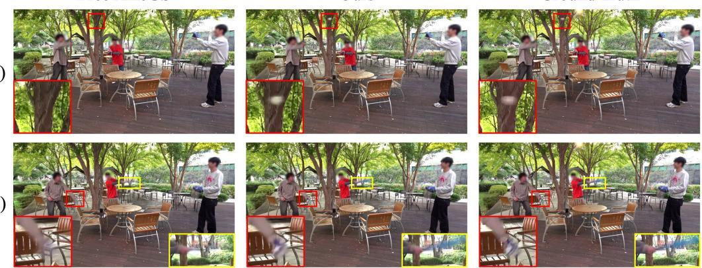  
Figure 1: Reconstruction under highly challenging dynamics. Existing 4DGS methods can (a) completely miss rapidly moving objects and (b) lose fine details under fast motion. Our method addresses both failure cases, recovering missing objects while better preserving fine details.

# DUSTING THE PHANTOM: GAUSSIAN ALLOCATIONFOR FADING DYNAMIC CONTENT

Minhyeok Roh<sup>1</sup>, Minseo Lee<sup>1</sup>, Jun Young Jeong<sup>2</sup>, Byeonghyeon Lee<sup>1</sup>, Lucas Yunkyu Lee<sup>3</sup>, Jaesik Park<sup>4</sup>, Eunbyung Park<sup>1†</sup>

<sup>1</sup>Yonsei University <sup>2</sup>Electronics and Telecommunications Research Institute (ETRI) <sup>3</sup>Pohang University of Science and Technology (POSTECH) <sup>4</sup>Seoul National University

## ABSTRACT

Dynamic Gaussian representations have made high-quality, real-time volumetric video increasingly practical, yet challenging motion can still break their reconstruction: small fast-moving objects may disappear, and fine textures in highly dynamic regions are often lost. In particular, simply training longer or using more Gaussians may still fail to recover small, fast-moving objects. We argue that the key bottleneck is not representational capacity itself, but where and when Gaussian primitives are allocated. Existing allocation strategies rely on current Gaussian locations and often overlook the spatiotemporal destinations of relocated Gaussians. To address these limitations, we introduce two complementary strategies. First, Seed Injection identifies under-reconstructed dynamic regions using temporal appearance changes and reconstruction errors, and initializes new Gaussians at geometrically plausible 3D locations through multi-view observations, independent of existing Gaussian locations. Second, Temporal Biased Relocation uses time-resolved optimization signals to guide the spatiotemporal placement of relocated Gaussians. Both strategies maintain a fixed Gaussian budget without modifying the underlying representation. Experiments across multiple dynamicscene datasets demonstrate improved reconstruction quality, particularly in highly dynamic regions, recovering small, rapidly moving objects and fine-grained appearance details. Project page: Dusting the Phantom

(a)

FreeTimeGS

Ours

Ground Truth

(b)

## 1 INTRODUCTION

Recent advances in 4D volumetric video promise to transform how we experience visual content: rather than watching events from fixed, recorded viewpoints, viewers can freely explore dynamic scenes as they unfold in space and time. From free-viewpoint sports replays (Chen et al., 2019; Dai et al., 2024) and immersive performances (Collet et al., 2015) to lifelike telepresence (Lawrence et al., 2021), such experiences require faithful reconstruction of both appearance and motion, to gether with interactive rendering. Recent advances in Neural Radiance Fields (NeRFs) (Mildenhall et al., 2021) and 3D Gaussian Splatting (3DGS) (Kerbl et al., 2023) have brought this vision closer to reality, providing powerful representations for high-quality novel-view synthesis that have been successfully extended to dynamic scenes. In particular, 3DGS’s high-quality, real-time rendering makes it especially attractive for next-generation immersive media, driving growing interest in Gaussianbased 4D scene modeling.

Many approaches have been developed to extend 3DGS to dynamic scenes, modeling temporal variations through deformation-based models (Yang et al., 2024b; Wu et al., 2024; Huang et al., 2024; Xu et al., 2024; Bae et al., 2024) or explicit spatiotemporal Gaussian representations (Yang et al., 2024a; Li et al., 2024; Wang et al., 2025; Liao et al., 2026; Lee et al., 2024; Wang et al., 2026; Yeom et al., 2026). Despite substantial progress, challenging dynamic content still remains difficult to reconstruct, with small, rapidly moving objects sometimes entirely disappearing (Fig. 1a) and fine textures in highly dynamic regions often being poorly recovered (Fig. 1b). A natural remedy is to train longer or increase the representational capacity by introducing more Gaussian primitives. While these strategies can improve reconstruction quality, they come at additional computational cost and do not necessarily resolve more severe failures, such as the disappearance of small, rapidly moving objects (Fig. 6). This suggests that increasing capacity alone is insufficient, motivating us to examine how Gaussian primitives are allocated during optimization. We therefore study these failures through the lens of Gaussian allocation: whether sufficient Gaussian support is assigned to challenging dynamic regions, and whether that support is placed at the appropriate spatial locations and timestamps.

Gaussian allocation is commonly adjusted through densification (Kerbl et al., 2023; Yang et al., 2024a; Li et al., 2024) and relocation (Kheradmand et al., 2024; Wang et al., 2025; 2026; Yeom et al., 2026; Lee et al., 2026). Densification increases representation capacity by cloning or splitting existing primitives, whereas relocation recycles low-contribution Gaussians by moving them to regions that require additional support, often while maintaining a fixed Gaussian budget. Both strategies rely on the current set of Gaussians to determine where Gaussians should be allocated. As a result, they struggle to place Gaussians in regions that are already poorly represented, which often correspond to challenging dynamic content such as small or rapidly moving objects. An insuf ficient number of Gaussians can hinder the reconstruction of fine appearance details and may even cause these objects to disappear altogether. To address this issue, we introduce the Seed Injection scheme, which injects Gaussian primitives directly from observations rather than deriving them from existing primitives. Specifically, Seed Injection identifies poorly reconstructed dynamic regions by combining temporal intensity changes with reconstruction error across synchronized multi-view images, and lifts selected observations into geometrically plausible 3D locations. By providing new Gaussian support independently of the current primitive distribution, it enables the model to refine under-represented dynamic regions and recover content that would otherwise remain missing.

Beyond allocating Gaussian capacity to under-represented regions, a complementary challenge lies in determining when and where relocated Gaussians should be placed. For example, Free-TimeGS (Wang et al., 2025) focuses on selecting which Gaussians should receive additional capacity, while the temporal destination of the relocated capacity receives less consideration. In particular, relocation scores are typically aggregated across timestamps, discarding information about when strong optimization signals occur: a high-scoring Gaussian may indicate where Gaussian capacity is needed, but provides little guidance about the particular timestamp at which that capacity is most useful. We therefore introduce Temporal Biased Relocation, which preserves time-resolved optimization signals and uses them to guide the spatiotemporal placement of relocated Gaussians along the trajectories of selected target Gaussians. By explicitly accounting for when reconstruction difficulty arises, our strategy allocates Gaussian capacity to timestamps where it is most needed, complementing the spatial allocation addressed by Seed Injection and improving reconstruction quality in both overall scenes and highly dynamic regions.

Together, Seed Injection and Temporal Biased Relocation address two aspects of Gaussian allocation: allocating additional capacity to under-represented regions and determining appropriate spatial and temporal destinations for relocated capacity, respectively. We apply both strategies to Free-TimeGS, our baseline, without modifying its underlying representation. Our contributions are as follows: (i) We introduce Seed Injection, which allocates additional Gaussian primitives to poorly reconstructed dynamic regions and enables the recovery of content with insufficient or missing Gaussian support. (ii) We propose Temporal Biased Relocation, which incorporates temporal optimization signals into the relocation destination, allowing Gaussian capacity to be placed at more appropriate times and spatial locations. (iii) Experiments across multiple dynamic-scene datasets demonstrate improved reconstruction quality in both overall scenes and highly dynamic regions, including the recovery of small, rapidly moving objects.

## 2 RELATED WORK

Dynamic Gaussian Splatting. Building upon 3D Gaussian Splatting (3DGS) (Kerbl et al., 2023), dynamic approaches track or deform Gaussian primitives over time (Luiten et al., 2024; Yang et al., 2024b; Wu et al., 2024; Lu et al., 2024), with recent methods further modeling multi-frame motion dependencies (Huang et al., 2026). Deformation-based approaches, however, remain dependent on primitives established during canonicalization, making initially under-represented content difficult to recover through subsequent deformation. Explicit spatiotemporal approaches instead model temporal evolution through 4D primitives, interpolation, flexible lifespans, or continuous trajecto ries (Yang et al., 2024a; Li et al., 2024; Lee et al., 2024; Liao et al., 2026; Yeom et al., 2026; Wang et al., 2026). FreeTimeGS (Wang et al., 2025), which serves as our baseline, introduces flexible temporal lifespans to model Gaussian appearance and motion over time. FreeTimeGS++(Lee et al., 2026) further improves initialization and optimization stability. However, these advances do not explicitly address how Gaussian capacity is allocated across space and time, leaving challenging dynamic regions potentially under-represented. SPIN-4DGS(Kim et al., 2026) addresses reconstruction under large inter-frame displacements by reducing cross-frame interference through attribute prediction from explicitly collected spatiotemporal positions. Our work instead targets Gaussian allocation as a source of dynamic reconstruction failures, without modifying the underlying dynamic Gaussian representation.

Gaussian Densification and Relocation. The original 3DGS adaptively clones or splits Gaussians based on positional gradients, while subsequent works improve density control through alternative densification criteria (Rota Bulo et al., 2024; Zhang et al., 2024; Ye et al., 2024; Zhou et al., 2026).\` Beyond densification, 3DGS-MCMC (Kheradmand et al., 2024) introduces relocation to redistribute underutilized Gaussian capacity. Dynamic methods additionally incorporate temporal properties such as lifespan, velocity, and visibility into density control (Liao et al., 2026; Sandu et al., 2026; Yeom et al., 2026; Wang et al., 2026). While these methods use temporal cues to guide primitive selection, the spatiotemporal destination of Gaussian capacity receives less consideration. Our method instead introduces new support in under-represented dynamic regions and uses timestamp-specific optimization signals to determine the temporal destination of relocated capacity.

Gaussian Allocation for Under-Reconstructed Regions. Error-based densification (Rota Bulo\` et al., 2024) directly targets under-reconstructed regions using reconstruction errors, but remains dependent on existing primitives as densification sources. LPM (Yang et al., 2025) alleviates this dependency by localizing error regions in 3D through cross-view feature correspondence, but relies on an external matching model, which may be less reliable in regions with weak visual correspondence. SpaceTimeGS (Li et al., 2024) enables guided sampling even in regions with sparse or missing Gaussian support, but still relies on the current Gaussian representation to provide a coarse depth prior for localizing new primitives. In contrast, our approach directly lifts observations from underreconstructed dynamic regions into 3D using synchronized multi-view geometry, without relying on existing Gaussian support or an external correspondence model.

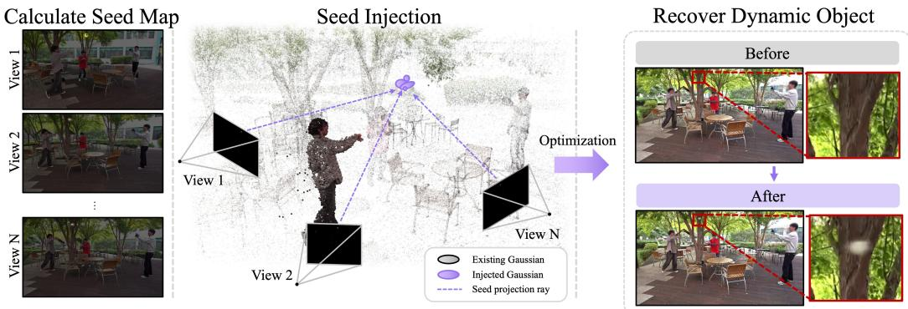  
Figure 2: Overview of Seed Injection. We identify under-reconstructed dynamic regions from synchronized multi-view observations and sample candidate pixels from the resulting seed map. The sampled observations are lifted into 3D using multi-view geometry to initialize new Gaussian primitives independently of the existing Gaussian distribution. After optimization, the injected Gaussians provide additional support for dynamic content that is poorly represented or missing in the original reconstruction.

## 3 METHOD

In this section, we present our approach for improving Gaussian allocation in dynamic scene reconstruction through Seed Injection and Temporal Biased Relocation. We first review the FreeTimeGS representation and its Gaussian relocation strategy as preliminaries in Sec. 3.1. Then, Sec. 3.2 describes how the Seed Injection technique introduces Gaussian primitives into under-reconstructed dynamic regions, and Sec. 3.3 details how Temporal Biased Relocation redistributes Gaussian capacity across time based on temporal optimization signals.

## 3.1 PRELIMINARIES

FreeTimeGS representation. FreeTimeGS (Wang et al., 2025) represents a dynamic scene using Gaussian primitives that can appear at arbitrary spatial locations and timestamps. Each Gaussian includes a spatial position $\mu _ { x }$ , temporal center $\mu _ { t } ,$ , duration d, velocity v, and opacity σ, along with standard 3DGS attributes. To model local motion, FreeTimeGS assigns each Gaussian a linear motion function,

$$
\begin{array} { r } { \mu _ { x } ( t ) = \mu _ { x } + v ( t - \mu _ { t } ) , } \end{array}\tag{1}
$$

where $\mu _ { x } ( t )$ denotes the spatial position of the Gaussian at timestamp t. The contribution of each Gaussian over time is further controlled by a temporal opacity function,

$$
\sigma ( t ) = \exp \left( - \frac { 1 } { 2 } \left( \frac { t - \mu _ { t } } { d } \right) ^ { 2 } \right) .\tag{2}
$$

The final opacity is obtained by multiplying the base opacity by $\sigma ( t )$ , where $\mu _ { t }$ and d control the temporal center and extent, respectively.

FreeTimeGS relocation. FreeTimeGS maintains a fixed Gaussian budget by periodically recycling low-opacity Gaussians through relocation. Specifically, it defines a sampling score s for each Gaussian primitive as

$$
s = \lambda _ { g } \nabla _ { g } + \lambda _ { o } \sigma ,\tag{3}
$$

where $\nabla _ { g }$ and $\sigma$ denote the spatial gradient and opacity of the Gaussian primitive, respectively, and $\lambda _ { g }$ and $\lambda _ { o }$ are their corresponding weights. At each relocation interval, Gaussian primitives whose opacity falls below a predefined threshold are reused and relocated toward primitives with high sampling scores.

## 3.2 SEED INJECTION

As described in Sec. 3.1, FreeTimeGS (Wang et al., 2025) reallocates a fixed Gaussian budget based on scores defined over existing Gaussian primitives. Consequently, highly dynamic regions, particularly those with insufficient Gaussian support, may have limited opportunities to receive additional capacity. To address this limitation, we introduce Seed Injection, which identifies underreconstructed dynamic regions from image observations and introduces new Gaussian primitives independently of the existing Gaussian distribution. An overview of Seed Injection scheme is illustrated in Fig. 2.

Dynamic Error-based Seed Map. To introduce new Gaussians into highly dynamic regions, we define a seed map using both a reconstruction error map and a dynamic mask. The reconstruction error map highlights regions that are poorly represented by the current Gaussian representation, but may also contain errors from static regions. We therefore use an additional dynamic mask to suppress static-region errors and focus the seed map on temporally varying regions. Specifically, for each view v at time t, we construct a binary dynamic mask $\dot { D } _ { v , t } \dot { \in } \{ 0 , 1 \} ^ { \overline { { H } } \times \check { W } }$ from the differences between adjacent frames. We define the per-pixel seed map as

$$
M _ { v , t } ( p ) = D _ { v , t } ( p ) E _ { v , t } ( p ) , \qquad E _ { v , t } ( p ) = \left\| I _ { v , t } ( p ) - \hat { I } _ { v , t } ( p ) \right\| _ { 1 } .\tag{4}
$$

Here, $\hat { I } _ { v , t }$ and $I _ { v , t }$ denote the rendered and ground-truth images, respectively, and p denotes a pixel coordinate. The seed map assigns high values to pixels that are both dynamic and poorly reconstructed. The detailed procedure for constructing the seed map is provided in the supplementary material A.2.

Multi-view Seed Lifting. For each time step t, we select a subset ${ \cal S } _ { t } \ \subseteq { \cal \mathcal { V } } _ { t }$ of C synchronized camera views, where $\nu _ { t }$ denotes the set of all available views at time t and $| S _ { t } | = C .$ . From each selected view $v \in S _ { t }$ , we sample $N _ { \mathrm { s e e d } }$ candidate seed pixels from the corresponding seed map $M _ { v , t }$ and collect them as $\mathcal { P } _ { v , t } = \{ p _ { v , t } ^ { 1 } , . . . , p _ { v , t } ^ { N _ { \mathrm { s e e d } } } \}$ , where $p _ { v , t } ^ { i } \in \mathbb { R } ^ { 2 }$ denotes the 2D image coordinate of the i-th sampled seed candidate. Since each sampled seed provides only a 2D image location, its 3D location is ambiguous. To approximate the 3D location, we match seed candidates across views based on the proximity of their viewing rays, as candidates corresponding to the same or nearby 3D region are expected to produce rays that pass close to each other.

The viewing rays of the seed candidates are defined according to the corresponding camera parameters. Let $\bar { o _ { v } } \in \mathbb { R } ^ { 3 }$ denote the camera center of view $v ,$ and let $d _ { v } ^ { i } \in \mathbb { R } ^ { 3 }$ denote the unit viewing direction corresponding to $p _ { v , t } ^ { i }$ . The corresponding viewing ray is defined as

$$
r _ { v } ^ { i } ( \lambda ) = o _ { v } + \lambda d _ { v } ^ { i } , \qquad v \in S _ { t } , i = 1 , \ldots , N _ { \mathrm { s e e d } } .\tag{5}
$$

Here, λ is a scalar parameter that specifies a point along the viewing ray from the camera center $o _ { v }$ This yields a total of $C \times N _ { \mathrm { { s e e d } } }$ candidate rays, denoted by $\mathcal { R } _ { t } = \bar { \{ r _ { v } ^ { i } \ \vert \ v \in S _ { t } , \ i = 1 , \dots , N _ { \mathrm { s e e d } } \} }$ To match seed candidates that are likely to correspond to similar 3D regions, we form all possible ray pairs from $\mathcal { R } _ { t }$ and compute their minimum distances, considering only pairs from different views, $\mathbf { i . e . , } v \neq v ^ { \prime } .$ . For a ray pair $( r _ { v } ^ { i } , r _ { v ^ { \prime } } ^ { j } )$ from views v and $v ^ { \prime } .$ , the minimum ray distance is obtained by finding the closest points on the two rays:

$$
( \lambda _ { i j } ^ { * } , \gamma _ { i j } ^ { * } ) = \arg \operatorname* { m i n } _ { \lambda , \gamma } \left\| r _ { v } ^ { i } ( \lambda ) - r _ { v ^ { \prime } } ^ { j } ( \gamma ) \right\| _ { 2 } ^ { 2 } = \arg \operatorname* { m i n } _ { \lambda , \gamma } \left\| ( o _ { v } + \lambda d _ { v } ^ { i } ) - ( o _ { v ^ { \prime } } + \gamma d _ { v ^ { \prime } } ^ { j } ) \right\| _ { 2 } ^ { 2 } .\tag{6}
$$

Here, ${ \lambda } _ { i j } ^ { * }$ and $\gamma _ { i j } ^ { * }$ denote the distances from the corresponding camera centers to the points that minimize the ray-to-ray distance. The corresponding closest points in views v and $v ^ { \prime }$ are $q _ { v } ^ { i , j } \ =$ $r _ { v } ^ { i } ( \lambda _ { i j } ^ { * } )$ and $q _ { v ^ { \prime } } ^ { i , j } = r _ { v ^ { \prime } } ^ { j } ( \gamma _ { i j } ^ { * } )$ , respectively, and their distance is $\delta _ { i j } = \| \boldsymbol { q } _ { v } ^ { i , j } - \boldsymbol { q } _ { v ^ { \prime } } ^ { i , j } \| _ { 2 }$

We retain only geometrically consistent cross-view ray pairs and, for each ray, select its nearest valid partner based on the ray distance. For each retained pair, the corresponding 3D seed position is defined as the midpoint of the two closest points,

$$
x _ { \mathrm { s e e d } } = \frac { 1 } { 2 } \left( q _ { v } ^ { i , j } + q _ { v ^ { \prime } } ^ { i , j } \right) .\tag{7}
$$

The resulting 3D seed candidates are ranked by their ray distances $\delta _ { i j }$ , and at most $N _ { \mathrm { m a x } }$ seeds are retained for Gaussian injection. Further implementation details are provided in the supplementary material A.2.

Gaussian Injection. For each lifted seed $x _ { \mathrm { s e e d } }$ , we reinitialize an available low-opacity Gaussian at the seed position, keeping the total Gaussian budget unchanged. The number of injected Gaussian is limited by both the retained seeds and the available low opacity primitives. Its scale is initialized isotropically based on the pixel footprint at the estimated depth, following prior works (Barron et al., 2021; Baranowski et al., 2026). Similar to the initialization strategy of FreeTimeGS (Wang et al., 2025), we initialize its velocity from the displacement to the nearest lifted seed in the subsequent frame. This nearest-neighbor displacement is used only as a coarse motion initialization and does not assume temporal correspondence between the seeds. The injected Gaussians thus provide new optimization starting points in under-represented regions and are subsequently optimized jointly with the existing representation.

Training Procedure. We begin Seed Injection at the midpoint of training, when reconstruction errors provide informative signals for identifying under-reconstructed regions. Before performing any injection, we compute and cache the lifted 3D seed candidates for all training frames using the same model snapshot. Since the injected Gaussians are introduced directly rather than through standard optimization, we allow them to adapt to the current scene representation before resuming relocation. We then temporarily disable relocation and process the training frames sequentially. For each frame, we initialize up to $N _ { \mathrm { m a x } }$ Gaussians at the cached seed locations by reinitializing available low-opacity primitives, followed by 10 optimization iterations on that frame. These framespecific iterations are included in the original total training budget. After all frames have been processed, we resume the original frame-sampling schedule while keeping relocation disabled for an additional $1 0 N _ { \mathrm { f r a m e s } }$ iterations, where $N _ { \mathrm { f r a m e s } }$ denotes the number of temporal frames in the training sequence. Relocation is then re-enabled according to the original schedule.

## 3.3 TEMPORAL BIASED RELOCATION

As described in Sec. 3.1, FreeTimeGS (Wang et al., 2025) reuses Gaussians whose opacity falls below a predefined threshold and relocates them toward primitives with high sampling scores. However, FreeTimeGS pays limited attention to when additional Gaussian capacity is needed, potentially leading to suboptimal temporal allocation. To address this limitation, we propose Temporal Biased Relocation, which preserves timestamp-specific positional gradients and uses them to determine the relocation time.

We follow FreeTimeGS (Wang et al., 2025) for selecting both the Gaussian to be relocated and the target Gaussian. However, once a target Gaussian g is selected, its trajectory spans multiple timestamps, and we must determine when along the trajectory the relocated Gaussian should be placed. A large screen-space positional gradient at timestamp t indicates that a stronger positional adjustment is required to explain the observations at that time. We interpret this as a signal that the current Gaussian allocation provides insufficient support at that timestamp. To estimate how strongly each timestamp requires additional Gaussian support, we use the magnitude of the target Gaussian’s positional gradient at each $t \in \mathcal { T } _ { g }$ and normalize these values over $\bar { \mathcal { T } } _ { g }$ to form a temporal relocation distribution:

$$
P _ { g } ( t ) = { \frac { \| \nabla _ { g , t } \| _ { 2 } } { \sum _ { u \in { \mathcal { T } } _ { g } } \| \nabla _ { g , u } \| _ { 2 } } } , \qquad t \in { \mathcal { T } } _ { g } .\tag{8}
$$

Note that we first average the positional gradient magnitudes over all observations of Gaussian $g$ at each timestamp before normalization, preventing frequently sampled timestamps from dominating the relocation distribution due to repeated observations. Then, we sample the relocation timestamp $t ^ { * } \sim P _ { g } ( t )$ , favoring timestamps that require additional Gaussian support. We set the temporal center of the relocated Gaussian, $\hat { \mu } _ { t }$ , to the selected timestamp $t ^ { * }$ , and its spatial center, $\hat { \mu } _ { x }$ , to the position of the target Gaussian g at that time:

$$
\hat { \mu } _ { t } = t ^ { * } , \qquad \hat { \mu } _ { x } = \mu _ { x } ( t ^ { * } ) = \mu _ { x } + v ( t ^ { * } - \mu _ { t } ) .\tag{9}
$$

Here, $\mu _ { x } , \mu _ { t } ,$ , and v denote the spatial center, temporal center, and velocity of the target Gaussian, respectively. We additionally adjust the temporal duration to account for the shifted temporal center, while the remaining parameters follow the original FreeTimeGS (Wang et al., 2025) relocation scheme. Further details of the duration adjustment and relocation procedure are provided in the supplementary material ${ \tt A } . 2$

## 4 EXPERIMENTS

## 4.1 EXPERIMENTAL SETUP

Datasets. We evaluate our method on three datasets with varying levels of scene dynamics. For N3DV (Li et al., 2022), we use all six scenes, each containing 300 frames captured at 30 FPS with 19–21 cameras at a resolution of 2704 × 2028. We downsample the images by 2×, use camera 0 for testing, and use the remaining cameras for training. For CMU Panoptic (Joo et al., 2015), we use six 150-frame sequences captured at 30 FPS and 640 × 360 resolution, with 27 cameras for training and cameras 0, 10, 15, and 30 for testing. Following the camera configuration, we set the near plane to 0.5 for test-view rendering to suppress artifacts from Gaussians located near the test cameras. Finally, we introduce the Custom dataset, consisting of the Baseball and Break sequences, to evaluate reconstruction of small and rapidly moving objects. Existing dynamic-scene datasets provide limited coverage of such challenging motions, despite small and fast-moving objects being particularly difficult to reconstruct with current 4DGS methods. We therefore captured two sequences specifically designed to include these cases using a synchronized multi-camera setup. The Baseball and Break sequences contain 250 and 300 frames, respectively, at a resolution of $1 9 2 0 \times 1 0 8 0$ and a frame rate of 30 FPS. Both sequences are captured using 23 cameras, with one spatially intermediate camera reserved for testing. For evaluation on dynamic regions, we generate test-view masks using SAM3 (Carion et al., 2026), as ground-truth dynamic masks are unavailable. We use dataset-specific prompts to segment the moving objects and report masked metrics using the resulting masks. For extremely fast-moving objects that are not reliably captured by SAM3, we additionally incorporate the dynamic masks used for Seed Injection to ensure that these regions are included in the evaluation. Evaluation metrics include PSNR, dynamic masked PSNR, DSSIM (Wang et al., 2004), and LPIPS (Zhang et al., 2018). All experiments use an NVIDIA RTX 4090 (24 GB), except Real-Time4DGS (Yang et al., 2024a), which uses an NVIDIA RTX A6000 (48 GB) for both training and evaluation.

Implementation Details. We build on the reproduced FreeTimeGS (Wang et al., 2025) implementation and follow its default training configuration unless otherwise specified. We use 500K Gaussians for N3DV (Li et al., 2022) and CMU Panoptic (Joo et al., 2015), and 1.5M Gaussians for the Custom dataset. We train N3DV, CMU Panoptic, and the Custom dataset for 30K, 50K, and 100K iterations, respectively, with longer training for the Custom dataset due to its more challenging outdoor scenes and high-frequency background details. For Seed Injection, we select $C = 8$ synchronized cameras to construct the dynamic error-based seed maps, with $N _ { \mathrm { s e e d } } = 4 8$ candidates sampled per view and a maximum of $N _ { \mathrm { m a x } } = 2 5 6$ injected seeds per frame. The velocity and scale are initialized as described in Sec. 3.2, while opacity and temporal duration are initialized to 0.05 and 0.03, respectively. Temporal Biased Relocation is applied whenever relocation is performed throughout training.

Table 1: Quantitative comparison on the N3DV dataset. Results marked with † are sourced from the original papers. Best and second-best results are highlighted in bold and underlined, respectively.
<table><tr><td>Method</td><td>PSNR ↑</td><td>Masked PSNR ↑</td><td>DSSIM1↓</td><td> $\mathrm { D S S I M _ { 2 } \downarrow }$ </td><td>LPIPS ↓</td></tr><tr><td>DyNeRF† (Li et al., 2022)</td><td>29.58</td><td></td><td></td><td>0.020</td><td>0.083</td></tr><tr><td>K-Planes† (Fridovich-Keil et al., 2023)</td><td>31.63</td><td></td><td></td><td>0.018</td><td></td></tr><tr><td>NeRFPlayer† (Song et al., 2023)</td><td>30.96</td><td></td><td>0.034</td><td></td><td>0.111</td></tr><tr><td>Deformable-3DGS† (Yang et al., 2024b)</td><td>31.15</td><td></td><td>0.030</td><td></td><td>0.049</td></tr><tr><td>SpaceTimeGS† (Li et al., 2024)</td><td>32.05</td><td></td><td>0.026</td><td>0.014</td><td>0.044</td></tr><tr><td>RealTime4DGS (Yang et al., 2024a)</td><td>31.97</td><td>31.90</td><td>0.027</td><td>0.015</td><td>0.051</td></tr><tr><td>Ex4DGS (Lee et al., 2024)</td><td>32.01</td><td>31.33</td><td>0.029</td><td>0.015</td><td>0.046</td></tr><tr><td>4DGaussian (Wu et al., 2024)</td><td>30.74</td><td>29.46</td><td>0.033</td><td>0.017</td><td>0.057</td></tr><tr><td>FreeTimeGS (Wang et al., 2025)</td><td>32.52</td><td>32.27</td><td>0.022</td><td>0.011</td><td>0.041</td></tr><tr><td>FreeTimeGS + Ours</td><td>32.56</td><td>32.87</td><td>0.022</td><td>0.011</td><td>0.040</td></tr></table>

Table 2: Quantitative comparison on the CMU Panoptic dataset.
<table><tr><td>Method</td><td>PSNR ↑</td><td>Masked PSNR ↑</td><td></td><td>DSSIM1 ↓ DSSIM2 ↓ LPIPS ↓</td><td></td></tr><tr><td>Dynamic 3DGS (Luiten et al., 2024)</td><td>28.72</td><td>27.13</td><td>0.051</td><td>0.024</td><td>0.095</td></tr><tr><td>RealTime4DGS (Yang et al., 2024a)</td><td>28.01</td><td>25.84</td><td>0.044</td><td>0.023</td><td>0.111</td></tr><tr><td>Ex4DGS (Lee et al., 2024)</td><td>24.86</td><td>23.64</td><td>0.054</td><td>0.029</td><td>0.120</td></tr><tr><td>4DGaussian (Wu et al., 2024)</td><td>26.92</td><td>23.68</td><td>0.047</td><td>0.024</td><td>0.116</td></tr><tr><td>FreeTimeGS (Wang et al., 2025)</td><td>28.34</td><td>26.68</td><td>0.039</td><td>0.019</td><td>0.110</td></tr><tr><td>FreeTimeGS + Ours</td><td>29.05</td><td>27.28</td><td>0.032</td><td>0.016</td><td>0.063</td></tr></table>

Table 3: Quantitative comparison on the Custom dataset.
<table><tr><td>Method</td><td>PSNR ↑</td><td>Masked PSNR ↑</td><td></td><td>DSSIM1 ↓ DSSIM2 ↓ LPIPS ↓</td><td></td></tr><tr><td>RealTime4DGS (Yang et al., 2024a)</td><td>20.46</td><td>24.45</td><td>0.154</td><td>0.114</td><td>0.249</td></tr><tr><td>Ex4DGS (Lee et al., 2024)</td><td>19.74</td><td>22.00</td><td>0.179</td><td>0.132</td><td>0.335</td></tr><tr><td>4DGaussian (Wu et al., 2024)</td><td>20.80</td><td>22.03</td><td>0.163</td><td>0.114</td><td>0.308</td></tr><tr><td>FreeTimeGS (Wang et al., 2025)</td><td>20.84</td><td>27.37</td><td>0.131</td><td>0.097</td><td>0.170</td></tr><tr><td>FreeTimeGS + Ours</td><td>20.98</td><td>27.47</td><td>0.128</td><td>0.095</td><td>0.160</td></tr></table>

## 4.2 COMPARISON EXPERIMENTS

N3DV We first evaluate our method on N3DV (Li et al., 2022), which contains relatively mild scene dynamics compared with the other datasets considered in our experiments. Quantitative comparisons are presented in Table 1, with additional qualitative results provided in Fig. 12. Our method improves reconstruction quality over the FreeTimeGS baseline, with particularly noticeable improvements in dynamic regions, while preserving the well-reconstructed static content.

CMU Panoptic We further evaluate our method on CMU Panoptic (Joo et al., 2015), which contains diverse and highly dynamic human motions. In particular, the Juggle sequence includes small and rapidly moving objects, providing a challenging scenario where the juggling balls can be poorly reconstructed or even disappear due to insufficient Gaussian support. As shown in Fig. 3, our method successfully recovers the juggling balls while also better preserving the details of the rapidly moving hands. Beyond these challenging regions, our method improves reconstruction across a variety of dynamic content. It also better allocates Gaussians to under-reconstructed static regions, leading to improved overall reconstruction quality. These improvements are reflected in the quantitative results in Table 2. Additional qualitative results on the other CMU Panoptic sequences are provided in the supplementary material (Fig. 13).

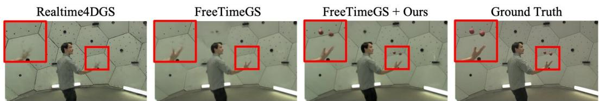  
Figure 3: Qualitative comparison on the CMU Panoptic Juggle sequence. Our method better recon structs the rapidly moving juggling balls while preserving fine details of the hands.

Custom Dataset We next evaluate our method on the Custom dataset, consisting of the Baseball and Break sequences. Quantitative results are reported in Table 3, with additional qualitative comparisons provided in the supplementary material. In the Baseball sequence, the rapidly moving ball and baseball bat disappear in the FreeTimeGS reconstruction, while fine details of the glove are poorly preserved. As shown in Fig. 1a, our method successfully recovers the missing baseball, demonstrating its effectiveness in reconstructing small and rapidly moving objects. Our method also better preserves the details of the bat and glove, as shown in Fig. 1b. Similarly, in the Break sequence, our method successfully reconstructs the small and rapidly moving pirate roulette that is missing in the baseline (Fig. 14)

## 4.3 ABLATION STUDIES AND ANALYSIS

Component Ablation. We conduct an ablation study on three highly dynamic CMU Panoptic (Joo et al., 2015) sequences—Basketball, Football, and Juggle—and report the average results across the three sequences to evaluate the contribution of each proposed component. As shown in Table 4, Seed Injection helps recover rapidly moving objects, such as the juggling balls, that are poorly represented by the baseline, while Temporal Biased Relocation improves reconstruction quality across both dynamic and under-reconstructed static regions, as shown in Fig. 4. Combining both components further improves reconstruction quality while introducing only a small increase in training time, with all CMU Panoptic experiments using 500K Gaussians and 50K training iterations. We further analyze the sensitivity of Seed Injection to its key design parameters, including $N _ { \mathrm { s e e d } } , N _ { \mathrm { m a x } }$ , and the number of camera views, in the supplementary material (A.3).

Table 4: Ablation study of our proposed components on the CMU Juggle, Football, and Basketball sequences.
<table><tr><td>Method</td><td>PSNR ↑</td><td>Masked PSNR ↑</td><td> $\mathrm { D S S I M _ { 1 } } \downarrow$ </td><td> $\mathrm { D S S I M _ { 2 } \downarrow }$ </td><td> $\mathrm { L P I P S } \downarrow$ </td><td>Training Time (m) ↓</td></tr><tr><td>FreeTimeGS (Wang et al., 2025)</td><td>28.22</td><td>27.58</td><td>0.045</td><td>0.023</td><td>0.161</td><td>5.69</td></tr><tr><td>FreeTimeGS w/ Seed Injection</td><td>28.53</td><td>27.82</td><td>0.045</td><td>0.022</td><td>0.160</td><td>5.85</td></tr><tr><td>FreeTimeGS w/ Temporal Biased Relocation</td><td>28.57</td><td>28.02</td><td>0.034</td><td>0.017</td><td>0.080</td><td>5.74</td></tr><tr><td>FreeTimeGS + Ours</td><td>28.98</td><td>28.24</td><td>0.034</td><td>0.017</td><td>0.082</td><td>5.91</td></tr></table>

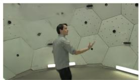  
FreeTimeGS

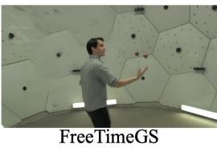  
w/ seed injection

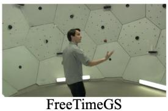  
w/ temporal biased relocation

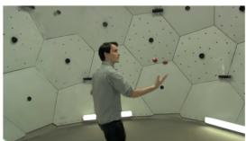  
FreeTimeGS + Ours  
Figure 4: Qualitative ablation of Seed Injection and Temporal Biased Relocation on the CMU Panoptic Juggle sequence. Both components improve the reconstruction of dynamic content, while their combination provides the most complete reconstruction.

Analysis of Seed Injection. Fig. 5 visualizes the centers of injected Gaussians projected onto the ground-truth test view at their injection timestamps. The injected Gaussians (red dots) concentrate around rapidly moving regions, including the glove, bat, and baseball, showing that Seed Injection effectively allocates Gaussian capacity to challenging dynamic content.

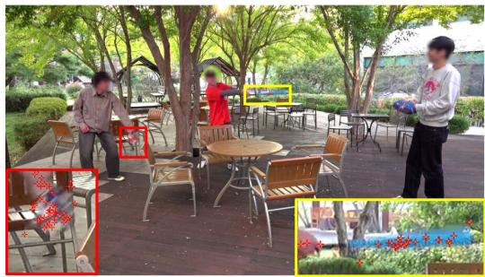

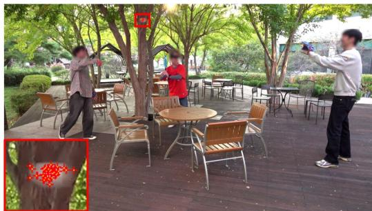  
Figure 5: Visualization of Seed Injection on the Custom dataset. Red markers indicate the projected centers of newly injected Gaussians, which are concentrated around rapidly moving objects such as the glove, bat and baseball.

Analysis of Temporal Biased Relocation. Fig. 11 compares the number of relocation operations during training on CMU Panoptic (Joo et al., 2015). Temporal Biased Relocation generally requires fewer relocations than FreeTimeGS (Wang et al., 2025), suggesting that temporal optimization signals guide relocated Gaussians toward more effective destinations and reduce repeated relocation.

## 5 CONCLUSIONS

We presented a Gaussian allocation framework for improving the reconstruction of challenging dynamic content in 4D Gaussian Splatting. Our approach addresses two complementary limitations in existing allocation strategies. Seed Injection introduces new Gaussian primitives directly from synchronized multi-view observations, providing additional support for under-represented dynamic regions even when suitable Gaussians are absent from the current representation. Temporal Biased Relocation preserves time-resolved optimization signals to guide relocated Gaussian capacity toward the timestamps where it is most needed. We integrate both strategies into FreeTimeGS while preserving its underlying representation. Experiments across multiple dynamic-scene datasets demonstrate consistent improvements in reconstruction quality, particularly in highly dynamic regions, while recovering small and rapidly moving objects that can disappear in the baseline reconstruction. These results highlight the importance of explicitly considering both spatial and temporal Gaussian allocation for robust dynamic-scene reconstruction.

Limitations. Our Seed Injection relies on a simple frame-difference-based criterion to identify dynamic regions by comparing adjacent frames. Consequently, rapidly moving objects may not be detected when their appearance is similar to the surrounding regions, resulting in weak temporal differences despite substantial motion. In such cases, Seed Injection may fail to introduce additional Gaussian primitives into these under-reconstructed dynamic regions. We leave addressing this limitation to future work. In addition, although we evaluate our method on multiple dynamic-scene datasets, further evaluation on more diverse and highly dynamic datasets would be valuable as such datasets become available.

## AI USE STATEMENT

In this work, we used a large language model (LLM) in a limited capacity for proofreading and improving the readability of the manuscript. All technical content, including the proposed method and experiments, was conceived and written by the authors. All LLM-assisted edits were reviewed and verified by the authors. In accordance with the ICLR guidelines, we disclose our use of generative AI below.

## ETHICS STATEMENT

Our experiments primarily rely on publicly available datasets, together with a custom dataset used with appropriate permission. For the custom data, we blur most visible faces to protect individual privacy and prevent identification. We are not aware of any additional ethical concerns associated with the proposed method or its intended applications.

## REPRODUCIBILITY STATEMENT

The method, the implementation, training setup, and evaluation protocols are described in Sec. 4, and further details are provided in the supplementary materials. We will release the source code upon publication.

## REFERENCES

Jeongmin Bae, Seoha Kim, Youngsik Yun, Hahyun Lee, Gun Bang, and Youngjung Uh. Pergaussian embedding-based deformation for deformable 3d gaussian splatting. In European Conference on Computer Vision, pp. 321–335. Springer, 2024.

Bartlomiej Baranowski, Stefano Esposito, Patricia Gschoßmann, Anpei Chen, and Andreas Geiger. Conegs: Error-guided densification using pixel cones for improved reconstruction with fewer primitives. In 2026 International Conference on 3D Vision (3DV), pp. 989–999. IEEE, 2026.

Jonathan T Barron, Ben Mildenhall, Matthew Tancik, Peter Hedman, Ricardo Martin-Brualla, and Pratul P Srinivasan. Mip-nerf: A multiscale representation for anti-aliasing neural radiance fields. In 2021 IEEE/CVF International Conference on Computer Vision (ICCV), pp. 5835–5844. IEEE, 2021.

Nicolas Carion, Laura Gustafson, Yuan-Ting Hu, Shoubhik Debnath, Ronghang Hu, Didac Suris Coll-Vinent, Chaitanya Ryali, Kalyan Vasudev Alwala, Haitham Khedr, Andrew Huang, et al. Sam 3: Segment anything with concepts. In International conference on learning representations, volume 2026, pp. 138846–138923, 2026.

Jun Chen, Ryosuke Watanabe, Keisuke Nonaka, Tomoaki Konno, Hiroshi Sankoh, and Sei Naito. Fast free-viewpoint video synthesis algorithm for sports scenes. In 2019 IEEE/RSJ International Conference on Intelligent Robots and Systems (IROS), pp. 3209–3215. IEEE, 2019.

Alvaro Collet, Ming Chuang, Pat Sweeney, Don Gillett, Dennis Evseev, David Calabrese, Hugues Hoppe, Adam Kirk, and Steve Sullivan. High-quality streamable free-viewpoint video. ACM Transactions on Graphics (ToG), 34(4):1–13, 2015.

Yanran Dai, Jing Li, Yuqi Jiang, Haidong Qin, Bang Liang, Shikuan Hong, Haozhe Pan, and Tao Yang. Real-time distance field acceleration based free-viewpoint video synthesis for large sports fields. Computational Visual Media, 10(2):331–353, 2024.

Sara Fridovich-Keil, Giacomo Meanti, Frederik Rahbæk Warburg, Benjamin Recht, and Angjoo Kanazawa. K-planes: Explicit radiance fields in space, time, and appearance. In 2023 IEEE/CVF Conference on Computer Vision and Pattern Recognition (CVPR), pp. 12479–12488. IEEE, 2023.

Tingxuan Huang, Haowei Zhu, Jun-hai Yong, Hao Pan, and Bin Wang. Mango-gs: Enhancing spatio-temporal consistency in dynamic scenes reconstruction using multi-frame node-guided 4d gaussian splatting. arXiv preprint arXiv:2603.11543, 2026.

Yi-Hua Huang, Yang-Tian Sun, Ziyi Yang, Xiaoyang Lyu, Yan-Pei Cao, and Xiaojuan Qi. Sc-gs: Sparse-controlled gaussian splatting for editable dynamic scenes. In 2024 IEEE/CVF Conference on Computer Vision and Pattern Recognition (CVPR), pp. 4220–4230. IEEE, 2024.

Hanbyul Joo, Hao Liu, Lei Tan, Lin Gui, Bart Nabbe, Iain Matthews, Takeo Kanade, Shohei Nobuhara, and Yaser Sheikh. Panoptic studio: A massively multiview system for social motion capture. In Proceedings of the IEEE international conference on computer vision, pp. 3334–3342, 2015.

Bernhard Kerbl, Georgios Kopanas, Thomas Leimkuhler, George Drettakis, et al. 3d gaussian splat-¨ ting for real-time radiance field rendering. ACM Trans. Graph., 42(4):139–1, 2023.

Shakiba Kheradmand, Daniel Rebain, Gopal Sharma, Weiwei Sun, Yang-Che Tseng, Hossam Isack, Abhishek Kar, Andrea Tagliasacchi, and Kwang Moo Yi. 3d gaussian splatting as markov chain monte carlo. Advances in Neural Information Processing Systems, 37:80965–80986, 2024.

Seung-gyeom Kim, Areum Kim, Yongjae Yoo, and Sukmin Yun. Implicit 4d gaussian splatting for fast motion with large inter-frame displacements. In International Conference on Learning Representations, volume 2026, pp. 43331–43349, 2026.

Jason Lawrence, Dan B Goldman, Supreeth Achar, Gregory Major Blascovich, Joseph G. Desloge, Tommy Fortes, Eric M. Gomez, Sascha Haberling, Hugues Hoppe, Andy Huibers, Claude Knaus,¨ Brian Kuschak, Ricardo Martin-Brualla, Harris Nover, Andrew Ian Russell, Steven M. Seitz, and Kevin Tong. Project starline: A high-fidelity telepresence system. ACM Transactions on Graphics (Proc. SIGGRAPH Asia), 40(6), 2021.

Junoh Lee, ChangYeon Won, Hyunjun Jung, Inhwan Bae, and Hae-Gon Jeon. Fully explicit dynamic gaussian splatting. Advances in Neural Information Processing Systems, 37:5384–5409, 2024.

Lucas Yunkyu Lee, Soonho Kim, Youngwook Kim, Sangmin Kim, and Jaesik Park. Freetimegs++: Secrets of dynamic gaussian splatting and their principles. arXiv preprint arXiv:2605.03337, 2026.

Tianye Li, Mira Slavcheva, Michael Zollhoefer, Simon Green, Christoph Lassner, Changil Kim, Tanner Schmidt, Steven Lovegrove, Michael Goesele, Richard Newcombe, et al. Neural 3d video synthesis from multi-view video. In 2022 IEEE/CVF Conference on Computer Vision and Pattern Recognition (CVPR), pp. 5511–5521. IEEE, 2022.

Zhan Li, Zhang Chen, Zhong Li, and Yi Xu. Spacetime gaussian feature splatting for real-time dynamic view synthesis. In 2024 IEEE/CVF Conference on Computer Vision and Pattern Recognition (CVPR), pp. 8508–8520. IEEE, 2024.

Zhanfeng Liao, Jiajun Zhang, Hanzhang Tu, Zhixi Wang, Yunqi Gao, Hongwen Zhang, and Yebin Liu. Sharptimegs: Sharp and stable dynamic gaussian splatting via lifespan modulation. In Proceedings of the IEEE/CVF Conference on Computer Vision and Pattern Recognition (CVPR), pp. 11798–11807, June 2026.

Zhicheng Lu, Xiang Guo, Le Hui, Tianrui Chen, Min Yang, Xiao Tang, Feng Zhu, and Yuchao Dai. 3d geometry-aware deformable gaussian splatting for dynamic view synthesis. In 2024 IEEE/CVF Conference on Computer Vision and Pattern Recognition (CVPR), pp. 8900–8910. IEEE, 2024.

Jonathon Luiten, Georgios Kopanas, Bastian Leibe, and Deva Ramanan. Dynamic 3d gaussians: Tracking by persistent dynamic view synthesis. In 2024 International Conference on 3D Vision (3DV), pp. 800–809. IEEE, 2024.

Ben Mildenhall, Pratul P Srinivasan, Matthew Tancik, Jonathan T Barron, Ravi Ramamoorthi, and Ren Ng. Nerf: Representing scenes as neural radiance fields for view synthesis. Communications ofthe ACM, 65(1):99–106, 2021.

Samuel Rota Bulo, Lorenzo Porzi, and Peter Kontschieder. Revising densification in gaussian splat-\` ting. In European Conference on Computer Vision, pp. 347–362. Springer, 2024.

Vikram Sandu, Mayurdeep Pathak, and Rajiv Soundararajan. Temporally aware densification for dynamic 3d gaussian splatting. arXiv preprint arXiv:2606.23212, 2026.

Liangchen Song, Anpei Chen, Zhong Li, Zhang Chen, Lele Chen, Junsong Yuan, Yi Xu, and Andreas Geiger. Nerfplayer: A streamable dynamic scene representation with decomposed neural radiance fields. IEEE Transactions on Visualization and Computer Graphics, 29(5):2732–2742, 2023.

Xuezhen Wang, Li Ma, Yulin Shen, Zeyu Wang, and Pedro V Sander. Retimegs: Continuous-time reconstruction of 4d gaussian splatting. arXiv preprint arXiv:2603.13783, 2026.

Yifan Wang, Peishan Yang, Zhen Xu, Jiaming Sun, Zhanhua Zhang, Yong Chen, Hujun Bao, Sida Peng, and Xiaowei Zhou. Freetimegs: Free gaussian primitives at anytime anywhere for dynamic scene reconstruction. In 2025 IEEE/CVF Conference on Computer Vision and Pattern Recognition (CVPR), pp. 21750–21760. IEEE, 2025.

Zhou Wang, Alan C Bovik, Hamid R Sheikh, and Eero P Simoncelli. Image quality assessment: from error visibility to structural similarity. IEEE transactions on image processing, 13(4):600– 612, 2004.

Guanjun Wu, Taoran Yi, Jiemin Fang, Lingxi Xie, Xiaopeng Zhang, Wei Wei, Wenyu Liu, Qi Tian, and Xinggang Wang. 4d gaussian splatting for real-time dynamic scene rendering. In 2024 IEEE/CVF Conference on Computer Vision and Pattern Recognition (CVPR), pp. 20310–20320. IEEE, 2024.

Jiawei Xu, Zexin Fan, Jian Yang, and Jin Xie. Grid4d: 4d decomposed hash encoding for highfidelity dynamic gaussian splatting. Advances in Neural Information Processing Systems, 37: 123787–123811, 2024.

Haosen Yang, Chenhao Zhang, Wenqing Wang, Marco Volino, Adrian Hilton, Li Zhang, and Xiatian Zhu. Improving gaussian splatting with localized points management. In 2025 IEEE/CVF Conference on Computer Vision and Pattern Recognition (CVPR), pp. 21696–21705. IEEE, 2025.

Zeyu Yang, Hongye Yang, Zijie Pan, and Li Zhang. Real-time photorealistic dynamic scene representation and rendering with 4d gaussian splatting. In International Conference on Learning Representations, volume 2024, pp. 9142–9159, 2024a.

Ziyi Yang, Xinyu Gao, Wen Zhou, Shaohui Jiao, Yuqing Zhang, and Xiaogang Jin. Deformable 3d gaussians for high-fidelity monocular dynamic scene reconstruction. In 2024 IEEE/CVF Conference on Computer Vision and Pattern Recognition (CVPR), pp. 20331–20341. IEEE, 2024b.

Zongxin Ye, Wenyu Li, Sidun Liu, Peng Qiao, and Yong Dou. Absgs: Recovering fine details in 3d gaussian splatting. In Proceedings ofthe 32nd ACM international conference on multimedia, pp. 1053–1061, 2024.

Suwoong Yeom, Joonsik Nam, Seunggyu Choi, Lucas Yunkyu Lee, Sangmin Kim, Jaesik Park, Joonsoo Kim, Kugjin Yun, Kyeongbo Kong, and Sukju Kang. Trigs: Temporal rigid-body motion for scalable 4d gaussian splatting. arXiv preprint arXiv:2604.00538, 2026.

Richard Zhang, Phillip Isola, Alexei A Efros, Eli Shechtman, and Oliver Wang. The unreasonable effectiveness of deep features as a perceptual metric. In 2018 IEEE/CVF conference on computer vision and pattern recognition, pp. 586–595. IEEE, 2018.

Zheng Zhang, Wenbo Hu, Yixing Lao, Tong He, and Hengshuang Zhao. Pixel-gs: Density control with pixel-aware gradient for 3d gaussian splatting. In European conference on computer vision, pp. 326–342. Springer, 2024.

Zheng Zhou, Yu-Jie Xiong, Jia-Chen Zhang, Chun-Ming Xia, Xihe Qiu, and Hongjian Zhan. Gradient-direction-aware density control for 3d gaussian splatting. In International Conference on Learning Representations, volume 2026, pp. 21415–21437, 2026.

## A APPENDIX

## A.1 EFFECT OF INCREASED MODEL CAPACITY AND TRAINING

We further investigate whether the missing dynamic content in FreeTimeGS can be recovered simply by increasing model capacity and training time. As shown in Fig. 6, even when both the number of Gaussians and training iterations are doubled, FreeTimeGS still fails to reconstruct the rapidly moving ball. In contrast, our method successfully recovers the ball using the original Gaussian budget and training schedule. This suggests that the failure is not merely caused by insufficient model capacity or optimization time, but by ineffective Gaussian allocation in challenging dynamic regions.

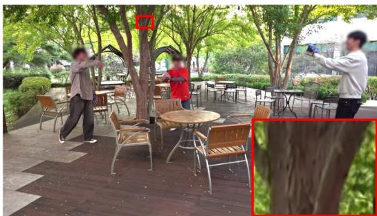  
FreeTimeGS  
(3M gaussian & 0.2M iteration)

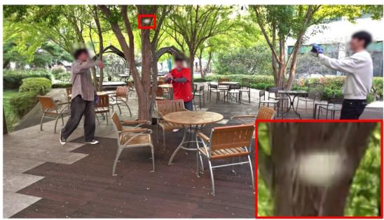  
Ours  
(1.5M Gaussian & 0.1M iteration)  
Figure 6: Effect of increased Gaussian capacity and training iterations. Even with twice the number of Gaussians (3M) and training iterations (0.2M), FreeTimeGS fails to recover the rapidly moving ball, while our method successfully reconstructs it with 1.5M Gaussians and 0.1M iterations.

## A.2 ADDITIONAL IMPLEMENTATION DETAILS

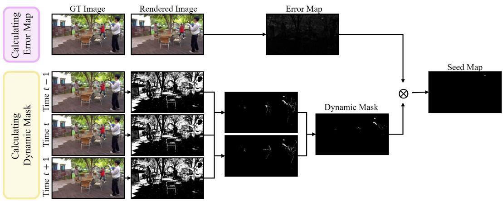  
Figure 7: Construction of the dynamic error-based seed map. The reconstruction error map is computed from the difference between the ground-truth and rendered images, while the dynamic mask is obtained from the intersection of temporal difference masks from adjacent frames. The final seed map is obtained by element-wise multiplication of the reconstruction error map and the dynamic mask, highlighting under-reconstructed dynamic regions.

Dynamic Error-based Seed Map. In this section, we describe the detailed construction of the seed map. As introduced in the main paper, the seed map is defined by combining a reconstruction

error map with a dynamic mask. As illustrated in Fig. 7, the construction consists of two main steps: computing the reconstruction error map and constructing the dynamic mask.

The reconstruction error map is designed to capture regions that are insufficiently represented by the current Gaussian representation. Specifically, for each view v at timestamp t, we compute the pixel-wise difference between the rendered image $\hat { I } _ { v , t }$ and the ground-truth image $I _ { v , t }$

$$
E _ { v , t } ( p ) = \Big \| { } I _ { v , t } ( p ) - \hat { I } _ { v , t } ( p ) \Big \| _ { 1 } ,\tag{10}
$$

where p denotes a pixel coordinate.

To restrict the reconstruction error to dynamic regions, we construct a binary dynamic mask using the adjacent frames at timestamps t − 1 and t + 1. We first convert $I _ { v , t - 1 } , \ I _ { v , t }$ , and $I _ { v , t + 1 }$ into grayscale images and compute two temporal difference masks:

$$
\begin{array} { r } { M _ { v , t } ^ { \mathrm { r e a r } } = \mathbf { 1 } \left( I _ { v , t } ^ { \mathrm { g r a y } } - I _ { v , t - 1 } ^ { \mathrm { g r a y } } > \tau \right) , } \\ { M _ { v , t } ^ { \mathrm { f r o n t } } = \mathbf { 1 } \left( I _ { v , t } ^ { \mathrm { g r a y } } - I _ { v , t + 1 } ^ { \mathrm { g r a y } } > \tau \right) . } \end{array}\tag{11}
$$

where τ denotes the intensity-difference threshold. We set $\tau { = } 2 0$ for grayscale intensities in [0,255]. The final dynamic mask is obtained by taking the intersection of the two difference masks:

$$
D _ { v , t } = M _ { v , t } ^ { \mathrm { r e a r } } \wedge M _ { v , t } ^ { \mathrm { f r o n t } } .\tag{12}
$$

This intersection retains pixels that consistently exhibit temporal changes with respect to both neighboring frames, while suppressing transient differences that appear only in one direction.

Finally, we construct the seed map by multiplying the reconstruction error map with the dynamic mask:

$$
M _ { v , t } ( p ) = D _ { v , t } ( p ) E _ { v , t } ( p ) .\tag{13}
$$

This allows the seed map to reflect the degree of under-representation measured by the reconstruction error, while restricting the response to temporally dynamic regions. Consequently, regions with large reconstruction errors in static areas are suppressed, whereas poorly reconstructed dynamic regions receive high seed values.

Multi-view Seed Lifting. Alg. 1 describes the detailed process of Multi-view Seed Lifting. As mentioned earlier, we match seed candidates across views using the proximity of their viewing rays and use the resulting 3D locations to initialize new Gaussians.

Algorithm 1 Multi-view Seed Lifting   
Require: Seed maps $\{ M _ { v , t } \}$ , selected views ${ \mathbf { } } S _ { t } ,$ candidates per view $N _ { s e e d } ,$ maximum seeds $N _ { \mathrm { m a x } }$   
Ensure: 3D seed positions $\dot { \mathcal { X } } _ { \mathrm { s e e d } }$   
1: Sample $N _ { s e e d }$ seed pixels from each selected view and back-project them into viewing rays   
2: Form all cross-view ray pairs   
3: for each cross-view ray pair do   
4: Compute the closest points and ray distance   
5: Retain pairs with positive depths and sufficiently close viewing rays   
6: end for   
7: For each ray, select its nearest valid partner, if any   
8: Take the union of the selected ray pairs   
9: Set each 3D seed to the midpoint of the corresponding closest points   
10: Keep at most $N _ { \mathrm { m a x } }$ seeds with the smallest ray distances   
11: return $\mathcal { X } _ { \mathrm { s e e d } }$

Temporal Biased Relocation. Alg. 2 describes the detailed procedure of Temporal Biased Relocation. We follow the original FreeTimeGS strategy to select the Gaussian to be relocated and its target Gaussian, and determine the relocation timestamp using the target Gaussian’s timestampspecific mean 2D positional gradient magnitudes.

```tcl
Algorithm 2 Temporal Biased Relocation
Require: Gaussian set G, timestamp-wise mean 2D positional gradient magnitudes
Ensure: Relocated Gaussians
1: Select the Gaussian to be relocated and the target Gaussian g using the original FreeTimeGS
relocation strategy
2: for each observed timestamp $t \in \mathcal { T } _ { g }$ do
3: Retrieve the mean 2D positional gradient magnitude associated with $( g , t )$
4: end for
5: Normalize the timestamp-specific mean gradient magnitudes over $\mathcal { T } _ { g }$ to obtain $P _ { g } ( t )$
6: Sample the relocation timestamp $t ^ { * } \sim \bar { P _ { g } } ( t )$
7: Set the relocated temporal center $\hat { \mu } _ { t } \gets \dot { t ^ { * } }$
8: Set the relocated spatial center $\hat { \mu } _ { x }  \mu _ { x } + v ( t ^ { * } - \mu _ { t } )$
9: Compute the target’s temporal support radius $r  d \sqrt { 2 \ln { 1 0 } }$
10: Set the relocated temporal duration $\hat { d } \gets$ min d, max $\begin{array} { r } { \left( \epsilon , \frac { \operatorname* { m i n } \{ | t ^ { * } - ( \mu _ { t } - r ) | , | t ^ { * } - ( \mu _ { t } + r ) | \} } { \sqrt { 2 \ln 1 0 } } \right) \biggr ) } \end{array}$
11: Apply the remaining FreeTimeGS relocation updates
12: return relocated Gaussians
```

## A.3 ADDITIONAL ABLATION STUDIES AND ANALYSIS

Effect of the number of sampled seeds. We further investigate the effect of $N _ { \mathrm { s e e d } } .$ , which controls the number of seed candidates sampled from each camera view during Seed Injection. The primary effect of Seed Injection is to recover small and rapidly moving objects that may be completely missing in the baseline reconstruction and to improve fine details in fast-moving regions. Since these improvements are spatially localized to small regions and often persist for only a short temporal duration, their impact may not be fully reflected in image-level quantitative metrics (e.g., PSNR). We therefore provide a qualitative ablation with $N _ { \mathrm { s e e d } } \in \mathsf { \overline { { \{ 4 , 8 , 1 6 , 4 8 \} } } }$ in Fig. 8.

Frame 17  
Frame 92  
Frame 97  
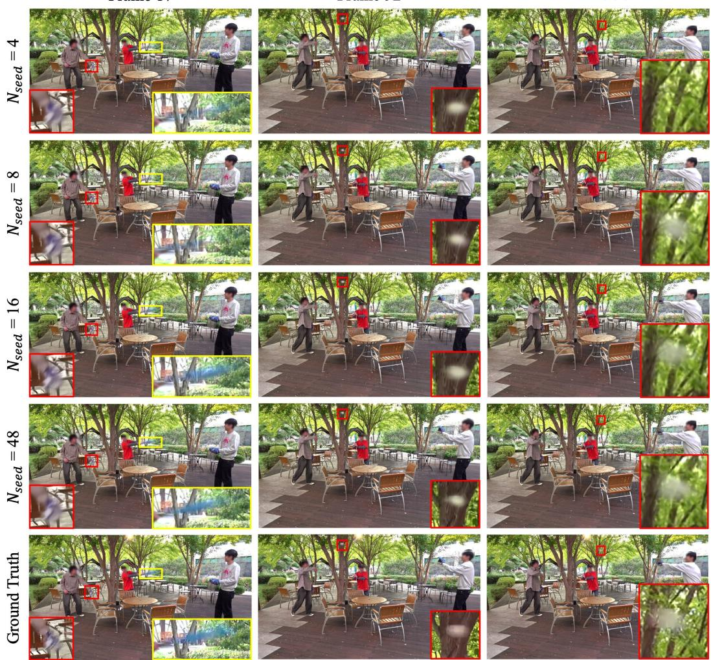  
Figure 8: Qualitative ablation on the number of sampled seeds $N _ { \mathrm { s e e d } }$ on the Custom Baseball dataset. We compare different values of $N _ { \mathrm { s e e d } }$ across three representative frames containing small and rapidly moving objects. Increasing $N _ { \mathrm { s e e d } }$ leads to more consistent recovery of challenging dynamic content, including the baseball, bat, and glove.

As shown in $\mathrm { F i g . ~ } 8 ,$ the effect of $N _ { \mathrm { s e e d } }$ varies depending on the frame and the dynamic content. At frame 17, the baseball glove is well reconstructed even with a small number of injected seeds, whereas the baseball bat is barely visible with $N _ { \mathrm { s e e d } } = 4$ and 8. The bat begins to emerge at $N _ { \mathrm { s e e d } } = 1 6$ , but its structure remains unclear, while $N _ { \mathrm { s e e d } } = 4 8$ produces a more clearly visible reconstruction. At frame 92, in contrast, the rapidly moving baseball is successfully reconstructed across all tested values of $N _ { \mathrm { s e e d } }$ . At frame 97, the baseball is completely missing with $N _ { \mathrm { s e e d } } = 4$ but becomes clearly visible from $N _ { \mathrm { s e e d } } = 8$ onward. Overall, these results show that the number of seeds required for successful reconstruction can vary across frames and dynamic content. While $N _ { \mathrm { s e e d } } = 1 6$ is generally sufficient to recover the target objects, we use $N _ { \mathrm { s e e d } } = 4 8$ in our main experiments to ensure more robust and stable seed generation across different frames and scenes.

Effect of the maximum number of injected Gaussians. While $N _ { \mathrm { s e e d } }$ controls the number of seed candidates sampled from each camera view, $N _ { \mathrm { m a x } }$ determines how many of the resulting 3D seeds are ultimately retained for Gaussian injection per timestep. We therefore investigate how sensitive the reconstruction is to the final number of injected Gaussians. As shown in $\mathrm { F i g . } 9 .$ , the reconstruction remains largely consistent across $N _ { \mathrm { m a x } } \in \{ 1 6 , 3 2 , 6 4 , 2 5 6 \}$ }. Even with $N _ { \mathrm { m a x } } = 1 6$ challenging dynamic content, including the rapidly moving baseball, glove, and bat, is successfully reconstructed. This suggests that reconstruction quality is relatively insensitive to the final number of injected Gaussians once a sufficient pool of seed candidates is available.

Frame 17  
Frame 92  
Frame 97  
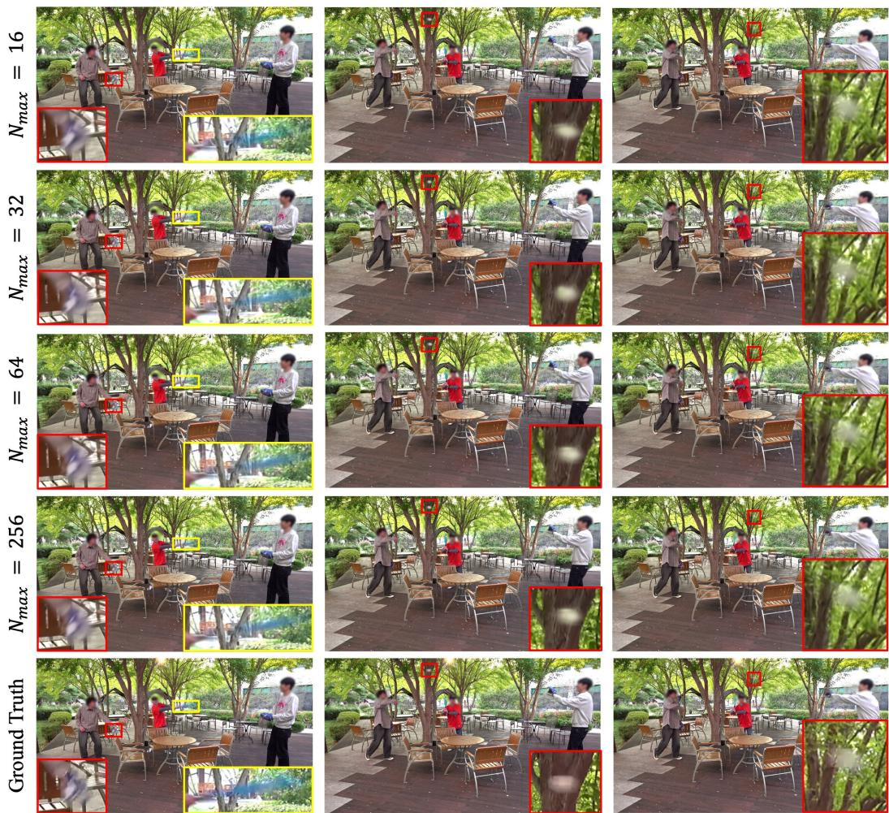  
Figure 9: Qualitative ablation on the maximum number of Gaussians injected per frame, $N _ { \mathrm { m a x } } ,$ on the Custom Baseball dataset. We compare $N _ { \mathrm { m a x } } \in \{ 1 6 , 3 2 , 6 4 , 2 5 6 \}$ across three frames. Even with $N _ { \mathrm { m a x } } = 1 6$ , challenging dynamic content, including the rapidly moving baseball, glove, and bat, is successfully reconstructed.

Effect of the number of camera views. Given the importance of having sufficient candidate rays for reliable seed construction, we additionally study the effect of the number of camera views $C$ used for multi-view seed generation. Fig. 10 shows qualitative results for $C \in \{ 2 , 4 , 8 \}$ With only two camera views, the limited set of cross-view ray candidates can lead to less reliable seed generation, resulting in inaccurate reconstruction of the rapidly moving baseball. In contrast, using four or more views successfully recovers the baseball, with similar reconstruction quality for $C = 4$ and $C = 8$ . These results suggest that our method does not require a large number of camera views for effective seed generation, with $C = 4$ already sufficient for this sequence. Nevertheless, we use $C = 8$ throughout our main experiments to provide more reliable multi-view correspondences across different frames and scenes.

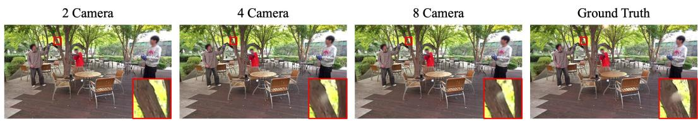  
Figure 10: Qualitative ablation on the number of camera views C used for multi-view seed generation on the Custom Baseball dataset frame 9. Using only two views results in inaccurate reconstruction of the rapidly moving baseball, whereas four or more views successfully recover the object with similar reconstruction quality.

Analysis of Temporal Biased Relocation. We further analyze the behavior of Temporal Biased Relocation (TBR) by measuring the number of relocation operations during training. As shown in Fig. 11, TBR consistently requires fewer relocation operations than the original FTGS, indicating more effective Gaussian allocation during optimization.

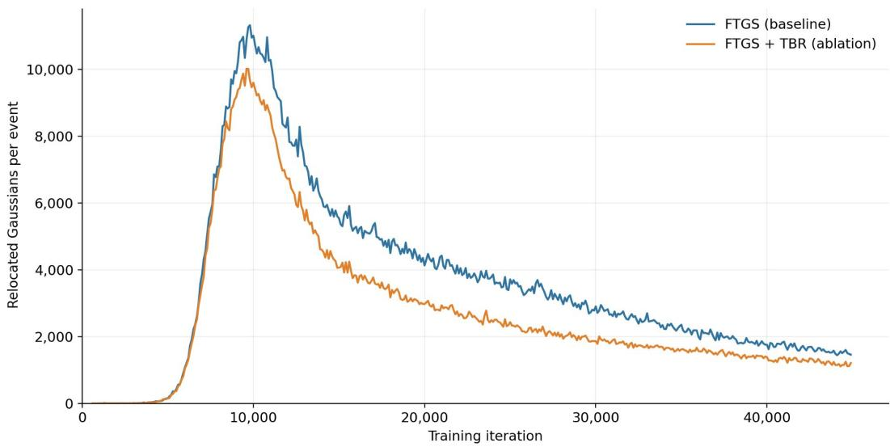  
Figure 11: Number of relocation operations during training on the CMU Panoptic dataset. FTGS denotes FreeTimeGS and TBR denotes Temporal Biased Relocation.

## A.4 QUALITATIVE COMPARISONS

We provide additional qualitative comparisons on the N3DV, CMU Panoptic, and Custom datasets. Specifically, we present the Flame Steak, Sear Steak, and Cook Spinach sequences from N3DV, the Football and Baseball sequences from CMU Panoptic, and the Break sequence from the Custom dataset.

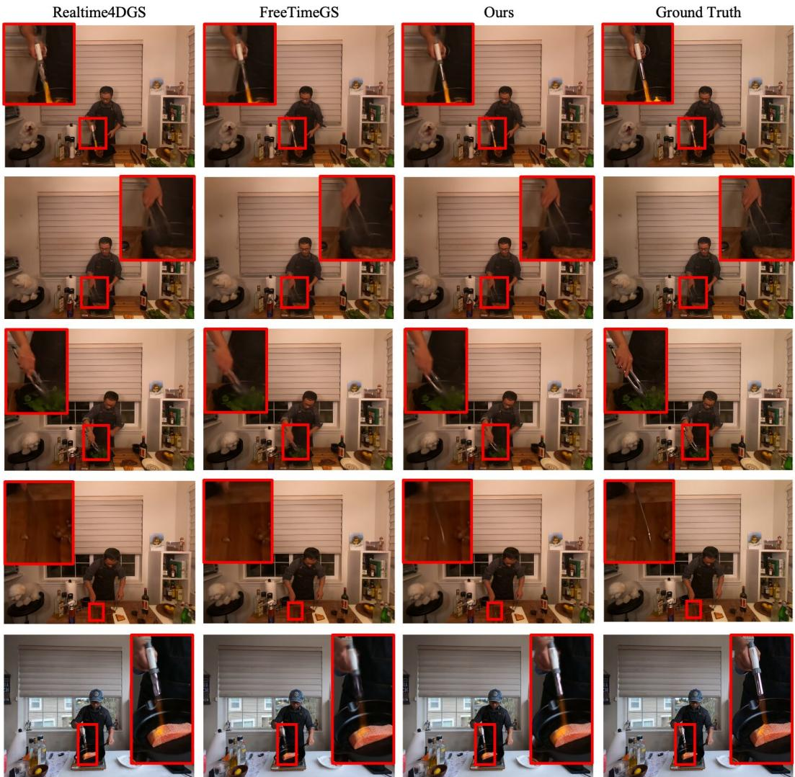  
Figure 12: Qualitative results on the N3DV dataset.

Ours  
Realtime4DGS  
FreeTimeGS  
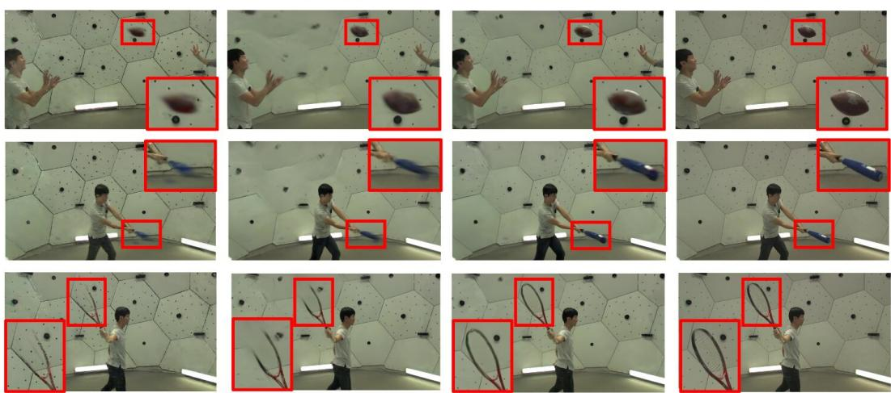  
Ground Truth  
Figure 13: Qualitative results on the CMU Panoptic dataset.

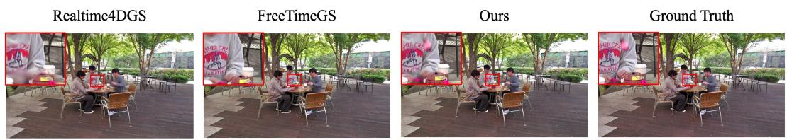  
Figure 14: Qualitative results on the Custom dataset.