# Data-Eficient ConvNeXt Pretraining for High-Resolution Sentinel-1 GRD SAR Representation Learning⋆

Yuki Natsumea,∗, Sang-Ho Yunb,c,d, Chai Kiat Yeoa

aCollege ofComputing and Data Science, Nanyang Technological University, Singapore bEarth Observatory of Singapore, Nanyang Technological University, Singapore cAsian School of the Environment, Nanyang Technological University, Singapore dSchool of Electrical and Electronic Engineering, Nanyang Technological University, Singapore

## Abstract

Labeled Sentinel-1 Ground Range Detected (S1GRD) datasets remain scarce, limiting supervised deep learning for land-surface remote sensing, while self-supervised pretraining for this domain has been dominated by Vision Transformer (ViT)-based masked image modeling requiring substantial data and compute. We propose SparK-SAR, a sparse convolutional masked pretraining framework built on SparK and ConvNeXt, designed to exploit convolutional inductive biases for S1GRD imagery under constrained compute. SparK-SAR makes three core technical contributions: (i) ConvNeXt-RS, a domain-adapted encoder that halves the stem stride (4×→2×) to produce 14×14 feature maps at stride 16×, providing 4× more spatial tokens at identical parameter count; (ii) a lightweight ConvNeXt-512 reconstruction decoder with PixelShufle upsampling that reduces pretraining VRAM by 7.5–8.5% per GPU relative to a UNet-128 baseline while matching its accuracy; and (iii) an empirical characterization of FP16 mixed-precision pretraining instability in the standard SparK UNet-768 decoder on S1GRD data, complemented by a finding that finetuning with layer-wise learning rate decay (LLRD) improves downstream performance of pretrained encoders. On four Copernicus-Bench S1GRD tasks, our finetuned 27.8M-parameter ConvNeXt-RS encoder improves over a non-pretrained baseline by +4 7, +5 0, +5 8, and +1 4 pp on EuroSAT-S1, BigEarthNet-S1, DFC2020-S1, and Flood-S1 respectively, and outperforms the Copernicus-FM ViT (139M parameters, frozen) on three of four tasks at roughly 5× fewer parameters. A pretraining data-scaling study reveals task-dependent data eficiency: classification saturates with as little as 10–25% of the SSL4EO-S12 v1.1 corpus, while dense prediction continues to improve significantly up to 25–50%. SparK-SAR’s novelty therefore lies not only in adapting sparse masked modeling to two-channel SAR imagery through the ConvNeXt-RS encoder, but also in the extensive empirical analysis accompanying it, spanning pretraining data scaling, representation dynamics, and geographic data leakage.

Keywords: synthetic aperture radar, Sentinel-1, self-supervised learning, masked image modeling, ConvNeXt, data scaling

## 1. Introduction

Unlike optical sensors, synthetic aperture radar (SAR) satellites image the land surface using microwave backscatter rather than reflected sunlight, enabling all-weather, day-and-night acquisition well suited to land-cover mapping, flood assessment, and environmental change monitoring, particularly in regions where persistent cloud cover limits optical observation (Moreira et al., 2013). Since its 2014 launch, ESA’s Sentinel-1 mission has revisited most of the globe every 6– 12 days, accumulating a large and continually growing archive of freely available Sentinel-1 Ground Range Detected (S1GRD) imagery (European Space Agency, 2012). This unlabeled archive is abundant, but SAR imagery is dificult for non-experts to interpret visually, making manual annotation of large SAR scenes highly labor intensive. Publicly available labeled SAR benchmarks have therefore stayed small relative to computer vision norms, which in turn limits how well supervised deep learning models can perform on SAR downstream tasks (Wang et al., 2022).

Self-supervised learning (SSL) ofers one route to transferable representations without relying on manually labeled data, and masked image modeling (MIM) (He et al., 2022; Xie et al., 2022) is a natural fit for S1GRD pretraining specifically: it requires no S1GRD-appropriate photometric augmentation scheme of the kind contrastive methods depend on (Wang et al., 2022), and it naturally yields the dense, patch-level representations that earth observation’s dense prediction tasks need. Existing MIM implementations, however, are almost all built on Vision Transformer (ViT) (Dosovitskiy et al., 2021) encoders, which typically demand large pretraining corpora and heavy compute to perform well; Copernicus-FM (Wang et al., 2025b), for instance, needed 512 GPU hours on 4×A100 GPUs and multi-modal inputs spanning four Sentinel missions (Sentinel-1, 2, 3, 5P) to reach competitive results.

For many research groups and applied teams working with SAR data, matching the compute scale needed to pretrain these large foundation models is itself out of reach. We therefore restrict this study’s primary comparisons to end-to-end finetuned convolutional neural network (CNN) encoders rather than reporting frozen ViT foundation model backbones as directly finetuned baselines. This is not solely a matter of compute: Copernicus-Bench’s own published learning-rate search for these models $( 1 0 ^ { - 4 } , 1 0 ^ { - 3 } , 1 0 ^ { - 2 } )$ was validated only for frozen-backbone and decoder-head finetuning, not for full end-to-end finetuning, so no full-finetuning result for these architectures could be defended as using a properly validated learning rate. Reporting one without a fair hyperparameter search would conflate architectural diferences with an unvalidated finetuning setup rather than isolate them. A rigorous evaluation of full fine-tuning for these foundation models, encompassing an architecture-specific learning-rate search, appropriate regularization schedules, and comparable per-model tuning budgets, would constitute a dedicated study in its own right and lies outside this paper’s scope. The frozen-encoder results we do report (Table 6) are included only as a reference point, not as the primary comparison.

CNN architectures, in contrast, bring stronger local inductive biases, remain data eficient under modest compute budgets, and can be finetuned end-to-end even on the small downstream datasets typical of SAR applications. SparK (Tian et al., 2023) was developed and validated on natural-image benchmarks such as ImageNet (Deng et al., 2009), and porting its default UNet-768 (Ronneberger et al., 2015) decoder directly to S1GRD data at the prescribed learning rate proves numerically unstable: FP16 mixed precision training produces NaN losses, forcing either a redesigned decoder or a diferent learning rate.

Building on these two lines of work, we introduce SparK-SAR: a high-resolution sparse masked pretraining framework for S1GRD imagery that combines SparK (Tian et al., 2023) and

ConvNeXt (Liu et al., 2022) and is designed to run under a constrained compute budget. We structure our contributions around three questions: whether sparse convolutional masked pretraining, previously developed and validated only on natural images, can be adapted to produce transferable representations for S1GRD SAR imagery under constrained compute; how much pretraining data and downstream labeled data this benefit actually requires; and whether the observed gains are genuine, rather than an artifact of geographic overlap between the pretraining corpus and the downstream evaluation sets.

Adapting sparse masked pretraining to S1GRD SAR imagery.

• ConvNeXt-RS encoder: a domain-adapted ConvNeXt encoder for SAR dense prediction, reducing stem stride from 4× to 2× to produce 14×14 feature maps (stride 16×) instead of the standard 7×7 (stride 32×), providing 4× more spatial tokens at identical parameter count (Section 3.1).

• Lightweight reconstruction decoders: documentation of FP16 mixed precision pretraining instability with the standard UNet-768 decoder on S1GRD data, and evaluation of UNet-128 and ConvNeXt-512 alternatives that stabilize pretraining, with ConvNeXt-512 reducing pretraining VRAM by 7.5–8.5% per GPU at matched accuracy (Section 3.2).

• LLRD finetuning recipe: a finding that layer-wise learning rate decay (LLRD) improves downstream task performance and reduces across-seed variance when finetuning the UNet-128-pretrained SparK encoder, but does not help a non-pretrained one (Section 3.4).

Evaluated across four Copernicus-Bench S1GRD tasks (Wang et al., 2025b) spanning classification, multi-label classification, semantic segmentation, and change detection, the resulting 27.8M-parameter encoder improves over a non-pretrained baseline by +4.7 pp, +5.0 pp, +5.8 pp, and +1 4 pp on EuroSAT-S1, BigEarthNet-S1, DFC2020-S1, and Flood-S1 respectively (Section 4.3). Despite using a 27.8M-parameter encoder, roughly 5× smaller than Copernicus-FM ViT’s 139M (frozen) parameters, our finetuned model beats it on three of the four tasks, and it likewise beats SoftCon (Wang et al., 2024) on three of four tasks and both CROMA (Fuller et al., 2023) and DOFA (Xiong et al., 2024) on all four. The comparatively modest Flood-S1 gain is examined further in a dedicated ceiling ablation (Section 4.4.4), which points to a boundary condition for this approach: single-image masked pretraining appears to transfer less efectively to temporal change detection than to single-scene interpretation tasks.

Characterizing how much pretraining data and downstream supervision this benefit actually requires.

• Pretraining data scaling study: a systematic evaluation of pretraining data eficiency across eight data fractions (0–100% of SSL4EO-S12 v1.1 (Blumenstiel et al., 2025)) with formal statistical analysis, revealing task dependent saturation behavior in SAR amplitude representation learning (Section 4.5).

• Representation analysis: Centered Kernel Alignment (CKA) (Kornblith et al., 2019) analysis across all data fractions, characterizing how encoder representations evolve with pretraining data quantity (Section 4.7).

• Label eficiency analysis: a demonstration that SparK-SAR pretraining provides statistically significant accuracy gains over random initialization at every label fraction tested (1–50%), with pretrained models matching full-label random-initialization performance using 10–50% of labeled training data across all four tasks (Section 4.6).

Verifying that the observed gains reflect genuine transfer rather than geographic leakage.

• Geographic de-collision experiment: identification of geographic overlap between the SSL4EO-S12 v1.1 pretraining corpus and the Copernicus-Bench evaluation sets, followed by re-pretraining SparK-SAR from scratch on a de-collided corpus with all overlapping tiles removed; the resulting change in downstream accuracy is below 0.1 percentage points on every task, confirming that the reported gains are not attributable to geographic data leakage (Section 4.8).

A preliminary version of this work will be presented at SPIE Asia-Pacific Remote Sensing 2026 (Natsume and Yeo, 2026). This journal submission substantially extends that conference paper with: (i) a systematic pretraining data scaling study across eight pretraining data fractions with formal statistical testing (Section 4.5); (ii) a Centered Kernel Alignment representation analysis characterizing how encoder representations evolve with pretraining data quantity (Section 4.7); (iii) a full geographic de-collision analysis re-pretraining SparK-SAR from scratch on a de-collided corpus with all overlapping pretraining tiles removed, confirming that reported gains are not attributable to geographic data leakage (Section 4.8); (iv) a finetuning label eficiency analysis demonstrating that SparK-SAR pretraining provides statistically significant accuracy gains over random initialization at every label fraction and every task (Section 4.6); (v) a dedicated Flood-S1 ceiling ablation across loss functions and fusion strategies (Section 4.4.4); (vi) an expanded negative-results discussion; and (vii) extended methodological detail throughout.

## 2. Related Work

## 2.1. Masked Image Modeling

Building on masked language modeling (Devlin et al., 2019), masked image modeling (MIM) has become the leading approach to self-supervised visual pretraining. MAE (He et al., 2022) showed that reconstructing raw pixels from a small visible subset (as little as 25%) of ViT patches produces representations that transfer well at scale, and SimMIM (Xie et al., 2022) carried the same reconstruction objective over to hierarchical Swin Transformers (Liu et al., 2021). I-JEPA (Assran et al., 2023) took a diferent route, predicting latent representations of the masked regions instead of pixel values, which pushes the model toward semantic structure over low-level texture.

These ViT-based approaches are efective but data- and compute-hungry. Convolutional alternatives have narrowed that gap: MCMAE (Gao et al., 2022) combines convolution and transformer blocks in a hybrid masked autoencoder, while SparK (Tian et al., 2023), the framework this work builds on, shows that sparse masked modeling works directly on purely hierarchical CNNs (ResNet (He et al., 2016), ConvNeXt (Liu et al., 2022)) with no transformer component at all. MMEarth (Nedungadi et al., 2024) is a concurrent example in the electro-optical remote sensing domain, pairing a ConvNeXt V2 (Woo et al., 2023) backbone with multi-modal MIM objectives on electro-optical Sentinel-2 imagery; we pursue the same CNN MIM direction on a diferent modality, applying it to SAR-only pretraining under the SparK framework.

## 2.2. Self-Supervised Learning for Remote Sensing

In their survey of SSL for remote sensing, Wang et al. (2022) group existing methods into two dominant paradigms, contrastive and generative.

Among the contrastive methods, SeCo (Mañas et al., 2021) builds positive pairs from seasonal multi-temporal imagery, and GASSL (Ayush et al., 2021) instead treats geographic colocation as a proxy for scene similarity. Both, however, rely on augmentation pipelines built around electro-optical statistics, which do not transfer cleanly to SAR backscatter.

MIM has also been adopted for electro-optical remote sensing. SatMAE (Cong et al., 2022) adapted MAE for multi-spectral and multi-temporal satellite data. Scale-MAE (Reed et al., 2023) introduced scale-aware positional encodings for images at varying ground sample distances. FG-MAE (Wang et al., 2025a) proposed feature-guided reconstruction targets better aligned with semantic downstream tasks.

A separate line of work pairs Sentinel-1 SAR with electro-optical data rather than treating SAR in isolation. SoftCon (Wang et al., 2024) pretrains contrastively across multispectral and SAR imagery using multi-label land-cover supervision as guidance. DOFA (Xiong et al., 2024) takes a diferent route, using a dynamic spectral adapter, so that a single ViT can ingest whatever sensor modality it is given. CROMA (Fuller et al., 2023) instead unifies contrastive and masked autoencoding objectives within one radar-optical model, and Copernicus-FM (Wang et al., 2025b) pushes this further still, training a multi-modal ViT across four Sentinel missions on 18.7M aligned images at a reported cost of roughly 512 GPU hours on NVIDIA A100 GPUs. These models perform well, but their multi-modal inputs and near-exclusive reliance on frozenencoder evaluation make them a poor match for the SAR-only, constrained-compute setting this work targets.

## 2.3. SAR-Specific Self-Supervised Learning

Compared to optical imagery, SSL research targeting SAR data exclusively is still comparatively unexplored. Allen et al. (2023) demonstrated that large-scale MAE pretraining on Sentinel-1 S1GRD data can substantially reduce label requirements across two downstream tasks, vegetation-cover prediction and land-cover classification, with the pretraining benefit generalizing geographically and increasing, rather than merely holding up, on regions outside the pretraining set.

SAR-JEPA (Li et al., 2024) introduced a joint-embedding predictive architecture (JEPA)- based approach for SAR automatic target recognition (ATR) by predicting multi-scale gradient features rather than raw pixels. SARATR-X (Li et al., 2025) subsequently incorporated multi-scale gradient features into a masked image modeling framework, using a two-step selfsupervised procedure that first performed MIM pretraining on ImageNet to obtain a favorable weight initialization, then continued MIM pretraining on a curated corpus of unlabeled SAR target samples using the multi-scale gradient features to suppress speckle noise, rather than the joint-embedding predictive approach SAR-JEPA uses. However, both models are trained and evaluated exclusively on ATR tasks, limiting the generalizability to land-cover and change detection problems.

Applying DINO (Caron et al., 2021)-style self-distillation to SAR imagery, Gallego-Mejia et al. (2023) and Martínez-Ferrer et al. (2023) found only modest gains over training from scratch, with the resulting self-distilled embeddings generalizing poorly to geographically unfamiliar regions without further domain-specific adaptation.

To the best of our knowledge, SparK-SAR is among the first methods to adapt sparse convolutional masked pretraining specifically for S1GRD data and demonstrate its transferability across diverse downstream SAR tasks under constrained compute.

## 3. Materials and Methods

Figure 1 illustrates how SparK-SAR adapts SparK’s sparse masked pretraining scheme (Tian et al., 2023) to S1GRD data under constrained compute. A 224×224 two-channel input tile, comprising VV (vertical transmit–vertical receive) and VH (vertical transmit–horizontal receive) backscatter in dB scale, is patch-masked at random, and the encoder processes only the visible patches through sparse convolutions rather than the full grid. The output feature maps are passed to a reconstruction decoder tasked with predicting the masked patches. Once pretraining finishes, the decoder is discarded and only the encoder is used for downstream finetuning.

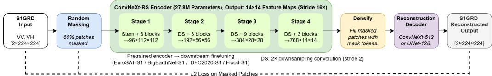  
Figure 1: The proposed SparK-SAR pretraining framework. The ConvNeXt-RS encoder produces 14×14 feature maps (stride 16×) from 224×224 S1GRD inputs. Only visible (unmasked) patches are processed by the encoder via sparse convolutions; the decoder reconstructs the full image including masked regions.

## 3.1. ConvNeXt-RS Encoder

ConvNeXt-Tiny’s (Liu et al., 2022) default stem downsamples by 4×4 before three further 2×2 stages, taking a 224-pixel input through 56→28→14→7 down to a final 7×7 feature map at overall stride 32×; every output token therefore corresponds to a 32×32-pixel patch of the input, coarse enough to erase spatial detail that dense SAR tasks such as segmentation and change detection depend on.

ConvNeXt-RS keeps everything about this backbone fixed except the stem: halving its stride to 2×2 changes the spatial trajectory to

$$
2 2 4 \to 1 1 2 \to 5 6 \to 2 8 \to 1 4 { \pmod { 1 6 \times } }\tag{1}
$$

so the final feature map doubles in each spatial dimension to 14×14, four times as many tokens as the stock 7×7 output, each now covering a finer 16×16-pixel patch instead of 32×32; the overall stride drops correspondingly from 32× to 16×. Depth, per-stage block counts, and channel widths are all untouched, so the parameter count stays at 27.8M, and the change is fully compatible with SparK’s sparse convolution mechanism operating on visible patches at every stage.

Figures 2 and 3 contrast the resulting stage-by-stage feature maps for the two encoders: ConvNeXt-Tiny’s Stage 4 output has largely lost spatial structure by 7×7, whereas ConvNeXt-RS’s 14×14 Stage 4 output still shows recognizable scene structure.

## 3.2. Reconstruction Decoders

SparK-SAR supports interchangeable reconstruction decoders. We evaluate three designs.

UNet-768, SparK’s original decoder, is a hierarchical UNet (Ronneberger et al., 2015) that aggregates multi-scale encoder features through 768 channels. Under the optimal learning rate $l r { = } 1 0 ^ { - 3 }$ , which is of the same order as that used by the original SparK configuration (Tian et al.,

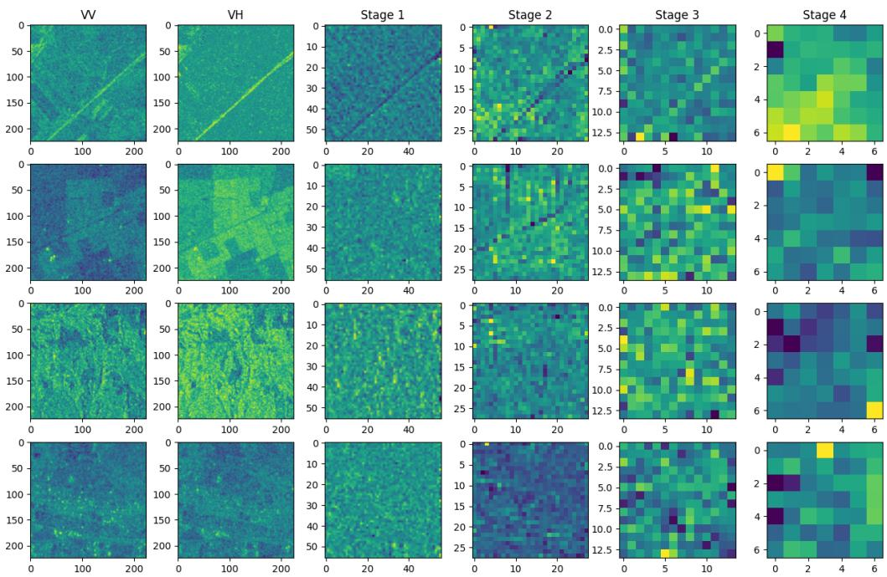  
Figure 2: Feature maps of the standard ConvNeXt-Tiny encoder (7×7, stride 32×). Columns from left to right: VV input, VH input, and Stage 1–4 features. Stage 4 produces 7×7 maps that lose spatial structure.

2023), UNet-768 encounters gradient overflow (NaN loss) at epoch 5–12 under FP16 mixed precision training, coinciding with the linear-warmup-to-cosine-decay schedule remaining near its peak learning rate in the epochs immediately following the 4-epoch warmup. We did not log gradient norms directly, but the timing is consistent with gradient magnitudes in the highdimensional skip connections exceeding the FP16 dynamic range (≤65 504).

At the reduced pretraining learning rate $l r { = } 1 0 ^ { - 4 }$ , UNet-768 trains stably under FP16 mixed precision pretraining, but yields inferior downstream performance compared to UNet-128 at the same learning rate (Table 7), confirming that decoder capacity itself, not solely the lower learning rate required for stability, contributes to UNet-768’s inferior downstream performance.

To characterize its VRAM requirements beyond our production hardware’s 32 GB ceiling, we profiled UNet-768 on two A100 80 GB GPUs (Table 1). Running in FP32 (80,599 MiB/GPU) or BF16 (45,091 MiB/GPU) on this hardware eliminates the instability, but at VRAM costs that would still exceed our production 4×V100 32 GB budget. The near-identical VRAM consumption of UNet-768 under FP16 (45,037 MiB) and BF16 (45,091 MiB) confirms that the FP16 instability is a numerical precision issue rather than a memory constraint. We therefore adopt UNet-128 and ConvNeXt-512, which remain stable under FP16 at $l r { = } 1 0 ^ { - 3 }$ and achieve superior downstream performance.

UNet-128 keeps the same hierarchical, multi-scale aggregation as UNet-768 but shrinks the channel width to 128; that reduction in decoder capacity is enough on its own to keep FP16 pretraining stable at $l r { = } 1 0 ^ { - 3 }$

ConvNeXt-512 is our proposed non-hierarchical decoder comprising a single ConvNeXt block (Liu et al., 2022) with 512 channels followed by PixelShufle upsampling (upscale factor 16× for 14×14 encoder features reconstructing 224×224 inputs). Because the ConvNeXt-512 decoder works from only the encoder’s final feature map rather than aggregating across scales, ConvNeXt-512 pretrains at 7.5–8.5% lower VRAM per GPU than UNet-128 (the exact figure depends on hardware) without sacrificing downstream accuracy. Table 1 reports VRAM consumption for both decoder configurations across hardware.

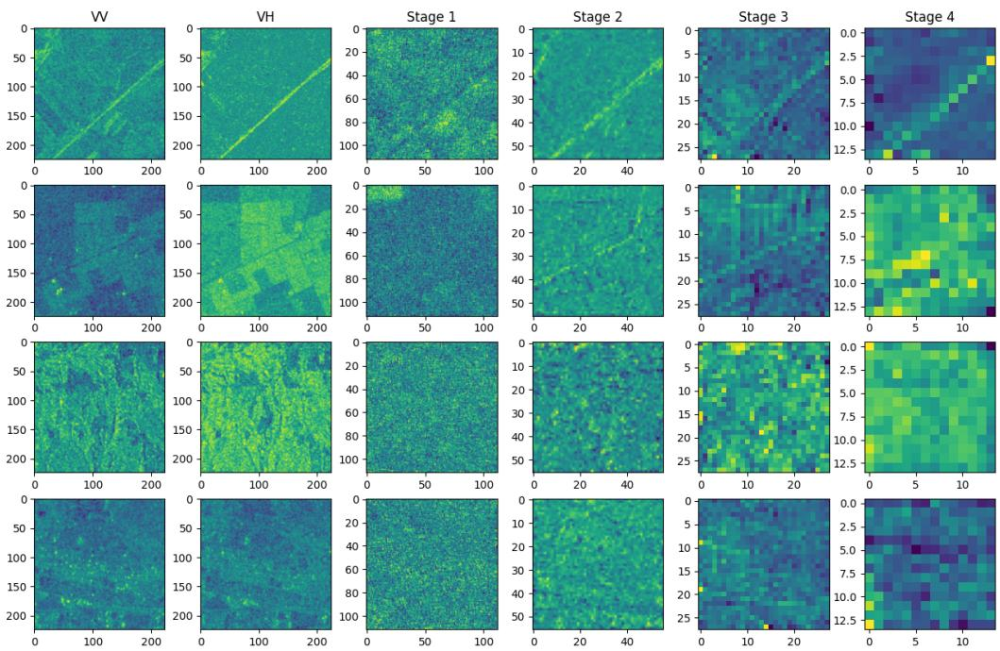  
Figure 3: Feature maps of the proposed ConvNeXt-RS encoder (14×14, stride 16×). Stage 4 retains recognizable spatial structure corresponding to scene content, in contrast to Figure 2.

## 3.3. Pretraining Setup

Pretraining data comes from the SSL4EO-S12 v1.1 S1GRD subset (Blumenstiel et al., 2025): 243,968 globally distributed locations, each with four seasonal (VV, VH) backscatter acquisitions at 264×264 pixels in decibel (dB) scale. Rather than using all four acquisitions per location every iteration, we draw one season uniformly at random each time, which gives the model implicit temporal augmentation for free, without needing paired imagery. On top of that we apply per-channel normalization (using the empirically measured statistics $\mu _ { \mathrm { V V } } { = } { - } 1 2 . 5 7 7 , \sigma _ { \mathrm { V V } } { = } 5 . 1 7 9$ $\mu _ { \mathrm { V H } } { = } { - } 2 0 . 2 6 5 , \sigma _ { \mathrm { V H } } { = } 5 . 8 7 2$ ), a random resized crop down to 224×224, and random horizontal and vertical flips.

Optimization uses AdamW with $l r { = } 1 0 ^ { - 3 }$ , weight decay 0 04, and $\beta = [ 0 . 9 , 0 . 9 9 9 ] ;$ a global batch size of 256; 60% masking; an $L _ { 2 }$ reconstruction objective; gradient clipping at 5.0; and FP16 mixed precision, run for 50 epochs (4 of them warmup) under PyTorch 2.9.1 with CUDA 12.6.

Table 2 contrasts these choices with the original SparK ImageNet configuration. Figure 4 shows representative reconstruction examples from the pretrained SparK-SAR model on SSL4EO-S12 v1.1 S1GRD patches.

Table 1: Pretraining VRAM usage per GPU for diferent decoder configurations, hardware, and numerical precision. Our production setup consists of 4×V100 32 GB GPUs. The global batch size is 256 samples across all GPUs.
<table><tr><td>Decoder</td><td>Hardware</td><td>Prec.</td><td>VRAM/GPU Status</td><td></td></tr><tr><td>UNet-768</td><td>A100 80 GB b = 128</td><td>FP16</td><td></td><td>45,037 MiB NaN (ep. 5–12)</td></tr><tr><td>UNet-768</td><td>A100 80 GB b = 128</td><td>BF16</td><td>45,091 MiB Stable</td><td></td></tr><tr><td>UNet-768</td><td>A100 80 GB b = 128</td><td>FP32</td><td>80,599 MiB Stable</td><td></td></tr><tr><td>UNet-128</td><td>V100 32 GB, b = 64</td><td>FP16</td><td>17,460 MiB Stable</td><td></td></tr><tr><td>Saving</td><td>ConvNeXt-512 V100 32 GB, b = 64</td><td>FP16</td><td>15,974 MiB Stable</td><td></td></tr><tr><td></td><td></td><td></td><td>1,486 MiB (8.5%)</td><td></td></tr><tr><td>UNet-128</td><td>A100 80 GB, b = 256</td><td>FP16</td><td>62,617 MiB Stable</td><td></td></tr><tr><td></td><td>ConvNeXt-512 A100 80 GB, b = 256</td><td>FP16</td><td>57,909 MiB Stable</td><td></td></tr><tr><td>Saving</td><td></td><td></td><td>4,708 MiB (7.5%)</td><td></td></tr></table>

Pretraining is comparatively inexpensive. The UNet-128 and ConvNeXt-512 configurations complete in 8.9 and 7.9 wall clock hours respectively on 4× NVIDIA V100 (32 GB) GPUs (35.6 and 31.6 GPU-hours; Table 3), well below the 8×A100 (80 GB) multi-node configurations reported for CROMA (Fuller et al., 2023) (300–600 epochs) and SoftCon (Wang et al., 2024) (100 epochs), though neither paper reports absolute GPU-hour or wall clock figures, precluding an exact comparison.

Table 2: SparK-SAR pretraining recipe compared with the original SparK ImageNet configuration (Tian et al., 2023).
<table><tr><td colspan="2">SparK (ImageNet)</td><td>SparK-SAR (S1GRD)</td></tr><tr><td>Dataset size</td><td>1.28M images</td><td>243,968 locations</td></tr><tr><td>Epochs</td><td>1,600</td><td>50</td></tr><tr><td>Batch size</td><td>4,096</td><td>256</td></tr><tr><td>Optimizer</td><td>LAMB</td><td>AdamW</td></tr><tr><td>Max LR</td><td>3.2×10-3</td><td>10-3</td></tr><tr><td>Encoder output</td><td>7×7</td><td>14×14</td></tr><tr><td>Decoder</td><td>UNet-768</td><td>UNet-128 / ConvNeXt-512</td></tr><tr><td>Precision</td><td>FP16</td><td>FP16</td></tr><tr><td>Hardware</td><td>Unreported</td><td>4×V100 32 GB</td></tr></table>

## 3.4. Finetuning Protocol

Every pretrained ConvNeXt-RS encoder is then finetuned end-to-end, separately, on each downstream task: AdamW at $l r { = } 1 0 ^ { - 3 }$ (weight decay 10−4), OneCycleLR with final\_div\_factor = 100, 50 epochs (4 warmup), FP32, under a separate codebase running PyTorch 2.1.2 and CUDA 11.8. Pretraining and finetuning therefore run on diferent framework versions; we did not isolate the efect of this diference.

Task-specific finetuning follows the Copernicus-Bench protocol: EuroSAT-S1 uses a linear classification head, while BigEarthNet-S1’s multi-label classification task is trained with a multilabel soft-margin loss. The two dense prediction tasks, DFC2020-S1 and Flood-S1, both employ a UPerNet (Xiao et al., 2018) decoder augmented with an auxiliary FCN head. For DFC2020-S1 this decoder operates directly on the multi-scale features produced by the ConvNeXt-RS encoder;

Table 3: Pretraining compute cost. Both configurations pretrain on 4× NVIDIA V100 (32 GB) GPUs.
<table><tr><td>Decoder</td><td>Wall-clock (h)</td><td>GPU-hours</td></tr><tr><td>UNet-128</td><td>8.9</td><td>35.6</td></tr><tr><td>ConvNeXt-512</td><td>7.9</td><td>31.6</td></tr></table>

for Flood-S1, it instead operates on the diference between multi-scale features computed separately for the pre- and post-event images. The ConvNeXt-RS backbone is finetuned end-to-end throughout instead of being kept frozen.

Inputs are resized to the resolution specified by the Copernicus-Bench benchmark protocol for each task. EuroSAT-S1 (native 64×64) and BigEarthNet-S1 (native 120×120) are upsampled to 224×224 using bilinear interpolation. Flood-S1 is already native at 224×224, so no resizing is applied. DFC2020-S1 is kept at its native 256×256 resolution rather than being unified to 224×224 like the other three tasks. We retain each task’s benchmark-specified resolution, rather than unifying all four to a single value, to keep our evaluation as directly comparable to the published Copernicus-Bench baselines as our full-finetuning setting allows (Section 1). For DFC2020-S1 and Flood-S1, resizing (where applied) is performed jointly on the image and the segmentation mask, using paired image-mask transformations, with bilinear interpolation for the image and nearest-neighbor interpolation for the mask so that resizing does not blend adjacent class labels into fractional, non-existent intermediate values at boundaries. Because ConvNeXt-RS is a fully convolutional encoder with no fixed-input-size constraint from positional embeddings, it accepts both resolutions directly, with the stride-16 feature map scaling accordingly (14×14 for 224×224 inputs vs. 16×16 for DFC2020-S1’s 256×256).

We apply Layer-wise Learning Rate Decay (LLRD) (Bao et al., 2022; Clark et al., 2020) with layer decay factor 0 75, scaling the learning rate geometrically from the classification head toward the stem. LLRD runs also exclude the backbone’s biases and normalization parameters from weight decay. For the UNet-128-pretrained encoder, LLRD improves mean accuracy on all four tasks and reduces across-seed variance, most markedly on DFC2020-S1 and BigEarthNet-S1 (Section 4.4.3); it does not improve a non-pretrained encoder (Table 5 and the 0% row of Table 11) and lowers its Flood-S1 mIoU by 0.8 pp, so we treat it as a finetuning recipe for pretrained encoders. All results are reported as mean ± sample standard deviation (n−1 denominator) over 5 fixed random seeds (42, 123, 456, 789, 1337), with deterministic seed initialization for PyTorch, CUDA, NumPy, Python’s random, data-loader workers, and the distributed data sampler.

Our production results were obtained on V100 GPUs (4×V100 32 GB for pretraining, a single V100 for finetuning). After these GPUs were retired, the Flood-S1 ablation (Table 10), the LLRD decay-factor sweep (Table 9, all columns except the production λ=0.75), the label-eficiency experiments (Table 12, all rows except the 100% row, which reuses the production runs) and the frozen-encoder evaluation (Table 6) were run on NVIDIA RTX A6000 48 GB GPUs with the same precision settings (FP16 pretraining, FP32 finetuning). The de-collision experiment (Section 4.8) was pretrained on one A100 80 GB GPU and finetuned on A6000 GPUs.

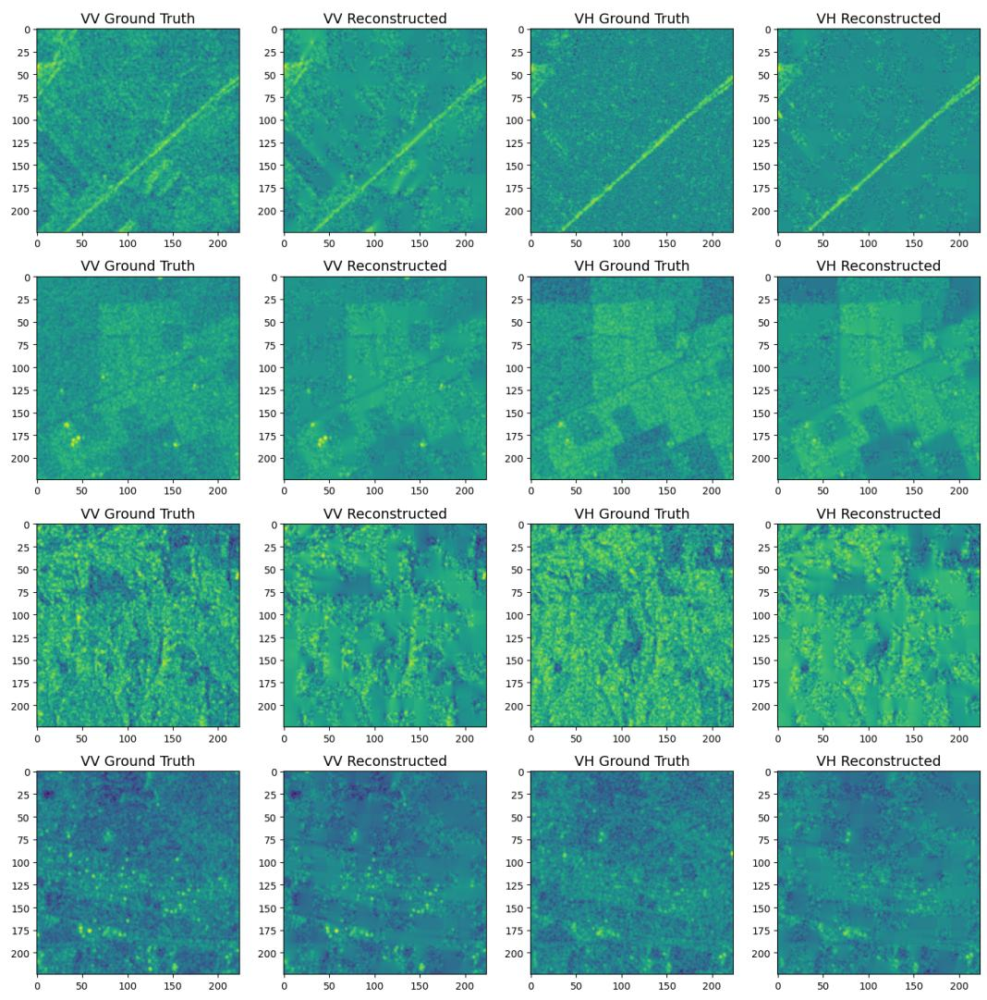  
Figure 4: SparK-SAR reconstruction examples on SSL4EO-S12 v1.1 S1GRD patches. Each row shows (left to right) VV ground truth, VV reconstructed, VH ground truth, and VH reconstructed (60% masking ratio). The reconstructions recover large-scale backscatter structure while appearing smooth relative to ground truth, consistent with the L2 reconstruction objective of MAE-family methods (He et al., 2022).

## 4. Results

## 4.1. Datasets

Table 4 summarizes the four Copernicus-Bench (Wang et al., 2025b) S1GRD tasks used for evaluation, each built from its own established source dataset: EuroSAT (Helber et al., 2019) (EuroSAT-S1), BigEarthNet (Sumbul et al., 2019) (BigEarthNet-S1), the 2020 IEEE GRSS Data Fusion Contest dataset (Robinson et al., 2021) (DFC2020-S1), and the Kuro Siwo flood mapping dataset (Bountos et al., 2024) (Flood-S1).

The validation split is used solely for checkpoint selection (best validation metric). No hyperparameters were tuned on the validation set after the pretraining configuration was fixed.

## 4.2. Baselines

We compare against: (i) a non-pretrained ConvNeXt-RS baseline finetuned with identical protocol, isolating the pretraining contribution; (ii) a standard ConvNeXt (7×7, stride 32×) pretrained with SparK-SAR at matched learning rate $( l r { = } 1 0 ^ { - 3 } )$ , isolating the resolution contribution; (iii) four published frozen-encoder results drawn directly from their source papers: Copernicus-FM ViT-B/16 (139M parameters) (Wang et al., 2025b), SoftCon ViT-B/14 (86M) (Wang et al., 2024), CROMA ViT-B/8 (86M) (Fuller et al., 2023), and DOFA ViT-B/16 (111M) (Xiong et al., 2024).

As ConvNeXt-RS is a novel domain-adapted architectural variant, no pre-existing ImageNetpretrained weights are available with the 2× stem stride and 2-channel (VV, VH) S1GRD input. The non-pretrained random initialization baseline therefore serves as the appropriate control for isolating the SAR-specific pretraining contribution.

## 4.3. Main Results

Table 5 presents our main results. SparK-SAR with ConvNeXt-RS and LLRD finetuning improves over the non-pretrained baseline by +4 7 pp, +5 0 pp, +5 8 pp, and +1 4 pp on EuroSAT-S1, BigEarthNet-S1, DFC2020-S1, and Flood-S1 respectively (UNet-128 decoder). The ConvNeXt-512 decoder achieves comparable performance while reducing pretraining VRAM by 7.5–8.5% per GPU, depending on hardware.

Despite having roughly 5× fewer parameters than Copernicus-FM ViT (27.8M vs. 139M, frozen encoder), our finetuned model still comes out ahead on three of the four tasks: EuroSAT-S1 (88 49±0 16 vs. 87 2±0 1%), DFC2020-S1 (56 00±0 08 vs. 52 4±0 1%), and Flood-S1 (80 21±0 10 vs. 77 7±0 0%).

On BigEarthNet-S1, SparK-SAR (77 03±0 40) falls marginally below Copernicus-FM (77 9±0 0%) and SoftCon (78.7±0.0%) under frozen evaluation. We note that Copernicus-FM incorporates tile geographic coordinates as an additional input modality via hypernetwork encodings (Wang et al., 2025b). BigEarthNet-S1 labels are derived from the CORINE Land Cover map (Sumbul et al., 2019; European Environment Agency, 2020), which exhibits strong geographic clustering of land-cover classes across Europe. It is therefore possible that Copernicus-FM’s frozen score on this task partly reflects a geographic coordinate prior rather than purely learned SAR representations. SoftCon’s strong result likely reflects its multi-label land-cover guidance during pretraining (Wang et al., 2024), which directly benefits this multi-label classification task. These hypotheses are not formally tested and are presented as caveats.

Table 6 reports frozen encoder evaluation results for SparK-SAR. Under this protocol, ConvNeXt-RS trails frozen ViT baselines on classification tasks, consistent with the known disadvantage of

Table 4: Copernicus-Bench S1GRD downstream evaluation tasks.
<table><tr><td>Dataset</td><td>Task</td><td>Metric</td><td>Train</td><td>Val</td><td>Test</td><td>Image size</td></tr><tr><td>EuroSAT-S1</td><td>Classification</td><td>OA (%)</td><td>16,200</td><td>5,400</td><td>5,400</td><td>64×64</td></tr><tr><td>BigEarthNet-S1</td><td>Multi-label classif.</td><td>mAP (%)</td><td>11,894</td><td>6,117</td><td>5,991</td><td>120×120</td></tr><tr><td>DFC2020-S1</td><td>Segmentation</td><td>mIoU (%)</td><td>3,156</td><td>986</td><td>986</td><td>256×256</td></tr><tr><td>Flood-S1</td><td>Change detection</td><td>mIoU (%)</td><td>3,000</td><td>1,000</td><td>1,000</td><td>224×224</td></tr></table>

Table 5: Main results on Copernicus-Bench S1GRD tasks. Frozen baselines (top) evaluate a linear probe (classification) or UPerNet head (dense prediction) on frozen pretrained features; SparK-SAR (bottom) is finetuned end-to-end. Because these protocols are not directly comparable, best results are bolded independently within each block.
<table><tr><td>Method</td><td>Params</td><td>EuroSAT-S1 OA (%)</td><td>BigEarthNet-S1 mAP (%)</td><td>DFC2020-S1 mIoU (%)</td><td>Flood-S1 mIoU (%)</td></tr><tr><td colspan="6">Frozen baselines (linear probe / UPerNet head)</td></tr><tr><td>Copernicus-FM ViT-B/16 (Wang et al., 2025b)</td><td>139M</td><td>87.2±0.1</td><td>77.9±0.0</td><td>52.4±0.1</td><td>77.7±0.0</td></tr><tr><td>SoftCon ViT-B/14 (Wang et al., 2024)</td><td>86M</td><td>83.6±0.1</td><td>78.7±0.0</td><td>52.8±0.6</td><td>77.2±0.1</td></tr><tr><td>CROMA ViT-B/8 (Fuller et al., 2023)</td><td>86M</td><td>83.9±0.1</td><td>70.8±0.0</td><td>52.7±0.1</td><td>77.4±0.1</td></tr><tr><td>DOFA ViT-B/16 (Xiong et al., 2024)</td><td>111M$</td><td>81.7±0.1</td><td>70.5±0.0</td><td>49.7±0.1</td><td>76.0±0.1</td></tr><tr><td colspan="6">Finetuned end-to-end (Ours)</td></tr><tr><td>No pretraining</td><td>27.8M</td><td>83.79±0.53</td><td>72.03±0.09</td><td>50.24±0.25</td><td>78.86±0.32</td></tr><tr><td>SparK-SAR + UNet-128, LLRD</td><td>27.8M</td><td>88.49±0.16</td><td>77.03±0.40</td><td>56.00±0.08</td><td>80.21±0.10</td></tr><tr><td>SparK-SAR + ConvNeXt-512, LLRD‡</td><td>27.8M</td><td>88.63±0.34</td><td>76.60±0.37</td><td>55.94±0.08</td><td>80.11±0.10</td></tr></table>

§DOFA parameter count from Lu et al. (2025); neither the original DOFA paper nor Copernicus-FM report it directly. †Finetuned without LLRD. ‡Saves 7.5–8.5% VRAM vs. UNet-128 (Table 1), depending on hardware.

convolutional architectures under linear probing (Tian et al., 2023). On dense prediction tasks, ConvNeXt-RS remains competitive with all frozen ViT baselines on DFC2020-S1 and exceeds all frozen ViT baselines on Flood-S1 (78 38±0 12 vs. 77 7±0 0 for Copernicus-FM), demonstrating that SparK-SAR pretraining produces spatially rich representations even without taskspecific adaptation.

Returning to the finetuned comparison, the same pattern holds against the other three frozen ViT baselines, all of which have substantially more parameters than our encoder: our finetuned model beats CROMA and DOFA on every task, and beats SoftCon on three of the four (EuroSAT-S1, DFC2020-S1, Flood-S1). BigEarthNet-S1 is the sole task where a frozen baseline, SoftCon at 78 7±0 0%, comes out ahead, for the reasons discussed above.

Table 6: Frozen encoder evaluation of SparK-SAR ConvNeXt-RS (mean ± std, 5 seeds). The backbone is frozen and only the task head is trained: a linear head for classification tasks and UPerHead (Xiao et al., 2018) for dense prediction tasks. Linear probing is known to disadvantage convolutional architectures relative to ViTs due to the absence of a global summary token (Tian et al., 2023); results should be interpreted alongside the full finetuning results in Table 5.
<table><tr><td>Config</td><td>EuroSAT-S1 OA (%)</td><td>BigEarthNet-S1 mAP (%)</td><td>DFC2020-S1 mIoU (%)</td><td>Flood-S1 mIoU (%)</td></tr><tr><td>ConvNeXt-RS (frozen)</td><td>76.56±0.09</td><td>66.17±0.03</td><td>51.94±0.09</td><td>78.38±0.12</td></tr><tr><td>Frozen ViT baselines (from Table 5)</td><td></td><td></td><td></td><td></td></tr><tr><td>Copernicus-FM ViT-B/16</td><td>87.2±0.1</td><td>77.9±0.0</td><td>52.4±0.1</td><td>77.7±0.0</td></tr><tr><td>SoftCon ViT-B/14</td><td>83.6±0.1</td><td>78.7±0.0</td><td>52.8±0.6</td><td>77.2±0.1</td></tr><tr><td>CROMA ViT-B/8</td><td>83.9±0.1</td><td>70.8±0.0</td><td>52.7±0.1</td><td>77.4±0.1</td></tr><tr><td>DOFA ViT-B/16</td><td>81.7±0.1</td><td>70.5±0.0</td><td>49.7±0.1</td><td>76.0±0.1</td></tr></table>

## 4.4. Ablation Studies

## 4.4.1. Output Resolution: $7 \times 7$ vs $1 4 \times 1 4$

Because Table 7 pretrains the standard 7×7 ConvNeXt encoder and our 14×14 ConvNeXt-RS encoder under otherwise identical conditions (UNet-128 decoder, pretraining $l r { = } 1 0 ^ { - 3 } )$ , it doubles as a resolution ablation. The higher-resolution encoder’s edge is concentrated in the dense prediction tasks (+1 4 pp DFC2020-S1, +0 8 pp Flood-S1) and much smaller for classification (+0 3 pp EuroSAT-S1), which is what we would expect if the extra spatial tokens mainly help pixel-level rather than scene-level prediction.

The matched learning rate control largely rules out the pretraining learning rate as a confounding factor: the original $7 \times 7$ experiments used a pretraining $l r { = } 1 0 ^ { - 4 }$ (required to stabilize training), while our 14×14 ConvNeXt-RS uses a pretraining $l r { = } 1 0 ^ { - 3 }$ (all models are finetuned at $l r { = } 1 0 ^ { - 3 } )$ . Table 7 shows that pretraining the $7 \times 7$ encoder at $l r { = } 1 0 ^ { - 3 }$ with UNet-128 still underperforms 14×14 at the same pretraining learning rate, confirming that the resolution modification is the primary contributor. At a pretraining $l r { = } 1 0 ^ { - 4 }$ , UNet-128 outperforms UNet-768 despite its lower decoder capacity, indicating that the larger decoder’s deficit is not explained by its reduced learning rate alone.

Table 7: Output resolution and decoder ablation at pretraining learning rates $1 0 ^ { - 4 }$ and $1 0 ^ { - 3 } ;$ all encoders were finetuned at $l r { = } 1 0 ^ { - 3 }$ without LLRD (mean ± std, 5 seeds). All encoders were pretrained with FP16 mixed precision on 4×V100 32 GB GPUs and finetuned in FP32 on V100 GPUs.
<table><tr><td>Config</td><td>EuroSAT-S1</td><td>BigEarthNet-S1</td><td>DFC2020-S1</td><td>Flood-S1</td></tr><tr><td>7×7, pretrain  $l r { = } 1 0 ^ { - 4 } ,$  UNet-768</td><td> $8 4 . 5 7 { \pm } 0 . 2 5 $ </td><td> $7 2 . 2 7 { \scriptstyle \pm 0 . 4 5 }$ </td><td> $5 2 . 1 2 { \scriptstyle \pm 0 . 0 3 }$ </td><td> $7 8 . 6 7 { \pm } 0 . 1 6$ </td></tr><tr><td> $7 { \times } 7 ,$  pretrain  $l r { = } 1 0 ^ { - 4 } ,$  UNet-128</td><td> $8 5 . 5 1 { \scriptstyle \pm 0 . 1 1 }$ </td><td> $7 2 . 4 5 { \pm } 0 . 2 5 $ </td><td> $5 2 . 7 4 { \scriptstyle \pm 0 . 0 8 }$ </td><td> $7 8 . 7 2 { \scriptstyle \pm 0 . 2 1 }$ </td></tr><tr><td> $7 { \times } 7 ,$  pretrain  $l r { = } 1 0 ^ { - 3 } , \mathrm { U N e t - } 1 2 8$ </td><td> $8 7 . 8 5 { \scriptstyle \pm 0 . 3 0 }$ </td><td> $7 4 . 8 9 { \pm } 0 . 3 8 $ </td><td> $5 4 . 2 2 { \pm } 0 . 1 8 $ </td><td> $7 9 . 3 3 { \pm } 0 . 1 8$ </td></tr><tr><td>14×14, pretrain  $l r { = } 1 0 ^ { - 3 } , \mathrm { U N e t - } 1 2 8$ </td><td> $\mathbf { 8 8 . 1 1 \pm 0 . 2 9 }$ </td><td> $\mathbf { 7 5 . 4 7 { \pm } 0 . 7 0 }$ </td><td> $\pm \mathbf { 5 5 . 5 9 } { \pm \mathbf { 0 . 2 3 } }$ </td><td> $\mathbf { 8 0 . 1 1 \pm 0 . 1 2 }$ </td></tr></table>

## 4.4.2. Decoder Design and Eficiency

UNet-128 and ConvNeXt-512 decoders achieve comparable downstream accuracy across all four tasks (Table 5), despite ConvNeXt-512 operating on only the final encoder stage rather than aggregating multi-scale features. This result is consistent with the hierarchical decoder not being necessary for strong downstream accuracy: the lightweight ConvNeXt-512 decoder achieves statistically indistinguishable performance (paired t-test, $p { = } 0 . 1 7 )$ while reducing VRAM by 7.5– 8.5% per GPU, depending on hardware (Table 1). We note that decoder capacity is not perfectly disentangled from learning rate in this comparison, since the higher-capacity UNet-768 decoder (Table 7) required a lower learning rate for FP16 stability; the finding above is therefore best read as evidence against a decoder-capacity efect at matched learning rate and precision (UNet-128 vs. ConvNeXt-512, both at $l r { = } 1 0 ^ { - 3 } )$ , rather than a fully controlled ablation across the entire decoder-capacity range.

## 4.4.3. LLRD Finetuning

Table 8 compares finetuning with and without LLRD for ConvNeXt-RS pretrained with UNet-128. LLRD improves mean performance in the same direction and reduces result variance across all four tasks. This improvement is statistically significant after Benjamini–Hochberg false discovery rate (BH FDR) correction (Benjamini and Hochberg, 1995) (paired t-tests, 5 seeds, family of four) for BigEarthNet-S1 $( t = 6 . 2 2 , p _ { B H } = 0 . 0 1 4 )$ and DFC2020-S1 $( t = 3 . 8 8 , p _ { B H } = 0 . 0 3 6 )$

Table 8: Efect of LLRD on ConvNeXt-RS finetuning (UNet-128 pretrained, mean±std, 5 seeds).
<table><tr><td>Config</td><td></td><td>EuroSAT-S1 BigEarthNet-S1 DFC2020-S1 Flood-S1</td><td></td><td></td></tr><tr><td>No LLRD</td><td> $8 8 . 1 1 \pm 0 . 2 9$ </td><td> $7 5 . 4 7 \pm 0 . 7 0$ </td><td> $5 5 . 5 9 \pm 0 . 2 3$ </td><td> $8 0 . 1 1 \pm 0 . 1 2$ </td></tr><tr><td>LLRD  $( \lambda = 0 . 7 5 )$ </td><td> ${ \bf 8 8 . 4 9 \pm 0 . 1 6 }$ </td><td> ${ \bf 7 7 . 0 3 \pm 0 . 4 0 }$ </td><td> ${ \pm } 6 . 0 0 \pm 0 . 0 8$ </td><td> ${ \bf 8 0 . 2 1 \pm 0 . 1 0 }$ </td></tr></table>

Table 9: Sensitivity of downstream performance to the LLRD decay factor λ, evaluated on DFC2020-S1 and Flood-S1 (mIoU, %; mean ± std over 5 seeds). The BEiT-inherited default used throughout the paper is $\lambda = 0 . 7 5 ;$ this column is the production run (V100), whereas the other columns were run on an NVIDIA RTX A6000 GPU.
<table><tr><td>λ</td><td>0.50</td><td>0.65</td><td>0.75 (default)</td><td>0.90</td></tr><tr><td>DFC2020-S1 (mIoU)</td><td> $5 6 . 1 1 \pm 0 . 1 3$ </td><td> $5 6 . 0 6 \pm 0 . 1 0$ </td><td> $5 6 . 0 0 \pm 0 . 0 8$ </td><td> $5 5 . 8 1 \pm 0 . 0 9 ^ { \ast }$ </td></tr><tr><td>Flood-S1 (mIoU)</td><td> $8 0 . 0 9 \pm 0 . 2 4$ </td><td> $8 0 . 1 8 \pm 0 . 2 2$ </td><td> $8 0 . 2 1 \pm 0 . 1 0$ </td><td> $8 0 . 0 1 \pm 0 . 1 5$ </td></tr></table>

\*Significantly lower than $\lambda = 0 . 7 5$ (paired t-test, $p _ { \mathrm { B H } } = 0 . 0 4 0$ across a family of 6 comparisons); no other pairwise contrast reaches significance after correction.

but not for EuroSAT-S1 $( t = 2 . 9 1 , p _ { B H } = 0 . 0 5 8 ;$ significant before correction at $\scriptstyle p = 0 . 0 4 4 )$ or Flood-S1 (t=1 26, p =0 28), consistent with the smaller absolute gains observed on these two tasks. This consistency holds specifically across the 5-seed UNet-128 evaluations in Table 8. A parallel 5-seed comparison on the $\mathrm { C o n v N e X t } { \cdot } 5 1 2$ pretrained checkpoint (Table 10, Subtraction+CE) shows the same direction $( 8 0 . 1 1 \pm 0 . 1 5$ with LLRD vs. $7 9 . 9 9 \pm 0 . 1 4$ without) but a smaller gap that is not statistically significant (paired t-test, p=0 21); on this checkpoint the Flood-S1 benefit of LLRD is therefore small and cannot be distinguished from seed noise. Both arms were run on an NVIDIA RTX A6000 GPU after our V100 GPUs were retired; the corresponding V100 production run in Table 5 gives 80 11 ± 0 10.

We also test the sensitivity of the downstream task accuracy to the LLRD decay factor λ by sweeping $\lambda \in \{ 0 . 5 , 0 . 6 5 , 0 . 7 5 , 0 . 9 0 \}$ on DFC2020-S1 and Flood-S1 (Table 9). On Flood-S1, performance is statistically indistinguishable across the full range tested (repeated-measures ANOVA, F(3 12) = 1 44, p = 0 28), while on DFC2020-S1, we detect a small but consistent efect of $\lambda ( F ( 3 , 1 2 ) = 2 2 . 6 , p < 0 . 0 0 1 )$ . However, our default $\lambda = 0 . 7 5$ is statistically indistinguishable from the best-performing value tested $( \lambda = 0 . 5 ;$ paired t-test, $p _ { \mathrm { B H } } = 0 . 1 9 )$ , and the only significant pairwise contrast runs in the direction of $\lambda = 0 . 7 5$ outperforming less aggressive decay $( \lambda = 0 . 9 0 ; p _ { \mathrm { B H } } = 0 . 0 4 0 )$ , not the reverse. This pattern is consistent with the degradation at large λ (near 1) for LLRD fine-tuning of vision transformers (Dong et al., 2022), and supports retaining the BEiT-inherited default of $\lambda = 0 . 7 5$ without further tuning.

## 4.4.4. Flood-S1 Ceiling Analysis

The limited Flood-S1 gain (+1 4 pp over no-pretrain baseline) persists across all configurations in Table 5. To investigate whether this ceiling is attributable to the loss function or fusion strategy rather than pretraining, we conduct additional ablations.

Table 10 reports Flood-S1 mIoU for diferent loss function combinations and pre/post feature fusion strategies, using the ConvNeXt-RS encoder pretrained with the ConvNeXt-512 decoder. Every configuration is reported as mean ± std over 5 seeds (42, 123, 456, 789, 1337), finetuned with the primary protocol $( l r { = } 1 0 ^ { - 3 }$ , OneCycleLR with final\_div\_factor = 100, except for the CosineAnneal row) on an NVIDIA RTX A6000 GPU. Note that these results use the ConvNeXt-512 pretrained encoder checkpoint and are therefore not directly comparable to the UNet-128 pretrained results in Table 5.

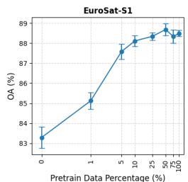

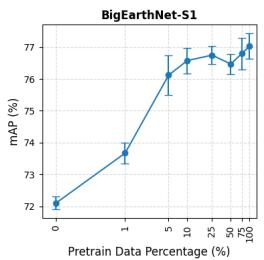

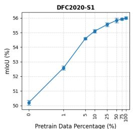

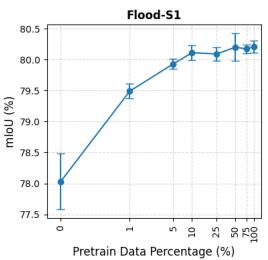  
Figure 5: Pretraining data scaling: finetuning accuracy vs. pretraining data fraction (mean ± std, 5 seeds), corresponding to Table 11.

Relative to the primary Subtraction+CE configuration $( 8 0 . 1 1 \pm 0 . 1 5 )$ , no alternative gives a large improvement. Concatenation fusion with CE gives the highest mean $( 8 0 . 5 3 \pm 0 . 1 5 ,$ $+ 0 . 4 2 { \mathrm { p p } } ;$ paired t-test, $p _ { B H } { = } 0 . 0 0 3$ , BH correction across the five comparisons), and Concatenation with focal loss is similar $( 8 0 . 5 2 \pm 0 . 2 7 , + 0 . 4 1$ pp; $p _ { B H } { = } 0 . 0 5 4 )$ . CosineAnneal scheduling $( 8 0 . 1 0 \pm 0 . 0 7 ) $ and CE+TV $( 8 0 . 2 0 \pm 0 . 1 2$ $p _ { B H } { = } 0 . 1 7 )$ are indistinguishable from the baseline. Tversky loss alone is markedly worse and unstable at this learning rate $( 7 5 . 7 5 \pm 1 . 7 8 ;$ one seed reached only 72.59; $p _ { B H } { = } 0 . 0 1 3 )$ . Changes at the task head therefore move Flood-S1 mIoU by at most about 0.4 pp, small next to the +1.4 pp gain from pretraining.

We suspect that the ceiling reflects the combination of limited training data (3,000 samples), severe class imbalance (85.3% non-flood pixels), and a mismatch between single-image MIM pretraining objectives and the temporal reasoning required for change detection; the ablation does not isolate these factors.

Table 10: Flood-S1 ablation: finetuning configuration variants $( \mathrm { C o n v N e X t - R S }$ with ConvNeXt-512 pretrained encoder; mean±std over 5 seeds (42, 123, 456, 789, 1337), lr=10−3, NVIDIA RTX A6000 GPU). CE: cross-entropy; TV: Tversky loss $( \alpha { = } 0 . 3 , \beta { = } 0 . 7 ) ;$ ; Focal: focal loss $( \gamma = 2 )$ . Subtraction: f − f ; Concatenation: $[ f _ { \mathrm { p r e } } ; f _ { \mathrm { p o s t } } ] .$ . Baseline (bold) is the primary configuration used throughout this paper (its V100 production run in Table 5 gives $\bar { 8 0 . 1 1 } \pm 0 . 1 0 )$ . All rows use OneCycleLR except the CosineAnneal row.
<table><tr><td>LLRD</td><td>Scheduler</td><td>Fusion</td><td>Loss</td><td>Flood-S1 mIoU (%)</td></tr><tr><td>No</td><td> $_ \mathrm { O n e C y c l e L R }$ </td><td>Subtraction</td><td>CE</td><td> $7 9 . 9 9 \pm 0 . 1 4$ </td></tr><tr><td>Yes</td><td>OneCycleLR</td><td>Subtraction</td><td>CE</td><td> ${ \bf 8 0 . 1 1 \pm 0 . 1 5 }$ </td></tr><tr><td>Yes</td><td>CosineAnneal</td><td>Subtraction</td><td>CE</td><td> $8 0 . 1 0 \pm 0 . 0 7$ </td></tr><tr><td>Yes</td><td>OneCycleLR</td><td>Concatenation</td><td> $\mathrm { C E } + \mathrm { T V }$ </td><td> $8 0 . 2 0 \pm 0 . 1 2$ </td></tr><tr><td>Yes</td><td> $\mathrm { O n e C y c l e L R }$ </td><td>Concatenation</td><td> $_ \mathrm { T v e r s k y }$ </td><td> $7 5 . 7 5 \pm 1 . 7 8$ </td></tr><tr><td>Yes</td><td>OneCycleLR</td><td>Concatenation</td><td>CE</td><td> $8 0 . 5 3 \pm 0 . 1 5$ </td></tr><tr><td>Yes</td><td>OneCycleLR</td><td>Concatenation</td><td>Focal</td><td> $8 0 . 5 2 \pm 0 . 2 7$ </td></tr></table>

## 4.5. Pretraining Data Scaling

We evaluate the efect of pretraining data quantity by training ConvNeXt-RS with UNet-128 on random subsets of SSL4EO-S12 v1.1 ranging from 1% to 100% (2,439 to 243,968 tiles), using a fixed random subset seed (seed=0, framework default) for reproducibility. All conditions are finetuned with LLRD and evaluated over 5 seeds. Table 11 and Figure 5 report the results across all conditions, with the 0% condition (random initialization) serving as the lower bound. For consistency with the scaling experiments, the 0% condition is also finetuned with LLRD. In contrast, the primary no-pretraining baseline in Table 5 is finetuned without LLRD.

Table 11: Pretraining data scaling results (ConvNeXt-RS, UNet-128, LLRD, mean ± std, 5 seeds). ∗ indicates statistically significant diference from 100% (paired two-tailed t-test, BH FDR correction across 28 comparisons, $\underline { { p _ { \mathrm { B H } } < 0 . 0 5 ) } } .$
<table><tr><td>Subset</td><td>Tiles</td><td>EuroSAT-S1</td><td>BigEarthNet-S1</td><td>DFC2020-S1</td><td>Flood-S1</td></tr><tr><td>0% (random)</td><td>0</td><td> $8 3 . 2 9 { \scriptstyle \pm 0 . 5 4 ^ { * } }$ </td><td> $7 2 . 1 0 { \scriptstyle \pm 0 . 2 0 ^ { * } }$ </td><td> $5 0 . 2 0 { \scriptstyle \pm 0 . 1 7 ^ { \ast } }$ </td><td> $7 8 . 0 3 { \scriptstyle \pm 0 . 4 5 ^ { * } }$ </td></tr><tr><td>1%</td><td>2,439</td><td> $8 5 . 1 2 { \scriptstyle \pm 0 . 4 2 ^ { * } }$ </td><td> $7 3 . 6 7 { \pm } 0 . 3 3 ^ { \ast }$ </td><td> $5 2 . 5 8 { \pm } 0 . 1 4 ^ { \ast }$ </td><td> $7 9 . 4 9 { \scriptstyle \pm 0 . 1 2 ^ { * } }$ </td></tr><tr><td>5%</td><td>12,198</td><td> $8 7 . 5 8 { \pm } 0 . 3 8 ^ { \ast }$ </td><td> $7 6 . 1 2 { \scriptstyle \pm 0 . 6 2 }$ </td><td> $5 4 . 5 9 { \scriptstyle \pm 0 . 0 7 ^ { * } }$ </td><td> $7 9 . 9 3 { \scriptstyle \pm 0 . 0 8 ^ { \ast } }$ </td></tr><tr><td>10%</td><td>24,396</td><td> $8 8 . 1 2 { \scriptstyle \pm 0 . 2 7 }$ </td><td> $7 6 . 5 8 { \pm } 0 . 4 0$ </td><td> $5 5 . 1 0 { \pm } 0 . 1 2 ^ { \ast }$ </td><td> $8 0 . 1 1 { \scriptstyle \pm 0 . 1 2 }$ </td></tr><tr><td>25%</td><td>60,992</td><td> $8 8 . 3 4 { \pm } 0 . 1 9 $ </td><td> $7 6 . 7 5 { \scriptstyle \pm 0 . 2 9 }$ </td><td> $5 5 . 5 5 { \pm } 0 . 1 3 ^ { \ast }$ </td><td> $8 0 . 0 9 { \scriptstyle \pm 0 . 1 1 }$ </td></tr><tr><td>50%</td><td>121,984</td><td> $8 8 . 6 8 { \scriptstyle \pm 0 . 2 9 }$ </td><td> $7 6 . 4 7 { \scriptstyle \pm 0 . 3 2 ^ { * } }$ </td><td> $5 5 . 8 4 { \pm } 0 . 1 6$ </td><td> $8 0 . 2 0 { \scriptstyle \pm 0 . 2 2 }$ </td></tr><tr><td>75%</td><td>182,976</td><td> $8 8 . 3 3 { \scriptstyle \pm 0 . 3 3 }$ </td><td> $7 6 . 8 0 { \scriptstyle \pm 0 . 5 0 }$ </td><td> $5 5 . 9 2 { \scriptstyle \pm 0 . 0 8 }$ </td><td> $8 0 . 1 7 { \scriptstyle \pm 0 . 0 7 }$ </td></tr><tr><td>100%</td><td>243,968</td><td> $8 8 . 4 9 { \scriptstyle \pm 0 . 1 6 }$ </td><td> $7 7 . 0 3 { \pm } 0 . 4 0 $ </td><td> $5 6 . 0 0 { \scriptstyle \pm 0 . 0 8 }$ </td><td> $8 0 . 2 1 { \pm } 0 . 1 0 $ </td></tr></table>

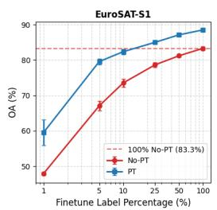

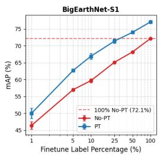

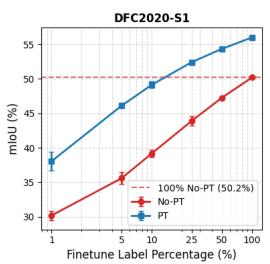

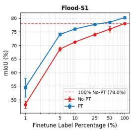  
Figure 6: Label eficiency: finetuning accuracy vs. labeled-data fraction, pretrained (PT) vs. random initialization (No-PT) (mean ± std, 5 seeds), corresponding to Table 12. Dashed line marks the 100%-label No-PT level.

Paired two-tailed t-tests (N=5 seeds, BH FDR correction (Benjamini and Hochberg, 1995) across 28 comparisons) reveal task-dependent saturation behavior. EuroSAT-S1 and Flood-S1 show no statistically significant diference from the 100% baseline for all conditions ≥10% $( p _ { \mathrm { B H } } { = } 0 . 0 7 6$ and $p _ { \mathrm { B H } } { = } 0 . 4 0 2$ respectively). BigEarthNet-S1 shows no significant diference at 25% $( p _ { \mathrm { B H } } { = } 0 . 2 6 9 )$ , though a non-monotonic dip at 50% (mean=76 47 vs. 76 75 at 25%) yields a significant result at that fraction $( p _ { \mathrm { B H } } { = } 0 . 0 0 5 )$ , consistent with the high inter-seed variance $( \sigma { \approx } 0 . 5 0 \mathrm { p p } )$ for this task; discounting this single noisy condition, the efective saturation is consistent with $23 \%$ of the pretraining corpus. Semantic segmentation (DFC2020-S1) continues to improve significantly up to 25% (pBH=0 002), saturating between 25–50% (pBH=0 190 at 50%). These results indicate that spatial representation quality in SAR amplitude imagery is more sensitive to pretraining data quantity than global semantic features. We note that non-significance with $N { = } 5$ is consistent with, but does not prove, equivalence; results should be interpreted alongside the efect sizes in Table 11.

## 4.6. Finetuning Label Eficiency

To assess whether SparK-SAR pretraining reduces reliance on labeled data, we finetune the primary configuration (UNet-128 decoder, LLRD) on 1%, 5%, 10%, 25%, and 50% subsets of each task’s training labels, comparing pretrained initialization against random initialization at each fraction (5 seeds each, with the same seed controlling both model initialization and label subset). Table 12 and Figure 6 report the results alongside the existing 100%-label result from Table 5.

Table 12: Label eficiency: finetuning accuracy vs. labeled-data fraction, pretrained (PT) vs. random initialization (No-PT), UNet-128 decoder, finetuned using LLRD, 5 seeds. All pretrained > random initialized gaps are statistically significant (paired t-test, BH-corrected across 20 comparisons, $p _ { B H } < 0 . 0 5 ;$ max $p _ { B H } = 0 . 0 1 1 ) $
<table><tr><td rowspan="2">Labels</td><td colspan="2">EuroSAT-S1 (OA%)</td><td colspan="2">BigEarthNet-S1 (mAP%)</td><td colspan="2">DFC2020-S1 (mIoU%)</td><td colspan="2">Flood-S1 (mIoU%)</td></tr><tr><td>No-PT</td><td>PT</td><td>No-PT</td><td>PT</td><td>No-PT</td><td>PT</td><td>No-PT</td><td>PT</td></tr><tr><td>1%</td><td> $4 7 . 9 4 { \pm } 0 . 4 9$ </td><td> $5 9 . 5 4 { \pm } 3 . 6 5$ </td><td> $4 6 . 4 1 { \pm } 1 . 1 0$ </td><td> $5 0 . 0 1 { \scriptstyle \pm 1 . 5 2 }$ </td><td> $3 0 . 1 9 { \scriptstyle \pm 0 . 7 0 }$ </td><td> $3 8 . 0 5 { \scriptstyle \pm 1 . 3 9 }$ </td><td> $4 8 . 1 7 { \scriptstyle \pm 1 . 3 6 }$ </td><td> $5 4 . 4 3 { \scriptstyle \pm 3 . 3 8 }$ </td></tr><tr><td>5%</td><td> $6 7 . 0 7 { \pm } 1 . 3 1 $ </td><td>79.56±0.83</td><td> $5 6 . 9 9 { \scriptstyle \pm 0 . 4 0 }$ </td><td> $6 2 . 6 7 { \scriptstyle \pm 0 . 3 6 }$ </td><td> $3 5 . 5 9 { \scriptstyle \pm 0 . 8 7 }$ </td><td> $4 6 . 1 0 { \scriptstyle \pm 0 . 3 3 }$ </td><td> $6 8 . 6 4 { \scriptstyle \pm 0 . 6 9 }$ </td><td> $7 4 . 0 1 { \scriptstyle \pm 0 . 6 0 }$ </td></tr><tr><td>10%</td><td> $7 3 . 5 3 { \pm } 1 . 1 3$ </td><td>82.34±0.80</td><td> $5 9 . 6 7 { \scriptstyle \pm 0 . 5 5 }$ </td><td> $6 6 . 9 0 { \scriptstyle \pm 0 . 8 7 }$ </td><td> $3 9 . 1 8 { \pm } 0 . 5 5 $ </td><td>49.13±0.50</td><td> $7 1 . 2 3 { \scriptstyle \pm 0 . 2 8 }$ </td><td> $7 6 . 0 2 { \scriptstyle \pm 0 . 4 6 }$ </td></tr><tr><td>25%</td><td> $7 8 . 6 2 { \scriptstyle \pm 0 . 7 0 }$ </td><td>84.98±0.35</td><td> $6 5 . 1 2 { \scriptstyle \pm 0 . 3 0 }$ </td><td> $7 1 . 3 9 { \scriptstyle \pm 0 . 6 2 }$ </td><td>43.90±0.70</td><td> $5 2 . 4 1 { \scriptstyle \pm 0 . 2 9 }$ </td><td> $7 3 . 9 6 { \pm } 0 . 5 5 $ </td><td> $7 7 . 7 0 { \scriptstyle \pm 0 . 3 6 }$ </td></tr><tr><td>50%</td><td>81.19±0.44</td><td>87.10±0.30</td><td>68.16±0.20</td><td>73.97±0.18</td><td>47.25±0.13</td><td> $5 4 . 3 4 { \pm } 0 . 1 7 $ </td><td> $7 5 . 9 4 \pm 1 . 0 4$ </td><td>78.52±0.32</td></tr><tr><td>100%*</td><td>83.29±0.54</td><td>88.49±0.16</td><td>72.10±0.20</td><td> $7 7 . 0 3 { \scriptstyle \pm 0 . 4 0 }$ </td><td>50.20±0.17</td><td>56.00±0.08</td><td> $7 8 . 0 3 { \scriptstyle \pm 0 . 4 5 }$ </td><td>80.21±0.10</td></tr></table>

∗The PT column at 100% matches Table 5 (SparK-SAR + UNet-128, LLRD). The No-PT column applies LLRD for consistency with lower label fractions; the no-pretraining baseline in Table 5 does not use LLRD.

Pretraining provides a statistically significant advantage over random initialization at every label fraction and every task (paired t-test, BH-corrected across the 20 comparisons; all $p _ { B H } <$ 0 05, ranging from $7 . 2 \times 1 0 ^ { - 7 } \mathrm { ~ t o ~ } 1 . 0 7 \times 1 0 ^ { - 2 } )$ , including the most extreme setting we test: 30 labeled samples for Flood-S1. For EuroSAT-S1, BigEarthNet-S1, and DFC2020-S1, the absolute gain from pretraining peaks at a modest 5–10% label budget and recedes as labeled data becomes abundant; Flood-S1 instead shows its largest advantage at the very smallest label fraction (1%), decaying monotonically thereafter. Practically, pretrained models reach the random-initialization 100%-label result using only 10–25% of the labels for EuroSAT-S1 and DFC2020-S1, and 25– 50% for BigEarthNet-S1 and Flood-S1, cutting the labeling burden required to match full-data performance by roughly half to three-quarters.

## 4.7. Representation Analysis

To complement the downstream performance analysis, we compute Centered Kernel Alignment (CKA) (Kornblith et al., 2019) between encoder representations at diferent pretraining data fractions. CKA measures linear representational similarity between two neural networks on a shared set of inputs.

We extract Stage 3 post global average pooling features ([N 384]) from all eight pretrained encoders (0–100%) on each Copernicus-Bench S1GRD test set, and compute pairwise unbiased linear CKA with Z-score feature standardization (Nguyen et al., 2021) to mitigate channel variance skew.

We use Stage 3 rather than the final Stage 4 representation because GAP over the 14×14 Stage 4 output would collapse the spatial structure that our resolution ablation specifically shows to be valuable, whereas Stage 4 features retained at full resolution ([N 14 14 768]) have no natural scalar CKA summary. Stage 3 avoids this collapse while still providing a compact, fixedsize representation for similarity comparison. This choice is also consistent with recent evidence that task-relevant information is often more accessible in intermediate layers than in final-layer embeddings across several self-supervised remote sensing architectures (Romero et al., 2026).

Figure 7 shows CKA similarity to the fully pretrained (100%) encoder as a function of pretraining data fraction. For EuroSAT-S1, BigEarthNet-S1, and DFC2020-S1, CKA increases near monotonically from random initialization (0.64–0.70) to plateau values of 0.83–0.88, broadly consistent with the downstream performance saturation observed in Section 4.5.

We observe an anomalous dip in CKA similarity for Flood-S1 at the 25% and 50% pretrainingdata fractions (0.733 and 0.726, respectively, versus 0.807 at 10% and 0.855 at 75%). We do not have a confident explanation for this non-monotonicity and report it as an open observation rather than speculate on its cause. It does not afect the downstream accuracy trend (Table 11), which remains monotonic within noise across the same fractions.

A non-trivial CKA baseline of ≈0 65–0 70 at 0% (random initialization) reflects the strong inductive bias imposed by ConvNeXt’s depthwise convolutional structure, which generates spatially correlated SAR features even without training.

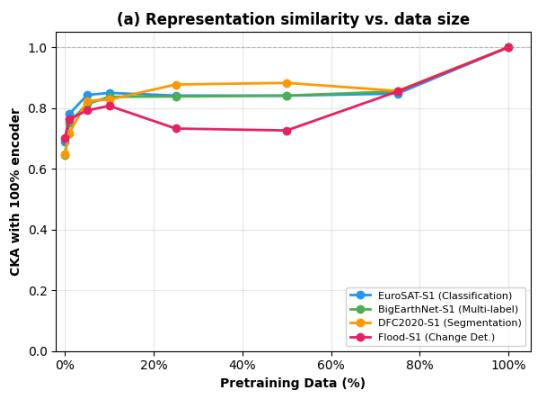

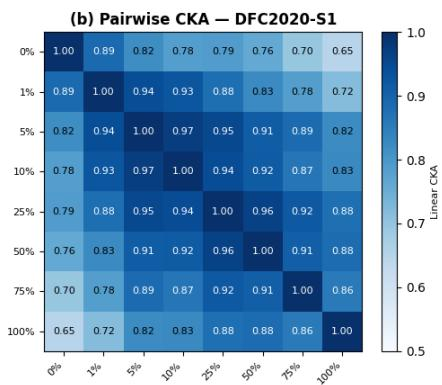  
Figure 7: (a) CKA similarity to fully pretrained (100%) encoder vs. pretraining data fraction (Stage 3 post-GAP features, unbiased HSIC, Z-score standardization). (b) Pairwise CKA heatmap for DFC2020-S1. Values near the diagonal confirm that representations converge as data increases, with saturation consistent with downstream performance.

## 4.8. Geographic Data Overlap Analysis

SSL4EO-S12 v1.1 and the Copernicus-Bench evaluation sets both draw from the Sentinel-1 archive and share similar global geographic sampling strategies, raising the possibility of geographic overlap between pretraining and evaluation data. To assess whether our reported gains are inflated by such overlap, we identify pretraining tiles with geographic proximity to test set samples using task-specific thresholds derived from the physical patch dimensions of each dataset pair, given a Sentinel-1 GSD of 10 m/pixel: 1,640 m for EuroSAT-S1, 1,920 m for BigEarthNet-S1, and 2,440 m for Flood-S1. DFC2020-S1 is not assessed due to the absence of coordinate metadata in the dataset release. Under these thresholds, 10.9% of EuroSAT-S1 test samples, 4.3% of BigEarthNet-S1 test samples, and 10.1% of Flood-S1 test samples have at least one geographically proximate pretraining tile; from the pretraining side, only 1,406 of 243,968 SSL4EO-S12 v1.1 tiles (0.58%) are implicated across all three assessable tasks combined.

To directly test whether this overlap inflates our reported gains, we re-pretrain SparK-SAR from scratch on a de-collided version of SSL4EO-S12 v1.1 with all 1,406 overlapping tiles removed (242,562 remaining), and re-finetune on all four downstream tasks (5 seeds each). The de-collided model was pretrained (FP16 mixed precision, global batch size 256) on a single NVIDIA A100 80 GB GPU and finetuned (FP32) on single NVIDIA RTX A6000 GPUs, whereas the original models were pretrained on 4×V100 32 GB GPUs (64 samples per GPU) and finetuned on V100 GPUs; the remainder of the recipe is unchanged, so hardware and per-device batch size are minor additional diferences between the two columns of Table 13. Table 13 reports the results: all four tasks change by less than 0.1 percentage points relative to the original pretraining, within one standard deviation, confirming that the reported gains are not attributable to geographic leakage. DFC2020-S1 remains an open limitation for the overlap analysis itself, since its dataset release provides no coordinate metadata to check test-set proximity directly; its unchanged performance under the de-collided checkpoint above ofers indirect reassurance only.

Table 13: Full experimental de-collision: SparK-SAR re-pretrained on SSL4EO-S12 v1.1 with all overlapping tiles removed, re-finetuned on all four tasks (mean ± std, 5 seeds).
<table><tr><td>Task</td><td>Original</td><td>De-collided</td><td>∆</td></tr><tr><td>EuroSAT-S1</td><td>88.49±0.16</td><td>88.46±0.31</td><td>-0.03</td></tr><tr><td>BigEarthNet-S1</td><td>77.03±0.40</td><td>77.08±0.47</td><td>+0.05</td></tr><tr><td>DFC2020-S1</td><td>56.00±0.08</td><td>56.02±0.10</td><td>+0.02</td></tr><tr><td>Flood-S1</td><td>80.21±0.10</td><td>80.30±0.18</td><td>+0.09</td></tr></table>

## 4.9. Qualitative Results

Figure 8 compares four representative DFC2020-S1 scenes across three configurations reported in this paper: the standard-resolution ConvNeXt encoder (pretrained, no LLRD; Table 7), the ConvNeXt-RS encoder without pretraining (no LLRD; Table 5), and our finetuned ConvNeXt-RS encoder (pretrained, LLRD; Table 5).

The first row presents a mixed landscape dominated by shrubland and cropland, with smaller barren, urban, and forest patches and a small water body. All three predictions broadly match the ground truth, but notable diferences are already apparent: the standard ConvNeXt encoder overpredicts cropland in the central region and recovers almost none of the forest; the non-pretrained ConvNeXt-RS encoder collapses most of the shrubland into cropland, introduces spurious forest in areas the ground truth labels shrubland, and suppresses the barren regions; in contrast, the pretrained ConvNeXt-RS encoder recovers the largest share of the ground truth’s shrubland and retains the most barren land.

In the second row, a cropland-dominated scene containing a prominent water body, all three configurations accurately capture the water feature and surrounding cropland. However, both the standard-resolution ConvNeXt encoder and the non-pretrained ConvNeXt-RS encoder make spurious predictions of other classes in the region where the ground truth shows barren land, whereas the pretrained ConvNeXt-RS encoder avoids these spurious cross-class predictions but instead over-extends cropland into the barren region.

The third row is the most heterogeneous scene, mixing forest, cropland, grassland, and urban patches. All three configurations recover the overall spatial layout, though predictions are smoother than the ground truth and suppress fine-grained class boundaries; urban patches are captured at broadly similar locations across all three models. The main variation again separates the non-pretrained encoder from the two pretrained configurations: it reassigns a substantial part of the ground truth’s cropland to grassland, whereas both pretrained configurations preserve the cropland-grassland boundary more closely.

In the fourth row, a largely forested scene with scattered grassland, all three predictions are predominantly dark green and closely resemble the ground truth, difering mainly in that the nonpretrained encoder places more of its grassland predictions outside the ground truth’s grassland patches than either pretrained configuration.

Figure 9 shows the same three-way comparison for four representative Flood-S1 scenes. In the first row, where the ground truth contains a large contiguous flood-water region in the upper portion and a permanent-water body in the lower portion, both pretrained configurations label the permanent-water body almost entirely correctly, whereas the non-pretrained ConvNeXt-RS encoder assigns a noticeable fraction of it to flood water. Both the standard-resolution ConvNeXt encoder and the non-pretrained ConvNeXt-RS encoder additionally make multiple spurious predictions of flood water in the top-right portion of the scene, whereas the pretrained ConvNeXt-RS encoder makes none there.

The second row presents a more challenging, spatially sparse case with small scattered floodwater patches against an otherwise water-free background; all three configurations detect the approximate locations of most patches, but the non-pretrained encoder misses noticeably more of the flooded area than either pretrained configuration.

The third row contains mainly permanent water in the form of a prominent meandering channel, whose overall course all three configurations recover at comparable accuracy.

In the fourth row, flood-water patches are distributed across the scene; all three configurations recover the main flooded areas, with variation confined to the finer details of individual patch boundaries and smaller isolated regions. Taken together, the clearest and most consistent diference across these scenes is the non-pretrained encoder’s weaker separation of flood water from both permanent water and dry land.

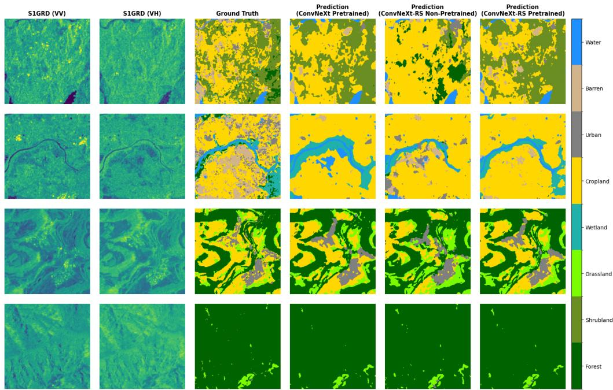  
Figure 8: DFC2020-S1 qualitative comparison across four representative scenes (rows). Columns from left to right: VV input, VH input, ground truth, and predictions from the standard-resolution ConvNeXt encoder (pretrained, no LLRD; Table 7), the ConvNeXt-RS encoder without pretraining (no LLRD; Table 5), and our finetuned ConvNeXt-RS encoder (pretrained, LLRD; Table 5). LLRD was evaluated only for ConvNeXt-RS.

## 5. Discussion

Of the three design changes evaluated, the higher-resolution ConvNeXt-RS encoder matters most for dense prediction: its gains are largest on segmentation and change detection, which is exactly the signal we would expect if the standard stride-32× ConvNeXt is simply too coarse for SAR pixel-level tasks. Halving the stem stride fixes this without adding a single parameter.

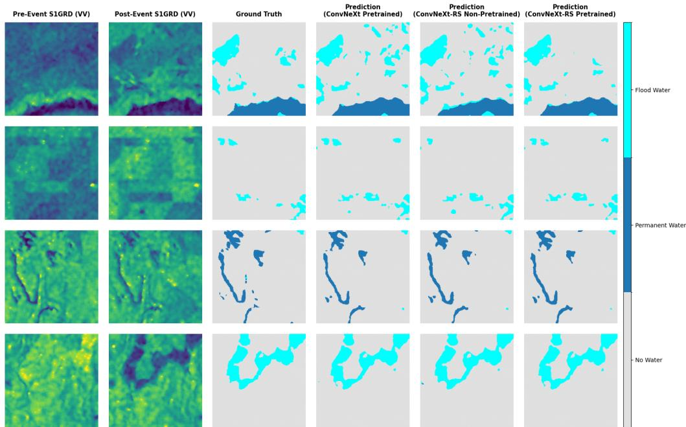  
Figure 9: Flood-S1 qualitative comparison across four representative scenes (rows). Columns from left to right: pre-flood VV, post-flood VV, ground truth, and predictions from the standard-resolution ConvNeXt encoder (pretrained, no LLRD; Table 7), the ConvNeXt-RS encoder without pretraining (no LLRD; Table 5), and our finetuned ConvNeXt-RS encoder (pretrained, LLRD; Table 5). LLRD was evaluated only for ConvNeXt-RS.

The decoder ablation (Section 4.4.2) tells a complementary story: UNet-128 and ConvNeXt-512 land at statistically indistinguishable downstream accuracy (p=0 17), so whatever the original SparK recipe’s hierarchical decoder buys on natural images, it is not required to transfer well to S1GRD at a matched learning rate. That makes ConvNeXt-512 the better default whenever VRAM is tight, since it recovers 7.5–8.5% per GPU (hardware-dependent) for no accuracy cost. LLRD, meanwhile, is a smaller but broadly positive lever for the UNet-128-pretrained encoder: mean performance improves and variance shrinks across all four tasks, reaching significance on two of them after correction (Section 4.4.3), enough that we recommend it as a default for pretrained encoders rather than an optional extra; it did not help a non-pretrained encoder (Section 3.4).

The data scaling analysis reveals that SAR MIM pretraining is remarkably data-eficient: classification tasks and change detection saturate with as few as 10–25% of the pretraining corpus (24,396 tiles), while dense semantic segmentation (DFC2020-S1) keeps improving significantly up to 25% (60,992 tiles) and continues to gain, more gradually, through 50% (121,984 tiles). This saturation behavior suggests that the limited visual diversity of SAR amplitude imagery, which is typically dominated by a relatively small number of backscatter regimes corresponding to major land-cover types, can be efectively characterized by a surprisingly small pretraining corpus. Consequently, researchers need not curate massive SAR datasets to benefit from the SparK-SAR pretraining method; a geographically diverse collection of ∼25,000 tiles may be

suficient for most applications.

The CKA representation analysis (Section 4.7) corroborates the downstream saturation findings: encoder representations converge toward the fully pretrained configuration with increasing data, and this convergence broadly mirrors the performance plateau observed in Table 11. The non-trivial CKA baseline at random initialization reflects the strong spatial inductive bias of ConvNeXt on SAR data, an observation with implications for future architectural choices in SAR SSL.

During development of SparK-SAR, several alternative configurations were explored but found to provide no consistent benefit.

VICReg regularization (Bardes et al., 2022) increased representation dimensionality but degraded downstream performance, consistent with a conflict between the generative SparK reconstruction objective and the decorrelation objective of VICReg.

Fisher-Tippett-based SAR-specific reconstruction loss (Fisher and Tippett, 1928; Guan et al., 2019) and distillation from a cross-modal optical teacher (DINOv3-style (Siméoni et al., 2026)) produced reduced training losses but no downstream gains, suggesting that representations aligned with optical imagery are not directly transferable to SAR tasks.

These negative results highlight the importance of domain-specific objective design for SAR SSL and are documented here to prevent redundant exploration by the community.

A dual-branch polarimetric stem processing VV and VH channels separately before 1×1 projection fusion was also evaluated, but did not result in improvement on classification tasks and regressed on dense prediction (−1 44 pp on DFC2020-S1, −0 52 pp on Flood-S1), suggesting that joint polarimetric processing in a shared convolutional stem is preferable for S1GRD MIM pretraining.

Flood-S1’s comparatively modest +1 4 pp gain has a natural explanation once we consider what the pretraining objective actually teaches the encoder. Change detection asks the model to reason jointly over a pre-event and a post-event acquisition, but MIM pretraining, singleimage by construction, never exposes the encoder to any notion of temporal diference at all. An encoder that has only ever learned to reconstruct one image at a time has correspondingly little temporal structure to transfer. The Flood-S1 ablation (Table 10) shows that the loss functions and fusion strategies we tried at the task head change Flood-S1 mIoU by at most about 0.4 pp (Concatenation fusion with CE or focal loss), so the limitation looks like it may sit upstream, in the pretraining objective itself, which points toward multi-temporal pretraining as the more promising direction for future work rather than further task-head engineering.

BigEarthNet-S1 is the one task where SparK-SAR (77 03±0 40) trails, coming in marginally behind both Copernicus-FM (77 9±0 0%) and SoftCon (78 7±0 0%) under frozen evaluation. We note that the Copernicus-Bench dataset wrappers pass geographic coordinates and acquisition timestamps as metadata to Copernicus-FM for BigEarthNet-S1, while DFC2020-S1 passes NaN metadata in lieu of absent coordinate information (Wang et al., 2025b). In contrast, ConvNeXt-RS receives no metadata whatsoever, relying solely on the two SAR amplitude channels (VV, VH) for all tasks. One plausible contributor is that BigEarthNet-S1’s labels come from the CORINE Land Cover map (Sumbul et al., 2019; European Environment Agency, 2020), and European land-cover classes are not spread uniformly: they cluster geographically. Combined with the real coordinates and acquisition times Copernicus-FM receives as input, that clustering gives it a location-based shortcut to lean on that our model, seeing only VV/VH amplitude, simply does not have access to. This is consistent with the task-level pattern: Copernicus-FM trails our model on DFC2020-S1 (where metadata is all-NaN) and Flood-S1 (where the label is transient and event-specific, limiting the utility of location priors), while its strongest advantage over our model occurs on BigEarthNet-S1 (where location and time metadata are available and labels are geographically clustered). SoftCon’s strong BigEarthNet-S1 result (78 7±0 0%) likely reflects its multi-label land-cover guidance during pretraining (Wang et al., 2024). We ofer this as a plausible explanation, not a demonstrated one.

These findings also carry practical implications for operational Earth observation pipelines that must produce map products under real-world time and annotation constraints. The label eficiency analysis (Section 4.6) shows that SparK-SAR’s advantage over a non-pretrained baseline on Flood-S1 is largest precisely at the most extreme low-label setting we test (1% labeled samples, a +6.26 pp gain in mIoU over random initialization), the operating regime closest to a real rapid-response flood mapping scenario such as Copernicus Emergency Management Service (EMS) products, where annotated post-event imagery for a specific flood event is scarce or unavailable at the time a map is needed.

Similarly, the pretraining data scaling results (Section 4.5) show that classification and change detection performance saturate with only 10–25% of the full 243,968 tile pretraining corpus, indicating that agencies producing regional land-cover products in the style of CORINE or the ESA Climate Change Initiative (CCI) Land Cover map from Sentinel-1 archives need not assemble a global-scale SAR corpus to benefit from MIM pretraining.

SparK-SAR pretraining is a one-time cost across four V100 32 GB GPUs, completing in under nine hours (Table 3), while finetuning the resulting checkpoint across all four Copernicus-Bench tasks evaluated in this paper then completes in a further ≈18.6 GPU-hours per seed on a single V100 GPU, well within reach of operational and research groups without dedicated largescale HPC infrastructure, a practical constraint that we view as at least as relevant to real-world adoption as the accuracy gains reported above.

The broader case our results build is a practical one: for SAR remote sensing, a computeeficient, domain-specific CNN can be a real alternative to chasing ever-larger multimodal ViT foundation models. A 27.8M-parameter encoder pretrained on one modality, on four V100 32 GB GPUs, in under a day, holds its own against, and on most tasks beats, frozen encoders with five times the parameters and orders of magnitude more pretraining data and compute behind them.

## 6. Conclusions

This work investigates how masked self-supervised pretraining can be adapted to the particular characteristics of Sentinel-1 GRD imagery. The proposed SparK-SAR framework combines a high-resolution ConvNeXt-RS encoder producing 14×14 feature maps with lightweight reconstruction decoders designed to avoid the numerical dificulties observed during mixedprecision pretraining on SAR data. Together with layer-wise learning rate decay during finetuning, these modifications enable a 27.8M-parameter encoder to transfer efectively to four distinct Copernicus-Bench S1GRD downstream tasks within a limited computational budget.

The experiments also provide evidence that increasing pretraining data does not yield uniform benefits across downstream tasks. The 27.8M-parameter encoder exceeds the performance of frozen ViT-based encoders with as much as 5× more parameters on three of the four evaluated tasks. Moreover, the data-scaling experiments show that classification performance largely reaches saturation after using 10–25% of the SSL4EO-S12 v1.1 corpus, whereas dense prediction tasks continue to improve significantly up to 25% and keep gaining, more gradually, through 50% of the training set. CKA analysis provides a complementary view of this behavior: as more data is introduced, the learned representations progressively approach those obtained with the full pretraining set, following trends that are consistent with the observed downstream results.

Taken together, the findings indicate that efective SAR representation learning can be achieved without relying exclusively on very large-scale pretraining. Compact CNN models, when paired with objectives and architectures adapted to SAR characteristics, can provide useful representations with substantially lower computational requirements. At the same time, the task-dependent scaling behavior highlights limitations of single-image pretraining, particularly for temporal change analysis. Future work will therefore investigate pretraining objectives that explicitly exploit multi-temporal observations, as well as extensions to interferometric SAR that incorporate phase and coherence alongside amplitude information.

## Data Availability Statement

The SSL4EO-S12 v1.1 dataset is publicly available at https://huggingface.co/datasets/ embed2scale/SSL4EO-S12-v1.1 (Blumenstiel et al., 2025). The Copernicus-Bench evaluation benchmark is publicly available at https://huggingface.co/datasets/wangyi111/ Copernicus-Bench (Wang et al., 2025b). Code and pretrained weights will be made available upon acceptance.

## Acknowledgment

The authors thank Prof. Cham Tat Jen and Assoc. Prof. Benoit Taisne (Thesis Advisory Committee) for their feedback during the course of this work. Y. Natsume is supported by the Nanyang Technological University Provost Graduate Award (NTU PGA). Computational resources were provided by the College of Computing and Data Science, Nanyang Technological University.

Declaration of generative AI and AI-assisted technologies in the manuscript preparation process

During the preparation of this work, the authors used Claude (Anthropic) to assist with drafting and language editing of the Introduction, Related Work, Materials and Methods, Discussion, and Conclusion sections, including verification of citations and technical statements against source material. The authors reviewed and edited the output as needed and take full responsibility for the content of the published article. All experimental design, code, data analysis, scientific content, and conclusions are the authors’ own.

## References

Allen, M., Dorr, F., Gallego-Mejia, J.A., Martínez-Ferrer, L., Jungbluth, A., Kalaitzis, F., Ramos-Pollán, R., 2023. Large scale masked autoencoding for reducing label requirements on SAR data. URL: https://arxiv.org/abs/2310.00826. arXiv preprint arXiv:2310.00826.

Assran, M., Duval, Q., Misra, I., Bojanowski, P., Vincent, P., Rabbat, M., LeCun, Y., Ballas, N., 2023. Self-supervised learning from images with a joint-embedding predictive architecture, in: Proceedings of the IEEE/CVF Conference on Computer Vision and Pattern Recognition (CVPR), pp. 15619–15629. doi:10.1109/CVPR52729.2023.01499.

Ayush, K., Uzkent, B., Meng, C., Tanmay, K., Burke, M., Lobell, D., Ermon, S., 2021. Geography-aware self-supervised learning, in: Proceedings of the IEEE/CVF International Conference on Computer Vision (ICCV), pp. 10181–10190. doi:10.1109/ICCV48922. 2021.01002.

Bao, H., Dong, L., Piao, S., Wei, F., 2022. BEiT: BERT pre-training of image transformers, in: International Conference on Learning Representations (ICLR). URL: https: //openreview.net/forum?id=p-BhZSz59o4.

Bardes, A., Ponce, J., LeCun, Y., 2022. VICReg: Variance-invariance-covariance regularization for self-supervised learning, in: International Conference on Learning Representations (ICLR). URL: https://arxiv.org/abs/2105.04906.

Benjamini, Y., Hochberg, Y., 1995. Controlling the false discovery rate: A practical and powerful approach to multiple testing. Journal of the Royal Statistical Society: Series B (Statistical Methodology) 57, 289–300. doi:10.1111/j.2517-6161.1995.tb02031.x.

Blumenstiel, B., Braham, N.A.A., Albrecht, C.M., Maurogiovanni, S., Fraccaro, P., 2025. SSL4EO-S12 v1.1: A multimodal, multiseasonal dataset for pretraining, updated. URL: https://arxiv.org/abs/2503.00168v2. arXiv preprint arXiv:2503.00168.

Bountos, N.I., Sdraka, M., Zavras, A., Karavias, A., Karasante, I., Herekakis, T., Thanasou, A., Michail, D., Papoutsis, I., 2024. Kuro Siwo: 33 billion m2 under the water. A global multi-temporal satellite dataset for rapid flood mapping, in: Advances in Neural Information Processing Systems, pp. 38105–38121. doi:10.52202/079017-1204.

Caron, M., Touvron, H., Misra, I., Jégou, H., Mairal, J., Bojanowski, P., Joulin, A., 2021. Emerging properties in self-supervised vision transformers, in: Proceedings of the IEEE/CVF International Conference on Computer Vision (ICCV), pp. 9650–9660. doi:10.1109/ICCV48922. 2021.00951.

Clark, K., Luong, M.T., Le, Q.V., Manning, C.D., 2020. ELECTRA: Pre-training text encoders as discriminators rather than generators, in: International Conference on Learning Representations (ICLR). URL: https://openreview.net/forum?id=r1xMH1BtvB.

Cong, Y., Khanna, S., Meng, C., Liu, P., Rozi, E., He, Y., Burke, M., Lobell, D.B., Ermon, S., 2022. SatMAE: Pre-training transformers for temporal and multi-spectral satellite imagery, in: Advances in Neural Information Processing Systems, pp. 197–211. URL: https://arxiv. org/abs/2207.08051.

Deng, J., Dong, W., Socher, R., Li, L.J., Li, K., Fei-Fei, L., 2009. Imagenet: A large-scale hierarchical image database, in: 2009 IEEE Conference on Computer Vision and Pattern Recognition, IEEE. pp. 248–255. doi:10.1109/CVPR.2009.5206848.

Devlin, J., Chang, M.W., Lee, K., Toutanova, K., 2019. BERT: Pre-training of deep bidirectional transformers for language understanding, in: Proceedings of the 2019 Conference of the North American Chapter of the Association for Computational Linguistics: Human Language Technologies, Volume 1 (Long and Short Papers), Association for Computational Linguistics, Minneapolis, Minnesota. pp. 4171–4186. doi:10.18653/v1/N19-1423.

Dong, X., Bao, J., Zhang, T., Chen, D., Gu, S., Zhang, W., Yuan, L., Chen, D., Wen, F., Yu, N., 2022. CLIP itself is a strong fine-tuner: Achieving 85.7% and 88.0% top-1 accuracy with ViT-B and ViT-L on ImageNet. URL: https://arxiv.org/abs/2212.06138. arXiv preprint arXiv:2212.06138.

Dosovitskiy, A., Beyer, L., Kolesnikov, A., Weissenborn, D., Zhai, X., Unterthiner, T., Dehghani, M., Minderer, M., Heigold, G., Gelly, S., Uszkoreit, J., Houlsby, N., 2021. An image is worth 16x16 words: Transformers for image recognition at scale, in: International Conference on Learning Representations (ICLR). URL: https://openreview.net/forum?id= YicbFdNTTy.

European Environment Agency, 2020. CORINE land cover 2018 (vector), Europe, 6-yearly. URL: https://land.copernicus.eu/pan-european/corine-land-cover/clc2018, doi:10.2909/71c95a07-e296-44fc-b22b-415f42acfdf0. copernicus Land Monitoring Service.

European Space Agency, 2012. Sentinel-1: ESA’s Radar Observatory Mission for GMES Operational Services. Technical Report ESA SP-1322/1. ESA Communications.

Fisher, R.A., Tippett, L.H., 1928. Limiting forms of the frequency distribution of the largest or smallest member of a sample. Mathematical Proceedings of the Cambridge Philosophical Society 24, 180–190. doi:10.1017/S0305004100015681.

Fuller, A., Millard, K., Green, J.R., 2023. CROMA: Remote sensing representations with contrastive radar-optical masked autoencoders, in: Advances in Neural Information Processing Systems, pp. 5506–5538. doi:10.52202/075280-0241.

Gallego-Mejia, J.A., Jungbluth, A., Martínez-Ferrer, L., Allen, M., Dorr, F., Kalaitzis, F., Ramos-Pollán, R., 2023. Exploring DINO: Emergent properties and limitations for synthetic aperture radar imagery. URL: https://arxiv.org/abs/2310.03513. arXiv preprint arXiv:2310.03513.

Gao, P., Ma, T., Li, H., Lin, Z., Dai, J., Qiao, Y., 2022. MCMAE: Masked convolution meets masked autoencoders, in: Advances in Neural Information Processing Systems. doi:10.52202/068431-2582.

Guan, D., Xiang, D., Tang, X., Kuang, G., 2019. SAR image despeckling based on nonlocal lowrank regularization. IEEE Transactions on Geoscience and Remote Sensing 57, 3472–3489. doi:10.1109/TGRS.2018.2885089.

He, K., Chen, X., Xie, S., Li, Y., Dollár, P., Girshick, R., 2022. Masked autoencoders are scalable vision learners, in: Proceedings of the IEEE/CVF Conference on Computer Vision and Pattern Recognition (CVPR), pp. 16000–16009. doi:10.1109/CVPR52688.2022.01553.

He, K., Zhang, X., Ren, S., Sun, J., 2016. Deep residual learning for image recognition, in: Proceedings of the IEEE Conference on Computer Vision and Pattern Recognition (CVPR), pp. 770–778. doi:10.1109/CVPR.2016.90.

Helber, P., Bischke, B., Dengel, A., Borth, D., 2019. EuroSAT: A novel dataset and deep learning benchmark for land use and land cover classification. IEEE Journal of Selected Topics in Applied Earth Observations and Remote Sensing 12, 2217–2226. doi:10.1109/JSTARS. 2019.2918242.

Kornblith, S., Norouzi, M., Lee, H., Hinton, G., 2019. Similarity of neural network representations revisited, in: Proceedings of the 36th International Conference on Machine Learning (ICML), pp. 3519–3529. URL: https://proceedings.mlr.press/v97/kornblith19a. html.

Li, W., Yang, W., Hou, Y., Liu, L., Liu, Y., Li, X., 2025. SARATR-X: Toward building a foundation model for SAR target recognition. IEEE Transactions on Image Processing 34, 869–884. doi:10.1109/TIP.2025.3531988.

Li, W., Yang, W., Liu, T., Hou, Y., Li, Y., Liu, Z., Liu, Y., Liu, L., 2024. Predicting gradient is better: Exploring self-supervised learning for SAR ATR with a joint-embedding predictive architecture. ISPRS Journal of Photogrammetry and Remote Sensing 218, 326–338. doi:10. 1016/j.isprsjprs.2024.09.013.

Liu, Z., Lin, Y., Cao, Y., Hu, H., Wei, Y., Zhang, Z., Lin, S., Guo, B., 2021. Swin transformer: Hierarchical vision transformer using shifted windows, in: Proceedings of the IEEE/CVF International Conference on Computer Vision (ICCV), pp. 10012–10022. doi:10.1109/ICCV48922.2021.00986.

Liu, Z., Mao, H., Wu, C.Y., Feichtenhofer, C., Darrell, T., Xie, S., 2022. A ConvNet for the 2020s, in: Proceedings of the IEEE/CVF Conference on Computer Vision and Pattern Recognition (CVPR), pp. 11966–11976. doi:10.1109/CVPR52688.2022.01167.

Lu, S., Guo, J., Zimmer-Dauphinee, J.R., Nieusma, J.M., Wang, X., VanValkenburgh, P., Wernke, S.A., Huo, Y., 2025. Vision foundation models in remote sensing: A survey. IEEE Geoscience and Remote Sensing Magazine 13, 190–215. doi:10.1109/MGRS.2025.3541952.

Mañas, O., Lacoste, A., Giró-i Nieto, X., Vazquez, D., Rodríguez, P., 2021. Seasonal contrast: Unsupervised pre-training from uncurated remote sensing data, in: Proceedings of the IEEE/CVF International Conference on Computer Vision (ICCV), pp. 9414–9423.

Martínez-Ferrer, L., Jungbluth, A., Gallego-Mejia, J.A., Allen, M., Dorr, F., Kalaitzis, F., Ramos-Pollán, R., 2023. Exploring generalisability of self-distillation with no labels for SARbased vegetation prediction. URL: https://arxiv.org/abs/2310.02048. arXiv preprint arXiv:2310.02048.

Moreira, A., Prats-Iraola, P., Younis, M., Krieger, G., Hajnsek, I., Papathanassiou, K.P., 2013. A tutorial on synthetic aperture radar. IEEE Geoscience and Remote Sensing Magazine 1, 6–43. doi:10.1109/MGRS.2013.2248301.

Natsume, Y., Yeo, C.K., 2026. SparK-SAR: High-resolution ConvNeXt sparse masked pretraining for Sentinel-1 GRD, in: Proceedings of SPIE 14360, Land Surface and Cryosphere Remote Sensing VI. Paper 14360-15, Yokohama, Japan. To appear.

Nedungadi, V., Kariryaa, A., Oehmcke, S., Belongie, S., Igel, C., Lang, N., 2024. MMEarth: Exploring multi-modal pretext tasks for geospatial representation learning, in: Computer Vision – ECCV 2024, pp. 164–182. doi:10.1007/978-3-031-73039-9\_10.

Nguyen, T., Raghu, M., Kornblith, S., 2021. Do wide and deep networks learn the same things? Uncovering how neural network representations vary with width and depth, in: International Conference on Learning Representations (ICLR). URL: https://arxiv.org/abs/2010. 15327.

Reed, C.J., Gupta, R., Li, S., Brockman, S., Funk, C., Clipp, B., Keutzer, K., Candido, S., Uyttendaele, M., Darrell, T., 2023. Scale-MAE: A scale-aware masked autoencoder for multiscale geospatial representation learning, in: Proceedings of the IEEE/CVF International Conference on Computer Vision (ICCV), pp. 4088–4099. doi:10.1109/ICCV51070.2023.00378.

Robinson, C., Malkin, K., Jojic, N., Chen, H., Qin, R., Xiao, C., Schmitt, M., Ghamisi, P., Hänsch, R., Yokoya, N., 2021. Global land-cover mapping with weak supervision: Outcome of the 2020 IEEE GRSS data fusion contest. IEEE Journal of Selected Topics in Applied Earth Observations and Remote Sensing 14, 3185–3199. doi:10.1109/JSTARS.2021.3063849.

Romero, J., Lv, Q., Karimzadeh, M., 2026. How do self-supervised remote sensing vision models transfer to downstream tasks? URL: https://arxiv.org/abs/2606.13896. arXiv preprint arXiv:2606.13896.

Ronneberger, O., Fischer, P., Brox, T., 2015. U-net: Convolutional networks for biomedical image segmentation, in: Medical Image Computing and Computer-Assisted Intervention – MICCAI 2015, Springer International Publishing. pp. 234–241. doi:10.1007/ 978-3-319-24574-4\_28.

Siméoni, O., Vo, H.V., Seitzer, M., Baldassarre, F., Oquab, M., Jose, C., Khalidov, V., Szafraniec, M., Yi, S.E., Ramamonjisoa, M., Massa, F., Haziza, D., Wehrstedt, L., Wang, J., Darcet, T., Moutakanni, T., Sentana, L., Roberts, C., Vedaldi, A., Tolan, J., Brandt, J., Couprie, C., Mairal, J., Jégou, H., Labatut, P., Bojanowski, P., 2026. DINOv3. Transactions on Machine Learning Research URL: https://mlanthology.org/tmlr/2026/simeoni2026tmlr-dinov3/.

Sumbul, G., Charfuelan, M., Demir, B., Markl, V., 2019. BigEarthNet: A large-scale benchmark archive for remote sensing image understanding, in: 2019 IEEE International Geoscience and Remote Sensing Symposium (IGARSS), IEEE. pp. 5901–5904. doi:10.1109/IGARSS.2019. 8900532.

Tian, K., Jiang, Y., Diao, Q., Lin, C., Wang, L., Yuan, Z., 2023. Designing BERT for convolutional networks: Sparse and hierarchical masked modeling, in: International Conference on Learning Representations (ICLR). URL: https://mlanthology.org/iclr/2023/ tian2023iclr-designing/.

Wang, Y., Albrecht, C.M., Braham, N.A.A., Mou, L., Zhu, X.X., 2022. Self-supervised learning in remote sensing: A review. IEEE Geoscience and Remote Sensing Magazine 10, 213–247. doi:10.1109/MGRS.2022.3198244.

Wang, Y., Albrecht, C.M., Zhu, X.X., 2024. Multi-label guided soft contrastive learning for eficient Earth observation pretraining. IEEE Transactions on Geoscience and Remote Sensing 62, 1–16. doi:10.1109/TGRS.2024.3466896.

Wang, Y., Hernández, H., Albrecht, C.M., Zhu, X.X., 2025a. Feature guided masked autoencoder for self-supervised learning in remote sensing. IEEE Journal of Selected Topics in Applied Earth Observations and Remote Sensing 18, 321–336. doi:10.1109/JSTARS.2024. 3493237.

Wang, Y., Xiong, Z., Liu, C., Stewart, A.J., Dujardin, T., Bountos, N.I., Zavras, A., Gerken, F., Papoutsis, I., Leal-Taixé, L., Zhu, X.X., 2025b. Towards a unified Copernicus foundation model for Earth vision, in: Proceedings of the IEEE/CVF International Conference on Computer Vision (ICCV), pp. 9888–9899. doi:10.1109/ICCV51701.2025.00922.

Woo, S., Debnath, S., Hu, R., Chen, X., Liu, Z., Kweon, I.S., Xie, S., 2023. ConvNeXt V2: Codesigning and scaling ConvNets with masked autoencoders, in: Proceedings of the IEEE/CVF Conference on Computer Vision and Pattern Recognition (CVPR), pp. 16133–16142. doi:10. 1109/CVPR52729.2023.01548.

Xiao, T., Liu, Y., Zhou, B., Jiang, Y., Sun, J., 2018. Unified perceptual parsing for scene understanding, in: Proceedings of the European Conference on Computer Vision (ECCV), pp. 418–434. doi:10.1007/978-3-030-01228-1\_26.

Xie, Z., Zhang, Z., Cao, Y., Lin, Y., Bao, J., Yao, Z., Dai, Q., Hu, H., 2022. SimMIM: A simple framework for masked image modeling, in: Proceedings of the IEEE/CVF Conference on Computer Vision and Pattern Recognition (CVPR), pp. 9653–9663. doi:10.1109/ CVPR52688.2022.00943.

Xiong, Z., Wang, Y., Zhang, F., Stewart, A.J., Hanna, J., Borth, D., Papoutsis, I., Le Saux, B., Camps-Valls, G., Zhu, X.X., 2024. Neural plasticity-inspired foundation model for observing the Earth crossing modalities. URL: https://arxiv.org/abs/2403.15356. arXiv preprint arXiv:2403.15356.