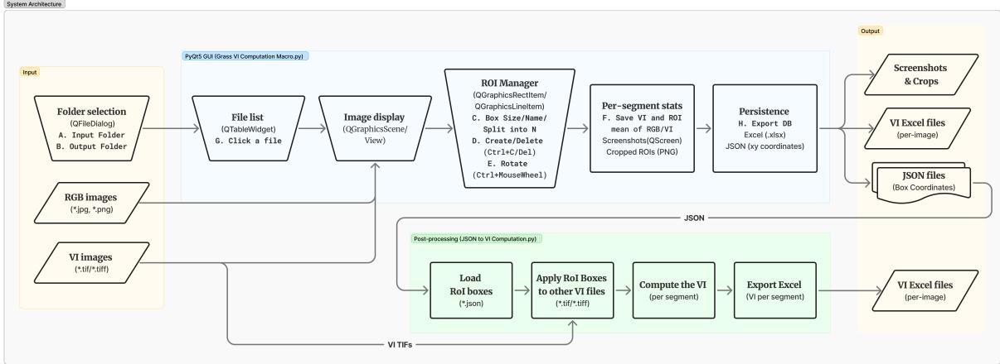
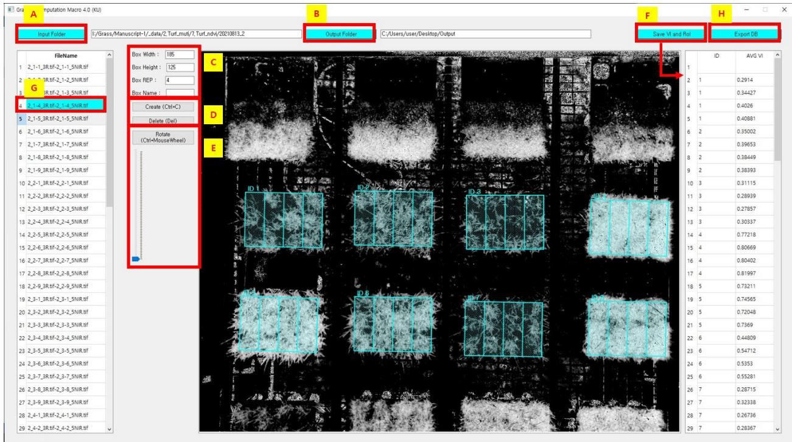
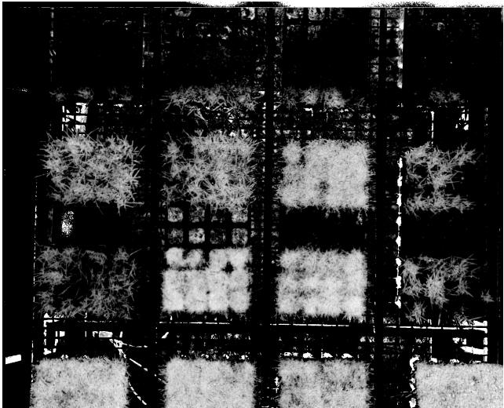
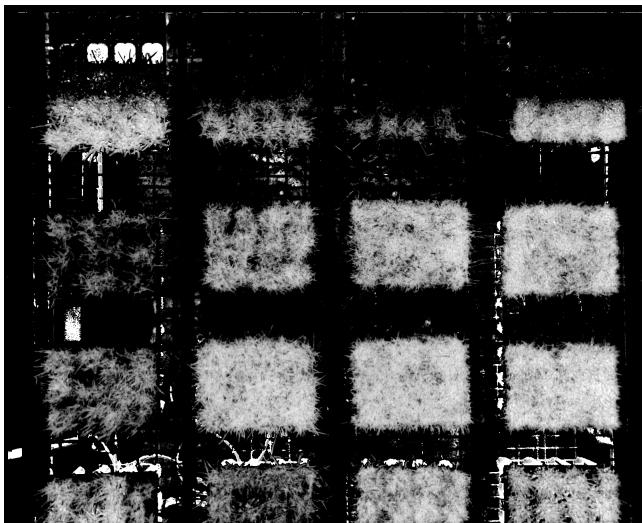
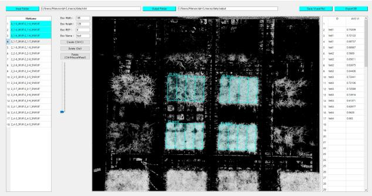
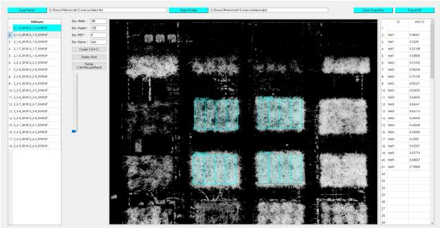
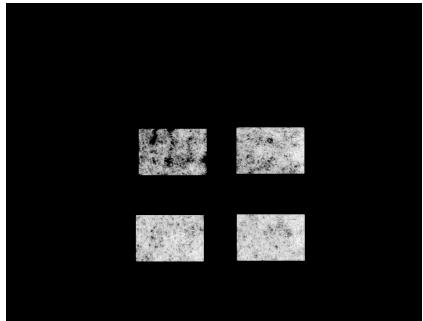
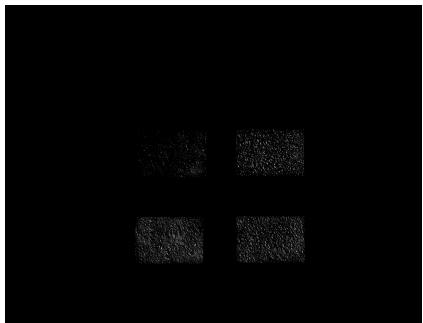
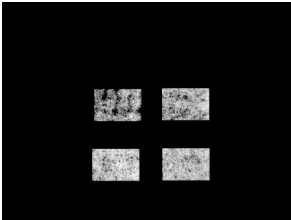

# A Flexible ROI Analysis Tool for Spatially Consistent Vegetation Index Extraction from Turfgrass Imagery

Kibon Ku1, Thai Thanh Tuan2,3,4, and Jinhyun Ahn∗5

1Department of Electrical and Computer Engineering, Iowa State University, Ames,

IA 50011, USA; kibona9@iastate.edu

2Department of Plant Resources and Environment, Jeju National University, Jeju 63243,

Republic of Korea; thaithanhtuan@jejunu.ac.kr

3Multimedia Communications Laboratory, University of Information Technology, Ho Chi

Minh city 70000, Vietnam

4Vietnam National University, Ho Chi Minh city 70000, Vietnam

5Department of Management Information Systems, Jeju National University, Jeju 63243, Republic of Korea; jha@jejunu.ac.kr

## Plain Language Summary

Subject Overview. Researchers capture multispectral imagery of turfgrass to calculate vegetation indices that quantify turfgrass health over time.

Research Purpose. Following the same plots across repeated images is dificult when camera position shifts between sessions, and manually re-marking plots is slow and inconsistent. We developed open-source software in which users draw rotatable boxes over plots, divide them into equal sections, and save their exact image locations.

Key Findings. The saved locations can be reused for every vegetation index calculated from the same image, ensuring that all indices are measured over identical areas.

Key Takeaways. The software supports reproducible plot-level measurement in small experiments where camera position varies, without training in mapping software.

## Abstract

Time-series multispectral imaging is widely used to assess turfgrass condition; however, extracting plot-level vegetation index (VI) values remains labor-intensive when camera positions vary between acquisitions and automated plot tracking is unreliable. We developed an open-source software tool comprising (i) a graphical user interface (GUI) for the interactive placement of orientation-adjustable regions of interest (ROIs) with N-way subdivision to match plot geometry and (ii) a batch-processing script that computes plot-level mean VI values from single-band floating-point rasters and exports measurements and ROI coordinates in JSON format for reuse. Saved coordinates can be reapplied to measure NDVI, NDRE, and SAVI from identical pixel regions within a single time point without re-delineating ROIs. In a demonstration using rail-mounted multispectral turfgrass imagery (18 images), plot-level mean values were extracted in a single session, with coordinates reused directly for NDRE and SAVI rasters. The system reads non-georeferenced pixel-coordinate rasters natively, does not require GIS expertise, and supports reproducible VI quantification where static sensor deployment is impractical.

## Abbreviations

CRS, coordinate reference system; GUI, graphical user interface; GIS, geographic information system; JSON, JavaScript Object Notation; NDRE, normalized diference red edge index; NDVI, normalized diference vegetation index; NIR, near-infrared; ROI, region of interest; SAVI, soil-adjusted vegetation index; UAV, unmanned aerial vehicle; VI, vegetation index.

## 1 Introduction

Multispectral imaging from unmanned aerial vehicles (UAVs) and ground-based platforms is increasingly used to monitor turfgrass canopy condition for both research and agronomic management [Zhang et al., 2019, Ku et al., 2023, McLoughlin et al., 2025]. Vegetation indices (VIs) derived from these images—such as the Normalized Diference Vegetation Index (NDVI; Rouse et al. 1974), the Normalized Diference Red Edge Index (NDRE; Thompson et al. 2019), and the Soil-Adjusted Vegetation Index (SAVI; Huete 1988)—provide quantitative summaries of canopy vigor and stress that can be tracked longitudinally across experimental time points. While the band-arithmetic operations needed to compute individual VIs are straightforward, converting a large time-series collection of VI images into database-ready, plot-level measurements is more demanding: the same plot boundaries must be identified consistently in every image, even when sensor position or viewing geometry shifts between acquisitions.

Geographic information system (GIS) platforms such as QGIS and ArcGIS Pro support raster visualization and region-based zonal statistics and are widely used for plot-level analysis [QGIS Development Team, 2025, Esri Inc., 2022, Wilber et al., 2022]. However, these platforms are designed primarily for georeferenced spatial data with assigned coordinate reference systems (CRS). When VI imagery is not georeferenced—as is common with raw drone outputs and many bench-top multispectral sensors—applying GIS zonal statistics requires intermediate georeferencing or CRSassignment steps that add unnecessary processing complexity. To our knowledge, neither QGIS nor ArcGIS Pro provides a native, interactive operation for defining a rotated parent rectangle aligned with an oblique plot row and subdividing it into N equal-width child regions in a single step. When camera position shifts between time points, users must re-delineate plot boundaries manually for each acquisition, which is both labor-intensive and highly prone to inter-session inconsistency [Lottes and Stachniss, 2020]. If multiple VIs are processed separately, slight positional diferences between independently drawn regions can introduce inter-index spatial mismatches that complicate comparative analysis [Li et al., 2020]. Although sophisticated high-throughput phenotyping pipelines exist [Sun et al., 2023, Gano et al., 2024], they typically require substantial computational infrastructure and GIS expertise, leaving a gap for lightweight, interactive tools suited to small-scale experimental plots in practical field settings.

We therefore developed a Python-based open-source software that standardizes plot-region definition for non-georeferenced VI imagery and automates extraction of plot-level VI summaries. The first component is an interactive GUI, built with PyQt5 and OpenCV [Riverbank Computing Limited, 2021, Bradski, 2000], that supports plot-geometry-aware operations: adjustable rotatable boxes and N-way subdivision aligned to bed geometry. The second component applies saved JSON-encoded ROI coordinates [Bray, 2017] in batch across multiple VI images from the same time point, ensuring pixel-level spatial identity across indices. The objective of this study was to describe the design of this system and to demonstrate, on a rail-mounted multispectral dataset, how it supports plot-level VI extraction from identical ROIs across indices without requiring georeferenced image data.

## 2 Materials and Methods

## 2.1 Study Scenario and Input Data

This study targets time-series turfgrass monitoring scenarios in which repeated UAV or sensor-based acquisitions are collected at multiple time points but imaging geometry is not perfectly reproducible between images or sessions. Images were acquired with a Phantom 4 Multispectral (WM336, DJI) unmanned aerial vehicle (UAV), equipped with six 1/2.9-inch CMOS sensors. The UAV was mounted on a ladder-rail system and moved along the table holding the turfgrass pots. Because the UAV was translated along the rail during capture, the sensor position difered between images. Input data consist of single-band, floating-point TIFF rasters (\*.tif/\*.tiff) representing precomputed vegetation indices—specifically NDVI, NDRE, and SAVI—derived from multispectral imagery prior to use of the proposed system [Rouse et al., 1974, Thompson et al., 2019, Huete, 1988]. Images are non-georeferenced (no CRS metadata assigned) and are referenced in pixel coordinates only. Each time point comprises multiple VI rasters covering the same set of turfgrass experimental plots. As illustrated in Figure 1, the proposed workflow operates on these rasters to (i) define plot-aligned measurement regions and (ii) extract plot-level summary statistics while maintaining consistent spatial sampling across all VIs within a time point.

The demonstration dataset comprised 18 NDVI raster images acquired on the same date. The number of parent regions of interest (ROIs) per image and the subdivision count N are user-defined and depend on the experimental layout. In this demonstration, each parent ROI was subdivided into N = 4 replicates. The JSON-encoded ROI coordinates of each image were subsequently applied to the corresponding NDRE and SAVI rasters from the same acquisition.

## 2.2 System Architecture

The system consists of two Python scripts. As shown in Figure 1, the upper workflow handles interactive region definition via the GUI (Grass VI Computation Macro.py), per-image VI extraction, and generation of screenshots, per-image Excel files, and JSON coordinate files. The lower workflow (JSON to VI Computation.py) loads the saved JSON coordinates and applies them to additional VI rasters from the same time point, producing per-segment VI Excel files without repeated manual ROI placement. The GUI was implemented with PyQt5 (v5.15.4) for interface components and OpenCV (v4.5.2) for image rendering and geometric operations [Riverbank Computing Limited, 2021, Bradski, 2000]. All source code is freely available at

  
Figure 1: Two-part workflow architecture of the proposed ROI analysis software.

## 2.2.1 Software Dependencies and Command-Line Interface

The system requires Python $\geq 3 . 5$ and four open-source packages $\mathrm { ( P y Q t 5 \ge 5 }$ , opencv-contribpython $\geq 4 ,$ XlsxWriter, and pandas), all of which are listed in the repository requirements.txt and installable via pip. The batch post-processing script additionally exposes a command-line interface accepting three flags (-j JSON coordinate file, -i input raster directory, -o output directory), enabling integration into automated phenotyping pipelines without launching the GUI.

## 2.2.2 Region Definition and Parameterization

ROIs are represented as parameterized rotated rectangles. Each ROI is defined by its center coordinates $( x _ { c } , y _ { c } )$ in pixel space, width w (px), height h (px), and in-plane rotation angle θ (degrees, clockwise from the image horizontal axis). The four corner vertices $\mathbf { v } _ { i }$ are obtained by applying a standard 2-D rotation matrix to the axis-aligned corner ofsets and translating to the center:

$$
\mathbf { v } _ { i } = \left[ { \begin{array} { l l } { \cos \theta } & { - \sin \theta } \\ { \sin \theta } & { \cos \theta } \end{array} } \right] \mathbf { u } _ { i } + \left[ { \begin{array} { l } { x _ { c } } \\ { y _ { c } } \end{array} } \right] ,\tag{1}
$$

where $\mathbf { u } _ { i } \in \{ ( \pm w / 2 , \pm h / 2 ) \}$ are the four unrotated corner ofsets. This parameterization allows interactive adjustment of region size and orientation to accommodate varying camera viewpoints without requiring georeferenced input data.

To support plot-scale sampling, the GUI provides an N-way subdivision operation that splits a user-defined parent rectangle into N equal-width child ROIs along the long axis (bed direction). Each child ROI inherits θ and $h ,$ has width $w / N$ , and is centered at

$$
\mathbf { c } _ { k } = \textstyle { \left[ x _ { c } \right] } + \left( k - { \frac { N - 1 } { 2 } } \right) { \frac { w } { N } } \left[ { \cos \theta } \right] , \quad k = 0 , \ldots , N - 1 .\tag{2}
$$

This allows the user to define an entire plot row once and obtain a consistent, geometry-matched set of per-replicate sampling regions in a single operation.

## 2.2.3 Vegetation-Index Value Extraction

The mean VI value for each ROI is calculated by averaging the pixel values contained within the boundaries of the rotated rectangle. The ROI is rasterized as a binary mask in image coordinate space: a pixel is included if its center falls inside the convex polygon defined by the four vertices $\mathbf { v } _ { i } \ ( \mathrm { E q } . \ 1 )$ . Pixels carrying missing or invalid values (IEEE NaN or a designated no-data sentinel, if present in the input raster) are excluded from the mean. VI rasters are read with the cv2.IMREAD UNCHANGED flag to preserve 32-bit or 64-bit floating-point precision. For each processed image, the system outputs a table of ROI identifiers and their corresponding mean VI values.

An optional linear normalization step rescales VI values to [0, 1] by applying $\mathrm { \Delta V I _ { n o r m } = ( V I - }$ $\mathrm { V I } _ { \operatorname* { m i n } } \big ) / ( \mathrm { V I } _ { \operatorname* { m a x } } - \mathrm { V I } _ { \operatorname* { m i n } } )$ , where $\mathrm { V I } _ { \operatorname* { m i n } }$ and $\mathrm { V I } _ { \operatorname* { m a x } }$ are user-specified clip bounds (defaulting to the theoretical index range). This step is optional and does not afect the spatial identity of the sampled regions; users working with raw index values may disable it.

## 2.2.4 Coordinate Export and Reuse Across Indices

Ensuring pixel-level spatial consistency across multiple VIs within a single time point was a primary design objective. After region placement, the GUI serializes each ROI’s identifier, four corner vertices (top-left, top-right, bottom-right, and bottom-left pixel coordinates), and parameterized fields $( x _ { c } , y _ { c } , w , h , \theta )$ to a structured JSON file [Bray, 2017]. The batch post-processing script loads this JSON file and applies the stored coordinates to any VI raster sharing the same pixel dimensions, requiring only the substitution of the input raster path. This mechanism ensures that NDVI, NDRE, SAVI, and any additional VI rasters from the same acquisition are always measured over exactly the same set of pixels, eliminating inter-index spatial discrepancies that would otherwise arise from independently re-drawn regions.

## 2.3 Graphical User Interface

The GUI is shown in Figure 2, with labeled components A–H. The central canvas displays the currently loaded VI raster with overlaid cyan ROI boxes; each parent box is subdivided into N equal-width child ROIs labeled with their identifiers. The AVG VI table on the right panel displays live per-ROI mean values as each image is processed, allowing the operator to verify region placement before saving.

  
Figure 2: Graphical user interface (GUI) of the Grass VI Computation Software (version 4.0). The screenshot is from a separate session and is shown to illustrate the interface.

## 2.3.1 Input and Output Path Configuration

The user selects an input directory containing the target VI rasters via the Input Folder button (Figure 2A), after which all image files in that directory are enumerated in the FileName list (Figure 2G). An output directory for processed results is selected via the Output Folder button (Figure 2B). The software accepts single-band TIFF rasters (\*.tif, \*.tiff) as VI inputs and RGB images (\*.jpg, \*.png) for visual inspection.

## 2.3.2 ROI Parameter Configuration and Interactive Placement

ROI geometry is configured via four fields (Figure 2C): Box Width (w, pixels), Box Height (h, pixels), Box REP (N, the subdivision count), and Box Name (user-defined identifier prefix). Default values are $w = 1 8 5$ px, $h = 1 2 5 \ \mathrm { p x }$ , and N = 4. Each created ROI receives a unique identifier formed as {BoxName}{index} (e.g., test1, test2).

Clicking Create (or pressing Ctrl + C) places a new ROI at the image center; the ROI can then be dragged to the target plot location (Figure 2D). Fine rotation to align the box with an oblique plot row is performed via the Rotate slider or Ctrl + MouseWheel, with a resolution of 1◦ per scroll increment and a maximum range of $\pm 1 8 0 ^ { \circ }$ (Figure 2E). Unwanted ROIs are removed with the Delete button or the Del key, and remaining ROI indices are renumbered automatically.

## 2.3.3 VI Computation, Mask Export, and Data Preview

Once ROIs are positioned on an image, clicking Save VI and ROI (Figure 2F) triggers three outputs: (i) a screenshot of the current canvas with overlaid ROI boxes saved to the output directory for visual audit; (ii) binary mask images containing only the ROI footprints, which can be used for downstream texture analysis or quality control; and (iii) per-ROI mean VI values appended to the in-memory data table. The AVG VI table in the right-hand side of Figure 2 displays live per-ROI mean values, allowing the user to verify region placement before proceeding to the next image. Processed files are highlighted in blue in the file list (Figure 2G) to track progress across a batch.

## 2.3.4 Batch Data Export

Upon completing all images in a session, clicking Export DB (Figure 2H) writes two files to the output directory: (i) an Excel workbook (.xlsx) containing all ROI identifiers and their per-image mean VI values, structured with one column per image file; and (ii) a JSON file encoding the ROI coordinate metadata (identifier, vertices, and parameterized rectangle fields) for all ROIs defined during the session. The JSON file is subsequently used by the batch post-processing script to apply the same ROI coordinates to additional VI rasters from the same time point, as described in Section 2.2.4.

## 3 Results and Discussion

## 3.1 ROI Placement and Subdivision on NDVI Imagery

The GUI was applied to 18 NDVI raster images representing two turfgrass sample groups acquired on the same date. Images were collected using a multispectral sensor mounted on a ladder-rail system pulled along the table on which the turfgrass pots were arranged. Figure 3 shows the raw NDVI rasters (panels (a) and (b)) and the corresponding ROI placements (panels (c) and (d)) for the two sample groups. Because the pots were physically arranged at an oblique angle relative to the sensor path, the ROI boxes required rotation to align precisely with each pot boundary. The rotation and N-way subdivision controls allowed the operator to fit each ROI to the actual pot geometry. Once saved, the JSON coordinate file of each image was applied to its corresponding NDRE and SAVI rasters from the same acquisition without further manual input.

  
(a) Raw NDVI raster, sample group 1.

  
(c) ROI placement on sample group 1.

(b) Raw NDVI raster, sample group 2.  
  
(d) ROI placement on sample group 2.  
Figure 3: Raw NDVI rasters and corresponding ROI placements for two turfgrass sample groups.

Each parent ROI was subdivided into N = 4 equal-width child regions, yielding uniquely identified subregions for each parent ROI (e.g., test1–test4, each with four replicates). Comparing panels (a) and (c) in Figure 3, the oblique orientation of the pots in the raw raster is clearly reflected in the rotated ROI boxes, indicating that the rotation function visually aligns the sampling regions to the physical pot boundaries regardless of pot arrangement. The same behavior is demonstrated for sample group 2 in panels (b) and (d).

The exported mean NDVI values are summarized in Table 1 and ranged from approximately 0.26 to 0.77, indicating that the extracted values can resolve diferences in canopy vigor among turfgrass pots [Ku et al., 2023]. The live AVG VI table in the GUI enabled the operator to identify implausible values arising from non-vegetated border areas and adjust ROI placement before export. Table 1: Mean NDVI values extracted by the GUI for nine of the 18 images, shown for parent ROIs test1–test4.

<table><tr><td>Image filenameª</td><td>test1</td><td>test2</td><td>test3</td><td>test4</td></tr><tr><td>2_1-3_3R.tif</td><td>0.3945</td><td>0.6120</td><td>0.5404</td><td>0.4533</td></tr><tr><td>2_1-4_3R.tif</td><td>0.4915</td><td>0.6056</td><td>0.7092</td><td>0.7363</td></tr><tr><td>2_1-6_3R.tif</td><td>0.7321</td><td>0.5669</td><td>0.7244</td><td>0.6138</td></tr><tr><td>2_1-7_3R.tif</td><td>0.3167</td><td>0.6027</td><td>0.6906</td><td>0.6303</td></tr><tr><td>2_1-9_3R.tif</td><td>0.5947</td><td>0.5556</td><td>0.5226</td><td>0.5182</td></tr><tr><td>2_2-3_3R.tif</td><td>0.2939</td><td>0.4757</td><td>0.3054</td><td>0.4169</td></tr><tr><td>2_2-8_3R.tif</td><td>0.6792</td><td>0.3903</td><td>0.4730</td><td>0.5991</td></tr><tr><td>2_2-9_3R.tif</td><td>0.2712</td><td>0.4228</td><td>0.2630</td><td>0.4556</td></tr><tr><td>2_3-4_3R.tif</td><td>0.3538</td><td>0.4882</td><td>0.7738</td><td>0.2759</td></tr></table>

aPaired NIR sufix omitted for brevity; full filenames are recorded in the exported .xlsx file. Values rounded to four decimal places.

## 3.2 Cross-Index Coordinate Reuse

To demonstrate cross-index spatial consistency, the JSON coordinate file produced from the NDVI session was supplied as input to the batch post-processing script along with the corresponding NDRE and SAVI rasters from the same acquisition. No ROI re-delineation was performed. Figure 4 shows the binary mask images exported for NDVI (A), SAVI (B), and NDRE (C) from the same set of ROI coordinates. The three mask images are pixel-identical by construction, because the same coordinates are applied to all three rasters. This avoids the positional diferences that can arise when polygons are placed independently for each index, which may bias inter-index comparisons, particularly at plot boundaries where index gradients are steep [Li et al., 2020].

  
(a) NDVI mask.

  
(b) SAVI mask.

  
(c) NDRE mask.  
Figure 4: Binary ROI mask images exported for three vegetation indices from the same JSON coordinate file.

The ROI coordinate metadata exported to JSON is summarized in Table 2 for ROI group test1 of the first image. Each row corresponds to one child ROI produced by the N = 4 subdivision; these coordinates are loaded verbatim by the batch script and applied to the NDRE and SAVI rasters without modification, ensuring pixel-level spatial identity across indices.

Table 2: Corner-vertex pixel coordinates of child ROIs for ROI group test1, image 2 1-3 3R.tif, exported to ndvi.json.
<table><tr><td>Child ROI  ${ \bf T L } \left( x , y \right)$ </td><td> $\mathbf { T R } \left( x , y \right)$ </td><td>BR (x, y) BL (x, y)</td></tr><tr><td>rep 1</td><td>(374, 322) (420, 322) (420, 447) (374, 447)</td><td></td></tr><tr><td>rep 2</td><td></td><td>(420, 322) (466, 322) (466, 447) (420, 447)</td></tr><tr><td>rep 3</td><td>(466, 322) (513, 322) (513, 447) (466, 447)</td><td></td></tr><tr><td>rep 4</td><td></td><td>(513, 322) (559, 322) (559, 447) (513, 447)</td></tr></table>

TL, top-left; TR, top-right; BR, bottom-right; BL, bottom-left. Coordinates are integer pixel values (origin at image top-left corner).

## 3.3 Comparison with GIS-Based Workflows

General-purpose GIS platforms such as QGIS and ArcGIS Pro ofer raster zonal statistics functionality and Python-based batch processing (PyQGIS and arcpy, respectively) that can in principle automate plot-level VI extraction [QGIS Development Team, 2025, Esri Inc., 2022, Wilber et al., 2022]. However, three key operational diferences emerge when processing non-georeferenced, time-series multispectral imagery.

First, zonal statistics in QGIS and ArcGIS Pro are typically performed on rasters that carry a valid CRS, so non-georeferenced rasters may need a CRS assigned beforehand. Assigning a CRS to such rasters adds a preparatory step for every image. In contrast, the proposed software tool reads pixel-coordinate rasters directly, without requiring any CRS assignment.

Second, to our knowledge, neither QGIS nor ArcGIS Pro provides a native GUI operation to place a rotated parent rectangle over an oblique plot row and subdivide it into N child regions in a single interactive step. Achieving this in QGIS requires custom scripting (via PyQGIS or the graphical modeler), and resulting layout is not interactively adjustable on the raster canvas in real time.

Third, the JSON-based coordinate reuse mechanism ensures that all VIs measured at a given time point utilize pixel-identical ROIs. In a conventional GIS workflow, each VI raster is typically processed through a separate zonal-statistics operation, requiring the same vector layer to be re-imported or re-linked for each index. While scripting can automate this process, it requires specialized GIS scripting skills that are less common in plant science laboratories.

While GIS platforms remain the appropriate choice for large-scale, georeferenced spatial analysis, the proposed software tool targets a more focused use case: extracting plot-level VI data from non-georeferenced rasters when camera positions vary between sessions and GIS expertise is limited.

## 4 Conclusion

We developed an open-source software tool to address a practical bottleneck in time-series turfgrass phenotyping: the inability to reliably re-identify the same plot regions across multispectral acquisitions when camera position is not reproducible. The interactive GUI enables users to place orientation-adjustable, N-way subdividable ROIs directly on non-georeferenced VI rasters, avoiding the CRS-assignment step that GIS platforms typically require. The JSON-based coordinate export mechanism ensures pixel-level spatial identity across all VI layers derived from the same acquisition, preventing the inter-index spatial discrepancies that can arise when ROIs are drawn independently for each index. A demonstration on rail-mounted multispectral turfgrass imagery confirmed that plot-level VI values could be extracted in a single interactive session, with the same ROI coordinates reapplied to NDRE and SAVI rasters without additional manual input, yielding pixel-identical spatial footprints across all indices.

Five limitations of the current system are noted. First, no quantitative comparison of processing time or accuracy against GIS-based workflows or fully manual delineation was performed; such benchmarking is needed to quantify the eficiency gains. ROI placement also remains a manual step, introducing operator subjectivity and limiting throughput for large image sets; template-matching or feature-based image registration [Li et al., 2020] could in future provide an initial automated ROI estimate for the user to confirm or adjust. The demonstration relied on a single sensor and experimental setup, so validation across other sensors, spatial resolutions, and crop species is needed before broader applicability can be claimed. Additionally, the system currently reports only per-ROI mean VI values; incorporating variance, coeficient of variation, and percentile summaries would extend its utility for canopy heterogeneity analysis. Distributing the software as a self-contained executable would further reduce the installation burden for researchers without Python experience.

Despite these limitations, the proposed system fills a practical gap for plant scientists who require reproducible, spatially consistent VI extraction from non-georeferenced imagery without GIS expertise. The source code is openly available, and the lightweight architecture makes it readily adaptable to other plot-scale phenotyping applications where static sensor deployment is impractical.

## Author Contributions

Kibon Ku: Conceptualization, Data curation, Formal analysis, Investigation, Resources, Software, Validation, Visualization, Writing – Original Draft, Writing – Review & Editing. Thai Thanh Tuan: Data curation, Software, Validation. Jinhyun Ahn: Funding acquisition, Project administration, Supervision, Writing – Review & Editing.

## Acknowledgments

This work was supported by the National Research Foundation of Korea (NRF) grant funded by the Korean government (MSIT) (RS-2024-00348897).

## Conflict of Interest

The authors declare no conflict of interest.

## Data Availability

The source code for both software components Grass VI Computation Macro.py and JSON to VI Computation.py) is openly available at https://github.com/kibonku/ VI-ROI-Computation-Macro. The repository includes a requirements.txt file specifying all Python dependencies (Python ≥ 3.5, PyQt5 ≥ 5, opencv-contrib-python ≥ 4, XlsxWriter, and pandas), enabling environment setup with a single pip install command. The demonstration dataset is available from the corresponding author upon reasonable request.

## ORCID

Kibon Ku: https://orcid.org/0009-0006-5822-7103

Thai Thanh Tuan: https://orcid.org/0000-0003-2748-0529

Jinhyun Ahn: https://orcid.org/0000-0002-2331-004X

## References

Gary Bradski. The OpenCV library (opencv-contrib-python version 4.5.2.54). Dr. Dobb’s Journal of Software Tools, 2000. URL https://opencv.org. Available at https://opencv.org.

Tim Bray. The JavaScript object notation (JSON) data interchange format. RFC 8259, Internet Engineering Task Force (IETF), 2017. URL https://www.rfc-editor.org/rfc/rfc8259.

Esri Inc. ArcGIS Pro, version 3.0. Software. Esri Inc., Redlands, CA, 2022. URL https://www. esri.com/en-us/arcgis/products/arcgis-pro/overview.

B´en´edicte Gano et al. Drone-based imaging sensors, techniques, and applications in plant phenotyping for crop breeding: A comprehensive review. The Plant Phenome Journal, 7(1):e20100, 2024. doi: 10.1002/ppj2.20100.

Alfredo R. Huete. A soil-adjusted vegetation index (SAVI). Remote Sensing of Environment, 25(3): 295–309, 1988. doi: 10.1016/0034-4257(88)90106-X.

Kibon Ku, Saqib Mansoor, Gang-Deuk Han, et al. Identification of new cold tolerant Zoysia grass species using high-resolution RGB and multi-spectral imaging. Scientific Reports, 13:13209, 2023. doi: 10.1038/s41598-023-40128-2.

Bo Li, Xiaming Xu, Lu Zhang, Junwei Han, Chunsong Bian, Guangyao Li, Jianguo Liu, and Lei Jin. Above-ground biomass estimation and yield prediction in potato by using UAV-based RGB and hyperspectral imaging. Field Crops Research, 248:107718, 2020. doi: 10.1016/j.fcr.2019.107718.

Philipp Lottes and Cyrill Stachniss. Easy MPE: Extraction of quality microplot images for UAV-based high-throughput field phenotyping. Plant Phenomics, 2020:2734527, 2020. doi: 10.34133/2020/2734527.

Patrick H. McLoughlin, Marco Schiavon, and Youssef Kaddoura. Evaluating warm-season turfgrass: Multispectral and red–green–blue index comparison. International Turfgrass Society Research Journal, 2025. doi: 10.1002/its2.70022. Published online 14 March 2025.

QGIS Development Team. QGIS geographic information system. Open Source Geospatial Foundation, 2025. URL https://qgis.osgeo.org.

Riverbank Computing Limited. PyQt5: Python bindings for the Qt application framework, version 5.15.4. Software, 2021. URL https://www.riverbankcomputing.com/software/pyqt/.

John W. Rouse, Robert H. Haas, John A. Schell, and Donald W. Deering. Monitoring vegetation systems in the Great Plains with ERTS. Technical Report 19740022614, NASA Goddard Space Flight Center, 1974. URL https://ntrs.nasa.gov/citations/19740022614. Third ERTS Symposium, NASA SP-351, Vol. 1, pp. 309–317.

Shuaishuai Sun, Changying Li, Andrew H. Paterson, Yu Jiang, Rui Xu, Jerry S. Robertson, John L. Snider, and Peng W. Chee. In-field high-throughput phenotyping of cotton plant height by UAV multispectral image. Remote Sensing, 15(4):1110, 2023. doi: 10.3390/rs15041110.

C. N. Thompson, W. X. Guo, B. Sharma, and G. L. Ritchie. Using normalized diference red edge index to assess maturity in cotton. Crop Science, 59(5):2167–2177, 2019. doi: 10.2135/cropsci2019. 04.0227.

Amy L. Wilber, Joby M.P. Czarnecki, and James D. McCurdy. An ArcGIS Pro workflow to extract vegetation indices from aerial imagery of small-plot turfgrass research. Crop Science, 62(1): 503–511, 2022. doi: 10.1002/csc2.20669.

Jingcheng Zhang, Simerjeet Virk, Warren Porter, Kevin Kenworthy, Dennis Sullivan, and Brian Schwartz. Applications of unmanned aerial vehicle based imagery in turfgrass field trials. Frontiers in Plant Science, 10:279, 2019. doi: 10.3389/fpls.2019.00279.