# BEYOND OMNI: A UNIFIED MLLM FOR EMBODIED SENSORY UNDERSTANDING

Shiyun Xiong1,∗ Dongming Wu1,∗ Peiwen Sun1 Bokang Yang2,3 Jiaxu Wang1 Xiaolou Sun4 Mingxing Wen5 Xiangyu Yue1,2†

1MMLab, The Chinese University of Hong Kong 2Shenzhen Loop Area Institute 3The Chinese University of Hong Kong, Shenzhen 4Southeast University 5China Singapore International Joint Research Institute

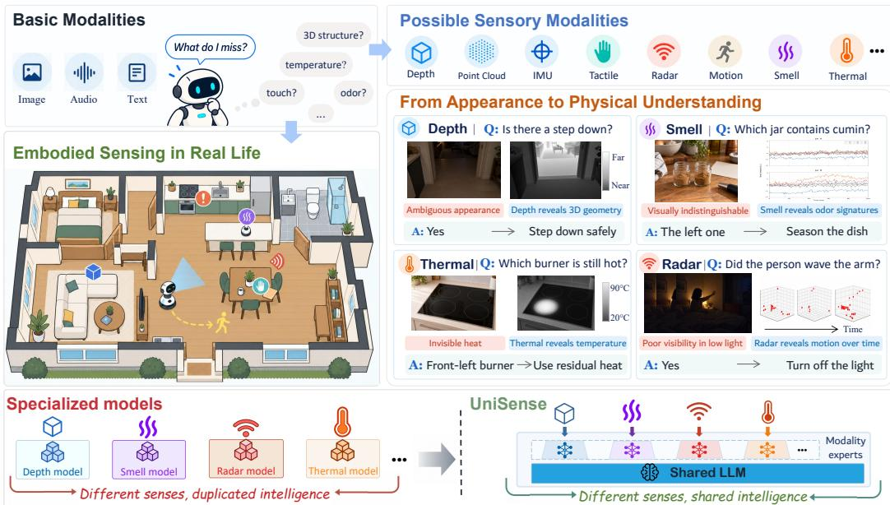  
Figure 1: Different senses, shared intelligence: broad embodied understanding requires diverse physical evidence while drawing on shared knowledge and reasoning. Examples from depth, smell, thermal, and radar show how these signals resolve ambiguities left by basic-modality observations. Rather than duplicating general intelligence across separate sensory models, UniSense combines modality-specific experts with a shared LLM.

## ABSTRACT

Recent embodied systems increasingly build on multimodal large language models (MLLMs) for their pretrained understanding and reasoning capabilities, but their perception of the physical world remains largely limited to basic modalities such as vision and audio. However, broadening MLLMs to more diverse sensory modalities from the physical environment is challenging: their representations are often weakly connected to the MLLM and vary substantially in structure and statistics, while their interpretation still requires shared high-level understanding and reasoning. We therefore propose UniSense, a unified embodied MLLM framework that supports diverse physical sensory modalities within a shared multimodal architecture. UniSense follows a two-stage training process: (i) aligning sensory representations with language to establish a language-accessible interface; and (ii) tuning modality-specific experts within the shared LLM to provide specialized processing for different sensory modalities. To support broad sensory learning, we curate UniSense–1M, a large-scale embodied sensory training

corpus comprising 1M samples across 8 sensory modalities. We further evaluate UniSense on 12 benchmarks spanning depth, point cloud, IMU, tactile, thermal, radar, motion, and smell understanding. Across these heterogeneous sensing tasks, UniSense achieves strong performance and outperforms both generalist and specialized models on most benchmarks, demonstrating the potential of pretrained MLLMs as unified models for embodied sensory understanding.

## 1 INTRODUCTION

The rapid progress of multimodal large language models (MLLMs) is reshaping Embodied AI, driving a growing line of generalist embodied models that harness MLLMs’ multimodal understanding and reasoning capabilities for physical-world perception and interaction. Representative systems such as PaLM-E (Driess et al., 2023), RoboBrain (Ji et al., 2025; Cao et al., 2025a), RynnBrain (Dang et al., 2026) and Vesta (Bjorck et al., 2026) demonstrate the potential of this paradigm. However, while modern MLLMs have developed strong capabilities across modalities such as images, video, and audio, their support for diverse physical signals remains limited.

The real world contains rich information that can be captured by embodied sensory modalities, such as depth, thermal, tactile, and radar. These modalities provide complementary physical cues about geometry, contact, temperature, and dynamics beyond basic modality inputs. As Figure 1 illustrates, such cues can clarify physical states that remain ambiguous in basic observations. Accordingly, recent work has explored three main strategies for incorporating sensory modalities into language-centric models. (i) Specialists develop dedicated interfaces or adaptation mechanisms for individual sensory modalities (Li et al., 2025d; Lai et al., 2026; Asif Imran Shouborno et al., 2025). (ii) Binders (Girdhar et al., 2023; Zhu et al., 2024) use image or language representations as semantic anchors to align different modalities within a shared representation space. (iii) Generalists (Han et al., 2024; Moon et al., 2024; Wu et al., 2024; Zhang et al., 2025b) integrate multiple modalities through modality-specific encoders, projectors, or routing modules. Despite these differences, most sensory modality adaptation is still concentrated at the modality interface, before entering the LLM. A more detailed discussion of related work is provided in Appendix §A.

This emphasis largely reflects the maturity gap in modality interfaces between embodied sensory and widely studied basic modalities. On the one hand, the latter benefit from well-established modalityspecific encoders, web-scale multimodal data, and widely adopted alignment recipes (Radford et al., 2021; Chu et al., 2024; Tschannen et al., 2025), whereas many embodied sensory modalities still lack comparable resources, making sensory–language grounding a primary challenge. On the other hand, despite heterogeneous low-level representations, these modalities ultimately rely on shared high-level understanding and reasoning, motivating a unified LLM backbone. For basic modalities, mature interfaces have further enabled omni-modal models to move beyond and introduce modality-dependent computation within the LLM (Li et al., 2025c; Inclusion AI, 2025; Shukor et al., 2025). For embodied sensory modalities, such LLM-side specialization remains limited: existing methods largely share the same parameters across representations with substantially different structures, statistics, and spatiotemporal characteristics. Prior studies suggest that such parameter sharing across modalities or tasks can introduce conflicting learning signals (Chen et al., 2024c; Liang et al., 2025; Hao et al., 2026). We therefore view unified embodied sensory modeling across two levels: semantic grounding at the modality–language interface, followed by computational specialization within the shared LLM.

In this paper, we present UniSense, a unified MLLM for embodied sensory understanding. UniSense supports diverse embodied sensory modalities through lightweight modality tokenizers, a unified encoder, modality projectors, and a shared LLM. Building on this architecture, UniSense follows a two-stage training process to address the above challenges. (i) Aligning different sensory representations with language through caption supervision, making physical sensory information accessible to the LLM, and then (ii) tuning modality-specific experts within the LLM, allowing different sensory modalities to specialize beyond the shared backbone computation.

To support UniSense, we develop a data construction pipeline that applies modality-specific preprocessing to heterogeneous sensory observations and pairs the processed inputs with modality-aware captions and instruction–response pairs. This results in a large-scale training corpus of 1M samples spanning 8 embodied sensory modalities, alongside general multimodal data. We further evaluate

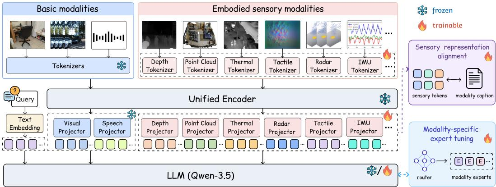  
Figure 2: The architecture of UniSense. UniSense unifies basic and embodied sensory modalities in a shared framework. Basic modalities retain pretrained pathways, while sensory inputs pass through modality-specific tokenizers, a unified encoder, and modality-specific projectors before entering the LLM. Training proceeds in two stages: (1) modality captions supervise sensory–language alignment; (2) modality-specific experts are then tuned within the LLM.

UniSense on 12 benchmarks covering depth, point cloud, IMU, tactile, thermal, radar, motion, and smell. Experiments show that UniSense outperforms general multimodal and specialized models on most benchmarks. Our contributions are summarized as follows:

• We present UniSense, a unified MLLM that supports text, image, video, audio, and diverse physical sensing modalities within a shared multimodal architecture.

• We develop a two-stage training strategy that aligns and specializes sensory processing, enabling language-accessible sensory representations and modality-specific specialization within a shared LLM.

• We curate UniSense–1M, a multimodal training corpus spanning 8 embodied sensory modalities, and evaluate UniSense on 12 benchmarks for embodied sensory understanding, demonstrating its effectiveness across heterogeneous sensing tasks.

## 2 METHOD

## 2.1 PROBLEM DEFINITION

We consider a unified embodied sensory understanding task, where a multimodal LLM supports heterogeneous modalities under a shared framework. Let M denote the set of supported non-text modalities, including basic modalities (image, video, and audio), and embodied sensory modalities $\mathcal { M } _ { \mathrm { s } } \subseteq \mathcal { M }$ . In this work, Ms comprises depth, point cloud, IMU, tactile, thermal, radar, motion, and smell. For modality m $\in \mathcal { M }$ , we denote its input by $\mathbf { x } ^ { m }$ . The language instruction provided to the model is denoted by q.

Our goal is to incorporate embodied sensory modalities in $\mathcal { M } _ { \mathrm { s } }$ into a MLLM while considering both how their representations are grounded in the model’s language space and how they are subsequently processed within the shared backbone.

## 2.2 MODEL ARCHITECTURE

Figure 2 illustrates the architecture of UniSense, which consists of modality-specific tokenizers, a unified encoder, modality-specific projectors, and a shared LLM. We build UniSense on pretrained Qwen3.5 models (Qwen, 2026) at 2B and 9B scales, with preliminary multimodal initialization on image and audio data but no additional video-specific training (see Appendix §C.3 and §C.6).

For an embodied sensory modality $s \in \mathcal { M } _ { \mathrm { s } } .$ , the input xs is first transformed into encoder-compatible tokens by a tokenizer $\mathcal { T } _ { s }$ . We adopt two tokenization pathways: pixel-aligned modalities (e.g., depth, thermal, and tactile) reuse the standard visual patch tokenizer, whereas non-pixel modalities (e.g., point cloud, IMU, and radar) employ dedicated modality-specific tokenizers. The resulting tokens are then processed by a unified encoder $\mathcal { E }$ and mapped to the hidden space of the language model through a modality-specific projector $\mathcal { P } _ { s }$ :

$$
\begin{array} { r } { \mathbf Z ^ { s } = \mathcal { P } _ { s } ( \mathcal { E } ( \mathcal { T } _ { s } ( \mathbf x ^ { s } ) ) ) , } \end{array}\tag{1}
$$

where $\mathbf { Z } ^ { s }$ denotes the resulting sensory representation. Image, video, and audio are processed through their corresponding input pathways. Accordingly, we use $\mathbf { Z } ^ { m }$ to denote the resulting representation of any non-text modality $m \in \mathcal { M }$ provided to the LLM. Detailed tokenizer and projector designs are provided in Appendix §C.2.ali nent

The resulting modality representations $\{ { \bf Z } ^ { m } \}$ are combined with the language instruction q and processed by the LLM to generate the response. Although these interfaces make heterogeneous inputs compatible with the pretrained backbone, they do not ensure effective language grounding orsensory tokens odality caption appropriate processing. We address these two aspects through the two training stages described in §2.3 and §2.4.

## 2.3 SENSORY REPRESENTATION ALIGNMENT

Unlike basic modalities, which have been well studied, embodied sensory modalities lack comparably mature language-aligned representations, making their physical semantics difficult to ground in the target MLLM. Prior work aligns heterogeneous modalities in shared embed ding spaces (Girdhar et al., 2023; Zhu et al., 2024), while generative–contrastive frameworks further show that generative supervision and contrastive learning provide complementary semantic signals (Yu et al., 2022; Xiao et al., 2025). However, such alignment is typically defined outside the representation structure of the target MLLM that ultimately consumes these modality features. Recent MLLM studies suggest that grounding modality representations toward the pretrained linguistic structure of the target LLM can improve their integration (Masry et al., 2025; Chen et al., 2026).

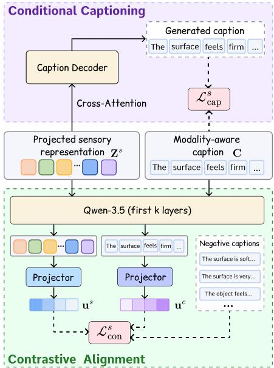

To align embodied sensory representations with language, we construct a modality-aware caption for each sensory input that explicitly verbalizes its physical information. We use each caption to supervise sensory representations in two complementary ways: conditional captioning encourages sensory representations to retain physical semantics recoverable through the target MLLM’s native language interface, while contrastive alignment uses representations induced by the target MLLM itself to establish explicit sensory–language correspondence. The overall design is illustrated in Fig. 3, with examples of modality-aware captions provided in Appendix §E.

Figure 3: Overview of the sensory representation alignment stage. Conditional captioning provides language-level supervision by decoding the paired caption from sensory representations, while contrastive alignment aligns sensory and caption representations using the first k LLM layers.

For a sensory modality $s \in \mathcal { M } _ { \mathrm { s } }$ , let $\mathbf { Z } ^ { s } \in \mathbb { R } ^ { N _ { s } \times d }$ denote its projected sensory representation and $\mathbf { C } = \left( c _ { 1 } , \ldots , c _ { L } \right)$ the corresponding modality-aware caption.

Conditional Captioning. We impose language-level supervision on sensory representations by predicting their paired modality-aware captions. Given the projected sensory tokens $\mathbf { Z } ^ { s }$ , a modalityspecific caption decoder Cs predicts each token of C using causal self-attention over preceding caption tokens and cross-attention to $\mathbf { Z } ^ { s }$ . The decoder reuses the token embeddings and vocabulary projection of the target LLM, encouraging $\mathbf { Z } ^ { s }$ to preserve physical semantics that can be recovered through the model’s native language interface. We optimize this branch with the standard autoregressive token-level cross-entropy loss, denoted by $\mathcal { L } _ { \mathrm { c a p } }$

Contrastive Alignment. We further establish representation-level correspondence between sensory inputs and their captions using representations induced by the target LLM. Specifically, $\mathbf { Z } ^ { s }$ and the embedded caption Emb(C) are independently processed by the same first k frozen LLM layers, followed by modality-specific aggregation and separate lightweight projection heads:

$$
\mathbf { u } ^ { s } = \mathrm { N o r m } ( \phi _ { s } ( \rho _ { s } ( Q _ { 1 : k } ( \mathbf { Z } ^ { s } ) ) ) ) , \qquad \mathbf { u } ^ { c } = \mathrm { N o r m } ( \phi _ { c } ( \rho _ { c } ( Q _ { 1 : k } ( \mathrm { E m b } ( \mathbf { C } ) ) ) ) ) .\tag{2}
$$

Here, $\rho _ { s }$ and $\rho _ { c }$ denote the sensory and caption aggregation operations, respectively, $\phi _ { s }$ and $\phi _ { c }$ are separate projection heads, and $\operatorname { N o r m } ( { \mathord { \cdot } } )$ denotes $\ell _ { 2 }$ normalization. For a batch of $B$ sensory– caption pairs, representations from the same sensory instance form a positive pair, while those from different sensory instances serve as in-batch negatives. We optimize the resulting representations with a standard symmetric InfoNCE loss, denoted by ${ \mathcal { L } } _ { \mathrm { c o n } }$

## 2.4 MODALITY-SPECIFIC EXPERT TUNING

The first training stage grounds embodied sensory representations in the language space of the target MLLM. However, these heterogeneous representations are still ption Deoderprocessed by the same decoder parameters, which may introduce interference across modalities or tasks (Shen rossttentionet al., 2024; Liang et al., 2025). While recent multimodal models introduce modality- or task-specific computation within the backbone (Li et al., 2025c; Inclusion AI, 2025), embodied sensory modeling remains largely focused on modality-side adaptation (Han et al., 2024; Li et al., 2025d; Zhou & Yang, 2026).

en irst k laersWe therefore introduce modality-specific capacity within the shared LLM, while keeping self-attention ... eatie aptions shared and specializing only the feed-forward sublayers. As shown in Fig. 4, the base FFN remains as the etor roetorshared transformation, with modality-specific residual experts providing specialized processing.

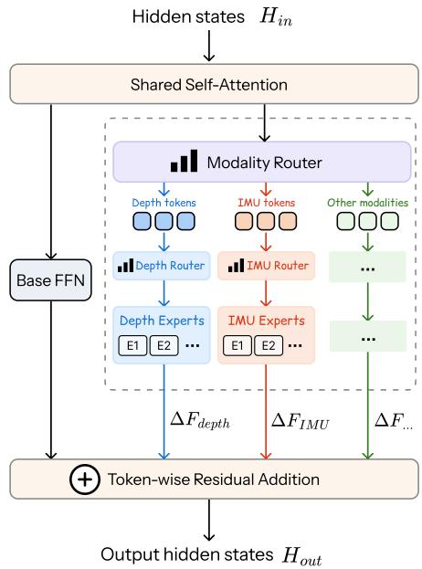

Modality-Aware Routing. We organize sensoryspecific computation through two levels of routing. For each sensory modality $s ,$ we maintain a pool of E lightweight residual experts $\{ \mathcal { R } _ { s , i } \} _ { i = 1 } ^ { E }$ A modality router first directs each sensory token to its corresponding expert pool, after which a token-wise router $g _ { s }$ further determines token-dependent expert contributions, This allows tokens from the same modality to receive different residual transformations.

Figure 4: Modality-specific expert computation within a Transformer layer. After shared self-attention, a modality router directs sensory tokens to modality-specific expert pools, where token-wise routers produce residual transformations that are added to the shared base FFN output.

Residual Expert Adaptation. For a hidden state h as-

sociated with sensory modality s, the modality-specific residual transformation is defined as:

$$
\Delta \mathcal { F } _ { s } ( \mathbf { h } ) = \frac { \alpha } { r } \sum _ { i = 1 } ^ { E } w _ { s , i } ( \mathbf { h } ) \mathcal { R } _ { s , i } ( \mathbf { h } ) , \qquad \mathbf { w } _ { s } = \mathrm { s o f t m a x } ( g _ { s } ( \mathbf { h } ) ) ,\tag{3}
$$

where $\mathbf { w } _ { s } = [ w _ { s , 1 } , \dots , w _ { s , E } ]$ denotes the normalized expert weights, r is the low-rank dimension, and α controls the residual scale. Each $\mathcal { R } _ { s , i }$ follows the SwiGLU-based FFN structure of the LLM backbone (Qwen, 2026), with a low-rank parameterization.

The resulting residual is then added token-wise to the output of the shared pretrained FFN:

$$
\mathbf { h } ^ { \prime } = \mathcal { F } _ { \mathrm { b a s e } } ( \mathbf { h } ) + \Delta \mathcal { F } _ { s } ( \mathbf { h } ) ,\tag{4}
$$

where $\mathcal { F } _ { \mathrm { b a s e } }$ denotes the frozen FFN shared across modalities. Thus, each token receives an inputdependent sensory-specific correction while retaining the shared pretrained transformation.

The residual expert modules are introduced only in selected full-attention Transformer layers, while the remaining layers stay unchanged. We further use balance and diversity regularization to stabilize expert utilization and discourage redundant residual transformations. More details are provided in Appendix §C.5.

Table 1: Evaluation on General Multimodal benchmarks. (a) Image-text results on TextVQA, MME, and MMBench. (b) Audio-image-text results on the image-audio variants of TextVQA, DocVQA, and ChartQA. (c) Video-text results on Video-MME and EgoSchema. Video-MME results are reported without subtitles. “–“ denotes unavailable results. Due to space limitations, the citations of all benchmarks and baseline models reported in the main-text tables are provided in Appendix §B.1.  
(a) Image-text benchmarks.
<table><tr><td>Model</td><td>TextVQAval MME MMBench</td><td></td><td></td></tr><tr><td colspan="4">General MLLMs</td></tr><tr><td>Qwen3-VL-8B-Instruct</td><td></td><td>2243</td><td>84.5</td></tr><tr><td>GLM-4.5V</td><td>72.0</td><td>2423.8</td><td>88.2</td></tr><tr><td>GLM-4.1V-9B</td><td>79.6</td><td>2445.8</td><td>85.8</td></tr><tr><td>Kimi-VL-A3B-2506</td><td>77.7</td><td>2352.7</td><td>84.4</td></tr><tr><td>InternVL3.5-8B</td><td>78.2</td><td>2380.6</td><td>79.5</td></tr><tr><td>InternVL3.5-30B-A3B</td><td>80.5</td><td>2461.9</td><td>84.8</td></tr><tr><td colspan="4">UniSense</td></tr><tr><td>UniSense-2B</td><td>79.5</td><td>2247.9</td><td>79.6</td></tr><tr><td>UniSense-9B</td><td>83.6</td><td>2466.0</td><td>87.5</td></tr></table>

(b) Audio-image-text benchmarks.
<table><tr><td>Model</td><td colspan="3">TextVQAs DocVQAs ChartQAs</td></tr><tr><td colspan="4">General MLLMs</td></tr><tr><td>Intern-Omni</td><td>69.1</td><td>79.9</td><td>56.0</td></tr><tr><td>Qwen3-Omni-30B-A3B</td><td>70.8</td><td>76.4</td><td></td></tr><tr><td>Lyra-Mini-3B</td><td>73.4</td><td>74.8</td><td>40.7</td></tr><tr><td>Lyra-Base-9B</td><td>80.0</td><td>85.5</td><td>61.0</td></tr><tr><td colspan="4">UniSense</td></tr><tr><td>UniSense-2B</td><td>73.8</td><td>80.0</td><td>53.8</td></tr><tr><td>UniSense-9B</td><td>80.4</td><td>87.2</td><td>68.0</td></tr></table>

(c) Video-text benchmarks.
<table><tr><td>Model</td><td>Video-MME EgoSchema</td></tr><tr><td colspan="2">General MLLMs 64.2</td></tr><tr><td>InternVL2.5-7B</td><td>51.5</td></tr><tr><td>InternVL3.5-2B</td><td>50.8</td></tr><tr><td>InternVideo2.5-7B</td><td>63.9</td></tr><tr><td>Lyra-Base-9B</td><td>63.2</td></tr><tr><td>Qwen2-VL-2B</td><td>54.9</td></tr><tr><td>Qwen2.5-VL-7B</td><td>65.0</td></tr><tr><td colspan="2">UniSense</td></tr><tr><td>UniSense-2B</td><td>59.4</td></tr><tr><td>UniSense-9B</td><td>49.8 66.4</td></tr></table>

## 2.5 TRAINING

After the preliminary image–audio initialization described in §2.2, we train UniSense on a uni fied collection of embodied sensory datasets spanning 8 sensory modalities. Each sensory sample is paired with a modality-aware caption used for sensory representation alignment. Detailed data sources and sampling strategies are provided in §B.2.

Training proceeds in two stages. The first aligns sensory representations with language, while the second tunes modality-specific experts within the shared LLM.

Alignment Stage. We freeze the pretrained LLM backbone and optimize the newly introduced sensory tokenizers, projectors, caption decoders, and contrastive projection heads. Given a sensory input and its instruction, $\mathcal { L } _ { \mathrm { L M } }$ is the autoregressive cross-entropy loss over the target response tokens. The paired modality-aware caption further provides the captioning objective $\mathcal { L } _ { \mathrm { c a p } }$ and the contrastive objective ${ \mathcal { L } } _ { \mathrm { c o n } }$ introduced in §2.3. The overall objective is:

$$
\begin{array} { r } { \mathcal { L } ^ { ( 1 ) } = \mathcal { L } _ { \mathrm { L M } } + \lambda _ { \mathrm { a l i g n } } \left( \mathcal { L } _ { \mathrm { c a p } } + \lambda _ { \mathrm { c o n } } \mathcal { L } _ { \mathrm { c o n } } \right) , } \end{array}\tag{5}
$$

where $\lambda _ { \mathrm { a l i g n } }$ controls the overall contribution of the alignment objectives, and $\lambda _ { \mathrm { { c o n } } }$ determines the relative weight of the contrastive objective.

Tuning Stage. The pretrained LLM backbone remains frozen, while we optimize the sensory modules, modality routers, and residual experts. We retain the language-modeling and captioning objectives, but disable the contrastive branch to permit task-driven specialization. We further apply the load-balancing loss $\mathcal { L } _ { \mathrm { b a l } }$ and expert-diversity loss ${ \mathcal { L } } _ { \mathrm { d i v } }$ to regularize expert learning. The secondstage objective is:

$$
\mathcal { L } ^ { ( 2 ) } = \mathcal { L } _ { \mathrm { L M } } + \lambda _ { \mathrm { a l i g n } } \mathcal { L } _ { \mathrm { c a p } } + \lambda _ { \mathrm { b a l } } \mathcal { L } _ { \mathrm { b a l } } + \lambda _ { \mathrm { d i v } } \mathcal { L } _ { \mathrm { d i v } } ,\tag{6}
$$

where $\lambda _ { \mathrm { a l i g n } } , \lambda _ { \mathrm { b a l } }$ , and $\lambda _ { \mathrm { d i v } }$ weight the captioning, load-balancing, and expert-diversity terms, respectively. Detailed settings are provided in Appendix §C.6.

## 3 EXPERIMENTS

## 3.1 EXPERIMENTAL SETUP

Due to space limitations, we provide additional experimental details in the appendix:

• Datasets and benchmarks. Details of UniSense–1M, including data sources and preparation, together with benchmark splits, evaluation protocols, and metrics, are provided in Appendix §B.2.

• Implementation and training. Model configurations, optimization settings, freezing schedules, and training hyperparameters are provided in Appendix §C.

Table 2: Evaluation on Depth-Text benchmarks, including SpatialBench and RoboSpatial-Home. SpatialBench has Position, Existence, Counting, Reaching, and Size subtask. 4-Task Agg. is the sample-weighted aggregate over all subtasks except Reaching. UniSense is evaluated zero-shot on RoboSpatial-Home.
<table><tr><td rowspan="2">Pos.</td><td colspan="6"></td><td rowspan="2">RoboSpatial-Home Config.</td></tr><tr><td></td><td>Exist.</td><td>SpatialBench Count.</td><td>Reach.</td><td>Size</td><td>4-Task Agg.</td><td>Agg.</td></tr><tr><td colspan="10">Closed-Source Models</td></tr><tr><td>GPT-40</td><td>61.8</td><td>90.0</td><td>85.2</td><td>51.7</td><td>40.0</td><td>68.1</td><td>65.3</td><td>77.2</td></tr><tr><td>Claude-3.5</td><td>55.9</td><td>65.0</td><td>72.2</td><td></td><td>26.7</td><td>55.1</td><td></td><td></td></tr><tr><td colspan="10">General MLLMs</td></tr><tr><td>LLaVA-1.5-7B</td><td>44.1</td><td>45.0</td><td>82.8</td><td></td><td>30.0</td><td>49.5</td><td></td><td></td></tr><tr><td>LLaVA-NeXT-7B</td><td>47.1</td><td>75.0</td><td>84.0</td><td></td><td>20.0</td><td>55.1</td><td></td><td>68.3</td></tr><tr><td>Qwen2-VL-7B</td><td></td><td></td><td></td><td></td><td></td><td></td><td></td><td>76.4</td></tr><tr><td>Qwen2.5-VL-3B</td><td>55.9</td><td>80.0</td><td>76.4</td><td></td><td>25.0</td><td>58.8</td><td></td><td></td></tr><tr><td>Qwen2.5-VL-7B</td><td>61.8</td><td>80.0</td><td>87.1</td><td></td><td>30.0</td><td>64.3</td><td></td><td>78.1</td></tr><tr><td colspan="10">Spatial-Specialized Models</td></tr><tr><td>SpatialVLM-3B Bunny-Phi2-3B</td><td>52.9</td><td>80.0</td><td>77.1</td><td></td><td>28.3</td><td>58.6</td><td></td><td></td></tr><tr><td></td><td>50.0</td><td>75.0</td><td>89.4</td><td>51.7</td><td>26.7</td><td>58.7</td><td>57.5 62.9</td><td></td></tr><tr><td>SpatialBot-Phi2-3B Bunny-Llama3-8B</td><td>61.8</td><td>80.0 75.0</td><td>91.7</td><td>55.0</td><td>26.7 23.3</td><td>64.6 58.5</td><td>55.0</td><td></td></tr><tr><td>SpatialBot-Llama3-8B</td><td>50.0 53.0</td><td>75.0</td><td>91.7 90.4</td><td>38.3</td><td>20.0</td><td>58.6</td><td>56.2</td><td></td></tr><tr><td>SpaceThinker-3B</td><td>50.0</td><td>82.5</td><td>70.0</td><td>45.0 57.5</td><td>22.5</td><td>55.3</td><td>56.5</td><td></td></tr><tr><td></td><td>67.7</td><td>92.5</td><td>75.0</td><td>55.0</td><td>37.5</td><td>68.1</td><td>65.8</td><td></td></tr><tr><td>SpaceOm SSR-7B</td><td>64.7</td><td>85.0</td><td>90.2</td><td></td><td>28.3</td><td>66.7</td><td></td><td></td></tr><tr><td>VPT</td><td></td><td></td><td></td><td></td><td></td><td></td><td></td><td>77.2</td></tr><tr><td>SpatialVTS</td><td>一</td><td>一</td><td></td><td>一</td><td>一</td><td>一</td><td></td><td>70.7</td></tr><tr><td></td><td></td><td></td><td></td><td></td><td></td><td></td><td></td><td></td></tr><tr><td colspan="9">UniSense 58.3</td></tr><tr><td>UniSense-2B UniSense-9B</td><td>67.7 76.5</td><td>80.0 80.0</td><td>89.2 91.1</td><td>58.3</td><td>31.7 28.3</td><td>67.2 70.1</td><td>65.5 68.0</td><td>73.2 80.5</td></tr><tr><td></td><td></td><td></td><td></td><td></td><td></td><td></td><td></td><td></td></tr></table>

Table 3: Evaluation on the Point Cloud-Text Bench- Table 4: Evaluation on the Tactilemark on ScanQA. Validation results with point-cloud Text Benchmark using Octopi. Results (xyz), image (img), and multi-view image (MV-Img) in- are reported in percentage (%) for three puts. tasks.
<table><tr><td>Model</td><td>Input</td><td>CIDEr</td><td>MET.</td><td>R-L</td><td>B-1</td><td>B-4</td></tr><tr><td colspan="7">General MLLMs</td></tr><tr><td>InternVL2-8B</td><td>img</td><td>62.5</td><td>14.5</td><td>34.3</td><td></td><td>3.3</td></tr><tr><td>Qwen2-VL-7B</td><td>img</td><td>53.9</td><td>11.4</td><td>29.3</td><td>27.8</td><td>3.0</td></tr><tr><td>LLaVA-Video</td><td>MV-Img</td><td>88.7</td><td>17.7</td><td>44.6</td><td></td><td>3.1</td></tr><tr><td colspan="7">3D-Specialized Models</td></tr><tr><td>ScanQA</td><td>xyz</td><td>64.9</td><td>13.1</td><td>33.3</td><td>30.2</td><td>10.1</td></tr><tr><td>LL3DA</td><td>xyz</td><td>76.8</td><td>15.9</td><td>37.3</td><td></td><td>13.5</td></tr><tr><td>Scene-LLM</td><td>xyz</td><td>80.0</td><td>16.6</td><td>40.0</td><td></td><td>12.0</td></tr><tr><td>ChatScene</td><td>xyz+img</td><td>87.7</td><td>18.0</td><td>41.6</td><td>43.2</td><td>14.3</td></tr><tr><td>GPT4Scene</td><td>MV-Img</td><td>90.9</td><td>17.7</td><td>43.6</td><td>43.4</td><td>14.6</td></tr><tr><td>ViewMind3D</td><td>MV-Img</td><td>73.4</td><td>15.3</td><td>37.6</td><td>35.8</td><td></td></tr><tr><td colspan="7">UniSense</td></tr><tr><td>UniSense-2B</td><td>xyz</td><td>65.1</td><td>21.1</td><td>34.0</td><td>36.4</td><td>11.0</td></tr><tr><td>UniSense-2B</td><td>xyz+img</td><td>90.0</td><td>27.5</td><td>44.6</td><td>44.3</td><td>12.7</td></tr><tr><td>UniSense-9B</td><td>xyz</td><td>74.3</td><td>23.4</td><td>36.9</td><td>39.2</td><td>12.4</td></tr><tr><td>UniSense-9B</td><td>xyz+img</td><td>99.6</td><td>30.2</td><td>47.5</td><td>48.3</td><td>15.5</td></tr></table>

<table><tr><td>Model</td><td>PC</td><td>PSS</td><td>POM</td></tr><tr><td colspan="4">Closed-Source Models</td></tr><tr><td>GPT-40 Gemini-2.5-Pro</td><td>30.9</td><td>38.1</td><td>22.6</td></tr><tr><td></td><td>26.7</td><td>25.1</td><td>23.5</td></tr><tr><td colspan="4">General MLLMs</td></tr><tr><td>Qwen2.5-VL-7B</td><td>21.5</td><td>23.1</td><td>19.9</td></tr><tr><td>LLaVA-OneVision-7B</td><td>35.4</td><td>28.4</td><td>29.1</td></tr><tr><td>TokenFlow-7B</td><td>38.1</td><td>32.6</td><td>29.5</td></tr><tr><td colspan="4">Tactile-Specialized Models</td></tr><tr><td>Octopi-7B</td><td>45.5</td><td>48.0</td><td>22.2</td></tr><tr><td>UniTac-3B UniTac-7B</td><td>55.0</td><td>58.9</td><td>42.1</td></tr><tr><td></td><td>57.3</td><td>59.2</td><td>64.6</td></tr><tr><td colspan="4">UniSense</td></tr><tr><td>UniSense-2B</td><td>58.4</td><td>72.8</td><td>45.5</td></tr><tr><td>UniSense-9B</td><td>61.9</td><td>73.4</td><td>53.3</td></tr></table>

## 3.2 MAIN RESULTS

In this section, we evaluate UniSense on general multimodal tasks and benchmarks spanning 8 embodied sensory modalities. These evaluations examine both its general multimodal capability and its ability to handle heterogeneous physical sensing signals. Unless otherwise specified, higher scores indicate better performance across all reported metrics.

General Multimodal Understanding. UniSense-9B achieves 83.6 on TextVQA (Singh et al., 2019) and 2466.0 on MME (Fu et al., 2025a), leading the compared models on both benchmarks . It also performs strongly on speech-conditioned image and video understanding (Table 1), indicating that sensory training preserves its basic-modality capabilities.

Depth and Point Cloud Understanding. Tables 2 and 3 evaluate spatial and 3D understanding. UniSense-9B achieves 70.1 on the SpatialBench (Cai et al., 2025) 4-task aggregate and 80.5 accuracy on RoboSpatial-Home (Song et al., 2025) without benchmark-specific training, surpassing both general-purpose MLLMs and spatial-specialized models. On ScanQA (Azuma et al., 2022) , UniSense-9B achieves 74.3 CIDEr using point clouds alone, which increases to 99.6 when combined with images, outperforming all compared baselines. This improvement shows that newly introduced sensory inputs can be naturally composed with basic modality observations to exploit complementary geometric and appearance information.

Table 5: Evaluation on IMU-Text Benchmarks, including HHAR, MotionSense, Shoaib, and UCI. Each entry reports F1 / Precision (%).
<table><tr><td>Model</td><td>HHAR</td><td>MotionSense</td><td>Shoaib</td><td>UCI</td></tr><tr><td colspan="5">Closed-Source Models</td></tr><tr><td>GPT-40</td><td>7.0 / 14.0</td><td>8.0 / 26.0</td><td></td><td>14.0 / 35.0 4.0 / 16.0</td></tr><tr><td colspan="5">General LLMs</td></tr><tr><td>Vicuna-7B</td><td>5.0 / 12.0</td><td>9.0 / 15.0</td><td>8.0 / 11.0</td><td>4.0 / 25.0</td></tr><tr><td colspan="5">IMU-Specialized Models</td></tr><tr><td>GenHAR</td><td>63.0 / -</td><td>81.0 / -</td><td>74.0/-</td><td>79.0/ -</td></tr><tr><td>LanHAR</td><td>70.0 / -</td><td>76.0 / -</td><td>71.0/-</td><td>75.0/ -</td></tr><tr><td>LLaSA-7B</td><td>84.0 / 88.0</td><td>83.0 / 85.0</td><td>81.0 / 84.0</td><td>72.0 / 82.0</td></tr><tr><td colspan="5">UniSense</td></tr><tr><td></td><td>UniSense-2B 92.0 / 92.0</td><td>75.0 / 79.0</td><td></td><td>72.0 / 76.0 87.0 / 87.0</td></tr><tr><td>UniSense-9B</td><td>97.0 / 97.0</td><td>87.0 / 89.0</td><td></td><td>81.0 / 85.0 90.0 / 90.0</td></tr></table>

Table 6: Evaluation on Thermal-Text Benchmarks using Infrared-Benchmark. Average accuracy is reported under zeroshot and fine-tuning settings.
<table><tr><td>Model</td><td>Zero-Shot</td><td>Fine-Tuning</td></tr><tr><td colspan="2">General MLLMs</td><td></td></tr><tr><td>ImageBindLLM-7B</td><td>24.2</td><td>48.5</td></tr><tr><td>PandaGPT-7B</td><td>26.8</td><td>41.3</td></tr><tr><td>PandaGPT-13B</td><td>34.3</td><td>46.0</td></tr><tr><td colspan="3">Thermal-Specialized Models</td></tr><tr><td>Infrared-LLaVA-7B</td><td>56.6</td><td>79.0</td></tr><tr><td colspan="3">UniSense</td></tr><tr><td>UniSense-2B</td><td></td><td>86.8</td></tr><tr><td>UniSense-9B</td><td>70.2</td><td>89.9</td></tr></table>

Table 7: Evaluation on Radar-Text, Motion-Text, and Smell-Text Benchmarks. (a) Radar results on HoloLLM’s language-grounded MM-Fi benchmark under the Cross-Environment (CrossEnv) split; Human Action QA and Action Caption use accuracy and METEOR, respectively. (b) Motion results on QuAnTS; binary and multiple-choice QA use F1, while open-ended QA uses ROUGE-L and METEOR. TS, GT, and AE denote motion time series, ground-truth actions, and action-encoder representations, respectively. (c) Smell classification on SmellNet using Acc@1 and Macro-F1 (%).

(a) Radar.
<table><tr><td>Model</td><td>Human Action Action QA Caption</td></tr><tr><td>General MLLMs</td><td></td></tr><tr><td>Tokenpacker Honeybee</td><td>4.7 6.0 1.5 10.4</td></tr><tr><td>OneLLM ImageBind</td><td>1.1 2.2</td></tr><tr><td>24.0</td><td>17.5</td></tr><tr><td>Radar-Specialized Models HoloLLM 61.4</td><td>24.5</td></tr><tr><td></td><td></td></tr><tr><td>UniSense</td><td></td></tr><tr><td>UniSense-2B 61.0 UniSense-9B 65.2</td><td>46.0 46.1</td></tr></table>

(b) Motion.
<table><tr><td>Model</td><td>Input Bin. F1 Mul. F1</td><td></td><td>R-L</td><td>MET.</td></tr><tr><td colspan="5">Motion-Specialized Models 35.6</td></tr><tr><td>Naive ChatTS xQA-Llama</td><td>TS TS 34.8</td><td>9.6 29.1</td><td>6.0 4.6</td><td>5.8 10.6</td></tr><tr><td>xQA-Qwen xQA-Llama</td><td>GT 78.2 GT 78.4 AE</td><td>81.5 88.0 81.2</td><td>9.1 17.9 9.0</td><td>36.8 37.0 36.8</td></tr><tr><td>xQA-Qwen AE</td><td>78.3 78.5</td><td>88.0</td><td>17.8</td><td>36.9</td></tr><tr><td colspan="5"></td></tr><tr><td></td><td>UniSense</td><td></td><td></td><td></td></tr><tr><td>UniSense-2B TS</td><td></td><td>97.3</td><td>82.1</td><td>72.3</td></tr><tr><td>UniSense-9B TS</td><td>89.7 97.4</td><td>99.6</td><td>85.0</td><td>74.2</td></tr></table>

(c) Smell.
<table><tr><td>Model</td><td>Acc@1 F1</td></tr><tr><td>Smell-Specialized Models</td><td></td></tr><tr><td>MLP</td><td>26.8 24.7</td></tr><tr><td>CNN</td><td>52.7 50.5</td></tr><tr><td>LSTM</td><td>57.9 56.0</td></tr><tr><td>ScentFormer</td><td>56.1 55.5</td></tr><tr><td colspan="2">UniSense</td></tr><tr><td>UniSense-2B</td><td>65.2 63.4</td></tr><tr><td>UniSense-9B 74.5</td><td>72.2</td></tr></table>

IMU, Radar, and Motion Understanding. Across four IMU activity-recognition datasets, UniSense-9B outperforms LLaSA (Asif Imran Shouborno et al., 2025) on three tasks and matches its F1 on Shoaib (Table 5). On radar, it outperforms HoloLLM (Zhou & Yang, 2026) in both action recognition and captioning, with a 21.6-point gain in caption METEOR (Table 7a). On QuAnTS (Divo et al., 2025), it answers motion questions directly from skeleton sequences, outperforming baselines given ground-truth actions or pretrained action features (Table 7b).

Tactile, Thermal, and Smell Understanding. We further test UniSense on tactile, smell, and thermal modalities in Tables 4, 7c, and 6. On Octopi (Yu et al., 2024), UniSense-9B leads on property comparison and superlative selection, reaching 61.9 and 73.4. On Infrared-Benchmark (Jiang et al., 2024) , it reaches 70.2 zero-shot and 89.9 after fine-tuning, outperforming Infrared-LLaVA (Jiang et al., 2024) by 13.6 and 10.9 points. For smell recognition (Feng et al., 2026), UniSense-9B reaches 74.5 Acc@1 and 72.2 Macro F1, surpassing specialized recognition models.

## 3.3 ABLATION STUDIES

All ablations use the Qwen3.5-9B backbone with the same training and evaluation settings. Addi tional analyses and detailed configurations are provided in Appendix §C.7 and Appendix §D.

Shared FFN Experts Ours

LM only LM + Contrastive Loss

Table 8: Component ablation of UniSense. Starting from the baseline, we progressively introduce sensory representation alignment and modality-specific expert tuning. Results are reported on representative benchmarks spanning depth, point cloud, IMU, thermal, and radar.
<table><tr><td>Setting</td><td colspan="3">Method</td><td colspan="5">Benchmarks</td></tr><tr><td></td><td></td><td></td><td></td><td>Proj. Alignment Experts | RoboSpatial-Home ScanQA Config.</td><td>CIDÊr</td><td>Avg. F1</td><td>IMU-4-Task Infrared-Benchmark MMFi-VQA Acc.</td><td>Acc.</td></tr><tr><td>Baseline</td><td>√</td><td></td><td></td><td>74.0</td><td>96.7</td><td>86.0</td><td>88.2</td><td>60.1</td></tr><tr><td>+ Alignment</td><td>√</td><td>√</td><td></td><td>77.2</td><td>97.7</td><td>88.0</td><td>89.0</td><td>63.5</td></tr><tr><td>Full</td><td>√</td><td>√</td><td></td><td>80.5</td><td>99.6</td><td>89.0</td><td>89.9</td><td>65.2</td></tr></table>

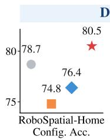

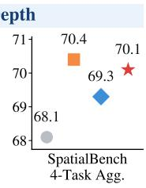

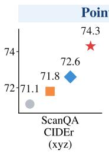

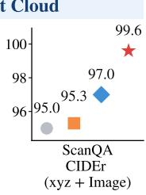  
(a)

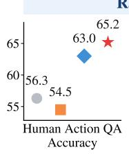  
LM + Caption Loss Ours

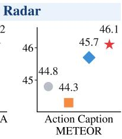

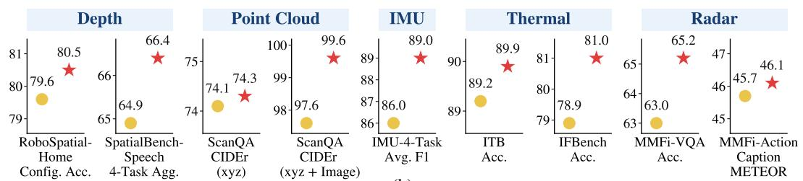  
(b)  
Figure 5: Ablation of alignment objectives and expert specialization. (a) Comparison of language-modeling supervision, conditional captioning, contrastive alignment, and their combination during sensory representation alignment. (b) Comparison between a shared expert pool and modality-specific expert pools during expert tuning.

Component Ablation. Table 8 evaluates the two training stages. Sensory representation alignment consistently improves the baseline, while modality-specific expert tuning brings further gains across all evaluated benchmarks, showing that language grounding and modality-specific specialization provide complementary benefits.

Alignment Objectives. Figure 5(a) compares conditional captioning and contrastive alignment. The two objectives show different strengths across modalities, while their combination achieves the best overall performance. This consistent improvement indicates that the two objectives provide complementary supervision and jointly produce better-aligned sensory representations.

Expert Specialization. Figure 5(b) compares shared and modality-specific expert pools. Modality specific experts consistently outperform the shared alternative across all evaluated modalities, supporting specialized computation for heterogeneous sensory inputs. The gains are particularly evident on SpatialBench-Speech (Cai et al., 2025) and ScanQA (Azuma et al., 2022) with xyz+Image inputs, suggesting that modality-specific computation reduces interference across heterogeneous modalities and better preserves complementary cross-modal information.

## 4 CONCLUSION

We present UniSense, a unified MLLM for understanding diverse embodied sensory signals beyond basic multimodal inputs. By grounding heterogeneous sensory representations in language and introducing modality-specific processing within the shared LLM, UniSense enables 8 physical sensing modalities to be modeled under a common architecture. Extensive experiments show that this unified formulation performs strongly across heterogeneous sensory tasks and can effectively integrate sensory signals with existing multimodal inputs. Taken together, these results suggest that pretrained MLLMs can move beyond serving as interfaces for new modalities, providing a shared foundation for understanding heterogeneous physical signals without treating each modality as an isolated sys tem. More broadly, our findings point toward embodied multimodal models that share a common reasoning backbone while retaining the specialization required by different sensing processes.

## REFERENCES

Panos Achlioptas, Ahmed Abdelreheem, Fei Xia, Mohamed Elhoseiny, and Leonidas J. Guibas. ReferIt3D: Neural listeners for fine-grained 3d object identification in real-world scenes. In 16th European Conference on Computer Vision (ECCV), 2020.

Davide Anguita, Alessandro Ghio, Luca Oneto, Xavier Parra, Jorge Luis Reyes-Ortiz, et al. A public domain dataset for human activity recognition using smartphones. In Esann, volume 3, pp. 3–4, 2013.

Anthropic. Claude 3.5 sonnet. Anthropic, June 2024. URL https://www.anthropic.com/ news/claude-3-5-sonnet.

Rosana Ardila, Megan Branson, Kelly Davis, Michael Kohler, Josh Meyer, Michael Henretty, Reuben Morais, Lindsay Saunders, Francis Tyers, and Gregor Weber. Common voice: A massively-multilingual speech corpus. In Proceedings of the twelfth language resources and evaluation conference, pp. 4218–4222, 2020.

Sheikh Asif Imran Shouborno, Mohammad Nur Hossain Khan, Subrata Biswas, and Bashima Islam. Llasa: A sensor-aware llm for natural language reasoning of human activity from imu data. In Companion of the 2025 ACM International Joint Conference on Pervasive and Ubiquitous Computing, pp. 893–899, 2025.

Daichi Azuma, Taiki Miyanishi, Shuhei Kurita, and Motoaki Kawanabe. Scanqa: 3d question answering for spatial scene understanding. In proceedings ofthe IEEE/CVF conference on computer vision and pattern recognition, pp. 19129–19139, 2022.

Shuai Bai, Yuxuan Cai, Ruizhe Chen, Keqin Chen, Xionghui Chen, Zesen Cheng, Lianghao Deng, Wei Ding, Chang Gao, Chunjiang Ge, et al. Qwen3-vl technical report. arXiv preprint arXiv:2511.21631, 2025a.

Shuai Bai, Keqin Chen, Xuejing Liu, Jialin Wang, Wenbin Ge, Sibo Song, Kai Dang, Peng Wang, Shijie Wang, Jun Tang, Humen Zhong, Yuanzhi Zhu, Mingkun Yang, Zhaohai Li, Jianqiang Wan, Pengfei Wang, Wei Ding, Zheren Fu, Yiheng Xu, Jiabo Ye, Xi Zhang, Tianbao Xie, Zesen Cheng, Hang Zhang, Zhibo Yang, Haiyang Xu, and Junyang Lin. Qwen2.5-vl technical report. arXiv preprint arXiv:2502.13923, 2025b.

Hunar Batra, Haoqin Tu, Hardy Chen, Yuanze Lin, Cihang Xie, and Ronald Clark. Spatialthinker: Reinforcing 3d reasoning in multimodal llms via spatial rewards. arXiv preprint arXiv:2511.07403, 2025.

Johan Bjorck, Zhiqi Li, Yunze Man, Jing Wang, An-Chieh Cheng, Sifei Liu, Shihao Wang, Zhiding Yu, Abhishek Badki, Stan Birchfield, et al. Vesta: A generalist embodied reasoning model. arXiv preprint arXiv:2606.20905, 2026.

Kevin Black, Noah Brown, Danny Driess, Adnan Esmail, Michael Equi, Chelsea Finn, Niccolo Fusai, Lachy Groom, Karol Hausman, Brian Ichter, et al. π 0: A vision-language-action flow model for general robot control. arXiv preprint arXiv:2410.24164, 2024.

Wenxiao Cai, Iaroslav Ponomarenko, Jianhao Yuan, Xiaoqi Li, Wankou Yang, Hao Dong, and Bo Zhao. Spatialbot: Precise spatial understanding with vision language models. In 2025 IEEE International Conference on Robotics and Automation (ICRA), pp. 9490–9498. IEEE, 2025.

Mingyu Cao, Huajie Tan, Yuheng Ji, Xiansheng Chen, Minglan Lin, Zhiyu Li, Zhou Cao, Pengwei Wang, Enshen Zhou, et al. Robobrain 2.0 technical report. arXiv preprint arXiv:2507.02029, 2025a.

Zhe Cao, Jin Zhang, and Ruiheng Zhang. Irgpt: Understanding real-world infrared image with bicross-modal curriculum on large-scale benchmark. In Proceedings of the IEEE/CVF International Conference on Computer Vision, pp. 166–176, 2025b.

Junbum Cha, Wooyoung Kang, Jonghwan Mun, and Byungseok Roh. Honeybee: Locality-enhanced projector for multimodal llm. In 2024 IEEE/CVF Conference on Computer Vision and Pattern Recognition (CVPR), pp. 13817–13827. IEEE, 2024.

Chameleon. Chameleon: Mixed-modal early-fusion foundation models. arXiv preprint arXiv:2405.09818, 2024.

Boyuan Chen, Zhuo Xu, Sean Kirmani, Brain Ichter, Dorsa Sadigh, Leonidas Guibas, and Fei Xia. Spatialvlm: Endowing vision-language models with spatial reasoning capabilities. In Proceedings of the IEEE/CVF conference on computer vision and pattern recognition, pp. 14455–14465, 2024a.

Ling-Hao Chen, Shunlin Lu, Ailing Zeng, Hao Zhang, Benyou Wang, Ruimao Zhang, and Lei Zhang. Motionllm: Understanding human behaviors from human motions and videos. IEEE Transactions on Pattern Analysis and Machine Intelligence, 2025.

Linqing Chen, Hanmeng Zhong, Wentao Wu, and Peng Zhou. The dominance of text space: Unveiling the asymmetric nature of cross-modal alignment in large language models. In Proceedings of the 64th Annual Meeting of the Association for Computational Linguistics (Volume 1: Long Papers), pp. 36666–36678, San Diego, California, United States, 2026. Association for Computational Linguistics. doi: 10.18653/v1/2026.acl-long.1699. URL https: //aclanthology.org/2026.acl-long.1699/.

Sijin Chen, Xin Chen, Chi Zhang, Mingsheng Li, Gang Yu, Hao Fei, Hongyuan Zhu, Jiayuan Fan, and Tao Chen. Ll3da: Visual interactive instruction tuning for omni-3d understanding reasoning and planning. In Proceedings of the IEEE/CVF Conference on Computer Vision and Pattern Recognition (CVPR), pp. 26428–26438, June 2024b.

Zeren Chen, Huayang Liu, Zhenfei Yin, Si Liu, Lyu Sheng, Wanli Ouyang, Jing Shao, et al. Octavius: Mitigating task interference in mllms via lora-moe. In International Conference on Learning Representations, volume 2024, pp. 24652–24673, 2024c.

Zhe Chen, Weiyun Wang, Yue Cao, Yangzhou Liu, Zhangwei Gao, Erfei Cui, Jinguo Zhu, Shenglong Ye, Hao Tian, Zhaoyang Liu, et al. Expanding performance boundaries of open-source multimodal models with model, data, and test-time scaling. arXiv preprint arXiv:2412.05271, 2024d.

An-Chieh Cheng, Hongxu Yin, Yang Fu, Qiushan Guo, Ruihan Yang, Jan Kautz, Xiaolong Wang, and Sifei Liu. Spatialrgpt: Grounded spatial reasoning in vision-language models. Advances in Neural Information Processing Systems, 37:135062–135093, 2024.

Ping-Kun Chiang, Kun-Ru Wu, Po-han Li, Sandeep Chinchali, Ufuk Topcu, and Yu-Chee Tseng. Viewmind3d: Modular view-aware inference for training-free 3d-qa. arXiv preprint arXiv:2607.28442, 2026.

Wei-Lin Chiang, Zhuohan Li, Zi Lin, Ying Sheng, Zhanghao Wu, Hao Zhang, Lianmin Zheng, Siyuan Zhuang, Yonghao Zhuang, Joseph E. Gonzalez, Ion Stoica, and Eric P. Xing. Vicuna: An open-source chatbot impressing gpt-4 with 90%\* chatgpt quality, March 2023. URL https: //lmsys.org/blog/2023-03-30-vicuna/.

Yunfei Chu, Jin Xu, Qian Yang, Haojie Wei, Xipin Wei, Zhifang Guo, Yichong Leng, Yuanjun Lv, Jinzheng He, Junyang Lin, Chang Zhou, and Jingren Zhou. Qwen2-audio technical report. arXiv preprint arXiv:2407.10759, 2024.

Sangyun Chung, Youngjoon Yu, Seyeon Kim, Youngchae Chee, and Yong Man Ro. Enhanced vision-language models for diverse sensor understanding: Cost-efficient optimization and bench marking. IEEE Transactions on Image Processing, 2026.

Gheorghe Comanici, Eric Bieber, Mike Schaekermann, Ice Pasupat, Noveen Sachdeva, Inderjit Dhillon, Marcel Blistein, Ori Ram, Dan Zhang, Evan Rosen, et al. Gemini 2.5: Pushing the frontier with advanced reasoning, multimodality, long context, and next generation agentic capabilities. arXiv preprint arXiv:2507.06261, 2025.

Wenliang Dai, Junnan Li, Dongxu Li, Anthony Tiong, Junqi Zhao, Weisheng Wang, Boyang Li, Pascale N Fung, and Steven Hoi. Instructblip: Towards general-purpose vision-language models with instruction tuning. Advances in neural information processing systems, 36:49250–49267, 2023.

Ronghao Dang, Jiayan Guo, Bohan Hou, Sicong Leng, Kehan Li, Xin Li, Jiangpin Liu, Yunxuan Mao, Zhikai Wang, Yuqian Yuan, et al. Rynnbrain: Open embodied foundation models. arXiv preprint arXiv:2602.14979, 2026.

Erik Daxberger, Nina Wenzel, David Griffiths, Haiming Gang, Justin Lazarow, Gefen Kohavi, Kai Kang, Marcin Eichner, Yinfei Yang, Afshin Dehghan, et al. Mm-spatial: Exploring 3d spatial understanding in multimodal llms. In 2025 IEEE/CVF International Conference on Computer Vision (ICCV), pp. 7395–7408. IEEE, 2025.

Chaorui Deng, Deyao Zhu, Kunchang Li, Chenhui Gou, Feng Li, Zeyu Wang, Shu Zhong, Weihao Yu, Xiaonan Nie, Ziang Song, et al. Emerging properties in unified multimodal pretraining. arXiv preprint arXiv:2505.14683, 2025.

Dinura Dissanayake, Ahmed Heakl, Omkar Thawakar, Noor Ahsan, Ritesh Thawkar, Ketan More, Jean Lahoud, Rao Anwer, Hisham Cholakkal, Ivan Laptev, et al. How good are foundation models in step-by-step embodied reasoning? arXiv preprint arXiv:2509.15293, 2025.

Felix Divo, Maurice Kraus, Anh Q Nguyen, Hao Xue, Imran Razzak, Flora D Salim, Kristian Kersting, and Devendra Singh Dhami. Quants: Question answering on time series. arXiv preprint arXiv:2511.05124, 2025.

Danny Driess, Fei Xia, Mehdi SM Sajjadi, Corey Lynch, Aakanksha Chowdhery, Brian Ichter, Ayzaan Wahid, Jonathan Tompson, Quan Vuong, Tianhe Yu, et al. Palm-e: An embodied multimodal language model. In International Conference on Machine Learning, pp. 8469–8488. PMLR, 2023.

Zhihao Du, Yuxuan Wang, Qian Chen, Xian Shi, Xiang Lv, Tianyu Zhao, Zhifu Gao, Yexin Yang, Changfeng Gao, Hui Wang, et al. Cosyvoice 2: Scalable streaming speech synthesis with large language models. arXiv preprint arXiv:2412.10117, 2024.

Dewei Feng, Wei Dai, Carol Li, Alistair Pernigo, and Paul Liang. Smellnet: A dataset for sensorbased smell recognition and mixture prediction. In International Conference on Learning Representations, volume 2026, pp. 103061–103092, 2026.

Chaoyou Fu, Peixian Chen, Yunhang Shen, Yulei Qin, Mengdan Zhang, Xu Lin, Jinrui Yang, Xiawu Zheng, Ke Li, Xing Sun, Yunsheng Wu, Rongrong Ji, Caifeng Shan, and Ran He. Mme: A comprehensive evaluation benchmark for multimodal large language models. In D. Belgrave, C. Zhang, H. Lin, R. Pascanu, P. Koniusz, M. Ghassemi, and N. Chen (eds.), Advances in Neural Information Processing Systems, volume 38, Main Conference. Curran Associates, Inc., 2025a. doi: 10.52202/085713-4899. URL https://proceedings.neurips.cc/paper\_files/paper/2025/file/ d79a27cf2772fe00be7f341efc0eb517-Paper-Datasets\_and\_Benchmarks\_ Track.pdf.

Chaoyou Fu, Yuhan Dai, Yongdong Luo, Lei Li, Shuhuai Ren, Renrui Zhang, Zihan Wang, Chenyu Zhou, Yunhang Shen, Mengdan Zhang, et al. Video-mme: The first-ever comprehensive evaluation benchmark of multi-modal llms in video analysis. In 2025 IEEE/CVF Conference on Computer Vision and Pattern Recognition (CVPR), pp. 24108–24118. IEEE, 2025b.

Letian Fu, Gaurav Datta, Huang Huang, William Chung-Ho Panitch, Jaimyn Drake, Joseph Ortiz, Mustafa Mukadam, Mike Lambeta, Roberto Calandra, and Ken Goldberg. A touch, vision, and language dataset for multimodal alignment. In International Conference on Machine Learning, pp. 14080–14101. PMLR, 2024.

Rao Fu, Jingyu Liu, Xilun Chen, Yixin Nie, and Wenhan Xiong. Scene-llm: Extending language model for 3d visual reasoning. In Proceedings of the Winter Conference on Applications of Computer Vision (WACV), pp. 2195–2206, February 2025c.

Dibya Ghosh, Homer Walke, Karl Pertsch, Kevin Black, Oier Mees, Sudeep Dasari, Joey Hejna, Tobias Kreiman, Charles Xu, et al. Octo: An open-source generalist robot policy. arXiv preprint arXiv:2405.12213, 2024.

Sreyan Ghosh, Arushi Goel, Jaehyeon Kim, Sonal Kumar, Zhifeng Kong, Sang-gil Lee, Chao-Han Yang, Ramani Duraiswami, Dinesh Manocha, Rafael Valle, et al. Audio flamingo 3: Advancing audio intelligence with fully open large audio language models. Advances in Neural Information Processing Systems, 38:41819–41886, 2026.

Rohit Girdhar, Alaaeldin El-Nouby, Zhuang Liu, Mannat Singh, Kalyan Vasudev Alwala, Armand Joulin, and Ishan Misra. Imagebind: One embedding space to bind them all. In Proceedings of the IEEE/CVF conference on computer vision and pattern recognition, pp. 15180–15190, 2023.

Ziyu Guo, Renrui Zhang, Xiangyang Zhu, Yiwen Tang, Xianzheng Ma, Jiaming Han, Kexin Chen, Peng Gao, Xianzhi Li, Hongsheng Li, et al. Point-bind & point-llm: Aligning point cloud with multi-modality for 3d understanding, generation, and instruction following. arXiv preprint arXiv:2309.00615, 2023.

Jiaming Han, Renrui Zhang, Wenqi Shao, Peng Gao, Peng Xu, Han Xiao, Kaipeng Zhang, Chris Liu, Song Wen, Ziyu Guo, et al. Imagebind-llm: Multi-modality instruction tuning. arXiv preprint arXiv:2309.03905, 2023.

Jiaming Han, Kaixiong Gong, Yiyuan Zhang, Jiaqi Wang, Kaipeng Zhang, Dahua Lin, Yu Qiao, Peng Gao, and Xiangyu Yue. Onellm: One framework to align all modalities with language. In Proceedings of the IEEE/CVF Conference on Computer Vision and Pattern Recognition, pp. 26584–26595, 2024.

Jitai Hao, Hao Liu, Xinyan Xiao, Qiang Huang, and Jun Yu. Uni-x: mitigating modality conflict with a two-end-separated architecture for unified multimodal models. In International Conference on Learning Representations, volume 2026, pp. 123737–123758, 2026.

Muyang He, Yexin Liu, Boya Wu, Jianhao Yuan, Yueze Wang, Tiejun Huang, and Bo Zhao. Efficient multimodal learning from data-centric perspective. arXiv preprint arXiv:2402.11530, 2024.

Wenyi Hong, Wenmeng Yu, Xiaotao Gu, Guo Wang, Guobing Gan, Haomiao Tang, Jiale Cheng, Ji Qi, Junhui Ji, Lihang Pan, et al. Glm-4.5 v and glm-4.1 v-thinking: Towards versatile multimodal reasoning with scalable reinforcement learning. arXiv preprint arXiv:2507.01006, 2025.

Yining Hong, Haoyu Zhen, Peihao Chen, Shuhong Zheng, Yilun Du, Zhenfang Chen, and Chuang Gan. 3d-llm: Injecting the 3d world into large language models. Advances in Neural Information Processing Systems, 36:20482–20494, 2023.

Zhiqing Hong, Zelong Li, Xiubin Fan, Guang Yang, Baoshen Guo, Haotian Wang, Tian He, and Desheng Zhang. Genhar: Generalizing cross-domain human activity recognition for last-mile delivery. In Proceedings of the 32nd ACM SIGKDD Conference on Knowledge Discovery and Data Mining V. 1, pp. 2208–2219, 2026.

Shujie Hu, Long Zhou, Shujie Liu, Sanyuan Chen, Lingwei Meng, Hongkun Hao, Jing Pan, Xunying Liu, Jinyu Li, Sunit Sivasankaran, et al. Wavllm: Towards robust and adaptive speech large language model. In Findings of the Association for Computational Linguistics: EMNLP 2024, pp. 4552–4572, 2024.

Haifeng Huang, Yilun Chen, Zehan Wang, Rongjie Huang, Runsen Xu, Tai Wang, Luping Liu, Xize Cheng, Yang Zhao, Jiangmiao Pang, and Zhou Zhao. Chat-scene: Bridging 3d scene and large language models with object identifiers. In A. Globerson, L. Mackey, D. Belgrave, A. Fan, U. Paquet, J. Tomczak, and C. Zhang (eds.), Advances in Neural Information Processing Systems, volume 37, pp. 113991–114017. Curran Associates, Inc., 2024. doi: 10.52202/ 079017-3620. URL https://proceedings.neurips.cc/paper\_files/paper/ 2024/file/cebbd24f1e50bcb63d015611fe0fe767-Paper-Conference.pdf.

Aaron Hurst, Adam Lerer, Adam P Goucher, Adam Perelman, Aditya Ramesh, Aidan Clark, AJ Ostrow, Akila Welihinda, Alan Hayes, Alec Radford, et al. Gpt-4o system card. arXiv preprint arXiv:2410.21276, 2024.

Inclusion AI. Ming-omni: A unified multimodal model for perception and generation, 2025.

Yuheng Ji, Huajie Tan, Jiayu Shi, Xiaoshuai Hao, Yuan Zhang, Hengyuan Zhang, Pengwei Wang, Mengdi Zhao, Yao Mu, Pengju An, et al. Robobrain: A unified brain model for robotic manipulation from abstract to concrete. In 2025 IEEE/CVF Conference on Computer Vision and Pattern Recognition (CVPR), pp. 1724–1734. IEEE, 2025.

Baoxiong Jia, Yixin Chen, Huangyue Yu, Yan Wang, Xuesong Niu, Tengyu Liu, Qing Li, and Siyuan Huang. Sceneverse: Scaling 3d vision-language learning for grounded scene understanding. In European Conference on Computer Vision, pp. 289–310, 2024.

Biao Jiang, Xin Chen, Wen Liu, Jingyi Yu, Gang Yu, and Tao Chen. Motiongpt: Human motion as a foreign language. Advances in Neural Information Processing Systems, 36:20067–20079, 2023.

Shixin Jiang, Zerui Chen, Jiafeng Liang, Yanyan Zhao, Ming Liu, and Bing Qin. Infrared-llava: Enhancing understanding of infrared images in multi-modal large language models. In Findings of the Association for Computational Linguistics: EMNLP 2024, pp. 8573–8591, 2024.

Muhammad Zeeshan Khan and Anuroop Gaddam. Pointqa: Multi-modality guided cross-attention for 3d visual question answering on point clouds. In 2025 International Conference on Digital Image Computing: Techniques and Applications (DICTA), pp. 1–7. IEEE, 2025.

Moo Jin Kim, Karl Pertsch, Siddharth Karamcheti, Ted Xiao, Ashwin Balakrishna, Suraj Nair, Rafael Rafailov, Ethan P Foster, Pannag R Sanketi, Quan Vuong, et al. Openvla: An open-source vision-language-action model. In Conference on Robot Learning, pp. 2679–2713. PMLR, 2025.

Alexander Kirillov, Eric Mintun, Nikhila Ravi, Hanzi Mao, Chloe Rolland, Laura Gustafson, Tete Xiao, Spencer Whitehead, Alexander C Berg, Wan-Yen Lo, et al. Segment anything. In 2023 IEEE/CVF international conference on computer vision (ICCV), pp. 3992–4003. IEEE, 2023.

Ranjay Krishna, Yuke Zhu, Oliver Groth, Justin Johnson, Kenji Hata, Joshua Kravitz, Stephanie Chen, Yannis Kalantidis, Li-Jia Li, David A Shamma, et al. Visual genome: Connecting language and vision using crowdsourced dense image annotations. Internationaljournal ofcomputer vision, 123(1):32–73, 2017.

Zengyuan Lai, Jiarui Yang, Songpengcheng Xia, Lizhou Lin, Lan Sun, Renwen Wang, Jianran Liu, Qi Wu, and Ling Pei. Radarllm: empowering large language models to understand human motion from millimeter-wave point cloud sequence. In Proceedings ofthe AAAI Conference on Artificial Intelligence, pp. 5791–5799, 2026.

Bo Li, Yuanhan Zhang, Dong Guo, Renrui Zhang, Feng Li, Hao Zhang, Kaichen Zhang, Peiyuan Zhang, Yanwei Li, Ziwei Liu, and Chunyuan Li. LLaVA-onevision: Easy visual task transfer. Transactions on Machine Learning Research, 2025a. ISSN 2835-8856. URL https: //openreview.net/forum?id=zKv8qULV6n.

Junnan Li, Dongxu Li, Silvio Savarese, and Steven Hoi. Blip-2: Bootstrapping language-image pre-training with frozen image encoders and large language models. In International conference on machine learning, pp. 19730–19742. PMLR, 2023.

Wentong Li, Yuqian Yuan, Jian Liu, Dongqi Tang, Song Wang, Jie Qin, Jianke Zhu, and Lei Zhang. Tokenpacker: Efficient visual projector for multimodal llm. International Journal of Computer Vision, 133(10):6794–6812, 2025b.

Yunxin Li, Shenyuan Jiang, Baotian Hu, Longyue Wang, Wanqi Zhong, Wenhan Luo, Lin Ma, and Min Zhang. Uni-moe: Scaling unified multimodal llms with mixture of experts. IEEE Transactions on Pattern Analysis and Machine Intelligence, 47(5):3424–3439, 2025c. doi: 10. 1109/TPAMI.2025.3532688.

Zechen Li, Shohreh Deldari, Linyao Chen, Hao Xue, and Flora D Salim. Sensorllm: Aligning large language models with motion sensors for human activity recognition. In Proceedings of the 2025 Conference on Empirical Methods in Natural Language Processing, pp. 354–379, 2025d.

Weixin Liang, LILI YU, Liang Luo, Srini Iyer, Ning Dong, Chunting Zhou, Gargi Ghosh, Mike Lewis, Wen-tau Yih, Luke Zettlemoyer, et al. Mixture-of-transformers: A sparse and scalable architecture for multi-modal foundation models. In ICLR 2025 Workshop on World Models: Understanding, Modelling and Scaling, 2025.

Xun Liang, Xin Guo, Zhongming Jin, Weihang Pan, Penghui Shang, Deng Cai, Binbin Lin, and Jieping Ye. Enhancing spatial reasoning through visual and textual thinking. In Proceedings of the AAAI Conference on Artificial Intelligence, volume 40, pp. 23433–23441, 2026.

Bin Lin, Zhenyu Tang, Yang Ye, Jinfa Huang, Junwu Zhang, Yatian Pang, Peng Jin, Munan Ning, Jiebo Luo, and Li Yuan. Moe-llava: Mixture of experts for large vision-language models. IEEE Transactions on Multimedia, 2026

Haotian Liu, Chunyuan Li, Qingyang Wu, and Yong Jae Lee. Visual instruction tuning. Advances in neural information processing systems, 36:34892–34916, 2023.

Haotian Liu, Chunyuan Li, Yuheng Li, and Yong Jae Lee. Improved baselines with visual instruction tuning. In Proceedings of the IEEE/CVF Conference on Computer Vision and Pattern Recognition (CVPR), pp. 26296–26306, June 2024a.

Haotian Liu, Chunyuan Li, Yuheng Li, Bo Li, Yuanhan Zhang, Sheng Shen, and Yong Jae Lee. Llava-next: Improved reasoning, ocr, and world knowledge, January 2024b. URL https:// llava-vl.github.io/blog/2024-01-30-llava-next/.

Yang Liu, Ming Ma, Xiaomin Yu, Pengxiang Ding, Han Zhao, Mingyang Sun, Siteng Huang, and Donglin Wang. Ssr: Enhancing depth perception in vision-language models via rationale-guided spatial reasoning. Advances in Neural Information Processing Systems, 38:123926–123958, 2026.

Yuan Liu, Haodong Duan, Yuanhan Zhang, Bo Li, Songyang Zhang, Wangbo Zhao, Yike Yuan, Jiaqi Wang, Conghui He, Ziwei Liu, et al. Mmbench: Is your multi-modal model an all-around player? In European conference on computer vision, pp. 216–233. Springer, 2024c.

Matthew Loper, Naureen Mahmood, Javier Romero, Gerard Pons-Moll, and Michael J Black. Smpl: A skinned multi-person linear model. In Seminal Graphics Papers: Pushing the Boundaries, Volume 2, pp. 851–866. 2023.

Arjun Majumdar, Anurag Ajay, Xiaohan Zhang, Pranav Putta, Sriram Yenamandra, Mikael Henaff, Sneha Silwal, Paul Mcvay, Oleksandr Maksymets, Sergio Arnaud, et al. Openeqa: Embodied question answering in the era of foundation models. In 2024 IEEE/CVF Conference on Computer Vision and Pattern Recognition (CVPR), pp. 16488–16498. IEEE, 2024.

Mohammad Malekzadeh, Richard G Clegg, Andrea Cavallaro, and Hamed Haddadi. Mobile sensor data anonymization. In Proceedings of the international conference on internet of things design and implementation, pp. 49–58, 2019.

Karttikeya Mangalam, Raiymbek Akshulakov, and Jitendra Malik. Egoschema: A diagnostic benchmark for very long-form video language understanding. Advances in Neural Information Process ing Systems, 36:46212–46244, 2023.

Ahmed Masry, Jia Qing Tan, Shafiq Joty, Enamul Hoque, et al. Chartqa: A benchmark for question answering about charts with visual and logical reasoning. In Findings of the association for computational linguistics: ACL 2022, pp. 2263–2279, 2022.

Ahmed Masry, Juan A. Rodriguez, Tianyu Zhang, Suyuchen Wang, Chao Wang, Aarash Feizi, Akshay Kalkunte Suresh, Abhay Puri, Xiangru Jian, Pierre-Andre No´ el, Sathwik Tejaswi Madhusud-¨ han, Marco Pedersoli, Bang Liu, Nicolas Chapados, Yoshua Bengio, Enamul Hoque, Christopher Pal, Issam H. Laradji, David Vazquez, Perouz Taslakian, Spandana Gella, and Sai Rajeswar. ALIGNVLM: Bridging vision and language latent spaces for multimodal document understanding. In Advances in Neural Information Processing Systems, volume 38, pp. 161722–161748, 2025. doi: 10.52202/085713-4875.

Minesh Mathew, Dimosthenis Karatzas, and CV Jawahar. Docvqa: A dataset for vqa on document images. In 2021 IEEE Winter Conference on Applications of Computer Vision (WACV), pp. 2199– 2208. IEEE, 2021.

Anand Mishra, Shashank Shekhar, Ajeet Kumar Singh, and Anirban Chakraborty. Ocr-vqa: Visual question answering by reading text in images. In 2019 international conference on document analysis and recognition (ICDAR), pp. 947–952. IEEE, 2019.

Wentao Mo, Qingchao Chen, Yuxin Peng, Siyuan Huang, and Yang Liu. Advancing 3d scene understanding with mv-scanqa multi-view reasoning evaluation and tripalign pre-training dataset. In Proceedings of the 33rd ACM International Conference on Multimedia, pp. 12973–12980, 2025.

Seungwhan Moon, Andrea Madotto, Zhaojiang Lin, Tushar Nagarajan, Matt Smith, Shashank Jain, Chun-Fu Yeh, Prakash Murugesan, Peyman Heidari, Yue Liu, et al. Anymal: An efficient and scalable any-modality augmented language model. In Proceedings of the 2024 Conference on Empirical Methods in Natural Language Processing: Industry Track, pp. 1314–1332, 2024.

OpenAI. Gpt-5.1: A smarter, more conversational chatgpt. https://openai.com/index/ gpt-5-1/, November 2025.

OpenGVLab. Internomni: Extending internvl with audio modality, July 2024. URL https:// internvl.github.io/blog/2024-07-27-InternOmni/.

Vassil Panayotov, Guoguo Chen, Daniel Povey, and Sanjeev Khudanpur. Librispeech: an asr corpus based on public domain audio books. In 2015 IEEE international conference on acoustics, speech and signal processing (ICASSP), pp. 5206–5210. IEEE, 2015.

Zhangyang Qi, Zhixiong Zhang, Ye Fang, Jiaqi Wang, and Hengshuang Zhao. Gpt4scene: Understand 3d scenes from videos with vision-language models. In C. Vondrick, B. Hariharan, C. Raffel, L. Pinto, D. Yang, and A. Faust (eds.), International Conference on Learning Representations, volume 2026, pp. 157277–157302, 2026. URL https://proceedings.iclr.cc/paper\_files/paper/2026/file/ fef126561bbf9d4467dbb8d27334b8fe-Paper-Conference.pdf.

Hatem Qorsham, Reem El-Deeb, and Ehab Essa. End-to-end 3d point cloud question answering via state space models. Applied Soft Computing, 181:113404, 2025.

Liao Qu, Huichao Zhang, Yiheng Liu, Xu Wang, Yi Jiang, Yiming Gao, Hu Ye, Daniel K Du, Zehuan Yuan, and Xinglong Wu. Tokenflow: Unified image tokenizer for multimodal understanding and generation. In 2025 IEEE/CVF Conference on Computer Vision and Pattern Recognition (CVPR), pp. 2545–2555. IEEE, 2025.

Qwen. Qwen3.5-omni technical report. arXiv preprint arXiv:2604.15804, 2026.

Alec Radford, Jong Wook Kim, Chris Hallacy, Aditya Ramesh, Gabriel Goh, Sandhini Agarwal, Girish Sastry, Amanda Askell, Pamela Mishkin, Jack Clark, et al. Learning transferable visual models from natural language supervision. In International conference on machine learning, pp. 8748–8763. PmLR, 2021.

Alec Radford, Jong Wook Kim, Tao Xu, Greg Brockman, Christine McLeavey, and Ilya Sutskever. Robust speech recognition via large-scale weak supervision. In International conference on machine learning, pp. 28492–28518. PMLR, 2023.

Remyx AI. Spaceom. https://huggingface.co/remyxai/SpaceOm, 2025. Hugging Face model card.

Leyang Shen, Gongwei Chen, Rui Shao, Weili Guan, and Liqiang Nie. Mome: Mixture of multimodal experts for generalist multimodal large language models. Advances in neural information processing systems, 37:42048–42070, 2024.

Weijia Shi, Xiaochuang Han, Chunting Zhou, Weixin Liang, Xi Lin, Luke Zettlemoyer, and Lili Yu. Lmfusion: Adapting pretrained language models for multimodal generation. Advances in Neural Information Processing Systems, 38:9163–9182, 2026.

Muhammad Shoaib, Stephan Bosch, Ozlem Durmaz Incel, Hans Scholten, and Paul JM Havinga. Fusion of smartphone motion sensors for physical activity recognition. Sensors, 14(6):10146– 10176, 2014.

Mustafa Shukor, Enrico Fini, Victor Guilherme Turrisi da Costa, Matthieu Cord, Joshua Susskind, and Alaaeldin El-Nouby. Scaling laws for native multimodal models. In Proceedings of the IEEE/CVF International Conference on Computer Vision (ICCV), pp. 12–23, 2025.

Amanpreet Singh, Vivek Natarajan, Meet Shah, Yu Jiang, Xinlei Chen, Dhruv Batra, Devi Parikh, and Marcus Rohrbach. Towards vqa models that can read. In 2019 IEEE/CVF Conference on Computer Vision and Pattern Recognition (CVPR), pp. 8309–8318. IEEE, 2019.

Chan Hee Song, Valts Blukis, Jonathan Tremblay, Stephen Tyree, Yu Su, and Stan Birchfield. Robospatial: Teaching spatial understanding to 2d and 3d vision-language models for robotics. In Proceedings of the Computer Vision and Pattern Recognition Conference, pp. 15768–15780, 2025.

Allan Stisen, Henrik Blunck, Sourav Bhattacharya, Thor Siiger Prentow, Mikkel Baun Kjærgaard, Anind Dey, Tobias Sonne, and Mads Møller Jensen. Smart devices are different: Assessing and mitigatingmobile sensing heterogeneities for activity recognition. In Proceedings ofthe 13th ACM conference on embedded networked sensor systems, pp. 127–140, 2015.

Yixuan Su, Tian Lan, Huayang Li, Jialu Xu, Yan Wang, and Deng Cai. Pandagpt: One model to instruction-follow them all. In Proceedings of the 1st Workshop on Taming Large Language Models: Controllability in the Era of Interactive Assistants!, pp. 11–23, 2023.

Gemini Robotics Team, Saminda Abeyruwan, Joshua Ainslie, Jean-Baptiste Alayrac, Montserrat Gonzalez Arenas, Travis Armstrong, Ashwin Balakrishna, Robert Baruch, Maria Bauza, Michiel Blokzijl, Steven Bohez, Konstantinos Bousmalis, Anthony Brohan, Thomas Buschmann, Arunkumar Byravan, Serkan Cabi, Ken Caluwaerts, Federico Casarini, Oscar Chang, Jose Enrique Chen, Xi Chen, Hao-Tien Lewis Chiang, Krzysztof Choromanski, David D’Ambrosio, Sudeep Dasari, Todor Davchev, Coline Devin, Norman Di Palo, Tianli Ding, Adil Dostmohamed, Danny Driess, Yilun Du, Debidatta Dwibedi, Michael Elabd, Claudio Fantacci, Cody Fong, Erik Frey, Chuyuan Fu, Marissa Giustina, Keerthana Gopalakrishnan, Laura Graesser, Leonard Hasenclever, Nicolas Heess, Brandon Hernaez, Alexander Herzog, R. Alex Hofer, Jan Humplik, Atil Iscen, Mithun George Jacob, Deepali Jain, Ryan Julian, Dmitry Kalashnikov, M. Emre Karagozler, Stefani Karp, Chase Kew, Jerad Kirkland, Sean Kirmani, Yuheng Kuang, Thomas Lampe, Antoine Laurens, Isabel Leal, Alex X. Lee, Tsang-Wei Edward Lee, Jacky Liang, Yixin Lin, Sharath Maddineni, Anirudha Majumdar, Assaf Hurwitz Michaely, Robert Moreno, Michael Neunert, Francesco Nori, Carolina Parada, Emilio Parisotto, Peter Pastor, Acorn Pooley, Kanishka Rao, Krista Reymann, Dorsa Sadigh, Stefano Saliceti, Pannag Sanketi, Pierre Sermanet, Dhruv Shah, Mohit Sharma, Kathryn Shea, Charles Shu, Vikas Sindhwani, Sumeet Singh, Radu Soricut, Jost Tobias Springenberg, Rachel Sterneck, Razvan Surdulescu, Jie Tan, Jonathan Tompson, Vincent Vanhoucke, Jake Varley, Grace Vesom, Giulia Vezzani, Oriol Vinyals, Ayzaan Wahid, Stefan Welker, Paul Wohlhart, Fei Xia, Ted Xiao, Annie Xie, Jinyu Xie, Peng Xu, Sichun Xu, Ying Xu, Zhuo Xu, Yuxiang Yang, Rui Yao, Sergey Yaroshenko, Wenhao Yu, Wentao Yuan, Jingwei Zhang, Tingnan Zhang, Allan Zhou, and Yuxiang Zhou. Gemini robotics: Bringing ai into the physical world, 2025a.

Kimi Team, Angang Du, Bohong Yin, Bowei Xing, Bowen Qu, Bowen Wang, Cheng Chen, Chenlin Zhang, Chenzhuang Du, Chu Wei, et al. Kimi-vl technical report. arXiv preprint arXiv:2504.07491, 2025b.

Rusiru Thushara, Yasiru Ranasinghe, Jay Paranjape, and Vishal M Patel. Thermo-vl: Extending vision-language models to thermal infrared perception. arXiv preprint arXiv:2605.21882, 2026.

Michael Tschannen, Alexey Gritsenko, Xiao Wang, Muhammad Ferjad Naeem, Ibrahim Alabdulmohsin, Nikhil Parthasarathy, Talfan Evans, Lucas Beyer, Ye Xia, Basil Mustafa, et al. Siglip 2: Multilingual vision-language encoders with improved semantic understanding, localization, and dense features. arXiv preprint arXiv:2502.14786, 2025.

Jiahang Tu, Fengyu Yang, Chenyang Ma, Xihang Yu, Ziyao Zeng, Shaokai Wu, Hanbin Zhao, Zhi Tao, Chao Zhang, Hui Qian, et al. Unitac: A unified multimodal model for cross-sensor tactile understanding and generation. arXiv preprint arXiv:2606.31451, 2026.

Peng Wang, Shuai Bai, Sinan Tan, Shijie Wang, Zhihao Fan, Jinze Bai, Keqin Chen, Xuejing Liu, Jialin Wang, Wenbin Ge, et al. Qwen2-vl: Enhancing vision-language model’s perception of the world at any resolution. arXiv preprint arXiv:2409.12191, 2024a.

Weiyun Wang, Zhangwei Gao, Lixin Gu, Hengjun Pu, Long Cui, Xingguang Wei, Zhaoyang Liu, Linglin Jing, Shenglong Ye, Jie Shao, et al. Internvl3. 5: Advancing open-source multimodal models in versatility, reasoning, and efficiency. arXiv preprint arXiv:2508.18265, 2025a.

Xinlong Wang, Xiaosong Zhang, Zhengxiong Luo, Quan Sun, Yufeng Cui, Jinsheng Wang, Fan Zhang, Yueze Wang, Zhen Li, Qiying Yu, et al. Emu3: Next-token prediction is all you need. arXiv preprint arXiv:2409.18869, 2024b.

Yi Wang, Xinhao Li, Ziang Yan, Yinan He, Jiashuo Yu, Xiangyu Zeng, Chenting Wang, Changlian Ma, Haian Huang, Jianfei Gao, et al. Internvideo2. 5: Empowering video mllms with long and rich context modeling. arXiv preprint arXiv:2501.12386, 2025b.

Yuan Wang, Di Huang, Yaqi Zhang, Wanli Ouyang, Jile Jiao, Xuetao Feng, Dan Xu, and Shixiang Tang. Motiongpt-2: A general-purpose motion-language model for motion generation and understanding. IEEE Transactions on Circuits and Systemsfor Video Technology, 2026a.

Ziyi Wang, Peiming Li, Xinshun Wang, Yang Tang, Kai-Kuang Ma, and Mengyuan Liu. Universal skeleton understanding via differentiable rendering and mllms. arXiv preprint arXiv:2603.18003, 2026b.

Luis Wiedmann, Orr Zohar, Amir Mahla, Xiaohan Wang, Rui Li, Thibaud Frere, Leandro von Werra, Aritra Roy Gosthipaty, and Andres Marafioti. Finevision: Open data is all you need.´ arXiv preprint arXiv:2510.17269, 2025.

Shengqiong Wu, Hao Fei, Leigang Qu, Wei Ji, and Tat-Seng Chua. Next-gpt: any-to-any multimodal llm. In Proceedings of the 41st International Conference on Machine Learning, pp. 53366–53397, 2024.

Chenghao Xiao, Hou Pong Chan, Hao Zhang, Weiwen Xu, Mahani Aljunied, and Yu Rong. Scaling language-centric omnimodal representation learning. In Advances in Neural Information Processing Systems, volume 38, pp. 175826–175857, 2025. doi: 10.52202/085713-5291.

Yifan Xie, Mingyang Li, Shoujie Li, Xingting Li, Guangyu Chen, Fei Ma, Fei Yu, and Wenbo Ding. Universal visuo-tactile video understanding for embodied interaction. In The Thirty-ninth Annual Conference on Neural Information Processing Systems, 2025. URL https://openreview. net/forum?id=aPPnmuuNhx.

Zhe Xie, Zeyan Li, Xiao He, Longlong Xu, Xidao Wen, Tieying Zhang, Jianjun Chen, Rui Shi, and Dan Pei. Chatts: Aligning time series with llms via synthetic data for enhanced understanding and reasoning. arXiv preprint arXiv:2412.03104, 2024.

Jin Xu, Zhifang Guo, Hangrui Hu, Yunfei Chu, Xiong Wang, Jinzheng He, Yuxuan Wang, Xian Shi, Ting He, Xinfa Zhu, et al. Qwen3-omni technical report. arXiv preprint arXiv:2509.17765, 2025.

Runsen Xu, Xiaolong Wang, Tai Wang, Yilun Chen, Jiangmiao Pang, and Dahua Lin. Pointllm: Empowering large language models to understand point clouds. In European Conference on Computer Vision, pp. 131–147, 2024.

Hua Yan, Heng Tan, Yi Ding, Pengfei Zhou, Vinod Namboodiri, and Yu Yang. Large language model-guided semantic alignment for human activity recognition. Proceedings of the ACM on Interactive, Mobile, Wearable and Ubiquitous Technologies, 9(4):1–25, 2025.

Xu Yan, Zhihao Yuan, Yuhao Du, Yinghong Liao, Yao Guo, Shuguang Cui, and Zhen Li. Comprehensive visual question answering on point clouds through compositional scene manipulation. IEEE Transactions on Visualization and Computer Graphics, 30(12):7473–7485, 2023.

Jianfei Yang, He Huang, Yunjiao Zhou, Xinyan Chen, Yuecong Xu, Shenghai Yuan, Han Zou, Chris Xiaoxuan Lu, and Lihua Xie. Mm-fi: Multi-modal non-intrusive 4d human dataset for versatile wireless sensing. Advances in Neural Information Processing Systems, 36:18756–18768, 2023.

Lihe Yang, Bingyi Kang, Zilong Huang, Zhen Zhao, Xiaogang Xu, Jiashi Feng, and Hengshuang Zhao. Depth anything v2. Advances in neural information processing systems, 37:21875–21911, 2024.

Jiahui Yu, Zirui Wang, Vijay Vasudevan, Legg Yeung, Mojtaba Seyedhosseini, and Yonghui Wu. Coca: Contrastive captioners are image-text foundation models. arXiv preprint arXiv:2205.01917, 2022.

Runpeng Yu, Xinyin Ma, and Xinchao Wang. Auto-controlled image perception in mllms via visual perception tokens. In 2025 IEEE/CVF International Conference on Computer Vision (ICCV), pp. 21822–21831. IEEE, 2025.

Samson Yu, Kelvin Lin, Anxing Xiao, Jiafei Duan, and Harold Soh. Octopi: Object property reasoning with large tactile-language models. arXiv preprint arXiv:2405.02794, 2024.

Wenzhen Yuan, Siyuan Dong, and Edward H Adelson. Gelsight: High-resolution robot tactile sensors for estimating geometry and force. Sensors, 17(12):2762, 2017.

Yifu Yuan, Yaoting Huang, Xianze Yao, Yutong Li, Shuoheng Zhang, Linqi Han, Pengyi Li, Jiangeng Sun, Wenting Jia, Zhao Zhang, Yuhao Liu, Ruihao Liao, Yucheng Hu, Qiyu Wu, Yuxiao Li, Zibin Dong, Fei Ni, Yan Zheng, Shuyang Gu, Yi Ma, Hongyao Tang, Han Hu, and Jianye Hao. Embodied-r1.5: Evolving physical intelligence via embodied foundation models, 2026.

He Zhang, Lingzhu Xiang, Haitao Lin, Zeyu Huang, Minghui Wang, Dingyan Zhong, Yubo Dong, Yihao Wu, Yongming Rao, Dongsheng Zhang, et al. Hy-embodied-0.5-vla: From visionlanguage-action models to a real-world robot learning stack. arXiv preprint arXiv:2606.14409, 2026a.

Jiahui Zhang, Yurui Chen, Yueming Xu, Ze Huang, Jilin Mei, Chunhui Chen, Yanpeng Zhou, Yu-Jie Yuan, Xinyue Cai, Guowei Huang, et al. From flatland to space: Teaching vision-language models to perceive and reason in 3d. Advances in Neural Information Processing Systems, 38, 2026b.

Tao Zhang, Yuyang Hong, Yang Xia, Kun Ding, Zeyu Zhang, Ying Wang, Shiming Xiang, and Chunhong Pan. If-bench: Benchmarking and enhancing mllms for infrared images with generative visual prompting. In Proceedings of the IEEE/CVF Conference on Computer Vision and Pattern Recognition, pp. 8205–8215, 2026c.

Yuanhan Zhang, Jinming Wu, Wei Li, Bo Li, Zejun MA, Ziwei Liu, and Chunyuan Li. LLaVAvideo: Video instruction tuning with synthetic data. Transactions on Machine Learning Research, 2025a. ISSN 2835-8856. URL https://openreview.net/forum?id=EElFGvt39K.

Ziang Zhang, Minjie Hong, Hang Zhang, Luping Liu, Rongjie Huang, Xize Cheng, Shengpeng Ji, Tao Jin, Hengshuang Zhao, Zhou Zhao, et al. Omnibind: Large-scale omni multimodal representation via binding spaces. In International Conference on Learning Representations, volume 2025, pp. 20831–20851, 2025b.

Baining Zhao, Ziyou Wang, Jianjie Fang, Chen Gao, Fanhang Man, Jinqiang Cui, Xin Wang, Xinlei Chen, Yong Li, and Wenwu Zhu. Embodied-r: Collaborative framework for activating embodied spatial reasoning in foundation models via reinforcement learning. In Proceedings of the 33rd ACM International Conference on Multimedia, pp. 11071–11080, 2025.

Zhisheng Zhong, Chengyao Wang, Yuqi Liu, Senqiao Yang, Longxiang Tang, Yuechen Zhang, Jingyao Li, Tianyuan Qu, Yanwei Li, Yukang Chen, et al. Lyra: An efficient and speech-centric framework for omni-cognition. In Proceedings of the IEEE/CVF International Conference on Computer Vision, pp. 3694–3704, 2025.

Bo Zhou, Liulei Li, Yujia Wang, Huafeng Liu, Yazhou Yao, and Wenguan Wang. Unialign: Scaling multimodal alignment within one unified model. In Proceedings of the Computer Vision and Pattern Recognition Conference, pp. 29644–29655, 2025a.

Chuhao Zhou and Jianfei Yang. Holollm: Multisensory foundation model for language-grounded human sensing and reasoning. Advances in Neural Information Processing Systems, 38:73543– 73568, 2026.

Chunting Zhou, Lili Yu, Arun Babu, Kushal Tirumala, Michihiro Yasunaga, Leonid Shamis, Jacob Kahn, Xuezhe Ma, Luke Zettlemoyer, and Omer Levy. Transfusion: Predict the next token and diffuse images with one multi-modal model, 2024.

Xueyi Zhou, Qi Lu, and Dong-Kyu Chae. ” where does this strange smell come from?”: Enabling conversational interfaces for artificial olfaction. In EMNLP (Findings), pp. 10719–10745, 2025b.

Xueyi Zhou, Qi Lu, and Dong-Kyu Chae. What if llms can smell: A prototype. In IJCAI, pp. 11141–11144, 2025c.

Bin Zhu, Bin Lin, Munan Ning, Yang Yan, Jiaxi Cui, WANG HongFa, Yatian Pang, Wenhao Jiang, Junwu Zhang, Zongwei Li, et al. Languagebind: Extending video-language pretraining to nmodality by language-based semantic alignment. In International Conference on Learning Representations, volume 2024, pp. 9588–9608, 2024.

Jinguo Zhu, Weiyun Wang, Zhe Chen, Zhaoyang Liu, Shenglong Ye, Lixin Gu, Hao Tian, Yuchen Duan, Weijie Su, Jie Shao, et al. Internvl3: Exploring advanced training and test-time recipes for open-source multimodal models. arXiv preprint arXiv:2504.10479, 2025.

## APPENDIX CONTENTS

A Related Work 22   
B Datasets and Evaluation Protocols 23   
B.1 Supplementary Citations 23   
B.2 Datasets and Benchmarks . 23   
C Implementation Details 27   
C.1 Baselines 27   
C.2 Tokenizers and Projectors 27   
C.3 Basic Modality Processing 29   
C.4 Sensory Representation Alignment 29   
C.5 Modality-Specific Expert Tuning . 29   
C.6 Training Details . 30   
C.7 Ablation Settings 30   
D Additional Experiments 31   
E Visualization of Training Samples 33

Generalist Embodied Models. Recent advances in MLLMs have motivated a growing line of generalist embodied models that leverage pretrained multimodal backbones for unified perception and reasoning in physical environments. Early systems such as PaLM-E (Driess et al., 2023) demonstrated the potential of integrating embodied observations into large language models, while subsequent models such as RoboBrain (Ji et al., 2025; Cao et al., 2025a), RynnBrain (Dang et al., 2026), and Vesta (Bjorck et al., 2026) further broaden this paradigm across diverse physical-world tasks and environments. More recent efforts further emphasize spatial-temporal perception and high-level reasoning (Zhao et al., 2025; Mo et al., 2025; Team et al., 2025a; Zhang et al., 2026a; Yuan et al., 2026), while benchmarks such as OpenEQA (Majumdar et al., 2024) and FoMER (Dissanayake et al., 2025) reflect the growing focus on embodied reasoning. In parallel, vision-language-action models map visual observations directly to low-level robot control (Ghosh et al., 2024; Black et al., 2024; Kim et al., 2025), targeting action generation rather than the high-level sensory understanding considered in this work. Despite this progress, these generalist models still rely largely on basic modalities such as vision and audio, and their extensions beyond these modalities are typically restricted to a single additional modality. Heterogeneous physical signals such as depth, contact, temperature, inertial dynamics, and fine-grained geometry are therefore rarely available to a single embodied reasoner, even though dedicated models exist for many of them individually.

Heterogeneous Multimodal LLMs. A parallel line of work extends LLMs to increasingly diverse input modalities. Image-text pretraining first provides a language-anchored semantic space through large-scale cross-modal alignment (Yu et al., 2022; Tschannen et al., 2025), which subsequent binding-based methods (Girdhar et al., 2023; Zhu et al., 2024) reuse as a pivot to align heterogeneous modalities. Unified multimodal frameworks (Moon et al., 2024; Zhang et al., 2025b) instead attach multiple modality encoders to a common LLM, enabling a broader set of input types and tasks within one framework. Audio and speech models likewise benefit from large-scale paired supervision, providing mature language-aligned interfaces for acoustic inputs and spoken instructions (Chu et al., 2024; Hu et al., 2024; Ghosh et al., 2026). Other works develop dedicated interfaces for individual physical signals, including depth (Cai et al., 2025; Cheng et al., 2024; Daxberger et al., 2025), point clouds (Hong et al., 2023; Guo et al., 2023; Xu et al., 2024), inertial and time-series data (Asif Imran Shouborno et al., 2025; Li et al., 2025d), touch (Fu et al., 2024), thermal (Jiang et al., 2024; Cao et al., 2025b; Thushara et al., 2026), radar (Lai et al., 2026; Zhou & Yang, 2026), smell (Zhou et al., 2025c;b), and motion (Jiang et al., 2023; Chen et al., 2025; Wang et al., 2026a;b). However, sensory data generally receive far less linguistic supervision than web-scale image-text data, making their physical content difficult to expose fully to language-based reasoning, and each of these interfaces is designed for one modality in isolation. In contrast, UniSense uses captionguided supervision to make sensory semantics language-accessible and covers 8 embodied sensory modalities within a single model.

Multimodal Fusion and Specialization. Beyond modality alignment, multimodal models also differ in how heterogeneous representations are integrated into language reasoning. Encoder-projector architectures (Liu et al., 2023; Li et al., 2023; Dai et al., 2023) typically perform late fusion, offering a simple interface but limiting deeper and fine-grained cross-modal interaction. A related line of work unifies modalities on the encoder side, reusing a shared encoder or a pre-aligned binding space as a single interface to the language model (Han et al., 2024; Wu et al., 2024), which makes modality extension straightforward but leaves modality-specific structure largely unmodeled. Native early-fusion models (Chameleon, 2024; Zhou et al., 2024; Wang et al., 2024b) process multiple modalities within a shared representation space, enabling richer interaction but potentially increasing cross-modal interference. Recent sparse architectures seek a better balance between sharing and specialization: mixture-of-experts methods (Shen et al., 2024; Li et al., 2025c; Lin et al., 2026; Zhou et al., 2025a) introduce specialized expert pathways, with low-rank expert variants (Chen et al., 2024c) reducing the cost of such specialization, while Mixture-of-Transformers and related architectures (Liang et al., 2025; Deng et al., 2025; Shi et al., 2026) more explicitly decouple modality-specific computation while retaining shared attention. These mechanisms, however, have been developed primarily for semantically well-aligned modalities such as image, video, and audio. UniSense instead targets weakly grounded embodied sensory signals, keeping self-attention shared while adding lightweight modality-specific residual experts to selected feed-forward layers.

Table B9: Supplementary citations of the evaluation benchmarks. Benchmarks are grouped by modality following the organization of §B.2.
<table><tr><td>Modality</td><td>Benchmark</td><td>Citation</td><td>Benchmark</td><td>Citation</td></tr><tr><td colspan="5">General Multimodal Benchmarks</td></tr><tr><td>Image-Text</td><td>TextVQA</td><td>Singh et al. (2019)</td><td>MME</td><td>Fu et al. (2025a)</td></tr><tr><td></td><td>MMBench</td><td>Liu et al. (2024c)</td><td></td><td></td></tr><tr><td>Audio-Image-Text Video-Text</td><td>DocVQA</td><td>Mathew et al. (2021)</td><td>ChartQA</td><td>Masry et al. (2022)</td></tr><tr><td></td><td>Video-MME</td><td>Fu et al. (2025b)</td><td>EgoSchema</td><td>Mangalam et al. (2023)</td></tr><tr><td colspan="5">Embodied Sensory Benchmarks</td></tr><tr><td>Depth</td><td>SpatialBench</td><td>Cai et al. (2025)</td><td>RoboSpatial-Home</td><td>Song et al. (2025)</td></tr><tr><td>Point Cloud</td><td>ScanQA</td><td>Azuma et al. (2022)</td><td>CLEVR3D-REAL</td><td>Yan et al. (2023)</td></tr><tr><td>IMU</td><td>HHAR</td><td>Stisen et al. (2015)</td><td>MotionSense</td><td>Malekzadeh et al. (2019)</td></tr><tr><td></td><td>Shoaib</td><td>Shoaib et al. (2014)</td><td>UCI-HAR</td><td>Anguita et al. (2013)</td></tr><tr><td>Thermal</td><td>Infrared-Benchmark</td><td>Jiang et al. (2024)</td><td>IF-Bench</td><td>Zhang et al. (2026c)</td></tr><tr><td>Tactile</td><td>Octopi</td><td>Yu et al. (2024)</td><td>VTBS</td><td>Xie et al. (2025)</td></tr><tr><td>Radar</td><td>MM-Fi</td><td>Yang et al. (2023)</td><td>HoloLLM CrossEnv</td><td>Zhou &amp; Yang (2026)</td></tr><tr><td>Motion</td><td>QuAnTS</td><td>Divo et al. (2025)</td><td></td><td></td></tr><tr><td>Smell</td><td>SmellNet-Base</td><td>Feng et al. (2026)</td><td></td><td></td></tr></table>

Table B10: Supplementary citations of the closed-source and general multimodal baselines. Models follow the same groups as the main-text tables.
<table><tr><td>Model</td><td>Citation</td><td>Model</td><td>Citation</td></tr><tr><td colspan="4">Closed-Source Models</td></tr><tr><td>GPT-40 Gemini-2.5-Pro</td><td>Hurst et al. (2024)</td><td>Claude-3.5</td><td>Anthropic (2024)</td></tr><tr><td colspan="4">Comanici et al. (2025)</td></tr><tr><td></td><td>General MLLMs</td><td></td><td></td></tr><tr><td>LLaVA-1.5</td><td>Liu et al. (2024a)</td><td>LLaVA-NeXT</td><td>Liu et al. (2024b)</td></tr><tr><td>LLaVA-OneVision</td><td>Li et al. (2025a)</td><td>LLaVA-Video</td><td>Zhang et al. (2025a)</td></tr><tr><td>Qwen2-VL</td><td>Wang et al. (2024a)</td><td>Qwen2.5-VL</td><td>Bai et al. (2025b)</td></tr><tr><td>Qwen3-VL</td><td>Bai et al. (2025a)</td><td>InternVL2</td><td>Chen et al. (2024d)</td></tr><tr><td>InternVL2.5</td><td>Chen et al. (2024d)</td><td>InternVL3.5</td><td>Wang et al. (2025a)</td></tr><tr><td>InternVL3</td><td>Zhu et al. (2025)</td><td>InternVideo2.5</td><td>Wang et al. (2025b)</td></tr><tr><td>Kimi-VL</td><td>Team et al. (2025b)</td><td>GLM-4.1V</td><td>Hong et al. (2025)</td></tr><tr><td>GLM-4.5V</td><td>Hong et al. (2025)</td><td>Vicuna</td><td>Chiang et al. (2023)</td></tr><tr><td>TokenFlow Honeybee</td><td>Qu et al. (2025)</td><td>Tokenpacker</td><td>Li et al. (2025b)</td></tr><tr><td colspan="4">Cha et al. (2024) General Omnimodal MLLMs</td></tr><tr><td>ImageBind</td><td>Girdhar et al. (2023)</td><td>ImageBind-LLM</td><td>Han et al. (2023)</td></tr><tr><td>PandaGPT</td><td>Su et al. (2023)</td><td>OneLLM</td><td>Han et al. (2024)</td></tr><tr><td>Intern-Omni</td><td>OpenGVLab (2024)</td><td>Qwen3-Omni</td><td>Xu et al. (2025)</td></tr><tr><td>Lyra</td><td>Zhong et al. (2025)</td><td></td><td></td></tr></table>

## B DATASETS AND EVALUATION PROTOCOLS

## B.1 SUPPLEMENTARY CITATIONS

Due to space limitations in the main text, the citations of the evaluation benchmarks and compared baselines reported in Tables 1–8 are collected in this section instead of in the corresponding captions. Table B9 lists the evaluation benchmarks, grouped by modality following the organization of §B.2. Tables B10 and B11 list the closed-source and general multimodal baselines and the modality-specialized baselines, respectively, using the same model groups as the main-text tables. Model variants that differ only in parameter scale share a single citation and are therefore listed once.

## B.2 DATASETS AND BENCHMARKS

This section describes the datasets and evaluation protocols used for each modality. We first detail the training data sources and preparation, with the overall data composition summarized in Fig. B6, and then describe the evaluation benchmarks, data splits, input settings, and metrics. Unless otherwise specified, we follow the official benchmark splits and scoring protocols. During evaluation, UniSense receives only the benchmark-specified inputs, without access to training-only captions or auxiliary semantic annotations.

Table B11: Supplementary citations of the modality-specialized baselines. Models follow the same groups as the main-text tables.
<table><tr><td>Group</td><td>Model</td><td>Citation</td><td>Model</td><td>Citation</td></tr><tr><td rowspan="4">Spatial</td><td>SpatialVLM</td><td>Chen et al. (2024a)</td><td>Bunny</td><td>He et al. (2024)</td></tr><tr><td>SpatialBot</td><td>Cai et al. (2025)</td><td>SpaceThinker</td><td>Batra et al. (2025)</td></tr><tr><td>SpaceOm</td><td>Remyx AI (2025)</td><td>SSR</td><td>Liu et al. (2026)</td></tr><tr><td>VPT</td><td>Yu et al. (2025)</td><td>SpatialVTS</td><td>Liang et al. (2026)</td></tr><tr><td rowspan="6">3D</td><td>ScanQA</td><td>Azuma et al. (2022)</td><td>Scene-LLM</td><td>Fu et al. (2025c)</td></tr><tr><td>LL3DA</td><td>Chen et al. (2024b)</td><td>ChatScene</td><td>Huang et al. (2024</td></tr><tr><td>ViewMind3D</td><td>Chiang et al. (2026)</td><td>GPT4Scene</td><td>Qi et al. (2026)</td></tr><tr><td>ReferIt3D</td><td>Achlioptas et al. (2020)</td><td>BEV+MCAN</td><td>Yan et al. (2023)</td></tr><tr><td>PointQA</td><td>Khan &amp; Gaddam (2025)</td><td>TransVQA3D</td><td>Yan et al. (2023)</td></tr><tr><td>E2E-MPCQA</td><td>Qorsham et al. (2025)</td><td></td><td></td></tr><tr><td>Tactile</td><td>Octopi</td><td>Yu et al. (2024)</td><td>UniTac</td><td>Tu et al. (2026)</td></tr><tr><td rowspan="2">IMU</td><td>GenHAR</td><td>Hong et al. (2026)</td><td>LanHAR</td><td>Yan et al. (2025)</td></tr><tr><td>LLaSA</td><td>Asif Imran Śhouborno et al. (2025)</td><td></td><td></td></tr><tr><td>Thermal</td><td>Infrared-LLaVA</td><td>Jiang et al. (2024)</td><td></td><td></td></tr><tr><td rowspan="2">Radar</td><td>HoloLLM</td><td>Zhou &amp; Yang (2026)</td><td></td><td></td></tr><tr><td>Naive</td><td></td><td></td><td></td></tr><tr><td rowspan="2">Motion</td><td></td><td>Divo et al. (2025)</td><td>ChatTS</td><td>Xie et al. (2024)</td></tr><tr><td>xQA MLP, CNN, LSTM and ScentFormer</td><td>Divo et al. (2025)</td><td></td><td></td></tr></table>

## B.2.1 GENERAL MULTIMODAL

Following the multimodal initialization pipeline of Zhong et al. (2025), we first establish the image– speech–text capabilities of UniSense before sensory training. Speech alignment uses Common Voice (Ardila et al., 2020) and LibriSpeech (Panayotov et al., 2015), comprising approximately 1.19M speech–text pairs. We then perform image–speech–text instruction tuning on a mixture of Lyra-SFT (Zhong et al., 2025) and selected subsets of FineVision (Wiedmann et al., 2025), containing approximately 3.12M conversations. The mixture consists primarily of Lyra-SFT together with additional FineVision image–text data.

We evaluate the general multimodal capabilities on image–text, image–speech, and video benchmarks. Specifically, we use TextVQA (Singh et al., 2019), MME (Fu et al., 2025a), and MMBench (Liu et al., 2024c) for image–text understanding; the speech-conditioned variants of TextVQA, DocVQA (Mathew et al., 2021), and ChartQA (Masry et al., 2022) for image–speech understanding; and Video-MME (Fu et al., 2025b) and EgoSchema (Mangalam et al., 2023) for video understanding. We follow the standard evaluation protocols for all benchmarks, with Video-MME evaluated without subtitles.

## B.2.2 DEPTH

For depth training, we use SpatialQA (Cai et al., 2025), SPAR (Zhang et al., 2026b), and CA-VQA (Daxberger et al., 2025). We additionally construct depth-oriented training samples from COCO (Mishra et al., 2019), Visual Genome (VG) (Krishna et al., 2017), and SA-1B (Kirillov et al., 2023). These datasets cover diverse depth-centric scenes and task formats, including spatial question answering, 3D reasoning, captioning, and general multimodal instruction tuning. We synthesize speech with CosyVoice (Du et al., 2024) for SpatialQA, SPAR, CA-VQA, and part of the constructed depth subset. For samples without depth maps, we generate them using Depth Anything V2 (Yang et al., 2024).

For sensory representation alignment, each RGB–D sample is paired with a depth-aware description generated offline by Qwen3-Omni-30B-A3B-Instruct (Xu et al., 2025): the model first extracts objects from RGB and then generates a depth-focused caption conditioned on the RGB image, depth map, and extracted objects.

We evaluate depth understanding on SpatialBench and RoboSpatial-Home (Song et al., 2025) using paired RGB–D observations. SpatialBench comprises five subtasks: positional reasoning, object existence, counting, reaching, and size comparison. We report each subtask score, together with

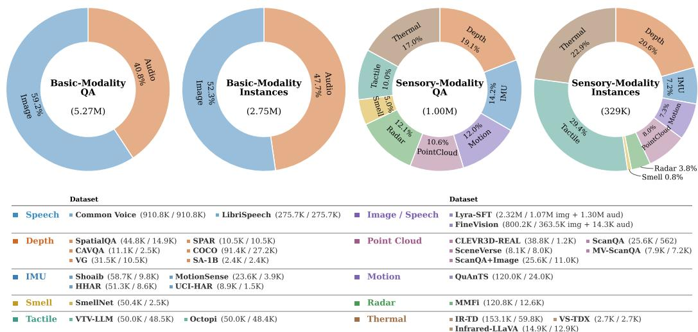  
Figure B6: Overview of the training data composition. The donut charts illustrate the distribution of QA and unique data instances across basic and sensory modalities. The bottom panel provides a dataset-level breakdown for each modality, with the number of training QA and unique instances reported for every data source.

4-Task Agg., the sample-weighted aggregate over Position, Existence, Counting, and Size, and Agg., the aggregate over all five subtasks. All scores follow the official SpatialBench evaluation protocol. We further construct SpatialBench-Speech by converting the question text into speech to assess the robustness of depth reasoning to spoken queries. For RoboSpatial-Home, we report zero-shot accuracy on the Configuration split without benchmark-specific fine-tuning.

## B.2.3 POINT CLOUD

For point-cloud training, we use CLEVR3D-REAL (Yan et al., 2023), ScanQA (Azuma et al., 2022), and SceneVerse (Jia et al., 2024). Together, these datasets cover scene-level descriptions, question answering, and compositional reasoning over indoor 3D scenes. We use the official training splits of ScanQA and CLEVR3D-REAL. For ScanQA, we further construct RGB-augmented examples using single-view and four-view images from MV-ScanQA (Mo et al., 2025), yielding both pointcloud-only and point-cloud–image training inputs. For sensory representation alignment, scenelevel descriptions from SceneVerse are matched to ScanQA and CLEVR3D-REAL samples by scene identity.

We evaluate point-cloud understanding on ScanQA and CLEVR3D-REAL (results reported in Ta ble D15), using their official validation splits. On ScanQA, we evaluate both point-cloud-only (xyz) and point-cloud–image (xyz+img) inputs. Following the standard ScanQA protocol, we report CIDEr, METEOR (MET.), ROUGE-L (R-L), BLEU-1 (B-1), and BLEU-4 (B-4) for open-ended 3D question answering. CLEVR3D-REAL evaluates compositional reasoning over point-cloud scenes across existence, counting, comparison, query-attribute, query-object, and compare-attribute questions. We report accuracy for each question category, together with Overall, denoting accuracy over all test questions, and Cls. Avg., denoting the unweighted average accuracy across question categories.

## B.2.4 IMU

For IMU training, we use the SensorCaps and OpenSQA annotations (Asif Imran Shouborno et al., 2025) associated with four human activity recognition datasets: HHAR (Stisen et al., 2015), Motion-Sense (Malekzadeh et al., 2019), Shoaib (Shoaib et al., 2014), and UCI-HAR (Anguita et al., 2013). SensorCaps provides a natural-language description for each IMU window and is used for sensory representation alignment, while OpenSQA provides question–answer pairs covering activity-related understanding and reasoning. We construct the training and evaluation sets using stratified windowlevel hold-out within each source dataset, reserving approximately 100 windows per activity class for evaluation and using the remaining windows for training, with no overlap between the two splits. This results in approximately 23.8k training windows and 2.5k held-out evaluation windows, with multiple OpenSQA questions associated with each training window.

We evaluate IMU understanding as open-ended activity classification on the held-out windows from HHAR, MotionSense, Shoaib, and UCI-HAR, following the LLaSA (Asif Imran Shouborno et al., 2025) classification protocol. For each dataset, the model is provided with the IMU sequence and generates the predicted class name directly from the input. We report results separately for the four datasets using accuracy and macro-averaged precision, recall, and F1.

## B.2.5 TACTILE

For tactile training, we use Octopi (Yu et al., 2024) and the Universal Visuo-Tactile Video Understanding corpus (VTBS) (Xie et al., 2025). Both datasets follow object-level splits, such that objects used for evaluation are excluded from training. Following the official data generation protocols, we construct 50k instruction–response pairs from each corpus, covering tactile property description, comparison, selection, and object–property reasoning, resulting in approximately 100k training examples in total. The original GelSight (Yuan et al., 2017) videos are converted into a unified imagebased representation by first selecting informative motion frames and then uniformly sampling three RGB frames from each video, which are treated as tactile observations during training. For sensory representation alignment, we extract the descriptive property text from the generated responses and use it as the corresponding tactile caption.

We evaluate on the official held-out-object splits of Octopi using the same three-frame tactile representation as in training. Octopi contains 498 questions across property comparison (PC), property superlative selection (PSS), and property–object matching (POM). Following the official protocol, we report accuracy separately for the three tasks.

## B.2.6 THERMAL

For thermal training, we use a partial subset of IR-TD from IRGPT (Cao et al., 2025b), the thermal subset of VS-TDX (Chung et al., 2026), and Infrared-LLaVA (Jiang et al., 2024). Together, these datasets cover thermal captioning, question answering, recognition, counting, and localization. For IR-TD, we use its caption, instruction-QA, and task-oriented training subsets, and pair thermal images with the corresponding RGB observations when available. For sensory representa tion alignment, we use the paired RGB–thermal captions provided by IR-TD.

We evaluate thermal understanding on IF-Bench (Zhang et al., 2026c) (results reported in Table D14), and the Benchmark from Infrared-LLaVA, using thermal inputs for both benchmarks. IF-Bench is evaluated in a zero-shot setting and groups its tasks into three categories: coarse-grained perception (Coarse), fine-grained perception (Fine), and image reasoning (Reason). We report accuracy for each of the ten tasks and the overall average. Infrared-LLaVA Benchmark contains six infrared question-answering tasks covering localization, aerial counting, pedestrian counting, recognition, scene understanding, and safety assessment. We report the average accuracy across the six tasks under both zero-shot and fine-tuning settings.

## B.2.7 RADAR

For radar training, we use mmWave point-cloud sequences from MM-Fi (Yang et al., 2023) together with the language annotations introduced by HoloLLM (Zhou & Yang, 2026). We follow the HoloLLM Cross-Environment protocol, using environments E01–E03 for training and holding out E04 for evaluation, such that the training and test sets contain disjoint environments and subjects. The training split contains approximately 12.6k temporal radar segments. Based on the HoloLLM action annotations, we construct a mixture of action captions and question–answering examples, and further augment the instruction data with laterality questions and multiple-choice questions targeting confusable action categories, resulting in approximately 121k training examples. The original HoloLLM captions are further refined offline using GPT-5.1 (OpenAI, 2025) with action labels as guidance. The refined captions are used for sensory representation alignment.

We evaluate radar understanding following the HoloLLM Cross-Environment protocol on the heldout E04 environment. We report results on two tasks using radar-only input: Human Action QA and Action Caption. For Human Action QA, the model predicts one of the predefined human action categories from the radar sequence, and performance is measured using accuracy following the HoloLLM matching protocol. For Action Caption, the model generates a free-form description of the observed action, and we report METEOR as the primary metric.

## B.2.8 MOTION

For skeleton-motion training, we use QuAnTS (Divo et al., 2025), which contains synthetic SMPL (Loper et al., 2023) motion sequences paired with binary, multiple-choice, and open-ended question answering. We follow the official 80/10/10 trajectory-level split and use only the training partition, corresponding to 24k motion sequences and 120k QA pairs. For sensory representation alignment, we use the scene-level textual descriptions provided by QuAnTS as auxiliary captions.

We evaluate on the official QuAnTS test split, which contains 3k held-out motion trajectories and 15k questions spanning binary, multiple-choice, and open-ended QA. At inference time, the model receives only the skeleton-motion sequence and the corresponding question, without access to scene descriptions or ground-truth action sequences. We report binary and multiple-choice performance using accuracy and macro-averaged precision, recall, and F1, while open-ended responses are eval uated using ROUGE-L and METEOR.

## B.2.9 SMELL

For smell training, we use SmellNet-Base (Feng et al., 2026), which contains 50 single-substance categories recorded with a six-channel metal-oxide (MOX) sensor array. We follow the official daywise split, using recordings from the first five days for training and the sixth day for evaluation, yielding approximately 2.5k training windows and 0.5k held-out test windows after temporal segmentation. We segment the aligned sensor readings into fixed-length windows and normalize each channel using training-set statistics. From these windows, we construct approximately 50.4k instruction samples spanning classification, reasoning, and captioning, and generate temporal descriptions that exclude the substance identity for the alignment stage.

We evaluate on the held-out day-6 split of SmellNet-Base (502 windows across 50 classes), using training-set normalization statistics. Given a sensor sequence and the full candidate set, the model predicts the substance name; we report Acc@1 and macro F1.

## C IMPLEMENTATION DETAILS

## C.1 BASELINES

We compare UniSense with three groups of baselines: (i) closed-source models, including models from the GPT, Claude and Gemini families; (ii) general multimodal models, such as the Qwen-VL and InternVL families; and (iii) modality-specialized models designed for specific sensory modalities or tasks. For each benchmark, we follow its standard evaluation protocol and report the corresponding metrics.

## C.2 TOKENIZERS AND PROJECTORS

We adopt two tokenization pathways according to the structure of each sensory input.

Pixel-aligned modalities. Depth, tactile, and thermal signals are represented as image-like inputs and processed using the default Qwen visual preprocessing. They are divided into patches by the pretrained visual patch embedding and then encoded by the shared vision encoder and merger.

Non-pixel modalities. Point cloud, IMU, radar, motion, and smell inputs have distinct spatial or temporal structures that cannot be directly processed by visual patch embedding. We therefore introduce a lightweight tokenizer for each modality to map its native input into a sequence of embeddings with the same hidden dimension as the visual patch tokens. These embeddings are directly fed into the shared vision encoder and merger. The tokenizer design for each modality is described below.

Point cloud. Each point cloud $\mathbf { x } ^ { \mathrm { p c } }$ is represented by normalized XYZ coordinates and RGB features. We sample 32,768 points from each scene and organize them into 1,024 local groups, each containing 32 neighboring points. Within each group, the point features are augmented with coordinates relative to the group center. A point-wise $1 \times 1$ convolution projects the resulting features to the vision hidden dimension, followed by max pooling over the local neighborhood:

$$
\begin{array} { r } { \mathcal { T } _ { \mathrm { p c } } ( \mathbf { x } ^ { \mathrm { p c } } ) = \mathrm { M a x P o o l } ( f _ { \mathrm { p c } } \left( [ \mathbf { F } ^ { \mathrm { p c } } , \Delta \mathbf { P } ^ { \mathrm { p c } } ] \right) ) . } \end{array}
$$

IMU.Each IMU input $\mathbf { x } ^ { \mathrm { { i m u } } }$ consists of six channels corresponding to tri-axial accelerometer and gyroscope measurements. Each sequence contains 120 temporal steps. Inputs of a different length are linearly resampled to this length before encoding. We employ a length-preserving 1D convolution with kernel size 10 to map the input sequence to the vision hidden dimension:

$$
\mathcal { T } _ { \mathrm { i m u } } ( \mathbf { x } ^ { \mathrm { i m u } } ) = \mathrm { C o n v } 1 \mathrm { D } _ { 6  d _ { \mathrm { v i t } } } ^ { ( k = 1 0 ) } ( \mathbf { x } ^ { \mathrm { i m u } } ) .
$$

The tokenizer produces 120 IMU tokens, which are subsequently processed by the shared vision encoder and reduced to 30 tokens by the vision merger in $\mathcal { E } .$

Radar. Each radar input $\mathbf { x } ^ { \mathrm { r a d a r } }$ is represented as a temporal sequence of point sets, where each point contains five attributes: 3D coordinates, Doppler, and intensity. Each segment is uniformly sampled to at most 32 frames, with each frame containing at most 64 points. For each frame, the original point features are augmented with coordinates relative to the masked centroid. A point-wise projection followed by masked max pooling produces a frame-level representation:

$$
\mathcal { T } _ { \mathrm { r a d a r } } ( \mathbf { x } ^ { \mathrm { r a d a r } } ) = \mathrm { M a s k e d M a x P o o l } \left( f _ { \mathrm { r a d a r } } \left( [ \mathbf { X } ^ { \mathrm { r a d a r } } , \Delta \mathbf { P } ^ { \mathrm { r a d a r } } ] \right) \right) .
$$

The resulting frame-level representations are temporally interpolated to 64 radar tokens, which are subsequently processed by the shared vision encoder and reduced to 16 tokens by the vision merger in E. Padded points are excluded from both centroid computation and feature pooling.

Motion. Each skeleton–motion input $\mathbf { x } ^ { \mathrm { m o t i o n } }$ is represented as a sequence of 24 skeleton joints with 3D coordinates. Each frame is flattened into a 72-dimensional feature vector, and each sequence is linearly resampled to 320 temporal steps. We employ a length-preserving 1D convolution with kernel size 10 to map the input sequence to the vision hidden dimension:

$$
\mathcal { T } _ { \mathrm { m o t i o n } } ( \mathbf { x } ^ { \mathrm { m o t i o n } } ) = \mathrm { C o n v } 1 \mathrm { D } _ { 7 2  d _ { \mathrm { v i t } } } ^ { ( k = 1 0 ) } ( \mathbf { x } ^ { \mathrm { m o t i o n } } ) .
$$

The tokenizer produces 320 motion tokens, which are subsequently processed by the shared vision encoder and reduced to 80 tokens by the vision merger in $\mathcal { E } .$

Smell. Each smell input $\mathbf { x } ^ { \mathrm { s m e l l } }$ consists of temporal measurements from six metal-oxide gas sensors. Each sequence contains 100 temporal steps, and each channel is standardized using its training-set mean and standard deviation. We employ a length-preserving 1D convolution with kernel size 10 to project the signal sequence to the vision hidden dimension:

$$
\mathcal { T } _ { \mathrm { s m e l l } } ( \mathbf { x } ^ { \mathrm { s m e l l } } ) = \mathrm { C o n v } 1 \mathrm { D } _ { 6  d _ { \mathrm { v i t } } } ^ { ( k = 1 0 ) } ( \mathbf { x } ^ { \mathrm { s m e l l } } ) .
$$

The tokenizer produces 100 smell tokens, which are subsequently processed by the shared vision encoder and reduced to 25 tokens by the vision merger in $\mathcal { E }$

Modality-specific projectors. After the shared vision encoder and merger, each sensory modality $s \in \mathcal { M } _ { \mathrm { s } }$ is equipped with an independent residual projector $\mathcal { P } _ { s }$ . Let $\mathbf { H } ^ { s } = [ \mathbf { h } _ { 1 } ^ { s } , \ldots , \mathbf { h } _ { N _ { s } } ^ { s } ]$ denote the merged representation of modality s, where $\mathbf { h } _ { i } ^ { s } \in \mathbb { R } ^ { d _ { \mathrm { l l m } } }$ . The projector is applied independently to each token:

$$
\mathbf { z } _ { i } ^ { s } = \mathbf { h } _ { i } ^ { s } + \mathbf { W } _ { 2 } ^ { s } \mathrm { R e L U } \left( \mathbf { W } _ { 1 } ^ { s } \mathbf { h } _ { i } ^ { s } \right) ,
$$

and the projected sensory representation is $\mathbf { Z } ^ { s } = [ \mathbf { z } _ { 1 } ^ { s } , \ldots , \mathbf { z } _ { N _ { \mathrm { s } } } ^ { s } ] = { \mathcal { P } } _ { s } ( \mathbf { H } ^ { s } )$ . Here, $\mathbf { W } _ { 1 } ^ { s } \in \mathbb { R } ^ { d _ { p } \times d _ { \mathrm { l l m } } }$ and $\mathbf { W } _ { 2 } ^ { s } \in \mathbb { R } ^ { d _ { \mathrm { l l m } } \times d _ { p } }$ , with $d _ { p } = 7 6 8$ . The output layer is zero-initialized, such that the projector starts as an identity mapping.

## C.3 BASIC MODALITY PROCESSING

Unlike embodied sensory inputs, basic modalities retain the processing pathways inherited from the pretrained multimodal backbone.

Image pathway. RGB images are processed by the native Qwen3.5 visual encoder and merger. The resulting image tokens are directly inserted into the language sequence without an additional learnable projector, and the entire pathway remains unchanged during sensory training.

Speech pathway. Speech signals are encoded using Whisper-large-v3-turbo (Radford et al., 2023). The resulting acoustic features are mapped to the language hidden dimension through a speech projector. The Whisper encoder remains frozen, while the speech projector is pretrained to align acoustic representations with the language model.

Multimodal initialization. Before sensory training, UniSense is initialized from an image–speech– text instruction-tuned Qwen3.5 checkpoint, with its original image and speech pathways retained.

## C.4 SENSORY REPRESENTATION ALIGNMENT

We provide additional implementation details for the sensory representation alignment stage introduced in Sec. 2.3. Unless otherwise specified, the following settings correspond to the Qwen3.5-9B configuration.

Conditional captioning. We use a lightweight 6-layer caption decoder with a hidden dimension of 1,024 and 16 attention heads. The decoder reuses the frozen token embeddings and languagemodeling head of Qwen, while its remaining parameters are trainable. Cross-attention uses only the projected tokens of the target sensory modality as memory, and the decoder output is used solely for auxiliary caption reconstruction rather than the main response-generation pathway. The caption decoder remains trainable in both sensory-training stages.

Contrastive alignment. The projected sensory tokens and caption tokens are independently processed by the first k frozen layers of the language backbone. In the default configuration, we use $k = 8$ . We apply mean pooling over valid sensory tokens and use the final valid caption token as the textual representation. The two representations are then passed through separate LayerNorm and linear projection heads, mapped to 512 dimensions, and $\ell _ { 2 } \cdot$ -normalized before computing the symmetric InfoNCE loss.

Representations are gathered across all distributed workers to construct global in-batch negatives. Pairs corresponding to the same underlying sensory instance or sharing an identical normalized caption are excluded from the negative set to reduce false-negative supervision. The contrastive branch is used only during the first sensory-training stage and is disabled after the transition to modality-specific expert tuning.

## C.5 MODALITY-SPECIFIC EXPERT TUNING

During the second sensory-training stage, modality-specific residual experts are activated in the selected full-attention decoder layers, while the pretrained self-attention and base FFN remain frozen. For the 9B model, expert modules are inserted into the eight full-attention layers at indices 3, 7, 11, 15, 19, 23, 27, and 31.

Expert configuration. Each embodied sensory modality uses an independent router and a pool of $E = 3$ residual experts. The router produces softmax weights over all experts in the corresponding modality-specific pool. Text, image, and speech tokens bypass these expert pools and retain the original pretrained FFN computation.

Residual parameterization. Each expert applies low-rank residual adaptations to the gate, up, and down projections of the backbone SwiGLU FFN. We use rank $r = 3 2$ and scaling factor $\alpha = 6 4$ corresponding to a residual scaling factor of $\alpha / r = 2$

Regularization. We use router load-balancing together with z-loss regularization, with a combined weight of $1 0 ^ { - 3 }$ . An additional expert-diversity objective is applied with a target weight of 0.07, which is linearly increased from zero during the early expert-tuning stage to stabilize optimization.

Table C12: Stage-wise training configuration of UniSense. The reported learning rate is the base learning rate; modality projectors use $\mathrm { \bar { 1 . 5 } \times 1 0 ^ { - 4 } }$
<table><tr><td>Phase</td><td>Trainable modules</td><td>Base LR Epochs</td><td></td></tr><tr><td>Speech alignment</td><td>Speech projector</td><td> $1 \times 1 0 ^ { - 3 }$ </td><td>1</td></tr><tr><td></td><td>Multimodal initialization LLM LoRA, speech projector</td><td> $2 \times 1 0 ^ { - 4 }$ </td><td>1</td></tr><tr><td>Alignment Stage</td><td>Tokenizers, projectors, caption decoder, contrastive heads</td><td> $1 \times 1 0 ^ { - 4 }$ </td><td>1</td></tr><tr><td>Tuning Stage</td><td>Tokenizers, projectors, caption decoder, routers, experts</td><td> $1 \times 1 0 ^ { - 4 }$ </td><td>2</td></tr></table>

## C.6 TRAINING DETAILS

Unless otherwise specified, the following settings correspond to the Qwen3.5-9B configuration; the 2B model follows the same two-stage training procedure with scale-specific configurations.

Multimodal initialization. We construct a common multimodal initialization checkpoint before sensory training. We first connect a frozen Whisper encoder to the language model by pretraining the speech projector. We then perform image–speech–text instruction tuning, where the language model is adapted with rank-64 LoRA while the speech projector remains trainable. No additional video-specific training is introduced during these preliminary stages. These stages establish the basic-modality pathways and are not counted as part of the two-stage sensory training of UniSense.

Two-stage training. Starting from the merged multimodal checkpoint, the pretrained language backbone and modality encoders remain frozen throughout sensory training. In the alignment Stage, we train the sensory tokenizers, modality projectors, caption decoders, and contrastive projection heads for 1 epoch using language-modeling, caption-reconstruction, and contrastive objectives.

The tuning Stage continues optimizing the sensory tokenizers, projectors, and caption decoders, while activating the modality-specific routers and residual experts. The contrastive branch is disabled after the stage transition, whereas caption supervision is retained together with the expert regularization objectives. Stage 2 is trained for 2 additional epochs.

Loss configuration. During the alignment Stage, the caption and contrastive objectives are jointly applied with the language-modeling objective. We set the contrastive weight to $\lambda _ { \mathrm { c o n } } = 0 . 5$ and use an overall alignment weight of $\lambda _ { \mathrm { a l i g n } } = 0 . 0 8$ for all modalities. In the tuning Stage, the contrastive objective is removed while caption reconstruction is retained. The router regularization is weighted by $1 0 ^ { - 3 }$ , and the expert-diversity weight is linearly increased from 0 to 0.07 during the early experttuning stage.

Optimization. We use AdamW with cosine learning-rate decay and a 5% warm-up ratio. Modality projectors use a learning rate of $1 . 5 \times 1 0 ^ { - 4 }$ , while the remaining trainable sensory modules use a base learning rate of $1 \stackrel { \textstyle - } { \times } 1 0 ^ { - 4 }$ . The maximum sequence length is 2,048 for speech alignment and 4,096 for both multimodal initialization and sensory training. All models are trained in bfloat16 on 4 NVIDIA H200 GPUs.

## C.7 ABLATION SETTINGS

All ablation experiments are conducted with the Qwen3.5-9B backbone. Unless otherwise specified, we keep the training data, modality tokenizers and projectors, optimization schedule, and evaluation protocol unchanged across variants.

Component ablation. We evaluate the contributions of sensory representation alignment and modality-specific expert tuning using the three configurations summarized in Table C13. All variants follow the same two-stage training schedule. The baseline uses only the language-modeling loss on downstream instruction–response pairs during the alignment stage, followed by a single low-rank residual FFN shared across all sensory modalities without routing during the tuning stage(Fig. C7a). We then introduce conditional captioning and contrastive alignment while retaining the same shared adaptation. The full model further replaces the shared residual FFN with modality-specific routers and expert pools.

Table C13: Configurations used for the main component ablation.  
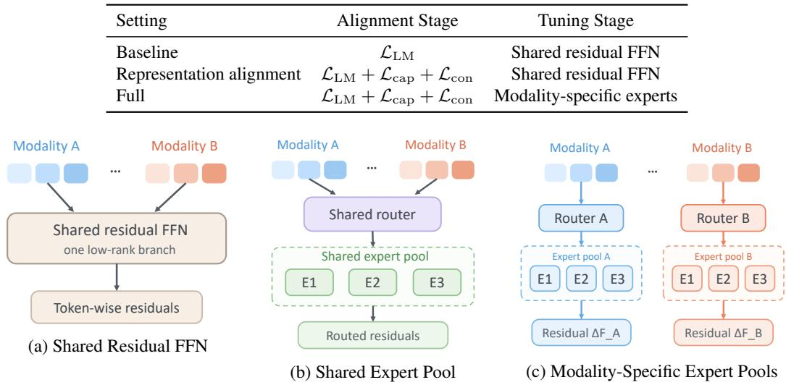  
Figure C7: Illustration of the tuning Stage adaptation architectures. The shared residual FFN in (a) is used in the component ablation, while (b) and (c) compare shared and modality-specific expert pools.

The shared residual FFN is activated only in the tuning Stage, following the same training schedule as the modality-specific experts. This keeps the amount of training data and the number of optimization steps consistent across configurations. We report results on representative benchmarks spanning depth, point cloud, IMU, thermal and radar.

Alignment objectives. All variants retain $\mathcal { L } _ { \mathrm { L M } }$ , the language-modeling loss on downstream instruction–response pairs. We independently enable the two auxiliary objectives during the alignment stage, yielding four settings: (1) task LM only; (2) task LM with conditional captioning $( \mathcal { L } _ { \mathrm { c a p } } ) ;$ (3) task LM with contrastive alignment $( \mathcal { L } _ { \mathrm { c o n } } ) ;$ and (4) task LM with both objectives. All variants use the same sensory front ends, training data, and optimization settings.

Expert architectures. Starting from the sensory representation-aligned setting, we further examine how expert sharing affects the tuning Stage adaptation. We compare a Shared Expert Pool (Fig. C7b), where all sensory modalities route over a common pool of 3 residual experts, with Modality-Specific Expert Pools (Fig. C7c), where each modality uses an independent router and expert pool. Both variants start from the same representation-aligned initialization and retain the frozen pretrained base FFN.

## D ADDITIONAL EXPERIMENTS

Additional Benchmark Results. We further provide additional results on thermal and point-cloud understanding in Tables D14 and D15. UniSense-9B reaches 81.03 average accuracy on IF-Bench and 50.1 class-average accuracy on CLEVR3D-REAL, demonstrating strong performance across both benchmarks.

Expert placement. We study expert placement on two modalities, depth and radar, comparing four strategies: all Transformer layers, the early or late half of the full-attention layers, and all full-attention layers. Table D16 shows that expert placement matters more than simply increasing its layer coverage. While depth exhibits some benchmark-specific preference, restricting experts to full-attention layers yields the most robust performance overall, particularly for radar where it consistently outperforms all alternative placements.

Table D14: Evaluation on IF-Bench. We report the overall average (Avg.) and performance across ten infrared understanding and reasoning categories.
<table><tr><td>Model</td><td>Avg.</td><td>SU</td><td>IT</td><td>VC</td><td>TL</td><td>SRU</td><td>OC</td><td>TFU</td><td>AR</td><td>TFR</td><td>CR</td></tr><tr><td colspan="10">General MLLMs</td></tr><tr><td>InternVL3-2B</td><td>65.6</td><td>91.7</td><td>82.1</td><td>61.9</td><td>56.3</td><td>44.7</td><td>42.1</td><td>55.7</td><td>70.0</td><td>68.2</td><td>83.1</td></tr><tr><td>InternVL3.5-2B</td><td>62.3</td><td>90.5</td><td>86.3</td><td>61.9</td><td>55.7</td><td>44.0</td><td>38.5</td><td>47.7</td><td>67.5</td><td>57.6</td><td>73.0</td></tr><tr><td>InternVL3.5-2B-Thinking</td><td>65.5</td><td>91.0</td><td>89.5</td><td>62.5</td><td>50.2</td><td>46.5</td><td>44.1</td><td>58.9</td><td>68.5</td><td>69.9</td><td>74.0</td></tr><tr><td>Qwen2.5-VL-7B</td><td>71.1</td><td>93.3</td><td>86.5</td><td>74.4</td><td>60.3</td><td>49.5</td><td>42.7</td><td>58.9</td><td>74.0</td><td>88.6</td><td>83.1</td></tr><tr><td>InternVL3-8B</td><td>71.2</td><td>95.0</td><td>87.8</td><td>71.6</td><td>66.4</td><td>51.9</td><td>45.0</td><td>57.7</td><td>79.0</td><td>70.8</td><td>87.1</td></tr><tr><td>InternVL3.5-8B</td><td>69.1</td><td>92.6</td><td>79.7</td><td>66.8</td><td>66.7</td><td>52.3</td><td>45.0</td><td>61.8</td><td>67.7</td><td>82.8</td><td>75.6</td></tr><tr><td>InternVL3.5-8B-Thinking</td><td>72.3</td><td>92.8</td><td>85.5</td><td>65.3</td><td>67.3</td><td>58.6</td><td>47.3</td><td>65.0</td><td>71.0</td><td>91.5</td><td>78.8</td></tr><tr><td>LLaVA-OneVision-1.5-8B-Instruct</td><td>75.9</td><td>95.0</td><td>89.7</td><td>70.9</td><td>73.1</td><td>54.2</td><td>54.6</td><td>62.0</td><td>79.2</td><td>91.9</td><td>88.3</td></tr><tr><td>Qwen3-VL-8B-Instruct</td><td>78.8</td><td>93.9</td><td>93.1</td><td>79.7</td><td>74.1</td><td>65.5</td><td>60.2</td><td>68.6</td><td>75.8</td><td>88.3</td><td>88.9</td></tr><tr><td>Qwen3-VL-8B-Thinking</td><td>76.5</td><td>94.6</td><td>91.2</td><td>74.8</td><td>62.0</td><td>65.3</td><td>58.0</td><td>69.3</td><td>76.7</td><td>89.8</td><td>83.1</td></tr><tr><td>GLM-4.1V-9B-Thinking</td><td>77.2</td><td>94.4</td><td>92.1</td><td>77.8</td><td>67.8</td><td>59.7</td><td>55.0</td><td>69.3</td><td>77.7</td><td>89.4</td><td>88.9</td></tr><tr><td colspan="10">UniSense 74.26 96.1586.4970.6961.64 59.2651.72 70.0072.31 93.22 83.87</td></tr><tr><td>UniSense-2B</td><td></td><td></td><td></td><td></td><td></td><td></td><td></td><td></td><td></td><td></td><td></td></tr><tr><td>UniSense-9B</td><td></td><td>81.03 97.44</td><td>94.59</td><td>81.03</td><td>80.82</td><td>62.9659.77</td><td></td><td></td><td>70.00 80.00</td><td>94.92</td><td>90.32</td></tr></table>

Table D15: Evaluation on CLEVR3D-REAL. We report accuracy (%) across six point-cloud compositional reasoning categories: existence (Exist.), counting (Count.), integer comparison (Comp. Int.), attribute querying (Query Attr.), object querying (Query Obj.), and attribute comparison (Comp. Attr.). Overall denotes accuracy over all test questions, while Cls. Avg. denotes the unweighted average across question categories.
<table><tr><td>Model</td><td>Exist. Count.</td><td></td><td>Comp. Int. Query Attr. Query Obj. Comp. Attr. Overall</td><td></td><td></td><td></td><td></td><td>Cls. Avg.</td></tr><tr><td colspan="9">3D-Specialized Models</td></tr><tr><td>ReferIt3D</td><td>85.4</td><td>26.6</td><td>57.5</td><td>38.3</td><td>11.3</td><td>58.5</td><td>41.8</td><td>46.2</td></tr><tr><td>BEV+MCAN</td><td>85.7</td><td>27.3</td><td>60.0</td><td>39.5</td><td>14.4</td><td>53.7</td><td>42.5</td><td>46.8</td></tr><tr><td>ScanQA</td><td>84.8</td><td>26.3</td><td>55.6</td><td>41.6</td><td>13.2</td><td>54.7</td><td>42.6</td><td>46.0</td></tr><tr><td>TransVQA3D</td><td>88.2</td><td>30.7</td><td>63.1</td><td>37.3</td><td>21.7</td><td>57.1</td><td>43.7</td><td>49.6</td></tr><tr><td>PointQA</td><td>85.9</td><td>29.0</td><td>60.3</td><td>39.9</td><td>23.2</td><td>57.5</td><td>43.9</td><td>49.3</td></tr><tr><td>E2E-MPCQA</td><td>86.8</td><td>30.6</td><td>64.3</td><td>46.1</td><td>9.2</td><td>59.1</td><td>46.7</td><td>49.3</td></tr><tr><td colspan="9">UniSense</td></tr><tr><td>UniSense-2B</td><td>86.5</td><td>18.9</td><td>60.1</td><td>38.7</td><td>18.6</td><td>57.3</td><td>43.2</td><td>46.7</td></tr><tr><td>UniSense-9B</td><td>86.8</td><td>30.4</td><td>64.3</td><td>41.3</td><td>18.9</td><td>59.3</td><td>45.3</td><td>50.1</td></tr></table>

Table D16: Effect of expert placement. We vary the Transformer layers equipped with modalityspecific experts while keeping all other training settings unchanged. Early-half and Late-half denote placing experts in the first and second halves of the full-attention layers, respectively. Full-attn. denotes our default setting, where experts are attached only to full-attention layers.  
(a) Depth understanding.
<table><tr><td>Placement</td><td>SpatialBench Agg.</td><td>RoboSpatial-Home Čonfig.</td></tr><tr><td>All layers</td><td>67.1</td><td>78.0</td></tr><tr><td>Early-half</td><td>69.0</td><td>79.6</td></tr><tr><td>Late-half</td><td>67.6</td><td>77.2</td></tr><tr><td>Full-attn.</td><td>68.0</td><td>80.5</td></tr></table>

(b) Radar understanding.
<table><tr><td>Placement</td><td>Action QA Acc.</td><td>Action Caption METEÓR</td></tr><tr><td>All layers</td><td>63.8</td><td>45.4</td></tr><tr><td>Early-half</td><td>61.2</td><td>45.3</td></tr><tr><td>Late-half</td><td>58.4</td><td>45.1</td></tr><tr><td>Full-attn.</td><td>65.2</td><td>46.1</td></tr></table>

## E VISUALIZATION OF TRAINING SAMPLES

This section presents representative training examples across sensory modalities: depth (Figs. E8 and E9), point cloud (Figs. E10 and E11), IMU (Figs. E12 and E13), thermal (Figs. E14 and E15), tactile (Figs. E16 and E17), radar (Figs. E18 and E19), motion (Figs. E20 and E21), and smell (Figs. E22 and E23). Each example shows the sensory input, its instruction–response pair, and the modality-aware caption used for sensory representation alignment.

Depth. The following examples show paired RGB–depth inputs, instruction–response supervision, and depth-aware captions used for sensory representation alignment.

Answer: 4.6  
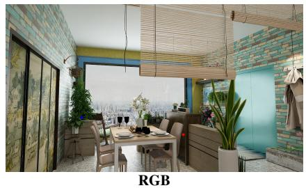

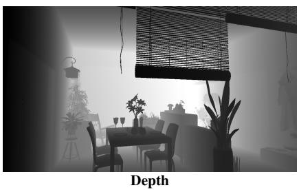  
Question: If the red point lies at a depth of 4.1 meters, how deep is the center of the blue point? Calculate or judge based on the 3D center points of these objects. The unit is meter. Input a single number to complete your answer.

Caption: The dining table and the surrounding chairs are positioned in the foreground, forming the closest major surfaces in the scene. The cabinet and the plant in the lower right are located at a similar depth, slightly farther back than the table but still in the immediate foreground. The large window in the background is clearly the farthest element, creating a significant depth separation from the furniture. The coat hanging on the right side appears at a depth comparable to the cabinet and plant, suggesting it is attached to the same wall plane. The brick-patterned wall on the left and the sliding door are at a depth similar to the wall behind the window, indicating they are part of the same distant background plane. The hanging light is suspended above the table, with its depth falling between the table and the ceiling, and its position is confirmed by the depth discontinuity at the top of the table.

Figure E8: Depth relative-depth QA.  
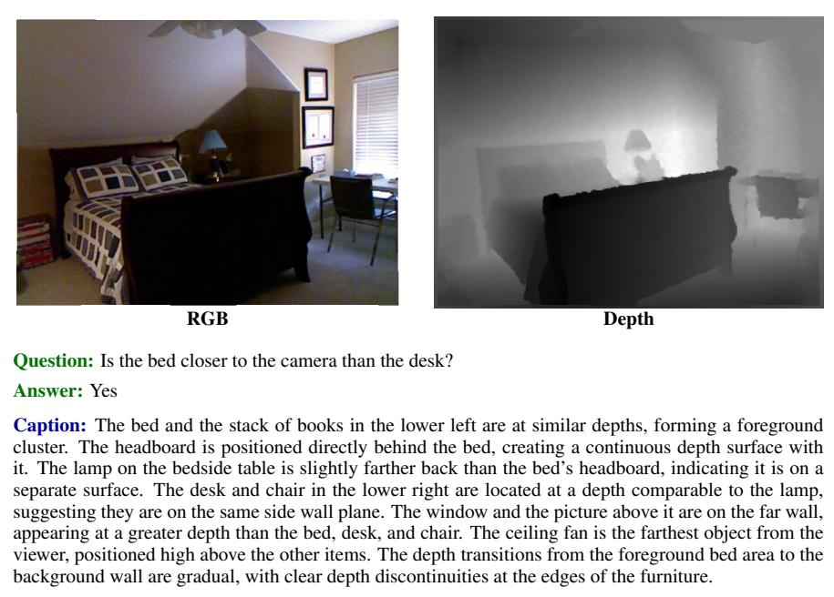  
Figure E9: Depth closeness comparison.

Point Cloud. Each point cloud is rendered from two viewpoints for visualization only; the model receives the underlying 3D point cloud as input. Each example also shows its instruction–response pair and scene-level caption used for sensory representation alignment.

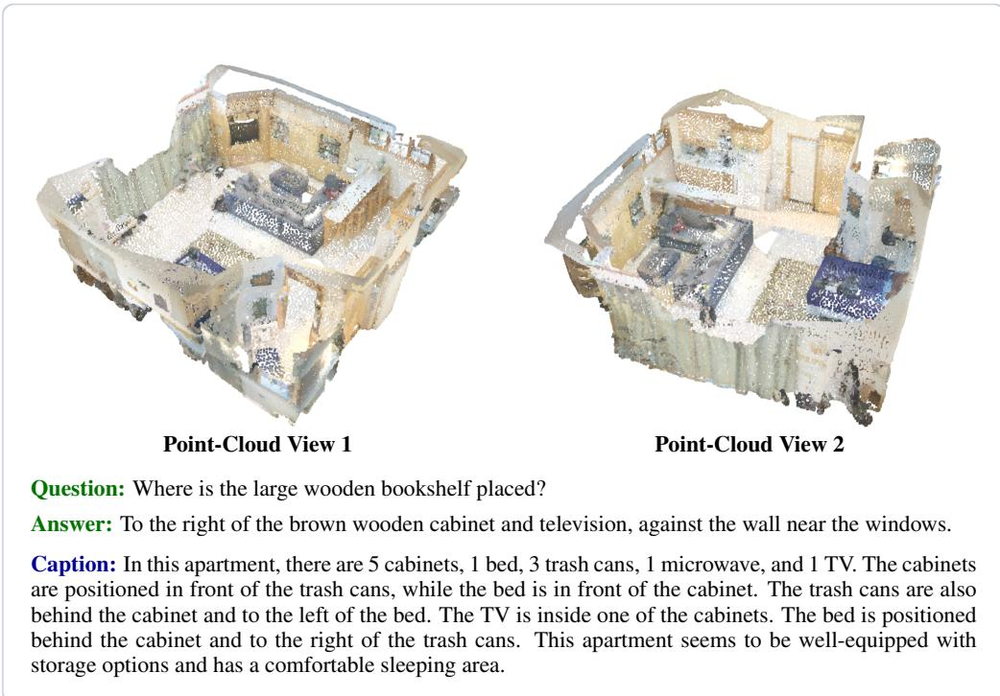  
Figure E10: Point-cloud object localization.

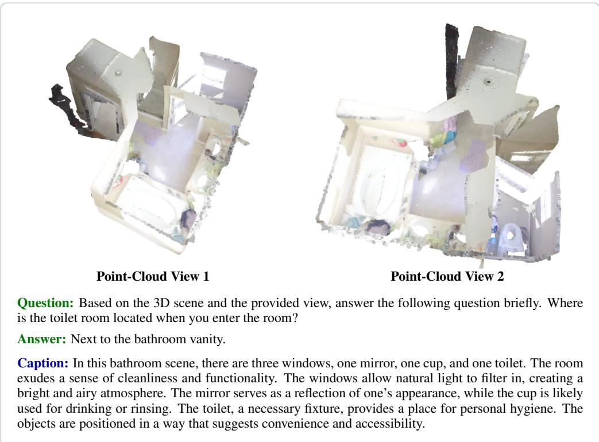  
Figure E11: Point-cloud indoor layout QA.

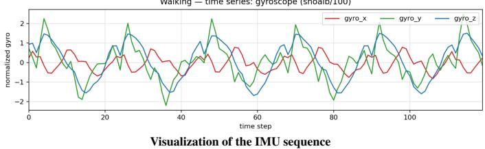

IMU. Each IMU sequence is visualized as accelerometer and gyroscope curves for presentation only; the model receives the underlying six-channel time series. Each example also shows its instruction–response pair and sensor caption used for sensory representation alignment.

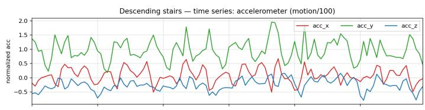

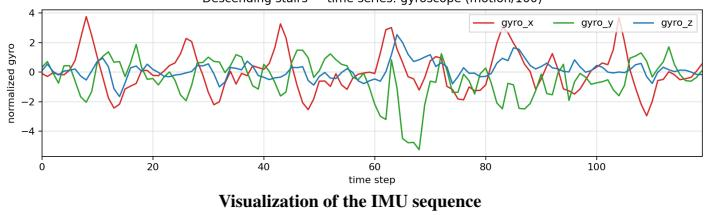

Figure E12: IMU activity classification.  
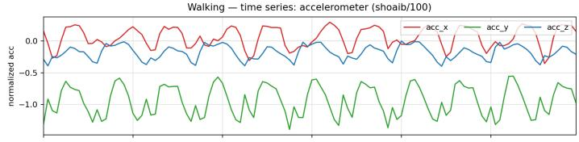  
Figure E13: IMU walking-motion analysis.

Thermal. Each example shows a thermal image, its instruction–response pair, and a temperatureaware caption used for sensory representation alignment.

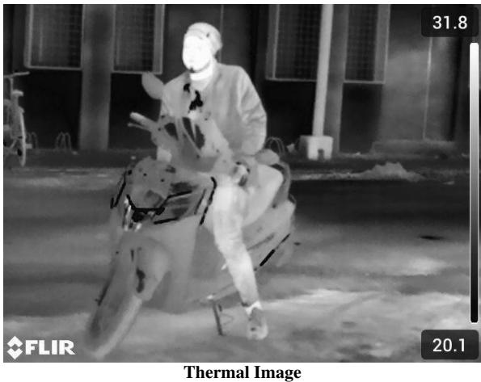  
Question: What part of the image shows the highest temperature? (A) The ground. (B) The background wall. (C) The scooter’s handles. (D) The person’s head.

Caption: From left to right, the image shows the front of a scooter, a rider in the center, and the rear part of the scooter. A building and road appear in the background. Whiter regions indicate higher temperatures; the rider’s face, neck, and exposed leg are warmer than the clothing and scooter, while the road and building appear cooler.  
Figure E14: Thermal hotspot identification.
<table><tr><td>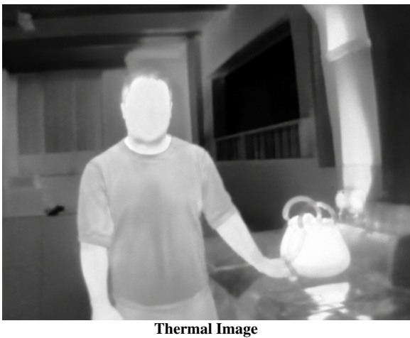</td></tr><tr><td>Question: What object is emitting the most heat in the image? (A) The curtains in the background. (B) The kettle on the table. (C) The ceiling above. (D) The person standing. Answer: B Caption: From left to right, the image shows a doorway, a person standing in the center, and a kettle on a countertop. The walls, window, and columns are visible in the background. Whiter regions indicate higher temperatures; the person&#x27;s face and exposed arms are warmer than the clothing, while the kettle</td></tr></table>

Figure E15: Thermal heat-source identification.

Tactile. Each tactile observation is represented by three sampled frames. Single-object examples contain one frame triplet, whereas multi-object examples contain a separate triplet for each object. The corresponding instruction–response pair and tactile property caption are shown below.  
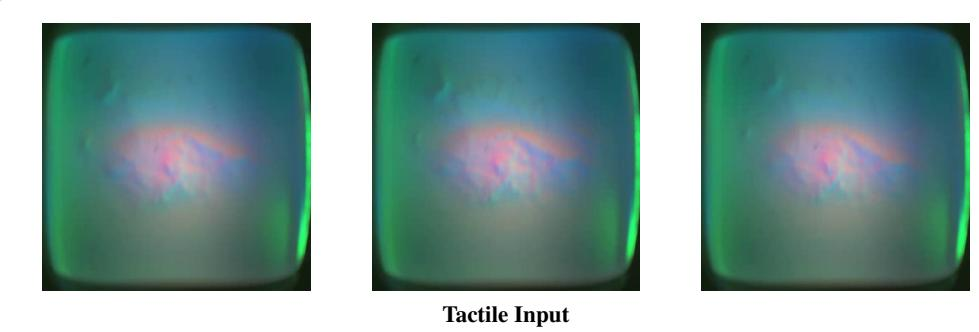  
Question: Can you describe the surface characteristics shown in this tactile video? Answer: The surface is extremely hard, with strong protrusions, no elasticity, and strong friction. Caption: The surface is extremely hard, with strong protrusions, no elasticity, and strong friction.

Figure E16: Tactile surface description.  
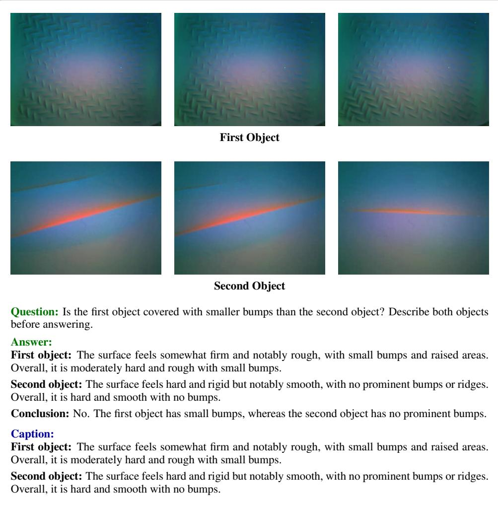  
Figure E17: Tactile two-object comparison.

Radar. Each radar sequence is visualized using sampled point-cloud frames and signal heatmaps for presentation only; the model receives the underlying temporal mmWave point clouds. Each example also shows its instruction–response pair and action caption used for sensory representation alignment.

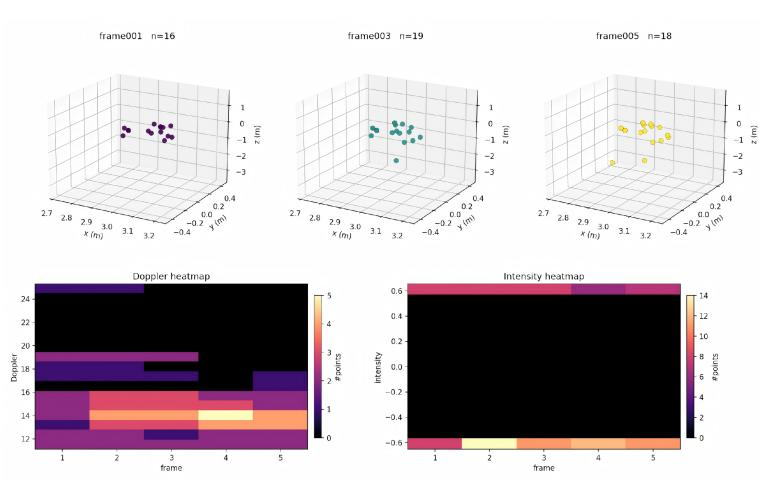  
Visualization of the radar sequence

Question: Identify a suitable phrase from the action list that describes the human action represented by the input data.

Action List: stretching and relaxing; horizontal chest expansion; vertical chest expansion; left twist; right twist; mark time; left limb extension; right limb extension; lunge toward left-front; lunge toward right-front; both limb extension; squat; raising left hand; raising right hand; lunge toward left side; lunge toward right side; waving left hand; waving right hand; picking up things; throwing toward left side; throwing toward right side; kicking toward left side; kicking toward right side; left body extension; right body extension; jumping up; bowing.

Answer: stretching and relaxing

Caption: The radar sequence shows a person in a room performing gentle full-body stretches to warm up and relax their muscles.

Figure E18: Radar action recognition.  
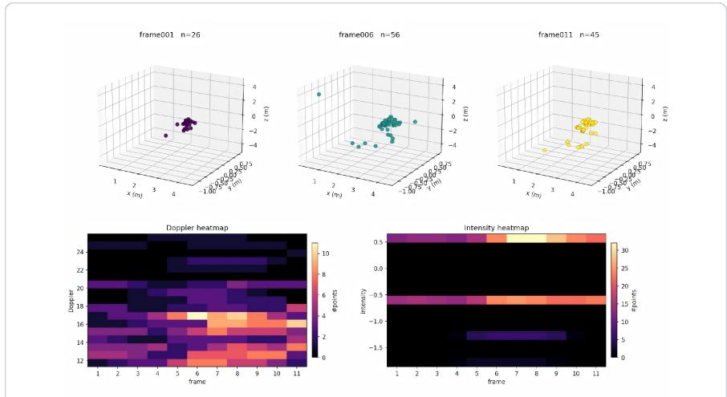  
Visualization of the radar sequence  
Question: Which twist direction is shown in this interval? Answer with only one word: left or right. Answer: left

Caption: The person in the radar sequence performs a left twist, rotating their torso to the left in a focused movement centered around the waist.

Figure E19: Radar twist-direction QA.

Motion. Each skeleton-motion sequence is visualized using sampled poses and joint trajectories for presentation only; the model receives the underlying sequence of 3D joint coordinates. Each example also shows its instruction–response pair and temporal caption used for sensory representation alignment.  
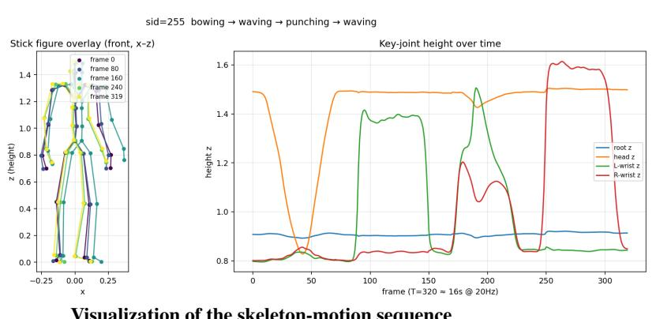  
Visualization of the skeleton-motion sequence

Caption: The first action is bowing, which lasts from 0.0 to 4.0 seconds. The person then waves from 4.0 to 8.0 seconds, punches from 8.0 to 12.0 seconds, and waves again from 12.0 to 16.0 seconds.

Figure E20: Motion temporal comparison.  
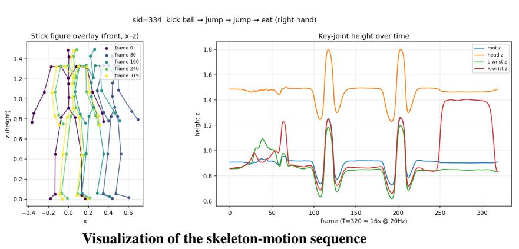  
Figure E21: Motion action sequencing.

Smell. Each smell sensor sequence is visualized as six-channel response curves for presentation only; the model receives the underlying numerical measurements. Each example also shows its instruction–response pair and sensor caption used for sensory representation alignment.  
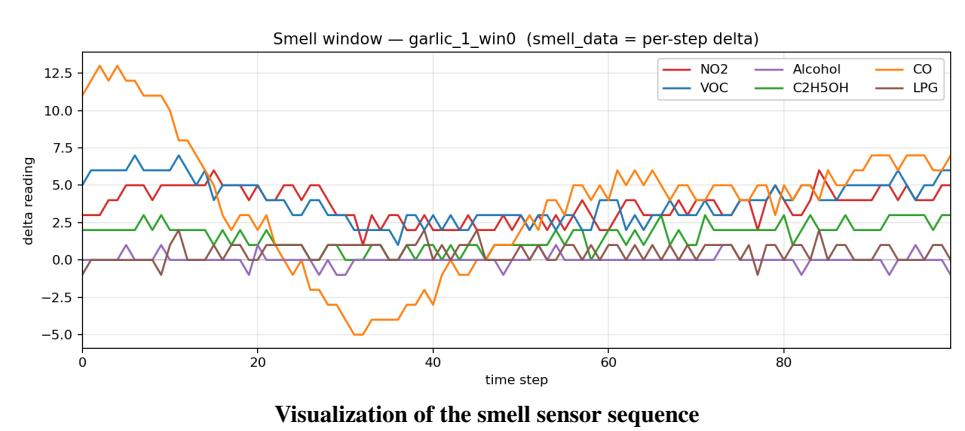  
Question: The given smell sensor reading can be associated with one of the following substances: allspice, almond, angelica, apple, asparagus, avocado, banana, brazil nut, broccoli, brussel sprouts, cabbage, cashew, cauliflower, chamomile, chervil, chestnuts, chives, cinnamon, cloves, coriander, cumin, dill, garlic, ginger, hazelnut, kiwi, lemon, mandarin orange, mango, mint, mugwort, mustard, nutmeg, oregano, peach, peanuts, pear, pecans, pili nut, pineapple, pistachios, potato, radish, saffron, star anise, strawberry, sweet potato, tomato, turnip, and walnuts. Write only the name of the identified substance.

Answer: garlic

Caption: Features: CO and VOC peak in Q1 and then fall to troughs by Q3–Q4 before rebounding. NO declines until Q4 and then rises, while $\mathrm { C _ { 2 } H _ { 5 } O H }$ reaches its minimum at Q3 before increasing through Q8. LPG exhibits little variation.

Figure E22: Smell substance identification.  
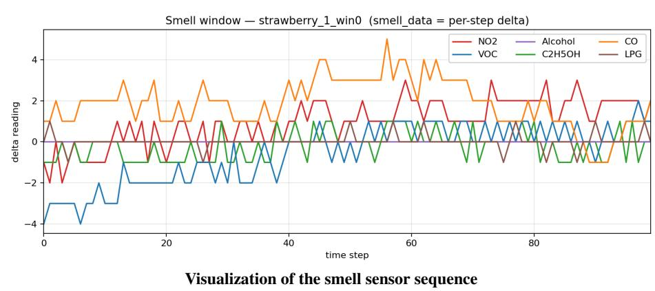  
Caption: Features: NO2 dips at Q1 then climbs steadily to a peak in Q7, easing in Q8; CO rises to a Q5 peak then drops to trough at Q8; VOC rebounds from Q1 trough to Q6 peak then softens; C2H5OH rises to Q5 then falls; Alcohol and LPG stay close to unchanged.  
Figure E23: Smell multiple-choice recognition.