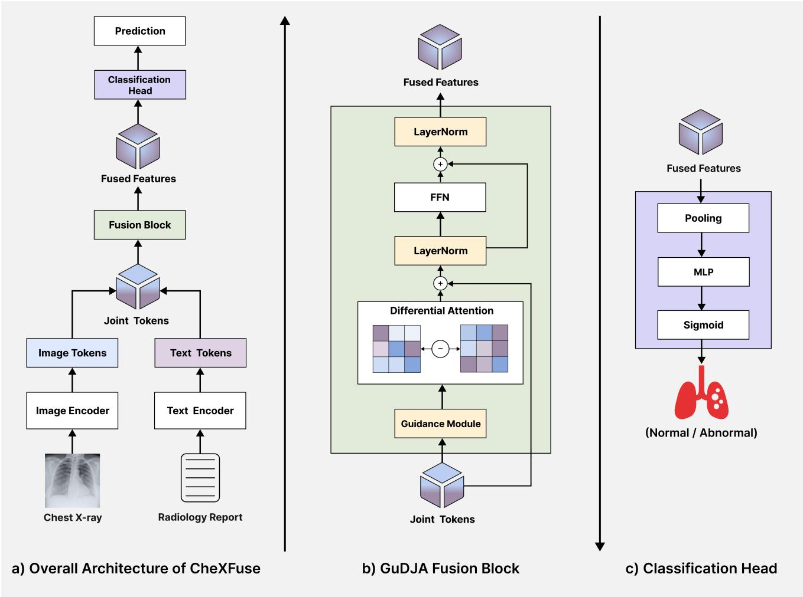

# CheXFuse: Guided Differential Joint Attention Fusion for Robust Multimodal Chest X-Ray Classification in Data-Scarce Medical Settings

Muntaqim Ahmed Raju∗, Priyanka Siddappa∗, Md Shifat Haider Al Amin∗

Ruizhe Ma∗, and Md Ripon Ahammed†

∗University of Massachusetts Lowell, USA

†NYC Health & Hospitals/Jacobi-NCB, USA

Email: {MuntaqimAhmed Raju, Priyanka Siddappa, MdShifat AlAmin}@student.uml.edu Ruizhe Ma@uml.edu, Ripon.Ahammed90@gmail.com

Abstract—A central challenge in multimodal learning is how to fuse modalities that differ substantially in predictive strength. When one modality provides a much stronger representation than another, indiscriminate cross-modal interaction can introduce weak, redundant, or unstable signals, limiting or even degrading performance relative to the strongest unimodal representation. To address this problem, we propose CheXFuse, a multimodal fusion framework based on Guided Differential Joint Attention (GuDJA). CheXFuse combines image and text token representations within a joint multimodal sequence, where learned token guidance emphasizes informative representations and differential attention reduces less useful attention responses. We evaluate CheXFuse on the Indiana University (IU) Chest Xray dataset, using binary (normal vs. abnormal) classification as the downstream task. Experiments are conducted under both original-report and masked-report settings, with the latter serving as a controlled stress test under reduced textual informativeness. CheXFuse with GuDJA achieves the strongest mean overall performance across the evaluated baselines and ablations, reaching 95.73% accuracy, 95.79% F1-score, 96.54% recall, and 95.28% sensitivity at 95% specificity (Sens@95Spec) with original reports, and 95.58%, 95.60%, 95.60%, and 94.34%, respectively, under masked reports. These results suggest that GuDJA provides a promising fusion strategy under asymmetric or partially reduced modality informativeness.

Index Terms—Multimodal learning, image–report fusion, guided attention, differential attention, modality asymmetry, robust fusion, chest X-ray classification.

## I. INTRODUCTION

Multimodal learning aims to integrate information from heterogeneous sources to construct representations that capture complementary information across modalities. However, effective multimodal fusion remains challenging because different modalities can exhibit distinct representation structures, statistical properties, and learning behaviors [1]–[3]. Importantly, access to multiple modalities does not necessarily guarantee better predictive performance than the strongest unimodal representation; prior work has shown that multimodal models can underperform unimodal counterparts when the constituent modalities differ in their learning and generalization behavior [4]. These observations motivate fusion mechanisms that can selectively integrate useful cross-modal information while limiting the influence of weak or redundant interactions.

Paired chest radiographs and radiology reports provide a particularly relevant image–text setting for studying this problem. Public radiology collections associate chest radiographs with free-text reports written to document the radiographic examination [5], [6]. The two modalities encode information about the same clinical case in fundamentally different forms: radiographs represent anatomical and pathological patterns spatially, whereas reports provide contextual language describing radiographic observations and their clinical interpretation. This structural and semantic heterogeneity makes paired chest radiograph–report data particularly suitable for studying how visual and textual representations can be fused effectively.

Prior studies have explored chest radiograph–report learning through attention-based interaction, semantic supervision, and multimodal representation learning. TieNet jointly modeled vi sual and textual information for thoracic disease classification and report generation [7], while TandemNet used diagnostic reports as semantic references for medical image classification [8]. More recent approaches, including ConVIRT, GLoRIA, BioViL, and MedKLIP, have demonstrated the value of paired radiographs and reports for medical representation learning, label-efficient classification, and image–text alignment [9]– [12]. Together, these studies establish the value of paired image–text information for learning radiographic representations and motivate further investigation of how the two modalities should interact during downstream multimodal learning.

A remaining challenge is that the two modalities may contribute very differently to the prediction task. Radiology reports can contain highly discriminative semantic information, whereas subtle visual abnormalities may be more difficult for an image encoder to capture, particularly when training data are limited. Consequently, image–report learning can operate under strongly asymmetric modality informativeness. In such settings, additional cross-modal interaction does not necessarily improve the resulting representation and may instead introduce weak or redundant information into an otherwise strong unimodal representation. The problem becomes more difficult when modality informativeness varies across samples or is partially reduced. Effective fusion therefore requires not only combining the modalities, but also controlling which cross-modal interactions are allowed to influence the final representation.

Attention-based fusion provides a natural framework for modeling such interactions because it preserves token- or region-level structure. However, conventional attention typically determines interaction strength through normalized similarity scores and may therefore retain responses that are redundant or only weakly informative. When modality informativeness is uneven, such interactions can limit the benefit of multimodal fusion. This motivates a more selective mechanism that can emphasize useful representations before attention is computed while suppressing less informative attention responses during interaction.

In our prior work, guided feature emphasis was used to prioritize task-relevant representations in medical imaging [13]. Building on this broader principle, we combine learned token guidance with differential attention. Token guidance modulates the representations before attention is computed, enabling the model to emphasize image and text tokens that are more useful for subsequent interaction. Differential attention provides a complementary mechanism by forming two attention distributions and subtracting one from the other, thereby offering a means of reducing less informative responses [14]. The two mechanisms are complementary: guidance controls which representations enter the interaction, while differential attention controls which attention responses are retained.

Based on this motivation, we propose CheXFuse, a multimodal fusion framework based on Guided Differential Joint Attention (GuDJA). CheXFuse uses a CheXNet-14 pretrained DenseNet121 encoder to obtain spatial radiograph tokens and BioClinicalBERT to obtain contextual report tokens. The two token sequences are combined within a joint multimodal representation. GuDJA first applies learned guidance to modulate the representations entering attention and then performs differential attention to reduce less useful responses. We evaluate CheXFuse using paired chest radiographs and radiology reports from the Indiana University (IU) Chest X-ray dataset, with binary (normal vs. abnormal) classification serving as the downstream evaluation task. This data-scarce paired image–text setting exhibits substantial modality asymmetry and therefore provides a challenging setting for evaluating the proposed fusion mechanism. We consider two complementary conditions. The original-report setting evaluates fusion when the complete report is available, while a controlled maskedreport setting weakens explicit diagnostic keywords, negation expressions, and label-associated textual shortcuts. The masked condition therefore serves as a stress test in which the informativeness of the dominant textual modality is partially reduced. These experiments are intended to characterize the behavior of the proposed fusion mechanism under different levels of modality informativeness.

The main contributions of this work are summarized as follows:

• We formulate paired chest radiograph–report classification as a robust multimodal fusion problem under asymmetric modality informativeness, where additional crossmodal interaction does not necessarily improve upon a strong unimodal representation.

• We propose CheXFuse with Guided Differential Joint Attention (GuDJA), which combines learned token guidance with differential attention to selectively strengthen informative joint interactions while reducing less useful attention responses.

• We introduce a controlled hybrid report-masking strategy that weakens explicit diagnostic keywords, negation expressions, and label-associated textual shortcuts to evaluate fusion robustness when the informativeness of the dominant textual modality is partially reduced.

## II. METHOD

This section describes CheXFuse, a multimodal fusion framework evaluated on paired chest radiograph–report classification. Fig. 1 illustrates the overall architecture, which consists of separate image and text encoders, token-level multimodal fusion through the proposed GuDJA module, and a classification head for binary prediction.

Given a paired chest $_ { \mathrm { X - r a y } }$ image and radiology report sample $( x _ { I } , x _ { T } , y )$ , where $x _ { I }$ denotes the input image, xT denotes the corresponding report text, and $y ~ \in ~ \{ 0 , 1 \}$ is the binary class label, our objective is to predict whether the image-report pair corresponds to a normal or abnormal case. The overall fusion framework consists of three main components: image feature extraction, text feature extraction, and the proposed GuDJA fusion module.

First, we extract spatial visual tokens from the input chest X-ray image using a CheXNet-14 pretrained DenseNet121 encoder. Let $E _ { I } ( \cdot )$ denote the image encoder. Given an input image $x _ { I }$ , the convolutional backbone produces a spatial feature map:

$$
F _ { I } = E _ { I } ( x _ { I } ) ,\tag{1}
$$

where $F _ { I } \in \mathbb { R } ^ { B \times C \times H ^ { \prime } \times W ^ { \prime } }$ , B is the batch size, $C$ is the number of feature channels, and $H ^ { \prime }$ and $W ^ { \prime }$ denote the height and width of the spatial feature map. The feature map is then projected into a shared multimodal embedding dimension d using a $1 \times 1$ convolution:

$$
{ \tilde { F } } _ { I } = P _ { I } ( F _ { I } ) ,\tag{2}
$$

where $\tilde { F } _ { I } \in \mathbb { R } ^ { B \times d \times H ^ { \prime } \times W ^ { \prime } }$ and $\textstyle P _ { I } ( \cdot )$ denotes the projection layer. The projected feature map is flattened along the spatial dimensions to obtain a sequence of image tokens:

$$
H _ { I } = \mathrm { F l a t t e n } ( \tilde { F } _ { I } ) ,\tag{3}
$$

where $H _ { I } \ \in \ \mathbb { R } ^ { B \times N _ { I } \times d }$ and $N _ { I }$ is the number of image tokens. Layer normalization and learnable image positional embeddings are applied to preserve spatial information in the token representation:

  
Fig. 1. Overview of the proposed CheXFuse framework, consisting of separate image and text encoders, token-level multimodal fusion through the GuDJA module, and a classification head for binary (normal vs. abnormal) prediction.

$$
\begin{array} { r } { H _ { I } = \mathrm { L N } ( H _ { I } ) + P _ { \mathrm { p o s } } ^ { I } . } \end{array}\tag{4}
$$

For textual representation, the radiology report $x _ { T }$ is tokenized and passed through a BioClinicalBERT encoder. Let $E _ { T } ( \cdot )$ denote the text encoder and m denote the text attention mask, where valid tokens are assigned 1 and padding tokens are assigned 0. The text encoder produces contextual token embeddings from the final hidden layer:

$$
H _ { T } = E _ { T } ( x _ { T } , m _ { T } ) ,\tag{5}
$$

where $H _ { T } ~ \in ~ \mathbb { R } ^ { B \times N _ { T } \times d }$ and $N _ { T }$ is the number of text tokens.

Next, the image and text token sequences are concatenated to form a joint multimodal token representation:

$$
H = \mathrm { c o n c a t } ( H _ { I } , H _ { T } ) ,\tag{6}
$$

where $H \in \mathbb { R } ^ { B \times N \times d }$ and $N = N _ { I } + N _ { T }$ . Image tokens are treated as valid tokens, while text padding tokens are ignored using the text attention mask. This joint token sequence is then passed to the proposed GuDJA module.

The guided component learns token-wise attention masks before applying differential attention over the joint imagetext sequence. Specifically, query and key guidance masks are computed as:

$$
G _ { Q } = \sigma ( W _ { g Q 2 } \delta ( W _ { g Q 1 } H ) ) ,\tag{7}
$$

$$
G _ { K } = \sigma ( W _ { g K 2 } \delta ( W _ { g K 1 } H ) ) ,\tag{8}
$$

where $\delta ( \cdot )$ denotes the ReLU activation function and $\sigma ( \cdot )$ denotes the sigmoid function. These masks are used to modulate the joint token sequence:

$$
H _ { Q } = H \odot G _ { Q } ,\tag{9}
$$

$$
{ \cal H } _ { K } = { \cal H } \odot { \cal G } _ { K } , \quad { \cal H } _ { V } = { \cal H } \odot { \cal G } _ { K } ,\tag{10}
$$

where $\odot$ denotes element-wise multiplication. This guidance mechanism allows the model to emphasize informative image-text tokens while reducing the effect of less relevant token interactions.

After guidance, differential attention is applied to the guided joint representation. Instead of using a single attention map, differential attention computes two separate attention distributions and subtracts one from the other to suppress noisy or redundant interactions. Given the guided query, key, and value representations, the projections are computed as:

$$
Q _ { 1 } = H _ { Q } W _ { Q _ { 1 } } , \quad K _ { 1 } = H _ { K } W _ { K _ { 1 } } ,\tag{11}
$$

$$
Q _ { 2 } = H _ { Q } W _ { Q _ { 2 } } , \quad K _ { 2 } = H _ { K } W _ { K _ { 2 } } ,\tag{12}
$$

$$
V = H _ { V } W _ { V } .\tag{13}
$$

The differential attention output is then defined as:

$$
\begin{array} { r l } & { \mathrm { D i f f A t t n } ( H _ { Q } , H _ { K } , H _ { V } ) = \Bigg [ \mathrm { s o f t m a x } \left( \frac { Q _ { 1 } K _ { 1 } ^ { T } } { \sqrt { d _ { h } } } \right) } \\ & { ~ - ~ \lambda \mathrm { s o f t m a x } \left( \frac { Q _ { 2 } K _ { 2 } ^ { T } } { \sqrt { d _ { h } } } \right) \Bigg ] V , } \end{array}\tag{14}
$$

where $d _ { h }$ is the dimension of each attention head and λ is a learnable scalar controlling the contribution of the subtractive attention term. In our implementation, the underlying learnable parameter is initialized to 0.5 and constrained using a sigmoid function, i.e., $\lambda = \sigma ( 0 . 5 ) \approx 0 . 6 2 2$ at initialization. The attention logits corresponding to padded text tokens are masked before the softmax operation, ensuring that padding tokens do not contribute to the attention weights.

The output of the GuDJA module is followed by a residual connection, layer normalization, and a feed-forward network:

$$
\begin{array} { r } { \hat { H } = \mathrm { L N } ( H + \mathrm { D i f f A t t n } ( H _ { Q } , H _ { K } , H _ { V } ) ) , } \end{array}\tag{15}
$$

$$
H _ { F } = \mathrm { L N } ( \hat { H } + \mathrm { F F N } ( \hat { H } ) ) .\tag{16}
$$

Finally, a padding-aware mean pooling operation is applied over the valid joint tokens to obtain the final multimodal representation:

$$
z = \frac { \sum _ { i = 1 } ^ { N } M _ { i } H _ { F , i } } { \sum _ { i = 1 } ^ { N } M _ { i } } ,\tag{17}
$$

where $M _ { i }$ indicates whether the i-th token is valid. The pooled representation z is passed to a multilayer classification head:

$$
\ell = f _ { c } ( z ) ,\tag{18}
$$

where ℓ is the output logit. The final abnormality probability is computed using the sigmoid function:

$$
{ \hat { y } } = \sigma ( \ell ) .\tag{19}
$$

Thus, CheXFuse performs token-level multimodal fusion by jointly modeling spatial radiograph tokens and contextual report tokens within a shared representation. GuDJA introduces two complementary operations: learned token-level guidance selectively weights the representations entering attention, while differential attention uses a subtractive combination of two attention distributions to reduce less useful attention responses. This design provides a more selective joint interaction mechanism for settings in which image and text modalities may differ substantially in predictive strength and informativeness.

## III. EXPERIMENTAL EVALUATION

## A. Dataset

We evaluate the proposed CheXFuse framework using the IU Chest X-ray dataset [5], as it reflects the data-scarce medical setting. The dataset consists of 8,121 images and 3,996 associated radiology reports [5]. In this study, the report text is extracted from the FINDINGS section, while the binary (normal vs. abnormal) label is derived from the MeSH major field. Since the image encoder uses CheXNet-14 pretrained weights based on DenseNet121, we retain only frontal-view chest radiographs. This ensures consistency with the CheXNet-14 pretraining domain, which used over 100,000 frontal chest radiographs for 14-label thoracic disease classification [15]. After filtering non-frontal and unmatched image-report pairs, we construct a balanced dataset for binary (normal vs. abnormal) classification. The final processed dataset contains 2,129 paired samples, where each sample consisted of one frontal chest radiograph, its corresponding radiology report, and a binary class label. Abnormal cases are encoded as 1, while normal cases are encoded as 0. The dataset is partitioned at the patient level using an approximate 70/20/10 train-validationtest split, resulting in 1,490 training samples, 428 validation samples, and 211 test samples. The training and validation sets are class-balanced, while the test set is approximately balanced, containing 50.24% abnormal and 49.76% normal cases.

## B. Masked-Report Robustness Setting

In addition to evaluation with the original report text, we introduce a masked-report setting as a controlled stress test under reduced textual informativeness. The objective is to examine how unimodal and multimodal models behave when highly discriminative textual cues are partially weakened. Explicit diagnostic keywords, negation phrases, and label-associated shortcut expressions are therefore selectively masked while preserving the remaining report context. This setting does not remove the textual modality entirely; rather, it reduces some of its most direct diagnostic signals and enables evaluation of fusion robustness when the informativeness of the dominant textual modality is partially reduced. The masked reports are generated from the original findings text using a hybrid masking strategy. First, rule-based diagnostic shortcut and negation expressions are identified, including phrases such as “within normal limits”, “lungs are clear”, “no pneumothorax”, and “no pleural effusion”. Second, discriminative clinical keywords associated with normal and abnormal reports are identified, including terms such as “normal”, “clear”, “opacity”, “effusion”, “pneumothorax”, and “cardiomegaly”. Third, data-driven phrase mining is performed exclusively on the training set using document-level statistics over 1–4-grams. Candidate phrases occurring in at least five training reports are ranked according to the magnitude of their smoothed label-association score, and the top 60 phrases are retained. The mined phrases are combined with the rule-based shortcut expressions, and the resulting masking rules are then applied unchanged to the validation and test sets. Selected spans are replaced with the [MASK] token. Negation and shortcut phrases are always masked, whereas individual normality- and abnormality-associated clinical keywords are independently masked with probability 0.5. A fixed random seed is used to ensure deterministic generation of the masked datasets. The resulting masked text is used as an alternative report input for evaluating model behavior when explicit textual diagnostic information is partially reduced. Table I shows examples of the masking strategy applied to radiology reports. The masked reports preserve the general sentence structure while reducing explicit diagnostic cues, negation expressions, and label-associated shortcut phrases.

TABLE I  
EXAMPLES OF ORIGINAL AND MASKED RADIOLOGY REPORTS.
<table><tr><td>Chest X-ray</td><td>Label</td><td>Original Report</td><td>Masked Report</td></tr><tr><td></td><td>Abnormal</td><td>There is diffuse right-sided airspace disease, with dense consolidation in the right base. A right upper extremity PICC is seen with the tip in the right brachiocephalic vein, representing an interval retraction of approximately 6 cm. No pneumothorax or large effusions. Heart size within normal limits.</td><td>There is diffuse right-sided [MASK], with [MASK] in the right base. A right upper extremity PICC is seen with the tip in the right brachiocephalic vein, representing an interval retraction of approximately 6 cm. [MASK]. Heart size within [MASK].</td></tr><tr><td></td><td></td><td></td><td></td></tr><tr><td></td><td>Normal</td><td>The lungs are clear. There is no pleural effusion or pneumothorax. The heart and mediastinum are normal. The skeletal structures are normal.</td><td>The lungs are [MASK]. There is [MASK]. The heart and mediastinum are [MASK]. The skeletal structures are [MASK].</td></tr></table>

## C. Experimental Setup

All experiments are conducted using the processed IU Chest X-ray dataset described above. Each sample consists of a frontal chest radiograph, its corresponding radiology report, and a binary (normal vs. abnormal) label. The original FINDINGS text is used in the original-report setting, while the corresponding masked report is used in the masked-report setting. The same training, validation, and test splits are used across all evaluated models to ensure a consistent comparison.

For the image branch, we use a DenseNet121 encoder initialized with CheXNet-14 pretrained weights. Because the pretrained backbone was previously optimized on a large collection of frontal chest radiographs, we keep the DenseNet121 feature extractor frozen and train only the image-token projection layer together with the subsequent multimodal fusion components. This fixed-feature strategy preserves the pretrained radiographic representation while reducing the number of trainable parameters in the data-scarce IU setting. During training, images are transformed using random resized cropping to 224 × 224 and horizontal flipping. For validation and testing, images are resized to 256 × 256 and center-cropped to 224 × 224. All images are normalized using the ImageNet mean and standard deviation.

For the text branch, we use BioClinicalBERT to encode the radiology reports. Each report is tokenized with a maximum sequence length of 128 tokens. Text sequences shorter than this length are padded, while longer reports are truncated. The corresponding attention masks are used during fusion to prevent padded tokens from contributing to attention and pooling operations. Unlike the frozen image backbone, the BioClinicalBERT encoder is fine-tuned during multimodal training.

All fusion models use a shared embedding dimension of d = 768 and 8 attention heads, with a dropout rate of 0.2. The final classifier consists of a fully connected layer, ReLU activation, dropout, and a final linear layer that outputs a single logit for binary classification.

The multimodal fusion models are trained using binary cross-entropy with logits loss and optimized using AdamW with a learning rate of $1 \times 1 0 ^ { - 4 }$ and weight decay of $1 \times 1 0 ^ { - 4 }$ A StepLR scheduler is applied with a step size of 3 and decay factor $\gamma = 0 . 1$ . The batch size is 16, and training proceeds for up to 10 epochs. Early stopping is based on validation accuracy with a patience of 3 epochs and a minimum improvement threshold of $1 \times 1 0 ^ { - 4 }$

For the image-only baseline, the same CheXNet-14 pretrained DenseNet121 backbone is used, but the backbone is fine-tuned jointly with the binary classification head. The model is optimized using AdamW with a learning rate of $1 \times 1 0 ^ { - 3 }$ and weight decay of $1 \times 1 0 ^ { - 4 }$ , while retaining the same batch size, scheduler, maximum number of epochs, and early-stopping protocol used for the multimodal experiments.

Each experiment is repeated using three random seeds: 7, 42, and 123 to account for variability due to random initialization and data shuffling. For each seed, model selection is based on validation accuracy, and the selected checkpoint is evaluated on the held-out test set. Final results are reported as mean ± standard deviation across the three runs.

## D. Evaluation Metrics

We evaluate all models using accuracy, F1-score, recall, and sensitivity at 95% specificity (Sens@95Spec). Sens@95Spec measures sensitivity using a decision threshold selected on the validation set to correspond to the operating point whose specificity is closest to 95%. For each run, this validationselected threshold is then applied unchanged to the heldout test set, and the resulting test sensitivity is reported as Sens@95Spec.

For all reported results, the abnormal class is treated as the positive class. Accordingly, recall and Sens@95Spec both quantify the ability to correctly identify abnormal cases, but under different operating conditions: recall is computed at the default classification threshold, whereas Sens@95Spec is computed on the test set using the threshold corresponding to specificity closest to 95% on the validation set.

## E. Results and Discussion

Tables II and III report the classification performance of the unimodal and multimodal baselines, ablation variants, and the proposed CheXFuse with GuDJA under the original-report and masked-report settings, respectively. Results are reported as ${ \mathrm { m e a n ~ } } \pm$ standard deviation over three random seeds. We use these results to examine modality asymmetry, the behavior of conventional fusion mechanisms, and the contribution of guided differential joint attention under different levels of textual informativeness.

We first evaluated the relative predictive strength of the two modalities using unimodal baselines. The image-only model achieved $7 0 . 4 6 \pm 0 . 7 2 \%$ accuracy, $6 5 . 0 9 \pm 7 . 7 2 \%$ recall, and $1 8 . 2 4 \pm 3 . 0 3 \%$ Sens@95Spec. In contrast, the text-only model achieved substantially stronger performance with original reports, reaching $9 5 . 2 6 \pm 0 . 0 7 \%$ accuracy, $9 5 . 9 1 \pm 1 . 0 9 \%$ recall, and $9 3 . 4 0 \pm 1 . 8 9 \%$ Sens@95Spec. This large performance gap indicates a strongly asymmetric multimodal setting in which the radiology-report modality provides considerably more discriminative information than the image-only representation on the processed IU Chest X-ray dataset. Consequently, an effective multimodal fusion method must not only incorporate complementary visual information, but also avoid degrading an already strong textual representation through weak or less informative cross-modal interactions.

When masked reports were used, the text-only model maintained high overall accuracy at $9 4 . 9 4 \pm 0 . 2 7 \%$ , while recall decreased from $9 5 . 9 1 { \pm } 1 . 0 9 \%$ to $9 4 . 0 3 { \pm } 0 . 5 4 \%$ . Sens@95Spec remained high at $9 3 . 0 1 \pm 1 . 9 1 \%$ . These results show that the report representation remains strongly predictive even after explicit diagnostic cues are partially reduced, although the decrease in recall indicates some sensitivity to the removed textual information. The masked-report setting therefore provides a controlled stress test in which the informativeness of the dominant textual modality is reduced without eliminating its remaining semantic context.

To examine whether conventional multimodal interaction can improve upon this strong textual baseline, we next evaluated a text-to-image cross-attention model. With original reports, cross-attention achieved $9 4 . 6 5 { \pm } 1 . 4 4 \%$ Sens@95Spec, numerically exceeding the $9 3 . 4 0 \pm 1 . 8 9 \%$ obtained by the text-only baseline at this operating point. However, its overall performance did not consistently exceed the text-only representation. More importantly, under the masked-report setting, Sens@95Spec decreased to $8 8 . 6 8 \pm 2 . 5 0 \%$ . This result illustrates that introducing cross-modal interaction does not necessarily improve a strong unimodal representation and may become less reliable when the informativeness of the report modality changes.

A similar pattern was observed with standard joint selfattention. With original reports, joint self-attention achieved $9 5 . 2 6 \pm 0 . 4 7 \%$ accuracy, comparable to the text-only baseline, but its Sens@95Spec was lower at $9 1 . 8 2 \pm 1 . 4 4 \%$ Under masked reports, accuracy remained relatively high at $9 5 . 1 0 { \pm } 0 . 2 7 \%$ , whereas Sens@95Spec decreased substantially to $8 3 . 3 3 \pm 1 5 . 8 2 \%$ . The large standard deviation indicates considerable seed-to-seed instability at this high-specificity operating point. Together, the cross-attention and joint-attention results demonstrate that simply introducing image-text interaction does not guarantee more robust multimodal prediction, particularly when the two modalities differ substantially in predictive strength.

The ablation variants further clarify the contributions of the two components used in GuDJA. Guided joint selfattention achieved $9 6 . 2 3 \pm 0 . 0 9 \%$ recall and $9 4 . 3 4 \pm 2 . 5 0 \%$ Sens@95Spec with original reports, corresponding to mean gains of 1.26 and 2.52 percentage points, respectively, over standard joint self-attention. Under masked reports, its Sens@95Spec increased from $8 3 . 3 3 \pm 1 5 . 8 2 \%$ for standard joint self-attention to $9 3 . 0 8 \pm 1 . 9 6 \%$ . The substantially lower variability is consistent with guided token weighting providing a more selective interaction mechanism than conventional joint attention when textual informativeness is reduced.

Differential joint attention showed a complementary pattern. With original reports, it achieved $9 5 . 5 8 \pm 0 . 2 7 \%$ accuracy and $9 5 . 9 1 \pm 0 . 5 4 \%$ recall, although $\mathrm { S e n s } @ 9 5 \mathrm { S p e c }$ remained at $9 1 . 8 2 \pm 3 . 5 7 \%$ . Under masked reports, differential joint attention achieved $9 4 . 0 3 \pm 0 . 5 4 \%$ Sens@95Spec, representing a 10.70 percentage-point increase over standard joint selfattention together with substantially lower variability. This result is consistent with the differential mechanism reducing less useful or unstable attention responses when the information available to the fusion module changes.

The proposed CheXFuse framework combines guided token weighting and differential attention through GuDJA. With original reports, GuDJA achieved the strongest mean overall performance among the evaluated methods, obtaining $9 5 . 7 3 \pm$

TABLE II  
PERFORMANCE COMPARISON USING ORIGINAL RADIOLOGY REPORTS. RESULTS ARE REPORTED AS MEAN ± STANDARD DEVIATION IN PERCENTAGE POINTS OVER THREE RANDOM SEEDS (7, 42, AND 123)
<table><tr><td>Framework / Model</td><td>Fusion Strategy</td><td>Accuracy</td><td>F1-score</td><td>Recall</td><td> $\overline { { \mathrm { S e n s } @ 9 5 \mathrm { S p e c } } }$ </td></tr><tr><td>Unimodal (Image Only)a</td><td>一</td><td> $\overline { { 7 0 . 4 6 \pm 0 . 7 2 } }$ </td><td> $\overline { { 6 8 . 7 6 \pm 2 . 1 2 } }$ </td><td> $\overline { { 6 5 . 0 9 \pm 7 . 7 2 } }$ </td><td> $\overline { { 1 8 . 2 4 \pm 3 . 0 3 } }$ </td></tr><tr><td>Unimodal (Text Only)ª</td><td></td><td> $9 5 . 2 6 \pm 0 . 0 7$ </td><td> $9 5 . 3 1 \pm 0 . 0 5$ </td><td> $9 5 . 9 1 \pm 1 . 0 9$ </td><td> $9 3 . 4 0 \pm 1 . 8 9$ </td></tr><tr><td> $\mathrm { M u l t i m o d a l ^ { a } }$ </td><td>Cross-Attention</td><td> $9 5 . 1 0 \pm 1 . 5 2$ </td><td> $9 5 . 0 8 \pm 1 . 6 4$ </td><td> $9 4 . 6 5 \pm 3 . 5 7$ </td><td> $9 4 . 6 5 \pm 1 . 4 4$ </td></tr><tr><td> ${ \mathrm { C h e X F u s e } } ^ { \mathrm { b } }$ </td><td>Joint Self-Attention</td><td> $9 5 . 2 6 \pm 0 . 4 7$ </td><td> $9 5 . 2 6 \pm 0 . 5 2$ </td><td> $9 4 . 9 7 \pm 1 . 9 6 $ </td><td> $9 1 . 8 2 \pm 1 . 4 4$ </td></tr><tr><td> ${ \mathrm { C h e X F u s e } } ^ { \mathrm { b } }$ </td><td>Guided Joint Self-Attention</td><td> $9 5 . 5 8 \pm 0 . 2 7$ </td><td> $9 5 . 6 3 \pm 0 . 2 6$ </td><td> $9 6 . 2 3 \pm 0 . 0 9$ </td><td> $9 4 . 3 4 \pm 2 . 5 0$ </td></tr><tr><td> ${ \mathrm { C h e X F u s e } } ^ { \mathrm { b } }$ </td><td>Differential Joint Attention</td><td> $9 5 . 5 8 \pm 0 . 2 7$ </td><td> $9 5 . 6 1 \pm 0 . 2 8$ </td><td> $9 5 . 9 1 \pm 0 . 5 4$ </td><td> $9 1 . 8 2 \pm 3 . 5 7$ </td></tr><tr><td> $\mathbf { C h e X F u s e }$ </td><td>GuDJA (Proposed)</td><td> ${ \bf 9 5 . 7 3 \pm 0 . 0 4 }$ </td><td> ${ \bf 9 5 . 7 9 \pm 0 . 0 2 }$ </td><td> ${ \bf 9 6 . 5 4 \pm 0 . 5 4 }$ </td><td> ${ \bf 9 5 . 2 8 \pm 0 . 9 4 }$ </td></tr><tr><td colspan="6">aBaseline; bAblation variant.</td></tr></table>

TABLE III

PERFORMANCE COMPARISON UNDER THE MASKED-REPORT ROBUSTNESS SETTING. RESULTS ARE REPORTED AS MEAN ± STANDARD DEVIATION IN PERCENTAGE POINTS OVER THREE RANDOM SEEDS (7, 42, AND 123).
<table><tr><td>Framework / Model</td><td>Fusion Strategy</td><td>Accuracy</td><td>F1-score</td><td>Recall</td><td> $\overline { { \mathrm { S e n s } @ 9 5 } \mathrm { S p e c } }$ </td></tr><tr><td>Unimodal (Text Only)a</td><td></td><td> $\overline { { 9 4 . 9 4 \pm 0 . 2 7 } }$ </td><td> $\overline { { 9 4 . 9 2 \pm 0 . 2 8 } }$ </td><td> $\overline { { 9 4 . 0 3 \pm 0 . 5 4 } }$ </td><td> $\overline { { 9 3 . 0 1 \pm 1 . 9 1 } }$ </td></tr><tr><td>Multimodala</td><td>Cross-Attention</td><td> $9 4 . 6 3 \pm 0 . 2 7$ </td><td> $9 4 . 6 4 \pm 0 . 3 0$ </td><td> $9 4 . 3 4 \pm 0 . 9 4$ </td><td> $8 8 . 6 8 \pm 2 . 5 0$ </td></tr><tr><td> ${ \mathrm { C h e X F u s e } } ^ { \mathrm { b } }$ </td><td>Joint Self-Attention</td><td> $9 5 . 1 0 \pm 0 . 2 7$ </td><td> $9 5 . 1 2 \pm 0 . 2 9$ </td><td> $9 4 . 9 7 \pm 0 . 5 4$ </td><td> $8 3 . 3 3 \pm 1 5 . 8 2$ </td></tr><tr><td> ${ \mathrm { C h e X F u s e } } ^ { \mathrm { b } }$ </td><td>Guided Joint Self-Attention</td><td> $9 5 . 1 0 \pm 0 . 7 2$ </td><td> $9 5 . 1 1 \pm 0 . 7 6$ </td><td> $9 4 . 9 7 \pm 1 . 4 4$ </td><td> $9 3 . 0 8 \pm 1 . 9 6$ </td></tr><tr><td> ${ \mathrm { C h e X F u s e } } ^ { \mathrm { b } }$ </td><td>Differential Joint Attention</td><td> $9 4 . 9 4 \pm 0 . 7 2$ </td><td> $9 4 . 9 5 \pm 0 . 7 4$ </td><td> $9 4 . 6 5 \pm 1 . 4 4$ </td><td> $9 4 . 0 3 \pm 0 . 5 4$ </td></tr><tr><td> $\mathbf { C h e X F u s e }$ </td><td>GuDJA (Proposed)</td><td> ${ \bf 9 5 . 5 8 \pm 0 . 2 7 }$ </td><td> ${ \bf 9 5 . 6 0 \pm 0 . 2 7 }$ </td><td> ${ \bf 9 5 . 6 0 \pm 0 . 5 4 }$ </td><td> ${ \bf 9 4 . 3 4 \pm 0 . 9 4 }$ </td></tr></table>

aBaseline; bAblation variant.

0.04% accuracy, 95.79 ± 0.02% F1-score, $9 6 . 5 4 \pm 0 . 5 4 \%$ recall, and 95.28 ± 0.94% Sens@95Spec. Relative to standard joint self-attention, GuDJA improved mean recall by 1.57 percentage points and Sens@95Spec by 3.46 percentage points. Importantly, GuDJA also maintained the strong performance of the text-dominant representation rather than exhibiting the degradation observed with several simpler multimodal fusion strategies. Under the masked-report setting, GuDJA remained the strongest overall model, achieving $9 5 . 5 8 \pm 0 . 2 7 \%$ accuracy, $9 5 . 6 0 \pm 0 . 2 7 \%$ F1-score, $9 5 . 6 0 \pm 0 . 5 4 \%$ recall, and $9 4 . 3 4 \pm 0 . 9 4 \%$ Sens@95Spec. Relative to standard joint selfattention, GuDJA improved mean Sens@95Spec by 11.01 percentage points and showed substantially lower variability across seeds. Compared with the masked text-only baseline, GuDJA improved mean recall from 94.03 ± 0.54% to 95.60 ± 0.54%, while Sens@95Spec increased from 93.01 ± 1.91% to $9 4 . 3 4 \pm 0 . 9 4 \%$ . Relative to cross-attention, GuDJA improved masked-report recall by 1.26 percentage points and Sens@95Spec by 5.66 percentage points.

Paired exact McNemar tests comparing GuDJA with the text-only baseline did not reach statistical significance at the individual-seed level $( p > 0 . 0 5$ for all comparisons). Accordingly, the improvements reported above should be interpreted as consistent numerical gains across the evaluated seeds rather than statistically significant superiority on the 211-case test set. Nevertheless, across both the original-report and maskedreport settings, GuDJA consistently maintained strong overall and high-specificity classification performance while avoiding the larger degradation observed with several conventional multimodal fusion strategies when textual informativeness was reduced.

Taken together, these results characterize the central fusion challenge considered in this study: the image and text modalities differ substantially in standalone predictive strength, and conventional cross-attention and joint self-attention show that additional multimodal interaction does not necessarily improve upon a strong unimodal representation. In contrast, GuDJA maintains strong performance across both original-report and masked-report conditions, with only a 0.94 percentage-point decrease in mean recall after masking, compared with a 1.88 percentage-point decrease for the text-only baseline. These findings indicate that combining guided token weighting with differential attention provides a more robust mechanism for multimodal interaction when modality informativeness is asymmetric or partially reduced.

## F. Case-Level Modality Disagreement Analysis

To further examine how GuDJA behaves when the two modalities provide different predictions, we performed a caselevel comparison of the image-only, masked text-only, and GuDJA models on the same test cases. The image-only and masked text-only models disagreed on 56, 59, and 54 cases for seeds 7, 42, and 123, respectively. Among these cases, GuDJA correctly classified 53/56 (94.64%), 57/59 (96.61%), and 52/54 (96.30%) cases, respectively.

Across the three seeds, 38 test cases exhibited persistent disagreement, where the image-only and text-only models produced opposing predictions for all three runs. GuDJA correctly classified 37 of these 38 cases (97.37%) across all three seeds. Among the persistent disagreements, 23 were abnormal cases that the image-only model consistently predicted as normal while the masked text-only model correctly identified as abnormal; GuDJA correctly classified all 23 cases. Conversely, 14 were normal cases that the image-only model consistently predicted as abnormal while the text-only model correctly classified as normal; GuDJA also correctly classified all 14 cases. One persistent abnormal case was correctly classified by the image-only model but classified as normal by both the text-only model and GuDJA. These results indicate that GuDJA handles most persistent unimodal conflicts reliably in this test set, while the remaining failure case suggests that the fused representation can still be influenced by the stronger textual modality when image and report evidence diverge.

## IV. LIMITATIONS AND FUTURE WORK

CheXFuse equipped with GuDJA demonstrates promising performance as a multimodal fusion framework, but several limitations remain. First, this study focuses on the processed IU Chest X-ray dataset, a relatively data-scarce paired image– report setting. Evaluation on larger and more diverse datasets, such as MIMIC-CXR, is needed to assess generalizability across patient populations, reporting styles, and imaging conditions. Second, the present study considers binary (normal vs. abnormal) classification. Extending CheXFuse to multi-label disease classification will help determine whether the proposed fusion strategy remains effective for more complex multimodal prediction tasks. Third, the multimodal setting assumes that the radiology report is available together with the corresponding chest radiograph at inference time. Because the FINDINGS section is produced following radiographic interpretation, it can contain highly discriminative information related to the classification target. The present experiments should therefore be interpreted primarily as an evaluation of multimodal fusion under asymmetric modality informativeness rather than as a simulation of prospective pre-interpretation screening. Future work will consider settings in which the textual modality is less directly associated with the prediction target. Finally, the results reveal substantial asymmetry in modality strength, with the report representation considerably outperforming the image-only representation. Although GuDJA remains robust under this condition, it does not explicitly estimate modality reliability or relative contribution. Future work will investigate reliability- and conflict-aware fusion mechanisms, including adaptive modality weighting, uncertainty-aware fusion, modality dropout, and regularization against excessive modality dominance.

## V. CONCLUSION

This study presented CheXFuse, a multimodal fusion framework that integrates radiograph and radiology-report representations through Guided Differential Joint Attention (GuDJA). The method addresses multimodal learning under asymmetric modality informativeness, where additional cross-modal interaction does not necessarily improve upon a strong unimodal representation. GuDJA combines guided token weighting with differential attention to promote informative interactions while reducing less useful or unstable attention responses. Across the evaluated baselines and ablation variants, CheXFuse with GuDJA achieved the strongest mean overall performance under both original-report and masked-report conditions. The masked-report experiments further showed that GuDJA maintained strong performance when explicit textual diagnostic information was partially reduced, while several conventional fusion strategies exhibited greater degradation or variability. These results support GuDJA as a promising approach for robust multimodal fusion when modality informativeness is asymmetric or partially reduced. The present study should be viewed primarily as a controlled evaluation of multimodal fusion using paired chest radiographs and reports. Future work will evaluate the framework on larger and more diverse datasets, extend it to multi-label prediction tasks, and explore reliability-aware and conflict-aware fusion mechanisms for handling case-specific modality imbalance and conflicting multimodal evidence.

## REFERENCES

[1] T. Baltrusaitis, C. Ahuja, and L.-P. Morency, “Multimodal machineˇ learning: A survey and taxonomy,” IEEE transactions on pattern anal ysis and machine intelligence, vol. 41, no. 2, pp. 423–443, 2018.

[2] D. Ramachandram and G. W. Taylor, “Deep multimodal learning: A survey on recent advances and trends,” IEEE signal processing magazine, vol. 34, no. 6, pp. 96–108, 2017.

[3] M. A. Raju, P. Siddappa, M. S. H. Al Amin, and R. Ma, “Multimodal machine learning in healthcare: A tutorial and review,” Preprints, 2025.

[4] W. Wang, D. Tran, and M. Feiszli, “What makes training multimodal classification networks hard?” in 2020 IEEE/CVF Conference on Computer Vision and Pattern Recognition (CVPR). IEEE, 2020, pp. 12 692–12 702.

[5] D. Demner-Fushman, M. D. Kohli, M. B. Rosenman, S. E. Shooshan, L. Rodriguez, S. Antani, G. R. Thoma, and C. J. McDonald, “Preparing a collection of radiology examinations for distribution and retrieval,” Journal ofthe American Medical Informatics Association, vol. 23, no. 2, pp. 304–310, 2016.

[6] A. E. W. Johnson, T. J. Pollard, S. J. Berkowitz, N. R. Greenbaum, M. P. Lungren, C.-y. Deng, R. G. Mark, and S. Horng, “MIMIC-CXR, a deidentified publicly available database of chest radiographs with free-text reports,” Scientific Data, vol. 6, no. 1, p. 317, 2019.

[7] X. Wang, Y. Peng, L. Lu, Z. Lu, and R. M. Summers, “TieNet: Textimage embedding network for common thorax disease classification and reporting in chest x-rays,” in Proc. IEEE Conf. Comput. Vis. Pattern Recognit. (CVPR), 2018, pp. 9049–9058.

[8] Z. Zhang, P. Chen, M. Sapkota, and L. Yang, “TandemNet: Distilling knowledge from medical images using diagnostic reports as optional semantic references,” in Proc. Int. Conf. Med. Image Comput. Comput.- Assist. Intervent. (MICCAI). Springer, 2017, pp. 320–328.

[9] Y. Zhang, H. Jiang, Y. Miura, C. D. Manning, and C. P. Langlotz, “Contrastive learning of medical visual representations from paired images and text,” in Proc. Mach. Learn. Healthc. Conf., ser. Proc. Mach. Learn. Res., vol. 182, 2022, pp. 2–25.

[10] S.-C. Huang, L. Shen, M. P. Lungren, and S. Yeung, “GLoRIA: A multimodal global-local representation learning framework for labelefficient medical image recognition,” in Proc. IEEE/CVF Int. Conf. Comput. Vis. (ICCV), 2021, pp. 3942–3951.

[11] B. Boecking, N. Usuyama, S. Bannur, D. C. Castro, A. Schwaighofer, S. Hyland, M. Wetscherek, T. Naumann, A. Nori, J. Alvarez-Valle, H. Poon, and O. Oktay, “Making the most of text semantics to improve biomedical vision-language processing,” in Proc. Eur. Conf. Comput. Vis. (ECCV). Springer, 2022, pp. 1–21.

[12] C. Wu, X. Zhang, Y. Zhang, Y. Wang, and W. Xie, “MedKLIP: Medical knowledge enhanced language-image pre-training for x-ray diagnosis,” in Proc. IEEE/CVF Int. Conf. Comput. Vis. (ICCV), 2023, pp. 21 372– 21 383.

[13] M. A. Raju and R. Ma, “CirrGuide: A deep cascaded framework for liver cirrhosis segmentation and severity classification from T2-weighted MRI,” arXiv preprint arXiv:2609.14010, 2026.

[14] T. Ye, L. Dong, Y. Xia, Y. Sun, Y. Zhu, G. Huang, and F. Wei, “Differential transformer,” arXiv preprint arXiv:2410.05258, 2024.

[15] P. Rajpurkar, J. Irvin, K. Zhu, B. Yang, H. Mehta, T. Duan, D. Ding, A. Bagul, C. P. Langlotz, K. Shpanskaya, M. P. Lungren, and A. Y. Ng, “CheXNet: Radiologist-level pneumonia detection on chest x-rays with deep learning,” arXiv preprint arXiv:1711.05225, 2017.