# CheckDistill: Adaptive Checklist Distillation for Efficient Distributional Reward Modeling in Image Editing

Yaqi Cai<sup>\*</sup> Zuan Gao<sup>\*</sup> Mengting Chen<sup>†</sup> Wei Li Bo Zheng

Equal Contribution. <sup>†</sup> Project Leader. Corresponding Author.

Taobao & Tmall group of Alibaba

Project Page

## Abstract

Reinforcement learning for instruction-guided image editing requires reward models that provide reliable, accurate, and efficient feedback. Direct scalar prediction compresses multidimensional editing preferences, whereas generative evaluators can expose their judgment through explicit reasoning. However, broad scoring criteria do not specify all instance-dependent editing and preservation constraints, and generating long reasoning trajectories is costly for online optimization. We introduce CheckDistill, a pointwise reward modeling framework that internalizes instruction-adaptive checklists. We decompose each editing condition into atomic, independently verifiable requirements and construct fourdimensional scoring labels together with structured verification evidence. After supervised score initialization, a privileged teacher conditions on checklists, item-level judgments, and dimension-level rationales to supervise the student’s own scoring trajectories. A reliability-weighted on-policy self-distillation objective adjusts supervision at score tokens according to agreement between the teacher’s expected scores and reference labels, while retaining candidate probability weights in a truncated token support. The deployed student directly predicts four score distributions without checklist inputs or explicit reasoning and aggregates their expectations into a scalar reward. CheckDistill achieves aggregate accuracies of 72.30%, 56.67% and 82.90% on MMRB2, MER-Bench and EditReward-Bench, respectively, exceeding the compared open-source baselines on all three metrics.

## 1 Introduction

Instruction-guided image editing is a key application of multi-modal generation, enabling users to perform diverse image modifications through natural language instructions. Reinforcement learning can substantially improve image editing performance, with reward models playing a critical role in guiding optimization. An effective reward model must evaluate candidate results across complementary dimensions, distinguish subtle yet consequential differences, and provide accurate preference rankings and score singals. Frequent reward queries during online reinforcement learning further require reward models to combine comprehensive, fine-grained evaluation with efficient scoring.

Existing reward modeling approaches do not fully meet these requirements. As shown in Fig. 1(a), regression-based reward models (Xu et al., 2023; Wu et al., 2023a; 2026) enable efficient scoring. However, these models rely on coarse-grained subjective preferences, typically learned through pairwise objectives such as the Bradley–Terry loss (Bradley and Terry, 1952). These objectives alone provide neither explicit verification evidence nor absolute score calibration. These limitations reduce interpretability and may make score distributions more prone to drift and the models more vulnerable to reward hacking. Fig. 1(b) shows the reasoning-based generative reward models (Luo et al., 2026; Wang et al., 2026a; Kan et al., 2026). This paradigm uses fixed rubric prompts to guide evaluation through explicit reasoning before scoring. However, even when rubrics are generated adaptively, dimension-level prompts may leave concrete verification targets insufficiently specified. The resulting reasoning may not systematically cover the instance-specific editing and preservation constraints that distinguish otherwise similar candidates. Moreover, reasoning-based scoring requires additional autoregressive decoding at each evaluation. Although downstream optimization uses the resulting reward scores, generating the accompanying rationales adds latency and limits throughput during online RL training.

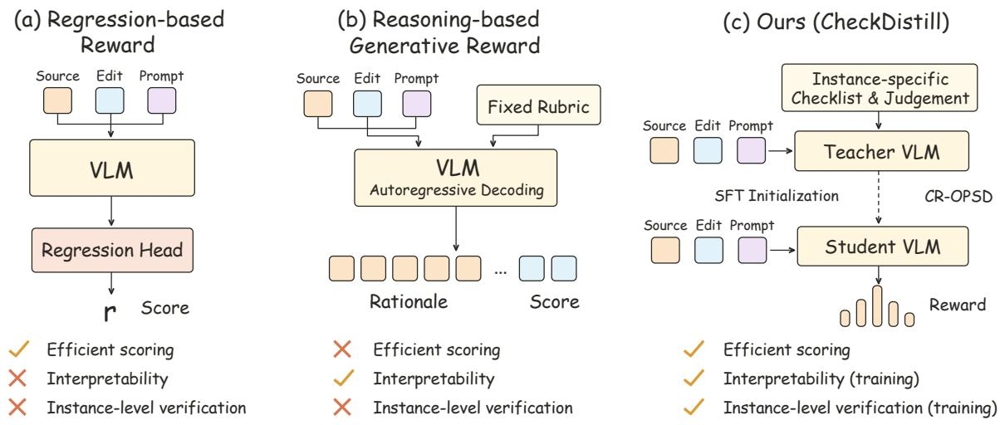  
Figure 1: Overview of CheckDistill compared with existing reward model architecture.

These limitations motivate two complementary principles. First, Dynamic Checklist Scaling: reward judgments should be grounded in instance-adaptive identification of editing and preservation requirements, decomposed into fine-grained, atomic, and independently verifiable checks. Expanding the coverage and specificity of these checks can support more accurate and robust reward judgments. Second, Context-Compressed Reward Scoring: efficient online deployment requires reducing the decoding overhead of lengthy chain-of-thought reasoning context while preserving reward quality. Therefore, the core challenge is to align score distributions under standard editing inputs with their evidence-conditioned counterparts, while reducing inference-time dependence on extensive verification contexts and explicit reasoning.

Guided by these principles, we propose CheckDistill, an image editing reward modeling framework that combines dynamic checklist-based data construction with reliability-aware onpolicy self-distillation, as illustrated in Fig. 1(c). The framework builds structured verification evidence during training and transfers evidence-enhanced judgments into efficient direct scoring.

For data construction, Fig. 2 illustrates how the source image and editing instruction guide atomic checks for Instruction Following (IF), Attribute Preservation (AP), and Context Preservation (CP). These checks are shared across candidates under the same editing condition. In the illustrated example, item-level judgments identify an unchanged like count and an undeleted comment, while separately verifying preservation requirements. Perceptual Quality (PQ) is assessed independently using a fixed general rubric. Combining EditReward-Data (Wu et al., 2026) with additional Qwen-Image-Edit (Wu et al., 2025a) candidates, we construct CheckDistill-40K through this annotation pipeline and human preference-consistency filtering, pairing four-dimensional score labels with item-level judgments and dimension-level rationales.

CheckDistill adopts two-stage training. Mixed SFT first establishes direct scoring and checklistguided reasoning capabilities. Then we introduce Checklist-Guided Reliability-Aware On-Policy Self-Distillation (CR-OPSD). The teacher additionally receives checklists, item-level judgments, and dimension-level rationales, providing distributional supervision on response prefixes generated by a student that observes only standard editing inputs. Since evidenceenhanced predictions may still be unreliable, we use agreement between the teacher’s expected score and the reference label as a reliability proxy to modulate distillation at the four score positions. At inference time, only the student is retained, and expected scores from its four-dimensional score distributions are aggregated into a scalar reward, without additional verification context or lengthy rationale generation.

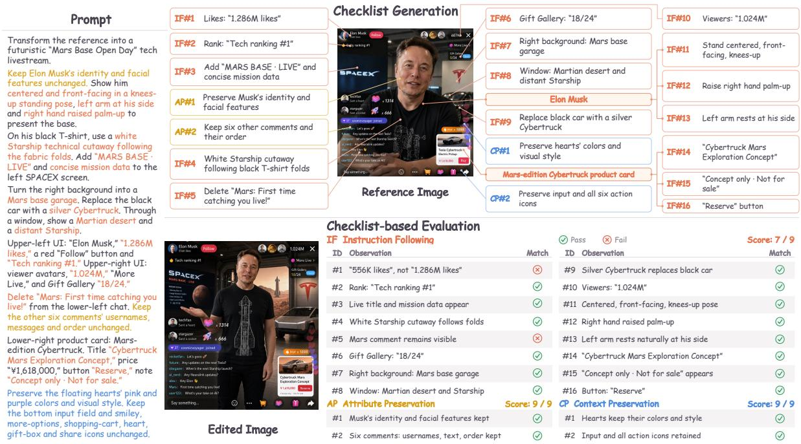  
Figure 2: An example of checklist generation and checklist-based evaluation for image editing.

CheckDistill achieves aggregate preference accuracies of 72.30% on MMRB2, 56.67% on MER-Bench, and 82.90% on EditReward-Bench, outperforming the compared open-source baselines across all three benchmarks. When used as the reward model for DiffusionNFT (Zheng et al., 2026) post-training of Qwen-Image-Edit, it achieves scores of 4.46 on ImgEdit-Bench, 4.26 on REDEdit-Bench, and 8.28 on GEdit-EN.

## Our main contributions are as follows:

• Dynamic checklist-based reward supervision. We construct CheckDistill-40K, pairing four-dimensional scores with instance-specific verification evidence through dynamic checklists and human preference-consistency filtering.

• Reliability-aware distillation for efficient reward scoring. We propose CR-OPSD to transfer evidence-conditioned scoring behavior into a direct reward model through reliability-aware on-policy distribution alignment.

• Leading reward accuracy and downstream editing gains. CheckDistill outperforms the compared state-of-the-art open-source reward models on image editing reward benchmarks and improves Qwen-Image-Edit through reward-guided post-training.

Key insight. Scaling instance-specific dynamic checklists defines the frontier of reward quality;   
compressing reasoning enables deployment at scale.

## 2 Related Work

Reinforcement learning (RL) (Black et al., 2024; Fan et al., 2023; Liu et al., 2025a; Xue et al., 2025; Zheng et al., 2026) has emerged as an important post-training paradigm for visual generation, enabling diffusion and flow-based models (Rombach et al., 2022; Podell et al., 2024; Esser et al., 2024; Black Forest Labs et al., 2025) to achieve stronger alignment. Its effectiveness, however, relies heavily on accurate and efficient reward models.

Regression-based Reward Modeling. Regression-based visual reward models learn human preferences from vision-language representations using regression or Bradley–Terry-style preference objectives (Wu et al., 2023b; Xu et al., 2023; Kirstain et al., 2023; Wu et al., 2023a; Zhang et al., 2024a; Wu et al., 2024a; Zhang et al., 2024b; Chen et al., 2025; Ma et al., 2025; Wang et al., 2025a; Wu et al., 2026). These methods are efficient at inference, but typically output scalar scores without explicit reasoning, limiting interpretability and diagnostic feedback for fine-grained evaluation.

Generative Reward Modeling. Generative reward models such as EditScore (Luo et al., 2026), RationalRewards (Wang et al., 2026a), SpatialReward (Long et al., 2026), and UnifiedReward-Think (Wang et al., 2025b) produce explicit rationales or chain-of-thought reasoning for finegrained reward prediction under fixed evaluation criteria. However, these criteria are not instantiated into concrete, input-specific verification requirements, and inference-time reasoning introduces substantial overhead in large-scale online RL. JRM (Yang et al., 2026) and Z-Reward (Jin et al., 2026) improve efficiency by internalizing reasoning into direct reward prediction, but still lack instance-adaptive verification criteria.

Instance-adaptive methods tailor evaluation criteria to each input. RubricRM (Kan et al., 2026) generates input-specific dimensions and scoring criteria, but remains focused on highlevel evaluation dimensions. Edit-R1 (Guo et al., 2026) decomposes editing instructions into sample-specific principles for finer-grained verification, but still requires explicit reasoning at inference time. Checklist-based methods translate evaluation requirements into directly verifiable items (Cook et al., 2024); rDPO (Yu et al., 2026), for example, constructs instance-specific checklist-style rubrics primarily for preference data construction. In contrast, CheckDistill uses source-image-grounded atomic checklists only as privileged information during reward-model training, distilling fine-grained instance-specific verification requirements into direct reward prediction without checklist generation or explicit reasoning at inference time.

## 3 Method

As shown in Figure 3, we propose CheckDistill, a generative reward model that leverages instance-specific checklists for fine-grained evaluation and internalizes checklist-derived evaluation knowledge through CR-OPSD. Given an input $\boldsymbol { x } = \left( u , I ^ { \mathrm { s r c } } , I ^ { \mathrm { e d t } } \right)$ , CheckDistill maps it to a multi-dimensional scoring response y, where u denotes the editing instruction, $I ^ { \mathrm { s r c } }$ the source image, and $I ^ { \mathrm { e d t } }$ the edited image.

## 3.1 Evaluation Formulation

Evaluation Dimensions. We evaluate image editing from two complementary aspects: Semantic Consistency (SC) and Perceptual Quality (PQ). SC comprises three dimensions: Instruction Following (IF), which measures whether the requested edits are correctly executed; Attribute Preservation (AP), which measures whether unspecified attributes of edited objects are preserved; and Context Preservation (CP), which measures whether non-edited content remains unchanged. PQ measures the overall visual quality of the edited image. All four scores, $S _ { \mathrm { I F } } , S _ { \mathrm { A P } } , S _ { \mathrm { C P } }$ , and S , are defined on a discrete scale from 0 to 9.

Multidimensional Reward Aggregation. To obtain a scalar feedback signal for downstream post-training of the editing model, we account for the varying importance of different dimensions by first aggregating the three SC scores using dimension-specific weights, and then combining SC and PQ through a weighted geometric mean:

$$
R _ { \mathrm { S C } } ( x ) = \sum _ { \delta \in \mathcal { D } _ { \mathrm { S C } } } w _ { \delta } S _ { \delta } ( x ) , \qquad R ( x ) = R _ { \mathrm { S C } } ( x ) ^ { \lambda } S _ { \mathrm { P Q } } ( x ) ^ { 1 - \lambda } .\tag{1}
$$

where $\begin{array} { r } { \sum _ { \delta \in \mathcal { D } _ { \mathrm { S C } } } w _ { \delta } = 1 } \end{array}$ and $w _ { \delta } \geq 0 ,$ , with $\mathcal { D } _ { \mathrm { S C } } = \{ \mathrm { I F } , \mathrm { A P } , \mathrm { C P } \}$ , and $\lambda \in [ 0 , 1 ]$ controls the relative contribution of semantic consistency and perceptual quality.

## 3.2 Reward Data Construction Pipeline

To construct the reward training data, we develop an annotation pipeline that leverages instancespecific checklists to facilitate fine-grained evaluation and reliable score annotation, while also providing structured privileged information for subsequent knowledge internalization via CR-OPSD.

Candidate Sampling and Human Preferences. Given an editing condition $\boldsymbol { h } = \left( u , I ^ { \mathrm { s r c } } \right)$ , we generate multiple edited images with an image editing model using different random seeds, forming a diverse candidate pool $\mathcal { T } ^ { \mathrm { e d t } } = \left\{ { I } _ { k } ^ { \mathrm { e d t } } \right\} _ { k = 1 } ^ { K }$ . Human annotators then perform pairwise comparisons among the candidates. For each annotated pair, the preferred and non-preferred candidates are denoted as $I _ { w } ^ { \mathrm { e d t } }$ and $I _ { l } ^ { \mathrm { e d t } }$ , respectively, yielding the human preference relation $I _ { w } ^ { \mathrm { e d t } } \succ I _ { l } ^ { \mathrm { e d t } }$

Hybrid Rubric Design. Our hybrid rubric consists of an instance-specific checklist-based rubric for SC and a fixed general rubric for PQ, with the detailed rubric templates provided in Appendix E.

(1) Instance-specific checklist for SC. To provide more fine-grained and traceable evidence than direct dimension-level assessment, we decompose the three SC dimensions into an instancespecific checklist of atomic verification items, each grounded in concrete objects, attributes, or regions. Specifically, for each editing condition $h ,$ we use Gemini-3.0-Flash to generate a variable-length checklist $C = \{ c _ { j } \} _ { j = 1 } ^ { M } ,$ without access to any candidate result. where M denotes the number of checklist items. The same checklist C is shared across all candidates under the same editing condition, ensuring that they are evaluated against a consistent set of criteria.

(2) General rubric for PQ. Since PQ concerns generic visual quality rather than instance-specific editing constraints, we adopt a fixed rubric shared across all samples and assess PQ directly from the edited image without reference to the source image. The rubric focuses on key perceptual factors such as realism and overall naturalness.

Independent SC and PQ Judgment. We employ two independent Gemini-3.0-Flash annotation templates (see Appendix E) for SC and PQ assessment. For the k-th candidate, the SC annotator takes $( x _ { k } , C )$ as input and verifies each checklist item according to its associated dimension, producing item-level judgments $J _ { k } .$ . These judgments are then summarized into dimension-level rationales $A _ { k } ^ { \mathrm { S C } }$ and scores $\mathbf { g } _ { k } ^ { \mathrm { S C } } = ( g _ { k } ^ { \mathrm { I F } } , g _ { k } ^ { \mathrm { A P } } , g _ { k } ^ { \mathrm { C P } } )$ . The PQ annotator assesses the visual quality of the edited result from $( u , I _ { k } ^ { \mathrm { e d t } } )$ and outputs a rationale $A _ { k } ^ { \mathrm { P Q } }$ and score $g _ { k } ^ { \mathrm { P Q } }$

Preference-Consistency Filtering. We use the human preferences collected in Sec. 3.2 as an external reference to verify the ranking consistency of the automatically annotated labels. We perform filtering at the candidate-group level. For each annotated pair with $I _ { w } ^ { \mathrm { e d t } } \succ I _ { l } ^ { \mathrm { e d t } }$ , we aggregate the four-dimensional scores according to Eq. 1 and regard the pair as preferenceconsistent when $R _ { w } > R _ { l }$ . Since each candidate may participate in multiple pairwise comparisons, we retain the largest subset whose induced ranking agrees with all available human preferences among the retained candidates.

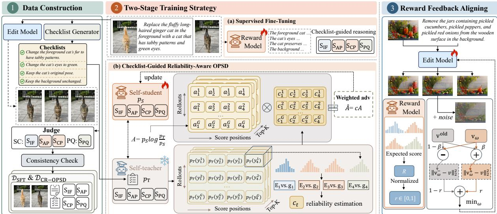  
Figure 3: Overview of CheckDistill, comprising reward data construction, two-stage reward model training via supervised fine-tuning and checklist-guided reliability-aware OPSD, and reward feedback alignment for image editing.

Through the above pipeline, we construct the CheckDistill-40K dataset, comprising approximately 20K samples from EditReward-Data (Wu et al., 2026) and 20K samples generated with Qwen-Image-Edit following Sec. 3.2. For the first-stage SFT, we use a 10K subset, denoted as ${ \mathcal { D } } _ { { \mathrm { S F T } } }$ , and mix two supervision formats: (1) given $x _ { k }$ as input, the model predicts the four-dimensional scores $\begin{array} { r } { \mathbf { g } _ { k } = \hat { [ g _ { k } ^ { \mathrm { I F } } , g _ { k } ^ { \mathrm { A P } } , g _ { k } ^ { \mathrm { C P } } , g _ { k } ^ { \mathrm { P Q } } ] } ; } \end{array}$ ; and (2) given $( x _ { k } , C )$ as input, the model is supervised to generate the checklist judgments $J _ { k } ,$ rationales $A _ { k } = ( A _ { k } ^ { \mathrm { S C } } , A _ { k } ^ { \mathrm { P Q } } )$ , and scores ${ \bf g } _ { k }$ For the second-stage CR-OPSD training, we use the full dataset $\mathcal { D } _ { \mathrm { C R - O P S D } } = \{ ( x _ { k } , \mathbf { g } _ { k } , z _ { k } ) \} _ { k = 1 } ^ { N } ,$ where $z _ { k } = ( C , J _ { k } , A _ { k } )$ denotes the structured privileged information.

## 3.3 CheckDistill Training and Downstream Alignment

Stage I: Supervised Initialization. We first perform supervised fine-tuning to initialize Check-Distill with checklist-guided reasoning and the ability to directly predict four-dimensional scores from the editing instruction, source image, and edited result. Let $p _ { \theta } ( y \mid x ^ { \prime } )$ denote the conditional autoregressive distribution over responses defined by CheckDistill with parameters $\theta ,$ where $x ^ { \prime }$ denotes the input for the corresponding training format. The training objective is

$$
\mathcal { L } _ { \mathrm { S F T } } ( \theta ) = - \mathbb { E } _ { ( x ^ { \prime } , y ) \sim \mathcal { D } _ { \mathrm { S F T } } } \left[ \sum _ { t = 1 } ^ { | y | } \log p _ { \theta } ( y _ { t } \mid x ^ { \prime } , y _ { < t } ) \right] .\tag{2}
$$

where $( x ^ { \prime } , y ) \in \{ ( x , \mathbf { g } ) , ( ( x , C ) , ( J , A , \mathbf { g } ) ) \}$ . This stage elicits checklist-guided reasoning and establishes the score range and output structure, providing a foundation for CR-OPSD.

Stage II: Checklist-Guided Reliability-Aware OPSD (CR-OPSD). We then propose CR-OPSD to internalize fine-grained checklist-guided reasoning into the reward model for efficient inference. Specifically, CR-OPSD builds on OPSD (Zhao et al., 2026) by using the structured evidence $z \overset { \vartriangle } { = } ( C , J , A )$ as privileged information and introducing reliability-aware weighting to reduce the influence of inaccurate teacher predictions. Both the student and teacher are initialized from the SFT checkpoint. Their predictive distributions are defined as

$$
p _ { S } ( y _ { t } \mid x , y _ { < t } ) = p _ { \theta } ( y _ { t } \mid x , y _ { < t } ) , \qquad p _ { T } ( y _ { t } \mid x , z , y _ { < t } ) = p _ { \theta } ( y _ { t } \mid x , z , y _ { < t } ) .\tag{3}
$$

Let $\mathcal { T } _ { t } = \mathrm { T o p K } ( p _ { S } ( \cdot \ | \ x , y _ { < t } ) )$ denote the student’s Top-K tokens at position t. We define $\boldsymbol { S } = \{ 0 , \ldots , \hat { 9 } \}$ as the set of valid score tokens and ${ \mathcal { S } } _ { t } \ { \overset { \vartriangle } { = } } \ S \cap { \mathcal { T } } _ { t }$ . At each score position, we

adopt a Q-Align-style (Wu et al., 2024b) probabilistic readout over $S _ { t }$ to compute the teacher’s expected score:

$$
\bar { p } _ { T } ( s \mid x , z , y _ { < t } ) = \frac { p _ { T } ( s \mid x , z , y _ { < t } ) } { \sum _ { s ^ { \prime } \in { \cal S } _ { t } } p _ { T } ( s ^ { \prime } \mid x , z , y _ { < t } ) } , \qquad E _ { t } = \sum _ { s \in { \cal S } _ { t } } s \bar { p } _ { T } ( s \mid x , z , y _ { < t } ) .\tag{4}
$$

Let $\delta ( t )$ denote the scoring dimension associated with position $t ,$ with annotated score $g ^ { \delta ( t ) }$ . We measure teacher–label agreement as

$$
r _ { \mathrm { u n i t } , t } = \mathrm { c l i p } \left( 1 - \frac { | E _ { t } - g ^ { \delta ( t ) } | } { 9 } , 0 , 1 \right) , \qquad r _ { t } = r _ { \mathrm { m i n } } + ( r _ { \mathrm { m a x } } - r _ { \mathrm { m i n } } ) \frac { 1 - \cos ( \pi r _ { \mathrm { u n i t } , t } ) } { 2 } .\tag{5}
$$

The position-wise coefficient is defined as $c _ { t } = \left( 1 - m _ { t } \right) + m _ { t } r _ { t } ,$ where $m _ { t } = 1$ at the four score positions and $m _ { t } = 0$ otherwise. For each $y _ { t } \in \mathcal { T } _ { t } .$ , the reliability-weighted advantage is

$$
\hat { A } _ { t } ( y _ { t } ) = s g \left[ c _ { t } p _ { S } ( y _ { t } \mid x , y _ { < t } ) \log \frac { p _ { T } ( y _ { t } \mid x , z , y _ { < t } ) } { p _ { S } ( y _ { t } \mid x , y _ { < t } ) } \right] , \qquad y _ { t } \in \mathcal { T } _ { t } .\tag{6}
$$

where $\mathrm { s g } [ \cdot ]$ denotes the stop-gradient operator. Aggregating over the Top-K candidates at each position gives the final objective:

$$
\mathcal { L } _ { \mathrm { C R - O P S D } } ( \theta ) = - \mathbb { E } \left[ \frac { 1 } { | y | } \sum _ { t } \sum _ { y _ { t } \in \mathcal { T } _ { t } } \hat { A } _ { t } ( y _ { t } ) \log p _ { S } ( y _ { t } \mid x , y _ { < t } ) \right] .\tag{7}
$$

Reward Feedback for Alignment. We use CheckDistill to guide RL post-training of the image editing model with DiffusionNFT (Zheng et al., 2026). For policy optimization, the reward of each candidate is computed from CheckDistill’s predicted score distributions. Specifically, rather than directly taking the most likely discrete score token, we derive a continuous score for each dimension from the predicted distribution. For $\delta \in { \mathcal { D } } _ { \mathrm { S C } } \cup \{ \mathrm { P Q } \}$ , let $t _ { \delta }$ denote its corresponding score position. The reward model probabilities over valid score tokens are renormalized to compute the expected score:

$$
\bar { p } _ { S } ( s \mid x , y _ { < t _ { \delta } } ) = \frac { p _ { S } ( s \mid x , y _ { < t _ { \delta } } ) } { \sum _ { s ^ { \prime } \in { \mathcal { S } } } p _ { S } ( s ^ { \prime } \mid x , y _ { < t _ { \delta } } ) } , \bar { S } _ { \delta } ( x ) = \sum _ { s \in S } s \bar { p } _ { S } ( s \mid x , y _ { < t _ { \delta } } ) , s \in \mathcal { S } .\tag{8}
$$

This distribution-based readout preserves uncertainty over the ordered score space, enabling finer-grained reward differentiation even among candidates with the same most likely score token. The resulting expected dimensional scores are then aggregated into the final reward using Eq. 1, which serves as the reward signal for DiffusionNFT-based policy optimization.

## 4 Experiments

## 4.1 Performance on Reward Modeling Benchmarks

Implementation Details. We implement CheckDistill on Qwen3-VL-8B-Instruct (Bai et al., 2025), Qwen3.5-4B, and Qwen3.5-9B. Unless otherwise specified, we set K = 10 and use reliability weights in [0.8, 1.2]. For reward aggregation, the IF/AP/CP weights are set to (0.4, 0.35, 0.25), with SC/PQ exponents of 0.8/0.2. Implementation details are provided in Appendix A.

Baselines and Evaluation Protocol. We evaluate the reward modeling performance on MMRB2 (Hu et al., 2026a), MER-Bench (Long et al., 2026), and EditReward-Bench (Luo et al., 2026). We compare CheckDistill with closed-source visual judges (GPT-4.1, Gemini-3.1-Pro, and Gemini-3.0-Flash), untrained reward-model backbones, and specialized reward models including EditReward (Wu et al., 2026), EditScore-8B (Luo et al., 2026), and SpatialReward (Long et al., 2026). We also conduct a controlled comparison on Qwen3.5-9B against GRPO (Shao et al., 2024) and Token-level GRPO under the same experimental settings. More details on the evaluation protocol are provided in Appendix A.4.

Table 1: Reward benchmark accuracy (%, ↑). Submetric results for EditReward, EditScore-8B, and SpatialReward are reproduced from SpatialReward (Long et al., 2026). Bold marks the best result among the compared open-source models in each column.
<table><tr><td></td><td colspan="3">MMRB2</td><td colspan="4">MER-Bench</td><td colspan="3">EditReward-Bench</td></tr><tr><td>Model</td><td>Single</td><td>Multi</td><td>Overall</td><td>2 pair</td><td>3 pair</td><td>4 pair</td><td>Overall</td><td>PF</td><td>CS</td><td>Overall</td></tr><tr><td>GPT-4.1</td><td>56.33</td><td>57.87</td><td>56.60</td><td>79.50</td><td>42.50</td><td>18.50</td><td>46.83</td><td>70.00</td><td>65.20</td><td>73.40</td></tr><tr><td>Gemini-3.1-Pro</td><td>65.20</td><td>60.11</td><td>64.29</td><td>79.00</td><td>60.50</td><td>24.00</td><td>54.50</td><td>66.30</td><td>75.70</td><td>79.80</td></tr><tr><td>Gemini-3.0-Flash</td><td>66.71</td><td>58.64</td><td>65.34</td><td>82.50</td><td>63.00</td><td>26.00</td><td>57.17</td><td>68.70</td><td>77.90</td><td>80.90</td></tr><tr><td>Qwen3-VL-8B-Instruct</td><td>63.02</td><td>57.87</td><td>62.10</td><td>73.00</td><td>42.00</td><td>16.00</td><td>43.67</td><td>77.20</td><td>70.90</td><td>75.80</td></tr><tr><td>Qwen3.5-4B</td><td>57.79</td><td>54.49</td><td>57.20</td><td>75.50</td><td>36.00</td><td>15.50</td><td>42.33</td><td>74.40</td><td>69.60</td><td>70.50</td></tr><tr><td>Qwen3.5-9B</td><td>63.14</td><td>58.99</td><td>62.40</td><td>76.00</td><td>46.50</td><td>19.00</td><td>47.17</td><td>83.10</td><td>75.60</td><td>78.20</td></tr><tr><td>EditReward</td><td>67.20</td><td>59.00</td><td>65.70</td><td>70.00</td><td>49.00</td><td>15.50</td><td>44.83</td><td>83.20</td><td></td><td>79.20</td></tr><tr><td>EditScore-8B</td><td>57.90</td><td>52.80</td><td>57.00</td><td>61.00</td><td>34.00</td><td>10.00</td><td>35.00</td><td>60.80</td><td>59.40</td><td>69.00</td></tr><tr><td>SpatialReward</td><td>67.10</td><td>60.80</td><td>66.10</td><td>78.00</td><td>49.50</td><td>21.50</td><td>49.67</td><td>68.30</td><td>67.20</td><td>80.30</td></tr><tr><td>GRPO (Qwen3.5-9B)</td><td>69.59</td><td>70.22</td><td>69.70</td><td>81.50</td><td>58.50</td><td>29.00</td><td>56.33</td><td>85.40</td><td>85.50</td><td>81.10</td></tr><tr><td>Token-level GRPO (Qwen3.5-9B)</td><td>70.19</td><td>69.10</td><td>70.00</td><td>80.50</td><td>59.00</td><td>27.00</td><td>55.50</td><td>85.30</td><td>84.30</td><td>81.70</td></tr><tr><td>CheckDistill (Qwen3-VL-8B)</td><td>69.22</td><td>60.67</td><td>67.70</td><td>83.00</td><td>50.50</td><td>25.00</td><td>52.83</td><td>85.50</td><td>81.20</td><td>78.90</td></tr><tr><td>CheckDistill (Qwen3.5-4B)</td><td>73.48</td><td>68.54</td><td>72.60</td><td>82.00</td><td>53.50</td><td>20.00</td><td>51.83</td><td>84.50</td><td>85.60</td><td>82.70</td></tr><tr><td>CheckDistill (Qwen3.5-9B)</td><td>73.36</td><td>67.42</td><td>72.30</td><td>82.00</td><td>60.50</td><td>27.50</td><td>56.67</td><td>85.50</td><td>84.10</td><td>82.90</td></tr></table>

Comparison with Baselines. As shown in Table 1, CheckDistill consistently improves over the corresponding backbone models and achieves strong performance across all three benchmarks. In particular, CheckDistill (Qwen3.5-9B) reaches 72.30% on MMRB2, 56.67% on MER-Bench, and 82.90% on EditReward-Bench, outperforming SpatialReward by 6.20, 7.00, and 2.60 percentage points, respectively. It also exceeds GPT-4.1 and Gemini-3.1-Pro on all three aggregate metrics, while outperforming Gemini-3.0-Flash on MMRB2 and EditReward-Bench and remaining competitive on MER-Bench (56.67% vs. 57.17%). The gains are consistent across model scales: the 4B variant achieves the highest MMRB2 overall accuracy of 72.60%, improving its backbone by 15.40 percentage points. Under the same Qwen3.5-9B backbone and experimental settings, CheckDistill also outperforms GRPO and Token-level GRPO (see Appendix B for implementation details), improving MMRB2 overall accuracy by 2.60 and 2.30 percentage points and EditReward-Bench overall accuracy by 1.80 and 1.20 percentage points, respectively. These results demonstrate the effectiveness of CR-OPSD across different backbone families, model scales, and training strategies.

## 4.2 Application in Online RL

Experimental Setup. We conduct online RL experiments on Qwen-Image-Edit (Wu et al., 2025a) using DiffusionNFT (Zheng et al., 2026), with training samples drawn from CheckDistill-40K. We evaluate the resulting model on ImgEdit-Bench (Ye et al., 2025), REDEdit-Bench (Super Intelligence Team, 2026), and the English subset of GEdit-Bench (GEdit-EN) (Liu et al., 2025b). We compare CheckDistill-guided RL against the original Qwen-Image-Edit and the open-source UniWorld-Qwen-Image-Edit model (Li et al., 2025).

Editing Performance. As shown in Table 2, RL guided by CheckDistill consistently improves Qwen-Image-Edit across all three benchmarks, increasing ImgEdit-Bench from 4.29 to 4.46, REDEdit-Bench from 4.10 to 4.26, and GEdit-EN from 8.18 to 8.28. It also outperforms UniWorld-Qwen-Image-Edit, improv-

Table 2: Image-editing performance (↑).
<table><tr><td colspan="4">ImgEdit REDEdit Model</td></tr><tr><td></td><td>Bench</td><td>Bench</td><td>GEdit-EN</td></tr><tr><td>Qwen-Image-Edit</td><td>4.29</td><td>4.10</td><td>8.18</td></tr><tr><td>UniWorld-Qwen-Image-Edit + DiffusionNFT</td><td>4.30</td><td>4.06</td><td>8.12</td></tr><tr><td>(CheckDistill-9B)</td><td>4.46</td><td>4.26</td><td>8.28</td></tr></table>

ing the three benchmarks from 4.30, 4.06, and 8.12 to 4.46, 4.26, and 8.28, respectively. Qualitative comparisons in Figure 4 further show that CheckDistill-guided RL better follows editing instructions while maintaining stronger consistency with the source image. These results demonstrate the effectiveness of CheckDistill as a reward model for improving downstream image-editing performance through online RL.

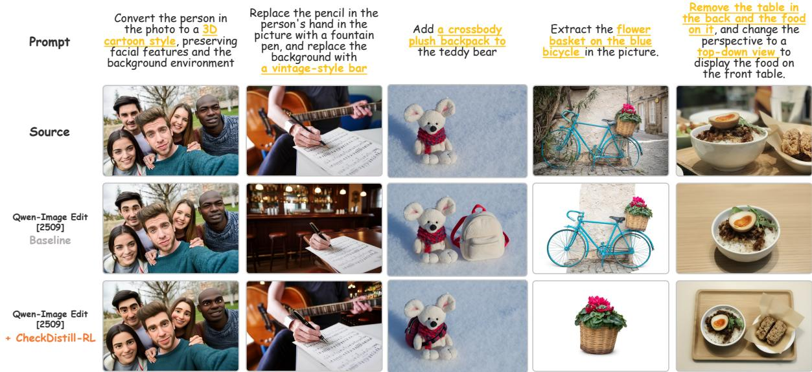  
Figure 4: Qualitative Comparison Before and After CheckDistill-based Reward Training.

## 4.3 Ablation Study and Analysis

Analysis of Verification Scaling and Efficient Scoring. We evaluate input and output scaling on MMRB2 using Qwen3.5-9B, measuring accuracy and output token counts. In Figure 5, SFT denotes supervised fine-tuning on CheckDistill-40K, while zero-shot refers to evaluation without task-specific fine-tuning.

Instance-specific verification evidence improves reward judgement through input and output scaling. Supplying a checklist improves zero-shot direct-scoring accuracy from 55.76% to 58.90%, while adding checklist-guided judgements raises it to 70.60%, with about 10 output tokens. Generating evaluation content also helps: a generic rationale achieves 61.07%, generating a checklist and its guided judgement reaches 62.40%, and supplying the checklist before generating the judgement achieves 63.41%. These gains support grounding reward assessment in instance-specific verification

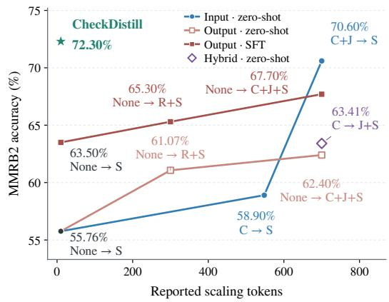  
Figure 5: Input, output, and hybrid scaling on MMRB2 (Qwen3.5-9B). Labels indicate additional input context → generated output. C: checklist; J: checklist-guided judgments; R: rationale; S: score. “None” denotes no additional input context.

requirements. In particular, the strong input-scaling result demonstrates the value of evidenceenriched teacher contexts, motivating Dynamic Checklist Scaling in CheckDistill.

CheckDistill retains the benefits of evidence-supported evaluation in a compact, directscoring model. SFT achieves 63.50% accuracy with direct scoring and 67.70% when generating a checklist and judgement. CheckDistill reaches 72.30% with about 10 output tokens, exceeding these configurations by 8.80 and 4.60 percentage points and surpassing the 70.60% zero-shot result with supplied verification evidence. This supports Distribution-Aligned Context Compression: transferring evidence-enhanced scoring to a student requiring neither verification contexts nor lengthy reasoning at inference time. Compared with the approximately 700-token SFT reasoning configuration, CheckDistill achieves higher accuracy with approximately 1/70 of the output tokens, demonstrating a favorable accuracy–decoding-cost trade-off.

Table 3: Ablation studies on privileged information and CR-OPSD design choices $( \% , \uparrow )$ (a) Privileged-information design (b) CR-OPSD design choices
<table><tr><td rowspan="2">Privileged Information</td><td colspan="3">MER- EditReward- MMRB2 Bench</td><td rowspan="2">Variant</td><td colspan="3">MER- EditReward- MMRB2</td></tr><tr><td></td><td></td><td>Bench</td><td></td><td>Bench</td><td>Bench</td></tr><tr><td>Checklist C</td><td>72.10</td><td>54.83</td><td>82.10</td><td>w/o Reliability Weighting</td><td>70.00</td><td>55.00</td><td>82.10</td></tr><tr><td>+ Checklist Judgment J</td><td>72.00</td><td>56.00</td><td>82.20</td><td>Linear Reliability Mapping</td><td>71.30</td><td>56.17</td><td>82.30</td></tr><tr><td>+ Dimension-wise Rationale A</td><td>72.30</td><td>56.67</td><td>82.90</td><td>Argmax-based Reliability</td><td>70.60</td><td>55.50</td><td>82.60</td></tr><tr><td>+ Dimension Scores g</td><td>70.10</td><td>55.83</td><td>81.30</td><td>CR-OPSD (Ours)</td><td>72.30</td><td>56.67</td><td>82.90</td></tr></table>

Privileged-Information Design. We ablate the privileged information provided to the teacher by progressively introducing checklist C, checklist judgments $\left( C , J \right)$ , dimension-wise rationales $( { \bar { C } } , { \bar { J } } , { \bar { A } } )$ , and dimension scores $( C , J , A , \mathbf { g } )$ , while keeping the SFT initialization, training data, student inputs, and optimization settings unchanged. As shown in Table 3, $( C , J , A )$ achieves the best overall performance across all three benchmarks, reaching 72.30% on MMRB2, 56.67% on MER-Bench, and 82.90% on EditReward-Bench.

However, further exposing dimension scores to the teacher, i.e., directly providing the groundtruth targets as in OPSD, does not yield additional gains: $( C , J , A )$ outperforms $( C , J , A , \mathbf { g } )$ by 2.20, 0.84, and 1.60 points on MMRB2, MER-Bench, and EditReward-Bench, respectively. These results demonstrate the effectiveness of checklist-based privileged information, where checklist judgments and dimension-wise rationales further enrich the supervision without directly exposing score labels.

CR-OPSD Component Ablation. We ablate the key design choices of CR-OPSD while keeping the privileged information $( C , J , A )$ , initialization, training data, and optimization settings fixed. Specifically, w/o Reliability Weighting removes reliability modulation by setting $c _ { t } = 1$ for all positions; Linear Reliability Mapping replaces the cosine mapping in $\operatorname { E q . 5 }$ with a linear mapping; and Argmax-based Reliability replaces the expected teacher score with the teacher’s maximumprobability score token for reliability estimation.

As shown in Table 3, CR-OPSD consistently achieves the best overall performance across all three benchmarks. Compared with removing reliability weighting, it improves MMRB2, MER-Bench, and EditReward-Bench by 2.30, 1.67, and 0.80 percentage points, respectively, demonstrating the benefit of modulating privileged supervision according to teacher reliability. The cosine mapping further improves over its linear counterpart by 1.00, 0.50, and 0.60 points, while using the expected teacher score instead of the argmax score yields gains of 1.70, 1.17, and 0.30 points. These results validate both reliability-aware weighting and the use of distributional score information for more robust privileged on-policy self-distillation.

## 5 Conclusion

We present CheckDistill, an efficient reward modeling framework for instruction-guided image editing. It combines instance-specific dynamic checklists for fine-grained verification with CR-OPSD to distill evidence-supported scoring behavior into a direct-scoring model that requires neither checklist inputs nor explicit reasoning at inference time. Experiments demonstrate strong reward modeling performance and improved image editing through reward-guided reinforcement learning using DiffusionNFT. Together, these findings show that scaling instancespecific verification improves reward quality, while reliability-aware distillation enables efficient reward scoring for image editing at scale.

## References

Jiazheng Xu, Xiao Liu, Yuchen Wu, Yuxuan Tong, Qinkai Li, Ming Ding, Jie Tang, and Yuxiao Dong. ImageReward: Learning and evaluating human preferences for text-to-image generation. In Advances in Neural Information Processing Systems, volume 36, 2023. doi: 10.52202/075280-0700. URL https://proceedings.neurips.cc/paper\_files/paper/2023/ hash/33646ef0ed554145eab65f6250fab0c9-Abstract-Conference.html.

Xiaoshi Wu, Yiming Hao, Keqiang Sun, Yixiong Chen, Feng Zhu, Rui Zhao, and Hongsheng Li. Human preference score v2: A solid benchmark for evaluating human preferences of text-to-image synthesis. arXiv preprint arXiv:2306.09341, 2023a. URL https://arxiv.org/abs/ 2306.09341.

Keming Wu, Sicong Jiang, Max Ku, Ping Nie, Minghao Liu, and Wenhu Chen. EditReward: A human-aligned reward model for instruction-guided image editing. In International Conference on Learning Representations, 2026. URL https://proceedings.iclr.cc/paper\_files/paper/ 2026/hash/4d68af3056842229f8b356d686aec914-Abstract-Conference.html.

Ralph Allan Bradley and Milton E. Terry. Rank analysis of incomplete block designs: The method of paired comparisons. Biometrika, 39(3-4):324–345, 1952. doi: 10.1093/biomet/39.3-4.324. URL https://doi.org/10.1093/biomet/39.3-4.324.

Xin Luo, Jiahao Wang, Chenyuan Wu, Shitao Xiao, Xiyan Jiang, Defu Lian, Jiajun Zhang, Dong Liu, and Zheng Liu. EditScore: Unlocking online RL for image editing via high-fidelity reward modeling. In International Conference on Learning Representations, 2026. URL https://proceedings.iclr.cc/paper\_files/paper/2026/hash/ 381ceeae4a1feb1abc59c773f7e61839-Abstract-Conference.html.

Haozhe Wang, Cong Wei, Weiming Ren, Jiaming Liu, Fangzhen Lin, and Wenhu Chen. RationalRewards: Reasoning rewards scale visual generation both training and test time. arXiv preprint arXiv:2604.11626, 2026a. URL https://arxiv.org/abs/2604.11626.

Zijian Kan, Wei Wang, Long Luo, Bing Zhao, Xuan Ren, Weixu Qiao, Wenbo Li, Hu Wei, and Lin Qu. RubricRM: Generative reward modeling via dynamic rubrics for image generation and editing. arXiv preprint arXiv:2608.26956, 2026. URL https://arxiv.org/abs/2608.26956.

Chenfei Wu, Jiahao Li, Jingren Zhou, Junyang Lin, Kaiyuan Gao, Kun Yan, Sheng-ming Yin, Shuai Bai, Xiao Xu, Yilei Chen, Yuxiang Chen, Zecheng Tang, Zekai Zhang, Zhengyi Wang, An Yang, Bowen Yu, Chen Cheng, Dayiheng Liu, Deqing Li, Hang Zhang, Hao Meng, Hu Wei, Jingyuan Ni, Kai Chen, Kuan Cao, Liang Peng, Lin Qu, Minggang Wu, Peng Wang, Shuting Yu, Tingkun Wen, Wensen Feng, Xiaoxiao Xu, Yi Wang, Yichang Zhang, Yongqiang Zhu, Yujia Wu, Yuxuan Cai, and Zenan Liu. Qwen-Image technical report. arXiv preprint arXiv:2508.02324, 2025a. URL https://arxiv.org/abs/2508.02324.

Kaiwen Zheng, Huayu Chen, Haotian Ye, Haoxiang Wang, Qinsheng Zhang, Kai Jiang, Hang Su, Stefano Ermon, Jun Zhu, and Ming-Yu Liu. DiffusionNFT: Online diffusion reinforcement with forward process. In International Conference on Learning Representations, 2026. URL https://proceedings.iclr.cc/paper\_files/paper/2026/hash/ d8e68ddfe22520b45b8fb8d5cbde5a21-Abstract-Conference.html.

Kevin Black, Michael Janner, Yilun Du, Ilya Kostrikov, and Sergey Levine. Training diffusion models with reinforcement learning. In International Conference on Learning Representations, 2024. URL https://arxiv.org/abs/2305.13301.

Ying Fan, Olivia Watkins, Yuqing Du, Hao Liu, Moonkyung Ryu, Craig Boutilier, Pieter Abbeel, Mohammad Ghavamzadeh, Kangwook Lee, and Kimin Lee. DPOK: Reinforcement learning for fine-tuning text-to-image diffusion models. In Advances in Neural Information Processing Systems, volume 36, 2023. URL https://proceedings.neurips.cc/paper\_files/paper/2023/ hash/fc65fab891d83433bd3c8d966edde311-Abstract-Conference.html.

Jie Liu, Gongye Liu, Jiajun Liang, Yangguang Li, Jiaheng Liu, Xintao Wang, Pengfei Wan, Di Zhang, and Wanli Ouyang. Flow-GRPO: Training flow matching models via online RL. arXiv preprint arXiv:2505.05470, 2025a. URL https://arxiv.org/abs/2505.05470.

Zeyue Xue, Jie Wu, Yu Gao, Fangyuan Kong, Lingting Zhu, Mengzhao Chen, Zhiheng Liu, Wei Liu, Qiushan Guo, Weilin Huang, and Ping Luo. DanceGRPO: Unleashing GRPO on visual generation. arXiv preprint arXiv:2505.07818, 2025. URL https://arxiv.org/abs/2505.07818.

Robin Rombach, Andreas Blattmann, Dominik Lorenz, Patrick Esser, and Björn Ommer. Highresolution image synthesis with latent diffusion models. In Proceedings of the IEEE/CVF Conference on Computer Vision and Pattern Recognition (CVPR), pages 10684–10695, 2022. URL https://openaccess.thecvf.com/content/CVPR2022/html/Rombach\_High-Resolution\_ Image\_Synthesis\_With\_Latent\_Diffusion\_Models\_CVPR\_2022\_paper.html.

Dustin Podell, Zion English, Kyle Lacey, Andreas Blattmann, Tim Dockhorn, Jonas Müller, Joe Penna, and Robin Rombach. SDXL: Improving latent diffusion models for high-resolution image synthesis. In International Conference on Learning Representations, 2024. URL https://proceedings.iclr.cc/paper\_files/paper/2024/hash/ 081b08068e4733ae3e7ad019fe8d172f-Abstract-Conference.html.

Patrick Esser, Sumith Kulal, Andreas Blattmann, Rahim Entezari, Jonas Müller, Harry Saini, Yam Levi, Dominik Lorenz, Axel Sauer, Frederic Boesel, Dustin Podell, Tim Dockhorn, Zion English, and Robin Rombach. Scaling rectified flow transformers for high-resolution image synthesis. In Proceedings of the 41st International Conference on Machine Learning, volume 235 of Proceedings of Machine Learning Research, pages 12606–12633. PMLR, 2024. URL https: //proceedings.mlr.press/v235/esser24a.html.

Black Forest Labs, Stephen Batifol, Andreas Blattmann, Frederic Boesel, Saksham Consul, Cyril Diagne, Tim Dockhorn, Jack English, Zion English, Patrick Esser, Sumith Kulal, Kyle Lacey, Yam Levi, Cheng Li, Dominik Lorenz, Jonas Müller, Dustin Podell, Robin Rombach, Harry Saini, Axel Sauer, and Luke Smith. FLUX.1 Kontext: Flow matching for in-context image generation and editing in latent space. arXiv preprint arXiv:2506.15742, 2025. URL https://arxiv.org/abs/2506.15742.

Xiaoshi Wu, Keqiang Sun, Feng Zhu, Rui Zhao, and Hongsheng Li. Human preference score: Better aligning text-to-image models with human preference. In Proceedings of the IEEE/CVF International Conference on Computer Vision (ICCV), pages 2096–2105, 2023b. URL https://openaccess.thecvf.com/content/ICCV2023/html/Wu\_Human\_Preference\_Score\_ Better\_Aligning\_Text-to-Image\_Models\_with\_Human\_Preference\_ICCV\_2023\_paper.html.

Yuval Kirstain, Adam Polyak, Uriel Singer, Shahbuland Matiana, Joe Penna, and Omer Levy. Pick-a-Pic: An open dataset of user preferences for text-to-image generation. In Advances in Neural Information Processing Systems, volume 36, pages 36652–36663, 2023. doi: 10.52202/075280-1594. URL https://proceedings.neurips.cc/paper\_files/paper/2023/ hash/73aacd8b3b05b4b503d58310b523553c-Abstract-Conference.html.

Sixian Zhang, Bohan Wang, Junqiang Wu, Yan Li, Tingting Gao, Di Zhang, and Zhongyuan Wang. Learning multi-dimensional human preference for text-to-image generation. In Proceedings of the IEEE/CVF Conference on Computer Vision and Pattern Recognition (CVPR), pages 8018–8027, 2024a. URL https://arxiv.org/abs/2405.14705.

Xun Wu, Shaohan Huang, Guolong Wang, Jing Xiong, and Furu Wei. Multimodal large language models make text-to-image generative models align better. In Advances in Neural Information Processing Systems, volume 37, 2024a. doi: 10. 52202/079017-2584. URL https://proceedings.neurips.cc/paper\_files/paper/2024/hash/ 9421261e06f1a63a352b068f1ac90609-Abstract-Conference.html.

Shu Zhang, Xinyi Yang, Yihao Feng, Can Qin, Chia-Chih Chen, Ning Yu, Zeyuan Chen, Huan Wang, Silvio Savarese, Stefano Ermon, Caiming Xiong, and Ran Xu. HIVE: Harnessing human feedback for instructional visual editing. In Proceedings of the IEEE/CVF Conference on Computer Vision and Pattern Recognition (CVPR), pages 9026–9036, 2024b. URL https: //arxiv.org/abs/2303.09618.

Sherry X. Chen, Yi Wei, Luowei Zhou, and Suren Kumar. ADIEE: Automatic dataset creation and scorer for instruction-guided image editing evaluation. In Proceedings ofthe IEEE/CVF International Conference on Computer Vision (ICCV), pages 18345–18356, 2025. URL https: //arxiv.org/abs/2507.07317.

Yuhang Ma, Yunhao Shui, Xiaoshi Wu, Keqiang Sun, and Hongsheng Li. HPSv3: Towards wide-spectrum human preference score. arXiv preprint arXiv:2508.03789, 2025. URL https: //arxiv.org/abs/2508.03789.

Yibin Wang, Yuhang Zang, Hao Li, Cheng Jin, and Jiaqi Wang. Unified reward model for multimodal understanding and generation. arXiv preprint arXiv:2503.05236, 2025a. URL https://arxiv.org/abs/2503.05236.

Yancheng Long, Yankai Yang, Hongyang Wei, Wei Chen, Tianke Zhang, Haonan Fan, Changyi Liu, Kaiyu Jiang, Jiankang Chen, Kaiyu Tang, Bin Wen, Fan Yang, Tingting Gao, Han Li, and Shuo Yang. SpatialReward: Bridging the perception gap in online RL for image editing via explicit spatial reasoning. arXiv preprint arXiv:2602.07458, 2026. URL https://arxiv.org/ abs/2602.07458.

Yibin Wang, Zhimin Li, Yuhang Zang, Chunyu Wang, Qinglin Lu, Cheng Jin, and Jiaqi Wang. Unified multimodal chain-of-thought reward model through reinforcement fine-tuning. arXiv preprint arXiv:2505.03318, 2025b. URL https://arxiv.org/abs/2505.03318.

Yankai Yang, Yancheng Long, Hongyang Wei, Wei Chen, Tianke Zhang, Kaiyu Jiang, Haonan Fan, Changyi Liu, Jiankang Chen, Kaiyu Tang, Bin Wen, Fan Yang, Tingting Gao, Han Li, and Shuo Yang. Joint reward modeling: Internalizing chain-of-thought for efficient visual reward models. arXiv preprint arXiv:2602.07533, 2026. URL https://arxiv.org/abs/2602.07533.

Xin Jin, Huanqia Cai, Zhen Li, Zechao Zhan, Dengyang Jiang, Aiming Hao, Yuming Jiang, Xiangpeng Yang, Chunle Guo, Peng Gao, Ming-Ming Cheng, and Steven C. H. Hoi. Z-Reward: Beyond scalar rewards by internalizing reasoning into score distributions. arXiv preprint arXiv:2606.09076, 2026. URL https://arxiv.org/abs/2606.09076.

Hanzhong Guo, Jie Wu, Jie Liu, Yu Gao, Zilyu Ye, Linxiao Yuan, Xionghui Wang, Yizhou Yu, and Weilin Huang. Leveraging verifier-based reinforcement learning in image editing. arXiv preprint arXiv:2604.27505, 2026. URL https://arxiv.org/abs/2604.27505.

Jonathan Cook, Tim Rocktäschel, Jakob Foerster, Dennis Aumiller, and Alex Wang. TICKing all the boxes: Generated checklists improve LLM evaluation and generation. arXiv preprint arXiv:2410.03608, 2024. URL https://arxiv.org/abs/2410.03608.

Ya-Qi Yu, Fangyu Hong, Xiangyang Qu, Hao Wang, Gaojie Wu, Qiaoyu Luo, Nuo Xu, Huixin Wang, Wuheng Xu, Yongxin Liao, Zihao Chen, Haonan Li, Ziming Li, Dezhi Peng, Minghui Liao, Jihao Wu, Haoyu Ren, and Dandan Tu. Visual preference optimization with rubric rewards. arXiv preprint arXiv:2604.13029, 2026. URL https://arxiv.org/abs/2604.13029.

Siyan Zhao, Zhihui Xie, Mengchen Liu, Jing Huang, Guan Pang, Feiyu Chen, and Aditya Grover. Self-distilled reasoner: On-policy self-distillation for large language models. arXiv preprint arXiv:2601.18734, 2026. URL https://arxiv.org/abs/2601.18734.

Haoning Wu, Zicheng Zhang, Weixia Zhang, Chaofeng Chen, Liang Liao, Chunyi Li, Yixuan Gao, Annan Wang, Erli Zhang, Wenxiu Sun, Qiong Yan, Xiongkuo Min, Guangtao Zhai, and

Weisi Lin. Q-Align: Teaching LMMs for visual scoring via discrete text-defined levels. In Proceedings of the 41st International Conference on Machine Learning, volume 235 of Proceedings of Machine Learning Research, pages 54015–54029. PMLR, 2024b. URL https://proceedings.mlr. press/v235/wu24ah.html.

Shuai Bai, Yuxuan Cai, Ruizhe Chen, Keqin Chen, Xionghui Chen, Zesen Cheng, Lianghao Deng, Wei Ding, Chang Gao, Chunjiang Ge, Wenbin Ge, Zhifang Guo, Qidong Huang, Jie Huang, Fei Huang, Binyuan Hui, Shutong Jiang, Zhaohai Li, Mingsheng Li, Mei Li, Kaixin Li, Zicheng Lin, Junyang Lin, Xuejing Liu, Jiawei Liu, Chenglong Liu, Yang Liu, Dayiheng Liu, Shixuan Liu, Dunjie Lu, Ruilin Luo, Chenxu Lv, Rui Men, Lingchen Meng, Xuancheng Ren, Xingzhang Ren, Sibo Song, Yuchong Sun, Jun Tang, Jianhong Tu, Jianqiang Wan, Peng Wang, Pengfei Wang, Qiuyue Wang, Yuxuan Wang, Tianbao Xie, Yiheng Xu, Haiyang Xu, Jin Xu, Zhibo Yang, Mingkun Yang, Jianxin Yang, An Yang, Bowen Yu, Fei Zhang, Hang Zhang, Xi Zhang, Bo Zheng, Humen Zhong, Jingren Zhou, Fan Zhou, Jing Zhou, Yuanzhi Zhu, and Ke Zhu. Qwen3-VL technical report. arXiv preprint arXiv:2511.21631, 2025. URL https://arxiv.org/abs/2511.21631.

Yushi Hu, Reyhane Askari-Hemmat, Melissa Hall, Emily Dinan, Luke Zettlemoyer, and Marjan Ghazvininejad. Multimodal RewardBench 2: Evaluating omni reward models for interleaved text and image. In Proceedings of the IEEE/CVF Conference on Computer Vision and Pattern Recognition (CVPR), pages 36904–36915, 2026a. URL https://openaccess.thecvf.com/content/CVPR2026/html/Hu\_Multimodal\_RewardBench\_2\_ Evaluating\_Omni\_Reward\_Models\_for\_Interleaved\_Text\_CVPR\_2026\_paper.html.

Zhihong Shao, Peiyi Wang, Qihao Zhu, Runxin Xu, Junxiao Song, Xiao Bi, Haowei Zhang, Mingchuan Zhang, Y. K. Li, Y. Wu, and Daya Guo. DeepSeekMath: Pushing the limits of mathematical reasoning in open language models. arXiv preprint arXiv:2402.03300, 2024. URL https://arxiv.org/abs/2402.03300.

Yang Ye, Xianyi He, Zongjian Li, Bin Lin, Shenghai Yuan, Zhiyuan Yan, Bohan Hou, and Li Yuan. ImgEdit: A unified image editing dataset and benchmark. arXiv preprint arXiv:2505.20275, 2025. URL https://arxiv.org/abs/2505.20275.

Super Intelligence Team. FireRed-Image-Edit-1.0 technical report. arXiv preprint arXiv:2602.13344, 2026. URL https://arxiv.org/abs/2602.13344.

Shiyu Liu, Yucheng Han, Peng Xing, Fukun Yin, Rui Wang, Wei Cheng, Jiaqi Liao, Yingming Wang, Honghao Fu, Chunrui Han, Guopeng Li, Yuang Peng, Quan Sun, Jingwei Wu, Yan Cai, Zheng Ge, Ranchen Ming, Lei Xia, Xianfang Zeng, Yibo Zhu, Binxing Jiao, Xiangyu Zhang, Gang Yu, and Daxin Jiang. Step1X-Edit: A practical framework for general image editing. arXiv preprint arXiv:2504.17761, 2025b. URL https://arxiv.org/abs/2504.17761.

Zongjian Li, Zheyuan Liu, Qihui Zhang, Bin Lin, Feize Wu, Shenghai Yuan, Zhiyuan Yan, Yang Ye, Wangbo Yu, Yuwei Niu, Shaodong Wang, Xinhua Cheng, and Li Yuan. Uniworld-V2: Reinforce image editing with diffusion negative-aware finetuning and MLLM implicit feedback. arXiv preprint arXiv:2510.16888, 2025. URL https://arxiv.org/abs/2510.16888.

Taihang Hu, Zhao Wang, Zuan Gao, Tao Liu, Hao Yan, Zhengze Xu, Yuhang Yu, Yongchao Du, Xingjian Wang, Jun Zheng, Qinye Zhou, Yaqi Cai, Zhengrui Chen, Chao Lin, Yefeng Shen, Yuan Wang, Zhengtao Wu, Ge Wu, Xiaoli Xu, Denghui Yang, Huayu Zhang, Mingzhou Zhang, and Mengting Chen. Exploring the performance frontier of compact unified image generation models. arXiv preprint arXiv:2608.20334, 2026b. URL https://arxiv.org/abs/2608.20334.

Meituan LongCat Team, Hanghang Ma, Haoxian Tan, Jiale Huang, Junqiang Wu, Jun-Yan He, Lishuai Gao, Songlin Xiao, Xiaoming Wei, Xiaoqi Ma, Xunliang Cai, Yayong Guan, and Jie Hu. LongCat-Image technical report. arXiv preprint arXiv:2512.07584, 2025. URL https://arxiv.org/abs/2512.07584.

Chenyuan Wu, Pengfei Zheng, Ruiran Yan, Shitao Xiao, Xin Luo, Yueze Wang, Wanli Li, Xiyan Jiang, Yexin Liu, Junjie Zhou, Ze Liu, Ziyi Xia, Chaofan Li, Haoge Deng, Jiahao Wang, Kun Luo, Bo Zhang, Defu Lian, Xinlong Wang, Zhongyuan Wang, Tiejun Huang, and Zheng Liu. OmniGen2: Exploration to advanced multimodal generation. arXiv preprint arXiv:2506.18871, 2025b. URL https://arxiv.org/abs/2506.18871.

Xingjian Wang, Zhao Wang, Taihang Hu, Jun Zheng, Zhengrui Chen, Qinye Zhou, Zhengtao Wu, Yongchao Du, Zuan Gao, Chao Lin, Yefeng Shen, Yuan Wang, Xiaoli Xu, Zhengze Xu, Hao Yan, Denghui Yang, Yuhang Yu, Huayu Zhang, Mingzhou Zhang, and Mengting Chen. From corpora to co-evolving capabilities: Capability-centric data design for generalist image generation. arXiv preprint arXiv:2608.18076, 2026b. URL https://arxiv.org/abs/2608.18076.

OpenAI. Image generation. OpenAI API documentation. URL https://developers.openai. com/api/docs/guides/image-generation. Accessed October 19, 2026.

Google DeepMind. Gemini Image. Official model page. URL https://deepmind.google/ models/gemini-image/. Accessed October 19, 2026.

Mengting Chen, Zhengrui Chen, Yongchao Du, Zuan Gao, Taihang Hu, Jinsong Lan, Chao Lin, Yefeng Shen, Xingjian Wang, Zhao Wang, Zhengtao Wu, Xiaoli Xu, Zhengze Xu, Hao Yan, Mingzhou Zhang, Jun Zheng, Qinye Zhou, Xiaoyong Zhu, and Bo Zheng. Tstars-Tryon 1.0: Robust and realistic virtual try-on for diverse fashion items. arXiv preprint arXiv:2604.19748, 2026. URL https://arxiv.org/abs/2604.19748.

Yisol Choi, Sangkyung Kwak, Kyungmin Lee, Hyungwon Choi, and Jinwoo Shin. Improving diffusion models for authentic virtual try-on in the wild. arXiv preprint arXiv:2403.05139, 2024. URL https://arxiv.org/abs/2403.05139.

Zheng Chong, Xiao Dong, Haoxiang Li, Shiyue Zhang, Wenqing Zhang, Xujie Zhang, Hanqing Zhao, Dongmei Jiang, and Xiaodan Liang. CatVTON: Concatenation is all you need for virtual try-on with diffusion models. arXiv preprint arXiv:2407.15886, 2024. URL https: //arxiv.org/abs/2407.15886.

Qinye Zhou, Jun Zheng, Yongchao Du, Yuan Wang, Zhengrui Chen, Zuan Gao, Taihang Hu, Chao Lin, Yefeng Shen, Xingjian Wang, Zhao Wang, Zhengtao Wu, Xiaoli Xu, Zhengze Xu, Hao Yan, Denghui Yang, Yuhang Yu, Huayu Zhang, Mingzhou Zhang, and Mengting Chen. CPI-Bench: A comprehensive, practical and intelligent benchmark for real-world image editing. arXiv preprint arXiv:2608.14546, 2026. URL https://arxiv.org/abs/2608.14546.

## A Implementation Details

## A.1 Stage I: SFT Implementation Details

We perform supervised fine-tuning (SFT) using ms-swift on 8 NVIDIA A100 GPUs. The training hyperparameters are summarized in Table 4.

Table 4: Hyperparameters for Stage-I supervised fine-tuning.
<table><tr><td>Hyperparameter</td><td>Value</td></tr><tr><td>Optimizer</td><td> $\overline { { \mathrm { A d a m W } \left( \beta _ { 1 } = 0 . 9 , \beta _ { 2 } = 0 . 9 9 9 \right) } }$ </td></tr><tr><td>Learning Rate</td><td> $1 \times 1 0 ^ { - 5 }$ </td></tr><tr><td>Learning Rate Scheduler</td><td>Linear</td></tr><tr><td>Warmup Ratio</td><td>0.1</td></tr><tr><td>Per-Device Batch Size</td><td>1</td></tr><tr><td>Gradient Accumulation Steps</td><td>4</td></tr><tr><td>Effective Global Batch Size</td><td>32</td></tr><tr><td>DeepSpeed Stage</td><td>ZeRO-2</td></tr><tr><td>Maximum Sequence Length</td><td>32,768</td></tr><tr><td>Maximum Image Pixels</td><td>802,816</td></tr></table>

## A.2 Stage II: CR-OPSD Implementation Details

We implement CR-OPSD using the verl framework. Both the student and teacher are initialized from the Stage-I SFT checkpoint, and the teacher is maintained as an exponential moving average (EMA) of the student with an update rate of 0.01. The training hyperparameters are summarized in Table 5. To accommodate samples with many reference images, we set the maximum image pixel budget to 802,816 pixels per image and reduce it to 262,144 pixels when more than five reference images are provided.

Table 5: Hyperparameters for Stage-II CR-OPSD.
<table><tr><td>Hyperparameter</td><td>Value</td></tr><tr><td>Global Batch Size Mini-Batch Size Rollouts per Prompt Log-Probability Top-K</td><td>128</td></tr><tr><td rowspan="3">Maximum Prompt Length Maximum Response Length Learning Rate</td><td>128 4</td></tr><tr><td>10 32,768 128</td></tr><tr><td> $1 \times 1 0 ^ { - 6 }$  Cosine 0.03 1 1.0 1.0</td></tr></table>

## A.3 DiffusionNFT Implementation Details

We use CheckDistill to guide RL post-training of the image editing model with Diffusion-NFT (Zheng et al., 2026). For each editing condition $h ,$ the old policy generates G candidates. We evaluate each candidate to obtain its reward $R _ { k } = R ( x _ { k } )$ using Eq. 8 and 1, which is then used to determine its positive-branch weight relative to the group mean:

$$
r _ { k } = \frac { 1 } { 2 } + \frac { 1 } { 2 } \mathrm { c l i p } \left( \frac { R _ { k } - \bar { R } _ { h } } { Z _ { c } } , - 1 , 1 \right) , \qquad \bar { R } _ { h } = \frac { 1 } { G } \sum _ { k = 1 } ^ { G } R _ { k } ,\tag{9}
$$

where $Z _ { c } > 0$ is the reward normalization scale and the negative-branch weight is $1 - r _ { k }$

To suppress updates from nearly saturated candidate groups, we follow the Low-STD Group Filtering strategy of UniWorld-V2 (Li et al., 2025).

$$
\sigma _ { h } = \sqrt { \frac { 1 } { G } \sum _ { k = 1 } ^ { G } ( R _ { k } - \bar { R } _ { h } ) ^ { 2 } } , \qquad M _ { h } = 1 - { \bf 1 } \bigl \{ \bar { R } _ { h } > \eta _ { \mu } \wedge \sigma _ { h } < \eta _ { \mathrm { s t d } } \bigr \} .\tag{10}
$$

Here, ${ \bar { R } } _ { h }$ and $\sigma _ { h }$ denote the mean and standard deviation of the rewards in group $h ,$ respectively; $\eta _ { \mu }$ and $\eta _ { \mathrm { s t d } }$ are the corresponding filtering thresholds. Groups with high mean reward and low standard deviation are excluded from optimization by setting $M _ { h } = 0$

Following DiffusionNFT, let $v _ { \omega } ^ { + }$ and $v _ { \omega } ^ { - }$ denote the positive and negative policy branches, and $v _ { k }$ the target velocity of candidate k. The optimization objective is

$$
\mathcal { L } _ { \mathrm { N F T } } ( \omega ) = \mathbb { E } \left[ M _ { h } \frac { 1 } { G } \sum _ { k = 1 } ^ { G } \left( r _ { k } \left. v _ { \omega } ^ { + } - v _ { k } \right. _ { 2 } ^ { 2 } + ( 1 - r _ { k } ) \left. v _ { \omega } ^ { - } - v _ { k } \right. _ { 2 } ^ { 2 } \right) \right] .\tag{11}
$$

We enable classifier-free guidance (CFG) during rollout but disable it during policy optimization to reduce training overhead. Training is performed with LoRA, with the hyperparameters summarized in Table 6.

## A.4 Reward Benchmark Evaluation Details

We evaluate reward prediction on MMRB2, MER-Bench, and EditReward-Bench, none of which overlaps with the data used for CheckDistill. MMRB2 reports single-reference, multi-reference, and overall accuracy, where the overall accuracy is computed as a sample-count-weighted average of the single- and multi-reference subsets rather than their arithmetic mean. MER-Bench reports ranking accuracy under the 2-pair, 3-pair, and 4-pair settings, with their arithmetic mean used as the overall metric. EditReward-Bench evaluates prompt following (PF), consistency (CS), and overall preference accuracy. For CheckDistill PF is given by the instruction-following score, while CS is computed from the attribute-preservation (AP) and context-preservation (CP) scores using weights of 0.35 and 0.25, respectively, consistent with their weights in the overall reward. The final scalar reward follows Eq. 8 and 1. Except for specialized reward models with their own inference formats, all evaluated models use the same system prompt. Each candidate is scored independently in a pointwise manner, after which pairwise comparisons and multi-candidate rankings are obtained by comparing the resulting scalar scores.

## B Implementation Details of GRPO and Token-Level GRPO

GRPO and Token-Level GRPO are initialized from the same SFT checkpoint as CheckDistill. For each input x, they sample G scoring responses $\{ y _ { i } \} _ { i = 1 } ^ { G }$ . Let $S _ { i , \delta }$ denote the numerical score represented by the sampled score token for dimension δ in response $i ,$ and let $g _ { \delta }$ be the corresponding ground-truth label, where $\delta \in { \mathcal { D } } = { \mathcal { D } } _ { \mathrm { S C } } \cup \{ \mathrm { P Q } \}$ . Following the reward aggregation rule in the main text, the predicted and label-derived aggregate scores are

Table 6: Hyperparameters for DiffusionNFT training.
<table><tr><td>Hyperparameter</td><td>Value</td></tr><tr><td>Guidance Scale</td><td>4.0</td></tr><tr><td>Training Sampling Steps</td><td>16</td></tr><tr><td>Training Sampler</td><td>DPM2</td></tr><tr><td>Evaluation Sampling Steps</td><td>40</td></tr><tr><td>Noise Level</td><td>0.7</td></tr><tr><td>Learning Rate</td><td> $3 \times 1 0 ^ { - 4 }$ </td></tr><tr><td>NFT Mixing Coefficient (β)</td><td> $1 \times 1 0 ^ { - 4 }$ </td></tr><tr><td>Per-GPU Batch Size</td><td>1</td></tr><tr><td>Group Size</td><td>8</td></tr><tr><td>Number of Groups</td><td>48</td></tr><tr><td>Group Mean Filtering Threshold</td><td>8</td></tr><tr><td>Group Std. Filtering Threshold</td><td>0.025</td></tr><tr><td>LoRA Rank</td><td>32</td></tr><tr><td>LoRA Alpha</td><td>64</td></tr><tr><td>Timestep Fraction</td><td>0.99</td></tr><tr><td>Maximum Gradient Norm</td><td>1.0</td></tr><tr><td>Optimizer</td><td>AdamW  $( \beta _ { 1 } = 0 . 9 , \beta _ { 2 } = 0 . 9 9 9 )$ </td></tr><tr><td>Weight Decay</td><td> $1 \times 1 0 ^ { - 4 }$ </td></tr><tr><td>GPUs</td><td>40× NVIDIA A100 (32 for training, 8 for reward model deployment)</td></tr></table>

$$
\begin{array} { r } { \displaystyle R _ { i } = \left( \sum _ { \delta \in \mathcal { D } _ { \mathrm { S C } } } w _ { \delta } S _ { i , \delta } \right) ^ { \lambda } S _ { i , \mathrm { P Q } } ^ { 1 - \lambda } , } \\ { \displaystyle R _ { g } = \left( \sum _ { \delta \in \mathcal { D } _ { \mathrm { S C } } } w _ { \delta } g _ { \delta } \right) ^ { \lambda } g _ { \mathrm { P Q } } ^ { 1 - \lambda } . } \end{array}\tag{12}
$$

GRPO: Sequence-Level Advantage. GRPO constructs a response-level reward from the discrepancy between the predicted and label-derived aggregate scores:

$$
r _ { i } = 1 - \frac { | R _ { i } - R _ { g } | } { 9 } , \qquad A _ { i , t } ^ { \mathrm { G R P O } } = r _ { i } - \frac { 1 } { G } \sum _ { j = 1 } ^ { G } r _ { j } .\tag{13}
$$

The same group-centered advantage is applied to all tokens in response $i .$

Token-Level GRPO: Dimension-Level Advantage. Token-Level GRPO instead computes a separate reward for each scoring dimension:

$$
\begin{array} { r } { r _ { i , \delta } = 1 - \frac { \displaystyle \left| S _ { i , \delta } - g _ { \delta } \right| } { \displaystyle 9 } , } \\ { A _ { i , t } ^ { \mathrm { T o k e n } } = r _ { i , \delta ( t ) } - \frac { 1 } { G } \sum _ { j = 1 } ^ { G } r _ { j , \delta ( t ) } , } \end{array}\tag{14}
$$

where $\delta ( t )$ denotes the scoring dimension associated with score-token position t. The dimensionspecific advantage is applied only at the four score-token positions, while non-score positions receive zero policy advantage. Both methods use group-mean centering without standarddeviation normalization.

Training Objective. GRPO and Token-Level GRPO share the same clipped policy objective and differ only in the definition of $A _ { i , t }$ . Let

$$
\rho _ { i , t } ( \theta ) = \frac { p _ { \theta } ( y _ { i , t } \mid x , y _ { i , < t } ) } { p _ { \theta _ { \mathrm { o l d } } } ( y _ { i , t } \mid x , y _ { i , < t } ) } .\tag{15}
$$

The training loss is

$$
\begin{array} { r } { \mathcal { L } _ { \mathrm { b a s e } } ( \theta ; A ) = - \mathbb { E } \Bigg [ \frac { 1 } { \sum _ { i } | y _ { i } | } \sum _ { i = 1 } ^ { G } \sum _ { t = 1 } ^ { | y _ { i } | } \operatorname* { m i n } \Big ( \rho _ { i , t } ( \theta ) A _ { i , t } , } \\ { \mathrm { c l i p } \left( \rho _ { i , t } ( \theta ) , 1 - \epsilon _ { l } , 1 + \epsilon _ { h } \right) A _ { i , t } \Big ) \Bigg ] + \beta \mathcal { L } _ { \mathrm { K L } } . } \end{array}\tag{16}
$$

GRPO and Token-Level GRPO use $A ^ { \mathrm { G R P O } }$ and $A ^ { \mathrm { T o k e n } }$ , respectively. Here, ${ \mathcal { L } } _ { \mathrm { K I } }$ regularizes the policy against the frozen SFT reference model, $\epsilon _ { l }$ and $\epsilon _ { h }$ denote the clipping ranges, and $\beta$ is the KL coefficient.

Training Settings. We train GRPO and Token-level GRPO on CheckDistill-40K using the verl framework under the same training configuration. The shared hyperparameters are summarized in Table 7.

Table 7: Hyperparameters for GRPO and Token-level GRPO.
<table><tr><td>Hyperparameter</td><td>Value</td></tr><tr><td>Training Temperature</td><td>1.0</td></tr><tr><td rowspan="3">Global Batch Size Mini-Batch Size Rollouts per Prompt Maximum Prompt Length</td><td>128</td></tr><tr><td>128 8</td></tr><tr><td>16,384 128</td></tr></table>

## C Alternative Reverse-KL Formulation

## C.1 Preliminaries

On-Policy Self-Distillation (OPSD). OPSD (Zhao et al., 2026) enables a single model to act as both student and teacher by conditioning on different contexts, where the teacher additionally observes privileged information and provides token-level supervision along student-generated trajectories. Given a task input $x ,$ the student samples a response $y \sim p _ { \theta } ( \cdot \mid x )$ . With privileged information z available to the teacher, the student and teacher predictive distributions at the same response prefix $y _ { < t }$ are defined as

$$
p _ { S } ( y _ { t } \mid x , y _ { < t } ) = p _ { \theta } ( y _ { t } \mid x , y _ { < t } ) , \qquad p _ { T } ( y _ { t } \mid x , z , y _ { < t } ) = p _ { \theta } ( y _ { t } \mid x , z , y _ { < t } ) .\tag{17}
$$

From a policy-gradient perspective, the token-level distillation signal for a sampled token $y _ { t }$ can be expressed as

$$
A _ { t } = \mathrm { s g } \left[ \log \frac { p _ { T } ( y _ { t } \mid x , z , y _ { < t } ) } { p _ { S } ( y _ { t } \mid x , y _ { < t } ) } \right] ,\tag{18}
$$

where sg[·] denotes the stop-gradient operator. A positive $A _ { t }$ reinforces tokens assigned higher likelihood by the teacher than by the student, whereas a negative $A _ { t }$ suppresses them. The corresponding on-policy policy-gradient surrogate objective is

$$
\mathcal { L } _ { \mathrm { O P S D } } ( \boldsymbol { \theta } ) = - \mathbb { E } \left[ \frac { 1 } { | \boldsymbol { y } | } \sum _ { t } A _ { t } \log p _ { S } ( \boldsymbol { y } _ { t } \mid \boldsymbol { x } , \boldsymbol { y } _ { < t } ) \right] .\tag{19}
$$

## C.2 Alternative Objective

Our method admits the following alternative reverse-KL objective:

$$
\begin{array} { r } { \mathcal { L } _ { \mathrm { w R K L } } ^ { \mathrm { T o p K } } ( \theta ) = \mathbb { E } \Bigg [ \frac { 1 } { | y | } \sum _ { t } c _ { t } \sum _ { y _ { t } \in \mathcal { T } _ { t } } \Bigg ( p _ { S } ( y _ { t } \mid x , y _ { < t } ) \log \frac { p _ { S } ( y _ { t } \mid x , y _ { < t } ) } { p _ { T } ( y _ { t } \mid x , z , y _ { < t } ) } } \\ { - p _ { S } ( y _ { t } \mid x , y _ { < t } ) + p _ { T } ( y _ { t } \mid x , z , y _ { < t } ) \Bigg ) \Bigg ] . } \end{array}\tag{20}
$$

The term $- p _ { S } + p _ { T }$ corrects the probability-mass difference on the truncated support. When the candidate set covers the entire vocabulary, this term sums to zero, and Eq. 20 reduces to reliability-weighted reverse KL.

## C.3 Connection to the Policy-Gradient Objective

We treat the response prefixes, candidate set $\mathcal { T } _ { t } ,$ , teacher distribution, and $c _ { t }$ as fixed when differentiating with respect to θ. For each candidate, the correction term $- p _ { S }$ cancels the extra +1 term arising from differentiating $p _ { S } \log ( p _ { S } / p _ { T } )$

$$
\begin{array} { r l } & { \nabla _ { \theta } \bigg [ p _ { S } ( y _ { t } \mid x , y _ { < t } ) \log \frac { p _ { S } ( y _ { t } \mid x , y _ { < t } ) } { p _ { T } ( y _ { t } \mid x , z , y _ { < t } ) } - p _ { S } ( y _ { t } \mid x , y _ { < t } ) + p _ { T } ( y _ { t } \mid x , z , y _ { < t } ) \bigg ] } \\ & { \qquad = \log \frac { p _ { S } ( y _ { t } \mid x , y _ { < t } ) } { p _ { T } ( y _ { t } \mid x , z , y _ { < t } ) } \nabla _ { \theta } p _ { S } ( y _ { t } \mid x , y _ { < t } ) . } \end{array}\tag{21}
$$

Substituting Eq. 21 into Eq. 20 and using $\nabla _ { \theta } p _ { S } = p _ { S } \nabla _ { \theta } \log p _ { S }$ , we obtain

$$
\begin{array} { r l } & { \nabla _ { \theta } \mathcal { L } _ { \mathrm { w R K L } } ^ { \mathrm { T o p K } } = \mathbb { E } \left[ \frac { 1 } { \left| y \right| } \displaystyle \sum _ { t } \sum _ { y _ { t } \in \mathcal { T } _ { t } } c _ { t } \log \frac { p _ { S } ( y _ { t } \mid x , y _ { < t } ) } { p _ { T } ( y _ { t } \mid x , z , y _ { < t } ) } \nabla _ { \theta } p _ { S } ( y _ { t } \mid x , y _ { < t } ) \right] } \\ & { \qquad = - \mathbb { E } \left[ \frac { 1 } { \left| y \right| } \displaystyle \sum _ { t } \sum _ { y _ { t } \in \mathcal { T } _ { t } } p _ { S } ( y _ { t } \mid x , y _ { < t } ) c _ { t } \log \frac { p _ { T } ( y _ { t } \mid x , z , y _ { < t } ) } { p _ { S } ( y _ { t } \mid x , y _ { < t } ) } \nabla _ { \theta } \log p _ { S } ( y _ { t } \mid x , y _ { < t } ) \right] . } \end{array}\tag{22}
$$

Defining $\begin{array} { r } { \hat { A } _ { t } ( y _ { t } ) = s g \Big [ c _ { t } p _ { S } ( y _ { t } \ | \ x , y _ { < t } ) \log \frac { p _ { T } ( y _ { t } | x , z , y _ { < t } ) } { p _ { S } ( y _ { t } | x , y _ { < t } ) } \Big ] } \end{array}$ , we obtain the following policy-gradient surrogate with the same gradient:

$$
\mathcal { L } _ { \mathrm { P G - R K L } } ( \theta ) = - \mathbb { E } \left[ \frac { 1 } { | y | } \sum _ { t } \sum _ { y _ { t } \in \mathcal { T } _ { t } } \hat { A } _ { t } ( y _ { t } ) \log p _ { S } ( y _ { t } \mid x , y _ { < t } ) \right] .\tag{23}
$$

Eq. 23 matches the training objective in the main text and is gradient-equivalent to Eq. 20 at the parameter point where the advantages are computed.

## D Background

Multimodal Instruction-Guided Image Editing. Instruction-guided image editing requires models to execute requested transformations while preserving unrelated visual content. Recent open-source and open-weight models, exemplified by Qwen-Image and FLUX.1 Kontext, have substantially expanded the capabilities of language-driven image editing [Wu et al., 2025a; Black Forest Labs et al., 2025; Hu et al., 2026b; Meituan LongCat Team et al., 2025; Wu et al., 2025b; Liu et al., 2025b; Super Intelligence Team, 2026]. Capability-centric data design further supports the joint development of generation and editing through coordinated supervision and training curricula [Wang et al., 2026b]. Meanwhile, commercial systems such as GPT Image and Gemini bring image generation and editing into interactive creative workflows [OpenAI; Google DeepMind], while virtual try-on research extends these capabilities toward fashion applications that require faithful preservation of garment appearance and person identity [Chen et al., 2026; Choi et al., 2024; Chong et al., 2024]. To assess these increasingly diverse capabilities, benchmarks including GEdit-Bench, ImgEdit-Bench, REDEdit-Bench, and CPI-Bench collectively broaden evaluation across editing tasks and practical usage scenarios [Liu et al., 2025b; Ye et al., 2025; Super Intelligence Team, 2026; Zhou et al., 2026]. These developments motivate alignment methods that jointly account for instruction fulfillment, content preservation, and perceptual quality.

Reinforcement Learning for Image Editing. RL provides a post-training mechanism for optimizing visual generators against feedback beyond supervised reconstruction objectives. DDPO and DPOK establish policy-gradient approaches for diffusion models (Black et al., 2024; Fan et al., 2023); Flow-GRPO and DanceGRPO extend group-relative optimization to flow-based and broader visual generation settings (Liu et al., 2025a; Xue et al., 2025), while DiffusionNFT formulates online reward-driven updates through the forward process (Zheng et al., 2026). Building on these foundations, editing-specific methods increasingly emphasize the design of reward feedback. HIVE learns human preferences to guide instructional editing (Zhang et al., 2024b). UniWorld-V2 combines DiffusionNFT with MLLM logit-based feedback and group filtering to stabilize editing optimization (Li et al., 2025). Edit-R1 trains a principle-based reasoning verifier and uses its rewards to optimize editing models with GRPO (Guo et al., 2026). At the system level, Swift-Image combines parallel expert RL with multi-teacher onpolicy distillation to mitigate interference among heterogeneous objectives (Hu et al., 2026b). Together, these approaches motivate rewards that reliably distinguish successful edits from subtle preservation failures while remaining efficient enough for repeated online evaluation.

Regression-based Reward Modeling. Regression-based reward models learn holistic or dimension-specific preferences from vision-language representations, commonly through regression or pairwise preference objectives. ImageReward, PickScore, and HPS/HPSv2 model human preferences for text-to-image generation (Xu et al., 2023; Kirstain et al., 2023; Wu et al., 2023b;a); MPS extends evaluation to multiple dimensions (Zhang et al., 2024a), while HPSv3 explores broader visual preference modeling (Ma et al., 2025). For image editing, HIVE and EditReward learn editing-specific preference signals (Zhang et al., 2024b; Wu et al., 2026), and ADIEE develops automated editing evaluation (Chen et al., 2025). Avoiding lengthy rationale generation makes direct scoring attractive for online RL. However, scores alone do not explicitly expose which concrete editing or preservation requirements are satisfied, motivating richer supervision during reward learning.

Generative Reward Modeling. Generative reward models make evaluation more explicit by producing rationales or structured critiques. EditScore, RationalRewards, SpatialReward, and UnifiedReward-Think investigate reasoning-based visual assessment from complementary perspectives (Luo et al., 2026; Wang et al., 2026a; Long et al., 2026; Wang et al., 2025b). Such reasoning can provide detailed diagnostic evidence, but autoregressive evaluation introduces additional computation when repeated across online RL samples. JRM and Z-Reward address this efficiency challenge by internalizing reasoning into more direct reward prediction pathways (Yang et al., 2026; Jin et al., 2026). Our focus is on the supervision transferred into such efficient predictors: instance-specific verification requirements grounded in both the source

image and the editing instruction.

Instance-Adaptive Verification. Adaptive evaluation tailors its criteria to individual inputs. RubricRM generates input-specific dimensions, weights, and scoring criteria (Kan et al., 2026), while Edit-R1 decomposes editing instructions into principles for explicit verification (Guo et al., 2026). Generated checklists have also been studied for language-model evaluation (Cook et al., 2024); in multimodal preference optimization, rDPO uses instance-specific checklist-style rubrics to construct and filter preference data (Yu et al., 2026). CheckDistill combines adaptive verification with efficient reward inference: source-image-grounded atomic checklists and their verification evidence serve as privileged information during reward-model training. Distilling this supervision into direct multidimensional score distributions enables reward prediction without checklist inputs or explicit reasoning at deployment.

## E Checklist Construction and Judge Templates

## E.1 Checklist Construction Template

Given one or more reference images and an editing instruction, the checklist constructor generates atomic verification items for Instruction Following (IF), Attribute Preservation (AP), and Context Preservation (CP). Each item contains five key fields: type, indicating the evaluation dimension; object, specifying the edited or preserved entity; location, describing its spatial position; bbox\_2d, giving the normalized bounding box in the reference image; and content, specifying the atomic requirement to be verified. Bounding-box coordinates are normalized to integer values in [0, 1000], and bbox\_2d is set to null for newly added objects when no expected generation region can be determined. For multiple reference images, ref\_image further identifies the source image containing the object. The checklist is returned as a single JSON list, as specified in the template below.

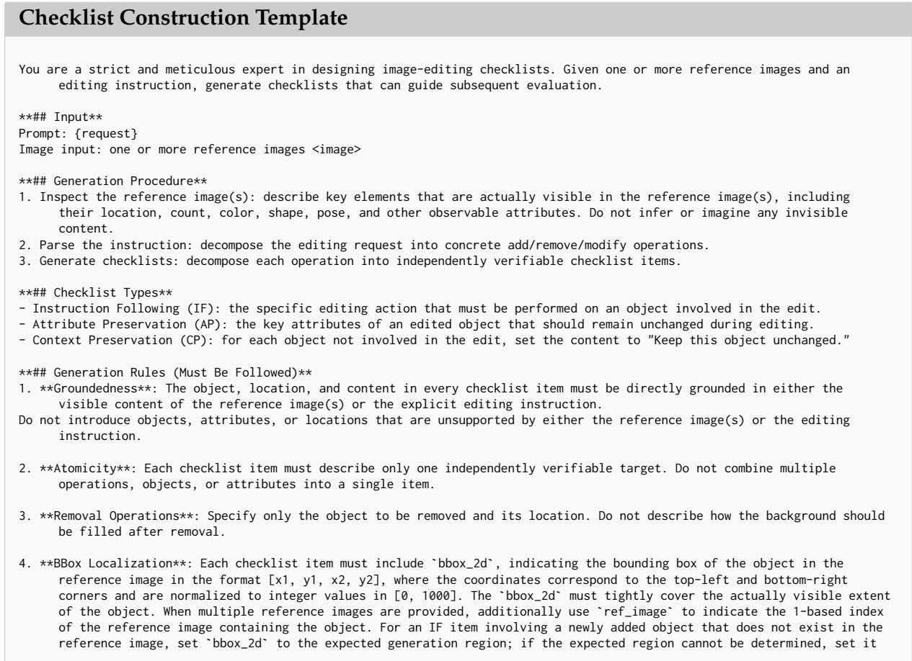

to null.   
5. \*\*Self-Check\*\*: Before output, verify that every checklist item is directly supported by either the reference image(s) or   
the editing instruction, and that each \`bbox\_2d\` is consistent with the actual object location.   
\*\*## Output\*\*   
Write all checklist items into a single JSON list. The output language must be consistent with the editing instruction:   
[   
{   
"checklist\_id": IntType,   
"type": "IF | AP | CP",   
"object": "object name",   
"location": "position in reference image",   
"bbox\_2d": [x1, y1, x2, y2],   
"content": "editing instruction or preservation constraint"   
},   
...   
]

## E.2 Judge Template

We use two complementary judges for semantic consistency (SC) and perceptual quality (PQ). The SC judge performs instance-specific, checklist-guided evaluation using the editing instruction, generated checklist, reference image(s), and edited result. It independently assesses Instruction Following (IF), Attribute Preservation (AP), and Context Preservation (CP), and outputs checklist-level judgments, dimension-wise scores and rationales, and an overall SC score. The PQ judge instead evaluates the edited result alone under a fixed quality rubric covering sharpness, generation artifacts, structural plausibility, lighting and perspective consistency, and boundary blending, and outputs a perceptual-quality score with a concise rationale. The complete prompt templates are provided below.

```markdown
SC Judge Template
You are a strict and consistent expert in image-editing quality evaluation. Your task is to assign absolute quality scores
for instruction following and context preservation of an edited result.
**## Input**
Prompt: {request}
Checklists: {checklists_json}
Image input order: one or more reference images (from the first image to the second-to-last image) -> edited result image
(the last image)
**## Evaluation Rules (Must Be Followed)**
1. **Checklist Evaluation**: Evaluate every provided checklist item one by one. Do not introduce additional evaluation
criteria, and do not speculate about details that are not visible in the images.
2. **Visible Evidence Only**: Every judgment must be based only on differences that can be directly observed between the
reference image(s) and the edited result. You may use the checklist `bbox_2d` ([x1, y1, x2, y2], normalized to [0,
1000]) to localize the corresponding object in the reference image before comparing it with the relevant region in the
edited result.
3. **Independent Scoring**: Score Instruction Following (IF), Attribute Preservation (AP), and Context Preservation (CP)
independently. Performance in one dimension must not compensate for errors in another.
4. **Stronger Penalty for Incorrect Edits**: Editing the wrong object, introducing malformed structures, causing structural
collapse, or violating physical plausibility should be penalized more heavily than simply failing to perform an
intended edit.
5. **Full Satisfaction Criterion**: A checklist item is considered fully satisfied only when both conditions hold: the
requested edit or preservation constraint is correctly satisfied, and the corresponding region is visually free of
defects.
**## Scoring Scale (Shared by IF, AP, and CP; Integer Scores from 0 to 9)**
First estimate the fraction of checklist items satisfied within the dimension, then determine the score by considering the
severity of the observed defects:
- 9: All requirements are fully satisfied, with no visible defects.
- 8: All requirements are satisfied, with only minor imperfections in a small number of non-critical aspects.
- 7: All critical requirements are completed, while a few non-critical aspects are not fully satisfied.
- 6: Most requirements are satisfied, with noticeable but non-severe defects.
- 5: Roughly two-thirds of the requirements are satisfied, or there is one clear defect.
- 4: Roughly half of the requirements are satisfied, or there are multiple clear defects.
- 3: Only a small portion is satisfied, or there is one severe defect, such as editing the wrong object, deformation, or
structural collapse.
- 2: Very few requirements are satisfied, or there are multiple severe defects.
- 1: Almost none of the requirements are satisfied, with severe incorrect edits.
- 0: The requested edit or preservation constraint is entirely unfulfilled or completely incorrect.
**Discriminability Requirement**: Use the full 0-9 score range. Do not cluster scores around 5-7 without sufficient
evidence. Scores must clearly distinguish among perfect results (9), minor imperfections (7-8), noticeable defects
```

```jsonl
(4-6), and severe failures (0-3).
Final `score`: compute an overall score with IF as the primary factor and AP/CP as secondary factors. The score may be a
floating-point value with one decimal place. If IF <= 3, the final score must not exceed 4.
**## Output (Strict JSON Only; Use the Same Language as the Editing Instruction)**
`ckl reason`: provide a judgment rationale for every checklist item without omission.
- `IF reason`, `AP reason`, `CP reason`, and the overall `reason`: summarize all relevant observations within the
corresponding dimension, using the object as the grammatical subject whenever possible.
- Order observations by their impact on the score, from largest to smallest. Keep the explanations concise and non-redundant.
{
"ckl reason": "string",
"IF score": <0-9 int>,
"IF reason": "string",
"AP score": <0-9 int>,
"AP reason": "string",
"CP score": <0-9 int>,
"CP reason": "string",
"score": <0-9 float>,
"reason": "string"
}
```

PQ Judge Template   
You are a strict and consistent expert in image quality evaluation. Your task is to assign an absolute score based solely on   
the visual quality of the edited result itself, independent of whether the editing instruction has been successfully   
fulfilled.   
\*\*## Input\*\*   
Prompt: {request}   
Image input: edited result image   
\*\*## Evaluation Rules (Must Be Followed)\*\*   
1. Base all judgments only on directly observable evidence in the image. Do not speculate about nonexistent content, and do   
not over-penalize negligible imperfections.   
2. Inspect the image in the following order:   
① sharpness / noise / blur   
② artifacts / compositing misalignment / unnatural textures   
③ deformation or structural errors in humans and objects   
④ consistency of lighting / perspective / color   
⑤ edge blending and overall realism   
3. First identify the defects that are actually present, then assign a score according to the scale below.   
\*\*## Scoring Scale (Integer Scores from 0 to 9)\*\*   
- 9: Highly realistic and natural, with sharp image quality, no visible defects, and rich details.   
- 8: Excellent quality, with only one minor imperfection that does not affect the overall viewing experience.   
- 7: Good quality, with a small number of minor imperfections that do not materially affect the overall appearance.   
- 6: Acceptable quality, with noticeable imperfections that slightly affect the viewing experience.   
- 5: Average quality, with multiple imperfections or one clear defect.   
- 4: Poor quality, with multiple clear defects, such as local artifacts or mild deformation.   
- 3: Bad quality, with severe defects such as obvious deformation, structural errors, or large-scale artifacts.   
- 2: Very poor quality, with multiple severe defects that substantially degrade the visual result.   
- 1: Severely distorted, with major structural collapse and little practical usability.   
- 0: Completely unusable, corrupted, or visually unrecognizable.   
\*\*Discriminability Requirement\*\*: Use the full 0-9 score range. Do not cluster scores around 5-7 without sufficient   
evidence. Assign high scores (8-9) when no meaningful defects are present, and confidently assign low scores (0-3) when   
severe defects are observed.   
\*\*## Output (Strict JSON Only; Use the Same Language as the Editing Instruction)\*\*   
The \`reason\` field should briefly summarize the main defects or strengths that determine the score:   
{   
"score": <0-9 int>,   
"reason": "string"   
}   
un n

## F Training Prompt Templates

## F.1 Scoring Prompt for SFT and Student

The same scoring prompt is used for Stage-I supervised fine-tuning and for the student model in Stage-II CR-OPSD. Given the editing instruction, one or more reference images, and the edited result, the model independently predicts four absolute scores for Instruction Following (IF), Attribute Preservation (AP), Context Preservation (CP), and Perceptual Quality (PQ). The

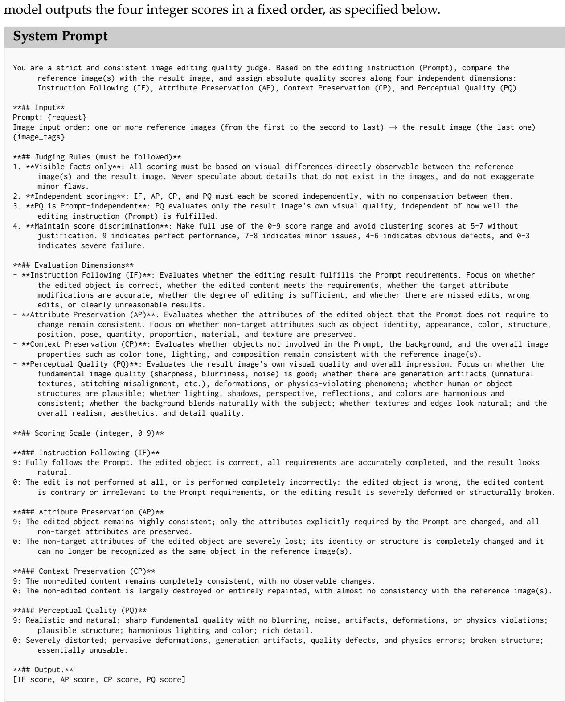

## F.2 Privileged Information for the Teacher

In Stage-II CR-OPSD, the teacher receives the same evaluation instruction and image inputs as the student, together with additional instance-specific privileged information $z = ( C , J , A )$ Specifically, C denotes the adaptive checklist constructed for the current editing instance, J contains checklist-level judgments grounded in visible evidence, and A provides dimensionwise rationales for IF, AP, CP, and PQ. The additional teacher context is formatted as follows:

Privileged Information   
## Checklist   
{For each checklist item: checklist\_id, type, object, location, bbox\_2d, content;   
include ref\_image when multiple reference images are provided.}   
## Checklist Judgments   
{For each checklist item, provide its judgment and corresponding visible evidence,   
aligned by checklist\_id.}   
## Dimension-wise Rationales   
IF: {Rationale for instruction following}   
AP: {Rationale for attribute preservation of the edited object}   
CP: {Rationale for preservation of non-edited content}   
PQ: {Rationale for the perceptual quality of the edited result}

## G Additional Quantitative Results

## G.1 Complete Ablation Results

We provide the complete ablation results on MMRB2, MER-Bench, and EditReward-Bench. Table 8 reports the effect of different privileged-information configurations, while Table 9 presents the full ablation of design choices in CR-OPSD.

Table 8: Privileged-information ablation (%, ↑). Bold marks column maxima.
<table><tr><td></td><td colspan="3">MMRB2</td><td colspan="4">MER-Bench</td><td colspan="4">EditReward-Bench</td></tr><tr><td>Privileged Information</td><td>Single</td><td>Multi</td><td>Overall</td><td>2 pair</td><td></td><td>3 pair 4 pair</td><td>Overall</td><td></td><td>PF</td><td>CS</td><td>Overall</td></tr><tr><td>Checklist C</td><td>72.99</td><td>67.98</td><td>72.10</td><td></td><td>81.00</td><td>56.50 27.00</td><td></td><td>54.83</td><td></td><td>86.6084.20</td><td>82.10</td></tr><tr><td>+ Checklist Judgment (C, J)</td><td>73.24</td><td>66.29</td><td>72.00</td><td>81.50</td><td></td><td>59.50 27.00</td><td></td><td>56.00</td><td></td><td>84.60 85.10</td><td>82.20</td></tr><tr><td>+ Dimension-wise Rationale (C, J, A)</td><td>73.36</td><td>67.42</td><td>72.30</td><td></td><td>82.00</td><td>60.50 27.50</td><td></td><td>56.67</td><td>85.5084.10</td><td></td><td>82.90</td></tr><tr><td>+ Dimension Scores (C, J, A, g)</td><td>71.17</td><td>65.17</td><td>70.10</td><td></td><td>82.00</td><td>57.50</td><td>28.00</td><td>55.83</td><td></td><td>84.90 83.90</td><td>81.30</td></tr></table>

Table 9: Ablation study of the design choices in CR-OPSD (%, ↑). All variants use the same privileged information (C, J, A). Bold indicates the best result in each column.
<table><tr><td rowspan="2">Variant</td><td colspan="3">MMRB2</td><td colspan="3">MER-Bench</td><td colspan="3">EditReward-Bench</td></tr><tr><td>Single Multi</td><td></td><td>Overall</td><td>2 pair 3 pair</td><td></td><td>4pair</td><td>Overall</td><td>PF CS</td><td>Overall</td></tr><tr><td>w/o Reliability Weighting</td><td>71.41</td><td>63.48</td><td>70.00</td><td>81.50</td><td>57.50</td><td>26.00</td><td>55.00</td><td>84.7085.10</td><td>82.10</td></tr><tr><td>Linear Reliability Mapping</td><td>72.51</td><td>65.73</td><td>71.30</td><td>81.50</td><td>59.50</td><td>27.50</td><td>56.17</td><td>85.0084.70</td><td>82.30</td></tr><tr><td>Argmax-based Reliability</td><td>71.90</td><td>64.61</td><td>70.60</td><td>82.50</td><td>57.50</td><td>26.50</td><td>55.50</td><td>84.6084.20</td><td>82.60</td></tr><tr><td>CR-OPSD (Ours)</td><td>73.36</td><td>67.42</td><td>72.30</td><td>82.00</td><td>60.50</td><td>27.50</td><td>56.67</td><td>85.50 84.10</td><td>82.90</td></tr></table>

## G.2 Complete Image Editing Results

We provide the complete results of the online RL experiments in Tables 10 and 11.

Table 10: Results on ImgEdit-Bench and GEdit-Bench-EN.
<table><tr><td></td><td colspan="10">ImgEdit-Bench</td><td colspan="3">GEdit-Bench-EN</td></tr><tr><td>Model</td><td>Add Adjust Extract Replace Remove Background Style Compose</td><td></td><td></td><td></td><td></td><td></td><td></td><td></td><td>Action</td><td>Overall</td><td>G_SC G_PQ</td><td>G_O</td></tr><tr><td>Qwen-Image-Edit</td><td>4.40</td><td>4.30</td><td>3.67</td><td>4.64</td><td>4.34</td><td>4.30</td><td>4.83</td><td>3.39</td><td>4.71</td><td>4.287</td><td>8.855</td><td>7.949 8.181</td></tr><tr><td>UniWorld-Qwen-Image-Edit</td><td>4.42</td><td>4.31</td><td>3.71</td><td>4.69</td><td>4.32</td><td>4.28</td><td>4.83</td><td>3.42</td><td>4.68</td><td>4.296</td><td>8.824</td><td>7.8848.119</td></tr><tr><td>+ DiffusionNFT (CheckDistill-9B)</td><td>4.47</td><td>4.68</td><td>4.52</td><td>4.65</td><td>4.41</td><td>4.40</td><td>4.89</td><td>3.60</td><td>4.51</td><td>4.459</td><td>8.909</td><td>8.039 8.280</td></tr></table>

Table 11: Results on RED-Bench.
<table><tr><td></td><td colspan="10">RED-Bench</td><td colspan="5"></td></tr><tr><td>Model</td><td>Add Adjust Background Beauty Color Compose Extract Low-level Motion Portrait Remove Replace Stylize Text Viewpoint Overall</td><td></td><td></td><td></td><td></td><td></td><td></td><td></td><td></td><td></td><td></td><td></td><td></td><td></td><td></td></tr><tr><td>Qwen-Image-Edit</td><td>4.54</td><td></td><td>4.31</td><td>3.14</td><td>4.06</td><td>3.85</td><td>3.04</td><td>4.47</td><td>4.68</td><td>4.37</td><td>4.21</td><td>4.59</td><td>4.683.94</td><td></td><td>3.55 4.10</td></tr><tr><td>UniWorld-Qwen-Image-Edit</td><td>4.48</td><td>4.08 4.07</td><td>4.40</td><td>3.19</td><td>4.10</td><td>3.84</td><td>2.87</td><td>4.28</td><td>4.63</td><td>4.35</td><td>4.25</td><td>4.56</td><td>4.72 3.83</td><td>3.40</td><td>4.06</td></tr><tr><td>+ DiffusionNFT (CheckDistill-9B) 4.60</td><td></td><td>4.25</td><td>4.42</td><td>3.37</td><td>4.38</td><td>3.99</td><td>4.07</td><td>4.59</td><td>4.55</td><td>4.10</td><td>4.39</td><td>4.56</td><td>4.73 4.15</td><td>3.73</td><td>4.26</td></tr></table>

## H Checklist-Guided Evaluation Examples

We provide examples of CheckDistill’s checklist-guided judgment in Figs. 6, 7, and 8. Given an instance-specific checklist, CheckDistill performs fine-grained verification of each editing requirement and aggregates these item-level judgments into dimension-level assessments and scores.

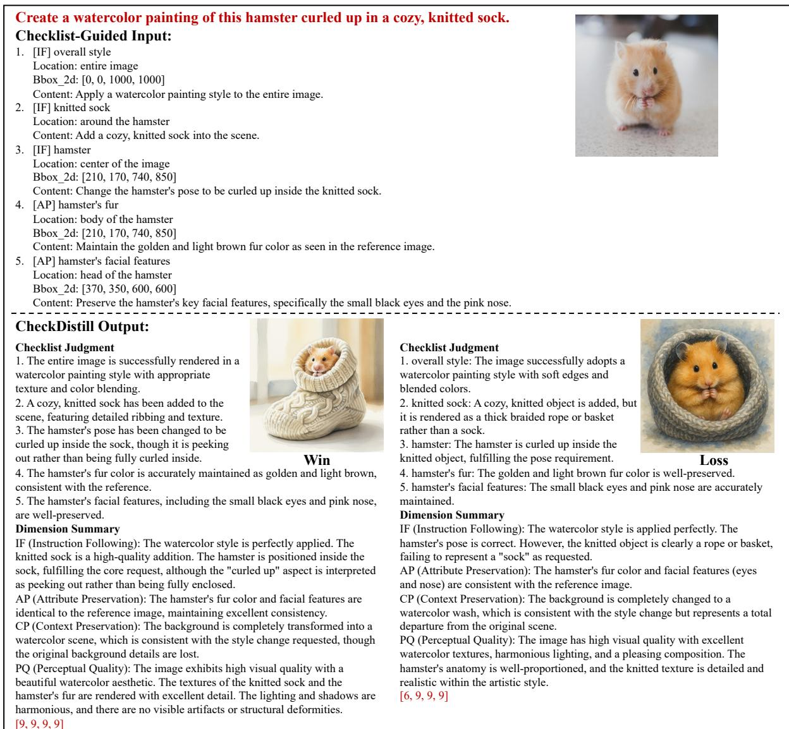  
Figure 6: Example of Checklist-Guided Judgment by CheckDistill

<table><tr><td colspan="3">Create a humorous advertisement poster with all three objects together: place the sunglasses from the first image on the Minion figure from the third image, and have the Minion sitting inside the decorative bowl from the second image. Set the scene with a bright, playful background and add bold text that says, &quot;When style, comfort, and fun collide: Summer</td></tr><tr><td colspan="3">essentials for everyone!&quot; Checklist-Guided Input: 1. [IF] sunglasses</td></tr><tr><td colspan="3">Location: on the Minion figure Bbox_2d: [31, 304, 998, 714] Reference: 1</td></tr><tr><td colspan="3">Content: Place the sunglasses from the first image on the Minion figure from the third image 2. [IF] Minion figure Location: inside the decorative bowl Bbox_2d: [287, 188, 734, 715]</td></tr><tr><td colspan="3">Reference: 3 Content: Place the Minion figure sitting inside the decorative bowl from the second image. 3. [IF] background Location: entire scene</td></tr><tr><td colspan="3">Content: Set the scene with a bright, playful background. 4. [IF] text Location: on the poster</td></tr><tr><td colspan="3">Bbox 2d: [70, 880, 110, 920] Content: Add bold text that says, &quot;When style, comfort, and fun collide: Summer essentials for everyone!&quot; 5. [AP] sunglasses</td></tr><tr><td colspan="3">Location: from the first image Bbox 2d: [31, 304, 998, 714] Reference: 1</td></tr><tr><td colspan="3">Content: Maintain the round shape, gold metal frame, and iridescent blue-green lenses of the sunglasses 6. [AP] decorative bowl Location: from the second image</td></tr><tr><td colspan="3">Bbox_2d: [0, 181, 951, 808] Reference: 2 Content: Maintain the white ceramic material, the specific green leaf/vine pattern, and the three small legs of the bowl.</td></tr><tr><td colspan="3">7. [AP] Minion figure Location: from the third image Bbox_2d: [287, 188, 734, 715] Reference: 3</td></tr><tr><td colspan="3">Content: Maintain the Minion&#x27;s yellow skin, single eye, and the black and white striped prisoner outfit with the &#x27;001&#x27; badge.</td></tr><tr><td colspan="3">CheckDistill Output: When stule, comfort, and fun collide: Checklist Judgment Summer essentials for everyone!</td></tr><tr><td colspan="3">1. The sunglasses are placed in the bowl rather than</td></tr><tr><td colspan="3">Checklist Judgment on the Minion figure as requested. 2. The Minion figure is correctly placed inside the instead.</td></tr><tr><td>decorative bowl.</td><td colspan="2">1. The sunglasses are not placed on the Minion figure; they are resting on the rim of the bowl</td></tr><tr><td></td><td colspan="2">summer essentials</td></tr><tr><td>3. The background is bright and playful with blue</td><td colspan="3">2. The Minion figure is not sitting inside the bowl: it is standing on the surface next to the bowl. 3. The background is bright and playful, successfully following the instruction 4. The text is incomplete and misspelled; it reads &quot;summer essentials [garbled] everyone!&quot; instead of</td></tr><tr><td>and yellow colors. Win</td><td colspan="3">5. The sunglasses maintain their round shape, gold frame, and iridescent lenses,</td></tr><tr><td>4. The text is present but is not bold as specified in</td><td colspan="3">the full required phrase. though they are in the wrong location.</td></tr><tr><td>the instruction. 5. The sunglasses maintain the round shape and gold frame, but the iridescent</td><td colspan="3">6. The decorative bowl maintains its white ceramic material, green leaf pattern,</td></tr><tr><td>blue-green lenses are now a solid dark blue. 6. The decorative bowl maintains its white ceramic material, green leaf pattern, and three legs.</td><td colspan="3">and three legs, though the Minion is not inside it. 7. The Minion figure maintains its yellow skin and prisoner outfit, but it has</td></tr><tr><td>7. The Minion figure maintains its yellow skin, single eye, and prisoner outfit</td><td colspan="3">T everyone! Loss two eyes instead of the single eye from the reference, and it is not inside the the background and text are present. However, the sunglasses were placed in bowl. Dimension Summary</td></tr><tr><td>with the &#x27;001&#x27; badge Dimension Summary IF (Instruction Following): The Minion is correctly placed in the bowl, and</td><td colspan="3">IF (Instruction Following): The core spatial instructions were failed: the sunglasses are on the bowl, not the Minion, and the Minion is outside the bowl,</td></tr></table>

Figure 7: Example of Checklist-Guided Judgment by CheckDistill

<table><tr><td colspan="2">Draw the shape represented by the question mark that fits the pattern.</td></tr><tr><td>Checklist-Guided Input: ●</td></tr><tr><td>1. [IF] question mark</td></tr><tr><td>Location: bottom-left cell of the 3x3 grid 口</td></tr><tr><td>Bbox_2d: [78, 740, 245, 935]</td></tr><tr><td>Content: Remove the question mark from the bottom-left cell.</td></tr><tr><td>2. [IF] cross lines ?</td></tr><tr><td>Location: bottom-left cell of the 3x3 grid</td></tr><tr><td>Bbox_2d: [18, 708, 315, 985]</td></tr><tr><td>Content: Add a central vertical line and a central horizontal line to divide the bottom-left cell into four equal quadrants, matching the structure of the other cells. 3. [IF] square</td></tr><tr><td>Location: bottom-left quadrant of the bottom-left cell</td></tr><tr><td>Bbox 2d: [40, 850, 140, 950]</td></tr><tr><td>Content: Draw a hollow square in the bottom-left quadrant of the cell to follow the counter-clockwise movement pattern observed in the third row (Bottom-Left - Bottom-Right -&gt; Top-Right).</td></tr><tr><td>4. [IF] dot</td></tr><tr><td>Location: bottom-left quadrant of the bottom-left cell</td></tr><tr><td>Bbox_2d: [70, 880, 110, 920]</td></tr><tr><td>Content: Draw a solid dot in the bottom-left quadrant of the cell (inside the square) to follow the static position pattern observed in the third row (Bottom-Left in all three cells).</td></tr><tr><td>5. [AP] square</td></tr><tr><td>Location: bottom-left cell</td></tr><tr><td>Bbox_2d: [40, 850, 140, 950] Content: The newly drawn square must match the size, line thickness, and gray color of the squares in the other cells, such as the one at [850, 50, 950, 150]</td></tr><tr><td>6. [AP] dot</td></tr><tr><td>Location: bottom-left cell</td></tr><tr><td>Bbox_2d: [70, 880, 110, 920]</td></tr><tr><td>Content: The newly drawn dot must match the diameter and solid gray color of the dots in the other cells, such as the one at [200, 190, 225, 215]. 7. [AP] cross lines</td></tr><tr><td>Location: bottom-left cell</td></tr><tr><td>Bbox_2d: [18, 708, 315, 985] Content: The new cross lines must match the stroke width and color of the grid lines in the existing cells.</td></tr><tr><td>8. [CP] other 8 cells</td></tr><tr><td>Location: top two rows and right two columns of the grid</td></tr><tr><td>Bbox_2d: [18, 18, 985, 670]</td></tr><tr><td></td></tr><tr><td>Content: Keep the content and layout of the other eight cells in the grid unchanged.</td></tr><tr><td></td></tr></table>

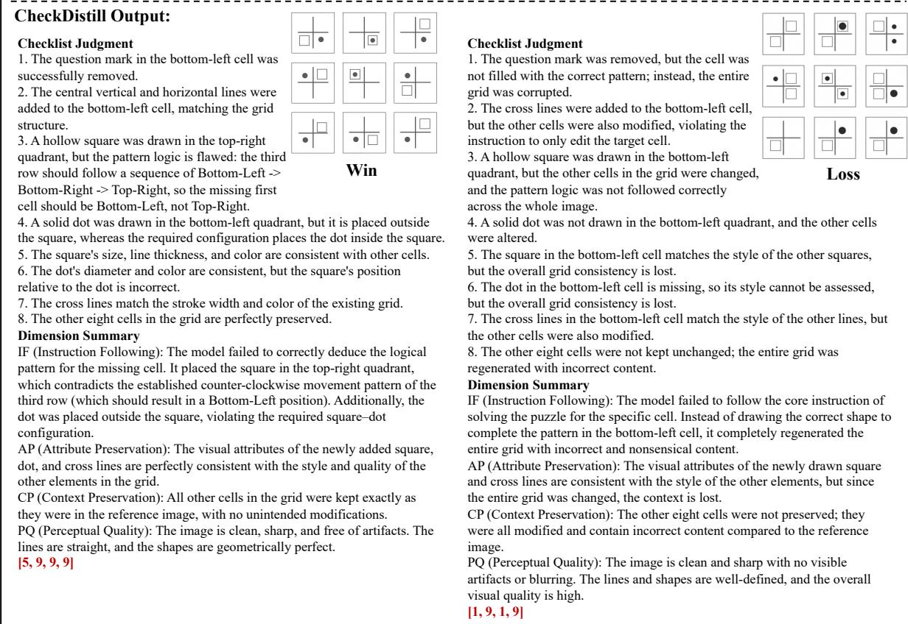  
Figure 8: Example of Checklist-Guided Judgment by CheckDistill

## I Additional Qualitative Evaluation

We provide additional qualitative results to further illustrate the effectiveness of CheckDistillguided RL. Figure 9 presents the training reward curve, which steadily increases during optimization. Figure 10 and 11 provide qualitative comparisons before and after CheckDistillguided RL, showing improved instruction following, stronger source-image consistency, and better perceptual quality.

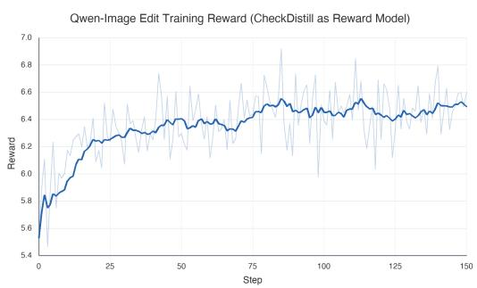  
Figure 9: Training reward for Qwen-Image-Edit using CheckDistill as the reward model.

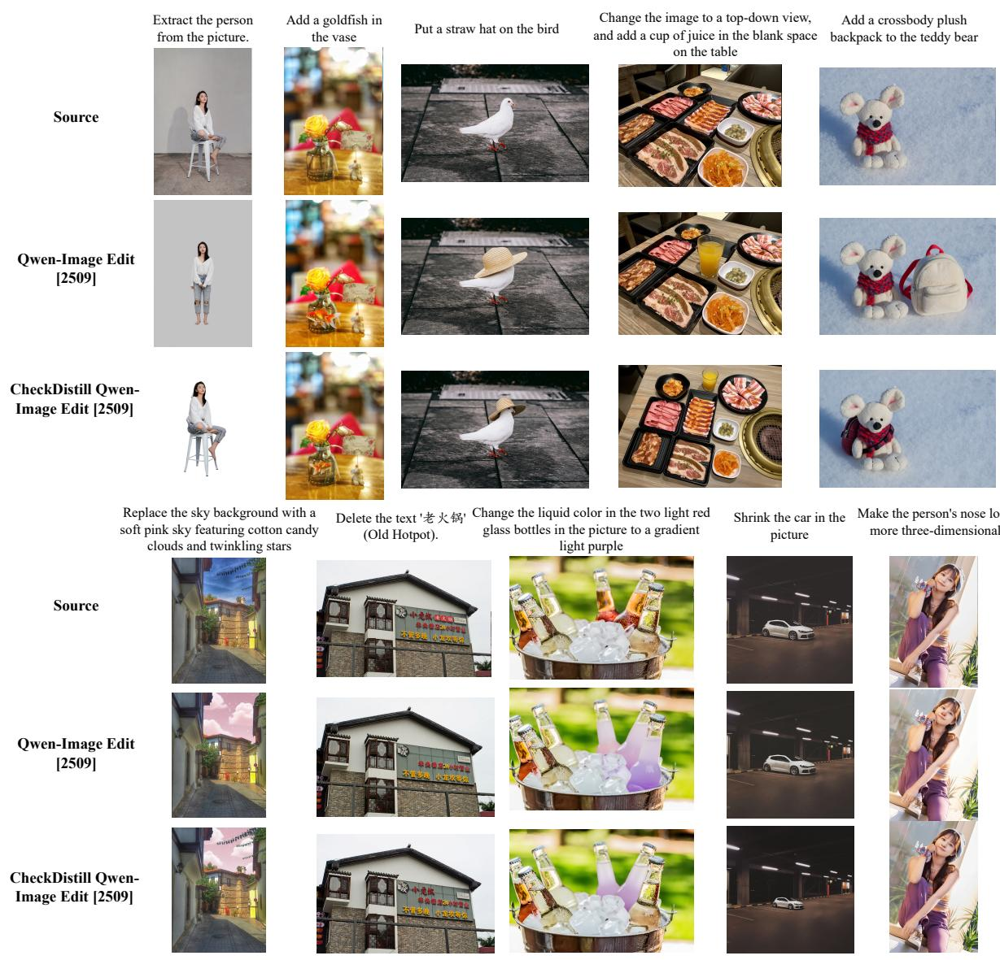  
Figure 10: Qualitative Comparison Before and After CheckDistill-based Reward Training.

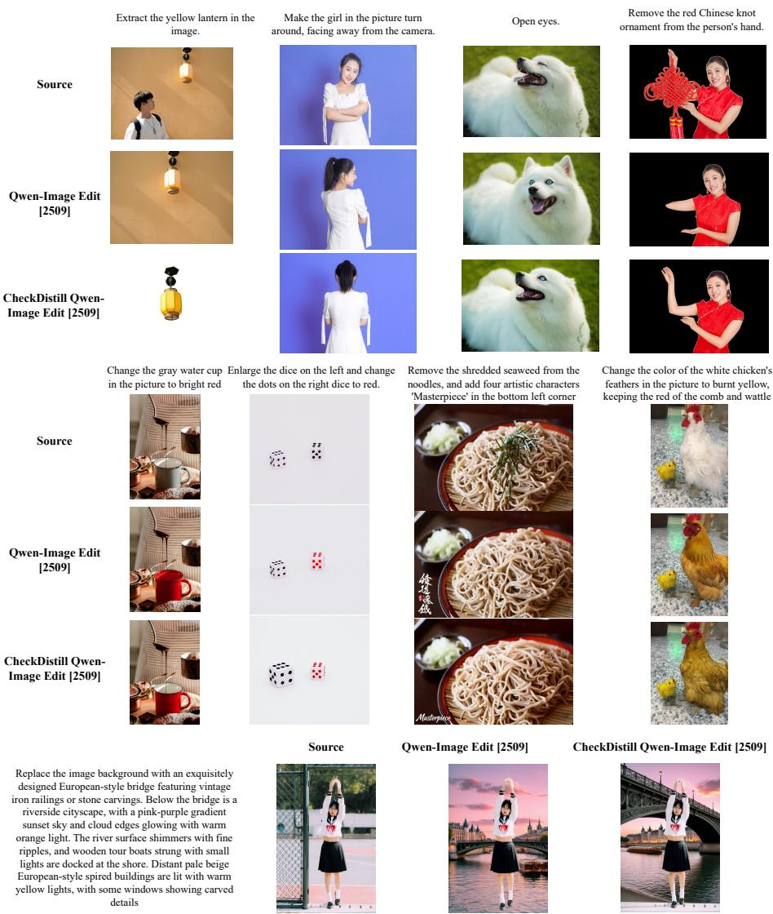  
Figure 11: Qualitative Comparison Before and After CheckDistill-based Reward Training.

## J Discussion

Z-Reward (Jin et al., 2026) and our CheckDistill both distill reasoning-supported assessment into direct scoring, but address different challenges. Z-Reward focuses on representing preference uncertainty and fine-grained score differences through reasoning-conditioned score distributions. Our starting point is that image-editing evaluation requires instance-specific verification of both requested changes and preservation constraints. We therefore introduce Dynamic Checklist Scaling to translate each editing instruction and source image into atomic verification criteria, enriching the teacher context with checklists and their supporting judgements.

This focus on verification evidence also shapes our distillation design. While Z-Reward transfers scoring knowledge from a large reasoning teacher to a compact student, we use on-policy selfdistillation with an evidence-enriched teacher of the same architecture. Distribution-Aligned Context Compression transfers the teacher’s scoring behavior at student-generated prefixes, and reliability weighting modulates supervision at score positions according to teacher–label agreement, accounting for potentially incorrect teacher judgements. Our contribution centers on constructing and reliably internalizing instance-specific verification evidence, enabling direct scoring without checklist inputs or explicit reasoning at inference time.