# CondenseVLA: Learnable History Condensation for Efficient Multi-Frame VLA

Feiyang Hong1 Yujie Wei2 Bo Zhao3 Xiu Su4 Hongxun Yao2 Shuo Yang1,∗

1 Harbin Institute of Technology, Shenzhen 2 Harbin Institute of Technology

3 Shanghai Jiao Tong University 4 Central South University

Feiyang Hong: feiyanghong7040@qq.com Shuo Yang: shuoyang@hit.edu.cn ∗ Corresponding author

## Abstract

Robot manipulation often depends on short-term cues—such as brief contacts, temporary occlusions, and intermediate object states—that are ambiguous in a single frame and can only be resolved by integrating observations over time. However, injecting historical information solely by enlarging the history window is computationally costly and frequently yields limited gains due to substantial redundancy and task-agnostic, inflexible sampling of observations. We propose CondenseVLA, a multi-frame VLA policy with a learnable decoder-side history condensation module for using short-term visual context in action decoding. Given a sequence of cached per-frame features from the VLM backbone, CondenseVLA distills observation history into a fixed set of slot tokens using learnable queries and multi-head cross-attention. Simple auxiliary regularization penalizes overlap among slot attention maps and decorrelates slot embeddings, encouraging complementary attention and reducing slot redundancy. Across the evaluated tasks, CondenseVLA improves Simpler-WidowX success from 58.7% to 69.8% (+11.1 percentage points), achieves 97.2% on LIBERO, and reaches 52.8% on real-world tasks. It achieves 21.6% success on memory-dependent RMBench tasks. These results support selective condensation of bounded recent visual evidence for action decoding, while harder multi-observation tasks expose the limits of a finite history window. Project page: https://github.com/FeiyangHong/CondenseVLA

## 1 Introduction

Robot manipulation tasks, especially long-horizon and partially observable ones, require temporal reasoning over contact events, state transitions, and other transient visual cues. For example, in Pick and Place Twice, the current frame may only show the gripper holding an object, but not whether the next correct action is to place it on the other plate or return it to the original one. Robust execution therefore depends on integrating observations over time rather than reacting to a single frame. Vision-language-action (VLA) policies have recently made significant progress in multi-task generalization [3, 18]. Single-frame policies such as OpenVLA learn diverse skills from large-scale robot trajectory datasets but lack explicit observation history [18]. RT-2 integrates a web-scale vision-language model to enable zero-shot reasoning, advancing general-purpose robotic control [58]. However, single-frame conditioning cannot directly access earlier visual observations needed to resolve task progress [23]. A naive solution is to increase the history window by stacking more frames; however, this quickly becomes computationally expensive and increases latency—as reported in HAMLET, appending only four additional past observation frames can slow the forward pass by about 35% [20]—and often brings little or even negative gain because nearby frames are highly repetitive and fixed-interval sampling can miss short but important task events. When irrelevant or repetitive observations dominate the context, longer histories can inject noise and degrade policy performance. This motivates a more intelligent way to encode temporal context, filtering redundancy while preserving important temporal cues.

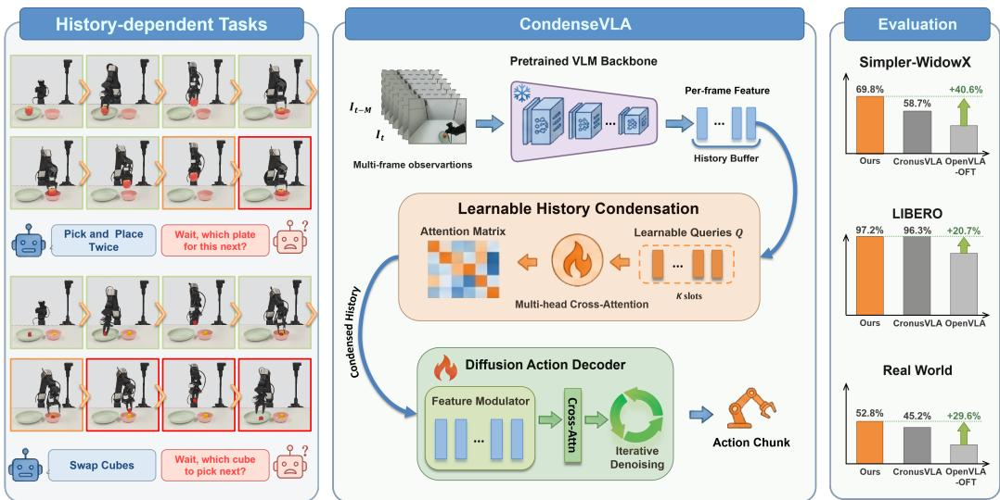  
Figure 1: We propose CondenseVLA, a decoder-side Learnable History Condensation (LHC) model that distills informative multi-frame context into compact slot tokens. The left panel highlights history-dependent failures of single-step VLA execution: in Pick and Place Twice, the policy forgets which plate to place next; in Swap Cubes, it forgets which cube should be picked next. Across multiple benchmarks, including Simpler, LIBERO, and real-world robot experiments, CondenseVLA consistently outperforms the CronusVLA baseline.

Recent work has begun exploring efficient temporal context for robotic policies [37]. Representative examples such as ContextVLA and CronusVLA show that history-aware modeling can substantially improve long-horizon robustness while controlling computational overhead [17, 23]. These advances highlight that temporal context is critical for robust VLA manipulation, but they also expose a central challenge: how can short-term temporal context be incorporated into VLA policies in a computationally efficient and robust manner [42]?

As illustrated in Fig. 1, history-dependent tasks such as Pick and Place Twice and Swap Cubes require recalling previously completed sub-steps, which is difficult for single-step conditioning. We therefore propose Learnable History Condensation (LHC), which encodes a length-M observation history into K context tokens (K ≪ M). The LHC module is inserted between the pretrained vision–language backbone and the diffusion action decoder [7, 35]. At each time step, the VLM encodes only the current observation; the most recent M historical features are reused from a FIFO cache and condensed into K slot embeddings. The current feature is supplied separately to the decoder. We instantiate the LHC module with cross-attention: K learnable slot queries attend to the M historical features as keys and values to extract instruction-relevant information. The learned slots provide compact conditioning, with attention visualizations suggesting complementary coverage of the recent history; slot indices do not prescribe particular events or temporal positions. Conceptually, our design follows the spirit of slot-attention methods that condense variable-length sets into latent slots, and adapts it to distill multi-frame observations into compact context tokens.

Our main contributions are summarized as follows:

• Method. We propose a decoder-side Learnable History Condensation mechanism for multiframe VLA policies, which distills cached recent VLM features into a fixed number of action-conditioning slots; auxiliary regularization encourages complementary attention and reduces slot redundancy.

• Empirical results. CondenseVLA improves Simpler-WidowX success from 58.7% to 69.8%, achieves 97.2% on LIBERO, reaches 52.8% on real-world tasks, and achieves 21.6% on RMBench.

• Findings. We investigate why history condensation matters. Our results show that long histories contain substantial redundancy, and that learning task-relevant history condensation is more reliable than naively expanding history windows or rigid sampling of observations.

## 2 Related Works

## 2.1 Vision-Language-Action Models

Recent research on VLA models has produced large-scale foundation policies trained on a combination of internet-scale vision-language corpora and robot data [27, 57]. OpenVLA is built on a LLaMA2-based language backbone with pretrained visual encoders [18]. It exhibits strong multi-task manipulation generalization and compares favorably with prior closed-source models such as RT-2 (55B) [58]. GR00T N1 adopts a dual-system design that couples a vision-language module for high-level reasoning with a diffusion Transformer module for low-level motion control, and is jointly trained on diverse real-robot data, human videos, and synthetic data [1]. Beyond general-purpose foundation models, specialized VLA variants have also emerged. Spatially enriched VLA models, such as SpatialVLA and DepthVLA, incorporate 3D-related cues to improve geometric grounding and robustness across camera viewpoints [38, 50, 48, 30]. Related work on unsupervised 3D scene understanding learns semantic structure through superpoint grouping and growing semantic primitives [51, 52]. VLA models with force/torque or tactile signals, such as TA-VLA and Tactile-VLA, further improve contact-aware decision making in manipulation [15, 53]. TouchWorld combines tactile prediction with reactive control, while TouchAnything estimates bimanual tactile signals from egocentric video [56, 55]. Experience-driven VLA models, such as HAVE and DEJAVU, leverage his torical interaction traces to improve temporal consistency and recovery from failures [21, 29, 22, 43]. DEWO adapts world-action models using visual supervision from successful and failed deployment continuations [49]. Meanwhile, EgoVLA scales training with large amounts of egocentric human video, learning to predict human hand actions from video and then retargeting them to robots [46]. ConLA learns latent actions from human videos through contrastive disentanglement, and WING transfers interaction-centric latent actions using spectral guidance [9, 32]. Recent studies also investigate target-aware and cognition-aware attention optimization in VLA, as exemplified by CogVLA, and enhance VLA with explicit perceptual-cognitive memory mechanisms, as in MemoryVLA; π0.5 further strengthens open-world generalization [25, 26, 39, 16]. Collectively, these efforts reflect a broader trend toward robotic foundation models, leveraging vision-language priors and high-quality robot data to enable broad manipulation capabilities [10, 12].

## 2.2 Multi-frame Modeling and Efficient Inference

Temporal VLA methods differ in where they summarize history and what structure they retain. TraceVLA overlays past motion cues on the current observation [54], while CronusVLA uses twostage training to extend single-frame OpenVLA with dense multi-frame conditioning [23]. EgoVLA instead exploits temporal demonstrations from human video for transfer to robot control [46].

ContextVLA average-pools historical hidden states into one context token at an intermediate VLM layer; later backbone layers process this token with the current observation, while causal masking enables reuse of cached history [17]. It is trained with the underlying policy’s action objective. CondenseVLA instead retains frozen vision/language weights and maps cached frame features to K learned summaries at the diffusion-decoder interface. Multiple slots provide an adjustable conditioning budget, at the cost of added parameters and choosing K; their number alone does not establish an advantage over a single token. HAMLET appends several moment tokens to each VLM input, initializes them with time-contrastive learning, and uses a shallow causal Transformer to aggregate recent moment tokens before action prediction [20]. Our LHC is jointly optimized with the action decoder without a separate moment-token initialization stage. Both use recent temporal summaries, but differ in backbone interaction and temporal aggregation.

SlotVLA learns object slots and relation tokens from dense visual patches. Its two-stage training uses box, mask, and task-relevance supervision before relation/action learning, and carries object slots between frames to preserve identity [13]. Its slots therefore encode supervised object structure, whereas our slots aggregate cached instruction-conditioned frame features without object labels or recurrent object-slot state. HistRISE segments task-relevant objects, tracks their points in 3D, and compresses variable-length tracks into one history token per object for policy conditioning [5]. It can use full or pre-loaded histories, but relies on segmentation and point tracking. Our fixed FIFO avoids these additional perception components while relinquishing an explicit representation of events outside the recent window. These are differences in representation, supervision, and memory scope, not evidence of superiority under matched conditions.

Token merging [8], computation reuse [44, 47], and action tokenization [36] address complementary efficiency concerns. TaLo identifies task-interfering VLM layers and bypasses a selected layer at inference [33]. At a different level, MemER retrieves historical keyframes through a hierarchical policy [40], and MEM combines short-horizon video memory with text-based task memory [41]. CondenseVLA focuses on policy-oriented condensation of recent temporal cues at the decoder interface. We use Learnable History Condensation to distill cached per-step VLM features into several slot tokens, directly controlling the trade-off between temporal horizon and slot capacity.

## 3 Preliminaries

## 3.1 Multi-frame in VLA Policies

Multi-frame manipulation can be viewed as a partially observable decision process in which actions depend on latent task state inferred from an observation history, rather than from a single frame. A common design principle is to decouple per-frame semantic encoding from temporal aggregation: a vision-language backbone extracts frame-level features, and a lightweight temporal module integrates them for control. This factorization preserves strong visual-language priors while keeping temporal reasoning computationally tractable. Existing systems instantiate this principle in different ways. For example, CronusVLA adopts a two-stage pipeline (single-frame pretraining followed by multi-frame post-training with a diffusion decoder) [23], while ContextVLA amortizes history into reusable context tokens with caching for efficient inference [17].

## 3.2 Temporal Feature Buffering and Decoding

Let $o _ { t }$ denote the RGB observation at time t and x the language instruction. A pretrained VLM backbone maps $( o _ { t } , x )$ to a frame-level feature $f _ { t } \in \mathbb { R } ^ { D }$ . A history window is represented as $F _ { t } ^ { ( M ) } = \{ f _ { t - M } , \ldots , f _ { t - 1 } \} \in \mathbb { R } ^ { M \times D }$ , which is typically maintained as a FIFO feature buffer so past features can be reused and the VLM is evaluated only once per step. The action decoder (e.g., a diffusion decoder) consumes a fixed-length sequence derived from $\{ \bar { f } _ { t - M } , \ldots , f _ { t } \}$ and predicts an action chunk $\scriptstyle a _ { t : t + T _ { a } - 1 }$ . This creates a core multi-frame trade-off: increasing M improves temporal coverage but also increases redundancy and computation. Therefore, multi-frame methods require a history-to-token mapping that selects or condenses informative temporal information into a bounded number of tokens.

## 4 Method

The proposed method condenses per-frame VLM features in a multi-frame VLA pipeline. At step t, the VLM encodes the current observation into $f _ { t } \in \mathbb { R } ^ { D }$ , a FIFO buffer stores M history features $F _ { t } = [ f _ { t - M } , \dots , f _ { t - 1 } ] \in \mathbb { R } ^ { M \times D }$ , and LHC condenses them into K history slots $\tilde { F } _ { t } \in \mathbb { R } ^ { K \times D } ( K \ll$ M). The diffusion decoder is conditioned on the fixed-length sequence $Z _ { t } = [ \tilde { F } _ { t } ; f _ { t } ] \in \mathbb { R } ^ { ( K + 1 ) \times D }$ By placing temporal compression at the action-decoder interface, the decoder receives $K$ temporal conditioning tokens independent of M, while past frames are encoded once, cached, and selectively summarized before action decoding. An overview is shown in Fig. 2.

## 4.1 Learnable History Condensation (LHC)

LHC maps $F _ { t }$ to K slot tokens via multi-head attention with learnable Q/K/V projections. Although the slot queries are learned parameters, they attend over instruction-conditioned VLM history features, allowing the resulting slot assignments to capture task-relevant temporal evidence under a fixed

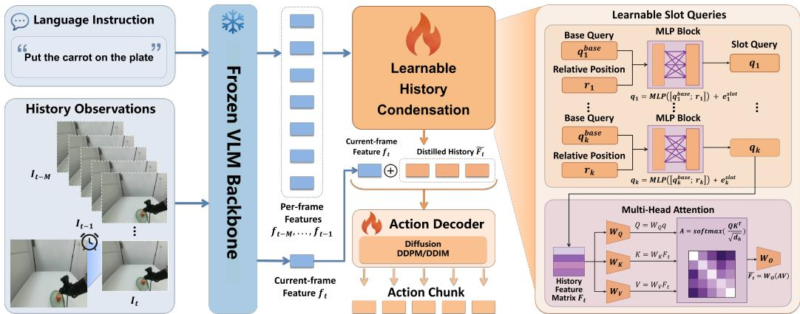  
Figure 2: Overview of CondenseVLA. Frozen vision/language weights and a trainable multimodal projector encode each observation. LHC condenses cached history using slot queries and value-only time embeddings. The decoder expands the current feature separately; historical features use stopgradient during training.

decoder-side token budget. Each slot i maintains a base query $q _ { i } ^ { \mathrm { b a s e } } \in \mathbb { R } ^ { D }$ , a slot embedding $e _ { i } ^ { \mathrm { s l o t } } \in \mathbb { R } ^ { D }$ , and a fixed relative scalar $r _ { i } \in [ 0 , 1 ]$ injected through an MLP:

$$
q _ { i } = \mathrm { M L P } ( [ q _ { i } ^ { \mathrm { b a s e } } ; r _ { i } ] ) + e _ { i } ^ { \mathrm { s l o t } } , \quad i = 1 , \ldots , K .\tag{1}
$$

The queries $q = [ q _ { 1 } ; \dots ; q _ { K } ]$ attend to cached history with H heads of width $d _ { h } = D / H$ . Learned history-position embeddings enter only the value path, with a learnable scale initialized to zero. For head $h ,$ , let $Q ^ { ( h ) } , K _ { \mathrm { h i s t } } ^ { ( h ) }$ , and $V ^ { ( h ) }$ denote the projected queries, keys, and values:

$$
A ^ { ( h ) } = \mathrm { s o f t m a x } \left( \frac { Q ^ { ( h ) } ( K _ { \mathrm { h i s t } } ^ { ( h ) } ) ^ { \top } } { \sqrt { d _ { h } } } \right) \in \mathbb { R } ^ { K \times M } .\tag{2}
$$

$$
\tilde { F } _ { t } = \mathrm { M H A } ( q , F _ { t } ) = \mathrm { C o n c a t H e a d s } \Big ( A ^ { ( h ) } V ^ { ( h ) } \Big ) _ { h = 1 } ^ { H } W _ { O } \in \mathbb { R } ^ { K \times D } .\tag{3}
$$

Softmax normalizes over history positions, and $W _ { O }$ projects the concatenated heads. Full projections and tensor dimensions are given in the appendix. No hard temporal assignment is imposed on the output slots. Instead, the relative scalar only breaks permutation symmetry and provides a weak slot identity, allowing slot roles to emerge from end-to-end training.

## 4.2 Injecting Condensed History into the Diffusion Decoder

The decoder input is $Z _ { t } = [ \tilde { F } _ { t } ; f _ { t } ]$ , where $\tilde { F } _ { t }$ provides compact temporal evidence and $f _ { t }$ anchors the latest scene state. In cross-attention, the history slots and current-step feature play complementary roles: the slots preserve information about past contacts, object states, and subgoal progress, while the current feature grounds action generation in the latest observation. This fixed-length conditioning avoids passing dense, repetitive history tokens to the diffusion decoder, which is important when increasing the history window would otherwise increase latency and introduce redundant visual evidence. Thus, history affects action prediction through conditioning tokens rather than raw sequence re-encoding.

## 4.3 Training Objective

Fine-tuning optimizes the multimodal projector, LHC, and diffusion decoder while freezing the vision encoders and language model. The total objective is ${ \cal L } = { \cal L } _ { \mathrm { d i f f } } + \lambda _ { \mathrm { d i v } } { \cal L } _ { \mathrm { d i v } } + \lambda _ { \mathrm { s l o t } } { \cal L } _ { \mathrm { s l o t } }$

Diffusion training follows standard noise prediction for the noised action chunk $a ^ { \epsilon } \mathrm { : }$

$$
L _ { \mathrm { d i f f } } = \mathbb { E } _ { \epsilon , \tau } \left[ \mathrm { M S E } ( \epsilon , \epsilon _ { \theta } ( a ^ { \epsilon } , Z _ { t } ; \tau ) ) \right] .\tag{4}
$$

Here $\epsilon \sim \mathcal { N } ( 0 , I ) , \tau$ is the diffusion timestep, and MSE averages squared errors over all entries.

Attention diversity uses the head- and mini-batch-averaged, row-normalized attention ${ \bar { A } } { : }$

$$
\begin{array} { r } { L _ { \mathrm { d i v } } = \mathrm { M S E } ( \bar { A } \bar { A } ^ { \top } , I ) . } \end{array}\tag{5}
$$

Off-diagonal terms penalize overlap; diagonal terms encourage concentrated rows. Slot decorrelation averages squared cosine similarity over selected pairs:

$$
\begin{array} { r } { L _ { \mathrm { s l o t } } = \mathrm { M e a n } _ { b , ( i , j ) \in \mathcal { P } } \left[ \cos ^ { 2 } ( \tilde { f } _ { b , i } , \tilde { f } _ { b , j } ) \right] . } \end{array}\tag{6}
$$

We use middle-only pairs $\mathcal { P } = \{ ( i , j ) : 2 \leq i < j \leq K - 1 \}$ . The exact loss reductions, denominator protection, and weighted variants are given in Appendix A.4 and Eq. 13.

## 4.4 Fine-tuning Protocol and Computational Cost

At inference, a FIFO caches frame features and the VLM is evaluated once per environment step. The LHC attention-mixing operation costs O(KMD). The K + 1 input features become $K + 6$ decoder-conditioning tokens after current-feature expansion, independent of M. LHC has 100.8M parameters, about 1.35% of the reported 7.47B frozen vision/language backbone and 74.8% of the 134.7M decoder. Appendix A.5 summarizes the architecture and parameter counts.

## 5 Experiments

## 5.1 Results in Simulation

## 5.1.1 Implementation Details.

We build CondenseVLA on CronusVLA, a multi-frame post-trained OpenVLA policy with a DiTstyle diffusion decoder [18, 23]. We replace its dense history conditioning with Learnable History Condensation, which maps the history buffer to a fixed number of learned slots. Fine-tuning freezes the vision encoders and language model and optimizes the multimodal projector, LHC, and action decoder.

On Simpler-WidowX [28], the LHC module distills M = 20 history features into $K = 6$ history slots. On LIBERO [31], the module uses M = 10 history features and K = 3 slots. Loss weights, optimization settings, diffusion sampling details, and hardware information are provided in the appendix.

## 5.1.2 Evaluation Setup in SimplerEnv.

We evaluate the four standard prepackaged SimplerEnv WidowX visual-matching tasks [28]: Spoon on Towel, Carrot on Plate, Stack Cube, and Eggplant in Basket. These probe manipulation robustness under a real-to-sim gap. Table 1 reports mean success rates; the repeated-evaluation protocol, uncertainty estimates, simulator settings, and baseline provenance are given in Appendix B.1. The table includes local results and externally reported references with different training data and input modalities. Its layout does not imply a shared protocol for all rows; we focus our conclusions on the local CronusVLA–CondenseVLA comparison.

## 5.1.3 Experimental Results on SimplerEnv.

Across Simpler-WidowX tasks, CondenseVLA achieves a mean success rate of 69.8%, compared with 58.7% for CronusVLA (+11.1 pp). The gain supports improved manipulation robustness under recent-history conditioning; these tasks alone do not establish persistent memory capability.

The task-level gains over CronusVLA are +13.9/+15.3/+11.1/+4.2 pp for Spoon, Carrot, Stack, and Eggplant, respectively. Benefits are non-uniform, and these point estimates do not establish task-wise statistical significance. Qualitative occlusion overlays and slot-level temporal analyses are provided in the appendix.

## 5.1.4 Evaluation Setup and Experimental Results on LIBERO.

LIBERO consists of four suites: Spatial, Object, Goal, and Long, each containing 10 tasks that span spatial reasoning, object-centric manipulation, goal-conditioned adaptation, and long-horizon planning. Fine-tuning is performed from multi-frame post-training weights, and each suite is trained separately. The Learnable History Condensation uses $K = 3$ history slots and $M = 1 0$ history features. CronusVLA and CondenseVLA use the same external-and-wrist RGB/no-state protocol, making CronusVLA the primary same-protocol baseline. Other methods are included as protocolaware references; $\pi _ { 0 }$ and OpenVLA-OFT use wrist-view and robot-state inputs. Additional protocol details are provided in the appendix.

Table 1: Mean success rate (%) on Simpler-WidowX. Boldface marks lower-block best results; source and protocol differences are detailed in Appendix B.1.
<table><tr><td>Method</td><td>Spoon on Towel</td><td>Carrot on Plate</td><td>Stack Cube</td><td>Eggplant in Basket</td><td> $\operatorname { A v g } .$  Success</td></tr><tr><td>TraceVLA [54]</td><td>12.5</td><td>16.6</td><td>16.6</td><td>65.0</td><td>27.7</td></tr><tr><td>Octo-base [11]</td><td>15.8</td><td>12.5</td><td>0.0</td><td>41.7</td><td>17.5</td></tr><tr><td>UniVLA [4]</td><td>52.8</td><td>55.6</td><td>2.8</td><td>80.6</td><td>47.9</td></tr><tr><td>CogACT [24]</td><td>75.0</td><td>50.0</td><td>16.7</td><td>79.2</td><td>55.2</td></tr><tr><td>Magma [45]</td><td>37.5</td><td>29.2</td><td>20.8</td><td>91.7</td><td>44.8</td></tr><tr><td>RT-1-X [34]</td><td>0.0</td><td>4.2</td><td>0.0</td><td>0.0</td><td>1.1</td></tr><tr><td>SpatialVLA [38]</td><td>20.8</td><td>37.5</td><td>41.7</td><td>83.3</td><td>45.8</td></tr><tr><td>MemoryVLA [39]</td><td>75.0</td><td>75.0</td><td>37.5</td><td>100.0</td><td>71.9</td></tr><tr><td>π0 [2]</td><td>46.7</td><td>38.7</td><td>42.7</td><td>39.3</td><td>41.8</td></tr><tr><td>ContextVLA [17]</td><td>53.3</td><td>56.0</td><td>41.3</td><td>74.0</td><td>56.2</td></tr><tr><td>GR00T-N1.5 [1]</td><td>75.3</td><td>54.3</td><td>57.0</td><td>61.3</td><td>61.9</td></tr><tr><td>HAMLET [20]</td><td>75.0</td><td>62.5</td><td>16.7</td><td>100.0</td><td>63.5</td></tr><tr><td>OpenVLA [18]</td><td>8.3</td><td>4.2</td><td>0.0</td><td>0.0</td><td>3.1</td></tr><tr><td>OpenVLA-OFT [19]</td><td>12.5</td><td>4.2</td><td>4.2</td><td>95.8</td><td>29.2</td></tr><tr><td>CronusVLA [23]</td><td>66.7</td><td>51.4</td><td>22.2</td><td>94.4</td><td>58.7</td></tr><tr><td>CondenseVLA</td><td>80.6</td><td>66.7</td><td>33.3</td><td>98.6</td><td>69.8</td></tr></table>

Table 2: Mean success rate (%) on LIBERO. Repeated-evaluation and input protocols are reported in Appendix B.2.
<table><tr><td>Method</td><td>Spatial</td><td>Object</td><td>Goal</td><td>Long</td><td>Avg. Success</td></tr><tr><td>Diffusion Policy [7]</td><td>78.3</td><td>92.5</td><td>68.3</td><td>50.5</td><td>72.4</td></tr><tr><td>OpenVLA [18]</td><td>84.7</td><td>88.4</td><td>79.2</td><td>53.7</td><td>76.5</td></tr><tr><td>OpenVLA-OFT [19]</td><td>97.6</td><td>98.4</td><td>97.9</td><td>94.5</td><td>97.1</td></tr><tr><td>π0 [2]</td><td>96.8</td><td>98.8</td><td>95.8</td><td>85.2</td><td>94.2</td></tr><tr><td>TraceVLA [54]</td><td>84.6</td><td>85.2</td><td>75.1</td><td>54.1</td><td>74.8</td></tr><tr><td>SpatialVLA [38]</td><td>88.2</td><td>89.9</td><td>78.6</td><td>55.5</td><td>78.1</td></tr><tr><td>Dita [14]</td><td>84.2</td><td>96.3</td><td>85.4</td><td>63.8</td><td>82.4</td></tr><tr><td>CronusVLA [23]</td><td>97.1</td><td>98.1</td><td>96.0</td><td>94.0</td><td>96.3</td></tr><tr><td>CondenseVLA</td><td>97.8</td><td>99.1</td><td>97.4</td><td>94.6</td><td>97.2</td></tr></table>

Under this setting, CondenseVLA achieves 97.2% mean success, compared with 96.3% for CronusVLA. On Long, the corresponding rates are 94.6% and 94.0%. The near-saturated scores support performance under this protocol, but do not alone isolate memory-dependent reasoning. Appendix B.2 also includes the externally reported $\pi _ { 0 . 5 }$ reference and protocol differences.

## 5.1.5 Memory-dependent Evaluation on RMBench.

Simpler primarily measures manipulation robustness, while LIBERO is close to saturation; neither alone isolates the need for historical observations. We therefore evaluate on RMBench [6], whose $M ( 1 )$ and $M ( n )$ tasks require retaining one or multiple task-relevant past observations, respectively. These categories count required observations, not their temporal distance. Each of the nine tasks uses 50 demonstrations and 100 evaluation rollouts.

The primary controlled comparison uses dense CronusVLA and CondenseVLA with the same rolling FIFO of the most recent 20 historical features. The current-frame feature is processed separately and identically. Initialization, training data, training steps, seed, action horizon, and evaluation protocol are matched; CondenseVLA condenses the history to K = 6 slots, transferring the Simpler configuration without RMBench-specific retuning. We also report a current-frame-only OpenVLA reference; the dense-versus-condensed pair isolates the history-conditioning change.

Table 3: RMBench success rate (%). $M ( 1 ) / M ( n )$ denote memory-demand categories, distinct from history length M. Overall averages all nine tasks.
<table><tr><td>Method</td><td>M(1)</td><td>M(n)</td><td>Overall</td></tr><tr><td>OpenVLA (current frame)</td><td>5.4</td><td>3.8</td><td>4.7</td></tr><tr><td>CronusVLA (dense, M = 20)</td><td>18.2</td><td>9.5</td><td>14.3</td></tr><tr><td>CondenseVLA (M = 20, K = 6)</td><td>28.8</td><td>12.5</td><td>21.6</td></tr></table>

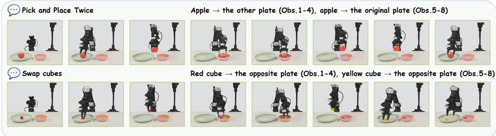  
Figure 3: Real-world execution snapshots on the Galaxea R1 Lite platform. The figure shows representative stage-wise trajectories for two long-horizon tasks: Pick and Place Twice and Swap Cubes.

CondenseVLA improves overall success from 14.3 to 21.6 (+7.2 percentage points, pp), with larger gains on M(1) (+10.6 pp) than on M(n) (+3.0 pp). All three methods fail on Press Button. These results support selective condensation within a bounded recent window; low M(n) success also exposes its limits. Once an event leaves the FIFO, our history mechanism has no explicit retrieval path, persistent semantic task state, or high-level planner. Appendix B.3 provides every task result and the separately reported Mem-0 reference.

## 5.2 Real-world Experimental Results

## 5.2.1 Evaluation Setup on the Galaxea R1 Lite Platform.

Real-world evaluation uses a Galaxea R1 Lite robot and a third-person RGB camera mounted at the top center of its body. CondenseVLA uses M = 20 historical features and K = 6 slots. The two simple tasks are Put Apple on Plate and Open then Close Drawer. The three multi-stage tasks are Pick and Place Twice (transfer the apple to the other plate and return it), Swap Cubes, and Put Objects in Drawer (place the cube and apple inside and close the drawer). Each task uses 50 training demonstrations and 50 evaluation trials per method. We compare OpenVLA-OFT, π , CronusVLA, and CondenseVLA; Appendix E provides uncertainty estimates and task details.

## 5.2.2 Experimental Results on the Galaxea R1 Lite Platform.

CondenseVLA achieves 52.8% mean final success versus 45.2% for CronusVLA (+7.6 pp). Across the three multi-stage tasks, mean final success improves from 37.3% to 46.7% (+9.3 pp, computed before rounding). Final success rises from 40% to 50% on Pick and Place Twice, 50% to 62% on Swap Cubes, and 22% to 28% on Put Objects in Drawer. Gains vary across tasks and stages; we report every stage in Table 4. Representative rollouts are shown in Fig. 3, with failure cases in the appendix.

Table 4: Success rate (%) over 50 trials per task and method on Galaxea R1 Lite. Intermediate stages precede final success; Avg. averages final success only. Put Objects in Drawer requires both insertions and drawer closure.
<table><tr><td rowspan="3">Method</td><td rowspan="2" colspan="2">Put Apple on Plate</td><td colspan="2">Open then Close Drawer</td><td colspan="2">Pick and Place Twice</td><td colspan="2">Swap Cubes</td><td colspan="2">Put Objects in Drawer</td><td rowspan="2"> $\operatorname { A v g } .$  Success</td></tr><tr><td>Success</td><td>Open</td><td>Success</td><td>PnP Once</td><td>Success</td><td>First Cube Success</td><td>Obj. 1 Placed</td><td>Success</td></tr><tr><td>OpenVLA-OFT [19]</td><td>52.0</td><td>48.0</td><td>56.0</td><td>44.0</td><td>48.0</td><td>16.0</td><td>48.0</td><td>8.0</td><td>12.0</td><td>0.0</td><td>23.2</td></tr><tr><td>π0 [2]</td><td>72.0</td><td>72.0</td><td>68.0</td><td>60.0</td><td>56.0</td><td>24.0</td><td>64.0</td><td>12.0</td><td>24.0</td><td>16.0</td><td>36.8</td></tr><tr><td>CronusVLA [23]</td><td>68.0</td><td>66.0</td><td>52.0</td><td>48.0</td><td>46.0</td><td>40.0</td><td>58.0</td><td>50.0</td><td>28.0</td><td>22.0</td><td>45.2</td></tr><tr><td>CondenseVLA</td><td>72.0</td><td>70.0</td><td>56.0</td><td>54.0</td><td>52.0</td><td>50.0</td><td>66.0</td><td>62.0</td><td>32.0</td><td>28.0</td><td>52.8</td></tr></table>

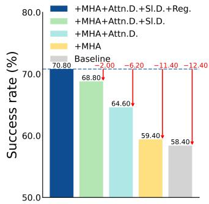  
(a) LHC design ablation

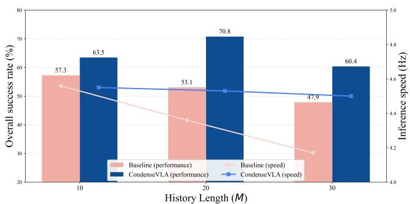  
(b) History-length ablation  
Figure 4: (a) Component ablations under the original 24-rollout protocol. The final configuration (labeled $\overrightarrow { } + \mathbf { R } \mathrm { e g . } \overrightarrow { } )$ replaces all-pairs with middle-only slot decorrelation. (b) Success rate under the same ablation protocol and inference speed at fixed $K = 6 ;$ Baseline denotes dense CronusVLA. Speed (Hz) is the reciprocal of measured policy-forward latency, using an A100-SXM4-80GB, batch size 1, and 10-step DDIM. Appendix C.5 gives the profiling protocol and component breakdown.

## 5.3 Ablation Study

All Simpler ablations below use the original 24-rollout-per-task protocol, including its reported 58.4/70.8 baseline/final averages. They are separate from the repeated-checkpoint evaluation in Table 1; its uncertainty estimates do not apply to these ablation variants.

## 5.3.1 Component Ablations.

We compare dense-history conditioning, MHA-based condensation, attention diversity, and slot decorrelation. Fig. 4(a) ends by replacing all-pairs slot decorrelation with middle-only decorrelation; this changes the pair mask, not the number of auxiliary losses.

## 5.3.2 Effect of History Length and Condensation Budget.

At fixed $K = 6 ,$ CondenseVLA reaches 70.8% success at $M = 2 0$ under the ablation protocol. Fig. 4(b) reports success and inference speed as history grows. Measured policy latency is 0.25% higher than dense conditioning at $M = 1 0 .$ , but 3.8% and 7.4% lower at $M = 2 0$ and $M = 3 0 .$ . The fixed decoder-conditioning budget limits decoder cost, while LHC cost still grows with M; the results do not establish a universal end-to-end speedup.

Table 5 shows an interaction between M and K: $K = 6$ is best at $M = 2 0$ , but $K = 1 0$ is best at $M = 3 0$ . We selected M = 20, K = 6 on Simpler and transferred it unchanged to RMBench. No separate held-out hyperparameter split was used. These results support joint selection of history length and slot budget for the target setting.

## 5.3.3 Comparisons with Fixed History Selection.

We compare learned condensation with Static-Index, Static-Weight, and Strided History Sampling. The two endpoint templates replace LHC at inference without retraining, bypassing its projections and time embeddings. Strided sampling selects six positions [0, 4, 8, 11, 15, 19] from the M = 20 history using zero-based indexing. Appendix details distinguish the endpoint interventions from independently trained baselines.

Table 5: K/M scaling on Simpler-WidowX. Each cell reports success rate (%).
<table><tr><td>M\K</td><td>K = 3</td><td>K = 6</td><td>K = 10</td></tr><tr><td>M = 10</td><td>59.4</td><td>63.5</td><td>56.2</td></tr><tr><td>M = 20</td><td>57.3</td><td>70.8</td><td>62.5</td></tr><tr><td> $M = 3 0$ </td><td>53.1</td><td>60.4</td><td>64.6</td></tr></table>

The tested alternatives score below learned condensation in Table 6. Matching M and K controls history and output budgets, but these comparisons do not isolate adaptive attention from learned projections, capacity, or the conditioning-distribution change caused by inference-time replacement.

Table 6: History-selection comparisons on Simpler-WidowX; static templates are inference-time replacements. Gap is variant SR minus learned SR, in percentage points (pp).
<table><tr><td>Method</td><td>M</td><td>K</td><td>SR (%)</td><td>Gap (pp)</td></tr><tr><td>CondenseVLA (learned)</td><td>20</td><td>6</td><td>70.8</td><td>0.0</td></tr><tr><td>Static-Index Selection</td><td>20</td><td>6</td><td>55.2</td><td>-15.6</td></tr><tr><td>Static-Weight Selection</td><td>20</td><td>6</td><td>54.2</td><td>-16.6</td></tr><tr><td>Strided History Sampling</td><td>20</td><td>6</td><td>59.4</td><td>-11.4</td></tr></table>

Appendix attention visualizations show different temporal coverage across slots and tasks. These descriptive patterns are consistent with adaptive history allocation, but do not assign fixed temporal roles to slot indices or identify a sole cause of the performance gain.

Limitations. Our FIFO cannot explicitly retrieve events outside its window, and RMBench M(n) success remains low. Results are sensitive to M and K, selected without a separate held-out tuning split, so they do not establish a robust default across tasks. Fixed-checkpoint uncertainty estimates exclude training randomness. Evaluation uses one VLA backbone family and one physical robot platform, and condensation cannot recover evidence absent from frozen visual features. Added LHC capacity also prevents attributing all gains to temporal selection alone. Appendix F.1 discusses these boundaries.

## 6 Conclusion

We present CondenseVLA, a deployment-oriented history-conditioning mechanism that condenses recent observation histories into fixed slot tokens for diffusion-based VLA policies. Across benchmarks, it improves Simpler-WidowX success from 58.7% to 69.8%, achieves 97.2% on LIBERO, reaches 52.8% on real-world tasks, and achieves 21.6% on RMBench. These results support a practical principle for multi-frame VLA design: temporal context should be condensed and structured, not merely enlarged.

## Acknowledgments and Disclosure of Funding

Shuo Yang is supported by the Shenzhen Fundamental Research Program (JCYJ20250604145514018), Guangdong Basic and Applied Basic Research Foundation (General Program, No. 2026A1515011557), Guangdong S&T Programme (Grant No. 2025B0101130003) and the NSFC Young Scientists Fund (No. 62506096).

The authors declare no competing interests.

## References

[1] Johan Bjorck, Fernando Castañeda, Nikita Cherniadev, Xingye Da, Runyu Ding, Linxi Fan, Yu Fang, Dieter Fox, Fengyuan Hu, Spencer Huang, et al. Gr00t n1: An open foundation model for generalist humanoid robots. arXiv preprint arXiv:2503.14734, 2025.

[2] Kevin Black, Noah Brown, Danny Driess, Adnan Esmail, Michael Equi, Chelsea Finn, Niccolo Fusai, Lachy Groom, Karol Hausman, Brian Ichter, et al. π0: A vision-language-action flow model for general robot control. RSS, 2025.

[3] Anthony Brohan, Noah Brown, Justice Carbajal, Yevgen Chebotar, Joseph Dabis, Chelsea Finn, Keerthana Gopalakrishnan, Karol Hausman, Alex Herzog, Jasmine Hsu, et al. Rt-1: Robotics transformer for real-world control at scale. RSS, 2023.

[4] Qingwen Bu, Yanting Yang, Jisong Cai, Shenyuan Gao, Guanghui Ren, Maoqing Yao, Ping Luo, and Hongyang Li. Univla: Learning to act anywhere with task-centric latent actions. RSS, 2025.

[5] Jingjing Chen, Hongjie Fang, Chenxi Wang, Shiquan Wang, and Cewu Lu. History-aware visuomotor policy learning via point tracking. ICRA, 2026.

[6] Tianxing Chen, Yuran Wang, Mingleyang Li, Yan Qin, Hao Shi, Zixuan Li, Yifan Hu, Yingsheng Zhang, Kaixuan Wang, Yue Chen, et al. Rmbench: Memory-dependent robotic manipulation benchmark with insights into policy design. arXiv preprint arXiv:2603.01229, 2026.

[7] Cheng Chi, Zhenjia Xu, Siyuan Feng, Eric Cousineau, Yilun Du, Benjamin Burchfiel, Russ Tedrake, and Shuran Song. Diffusion policy: Visuomotor policy learning via action diffusion. IJRR, 2025.

[8] Joonmyung Choi, Sanghyeok Lee, Jaewon Chu, Minhyuk Choi, and Hyunwoo J Kim. vid-tldr: Training free token merging for light-weight video transformer. CVPR, 2024.

[9] Weisheng Dai, Kai Lan, Jianyi Zhou, Bo Zhao, Xiu Su, Junwen Tong, Weili Guan, and Shuo Yang. Conla: Contrastive latent action learning from human videos for robotic manipulation. arXiv preprint arXiv:2602.00557, 2026.

[10] Danny Driess, Fei Xia, Mehdi SM Sajjadi, Corey Lynch, Aakanksha Chowdhery, Brian Ichter, Ayzaan Wahid, Jonathan Tompson, Quan Vuong, Tianhe Yu, et al. Palm-e: An embodied multimodal language model. ICML, 2023.

[11] Dibya Ghosh, Homer Walke, Yizhou Yang, Yao Ma, Kevin Black, et al. Octo: An open-source generalist robot policy. arXiv preprint arXiv:2405.12213, 2024.

[12] Jiyu Guo, Shuo Yang, Yiming Huang, Yancheng Long, Xiaobo Xia, Xiu Su, Bo Zhao, Zeke Xie, and Liqiang Nie. Utilgen: Utility-centric generative data augmentation with dual-level task adaptation. NeurIPS, 38:32474–32500, 2025.

[13] Taisei Hanyu, Nhat Chung, Huy Le, Toan Nguyen, Yuki Ikebe, Anthony Gunderman, Duy Nguyen Ho Minh, Khoa Vo, Tung Kieu, Kashu Yamazaki, et al. Slotvla: Towards modeling of object-relation representations in robotic manipulation. arXiv preprint arXiv:2511.06754, 2025.

[14] Zhi Hou, Tianyi Zhang, Yuwen Xiong, Haonan Duan, Hengjun Pu, Ronglei Tong, Chengyang Zhao, Xizhou Zhu, Yu Qiao, Jifeng Dai, and Yuntao Chen. Dita: Scaling diffusion transformer for generalist vision-language-action policy. ICCV, 2025.

[15] Jialei Huang, Shuo Wang, Fanqi Lin, Yihang Hu, Chuan Wen, and Yang Gao. Tactile-vla: unlocking vision language-action model’s physical knowledge for tactile generalization. arXiv preprint arXiv:2507.09160, 2025.

[16] Physical Intelligence, Kevin Black, Noah Brown, James Darpinian, Karan Dhabalia, Danny Driess, Adnan Esmail, Michael Equi, Chelsea Finn, Niccolo Fusai, et al. π0.5: a vision-language-action model with open-world generalization. CoRL, 2025.

[17] Huiwon Jang, Sihyun Yu, Heeseung Kwon, Hojin Jeon, Younggyo Seo, and Jinwoo Shin. Contextvla: Vision-language-action model with amortized multi-frame context. arXiv preprint arXiv:2510.04246, 2025.

[18] Moo Jin Kim, Karl Pertsch, Siddharth Karamcheti, Ted Xiao, Ashwin Balakrishna, Suraj Nair, Rafael Rafailov, Ethan Foster, Grace Lam, Pannag Sanketi, et al. Openvla: An open-source vision-language-action model. arXiv preprint arXiv:2406.09246, 2024.

[19] Moo Jin Kim, Chelsea Finn, and Percy Liang. Fine-tuning vision-language-action models: Optimizing speed and success. RSS, 2025.

[20] Myungkyu Koo, Daewon Choi, Taeyoung Kim, Kyungmin Lee, Changyeon Kim, Younggyo Seo, and Jinwoo Shin. Hamlet: Switch your vision-language-action model into a history-aware policy. ICLR, 2026.

[21] Seungjae Lee, Daniel Ekpo, Haowen Liu, Furong Huang, Abhinav Shrivastava, and Jia-Bin Huang. Imagine, verify, execute: Memory-guided agentic exploration with vision-language models. CoRL, 2025.

[22] Baicheng Li, Dong Wu, Zike Yan, Xinchen Liu, Zecui Zeng, Lusong Li, and Hongbin Zha. Reflection-based task adaptation for self-improving vla. arXiv preprint arXiv:2510.12710, 2025.

[23] Hao Li, Shuai Yang, Yilun Chen, Xinyi Chen, Xiaoda Yang, Yang Tian, Hanqing Wang, Tai Wang, Dahua Lin, Feng Zhao, et al. Cronusvla: Towards efficient and robust manipulation via multi-frame vision-language-action modeling. arXiv preprint arXiv:2506.19816, 2025.

[24] Qixiu Li, Yaobo Liang, Zeyu Wang, Lin Luo, Xi Chen, Mozheng Liao, Fangyun Wei, Yu Deng, Sicheng Xu, Yizhong Zhang, et al. CogACT: A foundational vision-language-action model for synergizing cognition and action in robotic manipulation. arXiv preprint arXiv:2411.19650, 2024.

[25] Wei Li, Renshan Zhang, Rui Shao, Jie He, and Liqiang Nie. Cogvla: Cognition-aligned vision-languageaction model via instruction-driven routing & sparsification. NeurIPS, 2025.

[26] Wei Li, Renshan Zhang, Rui Shao, Zhijian Fang, Kaiwen Zhou, Zhuotao Tian, and Liqiang Nie. Semanticvla: Semantic-aligned sparsification and enhancement for efficient robotic manipulation. AAAI, 2026.

[27] Xinghang Li, Peiyan Li, Minghuan Liu, Dong Wang, Jirong Liu, Bingyi Kang, Xiao Ma, Tao Kong, Hanbo Zhang, and Huaping Liu. What matters in building vision-language-action models. NeurIPS, 2024.

[28] Xuanlin Li, Kyle Hsu, Jiayuan Gu, Karl Pertsch, Oier Mees, Homer Rich Walke, Chuyuan Fu, Ishikaa Lunawat, Isabel Sieh, Sean Kirmani, et al. Evaluating real-world robot manipulation policies in simulation. CoRL, 2024.

[29] Yishu Li, Xinyi Mao, Ying Yuan, Kyutae Sim, Ben Eisner, and David Held. Learn from what we have: History-aware verifier that reasons about past interactions online. CoRL, 2025.

[30] Yixuan Li, Yuhui Chen, Mingcai Zhou, Haoran Li, Zhengtao Zhang, and Dongbin Zhao. Qdepth-vla: quantized depth prediction as auxiliary supervision for vision-language-action models. arXiv preprint arXiv:2510.14836, 2025.

[31] Bo Liu, Yifeng Zhu, Chongkai Gao, Yihao Feng, Qiang Liu, Yuke Zhu, and Peter Stone. Libero: Benchmarking knowledge transfer for lifelong robot learning. NeurIPS, 2023.

[32] Zhiming Liu, Yikun Miao, Ying Chen, Hongrui Yin, Fangqi Zhu, Xiaoyi Pang, Quanxin Shou, Zhengyang Yan, Haodong Wang, and Song Guo. World action learning via interaction-centric spectral latent guidance. arXiv preprint arXiv:2610.03607, 2026.

[33] Zhiming Liu, Yujie Wei, Lei Feng, Xiu Su, Xiaobo Xia, Weili Guan, Zeke Xie, and Shuo Yang. Do all individual layers help? an empirical study of task-interfering layers in vision-language models. arXiv preprint arXiv:2602.01167, 2026.

[34] Abby O’Neill, Abdul Rehman, Abhiram Maddukuri, Abhishek Gupta, Abhishek Padalkar, Abraham Lee, Acorn Pooley, Agrim Gupta, Ajay Mandlekar, Ajinkya Jain, et al. Open x-embodiment: Robotic learning datasets and rt-x models: Open x-embodiment collaboration 0. ICRA, 2024.

[35] William Peebles and Saining Xie. Scalable diffusion models with transformers. ICCV, 2023.

[36] Karl Pertsch, Kyle Stachowicz, Brian Ichter, Danny Driess, Suraj Nair, Quan Vuong, Oier Mees, Chelsea Finn, and Sergey Levine. Fast: Efficient action tokenization for vision-language-action models. arXiv preprint arXiv:2501.09747, 2025.

[37] Yiwei Qian, Shanze Wang, Qingyuan Hu, Xinming Zhang, and Wei Zhang. EIDA: Execution-interface dynamics adaptation for real-to-sim-to-real robot navigation. arXiv preprint arXiv:2610.01219, 2026.

[38] Delin Qu, Haoming Song, Qizhi Chen, Yuanqi Yao, Xinyi Ye, Yan Ding, Zhigang Wang, Jiayuan Gu, Bin Zhao, Dong Wang, and Xuelong Li. Spatialvla: Exploring spatial representations for visual-language-action model. RSS, 2025.

[39] Hao Shi, Bin Xie, Yingfei Liu, Lin Sun, Fengrong Liu, Tiancai Wang, Erjin Zhou, Haoqiang Fan, Xiangyu Zhang, and Gao Huang. Memoryvla: Perceptual-cognitive memory in vision-language-action models for robotic manipulation. ICLR, 2026.

[40] Ajay Sridhar, Jennifer Pan, Satvik Sharma, and Chelsea Finn. Scaling up memory for robotic control via experience retrieval. ICLR, 2026.

[41] Marcel Torne, Karl Pertsch, Homer Walke, Kyle Vedder, Suraj Nair, Brian Ichter, Allen Z. Ren, Haohuan Wang, Jiaming Tang, Kyle Stachowicz, et al. Mem: Multi-scale embodied memory for vision language action models. arXiv preprint arXiv:2603.03596, 2026.

[42] Shanze Wang, Yiwei Qian, Xinming Zhang, Jun Xue, Siwei Cheng, Xianghui Wang, Qingyuan Hu, Yanjun Chen, Xiaoyu Shen, Hailong Huang, and Wei Zhang. FlashNav: Training deployable robot navigation policies in seconds. arXiv preprint arXiv:2606.15846, 2026.

[43] Shaokai Wu, Yanbiao Ji, Qiuchang Li, Zhiyi Zhang, Qichen He, Wenyuan Xie, Guodong Zhang, Bayram Bayramli, Yue Ding, and Hongtao Lu. Dejavu: Towards experience feedback learning for embodied intelligence. arXiv preprint arXiv:2510.10181, 2025.

[44] Siyu Xu, Yunke Wang, Chenghao Xia, Dihao Zhu, Tao Huang, and Chang Xu. Vla-cache: Towards efficient vision-language-action model via adaptive token caching in robotic manipulation. NeurIPS, 2025.

[45] Jianwei Yang, Reuben Tan, Qianhui Wu, Ruijie Zheng, Baolin Peng, Yongyuan Liang, Yu Gu, Mu Cai, Seonghyeon Ye, Joel Jang, et al. Magma: A foundation model for multimodal ai agents. CVPR, 2025.

[46] Ruihan Yang, Qinxi Yu, Yecheng Wu, Rui Yan, Borui Li, An-Chieh Cheng, Xueyan Zou, Yunhao Fang, Xuxin Cheng, Ri-Zhao Qiu, et al. Egovla: Learning vision-language-action models from egocentric human videos. arXiv preprint arXiv:2507.12440, 2025.

[47] Yantai Yang, Yuhao Wang, Zichen Wen, Luo Zhongwei, Chang Zou, Zhipeng Zhang, Chuan Wen, and Linfeng Zhang. Efficientvla: Training-free acceleration and compression for vision-language-action models. NeurIPS, 2025.

[48] Tianyuan Yuan, Yicheng Liu, Chenhao Lu, Zhuoguang Chen, Tao Jiang, and Hang Zhao. Depthvla: Enhancing vision-language-action models with depth-aware spatial reasoning. arXiv preprint arXiv:2510.13375, 2025.

[49] Xiangcheng Zhan, Zirui Chen, Yicheng Zhao, Ziteng Gao, and Shuo Yang. Direct experience world-model optimization: Learning the world beyond action imitation. arXiv preprint arXiv:2609.37398, 2026.

[50] Zhengshen Zhang, Hao Li, Yalun Dai, Zhengbang Zhu, Lei Zhou, Chenchen Liu, Dong Wang, Francis EH Tay, Sijin Chen, Ziwei Liu, et al. From spatial to actions: Grounding vision-language-action model in spatial foundation priors. ICLR, 2026.

[51] Zihui Zhang, Weisheng Dai, Hongtao Wen, and Bo Yang. LogoSP: Local-global grouping of superpoints for unsupervised semantic segmentation of 3D point clouds. CVPR, 2025.

[52] Zihui Zhang, Weisheng Dai, Bing Wang, Bo Li, and Bo Yang. GrowSP++: Growing superpoints and primitives for unsupervised 3D semantic segmentation. IEEE TPAMI, 2026.

[53] Zongzheng Zhang, Haobo Xu, Zhuo Yang, Chenghao Yue, Zehao Lin, Huan-ang Gao, Ziwei Wang, and Hao Zhao. Elucidating the design space of torque-aware vision-language-action models. CoRL, 2025.

[54] Ruijie Zheng, Yongyuan Liang, Shuaiyi Huang, Jianfeng Gao, Hal Daumé III, Andrey Kolobov, Furong Huang, and Jianwei Yang. Tracevla: Visual trace prompting enhances spatial-temporal awareness for generalist robotic policies. ICLR, 2025.

[55] Jianyi Zhou, Ziteng Gao, Feiyang Hong, Zirui Liu, Guannan Zhang, Weisheng Dai, Ruichen Zhen, Chuqiao Lyu, Haotian Wu, Yinian Mao, et al. Touchanything: A dataset and framework for bimanual tactile estimation from egocentric video. arXiv preprint arXiv:2605.13083, 2026.

[56] Jianyi Zhou, Feiyang Hong, Yunhao Li, Yicheng Zhao, Yongjue Cen, Zirui Liu, Jiakang Huang, Zirui Chen, Ruiyang Zhang, Weizhuo Zhu, et al. Touchworld: A predictive and reactive tactile foundation model for dexterous manipulation. arXiv preprint arXiv:2607.07287, 2026.

[57] Jianyi Zhou, Yujie Wei, Ruichen Zhen, Bo Zhao, Xiaobo Xia, Rui Shao, Xiu Su, and Shuo Yang. Inject once survive later: Backdooring vision-language-action models to persist through downstream fine-tuning. arXiv preprint arXiv:2602.00500, 2026.

[58] Brianna Zitkovich, Tianhe Yu, Sichun Xu, Peng Xu, Ted Xiao, Fei Xia, Jialin Wu, Paul Wohlhart, Stefan Welker, Ayzaan Wahid, et al. Rt-2: Vision-language-action models transfer web knowledge to robotic control. CoRL, 2023.

## A Additional Implementation Details

## A.1 Backbone and Fine-tuning Scope

Our policy follows the VLM+DiT multi-frame post-training setting in the main paper. Fine-tuning freezes the vision encoders and language model, while jointly optimizing the multimodal projector, Learnable History Condensation (LHC), and diffusion action decoder. Historical frame features are detached before LHC; gradients through the current-frame path update the projector. LHC adds trainable capacity and optimization cost, so this setup does not isolate temporal condensation from all effects of added capacity.

At each environment step, the VLM encodes the current observation into a frame-level feature $f _ { t } \in \mathbb { R } ^ { D }$ . A FIFO buffer stores the most recent M historical features, and the LHC module maps them into K history slots. The decoder is then conditioned on the concatenation $Z _ { t } = [ \tilde { F } _ { t } ; f _ { t } ]$ , where $\tilde { F } _ { t } \in \mathbb { R } ^ { K \times D }$ denotes the condensed history tokens.

## A.2 LHC Parameterization

Each slot has a base query $q _ { i } ^ { \mathrm { b a s e } } \in \mathbb { R } ^ { D }$ and a slot embedding $e _ { i } ^ { \mathrm { s l o t } } \in \mathbb { R } ^ { D }$ . With $r _ { i } = ( i - 1 ) / ( K - 1 )$ its query is $q _ { i } = \mathrm { M L P } ( [ q _ { i } ^ { \mathrm { b a s e } } ; r _ { i } ] ) + e _ { i } ^ { \mathrm { s l o t } }$ . The two-layer MLP uses SiLU; these slot identities do not prescribe which history position a slot attends to. LHC uses four attention heads, with $D = 4 0 9 6$ and $d _ { h } = 1 0 2 4$

A learned table $E _ { \mathrm { t i m e } } \in \mathbb { R } ^ { M \times D }$ , ordered from oldest to newest, enters only the value path with a learnable scale s initialized to zero. Writing $q = [ q _ { 1 } ; \dots ; q _ { K } ] \in \mathbb { R } ^ { K \times D }$ and omitting projection biases,

$$
Q = q W _ { Q } , \qquad K _ { \mathrm { h i s t } } = F _ { t } W _ { K } , \qquad V = ( F _ { t } + s E _ { \mathrm { t i m e } } ) W _ { V } ,\tag{7}
$$

where $W _ { Q } , W _ { K } , W _ { V } , W _ { O } \in \mathbb { R } ^ { D \times D }$ . Splitting into H heads gives $Q ^ { ( h ) } \in \mathbb { R } ^ { K \times d _ { h } }$ and $K _ { \mathrm { h i s t } } ^ { ( h ) } , V ^ { ( h ) } \in$ $\mathbb { R } ^ { M \times d _ { h } }$ . The head outputs are concatenated and right-multiplied by $W _ { O }$ . Keys do not receive the time embedding, so the attention logits have no explicit history-position bias. Table 9 summarizes the layer dimensions and decoder-conditioning structure.

## A.3 Algorithmic Summary

Algorithm 1 summarizes policy prediction before action execution. Let $E _ { \psi }$ denote per-frame VLM encoding, where only the multimodal projector parameters ψ are trainable during fine-tuning. Algorithm 2 optimizes ψ, LHC parameters Φ, and decoder parameters θ, with frozen vision encoders and language-model weights. Below, $\mathrm { L H C } _ { \Phi }$ includes the value-only time embedding and the Q/K/V/output projections.

Algorithm 1 CondenseVLA Inference with Learnable History Condensation   
1: Input: $( o _ { t } , x )$ , FIFO $B _ { t - 1 }$ , encoder $\overline { { E _ { \psi } , \mathrm { L H C } \Phi } } ,$ , decoder $D _ { \theta }$   
2: Retrieve up to M available historical features F from $B _ { t - 1 }$   
3: Encode the current step once: $f _ { t } \gets E _ { \psi } ( o _ { t } , x )$   
4: for i = 1 to K do   
5: Form slot query $q _ { i } \gets \mathrm { M L P } ( [ q _ { i } ^ { \mathrm { b a s e } } ; r _ { i } ] ) + e _ { i } ^ { \mathrm { s l o t } }$   
6: end for   
7: Stack unprojected queries as $q = [ q _ { 1 } ; \dots ; q _ { K } ]$   
8: $\mathbf { i f } \ B _ { t - 1 }$ is empty then   
9: $\tilde { F } _ { t } \gets$ Repeat(ft, K)   
10: else   
11: $\tilde { F } _ { t } \gets \mathrm { L H C } _ { \Phi } ( q , F _ { t } )$ using available-history time embeddings   
12: end if   
13: Form decoder conditioning tokens: $Z _ { t } \gets [ \tilde { F } _ { t } ; f _ { t } ]$   
14: Predict the action chunk with the diffusion decoder: $\hat { a } _ { t : t + T _ { a } - 1 } \gets D _ { \theta } ( Z _ { t } )$   
15: Update the FIFO buffer: $B _ { t } \gets \mathrm { P u s h F I F O } ( B _ { t - 1 } , f _ { t } )$   
16: Return: $\hat { a } _ { t : t + T _ { a } - 1 } , B _ { t }$

Algorithm 2 Fine-tuning CondenseVLA   
1: Input: observation-window mini-batch, encoder $E _ { \psi } \mathrm { : }$ , LHC Φ, decoder $D _ { \theta }$   
2: for each mini-batch do   
3: Encode each frame with $E _ { \psi } ;$ ; split $f _ { t }$ and history $F _ { t } \gets \mathrm { s g } ( F _ { t } )$   
4: for $i = 1$ to K do   
5: Form slot query $q _ { i } \gets \mathrm { M L P } ( [ q _ { i } ^ { \mathrm { b a s e } } ; r _ { i } ] ) + e _ { i } ^ { \mathrm { s l o t } }$   
6: end for   
7: Stack unprojected queries as $q = [ q _ { 1 }  \} \dots { } ; q _ { K } ]$   
8: Compute slots and per-head maps: $( \right. , \{ \ r { A ^ { ( h ) } } \} _ { h = 1 } ^ { H } ) \left. \mathrm { L H C } _ { \Phi } ( q , F _ { t } )$   
9: Form decoder tokens: $Z _ { t } \gets [ \tilde { F } _ { t } ; f _ { t } ]$   
10: Sample diffusion timestep τ and Gaussian noise ϵ   
11: Construct the noised action chunk $a _ { t : t + T _ { a , - 1 } } ^ { \epsilon }$   
12: Predict noise: $\hat { \epsilon } \gets D _ { \theta } ( a _ { t : t + T _ { a } - 1 } ^ { \epsilon } , Z _ { t } ; \tau )$   
13: Compute diffusion loss $L _ { \mathrm { d i f f } }$ ← mean $( ( \epsilon - \hat { \epsilon } ) ^ { 2 } )$   
14: Average attention over heads, then the local mini-batch; normalize rows to obtain A¯   
15: $L _ { \mathrm { d i v } }  K ^ { - 2 } \| \bar { A } \bar { A } ^ { \top } - I \| _ { F } ^ { 2 }$   
16: Compute $L _ { \mathrm { s l o t } }$ using the normalized pair weights in Eq. 13   
17: Form the total objective $L \gets L _ { \mathrm { d i f f } } + \lambda _ { \mathrm { d i v } } L _ { \mathrm { d i v } } + \lambda _ { \mathrm { s l o t } } L _ { \mathrm { s l o t } }$   
18: Update ψ, Φ, θ; keep vision-encoder and language-model weights frozen   
19: end for

## A.4 Training Details

For Simpler-WidowX, LIBERO, and real-world experiments, the learning rate is fixed to $2 \times 1 0 ^ { - 5 }$ The auxiliary weights are $\lambda _ { \mathrm { d i v } } = 0 . 0 6$ and $\lambda _ { \mathrm { s l o t } } = 0 . 0 0 1$ . The multimodal projector, LHC, and diffusion decoder are optimized under

$$
{ \cal L } = { \cal L } _ { \mathrm { d i f f } } + \lambda _ { \mathrm { d i v } } { \cal L } _ { \mathrm { d i v } } + \lambda _ { \mathrm { s l o t } } { \cal L } _ { \mathrm { s l o t } } .\tag{8}
$$

The implementation uses AdamW with zero weight decay, a constant learning rate without warmup, and gradient-norm clipping at 1.0. The training entry point defaults to seed 42; this training seed is distinct from the repeated evaluation seeds. Diffusion training uses 100 timesteps with the squaredcos\_cap\_v2 noise schedule and mean squared noise-prediction error over batch, action positions, and action dimensions. The Simpler and LIBERO training launchers use four independently noised diffusion samples per conditioning example. Evaluation uses 10-step DDIM with $\eta = 0$ and Gaussian initial noise.

Loss reductions. The MSE notation in the main paper includes entry-wise averaging. For a predicted noise chunk ϵˆ, action horizon $T _ { a } .$ , and action dimension $d _ { a } .$ , the expanded losses are

$$
\begin{array} { r l } & { L _ { \mathrm { d i f f } } = \mathbb { E } _ { \epsilon , \tau } \left[ \frac { \| \epsilon - \hat { \epsilon } \| _ { 2 } ^ { 2 } } { T _ { a } d _ { a } } \right] , } \\ & { L _ { \mathrm { d i v } } = \frac { \| \bar { A } \bar { A } ^ { \top } - I \| _ { F } ^ { 2 } } { K ^ { 2 } } . } \end{array}\tag{9}
$$

The main-paper slot-pair mean uses the normalized reduction in Eq. 13; its denominator protection returns zero when no pair is active. These are the same reductions used with the reported auxiliary weights.

For Simpler and LIBERO, the single-arm action representation has seven components: three endeffector translation components, three rotation components, and a gripper command. Dataset-specific 1st/99th percentile statistics normalize the masked continuous dimensions to [−1, 1]; inference clips predictions to this range and inverts the normalization, with gripper conversion in the benchmark wrapper. The Simpler and LIBERO implementations predict 16 and 8 actions per chunk, respectively, including the current action. LIBERO fine-tuning uses global batch 64 and per-device batch 16 on four processes. Tables 7 and 8 summarize the benchmark-specific training settings.

The benchmark-specific data and history settings are summarized below:

• Simpler-WidowX [28]: models are trained on the bridge\_rt\_1+Fractal data mixture, with $M = 2 0$ historical features and $K = 6$ history slots.

• LIBERO [31]: models are trained on LIBERO data, with $M = 1 0$ historical features and K = 3 history slots. Our LIBERO model uses external and wrist RGB inputs and does not use state input.

• Real-world Galaxea R1 Lite: our policy is trained with real-robot data using the LIBEROstyle optimization flow, with $M \stackrel { = } { = } 2 0$ and $K = 6 ,$ , while the input modality follows the Simpler setting without state input or wrist-view input.

Tables 7 and 8 report training hyperparameters for Simpler-WidowX, real-world tasks, and the separately fine-tuned LIBERO suites. Table 9 summarizes the architecture and reported parameter counts.

Table 7: Run-level training hyperparameters for Simpler-WidowX and real-world experiments.
<table><tr><td>Setting</td><td>Simpler-WidowX</td><td>Real-world</td></tr><tr><td>Learning rate</td><td> $2 \times 1 0 ^ { - 5 }$ </td><td> $2 \times 1 0 ^ { - 5 }$ </td></tr><tr><td>History length M</td><td>20</td><td>20</td></tr><tr><td>Number of slots K</td><td>6</td><td>6</td></tr><tr><td>Batch size</td><td>64</td><td>64</td></tr><tr><td>Training epochs</td><td>4</td><td>17</td></tr><tr><td>Diffusion steps at inference</td><td>10</td><td>10</td></tr></table>

Table 8: Suite-wise LIBERO fine-tuning hyperparameters. Each suite is fine-tuned separately from the same multi-frame post-training initialization.
<table><tr><td>Setting</td><td>Spatial</td><td>Object</td><td>Goal</td><td>Long</td></tr><tr><td>Learning rate</td><td> $2 \times 1 0 ^ { - 5 }$ </td><td> $2 \times 1 0 ^ { - 5 }$ </td><td> $2 \times 1 0 ^ { - 5 }$ </td><td> $2 \times 1 0 ^ { - 5 }$ </td></tr><tr><td>History length M</td><td>10</td><td>10</td><td>10</td><td>10</td></tr><tr><td>Number of slots K</td><td>3</td><td>3</td><td>3</td><td>3</td></tr><tr><td>Global batch size</td><td>64</td><td>64</td><td>64</td><td>64</td></tr><tr><td>Training epochs</td><td>13</td><td>21</td><td>18</td><td>25</td></tr><tr><td>Diffusion steps at inference</td><td>10</td><td>10</td><td>10</td><td>10</td></tr></table>

## A.5 Architecture and Parameter Count

This subsection collects implementation details that are useful for reproducibility but too verbose for the main paper. Table 9 summarizes the architecture and parameter counts. Unless otherwise noted, the parameter counts are reported for the Simpler-WidowX setting with M = 20 and $K = 6$

## B Benchmark Setup

## B.1 Simpler-WidowX: Evaluation, Uncertainty, and Provenance

We use the standard prepackaged SimplerEnv WidowX visual-matching setting, not SimplerEnv-OR. The four tasks are Spoon on Towel, Carrot on Plate, Stack Cube, and Eggplant in Basket. Evaluation uses episode IDs 0–23, control\_freq=5, sim\_freq=500, max\_episode\_steps=120, and the standard task-success criterion. These tasks primarily probe manipulation robustness under the simulated visual and dynamics gap, rather than general-purpose memory.

For each of the local CronusVLA and CondenseVLA checkpoints, we repeat evaluation with three evaluation seeds on the same 24 episode IDs, yielding 72 rollouts per task and 288 across the four tasks. These are fixed-checkpoint evaluations, not three independently trained models or 72 distinct scene IDs. Table 10 reports the mean and sample standard deviation (SD) across evaluation seeds. For Avg., the four-task average is computed within each seed before the across-seed SD; task SDs are not averaged. The original 24-rollout experiments are reported separately as detailed grasp/success results and ablations. No uncertainty from the final-checkpoint reevaluation is assigned to other ablation variants.

Detailed grasp and success results. Table 11 reports the original grasp/success breakdown. Its local results are from the original single 24-rollout evaluation, rather than the three-seed reevaluation used in the main paper and Table 10.

Table 9: Module summary for $M = 2 0 , K = 6$ . Vision encoders and the language model are frozen; the separately listed MM projector, LHC, and decoder are trainable. Counts are reported totals, with LHC verified analytically from its layer definitions. Here B is batch size, F encoded frames, P visual tokens, T text tokens, A action horizon, $D = 4 0 9 6$ , and $d = 7 6 8 .$
<table><tr><td>Module (Parameters)</td><td>Submodule</td><td>Layer Num</td><td>Input Shape</td><td>Output Shape</td></tr><tr><td rowspan="3">VLM backbone (7.47B)</td><td>SigLIP vision encoder</td><td> $1 + 2 7 + 1$ </td><td> $( B \cdot F , 3 , H , W )$ </td><td> $( B \cdot F , P , 1 1 5 2 )$ </td></tr><tr><td>DINOv2 vision encoder</td><td> $1 + 2 4 + 1$ </td><td> $\ r ( B \cdot F , 3 , H , W )$ </td><td>(B · F, P, 1024)</td></tr><tr><td>LLaMA2 language back- bone</td><td> $1 + 3 2 + 0$ </td><td> $\dot { ( } \boldsymbol { B } \cdot \boldsymbol { F } , \boldsymbol { P } + \boldsymbol { T } , \dot { \boldsymbol { D } } )$ </td><td>(B, F, D)</td></tr><tr><td>MM projector (71.4M)</td><td>No-align MLP</td><td>fused-GELU 1</td><td>(B · F, P, 2176)</td><td>(B · F, P, D)</td></tr><tr><td rowspan="5">LHC (100.8M)</td><td>Base queries + slot embed- 1 dings</td><td></td><td>two (K, D) tables</td><td>(K, D)</td></tr><tr><td>Query MLP (SiLU)</td><td>2 linear</td><td> $( K , D + 1 )$ </td><td>(K, D)</td></tr><tr><td>Value time embedding + 1 scale</td><td></td><td>(M, D), scalar</td><td>(B, M, D)</td></tr><tr><td>Q/K/V/O projections</td><td>1</td><td> $( B , K , D ) , ( B , M , D )$ </td><td>(B, K, D), (B, M, D)</td></tr><tr><td>Cross-attention</td><td>1</td><td> $( B , K , D \bar { ) } , ( B , M , D \bar { ) }$ </td><td>(B, K, D)</td></tr><tr><td rowspan="2">History path (0)</td><td>FIFO feature buffer</td><td>一</td><td>(B, F, D)</td><td>(B, M, D)</td></tr><tr><td>History-current fusion</td><td>一</td><td> $( B , K , D ) , ( B , 1 , D )$ </td><td>(B, K + 1, D)</td></tr><tr><td rowspan="5">Diffusion action (134.7M)</td><td>decoder Action embedding</td><td>1</td><td>(B, A, 7)</td><td>(B, A, d)</td></tr><tr><td>Timestep embedding</td><td>1</td><td>(B, 256)</td><td>(B, 1, d)</td></tr><tr><td>Conditioning embedder</td><td>1</td><td> $\mathring { ( B , K + 1 , D ) }$ </td><td>(B, K + 6, d)</td></tr><tr><td>Self-attn. + MLP</td><td>12</td><td> $( B , A + 1 , d )$ </td><td>(B, A + 1, d)</td></tr><tr><td>Cross-attn.</td><td>12</td><td> $\hat { ( B , A + 1 , d ) , } ( B , K { + } 6 , d )$ </td><td>(B, A + 1, d)</td></tr><tr><td></td><td>Final layer</td><td>1</td><td> $( B , A + 1 , \stackrel { . } { d } )$ </td><td>(B, A, 7)</td></tr><tr><td>CondenseVLA total (7.78B)</td><td>Full policy</td><td></td><td>RGB observation, text, cached (B, A, 7) history</td><td></td></tr></table>

Table 10: Simpler fixed-checkpoint evaluation: mean ± evaluation-seed SD (%), and pooled Wilson 95% intervals. Each task uses $3 \times 2 4$ rollouts; Avg. pools 288 rollouts for its interval.
<table><tr><td></td><td colspan="2">CronusVLA</td><td colspan="2">CondenseVLA</td></tr><tr><td>Task</td><td> $\mathbf { M e a n } \pm \mathbf { S D }$ </td><td>95% CI</td><td> $\mathbf { M e a n } \pm \mathbf { S D }$ </td><td>95% CI</td></tr><tr><td>Spoon on Towel</td><td> $6 6 . 7 \pm 0 . 0$ </td><td>[55.2, 76.5]</td><td> $8 0 . 6 \pm 6 . 4$ </td><td>[70.0, 88.0]</td></tr><tr><td>Carrot on Plate</td><td> $5 1 . 4 \pm 8 . 7$ </td><td>[40.1, 62.6]</td><td> $6 6 . 7 \pm 0 . 0$ </td><td>[55.2, 76.5]</td></tr><tr><td>Stack Cube</td><td> $2 2 . 2 \pm 6 . 4$ </td><td>[14.2, 33.1]</td><td> $3 3 . 3 \pm 8 . 3$ </td><td>[23.5, 44.8]</td></tr><tr><td>Eggplant in Basket</td><td> $9 4 . 4 \pm 6 . 4$ </td><td>[86.6, 97.8]</td><td> $9 8 . 6 \pm 2 . 4$ </td><td>[92.5, 99.8]</td></tr><tr><td>Avg.</td><td> $5 8 . 7 \pm 1 . 6$ </td><td>[52.9, 64.2]</td><td> $6 9 . 8 \pm 1 . 0$ </td><td>[64.3, 74.8]</td></tr></table>

Table 11: Original Simpler-WidowX detailed results (%): grasp and final success. The local CronusVLA and CondenseVLA rows use the original 24-rollout-per-task evaluation; Avg. averages final success.
<table><tr><td></td><td colspan="2">Spoon on Towel</td><td colspan="2">Carrot on Plate</td><td colspan="2">Stack Cube</td><td colspan="2">Eggplant in Basket</td><td></td></tr><tr><td>Method</td><td>Grasp</td><td>Success</td><td>Grasp</td><td>Success</td><td>Grasp</td><td>Success</td><td>Grasp</td><td>Success</td><td>Avg.</td></tr><tr><td>RT-1-X [34]</td><td>16.7</td><td>0.0</td><td>20.8</td><td>4.2</td><td>8.3</td><td>0.0</td><td>0.0</td><td>0.0</td><td>1.1</td></tr><tr><td>RoboVLMs [27]</td><td>70.8</td><td>50.0</td><td>45.8</td><td>37.5</td><td>70.8</td><td>0.0</td><td>91.7</td><td>83.3</td><td>42.7</td></tr><tr><td>Magma [45]</td><td>62.5</td><td>37.5</td><td>41.7</td><td>29.2</td><td>79.2</td><td>20.8</td><td>95.8</td><td>91.7</td><td>44.8</td></tr><tr><td>SpatialVLA [38]</td><td>25.0</td><td>20.8</td><td>41.7</td><td>37.5</td><td>79.2</td><td>41.7</td><td>91.7</td><td>83.3</td><td>45.8</td></tr><tr><td>HAMLET [20]</td><td>91.7</td><td>75.0</td><td>83.3</td><td>62.5</td><td>75.0</td><td>16.7</td><td>100.0</td><td>100.0</td><td>63.5</td></tr><tr><td>OpenVLA [18]</td><td>12.5</td><td>8.3</td><td>29.2</td><td>4.2</td><td>16.7</td><td>0.0</td><td>20.8</td><td>0.0</td><td>3.1</td></tr><tr><td>CronusVLA [23]</td><td>79.2</td><td>66.7</td><td>70.8</td><td>41.7</td><td>58.3</td><td>29.2</td><td>100.0</td><td>95.8</td><td>58.4</td></tr><tr><td>CondenseVLA</td><td>87.5</td><td>79.2</td><td>83.3</td><td>66.7</td><td>83.3</td><td>41.7</td><td>100.0</td><td>95.8</td><td>70.8</td></tr></table>

The breakdown separates object acquisition from full task completion. The gap is particularly pronounced on Stack Cube, where successful pickup must be followed by precise alignment and contact-sensitive placement. CondenseVLA achieves strong grasp and final-success rates on Spoon on Towel and Carrot on Plate. On Eggplant in Basket, the strongest methods already reach saturated grasp rates, while final success still depends on reliable transport and placement.

Interval definition and scope. For s successes in n rollouts, let $\hat { p } = s / n$ and $z = 1 . 9 6$ . The Wilson interval used here and for the real-world results is

$$
\frac { \hat { p } + z ^ { 2 } / ( 2 n ) \pm z \sqrt { \hat { p } ( 1 - \hat { p } ) / n + z ^ { 2 } / ( 4 n ^ { 2 } ) } } { 1 + z ^ { 2 } / n } ,\tag{10}
$$

with endpoints multiplied by 100. The pooled interval treats trials with a binomial model, conditional on the checkpoint and evaluation setting. It does not capture training randomness, and repeated scene IDs or cross-task heterogeneity are not fully represented by the pooled model. We report these intervals descriptively and do not infer paired method differences or task-wise significance from interval overlap.

Baseline sources. The main-paper Simpler results table combines local training/evaluation, local reproductions, and external reports. CondenseVLA is trained and evaluated locally; OpenVLA-OFT and CronusVLA are local reproductions. Only the CronusVLA and CondenseVLA rows are replaced by the three-seed reevaluation means. TraceVLA, Octo, CogACT, Magma, RT-1-X, SpatialVLA, GR00T-N1.5, and OpenVLA are taken from the CronusVLA comparison. UniVLA uses its corrected GitHub release; π and ContextVLA use the ContextVLA report; MemoryVLA and HAMLET use their respective papers. In particular, the OpenVLA row is an external reference, not a local current-frame-only ablation. Table grouping does not imply identical training or evaluation protocols.

External methods retain their reported data and input protocols: for example, $\pi _ { 0 }$ and GR00T-N1.5 additionally use robot state, while UniVLA uses robot and human-video training data. We do not attach the local evaluation intervals to these external results. The original CronusVLA setting uses six dense frame features; the dense 10/20/30-frame variants used in our scaling study are retrained for four epochs with matched initialization, training data, optimization, and evaluation. Those variants are distinct from the original baseline and from the matched M = 20 RMBench comparison.

## B.2 LIBERO

LIBERO [31] contains four suites, Spatial, Object, Goal, and Long, with ten tasks in each suite. We fine-tune from multi-frame post-training weights separately for each suite. Our model uses external and wrist RGB inputs without state input. Local LIBERO evaluations repeat each fixed trained checkpoint with three evaluation seeds, not three independently trained models. Each seed runs 50 rollouts per task, giving 500 episodes per suite and seed, 1,500 per suite over three repeats, and 6,000 across the four suites per local method. Suite means average tasks and evaluation repeats; the overall mean weights the four suites equally. The main-paper table reports means only; Table 12 reports mean ± standard deviation (SD) across the three evaluation seeds for CondenseVLA. The Avg. uncertainty describes the SD of the per-repeat overall success rates. External rows retain their source protocols and are not assigned this local evaluation budget.

Because recent LIBERO results are reported under different input protocols, Table 12 summarizes the input setting together with the suite-level numbers used in the main paper. CronusVLA and CondenseVLA use external and wrist RGB inputs without state input, while some reported baselines, such as $\pi _ { 0 }$ and OpenVLA-OFT, use both wrist-view and robot-state inputs.

The $\pi _ { 0 . 5 }$ reference is the pi05\_libero checkpoint at 30k steps from the official openpi LIBERO release, with external and wrist RGB observations and 8-D proprioception. Both use external and wrist RGB observations, but our policy does not use proprioceptive state and the training protocols differ; it is therefore a contextual reference. Our main same-protocol comparison is CronusVLA (96.3%) versus CondenseVLA (97.2%). LIBERO-Long involves multi-step execution, but the near-saturated scores do not by themselves isolate a memory mechanism.

Table 12: LIBERO success rates (%) under different input protocols. CondenseVLA reports mean ± SD across three evaluation seeds of fixed trained checkpoints; other rows report means. The π0.5 average retains the source precision.
<table><tr><td>Method</td><td>Input setting</td><td>Spatial</td><td>Object</td><td>Goal</td><td>Long</td><td>Avg.</td></tr><tr><td>Diffusion Policy [7]</td><td>no state, no wrist</td><td>78.3</td><td>92.5</td><td>68.3</td><td>50.5</td><td>72.4</td></tr><tr><td>Dita [14]</td><td>no state, no wrist</td><td>84.2</td><td>96.3</td><td>85.4</td><td>63.8</td><td>82.4</td></tr><tr><td>OpenVLA [18]</td><td>no state, no wrist</td><td>84.7</td><td>88.4</td><td>79.2</td><td>53.7</td><td>76.5</td></tr><tr><td>TraceVLA [54]</td><td>no state, no wrist</td><td>84.6</td><td>85.2</td><td>75.1</td><td>54.1</td><td>74.8</td></tr><tr><td>SpatialVLA [38]</td><td>no state, no wrist</td><td>88.2</td><td>89.9</td><td>78.6</td><td>55.5</td><td>78.1</td></tr><tr><td>OpenVLA-OFT [19]</td><td>wrist + state</td><td>97.6</td><td>98.4</td><td>97.9</td><td>94.5</td><td>97.1</td></tr><tr><td>π0 [2]</td><td>wrist + state</td><td>96.8</td><td>98.8</td><td>95.8</td><td>85.2</td><td>94.2</td></tr><tr><td>π0.5 (openpi, reported)</td><td>wrist + state</td><td>98.8</td><td>98.2</td><td>98.0</td><td>92.4</td><td>96.85</td></tr><tr><td>CronusVLA [23]</td><td>wrist, no state</td><td>97.1</td><td>98.1</td><td>96.0</td><td>94.0</td><td>96.3</td></tr><tr><td>CondenseVLA</td><td>wrist, no state</td><td>97.8 ± 0.8</td><td>99.1 ± 0.5</td><td>97.4 ± 0.9</td><td>94.6 ± 1.1</td><td>97.2 ± 0.8</td></tr></table>

## B.3 RMBench: Protocol, Task Results, and Scope

We use RMBench’s nine memory-dependent tasks [6] with 50 training demonstrations and 100 evaluation rollouts per task. We follow RMBench’s demo\_clean environment configuration with the Aloha-AgileX dual-arm robot in RoboTwin 2.0/SAPIEN. Our policies use head and wrist RGB observations without proprioceptive state input and output end-effector commands for both arms. Dense CronusVLA and CondenseVLA share the same initialization, data, training steps, seed, action horizon, and evaluation protocol. Both read the same 20 consecutive historical features from a rolling FIFO, with the current observation supplied separately. CondenseVLA maps the historical features to six slots. The M = 20, K = 6 configuration is transferred from Simpler without task-specific retuning on RMBench; no separate held-out hyperparameter split was used to select it. The currentframe-only OpenVLA result is a reference for the absence of explicit history, while our primary controlled comparison is between dense and condensed history conditioning.

Table 13: Full RMBench success rates (%). Each task has 100 rollouts, so each task-level percentage also gives the number of successful rollouts. The category averages weight tasks equally; Overall weights all nine tasks equally.
<table><tr><td>Category</td><td>Task</td><td>OpenVLA</td><td>CronusVLA</td><td>CondenseVLA</td></tr><tr><td>M(1)</td><td>Observe and Pick Up</td><td>0.0</td><td>5.0</td><td>12.0</td></tr><tr><td></td><td>Rearrange Blocks</td><td>5.0</td><td>23.0</td><td>39.0</td></tr><tr><td></td><td>Put Back Block</td><td>9.0</td><td>35.0</td><td>46.0</td></tr><tr><td></td><td>Swap Blocks</td><td>10.0</td><td>21.0</td><td>35.0</td></tr><tr><td></td><td>Swap T</td><td>3.0</td><td>7.0</td><td>12.0</td></tr><tr><td></td><td>Average</td><td>5.4</td><td>18.2</td><td>28.8</td></tr><tr><td>M(n)</td><td>Battery Try</td><td>10.0</td><td>12.0</td><td>15.0</td></tr><tr><td></td><td>Blocks Ranking Try</td><td>5.0</td><td>9.0</td><td>13.0</td></tr><tr><td></td><td>Cover Blocks</td><td>0.0</td><td>17.0</td><td>22.0</td></tr><tr><td></td><td>Press Button</td><td>0.0</td><td>0.0</td><td>0.0</td></tr><tr><td></td><td>Average</td><td>3.8</td><td>9.5</td><td>12.5</td></tr><tr><td>All tasks</td><td>Overall</td><td>4.7</td><td>14.3</td><td>21.6</td></tr></table>

The dense and condensed policies succeed in 129/900 and 194/900 rollouts, respectively, giving an overall improvement of 100(194 − 129)/900 = 7.22 pp before rounding. The largest task-level gains occur on Rearrange Blocks (+16 pp), Swap Blocks (+14 pp), and Put Back Block (+11 pp). The smaller improvement on M(n) and the zero success on Press Button indicate that bounded visual conditioning does not solve persistent multi-observation accumulation.

For context, RMBench v2, Table 1 [6] reports Mem-0 success of 52.8% on M(1) and 28.5% on $M ( n )$ . These are externally reported results from a system with a different backbone, persistent memory, and high-level planning. They are not a matched comparison with our local policies and are excluded from the controlled table. The difference highlights the scope of CondenseVLA: low-level conditioning over recent cached features, with no persistent semantic memory or hierarchical planner.

## B.4 Real-world Galaxea R1 Lite

Real-world evaluation is performed on a Galaxea R1 Lite robot with a third-person RGB camera mounted near the top center of the robot body. CondenseVLA uses the LIBERO-style optimization flow, with M = 20 and K = 6, while retaining the Simpler-style input modality without state input or wrist-view input. We consider two simple tasks, Put Apple on Plate and Open then Close Drawer, and three long-horizon tasks, Pick and Place Twice, Swap Cubes, and Put Objects in Drawer. For each task, 50 real-world trajectories are collected for training, and success rate is computed over 50 evaluation trials per method.

This setup jointly evaluates low-level manipulation accuracy and short-term temporal context under multi-step execution. The simple tasks primarily probe immediate control quality, while the longhorizon tasks require the policy to track recently completed subtasks, object order, and task-stage transitions. In practice, the long-horizon tasks are substantially more sensitive to stage-tracking errors, contact uncertainty, and execution drift. A visual overview of the platform, camera layout, and evaluated tasks is provided in Fig. 5.

The real-world tasks differ not only in manipulation difficulty but also in their temporal structure. Put Apple on Plate is a short-horizon task with a simple structure of grasping and placement, so success mainly depends on immediate perception and execution accuracy. Open then Close Drawer introduces a two-stage structure, requiring the policy to distinguish whether the current subgoal is opening or closing and to re-establish handle interaction after the first stage. Pick and Place Twice requires placing the object onto the other plate and then returning it to the original plate, so the policy must track the current task stage across recent observations. Swap Cubes requires exchanging the positions of two objects, which places additional demand on tracking object identity and operation order across multiple stages. Put Objects in Drawer requires placing both the cube and apple inside the drawer and then closing it. The intermediate metric records the first object placement; final success requires both insertions and drawer closure, so insertion alone is insufficient. Detailed stage-wise outcomes and failure modes are discussed in Section E.

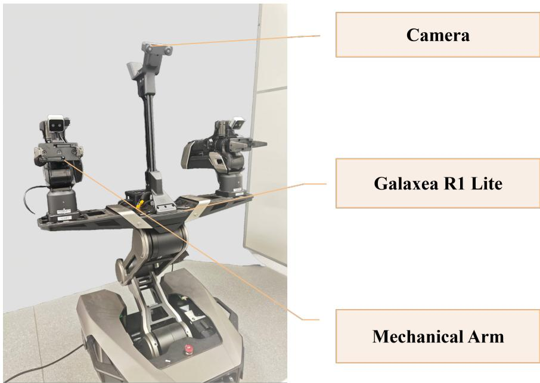  
Figure 5: Real-world deployment setup on the Galaxea R1 Lite platform, showing the camera, robot body, and manipulator used in our experiments.

## C Additional Ablations

## C.1 Regularization Variants

The main paper studies the overall contribution of LHC components. Here, we examine the design of the slot-redundancy regularizer and compare several variants for selecting or weighting slot pairs. Let $\tilde { f } _ { q } \in \mathbb { R } ^ { D }$ denote the output embedding of slot $q ,$ and let $\hat { A } _ { q , : } \in \mathbb { R } ^ { M }$ denote the head-averaged and row-normalized slot-to-history attention of slot $q ,$ where $q \in \{ 1 , \ldots , K \}$ and M is the history length. We define the cosine similarity between two slot embeddings as

$$
c _ { i j } = \cos ( \tilde { f } _ { i } , \tilde { f } _ { j } ) ,\tag{11}
$$

and the cosine similarity between their attention rows as

$$
a _ { i j } = \cos ( \hat { A } _ { i , : } , \hat { A } _ { j , : } ) .\tag{12}
$$

For a per-device mini-batch of size $B ,$ we write the slot decorrelation loss in a unified form:

$$
L _ { \mathrm { s l o t } } = \frac { 1 } { Z } \sum _ { b = 1 } ^ { B } \sum _ { 1 \leq i < j \leq K } w _ { b , i j } c _ { b , i j } ^ { 2 } , \qquad Z = \operatorname* { m a x } \left( \sum _ { b = 1 } ^ { B } \sum _ { i < j } w _ { b , i j } , \varepsilon \right) ,\tag{13}
$$

where $w _ { b , i j } \geq 0$ selects or weights pairs, and $\varepsilon = 1 0 ^ { - 6 }$ . Both numerator and denominator sum over samples and pairs; this is not an unweighted average of separately normalized sample losses when active weights differ across samples. Cosine similarities are computed in FP32 with norm protection and clamped to [−1, 1] before squaring. The denominator clamp makes the expression well-defined for any active pair set. The reported middle-only configuration uses no additional all-pairs term. Below we omit b when describing a single sample’s weights.

For attention diversity, $\begin{array} { r } { \hat { A } _ { b } = H ^ { - 1 } \sum _ { h } A _ { b } ^ { ( h ) } } \end{array}$ is averaged across the local mini-batch, then each row is normalized with a denominator floor of $1 0 ^ { - 8 }$ to obtain ${ \bar { A } } .$ The loss is $K ^ { - 2 } \| \bar { A } \bar { A } ^ { \top } - I \| _ { F } ^ { 2 }$ computed after these averages, rather than averaging sample-wise Gram losses. Its off-diagonal entries discourage overlap, while its diagonal entries encourage concentrated attention rows. The outer weights $\lambda _ { \mathrm { d i v } }$ and $\lambda _ { \mathrm { s l o t } }$ multiply these reduced losses.

All-pairs. The all-pairs variant penalizes all off-diagonal slot pairs uniformly:

$$
w _ { i j } ^ { \mathrm { a l l } } = 1 , \qquad 1 \le i < j \le K .\tag{14}
$$

This is the most direct form of slot decorrelation and imposes global redundancy reduction across all slots.

Middle-only. The middle-only variant excludes the first and last slot indices and penalizes only pairs among the remaining slots:

$$
w _ { i j } ^ { \mathrm { m i d } } = { \bf 1 } [ 2 \leq i < j \leq K - 1 ] .\tag{15}
$$

This mask leaves the first and last slot indices unconstrained by this term. It does not impose a temporal-endpoint role on either slot.

Dynamic middle masking. We first estimate the mean temporal position of each slot using its normalized attention row:

$$
\mu _ { q } = \sum _ { m = 1 } ^ { M } m \hat { A } _ { q , m } .\tag{16}
$$

Here, $\mu _ { q }$ is the attention-weighted history index. For each sample, let $q _ { \mathrm { m i n } } = \arg \operatorname* { m i n } _ { \boldsymbol { q } } \mu _ { \boldsymbol { q } }$ and $q _ { \operatorname* { m a x } } = \arg \operatorname* { m a x } _ { q } \mu _ { q }$ , using the first index to break ties. We remove these indices and set $S _ { \mathrm { m i d } } =$ $\{ 1 , \dotsc , K \} \setminus \{ q _ { \operatorname* { m i n } } , q _ { \operatorname* { m a x } } \}$ . The decorrelation weights are

$$
w _ { i j } ^ { \mathrm { d y n - m i d } } = \mathbf { 1 } [ i \in S _ { \mathrm { m i d } } ] \mathbf { 1 } [ j \in S _ { \mathrm { m i d } } ] .\tag{17}
$$

Unlike fixed middle-only masking, membership depends on each sample’s attention centroids. When the extrema select distinct slots, both masks retain four slots and six pairs at $K = 6$ . If all centroids are equal, both extrema select the same index and the dynamic mask removes only that index; Eq. 13 normalizes by the actual active-pair count.

Gate-by-attention. Instead of selecting pairs by slot index or mean temporal position, this variant weights slot pairs according to attention-row similarity:

$$
g _ { i j } = \mathrm { R e L U } ( a _ { i j } - \tau ) ,\tag{18}
$$

where τ is a similarity threshold. In our experiments, we set $\tau = 0 . 6$ . We stop gradients through the gate and define

$$
w _ { i j } ^ { \mathrm { g a t e } } = \mathrm { s g } ( g _ { i j } ) ,\tag{19}
$$

where $\operatorname { s g } ( \cdot )$ denotes stop-gradient (detach). Thus, pairs with highly similar attention patterns are penalized more strongly, while dissimilar pairs contribute little or no decorrelation penalty.

Thus, all-pairs constrains every pair, middle-only selects a fixed set by slot index, dynamic middle masking selects by sample-dependent centroids, and gate-by-attention weights pairs by attention similarity. These variants compare pair selection or weighting within the same LHC architecture.

Unless otherwise noted, the results in this ablation are reported on Simpler-WidowX under the same setting as the main-text regularization study, with history length $M \stackrel { \star } { = } 2 0$ , slot number $K = 6 .$ $\lambda _ { \mathrm { d i v } } ~ = ~ 0 . 0 6$ , and $\lambda _ { \mathrm { s l o t } } = \mathbf { \bar { 0 } } . 0 0 1$ . All variants retain the attention-diversity term $L _ { \mathrm { d i v } } ;$ the only difference lies in how the slot-pair weights $w _ { i j }$ are defined in $L _ { \mathrm { s l o t } }$ . Average success rate is computed over the four Simpler tasks, with 24 evaluation rollouts per task.

Table 14: Comparison of slot-redundancy reduction variants on Simpler-WidowX. $\Delta = \mathrm { S R } _ { \mathrm { v a r i a n t } } -$ $\mathrm { S R } _ { \mathrm { m i d d l e - o n l y } }$ is a signed difference in percentage points (pp).
<table><tr><td>Variant</td><td>Pair rule</td><td>Avg. success (%)</td><td>∆(pp)</td></tr><tr><td>All-pairs</td><td>all off-diagonal pairs</td><td>68.8</td><td>-2.0</td></tr><tr><td>Middle-only</td><td>fixed interior indices</td><td>70.8</td><td>0.0</td></tr><tr><td>Dynamic middle masking</td><td>sample-adaptive middle slots</td><td>52.1</td><td>-18.7</td></tr><tr><td>Gate-by-attention</td><td>attention-similarity gating</td><td>64.6</td><td>-6.2</td></tr></table>

The fixed middle-only variant has the highest reported success in Table 14. Dynamic middle masking performs worse despite normally retaining the same number of slots and pairs. The outcome favors fixed membership in this setting, but success rates alone do not establish training instability or explain why particular overlaps help or hurt. These results do not establish fixed temporal roles for boundary slot indices.

## C.2 Slot Importance Under Slot Zeroing

To further probe whether the learned slots play interchangeable roles, we perform a slot-zero ablation on the best middle-only checkpoint. At inference time, we zero out one slot at a time while keeping the remaining slots unchanged, and then reevaluate the policy on Simpler-WidowX. This experiment reveals how much the final policy depends on each individual slot after training has converged.

The results in Fig. 6 show unequal sensitivity to removing individual slots. Zeroing plotted slot $q _ { 4 }$ (mathematical index $i = 5 )$ causes the largest drop, while removing some other slots has a smaller effect. This is a dependence test for the evaluated checkpoint, not evidence that a slot has a fixed temporal role or that its importance transfers across tasks and training runs. It also does not by itself establish why the middle-only regularizer performs better.

## C.3 Sensitivity to History Length and Condensation Strategy

The history-length analysis in the main paper already shows that performance peaks at a moderate temporal window. In the supplementary material, we therefore focus on two complementary comparisons: (i) how naive dense-history extension behaves in the CronusVLA [23] baseline, and (ii) how learned condensation compares against non-learnable condensed-history baselines under the same history and slot budget. The corresponding comparisons are reported in Tables 15 and 16.

Within the evaluated policy family, Table 15 shows that simply extending dense conditioning does not improve success. The condensed policy performs best at $M = 2 0$ for fixed $K = 6 ,$ while the full $M \times { \dot { K } }$ grid shows that increasing K helps at $M = 3 0$ . These observations support joint selection of history and slot budgets; they do not establish a universal redundancy principle or isolate the reason for lower success at a longer window.

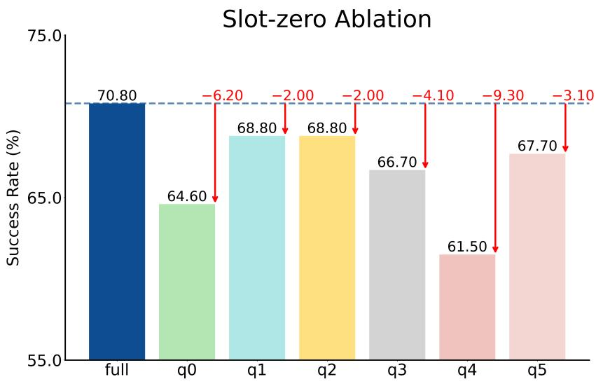  
Figure 6: Slot-zero ablation on Simpler-WidowX. Each bar shows the success rate after zeroing one slot at inference time; the dashed line indicates the full-model result. The uneven drop across slots suggests that the learned slots are not fully interchangeable, while the limited degradation for some slots still indicates partial redundancy.

Table 15: History-length success rates on Simpler-WidowX under the original 24-rollout-per-task ablation protocol. Runtime is reported separately in Table 18.
<table><tr><td>Method</td><td>History setting</td><td>Avg. success (%)</td></tr><tr><td>CronusVLA [23]</td><td>original 6-frame setting</td><td>58.4</td></tr><tr><td>CronusVLA [23]</td><td>M = 10</td><td>57.3</td></tr><tr><td>CronusVLA [23]</td><td>M = 20</td><td>53.1</td></tr><tr><td>CronusVLA [23]</td><td>M = 30</td><td>47.9</td></tr><tr><td>CondenseVLA</td><td>M = 10, K = 6</td><td>63.5</td></tr><tr><td>CondenseVLA</td><td>M = 20, K = 6</td><td>70.8</td></tr><tr><td>CondenseVLA</td><td>M = 30, K = 6</td><td>60.4</td></tr></table>

Table 16: History-selection comparisons at matched history and output budgets. Static-Index and Static-Weight replace LHC at inference without retraining. Gap is variant SR minus learned SR, in percentage points (pp).
<table><tr><td>Method</td><td>Construction</td><td>Avg. success (%)</td><td>Gap to learned (pp)</td></tr><tr><td>Static-Index Selection</td><td>fixed endpoint gather</td><td>55.2</td><td>-15.6</td></tr><tr><td>Static-Weight Selection</td><td>fixed endpoint kernel</td><td>54.2</td><td>-16.6</td></tr><tr><td>Strided History Sampling</td><td>fixed interval gather</td><td>59.4</td><td>-11.4</td></tr><tr><td>CondenseVLA (learned)</td><td>input-adaptive attention</td><td>70.8</td><td>0.0</td></tr></table>

For Table 16, let $F _ { t } = \{ f _ { t - M } , \ldots , f _ { t - 1 } \}$ and $K = 6$ . Static-Index and Static-Weight are inferencetime replacements in a trained policy, without retraining the decoder. Their endpoint templates follow the coarse endpoint preference observed in learned attention. Both bypass the complete LHC, including its value-time embeddings and learned projections, and operate directly on cached frame features. Static-Index Selection gathers the six positions

$$
[ 1 , \ 1 , \ M , \ M , \ M , \ M ] .\tag{20}
$$

This baseline therefore forces two slots to copy the oldest feature and four slots to copy the most recent feature, without any input-dependent adaptation. In other words, the template is intended to preserve the same coarse “early anchor + strong recent emphasis” pattern observed in the learned model, while removing any state-dependent adjustment of where the slots attend.

Static-Weight Selection keeps the same endpoint bias but replaces hard gathering with fixed local kernels. Concretely, for each slot q, we define a hand-crafted weight distribution $p _ { q } ( m )$ over history index $m \in \{ 1 , \ldots { \dot { , } } M \}$ and compute the slot feature as

$$
\tilde { f } _ { q } = \sum _ { m = 1 } ^ { M } p _ { q } ( m ) f _ { t - M - 1 + m } , \qquad \sum _ { m = 1 } ^ { M } p _ { q } ( m ) = 1 .\tag{21}
$$

For $\mathrm { \tilde { \Delta } _ { O l d } \mathrm { \Omega } } ^ { 6 6 }$ slots, the kernel is centered near the oldest position; for “last” slots, it is centered near the most recent position. We use a triangular kernel

$$
p _ { q } ( m ) \propto \operatorname* { m a x } ( 0 , w _ { q } + 1 - | m - c _ { q } | ) ,\tag{22}
$$

followed by row normalization, with $c _ { q } = 1 , w _ { q } = 1$ for the two old slots and $c _ { q } = M , w _ { q } =$ 2 for the four recent slots. Thus, the old endpoint uses relative weights (2, 1) and the recent endpoint uses $( 1 , 2 , 3 )$ from older to newer positions, truncated to the available history. These are the implementation’s integer-width parameters.

Strided History Sampling is a simple temporal downsampling baseline. It keeps the same history budget $K = 6$ as CondenseVLA but selects six fixed positions from the $M = \bar { 2 } 0$ history window, namely

$$
[ 0 , \ 4 , \ 8 , \ 1 1 , \ 1 5 , \ 1 9 ] ,\tag{23}
$$

using zero-based indexing over the cached history. This baseline tests whether the gain can be explained by uniformly reducing the number of history features rather than by input-adaptive condensation.

The tested alternatives in Table 16 do not match learned condensation; the reported strided result trails it by 11.4 pp. The endpoint interventions test replacing the learned representation at inference, including a change to the decoder’s conditioning distribution. They are not independently retrained, capacity-matched baselines and cannot isolate input-adaptive attention as the sole source of the gain.

## C.4 Slot-Regularization Strength

Table 17 reports best-checkpoint success rates for two alternative slot-regularization weights. The main setting uses $\lambda _ { \mathrm { s l o t } } = 0 . \bar { 0 } 0 1$

Table 17: Reported best-checkpoint success rates at two alternative slot-regularization weights on Simpler-WidowX.
<table><tr><td>Group</td><td>Setting</td><td>Best SR (%)</td></tr><tr><td>Slot regularization</td><td>slot-regularization weight = 0.005</td><td>64.6</td></tr><tr><td>Slot regularization</td><td>slot-regularization  $\mathrm { w e i g h t } = 0 . 0 1$ </td><td>58.3</td></tr></table>

## C.5 Policy Latency and Component Costs

We profile one NVIDIA A100-SXM4-80GB at batch size 1 with 10-step DDIM, using 40 Simpler episodes (10 per task), 10 warm-up calls, and steady-state histories. All rows in Table 18 use the same device, timers, synchronization, and profiling protocol. The component sum is VLM + LHC + decoder. Measured total directly times the complete policy forward, including conditioning, fusion, synchronization, and other regions; it is not inferred from the component sum or the reciprocal of a reported frequency. Policy-forward latency is distinct from the physical closed-loop control period.

Table 18: Policy latency in ms per step under one profiling protocol. Boldface marks lower aggregate values within matched M pairs. The original M = 6 dense setting is an unmatched reference.
<table><tr><td>Method</td><td>History</td><td>VLM</td><td>LHC</td><td>Decoder</td><td>Sum</td><td>Total</td></tr><tr><td>Dense CronusVLA</td><td> $M = 6$ </td><td>108.37</td><td>0.00</td><td>106.00</td><td>214.37</td><td>214.89</td></tr><tr><td>Dense CronusVLA CondenseVLA</td><td> $M = 1 0$   $M = 1 0 , K = 6$ </td><td>108.11 108.42</td><td>0.00 2.26</td><td>110.09 106.44</td><td>218.20 217.12</td><td>219.07 219.62</td></tr><tr><td>Dense CronusVLA</td><td>M = 20</td><td>108.28</td><td>0.00</td><td>120.32</td><td>228.60</td><td>229.52</td></tr><tr><td>CondenseVLA</td><td> $M = 2 0 , K = 6$ </td><td>108.15</td><td>4.52</td><td>106.85</td><td>219.52</td><td>220.88</td></tr><tr><td>Dense CronusVLA</td><td>M = 30</td><td>107.94</td><td>0.00</td><td>130.54</td><td>238.48</td><td>239.97</td></tr><tr><td></td><td></td><td></td><td></td><td></td><td></td><td></td></tr><tr><td>CondenseVLA</td><td> $M = 3 0 , K = 6$ </td><td>108.19</td><td>6.79</td><td>106.14</td><td>221.12</td><td>222.14</td></tr></table>

At matched $M = 1 0 .$ , CondenseVLA has a 0.5% lower component sum but a 0.25% higher measured total. At $M = 2 0$ and $M = 3 0$ , measured totals are 3.8% and 7.4% lower, respectively. VLM cost remains near 108 ms because only the current observation is encoded. With $\bar { K } = 6 .$ , decoder cost stays near 106–107 ms, but LHC cost grows from 2.26 to 6.79 ms. The measured advantage is bounded decoder conditioning and flatter scaling with history length, not a large or universal end-to-end speedup.

## D Additional Qualitative and Mechanistic Analysis

## D.1 Occlusion-based Visualization

Representative occlusion overlays are shown in Fig. 7. Holding the instruction fixed, we slide a patch over the RGB frame and recompute the VLM cognition feature for each occluded image. For original feature f and occluded feature $\scriptstyle { \dot { f } } ^ { \mathrm { o c c } }$ , the response is $1 - \cos ( f , f ^ { \mathrm { o c c } } )$ . Each response is assigned to its patch region; overlapping contributions are averaged per pixel and clamped below at zero. The map is min–max normalized within each image and overlaid with opacity 0.45. This measures sensitivity of the per-frame representation, not a change in predicted actions.

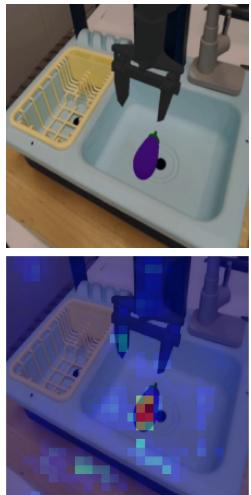  
(a) Early stage

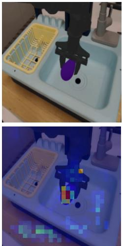  
(b) Contact stage

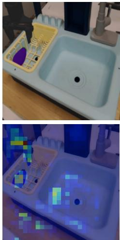  
(c) Placement stage  
Figure 7: Occlusion overlays on SimplerEnv (Eggplant-in-Basket). Highlighted regions show larger cosine-distance changes in the cognition feature under local occlusion. Each heatmap is normalized separately, so colors do not compare absolute sensitivity across frames.

The highlighted regions align with the manipulated object, target receptacle, and nearby contact areas, showing that the current representation is sensitive to task-relevant spatial evidence. Across the early, contact, and placement stages, the overlays provide an intuitive view of the visual regions involved in the ongoing interaction. This spatial diagnostic complements the slot-level temporal analysis below: the overlays probe where the current-frame representation is sensitive, while the slot summaries show when information is retrieved from recent history.

## D.2 Task-level Slot Attention Summaries

We summarize logged decision-step attention by task description. Each row in Figures 8 and 9 pools records for one task; “episode” in the plots refers to a task group.

For normalized, head-averaged attention $\hat { A } _ { n , q , j }$ at logged step n, slot q, and zero-based history index j, we compute

$$
\mu _ { n , q } = \sum _ { j = 0 } ^ { m _ { n } - 1 } j \hat { A } _ { n , q , j } , \qquad s _ { n , q } = \left( \sum _ { j = 0 } ^ { m _ { n } - 1 } \hat { A } _ { n , q , j } ^ { 2 } \right) ^ { - 1 } ,\tag{24}
$$

where $m _ { n }$ is the available history length. For task group $g , \bar { \mu } _ { g , q }$ and $\bar { s } _ { g , q }$ average these per-step quantities. Thus, mean support is the mean of per-step inverse concentrations, not the inverse concentration of an averaged attention row. In Figure 8, panel A subtracts the across-task mean separately for each slot, $\begin{array} { r } { \bar { \Delta \mu _ { g , q } } = \bar { \mu } _ { g , q } - { G } ^ { - 1 } et { } { ' } \sum _ { g ^ { \prime } } \bar { \mu } _ { g ^ { \prime } , q } , } \end{array}$ where $G = 4$ . Panel B standardizes $\bar { s } _ { g , q }$ across the four tasks using the population standard deviation (floored at $1 0 ^ { - 9 } ) ;$ panel C shows $\bar { \mu } _ { g , q }$ directly.

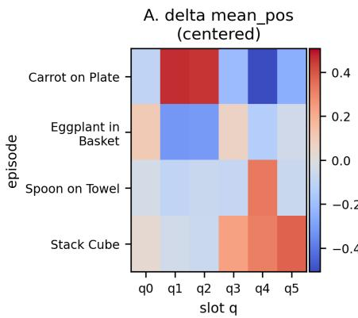

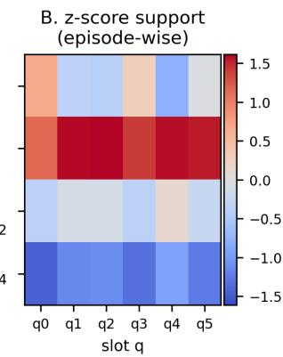

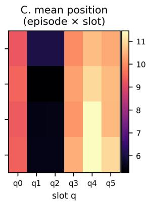  
Figure 8: Task-grouped attention summaries (“episode” in the image refers to a task group). A: per-slot centroid shifts relative to the across-task mean. B: mean effective support standardized across tasks, separately for each slot. C: mean temporal centroids. The views show task-dependent redistribution of temporal position and attention coverage.

Figure 9 adds mean per-step support, the population standard deviation of per-step centroids within each task group, and top-index entropy. For the latter, each slot’s top-attended indices form an empirical distribution within the task group; its entropy is divided by log R, where R is one plus the largest top index in the logged dataset, with a minimum of two. Slots $q _ { 0 } , q _ { 3 } , q _ { 5 }$ have broader support than $q _ { 1 } , q _ { 2 } , q _ { 4 }$ in this run, and $q _ { 0 }$ has relatively low centroid variation. Lower top-index entropy indicates a more concentrated preference for particular history positions, while higher entropy indicates more variable retrieval. Together, these views show complementary broad-coverage and focused-retrieval patterns, with task-dependent adjustments in temporal position and coverage.

## E Real-world Discussion and Failure Cases

Although CondenseVLA improves over the baselines in real-world evaluation, the absolute success rates remain lower than those in simulation. This gap is expected because real-robot deployment introduces multiple coupled sources of uncertainty, including perception noise, imperfect calibration, unmodeled contact dynamics, execution drift, and scene variation beyond the training distribution [37, 42]. Long-horizon tasks are especially sensitive to these effects because a small early error can propagate into a later stage that is less frequently observed during training.

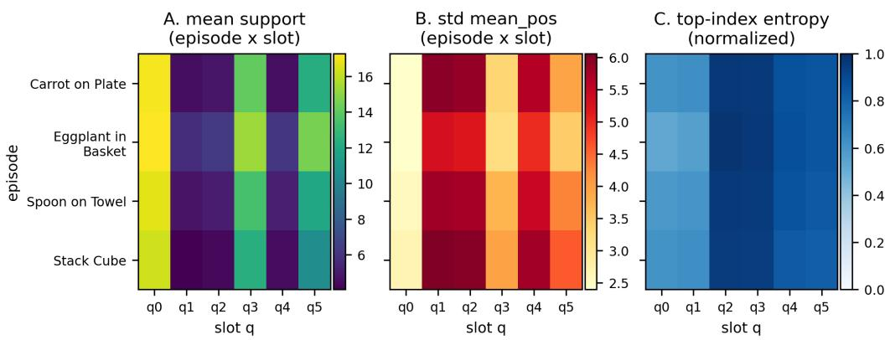

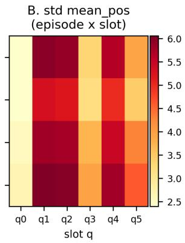

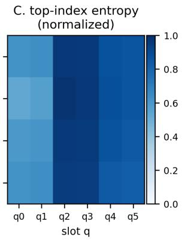  
Figure 9: Task-grouped slot statistics on Simpler-WidowX (image rows labeled “episode” are task groups). A: mean per-step effective support. B: standard deviation of per-step temporal centroids within each task group. C: normalized entropy of top-attended history indices. Together, the panels illustrate structured but flexible temporal retrieval across tasks.

Table 19: Success rate (%) over 50 real-world trials per task and method. All intermediate and final metrics use the same 50-trial denominator; Avg. averages final success only. Put Objects in Drawer requires closure after both insertions.
<table><tr><td rowspan="3">Method</td><td colspan="2">Put Apple on Plate</td><td colspan="2">Open then Close Drawer</td><td colspan="2">Pick and Place Twice</td><td colspan="2">Swap Cubes</td><td colspan="2">Put Objects in Drawer</td><td rowspan="3">Avg. Success</td></tr><tr><td>Grasp</td><td>Success</td><td>Open</td><td>Success|</td><td>PnP Once</td><td>Success</td><td>First Cube</td><td>Success</td><td>Obj. 1 Placed</td><td>Success</td></tr><tr><td>OpenVLA-OFT [19]</td><td>52.0</td><td>48.0</td><td>56.0</td><td>44.0</td><td>48.0</td><td>16.0</td><td>48.0</td><td>8.0</td><td>12.0</td><td>0.0</td><td>23.2</td></tr><tr><td>π0 [2]</td><td>72.0</td><td>72.0</td><td>68.0</td><td>60.0</td><td>56.0</td><td>24.0</td><td>64.0</td><td>12.0</td><td>24.0</td><td>16.0</td><td>36.8</td></tr><tr><td>CronusVLA [23]</td><td>68.0</td><td>66.0</td><td>52.0</td><td>48.0</td><td>46.0</td><td>40.0</td><td>58.0</td><td>50.0</td><td>28.0</td><td>22.0</td><td>45.2</td></tr><tr><td>CondenseVLA</td><td>72.0</td><td>70.0</td><td>56.0</td><td>54.0</td><td>52.0</td><td>50.0</td><td>66.0</td><td>62.0</td><td>32.0</td><td>28.0</td><td>52.8</td></tr></table>

The stage-wise metrics in Table 19 show non-uniform improvements of 4–12 pp over CronusVLA. Final success on the three multi-stage tasks improves from 40% to 50% on Pick and Place Twice, 50% to 62% on Swap Cubes, and 22% to 28% on Put Objects in Drawer. Their mean changes from 37.3% to 46.7% (+9.3 pp, computed from counts before rounding). In the drawer task, the intermediate metric improves from 28% to 32% and records the first object insertion; final success additionally requires the second insertion and drawer closure. These outcomes are consistent with a benefit from recent temporal context, but do not isolate task-stage inference from low-level control accuracy.

Table 20: Real-world final success over 50 trials per task. Counts, rates (%), and Wilson 95% intervals are reported for CronusVLA and CondenseVLA. Aggregate pools 250 trials across the five tasks.
<table><tr><td></td><td colspan="2">CronusVLA</td><td colspan="2">CondenseVLA</td></tr><tr><td>Task</td><td>Successes (%)</td><td>95% CI</td><td>Successes (%)</td><td>95% CI</td></tr><tr><td>Put Apple on Plate</td><td>33/50 (66.0)</td><td>[52.2, 77.6]</td><td>35/50 (70.0)</td><td>[56.2, 80.9]</td></tr><tr><td>Open then Close Drawer</td><td>24/50 (48.0)</td><td>[34.8, 61.5]</td><td>27/50 (54.0)</td><td>[40.4, 67.0]</td></tr><tr><td>Pick and Place Twice</td><td>20/50 (40.0)</td><td>[27.6, 53.8]</td><td>25/50 (50.0)</td><td>[36.6, 63.4]</td></tr><tr><td>Swap Cubes</td><td>25/50 (50.0)</td><td>[36.6, 63.4]</td><td>31/50 (62.0)</td><td>[48.2, 74.1]</td></tr><tr><td>Put Öbjects in Drawer</td><td>11/50 (22.0)</td><td>[12.8, 35.2]</td><td>14/50 (28.0)</td><td>[17.5, 41.7]</td></tr><tr><td>Aggregate</td><td>113/250 (45.2)</td><td>[39.1, 51.4]</td><td>132/250 (52.8)</td><td>[46.6, 58.9]</td></tr></table>

Intervals use Eq. 10, conditional on the evaluated policies and deployment setting. The aggregate is a descriptive pooled binomial interval and does not fully account for task heterogeneity or potential dependence among physical trials. These intervals do not establish paired differences or significance on every task. All methods use 50 evaluation trials per task, and the training budget remains 50 demonstrations per task.

We observe three representative failure patterns. First, the policy can occasionally commit to an incorrect task stage after an ambiguous grasp or partial placement, indicating that the retained history is still insufficient in some corner cases. Second, the policy may correctly infer the task stage but fail at precise low-level execution, especially in drawer interaction or cluttered placement settings. Third, in multi-object tasks, the policy may preserve the correct subgoal but recover too slowly from a perturbed intermediate state, leading to cascading failure in later steps.

These observations suggest several directions for future work: adaptive history length rather than a fixed window, tighter coupling between condensed temporal memory and object-centric grounding, stronger recovery-oriented training under perturbed execution, and broader cross-embodiment valida tion beyond the current backbone and robot platform. We summarize the dominant real-world failure modes for each task below.

Put Apple on Plate. The dominant failure mode is target-object grasp failure: the gripper does not secure the apple reliably before the placement stage, typically due to inaccurate object localization or unstable grasp execution.

Open then Close Drawer. The main failure mode is handle-grasp failure. During opening, the policy may fail to localize or grasp the handle correctly, which prevents the drawer from being opened. During closing, the same failure can cause the robot to push the drawer front directly instead of re-establishing a stable handle-based interaction.

Pick and Place Twice. The typical failure mode is wrong subgoal selection: the policy places the object on the wrong target plate or commits to an incorrect intermediate stage, indicating imperfect tracking of task order and stage progression.

Swap Cubes. This task most often fails through wrong subgoal selection as well, where the policy grasps the wrong cube and then returns it, suggesting that object identity and swap order are not fully preserved under execution noise.

Put Objects in Drawer. Two failure modes are common. First, the object may collide with the drawer edge during insertion and drop instead of settling inside, reflecting limited contact robustness and placement precision. Second, the policy may exhibit the same handle-grasp failure mode observed in Open then Close Drawer when interacting with the drawer itself.

Representative successful real-world rollouts are shown in Fig. 10. The upper panel highlights the two short-horizon tasks, Put Apple on Plate and Open then Close Drawer, while the lower panel shows Pick and Place Twice, Swap Cubes, and Put Objects in Drawer. These examples complement the real-world quantitative results in the main paper by illustrating the stage-wise behavior of the policy on representative executions.

Representative failure cases for the simple and long-horizon tasks are shown in Fig. 11. In Put Apple on Plate, failure is typically caused by missing the apple during the grasp attempt. In Open then Close Drawer, failure occurs when the policy fails to grasp the handle while opening the drawer, or again fails to grasp the handle while closing it and instead pushes the drawer front directly. In Pick and Place Twice, the typical error is placing the object on the wrong plate. In Swap Cubes, the policy may grasp the wrong cube and then put it back. In Put Objects in Drawer, failure can arise either because the object collides with the drawer during placement and drops, or because the policy exhibits the same handle-grasp failure mode as Open then Close Drawer when interacting with the drawer itself.

## F Limitations, Broader Impact, and Asset Usage

## F.1 Limitations

Finite history and representation. CondenseVLA conditions low-level actions on a bounded recent visual window. The FIFO provides no explicit retrieval path once an event leaves the window, and the model has neither persistent semantic task state nor a high-level planner. A long execution horizon does not imply equally long explicit memory. RMBench exposes this boundary: M(n) success is only 12.5%, and Press Button has zero success. LHC also depends on the per-frame VLM

Put Apple on Plate

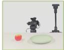

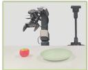

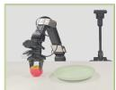

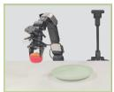

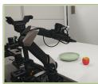  
Apple→ Plate(Obs.1-8)

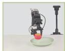

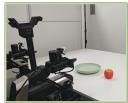

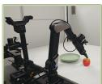

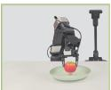  
Open then Close Drawe

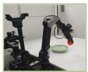

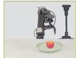

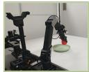

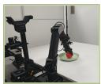

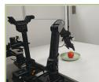

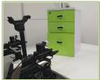  
Open the drawer(Obs.1-5)→close the drawer(Obs.6-8)

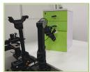

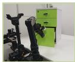

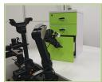  
(a) Simple tasks

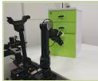

## Pick and Place Twice

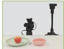

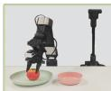

Apple→ the other plate(Obs.1-4), apple→ the original plate(Obs.5-8)

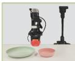

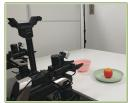

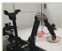

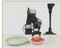

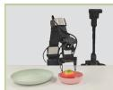

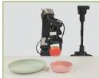  
Swap Cubes

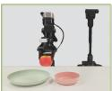

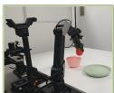

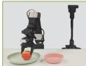

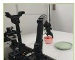

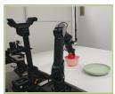

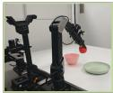

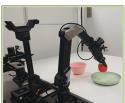  
Red cube→ the opposite plate(Obs.1-4), yellow cube → the opposite plate(Obs.5-8)

  
Put Objects in Drawer

  
Open drawer(Obs.1-4)→ put objects into drawer(Obs.4-14)→close drawer(Obs.15-16)

  
(b) Long-horizon tasks

Figure 10: Representative successful real-world rollouts. Put Objects in Drawer ends with drawer closure after both objects are inserted. The long-horizon examples highlight the need for temporally consistent stage tracking across multi-step execution.

Put Apple on Plate

  
Open then Close Drawer  
Fail to pick apple(Obs.1-8)

  
Fail to open the drawer(Obs.1-8); fail to grasp the handle(Obs.9-16)

  
(a) Simple-task failures.

  
Pick and Place Twice

  
Fail to choose correct plate(Obs.7-8)

  
Swap Cubes

  
Fail to grasp the yellow cube(Obs.5-8)  
Put Objects in Drawe

  
Apple hit the drawer(Obs.7-8)

  
(b) Long-horizon failures.

  
Figure 11: Representative real-world failure cases. In the simple-task portion, Put Apple on Plate typically fails when the apple is not grasped successfully, and Open then Close Drawer fails when the policy misses the drawer handle during opening or closing, sometimes leading to direct pushing of the drawer front instead of handle-based interaction. In the long-horizon portion, Pick and Place Twice may fail by selecting the wrong target plate; Swap Cubes may fail by grasping the wrong cube and returning it; Put Objects in Drawer may fail through object–drawer collision during placement or through the same handle-grasp failure modes observed in the drawer task.

representation; it cannot reconstruct task-relevant evidence that the per-frame features fail to encode.   
Slot-attention patterns are descriptive and do not establish fixed slot semantics or causal mechanisms.

Hyperparameter selection and transfer. History length M and slot budget K are fixed within each benchmark setting and interact: the Simpler grid favors $K = 6 { \mathrm { ~ a t ~ } } M { \bar { \mathbf { \theta } } } = 2 0$ , but $K = 1 0 :$ at $M = 3 0 .$ . We selected $M = 2 0 , K = 6$ using Simpler performance and transferred it unchanged to RMBench. Real-world models also use $\bar { M } = \bar { 2 } 0 , \bar { K } = 6$ , while LIBERO uses empirically selected $M = 1 0 , K = 3$ . No independent held-out hyperparameter split was used, so results on the selection tasks can be optimistic estimates of transfer performance. The RMBench experiment supports transfer of one selected configuration; it does not establish a generally robust default or an optimal compression ratio. Adaptive history budgets and independent validation remain useful future directions.

Statistical and experimental scope. Simpler uncertainty estimates and LIBERO standard deviations concern evaluation seeds of fixed trained checkpoints; real-world intervals concern the evaluated policies and deployment setting. These summaries do not quantify variability across independent training runs. Pooled Wilson intervals also do not fully represent repeated-scene dependence or task heterogeneity. Evaluation covers one OpenVLA/CronusVLA backbone family and one physical robot platform, Galaxea R1 Lite, with five physical tasks. Generalization to other backbones, embodiments, and task families remains unestablished. LHC adds substantial capacity relative to the decoder (Appendix A.5), so the present evidence cannot identify temporal selection as the sole cause of improvement.

## F.2 Broader Impact

Decoder-side condensation of bounded recent history may improve manipulation in structured environments, such as laboratory automation, where transient observations help resolve the current subtask. The measured latency scaling may also benefit research using longer conditioning windows. These benefits are limited to the evaluated policy family and do not establish general-purpose autonomy, persistent memory, or safety for deployment.

Failures can have physical consequences. Forgetting an earlier event after it leaves the FIFO, selecting the wrong subgoal, or misinterpreting contact and occlusion can lead to dropped objects, collisions, and damage to equipment or injury to nearby people. Such failures may disproportionately limit use in environments unlike the training and evaluation settings. Improved benchmark success should therefore not be treated as evidence that unsupervised operation is appropriate. Potential mitigations include task- and site-specific validation, human supervision, constrained workspaces, and independent stop mechanisms. These are deployment recommendations, not safeguards evaluated or demonstrated by this study.

Pretrained VLA components also raise model supply-chain concerns: INFUSE demonstrates that implanted backdoors can persist through downstream fine-tuning [57].

## F.3 Assets and Licenses

The paper builds on existing research assets, including OpenVLA/CronusVLA-style pretrained policy components, SimplerEnv, LIBERO, and previously reported baseline results. We cite the original papers for these assets and use them only for research and evaluation purposes under their intended terms of use. This submission does not redistribute third-party datasets, checkpoints, simulator assets, or pretrained model weights. Any future public release of code or checkpoints will include appropriate attribution and will follow the licenses and terms associated with the underlying datasets, models, and benchmark environments.

## NeurIPS Paper Checklist

## 1. Claims

Question: Do the main claims made in the abstract and introduction accurately reflect the paper’s contributions and scope?

Answer: [Yes].

Justification: The abstract and introduction state the proposed learnable history-condensation module, the scoped benchmarks, and the main empirical findings. The claims are restricted to the evaluated Simpler-WidowX, LIBERO, RMBench, and real-world settings; the history mechanism is bounded by a finite FIFO.

Guidelines:

• The answer [N/A] means that the abstract and introduction do not include the claims made in the paper.

• The abstract and/or introduction should clearly state the claims made, including the contributions made in the paper and important assumptions and limitations. A [No] or [N/A] answer to this question will not be perceived well by the reviewers.

• The claims made should match theoretical and experimental results, and reflect how much the results can be expected to generalize to other settings.

• It is fine to include aspirational goals as motivation as long as it is clear that these goals are not attained by the paper.

## 2. Limitations

Question: Does the paper discuss the limitations of the work performed by the authors? Answer: [Yes].

Justification: The main text and appendix discuss finite FIFO history, sensitivity to history/slot budgets, selection without a held-out tuning split, fixed-checkpoint statistics, frozen visual representations, the single backbone family and physical robot platform, and the contribution of added trainable capacity.

Guidelines:

• The answer [N/A] means that the paper has no limitation while the answer [No] means that the paper has limitations, but those are not discussed in the paper.

• The authors are encouraged to create a separate “Limitations” section in their paper.

• The paper should point out any strong assumptions and how robust the results are to violations of these assumptions (e.g., independence assumptions, noiseless settings, model well-specification, asymptotic approximations only holding locally). The authors should reflect on how these assumptions might be violated in practice and what the implications would be.

• The authors should reflect on the scope of the claims made, e.g., if the approach was only tested on a few datasets or with a few runs. In general, empirical results often depend on implicit assumptions, which should be articulated.

• The authors should reflect on the factors that influence the performance of the approach. For example, a facial recognition algorithm may perform poorly when image resolution is low or images are taken in low lighting. Or a speech-to-text system might not be used reliably to provide closed captions for online lectures because it fails to handle technical jargon.

• The authors should discuss the computational efficiency of the proposed algorithms and how they scale with dataset size.

• If applicable, the authors should discuss possible limitations of their approach to address problems of privacy and fairness.

• While the authors might fear that complete honesty about limitations might be used by reviewers as grounds for rejection, a worse outcome might be that reviewers discover limitations that aren’t acknowledged in the paper. The authors should use their best judgment and recognize that individual actions in favor of transparency play an important role in developing norms that preserve the integrity of the community. Reviewers will be specifically instructed to not penalize honesty concerning limitations.

## 3. Theory assumptions and proofs

Question: For each theoretical result, does the paper provide the full set of assumptions and a complete (and correct) proof?

Answer: [N/A].

Justification: The paper is empirical and does not introduce formal theoretical results or proofs.

## Guidelines:

• The answer [N/A] means that the paper does not include theoretical results.

• All the theorems, formulas, and proofs in the paper should be numbered and crossreferenced.

• All assumptions should be clearly stated or referenced in the statement of any theorems.

• The proofs can either appear in the main paper or the supplemental material, but if they appear in the supplemental material, the authors are encouraged to provide a short proof sketch to provide intuition.

• Inversely, any informal proof provided in the core of the paper should be complemented by formal proofs provided in appendix or supplemental material.

• Theorems and Lemmas that the proof relies upon should be properly referenced.

## 4. Experimental result reproducibility

Question: Does the paper fully disclose all the information needed to reproduce the main experimental results of the paper to the extent that it affects the main claims and/or conclusions of the paper (regardless of whether the code and data are provided or not)?

Answer: [Yes].

Justification: The main paper and appendix describe the architecture, objective, trainable modules, benchmark settings, hyperparameters, parameter counts, and evaluation protocols needed to reproduce the main experimental claims.

## Guidelines:

• The answer [N/A] means that the paper does not include experiments.

• If the paper includes experiments, a [No] answer to this question will not be perceived well by the reviewers: Making the paper reproducible is important, regardless of whether the code and data are provided or not.

• If the contribution is a dataset and/or model, the authors should describe the steps taken to make their results reproducible or verifiable.

• Depending on the contribution, reproducibility can be accomplished in various ways. For example, if the contribution is a novel architecture, describing the architecture fully might suffice, or if the contribution is a specific model and empirical evaluation, it may be necessary to either make it possible for others to replicate the model with the same dataset, or provide access to the model. In general. releasing code and data is often one good way to accomplish this, but reproducibility can also be provided via detailed instructions for how to replicate the results, access to a hosted model (e.g., in the case of a large language model), releasing of a model checkpoint, or other means that are appropriate to the research performed.

• While NeurIPS does not require releasing code, the conference does require all submissions to provide some reasonable avenue for reproducibility, which may depend on the nature of the contribution. For example

(a) If the contribution is primarily a new algorithm, the paper should make it clear how to reproduce that algorithm.

(b) If the contribution is primarily a new model architecture, the paper should describe the architecture clearly and fully.

(c) If the contribution is a new model (e.g., a large language model), then there should either be a way to access this model for reproducing the results or a way to reproduce the model (e.g., with an open-source dataset or instructions for how to construct the dataset).

(d) We recognize that reproducibility may be tricky in some cases, in which case authors are welcome to describe the particular way they provide for reproducibility. In the case of closed-source models, it may be that access to the model is limited in some way (e.g., to registered users), but it should be possible for other researchers to have some path to reproducing or verifying the results.

## 5. Open access to data and code

Question: Does the paper provide open access to the data and code, with sufficient instructions to faithfully reproduce the main experimental results, as described in supplemental material?

Answer: [No].

Justification: Code and checkpoints are not released at submission time because they are not yet organized for anonymous public release. We plan to release cleaned code and reproduction instructions in a future public version.

Guidelines:

• The answer [N/A] means that paper does not include experiments requiring code.

• Please see the NeurIPS code and data submission guidelines (https://neurips.cc/ public/guides/CodeSubmissionPolicy) for more details.

• While we encourage the release of code and data, we understand that this might not be possible, so [No] is an acceptable answer. Papers cannot be rejected simply for not including code, unless this is central to the contribution (e.g., for a new open-source benchmark).

• The instructions should contain the exact command and environment needed to run to reproduce the results. See the NeurIPS code and data submission guidelines (https: //neurips.cc/public/guides/CodeSubmissionPolicy) for more details.

• The authors should provide instructions on data access and preparation, including how to access the raw data, preprocessed data, intermediate data, and generated data, etc.

• The authors should provide scripts to reproduce all experimental results for the new proposed method and baselines. If only a subset of experiments are reproducible, they should state which ones are omitted from the script and why.

• At submission time, to preserve anonymity, the authors should release anonymized versions (if applicable).

• Providing as much information as possible in supplemental material (appended to the paper) is recommended, but including URLs to data and code is permitted.

## 6. Experimental setting/details

Question: Does the paper specify all the training and test details (e.g., data splits, hyperparameters, how they were chosen, type of optimizer) necessary to understand the results?

Answer: [Yes].

Justification: The main paper and appendix specify the training scope, benchmark-specific data, input modalities, history and slot settings, learning rate, batch size, epochs, diffusion steps, and evaluation rollouts.

Guidelines:

• The answer [N/A] means that the paper does not include experiments.

• The experimental setting should be presented in the core of the paper to a level of detail that is necessary to appreciate the results and make sense of them.

• The full details can be provided either with the code, in appendix, or as supplemental material.

## 7. Experiment statistical significance

Question: Does the paper report error bars suitably and correctly defined or other appropriate information about the statistical significance of the experiments?

Answer: [Yes].

Justification: The appendix defines evaluation-seed SD and reports pooled Wilson 95% intervals for the repeated fixed-checkpoint Simpler comparison and the 50-trial real-world comparison, with the formula and binomial-model limitations. The LIBERO appendix reports CondenseVLA mean and SD across three evaluation seeds of fixed trained checkpoints; the main table reports means only. These summaries do not cover training randomness, every ablation, or task-wise statistical significance.

## Guidelines:

• The answer [N/A] means that the paper does not include experiments.

• The authors should answer [Yes] if the results are accompanied by error bars, confidence intervals, or statistical significance tests, at least for the experiments that support the main claims of the paper.

• The factors of variability that the error bars are capturing should be clearly stated (for example, train/test split, initialization, random drawing of some parameter, or overall run with given experimental conditions).

• The method for calculating the error bars should be explained (closed form formula, call to a library function, bootstrap, etc.)

• The assumptions made should be given (e.g., Normally distributed errors).

• It should be clear whether the error bar is the standard deviation or the standard error of the mean.

• It is OK to report 1-sigma error bars, but one should state it. The authors should preferably report a 2-sigma error bar than state that they have a 96% CI, if the hypothesis of Normality of errors is not verified.

• For asymmetric distributions, the authors should be careful not to show in tables or figures symmetric error bars that would yield results that are out of range (e.g., negative error rates).

• If error bars are reported in tables or plots, the authors should explain in the text how they were calculated and reference the corresponding figures or tables in the text.

## 8. Experiments compute resources

Question: For each experiment, does the paper provide sufficient information on the computer resources (type of compute workers, memory, time of execution) needed to reproduce the experiments?

Answer: [No].

Justification: The appendix reports A100-SXM4-80GB inference profiling with batch size 1, 10-step DDIM, warm-up, episode counts, and component timings. Per-run training hardware/time and a total research compute budget are not fully reported.

Guidelines:

• The answer [N/A] means that the paper does not include experiments.

• The paper should indicate the type of compute workers CPU or GPU, internal cluster, or cloud provider, including relevant memory and storage.

• The paper should provide the amount of compute required for each of the individual experimental runs as well as estimate the total compute.

• The paper should disclose whether the full research project required more compute than the experiments reported in the paper (e.g., preliminary or failed experiments that didn’t make it into the paper).

## 9. Code of ethics

Question: Does the research conducted in the paper conform, in every respect, with the NeurIPS Code of Ethics https://neurips.cc/public/EthicsGuidelines?

Answer: [Yes].

Justification: The research uses standard robot-manipulation benchmarks and controlled laboratory robot experiments, and we are not aware of deviations from the NeurIPS Code of Ethics.

Guidelines:

• The answer [N/A] means that the authors have not reviewed the NeurIPS Code of Ethics.

• If the authors answer [No], they should explain the special circumstances that require a deviation from the Code of Ethics.

• The authors should make sure to preserve anonymity (e.g., if there is a special consideration due to laws or regulations in their jurisdiction).

## 10. Broader impacts

Question: Does the paper discuss both potential positive societal impacts and negative societal impacts of the work performed?

Answer: [Yes].

Justification: The appendix discusses possible benefits of bounded recent-history conditioning, physical harms from subgoal/contact errors and finite memory, deployment limits, and possible mitigations. Supervision, constrained workspaces, and stop mechanisms are recommendations, not safeguards validated in this study.

## Guidelines:

• The answer [N/A] means that there is no societal impact of the work performed.

• If the authors answer [N/A] or [No], they should explain why their work has no societal impact or why the paper does not address societal impact.

• Examples of negative societal impacts include potential malicious or unintended uses (e.g., disinformation, generating fake profiles, surveillance), fairness considerations (e.g., deployment of technologies that could make decisions that unfairly impact specific groups), privacy considerations, and security considerations.

• The conference expects that many papers will be foundational research and not tied to particular applications, let alone deployments. However, if there is a direct path to any negative applications, the authors should point it out. For example, it is legitimate to point out that an improvement in the quality of generative models could be used to generate Deepfakes for disinformation. On the other hand, it is not needed to point out that a generic algorithm for optimizing neural networks could enable people to train models that generate Deepfakes faster.

• The authors should consider possible harms that could arise when the technology is being used as intended and functioning correctly, harms that could arise when the technology is being used as intended but gives incorrect results, and harms following from (intentional or unintentional) misuse of the technology.

• If there are negative societal impacts, the authors could also discuss possible mitigation strategies (e.g., gated release of models, providing defenses in addition to attacks, mechanisms for monitoring misuse, mechanisms to monitor how a system learns from feedback over time, improving the efficiency and accessibility of ML).

## 11. Safeguards

Question: Does the paper describe safeguards that have been put in place for responsible release of data or models that have a high risk for misuse (e.g., pre-trained language models, image generators, or scraped datasets)?

Answer: [N/A].

Justification: The paper does not release high-risk generative models, scraped datasets, or broadly deployable autonomous robot systems as part of the submission.

Guidelines:

• The answer [N/A] means that the paper poses no such risks.

• Released models that have a high risk for misuse or dual-use should be released with necessary safeguards to allow for controlled use of the model, for example by requiring that users adhere to usage guidelines or restrictions to access the model or implementing safety filters.

• Datasets that have been scraped from the Internet could pose safety risks. The authors should describe how they avoided releasing unsafe images.

• We recognize that providing effective safeguards is challenging, and many papers do not require this, but we encourage authors to take this into account and make a best faith effort.

## 12. Licenses for existing assets

Question: Are the creators or original owners of assets (e.g., code, data, models), used in the paper, properly credited and are the license and terms of use explicitly mentioned and properly respected?

Answer: [Yes].

Justification: We cite the original papers for the existing models, datasets, simulators, and benchmark results used in the work. The appendix further states that third-party assets are used for research and evaluation under their intended terms and are not redistributed in this submission.

Guidelines:

• The answer [N/A] means that the paper does not use existing assets.

• The authors should cite the original paper that produced the code package or dataset.

• The authors should state which version of the asset is used and, if possible, include a URL.

• The name of the license (e.g., CC-BY 4.0) should be included for each asset.

• For scraped data from a particular source (e.g., website), the copyright and terms of service of that source should be provided.

• If assets are released, the license, copyright information, and terms of use in the package should be provided. For popular datasets, paperswithcode.com/datasets has curated licenses for some datasets. Their licensing guide can help determine the license of a dataset.

• For existing datasets that are re-packaged, both the original license and the license of the derived asset (if it has changed) should be provided.

• If this information is not available online, the authors are encouraged to reach out to the asset’s creators.

## 13. New assets

Question: Are new assets introduced in the paper well documented and is the documentation provided alongside the assets?

Answer: [N/A].

Justification: The paper does not introduce or release a new dataset, benchmark, code package, or model checkpoint as part of this submission.

Guidelines:

• The answer [N/A] means that the paper does not release new assets.

• Researchers should communicate the details of the dataset/code/model as part of their submissions via structured templates. This includes details about training, license, limitations, etc.

• The paper should discuss whether and how consent was obtained from people whose asset is used.

• At submission time, remember to anonymize your assets (if applicable). You can either create an anonymized URL or include an anonymized zip file.

## 14. Crowdsourcing and research with human subjects

Question: For crowdsourcing experiments and research with human subjects, does the paper include the full text of instructions given to participants and screenshots, if applicable, as well as details about compensation (if any)?

Answer: [N/A].

Justification: The paper does not involve crowdsourcing experiments or human-subject studies.

Guidelines:

• The answer [N/A] means that the paper does not involve crowdsourcing nor research with human subjects.

• Including this information in the supplemental material is fine, but if the main contribution of the paper involves human subjects, then as much detail as possible should be included in the main paper.

• According to the NeurIPS Code of Ethics, workers involved in data collection, curation, or other labor should be paid at least the minimum wage in the country of the data collector.

## 15. Institutional review board (IRB) approvals or equivalent for research with human subjects

Question: Does the paper describe potential risks incurred by study participants, whether such risks were disclosed to the subjects, and whether Institutional Review Board (IRB) approvals (or an equivalent approval/review based on the requirements of your country or institution) were obtained?

Answer: [N/A].

Justification: The paper does not involve crowdsourcing experiments or human-subject studies, so IRB approval or equivalent review is not applicable.

Guidelines:

• The answer [N/A] means that the paper does not involve crowdsourcing nor research with human subjects.

• Depending on the country in which research is conducted, IRB approval (or equivalent) may be required for any human subjects research. If you obtained IRB approval, you should clearly state this in the paper.

• We recognize that the procedures for this may vary significantly between institutions and locations, and we expect authors to adhere to the NeurIPS Code of Ethics and the guidelines for their institution.

• For initial submissions, do not include any information that would break anonymity (if applicable), such as the institution conducting the review.

## 16. Declaration of LLM usage

Question: Does the paper describe the usage of LLMs if it is an important, original, or non-standard component of the core methods in this research? Note that if the LLM is used only for writing, editing, or formatting purposes and does not impact the core methodology, scientific rigor, or originality of the research, declaration is not required.

Answer: [N/A].

Justification: The core method does not use LLMs as an important, original, or non-standard component; any LLM use limited to writing, editing, or formatting would not affect the methodology or experimental results.

Guidelines:

• The answer [N/A] means that the core method development in this research does not involve LLMs as any important, original, or non-standard components.

• Please refer to our LLM policy in the NeurIPS handbook for what should or should not be described.