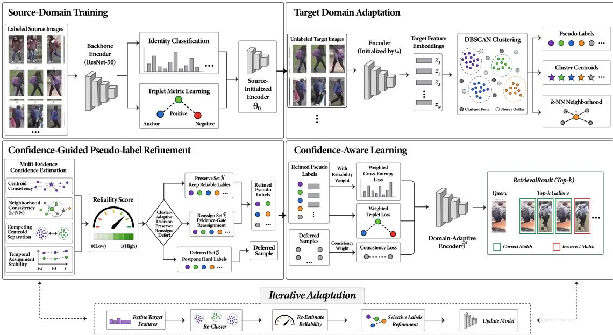
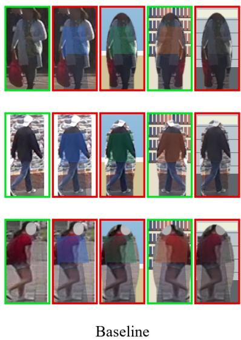
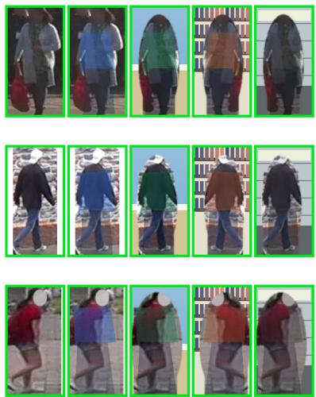
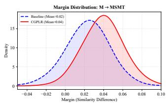
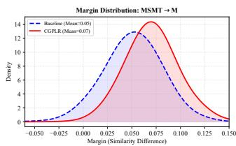
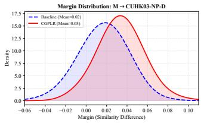
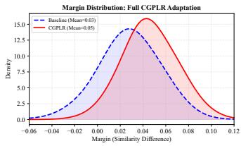

# Confidence-Guided Pseudo-Label Refinement for Unsupervised

Cross-Domain Person Re-Identification

Sundas Iqbal, Danish Ali, Qing Tian, Yuhui Zheng, Jianping Gou, and Weihua Ou

Abstract—Unsupervised cross-domain person re-identification remains challenging because domain shifts generate noisy pseudo labels that are reinforced during iterative adaptation. Existing clustering-based methods often rely on limited reliability cues or global confidence criteria and may impose hard identity supervision on ambiguous target samples. To address these limitations, we propose CGPLR, a confidence-guided pseudo-label refinement framework for unsupervised domain-adaptive person reidentification. CGPLR estimates sample-level reliability by jointly modeling centroid compatibility, local neighborhood consistency, separation from the strongest competing cluster and temporal assignment stability. The resulting confidence distribution is used to derive cluster-adaptive upper and lower thresholds for a three-way selective decision. Reliable assignments are preserved, recoverable samples are reassigned only when an alternative cluster receives sufficient geometric and neighborhood support and highly ambiguous samples are deferred from hard identity supervision. The learning objective adapts to these decisions through confidence-weighted supervision for preserved samples, cautious corrected-label weighting for reassigned samples and label-free representation consistency for deferred samples. CG-PLR achieves 76.4% Rank-1 accuracy and 47.6% mean average precision (mAP) on Market-1501→MSMT17, and 95.1% Rank-1 accuracy and 87.7% mAP on MSMT17→Market-1501, demonstrating effective reliability-aware selective adaptation. The code is available at https://github.com/Sundas058/CGPLR.

Index Terms—Unsupervised domain adaptation, person reidentification, pseudo-label refinement, confidence-aware learning.

## I. INTRODUCTION

ERSON re-identification (Re-ID) aims to match individuals across non-overlapping camera views and is widely used in intelligent surveillance and public security applications [1], [2]. Although supervised deep learning has achieved substantial progress, it relies heavily on large-scale identity annotations that are costly and time-consuming to obtain [3], [4]. Unsupervised domain adaptation (UDA) addresses this limitation by transferring a model trained on a labeled source domain to an unlabeled target domain [5]–[7]. Most UDAbased Re-ID methods therefore cluster target-domain features to generate pseudo labels for unsupervised adaptation [8], [9].

However, clustering under domain shift inevitably produces incorrect assignments because of illumination, occlusion, viewpoint and background variations [10], [11], and these errors may be progressively reinforced during iterative adaptation [12], [13]. Existing refinement and confidenceaware methods often rely on limited or static reliability cues. High compatibility with the assigned cluster may still be unreliable when a sample is also close to a competing cluster, while neighborhood agreement can be misleading when nearby assignments are noisy. Moreover, global confidence thresholds overlook variations in cluster density and compactness, and uncertain samples may be uniformly down-weighted or forcibly reassigned even when no alternative identity is sufficiently supported. More importantly, confidence is commonly used only as a loss weight rather than as a decision variable that determines both pseudo-label refinement and the form of supervision. Consequently, existing pipelines remain vulnerable to error propagation under severe domain shifts.

To address these limitations, we propose CGPLR, a confidence-guided pseudo-label refinement framework for unsupervised cross-domain person re-identification. CGPLR estimates sample reliability from centroid compatibility, neighborhood consistency, competing-cluster separation and temporal assignment stability. The resulting multi-evidence confidence is used to construct cluster-adaptive upper and lower thresholds for a three-way selective decision: reliable assignments are preserved, recoverable assignments are reassigned only when an alternative cluster receives sufficient geometric and neighborhood support and highly ambiguous samples are deferred from hard identity supervision. The learning objective is conditioned on these decisions with confidence-weighted supervision for preserved samples, cautious corrected-label weighting for reassigned samples and label-free representation consistency for deferred samples. Thus, reliability determines not only sample importance but also the type of supervision applied during adaptation, enabling recoverable errors to be corrected without forcing ambiguous samples into unreliable identity clusters. The main distinction of CGPLR is therefore the coupling of multi-evidence reliability estimation with cluster-adaptive label decisions and sample-specific learning behavior within a unified adaptation framework.

The main contributions of this work are summarized as follows:

• We propose CGPLR, a reliability-aware framework for unsupervised cross-domain person re-identification that connects confidence estimation, selective pseudo-label refinement and target-domain optimization within a unified iterative adaptation process.

• We develop a multi-evidence confidence estimation strategy that evaluates each target sample using centroid compatibility, neighborhood consistency, competing-cluster separation and temporal assignment stability, providing a more complete measure of pseudo-label reliability.

• We introduce a cluster-adaptive selective refinement mechanism that preserves reliable assignments, reassigns recoverable samples only when an alternative cluster is consistently supported and defers genuinely ambiguous samples from hard pseudo-label supervision.

• We design a reliability-aware selective learning objective in which preserved, reassigned and deferred samples receive different forms of supervision including confidenceweighted classification, metric learning and label-free representation consistency.

• We conduct extensive experiments on multiple benchmark datasets and cross-domain transfer settings, supported by ablation, sensitivity, pseudo-label reliability and qualitative analyses to demonstrate the effectiveness and robustness of the proposed framework.

The remainder of this paper is organized as follows. Section II reviews related work, Section III presents CGPLR, Section IV reports the experiments and Section V concludes the paper.

## II. RELATED WORK

## A. Unsupervised Domain Adaptation for Person Re-ID

Unsupervised domain adaptation (UDA) for person reidentification transfers identity-discriminative knowledge from a labeled source domain to an unlabeled target domain without target identity annotations [14]–[16]. A dominant strategy follows iterative self-training, where target features are clustered to generate pseudo labels that are subsequently used to update the model [17], [18]. Representative methods include Self-Paced Contrastive Learning (SPCL) [19], which combines hybrid memory with self-paced learning, and Cluster Contrast Learning (CCL) [20], which exploits cluster-level representations for pseudo-label supervision. Zhang et al. [21] introduced asymmetric double-network mutual teaching, while Tan et al. [22] studied continual adaptation through affinity harmonization and Camera-Driven Representation Learning [23] explicitly modeled camera-induced variations. In the sourcefree setting, Tian et al. [24] proposed Dipolar Confidence Learning (DCL) to regulate target-domain adaptation without access to source data. Although these approaches improve transfer through contrastive learning, camera-aware modeling, representation alignment or confidence regulation, they remain dependent on the quality of target-domain clustering, allowing incorrect or unstable assignments to be reinforced during iterative adaptation, particularly under severe domain shifts.

TABLE I  
COMPARISON OF REPRESENTATIVE CONFIDENCE- AND PSEUDO-LABEL-REFINEMENT METHODS FOR UNSUPERVISED PERSON RE-IDENTIFICATION.
<table><tr><td>Mechanism</td><td>CGC [33]</td><td>3C [13]</td><td>PPLR [26]</td><td>[17]</td><td>CMLR CGPLR (Ours)</td></tr><tr><td>Centroid-based reliability</td><td></td><td></td><td></td><td></td><td>√</td></tr><tr><td>Local/neighborhood evidence</td><td></td><td></td><td>√</td><td>√</td><td>√</td></tr><tr><td>Explicit centroid margin</td><td></td><td></td><td></td><td></td><td>√</td></tr><tr><td>Temporal stability</td><td></td><td></td><td></td><td></td><td>√</td></tr><tr><td>Cluster-adaptive threshold</td><td></td><td></td><td></td><td></td><td>√</td></tr><tr><td>Evidence-gated hard reassignment</td><td></td><td></td><td></td><td></td><td>√</td></tr><tr><td>Selective deferral</td><td></td><td></td><td></td><td></td><td>√</td></tr><tr><td>Reliability-aware supervision</td><td></td><td>L</td><td>L</td><td>√</td><td>√</td></tr></table>

## B. Pseudo-Label Learning for Unsupervised Person Re-ID

Pseudo-label learning is central to unsupervised person Re-ID because it enables discriminative representation learning from unlabeled target data [21], [25]. However, clusteringbased pseudo labels are inherently noisy and may suffer from identity fragmentation, cluster contamination and boundary ambiguity. Tang et al. [17] proposed camera-aware multi-level refinement at cluster and instance levels, while Cho et al. [26] introduced Part-Based Pseudo Label Refinement (PPLR) to exploit complementary global and part-level representations. Zou et al. [27] used discrepant and multi-instance proxies for clustered-sample supervision, Zhu et al. [28] employed multiview knowledge distillation to suppress pseudo-label noise, Peng et al. [29] reduced camera deviation through CDE-Learning and Ding et al. [30] combined multi-scale adaptive clustering with local-consistency constraints. Although these methods improve pseudo-label quality from different perspectives, they primarily focus on constructing or refining assignments and may still impose hard identity supervision on uncertain samples when neither the current nor an alternative assignment is sufficiently supported.

## C. Confidence and Reliability-Aware Learning

Sample-level confidence provides an effective means of distinguishing reliable target instances from ambiguous or noisy pseudo-labeled samples [31], [32]. Miao et al. [33] proposed Confidence-Guided Centroids (CGC), which emphasizes high-confidence instances during centroid construction to reduce the influence of ambiguous boundary samples. Tian et al. [24] incorporated dipolar confidence into source-free adaptation, while Zheng et al. [13] combined confidenceguided clustering with contrastive learning for unsupervised person Re-ID. Reliability modeling has also been explored in specialized settings. Peng et al. [34] proposed BIMM-Net for unsupervised visible–infrared person re-identification, using confidence-based matching to reduce noisy cross-modal associations. Complementary supervision has further been obtained through multi-view knowledge distillation [28], while denoising-oriented approaches suppress unreliable pseudo labels through feature denoising and teacher–student learning [30], [35].

Existing confidence-aware approaches improve robustness from different perspectives. CGC [33] emphasizes reliable samples during centroid construction, 3C [13] incorporates confidence into clustering and contrastive learning, PPLR [26] exploits agreement between global and part-level representations and CMLR [17] performs camera-aware refinement at cluster and instance levels. However, these approaches do not jointly model whether a sample is simultaneously compatible with competing clusters, temporally stable across adaptation rounds and supported by a cluster-specific reliability distribution. CGPLR addresses these limitations by combining centroid compatibility, neighborhood consistency, competingcentroid separation and temporal assignment stability. The resulting confidence drives cluster-adaptive preserve, reassign or defer decisions and determines the form and strength of supervision applied to each target sample. As summarized in Table I, the main distinction of CGPLR is the coupling of multi-evidence reliability estimation with cluster-adaptive pseudo-label decisions and reliability-conditioned learning within a unified adaptation framework.

## III. PROPOSED METHOD

## A. Problem Formulation

Unsupervised domain adaptation (UDA) for person reidentification aims to transfer identity-discriminative knowledge from a labeled source domain to an unlabeled target domain under distribution shift. Let the source domain be denoted as $\mathcal { D } _ { s } = \{ ( x _ { i } ^ { s } , y _ { i } ^ { s } ) \} _ { i = 1 } ^ { N _ { s } }$ , where $\boldsymbol { x } _ { i } ^ { s }$ is the i-th source image and $y _ { i } ^ { s } \in \{ 1 , \ldots , C _ { s } \}$ is its identity label. The unlabeled target domain is defined as $\mathcal { D } _ { t } ~ = ~ \{ \bar { x } _ { j } ^ { t } \} _ { j = 1 } ^ { N _ { t } }$ , where target identity annotations are unavailable.

The objective is to learn a feature embedding function $f _ { \theta }$ $\mathcal { X }  \mathbb { R } ^ { d }$ that preserves identity-discriminative structure in the target domain. Since the target identities are unknown, clustering-based pseudo-labeling is used to approximate the latent target identity distribution. Specifically, the pseudo label of target sample $x _ { j } ^ { \dot { t } }$ is generated according to Eq. (1):

$$
\begin{array} { r } { \hat { y } _ { j } ^ { t } = \mathcal { C } \left( f _ { \theta } ( x _ { j } ^ { t } ) \right) , } \end{array}\tag{1}
$$

where $\mathcal { C } ( \cdot )$ denotes a clustering operator such as DBSCAN. The assignment produced by Eq. (1) provides an initial supervisory signal for target-domain adaptation.

However, due to domain discrepancy, the generated pseudo labels may be incorrect. Conceptually, the correctness of a target pseudo label is represented by the latent indicator $\delta _ { j } ~ = ~ \mathbb { I } ( \hat { y } _ { j } ^ { t } = y _ { j } ^ { t } )$ , where $y _ { j } ^ { t }$ denotes the unknown groundtruth identity. Because $\delta _ { j }$ is unavailable during adaptation, treating all pseudo-labeled samples equally may introduce biased supervision and repeatedly reinforce incorrect cluster assignments. To reduce the influence of unreliable pseudo labels, target-domain adaptation is formulated as the confidenceweighted risk minimization problem given in Eq. (2):

$$
\mathcal { L } _ { t } = \mathbb { E } _ { x _ { j } ^ { t } \sim \mathcal { D } _ { t } } \left[ w _ { j } \ell \left( f _ { \theta } ( x _ { j } ^ { t } ) , \hat { y } _ { j } ^ { t } \right) \right] ,\tag{2}
$$

where $w _ { j } ~ \in ~ [ 0 , 1 ]$ denotes the reliability weight of sample $\ v x _ { j } ^ { t }$ and serves as a surrogate for its unobservable pseudolabel correctness probability, $w _ { j } ~ \approx ~ \mathbb { P } ( \delta _ { j } ~ = ~ 1 ~ | ~ x _ { j } ^ { t } )$ . As expressed in Eq. (2), reliable samples contribute more strongly to target-domain learning, whereas uncertain assignments exert a smaller influence on optimization.

CGPLR follows a two-stage optimization procedure rather than jointly optimizing the source- and target-domain objectives. The encoder is first trained on the labeled source domain and is subsequently adapted to the unlabeled target domain through reliability-aware supervision. The two optimization stages are formulated in Eq. (3):

$$
\begin{array} { r l r } { \theta ^ { ( 0 ) } = \underset { \theta } { \arg \operatorname* { m i n } } \mathcal { L } _ { s } ( \theta ) , } & { { } } & { } \\ { \theta ^ { * } = \underset { \theta } { \arg \operatorname* { m i n } } \mathcal { L } _ { t } ( \theta ) , } & { { } } & { \theta _ { \mathrm { i n i t } } = \theta ^ { ( 0 ) } . } \end{array}\tag{3}
$$

where $\theta ^ { ( 0 ) }$ denotes the source-trained encoder parameters, while $\theta ^ { * }$ denotes the parameters obtained after target-domain adaptation. The source objective $\mathcal { L } _ { s }$ first provides an identity discriminative initialization, after which the target objective $\scriptstyle { \mathcal { L } } _ { t }$ adapts the encoder to the unlabeled target domain using reliability-aware supervision. The target-domain adaptation stage follows the confidence-weighted risk formulation in Eq. (2). Therefore, the central challenge is to estimate reliable sample weights $w _ { j }$ and use them to regulate both pseudo-label refinement and target-domain optimization. The following subsections describe how CGPLR addresses this challenge through multi-evidence confidence estimation, adaptive selective refinement and reliability-aware learning.

## B. Framework Overview

An overview of the proposed confidence-guided pseudolabel refinement framework is illustrated in Fig. 1. CGPLR follows an iterative target-domain adaptation process that integrates pseudo-label generation, multi-evidence reliability estimation, selective refinement and reliability-aware learning. CGPLR estimates the reliability of each assignment and uses this information to determine both the refinement decision and the form of supervision applied during adaptation. Given a labeled source domain $\mathcal { D } _ { s }$ and an unlabeled target domain $\mathcal { D } _ { t }$ , the encoder $f _ { \theta }$ is first trained on the source data and then used to extract target-domain features, which are clustered to generate initial pseudo labels. Sample reliability is assessed using centroid compatibility, neighborhood consistency, competing-cluster separation and temporal assignment stability. Cluster-adaptive thresholds, together with the evidence supporting alternative clusters, partition valid target samples into preserved, reassigned and deferred subsets. Reliable assignments are retained, uncertain assignments are corrected only when an alternative cluster is sufficiently supported and highly ambiguous samples are excluded from hard identity supervision. Preserved and reassigned samples are optimized through reliability-weighted classification and metric-learning losses, whereas deferred samples contribute through labelfree representation consistency. After each adaptation round, the updated encoder generates new target representations, while the current pseudo labels and cluster centroids are retained as temporal information for the subsequent round. This process forms a progressive refinement loop that connects clustering, selective correction and reliability-aware learning. The complete training procedure is summarized in Algorithm 1 presented at the end of this section.

  
Fig. 1. Overview of the proposed CGPLR framework for unsupervised cross-domain person re-identification. Target pseudo labels are evaluated using structural, competing-cluster and temporal evidence, followed by cluster-adaptive preserve, reassign or defer decisions and reliability-conditioned target-domain learning.

## C. Source Domain Training

The source-domain training stage learns an identitydiscriminative representation that provides a reliable initialization for subsequent target-domain adaptation. Given the labeled source dataset $\mathcal { D } _ { s } = \{ ( x _ { i } ^ { s } , y _ { i } ^ { s } ) \} _ { i = 1 } ^ { N _ { s } }$ , the feature encoder $f _ { \theta }$ is optimized under full supervision using identity classification and triplet-based metric learning. The classification objective encourages separation among source identities, whereas the triplet objective structures the embedding space by reducing intra-identity distances and increasing inter-identity separation. The corresponding classification loss, triplet loss and complete source-domain objective are formulated in Eq. (4):

$$
\begin{array} { l } { \displaystyle \mathcal { L } _ { \mathrm { c e } } = - \sum _ { i = 1 } ^ { N _ { s } } \log p \theta \big ( \boldsymbol { y } _ { i } ^ { s } \mid \boldsymbol { x } _ { i } ^ { s } \big ) , } \\ { \displaystyle \mathcal { L } _ { \mathrm { t r i } } = \sum _ { i = 1 } ^ { N _ { s } } \Big [ \big \lVert f _ { \theta } \big ( \boldsymbol { x } _ { i } ^ { s } \big ) - f _ { \theta } \big ( \boldsymbol { x } _ { i } ^ { s + } \big ) \big \rVert _ { 2 } ^ { 2 } } \\ { \displaystyle \qquad - \left. f _ { \theta } \big ( \boldsymbol { x } _ { i } ^ { s } \big ) - f _ { \theta } \big ( \boldsymbol { x } _ { i } ^ { s - } \big ) \big \rVert _ { 2 } ^ { 2 } + m \right] _ { + } , } \\ { \displaystyle \mathcal { L } _ { s } = \mathcal { L } _ { \mathrm { c e } } + \beta _ { s } \mathcal { L } _ { \mathrm { t r i } } . } \end{array}\tag{4}
$$

where $p _ { \theta } ( y _ { i } ^ { s } \mid x _ { i } ^ { s } )$ denotes the predicted probability that source sample x<sup>s</sup> belongs to its ground-truth identity $y _ { i } ^ { s }$ . The samples $x _ { i } ^ { s + }$ and $x _ { i } ^ { s - }$ denote the positive and negative instances associated with anchor $x _ { i } ^ { s } .$ , respectively. The parameter $m$ is the triplet margin, [·]<sub>+</sub> denotes the hinge function and $\beta _ { s }$ controls the contribution of metric learning to the sourcedomain objective.

## D. Target Domain Clustering

After source-domain training, the encoder $f _ { \theta }$ is applied to the target samples $\{ x _ { j } ^ { t } \} _ { j = 1 } ^ { N _ { t } }$ to extract feature representations $z _ { j } = f _ { \theta } ( x _ { j } ^ { t } ) \in \mathbb R ^ { d }$ . The extracted features are ℓ -normalized as $z _ { j } ~  ~ z _ { j } / \| z _ { j } \| _ { 2 }$ to obtain a consistent embedding scale for subsequent distance computation. For notational simplicity, the adaptation-round index is omitted in this subsection. Since target-domain identity annotations are unavailable, a pairwise distance matrix is constructed from the normalized target features and clustering is performed to approximate the latent identity structure. We employ DBSCAN [36] because it does not require the number of target identities to be specified in advance and can identify samples that do not belong to sufficiently dense regions. The resulting target pseudo labels are generated according to Eq. (1).

Let $\mathcal { T } = \{ j \mid \hat { y } _ { j } ^ { t } \neq - 1 \}$ denote the set of samples assigned to valid clusters, where the label −1 represents a DBSCAN outlier. These outliers are excluded from the selective partition and target-domain optimization in the current adaptation round. For the k-th cluster, the corresponding index set is defined as ${ \mathcal { C } } _ { k } = \{ j \in { \mathcal { T } } \mid { \hat { y } } _ { j } ^ { t } = k \}$ . The mean representation and its normalized cluster centroid are formulated in Eq. (5):

$$
\begin{array} { l } { \displaystyle \widetilde { \mu } _ { k } = \frac { 1 } { \vert { \mathcal C } _ { k } \vert } \sum _ { j \in { \mathcal C } _ { k } } z _ { j } , } \\ { \displaystyle \mu _ { k } = \frac { \widetilde { \mu } _ { k } } { \vert \vert \widetilde { \mu } _ { k } \vert \vert _ { 2 } } . } \end{array}\tag{5}
$$

where $| \mathcal { C } _ { k } |$ denotes the number of samples assigned to cluster $k , \widetilde { \mu } _ { k }$ is the mean representation of the cluster members, and µ is the corresponding ℓ -normalized centroid. Consequently, each valid target sample $\ v x _ { j } ^ { t }$ is associated with an initial pseudolabel $\hat { y } _ { j } ^ { t }$ and the centroid $\mu _ { \hat { y } _ { i } ^ { t } }$ of its assigned cluster.

Although clustering provides an initial supervisory structure for target-domain adaptation, its assignments may remain unreliable because of domain discrepancy, viewpoint variation, illumination changes, occlusion and background clutter. These factors can cause intra-identity fragmentation and interidentity confusion allowing incorrect assignments to propagate during iterative learning. CGPLR therefore evaluates each valid pseudo label using centroid compatibility, local neighborhood consistency, competing-cluster separation and temporal assignment stability. The resulting multi-evidence confidence estimation is introduced in Section III-E.

## E. Multi-Evidence Confidence Estimation

The pseudo labels produced by target-domain clustering provide hard identity assignments but do not indicate their reliability. A sample may be close to its assigned centroid while remaining similarly close to a competing cluster and local agreement may be unreliable when neighboring samples contain incorrect assignments. CGPLR therefore estimates sample-level reliability using complementary structural, competitive and temporal evidence. For clarity, the adaptation round index is omitted from within-round quantities unless required explicitly. Given a target sample $\ v x _ { j } ^ { t }$ with normalized embedding $z _ { j }$ and current pseudo label $\begin{array} { r } { \hat { y } _ { j } ^ { t } \overset { } { = } k , } \end{array}$ , its structural reliability is evaluated using the assigned cluster centroid and local neighborhood. The centroid compatibility, neighborhood consistency and their fused structural score are formulated in Eq. (6):

$$
\begin{array} { l } { \displaystyle { c _ { j } = \exp \left( - \frac { \big \| z _ { j } - \mu _ { k } \big \| _ { 2 } ^ { 2 } } { \tau _ { c } } \right) , } } \\ { \displaystyle { s _ { j } = \frac { 1 } { | \mathcal { N } _ { j } | } \sum _ { l \in \mathcal { N } _ { j } } \mathbb { I } \big ( \hat { y } _ { l } ^ { t } = \hat { y } _ { j } ^ { t } \big ) , } } \\ { \displaystyle { r _ { j } = \alpha c _ { j } + ( 1 - \alpha ) s _ { j } } . } \end{array}\tag{6}
$$

where ${ \mathcal { N } } _ { j } \subseteq { \mathcal { T } } \setminus \{ j \}$ denotes the set of the K nearest valid target samples to $z _ { j }$ , and $\mathbb { I } ( \cdot )$ is the indicator function. If fewer than K valid neighbors are available, all available valid neighbors are used. The temperature $\tau _ { c } ~ > ~ 0$ controls the sensitivity of centroid compatibility to the sample–centroid distance, while $\alpha \in [ 0 , 1 ]$ balances centroid and neighborhood evidence. A sample receives a high structural score when its current assignment is consistently supported by both the assigned centroid and its local neighborhood.

Structural reliability alone does not explicitly measure competition from other clusters. We therefore identify the closest competing centroid and measure its separation from the currently assigned centroid. The strongest competing cluster, distance margin and margin-based confidence are formulated in Eq. (7):

$$
\begin{array} { r l } & { k _ { j } ^ { - } = \underset { q \neq k } { \arg \operatorname* { m i n } } \left\| z _ { j } - \mu _ { q } \right\| _ { 2 } ^ { 2 } , } \\ & { \Delta _ { j } = \left\| z _ { j } - \mu _ { k _ { j } ^ { - } } \right\| _ { 2 } ^ { 2 } - \left\| z _ { j } - \mu _ { k } \right\| _ { 2 } ^ { 2 } , } \\ & { m _ { j } = \sigma \bigg ( \frac { \Delta _ { j } } { \tau _ { m } } \bigg ) . } \end{array}\tag{7}
$$

where $\sigma ( \cdot )$ denotes the sigmoid function and $\tau _ { m } > 0$ controls the smoothness of the margin transformation. A large positive $\Delta _ { j }$ indicates that the assigned centroid is clearly preferred over its strongest competitor, whereas a value close to zero indicates an ambiguous assignment. A negative margin indicates that a competing centroid is closer than the currently assigned centroid.

Reliability should also remain stable across successive adaptation rounds. Let $\hat { y } _ { j } ^ { t , ( e ) }$ denote the pseudo label of target sample j at round $e ,$ and let $\mu _ { k } ^ { \left( e \right) }$ denote the centroid of cluster k at that round. Because cluster indices may change after re-clustering, historical clusters are aligned with the current clusters before their assignments are compared. Let $\Pi _ { e { \mathrm { - } } h , e }$ denote the set of maximum-cardinality one-to-one mappings between the clusters obtained at rounds $e \mathrm { ~ - ~ } h$ and e. The centroid-based cluster alignment and temporal stability are jointly formulated in Eq. (8):

$$
\begin{array} { r l } & { \pi _ { e - h  e } = \underset { \pi \in \Pi _ { e - h , e } } { \arg \operatorname* { m i n } } \ \sum _ { k \in \mathrm { d o m } ( \pi ) } \Big \| \mu _ { k } ^ { ( e - h ) } - \mu _ { \pi ( k ) } ^ { ( e ) } \Big \| _ { 2 } ^ { 2 } , } \\ & { \qquad t _ { j } ^ { ( e ) } = \cfrac { 1 } { H _ { e } } \sum _ { h = 1 } ^ { H _ { e } } \mathbb { I } \Big ( \pi _ { e - h  e } \Big ( \hat { y } _ { j } ^ { t , ( e - h ) } \Big ) = \hat { y } _ { j } ^ { t , ( e ) } \Big ) , } \\ & { \qquad H _ { e } = \operatorname* { m i n } ( H , e - 1 ) , \qquad e > 1 . } \end{array}\tag{8}
$$

where dom(π) denotes the set of historical clusters included in the one-to-one alignment and H is the maximum number of previous adaptation rounds retained in the temporal window. Historical outlier assignments and clusters that are not included in the alignment contribute zero to the corresponding indicator. A high value of $t _ { j } ^ { ( e ) }$ indicates that the sample has maintained a stable cluster assignment over recent adaptation rounds.

Finally, the structural, competitive and temporal cues are combined into the sample-level confidence score. Since temporal evidence is not available during the first adaptation round, the structural and margin weights are renormalized in that round. The complete confidence formulation is given in Eq. (9):

$$
w _ { j } ^ { ( e ) } = \left\{ \begin{array} { l l } { \displaystyle \frac { \omega _ { r } r _ { j } + \omega _ { m } m _ { j } } { \omega _ { r } + \omega _ { m } } , } & { e = 1 , } \\ { \quad \omega _ { r } r _ { j } + \omega _ { m } m _ { j } + \omega _ { t } t _ { j } ^ { ( e ) } , } & { e > 1 , } \end{array} \right.\tag{9}
$$

where $\omega _ { r } , \omega _ { m } , \omega _ { t } \geq 0 , \omega _ { r } + \omega _ { m } + \omega _ { t } = 1$ , and $\omega _ { r } + \omega _ { m } >$ 0. The resulting score $w _ { j } ^ { ( e ) } ~ \in ~ [ 0 , 1 ]$ serves as a bounded surrogate for the latent pseudo-label correctness indicator $\delta _ { j } = \mathbb { I } ( \hat { y } _ { j } ^ { t } = y _ { j } ^ { t } )$ introduced in Section III-A. Samples consistently supported by the structural, competitive, and temporal evidence receive higher confidence, whereas disagreement among these cues results in more cautious treatment. The estimated confidence scores subsequently guide the clusteradaptive preserve, reassign and defer decisions introduced in the following subsection.

## F. Adaptive Selective Pseudo-Label Refinement

The pseudo labels generated through clustering may contain incorrect assignments because target-domain representations remain imperfect during adaptation. Directly relabeling every low-confidence sample can introduce additional errors, particularly when no alternative cluster is sufficiently supported. We therefore formulate pseudo-label refinement as a selective decision process in which each valid target sample is preserved, reassigned or temporarily deferred according to its confidence and the evidence supporting alternative assignments. A single global threshold may not adequately represent the heterogeneous reliability distributions of different target clusters. For cluster $\mathcal { C } _ { k } ^ { ( e ) }$ , its median confidence and median absolute deviation are formulated in Eq. (10):

$$
\begin{array} { r l } & { \bar { w } _ { k } ^ { ( e ) } = \mathrm { m e d i a n } _ { j \in \mathcal { C } _ { k } ^ { ( e ) } } w _ { j } ^ { ( e ) } , } \\ & { d _ { k } ^ { ( e ) } = \mathrm { m e d i a n } _ { j \in \mathcal { C } _ { k } ^ { ( e ) } } \left| w _ { j } ^ { ( e ) } - \bar { w } _ { k } ^ { ( e ) } \right| . } \end{array}\tag{10}
$$

where $\bar { w } _ { k } ^ { ( e ) }$ represents the central reliability level of cluster $k ,$ whereas $\ddot { d } _ { k } ^ { \left( e \right) }$ measures the dispersion of its confidence scores.

To avoid a degenerate threshold interval when the confidence dispersion of a cluster is zero or extremely small, a lower-bounded dispersion is first defined as $\begin{array} { r l } { \mathbf { \dot { \mathcal { d } } } _ { k } ^ { ( e ) } } & { { } = } \end{array}$ max $( d _ { k } ^ { ( e ) } , \epsilon _ { d } )$ , where $\epsilon _ { d } > 0$ is a small constant. The corresponding upper and lower cluster-adaptive thresholds are then defined in Eq. (11):

$$
\begin{array} { r l } & { \widetilde { d } _ { k } ^ { ( e ) } = \operatorname* { m a x } \Bigl ( d _ { k } ^ { ( e ) } , \epsilon _ { d } \Bigr ) , } \\ & { \delta _ { k } ^ { H , ( e ) } = \mathrm { c l i p } \Bigl ( \bar { w } _ { k } ^ { ( e ) } + \rho _ { H } \widetilde { d } _ { k } ^ { ( e ) } , 0 , 1 \Bigr ) , } \\ & { \delta _ { k } ^ { L , ( e ) } = \mathrm { c l i p } \Bigl ( \bar { w } _ { k } ^ { ( e ) } - \rho _ { L } \widetilde { d } _ { k } ^ { ( e ) } , 0 , 1 \Bigr ) . } \end{array}\tag{11}
$$

The parameters $\rho _ { H }$ and $\rho _ { L }$ control the selectivity of the upper and lower thresholds, respectively, while $\operatorname { c l i p } ( \cdot , 0 , 1 )$ restricts the resulting values to [0, 1]. These thresholds adapt the decision criteria to the reliability distribution of each cluster rather than applying a single fixed criterion to all target identities.

For a sample whose current assignment is not sufficiently reliable, we evaluate whether another cluster provides stronger support. For each candidate cluster q, the neighborhood support, centroid compatibility and fused assignment evidence are formulated in Eq. (12):

$$
\begin{array} { l } { \displaystyle a _ { j , q } = \frac { 1 } { | \mathcal { N } _ { j } | } \sum _ { l \in \mathcal { N } _ { j } } \mathbb { I } \big ( \hat { y } _ { l } ^ { t } = q \big ) , } \\ { \displaystyle g _ { j , q } = \exp \left( - \frac { \big \| z _ { j } - \mu _ { q } \big \| _ { 2 } ^ { 2 } } { \tau _ { r } } \right) , } \\ { \displaystyle u _ { j , q } = \beta g _ { j , q } + ( 1 - \beta ) a _ { j , q } . } \end{array}\tag{12}
$$

where $a _ { j , q }$ measures the local support for candidate cluster $q ,$ whereas $g _ { j , q }$ measures the geometric compatibility of the sample with centroid $\mu _ { q }$ . The temperature $\tau _ { r } ~ > ~ 0$ controls the sensitivity of centroid compatibility to the sample–centroid distance, and $\beta \in [ 0 , 1 ]$ balances geometric and neighborhood evidence. The fused score therefore favors candidate clusters that receive consistent support from both sources.

For a sample currently assigned to $k = \hat { y } _ { j } ^ { t , ( e ) }$ , the bestsupported alternative cluster and its evidence gain over the current assignment are defined in Eq. (13):

$$
\begin{array} { l } { q _ { j } ^ { * } = \underset { q \neq k } { \arg \operatorname* { m a x } } u _ { j , q } , } \\ { \Gamma _ { j } = u _ { j , q _ { j } ^ { * } } - u _ { j , k } . } \end{array}\tag{13}
$$

A sufficiently large positive value of $\Gamma _ { j }$ indicates that the alternative cluster $q _ { j } ^ { * }$ is more strongly supported than the current assignment.

Using the cluster-adaptive thresholds and alternativeassignment evidence, the preserved, reassigned and deferred subsets are formulated in Eq. (14):

$$
\begin{array} { r l } & { { \mathscr H } ^ { ( e ) } = \{ j \in { \mathcal Z } ^ { ( e ) } \ \Bigg \vert \ w _ { j } ^ { ( e ) } \geq \delta _ { \hat { y } _ { j } ^ { t , ( e ) } } ^ { H , ( e ) } \} , } \\ & { { \mathscr R } ^ { ( e ) } = \{ j \in { \mathcal Z } ^ { ( e ) }  \begin{array} { l } { \delta _ { \hat { y } _ { j } ^ { t , ( e ) } } ^ { L , ( e ) } \leq w _ { j } ^ { ( e ) } < \delta _ { \hat { y } _ { j } ^ { t , ( e ) } } ^ { H , ( e ) } , } \\ { \Gamma _ { j } \geq \xi , \qquad a _ { j , q _ { j } ^ { * } } \geq \zeta } \end{array} \} , } \\ & { { \mathscr D } ^ { ( e ) } = { \mathcal Z } ^ { ( e ) } \setminus ( { \mathscr H } ^ { ( e ) } \cup { \mathscr R } ^ { ( e ) } ) . } \end{array}\tag{14}
$$

where $\mathcal { H } ^ { ( e ) } , \mathcal { R } ^ { ( e ) }$ , and $\mathcal { D } ^ { ( e ) }$ denote the preserved, reassigned and deferred subsets, respectively. The parameter ξ specifies the minimum evidence gain required for reassignment, whereas ζ enforces sufficient neighborhood support for the proposed alternative cluster.

Samples below the lower threshold are deferred directly because their representations are considered insufficiently reliable for selecting a trustworthy alternative identity. Reassignment is therefore restricted to the intermediate-confidence region and is accepted only when both the relative evidence gain and neighborhood-support conditions are satisfied. Intermediate-confidence samples that fail either condition are also deferred.

The resulting refined pseudo-label assignment is formulated in Eq. (15):

$$
\hat { y } _ { j } ^ { t , * , ( e ) } = \left\{ \begin{array} { l l } { \hat { y } _ { j } ^ { t , ( e ) } , } & { j \in \mathcal { H } ^ { ( e ) } , } \\ { q _ { j } ^ { * } , } & { j \in \mathcal { R } ^ { ( e ) } , } \\ { \varnothing , } & { j \in \mathcal { D } ^ { ( e ) } . } \end{array} \right.\tag{15}
$$

Reliable assignments are therefore preserved, recoverable assignments are replaced by their best-supported alternatives, and ambiguous samples receive no hard identity label during the current adaptation round.

Deferral is important because low confidence does not necessarily imply that a particular alternative cluster is correct. Rather than forcing ambiguous samples into potentially incorrect identities, CGPLR allows their assignments to be reconsidered after the representation and cluster structure are updated in subsequent adaptation rounds. Deferred samples are excluded from hard pseudo-label classification and metric learning but remain involved through label-free consistency regularization, as described in Section III-G.

The selective formulation has two defining properties. First, its decision thresholds adapt to each cluster’s reliability distribution. Second, reassignment is permitted only when relative evidence gain and neighborhood support jointly favor an alternative cluster; otherwise, the sample is deferred. This design enables the correction of recoverable assignments while limiting error propagation from ambiguous pseudo labels.

## G. Reliability-Aware Selective Learning

The selective refinement strategy introduced in Section III-F partitions the valid target samples into preserved, reassigned, and deferred subsets. These subsets should not contribute to target-domain optimization in the same manner. Preserved samples receive reliable hard pseudo-label supervision, reassigned samples receive more cautious corrected-label supervision, and deferred samples are excluded from identity-based losses because no sufficiently reliable identity assignment is available.

Let $B _ { t } ^ { ( e ) } \subseteq \tau ^ { ( e ) }$ denote a target mini-batch at adaptation round e. Its hard-labeled and deferred portions are defined in Eq. (16):

$$
\begin{array} { r l } & { B _ { \mathrm { L } } ^ { ( e ) } = B _ { t } ^ { ( e ) } \cap \left( \mathcal { H } ^ { ( e ) } \cup \mathcal { R } ^ { ( e ) } \right) , } \\ & { B _ { \mathrm { D } } ^ { ( e ) } = B _ { t } ^ { ( e ) } \cap \mathcal { D } ^ { ( e ) } . } \end{array}\tag{16}
$$

where $B _ { \mathrm { L } } ^ { ( e ) }$ contains the preserved and reassigned samples with refined hard pseudo labels, whereas $B _ { \mathrm { D } } ^ { ( e ) }$ contains the samples deferred from hard identity supervision.

For a preserved sample, $w _ { j } ^ { ( e ) }$ directly represents the reliability of its retained clustering assignment. For a reassigned sample, however, the original confidence should not be transferred directly to the new identity. We therefore compute an alternative-specific confidence from the relative evidence supporting the new and original assignments. The reassignment confidence and the resulting selective learning weight are defined in Eq. (17):

$$
\begin{array} { r l } & { \widetilde { u } _ { j } ^ { ( e ) } = \frac { u _ { j , q _ { j } ^ { * } } } { u _ { j , q _ { j } ^ { * } } + u _ { j , \hat { y } _ { j } ^ { t , ( e ) } } + \epsilon } , \qquad j \in \mathcal { R } ^ { ( e ) } , } \\ & { } \\ & { \widetilde { w } _ { j } ^ { ( e ) } = \left\{ \begin{array} { l l } { w _ { j } ^ { ( e ) } , } & { j \in \mathcal { H } ^ { ( e ) } , } \\ { \eta _ { r } \widetilde { u } _ { j } ^ { ( e ) } , } & { j \in \mathcal { R } ^ { ( e ) } . } \end{array} \right. } \end{array}\tag{17}
$$

where $u _ { j , q _ { j } ^ { * } }$ and $u _ { j , \hat { y } _ { i } ^ { t , ( e ) } }$ denote the evidence supporting the alternative and original assignments, respectively, as formulated in Eq. (12). The constant $\epsilon > 0$ ensures numerical stability, while $\eta _ { r } \in ( 0 , 1 ]$ limits the contribution of reassigned samples so that their corrected labels are used more conservatively.

Let $\mathcal { \kappa } ^ { ( e ) }$ denote the set of valid pseudo identities in the current adaptation round, and let $\ell _ { \theta , q } ( x _ { j } ^ { t } )$ denote the prediction logit associated with target identity $q .$ The corresponding target-domain identity probability is given by

$$
p _ { \theta } ( q \mid x _ { j } ^ { t } ) = \frac { \exp \bigl ( \ell _ { \theta , q } ( x _ { j } ^ { t } ) \bigr ) } { \displaystyle \sum _ { v \in \mathcal { K } ^ { ( e ) } } \exp \bigl ( \ell _ { \theta , v } ( x _ { j } ^ { t } ) \bigr ) } .
$$

Using the refined pseudo labels from Eq. (15), the reliabilityweighted cross-entropy loss is formulated in Eq. (18):

$$
\begin{array} { l } { { \displaystyle { \mathcal L } _ { \mathrm { w - c e } } = - \frac { 1 } { Z _ { \mathrm { c e } } } \sum _ { j \in B _ { \mathrm { L } } ^ { ( e ) } } \widetilde { w } _ { j } ^ { ( e ) } \log p _ { \theta } \Big ( \hat { y } _ { j } ^ { t , * , ( e ) } \mid x _ { j } ^ { t } \Big ) , } } \\ { { \displaystyle Z _ { \mathrm { c e } } = \sum _ { j \in B _ { \mathrm { L } } ^ { ( e ) } } \widetilde { w } _ { j } ^ { ( e ) } + \epsilon . } } \end{array}\tag{18}
$$

This formulation assigns greater influence to samples with more reliable preserved or corrected labels while limiting the effect of uncertain assignments.

To preserve the discriminative structure of the target embedding space, we additionally employ reliability-weighted metric learning. Let

$$
d _ { \theta } ( x , x ^ { \prime } ) = \bigl \| \bar { f } _ { \theta } ( x ) - \bar { f } _ { \theta } ( x ^ { \prime } ) \bigr \| _ { 2 } ^ { 2 }
$$

denote the squared Euclidean distance between normalized embeddings, where $\bar { f } _ { \theta } ( x ) = f _ { \theta } ( x ) / \| f _ { \theta } ( x ) \| _ { 2 }$ . For each eligible anchor $j \in B _ { \mathrm { L } } ^ { ( e ) }$ , the positive and negative sets are defined as

$$
\mathcal { P } _ { j } ^ { ( e ) } = \left\{ l \in B _ { \mathrm { L } } ^ { ( e ) } \setminus \{ j \} \ \middle | \ \hat { y } _ { l } ^ { t , * , ( e ) } = \hat { y } _ { j } ^ { t , * , ( e ) } \right\} ,
$$

and

$$
\begin{array} { r } { \mathcal { N } _ { j } ^ { ( e ) } = \left\{ l \in B _ { \mathrm { L } } ^ { ( e ) } \enspace \middle | \enspace \hat { y } _ { l } ^ { t , * , ( e ) } \neq \hat { y } _ { j } ^ { t , * , ( e ) } \right\} . } \end{array}
$$

The eligible anchor set is

$$
\begin{array} { r } { \boldsymbol A _ { B } ^ { ( e ) } = \left\{ j \in B _ { \mathrm { L } } ^ { ( e ) } ~ \Big | ~ \mathcal { P } _ { j } ^ { ( e ) } \neq \emptyset , ~ \mathcal { N } _ { j } ^ { ( e ) } \neq \emptyset \right\} . } \end{array}
$$

Using batch-hard mining, the positive and negative instances are selected as

$$
\boldsymbol x _ { j } ^ { t + } = \underset { l \in \mathcal P _ { j } ^ { ( e ) } } { \arg \operatorname* { m a x } } d _ { \theta } ( \boldsymbol x _ { j } ^ { t } , \boldsymbol x _ { l } ^ { t } ) , \qquad \boldsymbol x _ { j } ^ { t - } = \underset { l \in \mathcal N _ { j } ^ { ( e ) } } { \arg \operatorname* { m i n } } d _ { \theta } ( \boldsymbol x _ { j } ^ { t } , \boldsymbol x _ { l } ^ { t } ) .
$$

The corresponding reliability-weighted triplet objective is formulated in Eq. (19):

$$
\begin{array} { l } { { \displaystyle { \mathcal L } _ { \mathrm { w - t r i } } = \frac { 1 } { Z _ { \mathrm { t r i } } } \sum _ { j \in A _ { B } ^ { ( e ) } } \widetilde w _ { j } ^ { ( e ) } \left[ d _ { \theta } ( x _ { j } ^ { t } , x _ { j } ^ { t + } ) - d _ { \theta } ( x _ { j } ^ { t } , x _ { j } ^ { t - } ) + m \right] _ { + } , } } \\ { { \displaystyle Z _ { \mathrm { t r i } } = \sum _ { j \in A _ { B } ^ { ( e ) } } \widetilde w _ { j } ^ { ( e ) } + \epsilon . } } \end{array}\tag{19}
$$

where $m > 0$ denotes the triplet margin and $[ \cdot ] _ { + }$ represents the hinge function. The reliability weight is applied to each anchor so that samples with less reliable refined labels exert a smaller influence on metric learning.

Deferred samples receive no hard identity label during the current adaptation round. Rather than discarding them, CGPLR encourages representation consistency under weak and strong image augmentations. Let $\mathcal { A } _ { w } ( \cdot )$ and $\mathcal { A } _ { s } ( \cdot )$ denote the weak and strong augmentation operators, respectively. Both views are processed by the same encoder, while the weak-view representation is treated as a fixed target through stop-gradient. The deferred-sample consistency objective is formulated in Eq. (20):

$$
\mathcal { L } _ { \mathrm { d e f } } = \frac { 1 } { | B _ { \mathrm { D } } ^ { ( e ) } | + \epsilon } \sum _ { j \in B _ { \mathrm { D } } ^ { ( e ) } } \left\| \mathrm { s g } \left[ \bar { f } _ { \theta } \bigl ( \mathcal { A } _ { w } ( x _ { j } ^ { t } ) \bigr ) \right] - \bar { f } _ { \theta } \bigl ( \mathcal { A } _ { s } ( x _ { j } ^ { t } ) \bigr ) \right\| _ { 2 } ^ { 2 } .\tag{20}
$$

where $\mathrm { s g } [ \cdot ]$ denotes the stop-gradient operation. This objective retains information from deferred samples without forcing them into potentially incorrect identity clusters. When $B _ { \mathrm { D } } ^ { ( e ) }$ is empty, ${ \mathcal { L } } _ { \mathrm { d e f } }$ is set to zero. Similarly, the corresponding classification or metric-learning loss is set to zero when its required learning subset is empty.

```powershell
Algorithm 1: Training Procedure of the Proposed
CGPLR Framework
Input: Labeled source data $\mathcal { D } _ { s }$ and unlabeled target data $\mathcal { D } _ { t } ;$
encoder $f _ { \theta }$ and clustering operator C(·);
neighborhood size $K ,$ temporal window $H ,$ source epochs $T _ { s } ,$ and
target adaptation rounds $T _ { t } ;$
confidence, refinement, and learning parameters $\Theta _ { c } , \Theta _ { r }$ , and $\Theta _ { l } .$
Output: Adapted target-domain encoder $f _ { \theta ^ { * } } ^ {  \star } .$
1 Stage 1: Source-Domain Initialization
2 Optimize $\mathcal { L } _ { s }$ on $\mathcal { D } _ { s }$ for $T _ { s }$ epochs using Eq. (4), and initialize $\mathcal { M }  \mathcal { D }$
3 for $e \gets 1$ to $T _ { t } \ \mathbf { d o }$
4 Stage 2: Target Feature Extraction and Clustering
5 Extract and normalize the target features:
$z _ { j } ^ { ( e ) } = \frac { f _ { \theta } ( x _ { j } ^ { t } ) } { \parallel f _ { \theta } ( x _ { j } ^ { t } ) \parallel _ { 2 } } , \quad j = 1 , \ldots , N _ { t }$
6 Generate the pseudo labels $\hat { \textbf { y } } ^ { t , ( e ) }$ using $\operatorname { E q . } \ ( 1 ) ;$ form the valid sample set
$\mathcal { T } ^ { ( e ) }$ and clusters $\mathcal { C } _ { k } ^ { ( e ) }$
7 Compute the cluster means $\widetilde { \mu } _ { k } ^ { \left( e \right) }$ and normalized centroids $\mu _ { k } ^ { ( e ) }$ using
Eq. (5)
8 if $\dot { e \mathrm { ~ > ~ } 1 }$ then
9 Set $H _ { e } \gets \operatorname* { m i n } ( H , e - 1 )$ and obtain the minimum-cost centroid
mappings $\pi _ { e - h  e } , h = 1 , \ldots , H _ { e } ,$ using Eq. (8)
10 Stage 3: Multi-Evidence Confidence Estimation
11 for all $j \in \mathcal { Z } ^ { ( e ) }$ do
12 Compute the structural evidence $( c _ { j } ^ { ( e ) } , s _ { j } ^ { ( e ) } , r _ { j } ^ { ( e ) } )$ using $\operatorname { E q . } \ ( 6 )$
13 Compute the competing-cluster evidence $( k _ { j } ^ { - } , \bar { \Delta } _ { j } ^ { ( e ) } , m _ { j } ^ { ( e ) } )$ using
Eq. (7)
14 if $\bar { \mathbf { \Phi } } _ { e } > 1$ then
15 Compute the temporal stability $t _ { j } ^ { ( e ) }$ using Eq. (8)
16 Compute the sample confidence $w _ { j } ^ { ( e ) }$ using Eq. (9)
17 for all clusters $\mathcal { C } _ { k } ^ { ( e ) }$ do
18 Compute the cluster-confidence statistics and the adaptive thresholds
$\delta _ { k } ^ { H , ( e ) }$ and $\delta _ { k } ^ { L , ( e ) }$ using Eqs. (10) and (11)
19 Stage 4: Selective Pseudo-Label Refinement
20 for all $j \in \mathcal { Z } ^ { ( e ) }$ do
21 Evaluate the candidate clusters and obtain $( q _ { j } ^ { * } , \Gamma _ { j } )$ using Eqs. (12)
and (13)
22 Partition the valid samples into $\mathcal { H } ^ { ( e ) } , \mathcal { R } ^ { ( e ) }$ , and $\mathcal { D } ^ { ( e ) }$ using Eq. (14)
23 Assign the refined pseudo labels $\hat { y } _ { j } ^ { t , * , ( e ) }$ using Eq. (15)
24 Stage 5: Confidence-Aware Target Optimization
25 for all target mini-batches $B _ { t }$ do
26 Construct the learning and deferred subsets, and compute the selective
weights $\widetilde { w } _ { i } ^ { ( e ) }$ using Eqs. (16) and (17)
27 Compute $\mathcal { L } _ { \mathrm { w - c e } } ^ { ' } , \mathcal { L } _ { \mathrm { w - t r i } } ,$ and ${ \mathcal { L } } _ { \mathrm { d e f } }$ using Eqs. (18)–(20)
28 Form $\scriptstyle { \mathcal { L } } _ { t }$ using Eq. (21), and update $\theta \doteq \theta ^ { : } - \eta \nabla _ { \theta } \mathcal { L } _ { t }$
29 Stage 6: Temporal Memory Update
30 Update the temporal memory: M ← Tail<sub>H</sub> $\left( \mathcal { M } , \hat { \mathbf { y } } ^ { t , ( e ) } , \{ \mu _ { k } ^ { ( e ) } \} \right)$
31 Set ${ \boldsymbol { \theta } } ^ { * } \gets { \boldsymbol { \theta } }$
32 return $f _ { \theta ^ { * } }$
```

The complete optimization procedure of CGPLR, including source-domain initialization, iterative target-domain clustering, multi-evidence confidence estimation, selective pseudo-label refinement, reliability-aware target optimization and temporal memory updating is summarized in Algorithm 1.

Finally, the complete reliability-aware target-domain objective is formulated in Eq. (21):

$$
{ \mathcal { L } } _ { t } = { \mathcal { L } } _ { \mathrm { w - c e } } + \lambda _ { \mathrm { t r i } } { \mathcal { L } } _ { \mathrm { w - t r i } } + \lambda _ { \mathrm { d e f } } { \mathcal { L } } _ { \mathrm { d e f } } .\tag{21}
$$

where $\lambda _ { \mathrm { t r i } } ~ \geq ~ 0$ and $\lambda _ { \mathrm { d e f } } ~ \ge ~ 0$ control the contributions of reliability-weighted metric learning and deferred-sample consistency, respectively. Reliability therefore determines both the strength and the type of supervision assigned to each target sample: preserved samples receive confidence-weighted hard supervision, reassigned samples receive cautious correctedlabel supervision and deferred samples contribute through label-free representation consistency.

## IV. EXPERIMENTS

## A. Datasets

We evaluate CGPLR on three widely used person reidentification benchmarks: Market-1501 [37], MSMT17 [38], and CUHK03-NP-D [39], [40]. Market-1501 contains 32,668 images of 1,501 identities captured by six cameras with 751 identities used for training and 750 for evaluation. MSMT17 contains 126,441 images of 4,101 identities collected by 15 cameras under substantial illumination, viewpoint, background, and scene variations. CUHK03-NP-D contains 14,097 detected images of 1,467 identities captured by two cameras under the new evaluation protocol, which introduces additional detection and localization noise. The main comparisons consider Market-1501→MSMT17 and MSMT17→Market-1501, while Market-1501→CUHK03-NP-D is included as an additional cross-domain evaluation. In all settings, identity annotations are available only in the source domain and remain inaccessible in the target domain during adaptation.

## B. Experimental Protocol

For each transfer setting, the encoder is first trained on the labeled source domain using the classification and triplet objectives in Eq. (4). The source-initialized model is then adapted to the unlabeled target domain. At each adaptation round, target features are extracted and normalized, DBSCAN is applied to generate pseudo labels and the resulting assignments are processed through multi-evidence reliability estimation, cluster-adaptive selective refinement and reliabilityaware selective learning. Historical pseudo labels and cluster centroids are retained only for temporal-stability estimation and are aligned with the current clustering before comparison.

Target-domain identity annotations are not used to generate pseudo labels, estimate confidence, determine adaptive thresholds, select training samples, choose hyperparameters or update the network. They are accessed only after adaptation to report retrieval performance and to conduct diagnostic analyses of pseudo-label correctness. Final source-to-target evaluation follows the standard single-query protocol of each benchmark.

## C. Evaluation Metrics

Retrieval performance is evaluated using the cumulative matching characteristic (CMC) and mean average precision (mAP), with Rank-1 accuracy (R1) reported as the primary CMC measure and mAP assessing the quality of the complete ranked retrieval list across query identities. For diagnostic analysis, target-domain annotations are accessed only after adaptation to compute preserved-label precision, reassignment precision, correction rate, hard-label coverage, deferral rate and the concentration of pseudo-label errors in the deferred subset; they are never used for pseudo-label generation, sample selection or model optimization.

TABLE II  
OPTIMIZATION AND METHOD-SPECIFIC SETTINGS USED BY CGPLR.
<table><tr><td>Parameter</td><td>Value</td><td>Description</td></tr><tr><td>Batch size B</td><td>64</td><td>Mini-batch size</td></tr><tr><td>Learning rate η</td><td>3.5 × 10</td><td>Initial Adam learning rate</td></tr><tr><td>Adaptation rounds Tt</td><td>50</td><td>Target adaptation rounds</td></tr><tr><td>Triplet margin m</td><td>0.3</td><td>Metric-learning margin</td></tr><tr><td>Neighborhood size K</td><td>5</td><td>Number of nearest neighbors</td></tr><tr><td>Structural balance α</td><td>0.5</td><td>Balance between cj and sj</td></tr><tr><td>Temporal window H</td><td>3</td><td>Number of retained historical rounds</td></tr><tr><td>Fusion weights</td><td>(0.5, 0.3, 0.2)</td><td>Structural, margin, and temporal</td></tr><tr><td> $\left( \omega _ { r } , \omega _ { m } , \omega _ { t } \right)$  Temperatures  $\left( \tau _ { c } , \tau _ { m } , \tau _ { r } \right)$ </td><td>(0.5, 0.1, 0.5)</td><td>weights Confidence and reassignment</td></tr><tr><td>Threshold factors  $( \rho _ { H } , \rho _ { L } )$ </td><td>(1.0, 1.0)</td><td>temperatures Cluster-adaptive threshold scales</td></tr><tr><td>Reassignment parameters  $( \underline { { \beta } } , \underline { { \xi } } , \underline { { \zeta } } )$ </td><td>(0.5, 0.1, 0.6)</td><td>Evidence balance and acceptance criteria</td></tr><tr><td>Cautious factor  $\eta _ { r }$ </td><td>0.7</td><td>Weight applied to reassigned samples</td></tr><tr><td>Source triplet weight  $\beta _ { s }$ </td><td>1.0</td><td>Source metric-learning weight</td></tr><tr><td>Loss weights  $( \lambda _ { \mathrm { t r i } } , \lambda _ { \mathrm { d e f } } )$ </td><td>(1.0, 0.1)</td><td>Metric and consistency-loss weights</td></tr></table>

## D. Implementation Details

CGPLR is implemented in PyTorch using an ImageNetpretrained ResNet-50 backbone. Input images are resized to $2 5 6 \times 1 2 8$ . Random horizontal flipping and random cropping are applied during source and target training, while the deferred-sample branch additionally uses weak and strong augmentations of the same target image. The model is optimized with Adam using an initial learning rate of $3 . 5 \times 1 0 ^ { - 4 }$ , a mini-batch size of 64, and a triplet margin of $m \ = \ 0 . 3$ Target pseudo labels are generated using DBSCAN, and the $K = 5$ nearest valid target samples are used to estimate local neighborhood consistency. Target adaptation is conducted for $T _ { t } = 5 0$ rounds with feature extraction, clustering, reliability estimation, selective refinement and model optimization repeated at each round. The optimization and method-specific settings are summarized in Table II.

## E. Comparison with State-of-the-Art

Table III compares CGPLR with recent domain-adaptive person Re-ID methods under the two main transfer settings. The results of competing methods are taken from the corresponding publications under their reported evaluation protocols, while methods following a different adaptation setting are identified separately. On Market-1501→MSMT17, CGPLR achieves 76.4% R1 and 47.6% mAP, outperforming ADDNet, the strongest competing method in the table by 1.2 and 0.9 percentage points, respectively. This larger gain indicates that the selective preserve, reassign and defer strategy is particularly effective under substantial appearance and camera variations.

On MSMT17→Market-1501, CGPLR obtains 95.1% R1 and 87.7% mAP, exceeding ADDNet by 0.8 and 0.7 points, respectively. Although the gains are smaller on the comparatively less diverse Market-1501 target domain, CGPLR consistently achieves the best performance in both directions. These results demonstrate that reliability is effective not only as a sample weight but also as a decision variable for determining whether a pseudo label should be preserved, corrected or deferred.

To examine transfer beyond the two main benchmarks, we additionally evaluate CGPLR on Market-1501→CUHK03-NP-

TABLE III  
COMPARISON WITH RECENT STATE-OF-THE-ART DOMAIN-ADAPTIVE PERSON RE-ID METHODS. RANK-1 ACCURACY (R1) AND MAP ARE REPORTED (%). BEST AND SECOND-BEST RESULTS ARE SHOWN IN BOLD AND UNDERLINED, RESPECTIVELY.
<table><tr><td rowspan="2">Venue/Year</td><td rowspan="2">Method</td><td colspan="2">M→MSMT</td><td colspan="2">MSMT→M</td></tr><tr><td>R1</td><td>mAP</td><td>R1</td><td>mAP</td></tr><tr><td>NeurIPS&#x27;20</td><td>SpCL [19]</td><td>53.7</td><td>26.8</td><td>90.3</td><td>76.7</td></tr><tr><td>ICCV&#x27;21</td><td>OPLG-HĆD [41]</td><td>54.9</td><td>28.4</td><td>91.4</td><td>80.2</td></tr><tr><td>ICCV&#x27;21</td><td>IDM [42]</td><td>61.3</td><td>33.5</td><td>68.3</td><td>40.9</td></tr><tr><td>AAAI&#x27;22</td><td>SECRET [43]</td><td>60.4</td><td>31.3</td><td>92.6</td><td>81.0</td></tr><tr><td>AAAI&#x27;22</td><td>IDM+DARC [44]</td><td>64.5</td><td>35.2</td><td>94.1</td><td>85.1</td></tr><tr><td>AAAI&#x27;22</td><td>MCRN [45]</td><td>67.5</td><td>35.7</td><td>93.8</td><td>83.8</td></tr><tr><td>ICCV&#x27;23</td><td>CaCL [23]</td><td>66.6</td><td>36.5</td><td>93.8</td><td>84.7</td></tr><tr><td>JVCIR&#x27;23</td><td>MTNet [46]</td><td>59.6</td><td>32.1</td><td>93.0</td><td>82.7</td></tr><tr><td>KBS&#x27;24</td><td>ADDNet [47]</td><td>75.2</td><td>46.7</td><td>94.3</td><td>87.0</td></tr><tr><td>PR&#x27;24</td><td>FUReID [48]</td><td>52.6</td><td>26.2</td><td>92.7</td><td>81.7</td></tr><tr><td>TMM&#x27;25</td><td>SecureDA [49]†</td><td>68.3</td><td>36.7</td><td>69.5</td><td>39.8</td></tr><tr><td>PR&#x27;26</td><td>ADA [50]</td><td>46.0</td><td>23.1</td><td>92.8</td><td>83.4</td></tr><tr><td>Our Framework</td><td>CGPLR</td><td>76.4</td><td>47.6</td><td>95.1</td><td>87.7</td></tr></table>

<sup>†</sup> Source-free domain adaptation method, where only a pretrained source model is used during adaptation.

TABLE IV  
CONTROLLED ADDITIONAL UDA EVALUATION ON  
MARKET-1501→CUHK03-NP-D. RANK-k ACCURACY AND MAP ARE REPORTED (%). ∆R1 AND ∆MAP DENOTE PERFORMANCE DIFFERENCES RELATIVE TO THE CLUSTERING BASELINE.
<table><tr><td>Method</td><td>R1 R5 R10 mAP</td><td>∆R1</td><td>∆mAP</td></tr><tr><td>Source-only baseline</td><td>37.2 54.9 62.7 23.1</td><td>-23.7</td><td>-12.5</td></tr><tr><td>Clustering baseline</td><td>60.9 77.8 83.6 35.6</td><td>0.0</td><td>0.0</td></tr><tr><td>Full CGPLR</td><td>67.3 83.4 88.8 40.7</td><td>+6.4</td><td>+5.1</td></tr></table>

D. Because this setting is used as a controlled additional evaluation rather than a direct state-of-the-art comparison, Table IV compares the source-only model, the clustering baseline and the complete CGPLR framework under the same experimental setting. This evaluation examines whether the proposed reliability-aware design remains effective when the target domain also contains detection-induced localization noise.

Table IV evaluates CGPLR on Market-1501→CUHK03- NP-D using the source-only model, the clustering baseline and the complete framework. Clustering-based adaptation improves R1 from 37.2% to 60.9% and mAP from 23.1% to 35.6%. The full CGPLR framework further reaches 67.3% R1, 83.4% R5, 88.8% R10 and 40.7% mAP. These results correspond to improvements of 6.4 R1 points and 5.1 mAP points over the clustering baseline, showing that the proposed reliability-aware design remains effective under the additional localization noise introduced by detected pedestrian boxes.

## F. Ablation Studies

1) Stage-wise contribution: The stage-wise ablation in Table V evaluates the progressive effect of clustering-based pseudo labeling, centroid confidence, neighborhood consistency, label refinement and confidence-aware learning. These results show that each successive stage improves the sourceonly and clustering baselines across all three target domains. The largest gains are obtained when clustering is introduced, while the subsequent confidence, refinement and learning

TABLE V

STAGE-WISE ABLATION OF CGPLR. PL, CC, NC, SR, AND RSL DENOTE

CONSISTENCY, SELECTIVE REFINEMENT, AND RELIABILITY-AWARE SELECTIVE LEARNING, RESPECTIVELY. R1 AND MAP ARE REPORTED (%).
<table><tr><td colspan="7">Market-1501→MSMT17</td></tr><tr><td>Setting</td><td></td><td>PL  CC NC SR  RSL</td><td></td><td></td><td></td><td>R1</td><td>mAP</td></tr><tr><td>Source-only baseline</td><td></td><td></td><td></td><td></td><td></td><td>38.6</td><td>15.4</td></tr><tr><td>Clustering baseline</td><td></td><td></td><td></td><td></td><td></td><td></td><td>64.8 35.2</td></tr><tr><td>+ Centroid compatibility</td><td></td><td></td><td></td><td></td><td></td><td></td><td>68.7 38.4</td></tr><tr><td>+ Neighborhood consistency</td><td></td><td></td><td></td><td></td><td></td><td></td><td>71.3 41.2</td></tr><tr><td>+ Selective refinement</td><td></td><td>√</td><td></td><td></td><td></td><td></td><td>74.1 44.6</td></tr><tr><td>Full CGPLR</td><td></td><td>L</td><td>L</td><td></td><td></td><td></td><td>76.4 47.6</td></tr><tr><td colspan="8">MSMT17→Market-1501</td></tr><tr><td>Setting</td><td></td><td></td><td></td><td></td><td>PL CC NC SR RSL</td><td>R1</td><td>mAP</td></tr><tr><td>Source-only baseline</td><td></td><td></td><td></td><td></td><td></td><td>72.8</td><td>48.9</td></tr><tr><td>Clustering baseline</td><td></td><td></td><td></td><td></td><td></td><td></td><td>89.6 76.4</td></tr><tr><td>+ Centroid compatibility</td><td></td><td></td><td></td><td></td><td></td><td></td><td>91.2 79.1</td></tr><tr><td>+ Neighborhood consistency</td><td></td><td>√</td><td>√</td><td></td><td></td><td></td><td>92.7 82.0</td></tr><tr><td>+ Selective refinement</td><td>√</td><td>√</td><td>√</td><td></td><td></td><td></td><td>94.0 85.1</td></tr><tr><td>Full CGPLR</td><td></td><td>√</td><td>了</td><td></td><td></td><td>95.1</td><td>87.7</td></tr><tr><td colspan="8"></td></tr><tr><td colspan="8">Market-1501→CUHK03-NP-D</td></tr><tr><td>Setting</td><td></td><td></td><td></td><td></td><td>PL  CC NC SR  RSL</td><td>R1</td><td>mAP</td></tr><tr><td>Source-only baseline</td><td></td><td></td><td></td><td></td><td></td><td>37.2</td><td>23.1</td></tr><tr><td>Clustering baseline</td><td></td><td></td><td></td><td></td><td></td><td>60.9</td><td>35.6</td></tr><tr><td>+ Centroid compatibility</td><td>√</td><td>√</td><td></td><td></td><td></td><td></td><td>62.8 37.0</td></tr><tr><td>+ Neighborhood consistency</td><td></td><td>√</td><td>√</td><td></td><td></td><td></td><td>64.2 38.2</td></tr><tr><td>+ Selective refinement</td><td>√</td><td>√</td><td>√</td><td></td><td></td><td></td><td>65.8 39.4</td></tr><tr><td>Full CGPLR</td><td>√</td><td>√</td><td>√</td><td>√</td><td></td><td></td><td>67.3 40.7</td></tr></table>

stages provide complementary improvements by reducing the influence of unreliable assignments.

2) Mechanism-level verification: To isolate the contribution of the individual mechanisms introduced in CGPLR, we construct controlled variants in which one mechanism is removed or replaced at a time while all remaining components and training settings are kept unchanged. This onefactor-at-a-time design allows the effect of each mechanism to be evaluated without introducing confounding changes in the remaining adaptation pipeline. Specifically, we examine the effects of competing-centroid evidence, temporal stability, cluster-adaptive thresholds, selective deferral, retaining deferred samples, deferred-sample consistency learning and cautious weighting of reassigned samples. Reporting the results under both transfer directions also shows whether the contribution of each mechanism remains consistent across different target-domain conditions.

Table VI directly evaluates the mechanisms introduced in CGPLR. Removing the competing-centroid margin decreases mAP by 1.9 and 1.2 points on Market-1501→MSMT17 and MSMT17→Market-1501, respectively, confirming that assigned-centroid compatibility alone cannot reliably identify samples that are also close to competing clusters. Excluding temporal stability causes consistent reductions of 1.4 and 0.8 points, showing that assignment history provides complementary evidence for distinguishing stable and fluctuating pseudo labels. Replacing cluster-adaptive thresholds with global thresholds reduces mAP by 2.4 and 1.6 points, indicating that a uniform confidence criterion cannot adequately handle clusters with different reliability distributions.

The largest degradation occurs when uncertain samples are forcibly reassigned without deferral, producing mAP drops of 3.5 and 2.3 points. This result confirms that ambiguous samples should not receive a hard alternative identity unless sufficient evidence is available. Completely discarding deferred samples also reduces performance by 1.8 and 1.1 points, whereas removing only the deferred consistency loss causes smaller drops of 1.1 and 0.6 points. Together, these results show that deferred samples should not be discarded and that label-free consistency learning provides an additional benefit while they remain excluded from identity-based supervision. Finally, equal weighting of preserved and reassigned samples reduces mAP by 1.6 and 0.9 points, supporting more cautious supervision for corrected labels. Overall, the full CGPLR model performs best in both transfer settings demonstrating that the proposed mechanisms are complementary.

TABLE VI  
DIRECT ABLATION OF THE INDIVIDUAL MECHANISMS INTRODUCED IN CGPLR. RANK-1 ACCURACY (R1) AND MAP ARE REPORTED (%). ∆MAP DENOTES THE DIFFERENCE RELATIVE TO THE FULL CGPLR MODEL UNDER THE CORRESPONDING TRANSFER SETTING. THEREFORE, THE FULL MODEL HAS ∆MAP = 0.0.
<table><tr><td colspan="4">Market-1501→MSMT17</td></tr><tr><td>Variant</td><td>R1</td><td>mAP</td><td>∆mAP vs. full</td></tr><tr><td>Without competing-centroid margin</td><td>74.9</td><td>45.7</td><td>-1.9</td></tr><tr><td>Without temporal stability</td><td>75.3</td><td>46.2</td><td>-1.4</td></tr><tr><td>Global thresholds instead of cluster-adaptive thresholds</td><td>74.6</td><td>45.2</td><td>-2.4</td></tr><tr><td>Forced reassignment without deferral</td><td>73.8</td><td>44.1</td><td>-3.5</td></tr><tr><td>Discard deferred samples</td><td>75.0</td><td>45.8</td><td>-1.8</td></tr><tr><td>Without deferred consistency loss</td><td>75.5</td><td>46.5</td><td>-1.1</td></tr><tr><td>Equal weights for preserved and reassigned samples</td><td>75.1</td><td>46.0</td><td>-1.6</td></tr><tr><td>Full CGPLR</td><td>76.4</td><td>47.6</td><td>0.0</td></tr><tr><td colspan="4"></td></tr><tr><td colspan="4"></td></tr><tr><td>Variant</td><td>R1</td><td>mAP</td><td>∆mAP vs. full</td></tr><tr><td>Without competing-centroid margin</td><td>94.4</td><td>86.5</td><td>-1.2</td></tr><tr><td>Without temporal stability</td><td>94.6</td><td>86.9</td><td>-0.8</td></tr><tr><td>Global thresholds instead of cluster-adaptive thresholds</td><td>94.2</td><td>86.1</td><td>-1.6</td></tr><tr><td>Forced reassignment without deferral</td><td>93.8</td><td>85.4</td><td>-2.3</td></tr><tr><td>Discard deferred samples</td><td>94.3</td><td>86.6</td><td>-1.1</td></tr><tr><td>Without deferred consistency loss</td><td>94.7</td><td>87.1</td><td>-0.6</td></tr><tr><td>Equal weights for preserved and reassigned samples</td><td>94.5</td><td>86.8</td><td>-0.9</td></tr><tr><td>Full CGPLR</td><td>95.1</td><td>87.7</td><td>0.0</td></tr></table>

## G. Pseudo-Label Reliability and Selective Decision Analysis

To evaluate the selective mechanism beyond retrieval accuracy, we examine the preserved, reassigned and deferred subsets in Table VII. Let $\boldsymbol { \mathcal { T } ^ { ( e ) } }$ denote the valid clustered target samples at adaptation round e, and let $\mathcal { H } ^ { ( e ) }$ , R<sup>(e)</sup>, and $\mathcal { D } ^ { ( \bar { e } ) }$ denote the preserved, reassigned and deferred subsets, respectively. Target identity labels are used only for posthoc diagnosis and are never accessed during adaptation. The decision-level metrics are defined as

$$
\mathrm { P r e c } _ { \mathrm { p r e } } = \frac { \sum _ { j \in \mathcal { H } ^ { ( e ) } } \mathbb { I } ( \hat { y } _ { j } ^ { t , * } = y _ { j } ^ { t } ) } { \left| \mathcal { H } ^ { ( e ) } \right| } \times 1 0 0 ,\tag{22}
$$

$$
\mathrm { P r e c } _ { \mathrm { r e a } } = \frac { \sum _ { j \in \mathcal { R } ^ { ( e ) } } \mathbb { I } ( \hat { y } _ { j } ^ { t , * } = y _ { j } ^ { t } ) } { \left| \mathcal { R } ^ { ( e ) } \right| } \times 1 0 0 ,\tag{23}
$$

TABLE VII  
DECISION-LEVEL PSEUDO-LABEL ANALYSIS ON  
MSMT17→MARKET-1501. TARGET LABELS ARE USED ONLY FOR POST-HOC DIAGNOSIS; STATISTICS ARE AVERAGED OVER THE FINAL FIVE ADAPTATION ROUNDS (%).
<table><tr><td></td><td colspan="4">ClusteringMulti-evidence Cluster-adaptiveFull</td></tr><tr><td>Metric</td><td>baseline</td><td>reliability</td><td>refinement</td><td>CGPLR</td></tr><tr><td>Preserved precision</td><td>89.4</td><td>96.2</td><td>97.0</td><td>97.8</td></tr><tr><td>Reassignment precision</td><td></td><td></td><td>84.7</td><td>87.3</td></tr><tr><td>Correction rate</td><td></td><td></td><td>67.5</td><td>72.6</td></tr><tr><td>Preserved rate</td><td>100.0</td><td>81.4</td><td>78.2</td><td>79.1</td></tr><tr><td>Reassignment rate</td><td>0.0</td><td>0.0</td><td>9.8</td><td>10.5</td></tr><tr><td>Hard-label coverage</td><td>100.0</td><td>81.4</td><td>88.0</td><td>89.6</td></tr><tr><td>Deferral rate</td><td>0.0</td><td>18.6</td><td>12.0</td><td>10.4</td></tr><tr><td>Deferred error rate</td><td></td><td>43.8</td><td>65.3</td><td>70.8</td></tr></table>

Note: A dash denotes an undefined conditional metric because the required reassigned or deferred subset is empty; 0.0 indicates that no samples belong to that subset.

$$
\mathrm { C o r r } = \frac { \sum _ { j \in \mathcal { R } ^ { ( e ) } } \mathbb { I } ( \hat { y } _ { j } ^ { t } \neq y _ { j } ^ { t } ) \mathbb { I } ( \hat { y } _ { j } ^ { t , * } = y _ { j } ^ { t } ) } { \sum _ { j \in \mathcal { R } ^ { ( e ) } } \mathbb { I } ( \hat { y } _ { j } ^ { t } \neq y _ { j } ^ { t } ) } \times 1 0 0 ,\tag{24}
$$

$$
\mathrm { C o v e r a g e } _ { \mathrm { h a r d } } = \frac { | \mathcal { H } ^ { ( e ) } | + | \mathcal { R } ^ { ( e ) } | } { | \mathcal { T } ^ { ( e ) } | } \times 1 0 0 ,\tag{25}
$$

$$
{ \mathrm { R a t e } } _ { \mathrm { d e f } } = { \frac { | { \mathcal { D } } ^ { ( e ) } | } { | { \mathcal { T } } ^ { ( e ) } | } } \times 1 0 0 ,\tag{26}
$$

$$
\mathrm { E r r } _ { \mathrm { d e f } } = \frac { \sum _ { \substack { j \in \mathcal { D } ^ { ( e ) } } } \mathbb { I } ( \hat { y } _ { j } ^ { t } \neq y _ { j } ^ { t } ) } { \left| \mathcal { D } ^ { ( e ) } \right| } \times 1 0 0 .\tag{27}
$$

Table VII confirms that the selective mechanism separates reliable, correctable and highly ambiguous assignments as intended. Multi-evidence reliability raises preserved-label precision from 89.4% to 96.2% by deferring 18.6% of less reliable samples, whose error rate is 43.8%. Cluster-adaptive refinement recovers uncertain samples with 84.7% reassignment precision and a 67.5% correction rate, increasing hard-label coverage to 88.0%. Full CGPLR provides the best balance, achieving 97.8% preserved-label precision, 87.3% reassignment precision, a 72.6% correction rate and 89.6% hardlabel coverage, while the remaining 10.4% deferred samples exhibit a 70.8% error rate. These results show that deferral concentrates highly unreliable assignments while preserving effective pseudo-label utilization.

## H. Hyperparameter Sensitivity and Training Dynamics

We evaluate the sensitivity of CGPLR to the key parameters governing temporal reliability, cluster-adaptive decision thresholds, selective reassignment and deferred-sample learning. Each parameter is varied individually while all remaining settings are fixed to the default configuration reported in Table II. The upper and lower threshold factors are varied jointly to evaluate the sensitivity to the overall width of the clusteradaptive decision interval. The results on MSMT17→Market-1501 are presented in Table VIII.

Table VIII shows that CGPLR remains stable under moderate parameter variations. A temporal window of $H \ = \ 3$ provides the best balance between insufficient historical evidence and outdated assignments. The threshold factors perform best at $( \rho _ { H } , \rho _ { L } ) = ( 1 . 0 , 1 . 0 )$ , while smaller or larger values reduce the separation quality among preserve, reassign and defer decisions. For reassignment, $\xi = 0 . 1$ achieves the highest performance; a smaller value admits weak alternative assignments, whereas a larger value rejects potentially recoverable samples. Removing temporal evidence by setting $\omega _ { t } ~ = ~ 0$ decreases mAP by 1.3 points, confirming that assignment history complements the current structural and competingcluster evidence. Similarly, setting $\lambda _ { \mathrm { d e f } } ~ = ~ 0$ reduces mAP by 1.1 points, whereas excessive consistency regularization also lowers performance. Overall, the selected configuration achieves the best result without exhibiting sharp performance degradation around the optimum.

TABLE VIII  
SENSITIVITY OF THE REVISED CGPLR PARAMETERS ON MSMT17→MARKET-1501. ONE PARAMETER IS VARIED AT A TIME, WHILE ALL REMAINING PARAMETERS ARE FIXED AT THEIR DEFAULT VALUES. ∆MAP DENOTES THE DIFFERENCE FROM THE SELECTED CONFIGURATION.
<table><tr><td>Parameter</td><td>Tested value</td><td>R1 mAP</td><td>∆mAP</td></tr><tr><td rowspan="4">Temporal window H</td><td>1234</td><td>94.4 86.8</td><td rowspan="4">-0.9 -0.4</td></tr><tr><td></td><td>94.8 87.3</td></tr><tr><td></td><td>95.1 87.7</td></tr><tr><td></td><td>94.9 87.4</td></tr><tr><td rowspan="4">Threshold factors  $( \rho _ { H } , \rho _ { L } )$ </td><td>(0.8, 0.8)</td><td>94.6 87.0</td><td rowspan="4">-0.7 -0.3</td></tr><tr><td>(0.9, 0.9)</td><td>94.9 87.4</td></tr><tr><td>(1.0, 1.0)</td><td>95.1 87.7</td></tr><tr><td>(1.2,1.2)</td><td>94.7 87.1</td></tr><tr><td rowspan="4">Reassignment gain ξ</td><td>0.05</td><td>94.7 87.1</td><td rowspan="4">-0.6</td></tr><tr><td>0.10</td><td>95.1 87.7</td></tr><tr><td>0.15</td><td>94.9</td></tr><tr><td>0.20</td><td>87.4 94.5 86.8</td></tr><tr><td rowspan="4">Temporal weight ωt</td><td>0.0</td><td>94.2 86.4</td><td rowspan="4">-1.3 -0.6</td></tr><tr><td>0.1</td><td>94.7 87.1</td></tr><tr><td>0.2</td><td>95.1 87.7</td></tr><tr><td>0.3</td><td>94.8 87.2</td></tr><tr><td rowspan="4">Deferred loss λdef</td><td>0.00</td><td>94.4 86.6</td><td>-1.1</td></tr><tr><td>0.05</td><td>94.8 87.2</td><td>-0.5</td></tr><tr><td>0.10</td><td>95.1 87.7</td><td>0.0</td></tr><tr><td>0.20</td><td>94.6 86.9</td><td>-0.8</td></tr></table>

Note: When ω<sub>t</sub> is varied, the structural and competing-margin weights are proportionally normalized such that $\omega _ { r } + \omega _ { m } + \omega _ { t } = 1$

## I. Qualitative and Computational Analysis

Fig. 2 compares the top-ranked retrieval results of the clustering baseline and CGPLR under illumination changes, pose variation, background clutter, changes in clothing appearance and imperfect cropping. The baseline often ranks visually similar but incorrect identities among the leading results, whereas CGPLR retrieves more correct matches and places fewer confusing identities at high ranks. The improvement is particularly evident when query and gallery images differ substantially in viewpoint or appearance. These observations indicate that the proposed refinement strategy produces more reliable retrieval rankings under challenging target-domain variations consistent with the quantitative improvements reported in the preceding experiments.

We further analyze the competing-centroid distance margin defined in Eq. (7). A positive margin indicates that the assigned centroid is closer than its strongest competitor, while a larger value reflects clearer inter-cluster separation. As shown in Fig. 3, CGPLR shifts the distribution toward larger positive margins relative to the clustering baseline, indicating fewer samples near ambiguous cluster boundaries.

The additional computation introduced by CGPLR arises mainly from nearest-neighbor search, candidate-cluster scoring, temporal history storage and the weak–strong consistency

  
Query



  
Ours (CGPLR)  
Fig. 2. Qualitative retrieval comparison between the clustering baseline and CGPLR under challenging target-domain appearance variations. Green and red boxes denote correct and incorrect matches, respectively.

## Pseudo-Label Reliability Margin Distributions







  
Fig. 3. Distributions of the competing-centroid distance margin under different cross-domain adaptation settings.

TABLE IX  
COMPUTATIONAL COMPARISON OF THE CLUSTERING BASELINE AND CGPLR ON MSMT17→MARKET-1501. ADAPTATION TIME AND PEAK MEMORY ARE REPORTED FOR 50 ADAPTATION ROUNDS USING ONE NVIDIA RTX 4090.
<table><tr><td>Method</td><td>Adaptation time (h)</td><td>Time ratio (×)</td><td>Peak memory (GB)</td><td>FPS</td></tr><tr><td>Clustering baseline</td><td>4.82</td><td>1.00</td><td>6.3</td><td>302</td></tr><tr><td>+ Multi-evidence reliability</td><td>5.35</td><td>1.11</td><td>6.7</td><td>302</td></tr><tr><td>+ Selective refinement</td><td>5.61</td><td>1.16</td><td>6.9</td><td>301</td></tr><tr><td>Full CGPLR</td><td>6.07</td><td>1.26</td><td>7.1</td><td>300</td></tr></table>

branch. Table IX quantifies this overhead relative to the clustering baseline.

Table IX evaluates the computational overhead of the reliability-aware adaptation process. CGPLR retains the same ResNet-50 encoder as the clustering baseline and introduces no additional inference-time branch; therefore, the parameter count and inference FLOPs remain unchanged at 23.51M and 4.09G, respectively, with nearly identical retrieval speed. The additional cost is confined to target-domain adaptation, where nearest-neighbor analysis, competing-centroid evaluation, temporal-history tracking, candidate-cluster scoring, and weak–strong consistency learning are performed. Consequently, the full framework requires approximately 1.26× the adaptation time and 0.8 GB more peak memory than the baseline. This moderate training-only overhead is justified by the retrieval improvements and introduces no additional parameters, FLOPs, or auxiliary modules during inference.

## V. CONCLUSION

We introduced CGPLR, a confidence-guided pseudo-label refinement framework for unsupervised cross-domain person re-identification. The framework estimates target-sample reliability using centroid compatibility, neighborhood consistency, competing-centroid separation and temporal assignment stability and makes cluster-adaptive preserve, reassign or defer decisions. Preserved and reassigned samples are optimized through reliability-weighted classification and metric learning, while deferred samples contribute through label-free representation consistency. Experiments on three benchmark datasets, together with ablation, pseudo-label reliability, sensitivity, margin-distribution, qualitative and computational analyses, demonstrate the complementary contributions of the proposed mechanisms across multiple cross-domain adaptation settings. These results show that reliability is useful not only for weighting pseudo-labeled samples but also for determining the form of supervision they receive. Future work will explore more adaptive reliability estimation to reduce dependence on the initial cluster structure and evaluate CGPLR on larger and dynamically changing target domains.

[1] Z. Gao, P. Chen, T. Zhuo, M. Liu, L. Zhu, M. Wang, and S. Chen, “A semantic perception and cnn-transformer hybrid network for occluded person re-identification,” IEEE Transactions on Circuits and Systems for Video Technology, vol. 34, no. 4, pp. 2010–2025, 2024.

[2] M. R. M. A. Pandeeswari and G. Rajakumar, “Deep intelligent technique for person re-identification system in surveillance images,” Pattern Recognition, vol. 162, p. 111349, 2025.

[3] Z. Ran, X. Lu, X. Wei, and W. Liu, “Camera-aware graph multi-domain adaptive learning for unsupervised person re-identification,” Pattern Recognition, vol. 161, p. 111217, 2025.

[4] Y. Wang, H. Yu, H. Hu, and Y. Gao, “Structured distilled 3d gait fields for clothes-changing person re-identification in videos,” IEEE Transactions on Circuits and Systems for Video Technology, 2026, Early Access, doi: 10.1109/TCSVT.2026.3691145.

[5] Z. Zhang, D. He, and S. Liu, “Cross-domain person re-identification via learning heterogeneous pseudo labels,” Pattern Recognition, vol. 166, p. 111702, 2025.

[6] Q. Tian, J. Pan, Y. Yang, and W. Ou, “Dual-focus memory contrastive learning for active domain adaptation,” Neural Networks, vol. 195, p. 108224, 2026.

[7] X. Yang, H. Zhou, D. Cheng, M. Tian, and N. Wang, “Multi-level explicit feature alignment network for unsupervised domain adaptive person search,” IEEE Transactions on Circuits and Systems for Video Technology, pp. 1–1, 2026.

[8] Z.-H. Li, X.-Y. Wang, S.-B. Chen, C. H. Q. Ding, and B. Luo, “Dynamic adaptive multi-view contrastive learning for unsupervised person reidentification,” Neural Networks, vol. 203, p. 109083, 2026.

[9] Q. Tian, X. Liu, J. Sun, J. Wan, and Z. Lei, “Unsupervised domain adaptation person re-identification: Bridged by feature fusion transitional domain,” IEEE Transactions on Information Forensics and Security, vol. 20, pp. 11 417–11 430, 2025.

[10] Y. Chen, L. Guo, Z. Tie, Y. Xu, and H. Sheng, “Multi-granularity collaborative constraint feature alignment network for unsupervised person re-identification,” Pattern Recognition, vol. 179, p. 113676, 2026.

[11] J. Qin, H. Tan, and K. Jin, “One-shot unsupervised domain adaptation for semantic segmentation with self-constrained style decoupling,” IEEE Transactions on Circuits and Systems for Video Technology, 2026, Early Access, doi: 10.1109/TCSVT.2026.3702681.

[12] Z. Yang, J. Liu, G. Pang, P. Wu, and Z. Wu, “Attention-driven pseudolabel self-training for weakly supervised video anomaly detection,” Pattern Recognition, vol. 177, p. 113349, 2026.

[13] M. Zheng, Y. Qu, D. Li, C. Shang, L. Yang, and Q. Shen, “3C: Confidence-guided clustering and contrastive learning for unsupervised person re-identification,” Neurocomputing, vol. 641, p. 130368, 2025.

[14] S. Iqbal, Q. Tian, M. Saeed, and N. Ahmed, “Enhancing person reidentification with dissimilarity-based domain adaptation and contrastive learning,” Image and Vision Computing, vol. 171, p. 105995, 2026.

[15] Q. Tian, X. Liu, J. Zhou, Y. Zheng, J. Wan, and Z. Lei, “Cross-attention with conditional matching for multi-target domain adaptation,” IEEE Transactions on Circuits and Systems for Video Technology, vol. 35, no. 11, pp. 10 918–10 929, 2025.

[16] G. Zhang, W. Xing, W. Liu, F. Sang, X. Wang, and X. Wei, “Openbpr: Bias-guided pseudo-label refinement for open-world semi-supervised learning,” IEEE Transactions on Circuits and Systems for Video Technology, vol. 36, no. 8, pp. 11 858–11 875, 2026.

[17] N. Tang, Z. Fan, Y. Zhu, and T. Zhang, “Unsupervised person reidentification via camera-aware multi-level label refinement,” Neural Networks, vol. 195, p. 108292, 2026.

[18] X. Yang, H. Zhou, D. Cheng, M. Tian, and N. Wang, “Multi-level explicit feature alignment network for unsupervised domain adaptive person search,” IEEE Transactions on Circuits and Systems for Video Technology, 2026, Early Access, doi: 10.1109/TCSVT.2026.3704656.

[19] Y. Ge, F. Zhu, D. Chen, and R. Zhao, “Self-paced contrastive learning with hybrid memory for domain adaptive object re-identification,” in Advances in Neural Information Processing Systems, vol. 33, 2020, pp. 11 309–11 321.

[20] Z. Dai, G. Wang, W. Yuan, S. Zhu, and P. Tan, “Cluster contrast for unsupervised person re-identification,” in Proceedings of the Asian Conference on Computer Vision, 2022, pp. 1142–1160.

[21] M. Zhang, K. Li, J. Ma, and X. Wang, “Asymmetric double networks mutual teaching for unsupervised person re-identification,” Neural Networks, vol. 169, pp. 744–755, 2024.

[22] J. Tan, J. Peng, S. Zhang, Z. Wang, and H. Wang, “Unsupervised lifelong person re-identification via affinity harmonization,” ACM Transactions

on Multimedia Computing, Communications and Applications, vol. 22, no. 4, pp. 1–22, 2026.

[23] G. Lee, S. Lee, D. Kim, Y. Shin, Y. Yoon, and B. Ham, “Cameradriven representation learning for unsupervised domain adaptive person re-identification,” in Proceedings of the IEEE/CVF International Conference on Computer Vision. IEEE, 2023, pp. 11 453–11 462.

[24] Q. Tian, H. Sun, S. Peng, Y. Zheng, J. Wan, and Z. Lei, “DCL: Dipolar confidence learning for source-free unsupervised domain adaptation,” IEEE Transactions on Circuits and Systems for Video Technology, vol. 34, no. 6, pp. 4342–4353, 2024.

[25] Y. Liu, J. Zhang, Y. Wu, Z. Zhao, Q. Chen, and Y. Peng, “Confidenceaware pseudo-label self-correction for weakly supervised visual grounding,” IEEE Transactions on Pattern Analysis and Machine Intelligence, vol. 48, no. 8, pp. 8901–8918, 2026.

[26] Y. Cho, W. J. Kim, S. Hong, and S.-E. Yoon, “Part-based pseudo label refinement for unsupervised person re-identification,” in Proceedings of the IEEE/CVF Conference on Computer Vision and Pattern Recognition, 2022, pp. 7308–7318.

[27] C. Zou, Z. Chen, Z. Cui, Y. Liu, and C. Zhang, “Discrepant and multi-instance proxies for unsupervised person re-identification,” in Proceedings of the IEEE/CVF International Conference on Computer Vision, 2023, pp. 11 058–11 068.

[28] W. Zhu, B. Peng, and W. Q. Yan, “Dual knowledge distillation on multiview pseudo labels for unsupervised person re-identification,” IEEE Transactions on Multimedia, vol. 26, pp. 7359–7371, 2024.

[29] J. Peng, S. Zhang, and H. Wang, “CDE-learning: Camera deviation elimination learning for unsupervised person re-identification,” in Proceedings ofthe AAAI Conference on Artificial Intelligence, vol. 39, 2025, pp. 6452–6460.

[30] Y. Ding, Z. Ye, I. Xu, S. Lyu, and L. Zhang, “Multi-scale adaptive clustering and local consistency learning for unsupervised clothingchanging person re-identification,” IEEE Transactions on Information Forensics and Security, vol. 21, pp. 2889–2904, 2026.

[31] Y. Wang, P. Gong, M. Wu, F. Ott, X. Li, L. Xie, and Z. Chen, “Temporal source recovery for time-series source-free unsupervised domain adaptation,” IEEE Transactions on Pattern Analysis and Machine Intelligence, 2026, Early Access, doi: 10.1109/TPAMI.2026.3681762.

[32] Q. Tian, J. Shen, L. Kang, W. Ou, J. Wan, and Z. Lei, “Progressive curriculum learning with teacher-student collaboration for source-free unsupervised domain adaptation,” IEEE Transactions on Circuits and Systems for Video Technology, vol. 36, no. 2, pp. 1627–1639, 2026.

[33] Y. Miao, J. Deng, G. Ding, and J. Han, “Confidence-guided centroids for unsupervised person re-identification,” IEEE Transactions on Information Forensics and Security, vol. 19, pp. 6471–6483, 2024.

[34] J. Peng, J. Liu, X. Zuo, Z. Tao, and H. Wang, “Bi-level inter-modality modulation for unsupervised visible-infrared person re-identification,” IEEE Transactions on Information Forensics and Security, vol. 21, pp. 2652–2667, 2026.

[35] Q. Tian, B. Wang, X. Liu, J. Shen, K. Cheng, W. Ou, and Z. Lei, “Part-based feature complementary denoising for unsupervised person re-identification,” IEEE Transactions on Circuits and Systems for Video Technology, vol. 36, no. 2, pp. 2137–2150, 2026.

[36] M. Ester, H.-P. Kriegel, J. Sander, and X. Xu, “A density-based algorithm for discovering clusters in large spatial databases with noise,” in Proceedings of the Second International Conference on Knowledge Discovery and Data Mining. AAAI Press, 1996, pp. 226–231.

[37] L. Zheng, L. Shen, L. Tian, S. Wang, J. Wang, and Q. Tian, “Scalable person re-identification: A benchmark,” in Proceedings of the IEEE International Conference on Computer Vision, 2015, pp. 1116–1124.

[38] L. Wei, S. Zhang, W. Gao, and Q. Tian, “Person transfer GAN to bridge domain gap for person re-identification,” in Proceedings of the IEEE Conference on Computer Vision and Pattern Recognition, 2018, pp. 79– 88.

[39] W. Li, R. Zhao, T. Xiao, and X. Wang, “DeepReID: Deep filter pairing neural network for person re-identification,” in Proceedings of the IEEE Conference on Computer Vision and Pattern Recognition, 2014, pp. 152– 159.

[40] Z. Zhong, L. Zheng, D. Cao, and S. Li, “Re-ranking person reidentification with k-reciprocal encoding,” in Proceedings of the IEEE Conference on Computer Vision and Pattern Recognition, 2017, pp. 1318–1327.

[41] Y. Zheng, S. Tang, G. Teng, Y. Ge, K. Liu, J. Qin, D. Qi, and D. Chen, “Online pseudo label generation by hierarchical cluster dynamics for adaptive person re-identification,” in Proceedings of the IEEE/CVF International Conference on Computer Vision, 2021, pp. 8371–8381.

[42] Y. Dai, J. Liu, Y. Sun, Z. Tong, C. Zhang, and L.-Y. Duan, “IDM: An intermediate domain module for domain adaptive person re-identification,”

in Proceedings of the IEEE/CVF International Conference on Computer Vision, 2021, pp. 11 864–11 874.

[43] T. He, L. Shen, Y. Guo, G. Ding, and Z. Guo, “SECRET: Self-consistent pseudo label refinement for unsupervised domain adaptive person reidentification,” in Proceedings of the AAAI Conference on Artificial Intelligence, vol. 36, no. 1, 2022, pp. 879–887.

[44] Z. Hu, Y. Sun, Y. Yang, and J. Zhou, “Divide-and-regroup clustering for domain adaptive person re-identification,” in Proceedings of the AAAI Conference on Artificial Intelligence, vol. 36, no. 1, 2022, pp. 980–988.

[45] Y. Wu, T. Huang, H. Yao, C. Zhang, Y. Shao, C. Han, C. Gao, and N. Sang, “Multi-centroid representation network for domain adaptive person re-identification,” in Proceedings of the AAAI Conference on Artificial Intelligence, vol. 36, no. 3, 2022, pp. 2750–2758.

[46] S. Chen, L. Qiu, Z. Tian, Y. Yan, D.-H. Wang, and S. Zhu, “MTNet: Mutual tri-training network for unsupervised domain adaptation on person re-identification,” Journal of Visual Communication and Image Representation, vol. 90, p. 103749, 2023.

[47] L. Wang, J. Huang, L. Huang, F. Wang, C. Gao, J. Li, F. Xiao, and D. Luo, “Attention-disentangled re-identification network for unsupervised domain adaptive person re-identification,” Knowledge-Based Systems, vol. 304, p. 112583, 2024.

[48] J. Peng, J. Yu, C. Wang, H. Wang, and X. Fu, “Adapt only once: Fast unsupervised person re-identification via relevance-aware guidance,” Pattern Recognition, vol. 150, p. 110360, 2024.

[49] X. Qu, L. Liu, H. Zhang, L. Zhu, L. Nie, X. Chang, and F. Li, “Secureda: Privacy-preserving source-free domain adaptation for person re-identification,” IEEE Transactions on Multimedia, vol. 27, pp. 7744– 7755, 2025.

[50] W. Zhang, P. Ye, D. Chen, and T. Su, “Ada framework for unsupervised domain adaptation person re-identification,” Pattern Recognition, vol. 171, p. 112238, 2026.


Danish Ali received his B.S. degree in Computer Science from the University of Haripur, Pakistan and his M.S. degree in Software Engineering from Wuhan University, China, in 2026. He is currently pursuing the Ph.D. degree at Wuhan University, China. His research interests include domain adaptation, person re-identification, deep learning, computer vision, natural language processing, large language models and intelligent systems.


  
Sundas Iqbal received her M.S. degree in Computer Science from Pakistan. She is currently a Ph.D. scholar at Nanjing University of Information Science and Technology (NUIST), China. Her research focuses on machine learning, domain adaptation and domain generalization. Her research interests include cross-domain visual recognition, person reidentification and robust learning under distribution shift.


Qing Tian received his Ph.D. degree in computer science from Nanjing University of Aeronautics and Astronautics, China, in 2016. He is currently a Professor in the School of Software at Nanjing University of Information Science and Technology, China. He was an Academic Visitor at the University of Manchester, UK from 2018 to 2019. He is the recipient of the National PhD Scholarship Award of China in 2015, the Best Scientific Paper Award of ICPR in 2016 and the Excellent Doctoral Dissertation Award of Jiangsu Province of China in 2017. He has published over thirty peer-reviewed scientific articles and served as a program committee member for several renowned international conferences such as AAAI, IJCAI, CVPR, ICPR, PAKDD and as a reviewer for many prestigious journals and conferences including IEEE TPAMI, IEEE TKDE, IEEE TNNLS, IEEE TCSVT, IEEE TCYB, IEEE TIFS, AAAI, IJCAI, ICDM and CVPR. His research interests include machine learning, pattern recognition and computer vision.

Yuhui Zheng (Member, IEEE) was born in Shaanxi, China, in 1982. He received the B.Sc. degree in pharmacy engineering and the Ph.D. degree in pattern recognition and intelligent system from Nanjing University of Science and Technology, Nanjing, China, in 2004 and 2009, respectively. From 2014 to 2015, he was a Visiting Professor with the Digital Media Laboratory, School of Electronic and Electrical Engineering, Sungkyunkwan University, South Korea. He is currently a Full Professor at the College of Computer, Qinghai Normal University.

His main research interests include image and video analysis, scene understanding, visual tracking and pattern recognition.

  
ceedings, such as IJCV and CVPR.

Jianping Gou (Senior Member, IEEE) received the PhD degree in computer science from the University of Electronic Science and Technology of China, Chengdu, China, in 2012. He was a postdoctoral research fellow with the University of Sydney. He is currently a professor with the College of Computer and Information Science, Southwest University, Chongqing, China. His current research interests include pattern classification and machine learning. So far, he has published more than 160 papers in international journals and conference pro-


Weihua Ou received the Ph.D. degree in information and communication engineering from the Huazhong University of Science and Technology, Wuhan, China, in 2014. From 2016 to 2017, he was a Post-Doctoral Researcher with the University of Technology Sydney, NSW, Australia. He has authored or co-authored more than 60 academic papers in top journals and conferences including IEEE Transactions on Multimedia, IEEE Transactions on Neural Networks and Learning Systems, and Pattern Recognition. His research interests include computer vision and pattern recognition. He served as a Program Committee Member of top conferences, such as IJCAI, AAAI and CVPR.