# DUAL-SCALE CONDITION-SHIFT EDITING FOR ROBUST REAL-WORLD IMAGE DEMOIRÉING

Shiyang Zhou1,2 Haijin Zeng1,\* Congpei Qiu2,3 Zhengcen Li1 Ping Chen1 Xiangming Wang1 Zheng Li1 Yongyong Chen1 Jingyong Su1,\*

1Harbin Institute of Technology, Shenzhen

2Shenzhen Loop Area Institute 3Xi’an Jiaotong University

Corresponding authors.

Code: github.com/Clausy9/DemoireEdit Project: clausy9.github.io/DemoireEdit Dataset: huggingface.co/datasets/umu/DailyMoire130

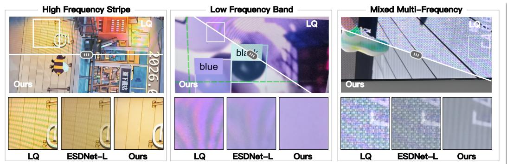  
Figure 1: DailyMoiré130 captures challenging moiré in everyday screen photography. Left: highfrequency stripe artifacts. Middle: low-frequency color banding. Right: mixed multi-frequency corruption. DemoiréEdit achieves stronger visible moiré suppression in these examples.

## ABSTRACT

Robust demoiréing of screen-recaptured images remains challenging: moiré varies in frequency, color, and spatial support across display-camera pairs and capture conditions. Dedicated restoration networks trained on finite paired data struggle with this diversity, especially when low-frequency color banding and high-frequency stripes co-occur. We present DemoiréEdit, a content-preserving editing framework that adapts the natural-image prior of a pretrained flow-matching editor to demoiréing. First, an endpoint-supervised training objective supplements velocity matching with pixel, perceptual, and frequency-domain restoration losses. Second, a dual-scale condition-shift strategy performs global correction at low resolution, then refines the image at full resolution by shifting the denoising condition from the first-stage output to the original input for detail recovery. We also introduce DailyMoiré130, a benchmark of challenging moiré in everyday screen photography, comprising 130 smartphone captures across diverse displays with low-frequency color banding, fine high-frequency stripes, and mixed-frequency interference. On the challenging DailyMoiré130 benchmark, our method achieves the lowest residual moiré area and receives 71.3% overall-quality preference in a blind Best-of-7 study with 31 participants. We also evaluate on paired FHDMi/UHDM, reducing residual moiré confidence by 47.1%/9.3% and increasing MUSIQ by 4.3%/2.0% over the best baseline for each metric.

## 1 INTRODUCTION

Moiré artifacts arise from the spatial-frequency interference between a display’s pixel array and a camera’s sensor grid during screen recapture (Sidorov & Kokaram, 2002; Sun et al., 2018; Wang et al., 2023a). Unlike noise or blur with a statistically stable spectrum, moiré has no fixed frequency signature: low-frequency color banding and high-frequency stripes can co-occur within the same image (Figs. 1 and 2). Their mixture varies with viewing angle, device pairing, and local scene content (Sun et al., 2018; Yuan et al., 2019), making the degradation difficult to characterize with a single spectral model.

Existing approaches train dedicated convolutional or transformer networks from scratch on datasetspecific moiré pairs (Sun et al., 2018; He et al., 2019; Zheng et al., 2020; Liu et al., 2020; He et al., 2020; Yu et al., 2022; Xiao et al., 2024; Zhong et al., 2024; Liu et al., 2025). These models lack a broader natural-image prior, and their restoration quality can degrade on scenes, devices, or capture conditions outside the training distribution. Moreover, existing benchmarks cover relatively limited device pairings and capture conditions (Sun et al., 2018; Yuan et al., 2019; 2020; He et al., 2020; Yu et al., 2022; Xu et al., 2024). This limited diversity underrepresents complex real-world moiré, limiting how accurately these benchmarks assess demoiréing performance in the wild.

Our key observation is that dedicated demoiréing models trained on limited paired data often struggle to restore complex real-world textures under challenging out-of-distribution moiré corruption. Their ability to recover the underlying content is constrained by the visual patterns represented in their training data. In contrast, a pretrained image editor provides a broader natural-image prior acquired through large-scale pretraining, offering the potential to restore content under severe moiré corruption beyond the coverage of task-specific paired data (Rombach et al., 2022; Brooks et al., 2023; Saharia et al., 2022; Zhang et al., 2023; Wang et al., 2024; Lin et al., 2024; Yu et al., 2024). This motivates treating demoiréing as a content-preserving editing task and adapting a pretrained flow-matching image editor (Wu et al., 2025) to exploit this prior.

However, applying this generative prior to demoiréing requires adapting it to the fidelity demands of image restoration. We therefore supplement standard velocity matching with endpoint restoration losses that directly supervise the restored image. The remaining challenge is to handle the cooccurrence of low-frequency color banding and high-frequency stripes while preserving fine details. To address this, DemoiréEdit uses a dual-scale condition-shift strategy that first performs global correction at low resolution and then refines the image at full resolution. Since the corrected estimate provides global guidance but lacks fine detail, early denoising steps use the Stage 1 output, whereas later steps return to the original input for detail recovery.

To evaluate challenging moiré encountered in daily life, we introduce DailyMoiré130: 130 smartphone captures of signage, monitors, and laptops exhibiting low-frequency color banding, fine high-frequency stripes, and mixed-frequency interference (Fig. 4). These captures lack aligned clean targets; evaluation combines residual moiré metrics with separate human judgments of suppression, detail preservation, and overall quality.

On DailyMoiré130, our method achieves the lowest residual moiré area and receives 71.3% overallquality preference in a blind Best-of-7 study with 31 participants. We also evaluate on paired FHDMi/UHDM, reducing residual moiré confidence by 47.1%/9.3% and increasing MUSIQ by 4.3%/2.0% over the best baseline for each metric (Tab. 2). Our contributions are:

• We reformulate demoiréing as content-preserving editing and introduce endpoint-supervised flow training to adapt a pretrained editor for faithful restoration.

• We propose dual-scale condition-shift inference to separate global moiré correction from fullresolution detail recovery.

• We introduce DailyMoiré130, a benchmark targeting challenging moiré in everyday screen photography, with a reference-free evaluation protocol. The dataset is publicly available to support future comparisons (Appendix D).

## 2 RELATED WORK

Image demoiréing. Early demoiréing methods relied on hand-crafted spectral priors or signalprocessing assumptions to suppress periodic moiré patterns (Sidorov & Kokaram, 2002; Siddiqui et al., 2009; Liu et al., 2015). With the rise of deep learning, Sun et al. (Sun et al., 2018) introduced the first CNN-based solution, followed by frequency-aware designs using learnable bandpass filters (Zheng et al., 2020), wavelet decomposition (Liu et al., 2020; Luo et al., 2020; Yeh et al., 2024), and multiscale fusion (Peng et al., 2024). Subsequent work extends demoiréing to ultra-high-definition inputs (Yu et al., 2022; Xiao et al., 2024), unpaired data (Zhong et al., 2024), RAW-domain processing (Xu et al., 2024; Yang et al., 2025a), and universal data generation (Yang et al., 2025b; Choi, 2018). In particular, Freqformer (Liu et al., 2025) explicitly separates moiré artifacts into high-frequency localized textures and low-frequency color distortions. While these approaches emphasize task-specific frequency modeling, we adapt a pretrained editor’s natural-image prior to challenging real-world moiré.

Generative priors for image restoration and editing. Latent diffusion models (Rombach et al., 2022) provide a powerful visual prior for high-quality generation, and instructionbased or condition-based editing frameworks such as SDEdit (Meng et al., 2021), Instruct-Pix2Pix (Brooks et al., 2023), Palette (Saharia et al., 2022), ControlNet (Zhang et al., 2023), and Qwen-Image Edit (Wu et al., 2025) enable image manipulation under text or visual conditions. In low-level vision, pretrained diffusion priors have been adapted to real-world superresolution and blind restoration (Wang et al.,

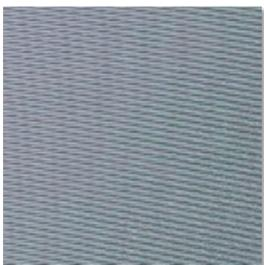  
High Frequency

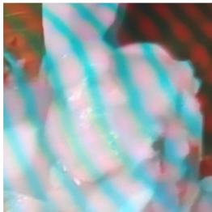  
Low Frequency  
Figure 2: Moiré at different frequency scales.

2024; Lin et al., 2024; Yu et al., 2024; Wu et al., 2024a;b), while prompt- or language-guided restoration methods learn degradation-adaptive controls for all-in-one restoration (Potlapalli et al., 2023; Luo et al., 2023; Cui et al., 2025; Zamfir et al., 2025). However, these methods do not directly address mixed-frequency moiré, which motivates our task-specific adaptation.

Flow matching and trajectory supervision. Flow matching trains continuous normalizing flows by regressing vector fields along prescribed probability paths (Lipman et al., 2023), and rectified flow learns straight transport paths that enable efficient ODE sampling (Liu et al., 2022). These objectives are effective for generative modeling, but do not by themselves guarantee pixel-faithful restoration endpoints. Related acceleration and consistency objectives supervise shortened or distilled trajectories (Salimans & Ho, 2022; Song et al., 2023). We therefore complement velocity supervision with pixel, perceptual, and frequency losses (Zhang et al., 2018; Jiang et al., 2021).

## 3 METHOD

Our model builds on Qwen-Edit (Wu et al., 2025), a flow-matching image editor conditioned on a source image, edit references, and a text prompt. We first define the restoration objective and training procedure, then describe dual-scale inference (Fig. 3) and the training data.

## 3.1 PROBLEM DEFINITION

Given a moiré-corrupted image $I _ { m } \in \mathbb { R } ^ { H \times W \times 3 }$ and its clean counterpart ${ \cal I } _ { c } ,$ we learn a mapping $\hat { I } = \mathcal { F } ( I _ { m } )$ that removes moiré while preserving scene content, such that $\hat { I } \approx I _ { c }$

## 3.2 ENDPOINT-SUPERVISED FLOW TRAINING

Let $v _ { \theta }$ denote the pretrained editor’s velocity network, and $\mathcal { E }$ and D its VAE encoder and decoder. For clean latent $z _ { 0 } = \mathcal { E } ( I _ { c } )$ and noise $z _ { 1 } \sim \dot { \mathcal { N } } ( 0 , \mathbf { I } )$ , the flow interpolation is $z _ { t } = ( 1 - t ) \cdot z _ { 0 } + t \cdot z _ { 1 }$ with $t \in [ 0 , 1 ]$ and target velocity $v ^ { \star } = z _ { 0 } - z _ { 1 }$ . Conditioning $\xi = ( I _ { m } , e , p _ { \mathrm { d m } } )$ comprises the input, an edit reference, and a fixed task prompt shared by training and inference (Appendix C). Standard flow matching supervises single-timestep velocities (Lipman et al., 2023; Liu et al., 2022):

$$
\mathcal { L } _ { \mathrm { F M } } = \mathbb { E } _ { t , z _ { 0 } , z _ { 1 } } \left[ \| v _ { \theta } ( z _ { t } , t , \xi ) - v ^ { \star } \| _ { 2 } ^ { 2 } \right] ,\tag{1}
$$

To supervise restoration fidelity at the image endpoint, we unroll $K { = } 5$ steps and retain velocity supervision along the trajectory. With a descending schedule $t ^ { ( 0 ) } > \cdots > t ^ { ( \bar { K ) } }$ and $\hat { z } ^ { ( 0 ) } = z _ { t ^ { ( 0 ) } }$ ) , the updates are

$$
\hat { z } ^ { ( k ) } = \mathrm { S t e p } \Big ( \hat { z } ^ { ( k - 1 ) } , v _ { \theta } \big ( \hat { z } ^ { ( k - 1 ) } , t ^ { ( k ) } , \xi \big ) \Big ) , \qquad k = 1 , \dots , K .\tag{2}
$$

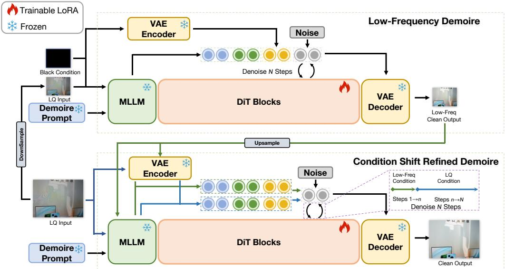  
Figure 3: Overview of our dual-scale inference. Stage 1, Low-frequency Demoiré: the low-quality $\left( \mathrm { L Q } \right)$ moiré image is downsampled and paired with a black auxiliary reference as the condition. Stage 2, Condition Shift Refined Demoiré: the low-frequency output of Stage 1 is used as a condition for the first n steps for structured guidance. The condition is shifted back to the original LQ image for the remaining $N - n$ steps for high-frequency content and detail recovery.

The velocity loss over the unrolled trajectory is

$$
\mathcal { L } _ { \mathrm { v e l } } = \frac { 1 } { K } \sum _ { k = 1 } ^ { K } \| v _ { \theta } ( \hat { z } ^ { ( k - 1 ) } , t ^ { ( k ) } , \xi ) - v ^ { \star } \| _ { 2 } ^ { 2 } .\tag{3}
$$

We decode the endpoint $\hat { I } = \mathcal { D } ( \hat { z } ^ { ( K ) } )$ and optimize

$$
\mathcal { L } _ { \mathrm { t o t a l } } = \mathcal { L } _ { \mathrm { v e l } } + \mathcal { L } _ { \mathrm { r e s t o r e } } ,\tag{4}
$$

where $\mathscr { L } _ { \mathrm { r e s t o r e } }$ combines pixel-space $\ell _ { 1 }$ , LPIPS (Zhang et al., 2018), and focal frequency loss (Jiang et al., 2021), each referenced to the clean target $\boldsymbol { I _ { c } }$ . Full definitions and weights are in Appendix B.

## 3.3 DUAL-SCALE FREQUENCY DECOUPLING

We conceptually decompose the corruption into low-frequency color bands and high-frequency stripes:

$$
I _ { m } = I _ { c } + M _ { \mathrm { l o w } } + M _ { \mathrm { h i g h } } ,\tag{5}
$$

where $M _ { \mathrm { l o w } }$ and $M _ { \mathrm { h i g h } }$ denote low- and high-frequency moiré components.

Stage 1: prior-guided low-frequency correction. Let $\downarrow _ { s }$ and $\uparrow _ { s }$ denote downsampling and upsampling by factor s, and $f _ { \mathrm { N y } }$ the original Nyquist frequency. Downsampling reduces the Nyquist limit to $f _ { \mathrm { N y } } / s ,$ folding higher-frequency moiré components into the lower band through aliasing:

$$
\begin{array} { r l r } & { } & { \downarrow _ { s } ( I _ { m } ) = \downarrow _ { s } ( I _ { c } ) + \underbrace { \downarrow _ { s } ( M _ { \le f _ { \mathrm { N y } } / s } ) + \mathcal { A } _ { s } ( M _ { > f _ { \mathrm { N y } } / s } ) } _ { \tilde { M } , ~ \mathrm { s u p p } ( \hat { \tilde { M } } ) ~ \subseteq ~ [ 0 , ~ f _ { \mathrm { N y } } / s ] } , } \\ & { } & { \tilde { M } , ~ \mathrm { s u p p } ( \hat { \tilde { M } } ) ~ \subseteq ~ [ 0 , ~ f _ { \mathrm { N y } } / s ] } \end{array}\tag{6}
$$

where $A _ { s }$ is the aliasing operator and $M = M _ { \mathrm { l o w } } + M _ { \mathrm { h i g h } }$ . The resulting lower-band representation makes Stage 1 focus on global structure and low-frequency appearance.

We pair the downsampled input with a black auxiliary reference:

$$
I _ { l f } = f _ { \theta } ( \downarrow _ { s } ( I _ { m } ) , e = [ \downarrow _ { s } ( I _ { m } ) , \mathbf { 0 } ] , p _ { \mathrm { d m } } ) ,\tag{7}
$$

where $f _ { \theta }$ denotes denoising from noise followed by VAE decoding. The references are VAE-encoded for conditioning; the black reference is intended to reduce copying of corrupted color and encourage use of the clean-image prior. Tab. 3 evaluates this choice.

Stage 2: condition-shift refinement at full resolution. We align conditioning with denoising progression: early high-noise steps use the Stage 1 result for structure and color, while later low-noise steps use the original input for texture and detail. The two edit latents at the target resolution are

$$
e _ { \mathrm { m i d } } = \mathcal { E } ( \uparrow _ { s } ( I _ { l f } ) ) , \qquad e _ { \mathrm { l q } } = \mathcal { E } ( I _ { m } ) ,\tag{8}
$$

For $N$ steps in sampling order (high to low noise) and switching ratio $r \in [ 0 , 1 ]$ , the condition is

$$
e ^ { ( j ) } = \left\{ { \begin{array} { l l } { e _ { \mathrm { m i d } } , } & { 1 \leq j \leq n , } \\ { e _ { \mathrm { l q } } , } & { n < j \leq N , } \end{array} } \right. \qquad n = \lceil r N \rceil .\tag{9}
$$

The denoising trajectory starts from ${ z ^ { ( 0 ) } \sim \mathcal { N } ( 0 , \bf { I } ) }$ and updates

$$
z ^ { ( j ) } = \mathrm { S t e p } \Big ( z ^ { ( j - 1 ) } , ~ v _ { \theta } \big ( z ^ { ( j - 1 ) } , t ^ { ( j ) } , e ^ { ( j ) } , p _ { \mathrm { d m } } \big ) \Big ) , \qquad j = 1 , \dots , N ,\tag{10}
$$

yielding the restored image $\hat { I } = \mathcal { D } ( z ^ { ( N ) } )$ . We use $r = 0 . 3$ to balance artifact removal and detail preservation; Sec. 4.4 examines this trade-off.

## 3.4 MIXED DEMOIRÉ DATA

We train on a mixed corpus ${ \mathcal { D } } = { \mathcal { D } } _ { \mathrm { p u b l i c } } \cup { \mathcal { D } } _ { \mathrm { d o c } } \cup { \mathcal { D } } _ { \mathrm { s e l f - r e c } } . { \mathcal { D } } _ { \mathrm { p u b l i c } }$ combines paired benchmarks (Sun et al., 2018; Yuan et al., 2019; 2020; He et al., 2020; Yu et al., 2022; Xu et al., 2024), the UniDemoire augmentation pipeline (Yang et al., 2025b), and the screen-photo simulator of Choi (2018). $\mathcal { D } _ { \mathrm { d o c } }$ contains high-contrast documents and forms from DocVQA (Mathew et al., 2021) and XFUND (Xu et al., 2022) to strengthen text preservation. $\mathcal { D } _ { \mathrm { s e l f - r e c } }$ uses identical clean images as input and target to preserve artifact-free content and discourage over-editing.

## 4 EXPERIMENTS

## 4.1 EXPERIMENTAL SETUP

Implementation details. We fine-tune the pretrained Qwen-Edit (Wu et al., 2025) flow-matching editor via LoRA (Hu et al., 2022) adapters on DiT using our endpoint-supervised objective (Sec. 3.2) on the mixed datasets described in Sec. 3.4, which aggregates six public demoiréing datasets. We use a batch size of 96 and a patch size of $2 5 6 \times 2 5 6$ with a cosine learning-rate schedule decaying from $1 \times 1 0 ^ { - 4 } \mathrm { t o } 1 \times 1 0 ^ { - 7 }$ . We fine-tune for 3k optimizer steps. All experiments are conducted on 4 NVIDIA H100 GPUs. During inference, Stage 1 resizes the input to a short side of 1024 pixels and uses 10 denoising steps. Stage 2 starts from latent noise at full resolution and uses $N { = } 1 0$ steps with switching ratio $r { = } 0 . 3$ . The fixed prompt and full training recipe are given in Appendix C.

Benchmarks and metrics. To assess restoration in challenging everyday screen-capture scenarios, we collect DailyMoiré130, a benchmark of 130 screen photographs from shopping-mall signage, desktop monitors, and laptops. These captures exhibit low-frequency color banding, fine highfrequency stripes, and mixed-frequency interference, and have no aligned clean targets. They were captured with iPhone 17, vivo X200s, Honor 90 Pro, Huawei Enjoy 90 Pro Max, and iPhone 16 Pro Max (Fig. 4). We also use FHDMi (He et al., 2020) with 2019 1080p images and UHDM (Yu et al., 2022) with 500 4K images for paired evaluation. Due to the spatially non-uniform nature of moiré, full-image fidelity metrics such as PSNR and SSIM (Wang et al., 2004) can be dominated by artifact-free regions and fail to reflect actual moiré removal quality.

We therefore additionally report two auxiliary metrics based on a pretrained moiré detector $\mathcal { D }$ (Yang et al., 2023) called MoiréDet. Given a restored image ${ \hat { I } } ,$ we divide it into $P$ overlapping patches and obtain a moiré probability $c _ { i } \in [ 0 , 1 ]$ for each patch, where a higher $c _ { i }$ indicates stronger moiré presence. Let M denote the number of patches whose moiré probability exceeds 0.05. We define:

$$
\mathrm { R M C } = \frac { 1 } { P } \sum _ { i = 1 } ^ { P } c _ { i } , \qquad \mathrm { R M A } = \frac { M } { P } .\tag{11}
$$

RMC measures the average moiré confidence across all patches, and RMA captures the proportion of patches with detectable residual artifacts. We also report four no-reference image quality metrics: MUSIQ (Ke et al., 2021), MANIQA (Yang et al., 2022), CLIP-IQA+ (Wang et al., 2023b), and TOPIQ (Chen et al., 2024) for paired datasets and CLIP-IQA+ for DailyMoiré130, which assess perceptual quality without requiring ground-truth references.

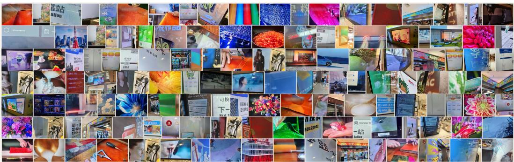  
Figure 4: DailyMoiré130 captures challenging moiré on everyday displays (signage, monitors, laptops) using multiple smartphones. The dataset is publicly available; evaluation details are provided in Appendix D.

Compared methods. We compare with ESDNet-L (Yu et al., 2022), a dedicated demoiréing network, along with three general-purpose image restoration methods: MoCE-IR (Zamfir et al., 2025), AdaIR (Cui et al., 2025), and the diffusion-based OSEDiff (Wu et al., 2024a). These four baselines are retrained on the same mixed training data for 50k optimizer updates, using their official training configurations. We additionally compare with MZNet (Lee et al., 2025), trained on the same mixed data for 50k updates, and a UniDemoiré-style augmentation control (Yang et al., 2025b), obtained by fine-tuning ESDNet-L for 10k updates with real paired and synthetic data. Freqformer code and weights were unavailable during these experiments.

Table 1: Evaluation on DailyMoiré130. Blind Best-of-7 preference (%) from 31 participants, with 18 cases each. Uncertain responses remain in the denominator. The input is shown only as a reference.
<table><tr><td></td><td colspan="3">User preference ↑</td><td colspan="3">Automatic metrics</td></tr><tr><td>Method</td><td>Moiré</td><td>Detail</td><td>Overall</td><td>CLIP-IQA+↑</td><td>RMC↓</td><td>RMA↓</td></tr><tr><td>Input</td><td></td><td></td><td></td><td>.5690</td><td>.0523</td><td>.2507</td></tr><tr><td>ESDNet-L</td><td>8.6</td><td>8.6</td><td>8.8</td><td>.5478</td><td>.0340</td><td>.1599</td></tr><tr><td>MoCE-IR</td><td>1.8</td><td>2.3</td><td>2.2</td><td>.5277</td><td>.0341</td><td>.1602</td></tr><tr><td>AdaIR</td><td>1.4</td><td>2.5</td><td>2.0</td><td>.5464</td><td>.0447</td><td>.2163</td></tr><tr><td>OSEDiff</td><td>2.3</td><td>3.4</td><td>2.7</td><td>.5671</td><td>.0163</td><td>.0794</td></tr><tr><td>MZNet</td><td>2.7</td><td>2.9</td><td>2.5</td><td>.5287</td><td>.0334</td><td>.1562</td></tr><tr><td>Uni-control</td><td>5.4</td><td>6.8</td><td>6.6</td><td>.5296</td><td>.0113</td><td>.0567</td></tr><tr><td>Ours</td><td>74.7</td><td>68.5</td><td>71.3</td><td>.5928</td><td>.0115</td><td>.0551</td></tr></table>

## 4.2 QUANTITATIVE EVALUATION

Tab. 1 evaluates all methods on our proposed DailyMoiré130, which targets challenging moiré in everyday screen photography. In a blind Best-of-7 study with 31 participants, our method is preferred in 74.7% of trials for moiré suppression, 68.5% for detail preservation, and 71.3% for overall quality. Participants assess detail preservation separately against the visible input using full-image views and magnified crops (Appendix E). The strongest baseline, ESDNet-L, receives 8.8% overall preference. The no-reference perceptual metric further supports this finding, with our method achieving the highest CLIP-IQA+ (0.5928). It also achieves the lowest residual moiré area (0.0551), while UniDemoiré-control has slightly lower RMC. These results demonstrate effective moiré suppression and strong human preference on challenging real-world captures.

Each participant completes 18 Best-of-7 trials, collectively covering all 130 images, with method identities hidden and candidate positions randomized and counterbalanced. Uncertain responses remain in the denominator. The overall-quality preference rate has a participant-clustered 95% confidence interval of 65.1–76.9%, and the result remains consistent under stricter attention checks (Appendix E).

We also evaluate on the paired benchmarks FHDMi and UHDM (Tab. 2). Our method ranks first on MUSIQ, CLIP-IQA+, and TOPIQ, with the lowest detector-based RMC on both datasets.  
Table 2: Paired-benchmark comparison. Best in bold, second-best underlined. TOPIQ is noreference. Uni-control denotes UniDemoiré-style augmentation of ESDNet-L. Remaining metrics are in Appendix G.
<table><tr><td></td><td colspan="5">FHDMi</td><td colspan="5">UHDM</td></tr><tr><td></td><td colspan="5">CLIP-</td><td colspan="5"></td></tr><tr><td>Method</td><td>PSNR↑ MUSIQ↑ IQA+↑ TOPIQ↑ RMC↓ PSNR↑ MUSIQ↑ IQA+↑ TOPIQ↑ RMC↓</td><td></td><td></td><td></td><td></td><td></td><td></td><td>CLIP-</td><td></td><td></td></tr><tr><td>Input</td><td>18.00</td><td>56.76</td><td>.528</td><td>.442</td><td>.0395</td><td>17.12</td><td>64.04</td><td>.617</td><td>.537</td><td>.0652</td></tr><tr><td>ESDNet-L</td><td>20.67</td><td>55.56</td><td>.523</td><td>.408</td><td>.0175</td><td>21.16</td><td>65.44</td><td>.625</td><td>.556</td><td>.0139</td></tr><tr><td>MoCE-IR</td><td>22.40</td><td>56.33</td><td>.521</td><td>.424</td><td>.0150</td><td>20.92</td><td>64.23</td><td>.600</td><td>.521</td><td>.0189</td></tr><tr><td>AdaIR</td><td>21.80</td><td>56.00</td><td>.508</td><td>.425</td><td>.0205</td><td>20.61</td><td>63.27</td><td>.587</td><td>.509</td><td>.0342</td></tr><tr><td>OSEDiff</td><td>18.04</td><td>59.00</td><td>.545</td><td>.476</td><td>.0121</td><td>17.57</td><td>65.16</td><td>.612</td><td>.555</td><td>.0043</td></tr><tr><td>MZNet</td><td>23.92</td><td>56.95</td><td>.542</td><td>.437</td><td>.0183</td><td>21.67</td><td>66.10</td><td>.635</td><td>.566</td><td>.0149</td></tr><tr><td>Uni-control</td><td>20.92</td><td>55.61</td><td>.531</td><td>.412</td><td>.0144</td><td>21.21</td><td>65.51</td><td>.630</td><td>.564</td><td>.0110</td></tr><tr><td>Ours</td><td>21.09</td><td>61.55</td><td>.585</td><td>.508</td><td>.0064</td><td>19.99</td><td>67.43</td><td>.656</td><td>.585</td><td>.0039</td></tr></table>

Our method reduces RMC by 47.1% and 9.3%, respectively, relative to the strongest baseline for this metric, and improves MUSIQ by 4.3% and 2.0%. While regression-based methods achieve higher PSNR, they retain more residual moiré, indicating a trade-off between pixel fidelity and artifact removal. Appendix G reports SSIM, LPIPS, and MANIQA for all methods.

Content and color fidelity. Moreover, we assess content fidelity against clean references on UHDM to complement the dedicated human detail assessment on DailyMoiré130. Our method achieves the highest TOPIQ-FR of 0.670, compared with 0.664 for the strongest baseline, MZNet. It also obtains the second-best PieAPP of 0.984 and AHIQ of 0.435 among the compared methods, while its chroma and hue errors remain comparable to those of feed-forward restorers (Appendix G, Tab. 11). Unlike TOPIQ in Tab. 2, TOPIQ-FR uses the clean reference. These results provide complementary evidence of content preservation alongside the gains in moiré suppression.

## 4.3 QUALITATIVE EVALUATION

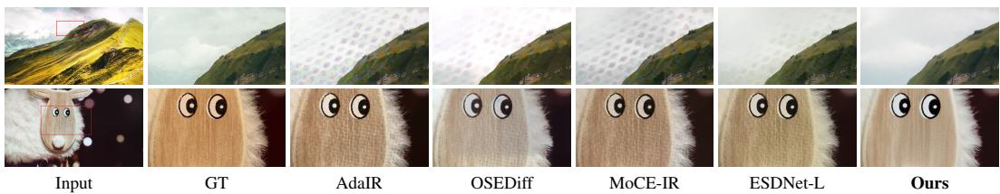  
Figure 5: Qualitative comparison on UHDM paired benchmark. Our method suppresses moiré while retaining visible texture. The lower-row crops show wood grain and fur around the toy’s face.

Fig. 5 shows qualitative comparisons on paired benchmarks. Several baselines leave visible residual moiré on the toy’s face. In contrast, our method suppresses these artifacts while retaining visible wood grain and fur around the face. Fig. 6 further demonstrates generalization to challenging everyday captures in DailyMoiré130. The from-scratch baselines shown leave visible artifacts in these outof-distribution real-world cases. In contrast, our method uses the pretrained editor prior to produce cleaner results, particularly where high-frequency stripes and low-frequency color banding occur within the same image. The DailyMoiré130 examples also show faithful text reproduction.

## 4.4 ABLATION STUDY

Component ablation. Our five-step training with endpoint losses improves all six metrics over single-step Vanilla FM (Tab. 3). This comparison measures their joint effect. Keeping the Stage 1 condition throughout Stage 2 (r = 1) slightly improves PSNR but degrades perceptual quality and moiré suppression. Black image conditioning trades marginal RMC/RMA for better LPIPS, SSIM, and MUSIQ. Fig. 7 illustrates these effects on DailyMoiré130.

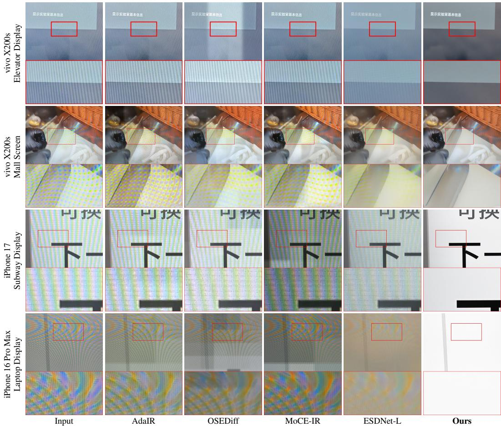  
Figure 6: Qualitative results on DailyMoiré130. Samples are cropped from the original 4K images for better visualization. These everyday screen captures illustrate challenging mixed-frequency moiré.

Table 3: Training and inference ablations on UHDM.
<table><tr><td>Setting</td><td>PSNR↑</td><td>SSIM↑</td><td>LPIPS↓</td><td>RMC↓</td><td>RMA↓</td><td>MUSIQ↑</td></tr><tr><td>Vanilla FM (1 step)</td><td>17.51</td><td>0.669</td><td>0.195</td><td>0.0162</td><td>0.0953</td><td>65.29</td></tr><tr><td>w/o condition shift</td><td>20.24</td><td>0.751</td><td>0.189</td><td>0.0047</td><td>0.0255</td><td>66.84</td></tr><tr><td>w/o black image</td><td>20.00</td><td>0.737</td><td>0.189</td><td>0.0036</td><td>0.0195</td><td>66.81</td></tr><tr><td>Ours</td><td>19.99</td><td>0.789</td><td>0.134</td><td>0.0039</td><td>0.0212</td><td>67.43</td></tr></table>

Condition-shift ratio r. Tab. 4 varies when Stage 2 shifts from the Stage 1 output to the original input. Larger r reduces residual moiré but suppresses detail. At r = 0, Stage 1 is omitted and Stage 2 uses the original input throughout. Compared with this setting, r = 0.3 reduces RMA by 17.2% and RMC by 17.0%, with 0.03 dB lower PSNR. We therefore use r = 0.3 to balance suppression and detail preservation.

Table 4: Condition-shift ablation on UHDM, including Stage-2 only (r = 0).
<table><tr><td>r</td><td>PSNR↑</td><td>SSIM↑</td><td>LPIPS↓</td><td>RMC↓</td><td>RMA↓</td><td>MUSIQ↑</td></tr><tr><td>0.7</td><td>19.81</td><td>0.727</td><td>0.193</td><td>0.0032</td><td>0.0170</td><td>66.89</td></tr><tr><td>0.5</td><td>19.88</td><td>0.732</td><td>0.191</td><td>0.0036</td><td>0.0192</td><td>66.87</td></tr><tr><td>0.3 (ours)</td><td>19.99</td><td>0.789</td><td>0.134</td><td>0.0039</td><td>0.0212</td><td>67.43</td></tr><tr><td>0 (Stage-2 only)</td><td>20.02</td><td>0.793</td><td>0.135</td><td>0.0047</td><td>0.0256</td><td>67.42</td></tr></table>

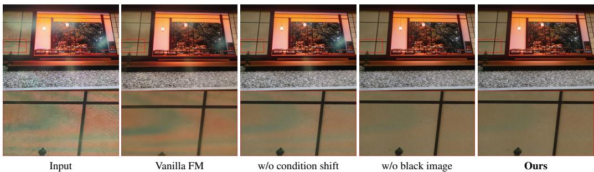  
Figure 7: Visual ablation on DailyMoiré130. The full model reduces color banding in this example.  
Individual endpoint losses. We train variants without L1, LPIPS, or FFL while keeping the remaining settings fixed. Removing each loss degrades all six metrics (Tab. 5). Without L1, PSNR falls to 19.51 dB. Removing LPIPS increases LPIPS to 0.145, while removing FFL increases RMA to 0.0308. These results support complementary pixel, perceptual, and frequency supervision.

Table 5: Individual endpoint-loss ablations on UHDM. All variants retain velocity supervision and the other endpoint losses. Best values are bold.
<table><tr><td>Variant</td><td>PSNR↑</td><td>SSIM↑</td><td>LPIPS↓</td><td>RMC↓</td><td>RMA↓</td><td>MUSIQ↑</td></tr><tr><td>Full</td><td>19.99</td><td>0.789</td><td>0.134</td><td>0.0039</td><td>0.0212</td><td>67.43</td></tr><tr><td>w/o L1</td><td>19.51</td><td>0.772</td><td>0.141</td><td>0.0066</td><td>0.0354</td><td>67.05</td></tr><tr><td>w/o LPIPS</td><td>19.86</td><td>0.780</td><td>0.145</td><td>0.0062</td><td>0.0337</td><td>66.03</td></tr><tr><td>w/o FFL</td><td>19.85</td><td>0.786</td><td>0.135</td><td>0.0058</td><td>0.0308</td><td>66.64</td></tr></table>

Detector threshold. We vary the RMA threshold from 0.02 to 0.10 on UHDM. Our method has the lowest RMA among the compared methods at every tested threshold (Tab. 6). RMC averages continuous detector confidence and is independent of this threshold.

Table 6: RMA at different detector thresholds on UHDM. Lower is better.
<table><tr><td>Method</td><td>0.02</td><td>0.03</td><td>0.05</td><td>0.07</td><td>0.10</td></tr><tr><td>ESDNet-L</td><td>0.1627</td><td>0.1193</td><td>0.0754</td><td>0.0534</td><td>0.0361</td></tr><tr><td>MZNet</td><td>0.1425</td><td>0.1142</td><td>0.0808</td><td>0.0621</td><td>0.0454</td></tr><tr><td>MoCE-IR</td><td>0.2203</td><td>0.1693</td><td>0.1110</td><td>0.0797</td><td>0.0531</td></tr><tr><td>OSEDiff</td><td>0.0469</td><td>0.0355</td><td>0.0239</td><td>0.0174</td><td>0.0118</td></tr><tr><td>Ours</td><td>0.0440</td><td>0.0327</td><td>0.0212</td><td>0.0155</td><td>0.0106</td></tr></table>

## 5 DISCUSSION

Our method improves visible moiré suppression through a pretrained natural-image prior, but introduces trade-offs. Restored images may not align exactly with clean targets, lowering PSNR/SSIM, and severe color bands can retain color shifts. Two-stage inference is costly and not optimized for real-time use. We therefore assess fidelity, perceptual quality, and residual moiré jointly.

## 6 CONCLUSION

We present a content-preserving editing framework for real-world demoiréing. Endpoint supervision adapts a pretrained natural-image prior to restoration, while dual-scale condition-shift inference combines global correction with detail recovery. Moreover, we introduce DailyMoiré130 to evaluate challenging everyday screen photographs with color bands, fine stripes, and mixed-frequency artifacts. Our method achieves the lowest residual moiré area and strong human preference on this benchmark, with complementary gains on paired datasets. These results support pretrained editing priors for restoring moiré-corrupted content beyond the coverage of task-specific paired data.

## REFERENCES

Tim Brooks, Aleksander Holynski, and Alexei A. Efros. Instructpix2pix: Learning to follow image editing instructions. In Proceedings ofthe IEEE/CVF Conference on Computer Vision and Pattern Recognition (CVPR), pp. 18392–18402, 2023.

Chaofeng Chen, Jiadi Mo, Jingwen Hou, Haoning Wu, Liang Liao, Wenxiu Sun, Qiong Yan, and Weisi Lin. Topiq: A top-down approach from semantics to distortions for image quality assessment. IEEE Transactions on Image Processing, 33:2404–2418, 2024. doi: 10.1109/TIP.2024.3378466.

Sungjun Choi. Simulating moire effects seen in photos of digital device screens, 2018. https: //github.com/mr3coi/screen\_photo\_simulator.

Yuning Cui, Syed Waqas Zamir, Salman Khan, Alois Knoll, Mubarak Shah, and Fahad Shahbaz Khan. Adair: Adaptive all-in-one image restoration via frequency mining and modulation. In 13th international conference on learning representations, ICLR 2025, pp. 57335–57356. International Conference on Learning Representations, ICLR, 2025.

Bin He, Ce Wang, Boxin Shi, and Ling-Yu Duan. Mop moiré patterns using MopNet. In Proceedings of the IEEE/CVF International Conference on Computer Vision (ICCV), pp. 2424–2432, 2019.

Bin He, Ce Wang, Boxin Shi, and Ling-Yu Duan. Fhde2net: Full high definition demoireing network. In Proceedings ofthe European Conference on Computer Vision (ECCV), 2020.

Edward J Hu, Yelong Shen, Phillip Wallis, Zeyuan Allen-Zhu, Yuanzhi Li, Shean Wang, Lu Wang, and Weizhu Chen. LoRA: Low-rank adaptation of large language models. In International Conference on Learning Representations, 2022. URL https://openreview.net/forum? id=nZeVKeeFYf9.

Liming Jiang, Bo Dai, Wayne Wu, and Chen Change Loy. Focal frequency loss for image reconstruction and synthesis. In Proceedings ofthe IEEE/CVF International Conference on Computer Vision (ICCV), pp. 13919–13929, 2021.

Junjie Ke, Qifei Wang, Yilin Wang, Peyman Milanfar, and Feng Yang. Musiq: Multi-scale image quality transformer. In Proceedings ofthe IEEE/CVF international conference on computer vision, pp. 5148–5157, 2021.

Shanshan Lao, Yuan Gong, Shuwei Shi, Sidi Yang, Tianhe Wu, Jiahao Wang, Weihao Xia, and Yujiu Yang. Attentions help CNNs see better: Attention-based hybrid image quality assessment network. In Proceedings of the IEEE/CVF Conference on Computer Vision and Pattern Recognition (CVPR) Workshops, pp. 1140–1149, 2022.

Seungryong Lee, Woojeong Baek, Younghyun Kim, Eunwoo Kim, Haru Moon, Donggon Yoo, and Eunbyung Park. Moiré zero: An efficient and high-performance neural architecture for moiré removal. arXiv preprint arXiv:2507.22407, 2025.

Xinqi Lin, Jingwen He, Ziyan Chen, Zhaoyang Lyu, Bo Dai, Fanghua Yu, Yu Qiao, Wanli Ouyang, and Chao Dong. Diffbir: Toward blind image restoration with generative diffusion prior. In European conference on computer vision, pp. 430–448. Springer, 2024.

Yaron Lipman, Ricky T. Q. Chen, Heli Ben-Hamu, Maximilian Nickel, and Matthew Le. Flow matching for generative modeling. In The International Conference on Learning Representations (ICLR), 2023.

Fanglei Liu, Jingyu Yang, and Huanjing Yue. Moiré pattern removal from texture images via low-rank and sparse matrix decomposition. In 2015 Visual Communications and Image Processing (VCIP), pp. 1–4. IEEE, 2015.

Lin Liu, Jianzhuang Liu, Shanxin Yuan, Gregory Slabaugh, Aleš Leonardis, Wengang Zhou, and Qi Tian. Wavelet-based dual-branch network for image demoiréing. In European conference on computer vision, pp. 86–102. Springer, 2020.

Xiaoyang Liu, Bolin Qiu, Jiezhang Cao, Zheng Chen, Yulun Zhang, and Xiaokang Yang. Freqformer: Image-demoiréing transformer via efficient frequency decomposition. arXiv preprint arXiv:2505.19120, 2025.

Xingchao Liu, Chengyue Gong, and Qiang Liu. Flow straight and fast: Learning to generate and transfer data with rectified flow. arXiv preprint arXiv:2209.03003, 2022.

Xiaotong Luo, Jiangtao Zhang, Ming Hong, Yanyun Qu, Yuan Xie, and Cuihua Li. Deep wavelet network with domain adaptation for single image demoireing. In Proceedings of the IEEE/CVF Conference on Computer Vision and Pattern Recognition Workshops, pp. 420–421, 2020.

Ziwei Luo, Fredrik K Gustafsson, Zheng Zhao, Jens Sjölund, and Thomas B Schön. Controlling vision-language models for multi-task image restoration. arXiv preprint arXiv:2310.01018, 2023.

Minesh Mathew, Dimosthenis Karatzas, and C. V. Jawahar. Docvqa: A dataset for vqa on document images. In Proceedings ofthe IEEE/CVF Winter Conference on Applications ofComputer Vision (WACV), pp. 2200–2209, 2021.

Chenlin Meng, Yutong He, Yang Song, Jiaming Song, Jiajun Wu, Jun-Yan Zhu, and Stefano Ermon. Sdedit: Guided image synthesis and editing with stochastic differential equations. arXiv preprint arXiv:2108.01073, 2021.

Yan-Tsung Peng, Chih-Hsiang Hou, You-Cheng Lee, Aiden J Yoon, Zihao Chen, Yi-Ting Lin, and Wei-Cheng Lien. Image demoiréing via multiscale fusion networks with moiré data augmentation. IEEE Sensors Journal, 24(12):20114–20127, 2024.

Vaishnav Potlapalli, Syed Waqas Zamir, Salman H Khan, and Fahad Shahbaz Khan. Promptir: Prompting for all-in-one image restoration. Advances in neural information processing systems, 36:71275–71293, 2023.

Ekta Prashnani, Hong Cai, Yasamin Mostofi, and Pradeep Sen. PieAPP: Perceptual image-error assessment through pairwise preference. In Proceedings of the IEEE Conference on Computer Vision and Pattern Recognition (CVPR), pp. 1808–1817, 2018.

Robin Rombach, Andreas Blattmann, Dominik Lorenz, Patrick Esser, and Björn Ommer. Highresolution image synthesis with latent diffusion models. In Proceedings ofthe IEEE/CVF Conference on Computer Vision and Pattern Recognition (CVPR), pp. 10684–10695, 2022.

Chitwan Saharia, William Chan, Huiwen Chang, Chris Lee, Jonathan Ho, Tim Salimans, David Fleet, and Mohammad Norouzi. Palette: Image-to-image diffusion models. In ACM SIGGRAPH 2022 conference proceedings, pp. 1–10, 2022.

Tim Salimans and Jonathan Ho. Progressive distillation for fast sampling of diffusion models. In The International Conference on Learning Representations (ICLR), 2022.

Gaurav Sharma, Wencheng Wu, and Edul N. Dalal. The CIEDE2000 color-difference formula: Implementation notes, supplementary test data, and mathematical observations. Color Research & Application, 30(1):21–30, 2005. doi: 10.1002/col.20070.

Hasib Siddiqui, Mireille Boutin, and Charles A Bouman. Hardware-friendly descreening. IEEE transactions on image processing, 19(3):746–757, 2009.

Denis N Sidorov and Anil Christopher Kokaram. Suppression of moiré patterns via spectral analysis. In Visual Communications and Image Processing 2002, volume 4671, pp. 895–906. SPIE, 2002.

Yang Song, Prafulla Dhariwal, Mark Chen, and Ilya Sutskever. Consistency models. In Proceedings ofthe International Conference on Machine Learning (ICML), pp. 32211–32252, 2023.

Yujing Sun, Yizhou Yu, and Wenping Wang. Moiré photo restoration using multiresolution convolutional neural networks. IEEE Transactions on Image Processing, 27(8):4160–4172, 2018.

Ce Wang, Bin He, Shengsen Wu, Renjie Wan, Boxin Shi, and Ling-Yu Duan. Coarse-to-fine disentangling demoiréing framework for recaptured screen images. IEEE Transactions on Pattern Analysis and Machine Intelligence, 45(8):9439–9453, 2023a.

Jianyi Wang, Kelvin CK Chan, and Chen Change Loy. Exploring clip for assessing the look and feel of images. In AAAI, 2023b.

Jianyi Wang, Zongsheng Yue, Shangchen Zhou, Kelvin CK Chan, and Chen Change Loy. Exploiting diffusion prior for real-world image super-resolution. International Journal of Computer Vision, 132(12):5929–5949, 2024.

Zhou Wang, Alan C Bovik, Hamid R Sheikh, and Eero P Simoncelli. Image quality assessment: from error visibility to structural similarity. IEEE transactions on image processing, 13(4):600–612, 2004.

Chenfei Wu, Jiahao Li, Jingren Zhou, Junyang Lin, Kaiyuan Gao, Kun Yan, Sheng-ming Yin, Shuai Bai, Xiao Xu, Yilei Chen, et al. Qwen-image technical report. arXiv preprint arXiv:2508.02324, 2025.

Rongyuan Wu, Lingchen Sun, Zhiyuan Ma, and Lei Zhang. One-step effective diffusion network for real-world image super-resolution. Advances in Neural Information Processing Systems, 37: 92529–92553, 2024a.

Rongyuan Wu, Tao Yang, Lingchen Sun, Zhengqiang Zhang, Shuai Li, and Lei Zhang. Seesr: Towards semantics-aware real-world image super-resolution. In Proceedings of the IEEE/CVF conference on computer vision and pattern recognition, pp. 25456–25467, 2024b.

Zeyu Xiao, Zhihe Lu, and Xinchao Wang. P-bic: Ultra-high-definition image moiré patterns removal via patch bilateral compensation. In Proceedings ofthe 32nd ACM international conference on multimedia, pp. 8365–8373, 2024.

Shuning Xu, Binbin Song, Xiangyu Chen, Xina Liu, and Jiantao Zhou. Image demoireing in raw and srgb domains. In European conference on computer vision, pp. 108–124. Springer, 2024.

Yiheng Xu, Tengchao Lv, Lei Cui, Guoxin Wang, Yijuan Lu, Dinei Florencio, Cha Zhang, and Furu Wei. XFUND: A benchmark dataset for multilingual visually rich form understanding. In Findings of the Association for Computational Linguistics: ACL 2022, pp. 3214–3224, 2022.

Cong Yang, Zhenyu Yang, Yan Ke, Tao Chen, Marcin Grzegorzek, and John See. Doing more with moiré pattern detection in digital photos. IEEE Transactions on Image Processing, 32:694–708, 2023.

Qirui Yang, Fangpu Zhang, Yeying Jin, Qihua Cheng, Pengtao Jiang, Huanjing Yue, and Jingyu Yang. Dsdnet: Raw domain demoiréing via dual color-space synergy. In Proceedings ofthe 33rd ACM International Conference on Multimedia, pp. 7230–7238, 2025a.

Sidi Yang, Tianhe Wu, Shuwei Shi, Shanshan Lao, Yuan Gong, Mingdeng Cao, Jiahao Wang, and Yujiu Yang. Maniqa: Multi-dimension attention network for no-reference image quality assessment. In Proceedings of the IEEE/CVF Conference on Computer Vision and Pattern Recognition, pp. 1191–1200, 2022.

Zemin Yang, Yujing Sun, Xidong Peng, Siu Ming Yiu, and Yuexin Ma. Unidemoiré: Towards universal image demoireing with data generation and synthesis, 2025b. URL https://arxiv. org/abs/2502.06324.

Chia-Hung Yeh, Chen Lo, and Cheng-Han He. Multibranch wavelet-based network for image demoiréing. Sensors, 24(9):2762, 2024.

Fanghua Yu, Jinjin Gu, Zheyuan Li, Jinfan Hu, Xiangtao Kong, Xintao Wang, Jingwen He, Yu Qiao, and Chao Dong. Scaling up to excellence: Practicing model scaling for photo-realistic image restoration in the wild. In Proceedings of the IEEE/CVF conference on computer vision and pattern recognition, pp. 25669–25680, 2024.

Xin Yu, Peng Dai, Wenbo Li, Lan Ma, Jiajun Shen, Jia Li, and Xiaojuan Qi. Towards efficient and scale-robust ultra-high-definition image demoireing, 2022. URL https://arxiv.org/abs/ 2207.09935.

Shanxin Yuan, Radu Timofte, Gregory Slabaugh, and Aleš Leonardis. Aim 2019 challenge on image demoireing: Dataset and study, 2019. URL https://arxiv.org/abs/1911.02498.

Shanxin Yuan, Radu Timofte, Ales Leonardis, and Gregory Slabaugh. Ntire 2020 challenge on image demoireing: Methods and results. In Proceedings of the IEEE/CVF Conference on Computer Vision and Pattern Recognition Workshops, pp. 460–461, 2020.

Eduard Zamfir, Zongwei Wu, Nancy Mehta, Yuedong Tan, Danda Pani Paudel, Yulun Zhang, and Radu Timofte. Complexity experts are task-discriminative learners for any image restoration. In Proceedings ofthe Computer Vision and Pattern Recognition Conference, pp. 12753–12763, 2025.

Lvmin Zhang, Anyi Rao, and Maneesh Agrawala. Adding conditional control to text-to-image diffusion models. In Proceedings ofthe IEEE/CVF international conference on computer vision, pp. 3836–3847, 2023.

Richard Zhang, Phillip Isola, Alexei A. Efros, Eli Shechtman, and Oliver Wang. The unreasonable effectiveness of deep features as a perceptual metric. In Proceedings ofthe IEEE/CVF Conference on Computer Vision and Pattern Recognition (CVPR), pp. 586–595, 2018.

Bolun Zheng, Shanxin Yuan, Gregory Slabaugh, and Ales Leonardis. Image demoireing with learnable bandpass filters. In Proceedings of the IEEE/CVF conference on computer vision and pattern recognition, pp. 3636–3645, 2020.

Yunshan Zhong, Yuyao Zhou, Yuxin Zhang, Fei Chao, and Rongrong Ji. Learning image demoireing from unpaired real data, 2024. URL https://arxiv.org/abs/2401.02719.

## A ADDITIONAL QUALITATIVE COMPARISONS

The following full-image comparisons show ten additional DailyMoiré130 examples without local magnification.

Input  
AdalR  
OSEDiff  
MoCE-IR  
ESDNet-L  
Ours  
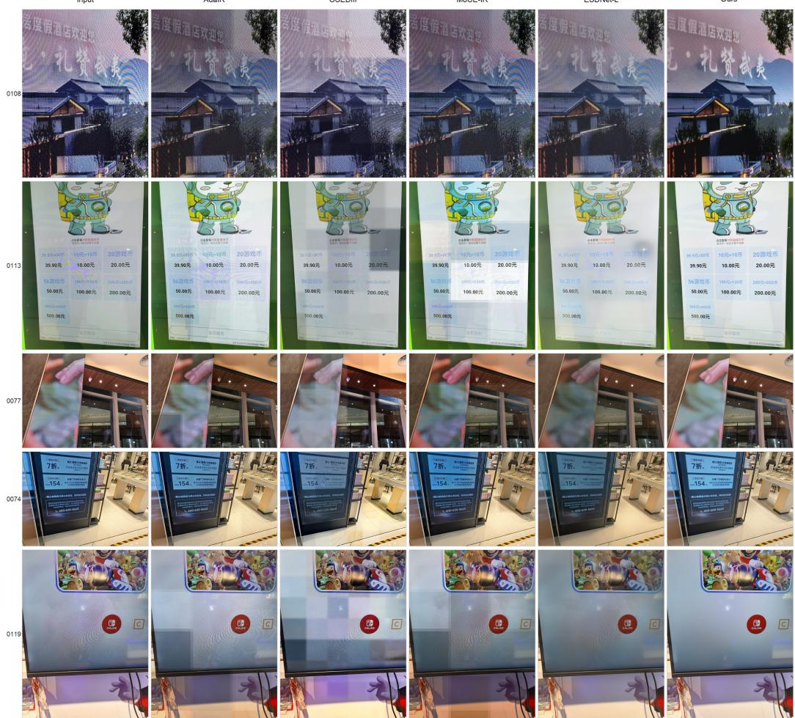  
Figure 8: Additional full-image qualitative comparisons on DailyMoiré130, examples 1–5. Images are shown without local magnification.

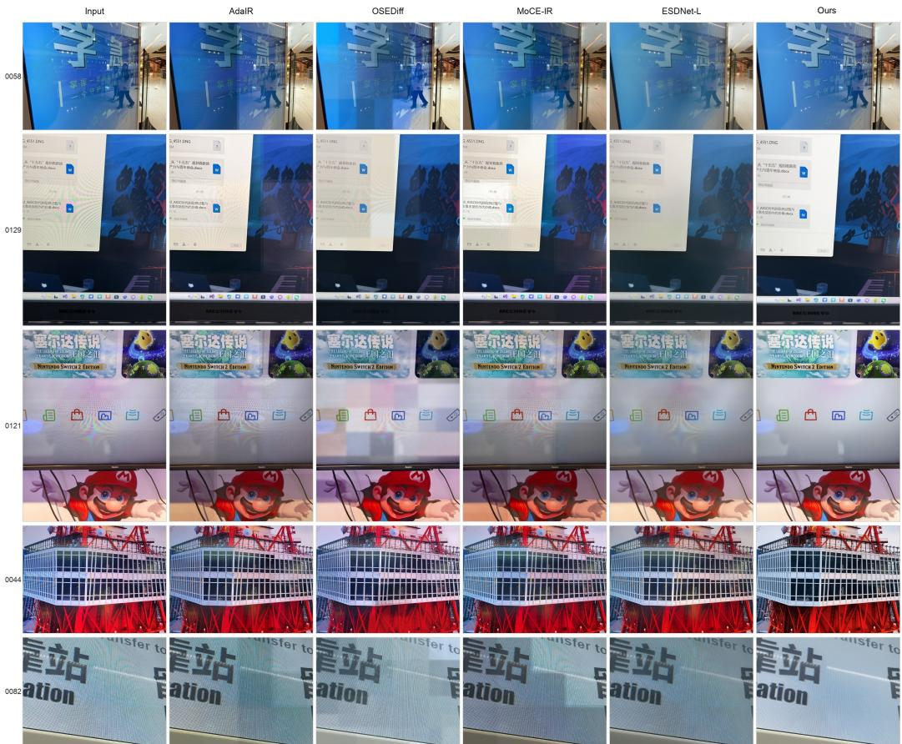  
Figure 9: Additional full-image comparisons, examples 6–10. Each row compares Input, AdaIR, OSEDiff, MoCE-IR, ESDNet-L, and our method.

## B ENDPOINT-SUPERVISED TRAINING OBJECTIVE

The endpoint restoration loss in Eq. 4 is

$$
\mathcal { L } _ { \mathrm { r e s t o r e } } = \lambda _ { \ell _ { 1 } } \Vert \hat { I } - I _ { c } \Vert _ { 1 } + \lambda _ { \mathrm { l p i p s } } \mathrm { L P I P S } ( \hat { I } , I _ { c } ) + \lambda _ { \mathrm { f l } } \mathrm { F F L } ( \hat { I } , I _ { c } ) .\tag{12}
$$

The weights are $\lambda _ { \ell _ { 1 } } = 0 . 5 , \lambda _ { \mathrm { l p i p s } } = 0 . 3$ , and $\lambda _ { \mathrm { f f } } = 0 . 2$ , with $K = 5$ unrolled steps. All three endpoint losses compare the prediction against the clean target. The total objective also retains the trajectory velocity loss in Eq. 4.

The individual endpoint-loss ablations are reported in Sec. 4.4 and Tab. 5. Each variant retains velocity supervision and the other endpoint losses. Vanilla FM in Tab. 3 instead uses standard single-timestep velocity supervision without endpoint losses, so that comparison changes both the training trajectory and the restoration objective.

## C REPRODUCIBILITY DETAILS

## C.1 TRAINING RECIPE

Table 7: Training recipe. Inference settings are specified below.
<table><tr><td>Item</td><td>Setting</td></tr><tr><td>Base model</td><td>Qwen-Image-Edit-2509</td></tr><tr><td></td><td>Trainable parameters LoRA adapters on the DiT backbone</td></tr><tr><td>Prompt</td><td>Remove moire patterns, color aliasing and color distortion from the image while preserving all details, colors, and textures of the original content.</td></tr><tr><td>Objective</td><td>Endpoint-supervised flow objective in Appendix B</td></tr><tr><td>Data mixture</td><td>Public demoiréing data, document data, and self-reconstruction pairs</td></tr><tr><td></td><td>Training stream ratio 4:1:1 at the manifest-stream level, comprising eight public/synthetic streams, two document streams, and two self-reconstruction streams</td></tr><tr><td>Public streams</td><td>FHDMi, UHDM, LDC-Moiré, MRBI, TIP-2018, WMD, UniDemoiré-style synthesis, and ScreenSim-style synthesis</td></tr><tr><td>Document streams</td><td>DocVQA English documents and Chinese document/form images</td></tr><tr><td>Self-reconstruction</td><td>Clean-image identity pairs from documents and UHDM</td></tr><tr><td>Batch / patch size</td><td>96  $/ 2 5 6 \times 2 5 6$ </td></tr><tr><td>Learning rate</td><td>Cosine schedule from  $1 0 ^ { - 4 }$  to  $1 0 ^ { - 7 }$ </td></tr><tr><td>Fine-tuning length</td><td>3k optimizer steps on four NVIDIA H100 GPUs</td></tr></table>

The original prompt uses the spelling “distoration” rather than “distortion”. Stream counts should not be interpreted as a measured per-image sampling ratio.

## C.2 INFERENCE DETAILS

We use the same prompt for all test images. Stage 1 resizes the short side to 1024 pixels, pairs the image with a black reference, and uses 10 denoising steps. Stage 2 performs one full-resolution loop from latent noise with N = 10 steps and $r = 0 . 3$ . The first $\lceil r N \rceil = 3$ steps use the upsampled Stage-1 edit latent, and the remaining seven use the original input latent.

Public implementation. Inference, training, and an interactive demo are available in the DemoiréEdit repository; the restoration adapter is available on Hugging Face. The maintained implementation additionally includes a latent-MSE extension, separate from the four-term objective reported in this manuscript. The released adapter is a historical checkpoint; its identity, provenance, and the limits of its correspondence to the maintained training recipe are documented in the repository model card.

## C.3 RUNTIME

The full two-stage recipe takes approximately 260 seconds for a 4K image on a single NVIDIA H100 GPU in FP32.

## D DAILYMOIRÉ130 DATASET AND EVALUATION PROTOCOL

DailyMoiré130 contains 130 real-world screen photographs targeting challenging moiré in everyday life. The images cover signage, monitors, and laptops, with low-frequency color banding, fine high-frequency stripes, and mixed-frequency interference. Since these captures have no aligned clean targets, evaluation combines no-reference perceptual scores, residual moiré detector scores, and human preference (Tab. 1).

Public release. DailyMoiré130 is available on Hugging Face (revision 573da28), with per-image checksums and an evaluation protocol. The public release retains the original resolutions and color profiles. It includes local blur in 18 images, while the remaining 112 retain their scene pixels; pixels outside the edited regions are unchanged. The localized edits are partial occlusion rather than comprehensive anonymization. Such edits can affect restoration outputs and no-reference metrics. The results reported in this manuscript use the historical inputs and have not been rerun on this public derivative.

For detector-based analysis, a restored image is divided into P overlapping patches with moiré confidence $c _ { i } \in [ 0 , 1 ]$ . RMC averages these confidence scores, while RMA measures the fraction of patches exceeding 0.05, as defined in Eq. 11.

## E HUMAN PREFERENCE STUDY

Participants and inclusion. The blind study includes 31 participants who complete the randomized questionnaire and pass at least one of two embedded attention checks. Each questionnaire contains 18 Best-of-7 trials, two black-reference A/B trials, and two attention checks. Each attention check presents one intact restoration alongside six strongly corrupted variants. Among the 31 completed questionnaires, 29 participants pass both checks and two pass one. We also report the stricter 29- participant subset below. Incomplete questionnaires and responses from the earlier, non-randomized questionnaire version are excluded.

The study is conducted remotely on 13 laptops, 10 mobile devices, and eight desktops. A break is offered after Question 11. Summed active response time has a median of 10.5 minutes and an interquartile range of 6.9–13.8 minutes. Displays are not calibrated, and no formal visual-acuity or color-vision examination is imposed.

Image sampling and presentation. The schedule contains 40 counterbalanced templates of 18 distinct main-trial images, assigning each image five or six times. Public entry cycles through these templates. The completed cohort uses 24 distinct templates, with seven repeated assignments. Its 558 main trials cover all 130 DailyMoiré130 images, with a median of four evaluations per image and a range of one to nine.

Each trial compares the seven methods in Tab. 1, with identities hidden and randomized/counterbalanced across fixed A–G positions. Each method appears at each position 63–95 times. Participants inspect the input and candidates through full-image views and manually selected magnified crops. The same crop coordinates are used for every method and marked on the input overview.

Questionnaire criteria. For each image, participants answer three questions, translated here from the Chinese questionnaire.

• Moiré suppression. Which result has fewer residual moiré patterns, color bands, and screenphotography artifacts?

• Detail preservation. Which result better preserves the text, edges, colors, and content details in the input, without obvious rewriting, missing content, or structural deformation?

• Overall quality. Overall, which result has better and more natural visual quality?

Each question offers A–G, difficult to distinguish / no clear best, and unable to answer / image display problem. The detail question explicitly assesses preservation against the visible input.

Selection counts and uncertainty. Tab. 8 reports all 558 responses per criterion, including uncertain choices. These account for 3.0%, 5.0%, and 3.9% of moiré, detail, and overall judgments. No main trial response reports a display problem. A/B and attention trials are excluded.

Table 8: Best-of-7 selection counts on DailyMoiré130. Each column contains 558 responses, including uncertain responses. Percentages are reported in Tab. 1.

<table><tr><td>Method / response</td><td>Moiré suppression</td><td>Detail preservation</td><td>Overall quality</td></tr><tr><td>Ours</td><td>417</td><td>382</td><td>398</td></tr><tr><td>ESDNet-L</td><td>48</td><td>48</td><td>49</td></tr><tr><td>Uni-control</td><td>30</td><td>38</td><td>37</td></tr><tr><td>MZNet</td><td>15</td><td>16</td><td>14</td></tr><tr><td>OSEDiff</td><td>13</td><td>19</td><td>15</td></tr><tr><td>MoCE-IR</td><td>10</td><td>13</td><td>12</td></tr><tr><td>AdaIR</td><td>8</td><td>14</td><td>11</td></tr><tr><td>Uncertain</td><td>17</td><td>28</td><td>22</td></tr><tr><td>Total</td><td>558</td><td>558</td><td>558</td></tr></table>

We use 20,000 bootstrap resamples and percentile 95% confidence intervals. The primary analysis samples 31 participants with replacement, retaining all their trials. An image-level sensitivity analysis separately samples 130 images with replacement, retaining all their responses. Each resample divides pooled selections by pooled trials, including uncertain responses. These are separate one-way cluster analyses. Tab. 9 reports both intervals for our method and ESDNet-L, the most-preferred baseline on all three criteria.

Table 9: Best-of-7 selection rates and separate cluster-bootstrap 95% confidence intervals (%).   
Participant clustering is the primary analysis, and image clustering is a sensitivity analysis.

<table><tr><td>Criterion</td><td>Method</td><td>Rate</td><td>Participant CI</td><td>Image CI</td></tr><tr><td rowspan="2">Moiré suppression</td><td>Ours</td><td>74.7</td><td>[70.4, 78.9]</td><td>[69.8, 79.3]</td></tr><tr><td>ESDNet-L</td><td>8.6</td><td>[6.1, 11.3]</td><td>[6.0, 11.4]</td></tr><tr><td rowspan="2">Detail preservation</td><td>Ours</td><td>68.5</td><td>[62.9, 73.7]</td><td>[63.4, 73.4]</td></tr><tr><td>ESDNet-L</td><td>8.6</td><td>[5.9, 11.5]</td><td>[5.9, 11.6]</td></tr><tr><td rowspan="2">Overall quality</td><td>Ours</td><td>71.3</td><td>[65.1, 76.9]</td><td>[66.3, 76.2]</td></tr><tr><td>ESDNet-L</td><td>8.8</td><td>[5.7, 12.2]</td><td>[6.1, 11.8]</td></tr></table>

Attention-check sensitivity. Requiring both checks retains 29 participants and 522 trials per criterion. Our method receives 74.3% moiré, 69.9% detail, and 73.2% overall preference, compared with 9.0%, 8.4%, and 8.0% for ESDNet-L. The preference advantage persists under this stricter rule.

Our method receives the unique highest overall-quality vote count for 30 of 31 participants. The three criteria select the same outcome in 479/558 trials (85.8%), so they are not independent replications. The study supports perceived detail preservation under remote viewing, while unpaired images do not establish exact recovery of details hidden by corruption.

## F NATIVE QWEN-EDIT NEGATIVE CONTROL

We also test native Qwen-Image-Edit-2509 without demoiré-specific LoRA training. Zero-shot attempts with the same prompt can turn structured moiré into large color blocks instead of preserving source content. This control separates the pretrained editing prior from task adaptation; it does not by itself establish the individual necessity of every loss or inference component.

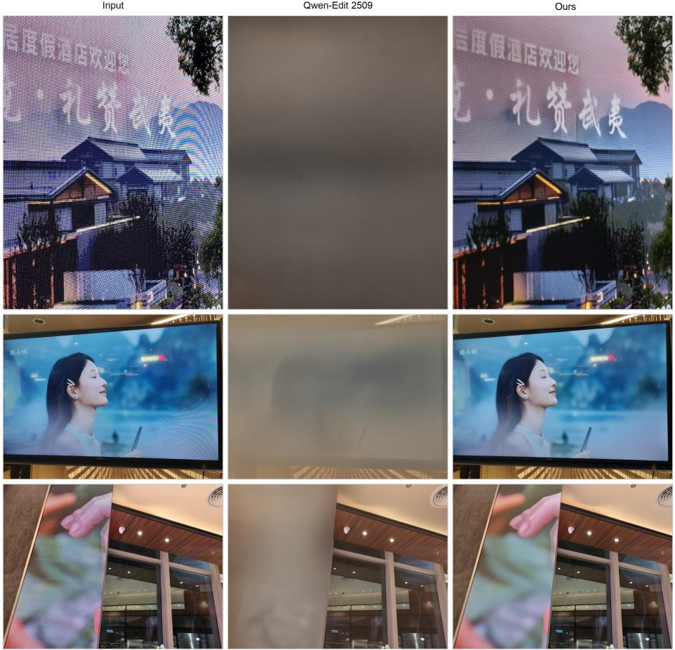  
Figure 10: Native Qwen-Image-Edit-2509 negative control. The illustrated zero-shot outputs have large color-block artifacts and altered structure.

## G ADDITIONAL PAIRED-BENCHMARK METRICS

Tab. 10 completes the paired comparison in Tab. 2. Our method achieves the highest MANIQA on both datasets. MZNet achieves the lowest LPIPS on both datasets and the highest SSIM on FHDMi, while MoCE-IR achieves the highest SSIM on UHDM. Together with PSNR in the main table, these results characterize the trade-off between full-reference fidelity and residual moiré suppression.

Table 10: Additional metrics on FHDMi and UHDM. Best in bold, second-best underlined. Unicontrol denotes UniDemoiré-style augmentation of ESDNet-L.
<table><tr><td></td><td colspan="3">FHDMi</td><td colspan="3">UHDM</td></tr><tr><td>Method</td><td>SSIM↑</td><td>LPIPS↓</td><td>MANIQA↑</td><td>SSIM↑</td><td>LPIPS↓</td><td>MANIQA↑</td></tr><tr><td>Input</td><td>.707</td><td>.265</td><td>.311</td><td>.560</td><td>.335</td><td>.380</td></tr><tr><td>ESDNet-L</td><td>.789</td><td>.183</td><td>.315</td><td>.837</td><td>.118</td><td>.411</td></tr><tr><td>MoCE-IR</td><td>.831</td><td>.151</td><td>.307</td><td>.838</td><td>.145</td><td>.370</td></tr><tr><td>AdaIR</td><td>.808</td><td>.180</td><td>.299</td><td>.815</td><td>.173</td><td>.358</td></tr><tr><td>OSEDiff</td><td>.739</td><td>.201</td><td>.340</td><td>.784</td><td>.205</td><td>.400</td></tr><tr><td>MZNet</td><td>.836</td><td>.109</td><td>.325</td><td>.835</td><td>.108</td><td>.413</td></tr><tr><td>Uni-control</td><td>.793</td><td>.182</td><td>.313</td><td>.831</td><td>.126</td><td>.414</td></tr><tr><td>Ours</td><td>.785</td><td>.151</td><td>.363</td><td>.789</td><td>.134</td><td>.419</td></tr></table>

Content and color fidelity. We further evaluate content fidelity against the clean references on UHDM using TOPIQ-FR (Chen et al., 2024), PieAPP (Prashnani et al., 2018), and AHIQ (Lao et al., 2022), together with CIE chroma and hue differences (Sharma et al., 2005). TOPIQ-FR uses the clean reference, whereas TOPIQ in Tab. 2 is the no-reference variant. Tab. 11 shows that our method achieves the highest TOPIQ-FR and the second-best PieAPP and AHIQ among the compared methods. Its chroma and hue errors are comparable to those of the feed-forward restorers, with MZNet achieving the lowest errors. These paired measurements complement the dedicated human detail assessment on DailyMoiré130, although neither establishes exact recovery of details that are unobservable in the corrupted input.

Table 11: Content and color fidelity on UHDM. TOPIQ-FR is full-reference, whereas TOPIQ in Tab. 2 is no-reference. Best values are bold. Uni-control denotes UniDemoiré-style augmentation of ESDNet-L.
<table><tr><td>Method</td><td>TOPIQ-FR↑</td><td>PieAPP↓</td><td>AHIQ↑</td><td> $| \Delta C ^ { * } | \downarrow$ </td><td> $\Delta H ^ { * } \downarrow$ </td></tr><tr><td>ESDNet-L</td><td>0.639</td><td>1.137</td><td>0.433</td><td>4.454</td><td>2.776</td></tr><tr><td>Uni-control</td><td>0.641</td><td>1.045</td><td>0.439</td><td>4.273</td><td>2.865</td></tr><tr><td>MZNet</td><td>0.664</td><td>0.991</td><td>0.431</td><td>3.995</td><td>2.407</td></tr><tr><td>MoCE-IR</td><td>0.658</td><td>0.964</td><td>0.433</td><td>4.322</td><td>2.727</td></tr><tr><td>OSEDiff</td><td>0.588</td><td>1.310</td><td>0.284</td><td>6.352</td><td>4.034</td></tr><tr><td>Ours</td><td>0.670</td><td>0.984</td><td>0.435</td><td>4.422</td><td>2.643</td></tr></table>