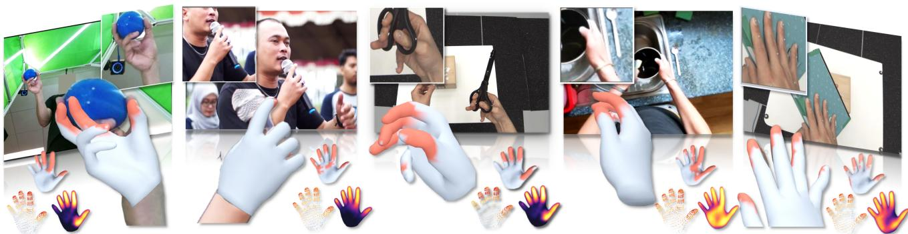
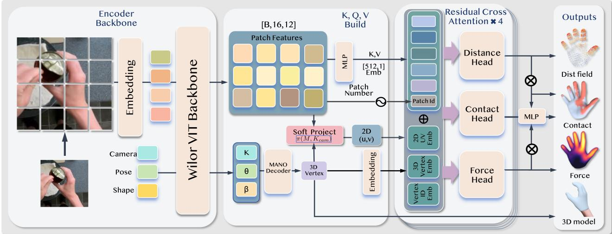
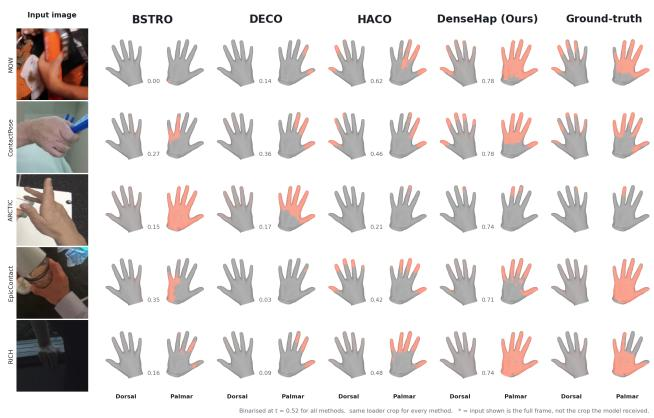

# DenseHap: Dense Hand Haptic Estimation from Monocular Images

Junhan Xue Imperial College London

Rolandos Alexandros Potamias Imperial College London

Project Webpage

  
Figure 1. We propose DenseHap for hand distance field estimation, contact detection, pressure analysis, and reconstruction from a single monocular image. DenseHap improves HACO’s F1 by about 10% on zero-shot datasets with only 40M additional trainable parameters.

## Abstract

As dexterous robotic manipulation advances, scalable annotations of human hand-object interactions are becoming increasingly important. Furthermore, previous hand contact estimation methods suffered from issues such as dorsal-side misclassifications and insufficient precision, while lacking a unified framework for integrating multiple hand-to-environment interaction modalities, including distance fields, contact thresholds, and pressure. To address that, we present DenseHap, a unified end-to-end approach to estimate hand distance field recognition, comprehensive hand contact detection, hand pressure analysis, and hand reconstruction from a single monocular image. By incorporating three distinctly defined heads, along with a pretrained 3D reconstructed skeleton and an enhanced dataset, DenseHap outperforms previous state-of-the-art models on four evaluation datasets, improving the F1 score by 8.5 percentage points (a 16% relative improvement) on untrained datasets and by 3 percentage points (5% relative improvement) on in-distribution datasets. Furthermore, Dense-Hap has effectively improved short-range hand estimate and pressure evaluation. Code and models will be publicly available upon the paper’s acceptance.

## 1. Introduction

Recent dexterous manipulation systems [34, 53, 54, 63] offer increasing proof that contact serves as an efficient medium for transmitting human demonstrations to robotic hands. Simultaneously, the acquisition of dexterous manipulation skills increasingly depends on human videos for guidance. Research such as DexMV [38], VideoDex [42], and DexVIP [31] illustrate the transformation of hand trajectories from these videos into robotic policies, underscoring the considerable opportunities presented by the abundant online resources of hands interacting with objects.

However, these works typically concentrate on hand motion trajectories, while the primary factor that confers physical significance to manipulation, namely the point at which the hand makes contact with the world, is either disregarded or approximated post-hoc. This missing supervisory signal is precisely provided by dense hand contact. In this work, it is defined as the contact state at each vertex of the MANO mesh [39], including point-wise distance fields, binary contact indicators, and force magnitudes. This signal grounds the reconstructed hand in the physical reality of its interactive behaviour. Therefore, as an explicit form of information, it provides direction for the subsequent disentanglement of hand motion representations and the fine-grained comprehension of manipulation details.

In terms of efficiency, current approaches for dense contact estimation necessitate the use of a cascade of two independent models. Dense contact estimators, such as HACO [25], predict per-vertex contact probabilities from cropped hand images but recover no geometry. Monocular hand reconstruction methods [8, 35, 37, 44] recover MANO meshes accurately and at high throughput, but ignore contact. As a result, the estimator never views the mesh that its contact map is intended to annotate. In addition to requiring two inference passes, this separation allows for physically inconsistent predictions. For example, a fingertip placed at a significant distance from a surface that the estimator indicates as touched, without a mechanism to reconcile the two, renders the pipeline both unreliable and costly at the scale of millions of video frames. Moreover, hand contact is more fine-grained than full-body contact, often occurring in small regions such as the fingertips, which limits the effectiveness of conventional full-body contact estimators [7, 25].

Motivated by these findings, we present DenseHap, an integrated framework that generates intricate per-vertex hand interaction data from a single RGB image in one forward pass, without the need for object templates or optimisation during testing. Three heads are connected to a WiLoR-based reconstruction backbone, with each head overseeing a shared visual representation. Furthermore, by employing the ViT backbone of WiLoR, a straightforward head allows for the effortless acquisition of 3D reconstruction results from identical features.

Our contributions are as follows:

• We introduce the first end-to-end framework that forecasts dense per-vertex interaction (distance, contact, pressure and reconstruction) and reconstructs 3D hand geometry from a single RGB image, utilising joint supervision over contact labels, spatial distance, and pressure signals.

• Our approach attains cutting-edge dense contact precision, functioning at approximately double the throughput of current reconstruction-and-contact cascade systems, showcasing enhanced accuracy and efficiency.

• We examine a collection of prior studies and perform a basic credibility assessment of these datasets on the contact dimension. Simultaneously, using the data sampling from the HACO data set, we developed an enhanced data cleaning procedure, resulting in a dataset that was double the size of the original.

## 2. Related Work

Hand Contact and Pressure Estimation. Early work on explicit hand-contact measurement relied on instrumented capture. ContactDB [3] uses thermal imaging to acquire object-surface contact maps after grasping, while ContactPose [4] associates these measurements with hand– object poses and RGB-D observations. At the image level,

100DOH [41] and ContactHands [33] detect hands and classify their contact states in Internet images, but do not localise contact on the hand surface. Dense 3D contact has also been used as an intermediate representation for physically plausible hand–object reconstruction. ContactOpt [13] optimises hand pose using predicted contact, while CPF [56], TOCH [66], S2Contact [49], and UVbased reconstruction [59] model dense contact through geometric, temporal, semi-supervised, or UV-space representations. Beyond these reconstruction-oriented methods, POSA [19] learns pose-conditioned contact priors between the body and scene, while BSTRO [21] and DECO [48] infer dense vertex-level body contact from RGB images; their hand-region predictions provide relevant baselines. ContactPrompt [26] further performs training-free dense hand contact estimation through structured MLLM reasoning. Among supervised image-based approaches, HACO [25] is the closest general-purpose baseline to our setting. It predicts contact probabilities over the MANO vertices and explicitly addresses class and spatial imbalance. However, HACO treats contact estimation as a standalone task and does not recover input-specific 3D hand geometry, requiring a separate reconstruction network and thereby preventing shared feature learning while increasing the cost of large-scale image or video annotation. Beyond binary contact, PressureVision [14] and PressureVision++ [15] esti mate pressure from RGB images of interactions with instrumented planar surfaces, while EgoPressure [64] extends pressure estimation to egocentric views with hand-pose annotations. More recently, HOPE [24] predicts per-vertex contact and normal pressure from monocular video, and EgoPHI [23] estimates contact and 3D forces on hand and object meshes, but requires known object geometry. In contrast, our method jointly recovers input-specific hand geom etry and dense surface contact from a single RGB image.

Monocular 3D Hand Reconstruction The MANO parametric model [39] and increasingly powerful feed-forward architectures have accelerated the recovery of 3D hand geometry from single RGB images. Early systems such as FrankMocap [40] demonstrated practical monocular capture of hands and the full body, while transformer-based methods such as HaMeR [35] achieved robust in-the-wild hand mesh recovery through large-scale training and highcapacity backbones. WiLoR [37] further unifies hand localisation and reconstruction, providing the throughput and accuracy required to process unconstrained video at scale. These properties make modern reconstruction networks attractive for mining Internet video, enabling dynamic worldspace reconstructions [60, 62] and hand-object interactions [8, 30]. However, they recover only geometry, leaving unmodeled the signals that distinguish manipulation from mere motion and indicate physical contact with the environment.

  
Figure 2. Overview of DenseHap. A frozen WiLoR [37] backbone yields the MANO [39] mesh and a ViT feature grid; three parameterdisjoint vertex-query cross-attention trunks feed contact, distance, and pressure heads under triple supervision. Detached proximity signals from the distance and pressure heads are injected into the contact head through zero-initialized learnable gates.

## 3. Methodology

Given a single RGB image, DenseHap predicts, in one forward pass and without object templates or test-time optimization, a 3D hand mesh in MANO [39] topology together with a dense per-vertex description of its physical interaction: a contact probability, a vertex-to-object distance, and a contact pressure at each vertex. The overall architecture of the proposed model in shown in Fig 2.

## 3.1. Frozen Reconstruction Backbone

We employ WiLoR as our frozen image encoder and reconstruction framework. The ViT-H/16 architecture [10] simultaneously analyses image tokens along with MANOassociated form, posture, and camera embeddings to yield hand-sensitive patch features, which are then decoded to recreate the 3D hand mesh. Our methodology employs two outputs from WiLoR: the reconstructed MANO vertices and the intermediate ViT feature map. The vertices provide explicit 3D geometric cues for contact reasoning, while the feature map serves as the visual representation for our prediction heads. Given that WiLoR is pre-trained explicitly for 3D hand reconstruction, its attributes are more congruent with hand-contact estimates compared to general semantic representations like DINOv3 [45].

## 3.2. Hybrid Cross-Attention

The contact head treats the hand vertices V as queries that cross-attend to WiLoR ViT patch tokens. The geometryaware query serves as an addressing prior that initializes a residual attention stream rather than constraining each vertex to a fixed image location. Thus, early layers are guided by anatomical and geometric cues, while deeper layers progressively refine vertex features using image evidence. Vertex queries (Q). Contact at one vertex can depend on distal hand regions, making independent vertex processing insufficient for capturing global context. We therefore represent the V MANO vertices as a set of queries whose dependencies are modelled by successive attention layers.

Let $\mathbf { Q } = [ q _ { 1 } , \dots , q _ { V } ] ^ { \top } \in \mathbb { R } ^ { V \times d }$ . For vertex i,

$$
q _ { i } = e _ { i } ^ { \mathrm { i d } } + \phi _ { \mathrm { 2 D } } ( \pi ( v _ { i } ) ) + \psi _ { \mathrm { x y z } } ( v _ { i } - \bar { v } ) ,\tag{1}
$$

where $\begin{array} { r } { \bar { \boldsymbol { v } } = \frac { 1 } { V } \sum _ { j = 1 } ^ { V } \boldsymbol { v } _ { j } } \end{array}$

Here, $e _ { i } ^ { \mathrm { i d } } \in \mathbb { R } ^ { d }$ is a learnable embedding encoding vertex identity. The projection $\pi ( v _ { i } )$ uses WiLoR camera parameters to map the reconstructed vertex onto the normalized ViT patch grid, and $ { \phi _ { \mathrm { 2 D } } }$ converts the projected coordinate into a continuous sinusoidal embedding. The centroidrelative coordinate $v _ { i } - \bar { v }$ is encoded by $\psi _ { \mathrm { x y z } }$ to provide translation-invariant 3D geometry.

Each query therefore combines anatomical identity, image-aligned 2D position, and 3D geometric context. These cues initialize where and how a vertex attends, while subsequent attention layers may refine or override this initial spatial preference according to image content.

Cross-attention and multi-scale prediction. WiLoR ViT patch tokens are projected to width $d = 5 1 2 { \mathrm { b y } }$ an MLP and augmented with 2D sinusoidal positional encodings. They serve as keys and values for $L = 4$ pre-norm residual crossattention blocks:

$$
\begin{array} { r l } & { \tilde { \mathbf { Q } } ^ { ( l ) } = \mathbf { Q } ^ { ( l - 1 ) } + \mathrm { C r o s s A t t n } \Big ( \mathrm { L N } ( \mathbf { Q } ^ { ( l - 1 ) } ) , \mathbf { K } , \mathbf { V } \Big ) , } \\ & { \mathbf { Q } ^ { ( l ) } = \tilde { \mathbf { Q } } ^ { ( l ) } + \mathrm { F F N } \Big ( \mathrm { L N } ( \tilde { \mathbf { Q } } ^ { ( l ) } ) \Big ) . } \end{array}\tag{2}
$$

The residual stream refines the initial geometry-aware queries while progressively incorporating imageconditioned evidence, allowing vertices to attend beyond their projected locations. The refined features are finally used for contact prediction, with supervision at four resolutions (778, 336, 84, 16) for multi-scale consistency.

## 3.3. Final Output

Although we train three heads, the final output can be derived directly from either the distance-threshold head or the contact head. On most datasets, the distance-threshold head performs better. The contact head outperforms it only when training data for the target dataset are unavailable or when the test annotations are human-labelled and widely dispersed. We therefore adopt the distance-threshold head as our default model. Nevertheless, the contact head remains important: it plays a mediating role that benefits semantic segmentation and performs well on datasets with subjective annotations.

## 3.4. Loss Function

Contact, distance, and pressure provide complementary descriptions of hand–object interaction. HACO [25] defines contact by thresholding the vertex-to-object distance:

$$
c _ { n , v } = \mathbb { I } \bigl [ d \bigl ( \mathbf { x } _ { n , v } ^ { \mathrm { h a n d } } , S _ { n } ^ { \mathrm { o b j } } \bigr ) < \delta _ { c } \bigr ] ,\tag{3}
$$

where $\mathbf { x } _ { n , v } ^ { \mathrm { h a n d } }$ is the v-th MANO vertex, $S _ { n } ^ { \mathrm { { o b j } } }$ is the object surface, and $\delta _ { c }$ is the contact threshold.

Although practical, thresholding discards proximity information and makes labels sensitive to $\delta _ { c }$ and geometric accuracy. We therefore retain HACO’s binary contact supervision and class-imbalance treatment while predicting distance. Contact can then be obtained either from the contact head or by thresholding the distance prediction. This preserves geometric information when distance labels are available without requiring them for every sample.

Contact loss. Following HACO [25], we use the multiscale vertex contact balanced (VCB) loss

$$
\begin{array} { r l } & { \mathcal { L } _ { \mathrm { c o n t a c t } } = \mathcal { L } _ { \mathrm { V C B } } ^ { \mathrm { F u l l } } + \mathcal { L } _ { \mathrm { V C B } } ^ { \mathrm { H i g h } } + \mathcal { L } _ { \mathrm { V C B } } ^ { \mathrm { M e d i u m } } + \mathcal { L } _ { \mathrm { V C B } } ^ { \mathrm { J o i n t } } } \\ & { ~ + 0 . 1 \mathcal { L } _ { \mathrm { R e g } } + \mathcal { L } _ { \mathrm { S m o o t h } } . } \end{array}\tag{4}
$$

The VCB terms supervise predictions on the full mesh, two coarsened meshes, and a joint-level representation. Coarse labels are soft targets computed as $c _ { \mathrm { l o w } } = V _ { \mathrm { r e g } } c _ { \mathrm { m e s h } }$ , preserving partial contact within aggregated regions. $\mathcal { L } _ { \mathrm { { R e g } } }$ limits deviation from the dataset-level mean contact map, while ${ \mathcal { L } } _ { \mathrm { S m o o t h } }$ encourages consistency between adjacent vertices. Because all training samples have contact annotations, no mask is required.

Distance loss. The distance head mirrors the contact head and predicts the distance from each hand vertex to the object surface. This task is highly imbalanced: only a small fraction of the 778 MANO vertices are near the contact region, while most are far from the object. We address this imbalance using the three design choices in Eq. 5.

$$
\begin{array} { r l r } & { w _ { n , i } = \left\{ \begin{array} { l l } { w _ { \mathrm { n e a r } } , } & { d _ { n , i } ^ { \mathrm { g t } } < \tau _ { \mathrm { n e a r } } , } \\ { 1 , } & { \mathrm { o t h e r w i s e } , } \end{array} \right. } & \\ & { \ell _ { n } = \cfrac { 1 } { \sum _ { i } w _ { n , i } } \displaystyle \sum _ { i } w _ { n , i } \left| \log ( 1 + \hat { d } _ { n , i } ) - \log ( 1 + d _ { n , i } ^ { \mathrm { g t } } ) \right| , } & \\ & { \ell _ { \mathrm { d i s t } } = \cfrac { \sum _ { n } m _ { n } \ell _ { n } } { \operatorname* { m a x } ( \sum _ { n } m _ { n } , 1 ) } . } & \end{array}
$$

(i) Near-field reweighting $( w _ { n , i } ) .$ . Vertices with a groundtruth distance below $\tau _ { \mathrm { n e a r } }$ are assigned a weight of $w _ { \mathrm { n e a r } } =$ 10, while all other vertices receive unit weight. Without this reweighting, uniformly averaging over all 778 vertices reduces the contribution of the informative near-contact region by approximately a factor of 15.

(ii) Log-space regression $( \ell _ { n } ) .$ . We regress the predicted and ground-truth distances after applying the transformation $\log ( 1 + d )$ This transformation is well-defined at $d \ = \ 0$ and maps exact contact to zero. For small distances, $\log ( 1 + d ) \approx d ,$ so variations near the object surface are largely preserved. As distance increases, the slope $1 / ( 1 + d )$ decreases, compressing large values and preventing errors at distant vertices from dominating the optimisation. Since the transformation is monotonic, it preserves the ordering of distances rather than discarding far-field information. This retains global distance supervision while placing greater emphasis on the near-contact region.

(iii) Sample-level masking and mask-normalised averaging $( \mathcal { L } _ { \mathrm { d i s t } } ) . ~ \hat { d } _ { n , i }$ and $d _ { n , i } ^ { \mathrm { g t } }$ denote the predicted and groundtruth distances at vertex i of sample $n ,$ and $m _ { n } \in \{ 0 , 1 \}$ indicates annotation validity. Each sample loss is normalised by its total vertex weight, making it independent of the number of near-contact vertices. The loss is normalised by the number of annotated samples, so unannotated samples contribute neither loss nor gradients. The denominator is clamped to one for batches without valid annotations.

Pressure loss. The pressure head predicts a per-vertex pressure through a sigmoid and is supervised with a masked $L _ { 1 }$ loss (no near-field reweighting):

$$
{ \mathcal { L } } _ { \mathrm { p r e s s u r e } } = { \frac { \sum _ { n } \left| { \hat { p } } _ { n } - p _ { n } ^ { \mathrm { g t } } \right| _ { \mathrm { m e a n } } m _ { n } ^ { \mathrm { p r e s s } } } { \sum _ { n } m _ { n } ^ { \mathrm { p r e s s } } } } .\tag{6}
$$

Ground-truth pressure is normalized by a cap of 20 kPa and clipped to [0, 1]. Pressure labels come from a single dataset (PressureVisionDB [14]), ≈2.88% of the training mixture.

## 4. Experiments

## 4.1. Hand Contact Datasets

The estimation of dense hand contact is an emerging area of research, with this study offering a significant contribution through a comprehensive review of publicly available handcontact datasets up to July 2026. The framework assesses 30 datasets, encompassing around 4 million samples, and amalgamates 18 that meet stringent quality-control standards into a unified training corpus containing 1.16 million samples. The ten excluded datasets failed due to various issues, such as inconsistent or misaligned contact annotations (notably GigaHands, EgoPressure, and HOT3D), domain disparity with bare-hand–object interactions (EgoTouch, InterHand2.6M, and HIC), and absence of real-world imagery (GRAB). To promote reproducibility, the detailed audit is published to assist future researchers in avoiding the burdensome process of dataset screening.

<table><tr><td>Dataset</td><td>Size</td><td>Share</td><td>Type</td></tr><tr><td colspan="4">A. Sensor-measured (high reliability)</td></tr><tr><td>PressureVisionDB [14] 33,514</td><td></td><td>2.88%</td><td>Pressure</td></tr><tr><td colspan="4">B. Multi-view, MoCap (high reliability)</td></tr><tr><td>TACO [29]</td><td>153,097</td><td>13.17%</td><td>Manipulation</td></tr><tr><td>OakInk2 [61]</td><td>147,553</td><td>12.69%</td><td>Manipulation</td></tr><tr><td>ARCTIC [11]</td><td>147,238</td><td>12.66%</td><td>Manipulation</td></tr><tr><td>Decaf [43]</td><td>65,322</td><td>5.62%</td><td>Hand-face</td></tr><tr><td>MANUS [36]</td><td>20,117</td><td>1.73%</td><td>Grasping</td></tr><tr><td>RICH [22]</td><td>15,854</td><td>1.36%</td><td>Human-scene</td></tr><tr><td>Hi4D [58]</td><td>2,889</td><td>0.25%</td><td>Human-human</td></tr><tr><td colspan="4">C. RGB-D + fitting (medium)</td></tr><tr><td>OakInk [57]</td><td>129,659</td><td>11.15%</td><td>Grasping</td></tr><tr><td>HOI4D [28]</td><td>84,428</td><td>7.26%</td><td>Manipulation</td></tr><tr><td>HO3D [16]</td><td>62,779</td><td>5.40%</td><td>Manipulation</td></tr><tr><td>HOCap [51]</td><td>62,075</td><td>5.34%</td><td>Manipulation</td></tr><tr><td>H2O3D [17]</td><td>59,870</td><td>5.15%</td><td>Manipulation</td></tr><tr><td>H2O [27]</td><td>33,467</td><td>2.88%</td><td>Manipulation</td></tr><tr><td>DexYCB [6]</td><td>29,656</td><td>2.55%</td><td>Grasping</td></tr><tr><td>HOGraspNet [9]</td><td>29,243</td><td>2.51%</td><td>Grasping</td></tr><tr><td colspan="4">D. Synthetic / monocular reconstruction</td></tr><tr><td>ObMan [20]</td><td>85,688</td><td>7.37%</td><td>Grasping</td></tr><tr><td>MOW [5]</td><td>350</td><td>0.03%</td><td>Reconstruction</td></tr><tr><td colspan="4">Total (training pool)</td></tr><tr><td>Excluded datasets</td><td></td><td></td><td></td></tr><tr><td colspan="4">Dataset</td></tr><tr><td>GigaHands [12]</td><td>665,176</td><td>Exclusion reason unreliable, mostly no contact</td><td></td></tr><tr><td>EgoTouch [65]</td><td>127,676</td><td>gloved hands, not bare skin</td><td></td></tr><tr><td>InterHand2.6M [32]</td><td>37,170</td><td>hand-hand contact only</td><td></td></tr><tr><td>GRAB [47]</td><td>29,612</td><td></td><td>mocap only, no real images</td></tr><tr><td>HOT3D [1]</td><td>13,456</td><td>crop/side-matching errors</td><td></td></tr><tr><td>Open3DHOI [52]</td><td>2,561</td><td></td><td>no contact after SMPL-X fitting</td></tr><tr><td>EgoPressure [64]</td><td>2,569</td><td></td><td>contact-image misalignment</td></tr><tr><td>HIC [50]</td><td>228</td><td></td><td>hand–hand; 39 test samples</td></tr><tr><td>PROX [18]</td><td>178</td><td></td><td>SMPL-X mapping unreliable</td></tr><tr><td>OpenTouch [46]</td><td>146</td><td></td><td>unresolvable crop errors</td></tr><tr><td colspan="4">Held-out evaluation only (never sampled in training)</td></tr><tr><td>ContactPose [4]</td><td>2,192</td><td></td><td>Grasping, test only</td></tr><tr><td>EPIC-Contact [2]</td><td>237</td><td></td><td>Manipulation, test only</td></tr></table>

Table 1. Dataset audit details 18 retained datasets, including their share of the training pool and primary interaction types. It also lists excluded datasets with reasons for their omission. ContactPose and EPIC-Contact (bottom block) are held out for evaluation.

The study identifies three primary sources of contact labels that shape the design of the corpus. The first source involves geometric determination through thresholding the distance between hand vertices and the object surface, as seen in datasets like ObMan [20] and DexYCB [6], which were initially created for hand–object reconstruction. The second method includes direct measurements or annotations, such as thermal imprinting in ContactPose and manual labeling, along with pseudo-ground-truths derived via multiple view optimization in Decaf [43]. The third source consists of automated propagation of human-annotated contact labels through pipelines, exemplified by MOW [5] and EPIC [2] Contact. Historically, contact estimation has been tied to reconstruction tasks, leading to the prevalence of geometrically derived labels in existing datasets and the current corpus.

## 4.2. Evaluation

## 4.2.1 Unified threshold measurement

To assess progress while limiting MOW’s format bias, we use the two datasets with the most accurate annotations as our primary test sets: EPIC-Contact [2], the latest dataset for contact estimation, and ContactPose [4], which provides accurate contact labels from thermal imprints. Neither HACO nor DenseHap was trained on these datasets, enabling a fair zero-shot comparison. For in-distribution evaluation, we retain MOW from HACO’s original evaluation framework and add ARCTIC [11], which provides relatively accurate contact annotations. We exclude HIC [50] and Hi4D [58] from main evaluation because they focus primarily on hand-to-hand and hand-to-body interactions, which fall outside our evaluation scope.

<table><tr><td rowspan="2">Dataset</td><td rowspan="2">N</td><td colspan="4">DenseHap</td><td colspan="4">HACO</td></tr><tr><td>P</td><td>R</td><td>F1</td><td>Fl*</td><td>P</td><td>R</td><td>F1</td><td>F1*</td></tr><tr><td>EPIC-Contact</td><td>2272</td><td>.453</td><td>.622</td><td>.511</td><td>.525</td><td>.386</td><td>.595</td><td>.428</td><td>.459</td></tr><tr><td>ContactPose MOW</td><td>2192</td><td>.606</td><td>.812</td><td>.673</td><td>.675</td><td>.565</td><td>.680</td><td>.588</td><td>.599</td></tr><tr><td>ARCTIC</td><td>92 3000</td><td>.432 .675</td><td>.926 .792</td><td>.555 .703</td><td>.570 .713</td><td>.525 .516</td><td>.607 .787</td><td>.522 .682</td><td>.567</td></tr><tr><td></td><td></td><td></td><td></td><td></td><td></td><td></td><td></td><td></td><td>.684</td></tr><tr><td>Mean</td><td>一</td><td>.542</td><td>.788</td><td>.600</td><td>.621</td><td>.498</td><td>.667</td><td>.555</td><td>.578</td></tr></table>

Table 2. Dense contact estimation under the Skip protocol. We report per-vertex precision (P), recall (R), and F1 score; F1 denotes performance at the default threshold ( 0.52), while F1⋆ denotes performance after readout and operating-point selection.

Table 2 summarizes the results. DenseHap outperforms HACO on all four datasets, with the largest gains on the most accurately annotated benchmarks. Under zeroshot evaluation, F1 improves by 8.5 points (+14.5% relative) on thermally measured ContactPose and by 8.3 points (+19.4%) on EPIC-Contact. The in-distribution gains on MOW (+3.3 points) and ARCTIC (+2.1 points) are smaller but consistent. The stronger performance on unseen benchmarks indicates estimation quality rather than overfitting to a particular label distribution.

Furthermore, DenseHap(distance head) enhances both aspects of predictive efficacy: mean recall escalates from .667 to .788, while mean precision advances from .498 to .542. The largest precision gain occurs on ARCTIC, from .516 to .675. MOW illustrates the caveat discussed earlier: DenseHap achieves near-complete recall (.926) but low precision (.432), because matching MOW’s exaggerated labels requires predicting contact well beyond the true touch region. This setting favors broad predictions and penalizes precise ones. We therefore treat MOW as a historical benchmark rather than a primary measure of contact quality.

## 4.2.2 Broader Evaluation Using Optimal Thresholds

Various techniques utilise distinct thresholds to convert their predictions into binary outcomes for each dataset. To facilitate an equitable comparison, we vary the decision threshold between 0.3 and 0.8 and present the optimal performance attained by each technique on the identical problem. The comprehensive findings are described below.

<table><tr><td>Method</td><td>MOW ContactPose EPIC ARCTIC RICH Hi4D</td><td></td><td></td><td></td><td></td><td></td></tr><tr><td>POSA-hand [19] †</td><td>.408</td><td>一</td><td></td><td>一</td><td></td><td>.398.315</td></tr><tr><td>ContactPrompt [26] †</td><td>.526</td><td></td><td></td><td></td><td></td><td></td></tr><tr><td>DECO [48]</td><td>.395†</td><td>.513</td><td>.492</td><td>.365</td><td>.454</td><td>4 .304†</td></tr><tr><td>BSTRO [21]</td><td>.380†</td><td>.155</td><td>.382</td><td>.290</td><td>.645</td><td>.420†</td></tr><tr><td>HACO [25]</td><td>.522</td><td>.599</td><td>.459</td><td>.684</td><td>.781</td><td>.474</td></tr><tr><td>JointHand (ours)</td><td> $. 5 7 1 ^ { \mathrm { d } }$ </td><td> $. 6 7 5 ^ { \mathrm { d } }$ </td><td>.524º</td><td>.713d</td><td></td><td>.799c.424c</td></tr></table>

Table 3. Dense hand contact estimation, per-vertex F1 at each method’s own best threshold (Skip protocol). Our result uses the distance head (d) per dataset; EPIC, RICH, and Hi4D use only the contact head (c) because they lack distance ground truth. † denotes HACO-reported results. Other results were evaluated locally under the same protocol.

Even under this ideal threshold assessment framework, our technique consistently surpasses other methods across every dataset except Hi4D. In the in-distribution datasets, our approach realises an average enhancement of 3–5% compared to HACO, the current leading model. In the outof-distribution datasets, the mean enhancement approaches 10%. Considering HACO’s robust alignment with these datasets, these findings suggest that our model has enhanced generalisation to unfamiliar distributions.

Figure 3 illustrates examples generated by several models. The contact estimation for models such as BSTRO and DECO appears to be relatively imprecise. HACO enhances performance, although it frequently applies a rudimentary colouration to both sides of the hand without differentiating between the palm and the dorsal side. Furthermore, it demonstrates some interference and faces challenges in accurately detecting specific outlier instances. While Dense-Hap does well on clear photos, it struggles with overly dark or ambiguous ones.

  
Figure 3. Qualitative comparison between the proposed and the baseline method across five datasets.

## 4.2.3 Distance and Force measurement

Alongside our main goal, we also performed comparison analyses on the distance and force heads. The findings are delineated below.

<table><tr><td rowspan="2">Method</td><td colspan="3">H→O Distance MAE (mm) ↓</td></tr><tr><td>All</td><td>&lt; 10 10-20</td><td>≥ 20</td></tr><tr><td>InterField-SF [11]</td><td>9.47</td><td>7.92 7.62</td><td>10.51</td></tr><tr><td>Our distance head</td><td>11.49</td><td>3.70 4.12</td><td>16.21</td></tr></table>

Table 4. Continuous hand-to-object distance on ARCTIC. MAE is computed over 778 MANO vertices with distances capped at 100 mm.

Table 4 primarily contrasts our model with InterField utilising the ARCTIC dataset. Particularly, our distance head features comprehensive near-field optimisation, providing a distinct benefit in assessing proximate contacts at ranges under 20 mm. InterField exhibits superior performance for distances above 20 mm, hence yielding optimal results among all outcomes. Nevertheless, the majority of hand-contact datasets establish 10 mm as the principal criterion for defining contact, with a few exceptions that set the threshold higher than 10 mm. Consequently, precise distance measurement within 20 mm is crucial for high-accuracy hand-contact datasets. Distances over 20 mm typically do not influence touch recognition. These findings convincingly corroborate the architecture presented in Equation 5 as well as the functionality of the distance head.

There is currently no efficient MANO-based method for predicting pressure on a per-vertex basis. The closest work, WristP2 [55], is based on wrist-mounted imagery and so differs substantially from our setting. We therefore use PressureVision as our main reference point; the results are shown in Table 5.

<table><tr><td>Method</td><td>VolIoU↑</td><td>MAE (Pa)↓</td><td>C-IoU↑</td></tr><tr><td>Image space,  $4 8 0 \times 3 8 4 p x$  PressureVision</td><td>0.413</td><td>4246</td><td>0.558</td></tr><tr><td>Mesh space, MANO-778</td><td></td><td></td><td></td></tr><tr><td>Failed blank control,  $\ell _ { 1 } \mathrm { l o s s } ^ { \dagger }$ </td><td>0.000</td><td>6306</td><td>0.000</td></tr><tr><td>Ours (full model), BCE + proxy</td><td>0.491</td><td>2840</td><td>0.597</td></tr></table>

Table 5. Hand pressure prediction on PressureVisionDB, using the same six test identities. Cross block results are reference due to different output spaces. Metrics use the support $\{ \hat { p } > 1 \mathrm { { k P a } } \}$ ∪ $\{ p > 1 \mathrm { { k P a } \} }$ . †Failed blank control producing all-zero pressure. Caveat: all checkpoints saw these identities during training.

Given PressureVision’s different formulation, which predicts pressure through nine discrete categories in image space, the resulting measures should be viewed as a reference rather than a directly equivalent evaluation. For each method, we report the mean absolute error in its native output space over the union of predicted and ground-truth contact support. The all-zero masked $\ell _ { 1 }$ run is included only as a failed blank control, since it collapsed during training. Our actual BCE + proxy model avoids this trivial solution, indicating that the pressure-head objective plays a significant role in learning and achieves performance comparable to PressureVision under this adapted protocol.

## 5. Ablation Study

Model design Comparison. In Table 6 we compare contact-head architectures according to how they decode the 778 vertex-level logits. All models are evaluated using the same protocol as HACO, with a shared threshold of t = 0.52 across all datasets and NONE → 0 aggregation.

The results favor architectures that aggregate global information over independent local prediction. Projecting each hand vertex onto backbone features and predicting contact from a local patch is insufficient because contact states are spatially correlated across vertices and local evidence is ambiguous under occlusion. Global cues such as object geometry, scale, and interaction type are needed to distinguish narrow contacts, such as grasping a pencil, from broad planar contacts, such as touching a table. Crossattention addresses these limitations by retrieving vertexspecific evidence from a global representation.

The best per-vertex model achieves a mean F1 score of 0.435, while global-vector decoding and learned queries yield scores of 0.546 and 0.538, respectively. The onetoken cross-attention variant scores 0.533, surpassing several methods including max pooling and CLS-based selfattention. Performance is influenced by dataset composition, sampling, and augmentation, with up to five F1 point variations within the same model family. The 14-dataset model excels on HIC and RICH, while corrected squareroot sampling with augmentation performs best on MOW and Hi4D. Effective contact estimation requires global decoding and adaptable training strategies to manage variations in interactions and dataset bias.

<table><tr><td>Contact head MOW HIC RICH</td></tr><tr><td>Hi4D Mean A. Each vertex sees only its own image patch</td></tr><tr><td>MLP, 1 hidden layer .462 .109 .527 .516 .404</td></tr><tr><td>MLP, 2 hidden layers .464 .107 .527 .515 .403 MLP, 5 hidden layers .502 .168 .551 .519 .435</td></tr><tr><td>Graph network on the mesh .477 .153 .536 .517 .421</td></tr><tr><td>B. All vertices share one summary of the image</td></tr><tr><td>Average the image features .511 .183 .700 .523 .479</td></tr><tr><td>Learn one summary token .504 .191 .787 .524 .502</td></tr><tr><td>+ focal loss .522 .271 .792 .521 .526</td></tr><tr><td>C. Each vertex looks up the image itself (attention) One shared query .522 .263 .781 .565 .533</td></tr><tr><td>+ more training data .529 .332 .799 .524 .546</td></tr><tr><td>+ rebalanced sampling .535 .286 .752 .613 .546</td></tr><tr><td>+ fine-tune backbone .501 .274 .785 .566 .531</td></tr><tr><td>One query per vertex .519 .230 .756</td></tr><tr><td>+ also predict distance .460 .177 .719 .322 .419</td></tr><tr><td>+ also predict pressure .483 .174 .757 .324 .435</td></tr><tr><td>Queries learned from scratch .495 .330 .723 .605 .538</td></tr><tr><td>D. Vertices inherit their hand part&#x27;s prediction</td></tr><tr><td></td></tr><tr><td>Predict 84 hand parts .510 .246 .724 .413 .473 + also predict distance .489 .188 .749 .370 .449</td></tr></table>

Table 6. Contact-head architectures, grouped by what each vertex’s prediction is conditioned on. MLP hidden layer widths are 64, 256 and 128; “more training data” is 14 datasets instead of 13; “rebalanced sampling” draws each dataset in proportion to ${ \sqrt { N } } ;$ “queries learned from scratch” replaces the MANO-seeded queries with DINOv3. Single threshold t=0.52 for all datasets, per-sample F1, non-contacting samples scored as 0; bold marks the best in each group.

Contact Head. Although scaling laws suggest that larger models and datasets improve performance, our decoupled framework depends primarily on encoder capacity and embedding quality. Since larger contact heads may overfit the relatively small HACO dataset, we ablate head dimensions while keeping the cross attention architecture and all other settings fixed. As shown in Table 7, cross-attention performance remains stable on MOW, RICH, and Hi4D even when head parameters are reduced by 400×, indicating that head capacity is not critical. On HIC, performance decreases as capacity grows, suggesting overfitting. In contrast, MLP performance varies substantially with model size, while the largest model still perform worse than cross attention head. Overall, cross-attention performs better, while smaller heads can improve generalisation on specific interaction patterns.

<table><tr><td>Contact head</td><td>Params</td><td>MOW</td><td>HIC</td><td>RICH</td><td>Hi4D</td></tr><tr><td colspan="6">(a) Cross-attention, Skip protocol, best t</td></tr><tr><td>Full size</td><td>25M</td><td>.547</td><td>.348</td><td>.799</td><td>.699</td></tr><tr><td>Small</td><td>1M</td><td>.550</td><td>.266</td><td>.778</td><td>.698</td></tr><tr><td>Tiny</td><td>60k</td><td>.533</td><td>.265</td><td>.781</td><td>.701</td></tr><tr><td>spread</td><td>400×</td><td>.017</td><td>.083</td><td>.021</td><td>.003</td></tr><tr><td colspan="6">(b) Per-vertex MLP, non-contact scored 0, t=0.52</td></tr><tr><td>1 hidden layer</td><td>0.07M</td><td>.462</td><td>.109</td><td>.527</td><td>.516</td></tr><tr><td>2 hidden layers</td><td>0.35M</td><td>.464</td><td>.107</td><td>.527</td><td>.515</td></tr><tr><td>5 hidden layers</td><td>5.1M</td><td>.502</td><td>.168</td><td>.551</td><td>.519</td></tr><tr><td>spread</td><td>70×</td><td>.040</td><td>.061</td><td>.024</td><td>.004</td></tr></table>

Table 7. Head capacity, architecture held fixed. Cross-attention widths are 1024/256/64 with 6/2/1 layers; MLP hidden widths are 64, 256 and 128. spread is the gap between the best and worst row. Protocol is constant within a panel but differs between them, so the two panels are not comparable cell by cell.

Component ablations. Table 8 isolates the contribution of each component on the two cleanest benchmarks, ContactPose (zero-shot) and ARCTIC. The baseline variant already couples 2D-projected vertex queries with distance supervision and surpasses the HACO re-run on both datasets, confirming the central claim of our loss design: supervising the continuous distance underlying the binary labels is itself a stronger training signal than binary contact alone. Conditioning the contact prediction on the estimated distance adds a further +.011 on ContactPose. Dataset-balanced BCS weighting in isolation is slightly unfavorable on these clean-label sets (−.005 on ContactPose), which is expected: BCS shifts capacity toward rare, noisier datasets and pays off in breadth rather than on any single benchmark. The full model, which uses three parameter-disjoint trunks with detached proximity injection, recovers this cost and reaches the best result on both datasets (.673 and .703). This shows that gradient isolation lets contact, distance, and pressure specialize without interfering, while the injected proximity cues still reach the contact head at inference.

<table><tr><td>Variant</td><td>ContactPose</td><td>ARCTIC</td></tr><tr><td>HACO [25]</td><td>.588</td><td>.682</td></tr><tr><td>2D proj. + distance supervision</td><td>.653</td><td>.687</td></tr><tr><td>+ distance-conditioned contact</td><td>.664</td><td>.688</td></tr><tr><td>+ BCS weighting</td><td>.659</td><td>.686</td></tr><tr><td>Full: 3 trunks + proximity injection</td><td>.673</td><td>.713</td></tr></table>

Table 8. Ablation study, per-vertex F1 via distance binarization on ContactPose (zero-shot) and ARCTIC. Each row adds one component to the previous. All variants surpass HACO; the full model performs best on both datasets.

## 5.1. Runtime Performance

<table><tr><td>Method</td><td>Params</td><td>FPS</td><td>Latency (ms)</td></tr><tr><td>ViT-H backbone only</td><td>≈600M</td><td>43.5</td><td> $2 2 . 9 9 \pm 0 . 2 8$ </td></tr><tr><td>WiLoR (recon. only)</td><td>≈640M</td><td>31.8</td><td> $3 1 . 4 9 \pm 0 . 3 5$ </td></tr><tr><td>HACO (contact only)</td><td>≈630M</td><td>30.0</td><td> $3 3 . 3 2 \pm 1 . 1 1$ </td></tr><tr><td>WiLoR + HACO cascade</td><td>≈1.2B</td><td>15.4</td><td> $6 4 . 8 1 \pm 3 . 2 5$ </td></tr><tr><td>DenseHap (ours)</td><td>≈672M</td><td>26.1</td><td> $3 8 . 3 7 \pm 4 . 9 3$ </td></tr></table>

Table 9. Efficiency on a single GH200 (bf16, batch size 1, mean over 200 runs). Sharing one backbone pass makes DenseHap ≈1.7× faster than the WiLoR + HACO cascade; its ≈40M trainable head is ∼15× smaller than the backbone and adds only 6.9 ms over reconstruction-only WiLoR.

We also evaluate model efficiency. Running WiLoR and HACO independently introduces redundant computation, as both rely on large backbones to encode the same image (Table 9). DenseHap avoids this redundancy by sharing a single visual representation across reconstruction and interaction reasoning, providing a better balance between throughput and functionality than the cascaded system.

Most of DenseHap’s overhead comes from a lightweight task-specific head rather than a second image encoder. It retains efficient reconstruction-only inference while additionally predicting contact, distance, and pressure. Consequently, DenseHap is 1.7× faster than the WiLoR, HACO cascade, making it suited for large-scale video annotation.

## 6. Conclusion and Limitations

In conclusion, we have developed DenseHap, a comprehensive framework that, in a single forward pass, provides a detailed per-vertex contact, distance, and 3D hand mesh from a single RGB image. After constructing a clean dataset from 28 relevant datasets, we integrated three parameterindependent vertex-query cross-attention trunks into a static WiLoR backbone and trained them using a multiple loss function design to address class imbalance. Our model achieves a throughput of approximately 1.7 × that of a reconstruction-contact cascade and improves the F1 score by approximately 10% compared to the current state of the art across zero-shot datasets.

Limitations. Despite the performance improvements, our method still suffers from some limitations. Firstly, the model performance can be highly affected under the presence of severe occlusions. In addition, given that our main objective is to predict hand object contact and pressure, our model is not tailored for hand-hand and handbody interactions. Nevertheless, both limitations could be easily addressed with the use of additional datasets that include heavier occlusions and hand-body interactions.

## References

[1] Prithviraj Banerjee, Sindi Shkodrani, Pierre Moulon, Shreyas Hampali, Shangchen Han, Fan Zhang, Linguang Zhang, Jade Fountain, Edward Miller, Selen Basol, Richard Newcombe, Robert Wang, Jakob Julian Engel, and Tomas Hodan. HOT3D: Hand and object tracking in 3D from egocentric multi-view videos. In Proceedings of the IEEE/CVF Conference on Computer Vision and Pattern Recognition (CVPR), pages 7061–7071, 2025. 5

[2] Siddhant Bansal, Zhifan Zhu, Shashank Tripathi, Jiahe Zhao, Michael J. Black, and Dima Damen. Towards in-the-wild egocentric 3D hand-object pose estimation. In European Conference on Computer Vision (ECCV), 2026. 5

[3] Samarth Brahmbhatt, Cusuh Ham, Charles C. Kemp, and James Hays. ContactDB: Analyzing and predicting grasp contact via thermal imaging. In Proceedings of the IEEE/CVF Conference on Computer Vision and Pattern Recognition (CVPR), pages 8709–8719, 2019. 2

[4] Samarth Brahmbhatt, Chengcheng Tang, Christopher D. Twigg, Charles C. Kemp, and James Hays. ContactPose: A dataset of grasps with object contact and hand pose. In European Conference on Computer Vision (ECCV), pages 361– 378. Springer, 2020. 2, 5

[5] Zhe Cao, Ilija Radosavovic, Angjoo Kanazawa, and Jitendra Malik. Reconstructing hand-object interactions in the wild. In Proceedings of the IEEE/CVF International Conference on Computer Vision (ICCV), pages 12417–12426, 2021. 5

[6] Yu-Wei Chao, Wei Yang, Yu Xiang, Pavlo Molchanov, Ankur Handa, Jonathan Tremblay, Yashraj S. Narang, Karl Van Wyk, Umar Iqbal, Stan Birchfield, Jan Kautz, and Dieter Fox. DexYCB: A benchmark for capturing hand grasping of objects. In Proceedings of the IEEE/CVF Conference on Computer Vision and Pattern Recognition (CVPR), pages 9044–9053, 2021. 5

[7] Zelin Chen, Hanlu Chen, Yiming Ouyang, Chenhao Cao, Wei Gao, Qiqiang Hu, Hu Jin, and Shiwu Zhang. A highresolution and whole-body dataset of hand-object contact areas based on 3D scanning method. Scientific Data, 12:451, 2025. 2

[8] Zerui Chen, Rolandos Alexandros Potamias, Shizhe Chen, and Cordelia Schmid. Hort: Monocular hand-held objects reconstruction with transformers. In 2025 IEEE/CVF International Conference on Computer Vision (ICCV), pages 6046–6057. IEEE, 2025. 2

[9] Woojin Cho, Jihyun Lee, Minjae Yi, Minje Kim, Taeyun Woo, Donghwan Kim, Taewook Ha, Hyokeun Lee, Je-Hwan Ryu, Woontack Woo, and Tae-Kyun Kim. Dense hand-object (HO) GraspNet with full grasping taxonomy and dynamics. In European Conference on Computer Vision (ECCV), pages 284–303, 2024. 5

[10] Alexey Dosovitskiy, Lucas Beyer, Alexander Kolesnikov, Dirk Weissenborn, Xiaohua Zhai, Thomas Unterthiner, Mostafa Dehghani, Matthias Minderer, Georg Heigold, Sylvain Gelly, Jakob Uszkoreit, and Neil Houlsby. An image is worth 16x16 words: Transformers for image recognition at scale. arXiv preprint arXiv:2010.11929, 2020. 3

[11] Zicong Fan, Omid Taheri, Dimitrios Tzionas, Muhammed Kocabas, Manuel Kaufmann, Michael J. Black, and Otmar Hilliges. ARCTIC: A dataset for dexterous bimanual handobject manipulation. In Proceedings ofthe IEEE/CVF Conference on Computer Vision and Pattern Recognition, pages 12943–12954, 2023. 5, 6

[12] Rao Fu, Dingxi Zhang, Alex Jiang, Wanjia Fu, Austin Funk, Daniel Ritchie, and Srinath Sridhar. GigaHands: A massive annotated dataset of bimanual hand activities. In Proceedings of the IEEE/CVF Conference on Computer Vision and Pattern Recognition (CVPR), pages 17461–17474, 2025. 5

[13] Patrick Grady, Chengcheng Tang, Christopher D. Twigg, Minh Vo, Samarth Brahmbhatt, and Charles C. Kemp. ContactOpt: Optimizing contact to improve grasps. In Proceedings of the IEEE/CVF Conference on Computer Vision and Pattern Recognition (CVPR), pages 1471–1481, 2021. 2

[14] Patrick Grady, Chengcheng Tang, Samarth Brahmbhatt, Christopher D. Twigg, Chengde Wan, James Hays, and Charles C. Kemp. PressureVision: Estimating hand pressure from a single RGB image. In European Conference on Computer Vision (ECCV), pages 328–345, 2022. 2, 4, 5

[15] Patrick Grady, Jeremy A. Collins, Chengcheng Tang, Christopher D. Twigg, Kunal Aneja, James Hays, and Charles C. Kemp. PressureVision++: Estimating fingertip pressure from diverse RGB images. In Proceedings of the IEEE/CVF Winter Conference on Applications of Computer Vision (WACV), pages 8683–8693, 2024. 2

[16] Shreyas Hampali, Mahdi Rad, Markus Oberweger, and Vincent Lepetit. HOnnotate: A method for 3D annotation of hand and object poses. In Proceedings of the IEEE/CVF Conference on Computer Vision and Pattern Recognition (CVPR), pages 3196–3206, 2020. 5

[17] Shreyas Hampali, Sayan Deb Sarkar, Mahdi Rad, and Vincent Lepetit. Keypoint transformer: Solving joint identification in challenging hands and object interactions for accurate 3D pose estimation. In Proceedings of the IEEE/CVF Conference on Computer Vision and Pattern Recognition (CVPR), pages 11090–11100, 2022. 5

[18] Mohamed Hassan, Vasileios Choutas, Dimitrios Tzionas, and Michael J. Black. Resolving 3D human pose ambiguities with 3D scene constraints. In Proceedings of the IEEE/CVF International Conference on Computer Vision (ICCV), pages 2282–2292, 2019. 5

[19] Mohamed Hassan, Partha Ghosh, Joachim Tesch, Dimitrios Tzionas, and Michael J. Black. Populating 3d scenes by learning human-scene interaction. In Proceedings of the IEEE/CVF Conference on Computer Vision and Pattern Recognition, pages 14708–14718, 2021. 2, 6

[20] Yana Hasson, Gul Varol, Dimitrios Tzionas, Igor Kale-¨ vatykh, Michael J. Black, Ivan Laptev, and Cordelia Schmid. Learning joint reconstruction of hands and manipulated objects. In Proceedings ofthe IEEE/CVF Conference on Computer Vision and Pattern Recognition (CVPR), pages 11807– 11816, 2019. 5

[21] Chun-Hao P. Huang, Hongwei Yi, Markus Hoschle, Matvey¨ Safroshkin, Tsvetelina Alexiadis, Senya Polikovsky, Daniel Scharstein, and Michael J. Black. Capturing and inferring

dense full-body human-scene contact. In Proceedings of the IEEE/CVF Conference on Computer Vision and Pattern Recognition, pages 13274–13285, 2022. 2, 6

[22] Chun-Hao P. Huang, Hongwei Yi, Markus Hoschle, Matvey¨ Safroshkin, Tsvetelina Alexiadis, Senya Polikovsky, Daniel Scharstein, and Michael J. Black. Capturing and inferring dense full-body human-scene contact. In Proceedings of the IEEE/CVF Conference on Computer Vision and Pattern Recognition (CVPR), pages 13274–13285, 2022. 5

[23] Andela Ilic, Rachel Schuchert, Yijing Jiang, and Christian Holz. EgoPHI: Estimating contact and force from egocentric vision. arXiv preprint arXiv:2608.13014, 2026. 2

[24] Subin Jeon, Byungjun Kim, and Hanbyul Joo. HOPE: Handobject pressure estimation from monocular videos. arXiv preprint arXiv:2608.06192, 2026. 2

[25] Daniel Sungho Jung and Kyoung Mu Lee. Learning dense hand contact estimation from imbalanced data. In Advances in Neural Information Processing Systems, 2025. 2, 4, 6, 8

[26] Daniel Sungho Jung and Kyoung Mu Lee. Training-free dense hand contact estimation with multi-modal large language models. arXiv preprint arXiv:2605.05886, 2026. 2, 6

[27] Taein Kwon, Bugra Tekin, Jan Stuhmer, Federica Bogo,¨ and Marc Pollefeys. H2O: Two hands manipulating objects for first person interaction recognition. In Proceedings of the IEEE/CVF International Conference on Computer Vision (ICCV), pages 10138–10148, 2021. 5

[28] Yunze Liu, Yun Liu, Che Jiang, Kangbo Lyu, Weikang Wan, Hao Shen, Boqiang Liang, Zhoujie Fu, He Wang, and Li Yi. HOI4D: A 4D egocentric dataset for category-level humanobject interaction. In Proceedings of the IEEE/CVF Conference on Computer Vision and Pattern Recognition (CVPR), pages 21013–21022, 2022. 5

[29] Yun Liu, Haolin Yang, Xu Si, Ling Liu, Zipeng Li, Yuxiang Zhang, Yebin Liu, and Li Yi. TACO: Benchmarking generalizable bimanual Tool-ACtion-Object understanding. In Proceedings of the IEEE/CVF Conference on Computer Vision and Pattern Recognition (CVPR), pages 21740–21751, 2024. 5

[30] Yumeng Liu, Xiaoxiao Long, Zemin Yang, Yuan Liu, Marc Habermann, Christian Theobalt, Yuexin Ma, and Wenping Wang. Easyhoi: Unleashing the power of large models for reconstructing hand-object interactions in the wild. In Proceedings of the Computer Vision and Pattern Recognition Conference, pages 7037–7047, 2025. 2

[31] Priyanka Mandikal and Kristen Grauman. DexVIP: Learning dexterous grasping with human hand pose priors from video. In Proceedings ofthe 5th Conference on Robot Learning (CoRL), pages 651–661, 2022. 1

[32] Gyeongsik Moon, Shoou-I Yu, He Wen, Takaaki Shiratori, and Kyoung Mu Lee. InterHand2.6M: A dataset and baseline for 3D interacting hand pose estimation from a single RGB image. In European Conference on Computer Vision (ECCV), pages 548–564, 2020. 5

[33] Supreeth Narasimhaswamy, Trung Nguyen, and Minh Hoai. Detecting hands and recognizing physical contact in the wild. In Advances in Neural Information Processing Systems (NeurIPS), 2020. 2

[34] Chaoyi Pan, Changhao Wang, Haozhi Qi, Zixi Liu, Homanga Bharadhwaj, Akash Sharma, Tingfan Wu, Guanya Shi, Jitendra Malik, and Francois Hogan. SPIDER: Scalable physics-informed dexterous retargeting. arXiv preprint arXiv:2511.09484, 2025. 1

[35] Georgios Pavlakos, Dandan Shan, Ilija Radosavovic, Angjoo Kanazawa, David Fouhey, and Jitendra Malik. Reconstructing hands in 3D with transformers. In Proceedings of the IEEE/CVF Conference on Computer Vision and Pattern Recognition (CVPR), pages 9826–9836, 2024. 2

[36] Chandradeep Pokhariya, Ishaan Nikhil Shah, Angela Xing, Zekun Li, Kefan Chen, Avinash Sharma, and Srinath Sridhar. MANUS: Markerless grasp capture using articulated 3D gaussians. In Proceedings of the IEEE/CVF Conference on Computer Vision and Pattern Recognition (CVPR), pages 2197–2208, 2024. 5

[37] Rolandos Alexandros Potamias, Jinglei Zhang, Jiankang Deng, and Stefanos Zafeiriou. WiLoR: End-to-end 3D hand localization and reconstruction in-the-wild. In Proceedings of the IEEE/CVF Conference on Computer Vision and Pattern Recognition (CVPR), pages 12242–12254, 2025. 2, 3

[38] Yuzhe Qin, Yueh-Hua Wu, Shaowei Liu, Hanwen Jiang, Ruihan Yang, Yang Fu, and Xiaolong Wang. DexMV: Imitation learning for dexterous manipulation from human videos. In Proceedings of the European Conference on Computer Vision (ECCV), pages 570–587, 2022. 1

[39] Javier Romero, Dimitrios Tzionas, and Michael J. Black. Embodied hands: Modeling and capturing hands and bodies together. ACM Transactions on Graphics, 36(6):245:1– 245:17, 2017. 1, 2, 3

[40] Yu Rong, Takaaki Shiratori, and Hanbyul Joo. FrankMocap: A monocular 3D whole-body pose estimation system via regression and integration. In Proceedings of the IEEE/CVF International Conference on Computer Vision Workshops (ICCVW), pages 1749–1759, 2021. 2

[41] Dandan Shan, Jiaqi Geng, Michelle Shu, and David F. Fouhey. Understanding human hands in contact at internet scale. In Proceedings ofthe IEEE/CVF Conference on Computer Vision and Pattern Recognition (CVPR), pages 9869– 9878, 2020. 2

[42] Kenneth Shaw, Shikhar Bahl, and Deepak Pathak. VideoDex: Learning dexterity from internet videos. In Proceedings of the 6th Conference on Robot Learning (CoRL), pages 654–665, 2023. 1

[43] Soshi Shimada, Vladislav Golyanik, Patrick Perez, and´ Christian Theobalt. Decaf: Monocular deformation capture for face and hand interactions. ACM Transactions on Graphics, 42(6), 2023. 5

[44] Chen Si, Yulin Liu, Bo Ai, Jianwen Xie, Rolandos Alexandros Potamias, Chuanxia Zheng, and Hao Su. Anyhand: A large-scale synthetic dataset for rgb (-d) hand pose estimation. arXiv preprint arXiv:2603.25726, 2026. 2

[45] Oriane Simeoni, Huy V. Vo, Maximilian Seitzer, Federico´ Baldassarre, Maxime Oquab, Cijo Jose, Vasil Khalidov, Marc Szafraniec, Seungeun Yi, Michael Ramamonjisoa,¨ et al. DINOv3. arXiv preprint arXiv:2508.10104, 2025. 3

[46] Yuxin Ray Song, Jinzhou Li, Rao Fu, Devin Murphy, Kaichen Zhou, Rishi Shiv, Yaqi Li, Haoyu Xiong, Crys-

tal Elaine Owens, Yilun Du, Yiyue Luo, Xianyi Cheng, Antonio Torralba, Wojciech Matusik, and Paul Pu Liang. OPENTOUCH: Bringing full-hand touch to real-world interaction. arXiv preprint arXiv:2512.16842, 2025. 5

[47] Omid Taheri, Nima Ghorbani, Michael J. Black, and Dimitrios Tzionas. GRAB: A dataset of whole-body human grasping of objects. In European Conference on Computer Vision (ECCV), pages 581–600, 2020. 5

[48] Shashank Tripathi, Agniv Chatterjee, Jean-Claude Passy, Hongwei Yi, Dimitrios Tzionas, and Michael J. Black. DECO: Dense estimation of 3d human-scene contact in the wild. In Proceedings of the IEEE/CVF International Conference on Computer Vision, pages 8001–8013, 2023. 2, 6

[49] Tze Ho Elden Tse, Zhongqun Zhang, Kwang In Kim, Alesˇ Leonardis, Feng Zheng, and Hyung Jin Chang. S2Contact: Graph-based network for 3D hand-object contact estimation with semi-supervised learning. In Proceedings of the European Conference on Computer Vision (ECCV), pages 568– 584, 2022. 2

[50] Dimitrios Tzionas, Luca Ballan, Abhilash Srikantha, Pablo Aponte, Marc Pollefeys, and Jurgen Gall. Capturing hands¨ in action using discriminative salient points and physics simulation. International Journal of Computer Vision, 118(2): 172–193, 2016. 5

[51] Jikai Wang, Qifan Zhang, Yu-Wei Chao, Bowen Wen, Xiaohu Guo, and Yu Xiang. HO-Cap: A capture system and dataset for 3D reconstruction and pose tracking of handobject interaction. In Advances in Neural Information Processing Systems Datasets and Benchmarks Track (NeurIPS), pages 189038–189069, 2025. 5

[52] Boran Wen, Dingbang Huang, Zichen Zhang, Jiahong Zhou, Jianbin Deng, Jingyu Gong, Yulong Chen, Lizhuang Ma, and Yong-Lu Li. Reconstructing in-the-wild open-vocabulary human-object interactions. In Proceedings ofthe IEEE/CVF Conference on Computer Vision and Pattern Recognition (CVPR), pages 17426–17436, 2025. 5

[53] Zhiyuan Wu, Rolandos Alexandros Potamias, Xuyang Zhang, Zhongqun Zhang, Jiankang Deng, and Shan Luo. Cedex: Cross-embodiment dexterous grasp generation at scale from human-like contact representations. In 2026 IEEE International Conference on Robotics and Automation (ICRA), pages 1354–1361. IEEE, 2026. 1

[54] Zhiyuan Wu, Xiangyu Zhang, Zhuo Chen, Jiankang Deng, Rolandos Alexandros Potamias, and Shan Luo. Unimorphgrasp: Diffusion model with morphology-awareness for cross-embodiment dexterous grasp generation. arXiv preprint arXiv:2602.00915, 2026. 1

[55] Ziheng Xi, Zihang Ao, Yitao Wang, Mingze Gao, Wanmei Zhang, Jianjiang Feng, and Jie Zhou. WristP2: A wrist-worn system for hand pose and pressure estimation. In Proceedings ofthe 2026 CHI Conference on Human Factors in Computing Systems, pages 865:1–865:30. ACM, 2026. 7

[56] Lixin Yang, Xinyu Zhan, Kailin Li, Wenqiang Xu, Jiefeng Li, and Cewu Lu. CPF: Learning a contact potential field to model the hand-object interaction. In Proceedings of the IEEE/CVF International Conference on Computer Vision (ICCV), pages 11097–11106, 2021. 2

[57] Lixin Yang, Kailin Li, Xinyu Zhan, Fei Wu, Anran Xu, Liu Liu, and Cewu Lu. OakInk: A large-scale knowledge repository for understanding hand-object interaction. In Proceedings of the IEEE/CVF Conference on Computer Vision and Pattern Recognition (CVPR), pages 20953–20962, 2022. 5

[58] Yifei Yin, Chen Guo, Manuel Kaufmann, Juan Jose Zarate, Jie Song, and Otmar Hilliges. Hi4D: 4D instance segmentation of close human interaction. In Proceedings of the IEEE/CVF Conference on Computer Vision and Pattern Recognition (CVPR), pages 17016–17027, 2023. 5

[59] Ziwei Yu, Linlin Yang, You Xie, Ping Chen, and Angela Yao. UV-based 3D hand-object reconstruction with grasp optimization. In Proceedings of the British Machine Vision Conference (BMVC). BMVA Press, 2022. 2

[60] Huajian Zeng, Chaohua Yao, Yuantai Zhang, Jiaqi Yang, Rolandos Alexandros Potamias, and Xingxing Zuo. Stablehand: Quality-aware flow matching for world-space dualhand motion estimation from egocentric video. arXiv preprint arXiv:2605.18553, 2026. 2

[61] Xinyu Zhan, Lixin Yang, Yifei Zhao, Kangrui Mao, Hanlin Xu, Zenan Lin, Kailin Li, and Cewu Lu. OakInk2: A dataset of bimanual hands-object manipulation in complex task completion. In Proceedings of the IEEE/CVF Conference on Computer Vision and Pattern Recognition (CVPR), pages 445–456, 2024. 5

[62] Jinglei Zhang, Jiankang Deng, Chao Ma, and Rolandos Alexandros Potamias. Hawor: World-space hand motion reconstruction from egocentric videos. In 2025 IEEE/CVF Conference on Computer Vision and Pattern Recognition (CVPR), pages 1805–1815. IEEE, 2025. 2

[63] Mandi Zhao, Yifan Hou, Dieter Fox, Yashraj Narang, Ajay Mandlekar, and Shuran Song. DexMachina: Functional retargeting for bimanual dexterous manipulation. In Proceedings of the International Conference on Machine Learning (ICML), 2026. 1

[64] Yiming Zhao, Taein Kwon, Paul Streli, Marc Pollefeys, and Christian Holz. EgoPressure: A dataset for hand pressure and pose estimation in egocentric vision. In Proceedings of the IEEE/CVF Conference on Computer Vision and Pattern Recognition (CVPR), pages 27727–27738, 2025. 2, 5

[65] Jianyi Zhou, Ziteng Gao, Feiyang Hong, Zirui Liu, Guannan Zhang, Weisheng Dai, Ruichen Zhen, Chuqiao Lyu, Haotian Wu, Yinian Mao, Xushi Wang, Yuxiang Jiang, Wenbo Ding, and Shuo Yang. TouchAnything: A dataset and framework for bimanual tactile estimation from egocentric video. arXiv preprint arXiv:2605.13083, 2026. 5

[66] Keyang Zhou, Bharat Lal Bhatnagar, Jan Eric Lenssen, and Gerard Pons-Moll. TOCH: Spatio-temporal object-to-hand correspondence for motion refinement. In Proceedings ofthe European Conference on Computer Vision (ECCV), pages 1– 19, 2022. 2