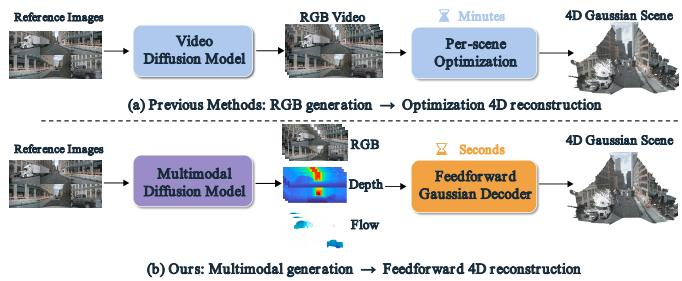
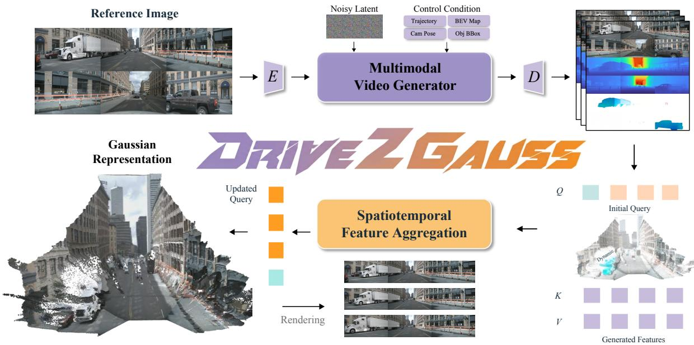
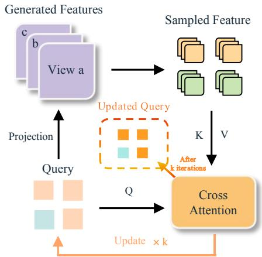
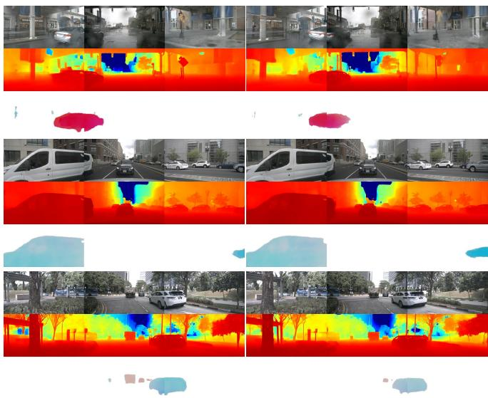
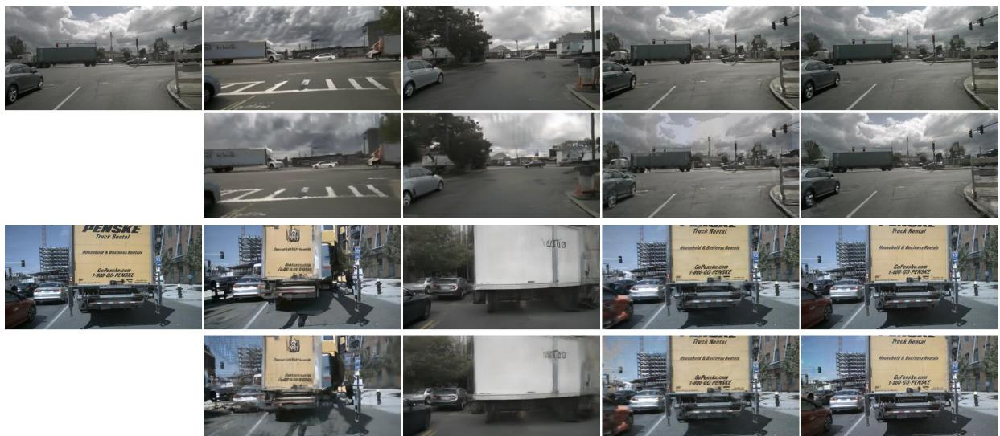
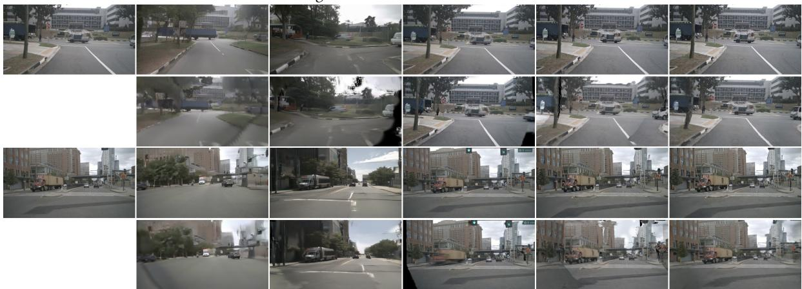
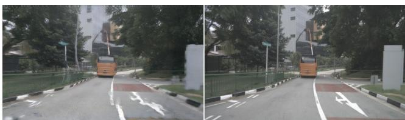

# Drive2Gauss: FeedForward 4D Gaussian Reconstruction from Multimodal Generative Driving Videos

Tong Zhao1,2, Zhiyuan Han2, Lin Chen3, Bowen Xie4 Yunxi Qiao5, Bohan Li6, Weiqing Xiao7, Gen Li8 Shu Han9, Xuyang Dai10, Cheng Bi10, Hao Zhao1, Chaojian Li11†

Abstract— Generating reusable driving environments requires both controllable future observations and an explicit representation that supports rendering from different viewpoints, yet existing methods still recover explicit scenes from generated RGB videos through optimization for each sequence. To overcome these limitations, we present Drive2Gauss, a feedforward framework that converts jointly generated RGB, metric depth, and dynamic flow into dynamic 4D Gaussian scenes. A Multimodal Video Generator predicts the three modalities from reference multiview images and future control signals. Furthermore, we introduce a Gaussian Query Decoder that uses depth to initialize sparse 3D queries and flow to associate the queries across time, and integrates appearance information through spatiotemporal feature aggregation and iterative query refinement. The reconstruction stage operates in a single feedforward pass without optimization for each scene. Extensive results on nuScenes demonstrate that our approach attains an FID of 6.38 and an FVD of 12.43 for future RGB generation, a PSNR of 29.91 dB when reconstructing its generated observations, and supports both direct rendering under lateral camera shifts and downstream video fixing. Code and more visualizations are available at https://zttt04. github.io/Drive2Gauss\_page/.

## I. INTRODUCTION

Controllable driving video generation produces future multiview observations conditioned on road layouts, object configurations, ego trajectories, and camera geometry [1]– [10]. Such observations provide a source of synthetic driving data, complementary to the real-world logs in large-scale driving benchmarks [11]–[14], but a video alone does not define an explicit scene that can be rendered repeatedly from different viewpoints. Dynamic Gaussian representations offer this capability by encoding scene appearance, geometry, and motion effectively within a unified representation [15]–[23].

Connecting generation with reconstruction requires geometric and temporal information that is consistent with the generated appearance. RGB-first pipelines, such as DriveDreamer4D, MagicDrive3D, DreamDrive, and Recon-Dreamer [24]–[27], recover explicit scenes from generated observations through per-scene optimization. Multimodal generators provide an alternative source of structural information: DiST-4D generates RGB and metric depth, while other models incorporate occupancy and further scene modalities [28]–[32]. As illustrated in Fig. 1, existing generative reconstruction pipelines recover each sequence from generated RGB through per-scene optimization, whereas our approach directly reconstructs jointly generated RGB, depth, and flow with a single feedforward decoder.

  
Fig. 1. Schematic comparison with RGB-first methods that use per-scene optimization. Drive2Gauss instead jointly generates RGB, metric depth, and dynamic flow, then constructs a 4D Gaussian scene with a feedforward decoder. The feedforward property refers to the reconstruction stage.

Feedforward methods have also advanced explicit scene construction. Generalizable models infer geometry or Gaussian primitives from sparse views [33]–[35], while DGGT and STORM recover dynamic scenes from driving images and PointForward aggregates multiview temporal features onto sparse 3D queries [36]–[38]. WorldSplat directly connects multimodal latent generation with a feedforward decoder that predicts pixel-aligned Gaussians [39]. These developments motivate a more specific question: how can jointly generated depth and motion guide sparse query construction and temporal feature aggregation for temporally coherent explicit driving scenes?

We address this question with Drive2Gauss, a framework for feedforward generative driving scene reconstruction. Specifically, its Multimodal Video Generator jointly predicts RGB, metric depth, and dynamic flow. The Gaussian Query Decoder then assigns these modalities distinct roles: depth initializes 3D anchors, flow associates them across context frames, and RGB features supply appearance information. In this framework, cross-attention aggregates features from multiple views and context frames, and iterative query refinement updates the locations where features are sampled. The resulting queries are then decoded into dynamic Gaussian primitives without per-scene optimization. In contrast to WorldSplat [39], our decoder uses generated flow to establish cross-frame correspondences. By drawing on jointly generated RGB, depth, and flow, it also removes the need for the scene graph and external depth estimator used by PointForward [38].

In summary, our main contributions are:

• We present Drive2Gauss, a framework that couples RGB, metric depth, and dynamic flow generation with feedforward 4D Gaussian reconstruction.

• We develop a Gaussian Query Decoder that combines depth-based initialization, flow-guided temporal association, spatiotemporal feature aggregation, and iterative query refinement in a feedforward manner.

• Extensive experiments on nuScenes [12] show that Drive2Gauss achieves state-of-the-art results in future video generation, feedforward 4D Gaussian reconstruction, and downstream view fixing, and the lowest FID under all evaluated lateral camera shifts.

## II. RELATED WORKS

## A. Driving Video Generation

Controllable driving generation has progressed from layout-conditioned multiview synthesis to predictive world models with longer horizons, broader scenario coverage, and richer control signals [1]–[10], [40]–[50]. These methods generate future observations or intermediate features for simulation and planning, but their outputs remain viewdependent rather than a persistent scene representation.

Beyond RGB, several driving generators add complementary scene signals: DiST-4D predicts metric depth together with RGB [28], occupancy-centric generators synthesize 3D scene structure directly [29], [32], [51], [52], and occupancy can also be estimated from images with Gaussian splatting [53]. Others instead reason jointly over multimodal 4D observations [54], synthesize views along flexible camera poses [55], or unify scene understanding and multimodal generation [30], [31]; comparable modeling appears outside driving as well, in generic video generation [56] and embodied manipulation [57]. A further line forecasts future 3D occupancy, either toward planning [58], [59] or as a pretext task for 4D scene understanding [60]. Drive2Gauss uses jointly generated RGB, depth, and flow as complementary inputs for explicit 4D reconstruction instead of producing only view-dependent observations.

## B. Driving Scene Reconstruction

Neural radiance fields and Gaussian splatting provide continuous or explicit representations for novel-view rendering [15], [61]–[63]. Their dynamic extensions model temporal deformation, while driving-specific methods decompose static backgrounds, moving objects, semantics, and motion fields in complex urban scenes [16]–[23], [64]–[68];

several systems further extend such reconstructions to simulation, extrapolation, and editable assets [69]–[72]. These approaches typically optimize a separate representation for each observed sequence. Generative reconstruction methods similarly convert synthesized observations into explicit scenes through per-scene optimization [24]–[27].

Feedforward reconstruction methods infer geometry or Gaussian representations directly from input observations [33]–[37], [73]–[80]. Generative approaches instead synthesize structured 3D or dynamic scene representations [81]– [83], and diffusion-based refinement further improves the rendered observations [84]. Temporal correspondence models further provide persistent point tracks or geometry across video frames [85], [86]. Among the closest methods, World-Splat [39] decodes multimodal latents into pixel-aligned Gaussians, while PointForward [38] initializes sparse 3D queries from external depth and associates dynamic queries through scene-graph instance transformations. Drive2Gauss instead obtains both cues from its Multimodal Video Generator: generated depth initializes 3D queries, and generated flow associates corresponding observations across context frames for feature aggregation.

## III. METHOD

Our goal is to construct a future dynamic 4D Gaussian scene from a given reference frame of multi-camera observations. To this end, Drive2Gauss consists of two key components: a Multimodal Video Generator and a Gaussian Query Decoder. Given the reference observations and control signals, the generator jointly predicts future RGB, depth, and dynamic flow, providing complementary appearance, geometric, and motion cues for reconstruction. The decoder then uses these multimodal observations to initialize queries, aggregate spatiotemporal features, and decode them into dynamic Gaussian primitives in a single feedforward pass. An overview of our framework is illustrated in Fig. 2.

## A. Multimodal Future Video Generation

Joint Multimodal Generation. Given multi-camera reference observations and the corresponding control signals, the Multimodal Video Generator jointly predicts future RGB, metric depth, and dynamic flow for all camera views. Let

$$
\mathbf { I } _ { \mathrm { r e f } } = \left\{ \mathbf { I } _ { \mathrm { r e f } , c } \right\} _ { c = 1 } ^ { C } ,\tag{1}
$$

where $C$ is the number of camera views and $\mathbf { I } _ { \mathrm { r e f } , c }$ is the reference frame of view c. For each of the $T$ future timestamps t, we define the control signal as:

$$
{ \bf S } _ { t } = \left( { \bf M } _ { t } , { \bf B } _ { t } , { \bf A } _ { t } , { \bf P } _ { t } \right) ,\tag{2}
$$

where ${ { \bf { M } } _ { t } }$ denotes the road map representation, $\mathbf { B } _ { t }$ denotes the 3D bounding boxes of traffic participants, $\mathbf { A } _ { t }$ describes the ego trajectory, and $\mathbf { P } _ { t }$ denotes the camera geometry, including the intrinsic matrices and extrinsic poses for each view. Given the reference observations and the sequence of future control signals $\{ \mathbf { S } _ { t } \} _ { t = 1 } ^ { T }$ , the generator predicts

$$
\left\{ \left( \mathbf { Z } _ { t } ^ { \mathrm { I } } , \mathbf { Z } _ { t } ^ { \mathrm { D } } , \mathbf { Z } _ { t } ^ { \mathrm { F } } \right) \right\} _ { t = 1 } ^ { T } = G _ { \theta } \left( \mathbf { I } _ { \mathrm { r e f } } , \left\{ \mathbf { S } _ { t } \right\} _ { t = 1 } ^ { T } \right) ,\tag{3}
$$

  
Fig. 2. Overview of Drive2Gauss. Reference multiview images and control conditions are processed by the Multimodal Video Generator to predict RGB, metric depth, and dynamic flow. Depth and flow initialize 3D queries, while RGB features from multiple views and context frames are aggregated by the Spatiotemporal Feature Aggregation module. The updated queries are decoded into dynamic Gaussian primitives for rendering.

where $G _ { \theta }$ denotes the video generator model with parameters $\theta ,$ and $\mathbf { Z } _ { t } ^ { \mathrm { I } } , \mathbf { Z } _ { t } ^ { \mathrm { D } }$ , and $\mathbf { Z } _ { t } ^ { \mathrm { F } }$ denote the latent representations of RGB, metric depth, and dynamic flow at the future timestamp t, respectively. Decoding these latent representations yields the corresponding future RGB, depth, and dynamic flow observations for each individual camera view.

The generator operates in a compressed spatiotemporal latent space to support joint multimodal generation across multiple camera views [87]. A pretrained 3D VAE [88] separately encodes RGB, metric depth, and dynamic flow into 16-channel latent features for each individual modality. The resulting features are concatenated along the channel dimension to form a unified 48-channel representation, which is processed by an STDiT denoising backbone with a ControlNet-style control pathway [89], [90]. Reference observations and map features are injected into the control pathway, while 3D bounding boxes, ego trajectories, and camera poses serve as conditioning inputs for both the main and control branches, following the same conditioning design of [7].

Geometric and Motion Supervision. For each training clip, we construct metric depth and dynamic flow as complementary geometric and motion cues for 4D Gaussian reconstruction. The constructed signals serve as supervision targets for a multimodal video generation model, which learns to predict the corresponding modalities for future video frames.

Metric depth. We follow the standard metric depth curation pipeline used in [28], which combines stereo depth from multiple views [91] and temporally aggregated LiDAR data, with dynamic objects and sky regions removed beforehand using semantic segmentation [92]. We then apply generative depth completion to obtain dense metric depth maps for all training frames [93].

Dynamic flow. We first estimate dense optical flow between adjacent RGB frames using SEA-RAFT [94]. Since the raw optical flow also contains motion caused by the ego vehicle and camera movement, we construct a dynamic mask from the annotated 3D bounding boxes. Objects whose annotated velocity exceeds a predefined threshold are treated as dynamic. Their 3D boxes are projected onto the image plane and spatially dilated, and SAM-based instance masks [95] are used to refine the object boundaries. The dynamic flow is then obtained by masking the optical flow:

$$
\mathbf F _ { t } ^ { \mathrm { d y n } } = \mathbf M _ { t } ^ { \mathrm { d y n } } \odot \mathbf F _ { t } ^ { \mathrm { o p t } } ,\tag{4}
$$

where $\mathbf { F } _ { t } ^ { \mathrm { o p t } }$ denotes the SEA-RAFT optical flow and $\mathbf { M } _ { t } ^ { \mathrm { d y n } }$ denotes the refined binary dynamic mask. Flow values outside the dynamic regions are assigned a neutral value and marked as invalid. This masked optical flow retains image correspondences within dynamic regions and effectively suppresses background flow. The target-frame depth and camera geometry are subsequently used to recover the associated positions in a common 3D reference coordinate system.

## B. Gaussian Query Decoder

Query Initialization. Following the point-aligned, querybased design of PointForward [38], we initialize 3D queries from the generated metric depth, and associate them across frames with the generated dynamic flow instead of an external depth estimator and scene-graph instance transformations. We sample a fixed number of queries in each camera view and context frame (the four consecutive frames of a reconstruction window), keeping only those pixels with a valid depth value. Query i is initialized from the pixel $( u _ { i } , v _ { i } )$ of view $c _ { i }$ at timestamp $t _ { i } ,$ with $d _ { i }$ its depth along the corresponding optical axis. We unproject it into 3D and transform it into the reference frame:

$$
\mathbf { x } _ { i } ^ { 0 } = \mathbf { T } _ { t _ { i }  r } \mathbf { T } _ { c _ { i }  l } [ d _ { i } \mathbf { K } _ { c _ { i } } ^ { - 1 } ( \begin{array} { l } { u _ { i } } \\ { v _ { i } } \\ { 1 } \end{array} ) ] ,\tag{5}
$$

where ${ \bf K } _ { c _ { i } }$ denotes the intrinsic matrix of view $c _ { i } ,$ l is the ego frame at timestamp $t _ { i } , r$ is the common reference frame, and $\mathbf { T } _ { c _ { i }  l }$ and $\mathbf { T } _ { t _ { i }  r }$ are the corresponding camera and temporal transformations. We also compute the ray direction $\mathbf { r } _ { i }$ and Plucker moment¨ m in the same reference frame, and sample the corresponding RGB value $\mathbf { I } _ { i }$ at the same pixel.

To capture temporal motion, we use the generated dynamic flow to associate each query across the surrounding context frames. For a given query from frame $s ,$ the flow displacement $\Delta \mathbf { p } _ { i } ^ { f }$ at its source pixel $\left( u _ { i } ^ { s } , v _ { i } ^ { s } \right) = \left( u _ { i } , v _ { i } \right)$ gives the corresponding tracked location in another context frame $f \colon$

$$
( u _ { i } ^ { f } , v _ { i } ^ { f } ) = ( u _ { i } ^ { s } , v _ { i } ^ { s } ) + \Delta \mathbf { p } _ { i } ^ { f } .\tag{6}
$$

The tracked location is unprojected using the corresponding target frame depth and transformed into the same reference coordinate system as the source point. Denoting the source and target positions by $\mathbf { x } _ { i } ^ { s }$ and $\mathbf { x } _ { i } ^ { f }$ , respectively, the temporal anchor of query i in the target frame $f$ is obtained as:

$$
\begin{array} { r } { \bar { \mathbf { x } } _ { i } ^ { f } = \mathbf { x } _ { i } ^ { s } + p _ { i } ^ { \mathrm { { f o w } } } \operatorname * { c l i p } _ { d _ { \operatorname* { m a x } } | f - s | } \left( \mathbf { x } _ { i } ^ { f } - \mathbf { x } _ { i } ^ { s } \right) , } \end{array}\tag{7}
$$

where $p _ { i } ^ { \mathrm { { f o w } } }$ is the dynamic probability from the flow, $d _ { \mathrm { m a x } }$ is the maximum displacement per frame, and clip $( \mathbf { v } ) \mathbf { \tau } = \mathbf { \tau }$ v min $( 1 , r / \| \mathbf { v } \| )$ limits a displacement to length $r _ { \ast }$ Thus a query with zero probability keeps its source position.

In summary, the query state is finally formed by combining the normalized 3D anchor, the source appearance, the camera ray information, and the corresponding motion prior:

$$
\mathbf q _ { i } = \left[ \mathrm { N o r m } ( \mathbf x _ { i } ^ { 0 } ) , \mathbf I _ { i } , \mathbf r _ { i } , \mathbf m _ { i } , p _ { i } ^ { \mathrm { f o w } } \right] .\tag{8}
$$

where Norm standardizes the anchor coordinates, and $\mathbf { m } _ { i } =$ $\mathbf { o } _ { c _ { i } } \times \mathbf { r } _ { i }$ is the Plucker moment of the given unit ray¨ $\mathbf { r } _ { i } ,$ with $\mathbf { o } _ { c _ { i } }$ the camera center position in the reference frame.

Spatiotemporal Feature Aggregation. Given the initialized and temporally associated queries, we aggregate visual evidence from multiple camera views and context frames to refine both query features and spatial locations (Fig. 3). For each query, its temporal anchor is projected into every valid context observation, and the corresponding feature is bilinearly sampled from the Turbo-VAED decoder feature map [96].

The sampled features are then aggregated through cross attention [97], where the query representation serves as the Query and the sampled multiview temporal features serve as the corresponding Keys and Values. Projections outside the image boundaries or associated with invalid tracks are excluded using a validity mask. At aggregation iteration $j ,$ a position head predicts a spatial offset $\Delta \mathbf { x } _ { i } ^ { j }$ from the aggregated query representation and updates the current position of query i iteratively, starting from the initial position $\mathbf { x } _ { i } ^ { 0 } { \mathrm { . } }$

$$
\mathbf { x } _ { i } ^ { j + 1 } = \mathbf { x } _ { i } ^ { j } + \Delta \mathbf { x } _ { i } ^ { j } .\tag{9}
$$

  
Fig. 3. Details of the spatiotemporal feature aggregation. Each query is projected into valid camera views and context frames to sample features from the generated observations, along with the corresponding key and value features. Cross-attention (Q, K, V) fuses the sampled features to update the current query location, and the update is repeated k times, after which the refined queries are passed to the Gaussian decoding stage for rendering.

The updated query positions are then reprojected to resample visual features, allowing feature aggregation and query refinement to proceed iteratively. This procedure is repeated k times, after which the refined query representations and 3D positions are passed to the Gaussian decoding stage.

Gaussian Decoding and Rendering. After spatiotemporal feature aggregation, each refined query contains an updated feature representation and a corresponding 3D position. We decode each query into a dynamic Gaussian primitive by predicting its spatial offset $\Delta \pmb { \mu } _ { i } .$ , scale ${ \bf s } _ { i } ,$ rotation $\rho _ { i }$ , opacity $o _ { i } ,$ appearance feature ${ \bf a } _ { i } ,$ and temporal lifespan $\ell _ { i } .$ The Gaussian center at timestamp t is defined as:

$$
\pmb { \mu } _ { i } ( t ) = \mathbf { x } _ { i } ( t ) + \Delta \pmb { \mu } _ { i } ,\tag{10}
$$

where ${ \bf x } _ { i } ( t )$ is the temporal anchor of query i at timestamp $t ,$ obtained by interpolating the tracked anchors of nearby context frames, and $\Delta \pmb { \mu } _ { i }$ is the decoded spatial correction. The lifespan parameter $\ell _ { i }$ controls the temporal visibility of each Gaussian, allowing static queries to remain stable while dynamic queries follow their estimated motion.

For rendering at timestamp $t ^ { \prime }$ and camera view $c ,$ the Gaussian primitives are projected using the corresponding camera geometry and rasterized with a differentiable Gaussian renderer [15]. Following SplatAD and UniSim [21], [98], each Gaussian stores a high-dimensional appearance feature representation rather than directly predicting the RGB color. The rendered feature map is finally decoded by a lightweight appearance UNet to produce the final RGB image outputs. Training Loss. The Gaussian Query Decoder is supervised directly in image space: the predicted Gaussians are rasterized, the appearance UNet converts the rendered features to RGB, and these images are compared with the target RGB observations. The decoder objective is defined as follows:

$$
\mathcal { L } = \mathcal { L } _ { \mathrm { r g b } } + \lambda _ { p } \mathcal { L } _ { \mathrm { L P I P S } } + \lambda _ { o } \mathcal { L } _ { \mathrm { o p a c i t y } } + \lambda _ { s } \mathcal { L } _ { \mathrm { s c a l e } } ,\tag{11}
$$

where $\mathcal { L } _ { \mathrm { r g b } }$ is the Charbonnier loss for pixel reconstruction and $\mathcal { L } _ { \mathrm { L P I P S } }$ measures perceptual similarity [99]. The terms

$\mathcal { L } _ { \mathrm { o p a c i t y } }$ and $\mathcal { L } _ { \mathrm { s c a l e } }$ regularize Gaussian opacity and scale, with weights $\lambda _ { o }$ and $\lambda _ { s } ; \lambda _ { p }$ weights the perceptual term.

## IV. EXPERIMENTS AND RESULTS

## A. Experimental Setup

Dataset. We train and evaluate Drive2Gauss on the nuScenes benchmark [12], which contains 1,000 urban driving scenes with six surround-view camera views. Following [100], we upsample the scene annotations, including 3D bounding boxes and road map information, from 2 Hz to 12 Hz to align them with the corresponding video generation setting. We follow the official split, using 700 scenes for training and 150 scenes for comprehensive validation.

Metrics. We use PSNR, SSIM [101], LPIPS [99], FID [102], and FVD [103] to comprehensively evaluate both the generated and rendered results. Higher PSNR and SSIM values are better, whereas lower LPIPS, FID, and FVD are preferred. Unless otherwise noted, the best and second best results in the comparison tables are clearly marked with best and second , respectively.

Implementation Details. Both components are trained on eight NVIDIA H20 GPUs in total. For multimodal generation, we initialize the generator from the pretrained DiST-T checkpoint [28] and train progressively at $2 2 4 \times 4 0 0$ and $4 2 4 \times 8 0 0$ resolutions. The training targets comprise RGB, metric depth, and dynamic flow, with the latter two constructed as described above in Sec. III-A. For reconstruction, each decoder training sample contains four frames from three camera views at $4 2 4 \times 8 0 0$ . We apply $k = 2$ refinement iterations and optimize the decoder for four days using AdamW with a learning rate of $1 \times 1 0 ^ { - 3 }$ and the corresponding image reconstruction objective in Sec. III-B, using loss weights $\lambda _ { p } = 0 . 2 , \lambda _ { o } = 0 . 0 0 1$ , and $\lambda _ { s } = 0 . 0 2$

## B. Future Video Generation

We evaluate future video generation along the original camera trajectories of nuScenes. Each sample consists of 6 camera views and 17 consecutive video frames at 424 × 800 image resolution and a rate of 12 Hz. Given the six RGB images from the first frame and the corresponding future control signals, Drive2Gauss is able to generate future RGB, metric depth, and dynamic flow jointly in a single pass.

Quantitative Comparison. We evaluate RGB generation quality using the FID and FVD metrics, as reported in Table I. Drive2Gauss obtains the lowest FID and FVD among the listed methods and is the only one that jointly generates RGB, metric depth, and dynamic flow in a unified model. Relative to DiST-T, which generates RGB and depth without dynamic flow, FID decreases from 6.83 to 6.38 and FVD more than halves from 22.67 to 12.43, indicating stronger temporal consistency. The complete generator therefore retains high RGB quality while supplying the geometric and motion cues that are required by 4D Gaussian reconstruction. Qualitative Comparison. The three generated modalities from the selected camera views are visualized in Fig. 4. The RGB outputs preserve the scene layout and vehicle appearance, while depth recovers the relative geometry of the road, vehicles, and background. The dynamic flow highlights the moving participants and provides temporal correspondences for the Gaussian Query Decoder module in our framework.

TABLE I  
COMPARISON OF FUTURE VIDEO GENERATION QUALITY AND OUTPUT MODALITIES. CHECKMARKS INDICATE THE MODALITIES GENERATED BY EACH METHOD. LOWER FID AND FVD VALUES ARE BETTER.
<table><tr><td>Method</td><td>RGB</td><td>Depth</td><td>Flow</td><td>FID ↓</td><td>FVD↓</td></tr><tr><td>Panacea [1]</td><td></td><td>X</td><td>X</td><td>16.96</td><td>139.00</td></tr><tr><td>MagicDrive [2]</td><td></td><td>X</td><td>X</td><td>16.20</td><td>217.94</td></tr><tr><td>Drive-WM [3]</td><td></td><td>X</td><td>X</td><td>15.80</td><td>122.70</td></tr><tr><td>WoVoGen [40]</td><td></td><td>X</td><td>X</td><td>27.60</td><td>417.70</td></tr><tr><td>Vista* [41]</td><td></td><td>X</td><td>X</td><td>13.97</td><td>112.65</td></tr><tr><td>DriveDreamer-2 [42]</td><td></td><td>X</td><td>X</td><td>11.20</td><td>55.70</td></tr><tr><td>MagicDriveDiT [7]</td><td></td><td>X</td><td>X</td><td>20.91</td><td>94.84</td></tr><tr><td>UniScene [29]</td><td>V</td><td>X</td><td>X</td><td>6.45</td><td>71.94</td></tr><tr><td>DiST-T [28]</td><td></td><td>V</td><td>X</td><td>6.83</td><td>22.67</td></tr><tr><td>Drive2Gauss</td><td></td><td>V</td><td>√</td><td>6.38</td><td>12.43</td></tr></table>

  
Fig. 4. Qualitative results of joint multimodal future generation. For each example, we visualize the generated RGB, metric depth, and dynamic flow from the front three camera views of each sample. The three modalities together provide complementary appearance, geometric, and motion information for the subsequent 4D Gaussian construction and rendering.

## C. Feedforward 4D Gaussian Reconstruction

Quantitative Comparison. We evaluate feedforward 4D Gaussian reconstruction on the sequences from the preceding generation experiment. With zero-based frame indices, the four resulting reconstruction windows are [0, 3], [4, 7], [8, 11], and [12, 15]. They cover frames 0–15 of each 17-frame sequence; frame 16 lies outside the range of these reconstruction windows. Each window supplies four consecutive frames from the three front-facing input cameras.

For the RGB generation baselines, we use the same DGGT [36] model, initialized from its Waymo pretrained weights and finetuned on nuScenes, to reconstruct 4D Gaussian scenes from their generated RGB videos. Drive2Gauss instead directly reconstructs the scene from its generated RGB, metric depth, and dynamic flow, so the comparison covers complete pipelines with different inputs and decoders.

Table II reports the highest reconstruction PSNR and

TABLE II  
QUANTITATIVE COMPARISON OF FEEDFORWARD 4D GAUSSIAN RECONSTRUCTION. PSNR, LPIPS, AND SSIM ARE COMPUTED AGAINST THE GENERATED RGB OBSERVATIONS, WHILE FID AND FVD ARE COMPUTED AGAINST THE ORIGINAL NUSCENES VIDEOS.
<table><tr><td>Method</td><td>PSNR ↑</td><td>LPIPS ↓</td><td>SSIM ↑</td><td>FID ↓</td><td>FVD ↓</td></tr><tr><td>Panacea + DGGT [1], [36]</td><td>26.23</td><td>0.261</td><td>0.790</td><td>50.24</td><td>181.51</td></tr><tr><td>MagicDrive-V2 + DGGT [7], [36]</td><td>28.12</td><td>0.230</td><td>0.830</td><td>68.09</td><td>370.59</td></tr><tr><td>DiST-4D + DGGT [28], [36]</td><td>27.76</td><td>0.200</td><td>0.825</td><td>30.17</td><td>90.70</td></tr><tr><td>Drive2Gauss</td><td>29.91</td><td>0.101</td><td>0.884</td><td>12.85</td><td>32.01</td></tr></table>

SSIM and the lowest LPIPS, FID, and FVD for Drive2Gauss among all the evaluated pipelines. Its PSNR of 29.91 dB measures fidelity to its own generated RGB observations. PSNR, SSIM, and LPIPS use each pipeline’s generated observations as the reference, whereas FID and FVD com pare the rendered outputs with original nuScenes videos. Together, these metrics describe input reconstruction fidelity and rendered video quality; they do not separately attribute the improvements to the generator and decoder components. Qualitative Comparison. Each generated RGB observation is compared directly in Fig. 5 with the rendering obtained from its corresponding reconstructed 4D Gaussian scene. The paired rows expose differences in road boundaries, vehicle contours, and lane markings. Drive2Gauss maintains closer correspondence, whereas RGB-only pipelines show more blur and visible discrepancies around dynamic scene objects.

## D. Novel View Synthesis

Quantitative Comparison. Following FreeVS [55], we evaluate novel view synthesis under lateral camera shifts of τ ∈ {±1 m, ±2 m, ±4 m}. We use the same four reconstruction windows and three front-facing input views as in Sec. IV-C. The front camera is shifted laterally while its intrinsics, orientation, and timestamps remain unchanged. We evaluate the rendered results using FID and FVD relative to the nuScenes video distribution. RGB baselines use the same finetuned DGGT model, whereas Drive2Gauss directly constructs the scene from the generated RGB, depth, and flow; rendering is evaluated on the CAM FRONT view.

Drive2Gauss achieves the lowest FID at all the evaluated shifts and the lowest FVD at ±1 m and ±2 m (Table III). At ±1 m, its FVD is 281.27, compared with 562.22 for the DiST-T + DGGT baseline. At ±4 m, however, its FVD of 1025.44 exceeds the 956.98 obtained by DiST-T + DGGT, which indicates weaker video distribution quality by this metric at the largest shift. These distributional metrics primarily assess rendered visual quality rather than the pointwise geometric accuracy at the shifted camera viewpoints.

Qualitative Comparison. Renderings after lateral translations of the front camera are compared directly in Fig. 6. At small shifts, Drive2Gauss preserves the lane boundaries, vehicle contours, and nearby background structures. With larger shifts, all methods degrade, but Drive2Gauss retains more stable geometry; the remaining artifacts expose the sensitivity to generated geometry and scene coverage quality.

TABLE III  
DIRECT NOVEL-VIEW SYNTHESIS UNDER LATERAL CAMERA SHIFTS FROM GENERATED FUTURE OBSERVATIONS. LOWER FID AND FVD ARE BETTER.
<table><tr><td rowspan="2">Method</td><td colspan="2">±1 m</td><td colspan="2">±2 m</td><td colspan="2">±4 m</td></tr><tr><td>FID</td><td>FVD</td><td>FID</td><td>FVD</td><td>FID</td><td>FVD ↓</td></tr><tr><td>DreamDrive [26]</td><td>72.20</td><td>381.93</td><td>143.15</td><td>780.71</td><td>233.15</td><td>1271.42</td></tr><tr><td>Panacea + DGGT [1], [36]</td><td>142.32</td><td>664.29</td><td>190.57</td><td>844.70</td><td></td><td>251.93 1085.29</td></tr><tr><td>MagicDrive-V2 + DGGT [7], [36]</td><td>86.40</td><td>1032.22</td><td>109.34</td><td>1241.29</td><td></td><td>150.051481.17</td></tr><tr><td>DiST-T + DGGT [28], [36]</td><td>53.44</td><td>562.22</td><td>73.55</td><td>744.32</td><td>2107.93</td><td>956.98</td></tr><tr><td>Drive2Gauss</td><td>38.38</td><td>281.27</td><td>59.60</td><td>605.65</td><td>101.23</td><td>1025.44</td></tr></table>

TABLE IV

VIEW-FIXING PERFORMANCE UNDER LATERAL CAMERA SHIFTS. LOWER FID AND FVD ARE BETTER.
<table><tr><td rowspan="2">Method</td><td colspan="2">±1 m</td><td colspan="2">±2 m</td><td colspan="2">±4 m</td></tr><tr><td>FID ↓</td><td>FVD</td><td>FID √</td><td>FVD</td><td>↓ FID</td><td>↓ FVD ↓</td></tr><tr><td>DiST-S [28]</td><td>10.12</td><td>45.14</td><td>12.97</td><td>68.80</td><td>17.57</td><td>105.29</td></tr><tr><td>GaussianDWM [31]</td><td>8.36</td><td>44.50</td><td>11.27</td><td>68.17</td><td>18.81</td><td>116.40</td></tr><tr><td>WorldSplat [39]</td><td>8.25</td><td>40.17</td><td>11.26</td><td>47.41</td><td>13.38</td><td>64.07</td></tr><tr><td>RGB-D + SPVC [104]</td><td>10.37</td><td>25.99</td><td>11.19</td><td>30.68</td><td>12.82</td><td>41.29</td></tr><tr><td>Drive2Gauss + SPVC [104]</td><td>6.68</td><td>21.25</td><td>7.85</td><td>24.28</td><td>9.00</td><td>35.73</td></tr></table>

## E. Application to View Fixing

Quantitative Comparison. We further evaluate whether the reconstructed 4D Gaussian scenes can be reused by a downstream view-fixing method. We apply SPVC [104] to Drive2Gauss and introduce an RGB-D projection baseline that directly lifts the generated RGB and depth into Gaussian primitives before applying the same SPVC module. Table IV also lists alternative baseline pipelines. These methods operate on real observations, whereas Drive2Gauss reconstructs scenes from generated multimodal future observations.

Drive2Gauss + SPVC obtains the lowest FID and FVD in Table IV. Relative to RGB-D + SPVC, it improves both metrics at every shift, supporting the use of learned Gaussian reconstruction as input to video fixing. These scores characterize the combined reconstruction and SPVC pipeline; direct Gaussian rendering is evaluated separately in Table III.

Qualitative Comparison. The effect of applying SPVC after a lateral camera shift is illustrated in Fig. 7. The shifted rendering distorts the road markings and nearby vehicle, while view fixing restores local road structure and foreground alignment. This supports using the reconstructed scene as an intermediate representation for downstream correction.

## F. Ablation Studies

Component Ablation. We ablate the three design choices of the Gaussian Query Decoder. All variants share the same generated observations, query budget, four-frame three-view context, and training schedule; only the component under study is modified. For w/o Init Flow, we set the flow-derived temporal displacement to zero during query initialization, retaining the geometric anchors provided by source-frame metric depth. For w/o Cross-Attention, we replace crossattention with an MLP-based weighted fusion module that predicts observation-wise weights for feature aggregation.

GT  
Panacea  
MagicDrivev2  
DiSTT  
Ours  
  
Fig. 5. Qualitative comparison of feedforward 4D Gaussian reconstruction. For each method, the upper row shows the generated RGB observation used as input, while the lower row shows the corresponding rendering from the reconstructed 4D Gaussian scene. The comparison highlights how well each method preserves scene layout, object appearance, and local geometric details between inference and rendering.

GT  
Panacea  
Magicdrivev2  
Dreamdrive  
DiSTT  
Ours  
  
Fig. 6. Qualitative comparison of novel-view rendering under lateral camera shifts. For each scene, the upper row shows the generated or ground-truth observation, while the lower row shows the corresponding rendering from the reconstructed 4D Gaussian scene.

Shi 1m  
Fix  
  
Fig. 7. Qualitative example of the downstream view fixing pipeline in our framework. Applying SPVC to the Drive2Gauss reconstruction substantially reduces the artifacts introduced by the lateral camera shift.

For w/o Iterative Refinement, we remove the iterative position update and feature resampling after initial aggregation stage.

Table V shows that all three choices contribute: removing any one of them lowers both PSNR and SSIM, most severely for the generated flow and least for cross-attention, so flowguided query association and iterative refinement of query positions matter more than specific aggregation operator.

TABLE V  
ABLATION STUDY OF THE GAUSSIAN QUERY DECODER. METRICS FOLLOW THE RECONSTRUCTION PROTOCOL OF TABLE II.
<table><tr><td>Variant</td><td>PSNR ↑</td><td>SSIM ↑</td></tr><tr><td>w/o Init Flow</td><td>27.89</td><td>0.814</td></tr><tr><td>w/o Iterative Refinement</td><td>28.03</td><td>0.827</td></tr><tr><td>w/o Cross-Attention</td><td>28.76</td><td>0.849</td></tr><tr><td>Drive2Gauss (Full)</td><td>29.91</td><td>0.884</td></tr></table>

Query Number Sensitivity. We further study how the number of Gaussian queries affects reconstruction quality and cost, varying only the number of initialized queries per frame-view while every other setting remains completely as above. Table VI reports the resulting quality together with the training peak memory and the inference time per sample. Quality improves with the query budget, but the PSNR gain shrinks as the budget grows while SSIM continues to improve, so additional queries mainly refine structural fidelity at the upper end of the studied query range considered here. Training memory grows roughly linearly with the query budget in our setting and the largest configuration exceeds the memory available on a single H20 GPU, whereas inference time grows only sublinearly. Memory rather than inference cost is therefore the main binding constraint, and we use 960K queries in all main experiments by default.

TABLE VI  
SENSITIVITY TO THE NUMBER OF GAUSSIAN QUERIES. TRAINING PEAK MEMORY IS REPORTED IN GB, WHILE INFERENCE TIME IS REPORTED IN SECONDS.
<table><tr><td>Queries</td><td>PSNR ↑</td><td>SSIM ↑</td><td>Train Peak Memory (GB)</td><td>Inference Time (s)</td></tr><tr><td>480K</td><td>28.87</td><td>0.811</td><td>45</td><td>0.96</td></tr><tr><td>720K</td><td>29.62</td><td>0.836</td><td>67</td><td>1.11</td></tr><tr><td>960K</td><td>29.91</td><td>0.884</td><td>92</td><td>1.29</td></tr><tr><td>1200K</td><td>1</td><td>1</td><td>OOM</td><td>/</td></tr></table>

## V. CONCLUSION

In this paper, we present Drive2Gauss, a framework for feedforward generative driving scene reconstruction. Its Multimodal Video Generator jointly predicts RGB, metric depth, and dynamic flow. These complementary predictions guide the Gaussian Query Decoder to construct reusable 4D Gaussian scenes through depth-based initialization and flowguided aggregation, without per-scene optimization. Experiments on nuScenes demonstrate state-of-the-art performance in video generation, 4D reconstruction, and view fixing, with the lowest FID across all evaluated lateral camera shifts.

## REFERENCES

[1] Y. Wen, Y. Zhao, Y. Liu, F. Jia, Y. Wang, C. Luo, C. Zhang, T. Wang, X. Sun, and X. Zhang, “Panacea: Panoramic and controllable video generation for autonomous driving,” in Proceedings ofthe IEEE/CVF Conference on Computer Vision and Pattern Recognition (CVPR), 2024, pp. 6902–6912.

[2] R. Gao, K. Chen, E. Xie, L. Hong, Z. Li, D.-Y. Yeung, and Q. Xu, “MagicDrive: Street view generation with diverse 3D geometry control,” in International Conference on Learning Representations (ICLR), 2024.

[3] Y. Wang, J. He, L. Fan, H. Li, Y. Chen, and Z. Zhang, “Driving into the future: Multiview visual forecasting and planning with world model for autonomous driving,” in Proceedings of the IEEE/CVF Conference on Computer Vision and Pattern Recognition (CVPR), 2024, pp. 14 749–14 759.

[4] X. Wang, Z. Zhu, G. Huang, X. Chen, J. Zhu, and J. Lu, “Drive-Dreamer: Towards real-world-drive world models for autonomous driving,” in European Conference on Computer Vision (ECCV), 2024, pp. 55–72.

[5] X. Li, Y. Zhang, and X. Ye, “DrivingDiffusion: Layout-guided multiview driving scenarios video generation with latent diffusion model,” in European Conference on Computer Vision (ECCV), 2024, pp. 469– 485.

[6] J. Yang, S. Gao, Y. Qiu, L. Chen, T. Li, B. Dai, K. Chitta, P. Wu, J. Zeng, P. Luo, J. Zhang, A. Geiger, Y. Qiao, and H. Li, “Generalized predictive model for autonomous driving,” in Proceedings of the IEEE/CVF Conference on Computer Vision and Pattern Recognition (CVPR), 2024, pp. 14 662–14 672.

[7] R. Gao, K. Chen, B. Xiao, L. Hong, Z. Li, and Q. Xu, “MagicDrive-V2: High-resolution long video generation for autonomous driving with adaptive control,” in Proceedings ofthe IEEE/CVF International Conference on Computer Vision (ICCV), 2025, pp. 28 135–28 144.

[8] A. Hu, L. Russell, H. Yeo, Z. Murez, G. Fedoseev, A. Kendall, J. Shotton, and G. Corrado, “GAIA-1: A generative world model for autonomous driving,” arXiv preprint arXiv:2309.17080, 2023.

[9] X. Hu, M. Jia, X. Guo, Q. Zhang, X.-x. Long, and W. Yin, “DrivingWorld: Constructing world model for autonomous driving via video GPT,” in International Conference on Pattern Recognition (ICPR), 2026, pp. 276–291.

[10] R. Chen, Z. Wu, Y. Liu, Y. Guo, J. Ni, H. Xia, and S. Xia, “UniMLVG: Unified framework for multi-view long video generation with comprehensive control capabilities for autonomous driving,” in Proceedings ofthe IEEE/CVF International Conference on Computer Vision (ICCV), 2025, pp. 25 453–25 463.

[11] P. Sun, H. Kretzschmar, X. Dotiwalla, A. Chouard, V. Patnaik, P. Tsui, J. Guo, Y. Zhou, Y. Chai, B. Caine, V. Vasudevan, W. Han, J. Ngiam, H. Zhao, A. Timofeev, S. Ettinger, M. Krivokon, A. Gao, A. Joshi, Y. Zhang, J. Shlens, Z. Chen, and D. Anguelov, “Scalability in perception for autonomous driving: Waymo open dataset,” in Proceedings of the IEEE/CVF Conference on Computer Vision and Pattern Recognition (CVPR), 2020, pp. 2446–2454.

[12] H. Caesar, V. Bankiti, A. H. Lang, S. Vora, V. E. Liong, Q. Xu, A. Krishnan, Y. Pan, G. Baldan, and O. Beijbom, “nuScenes: A multimodal dataset for autonomous driving,” in Proceedings of the IEEE/CVF Conference on Computer Vision and Pattern Recognition (CVPR), 2020, pp. 11 621–11 631.

[13] A. Geiger, P. Lenz, and R. Urtasun, “Are we ready for autonomous driving? the KITTI vision benchmark suite,” in Proceedings of the IEEE Conference on Computer Vision and Pattern Recognition (CVPR), 2012, pp. 3354–3361.

[14] M. Alibeigi, W. Ljungbergh, A. Tonderski, G. Hess, A. Lilja, C. Lindstrom, D. Motorniuk, J. Fu, J. Widahl, and C. Petersson, “Zenseact¨ open dataset: A large-scale and diverse multimodal dataset for autonomous driving,” in Proceedings of the IEEE/CVF International Conference on Computer Vision (ICCV), 2023, pp. 20 121–20 131.

[15] B. Kerbl, G. Kopanas, T. Leimkuhler, and G. Drettakis, “3D Gaussian¨ splatting for real-time radiance field rendering,” ACM Transactions on Graphics, vol. 42, no. 4, pp. 1–14, 2023, art. no. 139.

[16] G. Wu, T. Yi, J. Fang, L. Xie, X. Zhang, W. Wei, W. Liu, Q. Tian, and X. Wang, “4D Gaussian splatting for real-time dynamic scene rendering,” in Proceedings of the IEEE/CVF Conference on Computer Vision and Pattern Recognition (CVPR), 2024, pp. 20 310–20 320.

[17] Z. Yang, X. Gao, W. Zhou, S. Jiao, Y. Zhang, and X. Jin, “Deformable 3D Gaussians for high-fidelity monocular dynamic scene reconstruction,” in Proceedings of the IEEE/CVF Conference on Computer Vision and Pattern Recognition (CVPR), 2024, pp. 20 331–20 341.

[18] Y. Yan, H. Lin, C. Zhou, W. Wang, H. Sun, K. Zhan, X. Lang, X. Zhou, and S. Peng, “Street Gaussians: Modeling dynamic urban scenes with Gaussian splatting,” in Proceedings of the European Conference on Computer Vision (ECCV), 2024, pp. 156–173.

[19] X. Zhou, Z. Lin, X. Shan, Y. Wang, D. Sun, and M.-H. Yang, “DrivingGaussian: Composite Gaussian splatting for surrounding dynamic autonomous driving scenes,” in Proceedings of the IEEE/CVF Conference on Computer Vision and Pattern Recognition (CVPR), 2024, pp. 21 634–21 643.

[20] Z. Chen, J. Yang, J. Huang, R. de Lutio, J. Martinez Esturo, B. Ivanovic, O. Litany, Z. Gojcic, S. Fidler, M. Pavone, L. Song, and Y. Wang, “OmniRe: Omni urban scene reconstruction,” in International Conference on Learning Representations (ICLR), 2025.

[21] G. Hess, C. Lindstrom, M. Fatemi, C. Petersson, and L. Svensson,¨ “SplatAD: Real-time LiDAR and camera rendering with 3D Gaussian splatting for autonomous driving,” in Proceedings of the IEEE/CVF Conference on Computer Vision and Pattern Recognition (CVPR), 2025, pp. 11 982–11 992.

[22] H. Zhou, J. Shao, L. Xu, D. Bai, W. Qiu, B. Liu, Y. Wang, A. Geiger, and Y. Liao, “HUGS: Holistic urban 3D scene understanding via Gaussian splatting,” in Proceedings of the IEEE/CVF Conference on Computer Vision and Pattern Recognition (CVPR), 2024, pp. 21 336– 21 345.

[23] C. Peng, C. Zhang, Y. Wang, C. Xu, Y. Xie, W. Zheng, K. Keutzer, M. Tomizuka, and W. Zhan, “DeSiRe-GS: 4D street Gaussians for static-dynamic decomposition and surface reconstruction for urban driving scenes,” in Proceedings of the IEEE/CVF Conference on

Computer Vision and Pattern Recognition (CVPR), 2025, pp. 6782– 6791.

[24] G. Zhao, C. Ni, X. Wang, Z. Zhu, X. Zhang, Y. Wang, G. Huang, X. Chen, B. Wang, Y. Zhang, W. Mei, and X. Wang, “Drive-Dreamer4D: World models are effective data machines for 4D driving scene representation,” in Proceedings of the IEEE/CVF Conference on Computer Vision and Pattern Recognition (CVPR), 2025, pp. 12 015–12 026.

[25] R. Gao, K. Chen, Z. Li, L. Hong, Z. Li, and Q. Xu, “MagicDrive3D: Controllable 3D generation for any-view rendering in street scenes,” in Proceedings of the IEEE/CVF Winter Conference on Applications of Computer Vision (WACV), 2026, pp. 5724–5733.

[26] J. Mao, B. Li, B. Ivanovic, Y. Chen, Y. Wang, Y. You, C. Xiao, D. Xu, M. Pavone, and Y. Wang, “DreamDrive: Generative 4D scene modeling from street view images,” in 2025 IEEE International Conference on Robotics and Automation (ICRA), 2025, pp. 367–374.

[27] C. Ni, G. Zhao, X. Wang, Z. Zhu, W. Qin, G. Huang, C. Liu, Y. Chen, Y. Wang, X. Zhang, Y. Zhan, K. Zhan, P. Jia, X. Lang, X. Wang, and W. Mei, “ReconDreamer: Crafting world models for driving scene reconstruction via online restoration,” in Proceedings of the IEEE/CVF Conference on Computer Vision and Pattern Recognition (CVPR), 2025, pp. 1559–1569.

[28] J. Guo, Y. Ding, X. Chen, S. Chen, B. Li, Y. Zou, X. Lyu, F. Tan, X. Qi, Z. Li, and H. Zhao, “DiST-4D: Disentangled spatiotemporal diffusion with metric depth for 4D driving scene generation,” in Proceedings ofthe IEEE/CVF International Conference on Computer Vision (ICCV), 2025, pp. 27 231–27 241.

[29] B. Li, J. Guo, H. Liu, Y. Zou, Y. Ding, X. Chen, H. Zhu, F. Tan, C. Zhang, T. Wang, S. Zhou, L. Zhang, X. Qi, H. Zhao, M. Yang, W. Zeng, and X. Jin, “UniScene: Unified occupancy-centric driving scene generation,” in Proceedings of the IEEE/CVF Conference on Computer Vision and Pattern Recognition (CVPR), 2025, pp. 11 971– 11 981.

[30] B. Li, Z. Ma, D. Du, B. Peng, Z. Liang, Z. Liu, X. Guo, Z. Zhu, C. Ma, Y. Jin, X. Jin, H. Zhao, and W. Zeng, “OmniNWM: Omniscient driving navigation world models,” in European Conference on Computer Vision (ECCV), 2026, pp. 187–208.

[31] T. Deng, X. Chen, Y. Chen, Q. Chen, Y. Xu, L. Yang, L. Xu, Y. Zhang, B. Zhang, W. Huang, and H. Wang, “GaussianDWM: 3D Gaussian driving world model for unified scene understanding and multi-modal generation,” in Proceedings of the IEEE/CVF Conference on Computer Vision and Pattern Recognition (CVPR), 2026, pp. 10 656–10 667.

[32] L. Wang, W. Zheng, Y. Ren, H. Jiang, Z. Cui, H. Yu, and J. Lu, “OccSora: 4D occupancy generation models as world simulators for autonomous driving,” IEEE Transactions on Image Processing, vol. 35, pp. 4947–4960, 2026.

[33] Y. Chen, H. Xu, C. Zheng, B. Zhuang, M. Pollefeys, A. Geiger, T.-J. Cham, and J. Cai, “MVSplat: Efficient 3D Gaussian splatting from sparse multi-view images,” in European Conference on Computer Vision (ECCV), 2024, pp. 370–386.

[34] K. Zhang, S. Bi, H. Tan, Y. Xiangli, N. Zhao, K. Sunkavalli, and Z. Xu, “GS-LRM: Large reconstruction model for 3D Gaussian splatting,” in European Conference on Computer Vision (ECCV), 2024, pp. 1–19.

[35] J. Wang, M. Chen, N. Karaev, A. Vedaldi, C. Rupprecht, and D. Novotny, “VGGT: Visual geometry grounded transformer,” in Proceedings of the IEEE/CVF Conference on Computer Vision and Pattern Recognition (CVPR), 2025, pp. 5294–5306.

[36] X. Chen, Z. Xiong, Y. Chen, G. Li, N. Wang, H. Luo, L. Chen, H. Sun, B. Wang, G. Chen, H. Li, Y.-Q. Zhang, H. Ye, and H. Zhao, “DGGT: Feedforward 4D reconstruction of dynamic driving scenes using unposed images,” in Proceedings of the IEEE/CVF Conference on Computer Vision and Pattern Recognition (CVPR), 2026, pp. 1265–1276.

[37] J. Yang, J. Huang, B. Ivanovic, Y. Chen, Y. Wang, B. Li, Y. You, A. Sharma, M. Igl, P. Karkus, D. Xu, Y. Wang, and M. Pavone, “STORM: Spatio-temporal reconstruction model for large-scale outdoor scenes,” in International Conference on Learning Representations (ICLR), 2025.

[38] C. Chi, X. Wang, H. Luo, M. Tu, G. Xu, Z. Zhang, B. Wang, G. Chen, H. Ye, S. Peng, X. Yang, and H. Sun, “PointForward: Feedforward driving reconstruction through point-aligned representations,” arXiv preprint arXiv:2605.11594, 2026.

[39] Z. Zhu, Z. Wu, Z. Zhu, L. Zhou, H. Sun, B. Wang, K. Ma, G. Chen,

H. Ye, J. Xie, and J. Yang, “WorldSplat: Gaussian-centric feedforward 4D scene generation for autonomous driving,” in International Conference on Learning Representations (ICLR), 2026.

[40] J. Lu, Z. Huang, Z. Yang, J. Zhang, and L. Zhang, “WoVoGen: World volume-aware diffusion for controllable multi-camera driving scene generation,” in European Conference on Computer Vision (ECCV), 2024, pp. 329–345.

[41] S. Gao, J. Yang, L. Chen, K. Chitta, Y. Qiu, A. Geiger, J. Zhang, and H. Li, “Vista: A generalizable driving world model with high fidelity and versatile controllability,” in Advances in Neural Information Processing Systems, vol. 37, 2024, pp. 91 560–91 596.

[42] G. Zhao, X. Wang, Z. Zhu, X. Chen, G. Huang, X. Bao, and X. Wang, “DriveDreamer-2: LLM-enhanced world models for diverse driving video generation,” in Proceedings of the AAAI Conference on Artificial Intelligence, vol. 39, no. 10, 2025, pp. 10 412–10 420.

[43] X. Guo, C. Ding, H. Dou, X. Zhang, W. Tang, and W. Wu, “InfinityDrive: Breaking time limits in driving world models,” arXiv preprint arXiv:2412.01522, 2024.

[44] L. Wang, W. Zheng, D. Du, Y. Zhang, Y. Ren, H. Jiang, Z. Cui, H. Yu, J. Zhou, and S. Zhang, “Authentic 4D driving simulation with a video generation model,” in Proceedings of the IEEE/CVF International Conference on Computer Vision (ICCV), 2025, pp. 28 892–28 902.

[45] B. Huang, Y. Wen, Y. Zhao, Y. Hu, Y. Liu, F. Jia, W. Mao, T. Wang, C. Zhang, C. W. Chen, Z. Chen, and X. Zhang, “SubjectDrive: Scaling generative data in autonomous driving via subject control,” in Proceedings of the AAAI Conference on Artificial Intelligence, vol. 39, no. 4, 2025, pp. 3617–3625.

[46] NVIDIA, H. A. Alhaija, J. Alvarez, M. Bala, T. Cai, T. Cao, L. Cha, J. Chen, M. Chen, F. Ferroni, S. Fidler, D. Fox, Y. Ge, J. Gu, A. Hassani, M. Isaev, P. Jannaty, S. Lan, T. Lasser, H. Ling, M.-Y. Liu, X. Liu, Y. Lu, A. Luo, Q. Ma, H. Mao, F. Ramos, X. Ren, T. Shen, X. Sun, S. Tang, T.-C. Wang, J. Wu, J. Xu, S. Xu, K. Xie, Y. Ye, X. Yang, X. Zeng, and Y. Zeng, “Cosmos-Transfer1: Conditional world generation with adaptive multimodal control,” arXiv preprint arXiv:2503.14492, 2025.

[47] X. Ren, T. Shen, J. Huang, H. Ling, Y. Lu, M. Nimier-David, T. Muller, A. Keller, S. Fidler, and J. Gao, “GEN3C: 3D-informed¨ world-consistent video generation with precise camera control,” in Proceedings of the IEEE/CVF Conference on Computer Vision and Pattern Recognition (CVPR), 2025, pp. 6121–6132.

[48] Y. Lu, X. Ren, J. Yang, T. Shen, Z. Wu, J. Gao, Y. Wang, S. Chen, M. Chen, S. Fidler, and J. Huang, “InfiniCube: Unbounded and controllable dynamic 3D driving scene generation with world-guided video models,” in Proceedings of the IEEE/CVF International Conference on Computer Vision (ICCV), 2025, pp. 27 272–27 283.

[49] J. Jiang, G. Hong, L. Zhou, E. Ma, H. Hu, X. Zhou, J. Xiang, F. Liu, K. Yu, H. Sun, K. Zhan, P. Jia, and M. Zhang, “DiVE: DiT-based video generation with enhanced control,” arXiv preprint arXiv:2409.01595, 2024.

[50] Y. Ji, Z. Zhu, Z. Zhu, K. Xiong, M. Lu, Z. Li, L. Zhou, H. Sun, B. Wang, and T. Lu, “CoGen: 3D consistent video generation via adaptive conditioning for autonomous driving,” arXiv preprint arXiv:2503.22231, 2025.

[51] B. Li, X. Jin, H. Zhu, H. Liu, R. Li, J. Guo, K. Cai, C. Ma, Y. Jin, H. Zhao, X. Yang, and W. Zeng, “Scaling up occupancy-centric driving scene generation: Dataset and method,” IEEE Transactions on Pattern Analysis and Machine Intelligence, vol. 48, no. 10, pp. 12 384–12 400, 2026.

[52] T. Yan, D. Wu, W. Han, J. Jiang, X. Zhou, K. Zhan, C.-Z. Xu, and J. Shen, “DrivingSphere: Building a high-fidelity 4D world for closed-loop simulation,” in Proceedings ofthe IEEE/CVF Conference on Computer Vision and Pattern Recognition (CVPR), 2025, pp. 27 531–27 541.

[53] W. Gan, F. Liu, H. Xu, N. Mo, and N. Yokoya, “GaussianOcc: Fully self-supervised and efficient 3D occupancy estimation with Gaussian splatting,” in Proceedings of the IEEE/CVF International Conference on Computer Vision (ICCV), 2025, pp. 28 980–28 990.

[54] P. Liu, H. Lu, H. Liu, H. Liu, X. Liu, R. Yao, S. E. Li, and J. Ma, “OmniScene: Attention-augmented multimodal 4D scene understanding for autonomous driving,” arXiv preprint arXiv:2509.19973, 2025.

[55] Q. Wang, L. Fan, Y. Wang, Y. Chen, and Z. Zhang, “FreeVS: Generative view synthesis on free driving trajectory,” in International Conference on Learning Representations (ICLR), 2025.

[56] Y. Bai, S. Fang, C. Yu, F. Wang, and Q. Huang, “GeoVideo:

Introducing geometric regularization into video generation model,” in Advances in Neural Information Processing Systems, vol. 38, 2025.

[57] H. Zhao, X. Zhao, S. Huang, X. Li, D. Zhao, and Z. Li, “RynnWorld-4D: 4D embodied world models for robotic manipulation,” arXiv preprint arXiv:2607.06559, 2026.

[58] W. Zheng, W. Chen, Y. Huang, B. Zhang, Y. Duan, and J. Lu, “OccWorld: Learning a 3D occupancy world model for autonomous driving,” in European Conference on Computer Vision (ECCV), 2024, pp. 55–72.

[59] Y. Yang, J. Mei, Y. Ma, S. Du, W. Chen, Y. Qian, Y. Feng, and Y. Liu, “Driving in the occupancy world: Vision-centric 4D occupancy forecasting and planning via world models for autonomous driving,” in Proceedings of the AAAI Conference on Artificial Intelligence, vol. 39, no. 9, 2025, pp. 9327–9335.

[60] C. Min, D. Zhao, L. Xiao, J. Zhao, X. Xu, Z. Zhu, L. Jin, J. Li, Y. Guo, J. Xing, L. Jing, Y. Nie, and B. Dai, “DriveWorld: 4D pre-trained scene understanding via world models for autonomous driving,” in Proceedings of the IEEE/CVF Conference on Computer Vision and Pattern Recognition (CVPR), 2024, pp. 15 522–15 533.

[61] B. Mildenhall, P. P. Srinivasan, M. Tancik, J. T. Barron, R. Ramamoorthi, and R. Ng, “NeRF: Representing scenes as neural radiance fields for view synthesis,” in European Conference on Computer Vision (ECCV), 2020, pp. 405–421.

[62] J. T. Barron, B. Mildenhall, M. Tancik, P. Hedman, R. Martin-Brualla, and P. P. Srinivasan, “Mip-NeRF: A multiscale representation for anti-aliasing neural radiance fields,” in Proceedings of the IEEE/CVF International Conference on Computer Vision (ICCV), 2021, pp. 5855–5864.

[63] Y. Liu, C. Luo, L. Fan, N. Wang, J. Peng, and Z. Zhang, “City-Gaussian: Real-time high-quality large-scale scene rendering with Gaussians,” in European Conference on Computer Vision (ECCV), 2024, pp. 265–282.

[64] Y. Chen, C. Gu, J. Jiang, X. Zhu, and L. Zhang, “Periodic vibration Gaussian: Dynamic urban scene reconstruction and real-time rendering,” International Journal ofComputer Vision, vol. 134, no. 3, 2026, art. no. 83.

[65] H. Turki, J. Y. Zhang, F. Ferroni, and D. Ramanan, “SUDS: Scalable urban dynamic scenes,” in Proceedings of the IEEE/CVF Conference on Computer Vision and Pattern Recognition (CVPR), 2023, pp. 12 375–12 385.

[66] K. Xia, J. Jia, K. Jin, Y. Bai, L. Sun, D. Tao, and Y. Zhang, “D2GS: Dense depth regularization for LiDAR-free urban scene reconstruction,” in Advances in Neural Information Processing Systems (NeurIPS), 2025, pp. 63 359–63 387.

[67] P.-C. Kung, X. Zhang, K. A. Skinner, and N. Jaipuria, “LiHi-GS: LiDAR-supervised Gaussian splatting for highway driving scene reconstruction,” IEEE Robotics and Automation Letters, vol. 10, no. 12, pp. 13 272–13 279, 2025.

[68] N. Wang, L. Xiao, Y. Chen, W. Xiao, P. Merriaux, L. Lei, Z. Yan, S. Zhang, S. Xu, C. Ye, B. Li, Z. Chen, T. Xue, and H. Zhao, “Unifying appearance codes and bilateral grids for driving scene Gaussian splatting,” in Advances in Neural Information Processing Systems (NeurIPS), 2025, pp. 33 685–33 716.

[69] Y. Chen, F. Rong, S. Duggal, S. Wang, X. Yan, S. Manivasagam, S. Xue, E. Yumer, and R. Urtasun, “GeoSim: Realistic video simulation via geometry-aware composition for self-driving,” in Proceedings of the IEEE/CVF Conference on Computer Vision and Pattern Recognition (CVPR), 2021, pp. 7226–7236.

[70] Z. Wu, T. Liu, L. Luo, Z. Zhong, J. Chen, H. Xiao, C. Hou, H. Lou, Y. Chen, R. Yang, Y. Huang, X. Ye, Z. Yan, Y. Shi, Y. Liao, and H. Zhao, “MARS: An instance-aware, modular and realistic simulator for autonomous driving,” in Proceedings of the CAAI International Conference on Artificial Intelligence (CICAI), 2024, pp. 3–15.

[71] S. Hwang, M.-J. Kim, T. Kang, J. Kang, and J. Choo, “VEGS: View extrapolation of urban scenes in 3D Gaussian splatting using learned priors,” in Proceedings of the European Conference on Computer Vision (ECCV), 2024, pp. 1–18.

[72] S. Du, J. Liu, Q. Chen, H.-X. Chen, T.-J. Mu, and S. Yang, “RGE-GS: Reward-guided expansive driving scene reconstruction via diffusion priors,” in Proceedings of the IEEE/CVF International Conference on Computer Vision (ICCV), 2025, pp. 25 756–25 764.

[73] D. Charatan, S. L. Li, A. Tagliasacchi, and V. Sitzmann, “pixelSplat: 3D Gaussian splats from image pairs for scalable generalizable 3D reconstruction,” in Proceedings of the IEEE/CVF Conference on

Computer Vision and Pattern Recognition (CVPR), 2024, pp. 19 457– 19 467.

[74] Q. Wang, Y. Zhang, A. Holynski, A. A. Efros, and A. Kanazawa, “Continuous 3D perception model with persistent state,” in Proceedings of the IEEE/CVF Conference on Computer Vision and Pattern Recognition (CVPR), 2025, pp. 10 510–10 522.

[75] Q. Tian, X. Tan, Y. Xie, and L. Ma, “DrivingForward: Feed-forward 3D Gaussian splatting for driving scene reconstruction from flexible surround-view input,” in Proceedings of the AAAI Conference on Artificial Intelligence, vol. 39, no. 7, 2025, pp. 7374–7382.

[76] H. Yu, K. Xiao, J. Wang, R. Hao, Y. Huang, G. Hu, H. Qin, B. Jing, Y. Bo, and P. Luo, “ReconDrive: Fast feed-forward 4D Gaussian splatting for autonomous driving scene reconstruction,” arXiv preprint arXiv:2603.07552, 2026.

[77] L. Jiang, Y. Mao, L. Xu, T. Lu, K. Ren, Y. Jin, X. Xu, M. Yu, J. Pang, F. Zhao, D. Lin, and B. Dai, “AnySplat: Feed-forward 3D Gaussian splatting from unconstrained views,” ACM Transactions on Graphics, vol. 44, no. 6, pp. 1–16, 2025, art. no. 257.

[78] J. Ren, M. J. Tyszkiewicz, J. Huang, and Z. Gojcic, “TokenGS: Decoupling 3D Gaussian prediction from pixels with learnable tokens,” in Proceedings ofthe IEEE/CVF Conference on Computer Vision and Pattern Recognition (CVPR), 2026, pp. 15 365–15 375.

[79] Y. Li, C. Lv, Z. Tang, H. Yang, and D. Huang, “TokenSplat: Tokenaligned 3D Gaussian splatting for feed-forward pose-free reconstruction,” in Proceedings of the IEEE/CVF Conference on Computer Vision and Pattern Recognition (CVPR), 2026, pp. 40 886–40 895.

[80] C. Zhang, G. Le Moing, S. Koppula, I. Rocco, L. Momeni, J. Xie, S. Sun, R. Sukthankar, J. K. Barral, R. Hadsell, Z. Ghahramani, A. Zisserman, J. Zhang, and M. S. M. Sajjadi, “Efficiently reconstructing dynamic scenes one D4RT at a time,” in Proceedings of the IEEE/CVF Conference on Computer Vision and Pattern Recognition (CVPR), 2026, pp. 7382–7392.

[81] Y. Yang, J. Shao, X. Li, Y. Shen, A. Geiger, and Y. Liao, “Prometheus: 3D-aware latent diffusion models for feed-forward textto-3D scene generation,” in Proceedings ofthe IEEE/CVF Conference on Computer Vision and Pattern Recognition (CVPR), 2025, pp. 2857–2869.

[82] P. Pan, C. Lin, C. Li, J. Zhao, Y. Lin, H. Li, Y. Lin, K. Wen, Y. Yuan, and Y. Mu, “Diff4Splat: Repurposing video diffusion models for dynamic scene generation,” in Proceedings of the IEEE/CVF Conference on Computer Vision and Pattern Recognition (CVPR), 2026, pp. 4232–4244.

[83] J. Xiang, Z. Lv, S. Xu, Y. Deng, R. Wang, B. Zhang, D. Chen, X. Tong, and J. Yang, “Structured 3D latents for scalable and versatile 3D generation,” in Proceedings of the IEEE/CVF Conference on Computer Vision and Pattern Recognition (CVPR), 2025, pp. 21 469– 21 480.

[84] J. Z. Wu, Y. Zhang, H. Turki, X. Ren, J. Gao, M. Z. Shou, S. Fidler, Z. Gojcic, and H. Ling, “Difix3D+: Improving 3D reconstructions with single-step diffusion models,” in Proceedings of the IEEE/CVF Conference on Computer Vision and Pattern Recognition (CVPR), 2025, pp. 26 024–26 035.

[85] Y. Xiao, Q. Wang, S. Zhang, N. Xue, S. Peng, Y. Shen, and X. Zhou, “SpatialTracker: Tracking any 2D pixels in 3D space,” in Proceedings of the IEEE/CVF Conference on Computer Vision and Pattern Recognition (CVPR), 2024, pp. 20 406–20 417.

[86] B. Zhang, L. Ke, A. W. Harley, and K. Fragkiadaki, “TAPIP3D: Tracking any point in persistent 3D geometry,” in Advances in Neural Information Processing Systems, vol. 38, 2025.

[87] A. Blattmann, T. Dockhorn, S. Kulal, D. Mendelevitch, M. Kilian, D. Lorenz, Y. Levi, Z. English, V. Voleti, A. Letts, V. Jampani, and R. Rombach, “Stable video diffusion: Scaling latent video diffusion models to large datasets,” arXiv preprint arXiv:2311.15127, 2023.

[88] Z. Yang, J. Teng, W. Zheng, M. Ding, S. Huang, J. Xu, Y. Yang, W. Hong, X. Zhang, G. Feng, D. Yin, Y. Zhang, W. Wang, Y. Cheng, B. Xu, X. Gu, Y. Dong, and J. Tang, “CogVideoX: Text-to-video diffusion models with an expert transformer,” in International Conference on Learning Representations (ICLR), 2025.

[89] Z. Zheng, X. Peng, T. Yang, C. Shen, S. Li, H. Liu, Y. Zhou, T. Li, and Y. You, “Open-Sora: Democratizing efficient video production for all,” arXiv preprint arXiv:2412.20404, 2024.

[90] L. Zhang, A. Rao, and M. Agrawala, “Adding conditional control to text-to-image diffusion models,” in Proceedings of the IEEE/CVF International Conference on Computer Vision (ICCV), 2023, pp. 3836–3847.

[91] Y. Ding, W. Yuan, Q. Zhu, H. Zhang, X. Liu, Y. Wang, and X. Liu, “TransMVSNet: Global context-aware multi-view stereo network with transformers,” in Proceedings of the IEEE/CVF Conference on Computer Vision and Pattern Recognition (CVPR), 2022, pp. 8585– 8594.

[92] J. Jain, J. Li, M. T. Chiu, A. Hassani, N. Orlov, and H. Shi, “OneFormer: One transformer to rule universal image segmentation,” in Proceedings of the IEEE/CVF Conference on Computer Vision and Pattern Recognition (CVPR), 2023, pp. 2989–2998.

[93] Z. Liu, K. L. Cheng, Q. Wang, S. Wang, H. Ouyang, B. Tan, K. Zhu, Y. Shen, Q. Chen, and P. Luo, “DepthLab: From partial to complete,” arXiv preprint arXiv:2412.18153, 2024.

[94] Y. Wang, L. Lipson, and J. Deng, “SEA-RAFT: Simple, efficient, accurate RAFT for optical flow,” in European Conference on Computer Vision (ECCV), 2024, pp. 36–54.

[95] A. Kirillov, E. Mintun, N. Ravi, H. Mao, C. Rolland, L. Gustafson, T. Xiao, S. Whitehead, A. C. Berg, W.-Y. Lo, P. Dollar, and´ R. Girshick, “Segment anything,” in Proceedings of the IEEE/CVF International Conference on Computer Vision (ICCV), 2023, pp. 4015–4026.

[96] Y. Zou, J. Yao, S. Yu, S. Zhang, W. Liu, and X. Wang, “Turbo-VAED: Fast and stable transfer of video-VAEs to mobile devices,” in Proceedings of the AAAI Conference on Artificial Intelligence, vol. 40, no. 16, 2026, pp. 14 086–14 094.

[97] A. Vaswani, N. Shazeer, N. Parmar, J. Uszkoreit, L. Jones, A. N. Gomez, L. Kaiser, and I. Polosukhin, “Attention is all you need,” in Advances in Neural Information Processing Systems, vol. 30, 2017.

[98] Z. Yang, Y. Chen, J. Wang, S. Manivasagam, W.-C. Ma, A. J. Yang, and R. Urtasun, “UniSim: A neural closed-loop sensor simulator,” in Proceedings of the IEEE/CVF Conference on Computer Vision and Pattern Recognition (CVPR), 2023, pp. 1389–1399.

[99] R. Zhang, P. Isola, A. A. Efros, E. Shechtman, and O. Wang, “The unreasonable effectiveness of deep features as a perceptual metric,” in Proceedings ofthe IEEE Conference on Computer Vision and Pattern Recognition (CVPR), 2018, pp. 586–595.

[100] X. Wang, Z. Zhu, Y. Zhang, G. Huang, Y. Ye, W. Xu, Z. Chen, and X. Wang, “Are we ready for vision-centric driving streaming perception? the ASAP benchmark,” in Proceedings of the IEEE/CVF Conference on Computer Vision and Pattern Recognition (CVPR), 2023, pp. 9600–9610.

[101] Z. Wang, A. C. Bovik, H. R. Sheikh, and E. P. Simoncelli, “Image quality assessment: From error visibility to structural similarity,” IEEE Transactions on Image Processing, vol. 13, no. 4, pp. 600– 612, 2004.

[102] M. Heusel, H. Ramsauer, T. Unterthiner, B. Nessler, and S. Hochreiter, “GANs trained by a two time-scale update rule converge to a local Nash equilibrium,” in Advances in Neural Information Processing Systems, vol. 30, 2017.

[103] T. Unterthiner, S. van Steenkiste, K. Kurach, R. Marinier, M. Michalski, and S. Gelly, “Towards accurate generative models of video: A new metric & challenges,” arXiv preprint arXiv:1812.01717, 2018.

[104] G. Li, S. Han, Y. X. Qiao, H. Chen, X. Dai, B. Li, H. Zhao, and C. Li, “SPVC: Structured and panoptic video fixing for cross-dataset driving scene rendering,” arXiv preprint arXiv:2608.17420, 2026.