<table><tr><td>50</td><td>5.4M</td></tr><tr><td>hours</td><td>frames</td></tr><tr><td>270</td><td>101</td></tr><tr><td>tasks</td><td>objects</td></tr></table>

# EgoXperience

# Learning World-Grounded Egocentric Representations from Human Experience

Xinhao Ji1,3,\*,★ Hui En Pang\*,★ Hao Li1,\*,‡,★ Kairui Hu1,★ Jiner Wang1 Mingze Sun2,★ Ziang Cao1 Yalun Dai1,★ Thang Luu1,D Qin Ma1,D Hongyi Chen1,D Yukang Cao1 Fangzhou Hong★ Zhaoxi Chen★ Ziwei Liu1,†,★

★ Ropedia 1Nanyang Technological University 2Tsinghua University 3Peking University

€ Project Page: ropedia.github.io/EgoXperience § EgoXperience Code: github.com/Ropedia/EgoXperience Data & Models: huggingface.co/collections/ropedia-ai/egoxperience

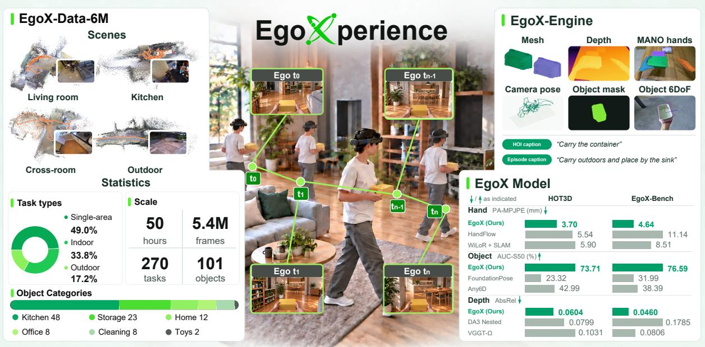

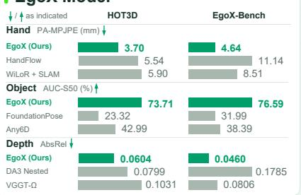  
Figure 1 | Overview of the EgoXperience Paradigm. Task-driven capture and EgoX-Engine produce EgoX-Data-6M, supporting joint reconstruction with EgoX.

## Abstract

## Ropedia

Reconstructing human activity from egocentric video requires more than recovering individual 3D components: the observer’s motion, surrounding geometry, and handobject interactions must fit together in a consistent world. Achieving this coherence requires both joint reconstruction and aligned supervision, yet existing methods and datasets offer limited support for either. We present EGOXPERIENCE, a full-stack paradigm that addresses these needs through data collection, automatic annotation, unified modeling, and benchmarking. Central to EgoXperience is an automatic annotation engine, EGOX-Engine, that couples geometrically verified object tracking with SLAM-based world alignment, yielding consistent supervision for the camera, scene, hands, and objects. This yields EGOX-Data-6M, a 50-hour dataset of task-driven manipulation and locomotion within and across indoor and outdoor environments, with second-level task captions. We carefully select one hour across these activity categories as EGOX-Bench to evaluate joint reconstruction. To translate this supervision into reconstruction, we introduce EGOX, trained with EGOX-Data-6M and complementary annotations from additional public datasets. Given monocular egocentric video and first-frame object masks, our model achieves joint metric reconstruction of the camera, scene, hands, and objects in a shared world coordinate frame with a single forward pass. Extensive experiments demonstrate state-of-the-art performance across scene estimation and world-space hand-object pose recovery. Against the strongest evaluated baselines, EgoX reduces camera, hand, and depth errors by 68.9%, 65.6%, and 42.9%, and improves object pose scores by 28.0%.

## 1. Introduction

Egocentric video offers a natural perspective on how humans and embodied agents perceive and interact with the world, requiring only a wearable camera without external camera setups. By capturing the wearer’s movement and close-range interactions, it provides visual cues for recovering camera pose, scene depth, hands, and objects. However, existing methods [58, 59, 25, 41, 73] typically recover only a subset of these tightly coupled components. Combining outputs from different methods often requires reconciling inconsistent scales and coordinate frames, complicating their use in downstream embodied AI applications. This motivates a unified feed-forward framework that jointly recovers the camera, scene, hands, and objects within a single model.

Training such a unified model, however, requires large-scale egocentric data with joint annotations of the camera, scene, hands, and objects. Although egocentric video is easy to record, obtaining reliable joint annotations is considerably more difficult due to frequent hand-object occlusions, rapid head motion, and motion blur. Existing datasets [7, 3, 40, 12, 60] have made progress toward this goal, often using calibrated multi-camera or motion-capture systems to support reliable annotations. However, these systems require substantial setup and calibration, making collection difficult to scale across diverse real-world environments. Scaling jointly annotated egocentric data therefore calls for a collection and annotation pipeline that reduces reliance on such specialized infrastructure.

To address these challenges, we present EGOXPERIENCE, a full-stack paradigm for egocentric 3D reconstruction, encompassing data collection, annotation, modeling, and benchmarking. Central to its annotation pipeline is EGOX-Engine, which tracks target objects across video frames and uses pre-scanned object models and observed depth to estimate and verify their 3D poses. SLAM-estimated camera poses place these object trajectories in a shared world coordinate system alongside scene geometry and hand annotations, providing geometrically aligned supervision. Applying this engine to 50 hours of task-driven recordings spanning workspace manipulation, cross-room interactions, and outdoor loco-manipulation yields EGOX-Data-6M, further enriched with task captions at second-level temporal resolution. To complement this dataset, we harmonize additional public interaction datasets [3, 40, 30, 60, 23, 12] under a common training formulation, aligning their geometric conventions while retaining their partial annotations. We also establish EGOX-Bench from one hour of held-out recordings, enabling joint evaluation of camera, scene depth, hand, and object reconstruction across all capture settings.

To translate this joint supervision into joint reconstruction, we introduce EGOX. Given monocular egocentric video and first-frame object masks, EGOX jointly reconstructs the camera, scene depth, hands, and objects at metric scale in a shared world coordinate system, all in a single forward pass. During training, we supervise each component and additionally use the predicted camera poses to transform object and hand predictions into normalized world coordinates, where we supervise their positions and orientations. This ties camera, hand, and object estimation together, encouraging geometrically consistent reconstruction. Evaluated on four benchmarks, EGOX achieves state-of-the-art performance across scene estimation and world-space hand–object pose recovery. It ranks first in depth, hand, and object metrics across all four benchmarks and achieves the best camera accuracy on HOI4D. Relative to the strongest competing methods, EgoX reduces camera nATE by 68.9% on HOI4D, hand W-MPJPE and depth AbsRel by 65.6% and 42.9% on EgoX-Bench, respectively, and improves object AUC-S50 by 28.0% on HOT3D.

## 2. Related Work

## 2.1. Scene and entity reconstruction

DUSt3R [62] predicts pairwise pointmaps, while VGGT [58] jointly estimates cameras and scene geometry. CUT3R [61] introduces recurrent scene memory, and VGGT-Ω [59] reduces inter-frame attention through scene registers. Dynamic-scene methods recover moving geometry through world-space point tracking or temporally conditioned point prediction [72, 18, 57, 56, 70, 5]. Entity-aware models incorporate humans, instances, or hands into reconstruction: Human3R [14] jointly estimates human meshes, cameras, and scenes; HSImul3R [6] enables simulator-ready joint reconstruction of humans and scenes; IGGT [35] couples geometry with instance segmentation; and HGGT [38] estimates MANO parameters and cameras from uncalibrated views. EgoX extends this line of work to moving hands and manipulated objects, jointly reconstructing their motion, camera poses, and depth in a shared metric frame.

## 2.2. Hand-object reconstruction

HaMeR [46] and WiLoR [49] estimate MANO hand meshes from images. For world-space hand motion, HaWoR [71] combines hand reconstruction with SLAM and motion infilling, while Dyn-HaMR [69] uses camera tracking, motion priors, and test-time optimization. Hand3R [25], MINT [73], and ReViV [41] couple hand reconstruction with cameras or scene geometry; ReViV additionally predicts depth, body motion, and gaze. EgoX further incorporates manipulatedobject motion into the same feed-forward reconstruction.

Keypoint Transformer [23] and HOPformer [4] estimate hand–object interactions without recovering a world-camera trajectory. HOLD [16] optimizes hand and object representations from video, while ForeHOI [13] completes object masks and shapes before geometric pose estimation. EgoGrasp [19] reconstructs hands and objects in separate stages, and WHOLE [66] requires object templates, a metric camera trajectory, and test-time guidance. Related object-pose systems use CAD models, reference images, or RGB-D observations [31, 64, 32]. In contrast, EgoX jointly estimates camera poses, depth, hand geometry, and rigid-object poses from RGB observations and optional first-frame object masks.

Table 1 | Comparison of Egocentric Datasets. We compare data scale, capture settings, and annotation coverage. Obj. counts objects with 3D models.
<table><tr><td></td><td></td><td></td><td colspan="3">Capture setting</td><td colspan="6">Annotations</td></tr><tr><td>Dataset</td><td>Hours</td><td></td><td>Obj. Single-area Cross-area Outdoor 3D Hand 6DoF Mesh Depth Mask Caption</td><td></td><td></td><td></td><td></td><td></td><td></td><td></td><td></td></tr><tr><td>H2O [30]</td><td>1.1</td><td>8</td><td></td><td>X</td><td>X</td><td></td><td></td><td></td><td></td><td>X</td><td>X</td></tr><tr><td>HOI4D [40]</td><td>22</td><td>800</td><td></td><td>X</td><td>X</td><td></td><td></td><td></td><td></td><td></td><td>X</td></tr><tr><td>ARCTIC [17]</td><td>2.2</td><td>11</td><td></td><td>X</td><td>X</td><td></td><td></td><td></td><td>X</td><td></td><td>X</td></tr><tr><td>Ego-Exo4D [21]</td><td>221</td><td>0</td><td></td><td>x</td><td></td><td></td><td></td><td></td><td></td><td></td><td></td></tr><tr><td>EgoDex [24]</td><td>829</td><td>0</td><td></td><td>X</td><td>X</td><td></td><td></td><td>X</td><td></td><td></td><td></td></tr><tr><td>HOT3D [3]</td><td>13.9</td><td>33</td><td></td><td>X</td><td>X</td><td></td><td></td><td></td><td>X</td><td></td><td>X</td></tr><tr><td>HO-Cap [60]</td><td>0.7</td><td>64</td><td></td><td>X</td><td>X</td><td></td><td></td><td></td><td></td><td></td><td></td></tr><tr><td>EgoVerse [50]</td><td>1362</td><td>0</td><td></td><td>X</td><td>X</td><td></td><td></td><td>X</td><td>X</td><td>X</td><td></td></tr><tr><td>SHOW3D [51]</td><td>20</td><td>21</td><td></td><td></td><td></td><td></td><td></td><td></td><td>X</td><td>X</td><td></td></tr><tr><td>ACE-Data-0 [7]</td><td>150</td><td>50</td><td></td><td></td><td>X</td><td></td><td></td><td></td><td>X</td><td></td><td></td></tr><tr><td>EgoX-Data-6M</td><td>50</td><td>101</td><td></td><td></td><td></td><td></td><td></td><td></td><td></td><td></td><td></td></tr></table>

## 2.3. Egocentric datasets and supervision

HO-3D [22], DexYCB [12], H2O [30], H2O-3D [23], HOI4D [40], ARCTIC [17], HO-Cap [60], and HOT3D [3] provide hand-object annotations under different capture and geometric conventions. Recent datasets broaden scene coverage: SHOW3D [51] records indoor and outdoor interactions with a mobile ego–exo rig, Aria Digital Twin [45] provides scanned scenes and world-space trajectories, and HD-EPIC [47] captures unscripted activities with digital twins. Large corpora such as Ego4D [20], EPIC-KITCHENS [15], and EgoDex [24] provide broader human experience but more limited aligned geometric supervision. ACE-Data-0 [7] builds an ambient capture engine for calibrated and synchronized multimodal data collection in a controlled environment. EgoX-Data-6M complements these resources with aligned camera, depth, hand, and object annotations across workspace manipulation, cross-area interaction, and outdoor locomotion.

## 3. The EGOXPERIENCE Paradigm

Our EGOXPERIENCE unifies data capture, annotation and model learning for joint metric reconstruction of the camera, scene depth, hands, and objects from egocentric videos. As illustrated in Fig. 1, this paradigm comprises EGOX-Engine for data processing and annotation (Sec. 3.1), EGOX-Data-6M with 50 hours of task-driven recordings spanning manipulation and locomotion (Sec. 3.2), and EGOX for joint reconstruction from monocular video (Sec. 3.3).

## 3.1. EGOX-Engine

Learning to jointly reconstruct egocentric activity requires annotations that describe the camera, scene, hands, and objects in relation to one another. Obtaining these annotations is challenging because the observer and the interacting entities move simultaneously: a change in image position may arise from camera motion, entity motion, or both. EGOX-Engine addresses this ambiguity by using stereo depth to recover geometry at metric scale and SLAM-estimated camera poses to align different annotations throughout each recording. This allows handobject motion to be expressed relative to the surrounding scene as the observer moves. Fig. 3 summarizes the overall pipeline.

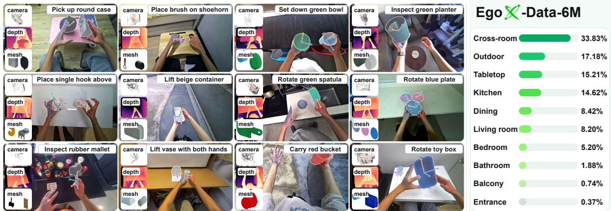  
Figure 2 | Overview of EgoX-Data-6M. Examples and statistics summarize capture settings, task coverage, and aligned multimodal annotations.

Capture and geometric reference. We record with the HOMIE Gen2 head-mounted rig [54], using its associated processing pipeline to estimate metric depth from the synchronized, calibrated front stereo pair and recover camera trajectories via SLAM from its four calibrated fisheye cameras. For each recording, we use the SLAM coordinate system as a fixed session frame and transform camera-relative scene, hand, and object estimates into this frame.

Object geometry and motion. Object annotation requires both a geometric reference for each instance and its changing pose during interaction. We construct metric object meshes from 31 synchronized cameras mounted on a calibrated dome. SAM 3 [11] then extracts object masks from the captured views, which are used for mesh reconstruction with MV-SAM3D [33]. To recover the object’s physical dimensions, we put an AprilTag [44] board inside the dome to provide the scale reference.

Given these metric object references, the engine recovers each object’s motion in the egocentric recording. Specifically, we first identify the target object using a first-frame mask and then specify the interaction interval over which to track it. Using the masked RGB image and its corresponding stereo depth, we estimate the initial pose of the pre-scanned object model in the camera frame. From this initial pose, we apply FoundationPose [64] to track the object throughout the specified interval, producing a camera-relative pose sequence. We verify this sequence by checking whether the object model placed at the estimated pose agrees with the observed depth. Sequences that pass verification are transformed through the SLAM-estimated camera poses into the session frame, aligning object motion with the scene and hand annotations.

Scene and hand annotations. The scene and hand annotations used in this alignment are derived from the same calibrated stereo observations. Specifically, we reconstruct scene geometry by back-projecting stereo depth and recover 3D hand keypoints through cross-view triangulation. We use these keypoints to constrain MANO fitting, with additional reprojection, depth, and temporal terms to refine the estimated hand geometry and motion. Hand shape parameters are shared across frames within each recording, while hand pose, position, and orientation are estimated independently for each frame. Finally, we transform the fitted hands and scene points through the camera trajectory into the session frame, placing them in the same metric coordinate system as the tracked objects.

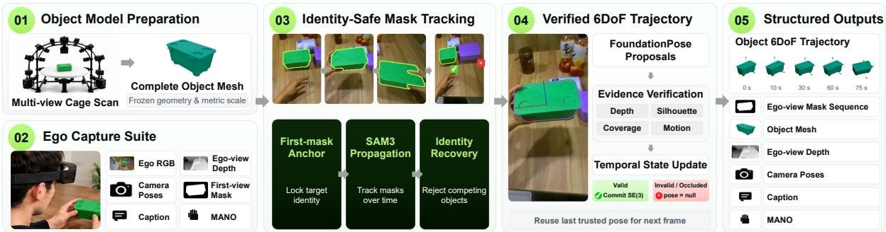  
Figure 3 | Overview of EgoX-Engine. The pipeline converts egocentric recordings into structured multimodal annotations, including aligned geometry and temporally localized task captions.

## 3.2. EGOX-Data-6M

Given EGOX-Engine, we apply it to annotate task-driven egocentric captures, constructing EGOX-Data-6M, which comprises 50 hours of video, 101 rigid objects, and 270 task scripts. The recordings cover activities ranging from manipulation within a single workspace to interactions across rooms and loco-manipulation in outdoor environments. The engine provides geometrically aligned camera, scene, hand, and object annotations across these settings, supporting joint reconstruction under both local manipulation and extended movement. Fig. 2 illustrates the activity coverage and accompanying annotations.

Task-driven collection. We organize data collection around task scripts, each specifying a manipulation goal, target objects, and a capture setting. Specifically, workspace scripts focus on local object manipulation, whereas cross-room and outdoor scripts incorporate movement between interaction locations.

Annotation coverage. We provide geometric annotations in a session-fixed metric frame, allowing camera motion, scene structure, and hand-object interactions to be related throughout each recording. Additionally, we include second-level task captions to describe the ongoing activity. Tab. 1 compares our dataset with existing egocentric resources. Compared with existing datasets, our EGOX-Data-6M brings together workspace manipulation, cross-room interactions, and outdoor locomotion with camera, scene, hand, and object annotations in a shared metric frame, supporting joint reconstruction across these activity settings.

Benchmark and complementary training data. To evaluate all reconstruction components on the same recordings, we reserve a quality-controlled, one-hour subset spanning the three activity settings as EGOX-Bench. This subset is used exclusively for joint evaluation of camera, scene, hand, and object reconstruction.

To broaden the training data beyond our own recordings, we incorporate additional public datasets. Using these datasets together requires accounting for differences in both geometric conventions and available annotations. We therefore convert their geometric labels to a common coordinate and scale convention and supervise the model using the labels available in each dataset. This allows recordings with partial annotations to contribute to training without requiring every dataset to provide camera, scene, hand, and object labels. We also clean erroneous annotations and align depth with hand and object geometry to reduce conflicting supervision (Appendix B). Sec. 3.3 explains how the model learns from this combined supervision; the data mixture is detailed in Appendix F.

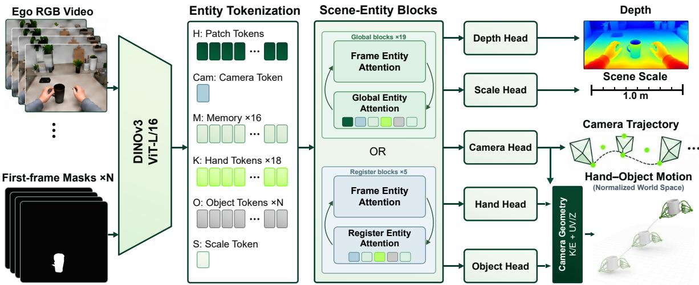

Figure 4 | Overview of EgoX. Shared scene and entity features support joint reconstruction, while predicted cameras and scale place all outputs in a common metric world frame.  
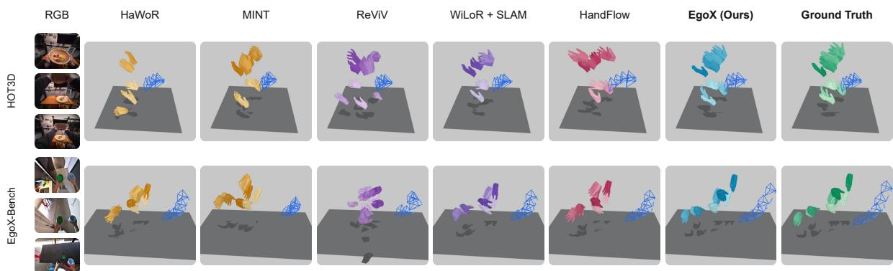  
Figure 5 | World-Space Hand and Camera Reconstruction. Qualitative comparisons on HOT3D and EgoX-Bench. Predictions and ground truth are shown in a common world frame.

## 3.3. EGOX

To translate the aligned supervision into joint reconstruction, we propose EGOX, which is capable of predicting the camera, scene, and motions of both hands and objects within a single model. The central challenge to achieve this goal is that the predictions must agree geometrically as both the viewpoint and interaction change. As illustrated in Fig. 4, we address this through a joint scene and entity representation, followed by explicit composition through the predicted camera poses. Supervision on the resulting hand and object motions then ties their reconstruction to camera estimation.

Problem formulation. Given monocular observations $\boldsymbol { \tau } = \{ I _ { t } \} _ { t = 1 } ^ { T }$ and optional first-frame object masks $\mathcal { B } = \{ B _ { 1 , j } \} _ { i = 1 } ^ { N }$ identifying the target objects, EGOX jointly predicts camera intrinsics and poses, dense depth, two-hand MANO states, object origins and orientations, and a positive metric scale in a single forward pass. We express all reconstructed outputs in $\mathcal { W } ,$ the coordinate system of the first-frame camera. For those complementary datasets without ground-truth object masks, we adopt the pipeline to reconstruct only cameras, scene geometry, and hands.

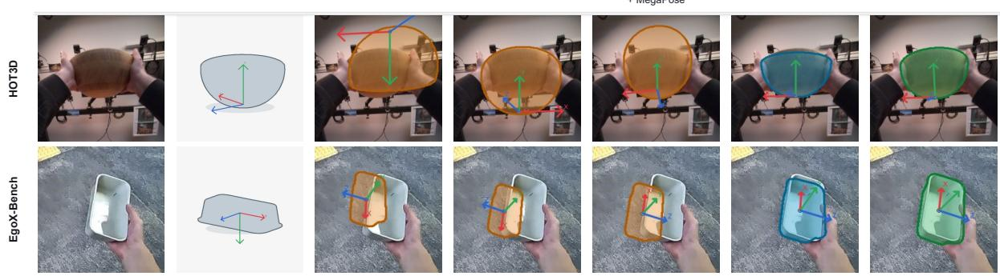  
Figure 6 | Camera-Frame Object Pose Reconstruction. Qualitative comparisons of object 6-DoF predic tions with ground truth on HOT3D and EgoX-Bench.

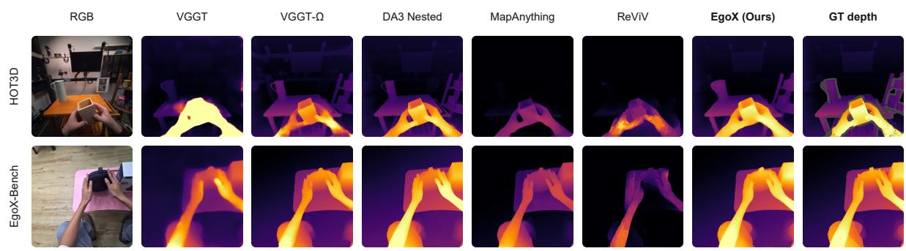  
Figure 7 | Depth Reconstruction. GT: refined official depth. VGGT/VGGT-Ω: one scale fitted to DA3 Nested depth per sequence; others: predicted metric scale.

Joint scene and entity representation. To jointly estimate cameras, scene geometry, and handobject motion, we encode them with a shared Transformer. Starting from image patch features extracted by DINOv3 [55], we introduce camera, hand, and object tokens in each view, using distinct left/right embeddings to identify the hands and first-frame mask descriptors to associate target objects across views. These tokens gather image evidence through within-view attention and exchange information across observations through cross-view attention, forming a joint representation for reconstruction. Architectural details are provided in Appendix F.

Reconstruction in a shared metric frame. From the joint representation, we reconstruct scene geometry and hand-object motion in a common reference frame $\mathcal { W } ,$ defined by the first-frame camera coordinate system. To combine predictions across views, we estimate camera intrinsics $\hat { K } _ { t }$ and extrinsics $( \hat { R } _ { t } , \hat { \tau } _ { t } )$ mapping W to camera �. These parameters allow us to recover scene points, wrist positions, and object origins from their image coordinates and predicted depths. Specifically, for a homogeneous image position $\boldsymbol { \tilde { u } } = ( u _ { x } , u _ { y } , 1 ) ^ { \top }$ and normalized depth �, its position in $\mathcal { W }$ is:

$$
\mathcal { U } _ { t } ( \tilde { u } , z ) = \hat { R } _ { t } ^ { \top } \left( z \hat { K } _ { t } ^ { - 1 } \tilde { u } - \hat { \tau } _ { t } \right) .\tag{1}
$$

This shared mapping ties scene and entity positions to the same camera estimates. For hand and object orientations, we similarly use inverse camera rotation $\hat { R } _ { t } ^ { \top }$ to transform camera-frame hand and object orientations into $\dot { \mathcal { W } } ,$ keeping MANO joint rotations local and expressing object rotations relative to their first-frame orientations.

The reconstruction in W obtained above still uses normalized depths and translations. To recover metric scale, we apply a shared ScaleHead to predict one positive factor �ˆ for the sequence, scaling scene points and camera, wrist, and object positions consistently: $\hat { p } ^ { \mathcal { W } } =$ $\hat { s } \mathcal { U } _ { t } ( \tilde { u } , z )$ . For hands, this adjusts only the wrist positions while preserving the metric dimensions of the MANO meshes.

Table 2 | Reconstruction Outputs and Inference Structure. Checkmarks denote supported outputs; inference is classified as end-to-end or multi-stage.
<table><tr><td rowspan="2">Method</td><td colspan="4">Outputs</td><td rowspan="2">Inference</td></tr><tr><td></td><td></td><td></td><td>Camera Depth Hands Object 6DoF World-space</td></tr><tr><td>VGGT-Ω [59]</td><td></td><td></td><td>X</td><td></td><td>End-to-end</td></tr><tr><td>MapAnything [29]</td><td></td><td></td><td></td><td></td><td>End-to-end</td></tr><tr><td>DA3 Nested [37]</td><td></td><td></td><td>X</td><td></td><td>End-to-end</td></tr><tr><td>HaWoR [71]</td><td></td><td></td><td></td><td></td><td>Multi-stage</td></tr><tr><td>Hand3R [25]</td><td></td><td></td><td></td><td></td><td>End-to-end</td></tr><tr><td>MINT [73]</td><td></td><td></td><td></td><td></td><td>End-to-end</td></tr><tr><td>ReViV [41]</td><td></td><td></td><td></td><td></td><td>End-to-end</td></tr><tr><td>HandFlow [65]</td><td></td><td>X</td><td></td><td></td><td>End-to-end</td></tr><tr><td>FoundationPose [64]</td><td></td><td>X</td><td></td><td></td><td>Multi-stage</td></tr><tr><td>Any6D [32]</td><td></td><td>X</td><td></td><td></td><td>Multi-stage</td></tr><tr><td>GigaPose + MegaPose [43, 31]</td><td>X</td><td>X</td><td>X</td><td>X</td><td>Multi-stage</td></tr><tr><td>HOPformer [4]</td><td>X</td><td>X</td><td></td><td>X</td><td>End-to-end</td></tr><tr><td>WHOLE [66]</td><td>X</td><td>X</td><td></td><td></td><td>Multi-stage</td></tr><tr><td>EgoX</td><td></td><td></td><td></td><td></td><td>End-to-end</td></tr></table>

Geometrically coupled supervision. Building on this shared reconstruction, we supervise not only individual predictions but also the resulting hand-object geometry in W. To compute this geometric supervision, we transform hand and object predictions through the estimated cameras and compare the reconstructed geometry with ground truth. The resulting loss backpropagates through the camera transformations, updating both entity and camera predictions. We combine these supervision terms into the training objective:

$$
\mathcal { L } = \mathcal { L } _ { \mathrm { l o c a l } } + \mathcal { L } _ { \mathrm { d e n s e } } + \mathcal { L } _ { \mathrm { c o u p l e d } } + \mathcal { L } _ { \mathrm { s c a l e } } ,\tag{2}
$$

where $\mathcal { L } _ { \mathrm { l o c a l } }$ supervises camera and view-local entity predictions, ${ \mathcal { L } } _ { \mathrm { d e n s e } }$ supervises depth and scene points, $\mathcal { L } _ { \mathrm { c o u p l e d } }$ supervises the composed hand-object geometry, and $\mathcal { L } _ { \mathrm { s c a l e } }$ supervises metric scale. To accommodate varying annotation coverage across datasets, we apply each loss only where its required labels are available, allowing fully and partially annotated data to contribute to the same objective. Loss definitions and training settings are provided in Appendix F.

## 4. Experiments

We evaluate camera, depth, hand, and object reconstruction on HOT3D, EgoX-Bench, H2O, and HOI4D using identical 150-observation clips across methods. Evaluation sequences are excluded from EgoX training. EgoX uses RGB and first-frame object masks; object baselines may additionally require estimated depth, intrinsics, per-frame masks, or metric CAD assets. Worldspace hand metrics use estimated cameras; object poses are evaluated in camera coordinates. No method receives GT camera poses or scale in the main comparisons. Appendix C details the evaluation protocols.

Table 3 | Hand Reconstruction on Four Benchmarks. PA-, WA-, and W-MPJPE are reported in millimetres. World-space errors use each method’s estimated camera trajectory.
<table><tr><td></td><td colspan="3">HOT3D</td><td colspan="3">EgoX-Bench</td><td colspan="3">HOI4D</td><td colspan="3">H2O</td></tr><tr><td>Method</td><td>PA- MPJPE ↓</td><td>WA- MPJPE ↓</td><td>W- MPJPE↓</td><td>PA- MPJPE↓</td><td>WA- MPJPE ↓</td><td>W- MPJPE↓</td><td>PA- MPJPE ↓</td><td>WA- MPJPE ↓</td><td>W- MPJPE ↓</td><td>PA- MPJPE↓</td><td>WA- MPJPE↓</td><td>W- MPJPE ↓</td></tr><tr><td>HaWoR</td><td>6.06</td><td>29.80</td><td>56.30</td><td>10.98</td><td>125.73</td><td>363.47</td><td>18.61</td><td>50.01</td><td>110.96</td><td>5.68</td><td>25.83</td><td>64.62</td></tr><tr><td>MINT</td><td>9.94</td><td>37.76</td><td>85.85</td><td>10.19</td><td>149.91</td><td>467.65</td><td>17.94</td><td>43.64</td><td>108.76</td><td>5.74</td><td>28.38</td><td>50.04</td></tr><tr><td>ReViV</td><td>14.01</td><td>49.90</td><td>109.02</td><td>23.89</td><td>111.48</td><td>501.29</td><td>25.18</td><td>83.40</td><td>354.39</td><td>8.69</td><td>23.40</td><td>45.22</td></tr><tr><td>WiLoR + SLAM</td><td>5.90</td><td>25.52</td><td>58.55</td><td>8.51</td><td>63.03</td><td>328.81</td><td>19.41</td><td>47.66</td><td>132.94</td><td>5.11</td><td>21.78</td><td>74.95</td></tr><tr><td>HandFlow</td><td>5.54</td><td>59.01</td><td>119.48</td><td>11.14</td><td>75.76</td><td>375.11</td><td>19.91</td><td>57.02</td><td>120.26</td><td>7.07</td><td>19.00</td><td>34.63</td></tr><tr><td>EgoX (Ours)</td><td>3.70</td><td>15.54</td><td>38.89</td><td>4.64</td><td>53.81</td><td>113.24</td><td>3.32</td><td>15.12</td><td>42.67</td><td>4.97</td><td>11.41</td><td>23.95</td></tr></table>

Table 4 | Camera-Frame Object Pose Reconstruction. ADD/ADD-S: mm; AUC: %. Extra inputs: $\hat { D } / \hat { K } ,$ DA3 Nested depth/intrinsics; �, per-frame masks; �, GT metric CAD.
<table><tr><td>Method</td><td colspan="3">HOT3D</td><td colspan="3">EgoX-Bench</td><td colspan="3">HOI4D</td><td colspan="3">H2O</td></tr><tr><td></td><td>ADD↓</td><td>ADD-S ↓</td><td> $\mathbf { A U C } – S _ { 5 0 } \uparrow$ </td><td>ADD↓</td><td></td><td>ADD-S ↓ AUC-S50 ↑</td><td>ADD↓</td><td>ADD-S ↓</td><td> $\mathbf { A U C } – S _ { 5 0 } \uparrow$ </td><td>ADD↓</td><td>ADD-S↓</td><td> $\mathbf { A U C } – S _ { 5 0 } \uparrow$ </td></tr><tr><td> $\mathrm { A n y 6 D } ^ { \hat { D } , \hat { K } , M }$ </td><td>67.06</td><td>44.05</td><td>42.99</td><td>88.25</td><td>41.41</td><td>38.39</td><td>67.01</td><td>53.26</td><td>34.61</td><td>72.75</td><td>36.57</td><td>38.37</td></tr><tr><td>FoundationPose,k,A</td><td>92.49</td><td>59.87</td><td>23.32</td><td>85.26</td><td>55.04</td><td>31.99</td><td>94.76</td><td>73.02</td><td>13.39</td><td>91.91</td><td>30.97</td><td>46.03</td></tr><tr><td>GigaPose +  $\mathbf { M e g a P o s e } ^ { \hat { K } , A , M }$ </td><td>71.92</td><td>32.42</td><td>57.59</td><td>69.96</td><td>26.87</td><td>59.80</td><td>97.94</td><td>88.68</td><td>3.91</td><td>89.08</td><td>53.08</td><td>29.14</td></tr><tr><td>EgoX (Ours)</td><td>28.00</td><td>14.03</td><td>73.71</td><td>27.11</td><td>12.41</td><td>76.59</td><td>44.55</td><td>21.11</td><td>59.08</td><td>22.10</td><td>10.29</td><td>80.42</td></tr></table>

Table 5 | Camera and Depth Reconstruction. RRE: degrees; �1.25: %. VGGT/VGGT-Ω: one scale fitted to DA3 Nested depth per sequence; others: predicted metric scale.
<table><tr><td></td><td colspan="4">HOT3D</td><td colspan="4">EgoX-Bench</td><td colspan="4">HOI4D</td><td colspan="4">H2O</td></tr><tr><td></td><td colspan="2">Camera</td><td colspan="2">Depth†</td><td colspan="2">Camera</td><td colspan="2">Depth†</td><td colspan="2">Camera</td><td colspan="2">Depth†</td><td colspan="2">Camera</td><td colspan="2">Depth†</td></tr><tr><td>Method</td><td>nATE↓</td><td>RRE (°) ↓</td><td>AbsRel ↓</td><td>δ1.25 ↑</td><td>nATE↓</td><td>RRE (°) ↓</td><td>AbsRel ↓</td><td>δ1.25 ↑</td><td>nATE↓</td><td>RRE (°) ↓</td><td>AbsRel ↓</td><td>δ1.25 ↑</td><td>nATE ↓</td><td>RRE (°) ↓</td><td>AbsRel ↓</td><td>δ1.25 ↑</td></tr><tr><td>VGGT</td><td>0.0064</td><td>0.64</td><td>0.2182</td><td>69.40</td><td>0.0684</td><td>2.86</td><td>0.2877</td><td>66.53</td><td>0.0310</td><td>1.50</td><td>0.0676</td><td>98.60</td><td>0.0036</td><td>0.27</td><td>0.0726</td><td>94.36</td></tr><tr><td>VGGT-Ω</td><td>0.0018</td><td>0.16</td><td>0.1031</td><td>92.20</td><td>0.0071</td><td>0.61</td><td>0.0806</td><td>91.57</td><td>0.0212</td><td>1.56</td><td>0.0558</td><td>99.68</td><td>0.0030</td><td>0.27</td><td>0.0784</td><td>95.46</td></tr><tr><td>CUT3R</td><td>0.0449</td><td>3.75</td><td>0.2748</td><td>69.19</td><td>0.0756</td><td>6.29</td><td>0.4317</td><td>54.07</td><td>0.0455</td><td>5.08</td><td>0.0647</td><td>97.05</td><td>0.0120</td><td>1.56</td><td>0.0887</td><td>93.09</td></tr><tr><td>Any4D</td><td>0.0267</td><td>2.24</td><td>0.2899</td><td>70.23</td><td>0.0604</td><td>4.55</td><td>0.4161</td><td>48.15</td><td>0.0273</td><td>1.91</td><td>0.0757</td><td>95.80</td><td>0.0083</td><td>0.67</td><td>0.1075</td><td>87.26</td></tr><tr><td>DA3 Nested</td><td>0.0036</td><td>0.23</td><td>0.0799</td><td>94.40</td><td>0.0135</td><td>0.92</td><td>0.1785</td><td>82.29</td><td>0.0307</td><td>1.54</td><td>0.0746</td><td>97.34</td><td>0.0026</td><td>0.26</td><td>0.0823</td><td>92.64</td></tr><tr><td>MapAnything</td><td>0.0321</td><td>19.40</td><td>0.3182</td><td>64.20</td><td>0.0283</td><td>2.11</td><td>0.1429</td><td>87.12</td><td>0.0220</td><td>1.63</td><td>0.0727</td><td>95.36</td><td>0.0071</td><td>0.51</td><td>0.1009</td><td>92.01</td></tr><tr><td>ReViV</td><td>0.0285</td><td>1.98</td><td>0.2558</td><td>61.19</td><td>0.0350</td><td>3.81</td><td>0.3972</td><td>53.60</td><td>0.0231</td><td>2.06</td><td>0.2075</td><td>60.42</td><td>0.0072</td><td>0.84</td><td>0.2562</td><td>53.07</td></tr><tr><td>EgoX (Ours)</td><td>0.0059</td><td>0.88</td><td>0.0604</td><td>96.21</td><td>0.0295</td><td>2.21</td><td>0.0460</td><td>97.37</td><td>0.0066</td><td>0.78</td><td>0.0312</td><td>99.98</td><td>0.0035</td><td>0.33</td><td>0.0700</td><td>99.70</td></tr></table>

## 4.1. Evaluation scope

The evaluated methods cover different subsets of the reconstruction problem. Table 2 summarizes their outputs and inference structure. Subsequent comparisons therefore evaluate each method only on the outputs it provides under the matched protocol described above. EgoX is the only end-to-end method in this comparison that jointly reconstructs cameras, depth, hands, and object 6-DoF poses in a shared world frame.

## 4.2. Main results

World-space hands. EgoX achieves the lowest PA-, WA-, and W-MPJPE on all four benchmarks (Table 3). On HOT3D, it reduces W-MPJPE from 56.30 to 38.89 mm relative to HaWoR, the strongest baseline on this metric, despite HaWoR’s adaptive DROID-SLAM and Metric3D-based scale [71]. On EgoX-Bench, W-MPJPE falls from 328.81 mm for WiLoR + SLAM to 113.24 mm. Figure 5 illustrates improved world-space placement: baseline hands recover plausible local hand poses but exhibit large deviations from the ground-truth positions in world coordinates, whereas EgoX closely matches the ground truth.

Object 6-DoF. EgoX achieves the best ADD, ADD-S, and AUC-S50 on all four benchmarks (Table 4). On EgoX-Bench, its AUC-S50 is 76.59, compared with 59.80 for GigaPose + MegaPose, the strongest competing result, although that pipeline additionally uses metric CAD assets and per-frame masks. EgoX also outperforms Any6D on HOI4D, where Any6D receives estimated depth, intrinsics, and per-frame masks. These comparisons show more accurate camera-frame poses with fewer auxiliary inputs (Appendix C). Figure 6 shows larger translation or rotation offsets for the object baselines, while EgoX more closely matches the ground-truth pose.

Table 6 | ScaleHead Ablation. Results on HOT3D with predicted (P) or oracle (G) scale.  
Table 7 | DepthHead Ablation. Results on HOT3D with predicted scale in both settings.
<table><tr><td>Setting</td><td>S</td><td>W↓</td><td> $\mathbf { A U C - S 5 0 } \uparrow$  AbsRel ↓</td></tr><tr><td>w/head</td><td>P</td><td>38.89</td><td>73.71 0.0604</td></tr><tr><td>w/o head</td><td>G 40.67</td><td>60.87</td><td>0.0620</td></tr></table>

<table><tr><td>Setting</td><td>S</td><td>W↓</td><td> $\mathrm { A U C } { \cdot } S _ { 5 0 } \uparrow$ </td><td>AbsRel ↓</td></tr><tr><td>w/head</td><td>P</td><td>38.89</td><td>73.71</td><td>0.0604</td></tr><tr><td>w/o head</td><td>P</td><td>67.53</td><td>41.09</td><td>N/A</td></tr></table>

Camera motion. Compared with ReViV, which also reconstructs cameras, depth, and hands, EgoX achieves lower nATE and RRE on all four benchmarks (Table 5). On HOI4D, EgoX also leads the geometry baselines: nATE is 0.0066 versus 0.0212 for VGGT-Ω, and RRE is 0.78◦ versus 1.50◦ for VGGT. VGGT-Ω leads on HOT3D and EgoX-Bench, while DA3 Nested leads on H2O. VGGT-Ω’s camera advantage may reflect its large-scale geometric training on diverse static and dynamic scenes [59].

Depth reconstruction. EgoX achieves the lowest AbsRel and highest $\delta _ { 1 . 2 5 }$ on all four benchmarks (Table 5). On EgoX-Bench, AbsRel is 0.0460 versus 0.3972 for ReViV and 0.0806 for $\mathrm { V G G T } \mathrm { - } \Omega ; \delta _ { 1 . 2 5 }$ is 97.37 versus 91.57 for VGGT-Ω. EgoX obtains these results with its own predicted metric scale, while VGGT-Ω uses scale estimated from DA3 Nested depth (Section C). The results support accurate metric depth alongside hand and object reconstruction. Figure 7 shows that EgoX better matches the refined ground-truth depth.

## 4.3. Ablation studies

Metric scale prediction. We remove ScaleHead and use oracle scale (G) to convert the ablated model’s predictions to metric units. Despite this advantage, W-MPJPE increases from 38.89 to 40.67 mm and ${ \mathrm { A U C } } { \cdot } { \mathrm { S } } _ { 5 0 }$ decreases from 73.71 to 60.87 (Table 6), showing that ScaleHead benefits joint reconstruction beyond final rescaling.

Dense-depth prediction. We remove DepthHead while retaining the remaining architecture and predicted scale. W-MPJPE increases to 67.53 mm and AUC-S50 decreases to 41.09 (Table 7), showing that explicit depth prediction improves hand and object reconstruction through the shared representation.

## 5. Conclusion

We present EgoXperience, a unified approach to learning world-grounded egocentric representations through task-driven capture, geometrically aligned annotation, and joint reconstruction. EgoX-Engine provides aligned multimodal annotations for the 50-hour EgoX-Data-6M, from which we curate the held-out one-hour EgoX-Bench. Trained on these annotations and harmonized public datasets, EgoX jointly reconstructs cameras, dense depth, hands, and rigid-object 6-DoF poses in a common metric world frame. Experiments on EgoX-Bench and public benchmarks demonstrate strong performance in hand and object reconstruction and depth estimation. Our current formulation assumes rigid objects and does not predict their meshes. Future work will explore object mesh prediction and multiview inputs.

## Acknowledgements

We thank Hongyi Chen, Yuancheng Wang, Changyi Ye, Qin Ma, Thang Luu, Wendi Fu, Qiankuan Tao, Sayang Mu, Rui Duan, Zetong Wang, and Yaobo Liu for their contributions to data collection.

## References

[1] AgiBot World Team. 2026. Agibot world 2026. https://huggingface.co/datasets/agibot-world/ AgiBotWorld2026.

[2] Armen Avetisyan, Christopher Xie, Henry Howard-Jenkins, Tsun-Yi Yang, Samir Aroudj, Suvam Patra, Fuyang Zhang, Duncan Frost, Luke Holland, Campbell Orme, Jakob Engel, Edward Miller, Richard Newcombe, and Vasileios Balntas. 2024. Scenescript: Reconstructing scenes with an autoregressive structured language model. Preprint, arXiv:2403.13064.

[3] Prithviraj Banerjee, Sindi Shkodrani, Pierre Moulon, Shreyas Hampali, Shangchen Han, Fan Zhang, Linguang Zhang, Jade Fountain, Edward Miller, Selen Basol, Richard Newcombe, Robert Wang, Jakob Julian Engel, and Tomas Hodan. 2025. Hot3d: Hand and object tracking in 3d from egocentric multi-view videos. In Proceedings of the IEEE/CVF Conference on Computer Vision and Pattern Recognition (CVPR), pages 7061–7071.

[4] Siddhant Bansal, Zhifan Zhu, Shashank Tripathi, Jiahe Zhao, Michael J. Black, and Dima Damen. 2026. Towards in-the-wild egocentric 3d hand-object pose estimation. In European Conference on Computer Vision (ECCV).

[5] Yukang Cao, Xinying Guo, Mingyuan Zhang, Haozhe Xie, Chenyang Gu, and Ziwei Liu. 2026. Crowdmogen: Event-driven collective human motion generation. International Journal ofComputer Vision, 134(1):29.

[6] Yukang Cao, Haozhe Xie, Fangzhou Hong, Long Zhuo, Zhaoxi Chen, Liang Pan, and Ziwei Liu. 2026. Hsimul3r: Physics-in-the-loop reconstruction of simulation-ready human–scene interactions. In European Conference on Computer Vision, pages 509–528. Springer.

[7] Yukang Cao, Haozhe Xie, Beichen Wen, Runmao Yao, Yinghao Liu, Yue Huang, Zhichao Liao, Yunxiang Wang, Haiheng Liu, Xingshun Tian, Dawei Su, Long Zhuo, Dacheng Tao, Xiaogang Wang, Liang Pan, and Ziwei Liu. 2026. Ace-data-0: Human-centric ambient capture as embodied data engine. arXiv preprint arXiv:2607.28625.

[8] Ziang Cao, Zhaoxi Chen, Liang Pan, and Ziwei Liu. 2025. Physx-3d: Physical-grounded 3d asset generation. arXiv preprint arXiv:2507.12465.

[9] Ziang Cao, Fangzhou Hong, Zhaoxi Chen, Liang Pan, and Ziwei Liu. 2025. Physx-anything: Simulation-ready physical 3d assets from single image. arXiv preprint arXiv:2511.13648.

[10] Ziang Cao, Yinghao Liu, Haitian Li, Runmao Yao, Fangzhou Hong, Zhaoxi Chen, Liang Pan, and Ziwei Liu. 2026. Physx-omni: Unified simulation-ready physical 3d generation for rigid, deformable, and articulated objects. Preprint, arXiv:2605.21572.

[11] Nicolas Carion, Laura Gustafson, Yuan-Ting Hu, Shoubhik Debnath, Ronghang Hu, Didac Suris, Chaitanya Ryali, Kalyan Vasudev Alwala, Haitham Khedr, Andrew Huang, Jie Lei, Tengyu Ma, Baishan Guo, Arpit Kalla, Markus Marks, Joseph Greer, Meng Wang, Peize Sun, Roman Rädle, and 19 others. 2025. Sam 3: Segment anything with concepts. Preprint, arXiv:2511.16719.

[12] Yu-Wei Chao, Wei Yang, Yu Xiang, Pavlo Molchanov, Ankur Handa, Jonathan Tremblay, Yashraj S. Narang, Karl Van Wyk, Umar Iqbal, Stan Birchfield, Jan Kautz, and Dieter Fox. 2021. DexYCB: A benchmark for capturing hand grasping of objects. In IEEE/CVF Conference on Computer Vision and Pattern Recognition (CVPR).

[13] Yuantao Chen, Jiahao Chang, Chongjie Ye, Chaoran Zhang, Zhaojie Fang, Chenghong Li, and Xiaoguang Han. 2026. Forehoi: Feed-forward 3d object reconstruction from daily hand-object interaction videos. Preprint, arXiv:2602.06226.

[14] Yue Chen, Xingyu Chen, Yuxuan Xue, Anpei Chen, Yuliang Xiu, and Pons-Moll Gerard. 2025. Human3r: Everyone everywhere all at once. arXiv preprint arXiv:2510.06219.

[15] Dima Damen, Hazel Doughty, Giovanni Maria Farinella, Antonino Furnari, Evangelos Kazakos, Jian Ma, Davide Moltisanti, Jonathan Munro, Toby Perrett, Will Price, and Michael Wray. 2022. Rescaling egocentric vision: Collection, pipeline and challenges for EPIC-KITCHENS-100. International Journal ofComputer Vision.

[16] Zicong Fan, Maria Parelli, Maria Eleni Kadoglou, Muhammed Kocabas, Xu Chen, Michael J Black, and Otmar Hilliges. 2024. HOLD: Category-agnostic 3d reconstruction of interacting hands and objects from video. In Proceedings of the IEEE/CVF Conference on Computer Vision and Pattern Recognition, pages 494–504.

[17] Zicong Fan, Omid Taheri, Dimitrios Tzionas, Muhammed Kocabas, Manuel Kaufmann, Michael J. Black, and Otmar Hilliges. 2023. ARCTIC: A dataset for dexterous bimanual hand-object manipulation. In Proceedings IEEE Conference on Computer Vision and Pattern Recognition (CVPR).

[18] Haiwen Feng, Junyi Zhang, Qianqian Wang, Yufei Ye, Pengcheng Yu, Michael J. Black, Trevor Darrell, and Angjoo Kanazawa. 2025. St4rtrack: Simultaneous 4d reconstruction and tracking in the world. In Proceedings ofthe IEEE/CVF International Conference on Computer Vision.

[19] Hongming Fu, Wenjia Wang, Xiaozhen Qiao, Rolandos Alexandros Potamias, Taku Komura, Shuo Yang, Zheng Liu, and Bo Zhao. 2026. Egograsp: World-space hand-object interaction estimation from egocentric videos. Preprint, arXiv:2601.01050.

[20] Kristen Grauman, Andrew Westbury, Eugene Byrne, Zachary Chavis, Antonino Furnari, Rohit Girdhar, Jackson Hamburger, Hao Jiang, Miao Liu, Xingyu Liu, Miguel Martin, Tushar Nagarajan, Ilija Radosavovic, Santhosh Kumar Ramakrishnan, Fiona Ryan, Jayant Sharma, Michael Wray, Mengmeng Xu, Eric Zhongcong Xu, and 66 others. 2022. Ego4d: Around the world in 3,000 hours of egocentric video. In Proceedings ofthe IEEE/CVF Conference on Computer Vision and Pattern Recognition, pages 18995–19012.

[21] Kristen Grauman, Andrew Westbury, Lorenzo Torresani, Kris Kitani, Jitendra Malik, Triantafyllos Afouras, Kumar Ashutosh, Vijay Baiyya, Siddhant Bansal, Bikram Boote, Eugene Byrne, Zach Chavis, Joya Chen, Feng Cheng, Fu-Jen Chu, Sean Crane, Avijit Dasgupta, Jing Dong, Maria Escobar, and 82 others. 2024. Ego-exo4d: Understanding skilled human activity from first- and third-person perspectives. In Proceedings of the IEEE/CVF Conference on Computer Vision and Pattern Recognition, pages 19383–19400.

[22] Shreyas Hampali, Mahdi Rad, Markus Oberweger, and Vincent Lepetit. 2020. HOnnotate: A method for 3d annotation of hand and object poses. In Proceedings of the IEEE/CVF Conference on Computer Vision and Pattern Recognition.

[23] Shreyas Hampali, Sayan Deb Sarkar, Mahdi Rad, and Vincent Lepetit. 2022. Keypoint transformer: Solving joint identification in challenging hands and object interactions for accurate 3d pose estimation. In IEEE Computer Vision and Pattern Recognition Conference.

[24] Ryan Hoque, Peide Huang, David J. Yoon, Mouli sivapurapu, and Jian Zhang. 2026. Egodex: Learning dexterous manipulation from large-scale egocentric video. In The Fourteenth International Conference on Learning Representations.

[25] Wendi Hu, Haonan Zhou, Wenhao Hu, and Gaoang Wang. 2026. Hand3r: Online 4d hand-scene reconstruction in the wild. Preprint, arXiv:2602.03200.

[26] Jiahui Huang, Qunjie Zhou, Hesam Rabeti, Aleksandr Korovko, Huan Ling, Xuanchi Ren, Tianchang Shen, Jun Gao, Dmitry Slepichev, Chen-Hsuan Lin, Jiawei Ren, Kevin Xie, Joydeep Biswas, Laura Leal-Taixe, and Sanja Fidler. 2025. Vipe: Video pose engine for 3d geometric perception. Preprint, arXiv:2508.10934.

[27] Zhi Jing, Siyuan Yang, Jicong Ao, Ting Xiao, Yu-Gang Jiang, and Chenjia Bai. 2025. Humanoidgen: Data generation for bimanual dexterous manipulation via LLM reasoning. In The Thirty-ninth Annual Conference on Neural Information Processing Systems.

[28] Nikita Karaev, Ignacio Rocco, Benjamin Graham, Natalia Neverova, Andrea Vedaldi, and Christian Rupprecht. 2023. Dynamicstereo: Consistent dynamic depth from stereo videos. CVPR.

[29] Nikhil Keetha, Norman Müller, Johannes Schönberger, Lorenzo Porzi, Yuchen Zhang, Tobias Fischer, Arno Knapitsch, Duncan Zauss, Ethan Weber, Nelson Antunes, Jonathon Luiten, Manuel Lopez-Antequera, Samuel Rota Bulò, Christian Richardt, Deva Ramanan, Sebastian Scherer, and Peter Kontschieder. 2026. MapAnything: Universal feed-forward metric 3D reconstruction. In International Conference on 3D Vision (3DV). IEEE.

[30] Taein Kwon, Bugra Tekin, Jan Stühmer, Federica Bogo, and Marc Pollefeys. 2021. H2o: Two hands manipulating objects for first person interaction recognition. In Proceedings of the IEEE/CVF International Conference on Computer Vision (ICCV), pages 10138–10148.

[31] Yann Labbé, Lucas Manuelli, Arsalan Mousavian, Stephen Tyree, Stan Birchfield, Jonathan Tremblay, Justin Carpentier, Mathieu Aubry, Dieter Fox, and Josef Sivic. 2022. Megapose: 6d pose estimation of novel objects via render & compare. In Proceedings of the 6th Conference on Robot Learning (CoRL).

[32] Taeyeop Lee, Bowen Wen, Minjun Kang, Gyuree Kang, In So Kweon, and Kuk-Jin Yoon. 2025. Any6D: Model-free 6d pose estimation of novel objects. In Proceedings of the Computer Vision and Pattern Recognition Conference (CVPR).

[33] Baicheng Li, Dong Wu, Jun Li, Shunkai Zhou, Zecui Zeng, Lusong Li, and Hongbin Zha. 2026. Mv-sam3d: Adaptive multi-view fusion for layout-aware 3d generation. arXiv preprint arXiv:2603.11633.

[34] Chengshu Li, Ruohan Zhang, Josiah Wong, Cem Gokmen, Sanjana Srivastava, Roberto Martín-Martín, Chen Wang, Gabrael Levine, Wensi Ai, Benjamin Martinez, Hang Yin, Michael Lingelbach, Minjune Hwang, Ayano Hiranaka, Sujay Garlanka, Arman Aydin, Sharon Lee, Jiankai Sun, Mona Anvari, and 16 others. 2024. Behavior-1k: A human-centered, embodied ai benchmark with 1,000 everyday activities and realistic simulation. arXiv preprint arXiv:2403.09227.

[35] Hao Li, Zhengyu Zou, Fangfu Liu, Xuanyang Zhang, Fangzhou Hong, Yukang Cao, Yushi LAN, Manyuan Zhang, Gang YU, Dingwen Zhang, and Ziwei Liu. 2026. IGGT: Instance-grounded geometry transformer for semantic 3d reconstruction. In The Fourteenth International Conference on Learning Representations.

[36] Zhengqi Li, Richard Tucker, Forrester Cole, Qianqian Wang, Linyi Jin, Vickie Ye, Angjoo Kanazawa, Aleksander Holynski, and Noah Snavely. 2025. MegaSaM: Accurate, Fast and Robust Structure and Motion from Casual Dynamic Videos. In Proceedings of the IEEE/CVF Conference on Computer Vision and Pattern Recognition.

[37] Haotong Lin, Sili Chen, Junhao Liew, Donny Y. Chen, Zhenyu Li, Guang Shi, Jiashi Feng, and Bingyi Kang. 2025. Depth Anything 3: Recovering the Visual Space from Any Views. arXiv preprint arXiv:2511.10647v1. https://depth-anything-3.github.io/.

[38] Yumeng Liu, Xiao-Xiao Long, Marc Habermann, Xuanze Yang, Cheng Lin, Yuan Liu, Yuexin Ma, and Ligang Liu. 2026. Hggt: Robust and flexible 3d hand mesh reconstruction from uncalibrated images. arXiv preprint arXiv:2603.23997.

[39] Yun Liu, Haolin Yang, Xu Si, Ling Liu, Zipeng Li, Yuxiang Zhang, Yebin Liu, and Li Yi. 2024. TACO: Benchmarking Generalizable Bimanual Tool-ACtion-Object Understanding. In Proceedings of the IEEE/CVF Conference on Computer Vision and Pattern Recognition.

[40] Yunze Liu, Yun Liu, Che Jiang, Kangbo Lyu, Weikang Wan, Hao Shen, Boqiang Liang, Zhoujie Fu, He Wang, and Li Yi. 2022. Hoi4d: A 4d egocentric dataset for category-level human-object interaction. In Proceedings of the IEEE/CVF Conference on Computer Vision and Pattern Recognition (CVPR), pages 21013–21022.

[41] Xiaozhong Lyu, Gen Li, Zhiyin Qian, Xucong Zhang, Marc Pollefeys, and Siyu Tang. 2026. Reviv: Reconstructing the viewer and the view in 4d from monocular egocentric video. In European Conference on Computer Vision (ECCV).

[42] John McCormac, Ankur Handa, Stefan Leutenegger, and Andrew J. Davison. 2017. Scenenet rgb-d: Can 5m synthetic images beat generic imagenet pre-training on indoor segmentation? In Proceedings of the IEEE International Conference on Computer Vision (ICCV).

[43] Van Nguyen Nguyen, Thibault Groueix, Mathieu Salzmann, and Vincent Lepetit. 2024. GigaPose: Fast and Robust Novel Object Pose Estimation via One Correspondence. In Proceedings of the IEEE/CVF Conference on Computer Vision and Pattern Recognition (CVPR).

[44] Edwin Olson. 2011. Apriltag: A robust and flexible visual fiducial system. In Proceedings of the IEEE International Conference on Robotics and Automation (ICRA), pages 3400–3407.

[45] Xiaqing Pan, Nicholas Charron, Yongqian Yang, Scott Peters, Thomas Whelan, Chen Kong, Omkar Parkhi, Richard Newcombe, and Carl Yuheng Ren. 2023. Aria digital twin: A new benchmark dataset for egocentric 3d machine perception. Preprint, arXiv:2306.06362.

[46] Georgios Pavlakos, Dandan Shan, Ilija Radosavovic, Angjoo Kanazawa, David Fouhey, and Jitendra Malik. 2024. Reconstructing hands in 3d with transformers. In Proceedings of the IEEE/CVF Conference on Computer Vision and Pattern Recognition (CVPR).

[47] Toby Perrett, Ahmad Darkhalil, Saptarshi Sinha, Omar Emara, Sam Pollard, Kranti Parida, Kaiting Liu, Prajwal Gatti, Siddhant Bansal, Kevin Flanagan, Jacob Chalk, Zhifan Zhu, Rhodri Guerrier, Fahd Abdelazim, Bin Zhu, Davide Moltisanti, Michael Wray, Hazel Doughty, and Dima Damen. 2025. Hd-epic: A highly-detailed egocentric video dataset. In Proceedings of the IEEE/CVF Conference on Computer Vision and Pattern Recognition (CVPR).

[48] Luigi Piccinelli, Yung-Hsu Yang, Christos Sakaridis, Mattia Segu, Siyuan Li, Luc Van Gool, and Fisher Yu. 2024. Unidepth: Universal monocular metric depth estimation. In Proceedings of the IEEE/CVF Conference on Computer Vision and Pattern Recognition (CVPR).

[49] Rolandos Alexandros Potamias, Jinglei Zhang, Jiankang Deng, and Stefanos Zafeiriou. 2025. WiLoR: End-to-end 3d hand localization and reconstruction in-the-wild. In Proceedings ofthe IEEE/CVF Conference on Computer Vision and Pattern Recognition (CVPR).

[50] Ryan Punamiya, Simar Kareer, Zeyi Liu, Josh Citron, Ri-Zhao Qiu, Xiongyi Cai, Alexey Gavryushin, Jiaqi Chen, Davide Liconti, Lawrence Y. Zhu, Patcharapong Aphiwetsa, Baoyu Li, Aniketh Cheluva, Pranav Kuppili, Yangcen Liu, Dhruv Patel, Aidan Gao, Hye-Young Chung, Ryan Co, and 21 others. 2026. Egoverse: An egocentric human dataset for robot learning from around the world. Preprint, arXiv:2604.07607.

[51] Patrick Rim, Kevin Harris, Braden Copple, Shangchen Han, Xu Xie, Ivan Shugurov, Sizhe An, He Wen, Alex Wong, Tomas Hodan, and Kun He. 2026. SHOW3D: Capturing scenes of 3d hands and objects in the wild. In Proceedings of the IEEE/CVF Conference on Computer Vision and Pattern Recognition (CVPR).

[52] Javier Romero, Dimitrios Tzionas, and Michael J. Black. 2017. Embodied hands: Modeling and capturing hands and bodies together. ACM Transactions on Graphics, (Proc. SIGGRAPH Asia), 36(6).

[53] Ropedia. 2026. Xperience-10M: A large-scale egocentric multimodal dataset with structured 3D/4D annotations. Hugging Face. Dataset.

[54] Ropedia R&D Team. 2026. HOMIE Gen2: Scale Real-World Data for Physical AI. https://ropedia.com/ homie. Accessed 2026-09-19.

[55] Oriane Siméoni, Huy V. Vo, Maximilian Seitzer, Federico Baldassarre, Maxime Oquab, Cijo Jose, Vasil Khalidov, Marc Szafraniec, Seungeun Yi, Michaël Ramamonjisoa, Francisco Massa, Daniel Haziza, Luca Wehrstedt, Jianyuan Wang, Timothée Darcet, Théo Moutakanni, Leonel Sentana, Claire Roberts, Andrea Vedaldi, and 7 others. 2025. DINOv3. Preprint, arXiv:2508.10104.

[56] Edgar Sucar, Eldar Insafutdinov, Zihang Lai, and Andrea Vedaldi. 2026. V-DPM: 4d video reconstruction with dynamic point maps. In Proceedings of the IEEE/CVF Conference on Computer Vision and Pattern Recognition (CVPR).

[57] Edgar Sucar, Zihang Lai, Eldar Insafutdinov, and Andrea Vedaldi. 2025. Dynamic point maps: A versatile representation for dynamic 3d reconstruction. Preprint, arXiv:2503.16318.

[58] Jianyuan Wang, Minghao Chen, Nikita Karaev, Andrea Vedaldi, Christian Rupprecht, and David Novotny. 2025. Vggt: Visual geometry grounded transformer. In Proceedings of the IEEE/CVF Conference on Computer Vision and Pattern Recognition.

[59] Jianyuan Wang, Minghao Chen, Shangzhan Zhang, Nikita Karaev, Johannes Schönberger, Patrick Labatut, Piotr Bojanowski, David Novotny, Andrea Vedaldi, and Christian Rupprecht. 2026. VGGT-Ω. In Proceedings of the IEEE/CVF Conference on Computer Vision and Pattern Recognition (CVPR).

[60] Jikai Wang, Qifan Zhang, Yu-Wei Chao, Bowen Wen, Xiaohu Guo, and Yu Xiang. 2025. HO-cap: A capture system and dataset for 3d reconstruction and pose tracking of hand-object interaction. In The Thirty-ninth Annual Conference on Neural Information Processing Systems Datasets and Benchmarks Track.

[61] Qianqian Wang, Yifei Zhang, Aleksander Holynski, Alexei A. Efros, and Angjoo Kanazawa. 2025. Continuous 3d perception model with persistent state. In Proceedings of the IEEE/CVF Conference on Computer Vision and Pattern Recognition (CVPR).

[62] Shuzhe Wang, Vincent Leroy, Yohann Cabon, Boris Chidlovskii, and Jerome Revaud. 2024. Dust3r: Geometric 3d vision made easy. In CVPR.

[63] Zikai Wang, Zhilu Zhang, Yiqing Wang, Hui Li, and Wangmeng Zuo. 2026. Arthoi: Taming foundation models for monocular 4d reconstruction of hand-articulated-object interactions. In Proceedings of the IEEE/CVF Conference on Computer Vision and Pattern Recognition.

[64] Bowen Wen, Wei Yang, Jan Kautz, and Stan Birchfield. 2024. FoundationPose: Unified 6d pose estimation and tracking of novel objects. In Proceedings of the IEEE/CVF Conference on Computer Vision and Pattern Recognition.

[65] Mingxi Xu, Bowen Duan, Yi Gu, Zhengyang Shen, Renjing Xu, and Yutao Yue. 2026. HandFlow: Fully Generative 4D Hand Recovery with Flow Matching. arXiv preprint arXiv:2607.11221.

[66] Yufei Ye, Jiaman Li, Ryan Rong, and C. Karen Liu. 2026. Whole: World-grounded hand-object lifted from egocentric videos. CVPR Findings.

[67] Wei Yin, Chi Zhang, Hao Chen, Zhipeng Cai, Gang Yu, Kaixuan Wang, Xiaozhi Chen, and Chunhua Shen. 2023. Metric3D: Towards zero-shot metric 3D prediction from a single image. In Proceedings of the IEEE/CVF International Conference on Computer Vision.

[68] Zhao-Heng Yin, Changhao Wang, Luis Pineda, Francois Hogan, Krishna Bodduluri, Akash Sharma, Patrick Lancaster, Ishita Prasad, Mrinal Kalakrishnan, Jitendra Malik, Mike Lambeta, Tingfan Wu, Pieter Abbeel, and Mustafa Mukadam. 2025. Dexteritygen: Foundation controller for unprecedented dexterity. Preprint, arXiv:2502.04307.

[69] Zhengdi Yu, Stefanos Zafeiriou, and Tolga Birdal. 2025. Dyn-hamr: Recovering 4d interacting hand motion from a dynamic camera. In Proceedings of the IEEE/CVF Conference on Computer Vision and Pattern Recognition (CVPR).

[70] Chuhan Zhang, Guillaume Le Moing, Skanda Koppula, Ignacio Rocco, Liliane Momeni, Junyu Xie, Shuyang Sun, Rahul Sukthankar, Joëlle K. Barral, Raia Hadsell, Zoubin Ghahramani, Andrew Zisserman, Junlin Zhang, and Mehdi S. M. Sajjadi. 2026. Efficiently reconstructing dynamic scenes one d4rt at a time. In CVPR.

[71] Jinglei Zhang, Jiankang Deng, Chao Ma, and Rolandos Alexandros Potamias. 2025. Hawor: World-space hand motion reconstruction from egocentric videos. In Proceedings of the IEEE/CVF Conference on Computer Vision and Pattern Recognition (CVPR).

[72] Junyi Zhang, Charles Herrmann, Junhwa Hur, Varun Jampani, Trevor Darrell, Forrester Cole, Deqing Sun, and Ming-Hsuan Yang. 2025. MonST3r: A simple approach for estimating geometry in the presence of motion. In The Thirteenth International Conference on Learning Representations.

[73] Zijie Zhu, Weiren Cai, Yizhou Wang, Zhenjie Yang, Yide Liu, Jiahao Chen, and Guanqi He. 2026. Mint: A unified model for world-space camera and hand motion estimation from scalable egocentric pipeline supervision. Preprint, arXiv:2609.04958.

A Extended Related Work 18   
A.1 Joint geometry and entity reconstruction 18   
A.2 Hand and hand–object reconstruction 18   
A.3 Camera, depth, and object-pose pipelines 18   
A.4 Datasets and geometric evaluation 19   
B Public Dataset Cleaning and Geometric Alignment 19   
C Evaluation Protocol 19   
D Runtime Analysis 20   
E Additional Qualitative Results 20   
E.1 Additional hand and camera comparisons 20   
E.2 Additional object-pose comparisons 21   
E.3 Additional depth comparisons 21   
F Training and Compute 22

## A. Extended Related Work

## A.1. Joint geometry and entity reconstruction

DUSt3R [62] predicts pairwise pointmaps, while VGGT [58] jointly estimates cameras and geometry. CUT3R [61] uses recurrent scene memory, and VGGT-Ω [59] reduces inter-frame attention costs with scene registers. EgoX combines register-mediated and global attention with hand, object, and scale tokens. For dynamic scenes, MonST3R [72] reconstructs moving content, and St4RTrack [18] tracks 3D points in a common world frame. Dynamic Point Maps [57] recovers rigid-object motion through masked point alignment, V-DPM [56] extends pointmaps to video, and D4RT [70] predicts 3D points conditioned on source, target, and camera-reference times. EgoX directly predicts articulated hands and rigid object poses alongside cameras and depth. Human3R [14] combines human meshes with scene and camera reconstruction, while IGGT [35] jointly learns geometry and instance segmentation. HGGT [38] uses hand tokens to estimate MANO parameters and cameras from uncalibrated views of a fixed hand configuration. Unlike these methods, EgoX jointly reconstructs the camera, depth, and moving hands and objects over time.

## A.2. Hand and hand–object reconstruction

HaMeR [46] regresses MANO [52] parameters from hand crops, while WiLoR [49] pairs hand detection with mesh estimation. For world-space motion, HaWoR [71] combines hand reconstruction with SLAM and motion infilling; Dyn-HaMR [69] uses camera tracking, motion priors, and optimization. Hand3R [25] couples a hand estimator with recurrent scene modeling, while MINT [73] and ReViV [41] jointly estimate hand and camera motion, with ReViV also modeling depth, body motion, and gaze. EgoX additionally predicts manipulated-object motion.

Simulation-ready objects [8–10] and synthetic motion [27, 68] enable interaction data at scale, but may not capture natural human manipulation. Keypoint Transformer [23] and HOPformer [4] estimate hand–object interactions without a world-camera trajectory. HOLD [16] optimizes hand and object representations from video; ForeHOI [13] completes masks and shapes before geometrically estimating object poses, without requiring separate input masks. ArtHOI [63] handles articulated objects, whereas EgoX models rigid objects.

For world-space interactions, EgoGrasp [19] reconstructs hands and objects in separate stages. WHOLE [66] uses a motion prior and test-time guidance but requires object templates and a metric camera trajectory. EgoX jointly predicts cameras, depth, hands, and objects from RGB video and initial object masks, without either external input. Its reconstruction losses evaluate hand, object, and depth predictions through the predicted camera, providing training signals for camera estimation.

## A.3. Camera, depth, and object-pose pipelines

Modular reconstruction also provides a source of training annotations. MegaSaM [36] and ViPE [26] combine learned geometry with camera and depth optimization. Metric3D [67] and UniDepth [48] predict metric depth from single images, while MapAnything [29] predicts metric geometry from multiple views. HaWoR uses metric depth to scale its SLAM trajectory. EgoX instead learns a scale per window shared by depth and camera, hand, and object translations, though shared scale alone does not ensure geometric consistency.

MegaPose [31] requires a CAD model, FoundationPose [64] accepts a model or reference images, and Any6D [32] uses an RGB-D reference. Their camera-relative poses can be mapped to world coordinates using a camera trajectory. EgoX likewise transforms predictions into a common frame, but learns camera and object estimates jointly. These methods also differ in their requirements for depth, pose initialization, scale, and masks.

## A.4. Datasets and geometric evaluation

HO-3D [22], DexYCB [12], H2O [30], H2O-3D [23], HOI4D [40], ARCTIC [17], TACO [39], HO-Cap [60], and HOT3D [3] support hand–object reconstruction under varied capture protocols. ARCTIC includes articulated objects, and HOT3D provides motion-capture reference poses. However, capture volumes or clip protocols often limit evaluation of continuous camera travel between workspaces.

More recent datasets broaden the settings. SHOW3D [51] captures indoor and outdoor interactions with a mobile ego–exo rig, but defines annotations relative to the moving rig. EPIC-Contact [4] provides fitted meshes and contact correspondences in kitchen video. Aria Digital Twin [45] provides camera and object trajectories, scanned scenes, and rendered depth; HD-EPIC [47] provides unscripted kitchen recordings with digital twins and 3D object motion, though its labels serve a different purpose from dense hand and object pose trajectories.

Large collections such as Ego4D [20] and EPIC-KITCHENS [15] support learned geometric supervision. EgoDex [24] scales manipulation data, while MINT [73] builds a camera-and-hand corpus through automatic annotation. Our data spans workspace manipulation, travel between indoor workspaces, and outdoor locomotion, with hand, object, and scene annotations. This enables evaluation across camera displacement, capture setting, and sequence duration using camera, depth, and world-space interaction errors.

## B. Public Dataset Cleaning and Geometric Alignment

We systematically clean HOT3D, HOI4D, H2O, H2O-3D, HO-Cap, and DexYCB before joint training. We discard frames with erroneous hand annotations and remove spurious points from depth-derived point clouds. We further align depth-derived geometry, MANO hand meshes, and object meshes in a common 3D coordinate system, correcting inconsistencies in their relative placement and scale. These steps reduce erroneous labels and conflicting geometric supervision across reconstruction tasks.

## C. Evaluation Protocol

Datasets and splits. We evaluate on four sequence-disjoint benchmarks: HaWoR’s validation split of HOT3D [71], the held-out one-hour EgoX-Bench, the official H2O test split, and our sequence-level HOI4D validation split. Evaluation sequences are excluded from EgoX training. All methods use identical sequence lists and matched 150-observation clips.

Inputs and matched protocol. EgoX receives RGB and optional first-frame object masks. Object-pose baselines additionally use DA3 Nested depth and intrinsics, per-frame masks, or metric CAD assets as required; their runtimes include any required DA3 preprocessing. Any6D receives DA3 Nested depth and intrinsics together with per-frame object masks, but no CAD asset. FoundationPose receives DA3 Nested depth and intrinsics together with the metric CAD asset. GigaPose + MegaPose receives DA3 Nested intrinsics, the metric CAD asset, and per-frame object masks. Ground-truth camera poses and scale are not supplied as reconstruction inputs in the main comparisons.

For HandFlow, we follow the released right-hand-only protocol by mirroring left-hand inputs and mapping recovered joints back to the original camera frame. HandFlow and WiLoR are paired with the same DROID-SLAM camera trajectory; neither receives ground-truth camera poses, depth, or hand annotations. Results are averaged over matched clips after applying common annotation-validity masks.

Metrics and coordinates. Hands are evaluated using PA-, W-, and WA-MPJPE. Cameras use normalized absolute trajectory error (nATE) and relative rotation error (RRE); depth uses absolute relative error (AbsRel) and threshold accuracy � ; object poses use ADD, ADD-S, and AUC-S50. World-space hand metrics use each pipeline’s estimated camera trajectory, whereas object pose is evaluated in camera coordinates.

Scale. EgoX and the native metric baselines retain their estimated metric scale. VGGT and VGGT-Ω use one scale coefficient fitted from DA3 Nested depth per input sequence. Alignment, aggregation, validity masks, and failure handling are held fixed across methods.

## D. Runtime Analysis

We measure method-level inference time for 150 frames on one NVIDIA A800 (Table 8). Models and reusable assets are preloaded; data loading, visualization, and disk I/O are excluded. Runtime for object-pose baselines includes DA3 Nested whenever estimated depth or intrinsics are required.

Table 8 | Inference Efficiency. Method-level runtime for 150 frames on one NVIDIA A800. Object baselines include DA3 Nested preprocessing when required.
<table><tr><td colspan="3">Hand reconstruction</td><td colspan="3">Object 6D pose</td></tr><tr><td>Method</td><td>Time ↓</td><td>FPS↑</td><td>Method</td><td>Time ↓</td><td>FPS ↑</td></tr><tr><td>HaWoR</td><td>25.37 s</td><td>5.91</td><td>Any6D</td><td>166.54 s</td><td>0.90</td></tr><tr><td>MINT</td><td>8.30 s</td><td>18.08</td><td>FoundationPose</td><td>31.72 s</td><td>4.73</td></tr><tr><td>ReViV</td><td>14.91 s</td><td>10.06</td><td>GigaPose + MegaPose</td><td>134.03 s</td><td>1.12</td></tr><tr><td>EgoX</td><td>14.60 s</td><td>10.28</td><td>EgoX</td><td>14.60 s</td><td>10.28</td></tr></table>

## E. Additional Qualitative Results

Figures 8, 9, and 10 extend the main qualitative comparisons with additional HOI4D and H2O sequences for world-space hand and camera reconstruction, camera-frame object pose, and depth, respectively.

## E.1. Additional hand and camera comparisons

Figure 8 supplements Figure 5 with additional world-space hand and camera reconstructions.

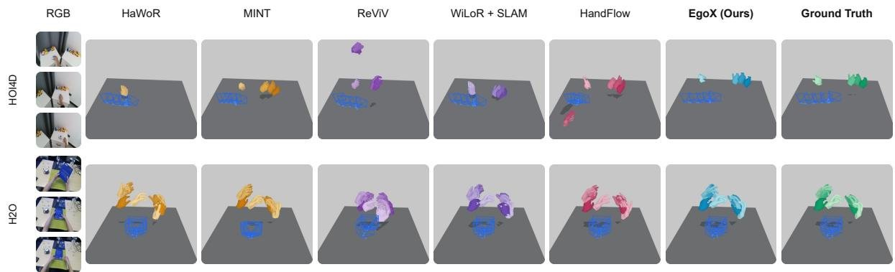  
Figure 8 | Additional World-Space Hand and Camera Reconstruction. Qualitative comparisons on HOI4D and H2O, supplementing Figure 5.

## E.2. Additional object-pose comparisons

Figure 9 supplements Figure 6 with additional camera-frame object-pose estimates.

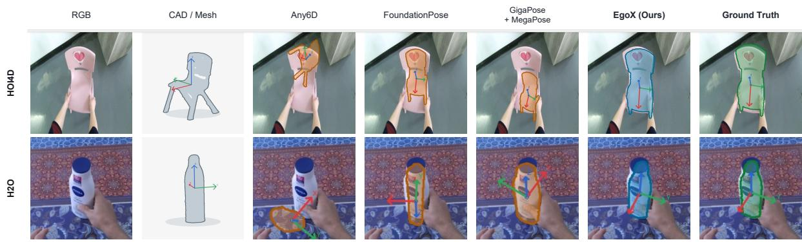  
Figure 9 | Additional Camera-Frame Object Pose Reconstruction. Qualitative comparisons on HOI4D and H2O, supplementing Figure 6.

## E.3. Additional depth comparisons

Figure 10 supplements Figure 7 with additional depth predictions.

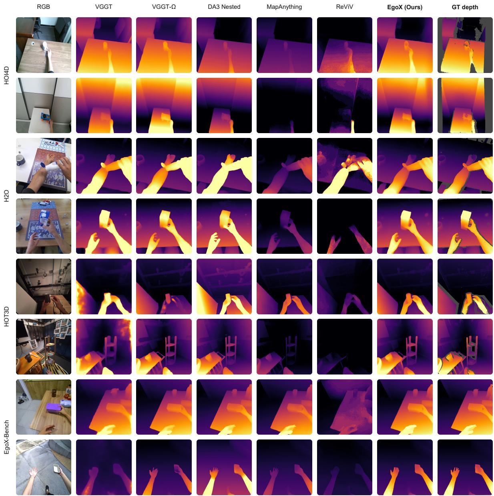  
Figure 10 | Additional Depth Reconstruction Results. Comparisons use the same reference-depth processing and scale protocol as Figure 7.

## F. Training and Compute

Training supervision. We combine the EgoX-Data-6M training split with six independently sourced public interaction datasets: HOT3D [3], HOI4D [40], H2O [30], HO-Cap [60], H2O-3D [23], and DexYCB [12]. We reprocess them so that depth, hand geometry, and object geometry agree under consistent metric camera conventions, avoiding contradictory supervision across tasks. Additional real-world sources are Xperience-10M [53], ACE-Data-0 [7], and AgiBot World 2026 [1]; synthetic sources are Aria Synthetic Environments [2], BEHAVIOR-1K [34], SceneNet RGB-D [42], and Dynamic Replica [28]. The pool contains approximately 280 hours. Training first mixes real and synthetic sources and then continues on an equal mixture of the retained real interaction sources. We sample $T \in \{ 1 , \ldots , 2 4 \}$ observations per input set.

Architecture details. Patch features from DINOv3 ViT-L/16 feed a 24-block reconstruction Transformer with a hidden dimension of 1024. Nineteen blocks exchange all tokens across views, while the remaining five operate on compact register and entity tokens. Camera and depth heads read fused image features, whereas hand and object heads read their view-specific entity states. The model uses learned spatial and reference embeddings without temporal encoding.

Coordinate and scale conventions. Training uses a common normalization factor $z _ { \mathrm { g t } } ,$ defined as the mean Euclidean distance of valid metric depth points from the reference-camera origin after transformation into W. Metric depth and translations are divided by $z _ { \mathrm { g t } } ,$ rotations and intrinsics are unchanged. For wrist-centred MANO joints $\hat { J } _ { \mathrm { r e l } , t } ^ { m }$ and reconstructed wrist $\hat { w } _ { t } ^ { n }$ training-space and metric joints are

$$
\hat { J } _ { t } ^ { n } = \frac { \hat { J } _ { \mathrm { r e l } , t } ^ { m } } { z _ { \mathrm { g t } } } + \hat { w } _ { t } ^ { n } , \qquad \hat { J } _ { t } ^ { m } = \hat { J } _ { \mathrm { r e l } , t } ^ { m } + \hat { s } \hat { w } _ { t } ^ { n } .\tag{3}
$$

Object translations use the annotated object origin. Object orientation is represented relative to the reference view as $\Delta A _ { t , j } ^ { o } = A _ { t , j } ^ { o } ( A _ { r , j } ^ { o } ) ^ { \top } ;$ the corresponding camera-conditioned target is $Q _ { t , j } ^ { o , * } = R _ { t } ^ { * } \Delta A _ { t , j } ^ { o , * }$

Detailed objective. The parameter term applies $\ell _ { 1 }$ losses to normalized camera translation, standardized unit quaternions, field of view, and normalized principal point; geodesic losses to hand and object rotations; Smooth L1 losses to MANO shape, image positions, and log-depths; and class-weighted binary cross-entropy to in-frame predictions. Image-position residuals are normalized by the longer image dimension. Ground-truth cameras define the view-local targets.

The dense losses $\mathcal { L } _ { D }$ and $\mathcal { L } _ { P }$ follow ${ \mathrm { V G G T } } { \mathrm { } } - \Omega ,$ , combining confidence-weighted residuals, inverse-depth weighting, confidence regularization, and multiscale gradient penalties. Hand and object reconstruction use Smooth L1 penalties after composition through predicted cameras. Object rotation uses $d _ { \mathrm { s y m } } ( A , B ) = \operatorname* { m i n } _ { G \in S _ { r } } d ( A , B G )$ , where � is geodesic distance and $S _ { r }$ is the object’s symmetry group in the reference orientation. The reference rotation is supervised toward identity without symmetry relaxation; the coupled term applies to non-reference views. All reductions use annotation-validity and in-frame masks, and object terms additionally require a bound reference mask. Missing annotations are not treated as negative labels.

Sampling and optimization. The source composition and two-stage mixture are summarized above. Each per-GPU batch samples $T \in \{ 1 , \ldots , 2 4 \}$ and uses a �-dependent batch size to maintain an approximately constant image budget. The image encoder is initialized from pretrained DINOv3 weights and the remaining modules randomly. All modules are optimized jointly using AdamW with linear warm-up, cosine decay, mixed precision, and module-wise gradient clipping.