# ExMR: Extremity Motion Refinement for Monocular Human Motion Capture

Tom Wehrbein and Bodo Rosenhahn

https://twehrbein.github.io/exmr-website/

Abstract—Detailed hand and foot articulation is important for animation and motion analysis, yet remains challenging to recover from monocular video. Recent expressive video methods infer hand articulation from shared whole-body representations. Our conference work suggests that this underexploits local evidence: the Foot Motion Refinement (FootMR) module refines ankle rotations from foot keypoints, improving reconstruction even when the initial estimator receives the same keypoints. We extend this principle to hands with the Hand Motion Refinement (HandMR) module. Because 2D finger keypoints are often missing or unreliable, HandMR combines image features of a pretrained hand reconstruction model with initial arm and hand rotations to refine elbows, wrists, and fingers. We integrate FootMR and HandMR into ExMR (Extremity Motion Refinement), a system for reconstructing 3D body, hand, and foot motion from monocular video. An initial temporal estimator predicts whole-body motion, after which both refiners revisit local evidence to predict residual joint rotations. Experiments on ARCTIC, MOYO, RICH, and MOOF show that ExMR outperforms state-of-the-art methods in hand and foot reconstruction, reducing hand per-vertex error and ankle joint angle error on MOYO by 19% and 18%, respectively, relative to the strongest competitor. Code will be made available for research purposes.

Index Terms—Expressive whole-body reconstruction, foot reconstruction, hand reconstruction, monocular human motion capture, temporal refinement.

## I. INTRODUCTION

ONOCULAR human motion capture aims to recover ing motion reconstruction accessible for applications such as animation, motion analysis, and AR/VR. The motion of the extremities carries particularly important details: ankle articulation contributes to lifelike dance animation, while wrist and finger configurations convey how a hand grasps or manipulates an object. Nevertheless, most current motion-capture methods primarily target overall body motion [1]–[6], and recovering detailed hand and foot articulation remains challenging.

Single-image expressive estimators [7]–[9] and per-frame body–hand integration methods [10]–[12] recover articulated hands with body context, but cannot exploit neighboring frames to resolve pose ambiguities. Hand-only video methods [13]–[15] instead use temporal evidence, but estimate the hand in isolation from the articulated body that constrains it. Expressive video methods such as WHAC [16], Motions as Queries [17], and Human3R [18] combine body and temporal evidence to recover body motion and hand articulation jointly. However, all three extract hand evidence from person crops or full video frames, where the small image area of the hands can limit the available visual detail [19]. Closest to our work, concurrent DanceHMR [20] instead fuses separately encoded body and specialist hand observations before a shared temporal encoder. After fusion, temporal modeling of body motion and hand articulation relies exclusively on a shared wholebody representation, which receives the hand observations only once, before an explicit estimate of the arms and hands exists.

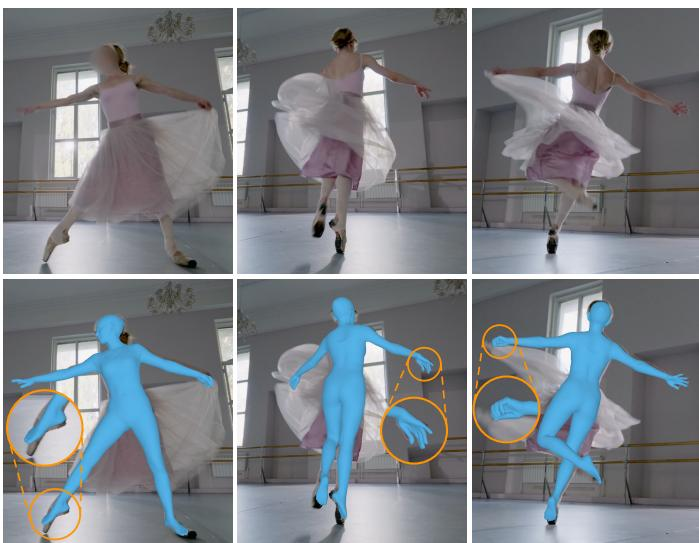  
Fig. 1. Monocular motion reconstruction with ExMR. Our work focuses on the articulation of the extremities (the hands and feet) within full-body motion capture.

In our 3DV 2026 conference paper [21], we introduced the Foot Motion Refinement module (FootMR), which predicts residual ankle rotations in a dedicated temporal network using local 2D foot keypoints, knee rotations, and initial ankle rotations. The paper showed that dedicated temporal refinement improved foot reconstruction even when the initial temporal estimator already received the same local evidence. This finding motivates our hypothesis that fine-grained hand evidence can remain underexploited in a shared whole-body representation. We therefore investigate whether a dedicated temporal stage can exploit the same hand observations more effectively by revisiting them together with the arm and hand rotations of an initial whole-body estimate and predicting residual joint rotations. Learning corrections relative to an explicit estimate is well established in single-image pose and mesh recovery [19], [22], [23]. Residual refinement has also been explored in video-based body reconstruction [24], including separate temporal networks for body regions in Local Recurrent Models (LMR) [25]. In our hand-refinement stage, the initial arm and hand rotations can summarize broader body and temporal context absent from an individual hand crop. Additionally, they can provide a useful prior when the local evidence is ambiguous, for example, under occlusion.

Building on this refinement principle, we introduce ExMR (Extremity Motion Refinement), a system for reconstructing body, hand, and foot motion from monocular video. Its initial estimator extends the GVHMR-based [3] estimator of our conference paper and fuses body and specialist hand image features before temporal modeling to predict SMPL-X motion [26] with articulated hands. FootMR and the newly introduced Hand Motion Refinement module (HandMR) then refine the initial motion sequence by predicting residual joint rotations in dedicated temporal networks. We retain FootMR’s architecture and refinement formulation and train both refiners jointly with the initial estimator. FootMR and HandMR instantiate a common temporal residual-refinement principle: revisiting local evidence together with explicit initial joint rotations to predict corrections over time. Fig. 1 shows ExMR’s reconstructions of a dance sequence, with close-ups highlighting the recovered foot and hand articulation.

Adapting refinement to hands changes both the correction targets and the observations. Hand refinement must account for a wrist and multiple finger joints per hand, compared with one ankle rotation per side for foot refinement. A direct analog of FootMR would use 2D finger keypoints, but these are frequently missing or unreliable under self-occlusion or occlusion by interacting objects. HandMR therefore uses latent image features from HaMeR [27], a pretrained model for 3D hand reconstruction. Extracted from local hand crops, these features can retain cues beyond explicit keypoint coordinates. HandMR reuses the HaMeR features supplied to the initial estimator, combining them with initial arm–hand rotations to jointly refine elbows, wrists, and fingers.

For feet, the design of FootMR was originally motivated by inaccurate foot annotations and limited foot-motion diversity in the training data available at the time of our conference work. Its keypoint representation permits training on projected 3D motion without paired images and supports extensive data augmentation. Advances in training data and image features could now reduce the need for dedicated ankle refinement. BEDLAM2 [28] provides large-scale, diverse synthetic video with ground-truth body motion, and SAM3D-Body [9] explicitly targets accurate body, hand, and foot reconstruction. We therefore strengthen the inherited body-and-foot system by adopting SAM3D-Body image features, revising its training mixture and objectives, and updating its test-time keypoint detector. Matched comparisons with and without FootMR test whether dedicated foot refinement remains beneficial.

We evaluate hand and expressive whole-body reconstruction on ARCTIC [29], MOYO [30], and RICH [31], and foot reconstruction on MOYO, RICH, and the MOOF dataset introduced in our conference paper [21]. Among the evaluated competitors, ExMR achieves the lowest hand reconstruction errors on all three hand benchmarks and the best or tiedbest results across the full-body metrics. Compared with an otherwise identical variant trained without HandMR, ExMR lowers hand errors on all three datasets, reducing MOYO wrist-aligned hand per-vertex error from 39.9 to 26.5 mm. Under the revised body-and-foot configuration, adding the FootMR module improves foot reconstruction on all three foot benchmarks, reducing MOYO ankle joint angle error from 25.3◦ to 20.4◦ in a matched comparison.

Relative to our conference paper, this journal article makes three main contributions:

• We introduce HandMR within ExMR, extending our conference body-and-foot motion-capture system to articulated hands. HandMR follows FootMR’s principle of predicting residual joint rotations in a dedicated temporal network. To adapt this principle to articulated hands, HandMR combines specialist hand image features with initial joint rotations to jointly correct elbow, wrist, and finger articulation.

• ExMR achieves the lowest hand reconstruction errors among the compared methods on all three hand benchmarks. HandMR substantially improves hand reconstruction over an otherwise identical ExMR variant trained without it. We further analyze hand-evidence representations, initial joint-rotation conditioning, temporal accuracy and stability, and how refinement gains vary with wrist articulation.

• ExMR outperforms all compared competitors on every reported foot metric across the three foot benchmarks. We show in matched comparisons that the inherited FootMR module improves foot reconstruction under the stronger body-and-foot configuration. A cumulative revision analysis traces the complete system’s improvement over the conference configuration.

## II. RELATED WORK

## A. Single-Image Human Mesh Recovery

Single-image human mesh recovery commonly estimates the parameters of a statistical body model from an RGB image. SMPL [32] provides a compact representation of body pose and shape. SMPLify [33] fits SMPL to detected 2D keypoints, while HMR [23] learns feed-forward parameter regression. A substantial literature has since developed around SMPL-based body reconstruction. CLIFF [34] adds full-image bounding-box conditioning to account for perspective effects, and HMR2.0 [35] improves visual representations with a large vision transformer backbone.

SMPL-X [26] extends SMPL with articulated hands and an expressive face, enabling joint body, hand, and face recovery. AiOS [36] progressively refines body, hand, and face features in a single network for expressive SMPL-X reconstruction.

SMPLer-X [7] and SMPLest-X [8] scale training data and transformer capacity for expressive reconstruction. SAM3D-Body [9] predicts Momentum Human Rig (MHR) [37] parameters for body, hand, and foot recovery using a DINOv3- based image backbone [38]. These single-image estimators cannot exploit neighboring frames to resolve pose ambiguities and often produce temporal jitter. Their learned visual representations nevertheless provide useful per-frame evidence for ExMR’s temporal reconstruction.

## B. Hand Reconstruction and Body–Hand Integration

MANO [39] is a parametric model of hand pose and shape widely used for hand-only reconstruction. HaMeR [27] scales transformer capacity and hand training data, and WiLoR [40] combines hand localization with MANO reconstruction and image-aligned refinement. These specialists provide detailed local estimates, although self-occlusion and hand–object interaction can leave their evidence incomplete.

Consistent body–hand reconstruction requires coordinating wrist orientation with the arm pose while exploiting detailed local hand evidence. One strategy reconciles separate body and hand predictions by adjusting the arm pose during integration. FrankMocap [10] compares direct copy-paste with optimization-based fitting and learned integration that adjusts shoulder and elbow rotations. PyMAF-X [11] uses elbow-twist compensation to avoid unnatural wrist poses. Hand evidence can also guide body and wrist estimation directly: PIXIE [41] fuses body and hand features, and Hand4Whole [42] combines body and metacarpophalangeal (MCP) joint cues for wrist estimation. Such guidance can reuse a pretrained hand specialist, as in Hand4Whole++ [12], which injects specialist features into a frozen whole-body estimator to improve wrist orientation. SAM3D-Body [9] instead uses geometric prompts to refine the body prediction before integrating optional handcrop predictions. In the converse direction, body estimates guide local hand reconstruction through localization or explicit pose conditioning: ExPose [19] uses an initial body estimate to define part crops, whereas HMR-Adapter [43] conditions a frozen hand estimator on joint rotations along the root-to-wrist kinematic chain. These approaches establish complementary roles for local hand evidence and body-derived kinematic context in recovering compatible arm and hand configurations.

These integration methods operate per frame. Hand-only video methods exploit temporal observations or motion priors to recover or refine hand motion, without jointly estimating the articulated body. HMP [13] learns a hand-motion prior and optimizes its latent variables to explain a video. Ha-WoR [14] estimates world-space hand trajectories from egocentric video and infills motion during missing observations. PAD-Hand [15] uses physics-aware diffusion to refine initial hand pose sequences. HandMR instead uses the arm–hand configuration from an initial whole-body motion estimate to guide temporal hand refinement.

## C. Video-Based Human Motion Reconstruction

Video-based methods exploit temporal context to reconstruct body motion [24], [44]–[48]. Recent methods [1]–[6], [49], [50] recover global motion in world coordinates while accounting for camera motion, but do not estimate articulated finger motion. Our initial estimator extends GVHMR’s [3] temporal transformer to articulated hands.

Expressive video methods jointly recover body motion and hand articulation, with different sources of hand evidence. Monocular Total Capture [51] fits a unified model to observations from separate body and hand networks, followed by temporal mesh tracking. Other approaches derive hand evidence from person crops or full video frames. WHAC [16] adds temporal modeling to SMPLer-X [7], whose hand features are cropped from its whole-body feature map. Motions as Queries [17] and Human3R [18] derive hand evidence from full-frame image features within their temporal expressive estimators. Concurrent DanceHMR [20] fuses separately encoded body and specialist hand observations through a residual feature update before a shared temporal encoder. Body and hand motion are decoded from its shared representation. The initial estimator of ExMR likewise fuses hand evidence before temporal modeling. HandMR subsequently refines the predicted arm–hand motion in a separate temporal stage.

## D. Foot Pose and Motion Reconstruction

Ankle positions alone do not determine foot orientation. The OpenPose foot dataset [52] and COCO-WholeBody [53] provide additional 2D annotations of the big toe, small toe, and heel. Whole-body 2D detectors [54]–[57] estimate these landmarks together with the ankle, providing localized observations for foot reconstruction. Zhuo et al. [58] use multiview data to reconstruct foot-pose and contact supervision, then train a monocular body-and-foot regressor with reversible kinematic topology to incorporate contact information. SAM3D-Body [9] explicitly targets foot pose within single-image full-body reconstruction and reports a foot-specific evaluation using six 2D foot keypoints.

Contact constraints, motion priors, and physics-based optimization also improve reconstruction by reducing footskate and ground penetration [59]–[62]. Such methods can update articulated pose, but their principal emphasis is contact consistency and physical plausibility. Plausible ground contact alone does not establish accurate ankle articulation. Our conference paper [21] introduced the FootMR module, which uses local 2D foot observations and temporal context to refine ankle rotations in an initial body-motion estimate. We retain FootMR as the foot-refinement component of ExMR.

## E. Human Pose and Motion Refinement

Single-image refinement methods use image evidence together with a current pose or mesh estimate to guide corrections. Iterative Error Feedback [22] predicts corrections to 2D joint locations, whereas HMR [23] iteratively updates body pose, shape, and camera parameters. PyMAF [63] and ReFit [64] use the predicted geometry to query image features and iteratively improve alignment. Other approaches refine predicted 2D poses [65], [66] or optimize an initial mesh using dense image correspondences [67].

Several temporal refiners operate on pose-sequence representations alone. PoseBERT [68] is trained by masked modeling on motion-capture data and refines both SMPL and MANO sequences. SmoothNet [69] refines coordinate- or rotation-based pose sequences by modeling each component independently over time. SynSP [70] uses pose-quality cues to improve the accuracy and temporal smoothness of predicted pose sequences. These methods are trained independently of the upstream pose estimators whose outputs they correct.

ExPose [19] and MEVA [24] integrate residual correction of an initial estimate into image- and video-based reconstruction, respectively. ExPose combines local hand crops with the body estimator’s wrist and finger parameters in a single-image hand refiner, alongside a separate face refiner. MEVA first estimates coarse body motion by mapping video features into the latent space of a motion variational autoencoder. A residual MLP then refines whole-body pose and shape per frame using current estimates and temporally encoded visual features. Temporal dynamics can also be modeled separately for body regions [25], [71]. Local Recurrent Models (LMR) [25] use regional temporal modeling to predict residual updates: six recurrent networks iteratively update body regions from mean SMPL pose and shape, each receiving the same per-frame image features together with its current regional pose and the current shape estimate. Compared with ExPose, HandMR additionally conditions on and refines elbow rotations and uses temporal context. MEVA and LMR use body-level image features, whereas FootMR and HandMR receive observations specific to their target regions: 2D foot keypoints and specialist hand image features, respectively. Like LMR, our refiners use separate temporal networks with explicit pose conditioning. In ExMR, these networks revisit the local foot and hand observations, together with its predicted joint rotations, to refine only selected joints.

## III. METHOD

## A. Problem Formulation and System Overview

Given a monocular video of L frames, we recover the person’s SMPL-X [26] motion, with particular emphasis on the articulated feet and hands. In the camera frame, we parameterize the motion by joint rotations $\{ \theta ^ { ( l ) } \in \mathbb { R } ^ { 5 2 \times 6 } \} _ { l = 1 } ^ { L } ,$ shape $\beta \in \mathbb { R } ^ { 1 0 }$ , and camera-frame translations $\{ \tau _ { c } ^ { ( l ) } \in \mathbb { R } ^ { 3 } \} _ { l = 1 } ^ { L }$ Joint rotations use the continuous 6D representation [72]. Facial pose and expression are outside the scope of this work.

As shown in Fig. 2, our system follows a two-stage design. Our initial estimator, which builds on GVHMR [3] (Section III-B), first predicts an initial full-body sequence with articulated hands. Two temporal refinement modules then update its extremity rotations: the Foot Motion Refinement module (FootMR, Section III-C1), inherited from our conference paper [21], refines the two ankles, while the newly introduced Hand Motion Refinement module (HandMR, Section III-C2) refines both elbows, both wrists, and all 30 finger joints. Both modules predict residual 6D rotations, which we fuse with the initial estimate to obtain the final camera-frame sequence. We call the resulting system ExMR (Extremity Motion Refinement). Throughout the paper, FootMR and HandMR, when used on their own, denote the two refinement modules, and ExMR denotes the complete reconstruction system.

The two refiners use modality-specific observations: FootMR receives sparse 2D foot keypoints, whereas HandMR receives image features from a pretrained 3D hand reconstruction model. Section III-C3 describes the refiners’ temporal architectures, and Section III-D presents the objectives and supervision used to train the complete system jointly.

## B. Initial Temporal SMPL-X Estimator

Following the system design introduced in our conference paper [21], we build the initial estimator as a temporal transformer based on GVHMR [3] and extend it to produce fullbody SMPL-X motion with articulated hands. The temporal transformer uses 12 encoder layers with 512-dimensional tokens. In this work, only its camera-frame predictions enter the extremity refiners and quantitative evaluations. We retain GVHMR’s world-grounded recovery path for demonstrations but do not evaluate it as a contribution.

For each frame, the initial estimator receives GVHMR’s camera-motion conditioning (a 6D relative camera rotation), 23 normalized 2D body-and-foot keypoints, a CLIFF-style three-value encoding of the person bounding box, one 1024- dimensional SAM3D-Body image feature [9], and one 1024- dimensional HaMeR feature [27] for each hand, extracted from a separate per-hand image crop. The initial estimator uses the 23-keypoint layout from our conference paper [21]. The layout comprises the 17 COCO [73] body keypoints used by GVHMR and three standard whole-body detector outputs per foot: the big toe, small toe, and heel. Each keypoint is normalized by subtracting the bounding-box center and dividing by its scale. Keypoints deemed not visible according to their detector confidence are set to zero. Following CLIFF [34], the bounding-box encoding contains the person-box center offsets and scale in the full image, normalized by the camera focal length. It therefore preserves the location and apparent size removed by keypoint normalization, which are informative under perspective projection.

Relative to GVHMR, we replace its HMR2.0 image feature [35] with the SAM3D-Body image feature, add the two HaMeR features, and extend the output with 15 fingerjoint rotations per hand. A learned projection shared between hands embeds the added hand features. The resulting embeddings are concatenated, then fused with the remaining input embeddings by element-wise summation to form the perframe temporal token. The initial estimator predicts the joint rotations and shape together with weak-perspective camera parameters for each person crop. The sequence-level shape $\beta$ is obtained by averaging the predicted shape coefficients over all L frames. Following CLIFF, we convert the camera parameters to the perspective-camera translation $\tau _ { c } ^ { ( l ) }$ for the full image, thereby obtaining the initial camera-frame SMPL-X sequence. FootMR and HandMR subsequently update only their designated joint rotations. Neither the shape estimate nor the camera estimate changes during refinement.

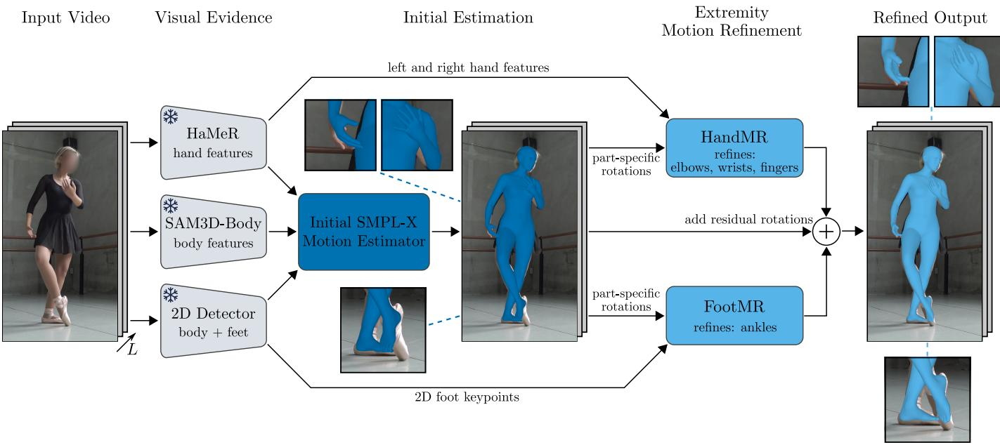  
Fig. 2. Overview of ExMR at inference. Given a monocular video, the initial estimator combines per-frame body and hand image features with 2D body and-foot keypoints to predict a SMPL-X motion sequence. The HandMR and FootMR modules reuse the corresponding visual evidence and predict residual rotations conditioned on part-specific initial rotations: elbows, wrists, and fingers for HandMR, and knees and ankles for FootMR. HandMR refines elbows, wrists, and fingers, while FootMR refines ankles. The circled plus denotes addition of 6D rotation residuals, with conversion to parent-relative SMPL-X rotations where needed. The initial estimator and both refinement modules are jointly trained temporal transformers. Snowflakes denote frozen pretrained models. Additional inputs are omitted for clarity: the person bounding-box encoding for all three temporal networks and the relative camera rotation for the initial estimator. Insets compare the initial and refined hand and foot estimates.

## C. Dedicated Part-Specific Temporal Refinement

FootMR and HandMR predict residual updates to different extremity joint groups from sequences of local observations and initial joint rotations. We first establish the rotation notation and update operation shared by the two refiners. SMPL-X expresses each joint rotation relative to its parent. Let rotmat : $\mathbb { R } ^ { 6 } \to \mathrm { S O ( 3 ) }$ map a 6D rotation representation to its rotation matrix via Gram–Schmidt orthonormalization [72], and let rot6d : $\mathrm { S O } ( 3 ) \to \mathbb { R } ^ { 6 }$ map a rotation matrix back to its 6D representation. We write $\theta _ { i } ^ { ( l ) } \in \mathbb { R } ^ { 6 }$ for the parent-relative rotation of joint i in frame l and ${ \bf R } _ { i } ^ { ( l ) } = \mathrm { r o t m a t } ( \theta _ { i } ^ { ( l ) } )$ for its rotation matrix. Its global rotation in the camera frame is

$$
\bar { \mathbf { R } } _ { i } ^ { ( l ) } = ( \prod _ { j \in \mathcal { A } ( i ) } ^ {  } \mathbf { R } _ { j } ^ { ( l ) } ) \mathbf { R } _ { i } ^ { ( l ) } ,\tag{1}
$$

where $\Pi ^ {  }$ denotes ordered matrix multiplication along the kinematic chain from the root toward i, and A(i) contains the ancestors of i in that order. We write $\bar { \theta } _ { i } ^ { ( l ) } = \mathrm { r o t 6 d } ( \bar { \mathbf { R } } _ { i } ^ { ( l ) } )$ for the resulting global rotation of joint i in 6D representation.

Each refiner predicts a 6D residual vector for every target joint and frame. Each residual is added to the corresponding initial 6D rotation in the representation chosen for that joint, either global or parent-relative. The updated 6D vector is mapped to a rotation matrix with rotmat. Rotations refined globally are then converted back to the parent-relative representation required by SMPL-X. The following subsections specify the observations, conditioning rotations, and correction targets of each refiner.

1) Foot Motion Refinement: FootMR jointly refines the initial left and right ankle rotations using sparse 2D foot evidence. Although SMPL-X parameterizes each foot with an ankle and a forefoot joint, we target only the ankle. It has the larger influence on overall foot motion, and our prior study found only limited gains from additionally refining the forefoot [21]. Four 2D keypoints per foot—the ankle, big toe, small toe, and heel—provide compact, direct geometric evidence for this target and can be reliably detected by modern whole-body pose estimators [57]. Moreover, to our knowledge, no publicly available foot-specific monocular 3D pose model exposes image features analogous to HaMeR’s hand features. For each frame, FootMR receives these four 2D keypoints per foot, the person bounding-box encoding, and the global rotations of both knees and ankles. Only the ankle rotations are refined; the knee rotations provide kinematic context. As in the initial estimator, keypoints deemed not visible according to their detector confidence are set to zero after normalization.

A hip-relative knee rotation alone does not specify the knee orientation in the camera frame because it omits the rotations of its ancestors. We therefore condition FootMR on global knee rotations, which constrain feasible global ankle rotations and help resolve the ambiguity in lifting the 2D keypoint sequence to 3D. The initial global ankle rotations provide a strong prior, particularly when the 2D observations are noisy or missing. Using global rather than knee-relative initial ankle rotations as the reference for residual refinement also improves generalization to extreme ankle motions.

Let a denote the ordered left–right ankle pair. FootMR predicts a pair of 6D residuals $\delta \bar { \theta } _ { a } ^ { ( l ) } \in \mathbb { R } ^ { 2 \times 6 }$ , one for each ankle. The refined global rotations are

$$
\bar { \theta } _ { a } ^ { ( l ) } = \bar { \theta } _ { a , \mathrm { i n i t } } ^ { ( l ) } + \delta \bar { \theta } _ { a } ^ { ( l ) } .\tag{2}
$$

Each updated 6D vector is mapped to a rotation matrix as $\bar { \mathbf { R } } _ { a } ^ { ( l ) } = \mathrm { { r o t m a t } } ( \bar { \theta } _ { a } ^ { ( l ) } )$ ). We then recover the knee-relative ankle rotations independently for each side as

$$
\mathbf { R } _ { a } ^ { ( l ) } = \left( \bar { \mathbf { R } } _ { k } ^ { ( l ) } \right) ^ { \top } \bar { \mathbf { R } } _ { a } ^ { ( l ) } ,\tag{3}
$$

where k denotes the knee on the same side. These recovered knee-relative rotations replace the initial ankle rotations when constructing the output SMPL-X sequence.

During training, FootMR conditions on ground-truth global knee rotations and initial global ankle rotations predicted by the initial estimator. At inference, both the knee and ankle conditions come from the initial estimator. These rotation conditions are constructed without gradient tracking.

2) Hand Motion Refinement: HandMR specializes the refinement principle for articulated hands. A direct analog of FootMR would use detected 2D finger keypoints for each hand. Although these keypoints provide detailed geometric evidence when visible, parts of the fingers are frequently selfoccluded or hidden by objects or the other hand, making the corresponding detections missing or unreliable. We therefore use image features from HaMeR [27], a specialist model trained on a large mixture of 2D- and 3D-annotated hand data and designed for robust monocular 3D hand reconstruction. We choose HaMeR because its transformer decoder provides a single 1024-dimensional output token per hand crop, which can be used directly as input to our temporal networks. Compared with a coordinate-only representation, its latent features retain richer image evidence and can preserve cues about visibility and ambiguity under partial occlusion. Our ablation in Table II shows that these features provide more effective hand evidence than 2D finger keypoints in our complete pipeline.

HaMeR predicts a global hand-root orientation in its hand-crop camera frame and parent-relative finger rotations. HandMR similarly refines wrists globally in the full-image camera frame and fingers relative to their parents. It additionally conditions on and refines the global elbow rotations. Since HandMR predicts each wrist rotation globally whereas SMPL-X stores it relative to the elbow, the accuracy of the recovered elbow-relative wrist rotation depends on both the global wrist and elbow estimates. Refining the elbow, rather than using it only as context, improves the consistency of the elbow–wrist kinematic chain (Table V).

HandMR jointly processes the HaMeR feature vectors, the person bounding-box encoding, and the initial estimator’s predictions for both arms: the global rotations of both elbows and wrists and the parent-relative rotations of all 30 finger joints. It jointly predicts residual rotations for the left and right elbows, wrists, and fingers. Let $e , \ w ,$ and f denote the elbow, wrist, and finger joint groups, respectively. The residuals then have dimensions $\delta \bar { \theta } _ { e } ^ { ( \bar { l } ) } \in \bar { \mathbb { R } } ^ { 2 \times 6 } , \ \bar { \delta } \bar { \theta } _ { w } ^ { ( l ) } \in \bar { \mathbb { R } } ^ { 2 \times 6 }$ and $\delta \boldsymbol { \theta } _ { f } ^ { ( l ) } \in \mathbb { R } ^ { 3 0 \times 6 }$ . The updates are

$$
\bar { \theta } _ { e } ^ { ( l ) } = \bar { \theta } _ { e , \mathrm { i n i t } } ^ { ( l ) } + \delta \bar { \theta } _ { e } ^ { ( l ) } ,\tag{4}
$$

$$
\bar { \theta } _ { w } ^ { ( l ) } = \bar { \theta } _ { w , \mathrm { i n i t } } ^ { ( l ) } + \delta \bar { \theta } _ { w } ^ { ( l ) } ,
$$

$$
\boldsymbol { \theta } _ { f } ^ { ( l ) } = \boldsymbol { \theta } _ { f , \mathrm { i n i t } } ^ { ( l ) } + \delta \boldsymbol { \theta } _ { f } ^ { ( l ) } .\tag{5}
$$

(6)

The elbow and wrist residuals operate in the global camera frame, whereas the finger residuals operate in the parentrelative representation.

Independently for each side, we convert the refined elbow and wrist rotations back to the SMPL-X kinematic representation. First, each updated 6D vector is mapped to a matrix, $\bar { \mathbf { R } } _ { e } ^ { ( l ) } = \mathrm { r o t m a t } ( \bar { \theta } _ { e } ^ { ( l ) ^ { \ast } } )$ and $\bar { \mathbf { R } } _ { w } ^ { ( l ) } = \mathrm { r o t m a t } ( \dot { \bar { \theta } } _ { w } ^ { ( l ) } )$ . The parentrelative rotations are then recovered as

$$
\mathbf { R } _ { e } ^ { ( l ) } = \left( \bar { \mathbf { R } } _ { s } ^ { ( l ) } \right) ^ { \top } \bar { \mathbf { R } } _ { e } ^ { ( l ) } , \qquad \mathbf { R } _ { w } ^ { ( l ) } = \left( \bar { \mathbf { R } } _ { e } ^ { ( l ) } \right) ^ { \top } \bar { \mathbf { R } } _ { w } ^ { ( l ) } ,\tag{7}
$$

where s denotes the shoulder on the same side and $\bar { \mathbf { R } } _ { s } ^ { ( l ) }$ is its unrefined global rotation from the initial estimate. Importantly, the second conversion uses the refined elbow rotation.

The predicted elbow, wrist, and finger conditions remain connected to the initial estimator’s computational graph, allowing gradients from HandMR to propagate into the initial estimator. In preliminary experiments, this configuration gave slightly better reconstruction accuracy than detaching the HandMR conditions, so we use it in the final configuration. The initial estimator and HandMR receive the same HaMeR features and person bounding-box encoding. HandMR thus introduces a dedicated temporal refinement stage rather than additional external hand evidence.

3) Temporal Refiner Architectures: FootMR and HandMR are separate temporal networks that update disjoint joint groups without sharing parameters. Each independently processes its own evidence and part-specific predictions from the shared initial estimator. Both networks instantiate the same architectural blueprint, which we adopt from GVHMR [3].

Following GVHMR, dedicated MLPs first embed the partspecific evidence, the person bounding-box encoding, and rotation conditions. FootMR combines its embeddings through element-wise summation into a 256-dimensional token. For HandMR, a shared learned projection independently maps each of the two 1024-dimensional HaMeR feature vectors to 256 dimensions. The resulting embeddings are concatenated into a 512-dimensional visual-evidence embedding and summed element-wise with the 512-dimensional box and rotation embeddings to form a 512-dimensional token. This larger token accommodates HandMR’s higher-dimensional hand evidence and substantially larger set of conditioned rotations compared with FootMR’s few 2D keypoints and joint rotations. In either network, all information for both sides of the body is represented by a single token per frame. The token sequence is processed by six transformer encoder layers with four attention heads and Rotary Position Embedding (RoPE) [74]. A twolayer MLP with GELU activation maps each output token to all residual rotations for the joint groups refined by the corresponding network.

RoPE encodes relative temporal position, while a local attention mask restricts each token to a W-frame neighborhood. We use $W ~ = ~ 1 2 0$ , corresponding to four seconds at 30 frames per second. This combination allows the refiners to process sequences of arbitrary length in a single forward pass, without autoregressive or sliding-window inference. The initial estimator uses the same relative-position and local-attention principle inherited from GVHMR, so the complete temporal model supports this sequence-level inference.

The initial estimator, FootMR, and HandMR contain 41.4M, 3.6M, and 13.9M trainable parameters, respectively, totaling 58.9M for ExMR, excluding the frozen feature extractors. FootMR and HandMR have low absolute inference runtimes. Their individual contributions to the complete system’s cost are reported in the supplementary material (Section S3).

## D. Training Objectives and Supervision

The initial estimator, FootMR, and HandMR are trained jointly from scratch. The pretrained SAM3D-Body and HaMeR feature extractors remain fixed, and their output features are precomputed. During training, we synthesize the 23 input keypoints by extracting 3D joints from the ground-truth SMPL-X sequence, perturbing them with noise, and projecting them to 2D, following prior temporal motion reconstruction methods [1], [3], [75]. Following GVHMR, random visibility masks simulate missing detector outputs in these synthetic inputs.

We retain the random global-orientation augmentation from the FootMR module introduced in our conference paper [21], which is enabled by the module’s image-independent evidence. For each sequence, we sample a random rotation $\mathbf { R } _ { \mathrm { a u g } } \ \sim \ \mathcal { U } ( \mathrm { S O ( 3 ) } )$ and apply it to the ground-truth and predicted root orientations before constructing FootMR’s 2D foot keypoints, bounding boxes, and global knee and ankle conditions. This exposes the refiner to the same relative foot motion under arbitrary global orientations and improves generalization to uncommon global ankle orientations. No output adjustment is required because the refined global ankle rotations are converted back to knee-relative rotations, which are independent of the root orientation. This augmentation is applied only when constructing FootMR’s inputs, not when constructing the inputs of the initial estimator or HandMR. The precomputed SAM3D-Body and HaMeR features used by these components encode appearance in the original image and cannot be transformed consistently under a sampled virtual orientation.

We integrate the refined rotations into the SMPL-X prediction. The refiners require no separate objectives. Let $\Theta _ { \mathrm { i n i t } }$ $\Theta _ { \mathrm { r e f } } .$ , and $\Theta ^ { * }$ denote the initial, refined, and ground-truth SMPL-X rotation sequences in RL×52×6, obtained by stacking the per-frame 6D rotations $\theta ^ { ( l ) }$ . The initial and refined sequences differ only in the rotations updated by the two refiners: both ankles, both elbows, both wrists, and all 30 finger joints. Both estimates are supervised with

$$
\begin{array} { r } { \mathcal { L } _ { \boldsymbol { \theta } } = \frac { 1 } { 2 } \left( \ell _ { 2 } ( \Theta _ { \mathrm { i n i t } } , \Theta ^ { * } ) + \ell _ { 2 } ( \Theta _ { \mathrm { r e f } } , \Theta ^ { * } ) \right) . } \end{array}\tag{8}
$$

Throughout this subsection, $\ell _ { 1 } ( \cdot , \cdot )$ and $\ell _ { 2 } ( \cdot , \cdot )$ denote losses based on element-wise absolute and squared errors, respectively. Body-shape supervision and the inherited world-motion objectives remain unchanged from GVHMR [3].

Camera-frame geometric losses additionally supervise the refined prediction. Let $\mathbf { J } \in \mathbb { R } ^ { L \times 6 3 \times 3 }$ and $\mathbf { V } \in \mathbb { R } ^ { L \times { 4 3 7 } \times 3 }$ denote its SMPL-X joint and supervised-vertex sequences, with starred symbols denoting ground truth. Following GVHMR, the 437 vertices are sampled across the full SMPL-X mesh of 10,475 vertices. The first 23 entries along the joint dimension of J are body-and-foot joints, with index set B, while the remaining 40 are finger joints and fingertips, with index set H. Their root-centered versions, $\mathbf { J } ^ { r }$ and $\mathbf { V } ^ { r }$ , are formed by subtracting the hip midpoint in each frame. For $\mathbf { J } _ { \mathcal { H } } .$ , we also form per-hand wrist-centered coordinates, denoted by $\mathbf { J } _ { \mathcal { H } } ^ { \mathrm { w r } }$ by centering each hand at its corresponding wrist. We retain the forms of GVHMR’s camera-frame 3D body-joint and vertex losses and its 2D joint and vertex reprojection losses, but replace their $\ell _ { 2 }$ penalties with $\ell _ { 1 }$ . The 2D joint term is extended to the full 63-joint set, and a wrist-centered 3D finger-joint term additionally supervises articulated hands. The resulting 3D and 2D losses are

$$
\begin{array} { r l } & { \mathcal { L } _ { \mathrm { 3 d } } = \ell _ { 1 } ( \mathbf { J } _ { B } ^ { r } , \mathbf { J } _ { B } ^ { r * } ) + \ell _ { 1 } ( \mathbf { J } _ { \mathcal { H } } ^ { \mathrm { w r } } , \mathbf { J } _ { \mathcal { H } } ^ { \mathrm { w r } * } ) } \\ & { \quad \quad \quad + \ell _ { 1 } ( \mathbf { V } ^ { r } , \mathbf { V } ^ { r * } ) , } \end{array}
$$

$$
\begin{array} { r } { \mathcal { L } _ { \mathrm { 2 d } } = \ell _ { 1 } ( \Pi ( \mathbf { J } ) , \Pi ( \mathbf { J } ^ { * } ) ) + \ell _ { 1 } ( \Pi ( \mathbf { V } ) , \Pi ( \mathbf { V } ^ { * } ) ) , } \end{array}\tag{9}
$$

(10)

where Π projects joints and vertices framewise into normalized bounding-box coordinates. The crop-camera supervision likewise follows GVHMR, with an $\ell _ { 1 }$ penalty replacing the original $\ell _ { 2 }$ penalty. For the GVHMR-derived camera-frame geometric terms, replacing $\ell _ { 2 }$ with $\ell _ { 1 }$ changes their numerical scale, so we rescale their weights accordingly.

We introduce $\ell _ { 1 }$ losses on the first- and second-order frame differences of the root-centered 63-joint sequence, which we refer to as velocity and acceleration losses. For frame index $l ,$ let $\Delta \mathbf { J } ^ { r , ( l ) } = \dot { \mathbf { J } } ^ { r , ( l + 1 ) } - \mathbf { J } ^ { r , ( l ) }$ and $\Delta ^ { 2 } \mathbf { J } ^ { r , ( l ) } = \mathbf { J } ^ { r , ( l + 2 ) } -$ $2 \mathbf { J } ^ { r , ( l + 1 ) } + \mathbf { J } ^ { r , ( l ) }$ , for $l = 1 , \ldots , L - 1$ and $l = 1 , \ldots , L - 2 ,$ respectively. The temporal losses are

$$
\begin{array} { r } { \mathscr { L } _ { \mathrm { v e l } } = \ell _ { 1 } ( \Delta \mathbf { J } ^ { r } , \Delta \mathbf { J } ^ { r * } ) , } \end{array}\tag{11}
$$

$$
\mathcal { L } _ { \mathrm { a c c } } = \ell _ { 1 } ( \Delta ^ { 2 } \mathbf { J } ^ { r } , \Delta ^ { 2 } \mathbf { J } ^ { r * } ) .\tag{12}
$$

Temporal differences enter the losses only when all contribut ing frames are valid.

Unavailable supervision is masked. In particular, H36M [76] and 3DPW [77] (two datasets in the training mixture detailed in Section IV-A) lack articulated hand annotations. Their elbow, wrist, and finger rotations, finger joints, hand-driven vertices, and corresponding temporal terms are therefore masked. Data provenance. This study uses existing published datasets, including MOOF introduced in our prior work [21], and publicly available Pexels videos1 for qualitative evaluation. No new participants were recruited, and no new recordings of participants were collected for this study.

## IV. EXPERIMENTS

We first describe the experimental protocol and evaluate expressive whole-body and hand reconstruction. The subsequent analyses examine HandMR’s contribution and behavior and revisit foot refinement under the revised configuration, including qualitative examples of hand and foot refinement. A secondary body-only comparison concludes the evaluation.

## A. Experimental Protocol

1) Evaluation Datasets: We evaluate expressive wholebody and hand reconstruction on ARCTIC [29], MOYO [30], and RICH [31], which provide SMPL-X ground truth with articulated hand pose. ARCTIC records dexterous bimanual human–object interaction, whereas MOYO captures a yoga professional performing complex poses. Both pair multiview video with marker-based motion capture to obtain the annotations. RICH records multiple subjects performing daily and sporting activities indoors and outdoors, with annotations obtained through markerless multiview capture.

On all three datasets, we evaluate every camera view independently as a monocular sequence. Because ARCTIC’s test-set annotations are withheld, we follow its official split, evaluating on the validation subject and restricting ARCTIC training to the eight training subjects. MOYO separates sequences captured with and without hand markers. We therefore compute metrics requiring articulated hand ground truth only on the release-defined with\_hands validation subset. Fullbody PVE and PA-PVE, as well as prediction-only hand jitter, use the complete validation set.

For fine-grained foot evaluation, we use MOYO and RICH for 3D reconstruction and MOOF for 2D reprojection. Introduced in our conference paper [21], MOOF contains complex foot motion with manually verified 2D foot-keypoint and visibility annotations. Additionally, body-only reconstruction is reported on 3DPW [77], EMDB-1 [78], and RICH.

2) Evaluation Metrics: We evaluate 3D joint and vertex errors in camera coordinates. Whole-body mean per-vertex error (PVE) uses all SMPL-X vertices, whereas hand PVE uses MANO-corresponding vertices. Body-only evaluation uses SMPL meshes to compute PVE and mean per-joint position error (MPJPE). Body metrics are pelvis-aligned and hand metrics are wrist-aligned. The Procrustes-aligned variants (PA-PVE and PA-MPJPE) additionally apply per-frame similarity alignment, independently for each hand in hand PA-PVE. These errors are reported in millimeters.

Before SMPL-X mesh construction, we set facial pose and expression to neutral defaults for all locally evaluated methods and ground truth. For body-only evaluation, we also set articulated hand poses to their defaults in both predictions and ground truth. SMPL-X meshes are then mapped to the 6,890-vertex SMPL topology [26] before computing PVE and regressing joints for MPJPE and PA-MPJPE.

Temporal metrics use joint trajectories at 30 frames $/ \mathrm { s } ,$ centered in each frame. Body-only Accel uses the pelvis-centered MPJPE joint set, and hand metrics use 21 wrist-centered joints per hand, including fingertips. Finite differences are scaled by the frame rate raised to their order. Mean per-joint velocity error (MPJVE, $\mathrm { m m } / \mathrm { s } )$ and acceleration error (Accel, $\mathrm { m } / \mathrm { s } ^ { 2 } )$ measure mean Euclidean discrepancies between predicted and ground-truth first- and second-order differences, respectively. Prediction-only Jitter measures the mean magnitude of thirdorder differences, reported in units of 10 $\mathrm { m } / \mathrm { s } ^ { 3 }$ following WHAM [1].

Global and local rotation errors (G-RE and L-RE) measure the SO(3) geodesic distance between predicted and groundtruth rotations, in degrees. G-RE uses global camera-frame rotations, whereas L-RE uses parent-relative rotations. We report ankle-specific G-RE as global ankle joint angle error (AJAE).

Whole-body averages can obscure localized foot improvements [21]. We therefore also report scale-normalized foot MPJPE (N-MPJPEF, in millimeters) over each foot’s big toe, small toe, and heel. For each foot and frame, predicted and ground-truth landmarks are mean-centered and then scale aligned [79]. On MOOF, the percentage of correct foot keypoints $( \mathrm { P C K _ { F } } )$ pools visible landmarks using an $\ell _ { 2 }$ reprojection-error threshold of 0.05 times the person box’s larger side. Because $\mathrm { P C K } _ { \mathrm { F } }$ also depends on body pose, shape, and translation, we report normalized 2D foot-keypoint error $\left( \mathrm { N - F K E } _ { 2 \mathbf { d } } \right)$ to isolate local foot configuration. After personbox normalization, each foot’s keypoints are mean-centered and scale-aligned independently per frame before their $\ell _ { 2 }$ error is computed. $\mathrm { N } { \mathrm { - F K E } } _ { 2 \mathrm { d } }$ includes only feet with all three landmarks visible.

3) Training and Implementation Details: The training set comprises BEDLAM [80], BEDLAM2 [28], H36M [76], 3DPW [77], and ARCTIC [29]. Compared with the conference training mixture [21], we add BEDLAM2 and ARCTIC and remove AMASS [81] because it lacks images for HaMeR feature extraction. To prevent overlap with the MOYO evaluation set, BEDLAM2 sequences whose identifiers contain moyo are excluded. The five datasets are concatenated and globally shuffled without rebalancing. ExMR predicts neutral SMPL-X parameters. For H36M and 3DPW, we use the fits from GVHMR [3], whereas BEDLAM and BEDLAM2 directly provide ground-truth parameters. For ARCTIC, we fit shape coefficients to the personalized ground-truth meshes of the training subjects (Section S1).

Training uses dataset-provided ground-truth camera intrin sics and person bounding boxes. Each hand box is constructed by projecting the annotated SMPL-X hand joints. We cap training subsequences at 120 frames and use a batch size of 128, which keeps training of the complete ExMR system within 24 GB of GPU memory. The camera-frame and temporal objectives defined in Section III-D use the following loss weights: 1 for $\mathcal { L } _ { \theta } .$ , 50 for $\mathcal { L } _ { \mathrm { 3 d } }$ , 100 for $\mathcal { L } _ { \mathrm { 2 d } }$ , 0.1 for the cropcamera loss, and 10 each for $\mathcal { L } _ { \mathrm { v e l } }$ and $\mathcal { L } _ { \mathrm { a c c } }$ . Optimization uses AdamW [82] at a fixed learning rate of $2 \times 1 0 ^ { - 4 }$ and weight decay 0.01. We maintain an exponential moving average of the model parameters with decay 0.9999. Training runs for 210 epochs, corresponding to approximately 200,000 optimization steps. With 16-bit mixed precision on a single GPU, training takes 13.5 h on an NVIDIA H200 and 16.5 h on an NVIDIA GeForce RTX 4090.

4) Test-Time Inputs and Preprocessing: Unless stated otherwise, we obtain ExMR’s 23 body-and-foot keypoints with Sapiens2-1B [57] and treat detections with confidence below 0.5 as missing. The detector can be replaced without retraining if it provides the same 23-keypoint layout. Camera intrinsics are approximated by setting the focal length to the full-image diagonal and the principal point to the image center [34]. For benchmark sequences with 3D ground truth, we use ground-truth person boxes and construct each hand box from the projected annotated SMPL or SMPL-X hand joints.

TABLE I  
COMPARISON OF EXPRESSIVE WHOLE-BODY AND HAND RECONSTRUCTION ON ARCTIC [29], MOYO [30], AND RICH [31]. ALL ERRORS AREPER-VERTEX ERRORS IN mm (LOWER IS BETTER). DANCEHMR-STYLE FUSION DENOTES OUR LOCALLY IMPLEMENTED AND TRAINED BASELINE, NOT AREPRODUCTION OF THE COMPLETE DANCEHMR METHOD. EXMR IS BEST ON EVERY HAND METRIC AND COMPETITIVE ON FULL-BODY METRICS.
<table><tr><td rowspan="3" colspan="2"></td><td colspan="4">ARCTIC</td><td colspan="4">MOYO</td><td colspan="4">RICH</td></tr><tr><td colspan="2">PA-PVE</td><td colspan="2">PVE</td><td colspan="2">PA-PVE</td><td colspan="2">PVE</td><td colspan="2">PA-PVE</td><td colspan="2">PVE</td></tr><tr><td>All</td><td>Hands</td><td>All</td><td>Hands</td><td>All</td><td>Hands</td><td>All</td><td>Hands</td><td>All</td><td>Hands</td><td>All</td><td>Hands</td></tr><tr><td rowspan="9">perr-ame</td><td>AiOS [36]</td><td>30.2</td><td>19.2</td><td>47.1</td><td>38.3</td><td>1</td><td></td><td></td><td></td><td></td><td>一</td><td></td><td>一</td></tr><tr><td>Hand4Whole++ [12]</td><td></td><td></td><td>46.0</td><td>25.0</td><td></td><td></td><td></td><td></td><td></td><td>一</td><td></td><td></td></tr><tr><td>SMPLer-X-H [7]</td><td>27.6</td><td>18.7</td><td>44.6</td><td>36.9</td><td>一</td><td>1</td><td></td><td></td><td>1</td><td>一</td><td></td><td>一</td></tr><tr><td>released checkpoint</td><td>25.4</td><td>18.4</td><td>43.8</td><td>39.2</td><td>53.6</td><td>16.8</td><td>96.5</td><td>64.8</td><td>31.5</td><td>16.0</td><td>69.0</td><td>44.7</td></tr><tr><td>SMPLest-X-H [8]</td><td>23.2</td><td>10.7</td><td>38.1</td><td>22.6</td><td></td><td></td><td></td><td></td><td></td><td></td><td></td><td></td></tr><tr><td>released checkpoint*</td><td>28.1</td><td>17.8</td><td>46.1</td><td>39.0</td><td>56.8</td><td>15.7</td><td>96.0</td><td>58.3</td><td>32.0</td><td>15.9</td><td>77.1</td><td>44.5</td></tr><tr><td>SAM3D-Body* [9]</td><td>34.7</td><td>7.1</td><td>59.5</td><td>16.3</td><td>41.6</td><td>9.9</td><td>71.4</td><td>32.9</td><td>30.2</td><td>8.2</td><td>64.7</td><td>27.5</td></tr><tr><td>DanceHMR (reported) [20]</td><td>28.1</td><td>8.5</td><td>44.7</td><td>24.8</td><td>一</td><td>一</td><td></td><td>一</td><td>1</td><td>一</td><td>一</td><td>一</td></tr><tr><td>DanceHMR-style fusion</td><td>21.5</td><td>7.2</td><td>37.2</td><td>16.9</td><td>37.7</td><td>9.9</td><td>65.4</td><td>40.4</td><td>25.4</td><td>7.8</td><td>61.2</td><td>24.4</td></tr><tr><td>temporal ExMR</td><td></td><td>21.5</td><td>6.1</td><td>35.3</td><td>14.7</td><td>36.4</td><td>8.6</td><td>64.2</td><td>26.5</td><td>24.9</td><td>7.7</td><td>58.4</td><td>21.9</td></tr></table>

\* Evaluated by us using the publicly released checkpoint.

For MOOF, which lacks 3D ground truth, and for arbitrary demonstration videos, we use detected person boxes. The hand boxes in these cases are constructed from visible finger keypoints predicted by a whole-body 2D detector, following HaMeR’s demo protocol. The hand boxes are only used to define separate left- and right-hand crops for the fixed HaMeR encoder. If no visible finger keypoints are detected for a hand, all coordinates of the corresponding hand box are set to zero, producing an all-black input crop for HaMeR. The resulting HaMeR feature is passed to the initial estimator and HandMR without an explicit hand-visibility indicator.

5) Baselines and Comparison Protocol: The results for external methods come from the cited publications and our evaluations of publicly released checkpoints. An asterisk marks the latter. We evaluate each checkpoint using its official demo or inference code and native preprocessing with the same benchmark-specific bounding boxes as ExMR. All local evaluations use the same evaluation code, omit test-time flip augmentation and temporal smoothing, and use EMA weights for models trained with EMA.

SAM3D-Body [9] predicts MHR [37] rather than SMPL-X parameters. We use the official MHR conversion code2 to fit SMPL-X parameters to the MHR output of its locally evaluated sam-3d-body-dinov3 checkpoint. All locally obtained SAM3D-Body metrics are computed from the fitted SMPL-X representation. At the time of evaluation, SAM3D-Body’s public release did not include benchmark evaluation code.

Like ExMR, DanceHMR [20] integrates image features from hand crops into temporal expressive SMPL-X estimation. Its code and pretrained weights were not publicly available at evaluation time, so we report its published results separately and construct a DanceHMR-style fusion baseline. This baseline is intended as a controlled architectural comparison of body–hand integration, not a reproduction of the complete method. It shares ExMR’s training protocol and Sapiens2- 1B test-time detector and uses the same temporal-transformer backbone as ExMR’s initial estimator. We retain DanceHMR’s

HaMeR hand features, input organization, and fusion operation, but replace its HMR2.0 body feature with ExMR’s SAM3D-Body feature. Separate encoders map the body, lefthand, and right-hand observations to one per-frame token each. The body observation combines 17 2D body keypoints, the SAM3D-Body feature, and the same person boundingbox encoding and relative camera rotation as ExMR. Each hand observation combines 20 2D finger keypoints, a HaMeR feature, and a separate hand-box encoding. An MLP fuses the concatenated hand tokens, and its output is added to the body token before the temporal transformer. ExMR’s initial estimator instead integrates both HaMeR features directly into its per-frame token and uses 23 body-and-foot keypoints. It receives neither 2D finger keypoints nor separate hand-box encodings.

## B. Expressive Whole-Body and Hand Reconstruction

Table I presents our main quantitative comparison for expressive whole-body reconstruction, with a particular focus on articulated hands. ExMR obtains the lowest hand PA-PVE and PVE on all three datasets. Its hand-PVE advantage is largest on MOYO, which contains complex yoga poses involving extreme wrist articulation. Compared with the DanceHMRstyle baseline, ExMR reduces hand PVE by 13.9 mm (40.4 to 26.5 mm), and compared with SAM3D-Body, the strongest per-frame competitor, by 6.4 mm (32.9 to 26.5 mm). The two hand metrics provide complementary views of improvement. Wrist-aligned hand PVE removes wrist translation but remains strongly affected by the global wrist orientation. Per-hand PA-PVE additionally aligns rotation and scale, emphasizing the local hand configuration.

ExMR also obtains the lowest displayed full-body PVE on all three datasets. For full-body PA-PVE, it ranks first on MOYO and RICH and ties with the DanceHMR-style baseline on ARCTIC. Finger articulation produces localized surface displacements, whereas errors in larger body segments such as the arms and legs move vertices over greater distances. Whole-body averages can therefore obscure improvements in hand reconstruction. For example, the large MOYO hand-PVE improvement is accompanied by only a 1.2 mm reduction in full-body PVE (65.4 to 64.2 mm) relative to the DanceHMRstyle baseline.

TABLE II  
COMPARISON OF HAND EVIDENCE AND INTEGRATION STRATEGIES. EARLY FUSION IS AN OTHERWISE IDENTICAL EXMR VARIANT WITH HANDMR REMOVED. ITS DEEPER AND WIDER VARIANTS APPROXIMATELY MATCH EXMR’S TRAINABLE PARAMETER COUNT. EXMR + HAMER COPY-PASTE REPLACES EXMR’S FINAL WRIST AND FINGER ROTATIONS WITH HAMER PREDICTIONS. PER-VERTEX ERRORS ARE IN mm (LOWER IS BETTER).
<table><tr><td></td><td colspan="4">ARCTIC</td><td colspan="4">MOYO</td><td colspan="4">RICH</td></tr><tr><td></td><td colspan="2">PA-PVE</td><td colspan="2">PVE</td><td colspan="2">PA-PVE</td><td colspan="2">PVE</td><td colspan="2">PA-PVE</td><td colspan="2">PVE</td></tr><tr><td>Method</td><td>All</td><td>Hands</td><td>All</td><td>Hands</td><td>All</td><td>Hands</td><td>All</td><td>Hands</td><td>All</td><td>Hands</td><td>All</td><td>Hands</td></tr><tr><td colspan="9">Alternative ways of exploiting HaMeR [27]:</td><td></td><td></td><td></td><td></td></tr><tr><td>early fusion (without HandMR)</td><td>21.8</td><td>7.2</td><td>37.4</td><td>16.4</td><td>37.5</td><td>10.3</td><td>63.9</td><td>39.9</td><td>25.4</td><td>8.0</td><td>63.4</td><td>25.4</td></tr><tr><td>deeper variant (18 layers)</td><td>21.5</td><td>7.2</td><td>35.8</td><td>16.1</td><td>37.8</td><td>10.5</td><td>64.4</td><td>40.9</td><td>25.4</td><td>8.0</td><td>63.1</td><td>25.7</td></tr><tr><td>wider variant (608 dimensions)</td><td>21.3</td><td>7.1</td><td>36.3</td><td>16.3</td><td>37.7</td><td>10.1</td><td>64.2</td><td>40.6</td><td>25.5</td><td>8.0</td><td>63.8</td><td>25.8</td></tr><tr><td>ExMR + HaMeR copy-paste</td><td>22.9</td><td>8.7</td><td>37.8</td><td>26.5</td><td>38.1</td><td>9.9</td><td>65.6</td><td>40.6</td><td>26.6</td><td>8.2</td><td>59.5</td><td>37.6</td></tr><tr><td colspan="9">Hand evidence used by both the initial estimator and HandMR:</td><td></td><td></td><td></td><td></td></tr><tr><td>Sapiens2-1B 2D finger keypoints</td><td>22.7</td><td>8.5</td><td>38.8</td><td>18.8</td><td>37.2</td><td>10.5</td><td>64.4</td><td>34.1</td><td>25.6</td><td>8.0</td><td>61.1</td><td>24.7</td></tr><tr><td>HaMeR MANO parameters</td><td>22.1</td><td>6.4</td><td>37.7</td><td>15.4</td><td>37.0</td><td>9.4</td><td>63.9</td><td>29.5</td><td>24.9</td><td>8.1</td><td>60.2</td><td>22.9</td></tr><tr><td>HaMeR image features (ExMR)</td><td>21.5</td><td>6.1</td><td>35.3</td><td>14.7</td><td>36.4</td><td>8.6</td><td>64.2</td><td>26.5</td><td>24.9</td><td>7.7</td><td>58.4</td><td>21.9</td></tr></table>

The DanceHMR-style baseline yields lower ARCTIC errors than the published DanceHMR results. Because the body features, training mixture, and keypoint detector were changed jointly, and the publication leaves some implementation and evaluation details unspecified, we cannot isolate the sources of this discrepancy.

## C. HandMR Evaluation and Analysis

We examine how HandMR affects reconstruction accuracy, temporal stability, and the initial arm–hand estimate, and how these effects depend on the evidence representation and refinement design.

1) Hand Evidence and Integration Strategies: Table II examines two design choices: how hand evidence is integrated and which representation is used.

a) Dedicated refinement versus early fusion: To measure the contribution of the HandMR module, we train an otherwise identical variant of ExMR with HandMR removed. Note that its initial estimator retains the same pair of HaMeR feature vectors. Since HaMeR features are fused before temporal processing, we denote the variant as early-fusion baseline. Adding the HandMR module improves hand PA-PVE and PVE on all three datasets, with the largest hand-PVE reduction on MOYO (39.9 to 26.5 mm). Across the six full-body columns, ExMR is best or within 0.3 mm of the best result, indicating that the hand improvements do not come at a cost to full-body accuracy. The early-fusion baseline also has similar hand PVE to our DanceHMR-style baseline (Table I), with differences of at most 1.0 mm across the three datasets.

To test whether the hand reconstruction improvements can be explained by additional model capacity alone, we increase the early-fusion baseline’s trainable parameter count from 45.0M to 60.3M or 58.0M by deepening or widening its initial estimator, respectively. These variants approximately match ExMR’s 58.9M parameters. Although the deeper and wider variants attain lower training losses than the original early-fusion baseline, neither yields a consistent improvement on the held-out reconstruction metrics. Both capacity-adjusted variants have higher hand PA-PVE and PVE than ExMR on all three datasets.

b) Learned refinement versus direct copy-paste: The ExMR + HaMeR copy-paste variant post-processes the final ExMR prediction by replacing only wrist and finger rotations with HaMeR outputs, following the integration strategy of FrankMocap [10]. It uses the same trained ExMR checkpoint, fixed HaMeR checkpoint, hand crops, and inference pass. The handedness correction and rotation conversion are detailed in the supplementary material (Section S2). This copy-paste variant produces substantially higher errors than ExMR on both hand metrics for all three datasets. On MOYO, hand PVE increases from 26.5 to 40.6 mm. HaMeR predicts each hand from its crop independently. The temporal context and initial arm–hand state available to HandMR may help resolve ambiguities under partial occlusion.

c) Hand-evidence representation: The lower block compares ExMR with two variants that replace HaMeR image features in both the initial estimator and HandMR. The 2D-fingerkeypoint variant uses 20 2D finger keypoints per hand, and the MANO-parameter variant uses HaMeR’s explicit wristorientation and finger-pose estimates. During training, we synthesize the 2D finger keypoints from ground-truth SMPL-X joints using the procedure in Section III-D. At test time, Sapiens2-1B [57] detects them. Because the synthetic training coordinates can be regenerated under an augmented orientation, we also apply FootMR’s random global-orientation augmentation when constructing the keypoint variant’s HandMR inputs. For both variants, we jointly retrain the initial estimator, FootMR, and HandMR from scratch.

MANO parameters reduce hand PVE relative to 2D keypoints on every dataset. Within our pipeline, HaMeR image features perform better still, obtaining the lowest hand PA-PVE and PVE on all three datasets. For example, MOYO hand PVE is 34.1 mm with 2D keypoints, 29.5 mm with MANO parameters, and 26.5 mm with image features. The latent features may retain appearance cues related to visibility and pose ambiguity that the temporal models can combine with motion and body context. Adding MANO parameters or 2D finger keypoints to the HaMeR image features did not further improve reconstruction accuracy in our experiments.

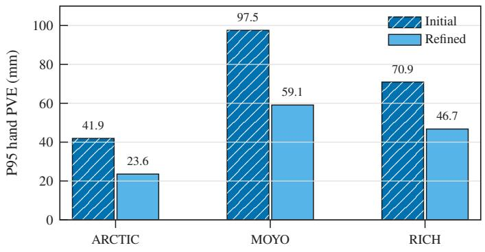  
(a)

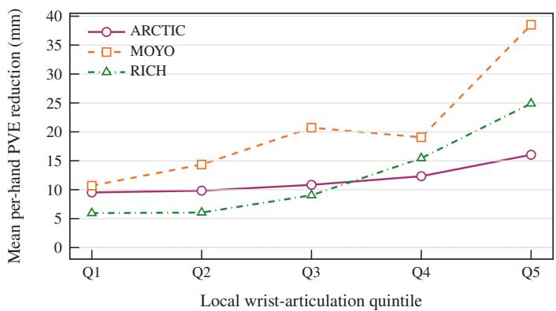  
(b)  
Fig. 3. Where HandMR refines the initial estimate. Both panels compare initial and HandMR-refined outputs from one ExMR checkpoint on the same evaluated frames. (a) Severity of high-error predictions. The 95th percentile (P95) of wrist-aligned hand PVE after averaging the two hands’ errors per frame. Percentiles are computed separately for initial and refined outputs. (b) Error reduction versus wrist articulation. Mean per-hand PVE reduction (initial minus refined error) by within-dataset quintile of ground-truth local wrist articulation (Q1: lowest, Q5: highest). Articulation is the SO(3) geodesic distance from the elbow-relative wrist rotation to identity. Each hand’s articulation is paired with its PVE reduction. Positive values indicate improvement.

TABLE III  
TEMPORAL ACCURACY AND STABILITY OF HAND RECONSTRUCTION. METRICS USE 21 WRIST-CENTERED JOINTS PER HAND. MPJVE (mm/s) AND ACCEL $( \mathrm { m } / \mathrm { s } ^ { 2 } )$ ARE GROUND-TRUTH-REFERENCED; JITTER (10 $\mathrm { n } / \mathrm { s } ^ { 3 } )$ IS PREDICTION-ONLY. EXMR + HAMER COPY-PASTE REPLACES EXMR’S WRIST AND FINGER ROTATIONS WITH INDEPENDENT PER-FRAME HAMER PREDICTIONS. THE FINAL TWO ROWS ARE TEMPORAL METHODS. DANCEHMR-STYLE FUSION DENOTES OUR LOCALLY IMPLEMENTED AND TRAINED BASELINE.
<table><tr><td></td><td colspan="3">ARCTIC</td><td colspan="3">MOYO</td></tr><tr><td>Method</td><td>MPJVE</td><td>Accel</td><td>Jitter</td><td>MPJVE</td><td>Accel</td><td>Jitter</td></tr><tr><td>SMPLer-X-H* [7]</td><td>204.5</td><td>8.4</td><td>43.2</td><td>196.9</td><td>8.3</td><td>45.1</td></tr><tr><td>SMPLest-X-H* [8]</td><td>206.5</td><td>8.5</td><td>43.6</td><td>187.4</td><td>7.8</td><td>42.2</td></tr><tr><td>SAM3D-Body* [9]</td><td>129.4</td><td>6.0</td><td>32.4</td><td>208.6</td><td>10.5</td><td>53.4</td></tr><tr><td>ExMR + HaMeR copy-paste [27]</td><td>179.2</td><td>7.7</td><td>40.9</td><td>260.3</td><td>12.4</td><td>68.1</td></tr><tr><td>DanceHMR-style fusion [20]</td><td>65.2</td><td>1.6</td><td>4.6</td><td>58.8</td><td>1.2</td><td>3.5</td></tr><tr><td>ExMR</td><td>57.9</td><td>1.5</td><td>5.2</td><td>51.3</td><td>1.4</td><td>5.2</td></tr></table>

\* Evaluated by us using the publicly released checkpoint.

2) Temporal Accuracy and Stability: We next assess whether the spatial improvements are accompanied by accurate and stable hand dynamics. Table III evaluates wrist-centered hand trajectories on ARCTIC and MOYO. MPJVE and acceleration error measure fidelity to the annotated dynamics, whereas prediction-only jitter measures smoothness. These temporal metrics do not establish spatial reconstruction quality in isolation and should be interpreted alongside framewise hand errors.

On both datasets, ExMR and the DanceHMR-style baseline obtain substantially lower MPJVE, acceleration error, and jitter than the per-frame methods and the ExMR + HaMeR copypaste baseline. ExMR achieves the lowest MPJVE among the evaluated methods. Compared with the DanceHMR-style baseline, it obtains 57.9 versus 65.2 mm/s on ARCTIC and 51.3 versus 58.8 mm/s on MOYO. The DanceHMR-style baseline has lower jitter on both datasets. Acceleration error favors ExMR on ARCTIC and the baseline on MOYO.

3) Refinement Behavior: We analyze two aspects of HandMR’s behavior that mean reconstruction errors alone do not describe: whether refinement reduces the severity of higherror predictions and how its gains vary with wrist articulation. Both analyses compare ExMR’s initial estimates with its final HandMR-refined outputs from the same checkpoint on the same evaluated frames.

To assess high-error predictions, we compare the 95th percentile (P95) of the per-frame mean hand PVE before and after refinement. This summarizes the upper tail of the error distribution. Fig. 3(a) shows that P95 decreases on all three datasets: from 41.9 to 23.6 mm on ARCTIC, from 97.5 to 59.1 mm on MOYO, and from 70.9 to 46.7 mm on RICH.

We also examine whether more articulated wrists receive larger error reductions. MOYO motivates this analysis: its yoga poses involve highly articulated wrists, and HandMR’s hand-PVE gain over early fusion is largest on this dataset. To examine the refinement stage, we group paired per-hand PVE reductions between the initial and refined outputs by ground-truth local wrist articulation (Fig. 3(b)). The highestarticulation quintile has the largest mean reduction on every dataset. MOYO shows the largest difference between the lowest and highest quintiles, with mean reductions of 10.7 and 38.5 mm, respectively.

Fig. 4 shows qualitative results which highlight the changes from ExMR’s initial estimates to its refined outputs. Additional qualitative comparisons with SAM3D-Body are provided in Fig. S1 of the supplementary material. The accompanying supplementary video illustrates reconstructed full-body motion over time.

4) HandMR Design Choices: We finally analyze three aspects of HandMR’s design: its inputs, wrist-rotation representation, and elbow refinement.

a) Inputs and prediction formulation: Table IV varies the initial joint rotations supplied to HandMR. For fingers and wrists, supplying an initial rotation also changes prediction from direct to residual. Initial finger rotations reduce hand PVE more than wrist rotations alone on both datasets. Supplying both improves hand PA-PVE and PVE, reducing MOYO hand PVE from 31.5 to 26.7 mm. The hand errors differ by at most 0.2 mm from those of the final ExMR configuration, which also supplies and refines the elbows. Initial wrist

Input  
Initial estimate  
Refined estimate (ExMR)  
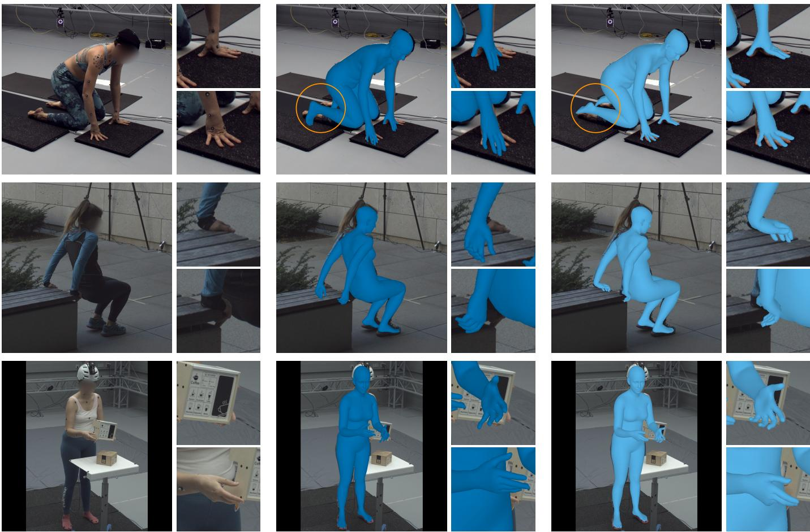  
Fig. 4. Qualitative examples of extremity refinement in ExMR. Rows show one example each from MOYO (top), RICH (middle), and ARCTIC (bottom). Initial and refined estimates are outputs of the same ExMR checkpoint. Amber circles in the MOYO row highlight the correction of the initial foot orientation.

## TABLE IV

DESIGN ABLATIONS OF THE HANDMR MODULE. ALL CONFIGURATIONS ARE RETRAINED FROM SCRATCH. TOP: JOINT-ROTATION INPUTS. THE ALL COLUMN ADDS ALL REMAINING BODY JOINTS. FINGER ROTATIONS ARE PARENT-RELATIVE AND ALL OTHERS GLOBAL. FINGERS AND WRISTS ARE PREDICTED RESIDUALLY GIVEN INITIAL ROTATIONS AND DIRECTLY OTHERWISE. ELBOWS ARE REFINED RESIDUALLY ONLY WHEN SUPPLIED. BOTTOM: VARIANTS OF THE FINAL EXMR CONFIGURATION (▶). HAND PA-PVE AND PVE ARE IN mm (LOWER IS BETTER).

<table><tr><td colspan="4">Input Joint Rotations</td><td rowspan="2"></td><td colspan="2">ARCTIC</td><td colspan="2">MOYO</td></tr><tr><td>Finger</td><td>Wrist</td><td>Elbow</td><td>All</td><td>PA-PVE</td><td>PVE</td><td>PA-PVE</td><td>PVE</td></tr><tr><td rowspan="6">A</td><td>X</td><td>×</td><td>×</td><td>X</td><td>6.6</td><td>16.6</td><td>9.0</td><td>31.5</td></tr><tr><td>√</td><td>X</td><td>X</td><td>X</td><td>6.3</td><td>14.8</td><td>8.8</td><td>27.5</td></tr><tr><td>×</td><td>√</td><td>×</td><td>×</td><td>7.4</td><td>15.1</td><td>9.8</td><td>28.5</td></tr><tr><td>√</td><td>V</td><td>×</td><td>×</td><td>6.0</td><td>14.7</td><td>8.6</td><td>26.7</td></tr><tr><td>√</td><td>√</td><td>√</td><td>×</td><td>6.1</td><td>14.7</td><td>8.6</td><td>26.5</td></tr><tr><td>√</td><td>L</td><td>√</td><td>√</td><td>6.2</td><td>14.6</td><td>8.6</td><td>26.5</td></tr><tr><td colspan="4">+ SAM3D-Body feature input</td><td>6.3</td><td></td><td>14.7</td><td>9.1</td><td>27.8</td></tr><tr><td colspan="4">with elbow-relative wrist rotations</td><td></td><td>6.1</td><td>14.6</td><td>8.9</td><td>30.4</td></tr><tr><td colspan="4">without elbow refinement</td><td></td><td>6.1</td><td>14.6</td><td>8.5</td><td>26.6</td></tr></table>

and finger estimates thus complement HaMeR features for hand reconstruction. We hypothesize that predictions from the whole-body temporal initial estimator provide useful context when local hand evidence is ambiguous, for example under occlusion. Residual prediction can preserve these estimates when no correction is required.

Supplying all remaining initial body-joint rotations yields no consistent improvement in hand accuracy. Adding the SAM3D-Body feature, already used by the initial estimator, gives similar performance on ARCTIC but increases MOYO hand PA-PVE and PVE by 0.5 and 1.3 mm, respectively. These results support retaining HandMR’s compact input set.

b) Wrist-rotation representation: Using elbow-relative rather than global wrist rotations leaves both ARCTIC hand metrics essentially unchanged but increases MOYO hand PVE from 26.5 to 30.4 mm. Following the analogous finding for FootMR [21], we hypothesize that global wrist rotations span a broader training distribution than elbow-relative rotations, aiding generalization to MOYO’s extreme wrist articulation.

c) Effect of elbow refinement: Disabling elbow refinement changes hand PA-PVE and PVE by at most 0.1 mm on ARCTIC and MOYO (Table IV), so we evaluate elbow and wrist rotation accuracy directly in Table V. Across all three datasets, elbow refinement reduces elbow G-RE by approximately 8%–11%, elbow L-RE by 6%–9%, and wrist L-RE by 8%–9% (absolute reductions of 0.6–1.9◦). Wrist G-RE changes by at most 0.2◦, with no consistent improvement. As described in Section III-C2, SMPL-X’s parent-relative wrist rotation is recovered from the global wrist and elbow estimates. Refining the elbow estimate therefore improves elbow–wrist consistency, even though global wrist accuracy and hand-surface errors remain comparable.

TABLE V  
EFFECT OF ELBOW REFINEMENT ON ELBOW AND WRIST ROTATION ACCURACY. BOTH ROWS JOINTLY RETRAIN THE INITIAL ESTIMATOR AND THE FOOTMR AND HANDMR MODULES FROM SCRATCH. THEY DIFFER ONLY IN WHETHER HANDMR PREDICTS RESIDUAL UPDATES TO THE ELBOWS. G-RE AND L-RE DENOTE GLOBAL CAMERA-FRAME AND PARENT-RELATIVE GEODESIC ROTATION ERRORS, RESPECTIVELY, IN DEGREES.
<table><tr><td></td><td colspan="4">ARCTIC</td><td colspan="4">MOYO</td><td colspan="4">RICH</td></tr><tr><td></td><td colspan="2">Elbow</td><td colspan="2">Wrist</td><td colspan="2">Elbow</td><td colspan="2">Wrist</td><td colspan="2">Elbow</td><td colspan="2">Wrist</td></tr><tr><td>Method</td><td>G-RE</td><td>L-RE</td><td>G-RE</td><td>L-RE</td><td>G-RE</td><td>L-RE</td><td>G-RE</td><td>L-RE</td><td>G-RE</td><td>L-RE</td><td>G-RE</td><td>L-RE</td></tr><tr><td>without elbow refinement</td><td>8.3</td><td>9.0</td><td>10.9</td><td>11.4</td><td>18.4</td><td>17.5</td><td>19.4</td><td>21.2</td><td>18.4</td><td>16.3</td><td>17.3</td><td>20.0</td></tr><tr><td>with elbow refinement (ExMR)</td><td>7.4</td><td>8.4</td><td>11.0</td><td>10.4</td><td>16.9</td><td>15.9</td><td>19.4</td><td>19.6</td><td>16.5</td><td>15.4</td><td>17.1</td><td>18.4</td></tr></table>

TABLE VI

COMPARISON OF FOOT-POSE RECONSTRUCTION ON MOYO [30], RICH [31], AND MOOF [21]. FOOTMR (CONFERENCE) AND FOOTMR (REVISED) DENOTE COMPLETE BODY-AND-FOOT SYSTEMS. BOTH USE THE SAME FOOTMR ANKLE-REFINEMENT MODULE DESIGN. THEIR CORRESPONDING $\mathrm { G V H M R } _ { 2 3 \mathrm { J } }$ BASELINES USE MATCHED TRAINING AND INFERENCE CONFIGURATIONS WITHOUT THE FOOTMR MODULE. EXMR ADDS THE HANDMR MODULE TO THE REVISED SYSTEM. AJAE IS IN DEGREES, $\mathbf { N } { \mathrm { - } } \mathbf { M } \mathbf { P } \mathbf { J } \mathbf { P } \mathbf { E } _ { \mathrm { F } }$ IN mm, $\mathrm { P C K } _ { \mathrm { F } }$ IN %, AND $\mathrm { N - F K E } _ { 2 \mathrm { D } }$ IN NORMALIZED PIXEL SPACE.
<table><tr><td rowspan="2" colspan="2">Method</td><td colspan="2">MOYO</td><td colspan="2">RICH</td><td colspan="2">MOOF</td></tr><tr><td>AJAE↓</td><td>N-MPJPEF↓</td><td>AJAE↓</td><td>N-MPJPEF↓</td><td>PCKF0.05↑</td><td> $\mathrm { N - F K E } _ { 2 \mathrm { d } \downarrow }$ </td></tr><tr><td rowspan="5">pPer-rame</td><td>HMR2.0* [35]</td><td>42.0</td><td>55.7</td><td>一</td><td>36.9</td><td>76.1</td><td>1.95</td></tr><tr><td>ReFit [64]</td><td>41.8</td><td>47.6</td><td>一</td><td>30.3</td><td>81.8</td><td>1.68</td></tr><tr><td> $\mathrm { T o k e n H M R } ^ { * } \ [ 8 3 ]$ </td><td>38.0</td><td>48.1</td><td>一</td><td>27.7</td><td>74.5</td><td>1.85</td></tr><tr><td>CameraHMR[84]</td><td>31.0</td><td>39.1</td><td>一</td><td>24.8</td><td>88.3</td><td>1.42</td></tr><tr><td> $\mathrm { S A M 3 D - B o d y } ^ { \ast } \ [ 9 ]$ </td><td>24.4</td><td>32.6</td><td>17.5</td><td>21.9</td><td>96.6</td><td>0.89</td></tr><tr><td rowspan="8">tempooral</td><td>WHAM [1]</td><td>41.7</td><td>49.1</td><td>一</td><td>28.3</td><td>68.1</td><td>1.94</td></tr><tr><td>TRAM [2]</td><td>39.6</td><td>47.3</td><td>一</td><td>26.5</td><td>68.0</td><td>1.60</td></tr><tr><td> $\mathbf { G V H M R } ^ { * } \ [ 3 ]$ </td><td>37.3</td><td>45.9</td><td>18.0</td><td>27.3</td><td>76.1</td><td>1.70</td></tr><tr><td> $\mathrm { G V H M R } _ { 2 3 \mathrm { j } }$  (conference baseline) [21]</td><td>29.6</td><td>37.5</td><td>16.2</td><td>24.2</td><td>89.2</td><td>1.06</td></tr><tr><td>FootMR (conference) [21]</td><td>25.9</td><td>32.4</td><td>15.8</td><td>23.0</td><td>92.6</td><td>0.67</td></tr><tr><td> $\mathrm { G V H M R } _ { 2 3 \mathrm { j } }$  (revised baseline)</td><td>25.3</td><td>32.2</td><td>13.3</td><td>19.7</td><td>95.9</td><td>0.84</td></tr><tr><td>FootMR (revised)</td><td>20.4</td><td>25.7</td><td>12.6</td><td>18.7</td><td>97.5</td><td>0.67</td></tr><tr><td>ExMR</td><td>20.0</td><td>25.4</td><td>12.8</td><td>18.7</td><td>97.3</td><td>0.67</td></tr></table>

\* Evaluated by us using the publicly released checkpoint.

## D. Foot Reconstruction

1) Effect of Dedicated Foot Refinement Under the Revised Configuration: We test whether dedicated foot refinement remains beneficial when the initial estimator itself becomes more accurate. Our revised initial estimator uses image features from SAM3D-Body [9], which explicitly targets accurate foot reconstruction. It also uses revised training data including

TABLE VII  
CUMULATIVE CHANGES FROM FOOTMR (CONFERENCE) TO FOOTMR (REVISED). THE FOOTMR MODULE RETAINS ITS DESIGN AND IS JOINTLY RETRAINED WITH THE INITIAL ESTIMATOR FOR EACH TRAINING CONFIGURATION. THE DETECTOR CHANGE AFFECTS ONLY TEST-TIME INPUTS. FINAL ROW: FOOTMR (REVISED) IN TABLE VI. EMA: EXPONENTIAL MOVING AVERAGE OF MODEL PARAMETERS. AJAE IN DEGREES AND $\mathrm { P C K } _ { \mathrm { F } }$ IN %.
<table><tr><td rowspan="2">Configuration</td><td>MOYO</td><td>RICH</td><td>MOOF</td></tr><tr><td>AJAE↓</td><td>AJAE↓</td><td>PCKF 0.05↑</td></tr><tr><td>FootMR (conference) [21]</td><td>25.9</td><td>15.8</td><td>92.6</td></tr><tr><td>+ SAM3D-Body feature &amp; training settings</td><td>22.5</td><td>14.3</td><td>95.0</td></tr><tr><td>+ revised training data</td><td>22.1</td><td>13.7</td><td>96.2</td></tr><tr><td>+ revised losses &amp; reweighting</td><td>21.4</td><td>13.7</td><td>97.3</td></tr><tr><td>+ EMA</td><td>21.0</td><td>13.1</td><td>97.5</td></tr><tr><td>+ Sapiens2-1B keypoints (test time)</td><td>20.4</td><td>12.6</td><td>97.5</td></tr></table>

BEDLAM2 [28]. These changes may improve the initial foot estimates enough to make the FootMR module introduced in our conference paper [21] redundant.

We denote the published body-and-foot system as FootMR (conference) and its revised configuration as FootMR (revised). The corresponding baselines, $\mathrm { G V H M R } _ { 2 3 \mathrm { j } }$ (conference baseline) and $\mathrm { G V H M R } _ { 2 3 \mathrm { j } }$ (revised baseline), match the training and inference configurations of their respective systems but omit the FootMR module. FootMR (revised) is a configuration of ExMR without the hand-specific components: HaMeR features, finger outputs and losses, and HandMR. We retrain FootMR jointly with the initial estimator while retaining the module’s design from the conference paper. All remaining training and inference settings match those of ExMR.

Table VI reports 3D foot accuracy on MOYO and RICH and 2D reprojection accuracy on MOOF. The revised $\mathrm { G V H M R } _ { 2 3 \mathrm { j } }$ baseline improves all six metrics over the conference baseline. Adding the FootMR module under the revised configuration further improves all six metrics. On MOYO, FootMR (revised) reduces AJAE from $2 5 . 3 ^ { \circ }$ to $2 0 . 4 ^ { \circ }$ (19%) and ${ \mathrm { N } } { \mathrm { - M P J P E } } _ { \mathrm { F } }$ from 32.2 to 25.7 mm (20%). On RICH, the reductions are approximately 5% for both metrics. On MOOF, it improves $\mathrm { P C K _ { F } }$ from 95.9% to 97.5% and reduces $\mathrm { N } { \mathrm { - F K E } } _ { 2 \mathrm { d } }$ from 0.84 to 0.67. These results show that the FootMR module remains beneficial under the revised configuration, even with more accurate initial foot estimates. The largest 3D gains from the FootMR module occur on MOYO, mirroring the pattern observed when adding the HandMR module in the preceding subsections.

TABLE VIII  
COMPARISON OF BODY-ONLY RECONSTRUCTION ON 3DPW [77], EMDB-1 [78], AND RICH [31]. EVALUATION USES THE DEFAULT HAND POSE FOR EXMR AND THE LOCALLY EVALUATED SAM3D-BODY CHECKPOINT. PA-MPJPE, MPJPE, AND PVE ARE IN mm, AND ACCEL IS IN $\mathrm { m } / \mathrm { s } ^ { 2 }$ PARENTHESES GIVE THE NUMBER OF JOINTS USED FOR PA-MPJPE, MPJPE, AND ACCEL.
<table><tr><td></td><td></td><td colspan="4">3DPW (14)</td><td colspan="4">EMDB-1 (24)</td><td colspan="4">RICH (24)</td></tr><tr><td></td><td>Method</td><td>PA-MPJPE</td><td>MPJPE</td><td>PVE</td><td>Accel</td><td>PA-MPJPE</td><td>MPJPE</td><td>PVE</td><td>Accel</td><td>PA-MPJPE</td><td>MPJPE</td><td>PVE</td><td>Accel</td></tr><tr><td rowspan="7">per-rame</td><td>HMR2.0 [35]</td><td>44.4</td><td>69.8</td><td>82.2</td><td>18.1</td><td>60.6</td><td>98.0</td><td>120.3</td><td>19.8</td><td>48.1</td><td>96.0</td><td>110.9</td><td>18.8</td></tr><tr><td>ReFit [64]</td><td>40.5</td><td>65.3</td><td>75.1</td><td>18.5</td><td>58.6</td><td>88.0</td><td>104.5</td><td>20.7</td><td>47.9</td><td>80.7</td><td>92.9</td><td>17.1</td></tr><tr><td>TokenHMR [83]</td><td>44.3</td><td>71.0</td><td>84.6</td><td>一</td><td>55.6</td><td>91.7</td><td>109.4</td><td>一</td><td></td><td></td><td></td><td>一</td></tr><tr><td>CameraHMR [84]</td><td>35.1</td><td>56.0</td><td>65.9</td><td>一</td><td>43.3</td><td>70.2</td><td>81.7</td><td></td><td>34.0</td><td>55.7</td><td>64.4</td><td></td></tr><tr><td>NLF-L +fit [85]</td><td>33.6</td><td>54.9</td><td>63.7</td><td>一</td><td>40.9</td><td>68.4</td><td>80.6</td><td>一</td><td>一</td><td>一</td><td></td><td>一</td></tr><tr><td>SAM3D-Body [9]</td><td>33.8</td><td>54.8</td><td>63.6</td><td>1</td><td>38.2</td><td>61.7</td><td>72.5</td><td>一</td><td>30.9</td><td>53.7</td><td>60.3</td><td>一</td></tr><tr><td>released checkpoint*</td><td>35.1</td><td>55.5</td><td>65.4</td><td>14.0</td><td>39.6</td><td>64.5</td><td>76.9</td><td>15.1</td><td>33.0</td><td>56.4</td><td>62.8</td><td>10.6</td></tr><tr><td rowspan="9">temporal</td><td>WHAM [1]</td><td>35.9</td><td>57.8</td><td>68.7</td><td>6.6</td><td>50.4</td><td>79.7</td><td>94.4</td><td>5.3</td><td>44.3</td><td>80.0</td><td>91.2</td><td>5.3</td></tr><tr><td>TRAM [2]]</td><td>35.6</td><td>59.3</td><td>69.6</td><td>4.9</td><td>45.7</td><td>74.4</td><td>86.6</td><td>4.9</td><td>一</td><td>1</td><td></td><td>一</td></tr><tr><td>GVHMR [3]</td><td>36.2</td><td>55.6</td><td>67.2</td><td>5.0</td><td>42.7</td><td>72.6</td><td>84.2</td><td>3.6</td><td>39.5</td><td>66.0</td><td>74.4</td><td>4.1</td></tr><tr><td>PromptHMR-Vid [4]</td><td>35.5</td><td>56.9</td><td>67.3</td><td>一</td><td>40.1</td><td>68.1</td><td>79.2</td><td>一</td><td>37.0</td><td>57.4</td><td>65.8</td><td>一</td></tr><tr><td>GENMO [5]</td><td>34.6</td><td>53.9</td><td>65.8</td><td>5.2</td><td>42.5</td><td>73.0</td><td>84.8</td><td>3.8</td><td>39.1</td><td>66.8</td><td>75.4</td><td>4.1</td></tr><tr><td>DuoMo [6]</td><td>一</td><td>一</td><td>1</td><td>一</td><td>41.8</td><td>67.1</td><td>78.2</td><td>一</td><td>34.8</td><td>51.4</td><td>58.9</td><td>一</td></tr><tr><td>DanceHMR [20]</td><td>35.2</td><td>53.6</td><td>65.1</td><td>4.9</td><td>40.1</td><td>64.3</td><td>75.4</td><td>3.5</td><td>一</td><td>一</td><td>一</td><td>一</td></tr><tr><td>ExMR</td><td>33.0</td><td>51.8</td><td>60.4</td><td>4.1</td><td>37.4</td><td>64.1</td><td>74.6</td><td>3.3</td><td>27.3</td><td>50.0</td><td>55.7</td><td>3.6</td></tr></table>

\* Evaluated by us using the publicly released checkpoint.

For each of the six metrics, FootMR (revised) and ExMR also outperform the best external result reported in the table. Compared with SAM3D-Body, the strongest per-frame method evaluated here, FootMR (revised) reduces MOYO AJAE from 24.4◦ to 20.4◦ and N-MPJPEF from 32.6 to 25.7 mm. Finally, ExMR and FootMR (revised) differ by at most $0 . 4 ^ { \circ }$ in AJAE, 0.3 mm in N-MPJPEF, and 0.2 percentage points in PCKF. The small differences indicate that adding articulated-hand estimation and the HandMR module preserves foot reconstruction accuracy, consistent with FootMR and HandMR using different evidence and updating disjoint joint groups. FootMR’s contribution within the complete ExMR system is also visible in the MOYO example in the top row of Fig. 4, where the module substantially corrects the initial foot orientation.

2) From FootMR (conference) to FootMR (revised): Compared with FootMR (conference), FootMR (revised) improves both 3D metrics on MOYO and RICH and PCKF on MOOF (Table VI). Table VII traces this difference through cumulative system-level revisions made while holding the FootMR design fixed. Each configuration builds on the preceding one, so the comparison does not isolate independent effects or interactions. We report AJAE on MOYO and RICH and PCKF on MOOF. Table VI reports all metrics for the two endpoints.

The first stage replaces the HMR2.0 image feature with the SAM3D-Body feature and adopts ExMR’s training settings: a batch size of 128 instead of 256, a fixed learning rate, and 210 rather than 500 epochs. We observed no meaningful accuracy change from these practical adjustments and therefore do not treat them as separate ablation factors. The data stage adds BEDLAM2 and ARCTIC and removes AMASS relative to the conference training mixture. The loss stage replaces the geometric $\ell _ { 2 }$ losses with $\ell _ { 1 }$ losses, adds velocity and acceleration losses, and adjusts the loss weights. The next stage introduces an exponential moving average (EMA) of the model parameters. At test time, FootMR (conference) obtains the 17 body keypoints with ViTPose [86] and the six foot keypoints with Sapiens-2B [56]. The final stage replaces both detectors with Sapiens2-1B [57] to obtain all 23 keypoints. Training continues to use keypoints synthesized from groundtruth motion.

Across the cumulative sequence, MOYO AJAE decreases from 25.9◦ to 20.4◦, RICH AJAE from 15.8◦ to 12.6◦, and MOOF $\mathrm { P C K _ { F } }$ increases from 92.6% to 97.5%. The supplementary material (Section S4) evaluates FootMR’s inherited joint-context, rotation-representation, and augmentation design choices within the complete ExMR system.

## E. Body-Only Reconstruction

We complement the hand and foot evaluations by assessing ExMR under standard body-reconstruction protocols on 3DPW, EMDB-1, and RICH (Table VIII). As detailed in Section IV-A, we use default finger-joint rotations in both predictions and ground truth when constructing the evaluation meshes. FootMR’s ankle refinements and HandMR’s elbow and wrist refinements remain active.

Among the reported results, ExMR has the lowest PA-MPJPE, MPJPE, and PVE on 3DPW and RICH, and the lowest PA-MPJPE on EMDB-1. For example, its RICH PVE is 55.7 mm, compared with 58.9 mm for DuoMo, the nextlowest reported value. On EMDB-1, ExMR’s MPJPE and PVE are the lowest among temporal methods, while the published SAM3D-Body numbers are lower. For temporal accuracy, ExMR achieves the lowest reported acceleration error on all three datasets. The methods differ in their training data, image features, objectives, inference settings, and potentially their evaluation details, so this comparison does not isolate the source of the body-only differences. Taken together with the preceding hand- and foot-specific evaluations, these results show that ExMR combines competitive body-only benchmark accuracy with fine-grained hand and foot reconstruction.

## V. CONCLUSION

ExMR combines whole-body motion estimation with dedicated temporal refinement of the hands and feet. It extends our conference body-and-foot system with HandMR, which combines specialist hand image features with initial arm– hand rotations to refine elbows, wrists, and fingers. Paired with FootMR’s keypoint-based ankle refinement, this yields a jointly trained system for reconstructing body, hand, and foot motion from monocular video. FootMR and HandMR follow a common principle: revisiting local observations together with explicit joint estimates to predict residual rotation corrections over time. Across the evaluated benchmarks, ExMR outperforms all competitors on hand and foot reconstruction while achieving competitive body accuracy. The experiments also show that how local evidence is used matters beyond its availability. In matched comparisons, adding the HandMR and FootMR modules improves hand and foot reconstruction even though the initial estimator already receives the same evidence. These findings suggest that dedicated temporal refinement improves extremity reconstruction by exploiting local evidence underused by a shared whole-body representation.

ExMR processes each person independently, without explicitly modeling interactions with other people or objects. It does not enforce collision-free geometry or physically consistent grasps and object contacts, and reconstructed meshes may contain self-intersections. Facial pose and expression also remain outside the scope of this work. Future work could incorporate self-collision constraints and jointly estimate human motion, object geometry, and contact. Our quantitative evaluation focuses on camera-frame reconstruction. Investigating whether improved extremity estimates benefit worldspace motion recovery and foot–ground contact consistency is another promising direction.

## REFERENCES

[1] S. Shin, J. Kim, E. Halilaj, and M. J. Black, “WHAM: Reconstructing world-grounded humans with accurate 3D motion,” in Proc. IEEE/CVF Conf. Comput. Vis. Pattern Recognit., 2024, pp. 2070–2080.

[2] Y. Wang, Z. Wang, L. Liu, and K. Daniilidis, “TRAM: Global trajectory and motion of 3D humans from in-the-wild videos,” in Proc. Eur. Conf. Comput. Vis. (2024), 2025, pp. 467–487.

[3] Z. Shen et al., “World-grounded human motion recovery via gravityview coordinates,” in Proc. SIGGRAPH Asia Conf. Papers, 2024, pp. 1–11.

[4] Y. Wang, Y. Sun, P. Patel, K. Daniilidis, M. J. Black, and M. Kocabas, “PromptHMR: Promptable human mesh recovery,” in Proc. IEEE/CVF Conf. Comput. Vis. Pattern Recognit., 2025, pp. 1148–1159.

[5] J. Li et al., “GENMO: A GENeralist model for human MOtion,” in Proc. IEEE Int. Conf. Comput. Vis., 2025, pp. 11 766–11 776.

[6] Y. Wang et al., “DuoMo: Dual motion diffusion for world-space human reconstruction,” in Proc. IEEE/CVF Conf. Comput. Vis. Pattern Recognit., 2026, pp. 42 777–42 788.

[7] Z. Cai et al., “SMPLer-X: Scaling up expressive human pose and shape estimation,” in Proc. Adv. Neural Inf. Process. Syst., 2023, pp. 11 454– 11 468.

[8] W. Yin et al., “SMPLest-X: Ultimate scaling for expressive human pose and shape estimation,” IEEE Trans. Pattern Anal. Mach. Intell., vol. 48, no. 2, pp. 1778–1794, Feb. 2026.

[9] X. Yang et al., “SAM 3D Body: Robust full-body human mesh recovery,” in Proc. IEEE/CVF Conf. Comput. Vis. Pattern Recognit., 2026, pp. 7209–7219.

[10] Y. Rong, T. Shiratori, and H. Joo, “FrankMocap: A monocular 3D whole-body pose estimation system via regression and integration,” in Proc. IEEE Int. Conf. Comput. Vis. Workshops, 2021, pp. 1749–1759.

[11] H. Zhang et al., “PyMAF-X: Towards well-aligned full-body model regression from monocular images,” IEEE Trans. Pattern Anal. Mach. Intell., vol. 45, no. 10, pp. 12 287–12 303, Oct. 2023.

[12] G. Moon, “Enhancing hands in 3D whole-body pose estimation with conditional hands modulator,” in Proc. IEEE/CVF Conf. Comput. Vis. Pattern Recognit., 2026, pp. 8891–8900.

[13] E. Duran, M. Kocabas, V. Choutas, Z. Fan, and M. J. Black, “HMP: Hand motion priors for pose and shape estimation from video,” in Proc. IEEE Winter Conf. Appl. Comput. Vis., 2024, pp. 6341–6351.

[14] J. Zhang, J. Deng, C. Ma, and R. A. Potamias, “HaWoR: World-space hand motion reconstruction from egocentric videos,” in Proc. IEEE/CVF Conf. Comput. Vis. Pattern Recognit., 2025, pp. 1805–1815.

[15] E. Ismayilzada, Y. Zhang, and Z. Cui, “PAD-Hand: Physics-aware diffusion for hand motion recovery,” in Proc. IEEE/CVF Conf. Comput. Vis. Pattern Recognit., 2026, pp. 28 358–28 368.

[16] W. Yin et al., “WHAC: World-grounded humans and cameras,” in Proc. Eur. Conf. Comput. Vis. (2024), 2025, pp. 20–37.

[17] K. Liu et al., “Motions as queries: One-stage multi-person holistic human motion capture,” in Proc. IEEE/CVF Conf. Comput. Vis. Pattern Recognit., 2025, pp. 17 529–17 539.

[18] Y. Chen, X. Chen, Y. Xue, A. Chen, Y. Xiu, and G. Pons-Moll, “Human3R: Everyone everywhere all at once,” in Proc. Int. Conf. Learn. Representations, 2026, pp. 42 584–42 613.

[19] V. Choutas, G. Pavlakos, T. Bolkart, D. Tzionas, and M. J. Black, “Monocular expressive body regression through body-driven attention,” in Proc. Eur. Conf. Comput. Vis., 2020, pp. 20–40.

[20] W. Shen, M. Zhou, H. Zhang, S. Bian, Y. Xu, and Y. Zhang, “DanceHMR: Hand-aware whole-body human mesh recovery from monocular videos,” arXiv:2605.18102, May 2026.

[21] T. Wehrbein and B. Rosenhahn, “Improving 3D foot motion reconstruction in markerless monocular human motion capture,” in Proc. Int. Conf. 3D Vis., 2026, pp. 871–881.

[22] J. Carreira, P. Agrawal, K. Fragkiadaki, and J. Malik, “Human pose estimation with iterative error feedback,” in Proc. IEEE/CVF Conf. Comput. Vis. Pattern Recognit., 2016, pp. 4733–4742.

[23] A. Kanazawa, M. J. Black, D. W. Jacobs, and J. Malik, “End-to-end recovery of human shape and pose,” in Proc. IEEE/CVF Conf. Comput. Vis. Pattern Recognit., 2018, pp. 7122–7131.

[24] Z. Luo, S. A. Golestaneh, and K. M. Kitani, “3D human motion estimation via motion compression and refinement,” in Proc. Asian Conf. Comput. Vis. (2020), 2021, pp. 324–340.

[25] R. Li, S. Karanam, R. Li, T. Chen, B. Bhanu, and Z. Wu, “Learning local recurrent models for human mesh recovery,” in Proc. Int. Conf. 3D Vis., 2021, pp. 555–564.

[26] G. Pavlakos et al., “Expressive body capture: 3D hands, face, and body from a single image,” in Proc. IEEE/CVF Conf. Comput. Vis. Pattern Recognit., 2019, pp. 10 967–10 977.

[27] G. Pavlakos, D. Shan, I. Radosavovic, A. Kanazawa, D. Fouhey, and J. Malik, “Reconstructing hands in 3D with transformers,” in Proc. IEEE/CVF Conf. Comput. Vis. Pattern Recognit., 2024, pp. 9826–9836.

[28] J. Tesch et al., “BEDLAM2.0: Synthetic humans and cameras in motion,” in Proc. Adv. Neural Inf. Process. Syst., 2025, pp. 54 350– 54 382.

[29] Z. Fan et al., “ARCTIC: A dataset for dexterous bimanual hand-object manipulation,” in Proc. IEEE/CVF Conf. Comput. Vis. Pattern Recognit., 2023, pp. 12 943–12 954.

[30] S. Tripathi, L. Muller, C.-H. P. Huang, O. Taheri, M. J. Black, and¨ D. Tzionas, “3D human pose estimation via intuitive physics,” in Proc. IEEE/CVF Conf. Comput. Vis. Pattern Recognit., 2023, pp. 4713–4725.

[31] C.-H. P. Huang et al., “Capturing and inferring dense full-body humanscene contact,” in Proc. IEEE/CVF Conf. Comput. Vis. Pattern Recognit., 2022, pp. 13 264–13 275.

[32] M. Loper, N. Mahmood, J. Romero, G. Pons-Moll, and M. J. Black, “SMPL: A skinned multi-person linear model,” ACM Trans. Graph., vol. 34, no. 6, pp. 1–16, Nov. 2015, art. no. 248.

[33] F. Bogo, A. Kanazawa, C. Lassner, P. Gehler, J. Romero, and M. J. Black, “Keep it SMPL: Automatic estimation of 3D human pose and shape from a single image,” in Proc. Eur. Conf. Comput. Vis., 2016, pp. 561–578.

[34] Z. Li, J. Liu, Z. Zhang, S. Xu, and Y. Yan, “CLIFF: Carrying location information in full frames into human pose and shape estimation,” in Proc. Eur. Conf. Comput. Vis., 2022, pp. 590–606.

[35] S. Goel, G. Pavlakos, J. Rajasegaran, A. Kanazawa, and J. Malik, “Humans in 4D: Reconstructing and tracking humans with transformers,” in Proc. IEEE Int. Conf. Comput. Vis., 2023, pp. 14 737–14 748.

[36] Q. Sun et al., “AiOS: All-in-one-stage expressive human pose and shape estimation,” in Proc. IEEE/CVF Conf. Comput. Vis. Pattern Recognit., 2024, pp. 1834–1843.

[37] A. Ferguson et al., “MHR: Momentum human rig,” arXiv:2511.15586, Nov. 2025.

[38] O. Simeoni´ et al., “DINOv3,” Trans. Mach. Learn. Res., May 2026. [Online]. Available: https://openreview.net/forum?id=2NlGyqNjns

[39] J. Romero, D. Tzionas, and M. J. Black, “Embodied hands: Modeling and capturing hands and bodies together,” ACM Trans. Graph., vol. 36, no. 6, pp. 1–17, Nov. 2017, art. no. 245.

[40] R. A. Potamias, J. Zhang, J. Deng, and S. Zafeiriou, “WiLoR: Endto-end 3D hand localization and reconstruction in-the-wild,” in Proc. IEEE/CVF Conf. Comput. Vis. Pattern Recognit., 2025, pp. 12 242– 12 254.

[41] Y. Feng, V. Choutas, T. Bolkart, D. Tzionas, and M. J. Black, “Collaborative regression of expressive bodies using moderation,” in Proc. Int. Conf. 3D Vis., 2021, pp. 792–804.

[42] G. Moon, H. Choi, and K. M. Lee, “Accurate 3D hand pose estimation for whole-body 3D human mesh estimation,” in Proc. IEEE/CVF Conf. Comput. Vis. Pattern Recognit. Workshops, 2022, pp. 2307–2316.

[43] W. Shen et al., “HMR-Adapter: A lightweight adapter with dual-path cross augmentation for expressive human mesh recovery,” in Proc. ACM Int. Conf. Multimedia, 2024, pp. 6093–6102.

[44] A. Kanazawa, J. Y. Zhang, P. Felsen, and J. Malik, “Learning 3D human dynamics from video,” in Proc. IEEE/CVF Conf. Comput. Vis. Pattern Recognit., 2019, pp. 5607–5616.

[45] M. Kocabas, N. Athanasiou, and M. J. Black, “VIBE: Video inference for human body pose and shape estimation,” in Proc. IEEE/CVF Conf. Comput. Vis. Pattern Recognit., 2020, pp. 5252–5262.

[46] H. Choi, G. Moon, J. Y. Chang, and K. M. Lee, “Beyond static features for temporally consistent 3D human pose and shape from a video,” in Proc. IEEE/CVF Conf. Comput. Vis. Pattern Recognit., 2021, pp. 1964– 1973.

[47] W.-L. Wei, J.-C. Lin, T.-L. Liu, and H.-Y. M. Liao, “Capturing humans in motion: Temporal-attentive 3D human pose and shape estimation from monocular video,” in Proc. IEEE/CVF Conf. Comput. Vis. Pattern Recognit., 2022, pp. 13 201–13 210.

[48] X. Shen, Z. Yang, X. Wang, J. Ma, C. Zhou, and Y. Yang, “Global-tolocal modeling for video-based 3D human pose and shape estimation,” in Proc. IEEE/CVF Conf. Comput. Vis. Pattern Recognit., 2023, pp. 8887–8896.

[49] Y. Yuan, U. Iqbal, P. Molchanov, K. Kitani, and J. Kautz, “GLAMR: Global occlusion-aware human mesh recovery with dynamic cameras,” in Proc. IEEE/CVF Conf. Comput. Vis. Pattern Recognit., 2022, pp. 11 028–11 039.

[50] V. Ye, G. Pavlakos, J. Malik, and A. Kanazawa, “Decoupling human and camera motion from videos in the wild,” in Proc. IEEE/CVF Conf. Comput. Vis. Pattern Recognit., 2023, pp. 21 222–21 232.

[51] D. Xiang, H. Joo, and Y. Sheikh, “Monocular total capture: Posing face, body, and hands in the wild,” in Proc. IEEE/CVF Conf. Comput. Vis. Pattern Recognit., 2019, pp. 10 957–10 966.

[52] Z. Cao, G. Hidalgo, T. Simon, S.-E. Wei, and Y. Sheikh, “OpenPose: Realtime multi-person 2D pose estimation using part affinity fields,” IEEE Trans. Pattern Anal. Mach. Intell., vol. 43, no. 1, pp. 172–186, Jan. 2021.

[53] S. Jin et al., “Whole-body human pose estimation in the wild,” in Proc. Eur. Conf. Comput. Vis., 2020, pp. 196–214.

[54] Y. Xu, J. Zhang, Q. Zhang, and D. Tao, “ViTPose++: Vision transformer for generic body pose estimation,” IEEE Trans. Pattern Anal. Mach. Intell., vol. 46, no. 2, pp. 1212–1230, Feb. 2024.

[55] T. Jiang, X. Xie, and Y. Li, “RTMW: Real-time multi-person 2D and 3D whole-body pose estimation,” arXiv:2407.08634, Jul. 2024.

[56] R. Khirodkar et al., “Sapiens: Foundation for human vision models,” in Proc. Eur. Conf. Comput. Vis. (2024), 2025, pp. 206–228.

[57] R. Khirodkar, H. Wen, J. Martinez, Y. Dong, Z. Su, and S. Saito, “Sapiens2,” in Proc. Int. Conf. Learn. Representations, 2026, pp. 58 484– 58 507.

[58] L. Zhuo, J. Cao, Q. Wang, B. Zhang, and L. Bo, “Towards stable human pose estimation via cross-view fusion and foot stabilization,” in Proc. IEEE/CVF Conf. Comput. Vis. Pattern Recognit., 2023, pp. 650–659.

[59] Y. Zou, J. Yang, D. Ceylan, J. Zhang, F. Perazzi, and J.-B. Huang, “Reducing footskate in human motion reconstruction with ground contact constraints,” in Proc. IEEE Winter Conf. Appl. Comput. Vis., 2020, pp. 448–457.

[60] D. Rempe, L. J. Guibas, A. Hertzmann, B. Russell, R. Villegas, and J. Yang, “Contact and human dynamics from monocular video,” in Proc. Eur. Conf. Comput. Vis., 2020, pp. 71–87.

[61] S. Shimada, V. Golyanik, W. Xu, and C. Theobalt, “PhysCap: Physically plausible monocular 3D motion capture in real time,” ACM Trans. Graph., vol. 39, no. 6, pp. 1–16, Dec. 2020, art. no. 235.

[62] D. Rempe, T. Birdal, A. Hertzmann, J. Yang, S. Sridhar, and L. J. Guibas, “HuMoR: 3D human motion model for robust pose estimation,” in Proc. IEEE Int. Conf. Comput. Vis., 2021, pp. 11 468–11 479.

[63] H. Zhang et al., “PyMAF: 3D human pose and shape regression with pyramidal mesh alignment feedback loop,” in Proc. IEEE Int. Conf. Comput. Vis., 2021, pp. 11 426–11 436.

[64] Y. Wang and K. Daniilidis, “ReFit: Recurrent fitting network for 3D human recovery,” in Proc. IEEE Int. Conf. Comput. Vis., 2023, pp. 14 598–14 608.

[65] M. Fieraru, A. Khoreva, L. Pishchulin, and B. Schiele, “Learning to refine human pose estimation,” in Proc. IEEE/CVF Conf. Comput. Vis. Pattern Recognit. Workshops, 2018, pp. 205–214.

[66] G. Moon, J. Y. Chang, and K. M. Lee, “PoseFix: Model-agnostic general human pose refinement network,” in Proc. IEEE/CVF Conf. Comput. Vis. Pattern Recognit., 2019, pp. 7765–7773.

[67] T. Wehrbein, B. Rosenhahn, I. Matthews, and C. Stoll, “Personalized 3D human pose and shape refinement,” in Proc. IEEE Int. Conf. Comput. Vis. Workshops, 2023, pp. 4191–4201.

[68] F. Baradel, R. Bregier, T. Groueix, P. Weinzaepfel, Y. Kalantidis, and´ G. Rogez, “PoseBERT: A generic transformer module for temporal 3D human modeling,” IEEE Trans. Pattern Anal. Mach. Intell., vol. 45, no. 11, pp. 12 798–12 815, Nov. 2023.

[69] A. Zeng, L. Yang, X. Ju, J. Li, J. Wang, and Q. Xu, “SmoothNet: A plug-and-play network for refining human poses in videos,” in Proc. Eur. Conf. Comput. Vis., 2022, pp. 625–642.

[70] T. Wang et al., “SynSP: Synergy of smoothness and precision in pose sequences refinement,” in Proc. IEEE/CVF Conf. Comput. Vis. Pattern Recognit., 2024, pp. 1824–1833.

[71] G.-H. Lee and S.-W. Lee, “Uncertainty-aware human mesh recovery from video by learning part-based 3D dynamics,” in Proc. IEEE Int. Conf. Comput. Vis., 2021, pp. 12 355–12 364.

[72] Y. Zhou, C. Barnes, J. Lu, J. Yang, and H. Li, “On the continuity of rotation representations in neural networks,” in Proc. IEEE/CVF Conf. Comput. Vis. Pattern Recognit., 2019, pp. 5738–5746.

[73] T.-Y. Lin et al., “Microsoft COCO: Common objects in context,” in Proc. Eur. Conf. Comput. Vis., 2014, pp. 740–755.

[74] J. Su, M. Ahmed, Y. Lu, S. Pan, W. Bo, and Y. Liu, “RoFormer: Enhanced transformer with rotary position embedding,” Neurocomputing, vol. 568, Feb. 2024, art. no. 127063.

[75] S. Shin, Z. Li, and E. Halilaj, “Markerless motion tracking with noisy video and IMU data,” IEEE Trans. Biomed. Eng., vol. 70, no. 11, pp. 3082–3092, Nov. 2023.

[76] C. Ionescu, D. Papava, V. Olaru, and C. Sminchisescu, “Human3.6M: Large scale datasets and predictive methods for 3D human sensing in natural environments,” IEEE Trans. Pattern Anal. Mach. Intell., vol. 36, no. 7, pp. 1325–1339, Jul. 2014.

[77] T. von Marcard, R. Henschel, M. J. Black, B. Rosenhahn, and G. Pons-Moll, “Recovering accurate 3D human pose in the wild using IMUs and a moving camera,” in Proc. Eur. Conf. Comput. Vis., 2018, pp. 614–631.

[78] M. Kaufmann et al., “EMDB: The electromagnetic database of global 3D human pose and shape in the wild,” in Proc. IEEE Int. Conf. Comput. Vis., 2023, pp. 14 586–14 597.

[79] H. Rhodin et al., “Learning monocular 3D human pose estimation from multi-view images,” in Proc. IEEE/CVF Conf. Comput. Vis. Pattern Recognit., 2018, pp. 8437–8446.

[80] M. J. Black, P. Patel, J. Tesch, and J. Yang, “BEDLAM: A synthetic dataset of bodies exhibiting detailed lifelike animated motion,” in Proc. IEEE/CVF Conf. Comput. Vis. Pattern Recognit., 2023, pp. 8726–8737.

[81] N. Mahmood, N. Ghorbani, N. F. Troje, G. Pons-Moll, and M. J. Black, “AMASS: Archive of motion capture as surface shapes,” in Proc. IEEE Int. Conf. Comput. Vis., 2019, pp. 5441–5450.

[82] I. Loshchilov and F. Hutter, “Decoupled weight decay regularization,” in Proc. Int. Conf. Learn. Representations, 2019. [Online]. Available: https://openreview.net/forum?id=Bkg6RiCqY7

[83] S. K. Dwivedi, Y. Sun, P. Patel, Y. Feng, and M. J. Black, “TokenHMR: Advancing human mesh recovery with a tokenized pose representation,” in Proc. IEEE/CVF Conf. Comput. Vis. Pattern Recognit., 2024, pp. 1323–1333.

[84] P. Patel and M. J. Black, “CameraHMR: Aligning people with perspective,” in Proc. Int. Conf. 3D Vis., 2025, pp. 1562–1571.

[85] I. Sar´ andi and G. Pons-Moll, “Neural localizer fields for continuous 3D´ human pose and shape estimation,” in Proc. Adv. Neural Inf. Process. Syst., 2024, pp. 140 032–140 065.

[86] Y. Xu, J. Zhang, Q. Zhang, and D. Tao, “ViTPose: Simple vision transformer baselines for human pose estimation,” in Proc. Adv. Neural Inf. Process. Syst., 2022, pp. 38 571–38 584.

Tom Wehrbein received the B.Sc. and M.Sc. degrees in computer science from Leibniz University Hannover in 2018 and 2020, respectively. He is currently pursuing the Ph.D. degree at the Institute of Information Processing, Leibniz University Hannover, under the supervision of Prof. Bodo Rosenhahn. In 2022, he was an intern at Epic Games in Pittsburgh. His research interests include computer vision, with a focus on human motion capture.

Bodo Rosenhahn received the Dipl.-Inf. and Dr.- Ing. degrees from the University of Kiel in 1999 and 2003, respectively. He studied computer science, with medicine as a minor subject, at the University of Kiel. From October 2003 to October 2005, he worked as a postdoctoral researcher at the University of Auckland, New Zealand, funded by a scholarship from the German Research Foundation (DFG). From November 2005 to August 2008, he worked as a senior researcher at the Max Planck Institute for Computer Science. Since September 2008, he has been a full professor at Leibniz University Hannover, heading a group on automated image interpretation. He has coauthored more than 200 papers, holds 12 patents, and has organized several workshops and conferences. His work has received several awards, including the DAGM Prize in 2002, the Siegfried Werth Prize in 2003, the DAGM Main Prize in 2005 and 2007, the Olympus Prize in 2007, and the Gunter Enderle Award (Eurographics) in¨ 2017.

## SUPPLEMENTARY MATERIAL

The supplementary material begins with the neutral SMPL-X shape fitting used to construct ARCTIC training supervision (Section S1). It then details the HaMeR copy-paste protocol (Section S2) and analyzes inference time and the cost– accuracy tradeoff of alternative 2D keypoint detectors (Section S3). The next subsection revisits the inherited FootMR design choices within ExMR (Section S4). Finally, we present qualitative comparisons with SAM3D-Body (Section S5). The accompanying supplementary video illustrates reconstructed full-body motion over time.

## S1. ARCTIC Training-Subject Shape Fitting

ARCTIC [29] does not provide SMPL-X shape coefficients for its body annotations. Instead, it represents each subject by a personalized template and a male or female label, together with per-frame pose annotations. ExMR uses the neutral SMPL-X model for every input, without assuming or estimating gender labels at inference. We therefore fit neutral SMPL-X shape coefficients to ARCTIC’s ground-truth meshes to obtain compatible training supervision.

For each of the eight ARCTIC training subjects, we fit one 10-dimensional neutral shape vector using 1,000 frames sampled uniformly across the subject’s annotations. The personalized gender-specific and neutral SMPL-X meshes are constructed with identical annotated body and hand poses, and all pose parameters remain fixed during fitting. We optimize the neutral shape vector with L-BFGS, minimizing the mean squared coordinate difference between corresponding vertices over the full 10,475-vertex mesh.

Across all annotated frames from the training subjects, the mean Euclidean distance between corresponding vertices of the fitted neutral and ground-truth meshes is 6.24 mm, with subject means ranging from 3.08 to 9.86 mm. The fitted shapes are only used to construct neutral-model training supervision. Evaluation directly uses ARCTIC’s personalized gender-specific ground-truth meshes.

## S2. HaMeR Copy-Paste Protocol

The ExMR + HaMeR copy-paste variant in Table II starts from the final ExMR prediction, including HandMR refinement. It uses the same trained ExMR checkpoint, fixed HaMeR checkpoint, and hand crops, and replaces only the wrist and finger rotations with HaMeR outputs from the same forward pass. Because HaMeR uses a canonical right-hand convention, we first transform the predictions from mirrored left-hand crops back to the left-hand convention. We then insert its parent-relative finger rotations and convert its crop-frame global wrist rotation to the elbow-relative rotation required by SMPL-X:

$$
\mathbf { R } _ { w } ^ { ( l ) } = \left( \bar { \mathbf { R } } _ { e } ^ { ( l ) } \right) ^ { \top } \bar { \mathbf { R } } _ { w , \mathrm { H a M e R } } ^ { ( l ) } .\tag{S1}
$$

Here, $\bar { \mathbf { R } } _ { w , \mathrm { H a M e R } } ^ { ( l ) }$ denotes HaMeR’s global wrist rotation after the left-hand convention correction, and the global elbow rotation $\bar { \mathbf { R } } _ { e } ^ { ( l ) }$ is retained from ExMR.

TABLE S1  
RUNTIME BREAKDOWN OF EXMR WITH ALTERNATIVE 2D DETECTORS. TIMES ARE IN MILLISECONDS PER VIDEO FRAME FOR ONE RECONSTRUCTED PERSON, MEASURED OVER COMPLETE PASSES THROUGH THE VIDEO AFTER WARM-UP. SAPIENS2-1B USES THE DEFAULT 1024 × 768-PIXEL INPUT RESOLUTION. TOTALS ARE SUMS OF STAGE MEDIANS, NOT MEASURED END-TO-END TIMES.
<table><tr><td>Stage</td><td>Time (ms/frame)</td></tr><tr><td>Person detection and tracking</td><td>3.02</td></tr><tr><td>SAM3D-Body feature extraction</td><td>25.33</td></tr><tr><td>HaMeR feature extraction</td><td>6.34</td></tr><tr><td>2D keypoint detection: Sapiens2-1B</td><td>118.62</td></tr><tr><td>2D keypoint detection: RTMW-x</td><td>2.11</td></tr><tr><td>Initial estimator</td><td>0.0119</td></tr><tr><td>FootMR module</td><td>0.0029</td></tr><tr><td>HandMR module</td><td>0.0047</td></tr><tr><td>Total with Sapiens2-1B</td><td>153.33</td></tr><tr><td>Total with RTMW-x</td><td>36.81</td></tr></table>

## S3. Inference-Time Analysis

We analyze the cost of offline, single-person reconstruction and the cost–accuracy tradeoff of alternative 2D detectors.

1) Runtime Measurements: We measure all stages on the same 3,909-frame, 1920 × 1080-pixel, 30 frames/s video using an NVIDIA RTX 4090 and Intel Core i9-12900K. After one complete-video warm-up, we time three complete passes with CUDA synchronization at each interval boundary and report median wall time per frame. The totals in Table S1 sum unrounded stage medians and exclude camera-motion estimation and model loading. They are not measured endto-end wall times. Table S3 records implementation settings.

Feature extraction and keypoint detection dominate the measured cost: Sapiens2-1B alone accounts for approximately 77% of the default summed stage cost. FootMR and HandMR take 11.5 and 18.5 ms for the complete sequence, compared with 46.6 ms for the initial estimator. Their combined cost is approximately 64% of the initial-estimator runtime but only 0.021% of the summed stage cost even with the faster RTMW-x 2D detector [55]. The estimator and refiner timings include stage input preparation, network inference, and construction of the refined camera-space SMPL-X parameters.

We also measure the end-to-end runtime of ExMR with RTMW-x on the same video and hardware, from invocation with a video path through saving camera-space and global SMPL-X motion. The timed interval includes imports, model construction and loading, JPEG extraction, tracking, keypoint detection, feature extraction, reconstruction, CPU transfer, and saving. Stages execute sequentially, and camera-motion estimation is disabled. Across three independent invocations, the median end-to-end time is 170.75 s (43.68 ms/frame). This includes startup and first-use costs omitted from the 36.81 ms/frame sum of warmed stages in Table S1.

2) Detector Cost–Accuracy Tradeoff: The cost of the default detector motivates testing less expensive configurations. ExMR is trained with perturbed and randomly masked projections of ground-truth motion rather than outputs from a particular detector (Section III-D). We therefore evaluate whether the same checkpoint can use body-and-foot keypoints from lower-resolution Sapiens2-1B inference or the much faster RTMW-x without retraining (Table S2). We use a keypoint confidence threshold of 5.5 for RTMW-x instead of 0.5 for Sapiens2-1B, since RTMW-x returns raw unnormalized SimCC scores. For runtime comparisons, each configuration uses the batch size listed in Table S3.

TABLE S2  
EFFECT OF THE 2D KEYPOINT DETECTOR ON RECONSTRUCTION ACCURACY AND RUNTIME. ALL CONFIGURATIONS USE THE SAME TRAINED EXMR CHECKPOINT. ACCURACY IS EVALUATED ON THE BENCHMARK DATASETS WITH PERSON AND HAND BOXES HELD FIXED ACROSS CONFIGURATIONS, FOLLOWING THE DATASET-SPECIFIC PROTOCOL IN SECTION IV-A. ONLY THE 23 BODY-AND-FOOT KEYPOINT INPUTS CHANGE. DETECTOR AND SUMMED STAGE COSTS ARE MEASURED ON THE DEMONSTRATION VIDEO FOLLOWING THE TIMING PROTOCOL IN TABLE S1. PVE AND MPJPE ARE IN MILLIMETERS, AJAE IS IN DEGREES, $_ { \mathrm { A N D } } \mathrm { N } { \cdot } \mathrm { F K E } _ { 2 \mathrm { D } }$ IS IN NORMALIZED PIXEL SPACE.
<table><tr><td>2D detector</td><td colspan="2">Time (ms/frame)</td><td>ARCTIC</td><td colspan="3">MOYO</td><td colspan="3">RICH</td><td>MOOF</td><td>3DPW</td><td>EMDB-1</td></tr><tr><td></td><td>Detector</td><td>Summed stages</td><td>Hand PVE</td><td>All PVE</td><td>Hand PVE</td><td>AJAE</td><td>All PVE</td><td>Hand PVE</td><td>AJAE</td><td>N-FKE2d</td><td>MPJPE</td><td>MPJPE</td></tr><tr><td>Sapiens2-1B  $( 1 0 2 4 \times 7 6 8 )$ </td><td>118.62</td><td>153.33</td><td>14.7</td><td>64.2</td><td>26.5</td><td>20.0</td><td>58.4</td><td>21.9</td><td>12.8</td><td>0.67</td><td>51.8</td><td>64.1</td></tr><tr><td>Sapiens2-1B  $( 5 7 6 \times 4 3 2 )$ </td><td>33.06</td><td>67.77</td><td>14.7</td><td>64.2</td><td>26.5</td><td>19.8</td><td>58.5</td><td>21.9</td><td>12.9</td><td>0.67</td><td>51.7</td><td>64.1</td></tr><tr><td>Sapiens2-1B  $( 4 4 8 \times 3 3 6 )$ </td><td>19.77</td><td>54.47</td><td>14.7</td><td>64.1</td><td>26.5</td><td>19.9</td><td>58.6</td><td>21.9</td><td>13.1</td><td>0.68</td><td>51.7</td><td>64.1</td></tr><tr><td>RTMW-x</td><td>2.11</td><td>36.81</td><td>14.7</td><td>65.1</td><td>26.6</td><td>21.8</td><td>58.9</td><td>22.0</td><td>13.7</td><td>0.69</td><td>51.8</td><td>64.8</td></tr></table>

TABLE S3

IMPLEMENTATION SETTINGS FOR INFERENCE-TIME MEASUREMENTS. SPATIAL INPUT SIZES ARE HEIGHT × WIDTH IN PIXELS. BATCH SIZES COUNT PERSON CROPS EXCEPT WHERE STATED. WORKER COUNTS REFER TO DATA LOADER WORKERS. A DASH DENOTES A WORKER COUNT THAT IS NOT APPLICABLE OR NO ADDITIONAL IMPLEMENTATION NOTES. FRAME PREFETCHING SUPPLIES DECODED VIDEO FRAMES FROM A BACKGROUND WORKER.
<table><tr><td>Stage</td><td>Input</td><td>Inference precision</td><td>Batch size</td><td>Workers</td><td>Implementation notes</td></tr><tr><td>Detection/tracking</td><td> $3 8 4 \times 6 4 0$ </td><td>FP16</td><td>8</td><td></td><td rowspan="2">YOLO11m, ByteTrack; frame prefetching</td></tr><tr><td>SAM3D-Body</td><td> $5 1 2 \times 5 1 2$ </td><td>BF16 backbone</td><td>32</td><td>8</td></tr><tr><td>HaMeR</td><td> $2 5 6 \times 1 9 2$ </td><td>FP16 autocast</td><td>32 hand crops</td><td>8</td><td></td></tr><tr><td>Sapiens2-1B</td><td> $1 0 2 4 \times 7 6 8$ </td><td>FP16</td><td>1</td><td>2</td><td>FP32 preprocessing; GPU heatmap decoding</td></tr><tr><td>Sapiens2-1B</td><td> $5 7 6 \times 4 3 2$ </td><td>FP16</td><td>2</td><td>2</td><td>FP32 preprocessing; GPU heatmap decoding</td></tr><tr><td>Sapiens2-1B</td><td> $4 4 8 \times 3 3 6$ </td><td>FP16</td><td>4</td><td>2</td><td>FP32 preprocessing; GPU heatmap decoding</td></tr><tr><td>RTMW-x</td><td> $3 8 4 \times 2 8 8$ </td><td>FP16</td><td>32</td><td>8</td><td>ONNX Runtime CUDA (FP32 input/output)</td></tr><tr><td>Initial estimator, FootMR, HandMR</td><td>Full sequence</td><td>FP32</td><td>1 sequence</td><td></td><td>PyTorch inference mode</td></tr></table>

The 448 × 336-pixel Sapiens2-1B configuration lowers the summed stage cost from 153.33 to 54.47 ms/frame, a factor of 2.81, with similar reconstruction accuracy across the reported metrics. RTMW-x reduces the cost to 36.81 ms/frame, a factor of 4.17 relative to the default. Body errors remain close to the default, and wrist-aligned hand PVE varies by at most 0.1 mm at the reported precision. MOYO and RICH AJAE increase from $2 0 . 0 ^ { \circ }$ to $2 1 . 8 ^ { \circ }$ and from $1 2 . 8 ^ { \circ }$ to 13.7◦, respectively. The tested configurations thus show that the bodyand-foot keypoint detector can be replaced without retraining, with a cost–accuracy tradeoff that is most apparent in foot reconstruction.

## S4. Design Analysis of the Inherited FootMR Module

## TABLE S4

ABLATION OF THE FOOTMR MODULE WITHIN EXMR. ALL EXMR CONFIGURATIONS ARE RETRAINED FROM SCRATCH WITH OTHERWISE IDENTICAL SETTINGS. TOP: INITIAL JOINT-ROTATION INPUTS TO FOOTMR, ALL EXPRESSED IN THE GLOBAL CAMERA FRAME. WHEN NO   
INITIAL ANKLE ROTATION IS SUPPLIED, FOOTMR DIRECTLY REGRESSES THE GLOBAL ANKLE ROTATION RATHER THAN PREDICTING A RESIDUAL UPDATE. BOTTOM: VARIANTS OF THE ▶-MARKED FINAL EXMR   
CONFIGURATION. AJAE IS IN DEGREES, $\mathrm { N - F K E } _ { 2 \mathrm { D } }$ IN NORMALIZED PIXEL SPACE (LOWER IS BETTER).

<table><tr><td colspan="5">Input Joint Rotations</td><td>MOYO</td><td>RICH</td><td>MOOF</td></tr><tr><td></td><td>Ankle</td><td>Knee</td><td>Hip</td><td>Pelvis</td><td>AJAE</td><td>AJAE</td><td> $\mathrm { N } { \mathrm { - F K E } } _ { 2 \mathrm { d } }$ </td></tr><tr><td rowspan="6">V</td><td>X</td><td>X</td><td>X</td><td>X</td><td>29.2</td><td>19.4</td><td>0.63</td></tr><tr><td>√</td><td>×</td><td>×</td><td>X</td><td>20.2</td><td>14.5</td><td>0.61</td></tr><tr><td>×</td><td>√</td><td>×</td><td>×</td><td>20.9</td><td>13.5</td><td>0.73</td></tr><tr><td>√</td><td>√</td><td>X</td><td>×</td><td>20.0</td><td>12.8</td><td>0.67</td></tr><tr><td>V</td><td>V</td><td>√</td><td>×</td><td>20.1</td><td>12.8</td><td>0.67</td></tr><tr><td>√</td><td>√</td><td>√</td><td>√</td><td>20.2</td><td>12.8</td><td>0.68</td></tr><tr><td colspan="5">with knee-relative ankle rotations</td><td>22.4 13.1</td><td></td><td>0.91</td></tr><tr><td colspan="5">without global-orientation aug.</td><td>22.9</td><td>13.4</td><td>0.81</td></tr></table>

We revisit three FootMR design choices from our conference paper [21]: its joint-rotation inputs, ankle-rotation representation, and global-orientation augmentation. These ablations test whether they remain beneficial within the complete ExMR system.

1) Rotation Inputs and Prediction Formulation: The top block of Table S4 compares FootMR’s joint-rotation inputs. Supplying initial ankle rotations also changes prediction from direct regression to residual refinement. Both the ankle-only and knee-only variants achieve lower AJAE on MOYO and RICH than the variant without rotation inputs. Combining ankle and knee rotations gives the lowest AJAE on both datasets, reducing MOYO AJAE from $2 9 . 2 ^ { \circ }$ to $2 0 . 0 ^ { \circ }$ and

RICH AJAE from $1 9 . 4 ^ { \circ }$ to $1 2 . 8 ^ { \circ }$ . Adding hip and pelvis rotations yields no further improvement. These results suggest that the initial ankle estimate provides a useful prior and that global knee orientations contribute complementary kinematic context for lifting the 2D foot-keypoint sequence to 3D.

The no-rotation-input and ankle-only variants nevertheless obtain lower MOOF $\mathrm { N } { \mathrm { - F K E } } _ { 2 \mathrm { d } }$ than the ankle-and-knee configuration (0.63 and 0.61 versus 0.67). This mismatch shows that accurate 2D foot alignment alone does not necessarily imply accurate 3D ankle orientation, because distinct 3D configurations can have similar 2D projections.

2) Ankle-Rotation Representation: Using knee-relative rather than global ankle rotations for both the inputs and residual updates increases AJAE from $2 0 . 0 ^ { \circ }$ to $2 2 . 4 ^ { \circ }$ on MOYO and from $1 2 . 8 ^ { \circ }$ to $1 3 . 1 ^ { \circ }$ on RICH, and increases MOOF N $\mathrm { - F K E } _ { 2 \mathrm { d } }$ from 0.67 to 0.91. We hypothesize that kneerelative ankle rotations occupy a narrower training distribution, whereas global rotations better support generalization to the complex foot poses in MOYO and MOOF [21].

3) Global-Orientation Augmentation: Removing the random global-orientation augmentation increases MOYO and RICH AJAE to 22.9◦ and 13.4◦, respectively, and MOOF $\mathrm { N } { \mathrm { - F K E } } _ { 2 \mathrm { d } }$ to 0.81. Because FootMR does not use image features, this augmentation can consistently transform its 2D and rotation inputs and expose FootMR to a broader range of global ankle orientations.

## S5. Additional Qualitative Results

Fig. S1 compares ExMR with SAM3D-Body [9] on six examples, showing the input image alongside both predicted mesh overlays. These examples include partial hand occlusion by manipulated objects, pronounced wrist and ankle articulation, and motion blur, which make the extremity poses difficult to estimate. The highlighted regions show that ExMR’s predictions more closely follow the visible hand configurations and foot orientations than those of SAM3D-Body, the strongest per-frame method in our comparison. Unlike SAM3D-Body, which processes each image independently, ExMR combines observations across neighboring frames. This temporal context may help resolve ambiguities when an extremity is occluded or blurred in a particular frame, by exploiting evidence from other frames in the sequence.

Still images illustrate pose alignment but cannot convey the continuity of the reconstructed motion. We therefore refer readers to the supplementary video (available on the project page, https://twehrbein.github.io/exmr-website/) to assess fullbody motion over time, including hand and foot articulation, and the temporal consistency of the reconstructions.

Input  
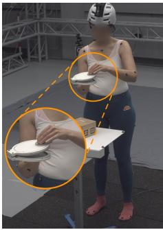

SAM3D-Body  
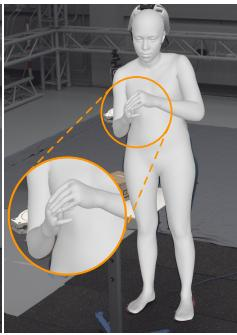

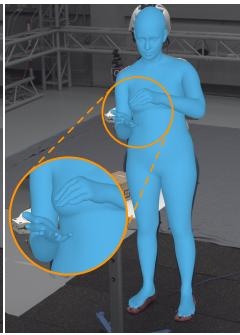  
ExMR (ours)

Input  
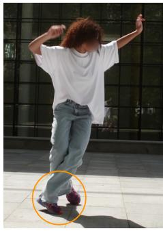

SAM3D-Body  
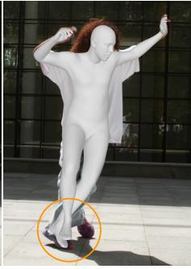

ExMR (ours)  
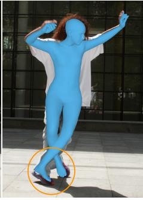

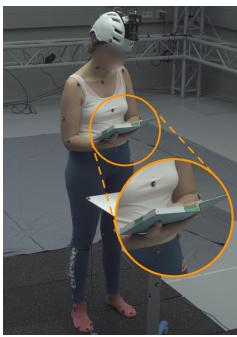

(a)  
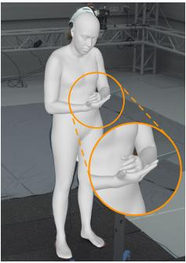

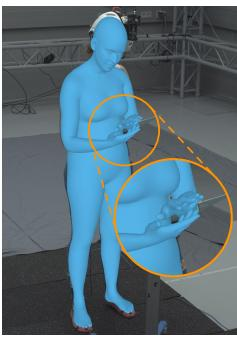

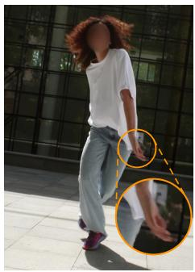  
(c)

(b)  
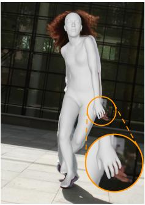

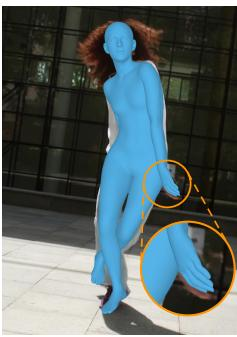  
(d)

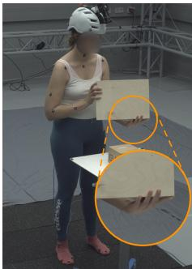

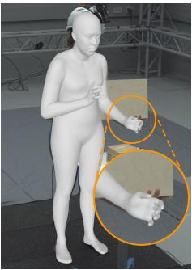  
(e)

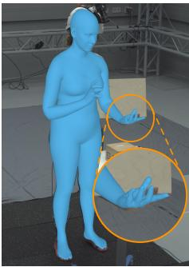

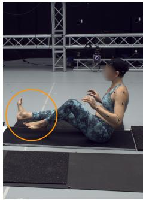

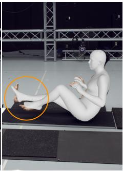  
(f)

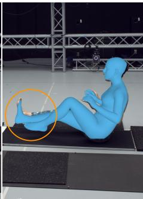  
Fig. S1. Qualitative comparison with SAM3D-Body. Each example shows, from left to right, the input image, the SAM3D-Body prediction (gray), and the ExMR prediction (blue). Panels (a), (c), and (e) show object-manipulation examples; (b) and (d) show dance poses; (f) shows a seated pose. Within each example, corresponding insets use identical image regions and magnification. SAM3D-Body overlays show its native MHR meshes, while ExMR overlays show SMPL-X meshes.