# FLUIDGEN: PHYSICS-AWARE FLUID VIDEO GENERA-TION VIA MOTION-GUIDED POST-TRAINING

Yang Zheng∗ Zizhang Li∗ Boyang Deng∗ Jan Ackermann Lei Shu   
Yinghao Xu Jiajun Wu Gordon Wetzstein Leonidas Guibas   
Stanford University   
∗Equal contribution

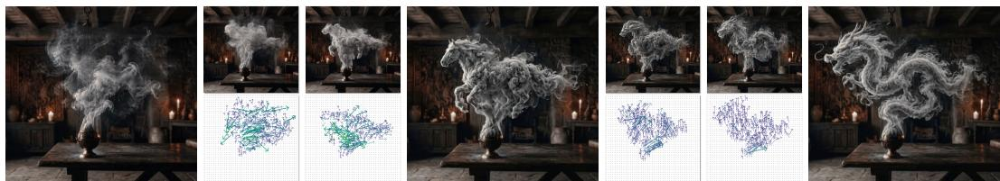  
Figure 1: We introduce FluidGen, a physics-aware video diffusion model for realistic fluid dynamics. FluidGen jointly predicts per-frame velocity fields (insets) that regularize generation toward physically consistent motion.

## ABSTRACT

Video generation models produce visually compelling motion but systematically fail on fluid phenomena, including smoke, fire, and explosion debris, where outputs lack coherent vortical structure and collapse to bland dynamics that violate the physics of real fluids. Classical solvers achieve high physical fidelity but require detailed 3D scenes and carefully tuned parameters, making them impractical for in-the-wild imagery and video generation. We address this gap by injecting a data-driven fluid prior into a pre-trained video model, trained on a mixture of high-fidelity Houdini simulation data with paired velocity-field ground truth and curated in-the-wild fluid video data for appearance diversity. The core of our approach is a dual stream architecture that predicts per-frame velocity fields alongside RGB, supervised by simulation ground truth. This auxiliary signal regularizes generation toward physically consistent motion and exposes an interpretable physical quantity that we further leverage as a reward for velocity-aware direct preference optimization. Our model produces substantially more realistic fluid dynamics sequences than strong video baselines and optimization-based methods. Our data, code, and model will be publicly released. Project page: https://y-zheng18.github.io/FluidGen/.

## 1 INTRODUCTION

Realistic fluid phenomena, including billowing smoke, rolling fire, and the dust and ash of an explosion, are among the most important visual elements in film, games, and immersive media, and also among the hardest to make look right. Their motion is driven by complex, turbulent physical dynamics, and humans can notice errors in problematic fluid dynamics immediately: for example a plume that rises too uniformly, a flame that moves in an unnatural direction, or a debris cloud without proper swirling structure. Synthesizing fluid content that holds up under this realism has been a long-standing goal in computer graphics, and despite decades of progress, it still typically requires expert artists, expensive simulation tools, and large amounts of manual effort.

One family of approaches treats fluid dynamics synthesis as a simulation problem. Classical physical solvers solve the Navier–Stokes equations (Constantin & Foia¸s, 1988) on grids (Stam, 2023; Bridson, 2015), particles (Müller et al., 2003; Zhu & Bridson, 2005), or hybrid representations (Macklin & Müller, 2013), and produce physically faithful results when the scene parameters and boundary conditions are carefully defined. To extend simulation to single- or multi-view videos captured in the wild, more recent works reconstruct a 3D fluid representation from videos with regularization derived from physical priors (Eckert et al., 2019; Chu et al., 2022; Yu et al., 2023; Gao et al., 2025) and re-simulating with the reconstructed representation. Another line of work uses neural networks as replacements to accelerate explicit solvers (Kim et al., 2019; Sanchez-Gonzalez et al., 2020; Ummenhofer et al., 2019; Cai et al., 2021). A shared fundamental component of these works is the reliance on manually designed simulation rules (e.g., Navier–Stokes equations) that are themselves only approximations of the highly complex fluid dynamics process. As a result, they remain brittle: small reconstruction errors build up, fluid parameters must be tuned per scene, and the state-of-theart methods still struggle on the casual images that dominate real-world content.

A new family of approaches turns to large-scale generative models, which now carry remarkably strong priors over both motion and appearance from internet-scale training (Wan et al., 2025; Brooks et al., 2024; Polyak et al., 2024; Bar-Tal et al., 2024). A natural way to use them in physical content creation is as a learned renderer on top of an explicit simulator, leaning on the generator’s appearance prior while leaving the dynamics to the solver. Yet on fluid phenomena specifically, this combina tion still falls short. On their own, modern video models consistently violate basic physical rules in scenes with complex fluid dynamics (Motamed et al., 2025). Earlier physics-aware generation efforts have focused mostly on rigid (Liu et al., 2024) or elastic (Tan et al., 2024) objects rather than on volumetric, turbulent fluids. To close this gap on fluid dynamics, very recent works (Li et al., 2025b; Zhan et al., 2026; Liu et al., 2026) explicitly couple a video generator with an underlying simulator that provides fluid dynamics guidance. However, all aforementioned pipelines still depend on the heavy machinery of an authored 3D scene and a configured simulator, which limits their applicability to in-the-wild fluid content synthesis.

We argue that video model itself can learn complex fluid dynamics directly, but RGB supervision alone provides an insufficient training signal: appearance errors dominate the convergence while subtle physical errors are easily ignored. We therefore introduce an internal motion representation, jointly predicted with RGB, that explicitly exposes fluid dynamics to the model. Specifically, we predict a 3D velocity field describing fluid motion over time, providing a more physically meaningful representation than optical flow or trajectories (Wang et al., 2024; Zhang et al., 2025b).

This representation enables a clean two-stage post-training pipeline for a pretrained video diffusion model (Wan et al., 2025). First, we jointly supervise RGB and velocity prediction using high-fidelity Houdini simulations with ground-truth velocity fields, together with in-the-wild fluid videos for appearance diversity and gives the model the generalization ability for in-the-wild content. Second, we perform velocity-aware DPO (Rafailov et al., 2023; Liu et al., 2025a), using the model’s own predicted velocity field together with appearance signals to rank samples by physical plausibility. The resulting model produces more coherent vortices, natural advection, and fine-scale turbulent structure and clearly outperforms state-of-the-art strong video-generation and simulation-based baselines.

In summary, our contributions are:

• We propose a dual-head video model architecture that jointly predicts an internal fluid velocity field alongside RGB pixels, providing an explicit and interpretable physical signal that guides dynamics learning.

• We curate a fluid training corpus that pairs high-quality Houdini simulations with collected in-the-wild smoke, fire, and explosion footage, combining dense physical supervision with the appearance variety needed for real-world generalization.

• We design a two-stage training pipeline that first jointly supervises RGB and velocity prediction and then aligns the model outputs with a post-training stage using its own predicted velocity field as the reward.

## 2 RELATED WORK

Fluid Simulation and Reconstruction. Realistic fluid visual effect synthesis in graphics has long been driven by analytical physical simulation. Classical Eulerian solvers discretize the Navier– Stokes equations on regular grids (Stam, 2023; Bridson, 2015), while particle-based formulations (Müller et al., 2003; Zhu & Bridson, 2005) represent fluids as collections of moving particles, and hybrid representations such as PBF (Macklin & Müller, 2013) balance accuracy with interactivity from both sides. To reduce simulation cost, neural networks have been used as accelerating components for the traditional solvers (Kim et al., 2019; Sanchez-Gonzalez et al., 2020; Ummenhofer et al., 2019; Cai et al., 2021). Built on top of existing fluid simulation formulations, a complementary line of work aims to recover fluid representations directly from captured video and re-simulates them (Eckert et al., 2019; Chu et al., 2022; Yu et al., 2023; Gao et al., 2025; Li et al., 2025a; Liu et al., 2025b). Combined with differentiable rendering, these works directly build fluid assets from real-world captures instead of requiring manual construction in the simulator. However all of these methods rely on human-defined simulation rules and are bounded by the approximation accuracy. Our work takes the opposite path: we treat fluid dynamics as the learnable property of a video model itself, without the explicit solver at inference time.

Physics-Aware Video Synthesis. Recent video diffusion models exhibit strong motion priors but are not necessarily physically faithful, and even frontier models still violate basic physical princi ples in scenes with complex dynamics (Motamed et al., 2025; Bansal et al., 2025). A line of work combines traditional simulation with video generation. PhysGen (Liu et al., 2024) couples video generation with rigid-body physics through SDEdit (Meng et al., 2021), PhysMotion (Tan et al., 2024) extends this into the elastic domain, and PhysDreamer (Zhang et al., 2024) distills physical parameters using a video model as prior. These methods focus on solid materials and cannot naturally extend to volumetric, turbulent fluids. A second family (Zhang et al., 2025a) instead steers diffusion sampling with LLM-derived physical context. Another line of work fine-tunes video models on labeled synthetic data to emit auxiliary channels alongside RGB, though these channels are appearance properties, e.g., intrinsics (Zeng et al., 2024; Liang et al., 2025) or weather (Lin et al., 2025), rather than the dynamical state we predict.

To accommodate fluid effect synthesis, a recent line of work (Li et al., 2025b; Zhan et al., 2026; Liu et al., 2026) built the system on top of the multi-physics simulator (Authors, 2024), conditioning the video generation model through bi-modal control. Although these hybrid systems improve physical plausibility for fluids and also other materials, they still require an authored 3D scene and a configured simulator, limiting their applicability to generation from in-the-wild content. We share their goal but bake the physics directly into the video model through our model design and the training pipeline, with no manual effort on explicit simulators.

Preference Optimization Post-Training. Preference optimization, as a post-training stage, has become a standard recipe for aligning generative models with human-defined high-dimensional quality. DPO (Rafailov et al., 2023) provides a simple offline formulation for the optimization target, and Diffusion-DPO (Wallace et al., 2024) further adapts it to training with diffusion models. VideoDPO (Liu et al., 2025a) extends preference alignment to the video diffusion domain with a multi-aspect scoring system, and DenseDPO (Wu et al., 2026) introduces fine-grained temporal preference labels to better target motion quality. EpipolarDPO (Kupyn et al., 2025) employs epipolar constraints to enhance geometry consistency of video generation. Inspired by these, we further treat physical quality, especially complex fluid effects, as another signal that can be used for preference optimization. In detail, we leverage our model’s native velocity field prediction as part of the reward signal, turning an auxiliary physical output into a physics-grounded preference indicator at the alignment stage.

## 3 METHOD

## 3.1 OVERVIEW

Our model is trained to jointly generate a fluid video and a pixel-aligned 3D velocity field video using a single video diffusion model, and subsequently trained with the reward metric computed directly from its own velocity field output. Therefore, velocity and RGB predictions serve two key roles. First, as an auxiliary motion signal that regularizes the appearance stream toward more coherent and consistent dynamics through this joint prediction (Chefer et al., 2025). More importantly, it transforms every generated sample into the physical dynamics that can be evaluated directly, thereby enabling a velocity-based preference optimization stage without requiring any external motion estimator or simulator.

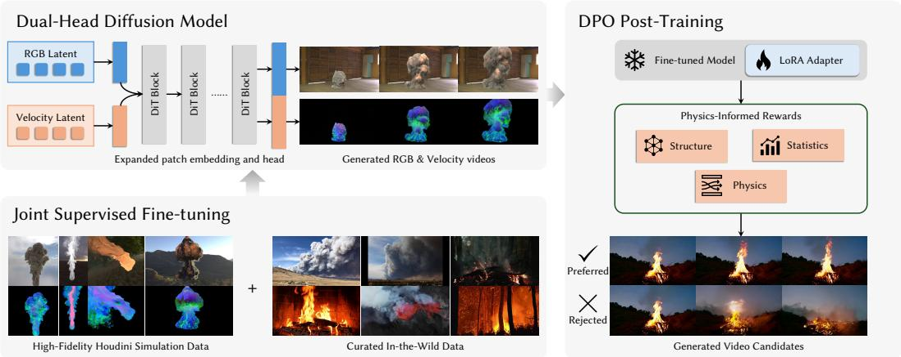  
Figure 2: Overview of FluidGen. Our pipeline augments a pretrained video diffusion model with a velocity prediction stream and train it in two stages: joint supervised fine-tuning on simulated and in-the-wild fluid videos, followed by velocity-aware DPO using physics-informed rewards.

Concretely, our architecture is a dual-head extension of a pretrained video diffusion transformer (DiT (Peebles & Xie, 2023)) (§3.3) that produces both an RGB stream and a velocity stream from a shared latent. The model is trained in two stages: 1) Joint supervised fine-tuning (§3.4): a flow-matching (Lipman et al., 2022) objective over the joint latent trained on a mixed corpus of Houdini simulations with paired ground-truth velocity, and in-the-wild fluid videos. 2) Velocity-aware DPO post-training (§3.5): a DPO objective driven by a velocity-informed reward that evaluates each generated trajectory using its predicted velocity field. Both stages share the same model and output velocity representation, which we introduce first in §3.2.

## 3.2 VELOCITY FIELD REPRESENTATION

At every pixel of each generated frame, we represent the 3D motion of the underlying fluid particles as a velocity vector $\mathbf { v } = ( v _ { x } , v _ { y } , v _ { z } ) \in \mathbb { R } ^ { 3 }$ , expressed in the camera coordinate system. To remain compatible with the standard video model latent space and preserve the pretrained VAE encoder without modification, we do not regress v directly. Instead, we encode v into a threechannel color $\mathbf { c } \in [ 0 , 1 ] ^ { 3 }$ via a spherical decomposition, as illustrated in Fig. 3, and have the velocity head predict c as an auxiliary RGB-like stream. Let $\rho = \lVert \mathbf { v } \rVert , \theta = \operatorname { a r c c o s } ( v _ { z } / \rho ) \in [ 0 , \pi ]$ , and $\phi = \mathrm { a t a n 2 } ( v _ { y } , v _ { x } ) \in [ - \pi , \pi ] .$ . The encoding is defined as

$$
\begin{array} { r } { \mathbf { c } = \left( \frac { \rho } { S } , \ \frac { \theta } { \pi } , \ \frac { \phi + \pi } { 2 \pi } \right) \in [ 0 , 1 ] ^ { 3 } , \quad S = \sigma \sqrt { H ^ { 2 } + W ^ { 2 } } , } \end{array}\tag{1}
$$

where (H, W) is the image resolution and the global scale $\sigma = 1 0 ^ { - 2 }$ is chosen such that typical advection magnitudes occupy the middle of the [0, 1] range. At inference, the predicted c is decoded back to v by inverting Eq. 1.

## 3.3 DUAL-HEAD JOINT DIFFUSION ARCHITECTURE

Our model builds upon a pretrained 14B image-to-video Diffusion Transformer (Wan et al., 2025), whose VAE encodes a video into a 16-channel spatiotemporal latent $\mathbf { z } ^ { \mathrm { { r g b } } } \in \mathbb { R } ^ { 1 6 \times \hat { T } \times h \times w }$ . We extend the backbone with a parallel velocity head operating on a velocity latent of identical shape, and concatenate the two along the channel dimension to form a joint latent, following VideoJam (Chefer et al., 2025):

$$
\tilde { \mathbf { z } } = [ \mathbf { z } ^ { \mathrm { r g b } } ; \mathbf { z } ^ { \mathrm { v e l } } ] \in \mathbb { R } ^ { 3 2 \times T \times h \times w } .\tag{2}
$$

The velocity latent is encoded and decoded using the same VAE as the RGB stream: we simply treat the encoded velocity image (Eq. 1) as an additional RGB clip. This preserves the pretrained perceptual capability of the backbone while avoiding the need to train a separate encoder-decoder latent space. Two transformer components are widened to support the joint latent (Fig. 2):

Patch Embedding Input. The initial patchify projection is expanded so that its input depth grows from $1 6 + K \ t o \ 1 \bar { 6 } + \bar { 1 } 6 + K$ , where K denotes the number of conditioning channels (conditional image and binary mask latent). The first $1 6 + K$ channels reuse the pretrained weights directly, while the additional 16 corresponding to the velocity latent are zero-initialized. So the model can start the training stage without losing the base prediction ability.

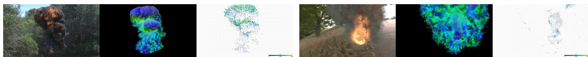  
Figure 3: Data visualization. Here we show two examples of simulated scenes: the rendered RGB frames, velocity field frames and visualized velocity directions in our Houdini-constructed dataset.

Output Head. The final projection layer mapping tokens back to patch space is widened from an output dimension of 16 to 32. The RGB channels reuse the pretrained weights, while the velocity channels are initialized to zero. This zero initialization scheme preserves the pretrained model behavior at initialization: the RGB branch is initially identical to the original pretrained model, while the velocity branch remains inactive at the beginning of the joint supervised fine-tuning. We empirically explored architectures with separate denoisers and explicit cross-attention bridges, but found that a single shared denoiser sampled along one trajectory already maintains strong causal consistency between RGB and velocity while being substantially simpler for training and inference.

## 3.4 JOINT SUPERVISED FINE-TUNING

Training Data. The dual-head model is fine-tuned on two complementary datasets. 1) High-fidelity Houdini simulations of smoke, fire, and explosion scenes rendered together with dense groundtruth Eulerian velocity fields, which provide clean (RGB, v) supervision as illustrated in Fig. 3 and anchor the velocity head to physically plausible fluid behavior. Please refer to §4 and Appendix B.2 for more details on the dataset construction. 2) A curated collection of in-the-wild fluid videos supplies appearance diversity, including lighting, materials, scales, and camera motion, which is difficult to produce in simulation and is critical for generalization to real-world inputs.

Joint Flow-Matching Objective. Both heads are trained jointly with a single flow-matching objective (Lipman et al., 2022; Wan et al., 2025) over the combined 32-channel latent. Let ${ \bf z } _ { 1 } = [ { \bf z } _ { 1 } ^ { \mathrm { r g b } } ; { \bf z } _ { 1 } ^ { \mathrm { v e l } } ]$ denote the encoded clean target, let ${ \bf z } _ { 0 } \sim \mathcal { N } ( 0 , { \bf I } )$ be the noise sampled from a standard Gaussian distribution, and let ${ \bf z } _ { t } = ( 1 - t ) { \bf z } _ { 0 } + t { \bf z } _ { 1 }$ be the linear interpolation. The denoiser $\mathbf { v } _ { \Theta } ( \mathbf { z } _ { t } , t , \mathbf { c } , \mathbf { y } )$ is trained to predict the conditional flow ${ \bf z } _ { 1 } - { \bf z } _ { 0 }$ via

$$
\mathcal { L } _ { \mathrm { S F T } } = \mathbb { E } _ { t , { \mathbf { z } _ { 0 } } , { \mathbf { z } _ { 1 } } } \bigg [ m \left. { \mathbf { v } } _ { \ominus } ( { \mathbf { z } } _ { t } , t , { \mathbf { c } } , { \mathbf { y } } ) - ( { \mathbf { z } } _ { 1 } - { \mathbf { z } } _ { 0 } ) \right. ^ { 2 } \bigg ] ,\tag{3}
$$

where c denotes the image-conditioning input and y the text prompt. The per-channel mask m equals 1 for all channels on samples with velocity supervision (the Houdini subset), and equals 0 only on RGB channels for samples without velocity targets (the in-the-wild subset). Consequently, the velocity head is trained exclusively on simulation data, while the RGB head benefits from the full appearance distribution. In practice, the two datasets are interleaved at a fixed mixing ratio during training.

## 3.5 VELOCITY-AWARE DPO POST-TRAINING

First stage fine-tuning yields a model capable of jointly generating an RGB stream and a plausible velocity field stream in a single forward pass. However, the physical quality of generated samples still exhibits suboptimal performance. Many samples will remain visibly degenerate, as it is hard for the model to simply learn the physical process (Bansal et al., 2025) – especially for highly unconstrained and complex fluid dynamics. Consequently, we employ a post-training stage to reduce this variability by aligning the generator with the physics-informed reward, through the preference optimization.

Physics-Informed Reward. We assign each generated sample a scalar reward $R ( \tilde { \mathbf { z } } ) \in [ 0 , 1 ]$ , defined as a convex combination of thirteen component rewards. Each component acts as a soft indicator of physical plausibility. Eleven components are computed directly from the decoded velocity field and fall into three categories:

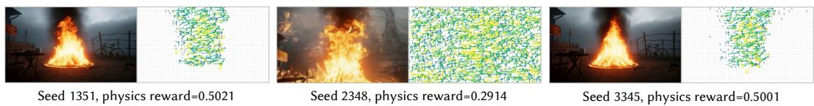  
Figure 4: Physics-informed reward distinguishes plausible from implausible fluid dynamics. Four samples (left: RGB frame; right: visualized velocity field) from the same input annotated with their reward values. High reward samples exhibit organized, turbulent flow structure with rich directional diversity and coherent vortical motion, while low reward samples show collapsed velocity fields that do not correspond to realistic fluid behavior.

Structural terms: including direction diversity, temporal coherence, and multi-scale gradient detail, which encourage non-trivial and temporally stable flow structure;

Statistical terms: including activity naturalness, temporal dynamics balance, life-cycle envelope, and radial outflow, which encourage agreement with the empirical distribution of Houdini simulations;

Physical terms: including advection self-consistency, Q-criterion diversity, direction-field enstrophy (Hunt et al., 1988), and Kolmogorov inertial range compliance (Kraichnan, 1974), which encourage classical properties of turbulent flow.

As illustrated in Fig. 4, this composite reward reliably separates faithful fluid dynamics from unrealistic ones, and serves as the criterion for preference pairs in the post-training stage.

Preference Pairs and Flow-DPO Objective. For each conditioning pair $\left( \mathbf { c } _ { i } , \mathbf { y } _ { i } \right)$ drawn from the first stage training corpus, we sample N=4 candidates using independent random seeds. Since each sample is itself a 32-channel video latent containing both RGB and velocity streams generated by the same denoiser, the aforementioned reward can be evaluated directly on the model output without any additional motion estimator. Within each candidate set, we construct a preference pair $( \tilde { \mathbf { z } } ^ { + } , \tilde { \mathbf { z } } ^ { - } )$ using the highest and lowest reward samples, respectively, and discard pairs whose reward gap is below a threshold δ.

Given a pair at diffusion time t, let $\mathbf { u } _ { t } ^ { \star }$ denote the flow-matching target from Eq. 3, and let $\mathbf { v } _ { \Theta }$ and $\mathbf { v } _ { \Theta _ { \mathrm { r e f } } }$ denote the trainable and reference denoisers, respectively. Following the MSE-based Diffusion-DPO formulation (Wallace et al., 2024) adapted to flow matching (Rafailov et al., 2023; Liu et al., 2025a), we define the per-sample preference residual as:

$$
\Delta ( \tilde { \mathbf { z } } ) = \big \| \mathbf { v } _ { \Theta } ( \tilde { \mathbf { z } } , t ) - \mathbf { u } _ { t } ^ { \star } \big \| ^ { 2 } - \big \| \mathbf { v } _ { \Theta _ { \mathrm { r e f } } } ( \tilde { \mathbf { z } } , t ) - \mathbf { u } _ { t } ^ { \star } \big \| ^ { 2 } ,\tag{4}
$$

and optimize

$$
\begin{array} { r } { \mathcal { L } _ { \mathrm { D P O } } = - \mathbb { E } _ { ( \tilde { \mathbf { z } } ^ { + } , \tilde { \mathbf { z } } ^ { - } ) , t } \log \sigma \Big ( - \frac { 1 } { 2 } \beta \big ( \Delta ( \tilde { \mathbf { z } } ^ { + } ) - \Delta ( \tilde { \mathbf { z } } ^ { - } ) \big ) \Big ) , } \end{array}\tag{5}
$$

where $\sigma ( \cdot )$ denotes the logistic sigmoid function and $\beta$ is a temperature parameter. The objective decreases when the trainable model improves its prediction error on preferred samples more than on dispreferred samples, relative to the reference model. During this stage, we optimize $\mathbf { v } _ { \Theta }$ using lowrank adaptation (LoRA (Hu et al., 2022)) applied to attention and FFN linear layers while freezing the backbone parameters. The reference model $\mathbf { v } _ { \Theta _ { \mathrm { r e f } } }$ is obtained implicitly by disabling the LoRA adapters during inference.

## 4 EXPERIMENTS AND RESULTS

We evaluate our method’s ability to generate visually compelling and physically plausible fluid phenomena. Our experiments are designed to answer three key questions: 1) Does our dual-head architecture and training pipeline improve the physical fidelity of generated fluids compared to stateof-the-art video models? 2) How do the joint velocity prediction and the subsequent DPO posttraining individually contribute to the final performance? Please refer to our project page for more video results and comparisons.

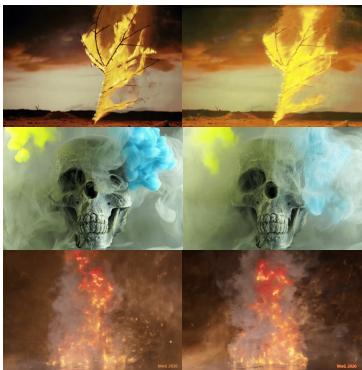  
Wan2.1

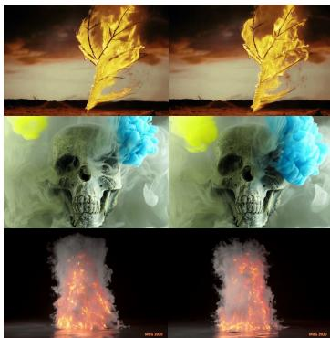  
FluidGen w/o DPO

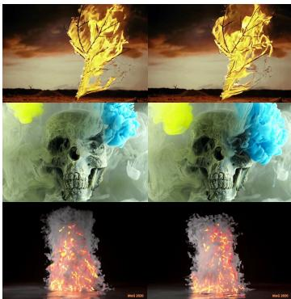  
FluidGen (Ours)

Figure 5: Qualitative comparison on in-the-wild inputs. Wan2.1-I2V-14B produces visibly unnatural fluid motion with appearance drift, while the model after the Joint Supervised Fine-tuning (FluidGen w/o DPO) generates physically coherent dynamics. Our full solution with DPO (Fluid-Gen) further sharpens the result, yielding richer fine-scale details and more vivid fire and smoke motion. Please refer to our project page for better visualization.  
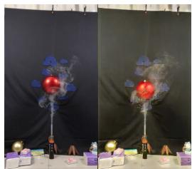  
Wan2.1

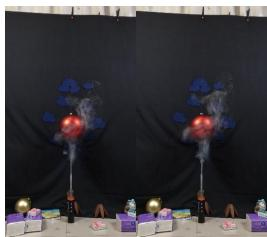  
FluidNexus

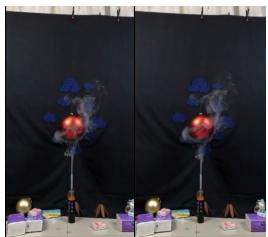  
Ours

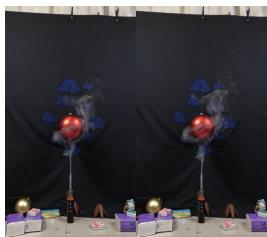  
GT  
Figure 6: Qualitative comparison on the FluidNexus (Gao et al., 2025) dataset. Even with costly multi-view reconstruction, FluidNexus still omits some of the fine details, while the pretrained Wan2.1 fails to generate realistic fluid dynamics and consistent scene appearance.

## 4.1 EXPERIMENTAL SETUP

Datasets. As aforementioned in §3.4, our training dataset is consist of two sources. In detail, we constructed 13125 videos from Houdini simulation, 15570 real-world videos from FluidNexus dataset (Gao et al., 2025), and curated 6521 videos from the real-world footage. In total resulting in a training set of more than 35K videos. Each video is resized to the desired 480 × 832 resolution, for portrait videos we equally pad black pixels on left and right to match the size ratio. Each video has 81 frames for training.

Implementation Details. Our model is initialized from the pretrained Wan-2.1-14B image-to-video diffusion model (Wan et al., 2025). During the joint Supervised Fine-Tuning (FT) stage, we train the widened transformer blocks for 7000 iterations with a batch size of 1 and a learning rate of 1e-5. For the Velocity-Aware DPO stage, we freeze the backbone and train LoRA adapters (rank r = 64) for 500 iterations using a preference margin threshold δ = 0.05 and temperature β = 500. Training was conducted on 8 NVIDIA H100 GPUs. The codebase is built on DiffSynth (ModelScope Community, 2024) and Epipolar-DPO (Kupyn et al., 2025).

Baselines. We compare our approach against strong foundational video generation models and recent physics-aware methods: 1) Wan-14B (Wan et al., 2025): The state-of-the-art base model our architecture is built upon, serving as the direct baseline for our physical augmentations. This model also stands for the current performance of the latest open-source video model can achieve on fluid dynamics. 2) FluidNexus (Gao et al., 2025): On benchmarks with ground-truth data, we also compare with an upgraded multi-view version of the original FluidNexus model. We directly use applicable multi-view videos to reconstruct the underlying fluid representations. And show that even with the additional multi-view information, the pure physics-based approach still can’t faithfully generate complex fluid dynamics at the desired level.

Table 1: Quantitative results on the Fluid-Nexus (Gao et al., 2025) dataset.
<table><tr><td>Method</td><td>PSNR↑</td><td>SSIM↑</td><td>LPIPS↓</td><td>FVD↓</td></tr><tr><td>FluidNexus</td><td>31.04</td><td>0.9040</td><td>0.1014</td><td>542.6</td></tr><tr><td>Wan2.1-I2V-14B</td><td>22.50</td><td>0.8018</td><td>0.1821</td><td>569.7</td></tr><tr><td>FluidGen w/o DPO</td><td>31.52</td><td>0.9203</td><td>0.0547</td><td>192.1</td></tr><tr><td>FluidGen (Ours)</td><td>31.08</td><td>0.9157</td><td>0.0542</td><td>199.2</td></tr></table>

Table 2: VBench (Huang et al., 2024) scores for image-to-video generation on in-the-wild data.
<table><tr><td>Method</td><td>Quality↑</td><td>Aesthetics↑</td><td>Consistency↑</td></tr><tr><td>Wan2.1-I2V-14B</td><td>0.4332</td><td>0.5144</td><td>0.8929</td></tr><tr><td>FluidGen w/o DPO</td><td>0.4282</td><td>0.5255</td><td>0.9383</td></tr><tr><td>FluidGen (Ours)</td><td>0.4627</td><td>0.5283</td><td>0.9350</td></tr></table>

Metrics. We evaluate along two axes using two benchmarks. The FluidNexus benchmark (Gao et al., 2025) provides multiview captures of real fluids with ground-truth reference frames; on 15 randomly selected sequences, we report PSNR and SSIM for per-frame reconstruction fidelity, LPIPS (Zhang et al., 2018) for perceptual similarity, and FVD (Unterthiner et al., 2019) for distributional distance over spatiotemporal features. To evaluate general video quality on in-the-wild image inputs, we additionally report VBench (Huang et al., 2024) scores on 20 selected images along three dimensions relevant to fluid synthesis: Imaging Quality (per-frame visual fidelity), Aesthetic Quality (perceptual appeal), and Subject Consistency (temporal stability of foreground content, critical for coherent advection without flickering).

## 4.2 QUANTITATIVE EVALUATION

Tab. 1 reports results on the FluidNexus benchmark. We note that the FluidNexus baseline used here is an upgraded multi-view variant of the original method, which consumes multiple synchronized views as input and requires several hours of per-scene optimization to reconstruct the underlying fluid representation. Despite this substantially heavier setup, it still fails to recover some fine level turbulent details such as small scale eddies and high-frequency boundary roll-ups, which is reflected in its lower SSIM and notably higher LPIPS and FVD compared to our method. Wan2.1-I2V-14B, on the other hand, struggles to produce faithful fluid dynamics from a single image and frequently introduces appearance artifacts such as color shifting and texture drift over time. In contrast, our model, conditioned on only a single image and run in a single forward pass, achieves the best or on par metrics with the multi-view FluidNexus baseline, indicating that our generated complex fluid dynamics closely match the ground-truth captures.

To verify that our training stages do not compromise general generative capability on in-the-wild content, we evaluate our method using VBench metrics in Tab. 2. Our final model matches or surpasses the Wan2.1-I2V-14B base model on all three reported dimensions, with clear gains in Imaging Quality and Subject Consistency. The improvement in Subject Consistency is particularly meaningful for fluid scenes: it indicates that the auxiliary velocity stream regularizes the RGB stream toward temporally coherent advection, mitigating the flickering and shifting artifacts observed in the base model. Together, the two benchmarks show that our method substantially improves physical fidelity.

## 4.3 QUALITATIVE RESULTS

Fig. 6 shows visual comparisons against ground-truth captures from the FluidNexus benchmark. The upgraded FluidNexus baseline recovers the coarse shape and trajectory of the smoke plume, but its reconstructions after several hours of optimization still appear overly smooth and lose some finescale wisps and turbulent filaments visible in the ground truth, indicating the disadvantage of relying only on the manually defined physical approximation laws. Wan2.1-I2V-14B produces motion that diverges from the reference dynamics and exhibits noticeable color drift and appearance inconsistency over time. In contrast, our method reproduces both the global rising trajectory and fine turbulent structures, including thin tendrils at the plume boundary, while requiring only a single forward pass from a single input image. We further compare against Wan2.1-I2V-14B on in-the-wild inputs in Fig. 5, where our full model produces more vivid and physically realistic fluid dynamics. Finally, our model supports several downstream applications, including fluid-related visual effects (Fig. 1) via keyframe control (images are generated by NanoBanana 2 (Google DeepMind, 2026)), velocity field prediction (Fig. 7) from input videos using RePaint-style (Lugmayr et al., 2022) conditional sampling, and fluid simulation driven by the generated 3D velocity fields (Fig. 8). More results are provided in Appendix A and on our project page.

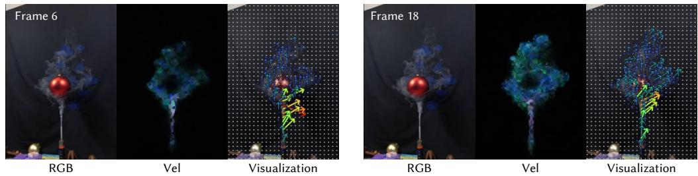

Figure 7: Generated velocity fields on a real-world capture. Here we show the input RGB (left), the generated velocity encoded as color (middle, Eq. 1), and the decoded velocity overlaid as arrows (right). The recovered field reveals coherent advection consistent with the observed smoke motion.  
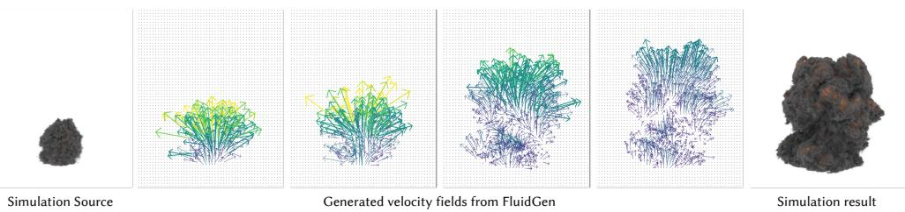  
Figure 8: Fluid simulation from generated velocity fields. Our generated fluid velocity fields are physically accurate and can be directly employed in Houdini to simulate a fluid source.

## 4.4 ABLATION STUDIES

We ablate the two stages of our pipeline against the Wan2.1-I2V-14B base model. Results are reported in Tab. 1 and Tab. 2; qualitative comparisons in Fig. 5.

Joint Supervised Fine-Tuning. The stage I fine-tuning achieves significant gain compared to the basemodel: FluidGen w/o DPO improves PSNR from 22.50 to 31.52 and reduces FVD from 569.7 to 192.1 over the base model, while improving Subject Consistency on VBench (0.8929 → 0.9383). We attribute this improvement to our curated training corpus of high-fidelity Houdini simulations and in-the-wild fluid videos, which exposes the model to the turbulent dynamics largely absent from the base model’s pretraining distribution.

Velocity-Aware DPO. DPO trades a small amount of reconstruction fidelity for noticeably better perceptual quality. FluidNexus metrics remain on par with the FT-only model, while VBench Imaging Quality improves significantly and Aesthetic Quality slightly. The slight drop in Subject Consistency (0.9383 → 0.9350) is expected: the preference signal favors higher-energy, more turbulent motion. Qualitatively (Fig. 5), the FT+DPO model (FluidGen) produces richer fine-scale details and more vivid fire and smoke motion than FluidGen w/o DPO. Please refer to our project page for better visualization.

## 5 CONCLUSION

We present FluidGen, a framework for synthesizing physically plausible fluid dynamics directly within a video diffusion model, bridging the gap between the rich appearance priors of generative models and the dynamic constraints of classical fluid solvers. By augmenting a pretrained video diffusion transformer with a dual-head architecture, our model jointly predicts RGB pixels and an underlying 3D velocity field, capturing complex fluid dynamics without authored 3D scenes or explicit simulators at inference.

Our two-stage training pipeline first jointly fine-tunes the model with dense physical supervision from high-fidelity Houdini simulations alongside the visual diversity of in-the-wild videos, then applies a velocity-aware preference optimization stage that uses the model’s native velocity predictions to compute a physics-informed reward over structural, statistical, and fluid properties, aligning the generator toward turbulent, coherent, and physically sound motion.

While our method focuses on volumetric fluids such as smoke, fire, and explosions, the core idea of embedding interpretable physical representations into generative latents points toward a broader paradigm for physics-aware synthesis. Future work could extend the dual-head approach to other physical systems such as liquids or elastic materials, or expose the predicted velocity fields as a direct control handle for artists. Our results demonstrate that with the right internal representations and alignment strategies, large-scale video models can natively master complex physical dynamics.

## REFERENCES

Genesis Authors. Genesis: A generative and universal physics engine for robotics and beyond, December 2024. URL https://github.com/Genesis-Embodied-AI/Genesis.

Hritik Bansal, Zongyu Lin, Tianyi Xie, Zeshun Zong, Michal Yarom, Yonatan Bitton, Chenfanfu Jiang, Yizhou Sun, Kai-Wei Chang, and Aditya Grover. Videophy: Evaluating physical commonsense for video generation. In International Conference on Learning Representations, volume 2025, pp. 102075–102121, 2025.

Omer Bar-Tal, Hila Chefer, Omer Tov, Charles Herrmann, Roni Paiss, Shiran Zada, Ariel Ephrat, Junhwa Hur, Guanghui Liu, Amit Raj, et al. Lumiere: A space-time diffusion model for video generation. In SIGGRAPH Asia 2024 Conference Papers, pp. 1–11, 2024.

Robert Bridson. Fluid simulation for computer graphics. AK Peters/CRC Press, 2015.

Tim Brooks, Bill Peebles, et al. Video generation models as world simulators. OpenAI Technical Report, February 2024. URL https://openai.com/research/ video-generation-models-as-world-simulators.

Shengze Cai, Zhiping Mao, Zhicheng Wang, Minglang Yin, and George Em Karniadakis. Physicsinformed neural networks (pinns) for fluid mechanics: A review. Acta Mechanica Sinica, 37(12): 1727–1738, 2021.

Hila Chefer, Uriel Singer, Amit Zohar, Yuval Kirstain, Adam Polyak, Yaniv Taigman, Lior Wolf, and Shelly Sheynin. Videojam: Joint appearance-motion representations for enhanced motion generation in video models. arXiv preprint arXiv:2502.02492, 2025.

Mengyu Chu, Lingjie Liu, Quan Zheng, Aleksandra Franz, Hans-Peter Seidel, Christian Theobalt, and Rhaleb Zayer. Physics informed neural fields for smoke reconstruction with sparse data. ACM Transactions on Graphics (ToG), 41(4):1–14, 2022.

Peter Constantin and Ciprian Foia¸s. Navier-stokes equations. University of Chicago press, 1988.

Marie-Lena Eckert, Kiwon Um, and Nils Thuerey. Scalarflow: a large-scale volumetric data set of real-world scalar transport flows for computer animation and machine learning. ACM Transactions on Graphics (TOG), 38(6):1–16, 2019.

Yue Gao, Hong-Xing Yu, Bo Zhu, and Jiajun Wu. Fluidnexus: 3d fluid reconstruction and prediction from a single video. In CVPR, pp. 26091–26101, 2025.

Google DeepMind. Nano Banana 2: Gemini 3.1 flash image. https://deepmind.google/ models/gemini-image/flash/, 2026. Accessed: 2026-05-12.

Edward J Hu, Yelong Shen, Phillip Wallis, Zeyuan Allen-Zhu, Yuanzhi Li, Shean Wang, Liang Wang, Weizhu Chen, et al. Lora: Low-rank adaptation of large language models. Iclr, 1(2):3, 2022.

Ziqi Huang, Yinan He, Jiashuo Yu, Fan Zhang, Chenyang Si, Yuming Jiang, Yuanhan Zhang, Tianxing Wu, Qingyang Jin, Nattapol Chanpaisit, et al. Vbench: Comprehensive benchmark suite for video generative models. In CVPR, pp. 21807–21818, 2024.

Julian CR Hunt, Alan A Wray, and Parviz Moin. Eddies, streams, and convergence zones in turbulent flows. Studying turbulence using numerical simulation databases, 2. Proceedings of the 1988 summer program, 1988.

Byungsoo Kim, Vinicius C Azevedo, Nils Thuerey, Theodore Kim, Markus Gross, and Barbara Solenthaler. Deep fluids: A generative network for parameterized fluid simulations. In Computer graphics forum, volume 38, pp. 59–70. Wiley Online Library, 2019.

Robert H Kraichnan. On kolmogorov’s inertial-range theories. Journal of Fluid Mechanics, 62(2): 305–330, 1974.

Orest Kupyn, Fabian Manhardt, Federico Tombari, and Christian Rupprecht. Epipolar geometry improves video generation models. arXiv preprint arXiv:2510.21615, 2025. URL https:// arxiv.org/abs/2510.21615.

Chen Li, Shanshan Dong, Sheng Qiu, Jianmin Han, Yibo Zhao, Zan Gao, Taku Komura, and Kemeng Huang. Smokesvd: Smoke reconstruction from a single view via progressive novel view synthesis and refinement with diffusion models. arXiv preprint arXiv:2507.12156, 2025a.

Zizhang Li, Hong-Xing Yu, Wei Liu, Yin Yang, Charles Herrmann, Gordon Wetzstein, and Jiajun Wu. Wonderplay: Dynamic 3d scene generation from a single image and actions. In Proceedings ofthe IEEE/CVF International Conference on Computer Vision, pp. 9080–9090, 2025b.

Ruofan Liang, Zan Gojcic, Huan Ling, Jacob Munkberg, Jon Hasselgren, Chih-Hao Lin, Jun Gao, Alexander Keller, Nandita Vijaykumar, Sanja Fidler, et al. Diffusionrenderer: Neural inverse and forward rendering with video diffusion models. In 2025 IEEE/CVF Conference on Computer Vision and Pattern Recognition (CVPR), pp. 26069–26080. IEEE, 2025.

Chih-Hao Lin, Zian Wang, Ruofan Liang, Yuxuan Zhang, Sanja Fidler, Shenlong Wang, and Zan Gojcic. Controllable weather synthesis and removal with video diffusion models. In 2025 IEEE/CVF International Conference on Computer Vision (ICCV), pp. 13580–13591. IEEE, 2025.

Yaron Lipman, Ricky TQ Chen, Heli Ben-Hamu, Maximilian Nickel, and Matt Le. Flow matching for generative modeling. arXiv preprint arXiv:2210.02747, 2022.

Runtao Liu, Haoyu Wu, Ziqiang Zheng, Chen Wei, Yingqing He, Renjie Pi, and Qifeng Chen. Videodpo: Omni-preference alignment for video diffusion generation. In CVPR, pp. 8009–8019, 2025a.

Shaowei Liu, Zhongzheng Ren, Saurabh Gupta, and Shenlong Wang. Physgen: Rigid-body physicsgrounded image-to-video generation. In European Conference on Computer Vision, pp. 360–378. Springer, 2024.

Wei Liu, Ziyu Chen, Zizhang Li, Yue Wang, Hong-Xing Yu, and Jiajun Wu. Realwonder: Real-time physical action-conditioned video generation. arXiv preprint arXiv:2603.05449, 2026.

Yuqiu Liu, Jialin Song, Manolis Savva, and Wuyang Chen. Wildsmoke: Ready-to-use dynamic 3d smoke assets from a single video in the wild. arXiv preprint arXiv:2509.11114, 2025b.

Andreas Lugmayr, Martin Danelljan, Andres Romero, Fisher Yu, Radu Timofte, and Luc Van Gool. Repaint: Inpainting using denoising diffusion probabilistic models. In CVPR, pp. 11461–11471, 2022.

Miles Macklin and Matthias Müller. Position based fluids. ACM Transactions on Graphics (TOG), 32(4):1–12, 2013.

Chenlin Meng, Yutong He, Yang Song, Jiaming Song, Jiajun Wu, Jun-Yan Zhu, and Stefano Ermon. Sdedit: Guided image synthesis and editing with stochastic differential equations. arXiv preprint arXiv:2108.01073, 2021.

ModelScope Community. DiffSynth-Studio: An open-source diffusion model engine. https: //github.com/modelscope/DiffSynth-Studio, 2024. Accessed: 2026-05-12.

Saman Motamed, Laura Culp, Kevin Swersky, Priyank Jaini, and Robert Geirhos. Do generative video models learn physical principles from watching videos? arXiv e-prints, pp. arXiv–2501, 2025.

Matthias Müller, David Charypar, and Markus Gross. Particle-based fluid simulation for interactive applications. In Proceedings of the 2003 ACM SIGGRAPH/Eurographics symposium on Computer animation, pp. 154–159, 2003.

William Peebles and Saining Xie. Scalable diffusion models with transformers. In Proceedings of the IEEE/CVF international conference on computer vision, pp. 4195–4205, 2023.

Adam Polyak, Amit Zohar, Andrew Brown, Andros Tjandra, Animesh Sinha, Ann Lee, Apoorv Vyas, Bowen Shi, Chih-Yao Ma, Ching-Yao Chuang, et al. Movie gen: A cast of media foundation models. arXiv preprint arXiv:2410.13720, 2024.

Rafael Rafailov, Archit Sharma, Eric Mitchell, Christopher D Manning, Stefano Ermon, and Chelsea Finn. Direct preference optimization: Your language model is secretly a reward model. NeurIPS, 36:53728–53741, 2023.

Alvaro Sanchez-Gonzalez, Jonathan Godwin, Tobias Pfaff, Rex Ying, Jure Leskovec, and Peter Battaglia. Learning to simulate complex physics with graph networks. In International conference on machine learning, pp. 8459–8468. PMLR, 2020.

Jos Stam. Stable fluids. In Seminal Graphics Papers: Pushing the Boundaries, Volume 2, pp. 779–786. 2023.

Xiyang Tan, Ying Jiang, Xuan Li, Zeshun Zong, Tianyi Xie, Yin Yang, and Chenfanfu Jiang. Physmotion: Physics-grounded dynamics from a single image. arXiv preprint arXiv:2411.17189, 2024.

Benjamin Ummenhofer, Lukas Prantl, Nils Thuerey, and Vladlen Koltun. Lagrangian fluid simulation with continuous convolutions. In International conference on learning representations, 2019.

Thomas Unterthiner, Sjoerd Van Steenkiste, Karol Kurach, Raphaël Marinier, Marcin Michalski, and Sylvain Gelly. Fvd: A new metric for video generation. 2019.

Bram Wallace, Meihua Dang, Rafael Rafailov, Linqi Zhou, Aaron Lou, Senthil Purushwalkam, Stefano Ermon, Caiming Xiong, Shafiq Joty, and Nikhil Naik. Diffusion model alignment using direct preference optimization. In CVPR, pp. 8228–8238, 2024.

Team Wan, Ang Wang, Baole Ai, Bin Wen, Chaojie Mao, Chen-Wei Xie, Di Chen, Feiwu Yu, Haiming Zhao, Jianxiao Yang, et al. Wan: Open and advanced large-scale video generative models. arXiv preprint arXiv:2503.20314, 2025.

Zhouxia Wang, Ziyang Yuan, Xintao Wang, Yaowei Li, Tianshui Chen, Menghan Xia, Ping Luo, and Ying Shan. Motionctrl: A unified and flexible motion controller for video generation. In ACM SIGGRAPH 2024 Conference Papers, pp. 1–11, 2024.

Ziyi Wu, Anil Kag, Ivan Skorokhodov, Willi Menapace, Ashkan Mirzaei, Igor Gilitschenski, Sergey Tulyakov, and Aliaksandr Siarohin. Densedpo: Fine-grained temporal preference optimization for video diffusion models. Advances in Neural Information Processing Systems, 38:171632– 171668, 2026.

Hong-Xing Yu, Yang Zheng, Yuan Gao, Yitong Deng, Bo Zhu, and Jiajun Wu. Inferring hybrid neural fluid fields from videos. NeurIPS, 36:63595–63608, 2023.

Zheng Zeng, Valentin Deschaintre, Iliyan Georgiev, Yannick Hold-Geoffroy, Yiwei Hu, Fujun Luan, Ling-Qi Yan, and Miloš Hašan. RGB↔X: Image decomposition and synthesis using materialand lighting-aware diffusion models. In ACM SIGGRAPH 2024 conference papers, pp. 1–11, 2024.

Jiahao Zhan, Zizhang Li, Hong-Xing Yu, and Jiajun Wu. Perpetualwonder: Long-horizon actionconditioned 4d scene generation. arXiv preprint arXiv:2602.04876, 2026.

Ke Zhang, Cihan Xiao, Jiacong Xu, Yiqun Mei, and Vishal M Patel. Think before you diffuse: Infusing physical rules into video diffusion. arXiv preprint arXiv:2505.21653, 2025a.

Richard Zhang, Phillip Isola, Alexei A Efros, Eli Shechtman, and Oliver Wang. The unreasonable effectiveness of deep features as a perceptual metric. In Proceedings of the IEEE conference on computer vision and pattern recognition, pp. 586–595, 2018.

Tianyuan Zhang, Hong-Xing Yu, Rundi Wu, Brandon Y Feng, Changxi Zheng, Noah Snavely, Jiajun Wu, and William T Freeman. Physdreamer: Physics-based interaction with 3d objects via video generation. In European Conference on Computer Vision, pp. 388–406. Springer, 2024.

Zhenghao Zhang, Junchao Liao, Menghao Li, Zuozhuo Dai, Bingxue Qiu, Siyu Zhu, Long Qin, and Weizhi Wang. Tora: Trajectory-oriented diffusion transformer for video generation. In CVPR, pp. 2063–2073, 2025b.

Yongning Zhu and Robert Bridson. Animating sand as a fluid. ACM Transactions on Graphics (TOG), 24(3):965–972, 2005.

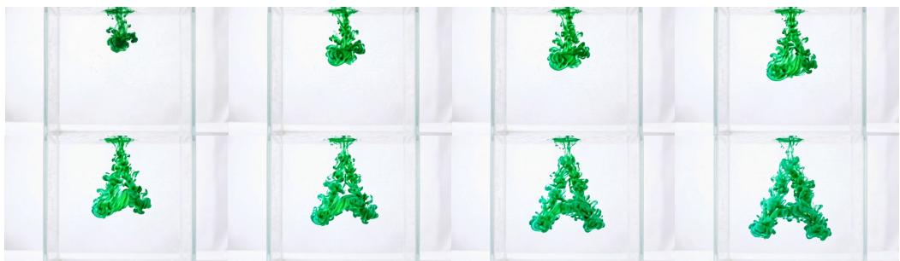  
Figure 9: Visual effects generation using FluidGen. The two rows are ordered frames from a video generated by FluidGen. Given keyframes, FluidGen generates a realistic fluid dynamic transition, here ink in water forming the letter “A”.

## A ADDITIONAL RESULTS

Fig. 9 shows a keyframe-controlled visual effect generated by FluidGen, and Fig. 10 shows additional qualitative results on smoke, ink, and fire.

## B MORE DETAILS

## B.1 PHYSICS-INFORMED REWARD COMPONENTS

Notation. Let $\mathbf v _ { t } ( x , y ) = ( v _ { x } , v _ { y } , v _ { z } )$ denote the per-pixel 3D velocity field at frame t decoded from the velocity stream of a generated sample z˜ via the inverse transformation of Eq. 1. We write $\rho _ { t } = \| \mathbf { v } _ { t } \|$ for the speed magnitude and $\hat { \mathbf { u } } _ { t } = \mathbf v _ { t } / \rho _ { t }$ for the unit-direction field, and set it to zero when $\rho _ { t }$ falls below a small numerical floor value. At each frame we define an active region $\boldsymbol { A } _ { t } =$ $\{ ( x , y ) : \rho _ { t } ( x , y ) > \tau _ { \rho } \}$ that filters out near static background pixels, where $\tau _ { \rho } = \alpha _ { a } S$ with S the encoding scale of Eq. 1 and $\alpha _ { a }$ a fixed fraction. We also use the normalized R-channel $R _ { t } \in [ 0 , 1 ]$ of the encoded velocity image directly for temporal-difference statistics. The symbols $\kappa _ { \bullet } , \mu _ { \bullet }$ , and $\sigma _ { \bullet }$ denote scalar hyper-parameters; their values are calibrated once on a small held-out set of Houdinisimulated and curated in-the-wild clips, and are listed at the end of this section.

Reward components. In total, we compute eleven reward components (Tab. 3), which act on the velocity stream and fall into three groups.

Structural terms target the spatial and temporal organization of the direction field:

$R _ { \mathrm { d i v } }$ penalizes direction collapse via the per-component variance of $\hat { \mathbf { u } } .$

$R _ { \mathrm { t c } }$ measures the temporal Pearson correlation of the spatial gradients of $\hat { \mathbf { u } } .$

$R _ { \mathrm { m s d } }$ rewards consistent gradient richness at scales $s \in \{ 1 , 2 , 4 \}$ so that the flow shows structured detail at all scales rather than blur or pure noise.

Statistical terms match the empirical distribution of Houdini simulations:

$R _ { \mathrm { a c t } }$ on the mean active-pixel fraction $\bar { f } _ { a } = \mathbb { E } _ { t } [ | \mathcal { A } _ { t } | / H W ]$

$R _ { \mathrm { t d b } }$ on the mean temporal change of $R _ { t } .$

$R _ { \mathrm { l c } }$ on the global rise-peak-decay envelope of per-frame energy $\boldsymbol { e } _ { t } ~ = ~ \mathbb { E } _ { x , y } [ \rho _ { t } ]$ via a weighted combination of peak position, monotone rise, monotone decay, second-derivative smoothness, and contrast sub-scores $\left\{ s _ { k } \right\}$ ,

$R _ { \mathrm { r o } }$ on the speed weighted cosine alignment between the image plane velocity $( v _ { x } , v _ { z } )$ and the radial direction r from an automatically estimated source, averaged over early frames.

Physical terms encode classical criterions of turbulent flow:

$R _ { \mathrm { a d v } }$ checks one-step advection self-consistency through a bilinear warp $\mathcal { W }$ of $\mathbf { v } _ { t }$ along $( v _ { x } , v _ { z } )$

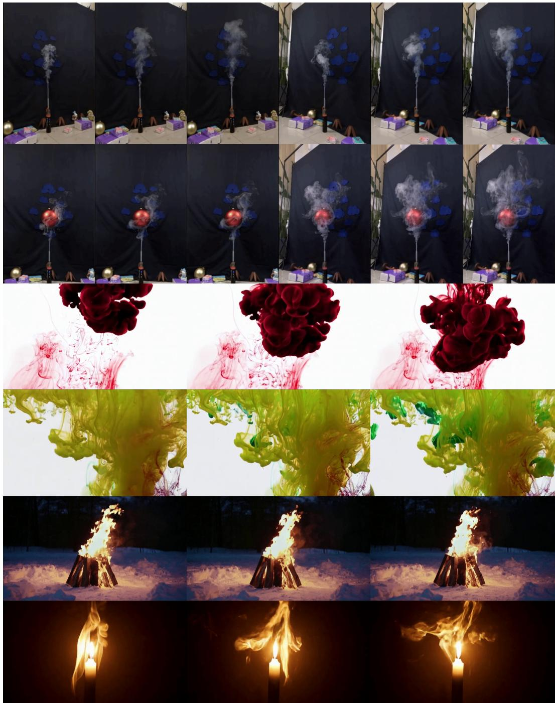  
Figure 10: FluidGen qualitative results. Each row contains frames from a video generated by FluidGen. FluidGen can generate realistic fluid, such as smoke, ink, and fire, in various scenarios.

$R _ { Q }$ rewards a spread of the Q-criterion of $\hat { \mathbf { u } } , Q _ { \hat { u } } = \Omega _ { 1 2 } ^ { 2 } - \big ( S _ { 1 1 } ^ { 2 } + S _ { 2 2 } ^ { 2 } + 2 S _ { 1 2 } ^ { 2 } \big )$ , where S and Ω are the symmetric and antisymmetric parts of ∇uˆ (Hunt et al., 1988),

$R _ { \mathrm { e n s } }$ rewards the enstrophy of the directional field vorticity $\omega _ { \hat { u } } = \partial _ { x } \hat { u } _ { z } - \partial _ { z } \hat { u } _ { x } \mathrm { o n } \mathcal { A } _ { t }$

$R _ { \mathrm { k } }$ rewards Kolmogorov inertial range scaling of the second order structure function $S _ { 2 } ( r ) = \langle \| \mathbf { v } ( \mathbf { x } + \mathbf { \bar { r } } ) - \mathbf { v } ( \mathbf { x } ) \| ^ { 2 } \rangle _ { A }$ along $r \in { \bar { \{ 1 , 2 , 4 , 8 , 1 6 \} } }$ pixels, fit to a power law $S _ { 2 } ( r ) \sim r ^ { \alpha }$ and scored by closeness of α to $2 / 3$ (Kraichnan, 1974).

Table 3: The thirteen component rewards combined into the total $\begin{array} { r } { R ( \tilde { \bf z } ) = \sum _ { i } w _ { i } R _ { i } } \end{array}$ used by the velocity-aware DPO objective. See Sec. B.1 for notation and definitions of $\boldsymbol { \mathcal { A } } _ { t } , \hat { \mathbf { u } } , \boldsymbol { e } _ { t } , S _ { 2 } ( r )$ , and the scalar hyper-parameters.
<table><tr><td>Category</td><td>Name Computing formula</td><td colspan="2"></td></tr><tr><td rowspan="2">Structural</td><td> $R _ { \mathrm { d i v } }$ </td><td colspan="2">F  $\mathbb { E } _ { t } \left\lfloor \operatorname { t a n h } \left( { \frac { 1 } { 3 } } \sum _ { k \in \{ x , y , z \} } \operatorname { V a r } \hat { u } _ { k } \big \vert _ { \mathcal { A } _ { t } } \big / \kappa _ { \mathrm { d i v } } \right) \right\rfloor$ </td></tr><tr><td> $R _ { \mathrm { t c } }$   $R _ { \mathrm { m s d } }$ </td><td colspan="2"> $\mathbb { E } _ { t } \Big [ \big [ \mathrm { P e a r s o n } ( \nabla \hat { \mathbf { u } } _ { t } , \nabla \hat { \mathbf { u } } _ { t + 1 } ) \big ] _ { + } \Big ]$   $\begin{array} { r } { \mathbb { E } _ { t } \big [ 0 . 7 \operatorname { t a n h } ( g _ { 1 } / \kappa _ { g } ) + 0 . 3 \exp \big ( - \frac { 1 } { 2 } \log ^ { 2 } ( g _ { 1 } / g _ { | S | } ) \big ) \big ] } \end{array}$ </td></tr><tr><td rowspan="2">Statistical</td><td> $R _ { \mathrm { a c t } }$   $R _ { \mathrm { t d b } }$   $R _ { \mathrm { l c } }$ </td><td colspan="2"> $\mathrm { e x p } \Big ( - { \textstyle \frac { 1 } { 2 } } \big ( \bar { f } _ { a } - \mu _ { a } \big ) ^ { 2 } \big / \sigma _ { a } ^ { 2 } \Big )$   $\mathrm { e x p } \Big ( - \textstyle \frac 1 2 \big ( { \mathbb E } _ { t } \big | R _ { t + 1 } - R _ { t } \big | - \mu _ { R } \big ) ^ { 2 } / \sigma _ { R } ^ { 2 } \Big )$   $\sum _ { k } \dot { \lambda } _ { k } s _ { k } ( e _ { t } ) , \quad e _ { t } = \mathbb { E } _ { x , y } [ \rho _ { t } ]$ </td></tr><tr><td rowspan="2"> $R _ { \mathrm { r o } }$ </td><td rowspan="2"></td><td></td></tr><tr><td> $\mathbb { E } _ { t < T _ { e } } \left[ \frac { \sum _ { \boldsymbol { A } _ { t } } \rho _ { \boldsymbol { x } \boldsymbol { z } } \left[ \cos \angle ( \left( \boldsymbol { v } _ { \boldsymbol { x } } , \boldsymbol { v } _ { \boldsymbol { z } } \right) , \mathbf { r } ) \right] _ { + } } { \sum _ { \boldsymbol { A } _ { t } } \rho _ { \boldsymbol { x } \boldsymbol { z } } } \right]$ </td></tr><tr><td rowspan="3">Physical</td><td> $R _ { \mathrm { a d v } }$ </td><td> $\mathbb { E } _ { t } \left[ \left[ \mathrm { P e a r s o n } ( \mathbf { v } _ { t + 1 } , \mathcal { W } ( \mathbf { v } _ { t } ) ) \mid _ { \boldsymbol { A } _ { t } } \right] _ { + } \right]$ </td><td></td></tr><tr><td> $R _ { Q }$ </td><td> $\mathbb { E } _ { t } \left[ \operatorname { t a n h } \left( \operatorname { s t d } ( Q _ { \hat { u } } ) \big | _ { { A } _ { t } } / \kappa _ { Q } \right) \right]$ </td><td></td></tr><tr><td> $R _ { \mathrm { e n s } }$   $R _ { \mathrm { k } }$ </td><td> $\mathbb { E } _ { t } \left[ \operatorname { t a n h } \left( \langle \omega _ { \hat { u } } ^ { 2 } \rangle \big | _ { A _ { t } } / \kappa _ { \varepsilon } \right) \right]$ </td><td> $\exp \big ( - | \alpha - 2 / 3 | / \sigma _ { \alpha } \big ) , ~ S _ { 2 } ( r ) \sim r ^ { \alpha }$ </td></tr></table>

The total reward used by the DPO objective in $\mathrm { E q . } 5$ is the convex combination $\begin{array} { r } { R ( \tilde { \mathbf { z } } ) = \sum _ { i } w _ { i } R _ { i } } \end{array}$ with $w _ { i } \geq 0$ and $\textstyle \sum _ { i } w _ { i } = 1$

Table 4: Per-asset randomization ranges for Houdini simulation data construction. $\textstyle { \mathcal { U } } ( a , b )$ stands for uniform distribution and ${ \mathcal { N } } ( \mu , \sigma )$ stands for Gaussian distribution.
<table><tr><td></td><td>Fire</td><td>Smoke</td><td>Explosion</td></tr><tr><td>Solver</td><td>Houdini Pyro</td><td>Houdini Pyro</td><td>Axiom (GPU)</td></tr><tr><td>Buoyancy</td><td>U(0.15,0.3)</td><td>U(0.5, 1.0)</td><td>U(0.1, 1.0)</td></tr><tr><td>Turbulence</td><td>U(0.8, 2.0)</td><td> $1 0 ^ { \mathcal { U } ( - 0 . 5 , - 0 . 0 5 ) }$ </td><td>U(0,10)</td></tr><tr><td>Disturbance</td><td>U(3, 15)</td><td>U(0.1,0.2)</td><td>U(0, 1)</td></tr><tr><td>Dissipation</td><td>0.01</td><td>U(0.005, 0.05)</td><td>U(0.005, 0.05)</td></tr><tr><td>Divergence scale</td><td>~U(0.10,0.15)</td><td>~U(0.10,0.15)</td><td></td></tr><tr><td>Confinement</td><td>1</td><td></td><td> $\boldsymbol { { \mathcal U } } ( 0 , 3 )$ </td></tr><tr><td>Density scale</td><td></td><td> $\mathcal { U } ( 5 , 1 0 )$   $3 ^ { \dot { \mathcal { M } } ( - 1 , 1 ) }$ </td><td></td></tr><tr><td>Temperature scale</td><td>1</td><td></td><td></td></tr><tr><td>Fire intensity  $k _ { \mathrm { f i r e } }$  Emitter center</td><td> $1 0 ^ { \mathcal { U } ( 1 , 1 . 6 ) }$ </td><td></td><td>origin (preset)</td></tr><tr><td>Camera z</td><td> $\mathcal { N } ( ( 0 , - 0 . 7 5 , 0 ) , \mathbf { I } )$  U(6, 10)</td><td> $\begin{array} { r } { \mathcal { N } ( ( 0 , - 5 . 5 , 0 ) , \mathrm { d i a g } ( 1 , 0 . 1 , 1 ) ) } \\ { \mathcal { U } ( 6 , 1 0 ) \qquad } \end{array}$ </td><td>U(30, 35)</td></tr><tr><td>Wind fields</td><td>{0, 1}, strength U(0, 0.8)</td><td>{0, 1}, strength U(0, 0.8)</td><td></td></tr><tr><td>Env-light intensity</td><td>U(0.1,0.5)</td><td> $\mathcal { \dot { U } } ( 0 . 1 , 0 . 1 5 ) + 2 \mathrm { r i m \ l i g h t s }$ </td><td>U(0.9, 1.5)</td></tr></table>

## B.2 HOUDINI DATASET CONSTRUCTION

We synthesize the training set in SideFX Houdini using its Pyro solver, covering three asset families: risingfire, ambient smoke, and bursting explosions. Each scene is independently randomized in source geometry, solver parameters, wind perturbation, camera placement, and environment lighting, then rendered with the Karma path tracer to obtain RGB frames and a per-pixel velocity AOV. Algorithm. 1 summarizes the per-scene pipeline; Tab. 4 lists the randomization ranges that drive variation between sequences.

ALGORITHM 1: Per-scene volumetric data generation.   
Input : asset type a ∈ {fire, smoke, explosion}, job id j, frame count T   
Output: rendered frames, velocity AOV   
θ ← SAMPLEPARAMS(a) // Table 4   
c ← SAMPLEEMITTERCENTER(a)   
Build emitter SOP chain: sphere→attribnoise→pyrosource→volumerasterize   
S ← BUILDPYROSOLVER(θ)   
if wind enabled then   
Append $N \sim \mathcal { U } \{ 0 , 1 \}$ rasterized wind VDBs as vel sources of S   
end   
Patch shader: bind(vel)→bind(velocity, export)   
(pcam, Rw2c) ← PLACECAMERA(a); attach random HDR env light   
Simulate frames 1. . .T, cache VDBs to disk   
Render each cached frame with Karma; emit (RGB, velocity) subimages   
foreachframe do   
Read v from the velocity AOV   
$\mathbf { v }  R _ { \mathrm { w 2 c } } \mathbf { v } _ { \mathrm { w o r l d } }$   
Encode v via spherical coordinates $( \rho / S , \theta / \pi , ( \phi + \pi ) / ( 2 \pi ) )$   
end

Source emitter. For fire and smoke we instantiate a noisy spherical emitter whose center is sampled from a Gaussian around the world origin. The noise displacement amplitude, pulse duration, fractal octaves and roughness are re-sampled per scene to diversify the initial density and temperature fields. Explosions reuse an authored .hipnc scene built around SideFX’s pyro burst source and the Axiom GPU solver, with the shapeoffset seed randomized so each run starts from a different turbulent pattern.

Pyro and Axiom solvers. The Pyro solver runs at voxel size $\Delta x = 0 . 0 2$ for fire and $\Delta x = 0 . 0 1$ for smoke. Each scene resamples buoyancy lift, turbulence strength, disturbance strength, divergence scale, and dissipation; fire additionally resamples the blackbody intensity. Explosions are driven by the Axiom solver. All scenes simulate $T { = } 9 0 $ frames at 24 fps.

Wind perturbation. With probability of $\frac { 1 } { 2 }$ we inject one rasterized wind volume into the solver. A box of random extent is scattered with points, each carrying a velocity vector $\mathbf { w } = s \cdot { \hat { \mathbf { d } } }$ where $s \sim$ U(0, 0.8) and the azimuth of dˆ is drawn uniformly on [0, 2π); the field is rasterized and connected as an additional velocity source to the Pyro solver.

Camera and lighting. A single perspective camera is placed at $( 0 , y , z )$ with $z \sim \mathcal { U } ( 6 , 1 0 )$ for fire/smoke and $z \sim \mathcal { U } ( 3 0 , 3 5 )$ for explosions, oriented via a look-at transformation to the emitter center. Lighting combines a random HDR environment map drawn from a library with intensity sampled per scene, and for smoke scenes, two opposing rim point lights to better expose silhouettes.

Rendering and velocity AOV. We render with Karma renderer at 128 path-traced samples. To export per-pixel velocity, we patch the Pyro shader’s material network with two binded VOPs: the first reads the volume’s vel attribute, the second exports it under the AOV name $\mathtt { v e l o c i t y }$ . This produces a second image in the same EXR whose three channels are the velocity at that pixel.