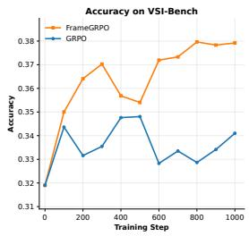
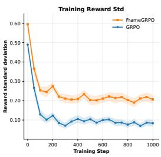
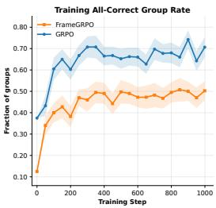
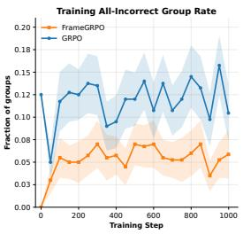
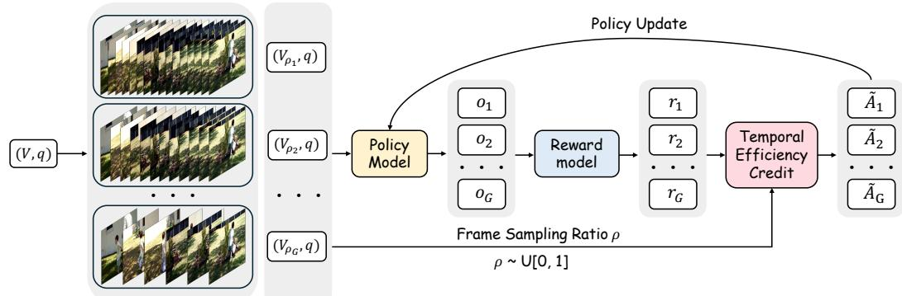
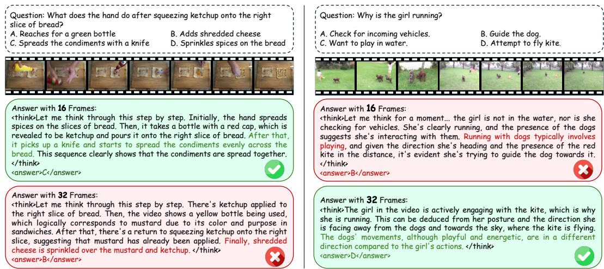
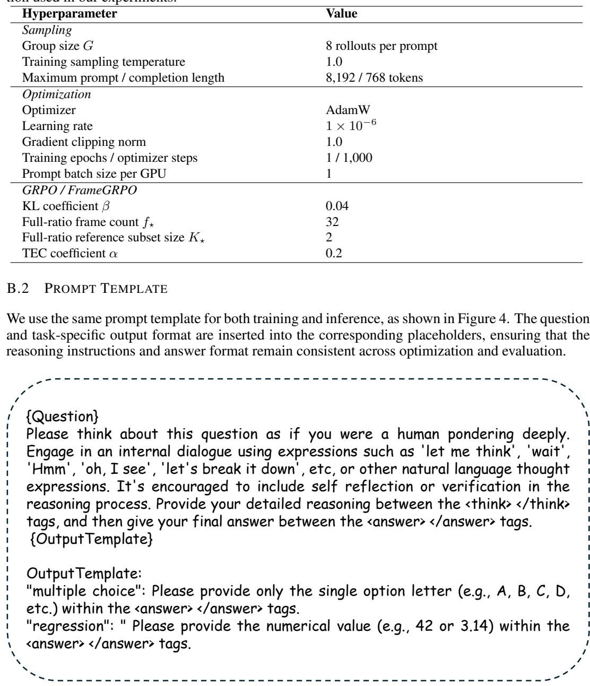
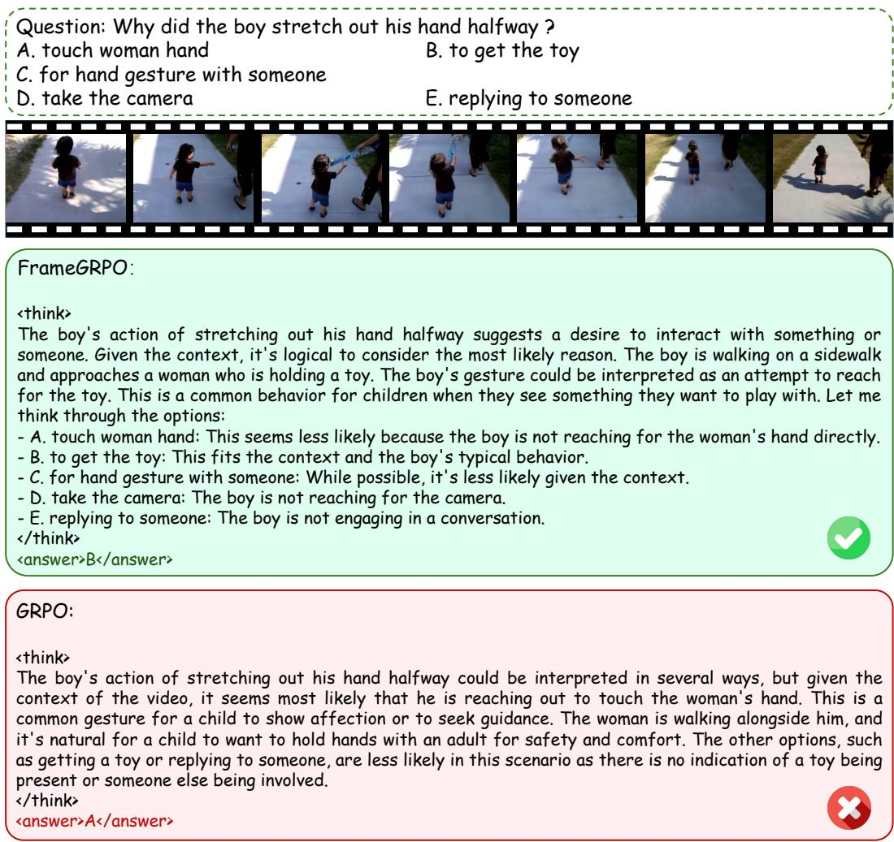

# FRAMEGRPO: INCENTIVIZING VIDEO REASONING VIA MULTI-FRAME ROLLOUTS AND TEMPORAL CREDIT

Jiaxuan Sun1,2,3 Biao Wang3∗ Shuai Li1,2∗

1Shanghai Jiao Tong University

2Shanghai Innovation Institute 3Tencent Hy

jiaxuansun04@gmail.com shuaili8@sjtu.edu.cn

## ABSTRACT

Reinforcement learning with verifiable rewards, particularly Group Relative Policy Optimization (GRPO), has improved video reasoning in multimodal large language models. However, standard video GRPO varies only linguistic trajectories while conditioning every rollout in a group on the same sampled frames, which can produce homogeneous rewards and weaken group-relative learning when the shared visual evidence is insufficient or distracting. We propose FrameGRPO, a simple and effective reinforcement-learning framework that requires neither auxiliary networks nor changes to the model architecture. Specifically, FrameGRPO combines two lightweight components: (1) Multi-Frame Rollouts, which use only uniform temporal subsampling of a single maximal-frame decode to construct aligned views that diversify visual evidence and reasoning trajectories; and (2) Gated Temporal Efficiency Credit, which selectively reinforces a correct lower-ratio trajectory when all rollouts in a fixed full-ratio reference subset fail, without imposing an unconditional preference for fewer frames. Extensive experiments across diverse video understanding and reasoning benchmarks demonstrate robust overall improvements over standard GRPO, highlighting temporal-view diversification as an effective mechanism for exploration and credit assignment in video MLLMs.

## 1 INTRODUCTION

Recent progress in reinforcement learning with verifiable rewards (RLVR) has advanced model reasoning beyond the imitation of curated solution traces toward learning directly from outcome-level feedback (Shao et al., 2024; Guo et al., 2025). Group Relative Policy Optimization (GRPO) has become a particularly practical recipe because it learns from relative comparisons among responses to the same query without requiring a separate critic. This paradigm has rapidly expanded from language reasoning to multimodal and video models (Feng et al., 2026; Wang et al., 2026b; Fu et al., 2026). Recent video-reasoning systems further improve fine-grained visual–temporal credit assignment or allow models to acquire relevant evidence during inference (Wang et al., 2026d; Zhang et al., 2026a; Xie et al., 2025; Ding et al., 2026). Together, these advances establish RL post-training as a promising route from passive video recognition toward reasoning grounded in temporal evidence.

Despite this progress, standard video GRPO explores variation primarily in the language space while keeping the visual context fixed. Rollouts for the same video–question pair use the same frame sampling ratio and therefore the same temporal view, so stochastic decoding changes the linguistic trajectory but not the density of visual input. Yet the frame sampling ratio governs an important trade-off within the same decoded video: lower-ratio views contain fewer redundant or irrelevant frames and can reduce visual distraction, whereas higher-ratio views preserve more task-relevant temporal evidence. Fixing a single frame sampling ratio forces every rollout to inherit the same balance between evidence sufficiency and visual interference, making their outcomes more correlated. When a group becomes uniformly correct or incorrect, GRPO has little basis for relative comparison because all responses receive homogeneous rewards, causing the task-relevant learning signal to vanish. This advantage collapse wastes rollouts and can stall optimization (He et al., 2026a; Yu et al., 2026b; Zhang et al., 2026c). Existing difficulty-adaptive methods restore variation by modifying or regrouping questions (Gao et al., 2026), but they do not address the shared visual context that is distinctive to video reasoning.

  
Figure 1: Training dynamics of FrameGRPO and GRPO. The four panels track VSI-Bench accuracy, within-group reward standard deviation, and the prevalence of uniformly correct and uniformly incorrect rollout groups during optimization. Exposing each group to multiple frame sampling ratios yields more informative reward contrasts, mitigates group-level saturation at either outcome extreme, and translates into stronger evaluation performance. Shaded bands visualize the variability of each metric.

We propose FrameGRPO to address this evidence-induced advantage collapse. Our key observation is that the frame sampling ratio is not merely a computational setting: for the same video and question, it changes which events are visible, how much distracting content is present, and which reasoning paths are elicited. FrameGRPO therefore turns the frame sampling ratio into a withingroup exploration variable, allowing the policy to compare trajectories grounded in different but temporally aligned views. This controlled evidence diversity makes mixed outcomes more likely and preserves the relative signal that GRPO requires. Figure 1 illustrates this mechanism: compared with fixed-ratio GRPO, FrameGRPO maintains greater within-group reward variation, substantially reduces both all-correct and all-incorrect groups, and improves performance across video-reasoning benchmarks.

FrameGRPO consists of two complementary modules. The Multi-Frame Rollouts module first decodes each video once at the maximum sampled frame count, assigns the resulting full-ratio view to a fixed subset of rollout slots, and uniformly subsamples it for the remaining slots at randomly sampled frame sampling ratios. The same policy generates responses from these views, and a shared verifier evaluates them within one group, introducing diversity in both visual evidence and reasoning trajectories. Gated Temporal Efficiency Credit uses the outcomes of the fixed full-ratio subset to control credit assignment. If any full-ratio rollout is correct, it leaves the standard GRPO signal unchanged. Only when all full-ratio rollouts fail does it assign additional credit to successful lower-ratio trajectories, with greater emphasis on successes obtained at lower frame sampling ratios. Finally, every sampled completion is conditioned on the full-ratio input for policy and reference likelihood evaluation, transferring discoveries from complementary views into a single policy. Together, the two modules create useful cross-view comparisons without unconditionally favoring lower frame sampling ratios.

To validate the effectiveness of FrameGRPO, we evaluate it on seven diverse video understanding and reasoning benchmarks: Video-MME (Fu et al., 2025), TempCompass (Liu et al., 2024), VideoEval-Pro (Ma et al., 2025), MMVU (Zhao et al., 2025), VSI-Bench (Yang et al., 2025), NExT-GQA (Xiao et al., 2024), and Video-MMMU (Hu et al., 2026). The results show that FrameGRPO outperforms standard GRPO across all evaluated settings, demonstrating robust improvements across complementary aspects of video reasoning.

Our contributions are threefold:

• We propose FrameGRPO, a simple and effective reinforcement-learning framework that improves video reasoning.

• FrameGRPO explores multiple frame sampling ratios to diversify temporal evidence and introduces a cross-view credit assignment strategy that reinforces successful trajectories discovered from complementary ratio-conditioned views.

• Extensive experiments across seven video understanding and reasoning benchmarks demonstrate that FrameGRPO consistently surpasses standard GRPO, validating its effectiveness and robustness across diverse video tasks.

## 2 RELATED WORK

## 2.1 MLLMS FOR VIDEO UNDERSTANDING

Video MLLMs must distill long, redundant streams into tractable evidence: sparse sampling can miss decisive events, whereas dense inputs increase cost and distraction (Zhu et al., 2026; Zou et al., 2026; He et al., 2026b). Existing work addresses this trade-off through compact visual memory (Chen et al., 2026a), retrieval (Luo et al., 2026; Zhang et al., 2026b; Bahrami et al., 2026), keyframe or adaptive sampling (Li et al., 2026b; Qin et al., 2026; Qiu et al., 2026), and token compression (Xu et al., 2026; Wu et al., 2026b). These strategies reduce redundancy before or during decoding but primarily optimize the evidence available to each individual reasoning trajectory. Complementary methods integrate evidence acquisition into reasoning through frame-wise chains of thought (Arnab et al., 2026), iterative search or temporal zooming (He et al., 2026b; Pan et al., 2026; Ding et al., 2026), and agentic tool use (Zeng et al., 2026; Xie et al., 2025; Zhang et al., 2026a; Jain et al., 2026). Temporal objectives, grounding post-training, and evidence-level rewards further improve temporal supervision (Wu et al., 2026c; Wang et al., 2026c; Li et al., 2026a; Meng et al., 2025; Cao et al., 2026). Unlike these approaches, FrameGRPO uses aligned multi-ratio views within each GRPO group as an informative signal for a single policy, requiring neither auxiliary modules nor additional frame-decoding computation.

## 2.2 REINFORCEMENT LEARNING IN MLLMS

RLVR methods such as GRPO optimize relative outcomes within groups without a learned critic (Shao et al., 2024; Guo et al., 2025; Yu et al., 2026b). In MLLMs, they support general or grounded visual reasoning (Yu et al., 2026a; Liu et al., 2026b; Sarch et al., 2026; Yao et al., 2026), active perception and tool use (Wu et al., 2026a; Chng et al., 2026; Zhu et al., 2025), and alternative optimization signals (Xiao & Gan, 2026; Yoon et al., 2026; Du et al., 2026). Video RL additionally requires deciding which temporal evidence to inspect. Prior systems establish reinforced fine-tuning (Feng et al., 2026; Wang et al., 2026a; Chen et al., 2026b), improve temporal grounding and sampling (Li et al., 2026c; Wang et al., 2026c; Qin et al., 2026), enable active navigation (Qiu et al., 2026; He et al., 2026b; Pan et al., 2026), or provide evidence-aware supervision (Wang et al., 2026d; Cao et al., 2026; Linghu et al., 2026). Nevertheless, when all rollouts share a fixed video view, insufficient or distracting evidence can still yield uniform rewards and erase the relative learning signal. Unlike prior remedies for uninformative uniform-reward groups (Yu et al., 2026b; Park et al., 2026; Gao et al., 2026; He et al., 2026a), FrameGRPO targets the video-specific cause—identical visual context across rollouts—using multiple frame-sampling views and Gated Temporal Efficiency Credit.

## 3 FRAMEGRPO

In this section, we introduce FrameGRPO, a simple and effective reinforcement-learning framework for improving video reasoning in multimodal large language models (MLLMs). To address the limited visual exploration of vanilla GRPO and the resulting risk of advantage collapse, FrameGRPO explores multiple frame sampling ratios and selectively reinforces successful trajectories from lower-ratio visual contexts via gated temporal efficiency credit when all rollouts in a fixed full-ratio reference subset fail. Section 3.1 reviews GRPO and its evidence-induced advantage collapse; Section 3.2 describes multi-frame rollout construction; and Section 3.3 introduces our gated credit mechanism. Figure 2 illustrates the overall pipeline.

## 3.1 PRELIMINARIES: GROUP RELATIVE POLICY OPTIMIZATION

Let V denote a sampled video view, q a question, and a its reference answer. Given the fixed multimodal prompt $( { \bar { V } } , q )$ , vanilla video GRPO samples a group of G responses from the old policy, $o _ { i } \sim \pi _ { \theta _ { \mathrm { o l d } } } ( \cdot \mid V , q )$ for $i \in \{ 1 , \ldots , G \}$ . A shared verifier assigns each response a scalar reward $r _ { i } =$

  
Figure 2: Overview of FrameGRPO. Given a video–question pair, we assign the full-ratio input to a fixed subset of rollout slots and independently sample $\rho _ { i } \sim \mathcal { U } [ 0 , 1 ]$ for the remaining slots to construct temporally aligned views $V _ { \rho _ { i } }$ . A shared policy generates $\{ o _ { i } \} _ { i = 1 } ^ { G }$ , and a verifier assigns rewards $\{ r _ { i } \} _ { i = 1 } ^ { G }$ . The outcomes of the fixed full-ratio subset jointly determine the gate for Temporal Efficiency Credit, which produces the modified advantages $\{ \widetilde { A } _ { i } \} _ { i = 1 } ^ { G }$ . Policy optimization is conditioned only on the full-ratio input.

$R ( o _ { i } , a )$ . In our instantiation, $r _ { i }$ is the sum of a correctness reward and a format reward; we retain the correctness signal separately for the gated credit introduced in Section 3.3. Let $\mathbf { r } = \left( r _ { 1 } , \ldots , r _ { G } \right)$ collect the rewards of all responses. GRPO avoids a learned critic and estimates the normalized advantage as

$$
\widehat { A } _ { i } = \frac { r _ { i } - \mathrm { m e a n } ( \mathbf { r } ) } { \mathrm { s t d } ( \mathbf { r } ) + \delta } ,\tag{1}
$$

where $\delta > 0$ is a small constant for numerical stability. The KL-regularized GRPO objective with a PPO-style clipped update is

$$
\begin{array} { r l } & { \mathcal { I } _ { \mathrm { G R P O } } ( \theta ) = \mathbb { E } \underset { \{ \sigma _ { i } \} _ { i = 1 } ^ { G } \sim \pi _ { \theta _ { \mathrm { o l d } } } ( \cdot \vert V , q ) } { \mathbb { E } } \left[ \frac { 1 } { G } \overset { G } { \underset { i = 1 } { \sum } } \left( \operatorname* { m i n } \left\{ \frac { \pi _ { \theta } \left( \sigma _ { i } \mid V , q \right) } { \pi _ { \theta _ { \mathrm { o l d } } } \left( \sigma _ { i } \mid V , q \right) } \widehat { A } _ { i } , \right. \right. } \\ & { \qquad \left. \left. \mathrm { c l i p } \left( \frac { \pi _ { \theta } \left( \sigma _ { i } \mid V , q \right) } { \pi _ { \theta _ { \mathrm { o l d } } } \left( \sigma _ { i } \mid V , q \right) } , 1 - \varepsilon , 1 + \varepsilon \right) \widehat { A } _ { i } \right\} - \beta \widehat { D } _ { \mathrm { K L } } ^ { ( i ) } ( \pi _ { \theta } \parallel \pi _ { \mathrm { r e f } } ) \right) \right] , } \end{array}\tag{2}
$$

where $\pi _ { \theta }$ is the current policy, $\varepsilon > 0$ sets the clipping range, $\pi _ { \mathrm { r e f } }$ is a frozen reference policy, and $\beta$ controls the KL penalty.

Equation 1 relies on heterogeneous rewards. If every response is assigned the same reward, then both the centered rewards and their standard deviation vanish, yielding $\widehat { A } _ { i } = 0$ and no reward-driven gradient. This failure mode is commonly referred to as advantage collapse (He et al., 2026a; Zhang et al., 2026c). It is particularly relevant to video GRPO: every rollout observes exactly the same frames, so stochastic decoding explores only the language trajectory while leaving the underlying visual evidence unchanged. An insufficient or distracting view can therefore make the entire group fail in a correlated manner. FrameGRPO addresses this modality-specific degeneracy by making the frame sampling ratio an additional within-group exploration variable.

## 3.2 MULTI-FRAME ROLLOUTS FOR TEMPORAL EXPLORATION

Complementary temporal evidence. The frame sampling ratio controls which temporal evidence enters the model, not merely its computational cost. Because relevant and distracting events are unevenly distributed over time, changing this ratio can affect reasoning in a non-monotonic manner, as illustrated in Figure 3. We therefore vary the ratio across rollouts in each group and use the resulting complementary temporal views as a source of exploration.

Multi-frame rollout strategy. Let $f _ { \star }$ denote the maximum number of sampled frames and $V _ { \rho }$ the view associated with a frame sampling ratio $\rho \in [ 0 , 1 ]$ ; the full-ratio view $V _ { 1 }$ therefore contains $f _ { \star }$ frames. To explore temporal evidence while retaining a reliable reference for credit assignment, every multi-frame group reserves a fixed subset of rollout slots for $V _ { 1 }$ . Let $\mathcal { T } _ { \star } \subset \{ 1 , \ldots , \bar { G } \}$ index this subset and $K _ { \star } = | \mathbb { Z } _ { \star } | .$ , where $1 < K _ { \star } < G$ . We set $\rho _ { i } = 1$ for $i \in \mathcal { Z } ,$ and independently sample $\rho _ { i } \sim \mathcal { U } [ 0 , 1 ]$ for the remaining $G - K$ ⋆ slots. Each sampled ratio is mapped to an integer frame count $f _ { i } ~ = ~ \lceil \rho _ { i } f _ { \star } \rceil$ ; after rounding, we use the realized ratio $\rho _ { i } \gets f _ { i } / f _ { \star }$ thereafter. We decode the video once at $f _ { \star }$ frames and uniformly subsample $f _ { i }$ frames to construct $V _ { \rho _ { i } }$ . All views cover the same temporal interval and preserve temporal order. The full-ratio slots share the complete sampled context $V _ { 1 }$ but yield multiple stochastic rollouts, whereas the remaining slots provide ratioconditioned exploration.

  
Figure 3: Complementarity across frame sampling ratios. Left: the lower-ratio 16-frame view captures the relevant condiment-spreading action, whereas the full-ratio 32-frame view is distracted by a subsequent event. Right: the higher-ratio view preserves the evidence required to associate the girl’s motion with the kite, whereas the lower-ratio view misses this critical evidence.

Conditioned on each view $V _ { \rho _ { i } }$ , the old policy samples a rollout $o _ { i } \sim \pi _ { \theta _ { \mathrm { o l d } } } ( \cdot \ | \ V _ { \rho _ { i } } , q )$ , which receives the verifier reward $r _ { i } \stackrel { \cdot } { = } R ( o _ { i } , a )$ . Together, the full-ratio and exploratory subsets produce G responses $\{ o _ { i } \} _ { i = 1 } ^ { G }$ grounded in complementary temporal contexts; the associated ratios $\langle \rho _ { i } \} _ { i = 1 } ^ { G }$ and rewards $\{ r _ { i } \} _ { i = 1 } ^ { G }$ are retained for subsequent credit assignment. In particular, the outcomes $\{ ( o _ { i } , r _ { i } ) \} _ { i \in \mathbb { Z } }$ provide the full-ratio reference required by Gated Temporal Efficiency Credit.

Ratio-conditioned views are used only during rollout collection; policy optimization is conditioned exclusively on the full-ratio input $( V _ { 1 } , q )$ to ensure stable learning and preserve the accuracy of the learned policy.

## 3.3 GATED TEMPORAL EFFICIENCY CREDIT

Multi-frame rollouts increase outcome diversity, but standard group normalization does not explicitly distinguish between a correct trajectory discovered from a lower-ratio view and those obtained from the fixed full-ratio reference subset. This subset makes the distinction observable in every group: when all of its rollouts fail but a lower-ratio view succeeds, the latter reveals a useful trajectory absent from the sampled full-ratio outcomes. We introduce Gated Temporal Efficiency Credit (TEC) to retain such discoveries without imposing an unconditional preference for lower frame sampling ratios.

We distinguish the scalar verifier reward $r _ { i }$ , which may combine correctness and format, from a binary correctness indicator $c _ { i } = \mathbf { 1 } [ o _ { i }$ answers q correctly]. The gate activates only when every rollout in the fixed full-ratio subset is incorrect:

$$
g = \mathbf { 1 } \left[ \operatorname* { m a x } _ { j \in \mathcal { Z } _ { \star } } c _ { j } = 0 \right] .\tag{3}
$$

Table 1: Performance Comparison on Video Understanding and Reasoning Benchmarks. All results are reported as accuracy (%). The best result within each backbone is highlighted in bold.
<table><tr><td rowspan="2">Method</td><td colspan="3">Video General Benchmark</td><td colspan="3">Video Reasoning Benchmark</td></tr><tr><td></td><td>Video-MME TempCompass VideoEval-Pro</td><td></td><td>MMVU VSI-Bench NExT-GQA Video-MMMU</td><td></td><td></td></tr><tr><td>GPT-40</td><td>71.9</td><td>75.1</td><td>34.2</td><td>75.4</td><td>34.0</td><td>61.2</td></tr><tr><td>Gemini 1.5 Pro</td><td>75.0</td><td>70.5</td><td>39.3</td><td>71.2 48.8</td><td></td><td>53.4</td></tr><tr><td>LLaMA-VID</td><td></td><td>45.6</td><td></td><td></td><td></td><td></td></tr><tr><td>LLaVA-OneVision-7B</td><td>58.2</td><td>69.5</td><td></td><td>49.2</td><td>32.4</td><td>33.8</td></tr><tr><td>Kangaroo-8B</td><td>56.0</td><td>62.5</td><td></td><td>-</td><td></td><td></td></tr><tr><td>VILA-1.5-8B</td><td></td><td>58.8</td><td></td><td></td><td>28.9</td><td>20.8</td></tr><tr><td>Video-R1-7B</td><td>60.0</td><td>73.2</td><td>42.6</td><td>63.4</td><td>36.7 77.3</td><td>51.8</td></tr><tr><td>VideoRFT</td><td>60.7</td><td>73.6</td><td>40.8</td><td>66.1</td><td>37.2 78.0</td><td>49.6</td></tr><tr><td>VideoChat-R1</td><td>59.6</td><td>73.8</td><td>39.3</td><td>64.3</td><td>36.3 78.3</td><td>51.3</td></tr><tr><td>Time-R1-7B</td><td>59.6</td><td>73.3</td><td>40.3</td><td>63.5</td><td>24.9 78.6</td><td>51.9</td></tr><tr><td colspan="7">Main Results</td></tr><tr><td>Qwen2.5-VL-7B-Instruct</td><td>57.4</td><td>72.9</td><td>38.6</td><td>61.4</td><td>31.9 76.9</td><td>51.7</td></tr><tr><td>+ SFT</td><td>53.8</td><td>69.5</td><td>36.5</td><td>61.6</td><td>31.9 70.0</td><td>43.6</td></tr><tr><td>+ GRPO</td><td>60.0</td><td>74.4</td><td>41.0</td><td>65.6</td><td>34.1 79.5</td><td>52.0</td></tr><tr><td>+ FrameGRPO</td><td>61.3</td><td>74.9</td><td>42.4</td><td>66.7</td><td>37.9 79.6</td><td>54.2</td></tr><tr><td>Qwen2-VL-7B-Instruct</td><td>57.4</td><td>70.1</td><td>42.0</td><td>59.2</td><td>23.2 77.2</td><td>31.3</td></tr><tr><td>+ SFT</td><td>52.3</td><td>67.4</td><td>39.1</td><td>56.8</td><td>29.1 67.7</td><td>35.8</td></tr><tr><td>+ GRPO</td><td>57.9</td><td>71.3</td><td>43.2</td><td>61.6</td><td>27.6 76.9</td><td>41.3</td></tr><tr><td>+ FrameGRPO</td><td>58.4</td><td>72.3</td><td>44.8</td><td>62.2</td><td>27.4 77.3</td><td>43.6</td></tr></table>

For each trajectory, TEC assigns the bonus

$$
b _ { i } = \alpha g c _ { i } \log \left( \frac { 1 } { \rho _ { i } } \right) , \qquad \widetilde { A } _ { i } = \widehat { A } _ { i } + b _ { i } ,\tag{4}
$$

where $\widehat { A } _ { i }$ is the standard group-relative advantage in Equation 1 and $\alpha \geq 0$ controls the credit strength. We use $\alpha = 0 . 2$ by default. The inverse frame sampling ratio gives larger credit to a correct trajectory discovered from a lower-ratio view and is zero when $\rho _ { i } = 1$

We next define the complete FrameGRPO objective. Let $p _ { \mathrm { M F } } ( \rho )$ denote the group-level ratio assignment described above: $\rho _ { i } = 1$ for $i \in \mathcal { Z } _ { \star }$ , while the remaining ratios are independently sampled. The objective is

$$
\begin{array} { r l } & { \mathcal { T } _ { \mathrm { F r a m e G R P O } } ( \theta ) = \mathbb { E } \frac { ( V , q , a ) \sim \mathcal { D } , \rho \sim p _ { \mathrm { M F } } } { \sigma _ { i } \sim \pi \sigma _ { \theta _ { \mathrm { d d } } } ( \cdot | V _ { \rho _ { i } } , q ) , \ i = 1 , \dots , G } \Bigg [ \frac { 1 } { G } \sum _ { i = 1 } ^ { G } \Bigg ( \operatorname* { m i n } \left\{ \frac { \pi _ { \theta } ( o _ { i } \mid V _ { 1 } , q ) } { \pi _ { \theta _ { \mathrm { o d d } } } ( o _ { i } \mid V _ { 1 } , q ) } \widetilde { A } _ { i } , \right. } \\ & { \qquad \left. \mathrm { c l i p } \left( \frac { \pi _ { \theta } ( o _ { i } \mid V _ { 1 } , q ) } { \pi _ { \theta _ { \mathrm { o d d } } } ( o _ { i } \mid V _ { 1 } , q ) } , 1 - \varepsilon , 1 + \varepsilon \right) \widetilde { A } _ { i } \right\} - \beta \widehat { D } _ { \mathrm { K L } } ^ { ( i ) } ( \pi _ { \theta } \parallel \pi _ { \mathrm { r e f } } ) \Bigg ) \Bigg ] . } \end{array}\tag{5}
$$

The gate yields three desirable behaviors. If any rollout in the full-ratio reference subset succeeds, then $g = 0$ and $\widetilde { A } _ { i } = \ \widehat { A } _ { i }$ , leaving the standard GRPO advantage unchanged. If all full-ratio reference rollouts fail but a lower-ratio view succeeds, only the correct lower-ratio trajectories receive additional credit. If every view fails, $c _ { i } = 0$ for all trajectories and no bonus is introduced. Thus, TEC exploits a lower-ratio success only when it reveals a trajectory not discovered by any rollout in the fixed full-ratio subset; it does not reward a lower frame sampling ratio by default. Since the mechanism changes only the training-time advantages, it introduces no additional inference cost.

## 4 EXPERIMENTS

## 4.1 TRAINING DATA

We construct our training set exclusively from the video portion of Video-R1-260K (Feng et al., 2026), which contains approximately 116K video samples collected from diverse open-domain scenarios. These data cover event progression, object motion, temporal dependencies, action understanding, and causal reasoning, providing broad supervision for spatiotemporal video understanding. Following prior work (Yu et al., 2026b; Zheng et al., 2026), we perform difficulty-based data curation by generating eight responses for each candidate question and estimating its difficulty from the empirical accuracy. We exclude questions with an accuracy of either zero or one, corresponding to cases where none or all of the responses are correct. After filtering, we obtain 8K examples as our final training set.

## 4.2 IMPLEMENTATION DETAILS

We implement FrameGRPO on top of the Open-R1-Video (Wang et al., 2026b) reinforcement learning framework and conduct experiments with Qwen2.5-VL-7B and Qwen2-VL-7B as the base MLLMs, comparing standard GRPO against our proposed FrameGRPO for each backbone. For training efficiency, we cap the number of video frames at 32 and treat the uniformly sampled 32- frame sequence as the full-ratio view. Each FrameGRPO group assigns this fixed input to a subset $\mathcal { T } _ { \star }$ of rollout slots; for every remaining slot, we independently draw $\rho _ { i } \sim \mathcal { U } [ 0 , 1 ]$ and uniformly subsample the full-ratio sequence to construct the corresponding temporally aligned view $V _ { \rho _ { i } }$ . Each frame is processed with a maximum pixel budget of $2 5 6 \times 2 8 \times 2 8$ . Each training run takes approximately 21 hours on a single node equipped with eight NVIDIA H20 GPUs.

## 4.3 EVALUATION BENCHMARKS

We evaluate our models on seven benchmarks covering general video understanding and video reasoning. The video general benchmarks include: (1) Video-MME (Fu et al., 2025), with 2.7K questions over 900 videos ranging from 11 seconds to one hour across diverse domains; (2) TempCompass (Liu et al., 2024), with 7,540 instructions over 410 videos assessing action, direction, speed, event order, and attribute change; and (3) VideoEval-Pro (Ma et al., 2025), with 1,289 openended questions over 465 videos longer than ten minutes for realistic long-video understanding. The video reasoning benchmarks include: (4) MMVU (Zhao et al., 2025), with 3K expert-level questions across 27 disciplines requiring visual and domain-knowledge reasoning; (5) VSI-Bench (Yang et al., 2025), with over 5K questions from 288 egocentric indoor videos for spatial and spatiotemporal reasoning; (6) NExT-GQA (Xiao et al., 2024), with 8,911 causal and temporal questions paired with grounded temporal evidence; and (7) Video-MMMU (Hu et al., 2026), with 900 questions over 300 college-level educational videos assessing perception, comprehension, and knowledge transfer across six disciplines.

## 4.4 BASELINES

To provide a broad comparison, we report results from proprietary models, including GPT-4o (Hurst et al., 2024) and Gemini 1.5 Pro (Team et al., 2024), as well as general-purpose open-source video MLLMs, including LLaMA-VID (Li et al., 2024b), LLaVA-OneVision-7B (Li et al., 2024a), Kangaroo-8B (Liu et al., 2026a), and VILA-1.5-8B (Lin et al., 2024). We further compare with recent reinforcement-learning-based video reasoning models, including Video-R1-7B (Feng et al., 2026), VideoRFT (Wang et al., 2026a), VideoChat-R1 (Wang et al., 2026b), and Time-R1-7B (Wang et al., 2026c). For controlled comparisons on both Qwen2.5-VL-7B and Qwen2-VL-7B backbones, we include the original instruction model, supervised fine-tuning on the same training set, and standard GRPO under the same experimental configuration, allowing us to isolate the contribution of the proposed frame-aware exploration and credit assignment.

## 4.5 PERFORMANCE ANALYSIS

Table 1 compares FrameGRPO with the baseline methods across general video understanding and video reasoning benchmarks. On the general benchmarks, FrameGRPO consistently improves upon standard GRPO for both backbones, with gains spanning comprehensive video question answering, fine-grained temporal understanding, and open-ended long-video evaluation. This shows that varying the frame sampling ratio during rollout collection improves temporal exploration without sacrificing the broad video-understanding ability of the underlying model.

Table 2: Ablation Study of FrameGRPO Modules. MFRoll and TempCred denote Multi-Frame Rollouts and Temporal Credit, respectively. All results are reported as accuracy (%).
<table><tr><td colspan="2">Modules</td><td>Video General Benchmark</td><td colspan="3">Video Reasoning Benchmark</td></tr><tr><td>MFRoll TempCred</td><td></td><td>Video-MME TempCompass VideoEval-Pro</td><td></td><td>MMVU VSI-Bench NExT-GQA Video-MMMU</td><td></td></tr><tr><td>x</td><td>x</td><td>60.0 74.4</td><td>41.0</td><td>65.6 34.1</td><td>79.5 52.0</td></tr><tr><td>√</td><td>x</td><td>60.7 74.4</td><td>41.8</td><td>66.3 34.7</td><td>79.8 52.2</td></tr><tr><td>√</td><td>√</td><td>61.3 74.9</td><td>42.4</td><td>66.7 37.9</td><td>79.6 54.2</td></tr></table>

Table 3: Ablation Study of Policy Optimization Input. We compare conditioning policy optimization only on the partial-ratio input with conditioning only on the full-ratio input. All results are reported as accuracy (%).
<table><tr><td rowspan="2">Optimization Input</td><td colspan="2">Video General Benchmark</td><td colspan="3">Video Reasoning Benchmark</td></tr><tr><td>Video-MME TempCompass VideoEval-Pro MMVU VSI-Bench NExT-GQA Video-MMMU</td><td></td><td></td><td></td><td></td></tr><tr><td>Partial-Ratio Input</td><td>60.2 74.0</td><td>41.0</td><td>66.7</td><td>32.9 79.4</td><td>50.1</td></tr><tr><td>Full-Ratio Input (Ours)</td><td>61.3 74.9</td><td>42.4</td><td>66.7</td><td>37.9 79.6</td><td>54.2</td></tr></table>

FrameGRPO also exhibits strong performance on the reasoning benchmarks, which cover expertlevel multidisciplinary reasoning, spatial and spatiotemporal understanding, temporally grounded question answering, and knowledge acquisition from educational videos. It surpasses GRPO on every benchmark with Qwen2.5-VL-7B and in nearly all settings with Qwen2-VL-7B, while achieving leading performance among similar-scale open-source methods on most benchmarks. The consistent trend across two model families suggests that the improvements are not specific to a single backbone. Moreover, the broad reasoning gains support our motivation that complementary temporal views can expose useful trajectories that are difficult to discover when all rollouts share a fixed visual context, while gated credit assignment effectively incorporates these discoveries into policy learning.

We further observe that supervised fine-tuning on the same training set does not provide consistent gains and often degrades the base models. In contrast, standard GRPO yields substantial improvements, which FrameGRPO further strengthens across both general understanding and reasoning tasks. This comparison indicates that the performance gains arise primarily from reinforcement learning and the proposed frame-aware exploration and credit assignment, rather than from exposure to the training data alone.

## 4.6 ABLATION STUDY

Method Design. To examine the contribution of each component in FrameGRPO, we compare standard GRPO, GRPO augmented only with multi-frame rollouts, and the complete method combining multi-frame rollouts with Gated Temporal Efficiency Credit. As shown in Table 2, introducing multi-frame rollouts consistently improves performance across the evaluation suite, confirming that varying the visual context within a rollout group broadens temporal exploration and provides more informative group-relative supervision. Adding Gated Temporal Efficiency Credit yields further improvements on most tasks and produces the strongest overall performance. The consistent gains on most benchmarks demonstrate that the two components are complementary: multi-frame rollouts expose useful reasoning trajectories from alternative temporal views, while the credit mechanism selectively preserves and reinforces these discoveries when all rollouts in the fixed full-ratio reference subset fail.

Policy Optimization Input. FrameGRPO uses ratio-conditioned views for rollout exploration but conditions policy optimization only on the full-ratio input. To validate this design, we compare it with a variant that computes the policy and reference likelihoods using only the partial-ratio input associated with each rollout. As shown in Table 3, conditioning optimization on the full-ratio input matches or surpasses the partial-ratio alternative across all benchmarks, with particularly clear advantages on spatial reasoning and knowledge-acquisition tasks. These results indicate that partial ratio views are valuable for discovering complementary trajectories, whereas reattaching those trajectories to the complete visual context during optimization more effectively transfers the discovered reasoning behavior into the policy.

Table 4: Sensitivity Analysis of Hyperparameter α. Results under varying α settings are reported on seven video benchmarks. The best performance for each benchmark is highlighted in bold. The configuration highlighted in blue corresponds to the setting used in the main results.
<table><tr><td rowspan="2">Setting</td><td colspan="3">Video General Benchmark</td><td colspan="3">Video Reasoning Benchmark</td></tr><tr><td>Video-MME TempCompass VideoEval-Pro MMVU VSI-Bench NExT-GQA Video-MMMU</td><td></td><td></td><td></td><td></td><td></td></tr><tr><td>Vanilla GRPO</td><td>60.0</td><td>74.4 41.0</td><td>65.6</td><td>34.1</td><td>79.5</td><td>52.0</td></tr><tr><td></td><td colspan="6">FrameGRPO with Different α</td></tr><tr><td>α = 0.1</td><td>61.3 75.3</td><td>43.1</td><td>67.7</td><td>35.8</td><td>79.6</td><td>52.6</td></tr><tr><td>α = 0.2</td><td>61.3 74.9</td><td>42.4</td><td>66.7</td><td>37.9</td><td>79.6</td><td>54.2</td></tr><tr><td> $\alpha = 0 . 3$ </td><td>61.0 75.0</td><td>41.5</td><td>65.4</td><td>34.3</td><td>79.6</td><td>52.0</td></tr></table>

Hyperparameter Sensitivity. We investigate the sensitivity of FrameGRPO to α, which controls the strength of Gated Temporal Efficiency Credit. As shown in Table 4, FrameGRPO retains improvements over standard GRPO on most benchmarks across the tested range, demonstrating that its effectiveness is robust to the choice of α. A smaller credit weight performs favorably on several general and expert-level reasoning tasks, whereas the default moderate setting provides the strongest overall balance, with particularly clear benefits on challenging spatial and knowledge-acquisition tasks. Increasing the weight further weakens performance on some tasks, as an excessive credit may overemphasize lower-ratio successes relative to the standard group-relative learning signal. Overall, FrameGRPO does not require precise tuning of α, while a moderate value offers a reliable trade-off across diverse video understanding and reasoning settings.

## 5 LIMITATION

FrameGRPO derives its additional training signal from differences among temporally aligned views, and its benefit therefore depends on how strongly a question responds to changes in frame density. For appearance-centric questions that can be answered from a few isolated frames, varying the sampling ratio may leave the rollout distribution nearly unchanged and provide little extra reward diversity. At the other extreme, aggressive subsampling can omit brief but decisive events when precise temporal localization is required. A promising direction is to estimate the informativeness and consistency of each temporal view and adapt both view construction and cross-view credit to individual video–question pairs.

## 6 CONCLUSION

In this work, we developed FrameGRPO to improve reinforcement learning for video reasoning by extending policy exploration from linguistic trajectories to temporal evidence. Its Multi-Frame Rollouts reuse a maximal-frame decode to construct temporally aligned views at different sampling ratios, enabling more informative cross-view comparisons within each GRPO group. To exploit useful discoveries from sparse views without systematically favoring fewer frames, Gated Temporal Efficiency Credit selectively strengthens a correct lower-ratio trajectory only when all rollouts in the fixed full-ratio reference subset are unsuccessful. Full-ratio re-conditioning further transfers these discoveries to a unified policy while requiring no additional mechanism at inference time. Extensive evaluations across diverse model backbones and video understanding and reasoning benchmarks demonstrate that FrameGRPO delivers robust overall improvements over standard GRPO. Together with the greater within-group reward variation observed during training, these results highlight temporal-view diversification as an effective approach to exploration and credit assignment for video MLLMs.

## AI USE STATEMENT

In this work, we used generative AI tools only to assist with drafting and polishing the manuscript for clarity, grammar, and readability. We did not use generative AI tools to generate synthetic datasets, develop theoretical models or conceptual frameworks, formulate or prove mathematical claims, propose or refine hypotheses, design the research methodology or experiments, implement methods, translate content, clean or reformat datasets, conduct qualitative or thematic data analysis, or interpret results. All AI-assisted text was manually reviewed, revised, and verified by the authors for accuracy, originality, and consistency with the research. We take full responsibility for the final content of this work, including any text produced with the aid of generative AI.

## REFERENCES

Anurag Arnab, Ahmet Iscen, Mathilde Caron, Alireza Fathi, and Cordelia Schmid. Temporal chain of thought: Long-video understanding by thinking in frames. Advances in Neural Information Processing Systems, 38:143018–143046, 2026.

Emad Bahrami, Olga Zatsarynna, Parth Pathak, Sunando Sengupta, Juergen Gall, and Mohsen Fayyaz. Strive: Structured spatiotemporal exploration for reinforcement learning in video question answering. arXiv preprint arXiv:2604.01824, 2026.

Zongsheng Cao, Anran Liu, Jun Xie, Feng Chen, Lang Chen, Jing Li, Zhepeng Wang, and Zigan Wang. Videotrace-r1: Long video-based retrieval-augmented generation via reinforcement learn ing. In Forty-third International Conference on Machine Learning, 2026.

Tao Chen, Kun Zhang, Qiong Wu, Xiao Chen, Chao Chang, Xiaoshuai Sun, Yiyi Zhou, and Ron grong Ji. Scaling the long video understanding of multimodal large language models via visual memory mechanism. arXiv preprint arXiv:2603.29252, 2026a.

Yukang Chen, Wei Huang, Baifeng Shi, Qinghao Hu, Hanrong Ye, Ligeng Zhu, Zhijian Liu, Pavlo Molchanov, Jan Kautz, Xiaojuan Qi, et al. Scaling rl to long videos. Advances in Neural Information Processing Systems, 38:172842–172870, 2026b.

Yong Xien Chng, Tao Hu, Wenwen Tong, Xueheng Li, Jiandong Chen, Haojia Yu, Jiefan Lu, Hewei Guo, Hanming Deng, Chengjun Xie, et al. Sensesearch: Empowering vision-language models with high-resolution agentic search-reasoning via reinforcement learning. In Proceedings of the IEEE/CVF Conference on Computer Vision and Pattern Recognition, pp. 26508–26517, 2026.

Yang Ding, Xin Lai, Yizhen Zhang, Wei Li, Ruihang Chu, and Yujiu Yang. Videozoomer: Reinforcement-learned temporal focusing for long video reasoning. In International Conference on Learning Representations, volume 2026, pp. 20087–20111, 2026.

Henghui Du, Chang Zhou, Xi Chen, and Di Hu. Appo: Attention-guided perception policy optimization for video reasoning. arXiv preprint arXiv:2602.23823, 2026.

Kaituo Feng, Kaixiong Gong, Bohao Li, Zonghao Guo, Yibing Wang, Tianshuo Peng, Junfei Wu, Xiaoying Zhang, Benyou Wang, and Xiangyu Yue. Video-r1: Reinforcing video reasoning in mllms. Advances in Neural Information Processing Systems, 38:99114–99137, 2026.

Chaoyou Fu, Yuhan Dai, Yongdong Luo, Lei Li, Shuhuai Ren, Renrui Zhang, Zihan Wang, Chenyu Zhou, Yunhang Shen, Mengdan Zhang, et al. Video-mme: The first-ever comprehensive evaluation benchmark of multi-modal llms in video analysis. In 2025 IEEE/CVF Conference on Computer Vision and Pattern Recognition (CVPR), pp. 24108–24118. IEEE, 2025.

Lin Fu, Zheyuan Yang, Yang Wang, Tingyu Song, Arman Cohan, and Yilun Zhao. Videokr: Towards knowledge-and reasoning-intensive video understanding. arXivpreprint arXiv:2606.05259, 2026.

Haowen Gao, Zhenyu Zhang, Liang Pang, Fangda Guo, Hongjian Dou, Guannan Lv, Shaoguo Liu, Tingting Gao, Huawei Shen, and Xueqi Cheng. Diva-grpo: Enhancing multimodal reasoning through difficulty-adaptive variant advantage. arXiv preprint arXiv:2603.01106, 2026.

Daya Guo, Dejian Yang, Haowei Zhang, Junxiao Song, Peiyi Wang, Qihao Zhu, Runxin Xu, Ruoyu Zhang, Shirong Ma, Xiao Bi, et al. Deepseek-r1: Incentivizing reasoning capability in llms via reinforcement learning. arXiv preprint arXiv:2501.12948, 2025.

Xixiang He, Qiyao Sun, Ao Cheng, Xingming Li, Xuanyu Ji, Hailun Lu, Runke Huang, and Qingyong Hu. Advantage collapse in group relative policy optimization: Diagnosis and mitigation. arXiv preprint arXiv:2605.21125, 2026a.

Zefeng He, Xiaoye Qu, Yafu Li, Siyuan Huang, Daizong Liu, and Yu Cheng. Framethinker: Learning to think with long videos via multi-turn frame spotlighting. In International Conference on Learning Representations, volume 2026, pp. 74904–74933, 2026b.

Kairui Hu, Penghao Wu, Fanyi Pu, Wang Xiao, Xiang Yue, Bo Li, Yuanhan Zhang, and Ziwei Liu. Video-mmmu: Evaluating knowledge acquisition from multidisciplinary professional videos. In Proceedings of the 64th Annual Meeting of the Association for Computational Linguistics (Volume 1: Long Papers), pp. 27798–27828, 2026.

Aaron Hurst, Adam Lerer, Adam P Goucher, Adam Perelman, Aditya Ramesh, Aidan Clark, AJ Ostrow, Akila Welihinda, Alan Hayes, Alec Radford, et al. Gpt-4o system card. arXiv preprint arXiv:2410.21276, 2024.

Jitesh Jain, Jialuo Li, Zixian Ma, Jieyu Zhang, Chris Dongjoo Kim, Sangho Lee, Rohun Tripathi, Tanmay Gupta, Christopher Clark, Humphrey Shi, et al. Sage: Training smart any-horizon agents for long video reasoning with reinforcement learning. In Proceedings of the IEEE/CVF Conference on Computer Vision and Pattern Recognition, pp. 41478–41488, 2026.

Bo Li, Yuanhan Zhang, Dong Guo, Renrui Zhang, Feng Li, Hao Zhang, Kaichen Zhang, Peiyuan Zhang, Yanwei Li, Ziwei Liu, et al. Llava-onevision: Easy visual task transfer. arXiv preprint arXiv:2408.03326, 2024a.

Jiaze Li, Hao Yin, Haoran Xu, Boshen Xu, Wenhui Tan, Zewen He, Jianzhong Ju, Zhenbo Luo, and Jian Luan. Video-opd: Efficient post-training of multimodal large language models for temporal video grounding via on-policy distillation. arXiv preprint arXiv:2602.02994, 2026a.

Xuchen Li, Xuzhao Li, Shiyu Hu, and Kaiqi Huang. Select less, reason more: Prioritizing evidence purity for video reasoning. In Proceedings ofthe IEEE/CVF Conference on Computer Vision and Pattern Recognition, pp. 25621–25632, 2026b.

Yanwei Li, Chengyao Wang, and Jiaya Jia. Llama-vid: An image is worth 2 tokens in large language models. In European conference on computer vision, pp. 323–340. Springer, 2024b.

Yunheng Li, Jing Cheng, Shaoyong Jia, Hangyi Kuang, Shaohui Jiao, Qibin Hou, and Ming-Ming Cheng. Tempsamp-r1: Effective temporal sampling with reinforcement fine-tuning for video llms. Advances in Neural Information Processing Systems, 38:40692–40716, 2026c.

Ji Lin, Hongxu Yin, Wei Ping, Pavlo Molchanov, Mohammad Shoeybi, and Song Han. Vila: On pre-training for visual language models. In 2024 IEEE/CVF Conference on Computer Vision and Pattern Recognition (CVPR), pp. 26679–26689. IEEE, 2024.

Xiongkun Linghu, Jiangyong Huang, Baoxiong Jia, and Siyuan Huang. 3d-rft: Reinforcement fine tuning for video-based 3d scene understanding. arXiv preprint arXiv:2603.04976, 2026.

Jiajun Liu, Yibing Wang, Hanghang Ma, Xiaoping Wu, Xiaoqi Ma, Xiaoming Wei, Jianbin Jiao, Enhua Wu, and Jie Hu. Kangaroo: A powerful video-language model supporting long-context video input: J. liu et al. International Journal ofComputer Vision, 134(3):114, 2026a.

Yuanxin Liu, Shicheng Li, Yi Liu, Yuxiang Wang, Shuhuai Ren, Lei Li, Sishuo Chen, Xu Sun, and Lu Hou. Tempcompass: Do video llms really understand videos? In Findings of the Association for Computational Linguistics: ACL 2024, pp. 8731–8772, 2024.

Yuqi Liu, Tianyuan Qu, Zhisheng Zhong, Bohao Peng, Shu Liu, Bei Yu, and Jiaya Jia. Visionreasoner: Unified reasoning-integrated visual perception via reinforcement learning. In International Conference on Learning Representations, volume 2026, pp. 94069–94086, 2026b.

Yongdong Luo, Xiawu Zheng, Guilin Li, Shukang Yin, Haojia Lin, Chaoyou Fu, Jinfa Huang, Jiayi Ji, Fei Chao, Jiebo Luo, et al. Video-rag: Visually-aligned retrieval-augmented long video comprehension. Advances in Neural Information Processing Systems, 38:168008–168033, 2026.

Wentao Ma, Weiming Ren, Yiming Jia, Zhuofeng Li, Ping Nie, Ge Zhang, and Wenhu Chen. Videoeval-pro: Robust and realistic long video understanding evaluation. arXiv preprint arXiv:2505.14640, 2025.

Jiahao Meng, Xiangtai Li, Haochen Wang, Yue Tan, Tao Zhang, Lingdong Kong, Yunhai Tong, Anran Wang, Zhiyang Teng, Yujing Wang, et al. Open-o3-video: Grounded video reasoning with explicit spatio-temporal evidence. arXiv preprint arXiv:2510.20579, 2025.

Junwen Pan, Qizhe Zhang, Rui Zhang, Ming Lu, Xin Wan, Yuan Zhang, Chang Liu, and Qi She. Timesearch-r: Adaptive temporal search for long-form video understanding via self-verification reinforcement learning. In International Conference on Learning Representations, volume 2026, pp. 8376–8405, 2026.

Jinyoung Park, Jeehye Na, Jinyoung Kim, and Hyunwoo J Kim. Deepvideo-r1: Video reinforcement fine-tuning via difficulty-aware regressive grpo. Advances in Neural Information Processing Systems, 38:138605–138632, 2026.

Yaxuan Qin, Hefei Li, Wenqi Mu, and Yancheng He. Efficient frame selection for long video understanding via reinforcement learning. In Proceedings of the IEEE/CVF Conference on Computer Vision and Pattern Recognition, pp. 16944–16953, 2026.

Jihao Qiu, Lingxi Xie, Xinyue Huo, Qi Tian, and Qixiang Ye. Longvideo-r1: Smart navigation for low-cost long video understanding. arXiv preprint arXiv:2602.20913, 2026.

Gabriel Sarch, Snigdha Saha, Naitik Khandelwal, Ayush Jain, Michael Tarr, Aviral Kumar, and Katerina Fragkiadaki. Grounded reinforcement learning for visual reasoning. Advances in Neural Information Processing Systems, 38:150977–151013, 2026.

Zhihong Shao, Peiyi Wang, Qihao Zhu, Runxin Xu, Junxiao Song, Xiao Bi, Haowei Zhang, Mingchuan Zhang, YK Li, Yang Wu, et al. Deepseekmath: Pushing the limits of mathematical reasoning in open language models. arXiv preprint arXiv:2402.03300, 2024.

Gemini Team, Petko Georgiev, Ving Ian Lei, Ryan Burnell, Libin Bai, Anmol Gulati, Garrett Tanzer, Damien Vincent, Zhufeng Pan, Shibo Wang, et al. Gemini 1.5: Unlocking multimodal understanding across millions of tokens of context. arXiv preprint arXiv:2403.05530, 2024.

Qi Wang, Yanrui Yu, Ye Yuan, Rui Mao, and Tianfei Zhou. Videorft: Incentivizing video reasoning capability in mllms via reinforced fine-tuning. Advances in neural information processing systems, 38:4350–4376, 2026a.

Xiaodong Wang, Zhirong Wu, Langling Huang, Yuxi Zheng, and Peixi Peng. Incentivizing versatile video reasoning in mllms via data-efficient reinforcement learning. In Proceedings of the IEEE/CVF Conference on Computer Vision and Pattern Recognition (CVPR), pp. 5444–5454, 2026b.

Ye Wang, Ziheng Wang, Boshen Xu, Yang Du, Kejun Lin, Zihan Xiao, Zihao Yue, Jianzhong Ju, Liang Zhang, Dingyi Yang, et al. Time-r1: Post-training large vision language model for temporal video grounding. Advances in Neural Information Processing Systems, 38:83330–83364, 2026c.

Ziyue Wang, Sheng Jin, Zhongrong Zuo, Jiawei Wu, Han Qiu, Qi She, Hao Zhang, and Jiang Xudong. Video-ktr: Reinforcing video reasoning via key token attribution. In International Conference on Learning Representations, volume 2026, pp. 71553–71570, 2026d.

Mingyuan Wu, Jingcheng Yang, Jize Jiang, Meitang Li, Kaizhuo Yan, Hanchao Yu, Minjia Zhang, Chengxiang Zhai, and Klara Nahrstedt. Vtool-r1: Vlms learn to think with images via reinforcement learning on multimodal tool use. In International Conference on Learning Representations, volume 2026, pp. 78298–78319, 2026a.

Peiran Wu, Zhuorui Yu, Yunze Liu, Chi-Hao Wu, Enmin Zhou, and Junxiao Shen. Marc: Memoryaugmented rl token compression for efficient video understanding. In International Conference on Learning Representations, volume 2026, pp. 13120–13135, 2026b.

Tao Wu, Li Yang, Gen Zhan, Yabin Zhang, Yiting Liao, Junlin Li, Deliang Fu, Li Zhang, and Limin Wang. Tempr1: Improving temporal understanding of mllms via temporal-aware multitask reinforcement learning. In Proceedings of the IEEE/CVF Conference on Computer Vision and Pattern Recognition, pp. 2756–2767, 2026c.

Junbin Xiao, Angela Yao, Yicong Li, and Tat-Seng Chua. Can i trust your answer? visually grounded video question answering. In 2024 IEEE/CVF Conference on Computer Vision and Pattern Recognition (CVPR), pp. 13204–13214. IEEE, 2024.

Wenyi Xiao and Leilei Gan. Fast-slow thinking grpo for large vision-language model reasoning. Advances in Neural Information Processing Systems, 38:171601–171631, 2026.

Yuan Xie, Tianshui Chen, Zheng Ge, and Lionel Ni. Video-mtr: Reinforced multi-turn reasoning for long video understanding. arXiv preprint arXiv:2508.20478, 2025.

Ruyi Xu, Guangxuan Xiao, Yukang Chen, Liuning He, Kelly Peng, Yao Lu, and Song Han. Streamingvlm: Real-time understanding for infinite video streams. In International Conference on Learning Representations, volume 2026, pp. 61463–61475, 2026.

Jihan Yang, Shusheng Yang, Anjali W Gupta, Rilyn Han, Li Fei-Fei, and Saining Xie. Thinking in space: How multimodal large language models see, remember, and recall spaces. In 2025 IEEE/CVF Conference on Computer Vision and Pattern Recognition (CVPR), pp. 10632–10643. IEEE, 2025.

Huanjin Yao, Qixiang Yin, Jingyi Zhang, Min Yang, Yibo Wang, Wenhao Wu, Fei Su, Li Shen, Minghui Qiu, Dacheng Tao, et al. R1-sharevl: Incentivizing reasoning capabilities of multimodal large language models via share-grpo. Advances in Neural Information Processing Systems, 38: 80424–80451, 2026.

Hee Suk Yoon, Eunseop Yoon, Ji Woo Hong, SooHwan Eom, Gwanhyeong Koo, Mark Hasegawa-Johnson, Qi Dai, Chong Luo, and Chang D Yoo. Pdcr: Perception-decomposed confidence reward for vision-language reasoning. arXiv preprint arXiv:2605.13467, 2026.

En Yu, Kangheng Lin, Liang Zhao, Yana Wei, Yuang Peng, Haoran Wei, Jianjian Sun, Chunrui Han, Zheng Ge, Xiangyu Zhang, et al. Perception-r1: Pioneering perception policy with reinforcement learning. Advances in Neural Information Processing Systems, 38:94827–94853, 2026a.

Qiying Yu, Zheng Zhang, Ruofei Zhu, Yufeng Yuan, Xiaochen Zuo, Yu Yue, Weinan Dai, Tiantian Fan, Gaohong Liu, Lingjun Liu, et al. Dapo: An open-source llm reinforcement learning system at scale. Advances in Neural Information Processing Systems, 38:113222–113244, 2026b.

Xiangyu Zeng, Zhiqiu Zhang, Yuhan Zhu, Xinhao Li, Zikang Wang, Changlian Ma, Qingyu Zhang, Zizheng Huang, Kun Ouyang, Tianxiang Jiang, et al. Video-o3: Native interleaved clue seeking for long video multi-hop reasoning. arXiv preprint arXiv:2601.23224, 2026.

Haoji Zhang, Xin Gu, Jiawen Li, Chixiang Ma, Sule Bai, Chubin Zhang, Bowen Zhang, Zhichao Zhou, Dongliang He, and Yansong Tang. Thinking with videos: Multimodal tool-augmented reinforcement learning for long video reasoning. In Proceedings ofthe IEEE/CVF Conference on Computer Vision and Pattern Recognition, pp. 32903–32914, 2026a.

Xiaoyi Zhang, Zhaoyang Jia, Zongyu Guo, Jiahao Li, Bin Li, Houqiang Li, and Yan Lu. Deep video discovery: Agentic search with tool use for long-form video understanding. Advances in Neural Information Processing Systems, 38:89863–89895, 2026b.

Xichen Zhang, Sitong Wu, Yinghao Zhu, Haoru Tan, Shaozuo Yu, Ziyi He, and Jiaya Jia. Scafgrpo: Scaffolded group relative policy optimization for enhancing llm reasoning. In International Conference on Learning Representations, volume 2026, pp. 131946–131974, 2026c.

Yilun Zhao, Haowei Zhang, Lujing Xie, Tongyan Hu, Guo Gan, Yitao Long, Zhiyuan Hu, Weiyuan Chen, Chuhan Li, Zhijian Xu, et al. Mmvu: Measuring expert-level multi-discipline video understanding. In 2025 IEEE/CVF Conference on Computer Vision and Pattern Recognition (CVPR), pp. 8475–8489. IEEE, 2025.

Ziwei Zheng, Minghao Yang, Jack Hong, Chenxiao Zhao, Guohai Xu, Le Yang, and Chao Shen. Deepeyes: Incentivizing" thinking with images" via reinforcement learning. In International Conference on Learning Representations, volume 2026, pp. 126775–126798, 2026.

Muzhi Zhu, Hao Zhong, Canyu Zhao, Zongze Du, Mingyu Liu, Zheng Huang, Anzhou Li, Hao Chen, Cheng Zou, Jingdong Chen, et al. Active-o3: Empowering mllms with active perception via pure reinforcement learning. arXiv preprint arXiv:2505.21457, 2025.

Zirui Zhu, Hailun Xu, Yang Luo, LIU YONG, Kanchan Sarkar, Zhenheng Yang, and Yang You. Focus: Efficient keyframe selection for long video understanding. In International Conference on Learning Representations, volume 2026, pp. 98463–98486, 2026.

Junbo Zou, Ziheng Huang, Shengjie Zhang, Liwen Zhang, and Weining Shen. Videobrain: Learning adaptive frame sampling for long video understanding. arXiv preprint arXiv:2602.04094, 2026.

## A ADDITIONAL ABLATION STUDIES AND RESULTS

Robustness Across Random Seeds. To evaluate robustness to training stochasticity, we repeat GRPO and FrameGRPO with three random seeds on Qwen2.5-VL-7B while keeping all other settings fixed. As shown in Table 5, FrameGRPO consistently outperforms the corresponding GRPO baseline across nearly the entire evaluation suite for every seed. This consistent trend indicates that the benefits of multi-frame exploration and gated temporal credit are robust to initialization and data ordering rather than arising from a favorable individual run.

Table 5: Robustness Across Random Seeds. Results for GRPO and FrameGRPO with Qwen2.5- VL-7B under three random seeds. All results are reported as accuracy (%). The best result within each seed is highlighted in bold.
<table><tr><td colspan="2">Configuration</td><td>Video General Benchmark</td><td></td><td colspan="3">Video Reasoning Benchmark</td></tr><tr><td>Method</td><td>Seed</td><td>Video-MME TempCompass VideoEval-Pro MMVU VSI-Bench NExT-GQA Video-MMMU</td><td></td><td></td><td></td><td></td></tr><tr><td>GRPO</td><td rowspan="2">42</td><td>60.0 74.4</td><td>41.0</td><td>65.6 34.1</td><td>79.5</td><td>52.0</td></tr><tr><td>FrameGRPO</td><td>61.3 59.8</td><td>74.9 42.4</td><td>66.7 37.9</td><td>79.6</td><td>54.2</td></tr><tr><td>GRPO</td><td rowspan="2">43</td><td>73.8</td><td>39.4</td><td>66.4 34.0</td><td>80.0</td><td>50.2</td></tr><tr><td>FrameGRPO</td><td>61.3 75.0</td><td>42.1</td><td>68.0 35.1</td><td>79.8</td><td>51.4</td></tr><tr><td>GRPO</td><td rowspan="2">44</td><td rowspan="2">60.2 73.8</td><td rowspan="2">41.8 42.2</td><td rowspan="2">65.6 67.7 34.3</td><td rowspan="2">31.7 79.4 79.6</td><td rowspan="2">52.4 52.7</td></tr><tr><td>FrameGRPO</td><td>61.5 74.9</td></tr></table>

Scalability Analysis. We further compare GRPO and FrameGRPO using training subsets of different sizes while keeping the remaining settings fixed. As shown in Table 6, FrameGRPO consistently improves the corresponding GRPO baseline across nearly all evaluation settings, from the smallest subset to the full training set. The gains remain evident in the low-data regime and become more broadly consistent as additional training data are introduced, indicating that FrameGRPO is effective across different data budgets and can make productive use of increased supervision.

Table 6: Robustness Across Training-Set Sizes. Results for GRPO and FrameGRPO with Qwen2.5-VL-7B using different numbers of training examples. All results are reported as accuracy (%). The best result within each data size is highlighted in bold.
<table><tr><td colspan="2">Configuration</td><td>Video General Benchmark</td><td colspan="4">Video Reasoning Benchmark</td></tr><tr><td>Method</td><td>Data Size</td><td>Video-MME TempCompass VideoEval-Pro</td><td></td><td colspan="3">MMVU VSI-Bench NExT-GQA Video-MMMU</td></tr><tr><td>GRPO</td><td rowspan="2">2K</td><td>59.6 73.7 41.9</td><td>66.2</td><td>31.0</td><td>79.7</td><td>51.6</td></tr><tr><td>FrameGRPO</td><td>60.6 74.0</td><td>42.6 66.9</td><td>33.1</td><td>78.9</td><td>51.7</td></tr><tr><td>GRPO</td><td rowspan="2">4K</td><td>60.6 74.0</td><td>42.5 65.3</td><td>33.4</td><td>79.6</td><td>51.2</td></tr><tr><td>FrameGRPO</td><td>61.4 75.2</td><td>42.6</td><td>66.7 37.6</td><td>79.5</td><td>52.4</td></tr><tr><td rowspan="2">GRPO FrameGRPO</td><td rowspan="2">8K</td><td>60.0 74.4 41.0</td><td>65.6</td><td>34.1</td><td>79.5</td><td>52.0</td></tr><tr><td>61.3 74.9 42.4</td><td>66.7</td><td>37.9</td><td>79.6</td><td>54.2</td></tr></table>

Temporal Efficiency Credit Design. To isolate the importance of ratio-aware weighting and selective gating in Temporal Efficiency Credit (TEC), we compare a uniform credit with a fixed weight, ratio-aware TEC applied without the full-ratio gate, and our gated TEC under the same multi-frame rollout setting. As shown in Table 7, assigning a uniform bonus or applying ratio-aware credit without gating does not yield consistent improvements across the evaluation suite. A uniform bonus ignores both the amount of temporal evidence used by a trajectory and whether its success provides information beyond the full-ratio reference, whereas ungated TEC introduces an unconditional preference for successful lower-ratio trajectories even when the full-ratio rollouts already provide valid learning signals. Our gated design achieves the strongest and most consistent overall performance by preserving the standard group-relative objective whenever the full-ratio reference succeeds and activating additional credit only when a lower-ratio trajectory reveals a complementary success. This comparison confirms that the benefit of TEC arises not merely from favoring temporally effi cient trajectories, but from selectively crediting them when they contribute otherwise undiscovered reasoning evidence.

Table 7: Ablation Study of Temporal Efficiency Credit. We compare a uniform credit with a fixed weight of 0.2, TEC without the full-ratio gate, and the proposed gated TEC. All results are reported as accuracy (%). The best result for each benchmark is highlighted in bold.
<table><tr><td rowspan="2">Credit Design</td><td colspan="2">Video General Benchmark</td><td colspan="2">Video Reasoning Benchmark</td></tr><tr><td>Video-MME TempCompass VideoEval-Pro</td><td></td><td>MMVU VSI-Bench NExT-GQA Video-MMMU</td><td></td></tr><tr><td>Uniform Credit (0.2)</td><td>60.7 74.9</td><td>42.0</td><td>65.1 34.7 79.3</td><td>51.3</td></tr><tr><td>TEC w/o Gate</td><td>60.1 74.6</td><td>41.1</td><td>65.9 34.9 79.5</td><td>51.9</td></tr><tr><td>Gated TEC (Ours)</td><td>61.3 74.9</td><td>42.4</td><td>66.7 37.9 79.6</td><td>54.2</td></tr></table>

Full-Ratio Reference Subset Size. We study the effect of the number of full-ratio reference rollouts K while keeping the group size fixed. As shown in Table 8, using a single reference rollout makes the gate overly sensitive to the outcome of one stochastic generation, leading to a less reliable estimate of whether the full-ratio view has failed. Conversely, a large reference subset reserves too many rollout slots for the same full-ratio view and restricts exploration across alternative temporal contexts. We therefore adopt $K _ { \star } = 2 .$ , which provides a more reliable gating signal while retaining sufficient rollout capacity for temporal exploration.

Table 8: Ablation Study of Full-Ratio Reference Subset Size. We vary $K _ { \star }$ while keeping the group size fixed. All results are reported as accuracy (%). The best result for each benchmark is highlighted in bold, and the configuration used in our main experiments is highlighted in blue.
<table><tr><td rowspan="2">Subset Size</td><td colspan="2">Video General Benchmark</td><td colspan="3">Video Reasoning Benchmark MMVU VSI-Bench NExT-GQA Video-MMMU</td></tr><tr><td>Video-MME TempCompass VideoEval-Pro</td><td></td><td></td><td></td><td></td></tr><tr><td> $K _ { \star } = 1$ </td><td>60.7 74.6</td><td>41.1</td><td>65.1 35.3</td><td>78.0</td><td>49.3</td></tr><tr><td> $K _ { \star } = 2$ </td><td>61.3 74.9</td><td>42.4</td><td>66.7 37.9</td><td>79.6</td><td>54.2</td></tr><tr><td> $K _ { \star } = 4$ </td><td>60.6 75.0</td><td>41.4</td><td>65.0</td><td>36.6 78.9</td><td>53.4</td></tr></table>

Training Efficiency. We compare the end-to-end training cost of GRPO and FrameGRPO in Table 9. FrameGRPO maintains comparable training cost on Qwen2.5-VL-7B and incurs only moderate runtime overhead on Qwen2-VL-7B, while substantially reducing peak GPU memory for both backbones. These results show that multi-frame exploration and gated credit assignment can be integrated without increasing memory demand and with limited additional computation.

Table 9: Training Efficiency Comparison. All runs use eight NVIDIA H20 GPUs. GPU-hours are aggregated across all GPUs.
<table><tr><td>Method</td><td>Wall-Clock Time</td><td>GPU-Hours</td><td>Peak GPU Memory</td></tr><tr><td></td><td colspan="3">Qwen2.5-VL-7B</td></tr><tr><td>GRPO</td><td>21h 24min</td><td>171.2</td><td>94.95 GiB</td></tr><tr><td>FrameGRPO</td><td>21h 19min</td><td>170.5</td><td>57.46 GiB</td></tr><tr><td></td><td>Qwen2-VL-7B</td><td></td><td></td></tr><tr><td>GRPO</td><td>17h 01min</td><td>136.1</td><td>94.63 GiB</td></tr><tr><td>FrameGRPO</td><td>19h 51min</td><td>158.8</td><td>63.80 GiB</td></tr></table>

## B MORE IMPLEMENTATION DETAILS

## B.1 TRAINING DETAILS

Table 10 summarizes the training configuration used in our FrameGRPO experiments.

Table 10: Training Hyperparameters for FrameGRPO. The table reports the default configuration used in our experiments.
<table><tr><td>Hyperparameter</td><td>Value</td></tr><tr><td>Sampling</td><td></td></tr><tr><td>Group size  $G$ </td><td>8 rollouts per prompt</td></tr><tr><td>Training sampling temperature</td><td>1.0</td></tr><tr><td>Maximum prompt / completion length</td><td>8,192 / 768 tokens</td></tr><tr><td>Optimization</td><td></td></tr><tr><td>Optimizer</td><td>AdamW</td></tr><tr><td>Learning rate</td><td>1 × 10−⁶</td></tr><tr><td>Gradient clipping norm</td><td>1.0</td></tr><tr><td>Training epochs / optimizer steps</td><td>1/ 1,000</td></tr><tr><td>Prompt batch size per GPU</td><td>1</td></tr><tr><td>GRPO / FrameGRPO</td><td></td></tr><tr><td>KL coefficient  $\beta$ </td><td>0.04</td></tr><tr><td>Full-ratio frame count  $f _ { \star }$ </td><td>32</td></tr><tr><td>Full-ratio reference subset size  $K _ { \star }$ </td><td>2</td></tr><tr><td>TEC coefficient α</td><td>0.2</td></tr></table>

  
Figure 4: Prompt template used for both training and inference.

## C REASONING EXAMPLE

We provide two representative case studies comparing FrameGRPO with vanilla GRPO to highlight the improvements in video perception and reasoning, as shown in Figures 5 and 6, respectively.

  
Figure 5: Reasoning example on NExT-GQA.

  
Figure 6: Reasoning example on Video-MME.