# Focused Omni-Modal GUI Agents

Fuyao Zhang1, Wenwen He1, Jiaming Zhang1, Yurong Hao1, Xuan Wang1, Guowei Guan1, Che Wang1, Longtao Huang2, Wei Yang Bryan Lim1

1Nanyang Technological University, 2Alibaba Group

§ GitHub € Homepage

## Abstract

Graphical User Interface (GUI) agents increasingly act over streaming omni-modal observations spanning screenshots, audio, video, interaction history, and device states. However, exposing this complete context uniformly at every step ignores that relevance is transient and sparse: the signal determining one action can become clutter at the next. Because executed actions feed back into the context, these errors compound into Sequential Distraction, driving the agent into irreversible trajectory drift. We formulate the underlying requirement as Focused Perception: a representation that is step-adaptive, action-sufficient, and non-intrusive. We realize this in FocusGUI, a lightweight adapter that dynamically prioritizes multimodal channels against a step-specific decision reference. Instead of uniformly processing all inputs, it compresses the most relevant evidence into a compact latent and subtly injects it into the frozen decoder’s embeddings, guiding the model’s attention without altering its native parameter space. FocusGUI trains from action supervision alone, requiring neither modality-relevance labels nor backbone fine-tuning. Across four omni-modal backbones, it raises overall Type Match by +33.2 and Exact Match by 3.0× over the frozen backbone on average, and Type Match by +30.1 over the strongest existing enhancement method.

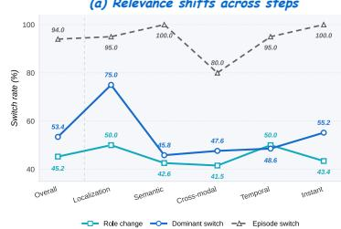

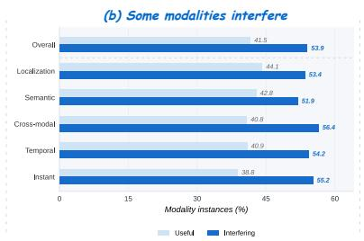

(c) Decisive evidence is sparse  
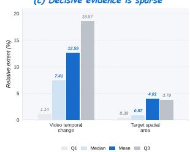  
Figure 1 Relevance is transient across steps and sparse within them. Across multi-step episodes, we systematically ablate individual modalities from the input of Qwen2.5-Omni and record the resulting change in the log-likelihood of the ground-truth action. A modality is useful if its ablation drops this likelihood, and interfering if its ablation increases it; the dominant modality is the one whose absence causes the steepest drop. (a) The dominant modality switches across 45.3% of adjacent steps, with 94.0% of episodes containing at least one switch. (b) 90.1% of steps contain at least one interfering modality. (c) Based on annotations, the target element occupies a median of a mere 0.87% of the screen area, and video content changes by a median of just 7.41% within a step.

## 1 Introduction

Graphical User Interface (GUI) agents are shifting from parsing static screenshots to acting on dynamic, streaming observations across multiple modalities (Henry et al., 2026; Jang et al., 2025; Yao et al., 2026). In realistic computing environments, the evidence needed for the next action need not be confined to the current visual frame. An unexpected notification chime might demand an immediate context switch, a specific transition in a live video can dictate when to click, and spoken instructions must be continuously mapped to visual changes on the screen (ByteDance Seed, 2026; Li et al., 2026; Yuan et al., 2026; Chen et al., 2025). Contemporary omni-modal models can ingest screenshots, video streams, audio, interaction history, and device states within a single network (Xu et al., 2025; Fu et al., 2025; Cui et al., 2026). This has naturally led to a default paradigm: exposing the complete multimodal observation to the model at every interaction step and leaving it to implicitly determine what matters while generating the action.

Leaving this selection entirely to the decoder assumes that it can reliably rediscover what matters from the complete observation at every interaction step. Our analysis reveals why this is difficult (Fig. 1). When individual modalities are removed during multi-step interaction, the dominant modality switches across nearly half of adjacent steps; even within a single step, only a small fraction of the observation may support the decision, while the rest can become distracting. Relevance is therefore fundamentally a property of the step, not a static property of the observation. Yet the decoder is forced to rediscover this relevance at every step, without any explicit signal of what has changed. In a closed-loop agent, such misreads do not end with the current prediction: the executed action changes the environment and feeds back into the observation and history of the next step, allowing errors to compound over time. We refer to this compounding failure as Sequential Distraction.

The most intuitive remedy is to perform subtraction on the inputs. This is exactly what existing methods attempt: cropping parts of the current screen to retain only candidate regions of interest (Lu et al., 2024; Luo et al., 2025; Liu et al., 2026b; Cheng et al., 2024). However, this strategy of giving less fundamentally misaligns with the nature of streaming interaction in two ways. First, the decisive signal could emerge from audio, video, or device status at any moment, channels entirely outside the scope of spatial cropping. Second, even when the signal resides on the screen, the crudely cropped background often contains the essential contextual evidence needed to ground accurate coordinates and text parameters. The problem is not that the decoder is given too much, but that it lacks guidance on how to prioritize it. A proper focus mechanism should change how the decoder reads the observation, rather than altering what it is given.

We realize this principle in FocusGUI (Fig. 2). Since the decoder can already read the full observation and what it lacks is a signal of what matters at the current step, FocusGUI leaves both the backbone and its input untouched and supplies that signal alongside them. At every step, it exposes the observation as separable perceptual channels, scores each against a reference derived from the current observation as a whole, and compresses the prioritized channels into a compact focus latent. The latent enters as a zero-initialized residual at the boundary where the decoder begins to generate the action. This residual reallocates attention over the entire observation without altering it, guiding both the choice of action and the grounding of its arguments. Training uses next-action supervision alone, with no labels indicating which modality matters.

On average across four omni-modal backbones, FocusGUI raises Type Match from 31.0% to 64.2% and Exact Match from 11.2% to 33.5% over the frozen backbone, and reaches 1.9× the Type Match of the strongest enhancement method. The gains grow with interaction depth, as Sequential Distraction predicts: from the first step to the fourth, the frozen Qwen2.5-Omni loses half of its Type Match while FocusGUI retains 86.8%. Our contributions are as follows:

• An empirical account of Sequential Distraction: in multi-step omni-modal GUI interaction, relevance is a step-level property, transient across steps and sparse within them, and because actions re-enter the observation, per-step misreads compound into trajectory drift.

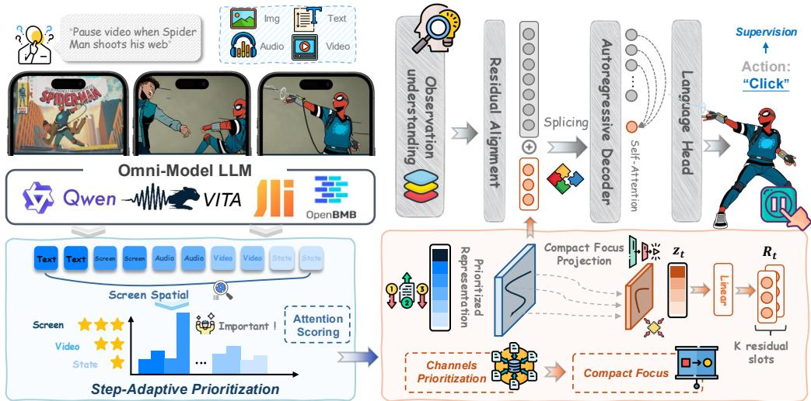  
Figure 2 FocusGUI. The frozen backbone’s original pathway is left intact (top). From the same observation, FocusGUI exposes perceptual channels, scores them against a decision reference recomputed at every step, compresses the result into a compact focus latent, and adds it as a zero-initialized residual at the K positions preceding the action boundary.

• A distinction between the evidence an agent is given and the way its decoder reads ${ \mathrm { i t } } ,$ showing why spatial refinement cannot satisfy both the selection of an action and the grounding of its arguments, and deriving from this the form a solution must take.

• FocusGUI, a zero-initialized residual adapter at the action boundary of a frozen backbone, trained from action supervision alone, whose gains across four backbones and five task categories are distributed as the account predicts.

## 2 Method

Problem Formulation and Context-Preserving Focus At the interaction step $t ,$ the agent receives an omni-modal observation $O _ { t } = \{ g , \bar { I } _ { t } , V _ { t } , A _ { t } , H _ { t } , S _ { t } \}$ , consisting of the user goal ${ \mathit { g } } ,$ current interface $I _ { t } ,$ temporal visual observation $V _ { t } ,$ acoustic observation $A _ { t } ,$ interaction history $H _ { t } ,$ and device state $S _ { t }$ . It predicts an executable action $y _ { t } = ( y _ { t , 1 } , \dots , y _ { t , L _ { t } } )$ , represented as a token sequence specifying both the action primitive and its arguments. Let $F _ { \Theta _ { 0 } }$ denote a pretrained omni-modal backbone whose parameters $\Theta _ { 0 }$ remain frozen, and let $E _ { t } \in \mathbb { R } ^ { N _ { t } \times d _ { \mathrm { m o d e l } } }$ denote the embedding sequence presented to its decoder. Section 1 committed to realizing focus in how the decoder reads rather than on what it is shown, and that commitment fixes the form of the mechanism. FocusGUI neither replaces nor prunes any part of $O _ { t }$ . From the same observation, it constructs a compact focus representation $z _ { t } \doteq f _ { \phi } ( O _ { t } )$ , maps it to a residual $R _ { t } = A _ { \phi } ( z _ { t } )$ , and adds that residual to a small set of existing embedding positions. The decoder therefore operates on

$$
\widetilde E _ { t } = E _ { t } + { \cal S } _ { J _ { t } } ( \gamma R _ { t } ) , \qquad p _ { \Theta _ { 0 } , \phi } ( y _ { t } \mid { \cal O } _ { t } ) = p _ { \Theta _ { 0 } } ( y _ { t } \mid \widetilde E _ { t } ) ,\tag{1}
$$

where $\boldsymbol { S } _ { J _ { t } } ( \cdot )$ places the residual at positions $J _ { t }$ and is zero elsewhere. This separates observation preservation from decision guidance. The original pathway retains the complete multimodal context, while the FocusGUI pathway learns how that context should be emphasized for the next action. Two properties of $z _ { t }$ follow from this division of labor. It is not required to reconstruct the observation or to encode any execution detail, since every pixel, coordinate, and transcript remains available to the decoder through the unmodified pathway. It can therefore be made small, because its role is to condition a read rather than to carry evidence. Appendix G shows that such a residual selects the primitive by changing what the decoder reads, but corrects arguments only by reallocating attention over evidence positions Eq. (1) leaves untouched.

Step-Adaptive Evidence Organization A priority cannot be defined inside a fused representation, so the observation must first be exposed as separable evidence. We write this as perceptual channels $X _ { t } = \{ x _ { t } ^ { ( m ) } \} _ { m \in \mathcal { M } } .$ where $\mathcal { M }$ indexes the sources’ FocusGUI scores, including the backbone’s integrated hidden state and a spatial screen channel alongside the individual modalities. Each channel is mapped into a shared d-dimensional space through a source-specific projector, $e _ { t } ^ { ( m ) } = P _ { m } ( x _ { t } ^ { ( m ) } ) \in \mathbb { R } ^ { d }$ . The separate projectors accommodate the native statistics of different sources while making their representations comparable. The usefulness of a channel, however, depends not only on what it contains but also on the surrounding task state. We therefore derive a decision reference $q _ { t } = P _ { q } ( e _ { t } ^ { ( \mathrm { a l l } ) } )$ from the integrated representation of the complete observation. Here, $e _ { t } ^ { ( \mathrm { a l l } ) }$ provides a joint semantic context: it summarizes the current observation against which source-specific evidence is evaluated. For each channel m, FocusGUI computes its compatibility with this joint context and normalizes the resulting scores into step-specific priorities:

$$
\begin{array} { r l } & { s _ { t } ^ { ( m ) } = v ^ { \top } \operatorname { t a n h } \Bigl ( W _ { e } ( e _ { t } ^ { ( m ) } + r _ { m } ) + W _ { q } q _ { t } \Bigr ) , } \\ & { \alpha _ { t } ^ { ( m ) } = \frac { \exp ( s _ { t } ^ { ( m ) } / \tau ) } { \sum _ { j \in \mathcal { M } } \exp ( s _ { t } ^ { ( j ) } / \tau ) } , \qquad c _ { t } = \displaystyle \sum _ { m \in \mathcal { M } } \alpha _ { t } ^ { ( m ) } e _ { t } ^ { ( m ) } , } \end{array}\tag{2}
$$

where $r _ { m }$ is a learned channel-identity embedding and τ is the softmax temperature. Because both the perceptual channels and the joint semantic context are recomputed at every interaction step, the relative emphasis among information sources can change as the task evolves. Nothing in Eq. (2) carries state across steps: drift is produced one step at a time, so removing the corruption at each step removes its accumulation. The priorities $\alpha _ { t } ^ { ( m ) }$ should be interpreted as how FocusGUI organizes evidence within its auxiliary pathway, rather than as a complete explanation of how the frozen backbone internally uses each modality.

Compact Focus and Residual Alignment The prioritized representation $c _ { t }$ determines how different evidence sources contribute to the auxiliary pathway, but still lies in the full shared channel space. We therefore compress it into a lower-dimensional focus representation: $\boldsymbol { z } _ { t } = \boldsymbol { P } _ { s } ( \boldsymbol { c } _ { t } ) \in \mathbb { R } ^ { d _ { z } } , \qquad d _ { z } < d .$ This projection constrains the capacity of the auxiliary conditioning signal, rather than the information accessible to the backbone. Because the complete observation remains available through the original multimodal pathway, $z _ { t }$ need not independently encode every visual detail, coordinate, or text argument required for execution. Instead, it provides a compact summary of what should receive greater emphasis for the current action. To make this focus representation directly usable by the frozen decoder, we align it with the decoder’s native embedding space at the action boundary. Let $b _ { t }$ denote the position at which action generation begins, and let $J _ { t } = \{ b _ { t } - K , \ldots , \bar { b _ { t } } - 1 \}$ denote the K preceding embedding positions. FocusGUI expands $z _ { t }$ into a residual over this window and adds it to the existing embeddings:

$$
R _ { t } = \mathrm { R e s h a p e } ( W _ { p } z _ { t } + b _ { p } ) \in \mathbb { R } ^ { K \times d _ { \mathrm { m o d e l } } } , \qquad \widetilde { E } _ { t , J _ { t } } = E _ { t , J _ { t } } + \gamma R _ { t } .\tag{3}
$$

Injecting the residual immediately before action generation makes the focus signal available to all subsequent action tokens without introducing a separate prediction head or modifying the output vocabulary. The additive form is equally important: it preserves the original embeddings and uses the focus representation only as an additional conditioning signal. We initialize $W _ { p }$ and $b _ { p }$ to zero, such that $R _ { t } = 0$ and $\widetilde { E } _ { t } = E _ { t }$ at the beginning of training. FocusGUI therefore starts from the original frozen-model input and gradually learns observation-conditioned deviations through optimization. Importantly, $\breve { J } _ { t }$ consists of existing prompt positions: FocusGUI neither appends textual hints nor removes any multimodal input.

Learning Focus from Action Supervision FocusGUI requires no annotation specifying which modality or perceptual channel should be emphasized. Instead, all components are learned jointly from supervision on the next executable action. Let $\phi$ denote the trainable

Table 1 Main results across omni-modal backbones and GUI task categories. FocusGUI rows are highlighted, and the best score in each column within each backbone block is bolded.
<table><tr><td rowspan=2 colspan=1>Methods</td><td rowspan=2 colspan=2>OverallTM↑EM↑GP↑</td><td rowspan=2 colspan=3>LocalizationTM↑EM↑GP↑</td><td rowspan=1 colspan=3>Semantic</td><td rowspan=1 colspan=3>Cross-modal</td><td rowspan=1 colspan=3>Temporal</td><td rowspan=1 colspan=3>Instant</td></tr><tr><td rowspan=1 colspan=3>TM↑EM↑GP↑</td><td rowspan=1 colspan=3>TM↑EM↑GP↑i</td><td rowspan=1 colspan=3>TM↑EM↑GP↑</td><td rowspan=1 colspan=3>TM↑EM↑GP↑</td></tr><tr><td rowspan=1 colspan=1>Qwen2.5-Omni</td><td rowspan=1 colspan=2>49.6112.605.50</td><td rowspan=1 colspan=3>57.3212.204.94</td><td rowspan=1 colspan=3>48.6517.126.75</td><td rowspan=1 colspan=3>42.209.173.17</td><td rowspan=1 colspan=3>45.9712.107.40</td><td rowspan=1 colspan=3>58.5412.205.07</td></tr><tr><td rowspan=1 colspan=1>+DRS-GUI</td><td rowspan=1 colspan=2>49.416.692.97</td><td rowspan=1 colspan=2>51.226.10</td><td rowspan=1 colspan=1>3.63</td><td rowspan=1 colspan=1>50.45</td><td rowspan=1 colspan=1>5.41</td><td rowspan=1 colspan=1>1.234</td><td rowspan=1 colspan=1>5.87</td><td rowspan=1 colspan=1>5.50</td><td rowspan=1 colspan=1>2.794</td><td rowspan=1 colspan=3>9.199.684.955</td><td rowspan=1 colspan=1>1.22</td><td rowspan=1 colspan=2>6.101.87</td></tr><tr><td rowspan=1 colspan=1>+OmniParser</td><td rowspan=1 colspan=2>48.437.683.87</td><td rowspan=1 colspan=2>51.227.32</td><td rowspan=1 colspan=1>4.51</td><td rowspan=1 colspan=1>49.55</td><td rowspan=1 colspan=1>7.21</td><td rowspan=1 colspan=1>1.87</td><td rowspan=1 colspan=1>44.95</td><td rowspan=1 colspan=1>5.50</td><td rowspan=1 colspan=1>2.414</td><td rowspan=1 colspan=3>6.7710.485.835</td><td rowspan=1 colspan=1>1.22</td><td rowspan=1 colspan=1>7.32</td><td rowspan=1 colspan=1>4.48</td></tr><tr><td rowspan=1 colspan=1>+RegionFocus</td><td rowspan=1 colspan=2>48.237.684.07</td><td rowspan=1 colspan=3>52.444.883.82</td><td rowspan=1 colspan=1>49.55</td><td rowspan=1 colspan=1>7.21</td><td rowspan=1 colspan=1>2.65</td><td rowspan=1 colspan=1>44.04</td><td rowspan=1 colspan=1>6.42</td><td rowspan=1 colspan=1>3.46</td><td rowspan=1 colspan=3>46.7711.295.215</td><td rowspan=1 colspan=1>0.00</td><td rowspan=1 colspan=1>7.32</td><td rowspan=1 colspan=1>5.13</td></tr><tr><td rowspan=1 colspan=1>+GUI-Actor</td><td rowspan=1 colspan=2>50.2013.785.54</td><td rowspan=1 colspan=3>58.5413.415.183</td><td rowspan=1 colspan=1>47.75</td><td rowspan=1 colspan=1>18.02</td><td rowspan=1 colspan=1>6.36</td><td rowspan=1 colspan=1>43.12</td><td rowspan=1 colspan=1>10.09</td><td rowspan=1 colspan=1>3.63 |</td><td rowspan=1 colspan=3>46.7712.907.08</td><td rowspan=1 colspan=2>59.7614.63</td><td rowspan=1 colspan=1>5.47</td></tr><tr><td rowspan=1 colspan=1>+FocusGUI</td><td rowspan=1 colspan=2>71.6540.1617.49</td><td rowspan=1 colspan=3>78.0545.1230.06</td><td rowspan=1 colspan=3>68.4739.6414.24</td><td rowspan=1 colspan=2>67.8933.03</td><td rowspan=1 colspan=1>7.47</td><td rowspan=1 colspan=3>76.6146.7726.35</td><td rowspan=1 colspan=2>67.0735.37</td><td rowspan=1 colspan=1>7.97</td></tr><tr><td rowspan=1 colspan=1>VITA-1.5</td><td rowspan=1 colspan=2>13.989.656.09</td><td rowspan=1 colspan=2>12.207.32</td><td rowspan=1 colspan=1>7.04 +</td><td rowspan=1 colspan=1>19.82</td><td rowspan=1 colspan=1>13.51</td><td rowspan=1 colspan=1>6.5991</td><td rowspan=1 colspan=1>1.01</td><td rowspan=1 colspan=1>6.42</td><td rowspan=1 colspan=1>2.691</td><td rowspan=1 colspan=3>2.909.688.85 +</td><td rowspan=1 colspan=3>13.4110.985.07</td></tr><tr><td rowspan=1 colspan=1>+DRS-GUI</td><td rowspan=1 colspan=1>10.436.30</td><td rowspan=1 colspan=1>3.14</td><td rowspan=1 colspan=1>8.54</td><td rowspan=1 colspan=1>3.66</td><td rowspan=1 colspan=1>1.26</td><td rowspan=1 colspan=1>9.01</td><td rowspan=1 colspan=1>6.31</td><td rowspan=1 colspan=1>3.05</td><td rowspan=1 colspan=1>10.09</td><td rowspan=1 colspan=1>3.67</td><td rowspan=1 colspan=1>1.76</td><td rowspan=1 colspan=1>12.90</td><td rowspan=1 colspan=1>10.48</td><td rowspan=1 colspan=1>5.58</td><td rowspan=1 colspan=1>10.98</td><td rowspan=1 colspan=1>6.10</td><td rowspan=1 colspan=1>3.89</td></tr><tr><td rowspan=1 colspan=1>+OmniParser</td><td rowspan=1 colspan=1>17.137.48</td><td rowspan=1 colspan=1>3.82</td><td rowspan=1 colspan=1>18.29</td><td rowspan=1 colspan=1>3.66</td><td rowspan=1 colspan=1>1.261</td><td rowspan=1 colspan=1>7.12</td><td rowspan=1 colspan=1>7.21</td><td rowspan=1 colspan=1>3.771</td><td rowspan=1 colspan=1>4.68</td><td rowspan=1 colspan=1>4.59</td><td rowspan=1 colspan=1>2.931</td><td rowspan=1 colspan=1>7.74</td><td rowspan=1 colspan=1>12.10</td><td rowspan=1 colspan=1>6.401</td><td rowspan=1 colspan=1>8.29</td><td rowspan=1 colspan=1>8.54</td><td rowspan=1 colspan=1>4.59</td></tr><tr><td rowspan=1 colspan=1>+RegionFocus</td><td rowspan=1 colspan=1>12.207.68</td><td rowspan=1 colspan=1>3.69</td><td rowspan=1 colspan=1>9.76</td><td rowspan=1 colspan=1>4.88</td><td rowspan=1 colspan=1>1.441</td><td rowspan=1 colspan=1>0.81</td><td rowspan=1 colspan=1>7.21</td><td rowspan=1 colspan=1>3.631</td><td rowspan=1 colspan=1>0.09</td><td rowspan=1 colspan=1>4.59</td><td rowspan=1 colspan=1>2.75</td><td rowspan=1 colspan=1>15.32</td><td rowspan=1 colspan=1>12.10</td><td rowspan=1 colspan=1>5.771</td><td rowspan=1 colspan=1>4.63</td><td rowspan=1 colspan=1>8.54</td><td rowspan=1 colspan=1>4.78</td></tr><tr><td rowspan=1 colspan=1>+GUI-Actor</td><td rowspan=1 colspan=2>14.5711.025.39</td><td rowspan=1 colspan=1>17.07</td><td rowspan=1 colspan=1>9.76</td><td rowspan=1 colspan=1>1.23</td><td rowspan=1 colspan=1>22.52</td><td rowspan=1 colspan=1>18.02</td><td rowspan=1 colspan=1>11.14</td><td rowspan=1 colspan=1>9.17</td><td rowspan=1 colspan=1>6.42</td><td rowspan=1 colspan=1>3.82</td><td rowspan=1 colspan=1>12.90</td><td rowspan=1 colspan=1>11.29</td><td rowspan=1 colspan=1>5.94</td><td rowspan=1 colspan=1>10.98</td><td rowspan=1 colspan=1>8.54</td><td rowspan=1 colspan=1>4.35</td></tr><tr><td rowspan=1 colspan=1>+FocusGUI</td><td rowspan=1 colspan=2>58.6626.386.84</td><td rowspan=1 colspan=1>56.10</td><td rowspan=1 colspan=1>18.29</td><td rowspan=1 colspan=1>6.79</td><td rowspan=1 colspan=1>54.05</td><td rowspan=1 colspan=1>28.83</td><td rowspan=1 colspan=1>8.76</td><td rowspan=1 colspan=1>155.96</td><td rowspan=1 colspan=1>24.77</td><td rowspan=1 colspan=1>3.71 |</td><td rowspan=1 colspan=1>64.52</td><td rowspan=1 colspan=1>30.65</td><td rowspan=1 colspan=1>9.691</td><td rowspan=1 colspan=1>62.20</td><td rowspan=1 colspan=1>26.83</td><td rowspan=1 colspan=1>4.71</td></tr><tr><td rowspan=1 colspan=1>MiniCPM-o-4.5</td><td rowspan=1 colspan=1>36.0213.58</td><td rowspan=1 colspan=1>7.55</td><td rowspan=1 colspan=1>35.37</td><td rowspan=1 colspan=1>13.41</td><td rowspan=1 colspan=1>9.97</td><td rowspan=1 colspan=1>35.14</td><td rowspan=1 colspan=1>9.91</td><td rowspan=1 colspan=1>5.15</td><td rowspan=1 colspan=1>35.78</td><td rowspan=1 colspan=1>15.60</td><td rowspan=1 colspan=1>3.98</td><td rowspan=1 colspan=1>34.68</td><td rowspan=1 colspan=1>12.90</td><td rowspan=1 colspan=1>11.04</td><td rowspan=1 colspan=1>40.24</td><td rowspan=1 colspan=1>17.07</td><td rowspan=1 colspan=1>7.68</td></tr><tr><td rowspan=1 colspan=1>+DRS-GUI</td><td rowspan=1 colspan=1>36.4212.60</td><td rowspan=1 colspan=1>5.47</td><td rowspan=1 colspan=1>37.80</td><td rowspan=1 colspan=1>10.98</td><td rowspan=1 colspan=1>3.403</td><td rowspan=1 colspan=1>6.941</td><td rowspan=1 colspan=1>4.41</td><td rowspan=1 colspan=1>5.243</td><td rowspan=1 colspan=1>1.19</td><td rowspan=1 colspan=1>8.26</td><td rowspan=1 colspan=1>4.41</td><td rowspan=1 colspan=1>37.90</td><td rowspan=1 colspan=1>16.94</td><td rowspan=1 colspan=1>8.623</td><td rowspan=1 colspan=1>9.02</td><td rowspan=1 colspan=1>10.98</td><td rowspan=1 colspan=1>5.37</td></tr><tr><td rowspan=1 colspan=1>+OmniParser</td><td rowspan=1 colspan=1>37.2012.40</td><td rowspan=1 colspan=1>6.43</td><td rowspan=1 colspan=1>41.46</td><td rowspan=1 colspan=1>9.76</td><td rowspan=1 colspan=1>4.84</td><td rowspan=1 colspan=1>36.041</td><td rowspan=1 colspan=1>2.61</td><td rowspan=1 colspan=1>5.843</td><td rowspan=1 colspan=1>0.28</td><td rowspan=1 colspan=1>8.26</td><td rowspan=1 colspan=1>5.02</td><td rowspan=1 colspan=1>238.711</td><td rowspan=1 colspan=1>6.94</td><td rowspan=1 colspan=1>9.264</td><td rowspan=1 colspan=1>1.461</td><td rowspan=1 colspan=1>3.41</td><td rowspan=1 colspan=1>6.96</td></tr><tr><td rowspan=1 colspan=1>+RegionFocus</td><td rowspan=1 colspan=1>37.0113.19</td><td rowspan=1 colspan=1>6.69</td><td rowspan=1 colspan=1>40.24</td><td rowspan=1 colspan=1>10.98</td><td rowspan=1 colspan=1>5.623</td><td rowspan=1 colspan=1>6.94</td><td rowspan=1 colspan=1>15.32</td><td rowspan=1 colspan=1>7.273</td><td rowspan=1 colspan=1>0.28</td><td rowspan=1 colspan=1>9.17</td><td rowspan=1 colspan=1>5.323</td><td rowspan=1 colspan=1>9.52</td><td rowspan=1 colspan=1>17.74</td><td rowspan=1 colspan=1>9.323</td><td rowspan=1 colspan=1>9.02</td><td rowspan=1 colspan=1>10.98</td><td rowspan=1 colspan=1>5.57</td></tr><tr><td rowspan=1 colspan=1>+GUI-Actor</td><td rowspan=1 colspan=2>36.6114.177.64</td><td rowspan=1 colspan=1>36.59</td><td rowspan=1 colspan=1>14.63</td><td rowspan=1 colspan=1>9.473</td><td rowspan=1 colspan=1>4.23</td><td rowspan=1 colspan=1>10.81</td><td rowspan=1 colspan=1>5.633</td><td rowspan=1 colspan=1>6.70</td><td rowspan=1 colspan=1>16.51</td><td rowspan=1 colspan=1>4.23</td><td rowspan=1 colspan=1>35.48</td><td rowspan=1 colspan=1>12.10</td><td rowspan=1 colspan=1>10.844</td><td rowspan=1 colspan=1>1.46</td><td rowspan=1 colspan=1>18.29</td><td rowspan=1 colspan=1>8.03</td></tr><tr><td rowspan=1 colspan=1>+FocusGUI</td><td rowspan=1 colspan=2>67.7241.5416.76</td><td rowspan=1 colspan=1>81.71</td><td rowspan=1 colspan=1>47.56</td><td rowspan=1 colspan=1>21.73</td><td rowspan=1 colspan=1>68.47</td><td rowspan=1 colspan=1>45.05</td><td rowspan=1 colspan=1>19.94</td><td rowspan=1 colspan=1>60.55</td><td rowspan=1 colspan=1>34.86</td><td rowspan=1 colspan=1>9.15</td><td rowspan=1 colspan=1>67.74</td><td rowspan=1 colspan=1>41.13</td><td rowspan=1 colspan=1>18.68</td><td rowspan=1 colspan=1>62.20</td><td rowspan=1 colspan=1>40.24</td><td rowspan=1 colspan=1>14.49</td></tr><tr><td rowspan=1 colspan=1>Baichuan-Omni-1.5</td><td rowspan=1 colspan=2>24.418.864.32</td><td rowspan=1 colspan=1>26.83</td><td rowspan=1 colspan=1>4.88</td><td rowspan=1 colspan=1>0.00</td><td rowspan=1 colspan=1>16.22</td><td rowspan=1 colspan=1>8.11</td><td rowspan=1 colspan=1>1.7222</td><td rowspan=1 colspan=1>2.02</td><td rowspan=1 colspan=1>11.93</td><td rowspan=1 colspan=1>6.77 |</td><td rowspan=1 colspan=1>28.23</td><td rowspan=1 colspan=1>10.48</td><td rowspan=1 colspan=1>7.66</td><td rowspan=1 colspan=1>30.49</td><td rowspan=1 colspan=1>7.32</td><td rowspan=1 colspan=1>4.71</td></tr><tr><td rowspan=1 colspan=1>+DRS-GUI</td><td rowspan=1 colspan=1>27.765.12</td><td rowspan=1 colspan=1>2.26</td><td rowspan=1 colspan=1>32.93</td><td rowspan=1 colspan=1>3.66</td><td rowspan=1 colspan=1>2.76</td><td rowspan=1 colspan=1>26.13</td><td rowspan=1 colspan=1>5.41</td><td rowspan=1 colspan=1>2.08</td><td rowspan=1 colspan=1>21.10</td><td rowspan=1 colspan=1>2.75</td><td rowspan=1 colspan=1>1.19</td><td rowspan=1 colspan=1>29.03</td><td rowspan=1 colspan=1>8.06</td><td rowspan=1 colspan=1>2.89</td><td rowspan=1 colspan=1>31.71</td><td rowspan=1 colspan=1>4.88</td><td rowspan=1 colspan=1>2.29</td></tr><tr><td rowspan=1 colspan=1>+OmniParser</td><td rowspan=1 colspan=1>32.096.10</td><td rowspan=1 colspan=1>2.21</td><td rowspan=1 colspan=1>37.80</td><td rowspan=1 colspan=1>4.88</td><td rowspan=1 colspan=1>3.0113</td><td rowspan=1 colspan=1>1.53</td><td rowspan=1 colspan=1>6.31</td><td rowspan=1 colspan=1>0.78</td><td rowspan=1 colspan=1>26.61</td><td rowspan=1 colspan=1>5.50</td><td rowspan=1 colspan=1>1.823</td><td rowspan=1 colspan=1>0.65</td><td rowspan=1 colspan=1>8.06</td><td rowspan=1 colspan=1>3.263</td><td rowspan=1 colspan=1>6.59</td><td rowspan=1 colspan=1>4.88</td><td rowspan=1 colspan=1>1.96</td></tr><tr><td rowspan=1 colspan=1>+RegionFocus</td><td rowspan=1 colspan=2>24.615.512.47</td><td rowspan=1 colspan=1>28.05</td><td rowspan=1 colspan=1>3.66</td><td rowspan=1 colspan=1>2.412</td><td rowspan=1 colspan=1>2.52</td><td rowspan=1 colspan=1>5.41</td><td rowspan=1 colspan=1>1.571</td><td rowspan=1 colspan=1>9.27</td><td rowspan=1 colspan=1>3.67</td><td rowspan=1 colspan=1>0.87</td><td rowspan=1 colspan=1>725.81</td><td rowspan=1 colspan=1>8.06</td><td rowspan=1 colspan=1>4.452</td><td rowspan=1 colspan=1>9.27</td><td rowspan=1 colspan=1>6.10</td><td rowspan=1 colspan=1>2.84</td></tr><tr><td rowspan=1 colspan=1>+GUI-Actor</td><td rowspan=1 colspan=2>31.1011.025.35</td><td rowspan=1 colspan=1>34.15</td><td rowspan=1 colspan=1>8.54</td><td rowspan=1 colspan=1>2.91</td><td rowspan=1 colspan=1>24.32</td><td rowspan=1 colspan=1>10.81</td><td rowspan=1 colspan=1>3.112</td><td rowspan=1 colspan=1>8.44</td><td rowspan=1 colspan=2>12.846.92</td><td rowspan=1 colspan=1>33.06</td><td rowspan=1 colspan=1>12.10</td><td rowspan=1 colspan=1>8.57</td><td rowspan=1 colspan=1>37.80</td><td rowspan=1 colspan=1>9.76</td><td rowspan=1 colspan=1>5.24</td></tr><tr><td rowspan=1 colspan=1>+FocusGUI</td><td rowspan=1 colspan=2>58.8625.988.73</td><td rowspan=1 colspan=3>56.1018.293.70</td><td rowspan=1 colspan=3>58.5633.3315.275</td><td rowspan=1 colspan=1>5.05</td><td rowspan=1 colspan=2>21.104.096</td><td rowspan=1 colspan=2>2.1031.45</td><td rowspan=1 colspan=1>15.21</td><td rowspan=1 colspan=3>62.2021.953.62</td></tr></table>

parameters of the channel projectors, step-adaptive prioritization, compact projection, and residual alignment modules. We optimize the average action-token negative log-likelihood

$$
\mathcal { L } _ { \mathrm { a c t } } ( \phi ) = - \frac { 1 } { | \mathcal { D } _ { \mathrm { t r } } | } \sum _ { t \in \mathcal { D } _ { \mathrm { t r } } } \frac { 1 } { L _ { t } } \sum _ { k = 1 } ^ { L _ { t } } \log p _ { \Theta _ { 0 } , \phi } \left( y _ { t , k } \mid y _ { t , < k } , O _ { t } \right) .\tag{4}
$$

The loss is evaluated only on action tokens. Gradients propagate through the frozen decoder to $\phi ,$ while the omni-modal backbone, decoder, and language-model head receive no parameter updates. Thus, a single action-generation objective jointly learns which evidence to emphasize, how to summarize ${ \bf \bar { \Phi } } _  i t , \}$ and how to express that summary in the decoder’s native representation space. At inference time, FocusGUI constructs the perceptual channels from the current observation, evaluates them under the current joint semantic context, forms the compact focus representation, and generates the corresponding residual. The frozen decoder then autoregressively produces the next executable action through its original generation pathway.

## 3 Experiments

## 3.1 Experimental Setup

Dataset and Metrics. We evaluate on OmniGUI (Henry et al., 2026), a benchmark of omni-modal smartphone GUI interactions across 29 applications; we use 708 episodes with 2,572 action steps. Each step pairs a screenshot with synchronous audio, video, and action history, so the decisive signal can come from any of the four streams. We report Type Match (TM), Exact Match (EM), and Goal Progress (GP). TM checks whether the predicted action primitive matches the ground truth; EM further requires predicted coordinates to fall within the target element’s bounding box and generated text to match the reference. GP is the fraction of correctly executed steps per episode, averaged across episodes.

Models. We evaluate four representative open-source omni-modal backbones: Qwen2.5- Omni (Xu et al., 2025), VITA-1.5 (Fu et al., 2025), MiniCPM-o 4.5 (Cui et al., 2026), and Baichuan-Omni-1.5 (Li et al., 2025b). The four backbones support textual, visual, auditory, and temporal inputs but differ in architecture and multimodal representation, which lets the comparison probe the generality of FocusGUI across backbone families. For each backbone, the base model stays frozen, and training updates only the lightweight FocusGUI head and action predictors, using the same episode-disjoint split across all four models.

Baselines. We compare against four methods, each applied to all four backbones without modifying their weights. DRS-GUI (Liu et al., 2026b), OmniParser (Lu et al., 2024), and RegionFocus (Luo et al., 2025) refine the visual input at inference by searching over candidate regions, parsing the screenshot into structured elements, and zooming into attended regions. GUI-Actor (Wu et al., 2025a) instead learns an action head over the backbone’s visual tokens, trained on the same annotations and split as FocusGUI with the backbone frozen. All methods receive the same observation and decoding procedure, differing only in how that observation is organized before the action is generated. The trained head separates two explanations for any gain: trainable parameters on this data, which GUI-Actor also has, and step-adaptive organization, which FocusGUI adds.

Implementation Details. Evidence channels are projected into a shared 128-dimensional space and weighted by the full-modal query with softmax temperature $\tau \ = \ 1 . 0 ;$ the weighted representation is compressed to a 64-dimensional action-sufficient embedding and expanded into K = 4 zero-initialized residual tokens added to the last four prompt embeddings before the action boundary, introducing 1.15M–1.45M trainable parameters depending on the backbone. With the encoder, decoder, and LM head frozen, we train only these modules for three epochs with AdamW under the teacher-forced action-token negative log-likelihood, selecting the learning rate $2 \times 1 0 ^ { - 4 }$ and weight decay $1 0 ^ { - 3 }$ . At inference, the frozen decoder generates actions autoregressively with greedy decoding. Additional implementation details are provided in the Appendix D.

## 3.2 Main Results

Consistent gains across backbones. Table 1 evaluates four omni-modal backbones under identical frozen weights. Averaged across them, FocusGUI adds 33.2 TM, 22.3 EM, and 6.6 GP points over direct inference and 30.1, 23.6, and 8.0 points over the strongest baseline at each backbone. It holds the best TM and the best EM in all 24 backbone-category cells.

Why screen refinement backfires. The baselines fail in a way that is diagnostic rather than incidental. DRS-GUI, OmniParser, and RegionFocus are near-neutral on TM (+0.9 points on average) yet lower EM by 28% and GP by 35% in relative terms, in 12 of 12 cases for each metric. Narrowing a screenshot makes the action primitive more salient, which is what TM rewards, while discarding the surrounding context that fixes coordinates and text, which is what EM requires. None of the three reaches audio, video, or device state, so a decision resting on those channels stays unrecoverable however the screen is processed. This is what our framing predicts: once relevance is a property of a step rather than of a region, refining the region cannot restore it and may cost more than it returns.

Where the gains come from. The structure of the gains indicates what the representation supplies. Per-category TM gains run from 37.3 points on Temporal, where the decisive signal persists across frames and a single screenshot serves worst, to 27.8 on Instant, where the decision is reactive and largely present on the current screen; EM follows the same order. Across backbones, the overall TM spread narrows from 35.6 points to 13.0, indicating that choosing the correct primitive becomes substantially less backbone-dependent under a better-organized observation. EM variation instead reflects backbone-specific argumentgeneration capacity. At episode level, improvements in per-step prediction translate into Goal Progress when they are sustained across the trajectory. Episode progress is gated by the weakest step in a trajectory.

Table 2 Component ablation on Qwen2.5-Omni. CD: channel decomposition. SP: step-adaptive prioritization. AP: action-sufficient projection. RA: residual alignment. Each task category reports Type Match (TM), Exact Match (EM), and Goal Progress (GP).
<table><tr><td colspan="5">Components</td><td colspan="3">Overall</td><td colspan="2">Localization</td><td colspan="2"></td><td colspan="2">Semantic</td><td colspan="2">Cross-modal</td><td colspan="2"></td><td colspan="2">Temporal</td><td colspan="2"></td><td colspan="2">Instant</td></tr><tr><td>CD</td><td>SP</td><td>AP</td><td>RA</td><td></td><td>TM↑ EM↑</td><td></td><td>GP↑ TM↑</td><td>EM↑</td><td>GP↑</td><td>TM↑</td><td></td><td>EM↑</td><td>GP↑</td><td>TM↑</td><td>EM↑</td><td>GP↑</td><td>TM↑</td><td>EM↑</td><td>GP↑</td><td>TM↑</td><td>EM↑</td><td>GP↑</td></tr><tr><td>X</td><td>X</td><td></td><td>x</td><td>X</td><td>49.61</td><td>12.60</td><td>5.50</td><td>57.32 12.20</td><td>4.94</td><td>48.65</td><td></td><td>17.12</td><td>6.75</td><td>42.20</td><td>9.17</td><td>3.17</td><td>745.97</td><td>12.10</td><td>7.40</td><td>58.54</td><td>12.20</td><td>5.07</td></tr><tr><td>X</td><td>X</td><td></td><td></td><td></td><td>66.26</td><td>35.00</td><td>12.20</td><td>68.49 40.56</td><td>14.55</td><td>66.67</td><td>33.64</td><td>11.28</td><td>60.55</td><td></td><td>30.86</td><td>6.58</td><td>72.58</td><td>38.58</td><td>20.0060.29</td><td></td><td>31.46</td><td>7.13</td></tr><tr><td>√</td><td>x</td><td>J</td><td></td><td>J</td><td>67.38</td><td>37.78</td><td>11.56</td><td>71.95 42.68</td><td>16.82</td><td>64.86</td><td>37.84</td><td></td><td>9.65</td><td>64.22</td><td>32.04</td><td>6.35</td><td>74.42</td><td>45.97</td><td>18.02</td><td>59.76</td><td>28.05</td><td>5.80</td></tr><tr><td></td><td></td><td>X</td><td></td><td>J</td><td>71.14</td><td>38.75</td><td>16.11</td><td>78.05 42.68</td><td></td><td>25.4366.67</td><td></td><td>37.84</td><td>13.84 67.72</td><td></td><td>32.70</td><td></td><td>6.5478.23</td><td>47.58</td><td></td><td>27.5065.03</td><td>32.93</td><td>7.25</td></tr><tr><td></td><td>1</td><td>L</td><td>X</td><td></td><td>70.45 34.86</td><td></td><td>12.11</td><td>74.15 41.34</td><td></td><td>28.0967.57</td><td>33.33</td><td></td><td>13.43  67.56</td><td></td><td>32.04</td><td></td><td>5.05 79.84</td><td>39.52</td><td></td><td>10.7363.11</td><td>28.05</td><td>3.26</td></tr><tr><td></td><td></td><td></td><td></td><td></td><td>71.65</td><td>40.16</td><td>17.49</td><td>78.05 45.12</td><td></td><td>30.0668.47</td><td>39.64</td><td></td><td>14.2467.89</td><td></td><td>33.03</td><td>7.47</td><td>76.61</td><td>46.77</td><td></td><td>26.3567.07</td><td>35.37</td><td>7.97</td></tr></table>

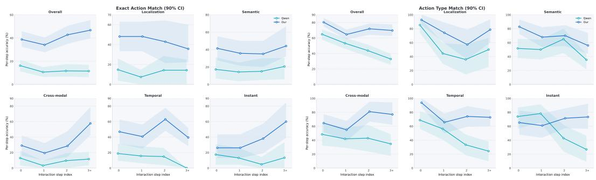  
Figure 3 FocusGUI holds accuracy as trajectories lengthen. Per-step Exact Match (left) and Type Match (right) on Qwen2.5-Omni, with steps binned by their index within the episode and 3+ collecting the fourth step onward. Shaded regions are 90% episode-clustered bootstrap intervals.

## 3.3 Ablation Study

All four components contribute, mostly to Goal Progress. Table 2 removes each component from the full model. Overall Type Match falls by 0.51, 1.20, 4.27, and 5.39 points when action-sufficient projection, residual alignment, step-adaptive prioritization, and channel decomposition are removed, but GP falls by 1.38, 5.38, 5.93, and 5.29 points on a base roughly a quarter as large. In relative terms, every component is worth four to five times more to episode progress than to single-step action type: at most 7.5% of TM against up to 33.9% of GP. Their disproportionately larger effect on GP shows that the components primarily keep a trajectory from unravelling, which is what Sequential Distraction predicts.

GP reveals contributions beyond TM. Decomposing the observation into channels without prioritizing them raises Type Match by 1.12 and Exact Match by 2.78 points over a single integrated channel. Prioritization converts this richer channel access into episode-level stability by deciding which channel to trust. Residual alignment shows the same metric asymmetry more sharply: replacing the additive residual with prompt-embedding substitution reduces EM by 5.30 and GP by 5.38 points, compared with a 1.20-point TM change. Preserving the original prompt embeddings therefore matters most for grounding the selected action primitive into correct arguments.

## 3.4 Performance Across Interaction Depth

Sequential Distraction predicts that interference accumulates. A method that suppresses it should separate from the backbone as a trajectory lengthens, whereas a uniformly stronger predictor would hold a constant margin. We bin every evaluation step by its index within the episode and report per-step accuracy with 90% episode-clustered bootstrap intervals (Fig. 3).

Qwen2.5-Omni falls from 64.79 TM at the first step to 32.79 beyond the third, retaining half of its initial accuracy. FocusGUI retains 86.8% over the same range, and its exact-match accuracy rises rather than falls, from 38.73 to 46.72. The margin therefore widens with depth: EM gains increase monotonically from +22.54 to +35.25, and all intervals exclude zero.

This locates the episode-level improvement of Table 1: Goal Progress does not rise evenly along a trajectory but comes predominantly from steps the frozen backbone has already lost. The effect is sharpest under temporal reasoning, where the backbone scores 0.00 EM beyond the third step and FocusGUI reaches 39.39.

Instant-response tasks provide a negative control. At the first two steps, where these reactive tasks carry little accumulated history, FocusGUI is statistically indistinguishable from the backbone (-8.70 and -17.39 TM; both 90% intervals include zero). At depths 2 and $^ { 3 + , }$ once interaction history can accumulate, FocusGUI gains +28.57 and +46.67 TM. This depthdependent separation is the behavior expected of a mechanism targeting accumulation, rather than a uniformly stronger predictor. Restricting the analysis to episodes with at least four steps holds the episode set constant across bins, and the widening margin persists.

Learned priorities reorder across an episode. Figure 4 averages $\alpha _ { t } ^ { ( m ) }$ over test steps grouped by interaction phase. Interaction state receives 30.9% of the priority mass at the opening step, more than twice a uniform share, and falls to 7.7% by the closing phase, moving from the highest-priority channel to the lowest; audio and video move the other way, rising from 13.4% and 11.3% to 18.8% and 18.3%. No fixed weighting reproduces both ends of that range; only a representation that reweights its inputs as the decision changes can, which is exactly the step-adaptive behavior Focused Perception requires. The screen is never domi-

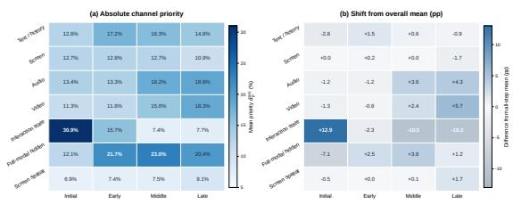  
Figure 4 Learned channel priorities reorder across interaction phases. (a) Mean priority $\bar { \alpha } ^ { ( m ) }$ per channel and phase on Qwen2.5-Omni; uniform allocation would be 14.3%. (b) Deviation of each cell from that channel’s all-step mean. FocusGUI trains on action annotations alone, with no modalityrelevance supervision.

nant: it stays between 10.9% and 12.8%, below uniform at every phase, and the spatial screen channel never exceeds 9.1%. Prior work refines exactly these two channels, while the channels that gain priority late are the streaming ones it cannot reach. None of this is supervised: the ordering is recovered from action annotations alone, and Fig. 5 traces the same shift within a single episode.

Capacity sensitivity. Table 3 varies each capacity parameter while holding the other at its default. Across a sixteenfold range of K, Overall TM spans 2.6 points, EM 2.4, and GP 3.0, with no trend in any of them. This matches the role $\check { K }$ plays in the design: $R _ { t }$ is a deterministic function of $z _ { t } ,$ so a wider boundary window redistributes the same compressed representation over more positions without admitting more of the observation. Capacity is set by $d _ { z }$ instead, and the sweep locates where it binds. At $d _ { z } ~ \stackrel { } { = } ~ 3 2$ the latent is too small to carry the ac-

Table 3 Sensitivity to the boundary window K and the compact focus dimension $d _ { z }$ on Qwen2.5-Omni. The default $( K \bar { = } 4 , d _ { z } = 6 4$ , shaded) is fixed across all backbones and never tuned per benchmark.
<table><tr><td colspan="4">Overall TM Overall EM Overall GP Temporal GP</td></tr><tr><td colspan="4">Boundary window K  $( d _ { z } = 6 4 )$ </td></tr><tr><td>K = 1 72.83</td><td>39.76</td><td>15.13</td><td>17.66</td></tr><tr><td>K = 4 71.65</td><td>40.16</td><td>17.49</td><td>26.35</td></tr><tr><td>K = 8 70.28</td><td>37.80</td><td>15.72</td><td>16.04</td></tr><tr><td>K = 16 71.65</td><td>39.76</td><td>18.09</td><td>25.10</td></tr><tr><td colspan="4">Action-sufficient dimension  $d _ { z } ( K = 4 )$ </td></tr><tr><td> $d _ { z } = 3 2$  70.47</td><td>33.27</td><td>10.95</td><td>12.45</td></tr><tr><td>dz = 64</td><td>71.65 40.16</td><td>17.49</td><td>26.35</td></tr><tr><td>dz = 128 72.83</td><td>37.99</td><td>15.05</td><td>15.73</td></tr><tr><td> $d _ { z } = 2 5 6$  71.23</td><td>38.19</td><td>18.28</td><td>15.83</td></tr></table>

tion, costing 6.9 EM points and 6.5 GP points against the default. From 64 upward the method is stable, with Overall TM spanning 1.6 points and Exact Match highest at the default. FocusGUI requires no per-backbone or per-benchmark search over either parameter, and we fix $K = 4$ and $d _ { z } = 6 \bar { 4 }$ throughout. For more comprehensive evaluation results, including performance across interaction depths on other backbones and capacity sensitivity analyses, please refer to the Appendix C.

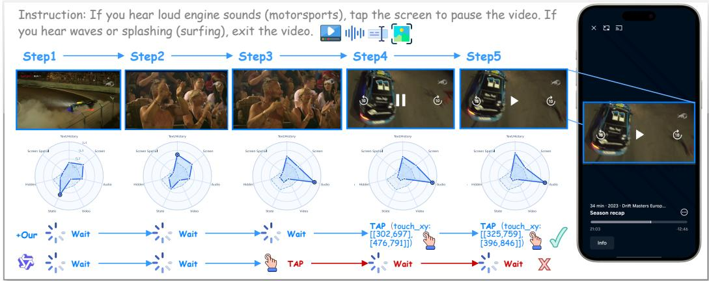  
Figure 5 Case study: a decision that never appears on the screen. The instruction conditions the action on what is heard, so the screen looks the same at every step while the deciding evidence sits in audio. FocusGUI waits and taps once the engine sounds arrive; the frozen backbone acts early on visual salience and cannot recover, since its own action re-enters the context of every later step. Radar plots show the channel priorities $\alpha _ { t } ^ { ( m ) }$ per step.

## 4 Related Work

## 4.1 GUI Agents in Omni-Modal Environments

GUI agents interact with digital environments by repeatedly translating user intentions and interface observations into executable actions. Research across mobile, web, and desktop platforms has established this perception–action loop and progressively extended it from isolated grounding decisions to long-horizon interaction (Rawles et al., 2023; Deng et al., 2023; Xie et al., 2024; Cheng et al., 2024; Hong et al., 2024; Zhang et al., 2025; Chen et al., 2026b). Most agents nevertheless organize their observation around the current screenshot, with previous actions or screens retained as auxiliary context. Temporal GUI benchmarks broaden this view by requiring agents to understand dynamic visual content (Jang et al., 2025; Zhang et al., 2026b; Chen et al., 2025), while OmniGUI further places each action within an interleaved observation of screen, video, audio, and interaction history (Henry et al., 2026). These developments shift GUI interaction from processing a sequence of interfaces to acting over an evolving omni-modal state.

In parallel, omni-modal foundation models increasingly support unified or streaming perception of text, vision, and audio (Xu et al., 2025; Fu et al., 2025; Cui et al., 2026). Broader evaluations of real-time assistants similarly emphasize online processing and continuity as multimodal events unfold (Lu et al., 2026). Such capabilities determine what a model can receive; how an agent should organize that evidence for the next GUI action remains open. The closest observation-side approach augments computer-use agents with gated keyframes, audio transcription, and persistent visual narration (Li & Shi, 2026). FocusGUI addresses the complementary problem inside an omni-modal agent: given the complete observation, it learns which evidence should shape the current action and how to deliver that evidence to a frozen decoder.

## 4.2 Perception and Grounding for GUI Agents

Perception is central to GUI agents because an instruction must ultimately be connected to an actionable interface element. One line of work strengthens this connection through GUI-specific representation learning and large-scale grounding data (Cheng et al., 2024; Hong et al., 2024; Gou et al., 2025; Wu et al., 2025b); another exposes explicit interface structure to general-purpose models through screen parsing (Lu et al., 2024; Liu et al., 2026a; Fu et al., 2026). Recent visual agents also reduce redundant screen tokens while jointly learning grounding and action generation (Lin et al., 2025; Liu et al., 2026c). Together, these methods improve how an agent understands the current interface and determines where an action should be executed.

A complementary direction makes perception selective. Rather than processing the full screenshot uniformly, visual search and test-time refinement narrow the observation to promising regions (Li et al., 2025a; Luo et al., 2025; Liu et al., 2026d); active perception methods further decide when and how to crop, zoom, shift, or expand the visual field (Chen et al., 2026a; Liu et al., 2026b). These approaches demonstrate the value of suppressing irrelevant interface content, but their primary control axis remains spatial: they determine which part of the current screen deserves closer inspection (Zhang et al., 2026a). Omni-modal interaction introduces an additional axis, since relevance also changes across information sources and action steps. FocusGUI extends focused perception from spatial localization to step-dependent representation construction over the complete observation, complementing existing GUI grounding mechanisms.

## 5 Conclusion

We identify Sequential Distraction as a primary challenge in multi-step omni-modal GUI interaction, where unfiltered observations can lead to compounding errors due to transient and sparse relevance. To address this, we formulate the concept of Focused Perception and implement it through FocusGUI, a lightweight adapter that dynamically prioritizes perceptual channels, compresses them into an action-sufficient latent, and delivers the result via a zero-initialized residual at the action boundary. This method relies solely on action annotations and leaves the underlying backbone completely frozen. Evaluations across four backbones demonstrate that FocusGUI substantially improves Type Match over existing enhancement methods and maintains high accuracy at deeper interaction steps where historical context typically degrades. While our current prioritization depends on the present observation, future work could extend this mechanism to anticipate channel relevance, which may help mitigate trajectory drift earlier in the interaction sequence.

## References

ByteDance Seed. Seedrealtime audio-visual full-duplex llm released: Toward omni-modal natural interaction. ByteDance Seed Blog, August 2026. URL https://seed.bytedance. com/en/blog/seedrealtime-audio-visual-full-duplex-llm-released-toward-omnimodal-natural-interaction. Accessed: 2026-08-30.

Chen Chen, Jiawei Shao, Dakuan Lu, Haoyi Hu, Xiangcheng Liu, Hantao Yao, and Wu Liu. Gui-eyes: Tool-augmented perception for visual grounding in gui agents. In Proceedings of the AAAI Conference on Artificial Intelligence, volume 40, pp. 29350–29358, 2026a.

Dongping Chen, Yue Huang, Siyuan Wu, Jingyu Tang, Huichi Zhou, Qihui Zhang, Zhigang He, Yilin Bai, Chujie Gao, Liuyi Chen, et al. Gui-world: A video benchmark and dataset for multimodal gui-oriented understanding. In International Conference on Learning Representations, volume 2025, pp. 22812–22864, 2025.

Yurun Chen, Biao Yi, Keting Yin, and Shengyu Zhang. Skillharness: Harnessing safe skills for computer-use agents. arXiv preprint arXiv:2606.20636, 2026b.

Kanzhi Cheng, Qiushi Sun, Yougang Chu, Fangzhi Xu, Li YanTao, Jianbing Zhang, and Zhiyong Wu. Seeclick: Harnessing gui grounding for advanced visual gui agents. In Proceedings of the 62nd Annual Meeting of the Association for Computational Linguistics (Volume 1: Long Papers), pp. 9313–9332, 2024.

Junbo Cui, Bokai Xu, Chongyi Wang, Tianyu Yu, Weiyue Sun, Yingjing Xu, Tianran Wang, Zhihui He, Wenshuo Ma, Tianchi Cai, Jiancheng Gui, Luoyuan Zhang, Xian Sun, Fuwei Huang, Moye Chen, Zhuo Lin, Hanyu Liu, Qingxin Gui, Qingzhe Han, Yuyang Wen, Huiping Liu, Rongkang Wang, Yaqi Zhang, Hongliang Wei, Chi Chen, You Li, Kechen Fang, Jie Zhou, Yuxuan Li, Guoyang Zeng, Chaojun Xiao, Yankai Lin, Xu Han, Maosong

Sun, Zhiyuan Liu, and Yuan Yao. Minicpm-o 4.5: Towards real-time full-duplex omnimodal interaction, 2026. URL https://arxiv.org/abs/2604.27393.

Xiang Deng, Yu Gu, Boyuan Zheng, Shijie Chen, Sam Stevens, Boshi Wang, Huan Sun, and Yu Su. Mind2web: Towards a generalist agent for the web. Advances in Neural Information Processing Systems, 36:28091–28114, 2023.

Chaoyou Fu, Haojia Lin, Xiong Wang, Yi-Fan Zhang, Yunhang Shen, Xiaoyu Liu, Haoyu Cao, Zuwei Long, Heting Gao, Ke Li, Long Ma, Xiawu Zheng, Rongrong Ji, Xing Sun, Caifeng Shan, and Ran He. Vita-1.5: Towards gpt-4o level real-time vision and speech interaction, 2025. URL https://arxiv.org/abs/2501.01957.

Zichuan Fu, Shirong Wang, Wenlin Zhang, Guojing Li, Yimin Deng, Jingtong Gao, Junjia Qi, Hanyu Yan, Yefeng Zheng, Xiaopeng Li, Wanyu Wang, Xian Wu, and Xiangyu Zhao. Gui-lens: Coarse-to-fine cropping for gui grounding with general-purpose vlms, 2026. URL https://arxiv.org/abs/2608.03270.

Boyu Gou, Demi Ruohan Wang, Boyuan Zheng, Yanan Xie, Cheng Chang, Yiheng Shu, Huan Sun, and Yu Su. Navigating the digital world as humans do: Universal visual grounding for gui agents. In International Conference on Learning Representations, volume 2025, pp. 30851–30883, 2025.

Felix Henry, Xiaochen Lin, Jiangyou Zhu, Yangfan, Bingqian Zhang, Min Chen, and Shiyu Huang. Omnigui: Benchmarking gui agents in omni-modal smartphone environments, 2026. URL https://arxiv.org/abs/2605.18758.

Wenyi Hong, Weihan Wang, Qingsong Lv, Jiazheng Xu, Wenmeng Yu, Junhui Ji, Yan Wang, Zihan Wang, Yuxiao Dong, Ming Ding, et al. Cogagent: A visual language model for gui agents. In Proceedings of the IEEE/CVF conference on computer vision and pattern recognition, pp. 14281–14290, 2024.

Lawrence Jang, Yinheng Li, Dan Zhao, Charles Ding, Justin Lin, Paul Pu Liang, Rogerio Bonatti, and Kazuhito Koishida. Videowebarena: Evaluating long context multimodal agents with video understanding web tasks. In International Conference on Learning Representations, volume 2025, pp. 36934–36958, 2025.

Bojie Li and Noah Shi. Agent-computer observation interfaces enable dynamic computer use. arXiv preprint arXiv:2606.29472, 2026.

Kaixin Li, Ziyang Meng, Hongzhan Lin, Ziyang Luo, Yuchen Tian, Jing Ma, Zhiyong Huang, and Tat-Seng Chua. Screenspot-pro: Gui grounding for professional high-resolution computer use. In Proceedings of the 33rd ACM International Conference on Multimedia, pp. 8778–8786, 2025a.

Wanli Li, Bowen Zhou, Yunyao Yu, Zhou Xu, Yifan Yang, Dongsheng Li, and Caihua Shan. Weavebench: A long-horizon, real-world benchmark for computer-use agents with hybrid interfaces, 2026. URL https://arxiv.org/abs/2606.09426.

Yadong Li, Jun Liu, Tao Zhang, Song Chen, Tianpeng Li, Zehuan Li, Lijun Liu, Lingfeng Ming, Guosheng Dong, Da Pan, et al. Baichuan-omni-1.5 technical report. arXiv preprint arXiv:2501.15368, 2025b.

Kevin Qinghong Lin, Linjie Li, Difei Gao, Zhengyuan Yang, Shiwei Wu, Zechen Bai, Stan Weixian Lei, Lijuan Wang, and Mike Zheng Shou. Showui: One vision-languageaction model for gui visual agent. In 2025 IEEE/CVF Conference on Computer Vision and Pattern Recognition (CVPR), pp. 19498–19508. IEEE, 2025.

Chen Liu, Ling Chen, Hanzhang Zhou, Liangyu Chen, Chenglin Cai, Xin Yu, Steven Hoi, and Yue Wang. One forward beats two: Innerzoom for accurate and efficient gui grounding, 2026a. URL https://arxiv.org/abs/2606.30084.

Yichao Liu, Huawen Shen, Liu Yu, Shiyu Liu, Zeyu Chen, and Yu Zhou. Drs-gui: Dynamic region search for training-free gui grounding. In Proceedings of the IEEE/CVF Conference on Computer Vision and Pattern Recognition (CVPR), pp. 34606–34616, June 2026b.

Ziwei Liu, Tao Feng, Borui Kang, Yanbing Yang, and Jun Luo. Zoom to essence: Trainless gui grounding by inferring upon interface elements, 2026c. URL https://arxiv.org/ abs/2603.14448.

Ziwei Liu, Borui Kang, Hangjie Yuan, Zixiang Zhao, Wei Li, Yifan Zhu, and Tao Feng. Continual GUI agents. In Forty-third International Conference on Machine Learning, 2026d. URL https://openreview.net/forum?id=7WeA5TAjHK.

Xudong Lu, Xueying Li, Annan Wang, Yang Bo, Jinpeng Chen, Zengliang Li, Nianzu Yang, Rui Liu, Xue Yang, Jingwen Hou, et al. Omniinteract: Benchmarking real-world streaming interaction for real-time omnimodal assistants. arXiv preprint arXiv:2605.26485, 2026.

Yadong Lu, Jianwei Yang, Yelong Shen, and Ahmed Awadallah. Omniparser for pure vision based gui agent, 2024. URL https://arxiv.org/abs/2408.00203.

Tiange Luo, Lajanugen Logeswaran, Justin Johnson, and Honglak Lee. Visual test-time scaling for gui agent grounding. In Proceedings of the IEEE/CVF International Conference on Computer Vision (ICCV), pp. 19989–19998, October 2025.

Christopher Rawles, Alice Li, Daniel Rodriguez, Oriana Riva, and Timothy Lillicrap. Androidinthewild: A large-scale dataset for android device control. Advances in Neural Information Processing Systems, 36:59708–59728, 2023.

Qianhui Wu, Kanzhi Cheng, Rui Yang, Chaoyun Zhang, Jianwei Yang, Huiqiang Jiang, Jian Mu, Baolin Peng, Bo Qiao, Reuben Tan, Si Qin, Lars Liden, Qingwei Lin, Huan Zhang, Tong Zhang, Jianbing Zhang, Dongmei Zhang, and Jianfeng Gao. Gui-actor: Coordinatefree visual grounding for gui agents, 2025a. URL https://arxiv.org/abs/2506.03143.

Zhiyong Wu, Zhenyu Wu, Fangzhi Xu, Yian Wang, Qiushi Sun, Chengyou Jia, Kanzhi Cheng, Zichen Ding, Liheng Chen, Paul Pu Liang, et al. Os-atlas: Foundation action model for generalist gui agents. In International Conference on Learning Representations, volume 2025, pp. 5090–5108, 2025b.

Tianbao Xie, Danyang Zhang, Jixuan Chen, Xiaochuan Li, Siheng Zhao, Ruisheng Cao, Toh J Hua, Zhoujun Cheng, Dongchan Shin, Fangyu Lei, et al. Osworld: Benchmarking multimodal agents for open-ended tasks in real computer environments. Advances in Neural Information Processing Systems, 37:52040–52094, 2024.

Jin Xu, Zhifang Guo, Jinzheng He, Hangrui Hu, Ting He, Shuai Bai, Keqin Chen, Jialin Wang, Yang Fan, Kai Dang, Bin Zhang, Xiong Wang, Yunfei Chu, and Junyang Lin. Qwen2.5-omni technical report, 2025. URL https://arxiv.org/abs/2503.20215.

Jiashu Yao, Heyan Huang, Daiqing Wu, Wangke Chen, Huaxi Ai, Haoyu Wen, Zeming Liu, and Yuhang Guo. Benchmarking living-screen-native gui agents on short-video platforms, 2026. URL https://arxiv.org/abs/2606.04701.

Mengqi Yuan, Zilong Zhou, Xinzhuang Xiong, Weiming Wu, Jiayang Sun, Jiamin Song, Kaiqian Cui, Bowen Wang, Haoyuan Wu, Yitong Li, Dunjie Lu, Haikong Lu, Qi Zhen, Xinyuan Wang, Jiaqi Deng, Yuhao Yang, Cheng Chen, Boyuan Zheng, Alex Su, Xiao Yu, Hao Zou, Saaket Agashe, Xing Han Lu, Manpreet Kaur, Zhengyang Qi, Vincent Sunn Chen, Frederic Sala, Dayiheng Liu, Junyang Lin, Zhou Yu, Yu Su, Siva Reddy, Xin Eric Wang, Peng Qi, Tianbao Xie, and Tao Yu. Osworld 2.0: Benchmarking computer use agents on long-horizon real-world tasks, 2026. URL https://arxiv.org/abs/2606.29537.

Borui Zhang, Bo Zhang, Bo Wang, Wenzhao Zheng, Yuhao Cheng, Liang Tang, Yiqiang Yan, Jie Zhou, and Jiwen Lu. Bami: Training-free bias mitigation in gui grounding, 2026a. URL https://arxiv.org/abs/2605.06664.

Fuyao Zhang, Jiaming Zhang, Che Wang, Xiongtao Sun, Yurong Hao, Guowei Guan, Wenjie Li, Longtao Huang, and Wei Yang Bryan Lim. Dualtap: A dual-task adversarial protector for mobile mllm agents, 2025. URL https://arxiv.org/abs/2511.13248.

Fuyao Zhang, Jiaming Zhang, Che Wang, Boyang Chen, Yurong Hao, Xiongtao Sun, Guowei Guan, Blaise Delattre, Yang Cao, and Wei Yang Bryan Lim. Synchain: Inducing computeruse agent systems to construct their own attack chains, 2026b. URL https://arxiv.org/ abs/2608.06862.

## Appendix

## Appendix Contents

Appendix 14   
A Notation 15   
B Discussion and Limitations 15   
C More Experimental Results 15   
C.1 Capacity surface. . . 15   
C.2 Interaction depth across backbones. . 15   
C.3 Prioritization, not capacity. 16   
C.4 Paired Error Correction . 17   
D More Implementation Details 17   
D.1 Prompt and action space. 17   
D.2 Training target and inference. . . 19   
D.3 Step template. . 19   
D.4 Experiment Details . 19   
D.5 Controlled inputs. 20   
E Algorithm 21   
F Case Study 21   
G Theoretical Analysis 23

## A Notation

Table 4 lists the main symbols. Subscript t denotes the interaction step and superscript (m) a perceptual channel.

Table 4 Notation.
<table><tr><td></td><td>Symbol Meaning</td><td>Symbol</td><td>Meaning</td></tr><tr><td>t</td><td>Interaction step index</td><td> $P _ { m }$ </td><td>Channel projector</td></tr><tr><td> ${ \mathcal { O } } _ { t }$ </td><td>Omni-modal observation</td><td> ${ \boldsymbol { e } } _ { t } ^ { ( m ) } \in  { \mathbb { R } } ^ { d }$ </td><td>Channel embedding</td></tr><tr><td> $g$ </td><td>User goal</td><td></td><td>Shared channel dim. (128)</td></tr><tr><td> $I _ { t }$ </td><td>Execution screenshot</td><td> $e _ { t } ^ { ( \mathrm { a l l } ) }$ </td><td>Integrated observation state</td></tr><tr><td> $V _ { t }$ </td><td>Video observation</td><td> $q _ { t }$ </td><td>Decision reference</td></tr><tr><td> $A _ { t }$ </td><td>Audio observation</td><td> $r _ { m }$ </td><td>Channel-identity embedding</td></tr><tr><td> $H _ { t }$ </td><td>Interaction history</td><td> $s _ { \star } ^ { ( m ) }$  t</td><td>Channel score</td></tr><tr><td> $S _ { t }$ </td><td>Device state</td><td> $\tau$ </td><td>Softmax temperature (1.0)</td></tr><tr><td> $y _ { t }$ </td><td>Ground-truth action tokens</td><td> $\alpha _ { \cdot } ^ { ( m ) }$  ut</td><td>Step-specific priority</td></tr><tr><td> $L _ { t }$ </td><td>Number of action tokens</td><td> $c _ { t }$ </td><td>Prioritized representation</td></tr><tr><td> $\mathcal { F } _ { \Theta _ { 0 } }$ </td><td>Frozen omni-modal backbone</td><td> $\boldsymbol { z } _ { t } \in \mathbb { R } ^ { d _ { z } }$ </td><td>Compact focus latent</td></tr><tr><td> $\Theta _ { 0 }$ </td><td>Frozen backbone parameters</td><td> $d _ { z }$ </td><td>Action-sufficient dim. (64)</td></tr><tr><td> $\phi$ </td><td>Trainable FocusGUI parameters</td><td> $R _ { t }$ </td><td> $\mathrm { R e s i d u a l } , \mathbb { R } ^ { K \times d _ { \mathrm { m o d e l } } }$ </td></tr><tr><td> $E _ { t }$ </td><td>Prompt embeddings</td><td> $K$ </td><td>Residual slots (4)</td></tr><tr><td> $\widetilde { E } _ { t }$ </td><td>Embeddings after injection</td><td> $J _ { t }$ </td><td> $\{ b _ { t } - K , \ldots , b _ { t } - 1 \}$ </td></tr><tr><td> $d _ { \mathrm { m o d e l } }$ </td><td>Decoder hidden size</td><td> $\dot { S } _ { J _ { t } } ( \cdot )$ </td><td>Placement at  $J _ { t } ,$  else zero</td></tr><tr><td> $b _ { t }$ </td><td>Action boundary position</td><td></td><td>Residual scale (1.0)</td></tr><tr><td> $\mathcal { M }$ </td><td>Channel index set</td><td> $\mathop { \gamma } _ { \mathcal { L } _ { \mathrm { a c t } } }$ </td><td>Action-token NLL, Eq. (4)</td></tr><tr><td> $x _ { t } ^ { ( m ) }$ </td><td>Raw channel feature</td><td> $\mathrm { T M } / \mathrm { E M } / \mathrm { G P }$ </td><td>Evaluation metrics</td></tr></table>

## B Discussion and Limitations

FocusGUI is designed as a lightweight mechanism for improving how frozen omni-modal GUI agents organize step-dependent evidence, and it is complementary to advances in perception, grounding, and planning. Our current formulation computes channel priorities from the observation available at each interaction step, which keeps the method simple and model-agnostic; extending this mechanism to incorporate anticipatory signals about which evidence may become important in subsequent steps is a natural direction for future work. Our experiments span four omni-modal backbones and five interaction categories; extending focused perception to broader computer-use settings is a natural next step.

## C More Experimental Results

## C.1 Capacity surface.

Figure 6 shows the full grid, with markers at measured configurations and a thin-plate interpolation between them. For Overall TM, EM, and GP the surface is flat over most of its extent: no ridge appears that a joint search over $K$ and $d _ { z }$ would locate, and the default sits inside the flat region rather than on a peak that depends on either parameter. Reading the markers rather than the interpolated surface, the only configuration that separates from the rest is $d _ { z } = 3 2 ,$ where compression removes information the action needs.

## C.2 Interaction depth across backbones.

Figures $7$ to 9 repeat the analysis on MiniCPM-o 4.5, VITA-1.5, and Baichuan-Omni-1.5, which span 13.98 to 36.02 Overall TM under frozen inference and differ in architecture and multimodal representation. Each frozen backbone declines as the episode advances, and each FocusGUI counterpart holds its accuracy over the same range, so the margin widens with depth in every case. On exact match the FocusGUI curve is flat or rising at the depths where the frozen curve falls. The decay is therefore a property of the interaction regime rather than of a particular model, and the mechanism that addresses it transfers across backbone families with no change to the architecture or to the training recipe.

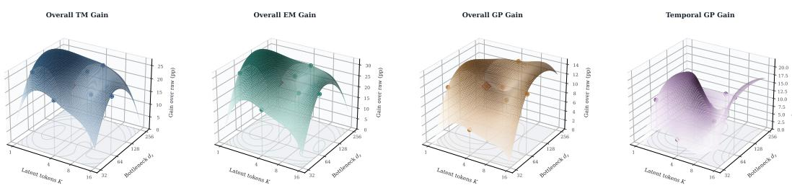

Figure 6 The capacity grid is flat around the default. Overall TM, EM, GP, and Temporal GP as a function of the boundary window K and the action-sufficient dimension d on Qwen2.5-Omni. Circles mark measured configurations, and the surface is a thin-plate interpolation between them; the diamond marks the default $\breve { K } = 4 , d _ { z } = 6 4$ used throughout the paper. The interpolated regions carry no measurement and are shown only to convey the shape of the grid.  
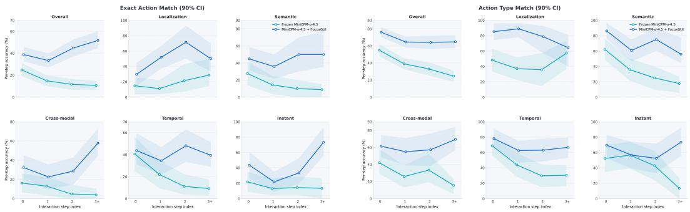  
Figure 7 MiniCPM-o 4.5 across interaction depth. Per-step Exact Match (left) and Type Match (right) with steps binned by their index within the episode and 3+ collecting the fourth step onward. Shaded regions are 90% episode-clustered bootstrap intervals. As on Qwen2.5-Omni, the frozen backbone declines with depth while FocusGUI holds, so the margin widens rather than staying constant.

## C.3 Prioritization, not capacity.

FocusGUI adds trainable parameters to a frozen backbone, so part of its gain could in principle come from that budget alone. Table 5 holds the budget fixed to within 79 parameters and replaces the decision reference with a fixed concatenation layout, leaving the channels available but no longer scored per step. This control differs from the uniform-priority variant in Table 2: uniform priorities average the channel embeddings with equal weights, so channel identity is lost in the pooled representation, whereas concatenation keeps each channel in its own slot and lets the downstream projection learn a fixed, step-independent weighting. It is therefore the stronger static baseline, and isolates per-step scoring as the only difference. Dynamic prioritization improves all three metrics, with the largest gains on Exact Match (+3.54) and Goal Progress (+3.44) and a smaller change in Type Match (+0.98). The gain therefore appears where the mechanism is meant to act, on executable grounding rather than on primitive selection, and it is not explained by latent capacity.

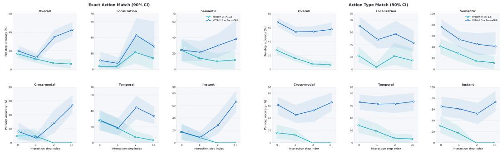  
Figure 8 VITA-1.5 across interaction depth. Per-step Exact Match (left) and Type Match (right). VITA-1.5 is the weakest of the four backbones at 13.98 Overall TM, and the depth-dependent separation appears at that level as well.

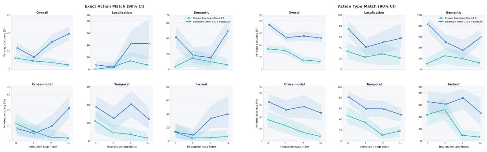  
Figure 9 Baichuan-Omni-1.5 across interaction depth. Per-step Exact Match (left) and Type Match (right). The same widening margin holds on a third backbone family, indicating that the decay is a property of the interaction regime rather than of a particular model.

## C.4 Paired Error Correction

Figure 10 examines how FocusGUI changes action correctness relative to the backbone across task categories. Corrections consistently outnumber regressions in all five categories, with 153 corrected predictions versus 13 regressions overall. The largest net improvement occurs in temporal reasoning, indicating that FocusGUI is particularly effective on tasks requiring decisions over evolving observations.

## D More Implementation Details

## D.1 Prompt and action space.

All four backbones and all five methods share the system prompt below, so the task description, the action vocabulary, and the output format stay fixed while only the organization of the observation differs. The action space follows OmniGUI and contains thirteen primitives: three pointer actions carrying one coordinate, four swipes carrying a start and an end coordinate, text entry carrying a string, four navigation and termination actions without arguments, and NONE for steps at which the agent should observe rather than act. Coordinates are normalized to [0, 1000] and emitted as text through the frozen language-model head, which is what lets FocusGUI retain the base model’s action vocabulary instead of discretizing the screen into a classification grid. The model returns one JSON object per step, from which Type Match reads the primitive and Exact Match reads the arguments. The residual window Jt occupies the four embedding positions immediately preceding that object, so the injected latent is available to every generated action token while the prompt itself is left unchanged.

Table 5 Parameter-matched control on Qwen2.5-Omni. The concatenation variant joins the perceptual channels with a fixed layout instead of scoring them against a decision reference, and is sized to the same trainable budget. Both configurations were trained under identical settings and evaluated on the same 508 test steps.
<table><tr><td></td><td></td><td colspan="3">Metric (%)</td></tr><tr><td>Configuration</td><td>Params</td><td>TM</td><td>EM</td><td>GP</td></tr><tr><td>Parameter-matched concatenation</td><td>1,444,913</td><td>71.85</td><td>33.46</td><td>10.14</td></tr><tr><td>Dynamic prioritization</td><td>1,444,992</td><td>72.83</td><td>37.01</td><td>13.58</td></tr><tr><td>∆ (dyn. — concat.)</td><td>+79</td><td>+0.98</td><td>+3.54</td><td>+3.44</td></tr></table>

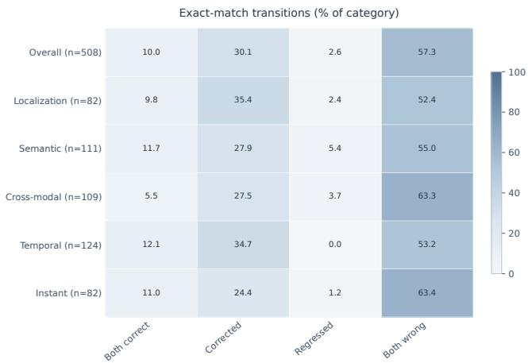

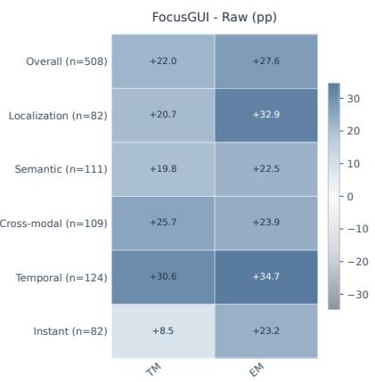  
Figure 10 Paired prediction outcomes across task categories. Left: proportions of steps that both models predict correctly, FocusGUI corrects, FocusGUI regresses, or both predict incorrectly. Right: improvements in type match (TM) and exact match (EM), measured in percentage points.

## \_ SYSTEM PROMPT — MOBILE GUI AGENT

Role. You are an Android GUI agent. Given a task, previous action history, and the available screenshots, audio, and video, predict the next executable action required to complete the task. Output. Return exactly one valid JSON object without explanations, markdown, or additional text.

Action space.
<table><tr><td>ID</td><td>Action</td><td>Arguments</td></tr><tr><td></td><td>NONE</td><td>— observation or waiting</td></tr><tr><td></td><td>TAP</td><td>coordinate:[x,y]</td></tr><tr><td></td><td>DOUBLE_TAP</td><td>coordinate:[x,y]</td></tr><tr><td>2</td><td>LONG_PRESS</td><td>coordinate:[x,y]</td></tr><tr><td>3</td><td>SWIPE_UP</td><td>start_coordinate, end_coordinate</td></tr><tr><td></td><td>SWIPE_DOWN</td><td>start_coordinate, end_coordinate</td></tr><tr><td>5</td><td>SWIPE_LEFT</td><td>start_coordinate, end_coordinate</td></tr><tr><td>6</td><td>SWIPE_RIGHT</td><td>start_coordinate, end_coordinate</td></tr><tr><td></td><td>INPUT</td><td>text:string</td></tr><tr><td>8</td><td>BACK</td><td></td></tr><tr><td>9</td><td>HOME</td><td></td></tr><tr><td>10</td><td>TASK_COMPLETE</td><td></td></tr><tr><td>11</td><td>TASK_IMPOSSIBLE</td><td></td></tr></table>

Conventions.

• Coordinates use [x, y] order, normalized to [0, 1000]; the current screenshot is the execution surface.

• Return NONE when observation or waiting is required; TASK\_COMPLETE when the goal has already been achieved; TASK\_IMPOSSIBLE only when the task cannot be completed.

## D.2 Training target and inference.

During training, the ground-truth action is serialized as a compact JSON string and appended only as the assistant target, e.g., {"action\_type":0,"coordinate":[421,736]}. Loss is computed exclusively over assistant action tokens; all system and user tokens are masked. During inference, the target is absent and the original frozen LM head autoregressively generates the action using greedy decoding with beam size one.

The raw backbone and FocusGUI receive exactly the same semantic prompt, multimodal observations, action history, action schema, and decoding configuration. FocusGUI does not append textual instructions or modality hints. Its selected evidence is projected into continuous latent residuals at the assistant action boundary before generation by the original decoder and LM head.

## D.3 Step template.

Each step is presented with the template below. The multimodal blocks appear in a fixed order, with the history screenshot first when one exists, then the temporal and acoustic observations, and the execution screen last, so the screen the action applies to is always the most recent visual input. The goal and the step index follow, then the actions already executed in this episode, rendered as text rather than as structured state. The observation elements therefore reach the backbone exactly as they would without FocusGUI, and the channels of Sec. 2 are read from this same input rather than replacing any part of it. The closing line ends the prompt and fixes the action boundary bt at which the residual is applied.

\_ USER PROMPT — STEP TEMPLATE   
Optional history <HistoryScreenshot>   
Temporal observation <Video\_t>   
Acoustic observation <Audio\_t>   
Execution screen <Screen\_t>   
Goal. {task\_instruction} Step. {step\_index}   
Action history.   
Step 0: {previous\_action\_0}   
Step t − 1: {previous\_action\_t-1}   
Analyze the current observation and output the next action as JSON.

## D.4 Experiment Details

We construct episode-disjoint training, validation, and test sets containing 1,807, 257, and 508 interaction steps from 495, 71, and 142 trajectories, respectively. All feature transformations and normalization statistics are fitted using the training split only. Validation data are used exclusively for checkpoint selection, and the test split is evaluated once after model selection. At inference time, the original LM head generates one structured action using greedy decoding with beam size one. Raw backbones and their FocusGUI variants use identical observations, prompts, action histories, action spaces, and decoding configurations. On Qwen2.5-Omni, FocusGUI contains 1.445M trainable parameters compared with 8.932B frozen Thinker parameters, corresponding to only 0.0162% trainable parameters. We train

Table 6 Default FocusGUI implementation configuration.
<table><tr><td>Configuration</td><td>Value</td></tr><tr><td>Shared channel dimension  $d$ </td><td>128</td></tr><tr><td>Action-sufficient dimension  $d _ { z }$ </td><td>64</td></tr><tr><td>Residual slots K</td><td>4</td></tr><tr><td>Residual initialization</td><td> $_ { \mathrm { Z e r o } }$ </td></tr><tr><td>Residual scale  $\gamma$ </td><td>1.0</td></tr><tr><td>Channel temperature τ</td><td>1.0</td></tr><tr><td>Dropout</td><td>0.05</td></tr><tr><td>Optimizer</td><td> $\mathrm { A d a m } \mathrm { W }$ </td></tr><tr><td>Learning rate</td><td> $2 \times 1 0 ^ { - 4 }$ </td></tr><tr><td>Weight decay</td><td> $1 0 ^ { - 3 }$ </td></tr><tr><td>Maximum epochs / patience</td><td>3/2</td></tr><tr><td>Gradient clipping</td><td>1.0</td></tr><tr><td>Decoding</td><td>Greedy, beam size 1</td></tr><tr><td>Qwen FocusGUI parameters</td><td>1.445M</td></tr><tr><td>Frozen Qwen Thinker parameters</td><td>8.932B</td></tr><tr><td>Trainable proportion</td><td>0.0162%</td></tr></table>

Table 7 What the two configurations receive at inference. Every row above the rule is shared, so the columns are indistinguishable until the last two entries. $\mathcal { I } _ { t }$ denotes the K embedding positions preceding the action boundary.
<table><tr><td colspan="2">Frozen backbone + FocusGUI</td></tr><tr><td>System prompt</td><td>identical</td></tr><tr><td>Multimodal observations</td><td>identical</td></tr><tr><td>Action history</td><td>identical</td></tr><tr><td>Action schema</td><td>identical</td></tr><tr><td>Decoding</td><td>greedy, beam size 1</td></tr><tr><td>Textual demonstrations</td><td>none</td></tr><tr><td>Modality-relevance hints</td><td>none</td></tr><tr><td>Backbone weights</td><td>frozen</td></tr><tr><td>Trainable parameters</td><td>0  $1 . 1 5 \mathrm { M } { - 1 . 4 5 \mathrm { M } }$ </td></tr><tr><td>Input at Jt</td><td> $E _ { t , \mathcal { T } _ { t } }$   $E _ { t , \mathcal { T } _ { t } } + \gamma R _ { t }$ </td></tr></table>

a separate FocusGUI adapter for each of the four backbones, with no adapter parameters shared across backbone families. Across the evaluated backbones, the adapter size ranges from 1.15M to 1.45M parameters. All experiments are conducted using two NVIDIA L20 GPUs.

## D.5 Controlled inputs.

Table 7 lists what the frozen backbone and FocusGUI receive at inference. The prompt, the observations, the action history, the schema, and the decoding procedure are identical, and neither configuration is given textual demonstrations or any hint about which modality matters at a step. The two differ in the parameters that build $z _ { t }$ and in the residual added at ${ \mathcal { T } } _ { t } ,$ and Table 5 separates those by holding the parameter budget fixed while removing the per-step scoring. A gain over the frozen backbone therefore reflects the content of $R _ { t }$ rather than a longer prompt, an in-context example, or a different decoding rule.

Algorithm 1 FocusGUI forward pass at interaction step t   
Require: Observation $\mathcal { O } _ { t } ;$ frozen backbone $\mathcal { F } _ { \Theta _ { 0 } } ;$ trainable $\phi$   
$\{ P _ { m } , P _ { q } , \{ r _ { m } \} , W _ { e } , W _ { q } , v , P _ { s } , W _ { p } , b _ { p } \} .$ ; hyperparameters $K , d _ { z } , \tau , \gamma$   
Ensure: Modified embeddings $\widetilde { E } _ { t } ;$ channel priorities $\{ \alpha _ { t } ^ { ( m ) } \}$   
1: $E _ { t } , \ \{ x _ { t } ^ { ( m ) } \} _ { m \in \mathcal { M } } , \ e _ { t } ^ { ( \mathrm { a l l } ) } \gets \mathcal { F } _ { \Theta _ { 0 } } . \mathrm { E N C O D E } ( \mathcal { O } _ { t } )$ ▷ prompt embeddings, channels,   
integrated state   
2: for all $m \in { \mathcal { M } }$ do ▷ channel decomposition (CD)   
3: $e _ { t } ^ { ( m ) } \gets P _ { m } \Big ( x _ { t } ^ { ( m ) } \Big ) \in \mathbb { R } ^ { d }$   
4: end for   
5: $q _ { t }  P _ { q } ( e _ { t } ^ { ( \mathrm { a l l } ) } )$ ▷ decision reference, recomputed every step   
6: for all $m \in \mathcal { M }$ do ▷ step-adaptive prioritization (SP)   
7: $s _ { t } ^ { ( m ) } \gets v ^ { \top } \operatorname { t a n h } \Bigl ( W _ { e } \bigl ( e _ { t } ^ { ( m ) } + r _ { m } \bigr ) + W _ { q } q _ { t } \Bigr )$   
8: end for   
9: $\alpha _ { t } ^ { ( m ) } \gets \frac { \exp \left( s _ { t } ^ { ( m ) } / \tau \right) } { \Gamma } , \quad c _ { t } \gets \sum _ { m \in \mathcal { M } } \alpha _ { t } ^ { ( m ) } e _ { t } ^ { ( m ) }$   
$\begin{array} { r } { \sum _ { j \in \mathcal { M } } \exp \left( s _ { t } ^ { ( j ) } / \tau \right) } \end{array}$   
10: $\boldsymbol { z } _ { t } \gets \boldsymbol { P _ { s } } ( \boldsymbol { c } _ { t } ) \in \mathbb { R } ^ { d _ { z } }$ ▷ action-sufficient projection $( \mathrm { A P } ) , d _ { z } < d$   
11: $R _ { t } \gets \mathrm { R }$ ESHAPE $\left( W _ { p } z _ { t } + b _ { p } \right) \in \mathbb { R } ^ { K \times d } .$ model ▷ $W _ { p } , b _ { p }$ zero-initialized ⇒ $R _ { t } = 0$ at the start   
of training   
12: $J _ { t } \gets \{ b _ { t } - K , \ldots , b _ { t } - 1 \}$ ▷ K prompt positions before the action boundary   
13: $\widetilde { E } _ { t } \gets E _ { t } + S _ { J _ { t } } ( \gamma R _ { t } )$ ▷ additive residual alignment $( \mathrm { R A } ) ; { \mathcal { O } } _ { t }$ is neither pruned nor   
extended   
14: return $\widetilde E _ { t } , \ \{ \alpha _ { t } ^ { ( m ) } \} _ { m \in \mathcal { M } }$

## E Algorithm

Algorithm 1 details the per-step FocusGUI forward pass, which is shared by training and inference: it exposes the perceptual channels, scores them against the decision reference $q _ { t } ,$ compresses the result into $z _ { t } ,$ and adds the zero-initialized residual at the K positions preceding the action boundary. Algorithm 2 gives the training and inference procedures built on it. Blue marks everything FocusGUI contributes; all remaining lines are the frozen backbone’s original pathway. Gradients flow through the frozen decoder to $\phi ,$ but no backbone parameter is updated and the prompt itself is never modified.

## F Case Study

To demonstrate the comprehensiveness and robustness of FocusGUI across diverse interaction paradigms, we present two distinct case studies encompassing both cross-modal temporal reasoning and multi-step semantic localization. Real-world GUI operation requires agents to seamlessly transition between different cognitive modes: some tasks demand patient monitoring of streaming sensory inputs (e.g., waiting for an auditory cue), while others require precise, sequential spatial navigation through dense interfaces.

The following examples illustrate how FocusGUI successfully navigates these contrasting extremes by dynamically prioritizing relevant perceptual channels. Figure 11 highlights a scenario where the decisive signal is entirely auditory and temporal, requiring the agent to ignore static visual saliency until a specific semantic condition is met. Conversely, Figure 12 showcases a highly spatial and semantic task, where the agent must execute a precise sequence of UI interactions (opening filters, selecting specific nested options) based on a composite text instruction. Together, these cases confirm that FocusGUI’s step-adaptive prioritization effectively generalizes across fundamentally different types of GUI challenges, preventing Sequential Distraction in both streaming and structurally complex environments.

Listen to the talk. If the content mentions \"past/history/childhood\", tap pause; if it mentions \"future/predictions/plans\", continue watching."  
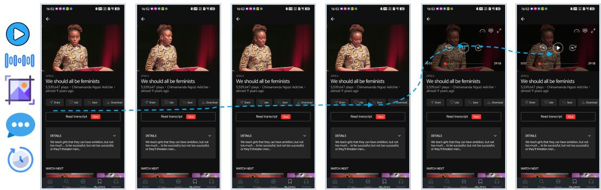  
Figure 11 Case study on cross-modal temporal reasoning. The agent is instructed to pause a video based on specific auditory cues ("past/history/childhood"). The visual interface remains largely static, forcing the model to rely on streaming audio comprehension over multiple steps. FocusGUI successfully avoids premature visual actions, dynamically shifting priority to the audio channel and executing the spatial action (tapping pause) precisely when the semantic condition is met.

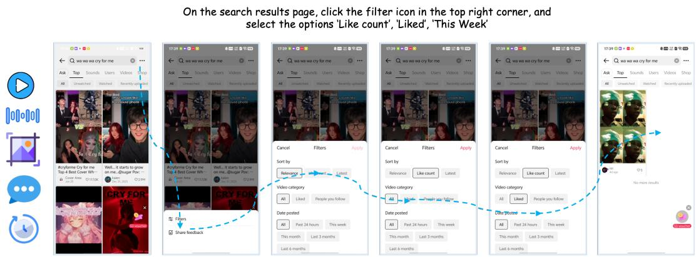  
Figure 12 Case study on multi-step semantic planning and spatial localization. The agent executes a complex sequence of interface interactions based on a detailed text instruction. It successfully navigates through dynamic UI changes—locating a small filter icon, understanding the popup menu, and sequentially selecting "Like count", "Liked", and "This Week". This demonstrates FocusGUI’s capacity for precise spatial grounding and robust state tracking in visually dense environments.

Algorithm 2 Training from action supervision, and inference   
1: procedure $\mathrm { T R A I N } ( \mathcal { D } _ { \mathrm { t r } } , \mathcal { D } _ { \mathrm { v a l } } )$   
2: Initialize $\phi ;$ set $W _ { p } \gets 0 , b _ { p } \gets 0 ;$ freeze encoder, decoder, and LM head $( \Theta _ { 0 } )$   
3: for epoch = 1 to $\dot { E } _ { \mathrm { m a x } }$ do   
4: for mini-batch $B \subset D _ { \mathrm { t r } }$ do   
5: for step $t \in B$ do   
6: $\widetilde { E } _ { t } , \cdot $ FOCUSGUIFORWARD(O ) ▷ Algorithm 1   
7: $\begin{array} { r } { \ell _ { t } \gets - \frac { 1 } { L _ { t } } \sum _ { k = 1 } ^ { L _ { t } } \log p _ { \Theta _ { 0 } } \Big ( y _ { t , k } \ : | \ : y _ { t , < k } , \widetilde { E } _ { t } \Big ) } \end{array}$ ▷ teacher forcing; loss on action   
tokens only   
8: end for   
9: $\begin{array} { r } { \mathcal { L } _ { \mathrm { a c t } } ( \phi )  \frac { 1 } { | B | } \sum _ { t \in B } \ell _ { t } } \end{array}$   
10: $\begin{array} { r l r } { \phi  \mathrm { A D A M W } ( \phi , \mathrm { C L I P G R A D } ( \nabla _ { \phi } \mathcal { L } _ { \mathrm { a c t } } ) ) } & { { } } & { \triangleright \nabla \Theta _ { 0 } } \end{array}$ discarded; $\Theta _ { 0 }$ unchanged   
11: end for   
12: Evaluate on $\mathcal { D } _ { \mathrm { v a l } } ;$ keep the best checkpoint; stop early if patience is exhausted   
13: end for   
14: return $\phi ^ { \star }$   
15: end procedure   
16: procedure INFER(g)   
17: $H _ { 0 } \gets \emptyset$   
18: for $t = 0 , 1 , 2 , \ldots$ until termination or step budget do   
19: Observe $\dot { \mathcal { O } } _ { t } = \{ g , I _ { t } , V _ { t } , A _ { t } , H _ { t } , S _ { t } \}$   
20: $\widetilde { E } _ { t } , \{ \alpha _ { t } ^ { ( m ) } \}$ ← FOCUSGUIFORWARD $( \mathcal { O } _ { t } )$   
21: $\hat { y } _ { t } \gets \mathcal { F } _ { \Theta _ { 0 } }$ .DECODE $\left( \widetilde { E } _ { t } \right)$ ▷ original LM head, greedy decoding, beam size 1   
22: Execute yˆt; $H _ { t + 1 } \xleftarrow { } H _ { t } \cup \{ \hat { y } _ { t } \}$ ▷ the executed action re-enters the next   
observation   
23: end for   
24: end procedure

## G Theoretical Analysis

We trace how the latent $z _ { t }$ reaches the action logits through the frozen decoder, and show that it acts through two pathways with distinct roles: one changes what the decoder reads from a position and suffices to select the action primitive; the other changes where it reads and is the only route by which arguments can be corrected.

The decoder is L frozen pre-LN blocks on a residual stream $h _ { i } ^ { ( \ell ) } \in \mathbb { R } ^ { d } .$ , with per-head attention $q _ { k } = W _ { Q } \mathrm { L N } ( h _ { k } ) , \kappa _ { i } = W _ { K } \mathrm { L N } ( h _ { i } ) , v _ { i } = W _ { V } \mathrm { L N } ( h _ { i } ) , a _ { k } . =$ softmax $\left( q _ { k } , \kappa _ { \cdot } \right) / \sqrt { d _ { h } } )$ 1 $\begin{array} { r } { o _ { k } = { W } _ { O } \sum _ { i } a _ { k i } v _ { i } , } \end{array}$ and logits $f _ { k } = W _ { U } \mathrm { L N } ( h _ { k } ^ { ( L ) } )$ . FocusGUI sets $h _ { i } ^ { ( 0 ) } = e _ { i } + \gamma R ^ { ( i ) } \mathbb { 1 } [ i \in J _ { t } ]$ ] with R = Reshape $( W _ { p } z _ { t } + b _ { p } )$ and $J _ { t } = \left\{ b _ { t } - K , \ldots , b _ { t } - 1 \right\}$ . Write $\delta _ { i } ^ { ( \ell ) } : = \partial h _ { i } ^ { ( \ell ) } / \partial \gamma$ and $\Lambda _ { i }$ for the LayerNorm Jacobian. Since the finite change $\begin{array} { r } { \Delta f _ { k } = \gamma \int _ { 0 } ^ { 1 } \partial _ { \gamma } f _ { k } | _ { \gamma u } d u _ { . } } \end{array}$ , the decomposition below holds without linearization. Because $\delta _ { J _ { t } } ^ { ( 0 ) }$ ranges over an affine set with direction space col $\left( W _ { p } \right)$ and the frozen Jacobians act linearly, every $\delta _ { i } ^ { ( \ell ) }$ lies in a family of dimension at most $d _ { z } \mathbf { : }$ the adapter steers the frozen computation through a $d _ { z }$ -dimensional control, and what the network does with it is fixed by $\Theta _ { 0 } ^ { - }$

For an action position $k \geq b _ { t } ,$ , differentiating $o _ { k }$ gives

$$
\frac { \partial o _ { k } } { \partial \gamma } = W _ { \cal { O } } \underbrace { \sum _ { i } a _ { k i } W _ { V } \Lambda _ { i } \delta _ { i } } _ { ( \mathbf { v } ) \mathbf { v a l u e } } + W _ { \cal { O } } \underbrace { \sum _ { i } a _ { k i } \dot { s } _ { k i } \left( v _ { i } - \bar { v } _ { k } \right) } _ { ( \mathbf { A } ) \mathrm { a t t e n t i o n } } , \qquad \bar { v } _ { k } = \sum _ { j } a _ { k j } v _ { j } ,\tag{5}
$$

where the second form follows from the softmax Jacobian and $\begin{array} { r } { \sum _ { i } \partial _ { \gamma } a _ { k i } = 0 } \end{array}$ , and

$$
\begin{array} { r } { \dot { s } _ { k i } = \frac { 1 } { \sqrt { d _ { h } } } \big ( \underbrace { \langle \delta _ { k } , \Lambda _ { k } ^ { \top } W _ { Q } ^ { \top } W _ { K } \mathbf { L N } ( h _ { i } ) \rangle } _ { \mathrm { q u e r y ~ s t e e r i n g } } + \underbrace { \langle q _ { k } , W _ { K } \Lambda _ { i } \delta _ { i } \rangle } _ { \mathrm { k e y ~ d i s p l a c e m e n t } } \big ) . } \end{array}\tag{6}
$$

Pathway $( \mathrm { A } )$ conserves attention mass and moves the read along the contrasts $v _ { i } - { \bar { v } } _ { k } \colon$ it adds no content and only reallocates which existing context the action token consumes. Content enters through (V) alone, and only at positions where $\delta \neq 0$

Proposition G.1 (Depth-staged re-routing). At layer 1, $\delta _ { k } = 0$ for all $k \geq b _ { t }$ , so only key displacement is active and equation 5 reweights attention within $J _ { t }$ . From layer $2 \ : o n ,$ , the first layer’s attention has written $\delta _ { k } \neq { \mathrm { { 0 } } }$ , and query steering makes ${ \dot { s } } _ { k i } \neq { \dot { 0 } } f o r$ every unmasked i: a residual confined to K positions redistributes attention over the entire observation. Moreover, by induction under the causal mask, $\delta _ { i } ^ { ( \ell ) } = 0 f o r$ all $i < b _ { t } - K$ at every layer, so the content $v _ { i }$ at every evidence position in the observation is exactly independent $o f \gamma$

Consequences for action generation. The two output families of a GUI action consume different pathways. The primitive is a categorical choice: flipping it from b to a only requires $W _ { U } \Lambda _ { k } ^ { ( L ) } \bar { \delta _ { k } ^ { ( L ) } }$ to have a component along $w _ { a } - w _ { b }$ exceeding the current logit gap, which pathway (V) supplies directly. Arguments (coordinates, typed text) are produced by copytype readout from evidence positions, which satisfy $i < \dot { b } _ { t } - K ;$ by Proposition $\mathrm { G . 1 }$ their content is untouched, so argument corrections arise only through pathway $( \mathrm { A } )$ re-routing mass onto the correct evidence. This is why the injection must be additive: replacing $e _ { J _ { t } } + \gamma R$ by R leaves query steering intact but overwrites the K most recent, most heavily attended context positions with $z _ { t }$ -derived content of dimension at most $d _ { z } ,$ destroying their value as evidence.