# ABACUS: A Benchmark for Image Editing Models to Assess Object Category and Counting Under Scene Conservation

Aymen Lassoued Angelique Loesch Romaric Audigier Universite Paris-Saclay, CEA, List, F-91120 Palaiseau, France´ {firstname.lastname}@cea.fr

## Abstract

Instruction-based image editing models can now add, remove a specified number of objects or change their category while preserving the scene. Yet these models often fail to produce the correct number, and these failures grow sharply as scenes become more complex and the requested count increases. Current benchmarks largely miss this problem: they score edits with holistic similarity metrics or with vision-language model (VLM) judges that are themselves poor at counting, so numerical errors go unnoticed or are graded incorrectly. As a result, the true numerical ability of today’s editing models has never been accurately measured.

We address this issue with ABACUS, a new benchmark, evaluation protocol and dedicated scoring metric for numerical image editing. Our protocol is judge-free: no VLM or MLLM scores an edit or counts objects (a VLM only con firms the category of rare ambiguous crops). Instead, it verifies each edit at the instance level against panoptic ground truth confirmed by detector consensus, checking both that the exact requested count was achieved and that the rest of the scene was preserved, across the add, remove and change operations. By evaluating leading image editors, our method reveals substantial numerical editing failures that worsen with increasing scene complexity and object count; failures that prior benchmarks often overlooked or misjudged.

## 1. Introduction

Instruction-based image editing has advanced rapidly: a single model can now add, remove, or change objects in a real image from a short natural-language command. Proprietary systems such as Gemini 2.5 Flash Image (“Nano Banana”) [12], Seedream 4.0 [36], and GPT-Image-1 [27], together with strong open models such as Qwen-Image-Edit [40], FLUX.1 Kontext [4], Step1X-Edit [24], and BAGEL [10], produce edits that are visually convincing and, at a glance, faithful to the instruction. However, producing the exact number of objects an instruction requests (numerical editing), as in “add three boats”, “remove two cars”, or “change four of the cows into sheep”, is quite hard. The model must produce the right count, and it must do so without disturbing the rest of the scene: it should not silently add an unrequested object, delete an existing one, or repurpose an original instance to fake the count. We find that editors frequently fail at this (Fig. 1), and that the failures grow sharply as scenes become more crowded and the requested count increases, precisely the regime where reliable counting matters most.

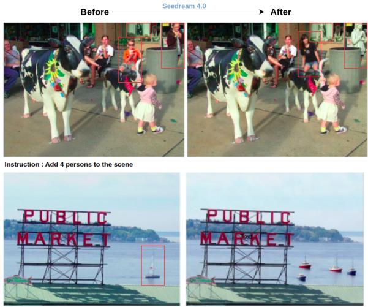  
Instruction : Add 3 boats to the scene

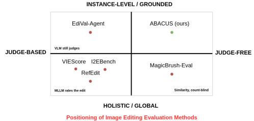  
Figure 1. Numerical editing requires a specialized evaluator. Given an instruction to generate an exact number of objects, existing evaluation methods, including VLM judges (VI-EScore [19], I2EBench [25], and RefEdit [30]) and the agentic evaluator EdiVal-Agent [9], incorrectly mark the edit as successful because they fail to verify numerical correctness. In contrast, ABACUS correctly identifies the edit as a failure. (The red boxes indicate the target categories that were either modified or removed during editing.)

Measuring this matters beyond the editor. Generative editing is increasingly used to build controlled training data [16, 46]: when real images of a configuration are scarce (rare counts, dense crowds, long-tail categories), an editor renders a set number of instances, and one silent miscount corrupts every downstream label. Being judge-free, deterministic, and grounded in detected evidence, the same signal could also serve as a verifiable reward (RLVR) for post-training editors toward exact counting, where a learned VLM reward would be noisy and reward-hackable.

The deeper problem is that we cannot currently measure this failure: the instruments used to evaluate editing are themselves unreliable for counting (Sec. 2). Holistic similarity metrics (CLIP [33], DINO [7], $L _ { 1 } / L _ { 2 }$ , FID [15]), as in MagicBrush [45], capture global appearance but are blind to instance counts. The now-dominant alternative scores edits with a VLM or MLLM judge [17, 19, 25, 31, 41, 42], which is circular: VLMs are themselves poor counters. Their accuracy collapses with object number and variety [3, 13, 14, 35], they miss small edits [19, 22], score unreliably [20, 29], and have no notion of instance correspondence: when a model turns one of two people into a third, or deletes the sources and paints the targets elsewhere, the judge still reports success (Fig. 1). Editors’ numerical ability has thus been overlooked or misjudged.

We argue that numerical editing must be verified, not judged. We introduce ABACUS, a benchmark, an evaluation protocol, and a dedicated scoring metric for numerical image editing. ABACUS is built on COCO images [21] with high-quality panoptic ground truth from COCONut [11], and it scores every edit by reconstructing what happened to each object instance rather than by asking a model for an opinion. It segments every instance in both images [6], matches before/after instances with a matcher robust to generative appearance drift, and confirms each category by the independent agreement of two detectors [34, 47]. From this, it assigns every object a verdict (kept, added, removed, transformed) and jointly checks the exact requested count and scene conservation across add, remove, and change. No VLM or MLLM ever judges an edit or counts objects.

ABACUS covers add, remove, and change edits over COCO/COCONut [11, 21] with instance-level ground truth, exact target counts, and easy/medium/hard difficulty tiers (Sec. 3.2). Its counts are confirmed by detector consensus and every sample is human-verified, both that the requested edit is feasible and that its difficulty tier is correct, so the benchmark is reliable by construction. We release it publicly, with a datasheet and license (App. D.2).1

Validated against human annotation, ABACUS’s automatic verdicts closely track human counting across all difficulty tiers and seven editors that span a wide range of edit quality, including the hard, high-count regime where VLM judges collapse. Using ABACUS to evaluate leading editors, we expose substantial and systematic numerical failures that prior benchmarks had hidden or misjudged. These failures intensify with scene complexity and target count.

## 2. Related Work

## 2.1. Instruction-based image editing

Editing from natural-language instructions was popularized by InstructPix2Pix [5] and the manually annotated MagicBrush [45] dataset. Quality has since risen sharply with unified and in-context models. On the proprietary side, Gemini 2.5 Flash Image [12], Seedream 4.0 [36], and GPT-Image-1 [27] set the current bar for targeted, languagedriven edits; on the open side, Qwen-Image-Edit [40], FLUX.1 Kontext [4], Step1X-Edit [24], and BAGEL [10] approach proprietary quality. All of these can attempt numerical edits; whether they achieve the exact requested count while preserving the scene is what ABACUS measures, and what their own benchmarks do not.

## 2.2. Benchmarks and metrics for image editing

Early evaluation relied on holistic similarity metrics (CLIP [33], DINO [7], L1, FID [15]), as used to score MagicBrush [45] edits, which are insensitive to object count. The field has since moved to VLM/MLLM judges. VI-EScore [19] prompts an MLLM for an explainable score but correlates only weakly with humans and is itself noted to miss small edits. I2EBench [25], ImgEdit-Bench [42], KRIS-Bench [41], and CompBench [17] score edits across many dimensions with MLLM judges. Notably, I2EBench and KRIS-Bench even include a dedicated counting dimension, yet they grade it with a VLM (GPT-4V / GPT-4o), inheriting exactly the counting unreliability we document. GEdit-Bench [24] grades against real-world instructions. RefEdit [30] contributes RefEdit-Bench (rooted in RefCOCO) for referring-expression edits and reports that editors handling a single prominent object degrade sharply once a scene contains multiple entities, reinforcing our focus on scene complexity. And learned scorers such as ADIEE [8] and human-aligned MLLM judges [22] try to repair judge reliability. All keep a model in the scoring loop for a task that model performs poorly, and none target exact count with instance correspondence. Two efforts move toward grounding. GIE-Bench [31] adds objectaware conservation masks but still verifies functional correctness with VLM-answered multiple-choice questions.

Table 1. Overview of ABACUS.
<table><tr><td rowspan="2"></td><td colspan="2">Data &amp; supervision</td><td rowspan="2">Task</td><td colspan="4">Evaluation protocol</td></tr><tr><td></td><td></td><td></td><td></td><td></td><td>Inst. GT GT masks Multi-inst. Judge-free Mask pres. Num. metric Grounded count</td></tr><tr><td>Benchmark EditVal [1]</td><td></td><td>x</td><td>x</td><td>X</td><td>X</td><td>X</td><td>X</td></tr><tr><td>MagicBrush [45]</td><td>X</td><td></td><td></td><td></td><td>X</td><td>X</td><td>X</td></tr><tr><td>ImgEdit-Bench [42]</td><td>X</td><td>X</td><td></td><td>X</td><td>X</td><td>X</td><td>X</td></tr><tr><td>I2EBench [25]</td><td>x</td><td>x</td><td></td><td>x</td><td>x</td><td>√</td><td>x</td></tr><tr><td>CompBench [17]</td><td>X</td><td>x</td><td></td><td>x</td><td>x</td><td>x</td><td>x</td></tr><tr><td>KRIS-Bench [41]</td><td>X</td><td>x</td><td></td><td>X</td><td>x</td><td></td><td>x</td></tr><tr><td>RefEdit-Bench [30]</td><td>V</td><td>2</td><td>X</td><td>X</td><td>x</td><td>X</td><td>x</td></tr><tr><td>ICE-Bench [28]</td><td>x</td><td>x</td><td></td><td>x</td><td>x</td><td>x</td><td>x</td></tr><tr><td>VIBE [44]</td><td>X</td><td>x</td><td>X</td><td>X</td><td>X</td><td>X</td><td>X</td></tr><tr><td>GIE-Bench [31]</td><td></td><td></td><td>X</td><td>X</td><td></td><td>X</td><td>X</td></tr><tr><td>EdiVal-Agent [9]</td><td>X</td><td>X</td><td></td><td>X</td><td>X</td><td></td><td>X</td></tr><tr><td>ABACUS (ours)</td><td></td><td></td><td></td><td></td><td></td><td></td><td></td></tr></table>

(a) Positioning vs. prior benchmarks. ✓ full, ∼ partial, ✗ absent. Inst. GT: instance segmentation; GT masks: masks separating edited vs. preserved regions; Multi-inst.: prompts specify $K > 1$ instances; Judge-free: no VLM/MLLM scores the edit (a VLM may assist in a non-scoring role, as in ours); Mask pres.: mask-based preservation on non-edited regions; Num. metric: an explicit objectcount metric; Grounded count: the object count comes from detection evidence cross-checked by detector agreement. ABACUS is the only benchmark that is judge-free and grounded on numerality.

<table><tr><td></td><td>Add</td><td>Remove</td><td>Change</td><td>Total</td></tr><tr><td>Easy</td><td>1,159</td><td>1,146</td><td>1,000</td><td>3,305</td></tr><tr><td>Medium</td><td>1,363</td><td>1,340</td><td>1,128</td><td>3,831</td></tr><tr><td>Hard</td><td>1,374</td><td>1,308</td><td>1,126</td><td>3,808</td></tr><tr><td>Total</td><td>3,896</td><td>3,794</td><td>3,254</td><td>10,944</td></tr><tr><td>mean K</td><td>3.20</td><td>2.32</td><td>2.30</td><td></td></tr><tr><td>max K</td><td>15</td><td>10</td><td>10</td><td></td></tr></table>

(b) ABACUS composition. Number of instructions per operation and difficulty tier, over 3,845 COCO source images (2.85 instructions each) spanning all 80 categories (K = 1–15, 72 change pairs). mean K and max K: mean and maximum requested count.

EdiVal-Agent [9] is the closest in spirit: it is object-centric and reports that detectors combined with a VLM agree with humans better than a VLM alone, which corroborates our premise. It differs from ABACUS in both goal and mechanism. EdiVal-Agent measures multi-turn instruction $f o l -$ lowing: for symbolic edit types, including a count-change task, it scores with a single open-vocabulary detector, but for semantic types it routes detector-localized crops to a VLM and it generates its instructions and object pool with a VLM, so the framework is judge-based overall. Notably, its counts are read from one detector on arbitrary images with no verified ground-truth reference. ABACUS instead targets exact-countfidelity and scene conservation, grounding every verdict in panoptic ground truth, segmentation, geometric matching, and two-detector agreement, and never asking a VLM to count objects or judge whether an edit succeeded. Uniquely, it repairs incomplete ground truth and checks that a “change” transformed the same instances in place. Table 1a summarizes this positioning: no prior benchmark provides a fully judge-free, instance-level protocol that jointly verifies exact count and conservation, which is the gap ABACUS fills.

Concretely, ABACUS grounds counting in detection and segmentation. We build on COCO [21] with COCONut panoptic masks [11], which are strong enough to anchor instance-level verification while our pipeline is built to tolerate their residual faults, and on strong detectors [34, 47] whose occasional errors are absorbed downstream by detector agreement, presence-gated segmentation [6], and the matching and ground-truth-completion steps. The resulting verdicts are verifiable rather than opined.

## 3. The ABACUS benchmark

ABACUS is a benchmark: every edit is paired with a known target count and a reliable instance-level reference. These are produced by a multi-stage creation pipeline that ends in

human verification, and which is entirely separate from the evaluation protocol of Sec. 4.

## 3.1. Creation pipeline

The pipeline (Fig. 2) proceeds in five steps.

1. Source and ground-truth counts. We start from COCO images [21] with COCONut panoptic annotations [11]. For each {image, thing-category} pair, the panoptic segments give the ground-truth instance count $N _ { \mathrm { G T } }$

2. Detector-verified removability audit. For every pair we run both detectors, RF-DETR [34] and Co-DETR [47], on the original image and keep it only if both detect at least $N _ { \mathrm { G T } }$ instances of the category, so the ground-truth count is independently confirmed rather than merely assumed. We then inpaint the category region out of the image with a classical, non-generative method (Navier-Stokes inpainting [2]) and run both detectors again; the pair passes only if both now detect zero instances. A pair that survives this audit therefore has a detector-confirmed count and a region that is real and can be cleanly removed, which makes its edits well posed.

3. Addition plausibility check. On the surviving pairs, a vision-language model (Qwen3.6-27B [32]) checks whether the scene plausibly admits the edit (for an addition, whether there is a visible location where one more instance of the category could be inserted), and pairs judged implausible are dropped.

4. Optimal number of addable objects. For the plausible pairs, the same model estimates the largest number of additional instances that would look natural, decomposing the scene and checking a per-object capacity constraint given the element scale and context, yielding a per-image upper bound $K _ { \mathrm { m a x } }$ on the target count.

5. Instruction generation. For removal and change we draw the target count K as a uniform random integer in $\{ 1 , \ldots , N _ { \mathrm { G T } } \}$ , where $N _ { \mathrm { G T } }$ is the known ground-truth count of the target category; for addition, where the addable count is not given a priori, we take the optimal addable-count estimate $K \ = \ K _ { \operatorname* { m a x } }$ of Step 4. We render a naturallanguage instruction for the operation, for example “add K {category} to the scene.”, “change K {source} into {target} in the scene.”, or “delete K {category} from the scene.” with correct pluralization. The instructions are intentionally simple, probing the counting ability alone rather than spatial reasoning or attribute binding.

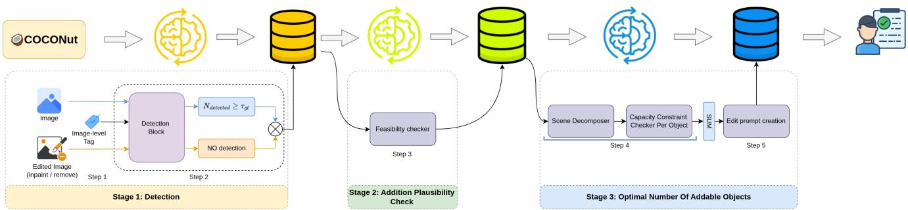  
Figure 2. Benchmark creation pipeline. Each {image, category} pair from COCONut panoptic ground truth: a detector-verified removability audit, an addition-plausibility check, an optimal addable-count estimate, instruction generation, and a final human-verification pass (Sec. 3.1).

Human verification. Finally, every sample is inspected by two experienced annotators, with a final verifier resolving disagreements, who confirm that the requested edit is feasible on its image and that its difficulty tier is correct, and discard any sample that fails either check.

The ground-truth counts come from panoptic annotation confirmed by the dual-detector audit, and the visionlanguage model is used only at creation time to propose plausible instructions and count ranges; it never sets a ground-truth count and never scores an edit. The dualdetector audit likewise runs only on the source images at creation time, disjoint from the evaluation of any edited image (Sec. 4), so benchmark selection cannot inflate a model’s score; scoring is robust to which detectors are used (App. C.8). Combined with the human-verification pass, this makes ABACUS reliable by construction.

## 3.2. Operations, difficulty, and scene complexity

ABACUS covers three operations: adding K objects of a category, removing K of them, and changing K instances of one category into another (one example of each in Fig. S5 of App. A). Rather than bin difficulty by a single attribute, we grade it with a composite score built from three complementary axes, each rank-normalized to [0, 1] over the pool: theforeground coverage of the scene (fraction of pixels that are foreground), the target count (the maximum number of target instances the scene admits, which bounds the requested K), and the target-object scale (the share of the foreground occupied by the target category, target-class pixels over foreground pixels, where a smaller share is harder). Their sum gives a difficulty score in [0, 3] that we split at its terciles into easy, medium, and hard tiers (examples in

Fig. S6 of App. A). The split is meaningful rather than arbitrary, and non-circular: scene attributes that do not enter the score (the number of instances, the number of categories, and the crowd ratio) still separate the tiers, and model performance decreases monotonically across them (Sec. 5.3 and Table 2; validated in App. A). Overall, ABA-CUS comprises 10,944 instructions over 3,845 COCO images, roughly balanced across the three tiers and the add, remove, and change operations (Table 1b).

## 4. Judge-free evaluation protocol

ABACUS scores an edit by reconstructing what happened to every object instance, never by asking a model whether the edit succeeded. Its inputs are a source image $I _ { o } ,$ an edited image $I _ { e } ,$ and an instruction specifying an operation, a target category (or source/target pair), and a count K. From these, ABACUS assigns each instance a verdict (kept, added, removed, or transformed), from which the exactcount and scene-conservation scores follow. The three operations share these components: we detail them on the add pipeline (Fig. 3), then show how remove and change reuse and extend the same machinery.

## 4.1. ‘Add’ pipeline

The ‘add’ pipeline is where the shared machinery is defined; remove and change reuse it. From the source image $I _ { o } ,$ , the edited image $I _ { e } ,$ , the panoptic ground truth, and the instruction “add $K$ objects of class cls”, it produces a realized add count, compared against $K ,$ , in four stages (Fig. 3).

Novelty discovery. We first gather cls instances from two grounded sources: the panoptic ground-truth masks of $I _ { o }$ [11], and presence-gated concept segmentation (SAM 3 [6]) run on both $I _ { o }$ and $I _ { e }$ with the category name as prompt, keeping a mask only when its presence score exceeds $\tau _ { p } ;$ this gates out hallucinated masks and recovers occluded and clustered instances, and segmenting the source too is what later lets us repair omissions in the ground truth. A preserved object can move, deform, or be repainted, so we match the source instances to the edited ones with a composite geometric score robust to this drift. For a source instance $I _ { o }$ (mask $M _ { o } )$ and an edit instance $I _ { e }$ (mask $M _ { e } )$

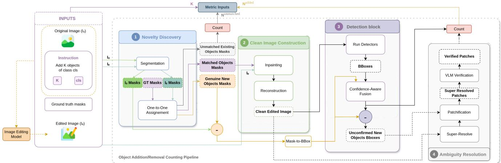  
Figure 3. ‘Add’/‘Remove’ pipeline. Addition and removal share one pipeline (Sec. 4.1); four stages map Io, Ie, and the panoptic ground truth to the confirmed new instances $N ^ { \mathrm { a d d e d } }$ and the unmatched source instances $N$ unmatched: novelty discovery, clean-image construction, dual-detector detection, and VLM ambiguity resolution. The two outputs swap roles between addition and removal.

$$
s ( I _ { o } , I _ { e } ) = \operatorname* { m a x } \Bigl ( \operatorname* { m a x } \bigl ( \operatorname { I o U } , c \cdot { \bf 1 } \{ c \geq \tau _ { c } \} \bigr ) \cdot \phi , ~ \sigma \Bigr ) ,\tag{1}
$$

with mask overlap $\mathrm { I o U } = | M _ { o } \cap M _ { e } | / | M _ { o } \cup M _ { e } |$ , containment $c = | M _ { o } \cap M _ { e } | / | M _ { e } |$ (for an object the edit split or merged), a size-ratio factor $\phi = \operatorname* { m i n } ( 1 , | M _ { o } | / | M _ { e } | )$ , and a contour term $\sigma = 1 / ( 1 + d _ { \mathrm { s h a p e } } )$ from Hu-moment shape matching, gated to 0 unless the two centroids lie within a fraction $\tau _ { d }$ of the image diagonal. Stacking these into a score matrix $S \in \mathbb { R } ^ { n _ { o } \times n _ { e } }$ whose entry $S _ { i j }$ scores the i-th source against the j-th edit instance, we solve the global one-to-one assignment with the Hungarian algorithm,

$$
\pi ^ { \star } = \arg \operatorname* { m a x } _ { \pi } \sum _ { i } S _ { i , \pi ( i ) } ,\tag{2}
$$

keeping a matched pair $( i , \pi ( i ) )$ only when its score $S _ { i , \pi ( i ) } ~ \ge ~ \tau _ { m }$ and its within-intersection pixel similarity stays above $\tau _ { a } ,$ so a relocated original is matched to itself while a genuinely new instance is not absorbed into an existing one. This splits the edited instances into matched instances that already existed and unmatched candidates. Because panoptic labels are incomplete, each candidate is cross-checked against the SAM-3 segmentation of the source image: if a confident counterpart is present in $I _ { o } ,$ it is reassigned to existing rather than counted as new, and fragments of one object are merged. The survivors are the genuine new instances. We set $\tau _ { p } = 0 . 6 , \tau _ { c } = 0 . 7 , \tau _ { d } = 0 . 3 ,$ $\tau _ { m } = 0 . 1$ , and $\tau _ { a } = 0 . 1 5$ . These five thresholds are fixed once and never retuned; a sweep shows four are inert and even the most sensitive, $\tau _ { m }$ , moves agreement by at most 0.03 (Table S6, App. C.8).

Clean-image construction. To count only what was added, we remove the preserved scene: the matched (existing) regions are erased from $I _ { e }$ with classical Non-Local Patch-Based inpainting [26], a non-generative fill that introduces no new content, and the genuine-new regions are composited back to form a clean edited image that ideally contains the additions alone. Isolating the new content this way lets a new object be counted even when it sits in front of or overlaps a pre-existing one.

Detection. Two detectors, RF-DETR [34] and Co-DETR [47], run on the clean image and vote independently on the SAM-localized regions: for each genuine-new mask, each detector is asked only whether a cls box overlaps that region, and the mask is confirmed when both agree. Decoupling the vote (each detector agrees with the SAM region, not with the other detector’s exact box) recovers objects that both see but box slightly differently, while the two-detector gate still blocks single-detector false positives. Masks that resolve to the same detector box are re-anchored to a single instance, and a standard cross-detector consensus catches objects SAM missed entirely.

Ambiguity resolution. The few genuine-new candidates the detectors leave unconfirmed are not discarded blindly. Each is super-resolved (Real-ESRGAN [38]), cropped with context, and passed to a constrained verifier (Qwen3.6- 27B [32]) that answers a single yes/no question, “is the boxed object a cls?”. This verifier is invoked on only 6.4% of instances and only confirms an instance’s category on the rare ambiguous crop; it never counts objects or judges the edit, which keeps ABACUS judge-free and, as the ablation in Sec. 5.4 shows, contributes little to the final accuracy.

The pipeline emits two counts (Fig. 3): the confirmed new instances Nadded and the unmatched source instances $N ^ { \mathrm { u n m a t c h e d } }$ . For addition, $N ^ { \mathrm { a d d e d } }$ is the realized add count d that feeds count fidelity against K, while Nunmatched is the destroyed-originals count $N _ { \mathrm { r e m } }$ that drives originalcategory conservation (Sec. 4.4). Per-sample walkthroughs, including matching under drift and ground-truth repair, are in App. B (App. B.2–B.4).

## 4.2. ‘Remove’ pipeline

Removal is the exact mirror of addition and reuses the four stages of Sec. 4.1 unchanged; only the use of the two outputs swaps (Fig. 3). Given “remove K objects of class cls”, novelty discovery matches the source instances to the edited image: a source instance with a match has survived (the deletion failed), while an unmatched source instance has been removed. Here the unmatched-source output Nunmatched is the realized removed count r. The detection and ambiguity stages now play the opposite role: a genuine-new instance the dual detectors confirm is not a wanted addition but a spurious appearance, so the detection output $N ^ { \mathrm { a d d e d } }$ becomes the penalty a, an object the editor hallucinated while it was supposed to be deleting. The within-mask appearance test of Sec. 4.1 keeps an object the editor merely faded or left in place matched, so it is not mistaken for removed. The removed count r and the spurious additions a feed the score (Sec. 4.4).

## 4.3. ‘Change’ pipeline

“Change K objects from class cls1 to class $\mathrm { c l s 2 ^ { \circ } }$ is a removal of cls1 coupled with an addition of cls2, and counts as success only when the same instances change in place (Fig. S14 of App. B.5). We therefore run the remove pipeline on cls1 and the add pipeline on cls2 over the same image pair, each returning its realized count, its conservation penalty, and the positions of the removed cls1 and added cls2 instances. A change is genuine only when a removed cls1 and an added cls2 coincide in location, so we match the two position sets: the number of position-coincident pairs is the count of in-place transformations t $( N ^ { \mathrm { c h a n g e d } }$ in the figure), with $N _ { \mathrm { c l s 1 } } ^ { \mathrm { { \bar { 1 } p } } }$ source removals and $N _ { \mathrm { c l s 2 } } ^ { \mathrm { i p } }$ target additions accounted for. These perbranch counts feed the score (Sec. 4.4). This position-aware coupling rejects delete-here-paint-there edits that a naive remove-plus-add count would accept.

## 4.4. Scoring

From the per-instance verdicts, each edit receives a score in [0, 1] that multiplies three factors, each catching a failure the others cannot see,

$$
{ \mathrm { S c o r e ~ } } = { \mathrm { ~ C F ~ } } \cdot { \mathrm { ~ S C ~ } } \cdot { \mathrm { ~ O C } } ,\tag{3}
$$

where CF is count fidelity, SC is scene consistency, and OC is original-category conservation. We score exactly these three because they are what numerical editing requires: CF captures the requested count, SC and OC that the rest of the image is preserved; artistic-style fidelity is deliberately out of scope. The product is unforgiving by design: a model cannot offset a corrupted background by getting the count right, nor a correct count by overwriting existing objects, so the score is high only when all three hold. It is also necessary: under a plain mean, a do-nothing editor nearly ties the best model, whereas the product rejects it (App. C.8). We give the factors for the add operation; remove and change reuse the same template with their own count and conservation terms. Throughout, $\mathrm { H M } ( a , b ) = 2 a b / ( a + b )$ is the harmonic mean.

Count fidelity (CF). Let K be the requested number of additions and d the number of genuinely new instances the pipeline confirms (Sec. 4.1). We score the count by the Dice coefficient (equivalently $F _ { 1 } )$ on counts,

$$
\operatorname { C F } ( d , K ) = { \frac { 2 \operatorname* { m i n } ( d , K ) } { d + K } } = \operatorname { H M } \Bigl ( { \frac { \operatorname* { m i n } ( d , K ) } { d } } , { \frac { \operatorname* { m i n } ( d , K ) } { K } } \Bigr ) ,\tag{4}
$$

the harmonic mean of a precision-like term min $( d , K ) / d$ (how many detected additions were requested) and a recalllike term min $( d , K ) / K$ (how many requested additions were delivered). Thus $\mathrm { C F } ~ = ~ 1$ exactly when $d \ = \ K$ $\mathrm { C F } = 0$ when $d = 0 ,$ , and over- and under-adding are penalized symmetrically.

Original-category conservation (OC). Adding objects must not destroy pre-existing ones of the same category. With $N _ { \mathrm { G T } }$ such instances present before the edit and $N _ { \mathrm { r e m } }$ of them flagged as removed or overwritten by the same instance matching (Sec. 4.1),

$$
\mathrm { O C } \ : = \ : 1 - \frac { N _ { \mathrm { r e m } } } { N _ { \mathrm { G T } } } .\tag{5}
$$

$\mathrm { O C } = 1$ leaves every existing instance intact, $\mathrm { { O C } = 0 }$ wipes them all out. This catches a failure CF is blind to: reaching K by regenerating or relocating an existing instance instead of genuinely adding new content.

Scene consistency (SC). Everything outside the added region, the background B, must be left intact. We first neutralize the new content by pasting the original pixels back over the added-object mask $M _ { \mathrm { n e w } }$ , giving $I _ { e } ^ { \mathrm { m } }$ , so the metric measures only the background. SC is the harmonic mean of a structural and an appearance term,

$$
\mathrm { S C } = \mathrm { H M } \big ( \mathrm { S C } _ { \mathrm { s t r } } , \mathrm { S C } _ { \mathrm { a p p } } \big ) ,\tag{6}
$$

$$
\mathrm { S C _ { \mathrm { s t r } } } = \exp \Big ( - \operatorname* { m e a n } _ { ( i , j ) \in B } \big \| \mathrm { R A F T } \big ( I _ { o } , I _ { e } ^ { \mathrm { m } } \big ) ^ { ( i , j ) } \big \| _ { 2 } \Big ) ,\tag{7}
$$

$$
\mathrm { S C _ { a p p } } = \mathrm { M S - S S I M } \big ( I _ { o } [ B ] , I _ { e } ^ { \mathrm { m } } [ B ] \big ) .\tag{8}
$$

$\mathrm { S C _ { \mathrm { s t r } } }$ uses dense optical flow [37] to detect spatial drift: a static background gives zero flow and a score of 1, while any shift or warp decays it exponentially. $\mathrm { S C _ { a p p } }$ uses multiscale structural similarity [39] to penalize color, lighting, and texture corruption. The harmonic mean again requires both to hold, so a perfectly colored but warped background scores poorly, and vice versa.

Remove and change. The same product $\mathrm { S c o r e } = \mathrm { C F } \cdot \mathrm { S C }$ OC scores the other two operations. SC is unchanged, with the background B taken as everything outside that operation’s edited region; only CF and OC are reinstantiated on the matching verdicts, and we clip OC to [0, 1].

Remove K ofclass cls. Mirroring addition, with r removed and a instances of cls spuriously added (Sec. 4.2),

$$
\mathrm { C F } = \frac { 2 \operatorname* { m i n } ( r , K ) } { r + K } , \qquad \mathrm { O C } = 1 - \frac { a } { N _ { \mathrm { G T } } } .\tag{9}
$$

Change K cls1 into cls2. The unit of success is the in-place transformation t (Sec. 4.3); OC penalizes the two ways to fake it, a cls2 painted where no cls1 was $( f _ { 2 } { = } N _ { \mathrm { c l s 2 } } { - } N _ { \mathrm { c l s 2 } } ^ { \mathrm { i p } } )$ and a cls1 deleted with no replacement $( f _ { 1 } { = } N _ { \mathrm { c l s 1 } } { - } N _ { \mathrm { c l s 1 } } ^ { \mathrm { i p } } ) { \mathrm { : } }$

$$
\mathrm { C F } = \frac { 2 \operatorname * { m i n } ( t , K ) } { t + K } , \qquad \mathrm { O C } = 1 - \frac { f _ { 1 } + f _ { 2 } } { N _ { \mathrm { G T } } ^ { \mathrm { c l s 1 } } } .\tag{10}
$$

We report Score and its three factors per operation and difficulty tier; for any set of edits, each factor is averaged over the set and the Score is their product (App. C.1).

## 5. Experiments

## 5.1. Our evaluator matches human counting

To show that ABACUS is trustworthy, we measure how well it recovers object counts against a human reference. We assemble a 600-image human-evaluation set whose edits are produced by Seedream 4.0 [36], stratified by category (covering 79 of the 80 COCO categories), requested counts, and the easy, medium, and hard tiers. Its composition is detailed in App. C.3 and the editing prompt in App. C.4.

Annotating this set by hand is not a convenience but a necessity. Image editing models still fail to produce the requested number of objects, and the gap widens as the count and scene complexity grow [3, 14, 30]; on our set the number of target objects actually present in an edited image rarely equals the prompt’s target K. The prompt count K is therefore a property of the instruction, not of the image: using it as the reference would conflate the editor’s failure with the evaluator’s, and reward an evaluator for parroting K rather than for counting what is on the canvas. We instead annotate the true number of target-category objects in each edited image and validate every evaluator against this human count, never against K.

We compare ABACUS against two single-tool counters on this set: a vision-language model used as a solo counter (Qwen3.6-27B [32] in thinking mode) and a single openvocabulary detector (Grounding-DINO [23]). Both are deliberate, conservative choices: Qwen3.6-27B is a top recent VLM and the same model ABACUS uses internally for the rare crop check, so this head-to-head isolates that the VLM is not the source of our accuracy (confirmed by the ablation in Table S3); and Grounding-DINO is precisely the single open-vocabulary detector EdiVal-Agent [9] uses to score count-change edits (full rationale in App. C.6).

Each evaluator estimates the number of target objects in the edited image, and we report how often that estimate matches the human count, per difficulty tier (Table 3; visualized in Fig. S17 of App. C.5). ABACUS tracks the human count far more closely than either alternative at every tier (0.89 on easy down to 0.76 on hard), though it too declines on the busiest scenes; the solo VLM degrades sharply with count and complexity; and the single detector is the least reliable of all: on edited images Grounding-DINO routinely over- and under-counts through duplicate, merged, or hallucinated boxes, and falls below even the VLM. Its poor reliability here is the point: a single open-vocabulary detector is not a trustworthy mechanism for the numerica problem, which motivates the dual-detector consensus at the core of ABACUS. The same ordering holds as the object count grows (Fig. S18 of App. C.5).

Validating the full Score, not counting alone. We also validate every other factor of Eq. 3 against humans: original-category conservation 0.97 (balanced accuracy 0.90), change-correspondence 0.95, scene consistency (ABACUS SC versus human scene-consistency rating) $\rho = 0 . 8 7$ , and the combined Score (ABACUS Score versus human overall rating) $\rho \ = \ 0 . 8 8 \ ( \mathrm { A p p . \ C . 7 } ) ;$ and ABACUS stays within ∼ 0.10 of a two-annotator human ceiling, a gap flat across tiers (App. C.9).

## 5.2. ABACUS stays reliable across editors

The validation in Sec. 5.1 uses one editor. To show it is not tuned to one model, we re-run it on all seven editors over the same 200 source images (a paired design). As the editors weaken from Seedream to BAGEL, ABACUS’s exactcount agreement barely moves (0.83 to 0.79, std 0.013), while the single-tool counters collapse far faster: the solo VLM falls 0.54 to 0.37 and the single detector 0.25 to 0.16 (about 4× and 2× wider; Table 4), and the ABACUS ranking still matches humans (Spearman $\rho = 0 . 9 6 )$

## 5.3. State-of-the-art editors fail at numerical editing

Table 2 reports the main result: leading editors miss the requested count on most edits, especially for remove and change and in cluttered scenes. Decomposing the score exposes two compounding failures: count fidelity (CF) is the weakest factor, and original-category conservation (OC) is also low, as editors frequently overwrite or delete existing same-category objects when adding, and spuriously insert new ones when removing. Only scene consistency (SC) stays high, so the surrounding background is preserved even when the target objects are not. The proprietary systems lead the open models by a clear margin, yet even the strongest, Seedream 4.0, reaches only 0.31 overall. Because the Score multiplies three factors, even the best system fails at least one of count, conservation, or scene preservation on most edits.

<table><tr><td></td><td colspan="3">Add</td><td colspan="3">Remove</td><td colspan="3">Change</td><td colspan="4">Overall (Score = CF ·SC · OC)</td></tr><tr><td>Model</td><td>E</td><td>M</td><td>H</td><td>E</td><td>M</td><td>H</td><td>E</td><td>M</td><td>H</td><td>CF</td><td>SC</td><td>OC</td><td>Score</td></tr><tr><td>Gemini 2.5 Flash Image [12]</td><td>0.52</td><td>0.39</td><td>0.26</td><td>0.45</td><td>0.30</td><td>0.18</td><td>0.31</td><td>0.22</td><td>0.12</td><td>0.59</td><td>0.77</td><td>0.64</td><td>0.29</td></tr><tr><td>Seedream 4.0 [36]</td><td>0.55</td><td>0.42</td><td>0.28</td><td>0.46</td><td>0.31</td><td>0.20</td><td>0.38</td><td>0.25</td><td>0.14</td><td>0.60</td><td>0.79</td><td>0.66</td><td>0.31</td></tr><tr><td>GPT-Image-1 [27]</td><td>0.51</td><td>0.36</td><td>0.25</td><td>0.38</td><td>0.24</td><td>0.17</td><td>0.31</td><td>0.18</td><td>0.11</td><td>0.56</td><td>0.75</td><td>0.62</td><td>0.26</td></tr><tr><td>Qwen-Image-Edit [40]</td><td>0.35</td><td>0.23</td><td>0.13</td><td>0.26</td><td>0.18</td><td>0.08</td><td>0.18</td><td>0.11</td><td>0.05</td><td>0.42</td><td>0.69</td><td>0.55</td><td>0.16</td></tr><tr><td>FLUX.1 Kontext [4]</td><td>0.30</td><td>0.20</td><td>0.12</td><td>0.24</td><td>0.14</td><td>0.08</td><td>0.14</td><td>0.09</td><td>0.05</td><td>0.39</td><td>0.67</td><td>0.53</td><td>0.14</td></tr><tr><td>Step1X-Edit [24]</td><td>0.24</td><td>0.16</td><td>0.10</td><td>0.18</td><td>0.12</td><td>0.07</td><td>0.11</td><td>0.06</td><td>0.03</td><td>0.34</td><td>0.64</td><td>0.50</td><td>0.11</td></tr><tr><td>BAGEL [10]</td><td>0.20</td><td>0.13</td><td>0.08</td><td>0.14</td><td>0.08</td><td>0.05</td><td>0.10</td><td>0.06</td><td>0.03</td><td>0.30</td><td>0.62</td><td>0.47</td><td>0.09</td></tr></table>

Table 2. Editing-model leaderboard on ABACUS. E/M/H: cell Score $\mathrm { C F } _ { c } \cdot \mathrm { S C } _ { c } \cdot \mathrm { O C } _ { c }$ (Eq. 3), each factor averaged over the edits of that operation×tier cell. Overall: CF, SC, OC averaged over all 10,944 edits; Score is their product, not the mean of the cell Scores. Bold: best per column; the three proprietary models’ 95% bootstrap intervals overlap (App. D.1). Details: App. C.1.

<table><tr><td>Evaluator</td><td>Easy</td><td>Medium</td><td>Hard</td><td>Overall</td></tr><tr><td>Grounding-DINO [23]</td><td>0.37</td><td>0.26</td><td>0.23</td><td>0.28</td></tr><tr><td>Qwen3.6-27B (thinking)</td><td>0.71</td><td>0.54</td><td>0.45</td><td>0.55</td></tr><tr><td>ABACUS (ours)</td><td>0.89</td><td>0.82</td><td>0.76</td><td>0.82</td></tr></table>

Table 3. Exact-count agreement with the human count (↑), per difficulty tier, on the 600-image study.
<table><tr><td>Editor</td><td>ABACUS</td><td>Solo VLM</td><td>Single det.</td></tr><tr><td>Seedream 4.0 [36]</td><td>0.83</td><td>0.54</td><td>0.25</td></tr><tr><td>Gemini 2.5 [12]</td><td>0.81</td><td>0.53</td><td>0.24</td></tr><tr><td>GPT-Image-1 [27]</td><td>0.81</td><td>0.51</td><td>0.23</td></tr><tr><td>Qwen-Image-Edit [40]</td><td>0.80</td><td>0.47</td><td>0.22</td></tr><tr><td>FLUX.1 Kontext [4]</td><td>0.80</td><td>0.43</td><td>0.20</td></tr><tr><td>Step1X-Edit [24]</td><td>0.80</td><td>0.41</td><td>0.18</td></tr><tr><td>BAGEL [10]</td><td>0.79</td><td>0.37</td><td>0.16</td></tr><tr><td>Mean (std)</td><td>0.81 (0.013)</td><td>0.47 (0.065)</td><td>0.21 (0.033)</td></tr></table>

Table 4. ABACUS is stable across editors. Exact-count agreement with the human count (200 edited images per editor, drawn from the same source images).

## 5.4. Ablations

We ablate each component on the 600 human-annotated images of Sec. 5.1, removing one at a time and re-measuring exact-count agreement against the human count (Table S3 of App. C.2). Each part is load-bearing, but to different degrees. Removing the matcher’s one-to-one alignment is the most damaging (0.82 to 0.36): instead of re-matching every source instance to its drifted counterpart in the edit, the source mask is reused in place, and the editor’s small shifts in position and size leave it covering nothing, so the pre served object is never masked out and is recounted as new. The next three each cost about ten points: clean-image isolation inpaints the matched objects out, and without it the detectors count pre-existing and added instances together; ground-truth completion guards the opposite error, rescuing a real object the incomplete panoptic labels would otherwise score as new; and a single detector (averaged over keeping only RF-DETR or only Co-DETR) admits class false positives that the dual-detector agreement filters. The constrained VLM verifier matters least (0.82 to 0.79): it only confirms a category on the rare ambiguous crop, so

ABACUS’s accuracy rests on grounded geometry and detection, not the VLM, and the protocol stays judge-free.

## 6. Conclusion

We argued that numerical image editing must be verified, not judged, and proposed ABACUS, which combines three components: a numerically controlled benchmark with instance-level ground truth, a judge-free evaluation protocol, and a scoring metric that jointly rewards the exact requested count and the conservation of the rest of the scene. ABACUS matches human counting where VLMs and single detectors collapse, and benchmarking leading editors reveals a failure the field had overlooked: even the strongest systems still cannot count, delivering the wrong number of objects on most edits, or reaching the target only by overwriting what was already there.

Scope and limitations. ABACUS is scoped to the 80 COCO thing-categories by design: reliable judge-free confirmation needs a fixed detector vocabulary, and outside it, the closed-set detectors return no detections. Extending to rarer categories needs open-vocabulary detectors, themselves less reliable for counting (the failure ABACUS avoids). Open-vocabulary numerical editing is the natural next step. Extending it to other domains and detectors (e.g., aerial imagery) is a further direction. ABACUS also scores the count and scene conservation, not which specific instances are chosen: any valid K-subset satisfies the instruction when $K < N$ , while conservation still blocks reaching the count by replacing existing ones. Numerical edits with attribute and positioning constraints, which instances to edit and with which attributes, are the next research axes.

Acknowledgments. Funded by the European Union. Views and opinions expressed are however those of the author(s) only and do not necessarily reflect those of the European Union nor the European Commission. Neither the European Union nor the granting authority can be held responsible for them. This work was supported under the Horizon Europe Project CustomAI (grant number 101226029) and the FactoryIA supercomputer (funded by the Ile-de-France Regional Council).

## References

[1] Samyadeep Basu, Mehrdad Saberi, Shweta Bhardwaj, Atoosa Malemir Chegini, Daniela Massiceti, Maziar Sanjabi, Shell Xu Hu, and Soheil Feizi. EditVal: Benchmarking diffusion based text-guided image editing methods. arXiv preprint arXiv:2310.02426, 2023. 3

[2] M. Bertalmio, A.L. Bertozzi, and G. Sapiro. Navier-stokes, fluid dynamics, and image and video inpainting. In Proceedings of the 2001 IEEE Computer Society Conference on Computer Vision and Pattern Recognition. CVPR 2001, pages I–I, 2001. 3

[3] Lital Binyamin, Yoad Tewel, Hilit Segev, Eran Hirsch, Royi Rassin, and Gal Chechik. Make it count: Text-to-image generation with an accurate number of objects. arXiv preprint arXiv:2406.10210, 2024. 2, 7

[4] Black Forest Labs, Stephen Batifol, Andreas Blattmann, Frederic Boesel, Saksham Consul, Cyril Diagne, Tim Dockhorn, Jack English, Zion English, Patrick Esser, Sumith Kulal, Kyle Lacey, Yam Levi, Cheng Li, Dominik Lorenz, Jonas Muller, Dustin Podell, Robin Rombach, Harry Saini, Axel¨ Sauer, and Luke Smith. FLUX.1 Kontext: Flow matching for in-context image generation and editing in latent space. arXiv preprint arXiv:2506.15742, 2025. 1, 2, 8, 22

[5] Tim Brooks, Aleksander Holynski, and Alexei A. Efros. InstructPix2Pix: Learning to follow image editing instructions. arXiv preprint arXiv:2211.09800, 2022. 2

[6] Nicolas Carion, Laura Gustafson, Yuan-Ting Hu, Shoubhik Debnath, Ronghang Hu, Didac Suris, Chaitanya Ryali, Kalyan Vasudev Alwala, Haitham Khedr, Andrew Huang, Jie Lei, Tengyu Ma, Baishan Guo, Arpit Kalla, Markus Marks, Joseph Greer, Meng Wang, Peize Sun, Roman Radle, Triantafyllos Afouras, Effrosyni Mavroudi, Kather-¨ ine Xu, Tsung-Han Wu, Yu Zhou, Liliane Momeni, Rishi Hazra, Shuangrui Ding, Sagar Vaze, Francois Porcher, Feng Li, Siyuan Li, Aishwarya Kamath, Ho Kei Cheng, Piotr Dollar, Nikhila Ravi, Kate Saenko, Pengchuan Zhang, and´ Christoph Feichtenhofer. SAM 3: Segment anything with concepts. arXiv preprint arXiv:2511.16719, 2025. 2, 3, 4

[7] Mathilde Caron, Hugo Touvron, Ishan Misra, Herve J ´ egou,´ Julien Mairal, Piotr Bojanowski, and Armand Joulin. Emerging properties in self-supervised vision transformers. arXiv preprint arXiv:2104.14294, 2021. 2

[8] Sherry X. Chen, Yi Wei, Luowei Zhou, and Suren Kumar. ADIEE: Automatic dataset creation and scorer for instruction-guided image editing evaluation. arXiv preprint arXiv:2507.07317, 2025. 2

[9] Tianyu Chen, Yasi Zhang, Zhi Zhang, Peiyu Yu, Shu Wang, Zhendong Wang, Kevin Lin, Xiaofei Wang, Zhengyuan Yang, Linjie Li, Chung-Ching Lin, Jianwen Xie, Oscar Leong, Lijuan Wang, Ying Nian Wu, and Mingyuan Zhou. EdiVal-Agent: An object-centric framework for automated, fine-grained evaluation of multi-turn editing. arXiv preprint arXiv:2509.13399, 2025. 1, 3, 7, 21

[10] Chaorui Deng, Deyao Zhu, Kunchang Li, Chenhui Gou, Feng Li, Zeyu Wang, Shu Zhong, Weihao Yu, Xiaonan Nie, Ziang Song, Guang Shi, and Haoqi Fan. Emerging

properties in unified multimodal pretraining. arXiv preprint arXiv:2505.14683, 2025. 1, 2, 8, 22

[11] Xueqing Deng, Qihang Yu, Peng Wang, Xiaohui Shen, and Liang-Chieh Chen. COCONut: Modernizing COCO segmentation. arXiv preprint arXiv:2404.08639, 2024. 2, 3, 4, 25

[12] Google. Introducing Gemini 2.5 Flash Image, our stateof-the-art image model. https://developers. googleblog.com/en/introducing-gemini-2- 5-flash-image/, 2025. Gemini 2.5 Flash Image, also known as Nano Banana. 1, 2, 8, 22

[13] Xuyang Guo, Zekai Huang, Zhenmei Shi, Zhao Song, and Ji ahao Zhang. Your vision-language model can’t even count to 20: Exposing the failures of VLMs in compositional counting. arXiv preprint arXiv:2510.04401, 2025. 2

[14] Xuyang Guo, Jiayan Huo, Yingyu Liang, Zhenmei Shi, Zhao Song, Jiahao Zhang, and Zhen Zhuang. Text-to-image diffusion models cannot count, and prompt refinement cannot help. arXiv preprint arXiv:2503.06884, 2025. 2, 7

[15] Martin Heusel, Hubert Ramsauer, Thomas Unterthiner, Bernhard Nessler, and Sepp Hochreiter. GANs trained by a two time-scale update rule converge to a local Nash equilibrium. arXiv preprint arXiv:1706.08500, 2017. 2

[16] Weikai Huang, Jieyu Zhang, Taoyang Jia, Chenhao Zheng, Ziqi Gao, Jae Sung Park, Winson Han, and Ranjay Krishna. Synthetic object compositions for scalable and accurate learning in detection, segmentation, and grounding. arXiv preprint arXiv:2510.09110, 2025. 2

[17] Bohan Jia, Wenxuan Huang, Yuntian Tang, Junbo Qiao, Jincheng Liao, Shaosheng Cao, Fei Zhao, Zhaopeng Feng, Zhouhong Gu, Zhenfei Yin, Lei Bai, Wanli Ouyang, Lin Chen, Fei Zhao, Yao Hu, Zihan Wang, Yuan Xie, and Shaohui Lin. CompBench: Benchmarking complex instructionguided image editing. arXiv preprint arXiv:2505.12200, 2025. 2, 3

[18] Glenn Jocher, Jing Qiu, Mengyu Liu, Shuai Lyu, Fatih Cagatay Akyon, and Muhammet Esat Kalfaoglu. Ultralytics YOLO26: Unified real-time end-to-end vision models. arXiv preprint arXiv:2606.03748, 2026. 24

[19] Max Ku, Dongfu Jiang, Cong Wei, Xiang Yue, and Wenhu Chen. VIEScore: Towards explainable metrics for conditional image synthesis evaluation. arXiv preprint arXiv:2312.14867, 2023. 1, 2

[20] Divake Kumar, Sina Tayebati, Devashri Naik, Ranganath Krishnan, and Amit Ranjan Trivedi. VLM judges can rank but cannot score: Task-dependent uncertainty in multimodal evaluation. arXiv preprint arXiv:2604.25235, 2026. 2

[21] Tsung-Yi Lin, Michael Maire, Serge Belongie, Lubomir Bourdev, Ross Girshick, James Hays, Pietro Perona, Deva Ramanan, C. Lawrence Zitnick, and Piotr Dollar. Mi-´ crosoft COCO: Common objects in context. arXiv preprint arXiv:1405.0312, 2014. 2, 3, 25

[22] Runzhou Liu, Hailey Weingord, Sejal Mittal, Prakhar Dungarwal, Anusha Nandula, Bo Ni, Samyadeep Basu, Hongjie Chen, Nesreen K. Ahmed, Li Li, Jiayi Zhang, Koustava Goswami, Subhojyoti Mukherjee, Branislav Kveton, Puneet Mathur, Franck Dernoncourt, Yue Zhao, Yu Wang, Ryan A.

Rossi, Zhengzhong Tu, and Hongru Du. Human-aligned MLLM judges for fine-grained image editing evaluation: A benchmark, framework, and analysis. arXiv preprint arXiv:2602.13028, 2026. 2

[23] Shilong Liu, Zhaoyang Zeng, Tianhe Ren, Feng Li, Hao Zhang, Jie Yang, Qing Jiang, Chunyuan Li, Jianwei Yang, Hang Su, Jun Zhu, and Lei Zhang. Grounding DINO: Marrying DINO with grounded pre-training for open-set object detection. arXiv preprint arXiv:2303.05499, 2023. 7, 8

[24] Shiyu Liu, Yucheng Han, Peng Xing, Fukun Yin, Rui Wang, Wei Cheng, Jiaqi Liao, Yingming Wang, Honghao Fu, Chunrui Han, Guopeng Li, Yuang Peng, Quan Sun, Jingwei Wu, Yan Cai, Zheng Ge, Ranchen Ming, Lei Xia, Xianfang Zeng, Yibo Zhu, Binxing Jiao, Xiangyu Zhang, Gang Yu, and Daxin Jiang. Step1X-Edit: A practical framework for general image editing. arXiv preprint arXiv:2504.17761, 2025. 1, 2, 8, 22

[25] Yiwei Ma, Jiayi Ji, Ke Ye, Weihuang Lin, Zhibin Wang, Yonghan Zheng, Qiang Zhou, Xiaoshuai Sun, and Rongrong Ji. I2EBench: A comprehensive benchmark for instructionbased image editing. arXiv preprint arXiv:2408.14180, 2024. 1, 2, 3

[26] Alasdair Newson, Andres Almansa, Yann Gousseau, and´ Patrick Perez. Non-local patch-based image inpainting.´ Image Processing On Line, 7:373–385, 2017. 5

[27] OpenAI. Gpt-image-1: OpenAI’s multimodal image generation model. https://platform.openai.com/ docs/models/gpt-image-1, 2025. Accessed: 2026- 06-22. 1, 2, 8, 22

[28] Yulin Pan, Xiangteng He, Chaojie Mao, Zhen Han, Zeyinzi Jiang, Jingfeng Zhang, and Yu Liu. ICE-Bench: A unified and comprehensive benchmark for image creating and editing. arXiv preprint arXiv:2503.14482, 2025. 3

[29] Seojeong Park, Jiho Choi, Junyong Kang, Seonho Lee, Jaeyo Shin, and Hyunjung Shim. Mitigating perceptual judgment bias in multimodal LLM-as-a-judge via perceptual perturbation and reward modeling. arXiv preprint arXiv:2606.02578, 2026. 2

[30] Bimsara Pathiraja, Maitreya Patel, Shivam Singh, Yezhou Yang, and Chitta Baral. RefEdit: A benchmark and method for improving instruction-based image editing model on referring expressions. arXiv preprint arXiv:2506.03448, 2025. 1, 2, 3, 7

[31] Yusu Qian, Jiasen Lu, Tsu-Jui Fu, Xinze Wang, Chen Chen, Yinfei Yang, Wenze Hu, and Zhe Gan. GIE-Bench: Towards grounded evaluation for text-guided image editing. arXiv preprint arXiv:2505.11493, 2025. 2, 3

[32] Qwen Team. Qwen3.6-27B: Flagship-level coding in a 27B dense model, 2026. 3, 5, 7

[33] Alec Radford, Jong Wook Kim, Chris Hallacy, Aditya Ramesh, Gabriel Goh, Sandhini Agarwal, Girish Sastry, Amanda Askell, Pamela Mishkin, Jack Clark, Gretchen Krueger, and Ilya Sutskever. Learning transferable visual models from natural language supervision. arXiv preprint arXiv:2103.00020, 2021. 2

[34] Isaac Robinson, Peter Robicheaux, Matvei Popov, Deva Ramanan, and Neehar Peri. RF-DETR: Neural architecture

search for real-time detection transformers. arXiv preprint arXiv:2511.09554, 2025. 2, 3, 5

[35] Saurav Sengupta, Nazanin Moradinasab, Jiebei Liu, and Donald E. Brown. Can vision-language models count? A synthetic benchmark and analysis of attention-based interventions. arXiv preprint arXiv:2511.17722, 2025. 2

[36] Team Seedream, Yunpeng Chen, Yu Gao, Lixue Gong, Meng Guo, Qiushan Guo, Zhiyao Guo, Xiaoxia Hou, Weilin Huang, Yixuan Huang, Xiaowen Jian, Huafeng Kuang, Zhichao Lai, Fanshi Li, Liang Li, Xiaochen Lian, Chao Liao, Liyang Liu, Wei Liu, Yanzuo Lu, Zhengxiong Luo, Tongtong Ou, Guang Shi, Yichun Shi, Shiqi Sun, Yu Tian, Zhi Tian, Peng Wang, Rui Wang, Xun Wang, Ye Wang, Guofeng Wu, Jie Wu, Wenxu Wu, Yonghui Wu, Xin Xia, Xuefeng Xiao, Shuang Xu, Xin Yan, Ceyuan Yang, Jian chao Yang, Zhonghua Zhai, Chenlin Zhang, Heng Zhang, Qi Zhang, Xinyu Zhang, Yuwei Zhang, Shijia Zhao, Wenliang Zhao, and Wenjia Zhu. Seedream 4.0: Toward nextgeneration multimodal image generation. arXiv preprint arXiv:2509.20427, 2025. 1, 2, 7, 8, 22

[37] Zachary Teed and Jia Deng. RAFT: Recurrent allpairs field transforms for optical flow. arXiv preprint arXiv:2003.12039, 2020. 6

[38] Xintao Wang, Liangbin Xie, Chao Dong, and Ying Shan. Real-ESRGAN: Training real-world blind super-resolution with pure synthetic data. arXiv preprint arXiv:2107.10833, 2021. 5

[39] Z. Wang, Eero Simoncelli, and Alan Bovik. Multiscale structural similarity for image quality assessment. pages 1398 – 1402 Vol.2, 2003. 6

[40] Chenfei Wu, Jiahao Li, Jingren Zhou, Junyang Lin, Kaiyuan Gao, Kun Yan, Sheng-ming Yin, Shuai Bai, Xiao Xu, Yilei Chen, Yuxiang Chen, Zecheng Tang, Zekai Zhang, Zhengyi Wang, An Yang, Bowen Yu, Chen Cheng, Dayiheng Liu, Deqing Li, Hang Zhang, Hao Meng, Hu Wei, Jingyuan Ni, Kai Chen, Kuan Cao, Liang Peng, Lin Qu, Minggang Wu, Peng Wang, Shuting Yu, Tingkun Wen, Wensen Feng, Xiaoxiao Xu, Yi Wang, Yichang Zhang, Yongqiang Zhu, Yujia Wu, Yuxuan Cai, and Zenan Liu. Qwen-Image technical report. arXiv preprint arXiv:2508.02324, 2025. 1, 2, 8, 22

[41] Yongliang Wu, Zonghui Li, Xinting Hu, Xinyu Ye, Xian fang Zeng, Gang Yu, Wenbo Zhu, Bernt Schiele, Ming-Hsuan Yang, and Xu Yang. KRIS-Bench: Benchmarking next-level intelligent image editing models. arXiv preprint arXiv:2505.16707, 2025. 2, 3

[42] Yang Ye, Xianyi He, Zongjian Li, Bin Lin, Shenghai Yuan, Zhiyuan Yan, Bohan Hou, and Li Yuan. ImgEdit: A unified image editing dataset and benchmark. arXiv preprint arXiv:2505.20275, 2025. 2, 3

[43] Hao Zhang, Feng Li, Shilong Liu, Lei Zhang, Hang Su, Jun Zhu, Lionel M. Ni, and Heung-Yeung Shum. DINO: DETR with improved denoising anchor boxes for end-to-end object detection. arXiv preprint arXiv:2203.03605, 2022. 24

[44] Huanyu Zhang, Xuehai Bai, Chengzu Li, Chen Liang, Haochen Tian, Haodong Li, Ruichuan An, Yifan Zhang, Anna Korhonen, Zhang Zhang, Liang Wang, and Tieniu Tan. How well do models follow visual instructions? VIBE:

A systematic benchmark for visual instruction-driven image editing. arXiv preprint arXiv:2602.01851, 2026. 3

[45] Kai Zhang, Lingbo Mo, Wenhu Chen, Huan Sun, and Yu Su. MagicBrush: A manually annotated dataset for instructionguided image editing. arXiv preprint arXiv:2306.10012, 2023. 2, 3

[46] Yue Zhou, Chenlu Guo, Xu Wang, Yi Chang, and Yuan Wu. A survey on data augmentation in large model era. arXiv preprint arXiv:2401.15422, 2024. 2

[47] Zhuofan Zong, Guanglu Song, and Yu Liu. DETRs with collaborative hybrid assignments training. arXiv preprint arXiv:2211.12860, 2022. 2, 3, 5

# ABACUS: A Benchmark for Image Editing Models to Assess Object Category and Counting Under Scene Conservation

Supplementary Material

## A. Benchmark construction: difficulty tiers

Our difficulty tiers are not hand-set thresholds but a reproducible, data-driven construction that we then independently validate. Each {image, category} pair is graded on three complementary axes (Sec. 3.2): scene occupancy (foreground ratio, ↑ harder), target visibility (target-toforeground ratio, ↓ harder), and edit capacity (maximum addable count, ↑ harder). Because the raw axes live on incomparable scales, we rank-normalize each to a nearuniform [0, 1] score, sum them into a composite difficulty in [0, 3], and split at its terciles into easy/medium/hard (cutpoints 1.27 and 1.73; observed scores span 0.08–2.94). The split is thus balanced by construction, with no arbitrary cutoffs.

The three split features are complementary rather than redundant: their pairwise Spearman correlations are all small (Fig. S1; $| \rho | \le 0 . 3 2 )$ , so each contributes independent signal to the composite difficulty rather than restating another.

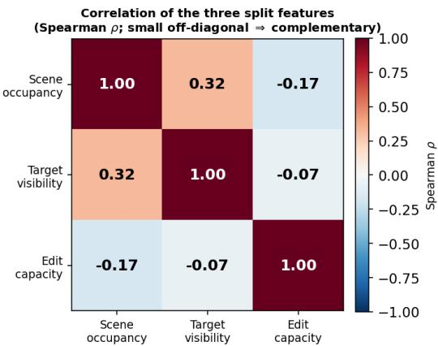  
Figure S1. Correlation of the three split features (Spearman $\rho ) .$ The scoring axes, scene occupancy (fg ratio), target visibility (target fg ratio), and edit capacity (max count), are only weakly inter-correlated $( | \rho | \leq 0 . 3 2 )$ , so they capture complementary aspects of scene difficulty rather than restating one another.

Each axis is more than correlated with the label it helps define: all three separate the tiers with a large effect size (Fig. S2; Cliff’s δ between easy and hard of −0.42, +0.67, and −0.66), and the composite score is cleanly ordered easy < medium < hard.

Crucially, the split is not circular. Three scene attributes that never enter the score, the number of instances, the number of categories, and the crowd ratio, still track the tiers (Fig. S3; Cliff’s $\delta = - 0 . 6 1 , - 0 . 5 2 , - 0 . 0 9 )$ : harder tiers hold more instances and more categories, exactly as an independent notion of scene complexity would predict. The tiers thus capture genuine difficulty rather than an artefact of their own axes.

Geometrically, the benchmark fills a difficulty “cube”: the easy corner is low-clutter, large-target, and lowcapacity, and difficulty grows toward the opposite corner (Fig. S4). One example of each operation is shown in Fig. S5, and the easy, medium, and hard tiers in Fig. S6.

## B. The evaluation protocol in action

## B.1. Notation

Table S1 maps the pipeline outputs named in the figures to the symbols used in the scoring equations of Sec. 4.4. Conservation (Eqs. 5, 9, 10) is normalized by the number of original instances, so it measures the fraction of originals preserved: by design, a single overwrite weighs more when few originals exist.

<table><tr><td>Op.</td><td>Pipeline output Symbol Role in the Score</td><td></td><td></td></tr><tr><td rowspan="2">Add</td><td>Nadded</td><td> $d$ </td><td>new instances;  $\mathrm { C F } \left( \mathrm { E q . ~ 4 } \right)$ </td></tr><tr><td> $N$  funmatched</td><td> $N _ { \mathrm { r e m } }$ </td><td>originals destroyed;  $\mathrm { O C } \left( \mathrm { E q . } 5 \right)$ </td></tr><tr><td rowspan="2"></td><td>Remove Nunmatched</td><td>r</td><td>removed instances; CF (Eq. 9)</td></tr><tr><td>Nadded</td><td>a</td><td>spurious additions; OC (Eq. 9)</td></tr><tr><td rowspan="3"></td><td>Change Nchanged</td><td> $t$ </td><td>in-place changes; CF (Eq. 10)</td></tr><tr><td> $N _ { \mathrm { c l s 1 } }$   $N _ { \mathrm { c l s 1 } } ^ { \mathrm { i p } }$ </td><td> $f _ { 1 }$ </td><td>cls1 deleted, not replaced; OC</td></tr><tr><td> $N _ { \mathrm { c l s 2 } }$   $N _ { \mathrm { c l s 2 } } ^ { \mathrm { i p } }$ </td><td> $f _ { 2 }$ </td><td>cls2 painted elsewhere; OC</td></tr><tr><td rowspan="2">All</td><td>instruction</td><td> $K$ </td><td>requested count; CF</td></tr><tr><td>ground truth</td><td> $N _ { \mathrm { G T } }$ </td><td>original instances; OC denominator</td></tr></table>

Table S1. Notation. Pipeline outputs named in the figures (Figs. 3 and S14) and the corresponding symbols in the scoring equations of Sec. 4.4. For change, the OC denominator is Ncls1.

## B.2. Addition pipeline: per-sample walkthroughs

Figures S7–S11 trace the addition pipeline (Sec. 4.1) panel by panel on real Gemini edits, making the otherwiseabstract stages concrete and showing the protocol across categories and target counts. Figure S7 is the most complete: an “add 4 backpacks” edit that exercises every stage, including the rare ambiguity-resolution step where unconfirmed candidates are super-resolved and passed to the constrained VLM verifier (bottom row). The editor over-adds, so ABACUS counts five backpacks for K =4 and penalizes the miscount, exactly the failure a count-blind metric would miss.

The same pipeline runs unchanged across diverse categories and counts (Fig. S8–S10). It credits edits that reach the requested count and catches those that do not, every verdict grounded in the same segmentation, matching, and dual-detector confirmation.

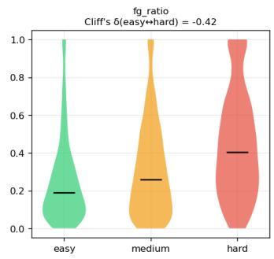

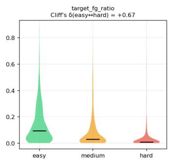

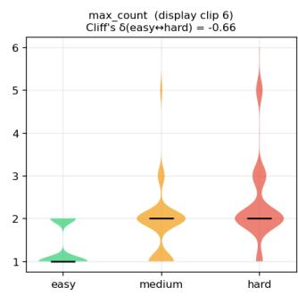

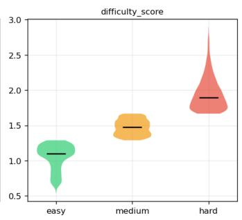  
Figure S2. The construction axes separate the tiers. Per-tier distributions of the three axes and of the composite difficulty score, with Cliff’s δ effect sizes (reported instead of p-values, which are uninformative at this sample size). Every axis shifts monotonically from easy to hard, and the difficulty score is strongly and cleanly ordered.

Independent corroboration: held-out scene features track the tiers → the split is not an artefact of its own axes  
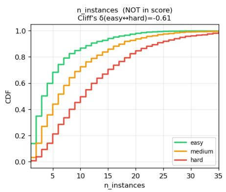

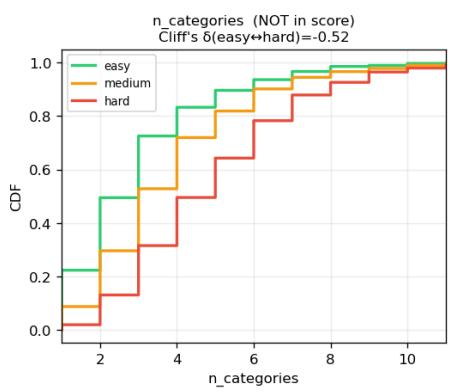

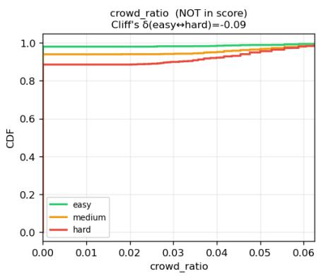

Figure S3. The tiers are non-circular. Per-tier CDFs of three held-out scene attributes that do not enter the difficulty score. They stil separate easy/medium/hard (Cliff’s δ shown), so the split reflects real scene complexity, not the axes that define it. Crowd ratio (δ = −0.09) separates least, as expected, since it is the most orthogonal to the construction.  
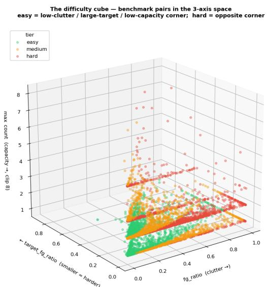  
Figure S4. The difficulty cube. Benchmark pairs in the three-axis space, colored by tier. Easy pairs (green) cluster in the low-clutter, large-target, low-capacity corner; hard pairs (red) fill the opposite corner, with medium (orange) in between.

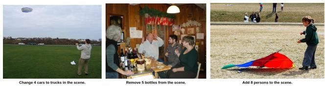  
Figure S5. Benchmark examples. One add, one remove, and one change sample, each with the instruction shown beneath the image pair.

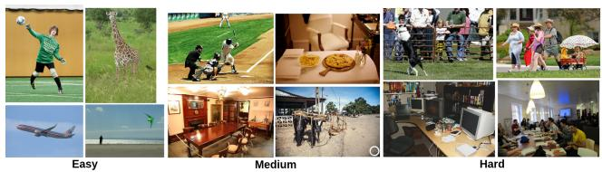  
Figure S6. Difficulty tiers. Real examples for easy, medium, and hard. Difficulty is a tercile split of a composite score over three axes: foreground coverage, target count, and target-object scale. This makes precise what a “complex scene” is.

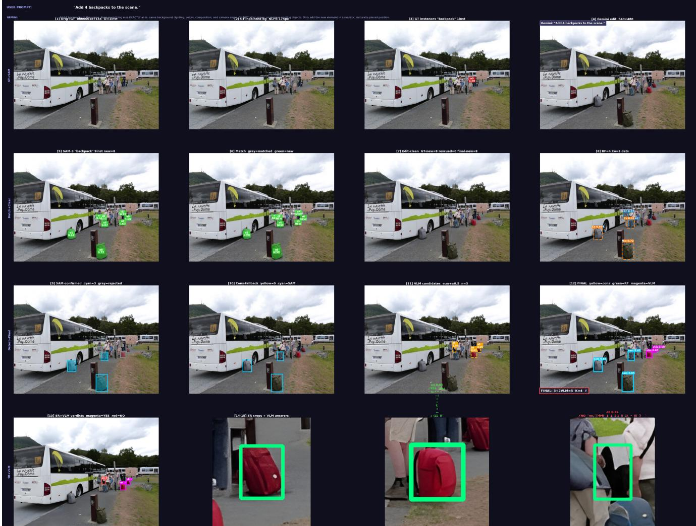  
Figure S7. Addition pipeline on a real edit (“add 4 backpacks”). Row 1: source+GT, NLPB-inpainted background, GT instances, and the Gemini edit. Row 2: presence-gated SAM-3 segmentation, one-to-one matching (grey=matched, green=new), clean-image construction, and the two detectors’ boxes. Row 3: SAM-confirmed candidates, consensus fallback, VLM candidates, and the final verdict. Row 4: the super-resolved crops sent to the constrained VLM verifier with its yes/no answers. The editor adds five backpacks for K = 4; ABACUS recovers the true count and penalizes it.

The protocol holds at high target counts, the regime where editors fail most (Fig. S11).

## B.3. Repairing incomplete ground truth

The panoptic annotations are strong but not perfect: some instances are simply not labelled. A naive pipeline would then count a real, pre-existing object as newly added, inflating the realized count. ABACUS guards against this by segmenting the source image as well, not just the edit: every candidate flagged as new is cross-checked against the source segmentation, and if a confident counterpart is present in the original it is reassigned to existing (“rescued”) rather than counted as new (Sec. 4.1). Figure S12 shows a clear case on an “add 2 chairs” edit: the chairs in the background were present in the original but missing from the annotation, so SAM-3 first marks them as new; the source-image cross-check finds their counterparts and rescues them, so only the genuinely added chairs are counted.

## B.4. Matching under generative drift

Figure S13 shows why exact-count editing needs more than a direct judge. The edit inserts two cars so naturally that the before/after pair looks like an ordinary street: a VLM judge sees a plausible result and cannot say what, or how much, changed. ABACUS’s geometry-and-appearance matcher (Sec. 4.1) instead places every edited instance against the source. It confirms the pre-existing car as matched (e1) and flags the two inserted cars as genuinely new (e0 and e2, with high segmentation scores), recovering the exact added count that a direct judge would miss.

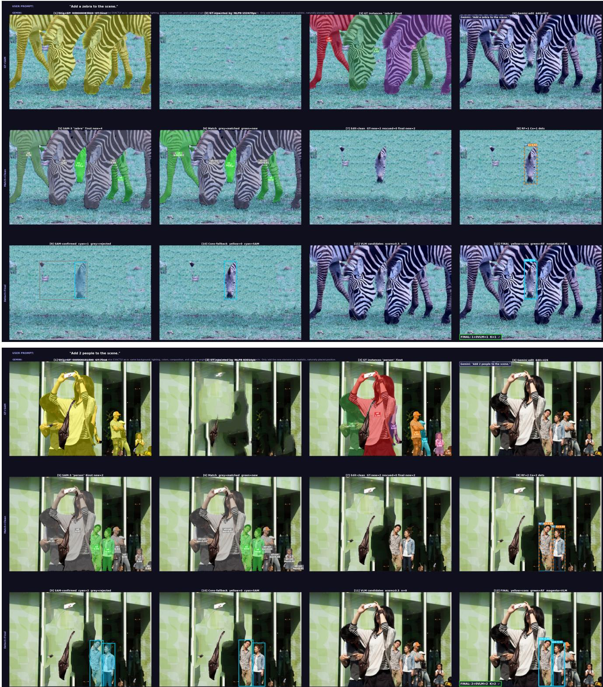  
Figure S8. Correct additions (I). “Add a zebra” (top, one added for K = 1) and “add 2 people” (bottom, two for K = 2). The added zebra sits behind the grazing animals, yet it is still segmented, isolated by inpainting, and confirmed by both detectors; ABACUS credits the edit.

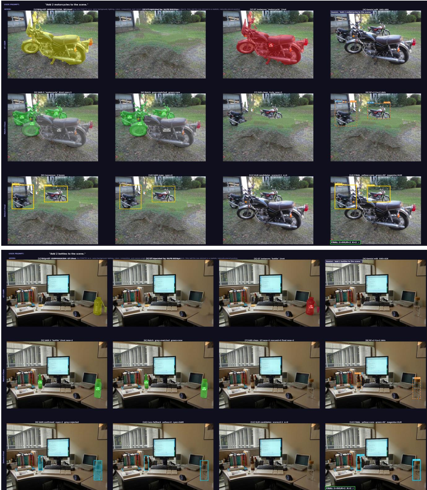  
Figure S9. Correct additions (II). “Add 2 motorcycles” (top) and “add 2 bottles” (bottom), both correctly counted at K = 2. The new motorcycles sit behind the foreground one and are still recovered, while the bottles are added among the existing desk clutter.

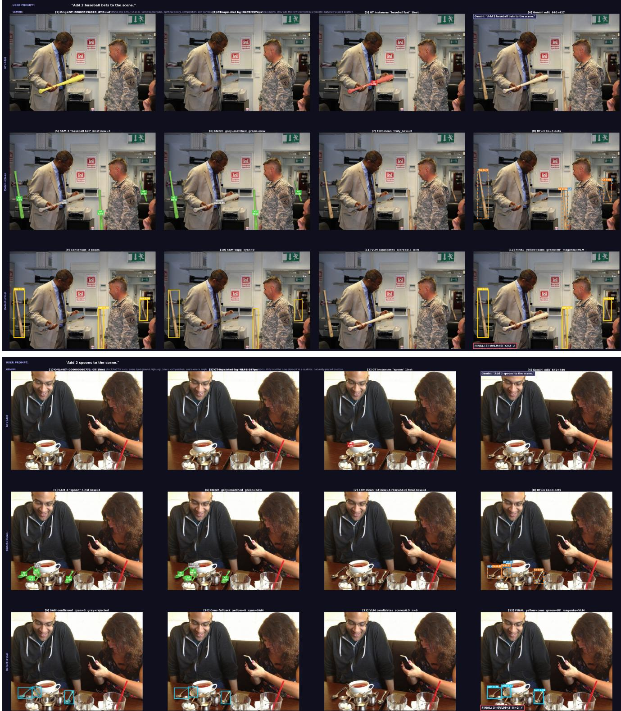  
Figure S10. Caught over-additions. “Add 2 baseball bats” (top) and “add 2 spoons” (bottom) each yield three instances; ABACUS counts the surplus and the count-fidelity term penalizes the miscount, which a holistic or VLM-judge score would overlook.

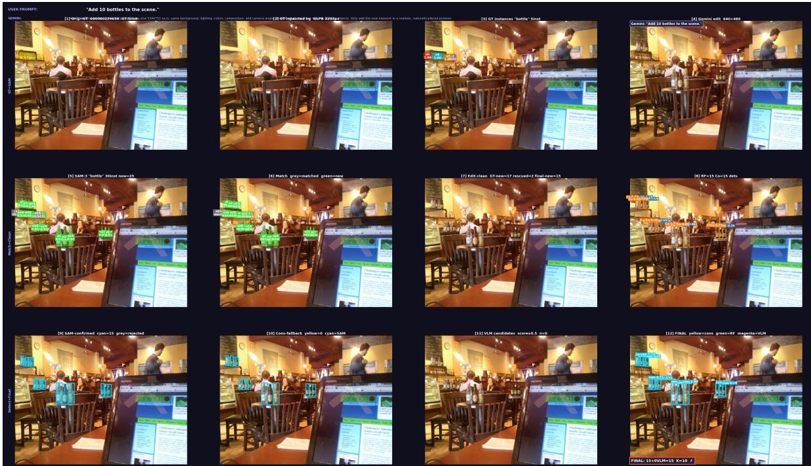  
Figure S11. High-count addition (“add 10 bottles”). A stress case at the top of the count range. The editor packs in fifteen bottles; presence-gated segmentation and dual-detector confirmation resolve the dense, overlapping instances, and ABACUS reports 15 against K =10, a miscount a holistic or VLM-judge metric would overlook.

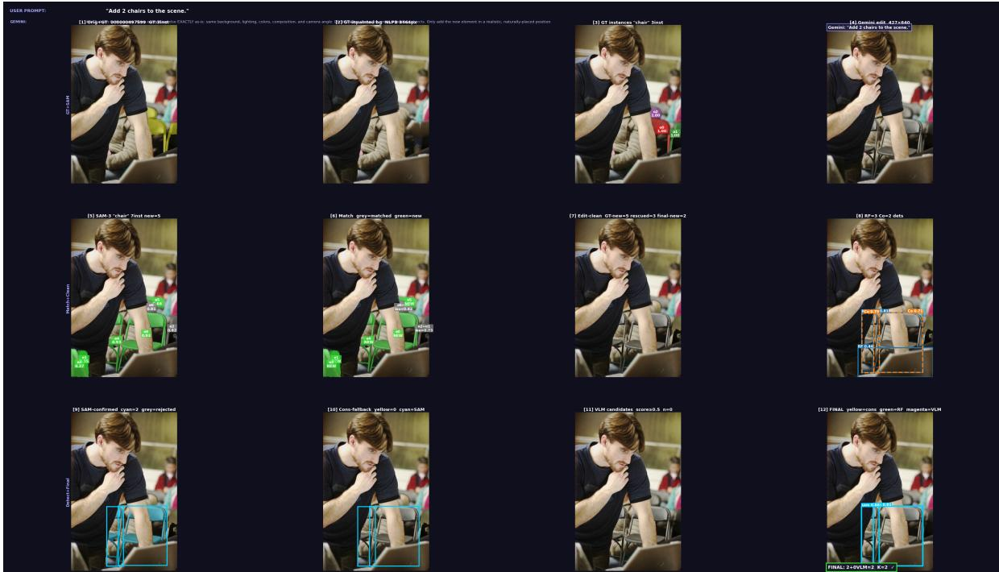  
Figure S12. Ground-truth completion on “add 2 chairs”. The background chairs already exist in the source image but are absent from the panoptic annotation, so segmentation of the edit initially flags them as new. Because ABACUS also segments the source image, the cross-check finds their counterparts there and reassigns them to existing (rescued), leaving only the genuinely added chairs in the count. Without this step, missing annotations would be mistaken for additions and inflate the count.

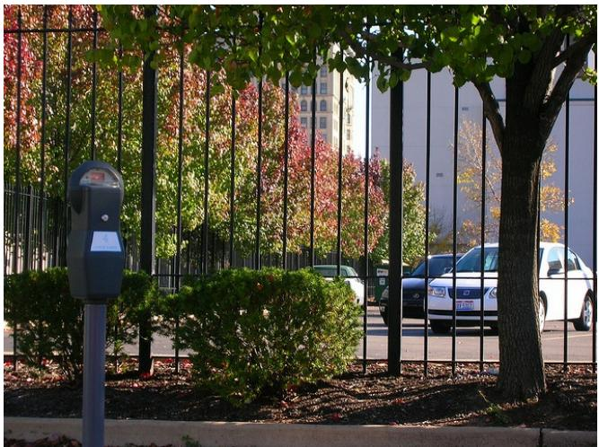

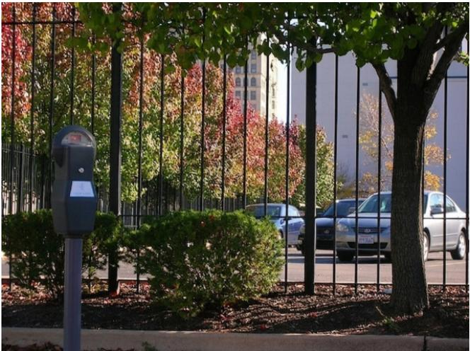

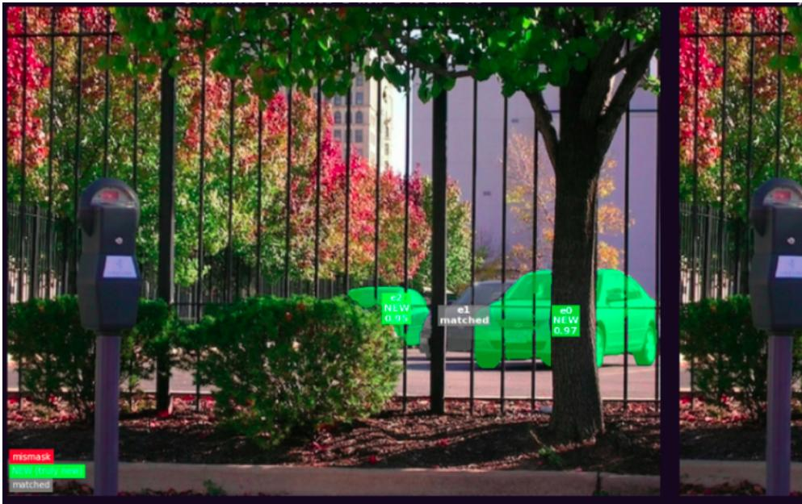  
Figure S13. Matching catches changes a judge cannot see. Top: source (left) and edited (right) images for “add 2 cars”; the two added cars blend in so well that the before/after difference is easy to miss, and a direct VLM judge cannot tell what changed. Bottom: ABACUS’s geometry-and-appearance matcher resolves it exactly, marking the pre-existing car matched (e1) and the two inserted cars new (e0, e2). The one-to-one matching is what turns a near-imperceptible edit into a precise, grounded count.

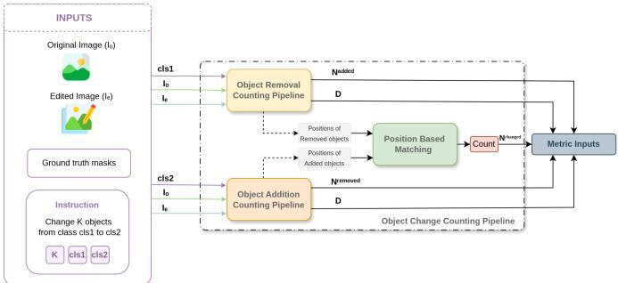  
Figure S14. ‘Change’ pipeline. The remove pipeline runs on cls1 and the add pipeline on cls2; matching the removed and added positions yields the matched changes Nchanged.

## B.5. The change operation

Figure S14 summarizes the change pipeline. Figure S15 walks the change pipeline (Sec. 4.3) through a real “change 2 horses to zebras” edit. The remove branch tracks the source cls1 (horses) and the add branch the new cls2 (zebras); matching their positions credits a transformation only where it occurred in place, where a horse was, which is what separates a genuine change from a delete-here-paint-there edit.

## C. Additional experimental analysis

## C.1. Leaderboard computation

Every number in Table 2 is obtained from the per-edit verdicts in four steps, using the cell sizes $N _ { c }$ of Table 1b $\begin{array} { r } { ( \sum _ { c } N _ { c } = 1 0 , 9 4 4 ) } \end{array}$

1. Cell factors. For each editor and each of the nine operation×tier cells $c , \mathrm { C F } _ { c } , \mathrm { S C } _ { c }$ and $\mathrm { O C } _ { c }$ are the means of the per-edit factors (Sec. 4.4) over the $N _ { c }$ edits of the cell (Table S2).

2. Cell Score. Scor $\mathsf { \Pi } _ { \mathsf { X } } ^ { } = \mathrm { C F } _ { c } \cdot \mathrm { S C } _ { c } \cdot \mathrm { O C } _ { c } ,$ computed at full precision and rounded half-up to two decimals for the E/M/H columns of Table 2.

3. Overall factors. $\begin{array} { r } { \mathrm { C F } = \sum _ { c } N _ { c } { \mathrm { C F } } _ { c } / \sum _ { c } N _ { c } , } \end{array}$ i.e. the mean of the per-edit CF over all 10,944 edits, and likewise for SC and OC.

4. Overall Score. ${ \mathrm { S c o r e } } = { \mathrm { C F } } \cdot { \mathrm { S C } } \cdot { \mathrm { O C } } .$ , the product of the three overall averages. It is not the mean of the nine cell Scores, which is why it can sit below many of them.

We aggregate this way, rather than averaging the per-edit Scores of Eq. 3, so that every reported Score is exactly the product of the CF, SC, and OC columns printed next to it: a reader can trace any difference between editors to the factor that causes it. The per-edit Score of Eq. 3 remains the quantity each individual edit receives. Because the overall factors are computed from the per-edit values, recomputing them from the three-decimal cells of Table S2 can differ in the fourth decimal.

Worked example (Seedream 4.0). For the Add/Easy cell, $\mathrm { S c o r e } _ { c } ~ = ~ 0 . 7 6 2 \times 0 . 9 2 2 \times 0 . 7 8 2 ~ = ~ 0 . 5 4 9 ~  ~ 0 . 5 5 ;$ for Change/Hard, $0 . 4 6 9 \times 0 . 6 0 7 \times 0 . 4 7 6 = 0 . 1 3 6 \to$ 0.14. Weighting the cell factors by $N _ { c }$ gives $\begin{array} { r l } { \mathrm { C F } } & { { } = } \end{array}$ 6605 $6 / 1 0 , 9 4 4 = 0 . 6 0 3 6 , \mathrm { S C } = 8 6 8 9 . 0 / 1 0 , 9 4 4 = 0 . 7 9 4 0$ and $\mathrm { O C ~ = ~ 7 1 7 4 . 6 / 1 0 , 9 4 4 ~ = ~ 0 . 6 5 5 6 }$ , hence Score = $0 . 6 0 3 6 \times 0 . 7 9 4 0 \times 0 . 6 5 5 6 = 0 . 3 1 4 2 \to 0 . 3 1$

Exact-count success rate. As a complement to the Score, the share of edits whose count is exactly right $( \mathrm { C F } = 1 )$ is 0.43 for Seedream 4.0, 0.41 for Gemini 2.5, 0.38 for GPT-Image-1, 0.21 for Qwen-Image-Edit, 0.19 for FLUX.1 Kontext, 0.13 for Step1X-Edit, and 0.09 for BAGEL: even the best editor delivers the requested number on fewer than half of the edits, with the same ordering as the Score.

## C.2. Protocol ablation

Table S3 gives the full component ablation analysed in Sec. 5.4: each component of the evaluation protocol is removed one at a time and exact-count agreement against the human count is re-measured on the 600-image set. Every component is load-bearing, and the matcher’s one-to-one alignment is by far the most important (agreement collapses from 0.82 to 0.36 without it), while the constrained VLM verifier is the least important (0.82 to 0.79), confirming that accuracy rests on grounded geometry and detection rather than on the VLM.

## C.3. Human-evaluation set composition

The validation study of Sec. 5.1 uses a 600-image set in which the true number of target-category objects in each edited image is labelled by two experienced annotators, with a final verifier resolving any disagreement (App. C.9), so the human reference is a reliable consensus rather than a single rater’s opinion. Figure S16 summarizes its composition: it is stratified by category and difficulty: balanced across the three difficulty tiers (a), spanning target counts from $K = 2$ to 12 with most mass at the low-to-mid counts where editors already struggle (b), and covering 79 of the 80 COCO thing-categories (c). This breadth is what lets us read evaluator reliability both by tier (Table 3) and as the object count grows (Fig. S18).

## C.4. Editing-model prompt

To produce each edited image, we query the editor with the benchmark instruction (Sec. 3.1) followed by a fixed scenepreservation suffix that asks the model to alter only the requested objects. For addition, the full prompt is:

“Add K {category} to the scene. Keep everything else exactly as-is: same background, lighting, colors, composition, and camera angle. Do not alter, move, or remove existing objects. Only add the new element in a realistic, naturally-placed position.”

Removal and change use the analogous instruction with a matching preservation suffix. Holding this suffix fixed across all editors keeps the comparison fair: every model is explicitly asked to preserve the rest of the scene, so a low original-category conservation score reflects the editor’s behaviour, not a difference in prompting.

## C.5. Human-count agreement by tier

Figure S17 visualizes the per-tier exact-count agreement of Table 3: ABACUS tracks the human reference across easy, medium, and hard, while the solo VLM and the single detector fall away as difficulty grows.

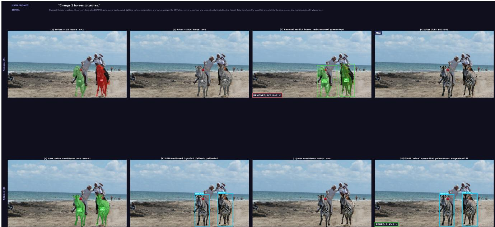  
Figure S15. Change pipeline on a real edit (“change 2 horses to zebras”). Each instance is colored by its verdict as the pipeline proceeds: the source horses are segmented and matched, the edited zebras are detected and confirmed by the two detectors, and the removed-source and added-target positions are matched so each change is credited only where a horse originally stood. This position-aware coupling is what prevents a delete-here-paint-there edit from passing as a change.

Human-evaluation set composition (600 images)  
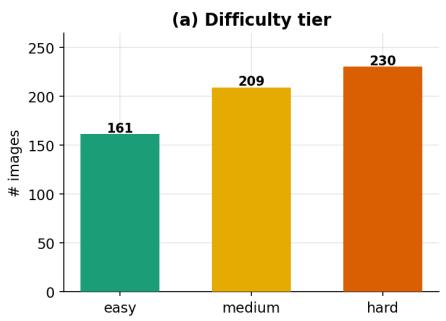

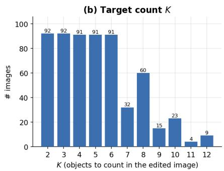

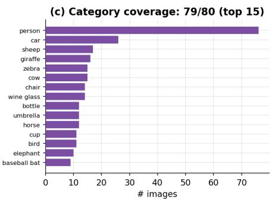  
Figure S16. Composition of the 600-image human-evaluation set. (a) Difficulty-tier distribution (easy/medium/hard). (b) Target-count K distribution, concentrated at the low-to-mid counts and thinning at the hardest high counts. (c) Category coverage: 79 of 80 COCO thing-categories.

## C.6. Reliability across editors

Table 4 (main paper) reports per-editor exact-count agreement on the seven editors. Here we detail why that flatness is a property of the evaluator and not of the edits it happens to see. These 200 images are drawn from the 600-image validation set (Table 3), so each editor’s agreement here differs from that set only by sampling: Seedream, for instance, reads 0.83 here versus 0.82 there, a difference well inside the 0.013 cross-editor standard deviation.

Baseline choice. The two single-tool baselines are chosen conservatively. Qwen3.6-27B is one of the strongest recent vision-language models, run in thinking mode for its best counting; the argument is conservative, since if a current top model fails as a counter, the weaker judges that earlier protocols rely on can only do worse, so this single comparison stands in for all of them. Grounding-DINO is precisely the single open-vocabulary detector that EdiVal-Agent [9] relies on to score its count-change edits.

Recall audit. On the subset of edits that the human annotators confirm as count-correct, ABACUS recovers the exact count 92% of the time overall and 86% on the hard tier (Table S4), and this recall is stable across the seven editors. A weak editor that nonetheless produces the requested number is therefore not scored as a failure by construction of the metric.

Preserved-instance matching. The drift-robust matcher (Sec. 4.1) holds preserved-instance detection at $F _ { 1 } = 0 . 9 2$ even on the weakest editor, so a relocated, deformed, or repainted original is matched to itself rather than doublecounted as a new instance.

<table><tr><td rowspan="2">Model</td><td rowspan="2">Factor</td><td colspan="3">Add</td><td colspan="3">Remove</td><td colspan="3">Change</td></tr><tr><td>E</td><td>M</td><td>H</td><td>E</td><td>M</td><td>H</td><td>E</td><td>M</td><td>H</td></tr><tr><td></td><td>Nc</td><td>1,159</td><td>1,363</td><td>1,374</td><td>1,146</td><td>1,340</td><td>1,308</td><td>1,000</td><td>1,128</td><td>1,126</td></tr><tr><td rowspan="4">Seedream 4.0 [36]</td><td>CF</td><td>0.762</td><td>0.662</td><td>0.579</td><td>0.684</td><td>0.563</td><td>0.513</td><td>0.677</td><td>0.541</td><td>0.469</td></tr><tr><td>SC</td><td>0.922</td><td>0.852</td><td>0.776</td><td>0.901</td><td>0.800</td><td>0.724</td><td>0.839</td><td>0.726</td><td>0.607</td></tr><tr><td>OC</td><td>0.782</td><td>0.745</td><td>0.633</td><td>0.745</td><td>0.686</td><td>0.530</td><td>0.677</td><td>0.624</td><td>0.476</td></tr><tr><td>CF·SC·OC</td><td>0.5494</td><td>0.4202</td><td>0.2844</td><td>0.4591</td><td>0.3090</td><td>0.1968</td><td>0.3845</td><td>0.2451</td><td>0.1355</td></tr><tr><td rowspan="4">Gemini 2.5 Flash Image [12]</td><td>CF</td><td>0.710</td><td>0.643</td><td>0.554</td><td>0.676</td><td>0.591</td><td>0.493</td><td>0.628</td><td>0.567</td><td>0.465</td></tr><tr><td>SC</td><td>0.885</td><td>0.843</td><td>0.768</td><td>0.863</td><td>0.806</td><td>0.728</td><td>0.756</td><td>0.684</td><td>0.579</td></tr><tr><td>OC</td><td>0.823</td><td>0.717</td><td>0.620</td><td>0.764</td><td>0.634</td><td>0.513</td><td>0.663</td><td>0.570</td><td>0.450</td></tr><tr><td>CF·SC·OC</td><td>0.5171</td><td>0.3886</td><td>0.2638</td><td>0.4457</td><td>0.3020</td><td>0.1841</td><td>0.3148</td><td>0.2211</td><td>0.1212</td></tr><tr><td rowspan="4">GPT-Image-1 [27]</td><td>CF</td><td>0.742</td><td>0.633</td><td>0.528</td><td>0.660</td><td>0.530</td><td>0.469</td><td>0.618</td><td>0.474</td><td>0.414</td></tr><tr><td>SC</td><td>0.843</td><td>0.814</td><td>0.744</td><td>0.809</td><td>0.773</td><td>0.688</td><td>0.757</td><td>0.707</td><td>0.619</td></tr><tr><td>OC</td><td>0.817</td><td>0.708</td><td>0.629</td><td>0.710</td><td>0.592</td><td>0.528</td><td>0.652</td><td>0.538</td><td>0.429</td></tr><tr><td>CF·SC·OC</td><td>0.5110</td><td>0.3648</td><td>0.2471</td><td>0.3791</td><td>0.2425</td><td>0.1704</td><td>0.3050</td><td>0.1803</td><td>0.1099</td></tr><tr><td rowspan="4">Qwen-Image-Edit [40]</td><td>CF</td><td>0.566</td><td>0.476</td><td>0.368</td><td>0.472</td><td>0.443</td><td>0.333</td><td>0.432</td><td>0.371</td><td>0.303</td></tr><tr><td>SC</td><td>0.873</td><td>0.787</td><td>0.675</td><td>0.807</td><td>0.696</td><td>0.560</td><td>0.742</td><td>0.626</td><td>0.474</td></tr><tr><td>OC</td><td>0.704</td><td>0.611</td><td>0.511</td><td>0.672</td><td>0.570</td><td>0.452</td><td>0.567</td><td>0.481</td><td>0.359</td></tr><tr><td>CF·SC·OC</td><td>0.3479</td><td>0.2289</td><td>0.1269</td><td>0.2560</td><td>0.1757</td><td>0.0843</td><td>0.1817</td><td>0.1117</td><td>0.0516</td></tr><tr><td rowspan="4">FLUX.1 Kontext [4]</td><td>CF</td><td>0.511</td><td>0.454</td><td>0.349</td><td>0.485</td><td>0.395</td><td>0.318</td><td>0.379</td><td>0.327</td><td>0.288</td></tr><tr><td>SC</td><td>0.828</td><td>0.713</td><td>0.622</td><td>0.807</td><td>0.682</td><td>0.585</td><td>0.720</td><td>0.581</td><td>0.472</td></tr><tr><td>OC</td><td>0.707</td><td>0.612</td><td>0.548</td><td>0.616</td><td>0.512</td><td>0.445</td><td>0.518</td><td>0.451</td><td>0.354</td></tr><tr><td>CF·SC·OC</td><td>0.2991</td><td>0.1981</td><td>0.1190</td><td>0.2411</td><td>0.1379</td><td>0.0828</td><td>0.1414</td><td>0.0857</td><td>0.0481</td></tr><tr><td rowspan="4">Step1X-Edit [24]</td><td>CF</td><td>0.428</td><td>0.367</td><td>0.353</td><td>0.373</td><td>0.345</td><td>0.311</td><td>0.315</td><td>0.290</td><td>0.257</td></tr><tr><td>SC</td><td>0.806</td><td>0.736</td><td>0.639</td><td>0.743</td><td>0.646</td><td>0.555</td><td>0.647</td><td>0.539</td><td>0.440</td></tr><tr><td>OC</td><td>0.682</td><td>0.585</td><td>0.440</td><td>0.635</td><td>0.522</td><td>0.394</td><td>0.535</td><td>0.402</td><td>0.290</td></tr><tr><td>CF·SC·OC</td><td>0.2353</td><td>0.1580</td><td>0.0992</td><td>0.1760</td><td>0.1163</td><td>0.0680</td><td>0.1090</td><td>0.0628</td><td>0.0328</td></tr><tr><td rowspan="4">BAGEL [10]</td><td>CF</td><td>0.382</td><td>0.331</td><td>0.306</td><td>0.330</td><td>0.280</td><td>0.270</td><td>0.304</td><td>0.260</td><td>0.240</td></tr><tr><td>SC</td><td>0.800</td><td>0.713</td><td>0.575</td><td>0.763</td><td>0.643</td><td>0.490</td><td>0.675</td><td>0.549</td><td>0.388</td></tr><tr><td>OC</td><td>0.642</td><td>0.534</td><td>0.453</td><td>0.571</td><td>0.461</td><td>0.389</td><td>0.507</td><td>0.390</td><td>0.321</td></tr><tr><td>CF·SC·OC</td><td>0.1962</td><td>0.1260</td><td>0.0797</td><td>0.1438</td><td>0.0830</td><td>0.0515</td><td>0.1040</td><td>0.0557</td><td>0.0299</td></tr></table>

Table S2. Per-cell factors behind Table 2. Mean count fidelity (CF), scene consistency (SC), and original-category conservation (OC) per editor, operation, and difficulty tier, with the cell size N and the cell Score $\mathrm { C F } _ { c } \cdot \mathrm { S C } _ { c } \cdot \mathrm { O C } _ { c } ;$ rounding the exact product half-up to two decimals gives the E/M/H columns of Table 2.
<table><tr><td>Variant</td><td>Acc. vs. human</td></tr><tr><td>Full ABACUS</td><td>0.82</td></tr><tr><td>w/o ambiguity block (VLM verifier)</td><td>0.79</td></tr><tr><td>single detector (avg. RF-only, Co-only)</td><td>0.71</td></tr><tr><td>w/o inpainting (clean-image isolation)</td><td>0.70</td></tr><tr><td>w/o ground-truth completion</td><td>0.69</td></tr><tr><td>w/o one-to-one alignment</td><td>0.36</td></tr></table>

Table S3. Ablation of the evaluation protocol. Exact-count accuracy against the human count, removing one component at a time (600-image set; analysis in Sec. 5.4).
<table><tr><td>Tier</td><td>n (count-correct)</td><td>ABACUS recall</td><td>False-neg. rate</td></tr><tr><td>Easy</td><td>200</td><td>0.97</td><td>0.03</td></tr><tr><td>Medium</td><td>160</td><td>0.91</td><td>0.09</td></tr><tr><td>Hard</td><td>120</td><td>0.86</td><td>0.14</td></tr><tr><td>Overall</td><td>480</td><td>0.92</td><td>0.08</td></tr></table>

Table S4. Recall audit on human-confirmed count-correct edits. ABACUS recognises the correct count about 92% of the time, and the false-negative rate is roughly editor-independent, so a weak editor that does produce the right number is not scored as a failure. The overall is weighted by n (count-correct edits skew easy, so it exceeds the unweighted tier mean).

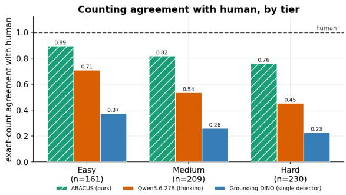  
Figure S17. Counting agreement with the human reference, by tier (600-image study). ABACUS tracks the human count across easy, medium, and hard; the solo VLM (Qwen3.6-27B) degrades with difficulty; the single Grounding-DINO detector is the least reliable.

## C.7. Validating the full Score

The main text validates exact counting (Table 3, main paper); the ABACUS Score multiplies three factors (Eq. 3, main paper), and we validate each of them against the human annotations on the same set (Table S5). Originalcategory conservation and in-place change-correspondence are agreement rates on discrete verdicts; scene consistency and the combined Score are rank correlations against the human ratings. Original-category conservation reaches 0.97 with a balanced accuracy of 0.90, so the agreement is not an artefact of the kept-majority class. Scene consistency is a continuous quantity while humans rate it on a discrete five-point scale, so the discreteness alone caps the attainable coefficient at $\rho = 0 . 8 7$ ; the two nonetheless agree in substance (Fig. S19).

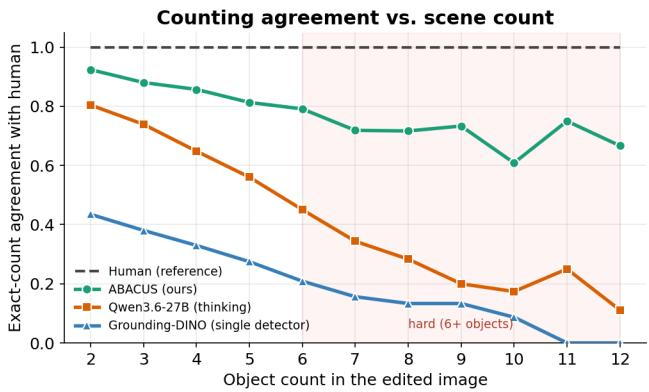

Figure S18. Counting agreement with human vs. scene count. As the number of objects in the edited image grows, ABACUS degrades gradually and levels off near 0.6 on the busiest scenes, the solo VLM drops sharply but stays non-zero, and the single Grounding-DINO detector collapses to zero past ten objects. ABACUS stays well above both single-tool counters across the whole range.
<table><tr><td>Factor of the ABACUS Score</td><td>Agreement with humans</td></tr><tr><td>Count fidelity (exact count)</td><td>0.82</td></tr><tr><td>Original-category conservation</td><td>0.97 (bal. acc. 0.90)</td></tr><tr><td>In-place change-correspondence</td><td>0.95</td></tr><tr><td>Scene consistency</td><td> $\rho = 0 . 8 7$ </td></tr><tr><td>Combined ABACUS Score</td><td> $\rho = 0 . 8 8 ( \mathrm { o r d e r i n g } \rho = 0 . 9 6 )$ </td></tr></table>

Table S5. Every factor of the Score is validated against humans (600-image study). Discrete-verdict factors report agreement rates; continuous factors report Spearman $\rho .$

## C.8. Threshold sensitivity, aggregation, and detector choice

Thresholds. The five thresholds of Sec. 4.1 are set once and never retuned. We sweep each one over a wide range and re-measure exact-count agreement on the 600-image set (Table S6). Four thresholds are inert, changing agreement by at most 0.02; the matcher keep-margin $\tau _ { m }$ is the most sensitive, yet changes it by at most 0.03. Jittering all five thresholds together by ±20% (200 random draws) leaves the editor leaderboard order unchanged in 96% of draws. The protocol therefore does not depend on finely

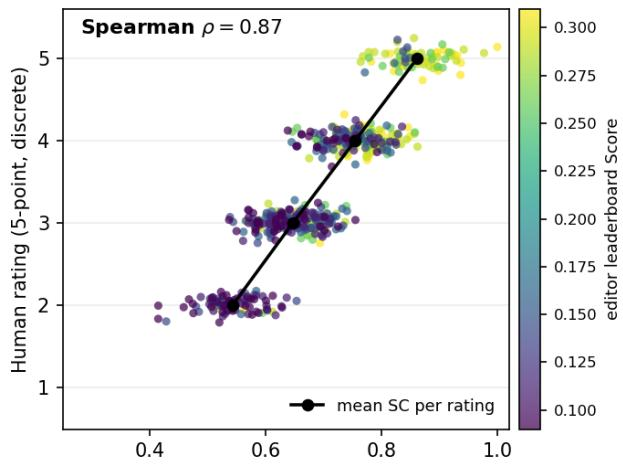  
ABACUS scene consistency SC (continuous)

Figure S19. Scene consistency vs. human rating. ABACUS’s continuous scene-consistency score is monotone in the discrete human rating; the five-point human scale caps the rank correlation at $\rho = 0 . 8 7$ . Human ratings are integers; points are jittered vertically for visibility only, and $\rho$ is computed on the integer ratings.
<table><tr><td>Threshold</td><td>Governs</td><td>Max |∆| agreement</td></tr><tr><td> $\tau _ { p } = 0 . 6$ </td><td>presence gate (SAM-3)</td><td>≤ 0.02</td></tr><tr><td> $\tau _ { c } = 0 . 7$ </td><td>containment</td><td>≤ 0.02</td></tr><tr><td> $\tau _ { d } = 0 . 3$ </td><td>centroid-distance gate</td><td>≤ 0.02</td></tr><tr><td> $\tau _ { a } = 0 . 1 5$ </td><td>appearance confirmation</td><td>≤ 0.02</td></tr><tr><td> $\tau _ { m } = 0 . 1$ </td><td>matcher keep-margin</td><td>0.03</td></tr></table>

Table S6. Threshold sweep (600-image set). Largest change in exact-count agreement as each threshold is swept over a wide range. Four thresholds are inert; $\tau _ { m }$ is the most sensitive, changing agreement by at most 0.03.
<table><tr><td>Aggregation</td><td>Best real editor</td><td>Do-nothing editor</td></tr><tr><td>Arithmetic mean of CF, SC, OC</td><td>0.684</td><td>0.667 (nearly ties)</td></tr><tr><td>Product (ours)</td><td>0.31</td><td>0.00 (rejected)</td></tr></table>

Table S7. Product vs. mean. An arithmetic mean lets a donothing editor nearly tie the best model; the product rejects it while keeping all three factors.

tuned threshold values.

Aggregation. The product in Eq. 3 is necessary, not cosmetic. Under an arithmetic mean of the three factors, a do-nothing editor that returns the source image untouched $( \mathrm { C F } = 0 , \mathrm { S C } = 1 , \mathrm { O C } = 1 )$ scores 0.667 and nearly ties the best real model at 0.684; the product scores it 0 while still rewarding the best model at 0.31 (Table S7). The product is the aggregation that refuses to trade a missing edit against a preserved background.

Detector choice. The count is a two-detector consensus with several error-correcting stages, not the output of any single detector, so it is robust to which detectors are used. We re-score the 600-image set with perturbed detector pairs (Table S9): swapping Co-DETR for a strong closed-set DINO detector (Swin-L backbone; the object-

<table><tr><td>Component</td><td>Role</td><td>Version / model ID</td></tr><tr><td>Seedream 4.0</td><td>editor</td><td>seedream-4-0-250828 (hosted API, queried 2026)</td></tr><tr><td>Gemini 2.5 Flash Image</td><td>editor</td><td> $\mathtt { g e m i n i - 2 . 5 - f l a s h - i m a g e - p r e v i e w }$ </td></tr><tr><td>GPT-Image-1</td><td>editor</td><td> $\mathtt { g p t - i m a g e - 1 }$ </td></tr><tr><td>Qwen-Image-Edit</td><td>editor</td><td> $\mathtt { Q w e n / Q w e n - I m a g e - E d i t }$ </td></tr><tr><td>FLUX.1 Kontext</td><td>editor</td><td> $\mathtt { b l a c k - f o r e s t - l a b s / F L U X \_ 1 - K o n t e x t - d e v }$ </td></tr><tr><td>Step1X-Edit</td><td>editor</td><td> $\mathsf { s t e p f u n - a i / S t e p 1 X - E d i t }$ </td></tr><tr><td>BAGEL</td><td>editor</td><td> $\mathtt { B y t e D a n c e - S e e d / B A G E L - 7 B - M o T }$ </td></tr><tr><td>SAM 3</td><td>segmentation</td><td>facebook/sam3</td></tr><tr><td>RF-DETR-2X-Large</td><td>detector (consensus)</td><td> $\mathtt { R F D E T R 2 X L a r g e ( r f d e t r  p a c k a g e ) }$ </td></tr><tr><td>Co-DETR ViT-L (COCO)</td><td>detector (consensus)</td><td>cfg co_dino_5scale_vit_large_coco, ckpt co_detr_vit_l_coco.pth</td></tr><tr><td>Qwen3.6-27B</td><td>crop category check</td><td> $\mathsf { Q w e n / Q w e n 3 . 6 - 2 7 B }$ </td></tr><tr><td>Real-ESRGAN</td><td>crop super-resolution</td><td> $\mathtt { R e a l E S R G A N \_ x 4 p l u s }$ </td></tr><tr><td>RAFT</td><td>optical flow (SC)</td><td> $\mathtt { r a f t \mathrm { _ { - } l a r g e } }$ </td></tr><tr><td>Grounding-DINO</td><td>single-detector baseline</td><td> $\mathtt { G r o u n d i n g D I N O \_ S w i n T \_ O G C \ ( g r o u n d i n g d i n o \_ S w i n t \_ o g c . p t h ) }$ </td></tr></table>

Table S8. Components and versions. Proprietary editors are hosted APIs queried on fixed dates (8–14 June and 15 August 2026), reported by API model name and subject to provider-side updates. Open editors and all evaluation components are pinned to the listed Hugging Face repositories or checkpoints and released with the benchmark.

<table><tr><td>Evaluation detector set</td><td>Agreement</td><td>Ordering</td></tr><tr><td> $\mathrm { R F \mathrm { - } D E T R + C o \mathrm { - } D E T R \ ( V i T \mathrm { - } L ) , }$  default</td><td>0.82</td><td></td></tr><tr><td> $\mathrm { R F \mathrm { - } D E T R + D I N O \ ( S w i n \mathrm { - } L ) }$ </td><td>0.81</td><td>preserved</td></tr><tr><td> $\mathrm { R F - D E T R } + \mathrm { Y O L O 2 6 - X }$ </td><td>0.81</td><td>preserved</td></tr><tr><td> $\mathrm { Y O L O 2 6  – X + D I N O ( S w i n – L ) }$ </td><td>0.80</td><td>preserved</td></tr></table>

Table S9. Detector-swap robustness. Re-scoring the 600-image validation set with perturbed detector pairs: exact-count agreement with the human count changes by at most 0.02 (largest for the fully disjoint pair) and the editor ordering never changes. The swapped-in DINO is the closed-set object-detection DINO, not the open-vocabulary Grounding-DINO.

detection DINO [43], not the open-vocabulary Grounding-DINO baseline) or for the CNN detector YOLO26-X [18] each costs at most 0.01, and replacing both defaults at once with the fully disjoint pair YOLO26-X + DINO costs 0.02. The editor ordering is preserved in every case (only the top two proprietary models, statistically tied (App. D.1), exchange rank), so no single detector drives the result.

## C.9. Annotation protocol and the human ceiling

Each edited image in the 600-image set is counted independently by two experienced annotators; a third final verifier adjudicates any disagreement, and the adjudicated count is the human reference. On the re-annotated set, the two independent annotators agree at Krippendorff α = 0.88 overall and 0.79 on the hard tier, with raw agreement 0.92 and 0.85 (Table S10). Measured like-for-like (raw agreement against raw agreement), the gap between ABACUS and the human-human ceiling does not widen with difficulty, hold ing at 0.09 on both the easy and hard tiers and 0.10 when pooled across all images (a pooled agreement rate, not the average of the tiers): the evaluator degrades in step with human annotators, so its label is a consensus estimate with a bounded residual rather than an oracle.

<table><tr><td>Agreement</td><td>Overall</td><td>Hard</td></tr><tr><td>Human vs. human, Krippendorff α</td><td>0.88</td><td>0.79</td></tr><tr><td>Human vs. human, raw</td><td>0.92</td><td>0.85</td></tr><tr><td>ABACUS vs. human, raw</td><td>0.82</td><td>0.76</td></tr><tr><td>Gap to the raw human ceiling</td><td>0.10</td><td>0.09</td></tr></table>

Table S10. Inter-annotator agreement and the human ceiling (re-annotated 600-image set). ABACUS stays within about 0.10 of the human-human ceiling, and the gap is flat across tiers.

## D. Reproducibility and governance

## D.1. Generation settings and uncertainty

Uncertainty. We computed bootstrap 95% confidence intervals over source images, resampling the 3,845 source images (the correct unit, since the instructions drawn from one image are correlated). The proprietary-to-open gap on the leaderboard (Table 2, main paper) exceeds these intervals, while the three proprietary models’ intervals overlap, so the benchmark does not separate them.

Generation settings. The open editors and every evaluation component are pinned to a fixed version or checkpoint (Table S8). The proprietary editors are hosted APIs that the provider may update over time and that we cannot pin to a fixed checkpoint, so we queried them on fixed dates (8–14 June and 15 August 2026) and report the API model name used. The leaderboard and every human study score the same edited images, so they evaluate the same mode snapshots.

## D.2. Datasheet, licensing, and ethics

Datasheet. We provide a datasheet with the release covering motivation, composition, the creation pipeline (Sec. 3.1), the human-verification and annotation protocol (App. C.9), intended uses, and known limitations (Sec. 6). Intended uses. ABACUS is intended for evaluating numerical image editing. Because its score is deterministic, grounded, and judge-free, it could also serve as a verifiable

reward for training editors toward exact counting, or as a filter for count-controlled data generation; we have not tested these uses and leave them to future work.

Source data and licensing. Source images and panoptic labels come from COCO [21] and COCONut [11] under their respective licenses. The benchmark instructions, counts, and tier assignments are distributed under CC BY 4.0.

Privacy and takedown. The benchmark introduces no new image capture: all imagery derives from COCO, and edited images are model outputs on those sources. We provide a takedown channel and will honour removal requests for any source image withdrawn from COCO.

Annotators. Counts were produced by two experienced annotators with a final verifier (App. C.9).