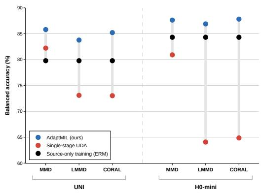
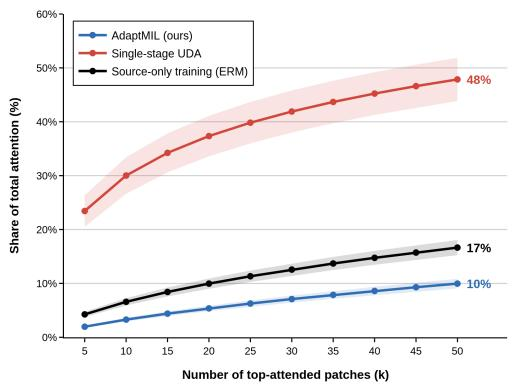
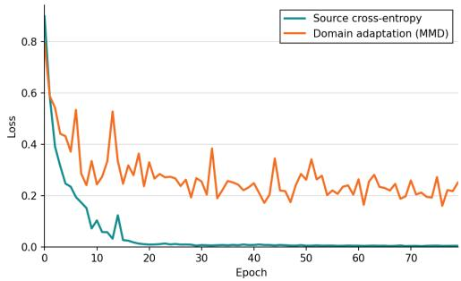
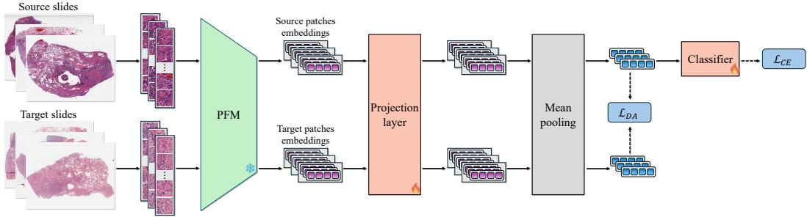
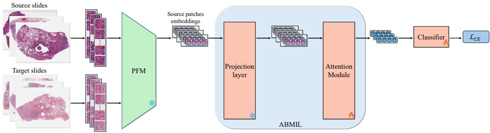
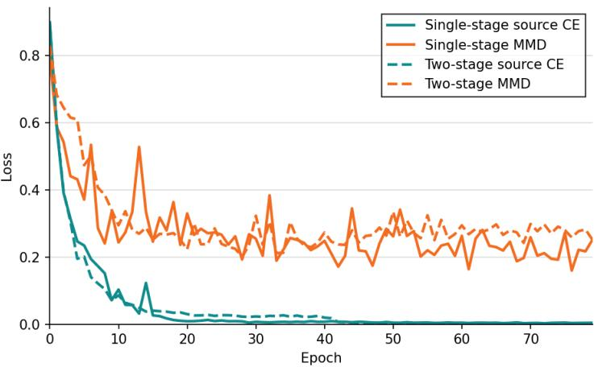

# ADAPTMIL: DOMAIN ADAPTATION FOR MULTIPLE INSTANCE LEARNING IN DIGITAL PATHOLOGY

Ben Vardi1, Dana Schonberger2, Yuval Friedmann2, Zohar Yakhini1,3, Iris Barshack2,4, Alexander Loebel2, Ariel Shamir1

1Reichman University

2Institute of Pathology, Sheba Medical Center

3Technion – Israel Institute of Technology

4Ariel University

## ABSTRACT

Pathology foundation models (PFMs) support a wide range of histopathology tasks on whole-slide images through multiple instance learning (MIL). Despite recent progress, these models remain sensitive to cross-hospital distribution shifts: performance often degrades when a task head (e.g., classification) is trained on data from one hospital and then used on data from another hospital. To address this challenge, we propose AdaptMIL, a training strategy for integrating domain adaptation into MIL training. AdaptMIL is motivated by our finding that directly applying domain adaptation objectives during MIL training can interfere with MIL aggregation learning, often resulting in performance degradation over standard training. AdaptMIL resolves this by decoupling representation-level domain alignment learning from MIL aggregation learning through a two-stage training procedure. We show that AdaptMIL improves cross-hospital performance and outperforms alternative adaptation methods across experiments spanning multiple WSI datasets, tasks, PFMs, MIL architectures, and domain adaptation objectives. AdaptMIL’s code will be released upon publication.

## 1 INTRODUCTION

The emergence of modern pathology foundation models (PFMs) has driven substantial progress in digital pathology in recent years (Chen et al., 2024; Lu et al., 2024; Filiot et al., 2025). These models take digitized tissue images as input and produce general-purpose representations that can support a wide range of downstream histopathology tasks, including cancer detection, tumor subtyping, biomarker prediction, and survival analysis (Neidlinger et al., 2026).

Unlike conventional image encoders that process standard-sized images, PFMs are used to process extremely large images, commonly referred to as whole-slide images (WSIs), which can contain billions of pixels. This requires a specialized processing pipeline: a WSI is first divided into smaller patches, each patch is independently encoded by a PFM into a patch-level representation, and finally, the patch representations are aggregated into a single slide-level embedding using a weakly supervised multiple instance learning (MIL) module, most commonly trained from scratch per task (Wang et al., 2024; Shao et al., 2025).

Despite their progress, PFM-based MIL pipelines may still struggle in real-world deployment condi tions. A major challenge is their limited robustness to variability across hospitals from which tissue samples were collected, arising from differences in tissue processing protocols (Komen et al., 2026).¨ As a result, the performance of task heads (e.g., classifiers) built on PFM representations degrades when the MIL module and task head are trained on data from one hospital and used on data from another (Fernandez-Romero et al., 2026; Umer et al., 2026). This poses a practical limitation, since labeled data from a specific target hospital is often unavailable due to costly and time-consuming expert annotation, whereas unlabeled data from that hospital may be readily available. Meanwhile, labeled data from other source hospitals may already be available, a setting known as unsupervised domain adaptation (UDA) (Wilson & Cook, 2020).

A direct approach is to fine-tune the pretrained PFM toward the target hospital domain. This can be done using domain adaptation objectives in the UDA setting, and requires labels for individua image patches from source-domain WSIs. Although this approach has been explored before (Vardi et al., 2026), its applicability is limited by the scarcity of patch-level annotations in pathology. By contrast, slide-level annotations are more readily available and can be used for end-to-end PFM fine tuning. However, this requires propagating gradients from the slide-level objective through the MIL module and back through the PFM across hundreds or thousands of patches per slide, substantially increasing the computational cost compared with training the MIL module alone (Campanella et al., 2025; Kumar & Vanderbilt, 2026).

In this work, we pursue a simpler alternative: we keep the pretrained PFM frozen and perform adaptation within the MIL training pipeline, using only slide-level supervision. We find that a standard approach to unsupervised domain adaptation, which combines a task loss on the labeled source domain and a domain alignment objective to align the source and target domains, can fail when applied to MIL pipelines. In particular, we find that domain alignment and learned MIL aggregation can interfere with one another: rather than learning more domaininvariant representations, the MIL module reduces the domain discrepancy by altering its aggregation pattern. This can result in performance below source-only training.

To address this, we propose AdaptMIL, a twostage MIL training strategy for domain adaptation that decouples domain alignment from aggregation learning. The first stage trains a patch-level projection layer to make representations more domain-aligned and uses fixed mean pooling to aggregate them into slide-level rep-

  
Figure 1: AdaptMIL improves cross-hospital performance across PFMs such as UNI and H0-mini and across domain adaptation objectives. It is motivated by the observation that directly applying standard UDA during MIL training often degrades performance.

resentations. Source–target domain alignment is performed on these slide-level representations together with a source task objective that preserves task-discriminative information. In the second stage, the MIL aggregation is trained using the source task objective on top of the adapted projec tion layer learned in the first stage. By performing domain alignment before learning the aggregation mechanism, AdaptMIL prevents the MIL module from altering its aggregation pattern to satisfy the alignment objective, resulting in gains over source-only training (Fig. 1).

Across experiments on multi-hospital datasets, we show that AdaptMIL outperforms source-only MIL training and alternative adaptation methods. We demonstrate these gains across multiple PFMs, slide-level tasks, domain alignment objectives, and MIL aggregation methods. Our code will be released upon publication.

Our contributions are:

• We explore UDA in slide-level pathology MIL pipelines and identify a failure mode for jointly learning domain alignment and MIL aggregation.

• We introduce AdaptMIL, a two-stage training strategy for MIL that decouples domain alignment from aggregation learning and can be applied across different MIL architectures.

• We evaluate AdaptMIL across multiple pathology tasks, WSI datasets, PFMs, MIL architectures, and domain alignment objectives, and demonstrate improved cross-hospital performance over source-only training and other adaptation approaches.

## 2 RELATED WORK

## 2.1 PATHOLOGY FOUNDATION MODELS AND MIL

Pathology foundation models (PFMs) encode hematoxylin and eosin (H&E)-stained histopathology images into general-purpose embeddings that support a wide range of downstream tasks (Chen et al., 2024; Lu et al., 2024; Filiot et al., 2025; Vorontsov et al., 2024). These representations are learned through large-scale pretraining, using objectives such as self-supervision (Chen et al., 2024; Vorontsov et al., 2024) and vision-language contrastive learning (Lu et al., 2024). In pathology practice, inference is performed on whole-slide images (WSIs), which often reach gigapixel scale (e.g., 100,000 × 100,000 pixels). The predominant pipeline therefore segments the WSI, divides it into patches, encodes the patches independently using a PFM, and then aggregates the patch embedding into a slide-level embedding using a multiple instance learning (MIL) module (Wang et al., 2024).

MIL addresses learning from bags of instances for which supervision is available only at the bag level (Dietterich et al., 1997). In digital pathology, a WSI is treated as a bag of patches (Campanella et al., 2019): while a WSI-level label may indicate, for example, the presence of cancer, labels for the individual patches are generally unavailable. MIL methods therefore aggregate patch embeddings into a single slide-level representation from which the downstream task can be predicted.

A wide range of MIL methods have been proposed, varying along several dimensions, such as their aggregation mechanisms, architectures, and whether the aggregation is learnable or parameter-free. An influential architecture is ABMIL (Ilse et al., 2018), which learns a network that assigns attention weights to instances and aggregates them through a weighted average. Subsequent methods introduce more sophisticated aggregation mechanisms. For example, DSMIL (Li et al., 2021) identifies a critical instance and uses it to guide attention over the remaining instances, while TransMIL (Shao et al., 2021) employs transformer-based attention to model dependencies between patches. A common practice is to train MIL models from scratch for each downstream task, while more recent work has explored pretraining slide-level MIL models (Ding et al., 2025; Shao et al., 2025).

## 2.2 CROSS-HOSPITAL ROBUSTNESS

Despite impressive performance, slide-level PFM pipelines may face limitations in real-world settings. A major challenge emerges in multi-hospital settings due to variation in H&E appearance, driven by differences in tissue processing, staining, and digitization protocols (Howard et al., 2021; Thiringer et al., 2026).

Prior work has examined cross-hospital robustness at the patch level, showing that PFM embeddings encode hospital-specific signatures and exhibit related distribution shifts (Komen et al., 2026). Pro-¨ posed approaches to mitigate these shifts include test-time stain normalization of target patches (Macenko et al., 2009; Reinhard et al., 2002), training patch-level models with domain adaptation objectives (Vray et al., 2024), fine-tuning PFMs for domain alignment (Vardi et al., 2026), and learning transformations on top of frozen PFM features (Komen et al., 2026).¨

Cross-hospital performance degradation has also been observed in slide-level tasks (Fernandez-Romero et al., 2026; Umer et al., 2026). Several patch-level solutions can be transferred to slidelevel prediction: stain normalization can be applied across all patches, while adapted PFMs can be used within MIL pipelines. However, direct slide-level adaptation remains comparatively underexplored. HASD (Liu et al., 2025) takes this direction and proposes a pathology-specific hierarchical adaptation framework with several specialized objectives. We also perform adaptation at the slide-aggregation level, but rather than introducing a specialized adaptation objective, we propose a training strategy that enables established domain adaptation objectives to be integrated into MIL.

## 2.3 DOMAIN ADAPTATION

Domain adaptation (Wang & Deng, 2018) aims to transfer a model trained on data from a source domain to a different target domain. Unsupervised domain adaptation (UDA) (Wilson & Cook, 2020) is a common setting, where labeled source data is available, while only unlabeled data is available in the target domain.

  
(a)

  
(b)  
Figure 2: Analysis of the interaction between domain adaptation and ABMIL aggregation. (a) Standard UDA (single-stage) concentrates attention on a smaller subset of patches than source-only training. AdaptMIL reduces and even reverses this effect, resulting in a more distributed attention pattern. (b) In a representative single-stage UDA run, both source cross-entropy and MMD losses decrease despite degraded performance (the MMD plateau is expected). Results are from NSCLC subtyping with UNI; attention in (a) is averaged over held-out target slides.

A central approach to UDA is domain-invariant feature learning, which aims to reduce differences between source and target representation distributions. Invariant representations can be learned through discrepancy minimization methods, which minimize a differentiable distance metric between the two distributions. Prominent examples include Maximum Mean Discrepancy (MMD) (Long et al., 2015), local MMD (LMMD) (Zhu et al., 2020), and CORAL (Sun & Saenko, 2016). Other domain-invariant methods use different mechanisms, such as domain-adversarial neural networks (DANN) (Ganin et al., 2016), which learns domain-invariant features by making representations from the source and target domains difficult to distinguish.

Although widely used across computer vision and machine learning, the interaction between domain adaptation and MIL remains less explored in slide-level pathology. In this work, we investigate this interaction and develop a training strategy for domain adaptation within MIL pipelines.

## 3 METHOD

## 3.1 PROBLEM SETUP AND DOMAIN ADAPTATION FOR MIL

In UDA, we are given $n _ { s }$ labeled samples from a source domain $\{ ( x _ { i } ^ { s } , y _ { i } ^ { s } ) \} _ { i = 1 } ^ { n _ { s } }$ , together with $n _ { t }$ unlabeled samples from a target domain, $\{ x _ { j } ^ { t } \} _ { j = 1 } ^ { n _ { t } }$ . In the cross-hospital setting, each sample x is a WSI, the labels $y _ { i }$ correspond to biological classes (e.g., cancer status), and each domain corresponds to a different hospital. The goal is to learn a MIL module and a task head (e.g., a classifier) that generalize to the target hospital without having access to its labels.

Domain-invariant UDA methods jointly optimize a supervised task loss on labeled source samples and a domain adaptation objective that encourages alignment between source and target representations (Wilson $\&$ Cook, 2020). Let $z _ { i } ^ { s } = f _ { \theta } ( \bar { x } _ { i } ^ { s } )$ and $z _ { i } ^ { t } = f _ { \theta } ( x _ { i } ^ { t } )$ denote the source and target representations, respectively, and let $g _ { \phi }$ be the task head. The UDA training objective is

$$
\frac { 1 } { n _ { s } } \sum _ { i = 1 } ^ { n _ { s } } \mathcal { L } _ { \mathrm { t a s k } } \left( g _ { \phi } ( z _ { i } ^ { s } ) , y _ { i } ^ { s } \right) + \lambda \mathcal { L } _ { \mathrm { D A } } \left( \{ z _ { i } ^ { s } \} _ { i = 1 } ^ { n _ { s } } , \{ z _ { j } ^ { t } \} _ { j = 1 } ^ { n _ { t } } \right) ,\tag{1}
$$

where $\mathcal { L } _ { \mathrm { t a s k } }$ is the supervised task loss, $\mathcal { L } _ { \mathrm { D A } }$ is the domain adaptation loss, and $\lambda$ controls the tradeoff between them. The task head and loss can correspond to any supervised prediction task, $\mathrm { e . g }$ ., for classification, $g _ { \phi }$ is a classifier and $\mathcal { L } _ { \mathrm { t a s k } }$ is the cross-entropy loss.

This setting can be adapted to slide-level MIL, where each sample is a bag of patches rather than a single image. Let $x _ { i } ^ { s } \ = \ \{ p _ { i , 1 } ^ { s } , . . . , p _ { i , m _ { i } ^ { s } } ^ { s } \}$ denote a source WSI decomposed into $m _ { i } ^ { s }$ patches. Each patch is encoded by a PFM encoder $f _ { \mathrm { P F M } }$ , yielding the bag of patch representations $z _ { i } ^ { s } = \{ f _ { \mathrm { P F M } } ( p _ { i , 1 } ^ { s } ) , \dotsc , f _ { \mathrm { P F M } } ( p _ { i , m _ { i } ^ { s } } ^ { s } ) \}$ . The target WSI $\dot { x } _ { j } ^ { t }$ and bag $z _ { j } ^ { t }$ are defined analogously. A learnable MIL aggregation module $h _ { \mathrm { M I I } }$ then maps $z _ { i } ^ { s }$ into a slide representation, on which the task head operates. Applying the UDA formulation gives

(a)  
  
(b)  
Figure 3: AdaptMIL two-stage training with ABMIL for classification. (a) In Stage 1, a projection layer is trained to map patch embeddings into a more domain-aligned space. The projected embeddings are aggregated using mean pooling, and training uses both a cross-entropy (CE) loss on labeled source slides and a domain adaptation (DA) loss between source and target slide embeddings. (b) In Stage 2, mean pooling is replaced by ABMIL’s learnable attention module. The projection layer is frozen, and the attention module and classifier are trained using only labeled source slides.

$$
\frac { 1 } { n _ { s } } \sum _ { i = 1 } ^ { n _ { s } } \mathcal { L } _ { \mathrm { t a s k } } \left( g _ { \phi } ( h _ { \mathrm { M I L } } ( z _ { i } ^ { s } ) ) , y _ { i } ^ { s } \right) + \lambda \mathcal { L } _ { \mathrm { D A } } \left( \left\{ h _ { \mathrm { M I L } } ( z _ { i } ^ { s } ) \right\} _ { i = 1 } ^ { n _ { s } } , \left\{ h _ { \mathrm { M I L } } ( z _ { j } ^ { t } ) \right\} _ { j = 1 } ^ { n _ { t } } \right) ,\tag{2}
$$

where domain adaptation is performed on the slide representations produced by the MIL module.

As in standard domain-invariant UDA, the feature extractor (the PFM) can remain frozen while a learnable projection transforms its representations into a more domain-aligned space. In many MIL architectures such a projection is already included prior to aggregation (Shao et al., 2021; Ilse et al., 2018; Lu et al., 2021), eliminating the need for an additional projection layer. The MIL module and task head are thus trained jointly, with the only difference from standard source-only MIL training (using only labeled source data and the task loss) being the addition of the domain adaptation loss.

## 3.2 FAILURE MODE OF DOMAIN ADAPTATION AND MIL TRAINING

We find that the application of UDA to MIL training (Eq. (2)) is mostly ineffective, performing worse than source-only training in most settings and providing only limited gains otherwise (see Fig. 1). Analyzing this reveals a surprising effect: joint MIL and domain adaptation training substantially changes the learned attention pattern compared to standard MIL training, concentrating attention on a smaller subset of patches. We demonstrate this effect in Fig. 2a: Under UDA training, the top-k attended patches in ABMIL account for a substantially larger fraction of the total attention (e.g., 2.8× for $\bar { k } = 5 0 )$ . This shows that the adaptation objective affects not only the learned projection layer, as might be expected, but also how patch information is aggregated by the MIL module.

Examining the training dynamics shows that both the task and domain adaptation losses decrease as expected (Fig. 2b), indicating that the optimization objectives are satisfied. Together with the degradation in performance, this suggests that the MIL model takes advantage of a shortcut to reduce the domain gap. That is, rather than learning genuinely more domain-robust representations, it can satisfy both objectives by changing how patch information is aggregated.

We hypothesize that this shortcut is facilitated by the morphological redundancy across patches in WSIs (Song et al., 2024), which may provide the MIL model with multiple ways to satisfy the task objective. Adding the domain adaptation constraint may therefore push the model toward a different aggregation solution that, in this case, generalizes worse.

We emphasize that more concentrated attention is not inherently undesirable, as its effect depends on the regions receiving high attention and the quality of the representations. Our analysis therefore does not imply that concentrated attention alone causes performance degradation. Rather, it shows that domain adaptation can substantially alter the learned aggregation pattern, even though the intended effect is to only make representations more domain-invariant, and that these changes are associated with degraded performance.

## 3.3 ADAPTMIL

Our analysis shows that applying domain adaptation objectives interferes with MIL aggregation learning. This motivated us to try and decouple the two, namely separate domain-invariant representation learning from learning the aggregation mechanism. We propose AdaptMIL, a two-stage training strategy that first learns domain-aligned representations and then learns the MIL aggregation over the adapted representations. AdaptMIL is formulated here using ABMIL (Ilse et al., 2018) but can be applied to different MIL architectures. See Fig. 3 for an illustration of AdaptMIL.

ABMIL first transforms each patch representation through a learned projection layer P, and then aggregates the projected representations with an attention module Attn. Let $z _ { i , k } = f _ { \mathrm { P F M } } ( p _ { i , k } )$ denote the representation of patch k from slide i. ABMIL is given by $h _ { \mathrm { M L } } ( z _ { i } ) = \mathrm { A t t n } ( P ( z _ { i } ) )$ , where P is applied independently to each patch representation, i.e., $P ( z _ { i } ) = \{ P ( z _ { i , 1 } ) , . . . , P ( z _ { i , m _ { i } } ) \}$ }.

In the first stage, AdaptMIL learns a projection layer $P$ that maps patch representations into a more domain-invariant space, and does not use the attention module. To obtain slide-level representations for the task and domain alignment objectives without the attention module, the projected representations are aggregated using parameter-free mean pooling. The resulting Stage 1 objective is:

$$
\begin{array} { l } { \displaystyle \mathcal { L } _ { \mathrm { s t a g e 1 } } = \frac { 1 } { n _ { s } } \sum _ { i = 1 } ^ { n _ { s } } \mathcal { L } _ { \mathrm { t a s k } } \big ( g _ { \phi } \big ( f _ { \mathrm { m e a n } } \big ( P ( z _ { i } ^ { s } ) \big ) \big ) , y _ { i } ^ { s } \big ) } \\ { \displaystyle \qquad + \lambda \mathcal { L } _ { \mathrm { D A } } \big ( \{ f _ { \mathrm { m e a n } } \big ( P ( z _ { i } ^ { s } ) \big ) \} _ { i = 1 } ^ { n _ { s } } , \{ f _ { \mathrm { m e a n } } \big ( P ( z _ { j } ^ { t } ) \big ) \} _ { j = 1 } ^ { n _ { t } } \big ) , } \end{array}\tag{3}
$$

where $\begin{array} { r } { f _ { \mathrm { m e a n } } ( P ( z _ { i } ) ) = \frac { 1 } { m _ { i } } \sum _ { k = 1 } ^ { m _ { i } } P ( z _ { i , k } ) } \end{array}$ . Mean pooling is a simple but competitive aggregation strategy in computational pathology (Shao et al., 2025). Importantly, because it is parameter-free, it cannot be altered by the domain adaptation objective.

In the second stage, AdaptMIL learns the MIL aggregation over the adapted representations. It keeps the projection layer P learned in Stage 1 frozen and replaces mean pooling with ABMIL’s attention module, recovering the full ABMIL architecture. We train this stage using only source samples and the task loss. This allows the learnable attention module to focus on task-discriminative information without being influenced by the domain adaptation objective. The resulting Stage 2 objective is:

$$
\mathcal { L } _ { \mathrm { s t a g e 2 } } = \frac { 1 } { n _ { s } } \sum _ { i = 1 } ^ { n _ { s } } \mathcal { L } _ { \mathrm { t a s k } } \big ( g _ { \phi } \big ( h _ { \mathrm { M I L } } \big ( z _ { i } ^ { s } \big ) \big ) , y _ { i } ^ { s } \big ) .\tag{4}
$$

As shown in Fig. 1, the decoupled two-stage training of AdaptMIL improves over both source-only training and standard UDA. Fig. 2a shows that AdaptMIL does not exhibit the increased attention concentration observed with standard UDA and instead produces more distributed attention.

Table 1: Cross-hospital NSCLC TCGA subtyping results for AdaptMIL with ABMIL. The metric is balanced accuracy (%). Values in parentheses denote the difference from ERM.
<table><tr><td>Method</td><td>UNI</td><td>CONCH-1.5</td><td>H0-mini</td></tr><tr><td>In-domain training</td><td>86.98 (+7.21)</td><td>88.88 (+2.93)</td><td>91.38 (+7.07)</td></tr><tr><td>Source-only (ERM) Macenko</td><td>79.78 77.72 (-2.06)</td><td>85.95 85.32 (-0.63)</td><td>84.31 82.67 (-1.64)</td></tr><tr><td>Patch-level fine-tuning Single-stage UDA (MMD)</td><td>84.25 (+4.47) 82.22 (+2.45)</td><td>87.11 (+1.16) 86.75 (+0.80)</td><td>80.91 (-3.40)</td></tr><tr><td>AdaptMIL-MMD (ours) Single-stage UDA (LMMD)</td><td>85.80 (+6.02) 73.09 (-6.69)</td><td>88.37 (+2.42) 76.25 (-9.69)</td><td>87.63 (+3.32) 64.07 (-20.24)</td></tr><tr><td>AdaptMIL-LMMD (ours)</td><td>83.77 (+3.99)</td><td>88.17 (+2.23)</td><td>86.89 (+2.58)</td></tr><tr><td>Single-stage UDA (CORAL)</td><td>73.02 (-6.76)</td><td>82.15 (-3.80)</td><td>64.86 (-19.45)</td></tr><tr><td>AdaptMIL-CORAL (ours)</td><td>85.21 (+5.43)</td><td>88.13 (+2.19)</td><td>87.82 (+3.51)</td></tr><tr><td></td><td></td><td></td><td></td></tr><tr><td>Single-stage UDA (DANN)</td><td>79.37 (-0.41)</td><td>85.17 (-0.78)</td><td>84.49 (+0.18)</td></tr><tr><td>AdaptMIL-DANN (ours)</td><td>81.38 (+1.60)</td><td></td><td></td></tr><tr><td></td><td></td><td>86.54 (+0.60)</td><td>86.22 (+1.90)</td></tr></table>

## 4 EXPERIMENTS

## 4.1 TASKS AND DATASETS

We evaluate AdaptMIL on four different tasks. The first is non-small cell lung cancer (NSCLC) subtyping between lung adenocarcinoma and squamous cell carcinoma, using 489 WSIs from TCGA (Komura et al., 2022) across six hospitals, and 150 WSIs from an in-house hospital dataset. The second task is renal cell carcinoma (RCC) subtyping between clear cell carcinoma and papillary cell carcinoma, using 307 WSIs from TCGA across three hospitals. The third task is cancer detection, using 404 WSIs from CAMELYON17 (Bandi et al., 2018) across five hospitals. The fourth task is survival prediction, presented in Sec. D.3 of the supplementary material (Supp.).

## 4.2 EVALUATION

For each subtyping or detection dataset, we evaluate all source-target hospital pairs and report the average metric across them. For example, the TCGA NSCLC dataset contains six hospitals, resulting in 30 source-target pairs. For the in-house lung dataset, we evaluate both directions with each of the six TCGA hospitals, resulting in 12 pairs. Each source-target pair is evaluated using 3-fold crossvalidation, with evaluation performed on held-out target WSIs that are not used during training. Our main metric for subtyping and detection is balanced accuracy.

## 4.3 MODELS AND TRAINING

We evaluate AdaptMIL across different PFMs, domain adaptation objectives, and MIL architectures. For patch-level feature extraction, we use three PFMs: UNI (Chen et al., 2024), CONCH-1.5 (Lu et al., 2024), and H0-mini (Filiot et al., 2025). Tissue segmentation, patch extraction, and feature extraction are performed using the TRIDENT package (Zhang et al., 2025).

We evaluate four domain adaptation objectives: three discrepancy-based losses, MMD (Long et al., 2015), LMMD (Zhu et al., 2020), and CORAL (Sun & Saenko, 2016), and the adversarial DANN objective (Ganin et al., 2016). We further apply AdaptMIL to three MIL architectures: ABMIL (Ilse et al., 2018), DSMIL (Li et al., 2021), and TITAN (Ding et al., 2025). The implementation for ABMIL is described in Sec. 3.3. The implementations for DSMIL and TITAN follow the same principle with architecture-specific adjustments. All AdaptMIL models are trained for 80 epochs, with 40 epochs for each stage. Further implementation details are provided in Sec. A of the Supp.

Table 2: Cross-hospital classification results for AdaptMIL across different tasks. The metric is balanced accuracy (%). All results use AdaptMIL based on ABMIL with MMD. IH-NS denotes the in-house NSCLC task, and Det. denotes cancer detection.
<table><tr><td rowspan="2">Method</td><td colspan="3">UNI</td><td colspan="3">CONCH-1.5</td><td colspan="3">H0-mini</td></tr><tr><td>IH-NS</td><td>Det.</td><td>RCC</td><td>IH-NS</td><td>Det.</td><td>RCC</td><td>IH-NS</td><td>Det.</td><td>RCC</td></tr><tr><td>In-domain training</td><td>89.49 (+8.87)</td><td>82.25</td><td>96.45</td><td>89.44</td><td>98.41</td><td>93.79</td><td>93.02</td><td>84.93</td><td>94.94</td></tr><tr><td>Source-only (ERM)</td><td>80.62</td><td>(+9.43) 72.82</td><td>(+4.67) 91.78</td><td>(+5.70) 83.74</td><td>(+1.99) 96.43</td><td>(+0.79) 93.01</td><td>(+12.03) 81.00</td><td>(+3.75) 81.18</td><td>(+2.10) 92.83</td></tr><tr><td>Single-stage UDA</td><td>85.20</td><td>72.31</td><td>90.75</td><td>85.58</td><td>86.11</td><td>92.53</td><td>76.44</td><td>70.28</td><td>88.93</td></tr><tr><td></td><td>(+4.59)</td><td>(-0.51)</td><td>(-1.03)</td><td>(+1.84)</td><td>(-10.31)</td><td>(-0.47)</td><td>(-4.56)</td><td>(-10.90)</td><td>(-3.90)</td></tr><tr><td>AdaptMIL (ours)</td><td>82.30</td><td>78.87</td><td>95.09</td><td>86.72</td><td>95.59</td><td>94.10</td><td>86.92</td><td>89.30</td><td>93.32</td></tr><tr><td></td><td>(+1.68)</td><td>(+6.05)</td><td>(+3.31)</td><td>(+2.98)</td><td>(-0.84)</td><td>(+1.09)</td><td>(+5.92)</td><td>(+8.12)</td><td>(+0.48)</td></tr></table>

## 4.4 METHOD COMPARISONS

We compare AdaptMIL against several baselines. First, we compare against source-only training with standard MIL. This baseline, commonly referred to as empirical risk minimization (ERM) (Vapnik, 1999), represents the out-of-distribution performance that domain adaptation aims to improve. We also compare to standard UDA applied to MIL (defined in Eq. (2)), using each of the four domain adaptation objectives. We refer to this baseline as single-stage UDA.

We additionally compare against Macenko stain normalization (Macenko et al., 2009). In this setting, the MIL model is trained only on source data, as in ERM, but evaluation is performed on target images whose appearance is normalized to a source reference. Finally, we compare against a domain adaptation approach that fine-tunes the PFM using patch-level supervision (Vardi et al., 2026). We note that, to the best of our knowledge, other pathology-specific domain adaptation methods do not have publicly available implementations, and therefore we could not compare against them.

## 4.5 RESULTS

Tab. 1 presents the evaluation of AdaptMIL with ABMIL across different PFMs and domain adaptation objectives on the NSCLC subtyping task. AdaptMIL improves over ERM across all PFMs and objectives, with gains up to +6.02% in balanced accuracy. MMD is the best-performing objective for two of the three PFMs, while LMMD and CORAL also yield notable gains, and DANN provides smaller improvements. Similar trends are observed for ROC-AUC and F1 (see Tab. 6 in Supp.).

We additionally report in-domain performance of an ABMIL model that is trained and evaluated on samples from the same hospital. The performance drop from in-domain to source-only ERM highlights the degradation caused by the cross-hospital distribution shift. AdaptMIL substantially reduces this gap. For example, with UNI and CONCH-1.5, AdaptMIL recovers more than 80% of the gap.

AdaptMIL outperforms the other adaptation methods. As observed in Sec. 3.2, directly applying standard single-stage UDA during MIL training often fails to improve over ERM and can substantially degrade performance. For example, LMMD with H0-mini reduces balanced accuracy by 20.24%. Macenko normalization also fails to improve performance, consistent with previous reports (Huang et al., 2025; Lin et al., 2025). Patch-level fine-tuning of PFMs is the baseline that provides the largest gains over ERM, but it remains inferior to AdaptMIL. Although effective, patchlevel fine-tuning requires both patch supervision and re-extraction of patch features for every source– target adaptation setting. In contrast, AdaptMIL requires only slide-level supervision and operate on pre-extracted PFM features, allowing the same features to be reused across adaptation settings.

We evaluate AdaptMIL across additional datasets and classification tasks in Tab. 2. AdaptMIL improves over source-only ERM in eight of the nine settings, with gains of up to +8.12%. The only exception is cancer detection with CONCH-1.5, where ERM already achieves very strong performance. In contrast, single-stage UDA degrades performance in seven of the nine settings.

Table 3: Cross-hospital NSCLC TCGA subtyping results across different MIL architectures. The metric is balanced accuracy (%).
<table><tr><td rowspan="2">Method</td><td colspan="3">ABMIL DSMIL TITAN</td></tr><tr><td>(UNI) 86.98</td><td>(UNI) 83.12</td><td>92.32</td></tr><tr><td>In-domain training Source-only (ERM)</td><td>(+7.21) 79.78</td><td>(+8.78) 74.34</td><td>(+1.65) 90.68</td></tr><tr><td>Single-stage UDA</td><td>82.22</td><td>81.29</td><td>89.50</td></tr><tr><td rowspan="2"></td><td>(+2.45)</td><td>(+6.95)</td><td>(-1.18)</td></tr><tr><td>85.80</td><td>82.10</td><td>90.88</td></tr><tr><td>AdaptMIL (ours)</td><td>(+6.02)</td><td>(+7.76)</td><td>(+0.20)</td></tr></table>

Table 4: Ablation studies for AdaptMIL.
<table><tr><td>Method</td><td>Balanced Acc.</td></tr><tr><td>Source-only (ERM)</td><td>79.78</td></tr><tr><td>Single-stage + mean-pool adap. head</td><td>84.87 (+5.09)</td></tr><tr><td>AdaptMIL w/ Stage 1 only AdaptMIL w/ adaptation in Stage 2</td><td>82.17 (+2.39)</td></tr><tr><td>AdaptMIL w/o projection freeze</td><td>83.23 (+3.45)</td></tr><tr><td>AdaptMIL w/o adaptation loss</td><td>85.56 (+5.79)</td></tr><tr><td></td><td>81.38 (+1.60)</td></tr><tr><td>AdaptMIL (full)</td><td>85.80 (+6.02)</td></tr></table>

Finally, we evaluate AdaptMIL with MIL architectures beyond ABMIL in Tab. 3. AdaptMIL improves performance with DSMIL, although standard single-stage UDA is also effective. We further obtain a gain when adapting the pretrained TITAN slide encoder. These results indicate that Adapt-MIL is not specific to ABMIL and can be applied to other MIL architectures.

## 4.6 ABLATIONS

We perform ablation studies to examine the impact of AdaptMIL’s components, with results for AdaptMIL-MMD with ABMIL and UNI in Tab. 4. We first consider an alternative way to decouple representation alignment from aggregation learning. Instead of two-stage training, we train ABMIL throughout with the task objective, while applying the adaptation objective to a separate meanpooling head placed after the projection layer. This prevents adaptation gradients from reaching the attention module, while still adapting the projection layer. This alternative method performs well (row 2 in Tab. 4), but remains inferior to AdaptMIL, suggesting an additional benefit from explicitly separating alignment and aggregation learning into distinct training stages.

We next examine whether the second stage of AdaptMIL is necessary. Specifically, we use only Stage 1, where the learned projection is followed by mean pooling and trained with both the task and adaptation objectives. This performs worse than full AdaptMIL (row 3), confirming the benefi of using ABMIL, consistent with prior work favoring ABMIL over mean pooling (Shao et al., 2025).

We additionally evaluate two design choices in Stage 2. Keeping the adaptation loss active in Stage 2 degrades performance (row 4), supporting our hypothesis that adaptation gradients interfere with aggregation learning. Not freezing the projection layer in Stage 2 slightly reduces performance (row 5), possibly because the projection becomes more source-oriented.

Finally, we test whether the two-stage training schedule itself contributes to the improvement by removing the adaptation objective (row 6). This variant still improves over ERM, suggesting that separating representation and aggregation learning provides some benefit on its own. However, it remains substantially below AdaptMIL, demonstrating the importance of the alignment in Stage 1.

## 5 CONCLUSION

In this paper, we introduce AdaptMIL, a training strategy for performing domain adaptation within MIL architectures. Motivated by the observation that applying standard UDA to MIL can interfere with aggregation learning and degrade performance, AdaptMIL decouples domain alignment and aggregation learning into two training stages. Evaluated in cross-hospital adaptation settings with different tasks, PFMs, MIL architectures, and domain adaptation objectives, AdaptMIL consistently improves over source-only training and outperforms alternative adaptation methods.

Our work has several limitations. We primarily evaluate MIL models trained from scratch, which is the most common setting and offers flexibility in the choice of the PFM (Shao et al., 2025). Another approach is to use pretrained MIL models, which avoid training from scratch but are tied to specific PFM features. Our TITAN experiments show that AdaptMIL can be applied in this setting, although broader evaluation remains for future work. A further limitation is that AdaptMIL depends on the quality of the PFM representations and may not be able to compensate for strong representation biases. Combining AdaptMIL with end-to-end PFM fine-tuning (Kumar & Vanderbilt, 2026) is therefore an interesting direction for future work. Finally, our survival prediction results (in Supp.) show that AdaptMIL improves in this setting, while standard UDA can sometimes be effective, motivating further study of when decoupling domain alignment from MIL aggregation is necessary.

We focus on cross-hospital domain adaptation in digital pathology, but AdaptMIL may also apply to other MIL settings affected by a domain shift. Examples include shifts between frozen and formalinfixed paraffin-embedded tissues in pathology (Ozyoruk et al., 2022), as well as MIL applications in other domains such as medical imaging (Cheplygina et al., 2019) and remote sensing (Paheding et al., 2024).

## REFERENCES

Peter Bandi, Oscar Geessink, Quirine Manson, Marcory Van Dijk, Maschenka Balkenhol, Meyke Hermsen, Babak Ehteshami Bejnordi, Byungjae Lee, Kyunghyun Paeng, Aoxiao Zhong, et al. From detection of individual metastases to classification of lymph node status at the patient level: the CAMELYON17 challenge. IEEE transactions on medical imaging, 38(2):550–560, 2018.

Carlo Alberto Barbano and Andre Pedersen. Eidoslab/torchstain: v1.2.0-stable, August 2022.´

Gabriele Campanella, Matthew G Hanna, Luke Geneslaw, Allen Miraflor, Vitor Werneck Krauss Silva, Klaus J Busam, Edi Brogi, Victor E Reuter, David S Klimstra, and Thomas J Fuchs. Clinical-grade computational pathology using weakly supervised deep learning on whole slide images. Nature medicine, 25(8):1301–1309, 2019.

Gabriele Campanella, Neeraj Kumar, Swaraj Nanda, Siddharth Singi, Eugene Fluder, Ricky Kwan, Silke Muehlstedt, Nicole Pfarr, Peter J Schuffler, Ida H¨ aggstr¨ om, et al. Real-world deployment of¨ a fine-tuned pathology foundation model for lung cancer biomarker detection. Nature Medicine, 31(9):3002–3010, 2025.

Richard J Chen, Tong Ding, Ming Y Lu, Drew FK Williamson, Guillaume Jaume, Andrew H Song, Bowen Chen, Andrew Zhang, Daniel Shao, Muhammad Shaban, et al. Towards a general-purpose foundation model for computational pathology. Nature medicine, 30(3):850–862, 2024.

Veronika Cheplygina, Marleen De Bruijne, and Josien PW Pluim. Not-so-supervised: A survey of semi-supervised, multi-instance, and transfer learning in medical image analysis. Medical image analysis, 54:280–296, 2019.

Thomas G. Dietterich, Richard H. Lathrop, and Tomas Lozano-P ´ erez. Solving the multiple instance ´ problem with axis-parallel rectangles. Artificial Intelligence, 89(1):31–71, 1997. ISSN 0004- 3702.

Tong Ding, Sophia J Wagner, Andrew H Song, Richard J Chen, Ming Y Lu, Andrew Zhang, Anurag J Vaidya, Guillaume Jaume, Muhammad Shaban, Ahrong Kim, et al. A multimodal whole-slide foundation model for pathology. Nature medicine, 31(11):3749–3761, 2025.

Jesus Fernandez-Romero, Pablo Ramos-Berciano, Manuel Perez-Perez, David Benavides, Antonio Robles-Frias, Jorge Garcia-Gutierrez, and Laura Macias-Garcia. Domain generalisation chal lenges in breast cancer molecular classification using foundation models: a cross-cohort exploratory study. Medical & Biological Engineering & Computing, 64:2321–2331, 2026.

Alexandre Filiot, Nicolas Dop, Oussama Tchita, Auriane Riou, Remy Dubois, Thomas Peeters,´ Daria Valter, Marin Scalbert, Charlie Saillard, Genevieve Robin, et al. Distilling foundation mod-\` els for robust and efficient models in digital pathology. In International Conference on Medical Image Computing and Computer-Assisted Intervention, pp. 162–172. Springer, 2025.

Yaroslav Ganin, Evgeniya Ustinova, Hana Ajakan, Pascal Germain, Hugo Larochelle, Franc¸ois Laviolette, Mario March, and Victor Lempitsky. Domain-adversarial training of neural networks. Journal ofmachine learning research, 17(59):1–35, 2016.

Frederick M Howard, James Dolezal, Sara Kochanny, Jefree Schulte, Heather Chen, Lara Heij, Dezheng Huo, Rita Nanda, Olufunmilayo I Olopade, Jakob N Kather, et al. The impact of sitespecific digital histology signatures on deep learning model accuracy and bias. Nature communications, 12(1):4423, 2021.

Yanyan Huang, Weiqin Zhao, Zhengyu Zhang, Yihang Chen, Yu Fu, Feng Wu, Yuming Jiang, Li Liang, Shujun Wang, and Lequan Yu. Knowledge-guided adaptation of pathology foundation models effectively improves cross-domain generalization and demographic fairness. Nature communications, 16(1):11485, 2025.

Maximilian Ilse, Jakub Tomczak, and Max Welling. Attention-based deep multiple instance learning. In Proceedings of the 35th International Conference on Machine Learning, volume 80 of Proceedings ofMachine Learning Research, pp. 2127–2136. PMLR, 10–15 Jul 2018.

Junguang Jiang, Baixu Chen, Bo Fu, and Mingsheng Long. Transfer learning library. https: //github.com/thuml/Transfer-Learning-Library, 2020. GitHub repository.

Jonah Komen, Edwin D de Jong, Julius Hense, Hannah Marienwald, Jonas Dippel, Philip Naumann,¨ Eric Marcus, Lukas Ruff, Maximilian Alber, Jonas Teuwen, et al. Towards robust foundation models for digital pathology. Nature Communications, 17(1):5218, 2026.

Daisuke Komura, Akihiro Kawabe, Keisuke Fukuta, Kyohei Sano, Toshikazu Umezaki, Hirotomo Koda, Ryohei Suzuki, Ken Tominaga, Mieko Ochi, Hiroki Konishi, Fumiya Masakado, Noriyuki Saito, Yasuyoshi Sato, Takumi Onoyama, Shu Nishida, Genta Furuya, Hiroto Katoh, Hiroharu Yamashita, Kazuhiro Kakimi, Yasuyuki Seto, Tetsuo Ushiku, Masashi Fukayama, and Shumpei Ishikawa. Universal encoding of pan-cancer histology by deep texture representations. Cell Reports, 38(9):110424, 2022.

Neeraj Kumar and Chad Vanderbilt. Single GPU task adaptation of pathology foundation models for whole slide image analysis. Advances in Neural Information Processing Systems, 38:11323– 11350, 2026.

Bin Li, Yin Li, and Kevin W Eliceiri. Dual-stream multiple instance learning network for whole slide image classification with self-supervised contrastive learning. In Proceedings of the IEEE/CVF Conference on Computer Vision and Pattern Recognition, pp. 14318–14328, 2021.

W Lin, S Liu, R Zhu, and L Wang. Unveiling institution-specific bias in pathology foundation models: Detriments, causes, and potential solutions, 2025.

Jingsong Liu, Han Li, Chen Yang, Michael Deutges, Ario Sadafi, Xin You, Katharina Breininger, Nassir Navab, and Peter J Schuffler. HASD: Hierarchical adaptation for pathology slide-level ¨ domain-shift. In International Conference on Medical Image Computing and Computer-Assisted Intervention, pp. 332–342. Springer, 2025.

Mingsheng Long, Yue Cao, Jianmin Wang, and Michael Jordan. Learning transferable features with deep adaptation networks. In International conference on machine learning, pp. 97–105. PMLR, 2015.

Ilya Loshchilov and Frank Hutter. SGDR: stochastic gradient descent with warm restarts. arXiv preprint arXiv:1608.03983, 2017.

Ilya Loshchilov and Frank Hutter. Decoupled weight decay regularization. arXiv preprint arXiv:1711.05101, 2019.

Ming Y Lu, Drew FK Williamson, Tiffany Y Chen, Richard J Chen, Matteo Barbieri, and Faisal Mahmood. Data-efficient and weakly supervised computational pathology on whole-slide images. Nature Biomedical Engineering, 5(6):555–570, 2021.

Ming Y Lu, Bowen Chen, Drew FK Williamson, Richard J Chen, Ivy Liang, Tong Ding, Guillaume Jaume, Igor Odintsov, Long Phi Le, Georg Gerber, et al. A visual-language foundation model for computational pathology. Nature medicine, 30(3):863–874, 2024.

Marc Macenko, Marc Niethammer, James S Marron, David Borland, John T Woosley, Xiaojun Guan, Charles Schmitt, and Nancy E Thomas. A method for normalizing histology slides for quantitative analysis. In 2009 IEEE international symposium on biomedical imaging: from nano to macro, pp. 1107–1110. IEEE, 2009.

Peter Neidlinger, Omar SM El Nahhas, Hannah Sophie Muti, Tim Lenz, Michael Hoffmeister, Hermann Brenner, Marko Van Treeck, Rupert Langer, Bastian Dislich, Hans Michael Behrens, et al. Benchmarking foundation models as feature extractors for weakly supervised computational pathology. Nature biomedical engineering, pp. 1113–1123, 2026.

Kutsev Bengisu Ozyoruk, Sermet Can, Berkan Darbaz, Kayhan Bas¸ak, Derya Demir, Guliz Irem Gokceler, Gurdeniz Serin, Uguray Payam Hacisalihoglu, Emirhan Kurtulus¸, Ming Y Lu, et al. A deep-learning model for transforming the style of tissue images from cryosectioned to formalinfixed and paraffin-embedded. Nature Biomedical Engineering, 6(12):1407–1419, 2022.

Sidike Paheding, Ashraf Saleem, Mohammad Faridul Haque Siddiqui, Nathir Rawashdeh, Almabrok Essa, and Abel A Reyes. Advancing horizons in remote sensing: a comprehensive survey of deep learning models and applications in image classification and beyond. Neural Computing and Applications, 36(27):16727–16767, 2024.

Erik Reinhard, Michael Adhikhmin, Bruce Gooch, and Peter Shirley. Color transfer between images. IEEE Computer graphics and applications, 21(5):34–41, 2002.

Daniel Shao, Richard J. Chen, Andrew H. Song, Joel Runevic, Ming Y. Lu, Tong Ding, and Faisal Mahmood. Do multiple instance learning models transfer? In Forty-second International Conference on Machine Learning, 2025.

Zhuchen Shao, Hao Bian, Yang Chen, Yifeng Wang, Jian Zhang, Xiangyang Ji, et al. TransMIL: Transformer based correlated multiple instance learning for whole slide image classification. Advances in Neural Information Processing Systems, 34:2136–2147, 2021.

Andrew H. Song, Richard J. Chen, Tong Ding, Drew F.K. Williamson, Guillaume Jaume, and Faisal Mahmood. Morphological prototyping for unsupervised slide representation learning in computational pathology. In Proceedings of the IEEE/CVF Conference on Computer Vision and Pattern Recognition (CVPR), pp. 11566–11578, June 2024.

Baochen Sun and Kate Saenko. Deep CORAL: Correlation alignment for deep domain adaptation. In European conference on computer vision, pp. 443–450. Springer, 2016.

Erik Thiringer, Fredrik K. Gustafsson, Kajsa Ledesma Eriksson, and Mattias Rantalainen. Scannerinduced domain shifts undermine the robustness of pathology foundation models, 2026.

Eric Tzeng, Judy Hoffman, Kate Saenko, and Trevor Darrell. Adversarial discriminative domain adaptation. In 2017 IEEE conference on computer vision and pattern recognition (CVPR), pp. 2962–2971. Ieee, 2017.

Rao Muhammad Umer, Daniel Sens, Jonathan Noll, Sohom Dey, Christian Matek, Lukas Wolfseher, Rainer Spang, Ralf Huss, Johannes Raffler, Sarah Reinke, Ario Sadafi, Wolfram Klapper, Katja Steiger, Kristina Schwamborn, and Carsten Marr. A multicenter benchmark of multiple instance learning models for lymphoma subtyping from HE-stained whole slide images. In Proceedings of the IEEE/CVF Conference on Computer Vision and Pattern Recognition (CVPR) Workshops, pp. 6825–6834, June 2026.

Vladimir N Vapnik. An overview of statistical learning theory. IEEE transactions on neural networks, 10(5):988–999, 1999.

Ben Vardi, Dana Schonberger, Yuval Friedmann, Zohar Yakhini, Iris Barshack, Alexander Loebel, and Ariel Shamir. Discrepancy minimization improves cross-hospital robustness in digital pathology, 2026.

Eugene Vorontsov, Alican Bozkurt, Adam Casson, George Shaikovski, Michal Zelechowski, Kristen Severson, Eric Zimmermann, James Hall, Neil Tenenholtz, Nicolo Fusi, et al. A foundation model for clinical-grade computational pathology and rare cancers detection. Nature medicine, 30(10): 2924–2935, 2024.

Guillaume Vray, Devavrat Tomar, Behzad Bozorgtabar, and Jean-Philippe Thiran. Distill-SODA: Distilling self-supervised vision transformer for source-free open-set domain adaptation in computational pathology. IEEE transactions on medical imaging, 43(5):2021–2032, 2024.

Jindong Wang et al. Everything about transfer learning and domain adaptation. http:// transferlearning.xyz, 2018.

Jun Wang, Yu Mao, Nan Guan, and Chun Jason Xue. Advances in multiple instance learning for whole slide image analysis: Techniques, challenges, and future directions. arXiv preprint arXiv:2408.09476, 2024.

Mei Wang and Weihong Deng. Deep visual domain adaptation: A survey. Neurocomputing, 312: 135–153, October 2018. ISSN 0925-2312.

Garrett Wilson and Diane J Cook. A survey of unsupervised deep domain adaptation. ACM Transactions on Intelligent Systems and Technology (TIST), 11(5):1–46, 2020.

Andrew Zhang, Guillaume Jaume, Anurag Vaidya, Tong Ding, and Faisal Mahmood. Accelerating data processing and benchmarking of AI models for pathology, 2025.

Yongchun Zhu, Fuzhen Zhuang, Jindong Wang, Guolin Ke, Jingwu Chen, Jiang Bian, Hui Xiong, and Qing He. Deep subdomain adaptation network for image classification. IEEE transactions on neural networks and learning systems, 32(4):1713–1722, 2020.

## Supplementary Material

## A IMPLEMENTATION DETAILS

We provide the implementation details used across the evaluated PFMs and MIL architectures. We use the AdamW optimizer (Loshchilov & Hutter, 2019) with a cosine learning rate schedule (Loshchilov & Hutter, 2017), starting at 10−4 and decaying to zero. Each AdaptMIL stage uses its own cosine schedule (the schedule is restarted at the beginning of Stage 2). The classifier is the only module trained in both stages and is carried over from Stage 1 to Stage 2.

We use a batch size of 16, with each batch balanced across source and target domains (i.e., 8 source samples and 8 target samples). We additionally balance the labeled source samples within each batch by class, using an equal number of examples from each class. The adaptation coefficient λ is 2.5 for MMD, 1.0 for LMMD, 15 for CORAL, and 1.0 for DANN (also see Sec. D.4).

For the domain-adaptation objectives, we build on public implementations. We use multi-kernel MMD, CORAL, and DANN from TLlib (Jiang et al., 2020), and LMMD from Transfer Learning Repo (Wang et al., 2018). All experiments are conducted in mixed precision on a single NVIDIA GeForce RTX 5090 GPU.

AdaptMIL for ABMIL. Our ABMIL implementation is based on MIL-Lab (Shao et al., 2025). The slide embedding dimension and internal attention dimension are set to match the dimensionality of each PFM’s patch representations.

AdaptMIL for DSMIL. We use the multi-class DSMIL formulation (Li et al., 2021), with the implementation from MIL-Lab (Shao et al., 2025). Unlike ABMIL, DSMIL produces a class-specific slide representation for each class rather than a single slide embedding. For domain adaptation, we concatenate the two class-specific representations and apply the adaptation objective to the resulting embedding. The remaining implementation details follow ABMIL, as DSMIL similarly applies a patch-level projection followed by attention-based aggregation.

AdaptMIL for TITAN. TITAN (Ding et al., 2025) consists of a pre-trained transformer that takes CONCH-1.5 (Lu et al., 2024) patch embeddings as input and produces contextualized patch representations, followed by a pooling module that aggregates them into a single slide embedding. A natural AdaptMIL decomposition would treat the transformer as the projection component and the pooling module as the aggregation component. However, due to memory constraints and TITAN’s limited batch-size support, we keep the transformer frozen and insert a trainable linear projection between the transformer and the pooler. The projection is trained in Stage 1. In Stage 2, we keep it frozen and fine-tune the pooling module.

Baselines. We describe the implementation details of the different baselines. For a fair comparison, single-stage UDA uses the same training configuration as AdaptMIL, except that training is performed in a single stage. We train it for 80 epochs, matching the total number of epochs used across the two AdaptMIL stages.

For Macenko stain normalization (Macenko et al., 2009), we use the implementation from torchstain (Barbano & Pedersen, 2022). For each source hospital, we manually select a reference patch containing a substantial amount of tissue.

## B DATASETS

We evaluate on four tasks across four public datasets: TCGA (Komura et al., 2022) NSCLC subtyping, TCGA RCC subtyping, CAMELYON17 (Bandi et al., 2018) cancer detection, and TCGA KIRC survival prediction. Tab. 5 summarizes the distribution of samples across hospitals for these datasets. For CAMELYON17, we use only negative slides and slides containing macrometastases. For the in-house NSCLC dataset, we use 150 slides, balanced between lung adenocarcinoma and lung squamous cell carcinoma. For all datasets, we have assured no patient leakage between train and test sets.

Table 5: Dataset composition for (a) TCGA NSCLC subtyping, (b) CAMELYON17 cancer detection, (c) TCGA RCC subtyping, and (d) TCGA KIRC survival prediction. LUAD: lung adenocarcinoma; LUSC: lung squamous cell carcinoma; ccRCC: clear cell renal cell carcinoma; pRCC: papillary renal cell carcinoma; IGC: International Genomics Consortium; RUMC: Radboud University Medical Center; CWZ: Canisius-Wilhelmina Hospital; UMCU: University Medical Center Utrecht; RST: Rijnstate Hospital; LPON: Laboratorium Pathologie Oost-Nederland; UNC: University of North Carolina; MSKCC: Memorial Sloan Kettering Cancer Center; UOP: University of Pittsburgh; MDA: MD Anderson.  
(a) TCGA NSCLC subtyping.
<table><tr><td>Hospital</td><td>LUAD LUSC Total</td></tr><tr><td>Asterand</td><td>34 50 84</td></tr><tr><td>Christiana Healthcare 47</td><td>20 67</td></tr><tr><td>Roswell Park</td><td>12 25 37</td></tr><tr><td>Univ. of Pittsburgh</td><td>22 13 35</td></tr><tr><td>Johns Hopkins 84</td><td>50 134</td></tr><tr><td>IGC 91</td><td>41 132</td></tr><tr><td>Total 290</td><td>199 489</td></tr></table>

(c) TCGA RCC subtyping.

(b) CAMELYON17 cancer detection.
<table><tr><td colspan="3">Hospital Negative Macro Total</td></tr><tr><td>RUMC</td><td>64 15</td><td>79</td></tr><tr><td>CWZ</td><td>58 12</td><td>70</td></tr><tr><td>UMCU</td><td>75 14</td><td>89</td></tr><tr><td>RST</td><td>60 19</td><td>79</td></tr><tr><td>LPON</td><td>61 26</td><td>87</td></tr><tr><td>Total</td><td>318 86</td><td>404</td></tr></table>

(d) TCGA KIRC survival prediction.

<table><tr><td>Hospital ccRCC pRCC</td><td></td><td></td><td>Total</td></tr><tr><td>IGC</td><td>53</td><td>31</td><td>84</td></tr><tr><td>UNC</td><td>33</td><td>16</td><td>49</td></tr><tr><td>MSKCC</td><td>139</td><td>35</td><td>174</td></tr><tr><td>Total</td><td>225</td><td>82</td><td>307</td></tr></table>

<table><tr><td colspan="2">Hospital Patients Events Censored</td></tr><tr><td>UOP 104</td><td>69 35</td></tr><tr><td>MSKCC 139</td><td>38 101</td></tr><tr><td>MDA 69</td><td>26 43</td></tr><tr><td>Total 312</td><td>133 179</td></tr></table>

We note that some hospital datasets are relatively small and may exhibit substantial class imbalance which reflects a realistic cross-hospital setting. Upon publication, we will release the exact slide lists used from all public datasets together with the code to facilitate reproducibility.

## C STATISTICAL TESTS

We provide details on the statistical tests reported in Sec. D for balanced accuracy and top-50 attention mass. Statistical significance is assessed using a two-sided Wilcoxon signed-rank test ove the 30 source–target hospital combinations in the TCGA NSCLC dataset. For each source–target combination, we first average the relevant metric across the three cross-validation folds and then compute the difference between the compared methods (e.g., AdaptMIL vs. source-only ERM or single-stage UDA vs. source-only ERM). We note that the Wilcoxon signed-rank test assumes independence across these differences, whereas in our setting the same hospital appears in multiple source–target combinations. We therefore interpret the statistical results with this limitation in mind.

## D ADDITIONAL RESULTS

## D.1 FULL NSCLC RESULTS

We provide full results for the TCGA NSCLC subtyping experiments presented in Tab. 1 of the main paper. We report macro F1 and ROC-AUC results in Tab. 6. The trends are consistent with the balanced accuracy results: AdaptMIL improves performance with MMD, LMMD, CORAL, and DANN. The gains with DANN are generally smaller, consistent with known optimization challenges of gradient-reversal-based adversarial adaptation (Tzeng et al., 2017).

We additionally evaluate whether the balanced accuracy improvements of AdaptMIL over ERM are statistically significant, using a two-sided Wilcoxon signed-rank test with $\alpha = 0 . 0 5$ . For MMD, LMMD, and CORAL, the improvements are statistically significant with UNI and H0-mini. With

Table 6: Cross-hospital TCGA NSCLC subtyping results for AdaptMIL with ABMIL, for (a) Macro F1 and (b) ROC-AUC. Metrics are reported on a 0–100 scale.  
(a) Macro F1.
<table><tr><td>Method</td><td>UNI</td><td>CONCH-1.5</td><td>H0-mini</td></tr><tr><td>In-domain training</td><td>87.12 (+10.71)</td><td>88.89 (+5.05)</td><td>91.35 (+8.51)</td></tr><tr><td>Source-only (ERM) Macenko</td><td>76.41 72.85 (-3.57)</td><td>83.83 83.22 (-0.61)</td><td>82.84 79.77 (-3.07)</td></tr><tr><td>Single-stage UDA (MMD) AdaptMIL-MMD (ours)</td><td>78.95 (+2.54) 83.54 (+7.12)</td><td>83.92 (+0.08) 86.35 (+2.52)</td><td>78.43 (-4.41) 86.27 (+3.43)</td></tr><tr><td>Single-stage UDA (LMMD) AdaptMIL-LMMD (ours)</td><td>69.36 (-7.05) 80.86 (+4.44)</td><td>73.13 (-10.70) 86.33 (+2.49)</td><td>60.67 (-22.17) 85.81 (+2.97)</td></tr><tr><td>Single-stage UDA (CORAL) AdaptMIL-CORAL (ours)</td><td>70.29 (-6.12) 83.14 (+6.73)</td><td>79.49 (-4.34)</td><td>61.10 (-21.74)</td></tr><tr><td>Single-stage UDA (DANN)</td><td>75.94 (-0.47)</td><td>86.42 (+2.58)</td><td>86.53 (+3.69)</td></tr><tr><td>AdaptMIL-DANN (ours)</td><td>78.62 (+2.20)</td><td>82.98 (-0.85) 84.92 (+1.08)</td><td>83.01 (+0.17) 85.24 (+2.40)</td></tr></table>

(b) ROC-AUC.
<table><tr><td>Method</td><td>UNI</td><td>CONCH-1.5</td><td>H0-mini</td></tr><tr><td>In-domain training</td><td>94.89 (+3.09)</td><td>95.44 (+0.31)</td><td>96.88 (+3.30)</td></tr><tr><td>Source-only (ERM) Macenko</td><td>91.80 91.94 (+0.14)</td><td>95.13 94.82 (-0.32)</td><td>93.57 93.53 (-0.05)</td></tr><tr><td>Single-stage UDA (MMD) AdaptMIL-MMD (ours)</td><td>89.93 (-1.87) 94.38 (+2.59)</td><td>95.21 (+0.08) 96.29 (+1.16)</td><td>88.12 (-5.46) 95.05 (+1.47)</td></tr><tr><td>Single-stage UDA (LMMD) AdaptMIL-LMMD (ours)</td><td>81.26 (-10.54) 93.93 (+2.13)</td><td>84.19 (-10.94) 95.90 (+0.77)</td><td>69.88 (-23.69) 94.95 (+1.37)</td></tr><tr><td>Single-stage UDA (CORAL)</td><td>80.27 (-11.52)</td><td>89.67 (-5.46)</td><td>71.75 (-21.82)</td></tr><tr><td>AdaptMIL-CORAL (ours)</td><td>93.96 (+2.16)</td><td>96.41 (+1.27)</td><td>94.74 (+1.16)</td></tr><tr><td>Single-stage UDA (DANN)</td><td>91.65 (-0.15)</td><td></td><td></td></tr><tr><td>AdaptMIL-DANN (ours)</td><td></td><td>94.29 (-0.84)</td><td>93.67 (+0.10)</td></tr><tr><td></td><td>94.12 (+2.32)</td><td>96.31 (+1.18)</td><td>94.65 (+1.08)</td></tr></table>

CONCH-1.5, AdaptMIL improves the average performance, but the improvements are not statistically significant. While these tests provide evidence of consistent gains across source–target combinations, AdaptMIL does not guarantee improvement for every individual combination. For example, with MMD, AdaptMIL matches or outperforms ERM in 86.7% of the combinations with UNI, but in only 63.3% of the combinations with CONCH-1.5.

## D.2 ADDITIONAL ATTENTION AND OPTIMIZATION ANALYSIS

To further support the attention analysis in Sec. 3.2 and Fig. 2a, we perform two-sided Wilcoxon signed-rank tests (α = 0.05) on the top-50 attention mass in the TCGA NSCLC dataset. Across all 12 PFM and adaptation method combinations, single-stage UDA yields a higher average top-50 attention mass than ERM on held-out target slides, with the difference being statistically significant in 11 of the 12 settings.

Conversely, AdaptMIL produces a more distributed attention pattern than ERM in all 12 settings, with statistically significant differences in 11 of the 12 settings. We hypothesize that this occurs because Stage 1 learns the projection using mean pooling, which aggregates patch representations uniformly, and this affects the attention patterns subsequently learned in Stage 2.

  
Figure 4: Representative training dynamics of single-stage UDA and AdaptMIL, showing similar behavior of the source cross-entropy and MMD losses during training. For AdaptMIL, the MMD loss is not optimized during Stage 2 (after epoch 40) and is shown only for monitoring.

Lastly, for completeness, we show that the source cross-entropy and domain adaptation losses exhibit similar dynamics in single-stage UDA and AdaptMIL. Fig. 4 extends Fig. 2b by also showing the AdaptMIL losses, which follow a similar pattern. Despite the similar optimization behavior, single-stage UDA performs 3.21% below ERM in this example, whereas AdaptMIL improves over ERM by 17.65%, further supporting our hypothesis that single-stage UDA exploits a shortcut.

## D.3 SURVIVAL PREDICTION

In the main paper, we evaluate AdaptMIL on three classification tasks. Here, we additionally consider a non-classification task: survival prediction, which ranks patients according to their diseasespecific survival risk. We use 312 patients from the TCGA kidney renal clear cell carcinoma (KIRC) cohort across three hospitals. Evaluation is performed using leave-one-out hospital evaluation with 5-fold cross-validation, and performance is measured using the concordance index (C-Index).

Implementation uses the same ABMIL-based training framework, replacing the classification head and cross-entropy loss with a single-output risk head that predicts each patient’s log relative hazard. The model is trained with the negative Cox partial log-likelihood.

Tab. 7 presents the survival prediction results. AdaptMIL improves over ERM for all evaluated PFMs. However, unlike the classification tasks, single-stage UDA is also effective and even outperforms AdaptMIL, although the margins are mostly small.

We observe an increase in attention concentration under single-stage UDA, as shown in Fig. 2a for NSCLC subtyping and in the other classification tasks. However, the increase in top-50 attention mass is much smaller for survival prediction. For example, with UNI and MMD it increases by only 1.2×, compared with 2.8× for NSCLC subtyping. This suggests that the interaction between domain adaptation and MIL aggregation may depend on the downstream task. Nevertheless, AdaptMIL still improves over source-only training across all evaluated PFMs, suggesting a more robust choice when the effectiveness of single-stage UDA is uncertain.

## D.4 ADDITIONAL ABLATIONS

We evaluate the sensitivity of AdaptMIL to the domain adaptation coefficient λ in Tab. 8. AdaptMIL is relatively insensitive to the choice of λ across MMD, LMMD, and CORAL. For example, across different MMD coefficients, the difference between the best and worst balanced accuracy is only 0.96%.

Table 7: Cross-hospital survival prediction results for AdaptMIL-MMD with ABMIL. The metric is C-index.
<table><tr><td>Method</td><td>UNI</td><td>CONCH-1.5</td><td>H0-mini</td></tr><tr><td>In-domain training</td><td>0.6303 (+0.0173)</td><td>0.6185 (-0.0162)</td><td>0.6352 (+0.0105)</td></tr><tr><td>Source-only (ERM)</td><td>0.6130</td><td>0.6346</td><td>0.6247</td></tr><tr><td>Single-stage UDA</td><td>0.6406 (+0.0276)</td><td>0.6494 (+0.0147)</td><td>0.6520 (+0.0272)</td></tr><tr><td>AdaptMIL (ours)</td><td>0.6372 (+0.0242)</td><td>0.6490 (+0.0144)</td><td>0.6377 (+0.0130)</td></tr></table>

Table 8: Sensitivity of AdaptMIL to the domain adaptation coefficient λ on NSCLC subtyping with UNI and ABMIL.

(a) MMD.
<table><tr><td>Objective</td><td>λ</td><td>Balanced Acc.</td><td>∆</td></tr><tr><td></td><td>0.5 1.0 1.5</td><td>84.84 85.22</td><td>+5.07 +5.44 +5.70</td></tr><tr><td></td><td>2.0 2.5</td><td>85.48 85.67</td><td>+5.89</td></tr><tr><td></td><td></td><td>85.80</td><td>+6.02</td></tr><tr><td>MMD</td><td>3.0</td><td>85.80</td><td>+6.02</td></tr><tr><td></td><td>3.5</td><td>85.57</td><td>+5.79</td></tr><tr><td></td><td>4.0</td><td>85.74</td><td>+5.96</td></tr><tr><td></td><td>4.5</td><td>85.70</td><td>+5.92</td></tr><tr><td></td><td>5.0</td><td>85.64</td><td></td></tr><tr><td></td><td>10.0</td><td>85.46</td><td>+5.87</td></tr><tr><td></td><td>15.0</td><td>85.41</td><td>+5.68</td></tr><tr><td></td><td>20.0</td><td>85.42</td><td>+5.63 +5.64</td></tr></table>

(b) LMMD and CORAL.
<table><tr><td>Objective</td><td>λ</td><td>Balanced Acc.</td><td>∆</td></tr><tr><td rowspan="5">LMMD</td><td>0.5</td><td>83.09</td><td>+3.31</td></tr><tr><td>1.0</td><td>83.77</td><td>+3.99</td></tr><tr><td>1.5</td><td>84.16</td><td>+4.39</td></tr><tr><td>2.0</td><td>83.77</td><td>+4.00</td></tr><tr><td>2.5</td><td>83.21</td><td>+3.43</td></tr><tr><td rowspan="8">CORAL</td><td>1.0</td><td></td><td>+3.16</td></tr><tr><td></td><td>82.94</td><td></td></tr><tr><td>1.5</td><td>83.66</td><td>+3.88</td></tr><tr><td>2.5</td><td>83.94</td><td>+4.16</td></tr><tr><td>5.0</td><td>84.74</td><td>+4.96</td></tr><tr><td>10.0</td><td>85.13</td><td>+5.36</td></tr><tr><td>15.0</td><td>85.21</td><td>+5.43</td></tr><tr><td>20.0</td><td>85.14</td><td>+5.36</td></tr></table>

## D.5 RUNTIME

We measure the training time of AdaptMIL-MMD with UNI. Training a single source–target model takes 27.6 seconds on average for a TCGA NSCLC fold, compared with 47.6 seconds for singlestage UDA and 21.7 seconds for source-only ERM. AdaptMIL is therefore approximately 1.7× faster than single-stage UDA. This is because Stage 1 uses the computationally cheaper meanpooling aggregation, and Stage 2 does not compute the domain adaptation objective. In contrast, single-stage UDA uses both learned MIL aggregation and the adaptation objective throughout train ing.