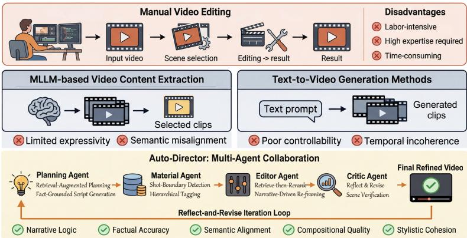
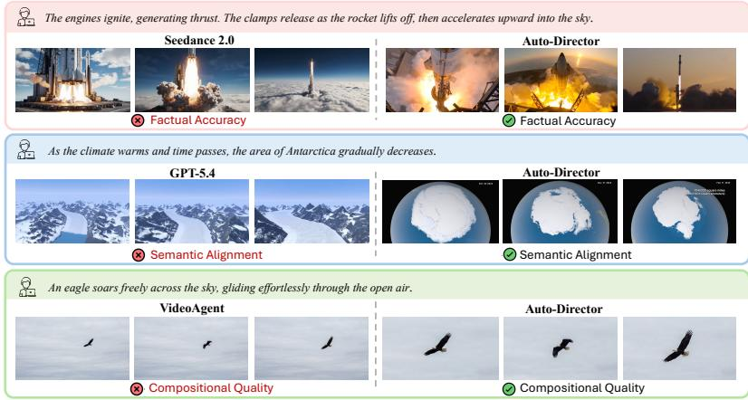

# Auto-Director: Leveraging Multi-Agent Collaboration for Autonomous Video Editing

Yuxia Chen1, Wenbo Zhu2, Yangguang Ji3, Zhenxiang Jiang4, Teng Zhong5, and Yu Zhang6

1 University of Electronic Science and Technology of China, China

2 University of California, Berkeley

3 Nanyang Technological University

4 National University of Singapore 5 Nanjing Normal University

6 Beijing Freedo Technology

Abstract. Autonomous video editing from open-world resources remains a challenging problem in multimedia content creation. Retrievalbased methods are constrained by fixed source material and lack creative flexibility, while generative models struggle with long-horizon coherence and often diverge from user intent. Both paradigms fail to replicate the structured, multi-stage reasoning that underlies professional postproduction. To address these limitations, we present Auto-Director, a tool-augmented multi-agent framework that mirrors professional editorial workflows: a Planning Agent decomposes abstract topics into fact-grounded scripts via retrieval-augmented planning; a Material Agent indexes open-world footage through shot segmentation and visual tagging; an Editor Agent assembles semantically aligned clips with MLLM-driven spatial adaptation; and a Critic Agent governs an iterative Reflect-and-Revise loop that checks scene-level alignment and pacing. To rigorously evaluate this new paradigm, we introduce VEdit-Bench, a benchmark of 100 expert-curated topics with human-annotated Golden Scripts and a five-dimensional metric suite covering Narrative Logic, Factual Accuracy, Semantic Alignment, Compositional Quality, and Stylistic Cohesion. Extensive experiments demonstrate that Auto-Director significantly outperforms baseline methods in both automated metrics and human evaluation, efectively bridging the gap between amateurs and professional-grade video production.

Keywords: Multimedia Creation · Video Editing · Agentic Framework · Multi-agent Collaboration

## 1 Introduction

Video has become a dominant medium for information dissemination and storytelling, yet professional production remains labor-intensive, demanding expertise in scriptwriting, material sourcing, and aesthetic editing [35], which places narrative-driven production out of reach for most amateurs.

  
Fig. 1. Overview of Auto-Director: a structured multi-agent pipeline with iterative reflect-and-revise feedback, addressing the limited expressivity of retrieval-based and the weak controllability of generation-based paradigms.

Recent advances in AI have fostered two primary directions for automated video creation, and both face limitations for open-world, long-form storytelling (see Fig. 1). Retrieval-based methods compose highlights from a fixed source corpus, as in trailer generation [1]; grounded in real footage, they are constrained by their source material and cannot easily bridge the semantic gap between nuanced script requirements and coarse dataset metadata. Generation-based methods instead synthesize clips directly from text [2,33]; although increasingly capable on visual quality, cinematic multi-shot generation still treats structural control and cross-shot consistency as open challenges [36,31], and such methods remain vulnerable to long-horizon inconsistency, factual hallucination, and weak controllability over many scenes. A third, more recent line applies agentic decomposition directly to video editing [15,16,39]. These systems emphasize diferent parts of the workflow; none combines externally grounded factual planning, structured shot-level indexing, and an iterative quality-control loop in one pipeline.

To address these limitations, we present Auto-Director, an agentic framework for open-world autonomous video editing that emulates the professional postproduction workflow through four specialized agents. In contrast to human-inthe-loop language-assisted editors such as LAVE [27], our goal is full pipeline autonomy. A Planning Agent translates abstract topics into fact-grounded scripts via Retrieval-Augmented Planning, decoupling factual accuracy from language fluency. A Material Agent converts open-world footage into structured, searchable assets through shot boundary detection and explicit visual tagging, reducing cross-modal retrieval to text-to-text matching. An Editor Agent performs twostage semantic matching and MLLM-driven spatial adaptation to synthesize a coherent draft. Finally, a Critic Agent then governs a Reflect-and-Revise loop, dispatching structured feedback upstream to check alignment and pacing.

To evaluate this setting, we introduce VEdit-Bench, a benchmark of 100 expert-curated topics paired with human-annotated Golden Scripts and fragmented material repositories that require open-world retrieval, with a fivedimensional metric suite. Our contributions are summarized as follows:

– We propose Auto-Director, a fully automated multi-agent framework orchestrating four specialized agents to produce narrative videos from open-world resources, with an iterative Reflect-and-Revise mechanism that self-corrects across retrieval, composition, and pacing.

– We construct VEdit-Bench, a benchmark of 100 expert-curated topics with human-annotated Golden Scripts and fragmented material repositories, paired with a five-dimensional metric suite including Factual Accuracy, a dimension prior video generation benchmarks do not explicitly target.

– Extensive experiments demonstrate that Auto-Director significantly outperforms leading baselines across all five metrics, efectively bridging the gap between amateur creators and professional-grade video production.

## 2 Related Work

## 2.1 Narrative Video Creation

Progress on narrative video creation spans controllable generation and automated editing. Story visualization exposed the need for global narrative consistency beyond isolated frame synthesis, and recent methods target explicitly cinematic multi-shot generation: STAGE [36,30] introduces storyboard-anchored generation with cross-shot memory, and related work studies long-form storytelling through adaptive memory and staged generation. These remain fully generative and therefore cannot ground a scene in verifiable real-world evidence.

A complementary line edits or composes existing footage: TGT [1] formulates trailer creation as sequence-to-sequence shot prediction over a single movie, AesopAgent [28] organizes story-to-video generation as multi-agent orchestration, and LAVE [27] shows how LLMs can assist human editing. These improve controllability and workflow automation, but either remain fully generative, assume closed-world assets, or keep the human editor in the loop at execution time.

## 2.2 Agentic Content Creation

Agentic decomposition has proven efective for multimodal content creation more broadly, typically separating planning, rendering, and self-critique roles. World-To-Image [24,32,34], for example, grounds text-to-image generation in agentdriven web retrieval. Similar agentic designs have recently been explored for video editing, where planning, material organization, editing, and refinement need to be coordinated.

EditDuet [21] pairs an Editor with a Critic that provides natural-language feedback over input clips, while a prompt-driven agentic editor [8] builds a global narrative index for long-form media through temporal segmentation and memory compression. DIRECT [15] adopts hierarchical multi-agent planning for video mashup creation, and GLANCE [16] coordinates global and local loops for music-grounded editing. CineAgents [37] studies instruction-driven cinematic compilation with an expert-annotated benchmark, while VideoAgent [39] uses intent parsing and graph-based tool orchestration for general-purpose video editing. Auto-Director follows this agentic direction by integrating factual planning, structured material processing, editing, and iterative refinement within a unified narrative video editing workflow.

## 3 Auto-Director

We formalize the Auto-Director pipeline as a structured transformation from a user prompt to a finished narrative video. The overall framework is illustrated in Fig. 1.

## 3.1 Planning Agent

The Planning Agent serves as the directorial brain of Auto-Director, translating an abstract user prompt $P$ into a structured, executable script S. The core challenge in this stage is factual grounding, since LLMs hallucinate on knowledge-intensive topics where precise attribution is non-negotiable [11,44,40]. Rather than relying on the model’s parametric knowledge alone, we integrate a Retrieval-Augmented Planning mechanism inspired by retrieval-augmented generation [14]: the agent decomposes P into atomic sub-queries $\left\{ q _ { k } \right\}$ , issues each to external knowledge $\mathrm { A P I s } .$ , and retains only claims corroborated by the retrieved evidence, giving a verified fact set $\kappa$ on which all generation is conditioned; the agent may not introduce dates, names, or causal relations unsupported by it. This grounding step decouples factual accuracy from language fluency, ensuring the script is both coherent and verifiable.

The agent transforms K into a script ${ \cal { S } } = \{ s _ { i } \} _ { i = 1 } ^ { N }$ under a fixed JSON schema, so downstream agents parse it deterministically, with each scene a three-tuple $s _ { i } = ( T _ { i } , Q _ { i } , D _ { i } )$ :

– Fact-Anchored Narration $T _ { i } \colon$ : voiceover text synthesized from K.

– Visual Query Description $Q _ { i } { \mathrm { : } }$ : a caption specifying the desired clip content for downstream retrieval; abstract ideas are converted into named events, persons, objects, or places to make them searchable.

– Temporal Constraint $D _ { i } { \mathrm { : } }$ a duration window governing scene pacing.

Notably, the Planning Agent participates not only in the initial generation phase but also in the Critic Agent’s refinement loop. When no suitable footage exists for a given scene $s _ { i } ,$ the Critic dispatches an adaptive scripting signal $\mathcal { F } _ { \mathrm { s c r i p t } }$ that triggers the Planning Agent to revise the narration $T _ { i } \ \to \ T _ { i } ^ { \prime }$ and query $Q _ { i } \to Q _ { i } ^ { \prime }$ , realigning the script with available visual evidence rather than forcing an irreconcilable visual-text mismatch.

## 3.2 Material Agent

The Material Agent bridges abstract script requirements and raw open-world footage. Its design addresses two limitations of existing retrieval paradigms:

dual-encoder VLMs such as CLIP [19,47,48,50] may lack the world knowledge needed for knowledge-intensive concepts such as historical events or named entities [26,41,42,46], while MLLMs often localize event boundaries imprecisely [10]. We therefore convert footage into a structured, text-indexed asset library D before semantic matching.

Step 1: Shot Segmentation and Visual Tagging Each video is segmented into cinematically atomic shots via content-aware boundary detection [4,25], yielding $V _ { \mathrm { s h o t s } } = \{ v _ { 1 } , \ldots , v _ { k } \}$ . For each shot $v _ { j }$ , a tagged frame is constructed by superimposing a structured text annotation directly onto sampled keyframes:

$$
\begin{array} { r } { \tilde { f } _ { j } = \mathrm { O v e r l a y } ( f _ { j } , \ \mathrm { t a g } _ { j } ) , \quad \mathrm { t a g } _ { j } = [ \mathrm { S h o t } \# j , \ t _ { j } ^ { \mathrm { t i m e } } ] , } \end{array}\tag{1}
$$

where the overlay is rendered in a fixed format to ensure consistent readability across diverse footage styles. This explicit visual tagging embeds both structural and temporal information directly into the visual domain [29,7,9], enabling MLLMs to reliably read shot identifiers and timestamps without relying on external metadata, which is a known source of hallucination [30].

Step 2: Hierarchical Caption Generation An MLLM processes the tagged keyframes and generates a structured JSON caption $d _ { j }$ for each shot, including high-level context, shot-level details such as entities, actions, and camera movements, and exact timestamps read from the visual tags. The resulting captions form the asset library $\mathcal { D } = \{ d _ { j } \} _ { j = 1 } ^ { M }$

Step 3: Text-to-Text Semantic Indexing With all captions aggregated, the asset library $\mathcal { D } = \{ d _ { j } \} _ { j = 1 } ^ { M }$ is indexed by embedding each structured caption $d _ { j }$ into a dense vector representation via a text encoder, constructing a searchable index over the textual domain. Downstream agents query D using natural language descriptions rather than raw visual features, reducing cross-modal retrieval to a text-to-text matching problem, which moderately reduces inference overhead on visual models and mitigates hallucination risks arising from insufficient cross-modal alignment.

## 3.3 Editor Agent

The Editor Agent transforms heterogeneous clips into a cohesive draft video $V _ { d r a f t }$ that matches the user-specified aspect ratio. It operates in three sequential phases: two-stage semantic matching, MLLM-driven spatial adaptation, and narrative-conditioned layout composition.

Step 1: Two-Stage Retrieve-then-Rerank To select the optimal footage for each scene $s _ { i }$ from the candidate pool, we propose a two-stage Retrievethen-Rerank pipeline, following the general dense retrieval and neural reranking paradigm established in open-domain retrieval [20,13,18]. We first encode the visual query $Q _ { i }$ with a text encoder $\phi ( \cdot )$ (Qwen3-Embedding [38,43]) and retrieve the top-K candidates from the material library D using cosine similarity:

$$
\mathcal { C } _ { i } ^ { K } = \mathop { \mathrm { t o p } } _ { { d _ { j } \in \mathcal { D } } } \ K \ \frac { \phi ( Q _ { i } ) ^ { \top } \phi ( d _ { j } ) } { | \phi ( Q _ { i } ) | \cdot | \phi ( d _ { j } ) | } .\tag{2}
$$

The MLLM then acts as a cross-modal re-ranker. For each candidate $c _ { k } \in \mathcal { C } _ { i } ^ { K }$ , it jointly considers the narration $T _ { i } .$ structured caption $d _ { k }$ , and sampled keyframes $\mathcal { F } _ { k }$ , and scores the candidate on three dimensions: semantic fidelity, atmospheric coherence, and temporal suitability. The scores are aggregated as

$$
r _ { k } = \lambda _ { 1 } r _ { k } ^ { \mathrm { s e m } } + \lambda _ { 2 } r _ { k } ^ { \mathrm { a t m } } + \lambda _ { 3 } r _ { k } ^ { \mathrm { t m p } } , \quad c _ { i } ^ { * } = \arg \operatorname* { m a x } _ { c _ { k } \in \mathcal { C } _ { i } ^ { K } } r _ { k } ,\tag{3}
$$

where $\lambda _ { 1 } ~ = ~ 0 . 5 , ~ \lambda _ { 2 } ~ = ~ 0 . 3$ , and $\lambda _ { 3 } ~ = ~ 0 . 2$ , prioritizing semantic correctness. The two-stage design achieves a coarse-to-fine retrieval hierarchy: the embedding stage eficiently prunes the search space from M to $K \ll M$ , while the MLLM re-ranking stage contributes the high-level narrative reasoning that embeddingonly models cannot provide.

Step 2: MLLM-Driven Spatial Adaptation After selecting $c _ { i } ^ { * }$ , the Editor Agent adapts the source footage to the target aspect ratio $R _ { \mathrm { t a r g e t } }$ . The MLLM analyzes each frame together with the narration $T _ { i }$ and predicts normalized bounding boxes for the primary subject. To avoid unstable frame-wise cropping, we apply Kalman filter-based stabilization [12], modeling ROI center coordinates as a linear dynamical system to suppress high-frequency jitter while preserving smooth subject tracking [3,6,22].

Step 3: Narrative-Conditioned Layout Composition The agent further determines whether a single crop can faithfully represent the scene. If the narration $T _ { i }$ jointly references $n \geq 2$ spatially disjoint subjects whose bounding boxes have insuficient overlap, a single crop may omit important visual information. The agent therefore selects a multi-window layout, such as Split-Screen or Picture-in-Picture, assigning separate windows to the relevant subject regions. Otherwise, the stabilized single-stream crop is retained.

## 3.4 Critic Agent

Linear pipelines propagate errors, with a single retrieval failure or misaligned crop degrading the output and no mechanism for recovery. Auto-Director addresses this with a Reflect-and-Revise loop governed by an MLLM-based Critic Agent, which audits $V _ { d r a f t }$ against S and dispatches structured feedback upstream, following iterative self-feedback paradigms [17,45,23,49]. Each scene is evaluated independently: the Critic emits integer semantic and aesthetic scores $v _ { i } ^ { \mathrm { s e m } } , v _ { i } ^ { \mathrm { a e s } }$ on a 1–5 scale plus a signal naming the scene, failure mode, and corrective action, so revision is surgical rather than global, and each failure routes to exactly one signal type.

Dimension 1: Semantic and Factual Verification The Critic samples keyframes from $V _ { d r a f t }$ and computes $v _ { i } ^ { \mathrm { s e m } }$ by jointly evaluating $T _ { i }$ and $Q _ { i }$ , where 5 indicates the footage precisely depicts the narration’s entities, events, and relations and 1 that it fails entirely. On a factual mismatch where the clip is wrong but a replacement exists in $\mathcal { D } _ { \mathrm { : } }$ , the Critic emits $\mathcal { F } _ { \mathrm { r e t r i e v a l } }$ (hallucination detection) to trigger re-retrieval with a refined query $Q _ { i } ^ { \prime } ;$ when no suitable footage exists, it dispatches $\mathcal { F } _ { \mathrm { s c r i p t } }$ (adaptive scripting) to the Planning Agent.

Dimension 2: Aesthetic and Temporal Audit The Critic then evaluates cinematic quality via $v _ { i } ^ { \mathrm { a e s } }$ on the same scale: cluttered or truncated compositions trigger $\mathcal { F } _ { \mathrm { l a y o u t } }$ , prompting the Editor Agent to adjust the ROI trajectory or layout template, while abrupt cuts or violations of $\{ D _ { i } \}$ trigger $\mathcal { F } _ { \mathrm { t i m i n g } }$ , prompting adjustment of shot durations or transitions.

A scene passes if both thresholds are satisfied, and passing scenes are frozen and excluded from later cycles. The termination condition is

$$
t ^ { * } = \operatorname* { m i n } \Bigl \{ t \leq \tau ~ : ~ \forall i , ~ v _ { i } ^ { \mathrm { s e m } ( t ) } \geq \tau _ { \mathrm { s e m } } ~ \land ~ v _ { i } ^ { \mathrm { a e s } ( t ) } \geq \tau _ { \mathrm { a e s } } \Bigr \} ,\tag{4}
$$

so the loop runs until all per-scene criteria are met or the budget $\tau$ is exhausted.

## 4 VEdit-Bench

In this section, we introduce VEdit-Bench, a benchmark designed to evaluate the full lifecycle of autonomous video editing. It combines expert-curated topics, human-annotated Golden Scripts, and fragmented material repositories to evaluate systems under realistic long-form editing scenarios.

## 4.1 Benchmark Construction

Topic Selection and Taxonomy We manually curated 100 diverse topics from trending educational and documentary categories on global video platforms and filtered them through a panel of five human experts. The topics follow a threetiered dificulty taxonomy and are distributed as 40 Easy $\mathrm { ~ / ~ } 4 0$ Medium / 20 Hard: (1) Entity-Centric, centered on concrete visual entities (e.g., “The Life Cycle of a Monarch Butterfly”); (2) Abstract Concept, requiring cross-domain reasoning to translate non-visual ideas into coherent imagery $( \mathrm { e . g . }$ , “The Impact of AI on Modern $\mathrm { S o c i e t y ^ { \prime \prime } } )$ ; and (3) Complex Narrative, requiring strict temporal logic and identification of specific historical or technical entities $( \mathrm { e . g . , \mathrm { \Omega ^ { 6 } T } }$ he Rise and Fall of the Roman Empire”).

Expert-Annotated Golden Scripts For each of the 100 topics, professional scriptwriters composed a Golden Script $( S _ { g o l d } )$ containing precise narration, factanchored milestones, and required visual evidence descriptions. Each script was validated by three additional expert annotators (Fleiss’ $\kappa = 0 . 7 4 )$ , and serves as the ground-truth reference for video evaluation.

Fragmented Material Repositories For each topic, we provide local video assets that deliberately cover only a partial subset of the required visual milestones, averaging 58% coverage of those defined in $S _ { g o l d } .$ This fragmented setting reflects practical editing scenarios in which the available footage may not fully satisfy the narrative requirements, requiring the system to retrieve missing evidence from external sources.

## 4.2 Evaluation Metrics

We propose a five-dimensional metric suite. All metrics are evaluated by prompting an MLLM [5]. The judge uses sampled keyframes with task-specific references, including $S _ { g o l d }$ for Factual Accuracy and generated narration for Semantic Alignment. All systems are evaluated with the same protocol, and the agreement between MLLM and human judgments is further validated in Sect. 5.5.

Narrative Logic The MLLM processes sampled keyframes together with the generated script and evaluates narrative flow along three dimensions: causal progression, whether each scene follows logically from the previous one; thematic consistency, whether the overall topic remains focused without unnecessary digression; and structural coherence, whether the narrative forms a clear introduction, development, and conclusion. Narrative Logic therefore captures high-level failures such as abrupt logical transitions, unresolved narrative threads, and contradictions between adjacent scenes.

Factual Accuracy The MLLM cross-references sampled keyframes against the fact-anchored milestones and required visual evidence in $S _ { g o l d }$ , verifying whether the depicted entities, objects, structures, and events are objectively correct regardless of what the model-generated narration states. This metric targets visual factual errors such as incorrect historical figures, species, artifacts, or visually similar but factually distinct landmarks. It therefore evaluates correctness against the Golden Script rather than consistency with the system’s own narration.

Semantic Alignment For each scene $s _ { i } ,$ a MLLM evaluates sampled keyframes alongside the model-generated narration $T _ { i }$ , assessing whether the described entities, actions, and events are physically manifested in the video at the correct temporal position. Unlike Factual Accuracy, which measures correctness against the ground-truth $S _ { g o l d }$ , Semantic Alignment measures internal consistency between the model’s own narration and the retrieved footage, and can thus diverge from Factual Accuracy: a scene may achieve high SA when the footage faithfully supports an incorrect narration, or low SA when correct footage is paired with a misaligned description. The final SA score is averaged across all N scenes.

Compositional Quality The MLLM scores each clip along three aspects: subject preservation, whether the primary subject described in $T _ { i }$ remains correctly framed within the target aspect ratio; spatial balance, whether the composition avoids perceptual imbalance or excessive dead space; and cropping artifact avoidance, whether re-framing unintentionally removes salient visual regions. Compositional Quality therefore reflects the within-shot layout quality produced by the spatial adaptation stage, with scores averaged over all N scenes.

Table 1. Quantitative evaluation on VEdit-Bench across five dimensions: Narrative Logic (NL), Factual Accuracy (FA), Semantic Alignment (SA), Compositional Quality (CQ), Stylistic Cohesion (SC). Best scores among automated methods in bold; human editors are a reference.
<table><tr><td>Method</td><td>NL</td><td>FA</td><td>SA</td><td>CQ</td><td>SC</td><td>Overall</td></tr><tr><td>Seedance 2.0</td><td>2.93</td><td>2.44</td><td>3.21</td><td>3.62</td><td>3.34</td><td>3.11</td></tr><tr><td>Kling 3.0</td><td>2.71</td><td>2.23</td><td>2.98</td><td>3.41</td><td>3.12</td><td>2.89</td></tr><tr><td>Veo 3.1</td><td>2.52</td><td>2.08</td><td>2.74</td><td>3.18</td><td>2.91</td><td>2.69</td></tr><tr><td>Sora 2</td><td>2.34</td><td>1.93</td><td>2.51</td><td>2.97</td><td>2.68</td><td>2.49</td></tr><tr><td>GPT-5.4</td><td>3.64</td><td>3.82</td><td>3.23</td><td>3.11</td><td>3.34</td><td>3.43</td></tr><tr><td>Gemini 3.1 Pro</td><td>3.51</td><td>3.74</td><td>3.14</td><td>3.02</td><td>3.22</td><td>3.33</td></tr><tr><td>MoneyPrinterTurbo</td><td>2.81</td><td>2.52</td><td>2.63</td><td>2.71</td><td>2.62</td><td>2.66</td></tr><tr><td>AutoClip</td><td>2.93</td><td>2.61</td><td>2.84</td><td>2.92</td><td>2.74</td><td>2.81</td></tr><tr><td>VideoAgent</td><td>3.62</td><td>3.34</td><td>3.51</td><td>3.43</td><td>3.41</td><td>3.46</td></tr><tr><td>Auto-Director (ours)</td><td>4.21</td><td>4.34</td><td>4.23</td><td>4.02</td><td>4.13</td><td>4.19</td></tr><tr><td>Human Editors</td><td>4.58</td><td>4.71</td><td>4.52</td><td>4.83</td><td>4.44</td><td>4.62</td></tr></table>

Stylistic Cohesion The MLLM assesses the global visual consistency of the assembled video by examining whether the dominant visual style, such as cinematic, archival, or animated footage, remains coherent across clips. Unlike Compositional Quality, which operates at the individual-shot level, Stylistic Cohesion is a sequence-level metric that penalizes abrupt stylistic discontinuities caused by heterogeneous source footage, including changes in color grading, film grain, and overall production quality.

## 5 Experiments

## 5.1 Baselines

We compare Auto-Director against four categories of methods:

– Video Generation Models. As these cannot produce long videos in one pass, we use an LLM to decompose the topic into per-scene captions, invoke each model per scene, and concatenate. We evaluate Seedance 2.0, Sora 2, Veo 3.1, and Kling 3.0.7

7 https://seed.bytedance.com/en/seedance2\_0, https://developers. openai.com/api/docs/models/sora-2, https://gemini.google/overview/ video-generation/, https://klingai.com/cn/

Table 2. Ablation study on VEdit-Bench across the five evaluation dimensions.
<table><tr><td>Variant</td><td>NL</td><td>FA</td><td>SA</td><td>CQ</td><td>SC</td></tr><tr><td>Auto-Director</td><td>4.21</td><td>4.34</td><td>4.23</td><td>4.02</td><td>4.13</td></tr><tr><td> $w / o$  Fact Retrieval</td><td>4.05</td><td>3.21</td><td>4.11</td><td>3.96</td><td>4.02</td></tr><tr><td>w/o Visual Tagging</td><td>4.03</td><td>4.19</td><td>3.54</td><td>3.82</td><td>3.71</td></tr><tr><td>w/o Critic Agent</td><td>3.91</td><td>3.82</td><td>3.85</td><td>3.71</td><td>3.64</td></tr></table>

– Multimodal Large Language Models. Given the same materials and prompt, each must comprehend the footage, predict segment timestamps, narrate, and arrange the result. We evaluate GPT-5.4 and Gemini 3.1 Pro.8   
– Agentic Editing Frameworks. The most direct comparison: MoneyPrinterTurbo, AutoClip, and VideoAgent [39].9 Human Editors. As a human reference, 10 professional editors with ≥5 years of post-production experience each produced a video independently from the same repository and prompt, without time constraints.

## 5.2 Implementation Details

All agents use Gemini 3.1 Pro as the backbone model. Planning-stage retrieval uses the Google Search and Wikipedia APIs. Scripts follow a fixed JSON schema with a predefined scene template, with at most N = 10 scenes per video. Shot boundary detection uses PySceneDetect, and each shot is tagged with a unique Shot ID and timestamp superimposed on keyframes sampled at 1 FPS.

First-stage retrieval uses Qwen3-Embedding [38] with K = 5 candidates. The re-ranking weights are $\lambda = ( 0 . 5 , 0 . 3 , 0 . 2 )$ to prioritize semantic fidelity over atmospheric and temporal dimensions. ROI stabilization uses a Kalman filter with a 5-frame smoothing window. The Critic uses a maximum iteration budget of $\tau = 3$ , with thresholds $\tau _ { \mathrm { s e m } } = \tau _ { \mathrm { a e s } } = 4$ on the 5-point scale.

## 5.3 Main Results

Table 1 reports the comparison on VEdit-Bench. Auto-Director achieves the best performance across all five dimensions among the evaluated automated methods on all five dimensions and overall, and narrows part of the gap to professional human editors.

Comparison with Video Generation Models. These record the lowest Factual Accuracy and Narrative Logic: each per-scene clip is plausible in isolation, but concatenation provides no mechanism for cross-scene consistency, and they synthesize from parametric knowledge without verifiable evidence. The Planning Agent’s Retrieval-Augmented mechanism directly addresses this gap: by grounding every scene in externally retrieved and cross-verified facts before any footage is assembled, Auto-Director maintains factual accuracy that pure generation cannot replicate.

  
Fig. 2. Qualitative comparison across three cases (factual accuracy, semantic alignment, compositional quality).

Comparison with Multimodal Large Language Models. Providing the same footage repository to strong MLLMs improves Factual Accuracy and Narrative Logic, with GPT-5.4 performing best among them. However, they remain weaker on Semantic Alignment and Compositional Quality, likely because long raw-video contexts lead to attention difusion and coarse temporal localization. The Material Agent instead converts footage into a compact text-indexed library D.

Comparison with Agentic Editing Frameworks. VideoAgent performs best among the agentic baselines, owing to its intent decomposition and graphbased orchestration, yet still trails Auto-Director on all dimensions; MoneyPrinterTurbo and AutoClip, relying on keyword-based retrieval and single-source transcript analysis, show larger gaps in Factual Accuracy and Semantic Alignment. A key diference is the Critic’s Reflect-and-Revise loop, absent in all three: instead of a one-shot output, the Critic dispatches scene-level feedback upstream, enabling targeted correction without re-running the pipeline.

Gap to Human Editor. Professional editors score highest on every dimension, reflecting fine-grained aesthetic judgment that is hard to automate. The gap is smallest on Semantic Alignment and largest on Compositional Quality, so subframe aesthetic refinement remains the clearest direction for future work; we claim no parity with human editors.

Table 3. Correlation between MLLM and human evaluation scores.
<table><tr><td>Dim.</td><td>r</td><td>ρ</td><td>MAE</td></tr><tr><td>NL</td><td>0.73</td><td>0.70</td><td>0.31</td></tr><tr><td>FA</td><td>0.78</td><td>0.75</td><td>0.28</td></tr><tr><td>SA</td><td>0.75</td><td>0.72</td><td>0.30</td></tr><tr><td>CQ</td><td>0.68</td><td>0.65</td><td>0.38</td></tr><tr><td>SC</td><td>0.71</td><td>0.68</td><td>0.35</td></tr><tr><td>All</td><td>0.73</td><td>0.70</td><td>0.32</td></tr></table>

Visualization Results Figure 2 presents qualitative comparisons. Generation models such as Seedance 2.0 produce factually incorrect footage (Case 1, missing hold-down clamps), GPT-5.4-based retrieval returns plausible but misaligned results for the Antarctica prompt (Case 2), and VideoAgent leaves the subject ofcenter (Case 3); Auto-Director instead retrieves accurate physical detail, satellite views conveying the intended temporal semantics, and composition-aware subject-centering. These are selected examples, not a quantitative summary.

## 5.4 Ablation Study

Table 2 removes three core components individually. Removing Fact Retrieval causes the sharpest drop in Factual Accuracy (4.34 → 3.21) while other dimensions remain largely intact, supporting Retrieval-Augmented Planning as the primary driver of factual grounding. Removing Visual Tagging most severely degrades Semantic Alignment (4.23 → 3.54), indicating that explicit shot-level annotation matters for temporal localization. Removing the Critic Agent produces the most uniform degradation, consistent with the Reflect-and-Revise loop acting as a system-wide safeguard.

## 5.5 User Study

To verify that our MLLM-based protocol produces scores consistent with human judgment, we randomly sample 20 videos and recruit 5 annotators to score each along the same five dimensions using a standardized rubric; inter-annotator agreement reaches Krippendorf’s α = 0.70. Over all 100 scored items (20 videos × 5 dimensions), Table 3 reports Pearson r = 0.73 and Spearman $\rho = 0 . 7 0$ demonstrating substantial alignment between automated and human evaluation.

## 6 Conclusion

We presented Auto-Director, a four-agent framework for open-world video editing, and VEdit-Bench for evaluating the complete workflow. Collaborative planning, material management, editing, and iterative refinement improve performance over existing baselines across all five evaluation dimensions.

## Acknowledgments

This work was supported in part by the Chongqing Natural Science Foundation (CSTB2024NSCQ-MSX1026), in part by the Fundamental Research Funds for the Central Universities (No. SWU-KT\_XJ2025002001), in part by the National Key R&D Program of China (No. 2024YFC3808901), and in part by the NSFC (62102328).

## References

1. Argaw, D.M., Soldan, M., Pardo, A., Zhao, C., Heilbron, F.C., Chung, J.S., Ghanem, B.: Towards automated movie trailer generation. In: Proceedings of the IEEE/CVF Conference on Computer Vision and Pattern Recognition. pp. 7445– 7454 (2024)

2. Bar-Tal, O., Chefer, H., Tov, O., Herrmann, C., Paiss, R., Zada, S., Ephrat, A., Hur, J., Liu, G., Raj, A., et al.: Lumiere: A space-time difusion model for video generation. In: SIGGRAPH Asia 2024 Conference Papers. pp. 1–11 (2024)

3. Cao, J., Wu, Y., Chi, W., Zhu, W., Su, Z., Wu, J.: Reframe anything: Llm agent for open world video reframing. arXiv preprint arXiv:2403.06070 (2024)

4. Castellano, B.: Pyscenedetect: Video scene cut detection and analysis tool. https: //github.com/Breakthrough/PySceneDetect (2024)

5. Chen, D., Chen, R., Zhang, S., Liu, Y., Wang, Y., Zhou, H., Zhang, Q., Wan, Y., Zhou, P., Sun, L.: Mllm-as-a-judge: Assessing multimodal llm-as-a-judge with vision-language benchmark. arXiv preprint arXiv:2402.04788 (2024)

6. Chen, H., Fang, P., Chen, Y., Ren, Y., Hao, J., Tang, F., Cai, X., Shan, S., Liu, F.: Hifi-mamba: Dual-stream?-laplacian enhanced mamba for high-fidelity mri reconstruction. In: Proceedings of the AAAI Conference on Artificial Intelligence. vol. 40, pp. 2868–2876 (2026)

7. Chen, Y., Fang, P., Zhong, X., Yu, J., Zhang, X., Li, T.: Hi-resnet: Edge detail enhancement for high-resolution remote sensing segmentation. IEEE Journal of Selected Topics in Applied Earth Observations and Remote Sensing 17, 15024– 15040 (2024)

8. Ding, Z., Wang, X., Chen, J., Kristensson, P.O., Shen, J.: Prompt-driven agentic video editing system: Autonomous comprehension of long-form, story-driven media. arXiv preprint arXiv:2509.16811 (2025)

9. Fang, P., Chen, H., Chen, Y., Sun, T., Liu, J., Cai, X.: Chasm: Cross-frequency harmonized axis-separable mixing for spectral token operators. arXiv preprint arXiv:2605.14727 (2026)

10. Huang, B., Wang, X., Chen, H., Song, Z., Zhu, W.: Vtimellm: Empower llm to grasp video moments. In: Proceedings of the IEEE/CVF Conference on Computer Vision and Pattern Recognition. pp. 14271–14280 (2024)

11. Ji, Z., Yu, T., Xu, Y., Lee, N., Ishii, E., Fung, P.: Towards mitigating llm hallucination via self reflection. In: Findings of the Association for Computational Linguistics: EMNLP 2023. pp. 1827–1843 (2023)

12. Kalman, R.E.: A new approach to linear filtering and prediction problems (1960)

13. Karpukhin, V., Oguz, B., Min, S., Lewis, P., Wu, L., Edunov, S., Chen, D., Yih, W.t.: Dense passage retrieval for open-domain question answering. In: Proceedings of the 2020 conference on empirical methods in natural language processing (EMNLP). pp. 6769–6781 (2020)

14. Lewis, P., Perez, E., Piktus, A., Petroni, F., Karpukhin, V., Goyal, N., Küttler, H., Lewis, M., Yih, W.t., Rocktäschel, T., et al.: Retrieval-augmented generation for knowledge-intensive nlp tasks. Advances in neural information processing systems 33, 9459–9474 (2020)

15. Li, K., Li, M., Chen, J., Chen, J., Zheng, Z., Wang, S., et al.: Direct: Video mashup creation via hierarchical multi-agent planning and intent-guided editing. arXiv preprint arXiv:2604.04875 (2026)

16. Lin, Z., Wang, H., Xu, Z., Dai, S., Dong, H., Wang, X., et al.: Glance: A global-local coordination multi-agent framework for music-grounded non-linear video editing. arXiv preprint arXiv:2604.05076 (2026)

17. Madaan, A., Tandon, N., Gupta, P., Hallinan, S., Gao, L., Wiegrefe, S., Alon, U., Dziri, N., Prabhumoye, S., Yang, Y., et al.: Self-refine: Iterative refinement with self-feedback. Advances in neural information processing systems 36, 46534–46594 (2023)

18. Nogueira, R., Cho, K.: Passage re-ranking with bert. arXiv preprint arXiv:1901.04085 (2019)

19. Radford, A., Kim, J.W., Hallacy, C., Ramesh, A., Goh, G., Agarwal, S., Sastry, G., Askell, A., Mishkin, P., Clark, J., et al.: Learning transferable visual models from natural language supervision. In: International conference on machine learning. pp. 8748–8763. PmLR (2021)

20. Reimers, N., Gurevych, I.: Sentence-bert: Sentence embeddings using siamese bertnetworks. In: Proceedings of the 2019 conference on empirical methods in natural language processing and the 9th international joint conference on natural language processing (EMNLP-IJCNLP). pp. 3982–3992 (2019)

21. Sandoval-Castaneda, M., Russell, B., Sivic, J., Shakhnarovich, G., Caba Heilbron, F.: Editduet: A multi-agent system for video non-linear editing. arXiv preprint arXiv:2509.10761 (2025)

22. Shen, F., Li, C., Geng, Y., Deng, Y., Chen, H.: Prune and repaint: Content-aware image retargeting for any ratio. arXiv preprint arXiv:2410.22865 (2024)

23. Shinn, N., Cassano, F., Gopinath, A., Narasimhan, K., Yao, S.: Reflexion: Language agents with verbal reinforcement learning. Advances in neural information processing systems 36, 8634–8652 (2023)

24. Son, M.H., Oh, J., Mun, S.B., Roh, J., Choi, S.: World-to-image: Grounding text-to-image generation with agent-driven world knowledge. arXiv preprint arXiv:2510.04201 (2025)

25. Soucek, T., Lokoc, J.: Transnet v2: An efective deep network architecture for fast shot transition detection. In: Proceedings of the 32nd ACM International Conference on Multimedia. pp. 11218–11221 (2024)

26. Tschannen, M., Gritsenko, A., Wang, X., Naeem, M.F., Alabdulmohsin, I., Parthasarathy, N., Evans, T., Beyer, L., Xia, Y., Mustafa, B., et al.: Siglip 2: Multilingual vision-language encoders with improved semantic understanding, localization, and dense features. arXiv preprint arXiv:2502.14786 (2025)

27. Wang, B., Li, Y., Lv, Z., Xia, H., Xu, Y., Sodhi, R.: Lave: Llm-powered agent assistance and language augmentation for video editing. In: Proceedings of the 29th International Conference on Intelligent User Interfaces. pp. 699–714 (2024)

28. Wang, J., Du, Z., Zhao, Y., Yuan, B., Wang, K., Liang, J., Zhao, Y., Lu, Y., Li, G., Gao, J., et al.: Aesopagent: Agent-driven evolutionary system on story-to-video production. arXiv preprint arXiv:2403.07952 (2024)

29. Wu, J., Zhang, Z., Xia, Y., Li, X., Xia, Z., Chang, A., Yu, T., Kim, S., Rossi, R.A., Zhang, R., et al.: Visual prompting in multimodal large language models: A survey. arXiv preprint arXiv:2409.15310 (2024)

30. Wu, Y., Hu, X., Sun, Y., Zhou, Y., Zhu, W., Rao, F., Schiele, B., Yang, X.: Number it: Temporal grounding videos like flipping manga. In: Proceedings of the Computer Vision and Pattern Recognition Conference. pp. 13754–13765 (2025)

31. Wu, Y., Li, Z., Hu, X., Ye, X., Zeng, X., Yu, G., Zhu, W., Schiele, B., Yang, M.H., Yang, X.: Kris-bench: Benchmarking next-level intelligent image editing models. Advances in Neural Information Processing Systems 38 (2026)

32. Wu, Y., Yang, X.: A glance at in-context learning. Frontiers of Computer Science 18(5), 185347 (2024)

33. Wu, Y., Zhou, S., Yang, M., Wang, L., Chang, H., Zhu, W., Hu, X., Zhou, X., Yang, X.: Unlearning concepts in difusion model via concept domain correction and concept preserving gradient. In: Proceedings of the AAAI Conference on Artificial Intelligence. vol. 39, pp. 8496–8504 (2025)

34. Wu, Y., Zhou, Y., Zhou, Z., Peng, Y., Ye, X., Hu, X., Zhu, W., Qi, L., Yang, M.H., et al.: On the generalization of sft: A reinforcement learning perspective with reward rectification. In: International Conference on Learning Representations. vol. 2026, pp. 27550–27571 (2026)

35. Wu, Y., Zhu, W., Cao, J., Lu, Y., Li, B., Chi, W., Qiu, Z., Su, L., Zheng, H., Wu, J., et al.: Video repurposing from user generated content: A large-scale dataset and benchmark. In: Proceedings of the AAAI Conference on Artificial Intelligence. vol. 39, pp. 8487–8495 (2025)

36. Zhang, P., Jia, Z., Liu, K., Weng, S., Li, S., Shi, B.: Stage: Storyboard-anchored generation for cinematic multi-shot narrative. arXiv preprint arXiv:2512.12372 (2025)

37. Zhang, P., Zhou, C., Zhang, Z., Liu, H., Zhang, C., Liu, J., et al.: A benchmark and multi-agent system for instruction-driven cinematic video compilation. arXiv preprint arXiv:2604.10456 (2026)

38. Zhang, Y., Li, M., Long, D., Zhang, X., Lin, H., Yang, B., Xie, P., Yang, A., Liu, D., Lin, J., et al.: Qwen3 embedding: Advancing text embedding and reranking through foundation models. arXiv preprint arXiv:2506.05176 (2025)

39. Zhou, H., Huang, L., Wang, J., Zhou, B., Wu, S., Xia, L., et al.: Videoagent: All-in-one framework for video understanding and editing. arXiv preprint arXiv:2606.23327 (2026)

40. Zhu, X., Fang, J., Wang, S., Zhu, B., Wang, Z., Yang, Y., He, X.: Mitigating hallucinations in large vision-language models without performance degradation. In: Proceedings of the 64th Annual Meeting of the Association for Computational Linguistics (Volume 1: Long Papers). pp. 1995–2009 (2026)

41. Zhu, X., Wang, S., Lu, J., Hao, Y., Liu, H., He, X.: Boosting few-shot learning via attentive feature regularization. Proceedings of the AAAI Conference on Artificial Intelligence 38(7), 7793–7801 (2024)

42. Zhu, X., Wang, S., Zhu, B., Li, M., Li, Y., Fang, J., Wang, Z., Wang, D., Zhang, H.: Dynamic multimodal prototype learning in vision-language models. In: Proceedings of the IEEE/CVF International Conference on Computer Vision. pp. 2501–2511 (2025)

43. Zhu, X., Wu, H., Wang, S., Zhu, B., Ge, J., Zhang, J., Chen, L.: Robustifying vision-language models via test-time prompt adaptation. In: Proceedings of the 43rd International Conference on Machine Learning. vol. 306 (2026)

44. Zhu, X., Zhao, K., Yi, L., Wang, S., Wang, Z., Zhu, B., Zhang, H., He, X.: Look carefully: Adaptive visual reinforcements in multimodal large language models for hallucination mitigation. In: International Conference on Learning Representations. vol. 2026, pp. 81235–81256 (2026)

45. Zhu, X., Zhu, B., Fang, J., Wang, S., Zhang, Y., Wang, X., He, X.: GuardAlign: Test-time safety alignment in multimodal large language models. In: International Conference on Learning Representations. vol. 2026, pp. 118865–118890 (2026)

46. Zhu, X., Zhu, B., Li, Y., Fang, J., Wang, S., Zhao, K., Zhang, H.: Hierarchical semantic alignment for image clustering. Proceedings of the AAAI Conference on Artificial Intelligence 40(34), 29177–29185 (2026)

47. Zhu, X., Zhu, B., Tan, Y., Wang, S., Hao, Y., Zhang, H.: Enhancing zero-shot vision models by label-free prompt distribution learning and bias correcting. In: Advances in Neural Information Processing Systems. vol. 37, pp. 2001–2025 (2024)

48. Zhu, X., Zhu, B., Tan, Y., Wang, S., Hao, Y., Zhang, H.: Selective vision-language subspace projection for few-shot CLIP. In: Proceedings of the 32nd ACM International Conference on Multimedia. pp. 3848–3857 (2024)

49. Zhu, X., Zhu, B., Wang, S., Fang, J., Zhao, K., Zhang, H., He, X.: Principled steering via null-space projection for jailbreak defense in vision-language models. In: Proceedings of the IEEE/CVF Conference on Computer Vision and Pattern Recognition. pp. 22889–22899 (2026)

50. Zhu, X., Zhu, B., Wang, S., Zhao, K., Zhang, H.: Enhancing CLIP robustness via cross-modality alignment. In: Advances in Neural Information Processing Systems. vol. 38, pp. 17553–17576 (2025)