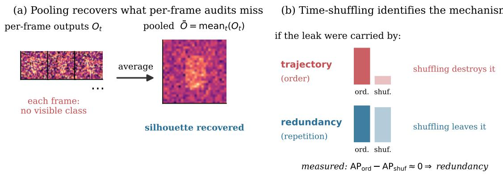
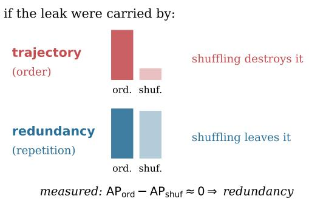
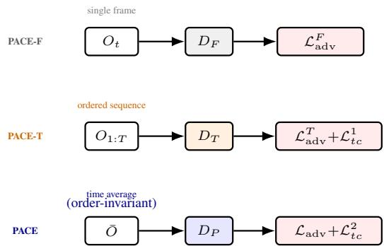
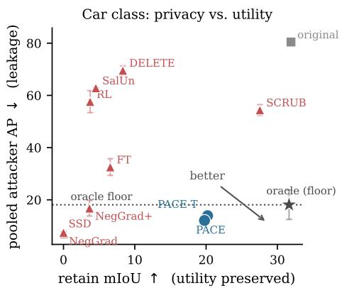
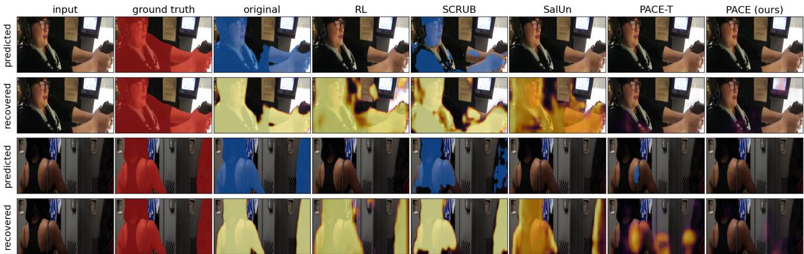

# Beyond the Frame: Redundancy, Not Trajectory, Carries the Privacy Leak in Video Unlearning

Kavyansh Tyagi, Paolo Russo Paper ID 524

## Abstract

Class unlearningfor video segmentation aims to ensure that a removed category cannot be reconstructed from a deployed model’s outputs. Current leakage evaluation algorithms inspect oneframe at a time, and we show that this understates leakage by a wide margin: an attacker that averages a model’s outputfield over a two-second clip recovers the forgotten class from every method we evaluate on VSPW and most on Virtual KITTI 2, including models whose perframe predictions are visually indistinguishable from a retrain oracle (a model trained from scratch without the forgotten class). We attribute the recoverable signal to crossframe redundancy rather than object trajectory, establish this with a time-shuffled control that leaves leakage intact, and introduce PACE, an unlearning method that suppresses redundancy directly using an exactly permutation-invariant pooled adversarial discriminator and a two-sided temporal consistency objective. Across VSPW and Virtual KITTI 2, PACE lowers pooled attacker AP to 18.79 (person) and 12.10 (car) on VSPW and 9.11 (car) on Virtual KITTI 2, achieving on the latter the strongest suppression among verdict-safe methods retaining usable utility, while retaining 19.8 mIoU on VSPW car against at most 8.3 for any baseline achieving comparable erasure.

## 1. Introduction

Regulatory requirements on data deletion [33] have made machine unlearning a practical engineering requirement rather than a theoretical curiosity [1, 3, 35]: make a trained network behave as though a designated class had never appeared in its training set, at a cost far below full retraining. For dense prediction tasks the verification step appears straightforward, since one can query the unlearned model and confirm that the forgotten class no longer appears in its output.

Video segmentation systems are verified this way, one frame at a time. Nearly every unlearning method we evaluate appears to erase the forgotten class at the frame level, yet most retain recoverable signal in their output fields that an attacker can turn into spatial structure of the forgotten class from a short video clip. We show that this leakage is large enough to change the relative ranking of evaluated methods.

The failure originates in a mismatch of observation windows: a per-frame audit grants the attacker a single image, whereas a deployed video model exposes a dense sequence of correlated observations of one scene. Suppose an unlearned model retains a residual preference for the forgotten class too weak to alter any single frame’s arg-max prediction, yet consistent in direction across frames. Averaging the clip suppresses the independent noise while the residual accumulates, and the forgotten silhouette becomes recoverable (Fig. 1a). No per-frame metric measures this quantity, since by construction none may observe more than one frame at a time.

We observe the same effect across the evaluated methods: a temporal attacker on the unlearned model’s output field over T=16 frames recovers substantially more of the forgotten class than a per-frame attack does, with the amplification largest precisely where the per-frame audit is most reassuring. At T=3, frame-adversarial erasure reaches 29.44 AP per frame, within five points of the retrain oracle, then rises to 45.26 once pooled, while SalUn [13] moves from 49.27 to 84.74 (Table 1). Because these gains differ sharply across methods, per-frame numbers fail even as a relative ordering.

Identifying the carrier. A temporal attacker outperforming a per-frame attack admits two explanations, which demand different defenses. The attacker may read the object’s trajectory, exploiting motion cues present in no single frame, which is what temporal leakage normally denotes; or it may exploit redundancy, averaging repeated observations of an essentially static residual. We separate the two by applying one random time permutation to both the model’s output sequence and the ground-truth mask sequence, then retraining and rescoring a matched attacker on the permuted data (Fig. 1b). Permutation destroys order while preserving frame content, so the gap $\mathrm { A P _ { o r d } - A P _ { s h u f } }$ isolates the trajectory-borne component. Across three attacker architectures, two temporal spans, and two forgotten classes, synergy stays within the retrain oracle’s own variation. Redundancy carries the leak: the order-dependent channel transmits no signal, so an objective enforcing exchangeability over frame order alone cannot close the gap.

  
Figure 1. The failure mode, and the control that identifies it. (a) A model can assign negligible probability to the forgotten class in every frame and still leak: a weak but temporally consistent residual survives averaging while the noise around it does not, and per-frame audits cannot observe this quantity. (b) Two mechanisms explain a temporal attacker’s advantage. Trajectory leakage requires frame order, so permuting frames destroys it; redundancy leakage requires only repetition, so permuting frames leaves it intact. Scoring both arms separates the two: in every configuration we test, the order-dependent component remains at retrain-oracle level.

Proposed solution. This identification is specific enough to act on. We study a family of adversarial erasure methods, culminating in PACE. PACE-F extends adversarial erasure to individual frames: its discriminator observes only $O _ { t }$ and reconstructs the forgotten mask $M _ { t } .$ . PACE-T (temporal) replaces it with a temporal discriminator and adds a one-sided bound on the region’s frame-to-frame change, which bounds the residual an averaging attacker can accumulate, and cuts the pooling gain by 2.5 – 5× relative to PACE-F under every attacker we test. Reading PACE-T as a variance constraint rather than an order constraint motivates the next step. PACE (pooled) is our proposed method: its adversarial discriminator observes only the time average $\begin{array} { r } { \bar { O } = \frac { 1 } { T } \sum _ { t } O _ { t } } \end{array}$ , making it exactly permutation-invariant by construction: no redistribution of the residual in time can satisfy it, so the generator must reduce the pooled resid ual. We pair this with a two-sided consistency objective, since the one-sided form assigns zero penalty to a temporally frozen region, the configuration most favorable to an averaging attacker.

We repeat the complete pipeline for a second class with sharply different statistics and a second dataset. person is the most frequent class in VSPW [34] and deforms as it moves, whereas car is rigid, with nearly linear motion, and appears in roughly 7.6× fewer eligible training clips; Virtual KITTI 2 [2] is a synthetic driving benchmark with a different renderer, taxonomy, and motion distribution. The mechanism and method ranking transfer across both classes

and datasets.

Our core contributions are three-fold:

• A sound audit for video unlearning. We show that perframe verification systematically understates recoverable information, and introduce a time-shuffled control that decomposes a temporal attacker’s advantage into redundancy and trajectory terms, establishing redundancy as the operative channel across architectures, spans, classes, and datasets.

• An order-invariant adversarial objective. We introduce PACE, whose pooled adversarial discriminator is exactly permutation-invariant by construction rather than by training, paired with a two-sided consistency term that removes the frozen-region solution of one-sided formulations.

• Strongest suppression at usable accuracy, on two datasets. PACE attains the lowest pooled leakage of any verdict-safe method that retains usable utility, across both VSPW classes and on Virtual KITTI 2; on VSPW, PACE and PACE-T are the only methods combining complete per-frame erasure with useful utility, where all baselines reaching comparable erasure fall to 8.3 mIoU or below.

## 2. Related Work

Approximate Unlearning and Its Verification Exact unlearning consists of retraining on the retained data, either directly or through sharding that limits how much of the model must be rebuilt [1, 3]. Because full retraining is costly at video scale, practical approaches instead modify a trained model so that it behaves as though the forgotten set were absent. These include gradient ascent on the forget set and stabilized variants [22, 42]; Fisher- and influencebased parameter scrubbing [18–20]; saliency-restricted updates [13]; selective dampening [14]; teacher–student objectives that repel the forget set while preserving the retain set [9, 30]; and relabeling with an explicit substitute target [5, 41].

Most of these methods were developed and evaluated on image classification, where each sample is observed once, so their verification procedures inherit a single-sample observation model. Forget-set accuracy alone is not a sufficient certificate of forgetting [17], while membershipinference attacks provide a stronger test of residual information [4, 39]. Weak evaluations can create a false sense of privacy [25], and the first NeurIPS unlearning competition showed that method rankings can change with the evaluation protocol [44]. These works strengthen the attacker’s inference procedure while keeping its observation window fixed at one sample. Our setting changes the observation window itself: a video model exposes a sequence of correlated outputs that can be jointly analyzed. To our knowledge, prior work has not evaluated video segmentation unlearning against a temporal pooling attacker, nor separated the order-dependent and redundancy-based components of the recovered signal.

Reconstruction from Model Outputs Model inversion attacks demonstrate that model outputs can contain information beyond the nominal prediction task [15, 27, 48], and neural networks can encode attributes that they were not explicitly trained to predict [40]. Our attacker is related to this line of work, but reconstructs the forgotten mask from the segmenter’s outputs over the retained classes. In contrast to conventional single-shot inversion, the signal studied here may be too weak to support reliable recovery from an individual frame and becomes recoverable only after aggregation across correlated observations: repeated-query amplification, where the attacker gains from the redundancy in multiple outputs of the same scene.

Adversarial Suppression and Temporal Modelling Suppressing information by training a representation against a discriminator that attempts to recover it is well established, from domain-adversarial learning [16] through censored representations [12] and controllable invariance [46]. The same adversarial formulation has been used for privacy-preserving recognition and anonymization [10, 38, 45] and for learned redaction [36]. These approaches suppress the information accessible to the particular discriminator they employ. Our setting differs in that the relevant leakage mechanism is first identified empirically, and the discriminator is then constrained to observe that quantity—the time-averaged output—making permutation invariance a property of the attack surface rather than a behavior to be learned. The generator’s completion behavior is also related to context-based inpainting [37, 47], although our objective is non-recoverability of a forgotten class rather than perceptual plausibility.

  
Figure 2. The method family. All three variants train one generator against a discriminator that differs only in what it is permitted to observe: PACE-F’s $D _ { F }$ reads a single frame $O _ { t } ;$ PACE-T’s $D _ { T }$ reads the ordered clip $O _ { 1 : T } .$ , paired with the one-sided bound $\mathcal { L } _ { t c } ^ { 1 }$ (Eq. 6); PACE’s $D _ { P }$ reads only the time average $\bar { O } ( \mathrm { E q . } 7 )$ , exactly order-invariant by construction, paired with the two-sided bound $\mathcal { L } _ { t c } ^ { 2 } \left( \mathrm { E q . ~ } 9 \right)$ that removes the frozen-region solution.

We build on DeepLabV3 [6, 7] with a ResNet-50 backbone [26, 32] trained per frame on VSPW [34], following prior observations that competitive video segmentation can be obtained with per-frame prediction when temporal consistency is handled separately [29, 49]; temporal structure thus enters only through the adversarial discriminator and the unlearning objective. To test whether our conclusions depend on a particular temporal architecture, we evaluate a 3D convolutional attacker [43], a bidirectional ConvGRU [8], and a bidirectional selective state-space model [23, 24, 31]. The latter has a full-clip receptive field with 5× fewer parameters than the 3D attacker, a strong test that the observed absence of an order-dependent component is not an artifact of insufficient temporal reach.

## 3. Methodology

## 3.1. Problem Formulation and Threat Model

Let $f _ { \theta }$ denote a segmenter mapping a frame $I _ { t } \in \mathbb { R } ^ { H \times W \times 3 }$ to a logit field $f _ { \theta } \mathbf { \bar { ( } } I _ { t } ) \ \in \ \mathbb { R } ^ { d \times W \times C }$ over C classes. Unlearning a target class c produces parameters $\theta ^ { \prime }$ such that c is neither predicted nor recoverable, while accuracy on the retain set ${ \mathcal { R } } = \{ 1 , . . . , C \} \setminus \{ c \}$ is preserved. The supervision target on forgotten pixels is the dominant-neighbor relabeling $\pi ( \cdot ) \colon$ : each pixel $p$ with $y _ { p } { = } c$ takes the label of its nearest non-c, non-ignore pixel under a Euclidean distance transform.

Two reference models bracket every measurement. The model original is trained normally and contains c. The model oracle is retrained from scratch with π applied before training begins and defines the privacy floor. The floor is strictly positive: a model that never observed c can still encode contextual priors about where c-shaped regions tend

Adversary. We grant black-box access to the unlearned model’s output field over a clip of $T$ consecutive frames, together with knowledge of the task, withholding weights, gradients, and training data: the standard output-access setting extended to the temporal case. Writing $O _ { t } \in$ Rh×w×|R| for the retained-class logit field at reduced resolution, the attacker trains $D _ { \phi }$ to map the clip $O _ { 1 : T }$ to the forgotten mask sequence $M _ { 1 : T } \in \{ 0 , 1 \} ^ { h \times w }$ by minimizing

$$
\mathcal { L } _ { D } = \frac { 1 } { T } \sum _ { t = 1 } ^ { T } \mathrm { B C E } ( D _ { \phi } ( O _ { 1 : T } ) _ { t } , ~ M _ { t } ) .\tag{1}
$$

Recovery is scored by average precision (AP) over every pixel in a held-out set, accumulated through a 512-bin histogram rather than subsampling; AP is the primary metric because the positive class occupies a small fraction of pixels [11]. We additionally report AUC, best-threshold IoU, and positive rate as diagnostics.

## 3.2. Decomposing the Temporal Advantage

A temporal attacker outperforming a per-frame attacker does not by itself identify the mechanism: redundancy predicts a variance-reduction effect of averaging T noisy estimates of a temporally correlated mask, independent of frame order, whereas trajectory leakage is information carried by the motion path itself and is order-dependent. We construct a control to separate the two. Let σ be a permutation of $\{ 1 , \ldots , T \}$ drawn independently per clip and applied jointly to the output and mask sequences, giving $O _ { \sigma ( 1 : T ) }$ and $M _ { \sigma ( 1 : T ) }$ ; training and evaluating a matched attacker on these clips removes frame order while preserving per-frame content and cross-frame redundancy, and we therefore define

$$
\mathrm { s y n e r g y } = \mathrm { A P } _ { \mathrm { o r d } } - \mathrm { A P } _ { \mathrm { s h u f } } ,\tag{2}
$$

$$
\Delta _ { \mathrm { r e d } } = \mathrm { A P _ { s h u f } - A P _ { f r a m e } } ,\tag{3}
$$

where $\mathrm { A P _ { f r a m e } }$ is a per-frame attacker’s score on the same model; Eq. 3 measures the recovery available from crossframe aggregation, Eq. 2 the order-dependent component. Reporting both lets the objective target the mechanism the evaluation identifies.

Protocol controls. Three requirements make the decomposition meaningful. Evaluation content must not vary with T: we draw a fixed anchor set of (video, frame) pairs once and form clips of every length as windows around the same anchors. The attacker’s optimization budget must remain fixed across $T \colon$ gradient accumulation fixes both optimizer steps and effective clip batch size, independently of physical batch memory. Finally, scoring must be calibration-free, since a fixed-threshold IoU can report zero for an attacker whose ranking is informative but whose sigmoid outputs never cross the threshold. Section 5 quantifies the effect of each control.

## 3.3. Adversarial Erasure Objectives

All variants train the generator, initialized from original, with

$$
\mathcal { L } _ { G } = \lambda _ { r } \mathcal { L } _ { r } + \lambda _ { \mathrm { a d v } } \mathcal { L } _ { \mathrm { a d v } } + \lambda _ { t c } \mathcal { L } _ { t c } ,\tag{4}
$$

alternating with discriminator updates in the usual minimax fashion [21]. The retention term

$$
\mathcal { L } _ { r } = \mathrm { C E } ( G ( I ) , \pi ( y ) ) + \beta \mathrm { K L } ( G ( I ) \parallel f _ { \theta } ( I ) ) \mid _ { \mathcal { R } }\tag{5}
$$

drives forgotten pixels toward their re-labeled targets while anchoring retained pixels to the frozen original through a distillation penalty [28]. It is applied on ordinary frames to limit collateral damage. The variants differ in $\mathcal { L } _ { \mathrm { a d v } }$ and $\mathcal { L } _ { t c } ,$ and therefore in the information they can suppress (Fig. 2).

PACE-F. Frame adversarial erasure uses a per-frame discriminator $D _ { F }$ to reconstruct $M _ { t }$ from $O _ { t }$ alone. It therefore makes each frame individually difficult to attack, which Sec. 4 shows is not equivalent to making the entire clip difficult to attack.

PACE-T. Temporal adversarial erasure replaces $D _ { F }$ with a temporal discriminator over the ordered sequence and adds a one-sided bound on the region’s motion,

$$
\mathcal { L } _ { t c } ^ { 1 } = \mathbb { E } \big [ \mathrm { r e l u } ( \Delta O - \rho ) \big ] , \quad \Delta O = \| O _ { t + 1 } - O _ { t } \| ,\tag{6}
$$

where the reference $\rho$ is a local motion budget estimated over a dilated ring surrounding the region and floored by a global estimate. The penalty therefore activates only when the region changes more than its surroundings.

## 3.4. PACE

Two changes follow from the decomposition, each addressing a different failure mode of the objective.

Order-invariant pooled discriminator. We introduce a pooled discriminator $D _ { P }$ that observes only

$$
\bar { O } = \frac { 1 } { T } \sum _ { t = 1 } ^ { T } O _ { t } \in \mathbb R ^ { h \times w \times | \mathcal R | } ,\tag{7}
$$

after temporal averaging and before any learned parameters are applied, and predicts a single clip-level mask $\bar { M } = \vee _ { t } M _ { t }$ . Because averaging precedes the discriminator, $D _ { P } ( \overline { { { O _ { \sigma ( 1 : T ) } } } } ) = D _ { P } ( \bar { O } )$ for every permutation $\sigma { : }$ the invariance is exact and does not depend on learning. Numerically, the maximum output deviation under permutation is $4 \times 1 0 ^ { - 6 }$ , at the level of floating-point noise, and $\partial D _ { P } / \partial O _ { t }$ is uniform over t, matching the closed-form backward pass of the mean.

Redistributing a residual across frames cannot change the pooled discriminator’s input, so the generator must reduce the residual that survives pooling—the quantity measured by Eq. 3. We retain the temporal reconstruction discriminator $D _ { T }$ alongside $D _ { P }$ , giving

$$
\begin{array} { r } { \mathcal { L } _ { \mathrm { a d v } } = \underbrace { \mathrm { B C E } ( D _ { T } ( O _ { 1 : T } ) , \mathbf { 0 } ) } _ { \mathrm { t e m p o r a l ~ r e c o n s t r u c t i o n } } + \lambda _ { p } \underbrace { \mathrm { B C E } \bigl ( D _ { P } ( \bar { O } ) , \mathbf { 0 } \bigr ) } _ { \mathrm { p o o l e d ~ r e c o n s t r u c t i o n } } . } \end{array}\tag{8}
$$

Two-sided consistency bound. Equation 6 admits a degenerate solution. A temporally frozen region has $\Delta O = 0$ and therefore incurs zero penalty, yet such a frozen residual is particularly favorable to an averaging attacker because repetition is what pooling exploits. We replace the onesided form with

$$
\mathcal { L } _ { t c } ^ { 2 } = \mathbb { E } \big [ \left( \Delta O - \rho \right) ^ { 2 } \big ] ,\tag{9}
$$

which penalizes both deficient and excessive motion.

Detached reference. We compute ρ without gradient. If ρ were differentiable, the optimizer could reduce Eq. 9 by increasing the reference, for example by adding motion to the surrounding ring rather than reducing the region’s own residual; detaching ρ and flooring it with a global estimate removes this path, and the same holds for any adversarial penalty defined relative to a learned reference.

Implementation. All variants train on clips of length 3 at batch size 2, with $\lambda _ { r } = \lambda _ { \mathrm { a d v } } = 1 . 0 , \lambda _ { t c } = 0 . 5$ , and $\lambda _ { p } = 1 . 0 .$ . PACE adds 3.8% wall-clock time over PACE-T (853.5 vs. 822.2 minutes on one GPU), comparable to the 3.7% overhead of the ablated order term (Sec. 5). Every attacker is trained from scratch for each evaluated model and is never shared.

## 4. Quantitative and Qualitative Results

Setup. Our main study trains on VSPW [34] (124 classes, 2806 train / 343 val videos at 15 fps), with person and car as forgotten classes; we additionally evaluate on Virtual KITTI 2 [2], a densely annotated synthetic driving dataset, with car as the forgotten class there too (§4.7). Unless stated otherwise, leakage uses the full-clip-reach selective state-space attacker at T=16, stride 2 (2.1 s), trained for 500 optimizer steps at effective batch 4, with two training runs per arm scored over 800 held-out clips; utility is retain-set mIoU over all non-forgotten classes, and every cache is rebuilt per class and dataset.

<table><tr><td>Model</td><td>frame</td><td>shuf.</td><td>ord.</td><td> $\Delta _ { \mathrm { r e d } }$ </td><td>synergy</td></tr><tr><td>oracle (floor)</td><td>24.73</td><td>26.77</td><td>26.99</td><td>+2.04</td><td>+0.22</td></tr><tr><td>original</td><td>91.56</td><td>94.94</td><td>94.94</td><td>+3.38</td><td>+0.00</td></tr><tr><td>PACE-F</td><td>29.44</td><td>45.35</td><td>45.26</td><td>+15.91</td><td>-0.09</td></tr><tr><td>PACE-T</td><td>16.42</td><td>22.62</td><td>21.26</td><td>+6.20</td><td>-1.36</td></tr><tr><td>SalUn [13]</td><td>49.27</td><td>83.54</td><td>84.74</td><td>+34.27</td><td>+1.20</td></tr></table>

Table 1. Adversary AP by arm at T=3. The pooling gain $\Delta _ { \mathrm { r e d } }$ is largest for the methods that appear most private under a per-frame audit, while synergy remains small relative to the corresponding redundancy gain.
<table><tr><td>Model</td><td>3D CNN</td><td>ConvGRU</td><td>Sel. SSM</td></tr><tr><td>oracle (floor)</td><td>-0.99</td><td>+2.02</td><td>+5.49</td></tr><tr><td>original</td><td>+2.09</td><td>+3.24</td><td>+1.63</td></tr><tr><td>PACE-F</td><td>+12.69</td><td>+19.21</td><td>+17.49</td></tr><tr><td>PACE-T</td><td>+2.53</td><td>+5.43</td><td>+7.02</td></tr></table>

Table 2. Pooling gain $\Delta _ { \mathrm { r e d } }$ at $T { = } 1 6$ under three attacker architectures. PACE-T reduces the gain by 2.5 to 5× relative to PACE-F under every attacker, and its residual tracks the irreducible floor as attacker strength increases.

## 4.1. Effect of Temporal Pooling on Leakage

Table 1 reports all three arms at T=3 with the 3D convolutional attacker, together with the quantities of Eqs. 2 and 3.

The pooling gain concentrates where per-frame evidence is most reassuring. SalUn sits at 49.27 AP per frame and reaches 84.74 pooled, recovering essentially all of the undefended model’s leakage; the undefended model, already maximally leaky per frame, gains only 3.38, and the oracle only 2.04. PACE-F is the sharpest case: at 29.44 AP per frame it lies within five points of the retrain oracle, which a per-frame audit treats as near-certification, and pools to 45.26, clearly above the floor: this is amplification acting on an existing residual, since suppressing amplitude without removing temporal consistency preserves exactly the structure pooling exploits.

## 4.2. Redundancy versus Trajectory

We rule out an attacker too myopic to see trajectory, and a clip too short to contain one, by rerunning the control with the strongest attacker at T=16 across two spans on the most leakage-rich model available. The undefended model records synergy of −0.01 at 1.1 s and +0.46 at 2.1 s, both within the oracle’s band of −0.43 to +0.86 under maximally favorable conditions. Three configurations differing in clip length, architecture, and span all place synergy at zero, establishing redundancy as the channel a defense must address at the horizons tested.

## 4.3. Suppressing Redundancy via Amplitude Control

Table 2 isolates $\Delta _ { \mathrm { r e d } }$ across all three attacker architectures. PACE-T reduces the pooling gain by factors of 0.20,

<table><tr><td>Model</td><td>retain mIoU ↑</td><td>person IoU</td><td>pooled AP ↓</td><td>Verdict</td></tr><tr><td>oracle (floor)</td><td>30.8</td><td>0.0</td><td> $3 0 . 8 2 \pm 0 . 1 4$ </td><td>floor</td></tr><tr><td>original</td><td>33.5</td><td>81.2</td><td> $9 3 . 8 2 \pm 0 . 7 7$ </td><td>LEAK</td></tr><tr><td>FT [18]</td><td>17.4</td><td>0.0</td><td> $4 8 . 4 8 \pm 1 . 7 1$ </td><td>LEAK</td></tr><tr><td>NegGrad [42]</td><td>0.1</td><td>0.1</td><td> $8 8 . 7 0 \pm 0 . 3 9$ </td><td>LEAK</td></tr><tr><td>NegGrad+ [30]</td><td>4.9</td><td>0.0</td><td> $6 8 . 1 4 \pm 1 . 2 8$ </td><td>LEAK</td></tr><tr><td>RL [22]</td><td>19.0</td><td>0.0</td><td> $8 6 . 0 8 \pm 0 . 4 0$ </td><td>LEAK</td></tr><tr><td>SalUn [13]</td><td>15.1</td><td>0.0</td><td> $8 5 . 6 8 \pm 0 . 3 5$ </td><td>LEAK</td></tr><tr><td>SSD [14]</td><td>0.4</td><td>0.0</td><td> $2 5 . 5 7 \pm 1 . 0 7$ </td><td>safe</td></tr><tr><td>SCRUB [30]</td><td>31.2</td><td>36.7</td><td> $8 8 . 6 0 \pm 0 . 3 5$ </td><td>LEAK</td></tr><tr><td>DELETE [5]</td><td>17.1</td><td>0.0</td><td> $7 0 . 5 9 \pm 3 . 5 7$ </td><td>LEAK</td></tr><tr><td>PACE-F</td><td>24.2</td><td>8.3</td><td> $4 6 . 9 2 \pm 0 . 3 8$ </td><td>LEAK</td></tr><tr><td>PACE-T</td><td>22.5</td><td>1.4</td><td> $2 1 . 1 0 \pm 0 . 1 6$ </td><td>safe</td></tr><tr><td>PACE (ours)</td><td>21.2</td><td>0.8</td><td> ${ \bf 1 8 . 7 9 \pm 1 . 2 3 }$ </td><td>safe</td></tr></table>

Table 3. Person class, all thirteen models under one protocol, threshold $\mu _ { \mathrm { f l o o r } } { + 2 \sigma _ { \mathrm { f l o o r } } }$ from oracle floor. SSD is the only baseline scoring SAFE, and it does so by destroying the model (retain mIoU 0.4); SCRUB is the one baseline that barely erases the class at all (person IoU 36.7) and leaks accordingly. PACE-F, PACE-T and PACE are the only LEAK/safe/safe sequence that comes from one continuously improved objective rather than three unrelated methods, and PACE is the only method in the table combining a safe verdict, retain mIoU above 21, and the lowest pooled AP.

0.28, and 0.40 relative to PACE-F across the three architectures, so the effect is a property of the objective rather than a weak attacker. The floor supplies the sharper reading. A model that never observed the class still gains from pooling, and that gain grows with attacker strength from −0.99 to +2.02 to +5.49. Under the strongest attacker PACE-T’s gain of +7.02 tracks the floor’s own +5.49 while PACE-F’s +17.49 is independent of it, so PACE-T approaches the irreducible component whereas PACE-F leaves a leak on top of it.

## 4.4. Leak/Safe Verdict Criterion

Tables 3 and 4 add a binary Verdict: LEAK when ordered AP exceeds the oracle floor’s mean by more than two trial standard deviations $( \mu _ { \mathrm { f l o o r } } { + 2 \sigma _ { \mathrm { f l o o r } } } )$ , SAFE otherwise— statistically indistinguishable from retraining along the pooled channel. The threshold is computed once per class from the floor’s own spread, not tuned per method.

## 4.5. Main Results: Person Class

Eight of ten published baselines leak, and the two exceptions are not the methods a practitioner would want: SSD is safe because retain mIoU has collapsed to 0.4, not because it forgot selectively. PACE-F, PACE-T and PACE trace one design lineage from LEAK to safe to a tighter, higher-utility safe, and PACE is the only method that is verdict-safe, has the lowest pooled AP, and retains mIoU above 21. We return to why PACE-F leaks and PACE-T does not in §5.

## 4.6. Generalization to the Car Class

Tables 3 and 4, with Fig. 3, make the same point under different class statistics. A safe verdict is cheap to ob tain by damaging the model: three car baselines and one person baseline reach it that way, at retain mIoU ≤ 3.6 and 0.4. PACE-T and PACE are, on both classes, the only verdict-safe methods retaining most non-target accuracy (20.2/19.8 mIoU on $\mathrm { { c a r \ v s . } \leq 8 . 3 }$ for comparable baselines, 22.5/21.2 on person vs. $\mathrm { S S D ' s 0 . 4 ) }$ , and PACE attains the lowest AP among them: 12.10 on car (within the floor’s own 5.60 spread, so comparable) and 18.79 on person. SCRUB shows the opposite failure on both: it preserves utility (31.2/27.5 mIoU) while barely erasing the target (IoU 36.7/20.3), leaking from not having unlearned rather than from redundancy. The transfer to a rigid, rarer class supports the mechanism over a class-specific artefact.

<table><tr><td>Model</td><td>retain mIoU ↑</td><td>car IoU</td><td>pooled AP ↓</td><td>Verdict</td></tr><tr><td>oracle (floor)</td><td>31.6</td><td>0.0</td><td> $1 8 . 1 0 \pm 5 . 6 0$ </td><td>floor</td></tr><tr><td>original</td><td>31.9</td><td>33.5</td><td> $8 0 . 4 5 \pm 1 . 6 2$ </td><td>LEAK</td></tr><tr><td>FT [18]</td><td>6.6</td><td>0.0</td><td> $3 2 . 5 5 \pm 3 . 2 1$ </td><td>LEAK</td></tr><tr><td>NegGrad [42]</td><td>0.1</td><td>0.0</td><td> $6 . 9 7 \pm 0 . 2 7$ </td><td>safe</td></tr><tr><td>NegGrad+ [30]</td><td>3.6</td><td>0.0</td><td> $1 6 . 7 9 \pm 2 . 9 9$ </td><td>safe</td></tr><tr><td>RL [22]</td><td>3.7</td><td>0.0</td><td> $5 7 . 6 1 \pm 4 . 2 3$ </td><td>LEAK</td></tr><tr><td>SalUn [13]</td><td>4.5</td><td>0.0</td><td> $6 2 . 8 5 \pm 0 . 0 3$ </td><td>LEAK</td></tr><tr><td>SSD [14]</td><td>0.0</td><td>0.0</td><td> $7 . 4 8 \pm 0 . 3 4$ </td><td>safe</td></tr><tr><td>SCRUB [30]</td><td>27.5</td><td>20.3</td><td> $5 4 . 4 1 \pm 2 . 0 4$ </td><td>LEAK</td></tr><tr><td>DELETE [5]</td><td>8.3</td><td>0.0</td><td> $6 9 . 5 7 \pm 1 . 7 6$ </td><td>LEAK</td></tr><tr><td>PACE-T</td><td>20.2</td><td>0.0</td><td> $1 3 . 9 3 \pm 0 . 3 7$ </td><td>safe</td></tr><tr><td>PACE (ours)</td><td>19.8</td><td>0.0</td><td> ${ \bf 1 2 . 1 0 \pm 1 . 8 1 }$ </td><td>safe</td></tr></table>

Table 4. Car class, all twelve models under one protocol, threshold $\mu _ { \mathrm { f l o o r } } { + 2 \sigma _ { \mathrm { f l o o r } } }$ AP from oracle floor. Three baselines are verdictsafe (NegGrad, NegGrad+, SSD); all three reach it with retain mIoU ≤ 3.6, i.e. by damaging the model rather than by selectively forgetting car. PACE-T and PACE are the only methods that are simultaneously verdict-safe and retain mIoU above 8.3.

  
Figure 3. Car class, privacy against utility. Error bars give trial spread. Low leakage carries meaning only at usable utility, and the two least leaky baselines sit at the left edge because the model has been degraded. PACE and PACE-T occupy the useful corner.

## 4.7. Generalization to Virtual KITTI 2

Table 5 repeats the protocol on a second dataset, renderer, and domain with rigid, fast-moving targets. The pattern from VSPW survives: four of eight baselines leak, SCRUB again preserves utility (44.7 mIoU) while barely erasing the class (car IoU 10.9), and PACE-T is again verdict-safe with the best utility among safe, genuinely-forgetting methods. Two findings are new, and we report both explicitly. FT is verdict-safe here while it leaks on both VSPW classes; its synergy of +10.24 is also the only clearly non-zero value across all thirty-six model-dataset combinations we evaluate, so we treat it as an isolated exception, not evidence against the decomposition of Sec. 3.2. PACE’s utility here (7.6 mIoU) falls well below PACE-T’s (21.1); PACE still reaches the lowest AP of any safe method (9.11), but PACE-T is the better operating point on this dataset by utility, a cost we attribute to the pooled objective interacting with Virtual KITTI 2’s smaller, four-scene training set rather than to pooling itself: the variants differ only in that discriminator.

<table><tr><td>Model</td><td>retain mIoU ↑</td><td>car IoU</td><td>pooled AP ↓</td><td>Verdict</td></tr><tr><td>oracle (floor) original</td><td>45.0 50.1</td><td>0.0</td><td> $5 0 . 7 1 \pm 0 . 7 1$ </td><td>floor LEAK</td></tr><tr><td>FT [18]</td><td></td><td>82.8</td><td> $8 8 . 6 7 \pm 1 . 2 7$ </td><td></td></tr><tr><td>NegGrad [42]</td><td>30.9 1.8</td><td>0.0</td><td> $4 1 . 4 3 \pm 2 . 3 2$   $9 . 6 7 \pm 1 . 4 1$ </td><td>safe safe</td></tr><tr><td>NegGrad+ [30]</td><td>4.9</td><td>0.0</td><td></td><td>safe</td></tr><tr><td>RL [22]</td><td>31.7</td><td>0.0</td><td> $3 3 . 5 7 \pm 6 . 4 0$ </td><td>LEAK</td></tr><tr><td>SalUn [13]</td><td>32.2</td><td>0.0</td><td> $8 9 . 1 7 \pm 1 . 0 8$   $9 2 . 4 2 \pm 0 . 4 9$ </td><td>LEAK</td></tr><tr><td>SSD [14]</td><td>1.8</td><td>0.0</td><td> $6 . 8 7 \pm 0 . 1 9$ </td><td>safe</td></tr><tr><td>SCRUB [30]</td><td>44.7</td><td>0.0 10.9</td><td> $9 5 . 6 6 \pm 0 . 9 5$ </td><td></td></tr><tr><td>DELETE [5]</td><td>32.2</td><td>0.0</td><td> $7 9 . 5 6 \pm 0 . 8 6$ </td><td>LEAK LEAK</td></tr><tr><td></td><td></td><td></td><td></td><td></td></tr><tr><td>PACE-T</td><td>21.1</td><td>2.2</td><td> $1 7 . 1 2 \pm 2 . 2 4$ </td><td>safe</td></tr><tr><td>PACE (ours)</td><td>7.6</td><td>0.0</td><td> ${ \bf 9 . 1 1 \pm 0 . 7 9 }$ </td><td>safe</td></tr></table>

Table 5. Virtual KITTI $^ { 2 , }$ car class, all twelve models under one protocol, threshold $\mu _ { \mathrm { f l o o r } } { + 2 \sigma _ { \mathrm { f l o o r } } }$ AP from oracle floor. FT is verdict-safe here while retaining 30.9 mIoU, substantially lower pooled AP than the strongest-leaking baselines in this setting; its synergy of +10.24 is also the single clearly non-zero value across every model and dataset we test. PACE attains the lowest AP of any safe method but at a lower retain mIoU (7.6) than PACE-T (21.1).

## 4.8. Qualitative Results

Figure 4 presents two qualitative person examples: every unlearned model removes the target convincingly per frame, despite large differences in pooled attack AP (PACE-F: 46.92; PACE-T: 21.10; PACE: 18.79), illustrating the gap between visual per-frame erasure and recoverability under the pooled attacker.

## 5. Ablation Studies

We isolate one component at a time, holding every other setting fixed at the configuration of Sec. 4. Objective ablations use person, while attacker and protocol ablations apply to all models.

## 5.1. Pooled Adversary and Two-Sided Bound

Reading Tab. 3 as a sequence isolates the two changes defining PACE. PACE-T, which adds a temporal discriminator and the one-sided bound of Eq. $^ { 6 , }$ reduces pooled leakage from 46.92 to 21.10 AP, identifying amplitude control over the residual as the dominant factor. PACE, with the pooled discriminator of Eq. 7 and the two-sided bound of Eq. 9, lowers it further to 18.79 AP and tightens the trial spread to 1.23. Both changes move in the direction predicted by Sec. 3.2, since each constrains the pooled residual rather than a proxy for it.

## 5.2. Order Adversary and Motion Reference

PACE-TO adds a discriminator distinguishing true from permuted frame order, pushing the generator toward exchangeability; since the order channel measures as zero (Sec. 4), it should add little. We also test PACE-TL, which uses a local motion reference over a dilated ring instead of PACE-T’s global one. Against a same-run PACE-T checkpoint (21.28±2.34 AP, a 0.18-point gap from Tab. 3’s independently retrained PACE-T), PACE-TL scores 24.81±0.36 and PACE-TO scores $2 2 . 7 0 \pm 2 . 0 0 $ : the order term’s 2.11- point improvement over PACE-TL is close to the 2.00-point trial spread, at a 3.7% extra training cost. The pooled discriminator gets the same invariance by construction at lower cost, so PACE keeps it and drops the order term. PACE-T’s global reference (21.28 AP) beats the local one (24.81), so PACE keeps the global estimate, though PACE-TL’s tighter spread (0.36) suggests a scene-adaptive reference paired with the pooled discriminator is worth exploring.

## 5.3. Adversary Architecture and Temporal Reach

Conclusions about which channel carries information depend on the attacker observing it, so we measure receptive field directly by perturbing one frame’s field and recording which outputs change. The 3D convolutional attacker [43] at 0.44M parameters propagates information only ±3 frames, observing 7 of 21 frames at T=21, whereas the bidirectional ConvGRU [8] at 0.17M and the selective state-space attacker [23] at 0.08M both reach the full clip, the latter with 5× fewer parameters than the 3D model, so any difference reflects receptive field rather than capacity. Table 2 confirms the ordering holds across all three architectures while PACE-F’s pooling gain is largest under the strongest attacker, so our figures are conservative.

## 5.4. Protocol Controls

Each control of Sec. 3.2 changes measured leakage. Anchored evaluation removes a 6.6× swing in evaluation composition between spans (T=2 covers 36 validation videos of 8311 clips, T=16 covers 238 of 896). Calibrationfree scoring removes a second: a fixed-threshold IoU reports 0.0 for a PACE-T model whose AUC is 61.2%, since ranking is informative while the sigmoid never crosses the threshold. Fixing optimizer steps and effective batch under gradient accumulation removes a third. Class frequency also changes gradient-ascent optimization: SCRUB’s unbounded ascent step needs gradient clipping to converge on the sparser car masks (Tab. 4 reports the clipped run), while PACE and PACE-T need no adjustment, since their ascent enters through the bounded adversarial term of Eq. 4.

  
Figure 4. Two person examples: the model’s own per-frame prediction (predicted row) paired with the pooled attacker’s reconstruction of the same outputs (recovered row). Red marks the ground-truth class, blue the predicted class; brightness in the recovered rows is the attacker’s probability of the forgotten class. RL and SalUn appear to erase the class per frame, yet the pooled attacker recovers a clea silhouette (Tab. 3); Original and SCRUB already leak visibly in their own predictions, while PACE-T and PACE yield substantially weake silhouettes. Attackers use the protocol of Tab. 3 with a reduced single-run budget.

## 6. Conclusion

Per-frame verification does not bound what an attacker recovers from a video segmentation model: averaging a twosecond clip recovers the forgotten class from popular unlearning methods we evaluated on VSPW and most on Virtual KITTI 2, including models whose per-frame predictions are indistinguishable from a retrain oracle. A timeshuffled control then identifies redundancy, not trajectory, as the carrier, across three attacker architectures, two spans, two classes, and two datasets.

Aiming the objective at that carrier, we built a pooled discriminator that is permutation-invariant by construction and a two-sided bound closing the frozen-region solution, resulting in PACE: the lowest pooled leakage of any verdictsafe method that retains usable utility (18.79 AP on VSPW person, 12.10 on car, 9.11 on Virtual KITTI 2; retain mIoU 21.2 and 19.8 on VSPW, against at most 8.3 for comparable baselines).

Three implications follow: video unlearning should be audited with temporal attackers, using the $\mu _ { \mathrm { f l o o r } } { + 2 \sigma _ { \mathrm { f l o o r } } }$ verdict as a calibration-free pass/fail test against a retrain oracle; defenses should target the channel the decomposition measures, with the oracle’s own pooling gain as the irreducible floor; and the erasure–utility trade-off is real: on Virtual KITTI 2 the pooled objective costs 13.5 mIoU against PACE-T, making PACE-T the better operating point there. Future work includes scene-adaptive motion references, longer horizons and moving scenes, where trajectory may finally carry signal, and extension to subject-level unlearning and other dense video tasks.

## References

[1] Lucas Bourtoule, Varun Chandrasekaran, Christopher A. Choquette-Choo, Hengrui Jia, Adelin Travers, Baiwu Zhang, David Lie, and Nicolas Papernot. Machine unlearning. In IEEE Symp. Security and Privacy, 2021. 1, 2

[2] Yohann Cabon, Naila Murray, and Martin Humenberger. Vir tual KITTI 2. In arXiv:2001.10773, 2020. 2, 5

[3] Yinzhi Cao and Junfeng Yang. Towards making systems forget with machine unlearning. In IEEE Symp. Security and Privacy, 2015. 1, 2

[4] Nicholas Carlini, Steve Chien, Milad Nasr, Shuang Song, Andreas Terzis, and Florian Tramer. Membership inference attacks from first principles. In IEEE Symp. Security and Privacy, 2022. 3

[5] Sungmin Cha, Sungjun Cho, Dasol Hwang, Honglak Lee, Taesup Moon, and Moontae Lee. Learning to unlearn: Instance-wise unlearning for pre-trained classifiers. In AAAI, 2024. 3, 6, 7

[6] Liang-Chieh Chen, George Papandreou, Florian Schroff, and Hartwig Adam. Rethinking atrous convolution for semantic image segmentation. arXiv:1706.05587, 2017. 3

[7] Liang-Chieh Chen, George Papandreou, Iasonas Kokkinos, Kevin Murphy, and Alan L. Yuille. DeepLab: Semantic image segmentation with deep convolutional nets, atrous con volution, and fully connected CRFs. IEEE TPAMI, 2018. 3

[8] Kyunghyun Cho, Bart Van Merrienboer, Caglar Gulcehre,¨ Dzmitry Bahdanau, Fethi Bougares, Holger Schwenk, and Yoshua Bengio. Learning phrase representations using RNN encoder-decoder for statistical machine translation. In EMNLP, 2014. 3, 7

[9] Vikram S. Chundawat, Ayush K. Tarun, Murari Mandal, and Mohan Kankanhalli. Can bad teaching induce forgetting? unlearning in deep networks using an incompetent teacher. In AAAI, 2023. 3

[10] Ishan Rajendrakumar Dave, Chen Chen, and Mubarak Shah. SPAct: Self-supervised privacy preservation for action recognition. In CVPR, 2022. 3

[11] Jesse Davis and Mark Goadrich. The relationship between Precision-Recall and ROC curves. ICML, 2006. 4

[12] Harrison Edwards and Amos Storkey. Censoring representations with an adversary. In ICLR, 2016. 3

[13] Chongyu Fan, Jiancheng Liu, Yihua Zhang, Eric Wong, Dennis Wei, and Sijia Liu. SalUn: Empowering machine unlearning via gradient-based weight saliency in both image classification and generation. In ICLR, 2024. 1, 3, 5, 6, 7

[14] Jack Foster, Stefan Schoepf, and Alexandra Brintrup. Fast machine unlearning without retraining through selective synaptic dampening. In AAAI, 2024. 3, 6, 7

[15] Matt Fredrikson, Somesh Jha, and Thomas Ristenpart. Model inversion attacks that exploit confidence information and basic countermeasures. In ACM CCS, 2015. 3

[16] Yaroslav Ganin and Victor Lempitsky. Unsupervised domain adaptation by backpropagation. In ICML, 2015. 3

[17] Shashwat Goel, Ameya Prabhu, Amartya Sanyal, Ser-Nam Lim, Philip Torr, and Ponnurangam Kumaraguru. Towards adversarial evaluation of inexact machine unlearning. In arXiv:2201.06640, 2022. 3

[18] Aditya Golatkar, Alessandro Achille, and Stefano Soatto. Eternal sunshine of the spotless net: Selective forgetting in deep networks. In CVPR, 2020. 2, 6, 7

[19] Aditya Golatkar, Alessandro Achille, and Stefano Soatto. Forgetting outside the box: Scrubbing deep networks of information accessible from input-output observations. In ECCV, 2020.

[20] Aditya Golatkar, Alessandro Achille, Avinash Ravichandran, Marzia Polito, and Stefano Soatto. Mixed-privacy forgetting in deep networks. In CVPR, 2021. 2

[21] Ian Goodfellow, Jean Pouget-Abadie, Mehdi Mirza, Bing Xu, David Warde-Farley, Sherjil Ozair, Aaron Courville, and Yoshua Bengio. Generative adversarial nets. In NeurIPS, 2014. 4

[22] Laura Graves, Vineel Nagisetty, and Vijay Ganesh. Amnesiac machine learning. In AAAI, 2021. 2, 6, 7

[23] Albert Gu and Tri Dao. Mamba: Linear-time sequence modeling with selective state spaces. arXiv:2312.00752, 2023. 3, 7

[24] Albert Gu, Karan Goel, and Christopher Re. Efficiently mod-´ eling long sequences with structured state spaces. In ICLR, 2022. 3

[25] Jamie Hayes, Ilia Shumailov, Eleni Triantafillou, Amr Khalifa, and Nicolas Papernot. Inexact unlearning needs more careful evaluations to avoid a false sense of privacy. In arXiv:2403.01218, 2024. 3

[26] Kaiming He, Xiangyu Zhang, Shaoqing Ren, and Jian Sun. Deep residual learning for image recognition. In CVPR, 2016. 3

[27] Zecheng He, Tianwei Zhang, and Ruby B. Lee. Model inversion attacks against collaborative inference. In ACSAC, 2019. 3

[28] Geoffrey Hinton, Oriol Vinyals, and Jeff Dean. Distilling the knowledge in a neural network. In NIPS Deep Learning Workshop, 2015. 4

[29] Samvit Jain, Xin Wang, and Joseph E. Gonzalez. Video propagation networks for efficient video semantic segmentation. In CVPR, 2019. 3

[30] Meghdad Kurmanji, Peter Triantafillou, Jamie Hayes, and Eleni Triantafillou. Towards unbounded machine unlearning. In NeurIPS, 2023. 3, 6, 7

[31] Kunchang Li, Xinhao Li, Yi Wang, Yinan He, Yali Wang, Limin Wang, and Yu Qiao. VideoMamba: State space model for efficient video understanding. In ECCV, 2024. 3

[32] Jonathan Long, Evan Shelhamer, and Trevor Darrell. Fully convolutional networks for semantic segmentation. In CVPR, 2015. 3

[33] Alessandro Mantelero. The EU proposal for a general data protection regulation and the roots of the right to be forgot ten. Computer Law & Security Review, 2013. 1

[34] Jiaxu Miao, Yunchao Wei, Yu Wu, Chen Liang, Guangrui Li, and Yi Yang. VSPW: A large-scale dataset for video scene parsing in the wild. In CVPR, 2021. 2, 3, 5

[35] Thanh Tam Nguyen, Thanh Trung Huynh, Phi Le Nguyen, Alan Wee-Chung Liew, Hongzhi Yin, and Quoc Viet Hung Nguyen. A survey of machine unlearning. arXiv:2209.02299, 2022. 1

[36] Tribhuvanesh Orekondy, Mario Fritz, and Bernt Schiele. Connecting pixels to privacy and utility: Automatic redaction of private information in images. In CVPR, 2018. 3

[37] Deepak Pathak, Philipp Krahenbuhl, Jeff Donahue, Trevor Darrell, and Alexei A. Efros. Context encoders: Feature learning by inpainting. In CVPR, 2016. 3

[38] Zhongzheng Ren, Yong Jae Lee, and Michael S. Ryoo. Learning to anonymize faces for privacy preserving action detection. In ECCV, 2018. 3

[39] Reza Shokri, Marco Stronati, Congzheng Song, and Vitaly Shmatikov. Membership inference attacks against machine learning models. In IEEE Symp. Security and Privacy, 2017. 3

[40] Congzheng Song and Vitaly Shmatikov. Overlearning reveals sensitive attributes. In ICLR, 2020. 3

[41] Ayush K. Tarun, Vikram S. Chundawat, Murari Mandal, and Mohan Kankanhalli. Fast yet effective machine unlearning. IEEE Trans. Neural Netw. Learn. Syst., 2023. 3

[42] Anvith Thudi, Gabriel Deza, Varun Chandrasekaran, and Nicolas Papernot. Unrolling SGD: Understanding factors influencing machine unlearning. In IEEE European Symp. Security and Privacy, 2022. 2, 6, 7

[43] Du Tran, Lubomir Bourdev, Rob Fergus, Lorenzo Torresani, and Manohar Paluri. Learning spatiotemporal features with 3D convolutional networks. In ICCV, 2015. 3, 7

[44] Eleni Triantafillou, Peter Kairouz, Fabian Pedregosa, Jamie Hayes, Meghdad Kurmanji, et al. Are we making progress in unlearning? findings from the first NeurIPS unlearning competition. In NeurIPS, 2024. 3

[45] Zhenyu Wu, Haotao Wang, Zhaowen Wang, Hailin Jin, and Zhangyang Wang. Privacy-preserving deep action recogni tion: An adversarial learning framework and a new dataset. 2020. 3

[46] Qizhe Xie, Zihang Dai, Yulun Du, Eduard Hovy, and Graham Neubig. Controllable invariance through adversarial feature learning. In NeurIPS, 2017. 3

[47] Jiahui Yu, Zhe Lin, Jimei Yang, Xiaohui Shen, Xin Lu, and Thomas S. Huang. Generative image inpainting with contextual attention. In CVPR, 2018. 3

[48] Yuheng Zhang, Ruoxi Jia, Hengzhi Pei, Wenxiao Wang, Bo Li, and Dawn Song. The secret revealer: Generative modelinversion attacks against deep neural networks. In CVPR, 2020. 3

[49] Yi Zhu, Karan Sapra, Fitsum A. Reda, Kevin J. Shih, Shawn Newsam, Andrew Tao, and Bryan Catanzaro. Improving semantic segmentation via video propagation and label relaxation. In CVPR, 2019. 3