# Brain2Vec: A Self-Supervised 3D Foundation Model for Structural Brain MRI

Spiros Maggioros University of Pennsylvania

George Aidinis University of Pennsylvania

Guray Erus University of Pennsylvania

Alexander Getka University of Pennsylvania

Gareth Harman University of Pennsylvania

Aristeidis Sotiras University of Pennsylvania

Christos Davatzikos University of Pennsylvania

## Abstract

Deep learning models have become essential tools in medical imaging, yet training them end-to-end for diverse tasks remains challenging due to limited labeled data and computational constraints. To address this, we introduce Brain2Vec, a foundation model pre-trained on 74,425 T1-weighted Magnetic Resonance Imaging (MRI) scans pooled from multiple studies. Brain2Vec can serve both as a weight initialization backbone for fine-tuning downstream tasks and as a standalone feature extractor. We evaluated Brain2Vec in three tasks: downstream predictive performance, convergence speed, and embedding quality. Using Brain2Vec’s pretrained weights as initialization and fine-tuning on labeled data for a brain age prediction task, results demonstrate improved final accuracy and faster convergence compared to random initialization. Additionally, its frozen embeddings outperform anatomically defined volumetric features on four of five downstream classification tasks and perform competitively with a state-of-the-art foundation model pre-trained on substantially more data. Lastly, we show that Brain2Vec encodes information primarily from a spatially localized and neuroanatomically meaningful set of brain regions, and that manipulating a subset of latent features produces monotonic, region-specific effects on the reconstructed anatomy. Brain2Vec code and trained models are available as an open-source package on https://github.com/CBICA/Brain2Vec. Users can apply Brain2Vec locally by installing the package, or directly through the NiChart cloud platform https://cloud.neuroimagingchart.com, where Brain2Vec features can be derived without requiring local installation or specialized infrastructure.

## 1 Introduction

Traditional machine learning approaches for deriving imaging biomarkers from structural Magnetic Resonance Imaging (MRI) typically rely on a predefined feature extraction step, such as segmentation or parcellation of regional anatomy, followed by supervised modeling on the resulting measurements [12, 3]. These pipelines have supported a wide range of neuroimaging applications, including brain age estimation and disease prediction [34], but they depend on predefined anatomical segmentation and task-specific model development.

Deep learning (DL) has made it possible to learn predictive representations directly from images, potentially bypassing hand-engineered feature pipelines. In practice, however, training end-to-end models for specific neuroimaging tasks poses significant challenges. MRI volumes are substantially more computationally demanding than 2D natural images, with 3D volume-based training incurring considerable memory and computational costs [7, 39]. At the same time, neuroimaging datasets are typically small, labeled datasets are limited, and class distributions are often imbalanced, contrasting sharply with the large-scale labeled datasets available in computer vision, such as ImageNet [10] with over 14 million images for 2D classification. These constraints hinder the development of robust task-specific deep models and motivate the need for transferable representations learned from large, heterogeneous MRI collections.

Self-supervised pre-training offers a practical way to mitigate these limitations by learning transferable image representations from large collections of unlabeled scans [23, 21]. Rather than optimizing directly for a single downstream target, self-supervised models are trained using a generic pretext objective and can then be adapted to classification or regression tasks using substantially smaller labeled datasets. This paradigm is especially appealing in neuroimaging, where large-scale imaging repositories are increasingly available, but task-specific annotations remain expensive, heterogeneous, and often scarce.

In this work, we present Brain2Vec, a self-supervised foundation model pre-trained on 74,425 T1-weighted MRI scans pooled from multiple studies within the iSTAGING harmonized dataset [20]. The training data span a broad range of scanner hardware, acquisition protocols, and clinical populations, allowing the model to learn a high-dimensional representation of neuroanatomy from diverse real-world data. Brain2Vec produces a 768-dimensional embedding for each scan, which can be used in two complementary ways: as initialization for downstream fine-tuning, or as a frozen feature representation for supervised prediction.

Validation experiments demonstrate that Brain2Vec improves both predictive performance and convergence speed when used for encoder fine-tuning. When evaluated as a feature extractor, Brain2Vec outperformed SPARE-BA, a brain age model trained on regional volumes derived from DLMUSE [3] anatomical segmentation, across all tasks except a single AD prediction task. It also outperformed NeuroJEPA [22], a foundation model pre-trained on 1.55M scans (683, 860 T1w), on multiple classification and brain age prediction tasks. This result is particularly notable given that Brain2Vec was pre-trained on ≈ 9.2× less data. This suggests that learning a strong representation of brain structure may not require pretraining at the scale of millions of scans. Unlike natural-image datasets, where visual content varies enormously across scenes, objects, and viewpoints, preprocessed structural brain MRI is a comparatively low-variance domain: scans are skull-stripped and registered to a common atlas space, so the variability a model must capture is largely confined to inter-individual anatomical differences, including aging and disease related changes, and acquisition effects. Together, these results establish Brain2Vec as an effective self-supervised backbone for structural neuroimaging analysis.

## Contributions. This work makes the following contributions:

1. First, we introduce Brain2Vec, a self-supervised 3D masked autoencoder trained on 74,425 T1-weighted MRI scans drawn from multiple studies, with the goal of learning transferable representations of brain structure.

2. Second, we demonstrate that pretrained Brain2Vec weights serve as a stronger initialization for downstream task-specific applications than random initialization. We illustrate this here through brain age prediction, where we observe improvements in both convergence speed and final accuracy.

3. Third, we show that frozen Brain2Vec embeddings support competitive lightweight downstream modeling. They outperform segmentation-based volumetric features on four of five disease and risk-factor classification tasks, performing competitively with NeuroJEPA [22], while achieving strong brain age prediction performance.

4. Last, we perform an extensive analysis of Brain2Vec latent embeddings, showing that the model encodes information primarily from a spatially localized and neuroanatomically meaningful set of brain regions. We prove that manipulating a subset of latent features produces monotonic, region-specific effects on the reconstructed anatomy, which is important for the interpretability of disease or aging related effects.

Code Availability. The codebase and pre-trained weights in safetensors format for both feature extraction and downstream predictive tasks are released as open-source packages on

GitHub https://github.com/CBICA/Brain2Vec and Hugging Face https://huggingface. co/cbica/Brain2Vec. All tools are also integrated into the NiChart platform https://cloud. neuroimagingchart.com, enabling users to upload raw T1-weighted MRI scans via the cloud and obtain Brain2Vec embeddings (e.g., for custom model development) as well as a set of biomarkers for disease prediction and brain age estimation.

## 2 Related Works

Structural neuroimaging has a long tradition of characterizing brain morphology through segmentation-based pipelines, in which anatomically defined regions of interest (ROIs) are delineated and summarized as volumetric, morphometric, or thickness-based features, encompassing measures such as regional volumes, cortical thickness, surface area, and lesion or abnormality loads [15, 14, 12, 17, 4]. Imaging features are used in downstream pipelines as inputs to conventional machine learning models for tasks such as disease classification, brain age prediction, and biomarker discovery [19, 8, 34, 25]. This paradigm has driven substantial progress in neuroimaging research, enabling the discovery of imaging biomarkers and the development of predictive models across a wide range of conditions, including Alzheimer’s disease, brain aging, and psychiatric disorders. However, its reliance on a-priori anatomical definitions and task-specific model development inherently constrains its generalizability across diverse clinical applications.

Self-supervised learning has proven particularly well-suited to settings where labeled data are limited but unlabeled scans are abundant. In computer vision, Vision Transformers (ViTs) showed that images can be modeled effectively as sequences of patches, while masked autoencoders (MAEs) demonstrated that reconstructing heavily masked inputs can yield scalable and transferable visual representations [13, 21].

In medical imaging, recent work has highlighted the promise of self-supervised pre-training for improving downstream predictive performance and sample efficiency across classification and segmentation tasks [23]. Several methods originally developed for computer vision have since been adapted to medical and neuroimaging datasets. Among these, masked autoencoders have demonstrated improvements in medical image classification and segmentation, including in 3D settings where labeled data are particularly costly to obtain [39, 7]. Specifically, in brain MRI analysis, domaintailored self-supervised pre-training has been shown to enhance downstream diagnostic models, and recent work has begun exploring large-scale brain-specific foundation models for neuroimaging tasks [24, 9, 36, 22].

## 3 Materials and method

## 3.1 Datasets

The pre-training dataset comprised 74,425 T1-weighted MRI scans pooled from multiple studies within the iSTAGING consortium [20]. While the majority of scans were from cognitively unimpaired subjects, the dataset also included individuals with MCI and dementia, enabling the model to capture disease-related neuroanatomical changes. We expect that including diseased groups in pre-training plays a beneficial role in downstream tasks presented in Section 4 for disease classification. A detailed breakdown of pre-training datasets and sample characteristics is provided in Table 1. The dataset was stratified by diagnosis and partitioned into 80% training, 10% validation and 10% test set at the participant level, so that all longitudinal scans from a given participant were assigned to the same set.

For brain age prediction, we used 19, 671 cognitively unimpaired baseline scans from the iSTAGING consortium, spanning 13 studies (Supplementary Table 7). To ensure a balanced age distribution across splits, scans were stratified into 10-year age bins and partitioned into 60% for training, 30% for validation, and 10% for testing. For out-of-distribution validation, we used the MIRIAD [29] dataset, comprising baseline T1 MRI scans from 46 mild-to-moderate Alzheimer’s subjects and 23 cognitively normal controls.

For disease classification, we used 21,176 scans from the iSTAGING consortium, spanning 15 studies (Supplementary Tables 8, 9, 10, 11, and 12), covering six diagnostic and risk-factor categories: cognitively unimpaired (CU), Alzheimer’s disease (AD), diabetes, elevated BMI, smoking status, and hypertension. To mitigate inter-site variability, data from multiple studies were balanced across disease groups where possible. All classification experiments were evaluated using 5-fold stratified cross-validation. For out-of-distribution validation, we used the IXI [5] dataset which consists of 581 cognitively unimpaired subjects. We removed subjects aged $\leq 4 0$ , resulting in a total of $n = 3 6 3$ reflecting the clinical scope of the model where neurodegeneration-related structural changes are most relevant.

Table 1: Overview of datasets used for Brain2Vec pre-training, split by training and validation sets.
<table><tr><td colspan="4">Training Set</td><td colspan="4">Validation Set</td></tr><tr><td>Study</td><td>n</td><td> $\mathbf { M e a n \mathbf { A } g e } \pm \mathbf { S t d }$ </td><td>(%) F</td><td>Study</td><td>n</td><td>Mean Age ± Std</td><td>(%) F</td></tr><tr><td>UKBIOBANK</td><td>32,719</td><td> $6 4 . 1 5 \pm 7 . 5 3$ </td><td>52.87</td><td>UKBIOBANK</td><td>4,104</td><td> $6 4 . 2 6 \pm 7 . 5 3$ </td><td>51.32</td></tr><tr><td>PENN</td><td>694</td><td> $7 3 . 1 0 \pm 9 . 4 5$ </td><td>57.49</td><td>PENN</td><td>95</td><td> $7 3 . 3 4 \pm 9 . 7 3$ </td><td>55.79</td></tr><tr><td>OASIS</td><td>1,925</td><td> $7 2 . 4 0 \pm 1 0 . 5 7$ </td><td>56.68</td><td>OASIS</td><td>250</td><td>72.77 ± 10.65</td><td>57.20</td></tr><tr><td>ADNI</td><td>8,672</td><td> $7 5 . 1 4 \pm 7 . 3 8$ </td><td>45.18</td><td>ADNI</td><td>1,074</td><td> $7 5 . 1 4 \pm 7 . 4 1$ </td><td>45.72</td></tr><tr><td>AIBL</td><td>1,499</td><td> $7 4 . 2 1 \pm 6 . 8 3$ </td><td>54.30</td><td>AIBL</td><td>210</td><td> $7 4 . 5 7 \pm 7 . 0 0$ </td><td>53.33</td></tr><tr><td>CARDIA</td><td>1,111</td><td> $5 2 . 6 7 \pm 4 . 3 0$ </td><td>53.65</td><td>CARDIA</td><td>142</td><td> $5 2 . 4 5 \pm 4 . 2 3$ </td><td>49.30</td></tr><tr><td>PreventAD</td><td>991</td><td> $6 5 . 2 0 \pm 5 . 5 6$ </td><td>71.64</td><td>PreventAD</td><td>114</td><td> $6 5 . 1 3 \pm 5 . 3 2$ </td><td>64.04</td></tr><tr><td>BLSA</td><td>3,268</td><td> $7 3 . 1 1 \pm 1 2 . 3 0$ </td><td>52.05</td><td>BLSA</td><td>377</td><td> $7 3 . 5 5 \pm 1 2 . 2 3$ </td><td>49.34</td></tr><tr><td>MESA</td><td>850</td><td> $7 4 . 4 6 \pm 8 . 1 7$ </td><td>52.59</td><td>MESA</td><td>94</td><td> $7 3 . 6 6 \pm 8 . 3 3$ </td><td>58.51</td></tr><tr><td>HABS</td><td>410</td><td> $7 4 . 9 1 \pm 6 . 3 7$ </td><td>59.51</td><td>HABS</td><td>51</td><td> $7 5 . 7 8 \pm 6 . 0 0$ </td><td>52.94</td></tr><tr><td>HCP</td><td>1,462</td><td> $4 1 . 4 2 \pm 1 8 . 8 7$ </td><td>55.61</td><td>HCP</td><td>179</td><td> $4 1 . 3 8 \pm 1 7 . 2 6$ </td><td>51.40</td></tr><tr><td>SHIP</td><td>2,660</td><td> $5 2 . 8 1 \pm 1 3 . 6 7$ </td><td>51.05</td><td>SHIP</td><td>330</td><td> $5 3 . 4 2 \pm 1 3 . 9 0$ </td><td>51.21</td></tr><tr><td>BIOCARD</td><td>867</td><td> $6 4 . 5 5 \pm 1 1 . 0 8$ </td><td>59.98</td><td>BIOCARD</td><td>125</td><td> $6 4 . 9 6 \pm 1 0 . 1 8$ </td><td>56.80</td></tr><tr><td>GSP</td><td>1,257</td><td> $2 1 . 5 4 \pm 2 . 9 2$ </td><td>58.55</td><td>GSP</td><td>147</td><td>21.56 ± 2.72</td><td>53.06</td></tr><tr><td>WRAP</td><td>412</td><td> $6 5 . 7 4 \pm 6 . 3 5$ </td><td>66.50</td><td>WRAP</td><td>52</td><td> $6 4 . 8 3 \pm 6 . 7 4$ </td><td>76.92</td></tr><tr><td>HANDLS</td><td>181</td><td> $5 3 . 0 3 \pm 8 . 9 6$ </td><td>54.14</td><td>HANDLS</td><td>24</td><td>50.02 ± 10.29</td><td>58.33</td></tr><tr><td>WHIMS</td><td>523</td><td> $7 3 . 1 7 \pm 3 . 9 3$ </td><td>100.00</td><td>WHIMS</td><td>67</td><td> $7 2 . 3 8 \pm 3 . 9 5$ </td><td>100.00</td></tr><tr><td>SPRINT</td><td>45</td><td> $7 4 . 6 3 \pm 7 . 2 4$ </td><td>35.56</td><td>SPRINT</td><td>6</td><td> $7 5 . 9 5 \pm 3 . 7 8$ </td><td>33.33</td></tr><tr><td>Total</td><td>59,546 (80%)</td><td> $\mathbf { 6 5 . 0 0 \pm 1 2 . 8 4 }$ </td><td>52.99</td><td>Total</td><td>7,441 (10%)</td><td> ${ \bf 6 5 . 1 6 \pm 1 2 . 6 7 }$ </td><td>51.73</td></tr></table>

All scans underwent the same preprocessing pipeline as with Brain2Vec pre-training introduced in Sec. 3.3, including skull-stripping, atlas registration, resampling to $1 2 8 ^ { - } \times 1 2 8 \times \bar { 1 } 2 8$ voxels and Z-score normalization.

## 3.2 Architecture

Brain2Vec is a 3D Masked Autoencoder [21] with an assymetric encoder-decoder design (Fig. 1).

Feature extraction. A preprocessed volume $x \in \mathbb { R } ^ { 1 2 8 \times 1 2 8 \times 1 2 8 }$ is split into $N = 1 6 ^ { 3 } =$ 4096 non-overlapping $8 \times 8 \times 8$ patches $\{ x _ { p } \} _ { p = 1 } ^ { N } .$ each flattened to a 512-dimensional vector and linearly projected to the encoder width $d = 7 6 \mathrm { \bar { 8 } . \dot { ~ } A }$ learnable [CLS] token is prepended to the sequence.

Tokenization. The encoder is a 12-layer ViT [13] with a hidden size of 768, 12 attention heads, and an MLP ratio of 4. A random subset (75%) of patches are masked and the encoder only processes a small subset of visible patches (25%), without incorporating mask tokens [11].

Decoder. The decoder is an 8-layer ViT with an input dimensionality of d = 512 and 16 attention heads. The encoder’s outputs are first projected to the required dimensionality and a shared learnable mask token is inserted at every masked position, followed by positional embeddings. The decoder processes the full sequence of tokens and a linear head predicts the $8 \times 8 \times 8 = 5 1 2$ voxel values of each patch. In all previous work, the decoder is not used for feature extraction but only during pretraining and discarded afterwards. We proposed an approach on using the decoder for interpretability (Sec. 4.3).

Objective. Let $\hat { x } _ { p }$ denote the predicted voxels of patch p. The model is trained to minimize the mean squared error over masked patches only:

$$
\mathcal { L } = \frac { 1 } { \vert M \vert } \sum _ { p \in M } \frac { 1 } { 5 1 2 } \left. \hat { x } _ { p } - x _ { p } \right. _ { 2 } ^ { 2 } ,\tag{1}
$$

where targets $x _ { p }$ are defined in the Z-score-normalized intensity space. Because our goal is a robust latent representation of brain structure rather than recovery of absolute voxel intensities, we do not reconstruct the original intensities.

Brain2Vec pre-training  
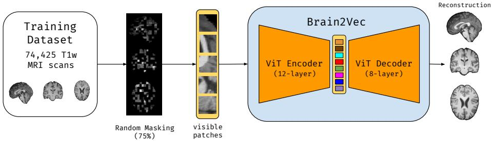

Brain2Vec evaluation  
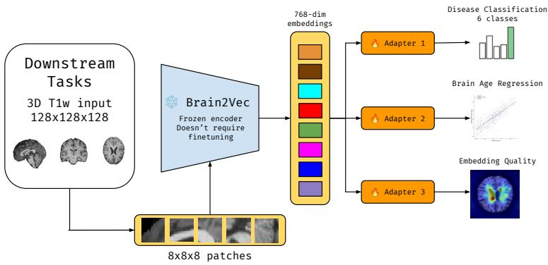  
Figure 1: Overview of the Brain2Vec pre-training architecture and downstream applications. (Pre-training) Brain2Vec is a 3D Masked Autoencoder (MAE) pre-trained on 74,425 T1-weighted MRI scans from the iSTAGING consortium. Input volumes are divided into $8 \times 8 \times 8$ patches, with 75% randomly masked. A 12-layer Vision Transformer (ViT) encoder processes only the visible patches to generate a 768-dimensional latent representation. Mask tokens are then introduced, and an 8-layer ViT decoder reconstructs the original scan. (Evaluation) The pre-trained encoder serves two complementary roles. First, it provides a robust weight initialization for end-to-end fine-tuning on a downstream task (brain age regression), accelerating convergence and improving accuracy relative to random initialization. Second, its frozen 768-dimensional embeddings serve as fixed features for lightweight downstream models, including a Support Vector Regressor (SVR) for brain age regression and SVMs for five binary classification tasks: CU vs. AD, elevated BMI, diabetes, smoking status, and hypertension. We additionally assess the quality and interpretability of these frozen embeddings via self-attention visualization, correlation with anatomically-defined Regions of Interest (ROIs), and latent-space manipulation, showing that Brain2Vec encodes spatially localized, neuroanatomically meaningful representations.

Embedding extraction. After pre-training, the decoder is discarded. We freeze the encoder weights and pass all the patches without any masking. The final embedding is obtained from the [CLS] token, though obtaining the final embedding using mean pooling is also a valid option and is used in other recent foundation models like NeuroJEPA.

## 3.3 Training

During training, we used $8 \times 8 \times 8$ voxel patches with a random masking ratio of 75%. Fig. 2 illustrates example scans with random masking applied, alongside their reconstruction generated by Brain2Vec and ground truth.

Data were split into 80% training, 10% validation, and 10% testing sets, stratified by disease. Given the foundation model nature of this work, the training set was intentionally maximized to expose the model to as much diverse data as possible during pre-training, as broader data coverage is critical for learning generalizable representations. Brain2Vec was trained for 500 epochs with an effective batch size of 64 on two A100 GPUs, using the AdamW optimizer [28] with momentum of $\beta _ { 1 } = 0 . 9 , \beta _ { 2 } = 0 . 9 5$ , a base learning rate of $1 0 ^ { - 3 }$ , and a cosine annealing scheduler without warm restarts [27]. We applied the linear learning rate scaling rule $[ 1 6 ] , \mathrm { { l r } = \mathrm { { l r } _ { \mathrm { { b a s e } } } \times \mathrm { { B } _ { \mathrm { { e f f } } } / 3 2 } } }$ , where $B _ { \mathrm { e f f } } = 6 4$ is the effective batch size, as we trained on two GPUs with a batch size of 32 each.

Masked  
Recon.  
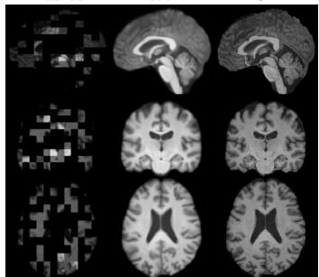  
GT  
(a) CU

Masked  
Recon.  
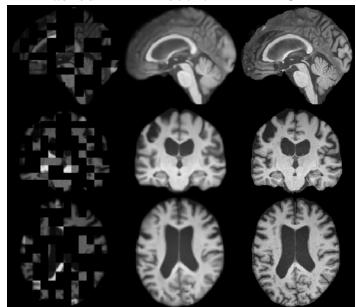  
GT  
(b) MCI

Masked  
GT  
Recon.  
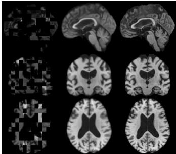  
(c) AD  
Figure 2: Brain2Vec reconstruction results (75% random masking) for a representative subject from each cognitive group: (a) CU (Cognitively Unimpaired), (b) MCI (Mild Cognitive Impairment), and (c) AD (Alzheimer’s Disease). Within each panel, columns show the masked input, the Brain2Vec reconstruction (Recon.), and the ground truth (GT); rows show sagittal, coronal, and axial views.

All scans were skull-stripped using a deep learning–based method and linearly registered to a common atlas space [3, 32]. Preprocessed scans were resized to $1 2 8 \times 1 2 8 \times 1 2 8$ voxels to reduce computational cost. It is important to note that the objective of our training is not precise reconstruction, but rather learning meaningful representations of the input data. To improve generalization, we applied data augmentation using TorchIO [33], including RandomBlur $( \sigma _ { i } \sim v ( 0 , 2 ) )$ , RandomGamma $( \beta \sim \bar { v ( - 0 . 3 , 0 . 3 ) } )$ ), RandomFlip (lateral axis only), RandomNoise (mean=0, std=0), and affine transformations.

## 3.4 Evaluation

The pre-trained Brain2Vec model was evaluated on six downstream tasks including: (i) five classification tasks (CU vs. AD, elevated BMI, diabetes, smoking status and hypertension) and (ii) a brain age prediction task, under two complementary configurations:

• Encoder fine-tuning: The pre-trained encoder weights were used as initialization for a Vision Transformer (ViT) applied to a brain age prediction task. This approach preserves the original ViT architecture, allowing the downstream model to leverage the rich structural representations acquired during pre-training.

• Feature extraction: MRI scans were passed through the frozen pre-trained encoder to extract 768-dimensional embeddings (Brain2Vec features), which subsequently served as fixed input representations for lightweight downstream models using Support Vector Machines (SVMs).

We compared fine-tuning from Brain2Vec pretrained weights against training from random initialization, measuring both final accuracy and convergence speed. In the feature extraction setting, we compared downstream predictive performance against SPARE-BA, a model trained using segmentation-based regional volumetric features and using features extracted from NeuroJEPA, a state-of-the-art foundation model, providing a direct assessment of Brain2Vec relative to both traditional and more recent neuroimaging feature pipelines.

## 4 Results

## 4.1 Fine-tuning

Brain2Vec encoder weights were used to initialize a ViT-based brain age regression model (ViT-BA). We fine-tuned the model on our brain age prediction dataset explained in Sec. 3.1. In contrast to

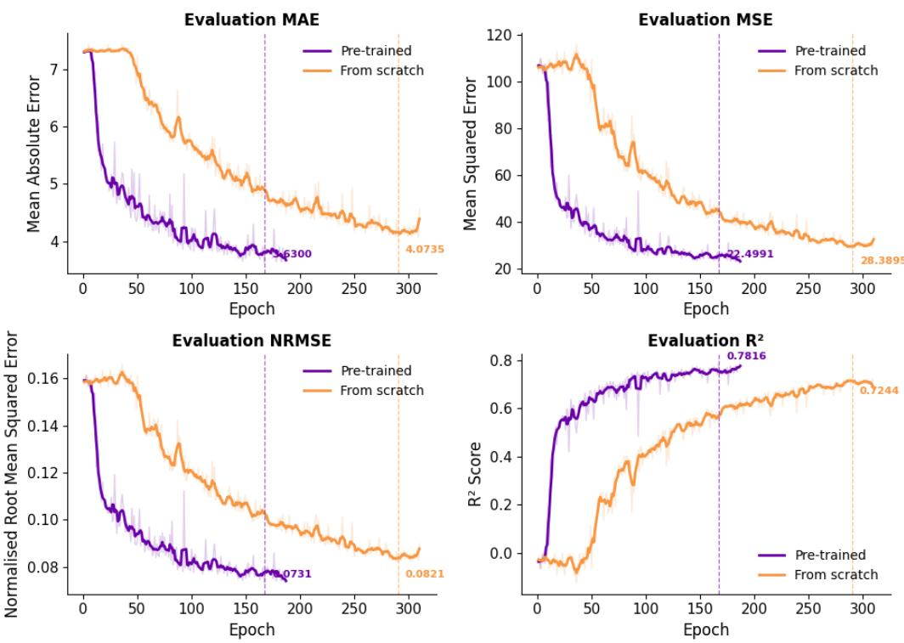  
Figure 3: ViT-BA validation metrics per epoch.

Brain2Vec model training stage, where maximizing training data sample size was prioritized, a larger proportion of data was used in this validation experiment to ensure robust evaluation of regression performance on the downstream task. Data were partitioned into 60% for training, 30% for validation, and 10% for testing. All training configurations and hyperparameters were kept consistent with those used during the Brain2Vec model training. Results are reported with and without Brain2Vec initialization, enabling a direct assessment of the contribution of transfer learning to downstream regression performance.

As expected from pre-trained initializations, optimization dynamics were markedly improved, with the Brain2Vec-initialized model bypassing the initial plateau within fewer than 10 epochs compared to approximately 50 epochs for the randomly initialized model (Fig. 3). This confirms that selfsupervised pre-training provides a superior weight initialization that optimizes training efficiency, accelerating convergence.

Brain2Vec initialization also improved brain age prediction accuracy (Table 2, Fig. 4). The pre-trained model outperformed the randomly initialized baseline across all metrics – Mean Absolute Error (MAE), Mean Squared Error (MSE), Root Mean Squared Error (RMSE), and $R ^ { 2 } - \mathbf { o n }$ both the held-out test set and the external IXI dataset [5], with the performance gap being more pronounced on the latter. The larger improvement on out-of-sample data suggests that pre-training contributes to better generalization across sites.

Table 2: Brain age regression results with and without Brain2Vec pre-training on the held-out test set and the external IXI dataset.
<table><tr><td>Dataset</td><td>Model</td><td>Pre-training</td><td>MAE</td><td>MSE</td><td>RMSE</td><td> $R ^ { 2 }$ </td></tr><tr><td>Test</td><td>ViT-BA ViT-BA</td><td>No Yes</td><td>4.0733 3.5573</td><td>28.4987 21.9879</td><td>5.3404 4.6856</td><td>0.7275 0.7902</td></tr><tr><td>IXI</td><td>ViT-BA ViT-BA</td><td>No Yes</td><td>6.1846 5.1667</td><td>63.9272 44.3969</td><td>7.9955 6.6631</td><td>0.4306 0.6045</td></tr></table>

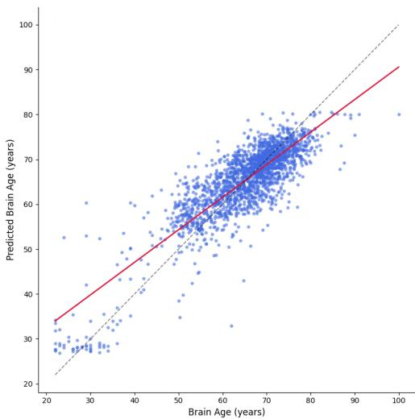  
(a) Brain age prediction without pre-training.

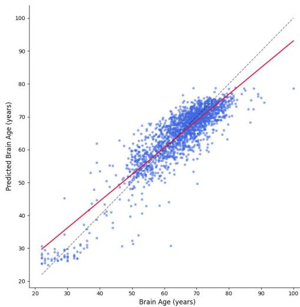  
(b) Brain age prediction with pre-training.

Figure 4: ViT-BA prediction plots on the held-out test set.  
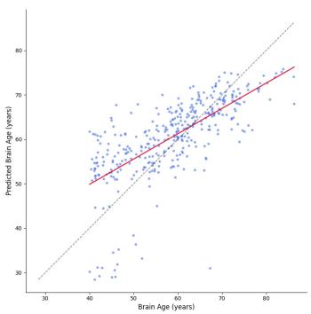  
(a) ViT-BA brain age prediction without pre-training.

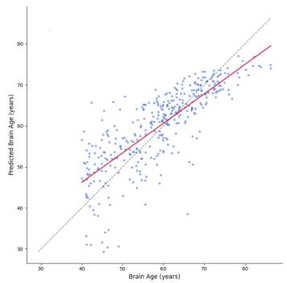

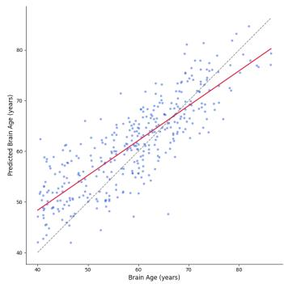  
(c) Brain2Vec-SVR brain age prediction.  
Figure 5: ViT-BA and Brain2Vec-SVR prediction plots for IXI.

## 4.2 Feature extraction

## 4.2.1 Brain age prediction

We trained a Support Vector Regressor (SVR) on frozen Brain2Vec encoder embeddings to predict brain age. The rationale is that an effectively pretrained encoder that captures neuroanatomically relevant structure should enable a simple non-parametric model to generalize effectively to age prediction from fixed embeddings alone, without any backbone fine-tuning. We used 5-fold crossvalidation for data splitting, with hyperparameters tuned via Optuna [1] using nested 5-fold crossvalidation on the training folds, optimizing for $R ^ { 2 }$ score. Splits were randomly sampled.

Our results (Table 3, Fig. 5) demonstrate that the proposed approach achieves performance comparable to fully supervised ViT regressors, despite its simplicity, suggesting that Brain2Vec embeddings capture rich structural information relevant to brain aging. Notably, the SVR model trained on Brain2Vec features outperformed SPARE-BA, a validated and established brain age estimation method trained on volumetric features from anatomical segmentation using a pre-defined atlas [19], and performed comparable to SVR models trained on NeuroJEPA embeddings. This suggests that Brain2Vec features encode structural information that is at least as informative as anatomically defined, handcrafted regional volume features. We also evaluated the utility of brain age gap (predicted age − actual age) to capture disease related or risk-factor effects on multiple disease-specific datasets described in Sec. 3.1. The brain age gap from Brain2Vec-SVR model showed significant group differences in AD (Cohen’s $\mathsf { d } = 0 . 9 4 , p < 0 . 0 0 1 )$ and elevated BMI (Cohen’s $\mathsf { d } = 0 . 4 3 , p < 0 . 0 0 1 )$ outperforming ViT-BA model on this measure. Results are reported in supplementary Fig. 8.

Validations on the external IXI dataset were performed using the same SVR models trained in the cross-validation folds, without any additional training or fine-tuning. This approach was chosen to directly assess the generalization performance of the learned Brain2Vec feature space without any additional model adaptation, consistent with the frozen feature extraction paradigm. The same inference procedure was applied to SPARE-BA models trained on DLMUSE-derived features and NeuroJEPA-SVR trained on NeuroJEPA embeddings, ensuring a fair comparison between approaches under identical conditions. For the IXI inference, we combined predictions from all 5-fold SVR models into an ensemble, as this approach typically yields more robust and stable predictions by averaging out individual model variances. The results of the IXI inference are included in Table 3 and Fig. 5. The SVR model fitted on Brain2Vec embeddings yielded the best results, confirming that Brain2Vec has learned a generalizable representation of brain morphology that serves as a compact yet informative feature space for efficient downstream tasks.

Table 3: SVR brain age regression testing results.
<table><tr><td>Model</td><td>MAE</td><td>MSE</td><td>RMSE</td><td> $R ^ { 2 }$ </td></tr><tr><td>SPARE-BA NeuroJEPA-SVR</td><td> $4 . 3 6 9 5 \pm 0 . 0 4 9$ </td><td> $3 3 . 0 8 5 7 \pm 0 . 6 6 8$ </td><td> $5 . 7 5 1 7 \pm 0 . 0 5 8$ </td><td> $0 . 6 7 9 8 \pm 0 . 0 1 2$ </td></tr><tr><td>Brain2Vec-SVR</td><td> $3 . 4 3 8 7 \pm 0 . 0 7 0$   ${ \bf 3 . 4 3 4 9 \pm 0 . 0 1 7 }$ </td><td> $\mathbf { 1 9 . 6 0 0 2 \pm 0 . 7 8 7 }$   $1 9 . 6 1 8 4 \pm 0 . 1 2 7$ </td><td> $\mathbf { 4 . 4 2 6 3 \pm 0 . 0 8 9 }$   $4 . 4 2 9 2 \pm 0 . 0 1 4$ </td><td> $0 . 8 1 0 5 \pm 0 . 0 0 8$   $\mathbf { 0 . 8 1 2 6 \pm 0 . 0 0 1 }$ </td></tr><tr><td></td><td></td><td></td><td></td><td></td></tr><tr><td>IXI Inference</td><td></td><td></td><td></td><td></td></tr><tr><td>SPARE-BA</td><td>7.8869</td><td>93.0798</td><td>9.6478</td><td>0.1709</td></tr><tr><td>NeuroJEPA-SVR</td><td>5.1895</td><td>40.9347</td><td>6.3980</td><td>0.6354</td></tr><tr><td>Brain2Vec-SVR</td><td>5.1039</td><td>40.5048</td><td>6.3643</td><td>0.6392</td></tr></table>

## 4.2.2 Disease and risk-factor classification

Following the same protocol as the brain age prediction experiments, we trained SVM classifiers on our disease classification dataset explained in Sec. 3.1. We used 5-fold cross-validation, with hyperparameters tuned via Optuna [1] through nested 5-fold cross-validation on each training set, optimizing for F1 score. Splits were stratified by disease or risk-factor.

Despite the encoder being trained without any disease supervision, the learned representations yielded strong classification performance across all disease groups, indicating that Brain2Vec captures clinically meaningful morphological structure beyond its explicit training objective. Compared to SPARE models trained on DLMUSE-derived features, our approach outperformed across all tasks in terms of accuracy, AUC, F1 score, recall and precision, except for AD classification, where DLMUSE retained a clear advantage. Compared to NeuroJEPA, Brain2Vec performed better on diabetes and smoking classification, while NeuroJEPA performed better on AD and elevated BMI classification, with comparable results on hypertension (Table 4).

Table 4: SVM disease classification testing results (mean ± std across 5 folds).
<table><tr><td>Task</td><td>Method</td><td>Accuracy</td><td>AUC</td><td>F1</td><td>Recall</td><td>Precision</td></tr><tr><td rowspan="3">CU vs. AD</td><td>DLMUSE</td><td>0.8325 ± 0.017</td><td> $\mathbf { 0 . 9 0 2 2 \pm 0 . 0 1 4 }$ </td><td>0.8323± 0.017</td><td>0.8604± 0.029</td><td>0.8154 ± 0.019</td></tr><tr><td>NeuroJEPA</td><td> $0 . 8 0 4 0 \pm 0 . 0 1 8$ </td><td> $0 . 8 7 7 8 \pm 0 . 0 0 9$ </td><td> $0 . 8 0 3 6 \pm 0 . 0 1 8$ </td><td> $0 . 7 7 0 2 \pm 0 . 0 4 5$ </td><td> $\mathbf { 0 . 8 2 6 9 \pm 0 . 0 2 1 }$ </td></tr><tr><td>Brain2Vec</td><td> $0 . 7 8 4 5 \pm 0 . 0 2 3$ </td><td> $0 . 8 5 8 6 \pm 0 . 0 2 2$ </td><td> $0 . 7 8 4 4 \pm 0 . 0 2 2$ </td><td> $0 . 7 7 2 5 \pm 0 . 0 2 1$ </td><td> $0 . 7 9 2 8 \pm 0 . 0 3 5$ </td></tr><tr><td rowspan="3">CU vs. Elevated BMI</td><td>DLMUSE</td><td> $0 . 6 0 6 5 \pm 0 . 0 2 3$ </td><td> $0 . 6 4 5 3 \pm 0 . 0 3 6$ </td><td> $0 . 6 0 5 8 \pm 0 . 0 2 4$ </td><td> $0 . 6 3 1 7 \pm 0 . 0 2 3$ </td><td> $0 . 6 0 4 1 \pm 0 . 0 2 5$ </td></tr><tr><td>NeuroJEPA</td><td>0.7884 ± 0.016</td><td> $\mathbf { 0 . 8 6 7 2 \pm 0 . 0 1 3 }$ </td><td> $\mathbf { 0 . 7 8 8 4 \pm 0 . 0 1 6 }$ </td><td> $\mathbf { 0 . 7 9 2 0 \pm 0 . 0 1 7 }$ </td><td> $\mathbf { 0 . 7 8 6 5 \pm 0 . 0 1 9 }$ </td></tr><tr><td>Brain2Vec</td><td> $0 . 7 7 5 6 \pm 0 . 0 1 0$ </td><td> $0 . 8 5 0 5 \pm 0 . 0 1 4$ </td><td> $0 . 7 7 5 6 \pm 0 . 0 1 0$ </td><td> $0 . 7 6 3 6 \pm 0 . 0 1 3$ </td><td> $0 . 7 8 2 5 \pm 0 . 0 1 1$ </td></tr><tr><td rowspan="3">CU vs. Diabetes</td><td>DLMUSE</td><td> $0 . 5 9 2 9 \pm 0 . 0 0 7$ </td><td> $\begin{array} { c } { 0 . 6 3 5 0 \pm 0 . 0 1 3 } \\ { 0 . 6 5 2 6 \pm 0 . 0 7 7 } \end{array}$ </td><td> $0 . 5 9 2 5 \pm 0 . 0 0 7$ </td><td> $0 . 6 1 3 6 \pm 0 . 0 1 6$ </td><td>0.5908 ± 0.008</td></tr><tr><td>NeuroJEPA</td><td> $0 . 6 1 3 4 \pm 0 . 0 6 0$ </td><td></td><td> $0 . 6 1 1 9 \pm 0 . 0 6 3$ </td><td> $\mathbf { 0 . 6 4 2 0 \pm 0 . 0 2 7 }$ </td><td> $0 . 6 1 2 4 \pm 0 . 0 6 2$ </td></tr><tr><td>Brain2Vec</td><td> $\mathbf { 0 . 6 4 4 2 \pm 0 . 0 0 8 }$ </td><td> $\mathbf { 0 . 6 9 5 3 \pm 0 . 0 1 3 }$ </td><td> $\mathbf { 0 . 6 4 4 0 \pm 0 . 0 0 8 }$ </td><td> $0 . 6 2 1 8 \pm 0 . 0 0 5$ </td><td> $\mathbf { 0 . 6 5 1 2 \pm 0 . 0 1 1 }$ </td></tr><tr><td rowspan="3">CU vs. Smoking</td><td>DLMUSE</td><td>0.5116 ± 0.018</td><td> $0 . 4 9 0 0 \pm 0 . 0 1 0$ </td><td> $0 . 5 0 2 3 \pm 0 . 0 1 9$ </td><td> $0 . 6 3 0 5 \pm 0 . 0 6 8$ </td><td>0.5104 ± 0.016</td></tr><tr><td>NeuroJEPA</td><td> $0 . 5 3 5 4 \pm 0 . 0 4 3$ </td><td> $0 . 5 4 5 3 \pm 0 . 0 5 4$ </td><td> $0 . 5 3 4 3 \pm 0 . 0 4 3$ </td><td> $0 . 5 7 0 4 \pm 0 . 0 4 9$ </td><td> $0 . 5 3 3 8 \pm 0 . 0 4 1$ </td></tr><tr><td>Brain2Vec</td><td> $\mathbf { 0 . 6 2 4 2 \pm 0 . 0 1 4 }$ </td><td> $\mathbf { 0 . 6 6 2 6 \pm 0 . 0 1 7 }$ </td><td> $\mathbf { 0 . 6 2 3 8 \pm 0 . 0 1 5 }$ </td><td> $\mathbf { 0 . 6 4 9 4 \pm 0 . 0 1 6 }$ </td><td> $\mathbf { 0 . 6 1 8 8 \pm 0 . 0 1 7 }$ </td></tr><tr><td rowspan="3">CU vs. Hypertension</td><td>DLMUSE</td><td> $0 . 5 2 3 5 \pm 0 . 0 2 8$ </td><td> $0 . 4 9 9 7 \pm 0 . 0 0 1$ </td><td> $0 . 5 1 8 3 \pm 0 . 0 3 1$ </td><td></td><td> $0 . 5 2 2 1 \pm 0 . 0 2 7$ </td></tr><tr><td>NeuroJEPA</td><td>0.6126 ± 0.011</td><td> $\mathbf { 0 . 6 5 1 9 \pm 0 . 0 0 9 }$ </td><td> $0 . 6 1 2 1 \pm 0 . 0 1 1$ </td><td> $\begin{array} { c } { 0 . 6 0 7 3 \pm 0 . 0 3 8 } \\ { 0 . 6 4 0 4 \pm 0 . 0 1 7 } \end{array}$ </td><td> $\mathbf { 0 . 6 0 7 8 \pm 0 . 0 1 3 }$ </td></tr><tr><td>Brain2Vec</td><td>0.6004 ± 0.013</td><td> $0 . 6 3 7 1 \pm 0 . 0 0 8$ </td><td> $\mathbf { 0 . 6 2 0 4 \pm 0 . 0 1 1 }$ </td><td>0.6534 ± 0.029</td><td>0.5916 ± 0.016</td></tr></table>

We further assessed generalization through external validation on the MIRIAD dataset [29], comprising baseline T1 MRI scans from 46 mild-to-moderate Alzheimer’s subjects and 23 cognitively normal controls. The DLMUSE-based features achieved the best overall performance. Brain2Vec reached an accuracy comparable to NeuroJEPA (0.84 vs. 0.83) with substantially higher recall (0.93 vs. 0.76) but lower precision (0.85 vs. 0.99), while NeuroJEPA achieved a higher AUC (0.97 vs. 0.94). Therefore, these differences in recall and precision largely reflect different operating points under potential domain shift rather than differences in discriminative ability: NeuroJEPA ranked the cases well but predicted AD conservatively at the default threshold, whereas Brain2Vec favored sensitivity. Overall, Brain2Vec generalized reasonably well to this independent cohort, although threshold calibration on new cohorts may be needed for all embedding-based models.

Table 5: CU vs AD inference on MIRIAD.
<table><tr><td>Model</td><td>Accuracy</td><td>AUC</td><td>F1</td><td>Recall</td><td>Precision</td></tr><tr><td>DLMUSE</td><td> $\mathbf { 0 . 9 3 5 3 \pm 0 . 0 1 2 }$ </td><td> $\mathbf { 0 . 9 7 7 6 \pm 0 . 0 0 5 }$ </td><td> $\mathbf { 0 . 9 2 8 9 \pm 0 . 0 1 3 }$ </td><td> $\mathbf { 0 . 9 3 3 3 \pm 0 . 0 1 4 }$ </td><td> $0 . 9 6 7 9 \pm 0 . 0 1 1$ </td></tr><tr><td>NeuroJEPA</td><td> $0 . 8 3 0 5 \pm 0 . 0 4 5$ </td><td> $0 . 9 7 0 8 \pm 0 . 0 0 4$ </td><td> $0 . 8 2 4 3 \pm 0 . 0 4 5$ </td><td> $0 . 7 5 5 0 \pm 0 . 0 6 0$ </td><td> $\mathbf { 0 . 9 9 2 9 \pm 0 . 0 1 4 }$ </td></tr><tr><td>Brain2Vec</td><td> $0 . 8 4 0 7 \pm 0 . 0 1 7$ </td><td> $0 . 9 3 9 2 \pm 0 . 0 1 1$ </td><td> $0 . 8 0 5 1 \pm 0 . 0 2 8$ </td><td> $0 . 9 3 0 0 \pm 0 . 0 1 9$ </td><td> $0 . 8 5 0 9 \pm 0 . 0 3 0$ </td></tr></table>

We report per-site classification results in supplementary Table 13 for the three sites with the largest sample sizes. Results are broadly consistent with the overall findings in Table 4, while UKBiobank data, with the largest sample size obtained higher accuracy, and sites with younger subjects that fall outside the Brain2Vec model’s training distribution, such as CARDIA and HCP, obtained lower accuracy. This highlights the importance of training data coverage for foundation models, as well as the potential need for domain adaptation techniques to optimize performance on out-of-distribution cohorts.

Supplementary Fig. 9 presents PCA visualizations of Brain2Vec embeddings for each classification cohort, colored by study site. The embeddings exhibit site-related structure, indicating that Brain2Vec also captures study-level variation in the input data.

## 4.3 Interpretability of Brain2Vec’s Learned Representations

In medical imaging, there is a growing need for interpretable models, as they enable researchers and clinicians to understand how a model makes predictions and which features are important for each task [37]. We assessed Brain2Vec’s interpretability through three complementary strategies: (i) visualizing self-attention maps to examine which spatial regions the model attends to, (ii) correlating latent embeddings with anatomically-defined regions of interest to identify which brain structures drive specific features, and (iii) manipulating latent embeddings and inspecting their effect on reconstructed anatomy to test whether individual features encode monotonic, region-specific changes.

Attention maps. We visualized what the model considers important by plotting its self-attention maps (Fig. 6). The resulting maps show that different attention heads learn distinct spatial patterns rather than attending uniformly across the entire brain, consistent with findings in other models [6]. As shown in the attention visualizations, different heads consistently emphasize different anatomical regions across the axial, coronal, and sagittal views. Some heads exhibit relatively localized attention around specific brain structures, whereas others capture more distributed patterns across larger portions of the brain. This diversity suggests that the multi-head self-attention mechanism enables Brain2Vec to encode complementary spatial information, with individual heads potentially capturing different anatomical or contextual characteristics of the input MRI. An important exception is the behavior of heads 0 and 9: across views and samples, these heads frequently assign substantial attention to regions outside the brain, particularly along the image boundaries and background (see Section A.6). This indicates that they are not primarily encoding meaningful brain anatomy and may instead capture image-level or acquisition-related characteristics.

Correlation with anatomically defined regions. The latent embeddings of foundation models trained on domain-specific data can be interpreted by quantifying their correlation with anatomically defined regions of interest, particularly those known to be affected by disease. To this end, we computed the Pearson correlation between each individual Brain2Vec latent dimension and each DLMUSE regional volume, together with the mean difference in each latent dimension between CU and AD subjects, in order to identify which dimensions are most strongly associated with which anatomical region. As shown in Fig. 7, several latent dimensions exhibit strong correlations with specific brain regions, including the ventricles, gray matter, frontal regions, and white matter. Consistent with known neurodegenerative patterns in AD, we observe an inverse relationship between ventricular volume and gray matter, frontal, and white matter volumes.

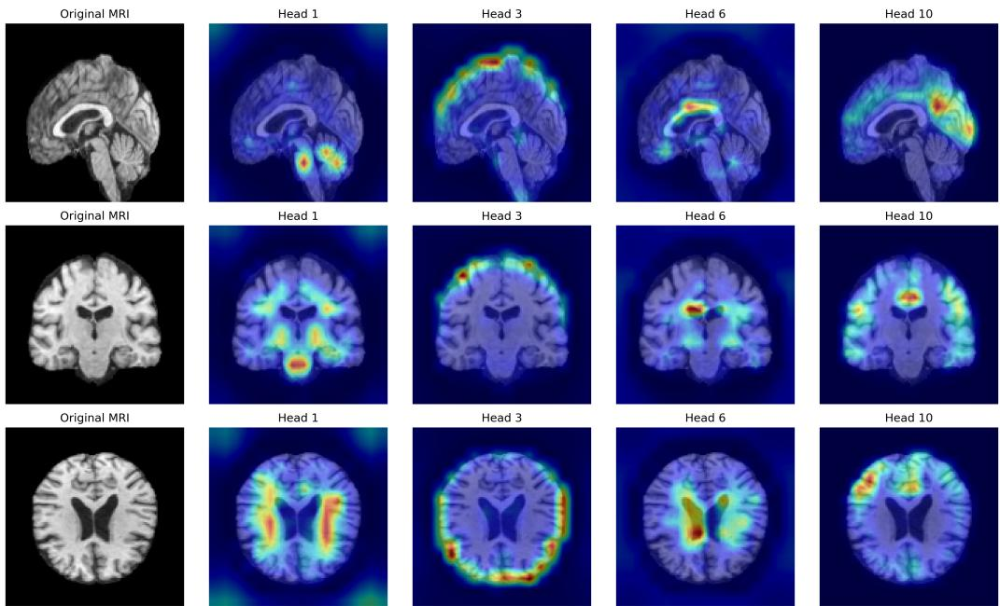  
Figure 6: Self-attention map of a participant with Alzheimer’s Disease derived using the Vision Transformer (ViT) encoder of Brain2Vec. The attention map is computed using the [CLS] token on the heads of the encoder’s last ViT layer. Additional examples for all the heads are presented in supplementary Section A.6.

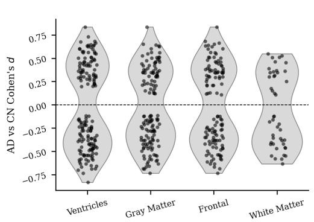  
(a) Effect sizes of anatomically matched Brain2Vec dimensions by brain region (Pearson $| r | \geq 0 . 4 )$

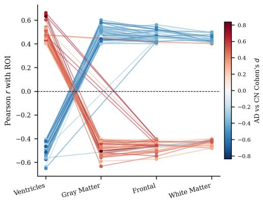  
(b) Cross-region correlation profiles of Brain2Vec dimensions.  
Figure 7: Correlation analysis of Brain2Vec latent embeddings with brain regions.

Latent manipulation. Leveraging the generative nature of the model, we masked brain regions and manipulated latent embeddings to test whether this produces a monotonic effect on the reconstruction. We performed this analysis for three regions: (i) ventricles (Fig. 13), (ii) frontal regions (Fig. 14), and (iii) gray matter (GM) regions (Fig. 15). For masking, a patch was masked if it contained at least one voxel within the region of interest, and otherwise remained visible to the encoder. Detailed masking and reconstruction examples are shown in Figures 16, 17, and 18. We manually selected a subset S of 22 latent features to manipulate (Supplementary Table 14). We progressively added the mean difference $\Delta = Z _ { A D } [ i ] - Z _ { C U } [ i ]$ , where Z denotes the Brain2Vec latent embeddings, with magnitude $\alpha \in \{ 0 , \ldots , 2 . 5 \}$ , giving $\hat { Z } [ i ] = Z [ i ] + \alpha \cdot \Delta , \forall i \in S$ , where Zˆ is the manipulated embedding. After reconstruction, we computed each region’s volume using DLMUSE. Across all three regions, we observed the expected monotonic change in regional volume as α increases, confirming that the manipulated latent dimensions encode a consistent, region-specific anatomical effect (Section A.7).

## 4.4 Inference Speed and Scalability

Inference efficiency is a critical but often underreported aspect of deep learning evaluation, particularly in medical imaging, where 3D volumetric data introduces substantial computational overhead. For Brain2Vec, which processes full 3D MRI scans to produce subject-level embeddings, efficient inference is especially important given the large and diverse cohorts it targets.

We compared Brain2Vec’s inference time against DLMUSE, which uses an nnU-Net [26] to segment the brain and compute ROI volumes from the full 3D input, and against NeuroJEPA, which uses a similar ViT encoder augmented with a Mixture of Experts (MoE) layer [35] at inference time. Benchmarks were conducted on the IXI dataset (581 scans) using an A40 GPU, as well as singlesubject inference on CPU. On GPU, Brain2Vec processed the full IXI cohort in 30 seconds (≈ 0.05 seconds per scan), an $\approx 8 7 \times$ speedup over DLMUSE and an ≈ 7× speedup over NeuroJEPA. On CPU, Brain2Vec remained ≈ 8× faster than DLMUSE, whereas NeuroJEPA was faster than Brain2Vec (6.98 vs. 45.73 seconds). This is likely because NeuroJEPA’s sparse MoE layer activates only a subset of its parameters for each input, which reduces sequential computation on CPU. Brain2Vec’s dense ViT encoder, by contrast, benefits more from GPU parallelism. Overall, Brain2Vec offers substantially lower computational cost in GPU-based, cohort-scale settings while maintaining strong predictive performance (Table 6).

Table 6: Brain2Vec inference performance.
<table><tr><td>Model</td><td>FLOPs</td><td>#Params</td><td>GPU (A40)</td><td>CPU</td></tr><tr><td>DLMUSE</td><td>965.3B</td><td>16.6M</td><td> $4 3 . 4 1 \ ( \mathrm { m i n . } ) \cdot n = 5 8 1$ </td><td> $6 . 3 9 \ : ( \mathrm { m i n . } ) \cdot n = 1$ </td></tr><tr><td>NeuroJEPA</td><td>172.9B</td><td>122.0M</td><td> $3 . 6 2 ( \mathrm { m i n . } ) \cdot n = 5 8 1$ </td><td> ${ \bf 6 . 9 8 \ ( s e c . ) \cdot } n = 1$ </td></tr><tr><td>Brain2Vec</td><td>177.3B</td><td>88.6M</td><td>30.03 (sec.) - n = 581</td><td>45.73 (sec.) - n = 1</td></tr></table>

## 5 Discussion

In this work, we introduced Brain2Vec, a self-supervised foundation model trained on 74, 425 T1- weighted brain MRI scans. We evaluated Brain2Vec across multiple settings: fine-tuning for brain age prediction, feature extraction for disease classification, external validation on an independent cohort, interpretability analysis, and inference efficiency. We demonstrated that Brain2Vec serves as a versatile dual-purpose framework: (1) accelerating convergence and improving predictive accuracy when fine-tuned as a 3D ViT backbone, and (2) offering a rich, 768-dimensional frozen feature space that is competitive with or superior to both anatomically-derived volumetric features and larger foundation models across a range of disease classification tasks. Beyond predictive performance, we showed that Brain2Vec’s learned representations are anatomically meaningful and interpretable, with generative manipulation of its latent dimensions revealing biologically interpretable, continuous neurodegenerative phenotypes in reconstructed brain space.

Our results reveal a consistent trade-off between anatomical segmentations and self-supervised continuous embeddings. While traditional pipelines like DLMUSE excel at detecting localized structural changes such as volumetric atrophy in Alzheimer’s Disease, they are constrained by fixed anatomical boundaries. Conversely, Brain2Vec representations outperformed DLMUSE on harder classification tasks (e.g., diabetes, smoking, elevated BMI). This suggests that Brain2Vec may be learning representations beyond those captured by standard volumetric features derived from anatomical segmentation.

One notable finding of this study is that Brain2Vec-SVR models achieve competitive predictive performance relative to NeuroJEPA, a state-of-the-art foundation model, across several downstream tasks, despite Brain2Vec being pre-trained on ≈ 9.2× fewer scans (74, 425 vs 683, 860). We attribute this sample efficiency to the inductive bias of our training objective within the structural MRI domain.

At their core, Joint Embedding Predictive Architectures (JEPA) like NeuroJEPA, use a context input x to estimate the embedded state of a target input y. This process relies on a predictor conditioned on an extra variable z to account for variability during feature-space prediction. However, in standardized neuroimaging datasets where scans are skull-stripped, atlas-registered, and anatomically aligned, latent representation matching presents a relatively low-variance objective. It is well documented that representation collapse is a concern with JEPA architectures [2]. In contrast, representation collapse is not a concern with reconstruction-based methods. Generative architectures mask a high percentage of the input and use an encoder to produce latent embeddings z of the masked input y and using a decoder, learn to reconstruct the original (unmasked) input x. This forces the encoder to learn high-fidelity structural priors and inter-regional anatomical dependencies across the entire brain volume. This dense supervisory signal explains both the model’s high sample efficiency and the strong, explicit alignment observed between Brain2Vec latent dimensions and regional brain volumes (Section 4.3).

A common critique of deep feature extractors in neuroimaging is their limited interpretability relative to anatomically defined ROI volumes. Through latent manipulation experiments (Section 4.3), we provided evidence that Brain2Vec’s latent dimensions can be linked to anatomically meaningful, region-specific effects, offering a step toward addressing this limitation. Progressively shifting latent dimensions along disease-associated vectors produced monotonic, anatomically plausible changes in reconstructed scans, specifically capturing ventricular expansion, and gray and white matter volume decrease. This generative steering provides evidence that the learned latent space encodes coherent, continuous radiological phenotypes rather than uninterpretable noise.

Despite being trained on a large and diverse dataset, Brain2Vec has two notable limitations. First, UK Biobank dataset dominates the training data (≈ 55%), which may bias learned representations toward its specific acquisition protocol and reduce embedding quality for scans acquired under substantially different conditions. Second, the training cohort is skewed toward older adults (mean age 65.0 years; fewer than 5% of scans from studies with mean age below 45), which may limit the model’s representational accuracy for younger populations. Users applying Brain2Vec outside its training distribution should take these factors into account.

Brain2Vec code and trained models are publicly available at https://github.com/CBICA/ Brain2Vec. Embeddings can be extracted locally via the installable package or through the NiChart cloud platform (https://cloud.neuroimagingchart.com), which requires no local installation or specialized infrastructure.

## References

[1] Takuya Akiba, Shotaro Sano, Toshihiko Yanase, Takeru Ohta, and Masanori Koyama. Optuna: A next-generation hyperparameter optimization framework, 2019.

[2] Mahmoud Assran, Quentin Duval, Ishan Misra, Piotr Bojanowski, Pascal Vincent, Michael Rabbat, Yann LeCun, and Nicolas Ballas. Self-supervised learning from images with a jointembedding predictive architecture, 2023.

[3] Vishnu M. Bashyam, Guray Erus, Yuhan Cui, Di Wu, Gyujoon Hwang, Alexander Getka, Ashish Singh, George Aidinis, Kyunglok Baik, Randa Melhem, Elizabeth Mamourian, Jimit Doshi, Ashwini Davison, Ilya M. Nasrallah, Christos Davatzikos, for the Alzheimer’s Disease Neuroimaging Initiative, and for the iSTAGING Consortium. DLMUSE: Robust Brain Segmentation in Seconds Using Deep Learning. Radiology: Artificial Intelligence, 7(6):e240299, November 2025.

[4] Benjamin Billot, Douglas N. Greve, Oula Puonti, Axel Thielscher, Koen Van Leemput, Bruce Fischl, Adrian V. Dalca, and Juan Eugenio Iglesias. SynthSeg: Segmentation of brain MRI scans of any contrast and resolution without retraining. Medical Image Analysis, 86:102789, 2023.

[5] Biomedical Image Analysis Group, Imperial College London. IXI Dataset – Information eXtraction from Images. https://brain-development.org/ixi-dataset/. EPSRC Grant GR/S21533/02. Data available under CC BY-SA 3.0 license.

[6] Mathilde Caron, Hugo Touvron, Ishan Misra, Hervé Jégou, Julien Mairal, Piotr Bojanowski, and Armand Joulin. Emerging properties in self-supervised vision transformers, 2021.

[7] Zekai Chen, Devansh Agarwal, Kshitij Aggarwal, Wiem Safta, Mariann Micsinai Balan, and Kevin Brown. Masked Image Modeling Advances 3D Medical Image Analysis. In 2023 IEEE/CVF Winter Conference on Applications ofComputer Vision (WACV), pages 1969–1979, January 2023. ISSN: 2642-9381.

[8] James H. Cole and Katja Franke. Predicting Age Using Neuroimaging: Innovative Brain Ageing Biomarkers. Trends in Neurosciences, 40(12):681–690, December 2017.

[9] Joseph Cox, Peng Liu, Skylar E. Stolte, Yunchao Yang, Kang Liu, Kyle B. See, Huiwen Ju, and Ruogu Fang. BrainSegFounder: Towards 3D foundation models for neuroimage segmentation. Medical Image Analysis, 97:103301, October 2024.

[10] Jia Deng, Wei Dong, Richard Socher, Li-Jia Li, Kai Li, and Li Fei-Fei. Imagenet: A largescale hierarchical image database. In 2009 IEEE Conference on Computer Vision and Pattern Recognition, pages 248–255, 2009.

[11] Jacob Devlin, Ming-Wei Chang, Kenton Lee, and Kristina Toutanova. BERT: Pre-training of Deep Bidirectional Transformers for Language Understanding. In Jill Burstein, Christy Doran, and Thamar Solorio, editors, Proceedings ofthe 2019 Conference ofthe North American Chapter of the Association for Computational Linguistics: Human Language Technologies, Volume 1 (Long and Short Papers), pages 4171–4186, Minneapolis, Minnesota, June 2019. Association for Computational Linguistics.

[12] Jimit Doshi, Guray Erus, Yangming Ou, Susan M. Resnick, Ruben C. Gur, Raquel E. Gur, Theodore D. Satterthwaite, Susan Furth, and Christos Davatzikos. MUSE: MUlti-atlas region Segmentation utilizing Ensembles of registration algorithms and parameters, and locally optimal atlas selection. NeuroImage, 127:186–195, February 2016.

[13] Alexey Dosovitskiy, Lucas Beyer, Alexander Kolesnikov, Dirk Weissenborn, Xiaohua Zhai, Thomas Unterthiner, Mostafa Dehghani, Matthias Minderer, Georg Heigold, Sylvain Gelly, Jakob Uszkoreit, and Neil Houlsby. An Image is Worth 16x16 Words: Transformers for Image Recognition at Scale. October 2020.

[14] Bruce Fischl. FreeSurfer. NeuroImage, 62(2):774–781, 2012.

[15] Bruce Fischl and Anders M. Dale. Measuring the thickness of the human cerebral cortex from magnetic resonance images. Proceedings of the National Academy of Sciences, 97(20):11050– 11055, 2000.

[16] Priya Goyal, Piotr Dollár, Ross Girshick, Pieter Noordhuis, Lukasz Wesolowski, Aapo Kyrola, Andrew Tulloch, Yangqing Jia, and Kaiming He. Accurate, large minibatch sgd: Training imagenet in 1 hour, 2018.

[17] Ludovica Griffanti, Giovanna Zamboni, Aamira Khan, Linxin Li, Guendalina Bonifacio, Vaanathi Sundaresan, Ursula G. Schulz, Wilhelm Kuker, Marco Battaglini, Peter M. Rothwell, and Mark Jenkinson. BIANCA (Brain Intensity AbNormality Classification Algorithm): A new tool for automated segmentation of white matter hyperintensities. NeuroImage, 141:191–205, 2016.

[18] Xiaojuan Guo, Zhiqun Wang, Kuncheng Li, Ziyi Li, Zhigang Qi, Zhen Jin, Li Yao, and Kewei Chen. Voxel-based assessment of gray and white matter volumes in alzheimer’s disease. Neuroscience Letters, 468(2):146–150, 2010.

[19] M. Habes, D. Janowitz, G. Erus, J. B. Toledo, S. M. Resnick, J. Doshi, S. Van der Auwera, K. Wittfeld, K. Hegenscheid, N. Hosten, R. Biffar, G. Homuth, H. Völzke, H. J. Grabe, W. Hoffmann, and C. Davatzikos. Advanced brain aging: relationship with epidemiologic and genetic risk factors, and overlap with Alzheimer disease atrophy patterns. Translational Psychiatry, 6(4):e775–e775, April 2016.

[20] Mohamad Habes, Raymond Pomponio, Haochang Shou, Jimit Doshi, Elizabeth Mamourian, Guray Erus, Ilya Nasrallah, Lenore J. Launer, Tanweer Rashid, Murat Bilgel, Yong Fan, Jon B. Toledo, Kristine Yaffe, Aristeidis Sotiras, Dhivya Srinivasan, Mark Espeland, Colin Masters, Paul Maruff, Jurgen Fripp, Henry Völzk, Sterling C. Johnson, John C. Morris, Marilyn S. Albert,

Michael I. Miller, R. Nick Bryan, Hans J. Grabe, Susan M. Resnick, David A. Wolk, Christos Davatzikos, and iSTAGING consortium, the Preclinical AD consortium, the ADNI, and the CARDIA studies. The Brain Chart of Aging: Machine-learning analytics reveals links between brain aging, white matter disease, amyloid burden, and cognition in the iSTAGING consortium of 10,216 harmonized MR scans. Alzheimer’s & Dementia: The Journal of the Alzheimer’s Association, 17(1):89–102, January 2021.

[21] Kaiming He, Xinlei Chen, Saining Xie, Yanghao Li, Piotr Dollár, and Ross Girshick. Masked Autoencoders Are Scalable Vision Learners. In 2022 IEEE/CVF Conference on Computer Vision and Pattern Recognition (CVPR), pages 15979–15988, June 2022. ISSN: 2575-7075.

[22] Haoxu Huang, Long Chen, Jingyun Chen, Jinu Hyun, James Ryan Loftus, Kara Melmed, Daniel Orringer, Jennifer Frontera, Seena Dehkharghani, Arjun Masurkar, and Narges Razavian. Learning sparse latent predictive foundation model for multimodal neuroimaging, 2026.

[23] Shih-Cheng Huang, Anuj Pareek, Malte Jensen, Matthew P. Lungren, Serena Yeung, and Akshay S. Chaudhari. Self-supervised learning for medical image classification: a systematic review and implementation guidelines. npj Digital Medicine, 6(1):74, April 2023.

[24] Xinhao Huang, Zihao Wang, Weichen Zhou, Kexin Yang, Kaihua Wen, Haiguang Liu, Shoujin Huang, and Mengye Lyu. Tailored self-supervised pretraining improves brain MRI diagnostic models. Computerized Medical Imaging and Graphics, 123:102560, July 2025.

[25] Gyujoon Hwang, Ahmed Abdulkadir, Guray Erus, Mohamad Habes, Raymond Pomponio, Haochang Shou, Jimit Doshi, Elizabeth Mamourian, Tanweer Rashid, Murat Bilgel, Yong Fan, Aristeidis Sotiras, Dhivya Srinivasan, John C. Morris, Marilyn S. Albert, Nick R. Bryan, Susan M. Resnick, Ilya M. Nasrallah, Christos Davatzikos, David A. Wolk, from the iSTAGING consortium, and for the ADNI. Disentangling Alzheimer’s disease neurodegeneration from typical brain ageing using machine learning. Brain Communications, 4(3):fcac117, June 2022.

[26] Fabian Isensee, Jens Petersen, Andre Klein, David Zimmerer, Paul F. Jaeger, Simon Kohl, Jakob Wasserthal, Gregor Koehler, Tobias Norajitra, Sebastian Wirkert, and Klaus H. Maier-Hein. nnu-net: Self-adapting framework for u-net-based medical image segmentation, 2018.

[27] Ilya Loshchilov and Frank Hutter. Sgdr: Stochastic gradient descent with warm restarts, 2017.

[28] Ilya Loshchilov and Frank Hutter. Decoupled weight decay regularization, 2019.

[29] Ian B. Malone, David Cash, Gerard R. Ridgway, David G. MacManus, Sebastien Ourselin, Nick C. Fox, and Jonathan M. Schott. MIRIAD—Public release of a multiple time point Alzheimer’s MR imaging dataset. NeuroImage, 70:33–36, April 2013.

[30] Sean Michael Nestor, Raul Rupsingh, Michael Borrie, Matthew Smith, Vittorio Accomazzi, Jennie L. Wells, Jennifer N Fogarty, and Robert Bartha. Ventricular enlargement as a possible measure of alzheimer’s disease progression validated using the alzheimer’s disease neuroimaging initiative database. Brain : a journal ofneurology, 131 Pt 9:2443–54, 2008.

[31] Vincent Planche, José V. Manjon, Boris Mansencal, Enrique Lanuza, Thomas Tourdias, Gwenaëlle Catheline, and Pierrick Coupé. Structural progression of alzheimer’s disease over decades: the mri staging scheme. Brain Communications, 4(3):fcac109, 06 2022.

[32] Raymond Pomponio, Guray Erus, Mohamad Habes, Jimit Doshi, Dhivya Srinivasan, Elizabeth Mamourian, Vishnu Bashyam, Ilya M. Nasrallah, Theodore D. Satterthwaite, Yong Fan, Lenore J. Launer, Colin L. Masters, Paul Maruff, Chuanjun Zhuo, Henry Völzke, Sterling C. Johnson, Jurgen Fripp, Nikolaos Koutsouleris, Daniel H. Wolf, Raquel Gur, Ruben Gur, John Morris, Marilyn S. Albert, Hans J. Grabe, Susan M. Resnick, R. Nick Bryan, David A. Wolk, Russell T. Shinohara, Haochang Shou, and Christos Davatzikos. Harmonization of large MRI datasets for the analysis of brain imaging patterns throughout the lifespan. NeuroImage, 208:116450, March 2020.

[33] Fernando Pérez-García, Rachel Sparks, and Sébastien Ourselin. Torchio: A python library for efficient loading, preprocessing, augmentation and patch-based sampling of medical images in deep learning. Computer Methods and Programs in Biomedicine, 208:106236, 2021.

[34] Saima Rathore, Mohamad Habes, Muhammad Aksam Iftikhar, Amanda Shacklett, and Christos Davatzikos. A review on neuroimaging-based classification studies and associated feature extraction methods for alzheimer’s disease and its prodromal stages, jul 2017.

[35] Noam Shazeer, Azalia Mirhoseini, Krzysztof Maziarz, Andy Davis, Quoc Le, Geoffrey Hinton, and Jeff Dean. Outrageously large neural networks: The sparsely-gated mixture-of-experts layer, 2017.

[36] Divyanshu Tak, Biniam A. Garomsa, Anna Zapaishchykova, Tafadzwa L. Chaunzwa, Juan Carlos Climent Pardo, Zezhong Ye, John Zielke, Yashwanth Ravipati, Suraj Pai, Sri Vajapeyam, Maryam Mahootiha, Mitchell Parker, Luke R. G. Pike, Ceilidh Smith, Ariana M. Familiar, Kevin X. Liu, Sanjay Prabhu, Omar Arnaout, Pratiti Bandopadhayay, Ali Nabavizadeh, Sabine Mueller, Hugo JWL Aerts, Raymond Y. Huang, Tina Y. Poussaint, and Benjamin H. Kann. A generalizable foundation model for analysis of human brain MRI. Nature Neuroscience, 29(4):945–956, April 2026.

[37] Vivien van Veldhuizen, Vanessa Botha, Chunyao Lu, Melis Erdal Cesur, Kevin Groot Lipman, Edwin D. de Jong, Hugo Horlings, Clárisa I. Sanchez, Cees G. M. Snoek, Lodewyk Wessels, Ritse Mann, Eric Marcus, and Jonas Teuwen. Foundation models in medical imaging: A review and outlook, 2025.

[38] Jennifer L Whitwell, Dennis W Dickson, Melissa E Murray, Stephen D Weigand, Nirubol Tosakulwong, Matthew L Senjem, David S Knopman, Bradley F Boeve, Joseph E Parisi, Ronald C Petersen, Clifford R Jack, and Keith A Josephs. Neuroimaging correlates of pathologically defined subtypes of alzheimer’s disease: a case-control study. The Lancet Neurology, 11(10):868–877, 2012.

[39] Lei Zhou, Huidong Liu, Joseph Bae, Junjun He, Dimitris Samaras, and Prateek Prasanna. Self pre-training with masked autoencoders for medical image classification and segmentation. In 2023 IEEE 20th International Symposium on Biomedical Imaging (ISBI), pages 1–6, 2023.

## A Supplementary materials

## A.1 Characteristics of the datasets used for downstream prediction tasks

Table 7: Characteristics of the training and validation datasets for brain age prediction.
<table><tr><td colspan="4">Training Set</td><td colspan="4">Validation Set</td></tr><tr><td>Study</td><td>n</td><td> $\mathbf { M e a n \mathbf { A } g e } \pm \mathbf { S t d }$ </td><td>(%) F</td><td>Study</td><td>n</td><td> $\mathbf { M e a n \mathbf { A } g e } \pm \mathbf { S t d }$ </td><td>(%) F</td></tr><tr><td>UKBIOBANK</td><td>10,240</td><td> $6 6 . 2 3 \pm 7 . 1 4$ </td><td>45.39</td><td>UKBIOBANK</td><td>5,141</td><td> $6 6 . 2 5 \pm 7 . 1 4$ </td><td>45.75</td></tr><tr><td>HCP</td><td>465</td><td> $4 2 . 0 3 \pm 1 8 . 8 9$ </td><td>54.19</td><td>HCP</td><td>204</td><td> $4 1 . 8 3 \pm 1 9 . 4 6$ </td><td>58.33</td></tr><tr><td>AIBL</td><td>183</td><td> $7 2 . 9 2 \pm 5 . 9 2$ </td><td>55.74</td><td>AIBL</td><td>90</td><td> $7 3 . 0 3 \pm 5 . 6 2$ </td><td>60.00</td></tr><tr><td>BLSA</td><td>158</td><td> $5 6 . 7 1 \pm 1 7 . 7 2$ </td><td>65.19</td><td>BLSA</td><td>76</td><td> $5 4 . 9 5 \pm 1 7 . 6 3$ </td><td>63.16</td></tr><tr><td>SHIP</td><td>149</td><td> $4 0 . 2 4 \pm 1 3 . 3 7$ </td><td>42.95</td><td>SHIP</td><td>88</td><td> $3 8 . 9 5 \pm 1 2 . 3 8$ </td><td>34.09</td></tr><tr><td>BIOCARD</td><td>117</td><td> $6 0 . 3 9 \pm 9 . 8 3$ </td><td>58.12</td><td>BIOCARD</td><td>53</td><td> $5 6 . 1 7 \pm 8 . 2 4$ </td><td>67.92</td></tr><tr><td>PreventAD</td><td>116</td><td> $6 2 . 2 0 \pm 4 . 3 4$ </td><td>68.97</td><td>PreventAD</td><td>66</td><td> $6 2 . 6 1 \pm 3 . 9 2$ </td><td>66.67</td></tr><tr><td>ADNI</td><td>115</td><td> $7 0 . 8 4 \pm 4 . 0 5$ </td><td>73.91</td><td>ADNI</td><td>51</td><td> $7 2 . 2 3 \pm 5 . 0 8$ </td><td>64.71</td></tr><tr><td>MESA</td><td>129</td><td> $8 0 . 3 6 \pm 7 . 4 5$ </td><td>57.36</td><td>MESA</td><td>69</td><td> $7 8 . 0 3 \pm 7 . 8 7$ </td><td>40.58</td></tr><tr><td>CARDIA</td><td>59</td><td> $5 1 . 2 4 \pm 3 . 7 1$ </td><td>44.07</td><td>CARDIA</td><td>34</td><td> $5 1 . 7 4 \pm 3 . 0 8$ </td><td>44.12</td></tr><tr><td>OASIS</td><td>45</td><td> $6 0 . 3 2 \pm 8 . 5 6$ </td><td>51.11</td><td>OASIS</td><td>19</td><td> $6 2 . 2 6 \pm 7 . 1 0$ </td><td>73.68</td></tr><tr><td>WHIMS</td><td>14</td><td> $7 0 . 7 7 \pm 4 . 1 6$ </td><td>100.00</td><td>WHIMS</td><td>6</td><td> $6 9 . 1 7 \pm 2 . 4 1$ </td><td>100.00</td></tr><tr><td>HANDLS</td><td>8</td><td> $5 3 . 7 5 \pm 8 . 1 2$ </td><td>37.50</td><td>HANDLS</td><td>5</td><td> $5 3 . 2 4 \pm 1 1 . 0 8$ </td><td>0.00</td></tr><tr><td>Total</td><td> $1 1 , 7 9 8 \left( 6 0 \% \right)$ </td><td> ${ \bf 6 4 . 9 3 \pm 1 0 . 1 8 }$ </td><td>46.97</td><td>Total</td><td> $\mathbf { 5 , 9 0 2 } \left( 3 \mathbf { 0 \% } \right)$ </td><td> $\mathbf { 6 4 . 9 1 \pm 1 0 . 1 5 }$ </td><td>47.09</td></tr></table>

Table 8: Characteristics of the training and validation datasets for CU vs. AD classification.
<table><tr><td colspan="4">CU</td><td colspan="4">AD</td></tr><tr><td>Study</td><td>n</td><td> $\mathbf { M e a n \mathbf { \mathbf { A } } g e } \pm \mathbf { \mathbf { S t d } }$ </td><td>(%) F</td><td>Study</td><td>n</td><td>Mean  $\mathbf { A } \mathbf { g e } \pm \mathbf { S } \mathbf { t d }$ </td><td> $( \% ) \mathbf { F }$ </td></tr><tr><td>ADNI</td><td>419</td><td> $7 4 . 6 8 \pm 7 . 1 2$ </td><td>45.11</td><td>ADNI</td><td>418</td><td> $7 4 . 8 3 \pm 7 . 7 2$ </td><td>44.26</td></tr><tr><td>OASIS</td><td>313</td><td> $7 5 . 0 4 \pm 7 . 3 3$ </td><td>52.40</td><td>OASIS</td><td>313</td><td> $7 5 . 4 9 \pm 7 . 4 9$ </td><td>49.52</td></tr><tr><td>AIBL</td><td>92</td><td> $7 4 . 1 6 \pm 7 . 7 2$ </td><td>59.78</td><td>AIBL</td><td>92</td><td> $7 4 . 2 3 \pm 7 . 9 2$ </td><td>59.78</td></tr><tr><td>BLSA</td><td>9</td><td> $8 1 . 3 3 \pm 8 . 7 6$ </td><td>33.33</td><td>BLSA</td><td>9</td><td> $8 1 . 4 4 \pm 8 . 9 1$ </td><td>33.33</td></tr><tr><td>PENN</td><td>7</td><td> $7 0 . 0 1 \pm 7 . 4 5$ </td><td>42.86</td><td>PENN</td><td>7</td><td> $7 0 . 8 1 \pm 6 . 9 6$ </td><td>71.43</td></tr><tr><td>UKBIOBANK</td><td>4</td><td> $6 0 . 8 7 \pm 4 . 3 5$ </td><td>25.00</td><td>UKBIOBANK</td><td>4</td><td> $6 0 . 9 6 \pm 4 . 4 3$ </td><td>25.00</td></tr><tr><td>BIOCARD</td><td>1</td><td> $7 0 . 3 7 \pm 0 . 0 0$ </td><td>0.00</td><td>BIOCARD</td><td>1</td><td> $7 0 . 2 6 \pm 0 . 0 0$ </td><td>0.00</td></tr><tr><td>Total</td><td>845</td><td> $\mathbf { 7 4 . 7 2 \pm 7 . 3 9 }$ </td><td>49.11</td><td>Total</td><td>844</td><td> $\pm { \bf 7 4 . 9 7 \pm 7 . 7 6 }$ </td><td>47.87</td></tr></table>

Table 9: Characteristics of the training and validation datasets for CU vs. Diabetes classification.
<table><tr><td colspan="5">CU</td><td colspan="4">Diabetes</td></tr><tr><td>Study</td><td>n</td><td> $\mathbf { M e a n \mathbf { \mathbf { A } } g e } \pm \mathbf { \mathbf { S } } \mathbf { t } \mathbf { d }$ </td><td>(%) F</td><td>Study</td><td>n</td><td> $\mathbf { M e a n \ A g e \pm S t d }$ </td><td></td><td>(%) F</td></tr><tr><td>UKBIOBANK</td><td>2,051</td><td> $6 6 . 1 2 \pm 7 . 1 6$ </td><td>36.03</td><td>UKBIOBANK</td><td>2,051</td><td> $6 6 . 1 4 \pm 7 . 1 9$ </td><td></td><td>36.03</td></tr><tr><td>SHIP</td><td>371</td><td> $5 9 . 8 4 \pm 1 1 . 1 3$ </td><td>47.44</td><td>SHIP</td><td>371</td><td> $6 0 . 1 3 \pm 1 1 . 2 7$ </td><td></td><td>42.05</td></tr><tr><td>MESA</td><td>169</td><td> $7 4 . 5 9 \pm 7 . 4 5$ </td><td>46.15</td><td>MESA</td><td>169</td><td></td><td> $7 4 . 7 2 \pm 7 . 5 2$ </td><td>46.15</td></tr><tr><td>BLSA</td><td>107</td><td> $6 8 . 4 7 \pm 9 . 9 6$ </td><td>55.14</td><td>BLSA</td><td>107</td><td></td><td> $6 8 . 4 1 \pm 9 . 9 3 $ </td><td>55.14</td></tr><tr><td>CARDIA</td><td>108</td><td> $5 1 . 6 6 \pm 3 . 7 5$ </td><td>56.48</td><td>CARDIA</td><td>108</td><td></td><td> $5 1 . 7 4 \pm 3 . 8 8$ </td><td>56.48</td></tr><tr><td>OASIS</td><td>57</td><td> $7 0 . 4 1 \pm 8 . 7 3$ </td><td>57.89</td><td>OASIS</td><td>57</td><td></td><td> $7 0 . 4 8 \pm 8 . 6 0$ </td><td>57.89</td></tr><tr><td>AIBL</td><td>55</td><td> $7 2 . 6 0 \pm 5 . 9 9$ </td><td>50.91</td><td>AIBL</td><td>55</td><td></td><td> $7 2 . 5 8 \pm 5 . 9 0$ </td><td>50.91</td></tr><tr><td>HANDLS</td><td>41</td><td> $5 5 . 0 0 \pm 9 . 5 1$ </td><td>53.66</td><td>HANDLS</td><td></td><td>41</td><td> $5 4 . 7 7 \pm 9 . 3 3$ </td><td>51.22</td></tr><tr><td>ADNI</td><td>28</td><td> $7 3 . 8 7 \pm 5 . 7 0$ </td><td>32.14</td><td>ADNI</td><td></td><td>28</td><td> $7 4 . 0 3 \pm 5 . 6 9$ </td><td>32.14</td></tr><tr><td>WHIMS</td><td>7</td><td> $6 8 . 0 0 \pm 1 . 4 1 $ </td><td>100.00</td><td>WHIMS</td><td></td><td>7</td><td> $6 8 . 0 0 \pm 1 . 4 1 $ </td><td>100.00</td></tr><tr><td>PreventAD</td><td>7</td><td> $6 7 . 2 6 \pm 5 . 8 5$ </td><td>57.14</td><td>PreventAD</td><td></td><td>7</td><td> $6 7 . 4 1 \pm 6 . 2 3$ </td><td>57.14</td></tr><tr><td>WRAP</td><td>2</td><td> $7 0 . 0 0 \pm 0 . 4 0$ </td><td>50.00</td><td>WRAP</td><td></td><td>2</td><td> $6 5 . 0 5 \pm 0 . 3 5$ </td><td>100.00</td></tr><tr><td>HCP</td><td>2</td><td> $2 9 . 0 0 \pm 2 . 0 0$ </td><td>0.00</td><td>HCP</td><td></td><td>2</td><td> $2 9 . 0 0 \pm 2 . 0 0$ </td><td>0.00</td></tr><tr><td>PENN</td><td>1</td><td> $6 9 . 0 0 \pm 0 . 0 0$ </td><td>100.00</td><td>PENN</td><td></td><td>1</td><td> $6 5 . 0 0 \pm 0 . 0 0$ </td><td>100.00</td></tr><tr><td>Total</td><td>3,006</td><td> ${ \bf 6 5 . 4 9 \pm 9 . 0 4 }$ </td><td>40.52</td><td>Total</td><td></td><td>3,006</td><td> ${ \bf 6 5 . 5 5 \pm 9 . 0 6 }$ </td><td>39.85</td></tr></table>

Table 10: Characteristics of the training and validation datasets for CU vs. Elevated BMI classification.
<table><tr><td colspan="4">CU</td><td colspan="4">BMI</td></tr><tr><td>Study</td><td>n</td><td> $\mathbf { M e a n \mathbf { \mathbf { A } } g e } \pm \mathbf { \mathbf { S } } \mathbf { t } \mathbf { d }$ </td><td>(%) F</td><td>Study</td><td>n</td><td> $\mathbf { M e a n \ A g e \pm S t d }$ </td><td>(%) F</td></tr><tr><td>UKBIOBANK</td><td>1,702</td><td> $6 2 . 1 7 \pm 7 . 1 7$ </td><td>61.69</td><td>UKBIOBANK</td><td>1,702</td><td> $6 2 . 1 6 \pm 7 . 1 8$ </td><td>61.69</td></tr><tr><td>CARDIA</td><td>132</td><td> $5 0 . 2 2 \pm 3 . 9 4$ </td><td>72.73</td><td>CARDIA</td><td>132</td><td> $5 0 . 1 6 \pm 3 . 8 6$ </td><td>72.73</td></tr><tr><td>HCP</td><td>122</td><td> $3 7 . 2 5 \pm 1 3 . 5 9$ </td><td>68.03</td><td>HCP</td><td>122</td><td> $3 7 . 2 7 \pm 1 3 . 5 9$ </td><td>68.03</td></tr><tr><td>SHIP</td><td>127</td><td> $5 6 . 0 0 \pm 1 2 . 2 9$ </td><td>63.78</td><td>SHIP</td><td>127</td><td> $5 6 . 0 0 \pm 1 2 . 2 9$ </td><td>63.78</td></tr><tr><td>MESA</td><td>106</td><td> $7 0 . 7 0 \pm 5 . 7 6$ </td><td>68.87</td><td>MESA</td><td>106</td><td> $7 0 . 6 1 \pm 5 . 9 4$ </td><td>68.87</td></tr><tr><td>ADNI</td><td>71</td><td> $7 0 . 3 5 \pm 5 . 8 6$ </td><td>70.42</td><td>ADNI</td><td>71</td><td> $7 0 . 3 8 \pm 5 . 8 9$ </td><td>70.42</td></tr><tr><td>OASIS</td><td>66</td><td> $6 7 . 9 8 \pm 6 . 8 6$ </td><td>69.70</td><td>OASIS</td><td>66</td><td> $6 7 . 8 6 \pm 6 . 9 9$ </td><td>69.70</td></tr><tr><td>BLSA</td><td>55</td><td> $6 1 . 7 1 \pm 1 0 . 6 2$ </td><td>67.27</td><td>BLSA</td><td>55</td><td> $6 1 . 8 9 \pm 1 0 . 6 8$ </td><td>67.27</td></tr><tr><td>HANDLS</td><td>47</td><td> $5 2 . 0 3 \pm 8 . 6 2$ </td><td>76.60</td><td>HANDLS</td><td>47</td><td> $5 1 . 9 2 \pm 9 . 0 1$ </td><td>78.72</td></tr><tr><td>AIBL</td><td>23</td><td> $7 1 . 8 2 \pm 4 . 9 7$ </td><td>69.57</td><td>AIBL</td><td>23</td><td> $7 1 . 8 7 \pm 4 . 9 7$ </td><td>69.57</td></tr><tr><td>PreventAD</td><td>16</td><td> $6 4 . 5 0 \pm 4 . 9 8$ </td><td>75.00</td><td>PreventAD</td><td>16</td><td> $6 4 . 4 6 \pm 5 . 0 4$ </td><td>75.00</td></tr><tr><td>BIOCARD</td><td>14</td><td> $4 9 . 8 1 \pm 9 . 7 2$ </td><td>71.43</td><td>BIOCARD</td><td>13</td><td> $5 0 . 8 1 \pm 9 . 4 0$ </td><td>69.23</td></tr><tr><td>WHIMS</td><td>8</td><td> $6 8 . 0 0 \pm 2 . 8 7$ </td><td>100.00</td><td>WHIMS</td><td>8</td><td> $6 8 . 0 0 \pm 2 . 8 7$ </td><td>100.00</td></tr><tr><td>WRAP</td><td>2</td><td> $7 0 . 0 0 \pm 0 . 4 0$ </td><td>50.00</td><td>WRAP</td><td>2</td><td> $7 0 . 9 0 \pm 0 . 4 0$ </td><td>100.00</td></tr><tr><td>PENN</td><td>1</td><td> $7 0 . 2 0 \pm 0 . 0 0$ </td><td>100.00</td><td>PENN</td><td>1</td><td> $7 0 . 9 1 \pm 0 . 0 0$ </td><td>100.00</td></tr><tr><td>Total</td><td>2,492</td><td> $\mathbf { 6 0 . 6 2 \pm 1 0 . 4 1 }$ </td><td>64.21</td><td>Total</td><td> $^ { 2 , 4 9 1 }$ </td><td> $\mathbf { 6 0 . 6 1 \pm 1 0 . 4 2 }$ </td><td>64.27</td></tr></table>

Table 11: Characteristics of the training and validation datasets for smoker vs. non-smoker classification.
<table><tr><td colspan="4">Non-smoker</td><td colspan="4">Smoker</td></tr><tr><td>Study</td><td>n</td><td> $\mathbf { M e a n \mathbf { \mathbf { A } } g e } \pm \mathbf { \mathbf { S } } \mathbf { t } \mathbf { d }$ </td><td>(%) F</td><td>Study</td><td>n</td><td> $\mathbf { M e a n \ A g e \pm S t d }$ </td><td>(%) F</td></tr><tr><td>UKBIOBANK</td><td>1,051</td><td> $6 1 . 5 2 \pm 7 . 5 7$ </td><td>45.58</td><td>UKBIOBANK</td><td>1,051</td><td> $6 1 . 5 5 \pm 7 . 5 6$ </td><td>45.58</td></tr><tr><td>SHIP</td><td>680</td><td> $5 2 . 7 1 \pm 1 3 . 7 2$ </td><td>42.35</td><td>SHIP</td><td>680</td><td> $5 2 . 4 6 \pm 1 3 . 6 7$ </td><td>61.62</td></tr><tr><td>HCP</td><td>180</td><td> $2 9 . 4 1 \pm 3 . 3 4$ </td><td>43.89</td><td>HCP</td><td>180</td><td> $2 9 . 2 7 \pm 3 . 2 2$ </td><td>43.89</td></tr><tr><td>CARDIA</td><td>144</td><td> $5 0 . 5 4 \pm 4 . 1 6$ </td><td>48.61</td><td>CARDIA</td><td>144</td><td> $5 0 . 3 1 \pm 3 . 8 0$ </td><td>48.61</td></tr><tr><td>ADNI</td><td>95</td><td> $7 4 . 9 7 \pm 4 . 6 9$ </td><td>43.16</td><td>ADNI</td><td>95</td><td> $7 5 . 0 0 \pm 4 . 5 9$ </td><td>43.16</td></tr><tr><td>MESA</td><td>62</td><td> $7 0 . 2 6 \pm 6 . 5 0$ </td><td>53.23</td><td>MESA</td><td>62</td><td> $7 0 . 2 9 \pm 6 . 4 9$ </td><td>53.23</td></tr><tr><td>OASIS</td><td>44</td><td> $6 5 . 7 5 \pm 8 . 8 3$ </td><td>70.45</td><td>OASIS</td><td>44</td><td> $6 5 . 8 8 \pm 8 . 5 5$ </td><td>70.45</td></tr><tr><td>BLSA</td><td>30</td><td> $6 2 . 9 0 \pm 1 2 . 0 8$ </td><td>30.00</td><td>BLSA</td><td>30</td><td> $6 2 . 9 0 \pm 1 1 . 9 3 $ </td><td>30.00</td></tr><tr><td>HANDLS</td><td>47</td><td> $5 1 . 3 3 \pm 9 . 0 4$ </td><td>55.32</td><td>HANDLS</td><td>47</td><td> $5 1 . 9 1 \pm 9 . 8 0$ </td><td>48.94</td></tr><tr><td>AIBL</td><td>22</td><td> $7 0 . 2 1 \pm 7 . 5 5$ </td><td>45.45</td><td>AIBL</td><td>22</td><td> $7 0 . 2 3 \pm 6 . 9 6$ </td><td>45.45</td></tr><tr><td>WHIMS</td><td>4</td><td> $6 9 . 2 5 \pm 2 . 1 7$ </td><td>100.00</td><td>WHIMS</td><td>4</td><td> $6 9 . 0 0 \pm 1 . 8 7$ </td><td>100.00</td></tr><tr><td>Total</td><td>2,359</td><td> $\mathbf { 5 6 . 6 2 \pm 1 3 . 6 4 }$ </td><td>45.36</td><td>Total</td><td> $^ { 2 , 3 5 9 }$ </td><td> $\mathbf { 5 6 . 5 5 \pm 1 3 . 6 7 }$ </td><td>50.78</td></tr></table>

Table 12: Characteristics of the training and validation datasets for CU vs. Hypertension classification.
<table><tr><td colspan="4">CU</td><td colspan="4">Hypertension</td></tr><tr><td>Study</td><td>n</td><td> $\mathbf { M e a n \mathbf { \mathbf { A } } g e } \pm \mathbf { \mathbf { S } } \mathbf { t } \mathbf { d }$ </td><td>(%) F</td><td>Study</td><td>n</td><td> $\mathbf { M e a n \ A g e \pm S t d }$ </td><td>(%) F</td></tr><tr><td>UKBIOBANK</td><td>1,484</td><td> $6 1 . 8 5 \pm 7 . 1 3$ </td><td>58.22</td><td>UKBIOBANK</td><td>1,484</td><td> $6 1 . 9 5 \pm 7 . 3 3$ </td><td>64.35</td></tr><tr><td>SHIP</td><td>82</td><td> $5 1 . 9 6 \pm 1 1 . 5 3$ </td><td>53.66</td><td>SHIP</td><td>82</td><td> $5 0 . 0 0 \pm 1 1 . 4 5$ </td><td>71.95</td></tr><tr><td>PreventAD</td><td>9</td><td> $6 6 . 8 7 \pm 6 . 4 7$ </td><td>66.67</td><td>PreventAD</td><td>9</td><td> $6 3 . 9 8 \pm 4 . 2 9$ </td><td>100.00</td></tr><tr><td>MESA</td><td>46</td><td> $7 0 . 3 0 \pm 6 . 4 0$ </td><td>47.83</td><td>MESA</td><td>46</td><td> $7 1 . 3 5 \pm 8 . 3 5$ </td><td>52.17</td></tr><tr><td>HANDLS</td><td>12</td><td> $5 0 . 5 2 \pm 9 . 3 3$ </td><td>50.00</td><td>HANDLS</td><td>12</td><td> $5 1 . 0 2 \pm 8 . 3 7$ </td><td>83.33</td></tr><tr><td>HCP</td><td>59</td><td> $4 3 . 9 0 \pm 2 0 . 3 6$ </td><td>35.59</td><td>HCP</td><td>59</td><td> $4 6 . 8 9 \pm 1 9 . 6 1$ </td><td>71.19</td></tr><tr><td>AIBL</td><td>16</td><td> $7 4 . 2 8 \pm 5 . 6 7$ </td><td>62.50</td><td>AIBL</td><td>16</td><td> $7 0 . 9 9 \pm 4 . 6 8$ </td><td>50.00</td></tr><tr><td>CARDIA</td><td>53</td><td> $5 1 . 5 1 \pm 3 . 6 8$ </td><td>49.06</td><td>CARDIA</td><td>53</td><td> $5 0 . 7 9 \pm 4 . 7 0$ </td><td>49.06</td></tr><tr><td>OASIS</td><td>38</td><td> $6 9 . 5 8 \pm 7 . 0 5$ </td><td>65.79</td><td>OASIS</td><td>38</td><td> $6 9 . 2 1 \pm 8 . 1 7$ </td><td>60.53</td></tr><tr><td>ADNI</td><td>35</td><td> $7 0 . 6 6 \pm 7 . 1 3$ </td><td>51.43</td><td>ADNI</td><td>35</td><td> $7 1 . 3 6 \pm 5 . 9 6$ </td><td>42.86</td></tr><tr><td>BLSA</td><td>47</td><td> $7 1 . 6 4 \pm 8 . 8 1$ </td><td>70.21</td><td>BLSA</td><td>47</td><td> $6 9 . 4 9 \pm 1 1 . 4 1$ </td><td>42.55</td></tr><tr><td>WHIMS</td><td>5</td><td> $6 9 . 4 0 \pm 5 . 2 8$ </td><td>100.00</td><td>WHIMS</td><td>5</td><td> $6 7 . 8 0 \pm 3 . 9 2$ </td><td>100.00</td></tr><tr><td>WRAP</td><td>1</td><td> $7 0 . 5 0 \pm 0 . 0 0$ </td><td>100.00</td><td>WRAP</td><td>1</td><td> $7 0 . 4 0 \pm 0 . 0 0$ </td><td>100.00</td></tr><tr><td>Total</td><td>1,887</td><td> ${ \bf 6 1 . 4 2 \pm 9 . 5 6 }$ </td><td>57.29</td><td>Total</td><td>1,887</td><td> ${ \bf 6 1 . 4 2 \pm 9 . 6 3 }$ </td><td>63.43</td></tr></table>

## A.2 Brain age gap differences across disease and risk-factor groups

We evaluated whether the brain age gap (BAG, predicted minus chronological age) captures disease and risk-factor related effects. Using two brain age models, Brain2Vec-SVR and ViT-BA, we computed BAG in multiple disease-specific datasets and compared each disease or risk-factor group with its matched control group. A higher BAG in the affected groups would indicate that the models age predictions are sensitive to disease and risk-factor related changes in brain structure, beyond normal aging.

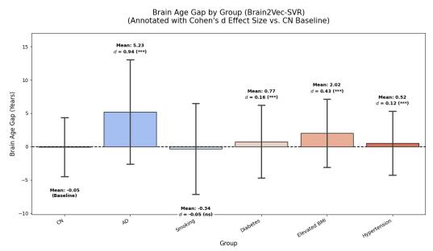  
(a) Brain2Vec-SVR models. For the inference, we ensemble predictions from all 5-fold SVR models.

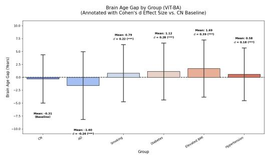  
(b) ViT-BA model.  
Figure 8: Brain age gap differences across disease and risk-factor groups.

## A.3 Brain2Vec classification performance across studies

Table 13: Disease classification performance by study using Brain2Vec embeddings as input features.
<table><tr><td>Study</td><td>n</td><td>Accuracy</td><td>smeation perrormance oy study usmg Brann2 AUC</td><td>F1</td><td>Recall</td><td>ngs as mput 1catul Precision</td></tr><tr><td colspan="7">CU vs AD</td></tr><tr><td>ADNI</td><td>837</td><td> $0 . 8 4 8 5 \pm 0 . 0 0 5$ </td><td> $0 . 9 2 6 6 \pm 0 . 0 0 8$ </td><td> $0 . 8 4 6 3 \pm 0 . 0 0 5$ </td><td> $0 . 8 3 4 9 \pm 0 . 0 0 6$ </td><td> $0 . 8 5 8 0 \pm 0 . 0 0 7$ </td></tr><tr><td>OASIS</td><td>626</td><td> $0 . 7 8 4 3 \pm 0 . 0 1 5$ </td><td> $0 . 8 5 8 9 \pm 0 . 0 1 5$ </td><td> $0 . 7 8 3 3 \pm 0 . 0 1 7$ </td><td> $0 . 7 8 0 2 \pm 0 . 0 2 3$ </td><td> $0 . 7 8 6 7 \pm 0 . 0 1 4$ </td></tr><tr><td>AIBL</td><td>184</td><td> $0 . 8 5 7 6 \pm 0 . 0 0 4$ </td><td> $0 . 9 2 6 0 \pm 0 . 0 0 9$ </td><td> $0 . 8 4 9 2 \pm 0 . 0 0 6$ </td><td> $0 . 8 0 2 2 \pm 0 . 0 1 6$ </td><td> $0 . 9 0 2 5 \pm 0 . 0 1 1$ </td></tr><tr><td colspan="7">CU vs Elevated BMI</td></tr><tr><td>UKBIOBANK</td><td>3404</td><td> $0 . 8 3 8 3 \pm 0 . 0 0 5$ </td><td> $0 . 9 1 3 0 \pm 0 . 0 0 5$ </td><td> $0 . 8 3 7 2 \pm 0 . 0 0 6$ </td><td> $0 . 8 3 1 6 \pm 0 . 0 0 9$ </td><td> $0 . 8 4 2 9 \pm 0 . 0 0 3$ </td></tr><tr><td>CARDIA</td><td>264</td><td> $0 . 7 1 5 2 \pm 0 . 0 0 9$ </td><td> $0 . 7 9 6 3 \pm 0 . 0 1 2$ </td><td> $0 . 7 1 2 6 \pm 0 . 0 1 4$ </td><td> $0 . 8 3 1 6 \pm 0 . 0 0 9$ </td><td> $0 . 8 4 2 9 \pm 0 . 0 0 3$ </td></tr><tr><td>SHIP</td><td>254</td><td> $0 . 7 2 6 0 \pm 0 . 0 0 8$ </td><td> $0 . 8 0 9 7 \pm 0 . 0 1 3$ </td><td> $0 . 7 1 3 3 \pm 0 . 0 1 0$ </td><td> $0 . 6 8 1 9 \pm 0 . 0 2 0$ </td><td> $0 . 7 4 8 4 \pm 0 . 0 1 6$ </td></tr><tr><td colspan="7">CU vs Diabetes</td></tr><tr><td>UKBIOBANK</td><td>4102</td><td> $0 . 6 9 7 1 \pm 0 . 0 0 5$ </td><td> $0 . 7 6 3 0 \pm 0 . 0 0 6$ </td><td> $0 . 6 8 9 3 \pm 0 . 0 0 7$ </td><td> $0 . 6 7 2 3 \pm 0 . 0 1 1$ </td><td> $0 . 7 0 7 4 \pm 0 . 0 0 4$ </td></tr><tr><td>SHIP</td><td>742</td><td> $0 . 6 4 5 0 \pm 0 . 0 0 8$ </td><td> $0 . 6 9 3 3 \pm 0 . 0 0 6$ </td><td> $0 . 6 1 4 4 \pm 0 . 0 1 4$ </td><td> $0 . 5 6 6 6 \pm 0 . 0 3 1$ </td><td> $0 . 6 7 3 3 \pm 0 . 0 1 9$ </td></tr><tr><td>MESA</td><td>338</td><td> $0 . 6 0 0 0 \pm 0 . 0 0 8$ </td><td> $0 . 6 7 3 0 \pm 0 . 0 1 0$ </td><td> $0 . 6 6 8 2 \pm 0 . 0 1 0$ </td><td> $0 . 8 0 7 1 \pm 0 . 0 4 6$ </td><td> $0 . 5 7 1 5 \pm 0 . 0 1 1$ </td></tr><tr><td colspan="7">CU vs Smoking</td></tr><tr><td>UKBIOBANK</td><td>2102</td><td> $0 . 6 9 4 6 \pm 0 . 0 0 9$ </td><td> $0 . 7 6 2 4 \pm 0 . 0 0 7$ </td><td> $0 . 7 0 6 0 \pm 0 . 0 0 9$ </td><td> $0 . 7 3 3 6 \pm 0 . 0 1 6$ </td><td> $0 . 6 8 0 6 \pm 0 . 0 1 0$ </td></tr><tr><td>SHIP HCP</td><td>1360 360</td><td> $0 . 6 5 0 3 \pm 0 . 0 0 8$   $0 . 6 1 2 2 \pm 0 . 0 1 5$ </td><td> $0 . 6 9 7 4 \pm 0 . 0 1 0$   $0 . 6 6 8 1 \pm 0 . 0 1 0$ </td><td> $0 . 6 6 0 0 \pm 0 . 0 0 5$   $0 . 6 0 9 9 \pm 0 . 0 3 6$ </td><td> $0 . 6 7 8 8 \pm 0 . 0 1 6$ </td><td> $0 . 6 4 2 6 \pm 0 . 0 1 2$ </td></tr><tr><td>CU vs Hypertension</td><td></td><td></td><td></td><td></td><td> $0 . 6 1 2 2 \pm 0 . 0 7 7$ </td><td> $0 . 6 1 3 2 \pm 0 . 0 1 6$ </td></tr><tr><td colspan="7"></td></tr><tr><td>UKBIOBANK</td><td>17797</td><td> $0 . 6 2 6 0 \pm 0 . 0 0 3$ </td><td> $0 . 6 7 4 4 \pm 0 . 0 0 3$ </td><td> $0 . 6 4 6 8 \pm 0 . 0 0 6$ </td><td> $0 . 6 8 5 5 \pm 0 . 0 2 1$ </td><td> $0 . 6 1 2 8 \pm 0 . 0 0 7$ </td></tr><tr><td>SHIP</td><td>978</td><td> $0 . 5 8 3 6 \pm 0 . 0 1 6$ </td><td> $0 . 6 1 9 0 \pm 0 . 0 1 1$ </td><td> $0 . 5 9 7 9 \pm 0 . 0 3 5$ </td><td> $0 . 6 2 7 8 \pm 0 . 1 0 0$ </td><td> $0 . 5 8 1 2 \pm 0 . 0 2 4$ </td></tr><tr><td>HCP</td><td>708</td><td> $0 . 5 3 1 4 \pm 0 . 0 0 7$ </td><td> $0 . 5 4 8 0 \pm 0 . 0 1 4$ </td><td> $0 . 5 7 5 8 \pm 0 . 0 6 6$ </td><td> $0 . 6 6 1 6 \pm 0 . 1 6 4$ </td><td> $0 . 5 2 7 3 \pm 0 . 0 1 0$ </td></tr></table>

## A.4 Study-related variation in Brain2Vec embeddings for different disease and risk-factor groups

To assess whether Brain2Vec embeddings encode acquisition site in addition to anatomy, we projected the embeddings of each disease and risk-factor group onto their first two principal components and colored each scan by site.

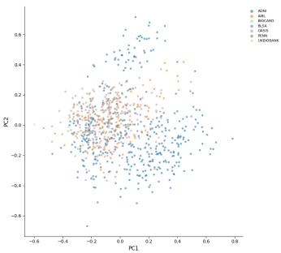  
(a) PCA on AD.

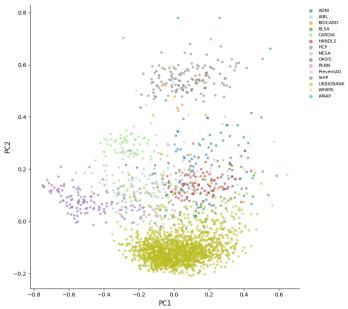  
(b) PCA on Elevated BMI.

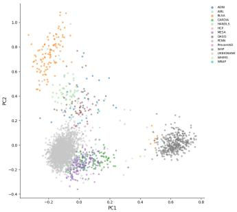  
(c) PCA on Diabetes.

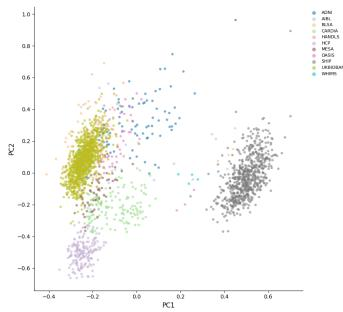  
(d) PCA on Smoking.

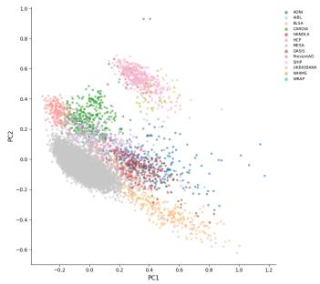  
(e) PCA on Hypertension.  
Figure 9: Principal component analysis of Brain2Vec embeddings for samples in different disease and risk-factor groups, colored by acquisition site.

## A.5 Selection of Brain2Vec features for latent manipulation

To construct the subset of manipulated features S used in Section 4.3, we identified Brain2Vec latent dimensions that are strongly associated with specific DLMUSE ROIs and have a consistent, monotonic effect on those regions under manipulation. For each Brain2Vec dimension, we computed (i) the mean difference between CU and AD subjects and (ii) its Pearson correlation with the bestmatching DLMUSE ROI. Based on this ranking, we selected the 22 dimensions with the largest and most consistent effects (supplementary Table 14).

We restricted this latent manipulation analysis to the CU vs. AD task because it shows the largest anatomical differences between groups among the classification tasks we studied. We repeated the same selection procedure for other tasks in our cohort, including elevated BMI, smoking, diabetes, and hypertension, but did not observe features with comparably strong effects. This suggests that the latent directions identified for CU vs. AD reflect a stronger, more anatomically coherent signal than those for tasks with subtler or more heterogeneous structural correlates.

## A.6 Example self-attention maps for CU, MCI, and AD participants

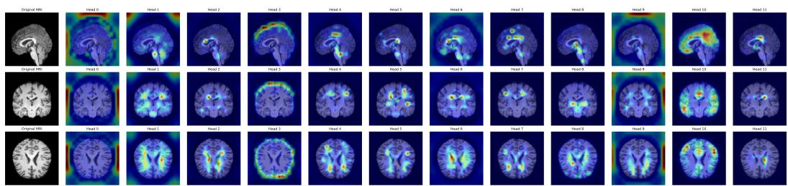  
Figure 10: Self-attention map of a cognitively unimpaired patient

Table 14: Brain2Vec dimensions selected for latent manipulation and their best-matching DLMUSE ROIs
<table><tr><td>Brain2Vec dim.</td><td>Mean difference</td><td>Cohen&#x27;s d</td><td>DLMUSE ROI</td><td>Pearson r</td></tr><tr><td>497</td><td> $2 . 9 0 \times 1 0 ^ { - 5 }$ </td><td>0.8365</td><td>509 (Ventricles)</td><td>0.6624</td></tr><tr><td>110</td><td> $- 2 . 8 7 \times 1 0 ^ { - 2 }$ </td><td>-0.7359</td><td>509 (Ventricles)</td><td>-0.5890</td></tr><tr><td>327</td><td> $2 . 7 4 \times 1 0 ^ { - 2 }$ </td><td>0.7299</td><td>509 (Ventricles)</td><td>0.4885</td></tr><tr><td>175</td><td> $- 1 . 6 3 \times 1 0 ^ { - 2 }$ </td><td>-0.7027</td><td>509 (Ventricles)</td><td>-0.5720</td></tr><tr><td>693</td><td> $- 9 . 0 9 \times 1 0 ^ { - 3 }$ </td><td>-0.6911</td><td>509 (Ventricles)</td><td>-0.5170</td></tr><tr><td>691</td><td> $- 1 . 9 5 \times 1 0 ^ { - 2 }$ </td><td>-0.6884</td><td>509 (Ventricles)</td><td>-0.4771</td></tr><tr><td>451</td><td> $2 . 8 1 \times 1 0 ^ { - 2 }$ </td><td>0.6811</td><td>4 (3rd Ventricle)</td><td>0.6381</td></tr><tr><td>230</td><td> $1 . 4 0 \times 1 0 ^ { - 2 }$ </td><td>0.6756</td><td>4 (3rd Ventricle)</td><td>0.4295</td></tr><tr><td>583</td><td> $2 . 0 7 \times 1 0 ^ { - 2 }$ </td><td>0.6637</td><td>509 (Ventricles)</td><td>0.6794</td></tr><tr><td>249</td><td> $- 2 . 2 8 \times 1 0 ^ { - 2 }$ </td><td>-0.6602</td><td>4 (3rd Ventricle)</td><td>-0.5147</td></tr><tr><td>521</td><td> $- 3 . 6 9 \times 1 0 ^ { - 4 }$ </td><td>-0.6540</td><td>4 (3rd Ventricle)</td><td>-0.4167</td></tr><tr><td>427</td><td> $1 . 5 2 \times 1 0 ^ { - 2 }$ </td><td>0.6466</td><td>4 (3rd Ventricle)</td><td>0.4494</td></tr><tr><td>188</td><td> $1 . 8 7 \times 1 0 ^ { - 2 }$ </td><td>0.6416</td><td>4 (3rd Ventricle)</td><td>0.5080</td></tr><tr><td>426</td><td> $1 . 9 0 \times 1 0 ^ { - 2 }$ </td><td>0.6399</td><td>509 (Ventricles)</td><td>0.4882</td></tr><tr><td>120</td><td> $- 3 . 3 \times 1 0 ^ { - 5 }$ </td><td>-0.6355</td><td>4 (3rd Ventricle)</td><td>-0.5458</td></tr><tr><td>431</td><td> $5 . 2 9 \times 1 0 ^ { - 3 }$ </td><td>0.6327</td><td>4 (3rd Ventricle)</td><td>0.5534</td></tr><tr><td>193</td><td> $5 . 2 1 \times 1 0 ^ { - 2 }$ </td><td>0.6245</td><td>509 (Ventricles)</td><td>0.5414</td></tr><tr><td>357</td><td> $1 . 7 1 \times 1 0 ^ { - 2 }$ </td><td>0.6171</td><td>509 (Ventricles)</td><td>0.4215</td></tr><tr><td>206</td><td> $1 . 3 0 \times 1 0 ^ { - 5 }$ </td><td>0.6017</td><td>509 (Ventricles)</td><td>0.6608</td></tr><tr><td>183</td><td> $5 . 3 4 \times 1 0 ^ { - 3 }$ </td><td>0.5969</td><td>4 (3rd Ventricle)</td><td>0.4961</td></tr><tr><td>201</td><td> $- 3 . 0 0 \times 1 0 ^ { - 6 }$ </td><td>-0.5930</td><td>4 (3rd Ventricle)</td><td>-0.5834</td></tr><tr><td>491</td><td> $- 6 . 2 8 \times 1 0 ^ { - 4 }$ </td><td>-0.5909</td><td>509 (Ventricles)</td><td>-0.5279</td></tr></table>

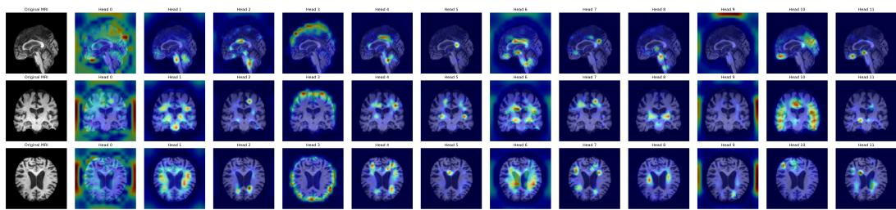  
Figure 11: Self attention map of a participant with mild cognitive impairment

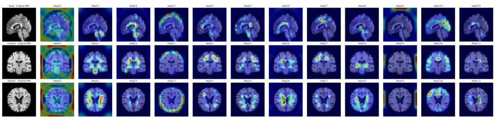  
Figure 12: Self-attention map of a participant with Alzheimer’s disease

## A.7 Manipulation of latent Brain2Vec embeddings

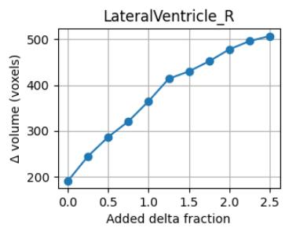

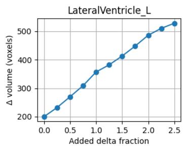

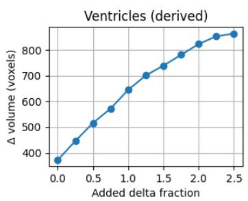

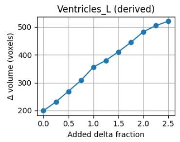

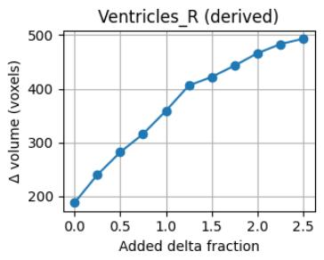  
Figure 13: Effect on ventricles: we observe a monotonic increase of ventricle regions which is something clinically expected, as ventricular enlargement is a well-established radiological marker of neurodegeneration and disease progression in Alzheimer’s disease [30].

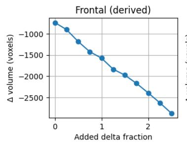

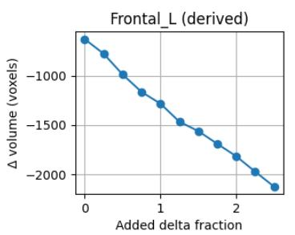

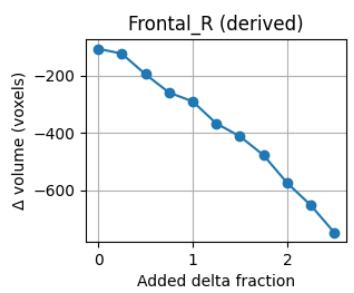

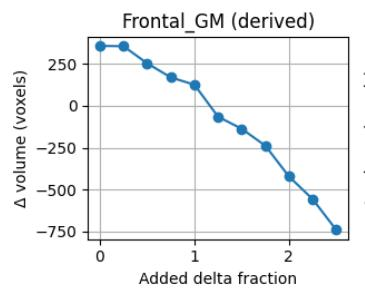

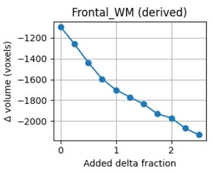  
Figure 14: Effect on frontal regions: we observe a monotonic decrease of frontal regions which is consistent with well-documented patterns of medial and lateral frontal lobe atrophy in AD patients [38, 31].

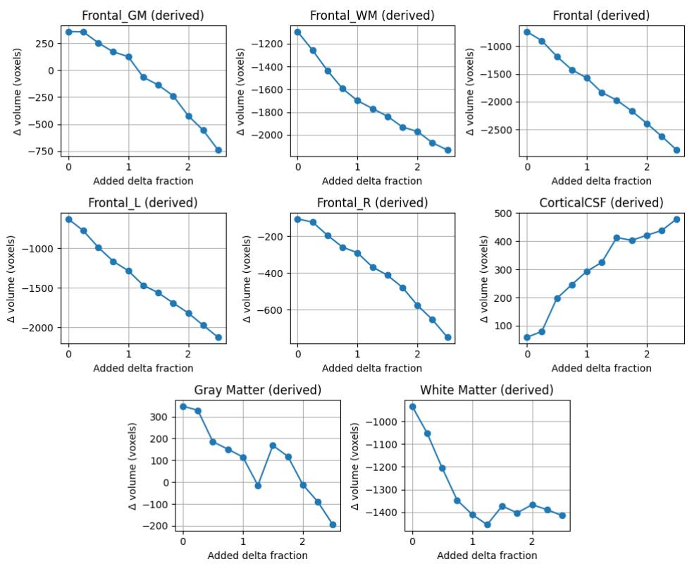  
Figure 15: Effects on GM: we observe a similar trend on frontal regions as well as decreased GM and WM volumes, accompanied by an increase in cortical CSF. This pattern is consistent with enlargement of CSF spaces as brain tissue is lost, and is validated by prior volumetric findings in Alzheimer’s disease [18].

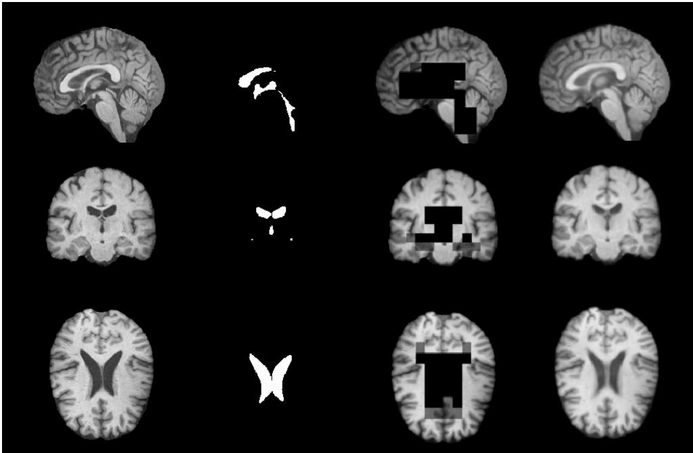  
(a) Original input  
(b) Ventricles region mask(c) Ventricles masking for(d) Ventricles reconstruc-Brain2Vec tion with Brain2Vec  
Figure 16: Example of ventricles region masking and reconstruction with Brain2Vec.

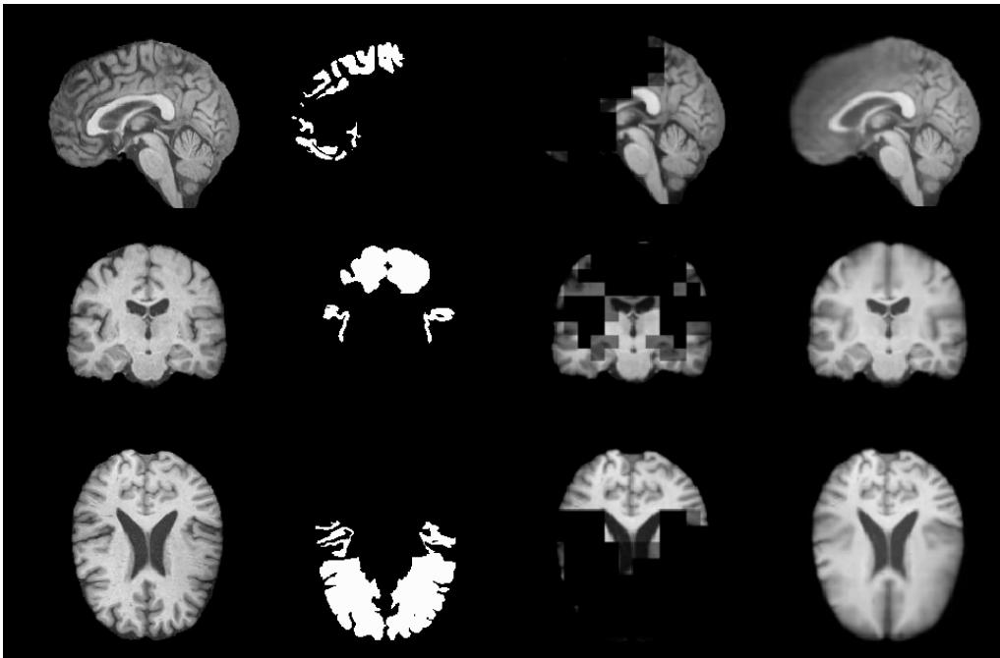  
(a) Original input  
(b) Frontal region mask  
(c) Frontal Brain2Vec  
for(d) Frontal reconstruction with Brain2Vec  
Figure 17: Example of frontal region masking and reconstruction with Brain2Vec.

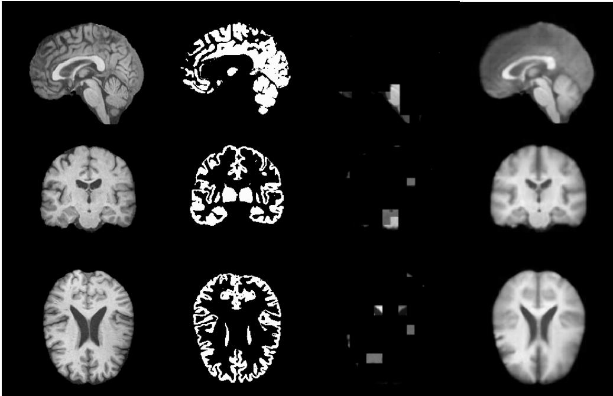  
(a) Original input  
(b) GM region mask  
(c) GM masking Brain2Vec  
for(d) GM reconstruction with Brain2Vec

Figure 18: Example of gray matter region masking and reconstruction with Brain2Vec.