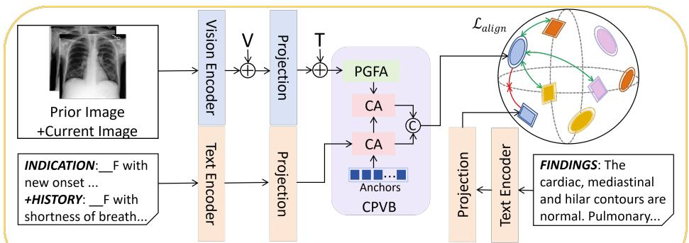
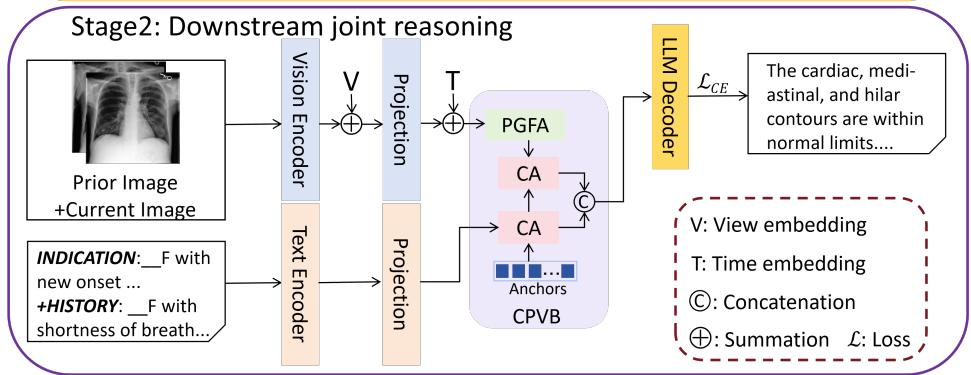
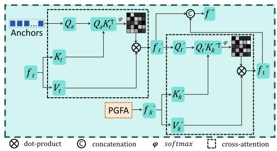
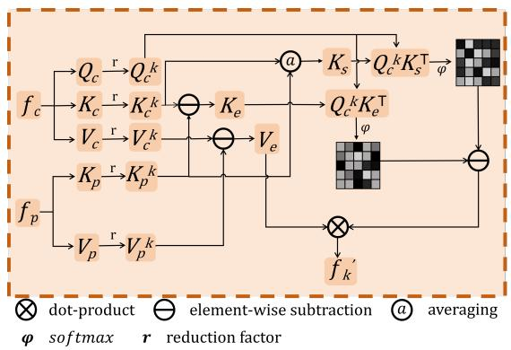
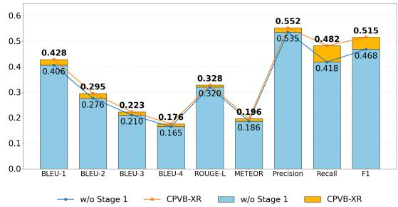
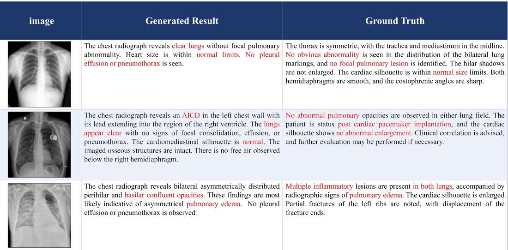

# CPVB-RG: Cross-Prior Visual Bridging for Prior-Aware Chest X-Ray Report Generation

Sike Xiang1 Shuang Chen1 Julie Cox2 Amir Atapour-Abarghouei1\*

1Department of Computer Science, Durham University, UK

2Department of Radiology, County Durham and Darlington NHS Foundation Trust, UK

{sike.xiang, shuang.chen, amir.atapour-abarghouei}@durham.ac.uk

j.cox1@nhs.net

## Abstract

Radiologists interpretfollow-up chest X-rays by comparing current and prior examinations to identify new, resolved or progressing findings. Most report generation systems either omit this longitudinal context or fuse prior features without distinguishing interval changes from anatomy that remains stable over time. We propose CPVB-RG, a prioraware framework that combines current and prior radiographs with available clinical text. Its Cross-Prior Visual Bridge (CPVB) contains Progression-Guided Focus Attention (PGFA) and two Cross-Attention units. PGFA is designed to contrast progression-difference attention with shared-spatial attention, aiming to reduce invariant responses whilst retaining coarse spatial correspondence between examinations. The Cross-Attention units then connect the resulting longitudinal visual evidence with clinical semantics. CPVB-RG is trained in two stages, using prior-guided image-text alignment followed by autoregressive report generation with a lightweight language decoder. Experiments on MIMIC-CXR and IU X-Ray show consistent improvements across language and clinical metrics. On MIMIC-CXR, CPVB-RG achieves 0.2847 F1RadGraph and 0.6692 VLScore, with statistically significant gains over the closest decoder-matched prior-aware baseline. These results support the effectiveness of the proposed differenceaware and spatially guided fusion design for prior-aware chest X-ray report generation.

## 1. Introduction

Chest X-rays are among the most commonly used imaging examinations for assessing thoracic disease [16, 49]. Automatic report generation could reduce repetitive reporting effort, but a follow-up report is not simply a textual description of the current image. Findings are often subtle and spatially localised, and their interpretation depends on whether they are new, stable or changing relative to an earlier examination [17, 43]. Report-generation models must therefore identify interval changes while filtering responses from anatomy that remains unchanged.

Vision-language methods learn joint representations of radiographs and clinical text for report generation [46, 48, 57]. Most generate reports from the current examination alone and cannot directly assess temporal change. Prioraware methods such as PriorRG [30] incorporate earlier studies, but their current and prior features are typically combined through feature fusion or attention-based interaction. Progression-related differences and spatial responses shared across examinations are not explicitly separated. This leaves stable anatomical patterns within the fused representation, where they may obscure small but clinically relevant changes [45].

CPVB-RG addresses this limitation by combining current radiographs, prior radiographs and available clinical text. Its central component, the Cross-Prior Visual Bridge (CPVB), contains Progression-Guided Focus Attention (PGFA) followed by two Cross-Attention units. PGFA uses separate progression-difference and shared-spatial attention branches, with the aim of reducing invariant responses whilst retaining coarse spatial correspondence between examinations. The Cross-Attention units then associate the resulting longitudinal visual evidence with clinical semantics. The model is trained through prior-guided image-text alignment before generating reports autoregressively with a lightweight language decoder.

We evaluate CPVB-RG on MIMIC-CXR [16], IU X-Ray [9] and 135 clinical cases. On MIMIC-CXR, it achieves 0.176 BLEU-4 and 0.515 clinical efficacy F1. Under the ReXrank MIMIC-CXR Findings protocol [58], CPVB-RG obtains 0.2847 F1RadGraph [8] and 0.6692 VLScore [7]. These results exceed the closest decodermatched prior-aware baseline by 0.0090 and 0.0582, respectively, with both differences being statistically significant. Component-level ablations examine CPVB, PGFA and their attention operations, while the clinical case analysis provides preliminary evidence beyond public benchmarks.

Our contributions are:

(i) We introduce CPVB, whose PGFA module is designed to distinguish progression-related differences from shared spatial responses. This design aims to reduce invariant responses whilst retaining coarse correspondence between current and prior examinations (Figs. 2 and 3).

(ii) We integrate CPVB into a two-stage reportgeneration framework. Prior-guided image-text alignment learns longitudinal multimodal representations that condition a lightweight 82M-parameter decoder (Sec. 3).

(iii) We evaluate CPVB-RG on two public benchmarks and 135 clinical cases, with component-level ablations. It achieves the best NLG results among the compared methods and statistically significant gains over the closest decoder-matched prior-aware baseline on clinically grounded metrics (Secs. 4.2 and 4.4).

## 2. Related Work

## 2.1. Chest X-Ray Vision-Language Learning and Report Generation

Chest radiographs often contain low-contrast findings and ambiguous visual cues, making visual representation quality important for downstream multimodal tasks [15]. Early systems commonly used convolutional networks, including DenseNet-based models such as CheXNet [13, 38]. Vision Transformers later improved global structural mod elling through token-based attention [11, 44], while contrastive frameworks such as CLIP aligned visual and textual representations in a shared embedding space [37]. General vision-language architectures, including ALBEF [20] and ViLT [18], model multimodal interactions, whereas BLIP-2 [21] and LLaVA [28] connect projected visual tokens to generative language decoders. Domain-specific language models such as Med-PaLM [41], PMC-LLaMA [53] and BioGPT [35] further support medical terminology and clinical language modelling. Recent chest X-ray systems, including CheXagent [6], MAIRA-2 [2] and UniRG-CXR [31], use larger multimodal decoders and broader training objectives. These systems strengthen image-text reasoning and report generation but do not explicitly separate temporal changes from anatomical responses shared across examinations.

## 2.2. Prior-Aware and Longitudinal Chest X-Ray Modelling

Longitudinal report-generation methods differ in how they use information from earlier patient visits. Zhu et al. [59] combine current and prior chest X-rays with the previous report to pre-fill the Findings section. HERGen [47] integrates multi-visit records using a group causal transformer and curriculum learning, while HC-LLM [33] uses timeshared and time-specific representations with multimodal constraints to guide an LLM. MLRG [29] uses multi-view longitudinal contrastive learning, while BiOTPrompt [34], TIM [10] and MARE [12] explore transport-based, decoupled and analogical temporal reasoning. PriorRG [30], the closest decoder-matched prior-aware method, combines prior-guided contrastive pre-training, coarse-to-fine decoding and attention-based temporal fusion. TILA [19] learns directional changes for progression classification and retrieval, while TRACE [1] generates spatially grounded change descriptions. In contrast, CPVB-RG models current–prior interactions through separate progressiondifference and shared-spatial attention branches and integrates the resulting evidence with clinical text for full-report generation.

## 3. Method

CPVB-RG is a two-stage framework for prior-aware chest X-ray report generation, as shown in Fig. 1. Its inputs are a current examination, an available prior examination and clinical context such as indication or history. The visual inputs are encoded with a shared vision encoder, while the clinical context is processed by a text encoder. Their projected representations are fused by the Cross-Prior Visual Bridge (CPVB). During Stage 1, the fused representation is aligned with the corresponding Findings text, which is used only as contrastive supervision and is unavailable at inference. During Stage 2, the aligned representation conditions a lightweight language decoder for autoregressive report generation. This separation prevents the reference Findings text from entering the inference pipeline.

## 3.1. Prior-Guided Image-Text Alignment Pretraining

The first stage learns longitudinal multimodal representations from the current examination, the constructed prior and the clinical context. The current and prior chest Xrays are encoded by a shared vision encoder, after which view-position embeddings are added to retain acquisitionspecific information. The visual features are projected to a common feature dimension, and temporal embeddings distinguish the current examination from its prior. The clinical context is independently encoded and projected to the same dimension before multimodal interaction.

  
Stage1: Pre-training alignment

  
Figure 1. Overview of CPVB-RG. Current and prior chest X-rays and clinical text are first encoded, after which the Cross-Prior Visual Bridge fuses their representations for prior-guided image-text alignment and autoregressive report generation. CPVB denotes the Cross Prior Visual Bridge (Fig. 2), PGFA denotes Progression-Guided Focus Attention (Fig. 3), and CA denotes Cross-Attention.

For each current examination, a valid prior is a strictly earlier chest X-ray examination from the same patient. If multiple earlier examinations are available, we select the chronologically closest one without imposing a minimum time interval. A matching view is prioritised when avail able. Otherwise, the available view is retained and identified by its view-position embedding. All examinations undergo the same preprocessing, without additional subjective exclusion based on image quality. When no valid prior exists, the current visual tokens, after adding the current temporal embedding, are duplicated as the prior placeholder without introducing a prior temporal embedding or information from another patient. Although the branchspecific projections may produce nonzero differences, both branches depend solely on the current examination. PGFA therefore acts as a learned current-only refinement rather than providing evidence of longitudinal change. IU X-Ray is trained and evaluated consistently under this setting.

CPVB connects longitudinal visual evidence with clinical context. It contains a Progression-Guided Focus Attention (PGFA) module and two Cross-Attention (CA) units, as shown in Figs. 2 and 3. PGFA first constructs separate branches to model progression-related differences and spatial responses shared by the current and prior examinations. The CA units subsequently associate these visual features with the encoded clinical context.

Let $\mathbf { f } _ { c } , \mathbf { f } _ { p } \in \mathbb { R } ^ { B \times N \times C }$ denote the current and prior visual tokens, where B, N and C are the batch size, token count and feature dimension. To reduce computation, average pooling with reduction factor r is applied along the token dimension:

$$
\begin{array} { r } { \bar { \mathbf { f } } _ { c } = \mathcal { R } _ { r } ( \mathbf { f } _ { c } ) , \qquad \bar { \mathbf { f } } _ { p } = \mathcal { R } _ { r } ( \mathbf { f } _ { p } ) , } \end{array}\tag{1}
$$

where $\bar { \mathbf { f } } _ { c } , \bar { \mathbf { f } } _ { p } \in \mathbb { R } ^ { B \times N _ { r } \times C }$ and $N _ { r } = \lceil N / r \rceil$ . PGFA then computes the current query, key and value representations and the prior key and value representations:

$$
\mathbf { Q } _ { c } = \bar { \mathbf { f } } _ { c } \mathbf { W } _ { Q } , \qquad \mathbf { K } _ { c } = \bar { \mathbf { f } } _ { c } \mathbf { W } _ { K _ { c } } , \qquad \mathbf { V } _ { c } = \bar { \mathbf { f } } _ { c } \mathbf { W } _ { V _ { c } } ,\tag{2}
$$

$$
{ \bf K } _ { p } = \bar { \bf f } _ { p } { \bf W } _ { K _ { p } } , \qquad { \bf V } _ { p } = \bar { \bf f } _ { p } { \bf W } _ { V _ { p } } ,\tag{3}
$$

where the projection matrices are learned. The projected features are divided into h attention heads with head dimension $d _ { h } \ = \ C / h$ . The progression-difference branch subtracts the prior keys and values from their current counterparts:

$$
{ \bf K } _ { e } = { \bf K } _ { c } - { \bf K } _ { p } , \qquad { \bf V } _ { e } = { \bf V } _ { c } - { \bf V } _ { p } .\tag{4}
$$

The shared-spatial branch averages the current and prior keys:

  
Figure 2. Structure of the CPVB module.

$$
\mathbf { K } _ { s } = \frac { \mathbf { K } _ { c } + \mathbf { K } _ { p } } { 2 } .\tag{5}
$$

This averaging uses the approximately consistent thoracic layout across examinations and is intended to form a symmetric representation of shared anatomical responses whilst reducing examination-specific noise. Querying ${ \bf K } _ { s }$ is equivalent to averaging the current-key and prior-key similarity logits before softmax. The resulting attention therefore provides coarse token-level spatial guidance without assuming strict pixel-level registration. The progressiondifference and shared-spatial attention maps are computed as:

$$
\begin{array} { r } { \mathbf { A } _ { e } = \mathrm { s o f t m a x } \left( \frac { \mathbf { Q } _ { c } \mathbf { K } _ { e } ^ { \top } } { \sqrt { d _ { h } } } \right) , } \\ { \mathbf { A } _ { s } = \mathrm { s o f t m a x } \left( \frac { \mathbf { Q } _ { c } \mathbf { K } _ { s } ^ { \top } } { \sqrt { d _ { h } } } \right) . } \end{array}\tag{6}
$$

Their difference is applied to the progression values:

$$
\tilde { \mathbf { f } } _ { c } = \left( \mathbf { A } _ { e } - \lambda \mathbf { A } _ { s } \right) \mathbf { V } _ { e } ,\tag{7}
$$

where $\lambda = \mathrm { s i g m o i d } ( \alpha )$ is a learned balancing coefficient. After head merging and output projection, the reduced tokens are interpolated to the original token count. A residual connection and layer normalisation produce the PGFA output:

$$
\mathbf { f } _ { c } ^ { \prime } = \mathrm { L N } \left( \mathbf { f } _ { c } + \mathcal { U } _ { r } \left( \tilde { \mathbf { f } } _ { c } \mathbf { W } _ { O } \right) \right) ,\tag{8}
$$

where $\mathcal { U } _ { r }$ denotes token interpolation and $\mathbf { W } _ { O }$ is the output projection. Three PGFA layers are stacked to refine the current visual tokens, while the prior tokens remain fixed as longitudinal guidance.

The two CA units use learnable anchor tokens to connect the PGFA output with clinical context. The first CA unit uses the anchors as queries over the clinical tokens, producing a text-conditioned anchor representation $\mathbf { F } _ { t }$ . The second uses $\mathbf { F } _ { t }$ to retrieve longitudinal visual evidence from $\mathbf { f } _ { c } ^ { \prime } ,$ producing $\mathbf { F } _ { v }$ . Their concatenation forms the CPVB representation:

$$
\mathbf { F } _ { b } = \operatorname { L N } \left( \left[ \mathbf { F } _ { t } ; \mathbf { F } _ { v } \right] \right) .\tag{9}
$$

  
Figure 3. Structure of the PGFA module.

During Stage 1, the CPVB representation is aligned with the Findings text. Let $T _ { f }$ denote the Findings section used as contrastive supervision. The visual and textual embeddings are:

$$
\begin{array} { r } { \mathbf { z } _ { v } = \mathrm { N o r m } \left( \mathrm { M e a n } ( \mathbf { F } _ { b } ) \right) , \qquad \mathbf { z } _ { t } = \mathrm { N o r m } \left( E _ { t } ( T _ { f } ) _ { \mathrm { C L S } } \right) . } \end{array}\tag{10}
$$

A patient-aware InfoNCE objective aligns the two embedding spaces, treating samples from the same patient as positives. Specifically, for each visual sample, all Findings texts from the same patient within the minibatch are treated as positives, including the matched report of the current examination and reports from other visits when present. Texts from different patients are treated as negatives, and the target weights are normalised across all positives. The resulting objective is:

$$
\begin{array} { r } { \mathcal { L } _ { \mathrm { a l i g n } } = \mathcal { L } _ { \mathrm { I n f o N C E } } \left( \mathbf { z } _ { v } , \mathbf { z } _ { t } \right) . } \end{array}\tag{11}
$$

Findings text is used only for this objective and is not supplied to CPVB or the report decoder during inference.

## 3.2. Prior-Aware Radiology Report Generation

Stage 2 uses the aligned encoders and CPVB to condition report generation. In addition to the CPVB representation $\mathbf { F } _ { b } ,$ multi-layer features from the current-image encoder are aggregated into joint visual tokens $\mathbf { F } _ { j } .$ . CPVB supplies the latent queries of a Perceiver module, which retrieves complementary evidence from $\mathbf { F } _ { j }$ :

$$
{ \displaystyle { \bf F } _ { a } = \mathrm { P e r c e i v e r } \left( { \bf F } _ { j } ; { \bf F } _ { b } \right) . }\tag{12}
$$

The CPVB and Perceiver representations are concatenated to form the decoder conditioning sequence:

$$
\begin{array} { r } { { \bf Z } = [ { \bf F } _ { b } ; { \bf F } _ { a } ] . } \end{array}\tag{13}
$$

We use DistilGPT2 as the language decoder. Crossattention layers allow it to attend to Z while generating the report. For a report sequence $\mathbf { r } = \{ r _ { 1 } , r _ { 2 } , \ldots , r _ { T } \}$ , the conditional probability is:

<table><tr><td>Dataset</td><td>Methods</td><td>Year</td><td>BLEU-1</td><td>BLEU-2</td><td>BLEU-3</td><td>BLEU-4</td><td>ROUGE-L</td><td>METEOR</td></tr><tr><td rowspan="18">MIMIC- CXR</td><td rowspan="6">R2Gen [4] R2GenCMN [5] PPKED [27] AlignTrans [56] CMCL [26] Clinical-BERT [55] METformer [51]</td><td>2020 2021 2023</td><td>0.353 0.353</td><td>0.218 0.218</td><td>0.145 0.148</td><td>0.103 0.106</td><td>0.277 0.278</td><td>0.142 0.142</td></tr><tr><td>2021</td><td>0.360</td><td>0.224</td><td>0.149</td><td>0.106</td><td>0.284</td><td>0.149</td></tr><tr><td>2021</td><td>0.378</td><td>0.235</td><td>0.156</td><td>0.112</td><td>0.283</td><td>0.158</td></tr><tr><td>2021</td><td>0.344</td><td>0.217</td><td>0.140</td><td>0.097</td><td>0.281</td><td>0.133</td></tr><tr><td>2022 0.383</td><td>0.230</td><td></td><td>0.151</td><td>0.106</td><td>0.275</td><td>0.144</td></tr><tr><td>0.386</td><td>0.250</td><td>0.169</td><td>0.124</td><td></td><td>0.291</td><td>0.152</td></tr><tr><td rowspan="6">DCL [22] R2GenGPT [52] KiUT [14] BootstrappingLLM [25] CoFE [23]</td><td>2023</td><td></td><td></td><td></td><td>0.109</td><td>0.284</td><td>0.150</td></tr><tr><td>2023</td><td>0.408</td><td>0.256</td><td>0.174</td><td>0.125</td><td>0.285</td><td>0.167</td></tr><tr><td>2023</td><td>0.393</td><td>0.243</td><td>0.159</td><td>0.113</td><td>0.285</td><td>0.160</td></tr><tr><td>2024</td><td>0.402</td><td>0.262</td><td>0.180</td><td>0.128</td><td>0.291</td><td>0.175</td></tr><tr><td>2024</td><td></td><td></td><td></td><td>0.125</td><td>0.304</td><td>0.176</td></tr><tr><td>MAN [40] 2024</td><td>0.396</td><td>0.244</td><td>0.162</td><td>0.115</td><td>0.274</td><td>0.151</td></tr><tr><td>DCG [24]</td><td>2024</td><td>0.397</td><td>0.258</td><td>0.166</td><td>0.126</td><td>0.295</td><td>0.162</td></tr><tr><td>Med-LMM [32]</td><td>2024</td><td></td><td></td><td></td><td>0.128</td><td>0.289</td><td>0.161</td></tr><tr><td>MambaXray-VL [50]</td><td>2025</td><td>0.422</td><td>0.268</td><td>0.184</td><td>0.133</td><td>0.289</td><td>0.167</td></tr><tr><td>MPO [54]</td><td>2025</td><td>0.416</td><td>0.269</td><td>0.191</td><td>0.139</td><td>0.309</td><td>0.162</td></tr><tr><td>CPVB-RG</td><td>PriorRG [30]</td><td>2026 ours</td><td>0.412 0.428</td><td>0.290 0.295</td><td>0.220</td><td>0.175</td><td>0.324</td><td>0.189</td></tr><tr><td rowspan="14">IU X-Ray</td><td>R2Gen [4] R2GenCMN [5]</td><td>2020 2021</td><td>0.470</td><td>0.304</td><td>0.223 0.219</td><td>0.176 0.165</td><td>0.328</td><td>0.196</td></tr><tr><td>PPKED [27]</td><td>2021</td><td>0.475</td><td>0.309</td><td>0.222</td><td>0.170</td><td>0.371 0.375</td><td>0.187 0.191</td></tr><tr><td></td><td></td><td>0.483</td><td>0.315</td><td>0.224</td><td>0.168</td><td>0.376</td><td>0.187</td></tr><tr><td>AlignTrans [56]</td><td>2021</td><td>0.484</td><td>0.313</td><td>0.225</td><td>0.173</td><td>0.379</td><td>0.204</td></tr><tr><td>CMCL [26]</td><td>2021</td><td>0.473</td><td>0.305</td><td>0.217</td><td>0.162</td><td>0.378</td><td></td></tr><tr><td>Clinical-BERT [55]</td><td>2022</td><td>0.495</td><td>0.330</td><td>0.231</td><td>0.170</td><td>0.376</td><td>0.186</td></tr><tr><td>METformer [51]</td><td>2023</td><td></td><td>0.322</td><td>0.228</td><td>0.172</td><td></td><td>0.209</td></tr><tr><td>DCL [22]</td><td>2023</td><td>0.483</td><td></td><td></td><td></td><td>0.380</td><td>0.192</td></tr><tr><td>R2GenGPT [52]</td><td>2023</td><td>0.465</td><td></td><td></td><td>0.163</td><td>0.383</td><td>0.193</td></tr><tr><td>BootstrappingLLM [25]</td><td>2024</td><td></td><td>0.299</td><td>0.214</td><td>0.161</td><td>0.376</td><td>0.219</td></tr><tr><td>MAN [40]</td><td>2024</td><td>0.499</td><td>0.323</td><td>0.238</td><td>0.184</td><td>0.390</td><td>0.208</td></tr><tr><td></td><td></td><td>0.501</td><td>0.328</td><td>0.230</td><td>0.170</td><td>0.386</td><td>0.213</td></tr><tr><td>DCG [24]</td><td>2024</td><td>0.514</td><td>0.330</td><td>0.241</td><td>0.186</td><td>0.401</td><td>0.211</td></tr><tr><td>Med-LMM [32]</td><td>2024</td><td></td><td></td><td></td><td>0.168</td><td>0.381</td><td>0.209</td></tr><tr><td>MambaXray-VL [50]</td><td>2025</td><td>0.491</td><td>0.330</td><td>0.241</td><td>0.185</td><td>0.371</td><td>0.216</td></tr><tr><td>MPO [54]</td><td>2025</td><td>0.548</td><td>0.383</td><td>0.278</td><td>0.209</td><td>0.415</td><td>0.224</td></tr><tr><td>CPVB-RG</td><td>ours</td><td>0.552</td><td>0.394</td><td>0.281</td><td>0.211</td><td>0.423</td><td>0.227</td></tr></table>

Table 1. Natural language generation (NLG) results on MIMIC-CXR and IU X-Ray. MambaXray-VL refers to the model introduced in CXPMRG-Bench [50]. The best results are shown in bold and the second-best results are underlined. “–” indicates that the corresponding metric was not reported in the original publication.

$$
P ( \mathbf { r } \mid \mathbf { Z } ) = \prod _ { t = 1 } ^ { T } P ( r _ { t } \mid r _ { < t } , \mathbf { Z } ) .\tag{14}
$$

The generation branch is trained using token-level crossentropy:

$$
\mathcal { L } _ { \mathrm { C E } } = - \sum _ { t = 1 } ^ { T } \log P \left( r _ { t } ^ { * } \mid r _ { < t } ^ { * } , \mathbf { Z } \right) ,\tag{15}
$$

where $r _ { t } ^ { * }$ is the ground-truth token at step t. At inference, the decoder receives only the encoded examinations and available clinical context.

## 4. Experiments

## 4.1. Experimental Setup

We evaluate CPVB-RG on two public chest X-ray reportgeneration benchmarks, MIMIC-CXR [16] and IU X-Ray [9]. Both datasets contain paired chest radiographs and radiology reports, but differ substantially in scale. Further dataset details are provided in the supplementary material.

The common feature dimension is set to $d = 7 6 8$ . We initialise the vision encoder with RAD-DINO [36] and the text encoder with CXR-BERT-General [3]. DistilGPT2 [39] is used as the primary language decoder, with alternative decoders examined in the ablation study. CPVB uses 128 anchor tokens, and the maximum report length is 100 tokens. Training follows the two-stage procedure described in Sec. 3. Stage 1 is trained for up to 50 epochs with a batch size of 32, while Stage 2 is trained for up to 50 epochs with a batch size of 16. Both stages use AdamW with a learning rate of $5 \times 1 0 ^ { - 5 }$ , together with learning-rate scheduling and early stopping. All experiments are implemented in Py-Torch and conducted on a single NVIDIA A100 GPU.

We use BLEU, ROUGE-L and METEOR to measure lexical agreement between generated and reference reports. Clinical efficacy (CE) Precision, Recall and F1 are computed over 14 clinical observations extracted by CheXbert [42]. Positive and uncertain labels are treated as present, while negative and unmentioned labels are treated as absent. We additionally report F1RadGraph [8], which measures agreement between clinical entities and relations, and VLScore [7], which assesses image–report consistency. Expert-judged report correctness is reported for the 135 clinical cases. Full metric definitions and the clinical review protocol are provided in the supplementary material.

## 4.2. Quantitative Results

Tables 1 and 2 compare CPVB-RG with recent reportgeneration methods. On MIMIC-CXR, CPVB-RG obtains 0.428, 0.295, 0.223 and 0.176 from BLEU-1 to BLEU-4, together with 0.328 ROUGE-L and 0.196 METEOR. These are the best NLG results among the compared methods. The gains over PriorRG [30] are consistent across all six metrics, although the BLEU-4 improvement is small. On IU X-Ray, CPVB-RG reaches 0.552, 0.394, 0.281 and 0.211 from BLEU-1 to BLEU-4, with 0.423 ROUGE-L and 0.227 METEOR. Across the two datasets, CPVB-RG performs consistently with longitudinal priors on MIMIC-CXR and under the missing-prior setting on IU X-Ray.

The CE results in Tab. 2 provide a complementary view of clinical observation agreement. CPVB-RG achieves the highest Precision of 0.552 and F1 of 0.515, with a Recall of 0.482. Relative to PriorRG, Precision increases by 0.011 and F1 by 0.004, while Recall decreases by 0.003. The higher F1 therefore reflects improved agreement across the extracted clinical observations rather than uniformly better performance on every CE component.

We evaluate clinical entity–relation consistency and image–report alignment under the ReXrank [58] MIMIC-CXR Findings protocol. All methods use the same test cases, reference Findings and metric implementations, with details provided in the supplementary material. As shown in Tab. 3, CPVB-RG obtains 0.2847 F1RadGraph and 0.6692 VLScore. It ranks second in F1RadGraph and is 0.0055 below the best VLScore achieved by the 8B UniRG-CXR. Using an 82M-parameter language decoder, CPVB-RG exceeds the 7B MAIRA-2 by 0.0200 in F1RadGraph and 0.0184 in VLScore. PriorRG is the closest decodermatched prior-aware baseline because both methods use prior examinations and an 82M-parameter decoder. The two methods differ mainly in how they model current– prior interactions. PriorRG uses attention-based temporal fusion, whereas CPVB/PGFA models current–prior interactions through separate progression-difference and sharedspatial branches. Based on 10,000 patient-level paired bootstrap resamples and two-sided bootstrap z-tests, CPVB-RG improves over PriorRG by 0.0090 in F1RadGraph (95% CI: [0.0048, 0.0135], p < 0.0001) and 0.0582 in VLScore (95% CI: [0.0492, 0.0673], $p \ < \ 0 . 0 0 0 1 )$ ). Both improvements are statistically significant. The supplementary material also reports zero-shot transfer from MIMIC-CXR to IU X-Ray.

<table><tr><td>Methods</td><td>Year</td><td>P</td><td>R</td><td>F1</td></tr><tr><td>R2Gen [4]</td><td>2020</td><td>0.333</td><td>0.273</td><td>0.276</td></tr><tr><td>R2GenCMN [5]</td><td>2021</td><td>0.334</td><td>0.275</td><td>0.278</td></tr><tr><td>Clinical-BERT [55]</td><td>2022</td><td>0.397</td><td>0.435</td><td>0.415</td></tr><tr><td>METformer [51]</td><td>2023</td><td>0.364</td><td>0.309</td><td>0.311</td></tr><tr><td>DCL [22]</td><td>2023</td><td>0.471</td><td>0.352</td><td>0.373</td></tr><tr><td>KiUT [14]</td><td>2023</td><td>0.371</td><td>0.318</td><td>0.321</td></tr><tr><td>BootstrappingLLM [25]</td><td>2024</td><td>0.465</td><td>0.482</td><td>0.473</td></tr><tr><td>CoFE [23]</td><td>2024</td><td>0.489</td><td>0.370</td><td>0.405</td></tr><tr><td>MAN [40]</td><td>2024</td><td>0.411</td><td>0.398</td><td>0.389</td></tr><tr><td>DCG [24]</td><td>2024</td><td>0.441</td><td>0.414</td><td>0.404</td></tr><tr><td>Med-LMM [32]</td><td>2024</td><td>0.412</td><td>0.373</td><td>0.395</td></tr><tr><td>MambaXray-VL [50]</td><td>2025</td><td>0.371</td><td>0.321</td><td>0.340</td></tr><tr><td>MPO [54]</td><td>2025</td><td>0.436</td><td>0.376</td><td>0.353</td></tr><tr><td>PriorRG [30]</td><td>2026</td><td>0.541</td><td>0.485</td><td>0.511</td></tr><tr><td>CPVB-RG</td><td>ours</td><td>0.552</td><td>0.482</td><td>0.515</td></tr></table>

Table 2. Clinical efficacy (CE) on MIMIC-CXR. P, R and F1 denote Precision, Recall and F1 score, respectively. The best results are shown in bold and the second-best results are underlined.

<table><tr><td>Method</td><td>Params ↓</td><td>F1RadGraph ↑</td><td>VLScore ↑</td></tr><tr><td>PriorRG [30]</td><td>82M</td><td>0.2757</td><td>0.6110</td></tr><tr><td>CheXagent [6]</td><td>2.7B</td><td>0.2530</td><td>0.6724</td></tr><tr><td>UniRG-CXR [31]</td><td>8B</td><td>0.3040</td><td>0.6747</td></tr><tr><td>MAIRA-2 [2]</td><td>7B</td><td>0.2647</td><td>0.6508</td></tr><tr><td>CPVB-RG</td><td>82M</td><td>0.2847</td><td>0.6692</td></tr></table>

Table 3. Comparison with recent systems using F1RadGraph and VLScore. Params denotes the parameter count of the language backbone or decoder.

## 4.3. Ablation Study

## 4.3.1. Effectiveness of Stage 1 Pre-training

Fig. 4 compares the complete model with a variant trained without Stage 1. Removing prior-guided image-text alignment reduces every reported NLG and CE metric. The larger decreases in Recall and F1 indicate that Stage 1 mainly helps the generation model retain clinical observations, while the accompanying NLG reductions show that its effect is not limited to the CE evaluation.

<table><tr><td>Variant</td><td>BLEU-4↑</td><td>CE F1 ↑</td><td>F1RadGraph ↑</td><td>VLScore ↑</td></tr><tr><td>PriorRG-Style Fusion</td><td>0.1753</td><td>0.4892</td><td>0.2762</td><td>0.6578</td></tr><tr><td>Single Cross-Attention</td><td>0.1240</td><td>0.5128</td><td>0.2224</td><td>0.6448</td></tr><tr><td>w/o PGFA</td><td>0.1689</td><td>0.4739</td><td>0.2785</td><td>0.6603</td></tr><tr><td>w/o Difference Branch</td><td>0.1741</td><td>0.5122</td><td>0.2839</td><td>0.6673</td></tr><tr><td>w/o Spatial Branch</td><td>0.1745</td><td>0.5064</td><td>0.2767</td><td>0.6644</td></tr><tr><td>Spatial Addition</td><td>0.1729</td><td>0.5040</td><td>0.2783</td><td>0.6621</td></tr><tr><td>Full CPVB-RG</td><td>0.1760</td><td>0.5150</td><td>0.2847</td><td>0.6692</td></tr></table>

Table 4. Fine-grained ablation of CPVB and PGFA. BLEU-4 and CE F1 use the standard MIMIC-CXR test set, while F1RadGraph and VLScore follow the ReXrank Findings protocol. PriorRG-Style Fusion adopts PriorRG’s temporal attention, with all other settings fixed across variants. Best results are bolded.

  
Figure 4. Effect of Stage 1 pre-training on report generation. “w/o” denotes “without”.

## 4.3.2. Ablation on Input Configuration

Tab. 5 examines the effect of progressively introducing prior examinations, temporal-order information and clinical context. Using only the current examination gives 0.152 BLEU-4 and 0.311 CE F1. Adding an unordered prior does not improve performance, while encoding temporal order raises the scores to 0.158 and 0.347. Clinical context further improves them to 0.168 and 0.471. Applying CPVB to the complete input configuration achieves the best results of 0.176 BLEU-4 and 0.515 CE F1.

## 4.3.3. Fine-Grained Ablation of CPVB and PGFA

Having established the contribution of CPVB, we examine its internal design under controlled settings. We keep the input data, visual encoder, language decoder, training objectives and optimisation settings fixed, varying the current–prior fusion mechanism. PriorRG-Style Fusion replaces PGFA with the attention-based temporal fusion used in PriorRG, while Single Cross-Attention retains only one of the two Cross-Attention units. The remaining variants remove PGFA, its progression-difference branch or its spatialguidance branch. Spatial Addition replaces attention-map subtraction with addition. As shown in Tab. 4, full CPVB-RG achieves the best results across all four metrics. Removing PGFA reduces BLEU-4, CE F1, F1RadGraph and VLScore by 0.0071, 0.0411, 0.0062 and 0.0089, respectively. Removing the Difference Branch causes smaller but consistent decreases, while removing the Spatial Branch lowers F1RadGraph and VLScore by 0.0080 and 0.0048.

<table><tr><td>Current</td><td>Prior</td><td>Order</td><td>Text</td><td>CPVB</td><td>BLEU-4</td><td>CE F1</td></tr><tr><td>√</td><td>一</td><td>一</td><td>一</td><td>一</td><td>0.152</td><td>0.311</td></tr><tr><td>√</td><td>√</td><td>一</td><td></td><td></td><td>0.149</td><td>0.298</td></tr><tr><td>√</td><td>√</td><td>√</td><td></td><td></td><td>0.158</td><td>0.347</td></tr><tr><td>√</td><td>√</td><td>√</td><td>√</td><td>一</td><td>0.168</td><td>0.471</td></tr><tr><td>√</td><td>√</td><td>√</td><td>√</td><td>√</td><td>0.176</td><td>0.515</td></tr></table>

Table 5. Ablation of the input configuration and CPVB. Order denotes temporal-order information, and Text denotes the available clinical context. The best results are shown in bold.

Replacing attention-map subtraction with addition reduces all four metrics, including decreases of 0.0110 in CE F1, 0.0064 in F1RadGraph and 0.0071 in VLScore. This result supports attention-map subtraction as a design choice and is consistent with its intended role of reducing shared temporal responses and emphasising interval-change evidence. PriorRG-Style Fusion obtains a similar BLEU-4 score, but its CE F1, F1RadGraph and VLScore are lower by 0.0258, 0.0085 and 0.0114, respectively, showing that the benefit of CPVB/PGFA extends beyond lexical overlap. Retaining only one Cross-Attention unit substantially reduces BLEU-4, F1RadGraph and VLScore. Together, these results support the progression-difference branch, spatial guidance, attention-map subtraction and both Cross-Attention units. Additional experiments in the supplementary material examine decoder selection and the reduction factor r. DistilGPT2 provides the best observed balance between generation performance and decoder size, while r = 2 gives the strongest overall CPVB result.

  
Figure 5. Examples of generated radiology reports and their reference reports for clinical chest X-ray cases. Text in red marks clinically important content in the generated and reference reports for comparison.

## 4.4. Clinical Case Analysis

To examine performance on real clinical data, three collaborating radiologists evaluated 135 de-identified chest X-ray cases selected through stratified random sampling across 14 clinical observation categories. The sample was designed to cover diverse clinical findings rather than reflect their natural prevalence. One radiologist performed the initial assessment of each generated report, and two others reviewed it. This non-interventional secondary-data study was approved by the ethics committees of the authors’ institution and the source clinical institution. The research team had no access to direct patient identifiers or re-identification keys. Further details on reader experience, case selection, review procedure and assessment criteria are provided in the supplementary material. As shown in Tab. 6, 89.6% of the reports in this stratified evaluation set were judged overall correct. This includes 60.7% that were completely correct and 28.9% that contained only minor omissions. A further 5.93% contained correct findings, incorrect statements and/or important omissions, while 4.44% were completely incorrect. These results are preliminary given the sample size, but they permit analysis of the model’s successes and remaining errors on clinical cases.

Fig. 5 shows three representative cases. The first agrees with the normal reference, reporting clear lungs, normal heart size and no pleural effusion or pneumothorax. The second identifies an implanted cardiac device and no pulmonary abnormality, but calls the device an AICD rather than a pacemaker and adds details absent from the reference. The third captures pulmonary oedema and opacities but describes basilar confluent opacities instead of the reported multiple bilateral inflammatory opacities. These cases reveal errors in device classification, disease distribution and diagnostic specificity.

<table><tr><td>Category</td><td>Proportion (%)</td></tr><tr><td>Overall correct</td><td>89.6</td></tr><tr><td>Completely correct reports</td><td>60.7</td></tr><tr><td>Partially correct</td><td>28.9</td></tr><tr><td>Mixed &amp; Missing</td><td>5.93</td></tr><tr><td>Completely incorrect</td><td>4.44</td></tr></table>

Table 6. Report-level evaluation of 135 chest X-ray cases. Overall correct is the sum of completely and partially correct reports. Partially correct denotes reports with correct information and minor omissions. Mixed & Missing denotes reports containing correct and incorrect statements and/or missing important findings. Completely incorrect denotes no correct information.

## 5. Conclusion

We presented CPVB-RG, a prior-aware framework designed to distinguish progression-related differences from shared spatial responses and connect this longitudinal evidence with clinical context through prior-guided image-text alignment and lightweight autoregressive decoding. Experiments on MIMIC-CXR [16] and IU X-Ray [9] show improvements across natural language generation and clinically grounded metrics. Controlled ablations support the design, while evaluation on 135 clinical cases reveals remaining errors in device classification, disease distribution and diagnostic specificity. Future work will examine irregular or missing priors and multi-institutional validation.

## References

[1] OFM Riaz Rahman Aranya and Kevin Desai. TRACE: Temporal radiology with anatomical change explanation for grounded x-ray report generation. In Pattern Recognition, Cham, 2027. Springer. 2

[2] Shruthi Bannur, Kenza Bouzid, Daniel C. Castro, Anton Schwaighofer, Anja Thieme, Sam Bond-Taylor, Maximilian Ilse, Fernando Perez-Garc´ ´ıa, Valentina Salvatelli, Harshita Sharma, Felix Meissen, Mercy Prasanna Ranjit, Shaury Srivastav, Julia Gong, Noel C. F. Codella, Fabian Falck, Ozan Oktay, Matthew P. Lungren, Maria T. A. Wetscherek, Javier Alvarez-Valle, and Stephanie L. Hyland. MAIRA-2: Grounded radiology report generation. arXiv preprint arXiv:2406.04449, 2024. 2, 6

[3] Benedikt Boecking, Naoto Usuyama, Shruthi Bannur, Daniel C. Castro, Anton Schwaighofer, Stephanie Hyland, Maria Wetscherek, Tristan Naumann, Aditya Nori, Javier Alvarez-Valle, Hoifung Poon, and Ozan Oktay. Making the most of text semantics to improve biomedical vision– language processing. In Computer Vision – ECCV 2022, pages 1–21, Cham, 2022. Springer Nature Switzerland. 5

[4] Zhihong Chen, Yan Song, Tsung-Hui Chang, and Xiang Wan. Generating radiology reports via memory-driven transformer. In Proceedings of the 2020 Conference on Empirical Methods in Natural Language Processing (EMNLP), pages 1439–1449. Association for Computational Linguistics, 2020. 5, 6

[5] Zhihong Chen, Yaling Shen, Yan Song, and Xiang Wan. Cross-modal memory networks for radiology report generation. In Proceedings ofthe 59th Annual Meeting ofthe Association for Computational Linguistics and the 11th International Joint Conference on Natural Language Processing (Volume 1: Long Papers), pages 5904–5914, Online, 2021. Association for Computational Linguistics. 5, 6

[6] Zhihong Chen, Maya Varma, Justin Xu, Magdalini Paschali, Dave Van Veen, Andrew Johnston, Alaa Youssef, Louis Blankemeier, Christian Bluethgen, Stephan Altmayer, Jeya Maria Jose Valanarasu, Mohamed Siddig Eltayeb Muneer, Eduardo Pontes Reis, Joseph Paul Cohen, Cameron Olsen, Tanishq Mathew Abraham, Emily B. Tsai, Christopher F. Beaulieu, Jenia Jitsev, Sergios Gatidis, Jean-Benoit Delbrouck, Akshay S. Chaudhari, and Curtis P. Langlotz. A vision-language foundation model to enhance efficiency of chest x-ray interpretation. arXiv preprint arXiv:2401.12208, 2024. 2, 6

[7] Gefen Dawidowicz, Elad Hirsch, and Ayellet Tal. Imageaware evaluation of generated medical reports. In Advances in Neural Information Processing Systems, pages 8370– 8383, 2024. 1, 6

[8] Jean-Benoit Delbrouck, Pierre Chambon, Christian Bluethgen, Emily Tsai, Omar Almusa, and Curtis Langlotz. Improving the factual correctness of radiology report generation with semantic rewards. In Findings of the Association for Computational Linguistics: EMNLP 2022, pages 4348– 4360. Association for Computational Linguistics, 2022. 1, 6

[9] Dina Demner-Fushman, Marc D Kohli, Marc B Rosen-

man, Sonya E Shooshan, Laritza Rodriguez, Sameer Antani, George R Thoma, and Clement J McDonald. Preparing a collection of radiology examinations for distribution and retrieval. Journal of the American Medical Informatics Asso ciation, 23(2):304–310, 2016. 1, 5, 8

[10] Yiheng Dong, Yi Lin, Shilong Huang, Xiyan Yang, and Xin Yang. TIM: Temporal decoupling with iterative mutualrefinement model for longitudinal radiology report generation. In Proceedings of the IEEE/CVF Conference on Com puter Vision and Pattern Recognition, pages 6951–6961, 2026. 2

[11] Alexey Dosovitskiy, Lucas Beyer, Alexander Kolesnikov, Dirk Weissenborn, Xiaohua Zhai, Thomas Unterthiner, Mostafa Dehghani, Matthias Minderer, Georg Heigold, Sylvain Gelly, Jakob Uszkoreit, and Neil Houlsby. An image is worth 16x16 words: Transformers for image recognition at scale. ICLR, 2021. 2

[12] Qingqing Gao, Tengfei Liu, Xiaoyan Li, Xiaodan Zhang, Zhongfan Sun, Boyue Wang, Baocai Yin, and Zhaohui Liu. MARE: Multimodal analogical reasoning for disease evolution-aware radiology report generation. Proceedings of the AAAI Conference on Artificial Intelligence, 40(25): 21180–21188, 2026. 2

[13] Gao Huang, Zhuang Liu, Laurens Van Der Maaten, and Kilian Q. Weinberger. Densely connected convolutional networks. In 2017 IEEE Conference on Computer Vision and Pattern Recognition (CVPR), pages 2261–2269, 2017. 2

[14] Zhongzhen Huang, Xiaofan Zhang, and Shaoting Zhang. Kiut: Knowledge-injected u-transformer for radiology report generation. In 2023 IEEE/CVF Conference on Computer Vision and Pattern Recognition (CVPR), pages 19809–19818, 2023. 5, 6

[15] Hammad Iqbal, Arshad Khan, Narayan Nepal, Faheem Khan, and Yeon-Kug Moon. Deep learning approaches for chest radiograph interpretation: A systematic review. Elec tronics, 13(23), 2024. 2

[16] Alistair EW Johnson, Tom J Pollard, Seth J Berkowitz, Nathaniel R Greenbaum, Matthew P Lungren, Chih-ying Deng, Roger G Mark, and Steven Horng. Mimic-cxr, a deidentified publicly available database of chest radiographs with free-text reports. Scientific data, 6(1):317, 2019. 1, 5, 8

[17] Mohamed Khalifa and Mona Albadawy. Ai in diagnostic imaging: Revolutionising accuracy and efficiency. Computer Methods and Programs in Biomedicine Update, 5:100146, 2024. 1

[18] Wonjae Kim, Bokyung Son, and Ildoo Kim. Vilt: Visionand-language transformer without convolution or region supervision. In Proceedings of the 38th International Conference on Machine Learning, pages 5583–5594. PMLR, 2021. 2

[19] Hanbin Ko, Kyeongmin Jeon, Doowoong Choi, and Chang Min Park. Temporal inversion for learning interval change in chest x-rays. In Proceedings of the IEEE/CVF Conference on Computer Vision and Pattern Recognition, 2026. 2

[20] Junnan Li, Ramprasaath R. Selvaraju, Akhilesh Deepak Gotmare, Shafiq Joty, Caiming Xiong, and Steven Hoi. Align be-

fore fuse: Vision and language representation learning with momentum distillation. In NeurIPS, 2021. 2

[21] Junnan Li, Dongxu Li, Silvio Savarese, and Steven Hoi. BLIP-2: Bootstrapping language-image pre-training with frozen image encoders and large language models. In Proceedings of the 40th International Conference on Machine Learning, pages 19730–19742. PMLR, 2023. 2

[22] Mingjie Li, Bingqian Lin, Zicong Chen, Haokun Lin, Xiaodan Liang, and Xiaojun Chang. Dynamic graph enhanced contrastive learning for chest x-ray report generation. In Proceedings of the IEEE/CVF Conference on Computer Vision and Pattern Recognition (CVPR), pages 3334–3343, 2023. 5, 6

[23] Mingjie Li, Haokun Lin, Liang Qiu, Xiaodan Liang, Ling Chen, Abdulmotaleb Elsaddik, and Xiaojun Chang. Contrastive learning with counterfactual explanations for radiology report generation. In European Conference on Computer Vision, pages 162–180. Springer, 2024. 5, 6

[24] Xiao Liang, Yanlei Zhang, Di Wang, Haodi Zhong, Ronghan Li, and Quan Wang. Divide and conquer: Isolating normalabnormal attributes in knowledge graph-enhanced radiology report generation. In Proceedings of the 32nd ACM International Conference on Multimedia, page 4967–4975, New York, NY, USA, 2024. Association for Computing Machinery. 5, 6

[25] Chang Liu, Yuanhe Tian, Weidong Chen, Yan Song, and Yongdong Zhang. Bootstrapping large language models for radiology report generation. In Proceedings of the AAAI Conference on Artificial Intelligence, pages 18635–18643, 2024. 5, 6

[26] Fenglin Liu, Shen Ge, and Xian Wu. Competence-based multimodal curriculum learning for medical report generation. In Proceedings of the 59th Annual Meeting of the Association for Computational Linguistics and the 11th International Joint Conference on Natural Language Processing (Volume 1: Long Papers), pages 3001–3012, Online, 2021. Association for Computational Linguistics. 5

[27] Fenglin Liu, Xian Wu, Shen Ge, Wei Fan, and Yuexian Zou. Exploring and distilling posterior and prior knowledge for radiology report generation. In Proceedings of the IEEE/CVF Conference on Computer Vision and Pattern Recognition (CVPR), pages 13753–13762. IEEE, 2021. 5

[28] Haotian Liu, Chunyuan Li, Yuheng Li, and Yong Jae Lee. Improved baselines with visual instruction tuning. In 2024 IEEE/CVF Conference on Computer Vision and Pattern Recognition (CVPR), pages 26286–26296, 2024. 2

[29] Kang Liu, Zhuoqi Ma, Xiaolu Kang, Yunan Li, Kun Xie, Zhicheng Jiao, and Qiguang Miao. Enhanced contrastive learning with multi-view longitudinal data for chest x-ray report generation. In Proceedings ofthe Computer Vision and Pattern Recognition Conference, pages 10348–10359, 2025. 2

[30] Kang Liu, Zhuoqi Ma, Zikang Fang, Yunan Li, Kun Xie, and Qiguang Miao. Priorrg: Prior-guided contrastive pretraining and coarse-to-fine decoding for chest x-ray report generation, 2026. 1, 2, 5, 6

[31] Qianchu Liu, Sheng Zhang, Guanghui Qin, Yu Gu, Ying Jin, Sam Preston, Yanbo Xu, Sid Kiblawi, Wen-wai Yim,

Timothy Ossowski, Tristan Naumann, Mu Wei, and Hoifung Poon. Scaling medical imaging report generation with multimodal reinforcement learning. arXiv preprint arXiv:2601.17151, 2026. 2, 6

[32] Rui Liu, Mingjie Li, Shen Zhao, Ling Chen, Xiaojun Chang, and Lina Yao. In-context learning for zero-shot medical report generation. In Proceedings of the 32nd ACM International Conference on Multimedia, page 8721–8730, New York, NY, USA, 2024. Association for Computing Machinery. 5, 6

[33] Tengfei Liu, Jiapu Wang, Yongli Hu, Mingjie Li, Junfei Yi, Xiaojun Chang, Junbin Gao, and Baocai Yin. HC-LLM: Historical-constrained large language models for radiology report generation. Proceedings of the AAAI Conference on Artificial Intelligence, 39(6):5595–5603, 2025. 2

[34] Tengfei Liu, Yijian Fan, Boyue Wang, Yongli Hu, Mingjie Li, Jinghua Li, Junbin Gao, Xiaojun Chang, Zhihui Li, and Baocai Yin. BiOTPrompt: Bidirectional optimal transport guided prompting for disease evolution-aware radiology report generation. In Proceedings of the IEEE/CVF Conference on Computer Vision and Pattern Recognition, pages 13755–13765, 2026. 2

[35] Renqian Luo, Liai Sun, Yingce Xia, Tao Qin, Sheng Zhang, Hoifung Poon, and Tie-Yan Liu. Biogpt: generative pretrained transformer for biomedical text generation and mining. Briefings in Bioinformatics, 23(6):bbac409, 2022. 2

[36] Fernando Perez-Garc´ ´ıa, Harshita Sharma, Sam Bond-Taylor, Kenza Bouzid, Valentina Salvatelli, Maximilian Ilse, Shruthi Bannur, Daniel C. Castro, Anton Schwaighofer, Matthew P. Lungren, Maria Teodora Wetscherek, Noel Codella, Stephanie L. Hyland, Javier Alvarez-Valle, and Ozan Oktay. Exploring scalable medical image encoders beyond text supervision. Nature Machine Intelligence, 2025. 5

[37] Alec Radford, Jong Wook Kim, Chris Hallacy, A. Ramesh, Gabriel Goh, Sandhini Agarwal, Girish Sastry, Amanda Askell, Pamela Mishkin, Jack Clark, Gretchen Krueger, and Ilya Sutskever. Learning transferable visual models from natural language supervision. In ICML, 2021. 2

[38] Pranav Rajpurkar, Jeremy Irvin, Kaylie Zhu, Brandon Yang, Hershel Mehta, Tony Duan, Daisy Ding, Aarti Bagul, Curtis Langlotz, Katie Shpanskaya, Matthew P. Lungren, and Andrew Y. Ng. Chexnet: Radiologist-level pneumonia detection on chest x-rays with deep learning, 2017. 2

[39] Victor Sanh, Lysandre Debut, Julien Chaumond, and Thomas Wolf. Distilbert, a distilled version of bert: smaller, faster, cheaper and lighter, 2020. 5

[40] Hongyu Shen, Mingtao Pei, Juncai Liu, and Zhaoxing Tian. Automatic radiology reports generation via memory align ment network. Proceedings ofthe AAAI Conference on Arti ficial Intelligence, 38(5):4776–4783, 2024. 5, 6

[41] Karan Singhal, Shekoofeh Azizi, Tao Tu, S. Sara Mahdavi, Jason Wei, Hyung Won Chung, Nathan Scales, Ajay Tanwani, Heather Cole-Lewis, Stephen Pfohl, Perry Payne, Martin Seneviratne, Paul Gamble, Chris Kelly, Abubakr Babiker, Nathanael Scharli, Aakanksha Chowdhery, Philip Mansfield,¨ Dina Demner-Fushman, Blaise Aguera y Arcas, Dale Web-¨

ster, Greg S. Corrado, Yossi Matias, Katherine Chou, Juraj Gottweis, Nenad Tomasev, Yun Liu, Alvin Rajkomar, Joelle Barral, Christopher Semturs, Alan Karthikesalingam, and Vivek Natarajan. Large language models encode clinical knowledge. Nature, 620(7972):172–180, 2023. 2

[42] Akshay Smit, Saahil Jain, Pranav Rajpurkar, Anuj Pareek, Andrew Ng, and Matthew Lungren. Combining automatic labelers and expert annotations for accurate radiology report labeling using BERT. In Proceedings of the 2020 Conference on Empirical Methods in Natural Language Processing (EMNLP), pages 1500–1519. Association for Computational Linguistics, 2020. 6

[43] Liming Song, Hongfei Sun, Haonan Xiao, Sai Kit Lam, Yuefu Zhan, Ge Ren, and Jing Cai. Artificial intelligence for chest x-ray image enhancement. Radiation Medicine and Protection, 6(1):61–68, 2025. 1

[44] Satoshi Takahashi, Yusuke Sakaguchi, Naoya Kouno, Kohei Takasawa, Kenji Ishizu, Yusuke Akagi, Ryota Aoyama, Naoko Teraya, Almaz Bolatkan, Naoto Shinkai, Hiroshi Machino, Koji Kobayashi, Kohei Asada, Masahiro Komatsu, Sho Kaneko, Masashi Sugiyama, and Ryuji Hamamoto. Comparison of vision transformers and convolutional neural networks in medical image analysis: A systematic review. Journal ofMedical Systems, 48(1):84, 2024. 2

[45] Yan Tian, Zhaocheng Xu, Yujun Ma, Weiping Ding, Ruili Wang, Zhihong Gao, Guohua Cheng, Linyang He, and Xuran Zhao. Survey on deep learning in multimodal medical imaging for cancer detection, 2023. 1

[46] Ethan Tiu, Elias Talius, Pranav Patel, Atul K. Sinha, Andrew Y. Ng, and Pranav Rajpurkar. Expert-level detection of pathologies from unannotated chest x-ray images via selfsupervised learning. Nature Biomedical Engineering, 2022. 1

[47] Fuying Wang, Shenghui Du, and Lequan Yu. HERGen: Elevating radiology report generation with longitudinal data. In Computer Vision – ECCV 2024, pages 183–200. Springer Nature Switzerland, 2024. 2

[48] Sheng Wang, Zihao Zhao, Xi Ouyang, Tianming Liu, Qian Wang, and Dinggang Shen. Interactive computer-aided diagnosis on medical image using large language models. Communications Engineering, 3(1):133, 2024. 1

[49] Xiaosong Wang, Yifan Peng, Le Lu, Zhiyong Lu, Mohammadhadi Bagheri, and Ronald M. Summers. Chestxray8: Hospital-scale chest x-ray database and benchmarks on weakly-supervised classification and localization of common thorax diseases. In Proceedings of the IEEE Conference on Computer Vision and Pattern Recognition (CVPR), 2017. 1

[50] Xiao Wang, Fuling Wang, Yuehang Li, Qingchuan Ma, Shiao Wang, Bo Jiang, and Jin Tang. Cxpmrg-bench: Pre-training and benchmarking for x-ray medical report generation on chexpert plus dataset. In Proceedings ofthe Computer Vision and Pattern Recognition Conference (CVPR), pages 5123– 5133, 2025. 5, 6

[51] Zhanyu Wang, Lingqiao Liu, Lei Wang, and Luping Zhou. Metransformer: Radiology report generation by transformer with multiple learnable expert tokens. In Proceedings of

the IEEE/CVF Conference on Computer Vision and Pattern Recognition (CVPR), pages 11558–11567, 2023. 5, 6

[52] Zhanyu Wang, Lingqiao Liu, Lei Wang, and Luping Zhou. R2gengpt: Radiology report generation with frozen llms. Meta-Radiology, 1(3):100033, 2023. 5

[53] Chaoyi Wu, Weixiong Lin, Xiaoman Zhang, Ya Zhang, Yan feng Wang, and Weidi Xie. Pmc-llama: Towards building open-source language models for medicine, 2023. 2

[54] Ting Xiao, Lei Shi, Peng Liu, Zhe Wang, and Chenjia Bai. Radiology report generation via multi-objective preference optimization. Proceedings ofthe AAAI Conference on Artifi cial Intelligence, 39(8):8664–8672, 2025. 5, 6

[55] Bin Yan and Mingtao Pei. Clinical-bert: Vision-language pre-training for radiograph diagnosis and reports generation. In Proceedings of the AAAI Conference on Artificial Intelli gence, pages 2982–2990, 2022. 5, 6

[56] Di You, Fenglin Liu, Shen Ge, Xiaoxia Xie, Jing Zhang, and Xian Wu. Aligntransformer: Hierarchical alignment of visual regions and disease tags for medical report generation. In Medical Image Computing and Computer-Assisted Intervention – MICCAI 2021: 24th International Conference, Proceedings, Part III, pages 72–82, Strasbourg, France, 2021. Springer. 5

[57] Xiaoman Zhang, Chaoyi Wu, Ziheng Zhao, Weixiong Lin, Ya Zhang, Yanfeng Wang, and Weidi Xie. Pmc-vqa: Visual instruction tuning for medical visual question answering. arXiv preprint arXiv:2305.10415, 2023. 1

[58] Xiaoman Zhang, Hong-Yu Zhou, Xiaoli Yang, Oishi Banerjee, Julian N. Acosta, Josh Miller, Ouwen Huang, and Pranav´ Rajpurkar. ReXrank: A public leaderboard for AI-powered radiology report generation. In Proceedings ofthe First AAAI Bridge Program on AIfor Medicine and Healthcare, pages 90–99. PMLR, 2025. 1, 6

[59] Qingqing Zhu, Tejas Sudharshan Mathai, Pritam Mukherjee, Yifan Peng, Ronald M. Summers, and Zhiyong Lu. Utilizing longitudinal chest x-rays and reports to pre-fill radiology reports. In Medical Image Computing and Computer Assisted Intervention – MICCAI 2023, pages 189–198. Springer Nature Switzerland, 2023. 2