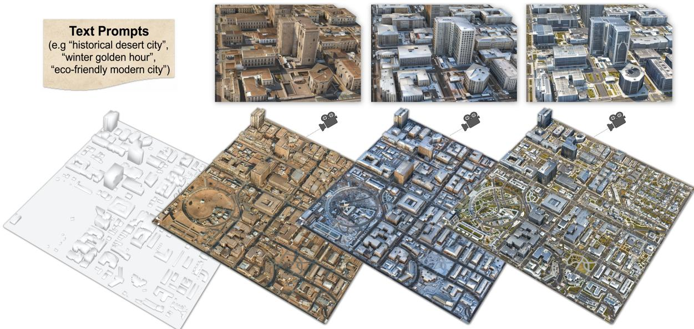
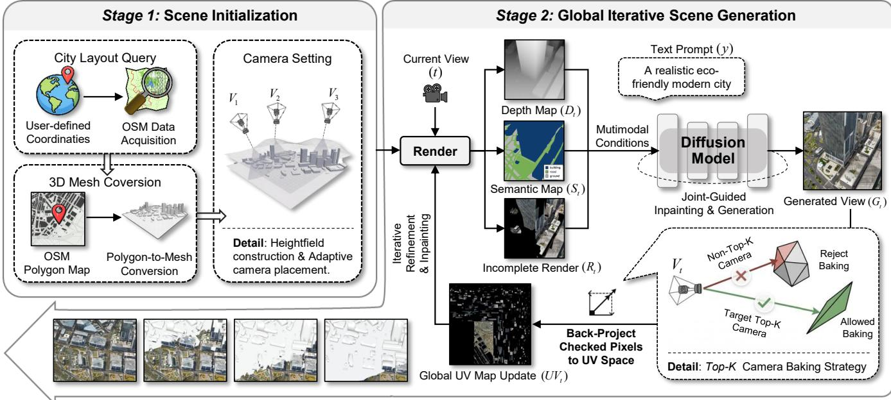
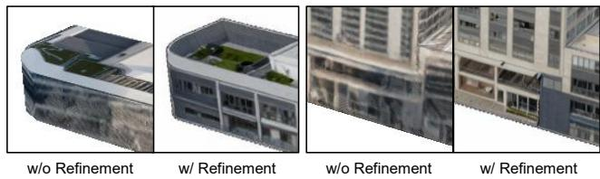
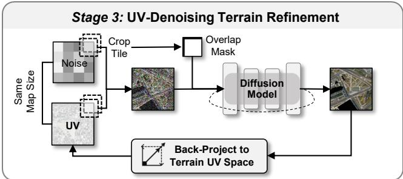
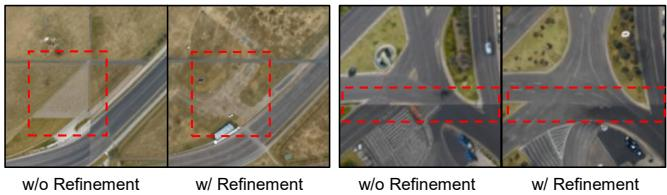
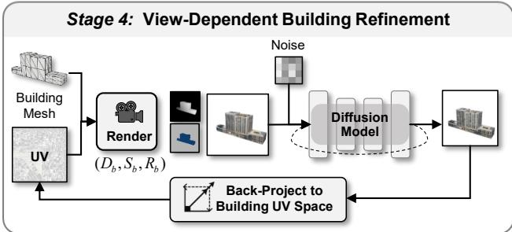
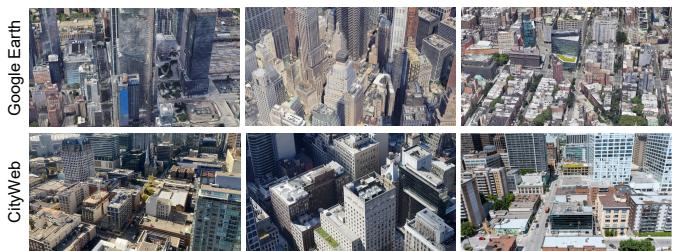
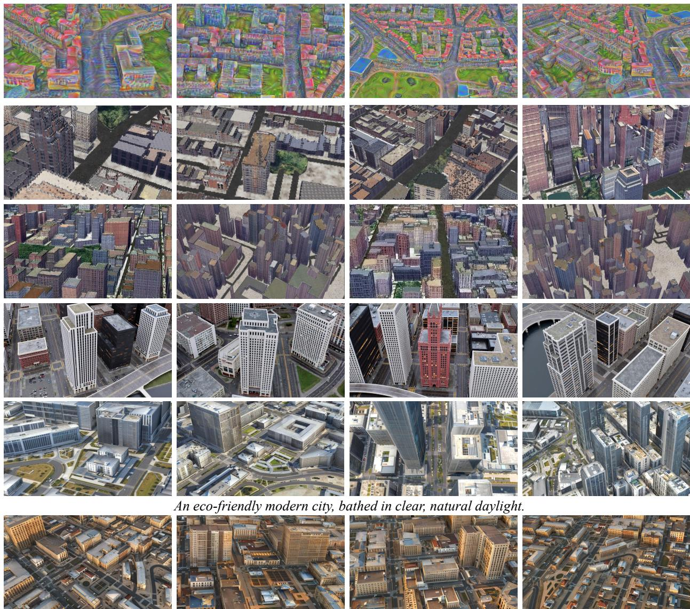
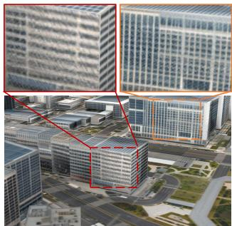
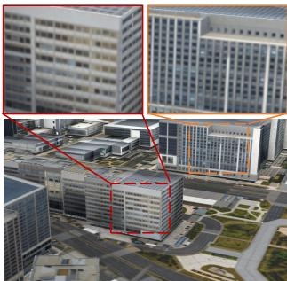

# CityPaint: A Free Lunch from 2D Difusion for City-Scale 3D Texturing

Yuchen Zou∗   
Xi’an Jiaotong University   
Xi’an, China   
yuchenzou@stu.xjtu.edu.cn   
Siyu Zhu   
Xi’an Jiaotong University   
Xi’an, China   
zhusiyu@stu.xjtu.edu.cn

Lihuang Fang∗ Southern University of Science and Technology Shenzhen, China l.h.fang228@gmail.com

Xiao Hu†   
International Digital Economy Academy   
Shenzhen, China   
HKUST (Guangzhou)   
Guangzhou, China   
huxiao1@idea.edu.cn

  
Figure 1: Capabilities of CityPaint. Given text prompts, our framework generates high-fidelity, globally consistent 3D city textures. By leveraging the rich visual priors of 2D difusion models, CityPaint naturally supports diverse architectural styles climates, and lighting conditions without relying on city-scale 3D training data.

## Abstract

Generating high-fidelity, city-scale 3D environments plays a crucial role in applications such as virtual reality, gaming, and urban digital twins. However, the scarcity of real-world city-scale 3D training data forces existing methods to either stitch independently gener ated assets or learn from synthetic urban corpora, often sacrificing realism and global consistency. In contrast, 2D image data and their corresponding generative models are abundant and encode rich visual priors. To bridge this gap, we propose CityPaint, a novel framework that leverages 2D difusion models to generate globally consistent city-scale 3D textures without relying on city-scale 3D training data. Specifically, CityPaint integrates geometric priors with the generative power of 2D difusion models, introducing a robust top-� camera baking strategy for iterative texture projection. To address the artifacts of 2D-to-3D projection, we further propose a decoupled refinement mechanism that separately optimizes terrain and building textures. Extensive experiments show that CityPaint produces globally coherent textures with fine local details and achieves favorable results against strong baselines in both visual quality and cross-view consistency.

## CCS Concepts

• Computing methodologies → Computer vision problems.

## Keywords

Scene Generation, Difusion Models, Generative Multimedia

## ACM Reference Format:

Yuchen Zou, Lihuang Fang, Siyu Zhu, and Xiao Hu. 2026. CityPaint: A Free Lunch from 2D Difusion for City-Scale 3D Texturing. In Proceedings of the 34th ACM International Conference on Multimedia (MM ’26), November 10–14, 2026, Rio de Janeiro, Brazil. ACM, New York, NY, USA, 10 pages. https://doi.org/10.1145/3767308.3835893

## 1 Introduction

The demand for expansive, high-fidelity 3D urban environments has surged in recent years, driven by rapidly expanding applications in virtual reality, immersive gaming, autonomous driving simulation, and urban digital twins [15, 20, 22, 32]. Traditionally, constructing these large-scale scenes relies on exhaustive manual modeling by technical artists [7]. While recent advancements in 3D generative AI have shown remarkable success in synthesizing single objects or constrained indoor scenes [26, 28, 34, 38], subsequent feed-forward and texturing-oriented systems have further improved consistency and eficiency [8, 19, 30]. Scaling these capabilities to the magnitude of an entire city nevertheless remains a formidable challenge.

The primary bottleneck in city-scale 3D generation lies in the extreme scarcity of high-quality, real-world urban 3D data. Constrained by this limitation, existing generative approaches are forced into a fundamental trade-of, typically falling into one of two suboptimal paradigms. On one hand, bottom-up instance composition methods synthesize individual buildings and subsequently stitch them into a scene [10, 11, 18, 46, 53]. While scalable, such approaches inevitably break global contextual consistency and compromise stylistic coherence. On the other hand, holistic scene-level models rely on synthetic datasets or low-quality satellite imagery for training [25, 27, 43–45], which introduce significant domain gaps and inherit physical artifacts, such as distorted (“melted”) geometries and baked-in shadows. As a result, the generated envi ronments often lack the richness and realism of real-world cities.

In stark contrast, while 3D urban data remains scarce, 2D image data is abundantly available. Modern difusion models [4, 9, 12, 36, 42, 52] have demonstrated an extraordinary ability to capture globally consistent visual priors, encoding rich semantic structures of urban layouts and architectural styles. This raises a fundamental question: can we leverage these pre-trained 2D priors as a “free lunch” to enable photorealistic 3D city texturing without requiring city-scale 3D supervision?

To bridge this gap, we propose CityPaint, a 3D-data-free framework that reformulates city-scale 3D generation as a geometrygrounded generative reconstruction problem. Instead of synthesizing unconstrained 3D volumes from scratch, CityPaint leverages readily available geographic data, such as OpenStreetMap, to initial ize a semantically structured city mesh. As illustrated in Fig. 1, this lightweight geometric scafold serves as a structural canvas, onto which the generative power of pre-trained 2D difusion models is projected, enabling diverse textures and stylistic variations directly on 3D surfaces.

Table 1: Comparison of existing 3D city generation paradigms.
<table><tr><td>Method</td><td>3D Training Free</td><td>3D Dataset Free</td><td>Asset Free</td><td>Text Control</td></tr><tr><td>CityDreamer [43]</td><td>X</td><td>X</td><td>√</td><td>X</td></tr><tr><td>UrbanWorld [37]</td><td>X</td><td>X</td><td>√</td><td>√</td></tr><tr><td>GaussianCity [44]</td><td>X</td><td>X</td><td>√</td><td>X</td></tr><tr><td>CitySculpt [46]</td><td>X</td><td>×</td><td>√</td><td>×</td></tr><tr><td>MajutsuCity [18]</td><td>X</td><td>X</td><td>X</td><td>√</td></tr><tr><td>CityPaint (Ours)</td><td>√</td><td>√</td><td>√</td><td>√</td></tr></table>

However, directly projecting 2D generations onto large-scale 3D geometry introduces significant challenges. Fixed-height camera trajectories either collide with tall structures or drift excessively above low-rise regions, while oblique viewpoints lead to severe texture distortion and cross-view inconsistencies. To address these issues, CityPaint introduces a heightfield-aware camera placement strategy that adapts to local urban geometry, ensuring stable and consistent observations. Furthermore, rather than naively averaging multi-view projections, we propose a robust face-wise top-� camera baking scheme. By explicitly modeling visibility and discarding grazing-angle observations, this strategy enables seamless texture aggregation into a globally coherent UV atlas, efectively avoiding the blurring artifacts common in conventional blending approaches.

To account for the distinct visual characteristics of diferent urban elements, we introduce a decoupled refinement mechanism. Large-scale top-down renderings often lack suficient resolution to capture fine-grained facade details, while stitched terrain patches tend to introduce noticeable seams. These observations suggest that a uniform treatment of the entire city is inherently suboptimal. To address this, CityPaint decomposes the refinement process, optimizing each structural component in its most suitable representation.

In summary, our main contributions are as follows:

• We propose CityPaint, a novel 3D-data-free framework that leverages the rich visual priors of pre-trained 2D difusion models to generate high-fidelity and globally consistent city scale 3D textures.

• We introduce a heightfield-aware observation policy, coupled with a robust top-� camera baking strategy, which efectively resolves visibility conflicts and mitigates texture distortion in large-scale 2D-to-3D projection.

• We design a decoupled refinement mechanism that optimizes terrain in UV space and building facades in instance space, significantly improving both global continuity and fine-grained structural details.

• Extensive experiments show that CityPaint achieves stronger overall performance than the evaluated baselines in visual fidelity, realism, and cross-view consistency, ofering a scalable solution for high-quality urban 3D content generation.

## 2 Related Work

## 2.1 2D-to-3D Generation via Difusion Priors

The emergence of large-scale 2D difusion models has significantly advanced 3D content generation. A dominant line of work leverages

Score Distillation Sampling (SDS) [26, 34, 40, 41] to lift 2D difusion priors into 3D representations, including Neural Radiance Fields (NeRF) [31], explicit meshes, and 3D Gaussian Splatting (3DGS) [21]. In parallel, feed-forward and multi-view difusion models [14, 16, 28, 38] have been proposed to improve generation eficiency and enforce cross-view consistency. Despite these advances, existing approaches are primarily designed for object-centric scenarios and struggle to scale to unbounded and structurally complex environments. In particular, unconstrained optimization in SDS-based methods often sufers from over-smoothing, mode collapse, and multi-face artifacts, while feed-forward approaches remain limited by their reliance on implicit geometric priors. These limitations become more pronounced in urban scenes, where large spatial extents, intricate structural layouts, and ambiguous text descriptions jointly exacerbate geometric inconsistencies and texture misalignment. Rather than relying on unstable gradient-based distillation, CityPaint grounds the generative process on deterministic geometry derived from semantic maps. This design efectively reduces spatial ambiguity and enables precise, globally consistent texture synthesis at the city scale.

## 2.2 Urban Scene Generation

Recent deep learning approaches for urban scene generation generally follow two paradigms. The first is instance-based composition, which employs object-level asset pipelines [18, 46, 53] to generate individual buildings that are subsequently populated onto layouts sourced from OpenStreetMap [33], satellite or generative models [10, 11]. However, this bottom-up assembly naturally neglects the global urban context, resulting in disjointed environments with conflicting architectural styles.

The second paradigm attempts holistic scene generation by training directly on large-scale 3D urban datasets. These approaches typically rely on either synthetic city corpora [17, 24, 45] or real-world captures such as satellite and Google Earth imagery [25, 27, 43, 44]. Unfortunately, both data sources present significant drawbacks. Models trained on synthetic data often exhibit a severe domain gap, lacking real-world intricacies. Conversely, pipelines driven by aerial photogrammetry inevitably inherit the physical flaws of their source data, sufering from “melted” geometries, blurry textures, and baked-in shadows. Our CityPaint framework bypasses these 3D data bottlenecks. By leveraging lightweight geographic data purely for geometric scafolding, our method extracts photorealistic textures directly from 2D priors without requiring city-scale 3D urban training data.

## 2.3 Texture Synthesis for 3D Meshes

Recent methods for texturing existing 3D geometries primarily fall into two paradigms: direct UV-space generation and multi-view projection. Direct UV generation approaches [2, 13, 39, 49] use generative models to synthesize unwrapped texture atlases. While subsequent coarse-to-fine and city-oriented extensions [46, 50] have advanced this paradigm, their performance remains limited by the scarcity of high-quality, paired 3D-UV training data. Consequently, scaling these approaches to city-scale meshes is fundamentally impractical.

To overcome these data limitations, multi-view projection pipelines [6, 23, 35, 51] have gained prominence. These methods bypass explicit UV generation by projecting synthesized 2D views directly onto the 3D mesh. Although synchronized and scene-level extensions [8, 19, 29, 47] have improved multi-view consistency, scaling these techniques to expansive urban environments introduces critical geometric challenges. Specifically, standard fixed-trajectory sampling struggles with extreme topography, while grazing-angle projections and naive view blending cause severe stretching, ghosting, and blurring. Alternatively, decomposing building facades into UVs [37] introduces noticeable stitching artifacts and compromises realism. To overcome these challenges, we introduce a heightfieldaware top-� camera baking strategy and a decoupled refinement mechanism tailored for complex urban geometries.

## 3 Method

CityPaint generates city-scale textured 3D scenes from geographic coordinates and a text prompt. Instead of synthesizing urban environments from scratch, we exploit appearance priors from pretrained 2D difusion models and cast city texturing as a geometrygrounded generative reconstruction problem. As shown in Fig. 2 and Fig. 3, the pipeline contains four stages: scene initialization, global iterative generation, terrain refinement, and building refinement.

## 3.1 Scene Initialization

The first stage constructs the scene geometry and the observation policy used in later generation, as shown in the left part of Fig. 2. Given a user-specified city center $( \ell _ { \mathrm { l a t } } , \ell _ { \mathrm { l n g } } )$ and retrieval radius �, we build a semantic city mesh from OSM building footprints and road layouts:

$$
{ \cal M } = \{ M ^ { \mathrm { b l d } } , M ^ { \mathrm { r o a d } } , M ^ { \mathrm { t e r } } \} ,\tag{1}
$$

where $\mathcal { M } ^ { \mathrm { b l d } } , \mathcal { M } ^ { \mathrm { r o a d } }$ , and $M ^ { \mathrm { t e r } }$ denote building, road, and terrain geometry, respectively. Specifically, we convert these map elements into a triangulated 3D scene by extruding building polygons and triangulating roads and terrain, then parameterize the textured region into a global UV atlas $\mathcal { U } \in [ 0 , \dot { 1 } ] ^ { H _ { u } \times W _ { u } \times 3 }$ that is updated throughout generation.

Heightfield construction. Given the initialized mesh M, we project it onto the ground plane and estimate a heightfield over the horizontal domain $\Omega \subset \mathbb { R } ^ { 2 }$ . For location (�, �), the raw heightfield is defined as the upper envelope of triangles intersecting that ground position:

$$
H ( x , z ) = \operatorname* { m a x } _ { p \in \mathcal { M } : \pi ( p ) = ( x , z ) } p _ { y } ,\tag{2}
$$

where � $\mathbf { \nabla } ( p )$ projects a 3D point $\boldsymbol { p } = \left( p _ { x } , p _ { y } , p _ { z } \right)$ onto the ��-plane. In practice, we rasterize the scene into a grid and keep the maximum height per cell. This upper-envelope definition captures the dominant visible structure at each location. To suppress local spikes and smooth camera motion, we apply spatial smoothing:

$$
\widetilde { H } ( x , z ) = ( K * H ) ( x , z ) ,\tag{3}
$$

where � is an averaging kernel. The final operational heightfield is then lifted by a safety margin $\delta _ { h } > 0 :$

$$
H ^ { + } ( x , z ) = \widetilde { H } ( x , z ) + \delta _ { h } .\tag{4}
$$

  
Figure 2: Overview of the CityPaint Pipeline (Stages 1 & 2). In Stage 1, we construct a 3D city mesh from OpenStreetMap (OSM) data and establish heightfield-aware camera trajectories for stable observation. In Stage 2, a conditional difusion model iteratively synthesizes the scene guided by rendered depth and semantic maps. The generated views are accumulated into a global UV atlas using a face-wise top-� camera baking strategy to suppress artifacts from grazing angles.

Adaptive camera placement. We sample scan trajectories that sweep across the scene and adapt the vertical position of each camera to the local geometry. Let $\gamma _ { t } = \left( x _ { t } , z _ { t } \right)$ denote the 2D scanning location of the �-th camera. The corresponding 3D camera center is

$$
{ \bf c } _ { t } = \left[ x _ { t } , \ H ^ { + } ( x _ { t } , z _ { t } ) , \ z _ { t } \right] ^ { \top } .\tag{5}
$$

The viewing direction is tilted downward by a fixed elevation angle �, producing a city-level oblique observation.

## 3.2 Global Iterative Scene Generation

The second stage textures the city through an iterative multiview generation loop. For each camera view $V _ { t }$ , we render a depth map $D _ { t }$ and a semantic control map $S _ { t } \colon$

$$
( D _ { t } , S _ { t } ) = { \mathcal { R } } _ { \mathrm { c o n d } } ( M , V _ { t } ) .\tag{6}
$$

Here $D _ { t }$ provides geometry-aware distance cues, while $S _ { t }$ encodes coarse semantic categories such as building, road, and terrain. Together they anchor difusion sampling to both layout and region type.

At iteration �, the current UV atlas $\mathcal { U } _ { t - 1 }$ is first rendered under the selected camera $V _ { t }$ to obtain an incomplete observation

$$
R _ { t } = \mathcal { R } _ { \operatorname { u v } } ( \mathcal { U } _ { t - 1 } , M , V _ { t } ) ,\tag{7}
$$

where missing or insuficiently observed regions remain empty or unreliable. We then feed the text prompt �, rendered depth map $D _ { t } ,$ semantic map $S _ { t } ,$ , and incomplete image $R _ { t }$ into a conditional difusion model:

$$
G _ { t } = \mathcal { G } _ { \mathrm { g l o b a l } } ( y , D _ { t } , S _ { t } , R _ { t } ) .\tag{8}
$$

The synthesized image $G _ { t }$ is subsequently back-projected to UV space and fused into the global atlas. This loop turns view synthesis into an atlas completion process: each newly synthesized observation does not stand alone, but directly improves a persistent texture representation shared across all future views.

Iterative UV accumulation. For a visible pixel � in view $V _ { t } ,$ , let $\phi _ { t } ( q ) = ( u _ { q } , v _ { q } )$ be its interpolated UV coordinate and let ${ \bf g } _ { t } ( { q } ) \in$ ${ \mathbb { R } } ^ { 3 }$ be the generated RGB value at that pixel. We distribute ${ \bf g } _ { t } ( { q } )$ to its four neighboring UV texels using bilinear weights $\omega ( q , p )$ $p \in N ( q )$ . Denoting by $\mathcal { T }$ the set of UV texels, the running color sum $\mathbf { A } _ { t } ( \pmb { p } )$ and weight sum $W _ { t } ( p )$ for texel $p \in { \mathcal { T } }$ are updated as

$$
\mathbf { A } _ { t } ( p ) = \mathbf { A } _ { t - 1 } ( p ) + \sum _ { q \in \Pi _ { t } ( p ) } \omega ( q , p ) \mathbf { g } _ { t } ( q ) ,\tag{9}
$$

$$
W _ { t } ( p ) = W _ { t - 1 } ( p ) + \sum _ { q \in \Pi _ { t } ( p ) } \omega ( q , p ) ,\tag{10}
$$

where $\Pi _ { t } ( p )$ collects view pixels whose bilinear neighborhood contains texel $\mathcal { P } \cdot$ The atlas color is then obtained by normalized accumulation:

$$
\mathcal { U } _ { t } ( p ) = \frac { \mathbf { A } _ { t } ( p ) } { \operatorname* { m a x } ( W _ { t } ( p ) , \epsilon ) } .\tag{11}
$$

Face-wise top-� camera baking. Directly baking every visible camera into the UV atlas often introduces severe artifacts, because highly oblique views produce stretched textures and conflicting observations. A central contribution of the global stage is therefore a face-wise top-� camera baking strategy, as depicted in the bottomright of Fig. 2. For each face $f$ and camera $V _ { t } ,$ we define a visibility score based on the number of rendered pixels belonging to that face:

  
Figure 3: Texture Refinement (Stages 3 & 4). Top: tile-wise UV denoising restores terrain continuity and removes seams. Bottom: object-centric orbit rendering recovers fine-grained building facade details.

$$
s _ { f , t } ^ { \mathrm { v i s } } = | \{ q \in V _ { t } \mid q { \mathrm { i s ~ c o v e r e d ~ b y ~ } } f \} | .\tag{12}
$$

Let $s _ { f } ^ { \star } = \operatorname* { m a x } _ { t } s _ { f , t } ^ { \mathrm { v i s } }$ be the best visibility score for face $f .$ We keep only the candidate views satisfying

$$
\mathcal { K } _ { f } = \left\{ t \ : \middle | \ : s _ { f , t } ^ { \mathrm { v i s } } \geq \rho \ : s _ { f } ^ { \star } , \ : t \in \mathrm { T o p K } ( f ) \right\} ,\tag{13}
$$

where $\rho \in \left( 0 , 1 \right]$ is a keep-ratio threshold and TopK(�) denotes the � highest-scoring cameras for face $f .$ During UV update, a pixel from camera $V _ { t }$ is allowed to contribute to face � only if $t \in \mathcal { K } _ { f }$ This design suppresses low-quality grazing views while retaining a small set of complementary observations for hard-to-cover surfaces. In practice, it is this selective baking mechanism that makes globally coherent city-scale texturing feasible.

## 3.3 UV-Denoising Terrain Refinement

While global generation establishes the scene’s macro-structure, top-� baking can still leave fragmented patches over large terrain regions. Directly inpainting these regions often causes visible transitions. Since terrain elements such as roads and sidewalks occupy continuous UV regions and are less view-dependent than facades, we refine them directly in texture space to restore continuity (Fig. 3, top).

Terrain ROI extraction. Let $\Omega _ { \mathrm { t e r } } \subset \mathcal { T }$ denote the terrain-related UV region extracted from ground and road meshes. Rather than refining the entire atlas, we operate on the cropped terrain texture:

$$
\mathcal { U } ^ { \mathrm { t e r } } = \mathcal { U } _ { T } \big \rvert _ { \Omega _ { \mathrm { t e r } } } ,\tag{14}
$$

where � is the final iteration index of the global stage.

Tile-wise latent refinement. We divide $\Omega _ { \mathrm { t e r } }$ into overlapping tiles $\{ \Omega _ { \mathrm { t e r } } ^ { ( m ) } \} _ { m = 1 } ^ { M }$ . A critical challenge in tile-wise generation is maintaining structural consistency across seams. Motivated by recent works demonstrating the spatial equivariance from noise space to image space [3, 5, 54], we pre-sample a global noise map $\mathbf { N } \sim { \cal N } ( 0 , \mathbf { I } )$ that shares the exact spatial dimensions as the full terrain UV latent map.

For the �-th tile, we simultaneously crop the current VAE latent $\mathbf { z } _ { 0 } ^ { ( m ) }$ and its corresponding spatial noise patch $\mathbf { N } ^ { ( m ) }$ . We then inject noise at a timestep determined by the refinement strength � ∈ [0, 1]:

$$
\begin{array} { r } { \mathbf { z } _ { \tau } ^ { ( m ) } = \sqrt { \bar { \alpha } _ { \tau } } \mathbf { z } _ { 0 } ^ { ( m ) } + \sqrt { 1 - \bar { \alpha } _ { \tau } } \mathbf { N } ^ { ( m ) } , } \end{array}\tag{15}
$$

where � is the strength-controlled starting timestep. By anchoring the noise to the global UV coordinates, we guarantee that overlapping regions share identical initial noise states. The denoising model then predicts a refined latent guided by a terrain-specific prompt $y _ { \mathrm { t e r } }$ and an overlap mask $M ^ { ( m ) }$ indicating the specific regions designated for regeneration:

$$
\begin{array} { r } { \widehat { \mathbf { z } } ^ { ( m ) } = \mathcal { G } _ { \mathrm { t e r } } \left( \mathbf { z } _ { \tau } ^ { ( m ) } , y _ { \mathrm { t e r } } , M ^ { ( m ) } \right) . } \end{array}\tag{16}
$$

After decoding the refined latents $\widehat { \mathbf { z } } ^ { ( m ) }$ into image-space tiles $\widehat { \mathcal { U } } ^ { ( m ) }$ , we directly update the full atlas by replacing the original texels within the masked regions:

$$
\mathcal { U } _ { T } ^ { + } ( p ) = \widehat { \mathcal { U } } ^ { ( m ) } ( p ) , \quad \forall p \in \Omega _ { \mathrm { t e r } } ^ { ( m ) } \ \mathrm { s . t . } \ M ^ { ( m ) } ( p ) = 1 .\tag{17}
$$

## 3.4 View-Dependent Building Refinement

The global generation stage relies on large-scale overhead observations, which inevitably introduce geometric misalignment and blurring on building facades due to long-range projections and steep viewing angles. To mitigate this, we process each building independently using localized orbital cameras that provide close-up geometric guidance (Fig. 3, Stage 4).

Object-centric orbit rendering. Let $\mathcal { B } = \{ B _ { 1 } , . . . , B _ { N } \}$ denote the building instances extracted from the city mesh. For each building $B _ { n } { } ;$ we sample a set of orbit cameras $\{ V _ { n , j } \} _ { j = 1 } ^ { J _ { n } }$ across various azimuths and elevations. From each view, we render a buildingfocused depth map $D _ { n , j } .$ , a semantic map $S _ { n , j }$ , and the current global appearance $R _ { n , j } \colon$

$$
( D _ { n , j } , S _ { n , j } , R _ { n , j } ) = \mathcal { R } _ { \mathrm { b l d } } ( B _ { n } , \mathcal { U } _ { T } ^ { + } , V _ { n , j } ) .\tag{18}
$$

This localized setup outperforms global views by observing build ings from favorable angles and focusing generative capacity on local structures.

Building Refinement. Conditioned on the building prompt �bld and the rendered control maps, the building generator synthesizes a refined facade observation:

$$
G _ { n , j } = \mathcal { G } _ { \mathrm { b l d } } ( y _ { \mathrm { b l d } } , D _ { n , j } , S _ { n , j } , R _ { n , j } ) .\tag{19}
$$

This ensures that local facade structures remain sharp and visually plausible. As demonstrated in the bottom row of Fig. 3, this stage efectively recovers high-frequency details (e.g., windows and architectural edges).

Normal-aware camera selection and update. For a building face $f$ observed under an orbit camera $V _ { n , j }$ , we define a geometric quality score using the cosine similarity between the face normal $\mathbf { n } _ { f }$ and the viewing direction $\mathbf { v } _ { f , j } { \mathrm { : } }$

$$
s _ { f , j } ^ { \mathrm { b l d } } = \operatorname* { m a x } \biggl ( 0 , \mathbf { n } _ { f } ^ { \top } \mathbf { v } _ { f , j } \biggr ) .\tag{20}
$$

The valid view set for face � is defined as:

$$
\mathcal { K } _ { f } ^ { \mathrm { b l d } } = \left\{ j \left. s _ { f , j } ^ { \mathrm { b l d } } \geq \eta \operatorname* { m a x } _ { j ^ { \prime } } s _ { f , j ^ { \prime } } ^ { \mathrm { b l d } } , j \in \mathrm { T o p K } _ { \mathrm { b l d } } ( f ) \right. \right\} ,\tag{21}
$$

where � is a threshold ratio. Only views within $\mathcal { K } _ { f } ^ { \mathrm { b l d } }$ are used to update the atlas. To preserve the sharp details from these highconfidence object-centric observations, we form the final texture by directly assigning synthesized texels to their corresponding UV regions:

$$
\mathcal { U } ^ { \mathrm { f i n a l } } ( { \boldsymbol { p } } ) = \left\{ \begin{array} { l l } { \widehat { \mathcal { U } } _ { n , j } ( { \boldsymbol { p } } ) , } & { \mathcal { p } \in \Omega _ { n , j } ^ { \mathrm { w r i t e } } , } \\ { \mathcal { U } _ { T } ^ { + } ( \boldsymbol { p } ) , } & { \mathrm { o t h e r w i s e } , } \end{array} \right.\tag{22}
$$

where $\Omega _ { n , j } ^ { \mathrm { w r i t e } }$ denotes the valid texels covered by the selected views. The resulting atlas successfully preserves the large-scale consistency established in the global stage while adding sharp facade details.

Through these four stages, CityPaint transforms geographic priors into a coherent, city-scale textured mesh, balancing global consistency, terrain continuity, and building-level realism.

## 4 Experiments

## 4.1 Experimental Details

Across all three stages (global generation, terrain refinement, and building refinement), we adopt the open-source generative model Z-Image [4] as the shared difusion prior.

In the global stage, we iteratively texture the scene onto an 8192 × 8192 UV atlas from 320 views. The cameras follow our heightfield-aware trajectory with 8 scan strips and 40 views per strip, using a 48◦ downward elevation and a $4 0 ^ { \circ }$ field of view. For each selected view, we render a depth map, a semantic control map, and the current partial appearance from the UV atlas, and run 25 denoising steps in the conditional difusion model.

For the subsequent refinement stages, terrain refinement operates on overlapping 1024 × 1024 UV tiles with a denoising strength of 0.2 and the shared global-noise initialization described in Eq. 15. Building refinement uses object-centric orbit cameras sampled across azimuths at elevations of $2 0 ^ { \circ }$ and $3 5 ^ { \circ }$ to enhance facade details, and updates the atlas through the normal-aware selection rule in Eq. 21 with at most two views per face. All experiments are conducted on a single NVIDIA A100 GPU (40 GB).

  
Figure 4: Visual comparison of reference distributions. Top: Google Earth imagery often sufers from 3D reconstruction artifacts, blurred textures, and compression defects. Bottom: Our proposed CityWeb benchmark provides a cleaner, highfidelity, and photorealistic reference distribution.

## 4.2 Evaluation Metrics

A key challenge in evaluating city-scale 3D generation is the lack of reliable reference image distributions. Existing works commonly use Google Earth imagery [43, 44] as an evaluation benchmark. However, such imagery is not ideal for assessing photorealism because it often contains reconstruction artifacts, compression noise, and noticeable blurring, as illustrated in Fig. 4. Consequently, metrics computed solely on this distribution may not accurately reflect the visual quality of generated results.

To address this limitation, we introduce a complementary highquality benchmark, termed CityWeb. We collect a large-scale set of real-world urban photographs from publicly accessible web sources and apply a multi-stage filtering pipeline to remove nonphotographic, low-resolution, and watermarked images. A GPTbased scoring mechanism [1] then ranks the candidates according to urban relevance, visual clarity, and overall fidelity. The top 20,000 images are retained to form the CityWeb benchmark, yielding a cleaner and more realistic reference distribution than Google Earth alone.

We evaluate CityPaint using both benchmarks. For distributionlevel alignment, we report Fréchet Inception Distance (FID) and Kernel Inception Distance (KID) against Google Earth for comparability with prior work and against CityWeb for high-fidelity realism. To further evaluate perceptual quality without relying on a reference distribution, we also report the no-reference metrics Natural Image Quality Evaluator (NIQE) and BRISQUE.

Finally, to assess the geometric consistency of the generated 3D scenes, we follow prior works [43, 44, 46] and report two metrics. Camera Error (CE) measures the scale-invariant L2 distance between the inferred camera trajectory and poses estimated by COLMAP. Depth Error (DE) evaluates geometric accuracy using the normalized L2 distance between predicted and pseudo groundtruth depth maps.

## 4.3 Evaluation and Comparisons

We evaluate CityPaint against state-of-the-art baselines, with quantitative metrics summarized in Table 2 and qualitative visual results

CityPaint (Ours)

Paintit CityDreamer GaussianCity MagicCity

  
An exquisite city of European old town style, golden hour lighting.

Figure 5: Qualitative comparison of diferent city generation methods (zoom-in recommended for details).

illustrated in Fig. 5. To ensure a fair evaluation, we augment the SDS-based baseline Paintit [48] with semantic map guidance so that it can operate under the same urban layout constraints as our method. Because the full source code for CitySculpt [46] and MagicCity [45] is not publicly available, we only report the metrics disclosed in their original publications and mark unavailable entries with “-”.

Image Quality & Distribution Alignment: CityPaint achieves the best overall results among the methods with complete evaluation in Table 2. Although certain baselines report competitive FID scores on the Google Earth benchmark, that benchmark is itself afected by reconstruction artifacts and compression noise. Objective, reference-free metrics such as NIQE and BRISQUE provide a complementary view of the underlying blurring and synthetic artifacts, and the advantage of our method becomes clearer on the higher-fidelity CityWeb benchmark. These results indicate that leveraging strong 2D difusion priors helps avoid inheriting artifact distributions from noisy urban data.

Geometric & Multi-view Consistency: In addition to visual quality, our method demonstrates strong performance in preserving structural integrity and multi-view consistency. Direct 2D-to-3D projection at a city scale typically introduces severe texture stretching and viewpoint conflicts due to complex urban topographies. CityPaint efectively mitigates these geometric challenges through its heightfield-aware observation policy and robust top-� camera baking strategy. Consequently, our approach yields view-consistent urban textures that remain well aligned with the complex 3D topology.

Table 2: Quantitative comparison on geometric consistency (CE, DE) and visual fidelity (FID, KID, NIQE, BRISQUE) using Google Earth and CityWeb.
<table><tr><td rowspan=1 colspan=1>Method</td><td rowspan=1 colspan=1>Venue</td><td rowspan=1 colspan=1>CE↓</td><td rowspan=1 colspan=1>DE↓</td><td rowspan=1 colspan=1>Google Earth</td><td rowspan=1 colspan=1>CityWeb</td><td rowspan=1 colspan=1>NIQE↓</td><td rowspan=2 colspan=1>BRISQUE ↓</td></tr><tr><td rowspan=1 colspan=1></td><td rowspan=1 colspan=1></td><td rowspan=1 colspan=1></td><td rowspan=1 colspan=1></td><td rowspan=1 colspan=1>FID↓ KID↓</td><td rowspan=1 colspan=1>FID↓ KID↓</td><td rowspan=1 colspan=1></td></tr><tr><td rowspan=1 colspan=1>Text2Tex [6]</td><td rowspan=1 colspan=1>ICCV’23</td><td rowspan=1 colspan=1>0.066</td><td rowspan=1 colspan=1>0.158</td><td rowspan=1 colspan=1>110.7  0.103</td><td rowspan=1 colspan=1>108.7  0.118</td><td rowspan=1 colspan=1>8.85</td><td rowspan=1 colspan=1>89.12</td></tr><tr><td rowspan=1 colspan=1>Paintit [48]</td><td rowspan=1 colspan=1>CVPR&#x27;24</td><td rowspan=1 colspan=1>0.075</td><td rowspan=1 colspan=1>0.180</td><td rowspan=1 colspan=1>121.2  0.110</td><td rowspan=1 colspan=1>98.4  0.105</td><td rowspan=1 colspan=1>9.54</td><td rowspan=1 colspan=1>95.41</td></tr><tr><td rowspan=1 colspan=1>CityDreamer [43]</td><td rowspan=1 colspan=1>CVPR&#x27;24</td><td rowspan=1 colspan=1>0.060</td><td rowspan=1 colspan=1>0.147</td><td rowspan=1 colspan=1>97.38  0.096</td><td rowspan=1 colspan=1>145.7  0.130</td><td rowspan=1 colspan=1>8.51</td><td rowspan=1 colspan=1>86.70</td></tr><tr><td rowspan=1 colspan=1>GaussianCity [44]</td><td rowspan=1 colspan=1>CVPR&#x27;25</td><td rowspan=1 colspan=1>0.057</td><td rowspan=1 colspan=1>0.136</td><td rowspan=1 colspan=1>86.94  0.090</td><td rowspan=1 colspan=1>125.4  0.137</td><td rowspan=1 colspan=1>7.69</td><td rowspan=1 colspan=1>75.34</td></tr><tr><td rowspan=1 colspan=1>CitySculpt [46]</td><td rowspan=1 colspan=1>ACMMM&#x27;25</td><td rowspan=1 colspan=1>0.043</td><td rowspan=1 colspan=1>0.047</td><td rowspan=1 colspan=1>53.96  0.063</td><td rowspan=1 colspan=1></td><td rowspan=1 colspan=1>5.13</td><td rowspan=1 colspan=1>53.96</td></tr><tr><td rowspan=1 colspan=1>MagicCity [45]</td><td rowspan=1 colspan=1>ICCV&#x27;25</td><td rowspan=1 colspan=1>0.137</td><td rowspan=1 colspan=1>0.072</td><td rowspan=1 colspan=1></td><td rowspan=1 colspan=1></td><td rowspan=1 colspan=1>4.55</td><td rowspan=1 colspan=1>28.02</td></tr><tr><td rowspan=1 colspan=1>CityPaint (Ours)</td><td rowspan=1 colspan=1></td><td rowspan=1 colspan=1>0.035</td><td rowspan=1 colspan=1>0.051</td><td rowspan=1 colspan=1>49.21 0.055</td><td rowspan=1 colspan=1>42.84 0.044</td><td rowspan=1 colspan=1>3.28</td><td rowspan=1 colspan=1>17.15</td></tr></table>

Table 3: Ablation study of core components.
<table><tr><td rowspan="2">Model Variations</td><td colspan="2">Geometry</td><td colspan="2">CityWeb</td><td colspan="2">Perceptual</td></tr><tr><td>CE↓</td><td>DE↓</td><td>FID↓</td><td>KID↓</td><td>NIQE ↓</td><td>BRISQUE↓</td></tr><tr><td>w/o Height-aware Cam.</td><td>0.058</td><td>0.082</td><td>68.53</td><td>0.071</td><td>4.96</td><td>32.41</td></tr><tr><td>w/o Top-K Baking</td><td>0.042</td><td>0.061</td><td>75.42</td><td>0.083</td><td>5.12</td><td>38.65</td></tr><tr><td>w/o Terrain Refinement</td><td>0.038</td><td>0.053</td><td>60.15</td><td>0.065</td><td>4.51</td><td>28.92</td></tr><tr><td>w/o Building Refinement</td><td>0.039</td><td>0.056</td><td>56.78</td><td>0.060</td><td>4.18</td><td>26.54</td></tr><tr><td>CityPaint (Full)</td><td>0.035</td><td>0.051</td><td>42.84</td><td>0.044</td><td>3.28</td><td>17.15</td></tr></table>

  
w/o Top-K Baking

  
w/ Top-K Baking  
Figure 6: Efect of top-� camera baking. Without it (left), facade textures are blurred and inconsistent; our method (right) produces sharper, coherent details.

Qualitative Comparisons: As illustrated in Fig. 5, CityPaint delivers stronger photorealism and prompt adherence than the compared baselines. Existing methods exhibit distinct failure modes: Paintit sufers from structural collapse, while CityDreamer and GaussianCity generate muddy, low-resolution facades. Additionally, MagicCity often yields a synthetic, plastic-like appearance. In contrast, CityPaint synthesizes more coherent cityscapes with sharper architectural details, such as window grids and reflective glass structures, while preserving the global style described by the prompt.

## 4.4 Ablation Study

We ablate each core component to assess its impact on geometric consistency and image quality. Quantitative results are reported in Table 3.

Efect of Heightfield-aware Camera Placement: Replacing our adaptive trajectory with fixed-height grid observations (w/o Height-aware Cam.) increases both CE and DE. Fixed cameras encounter grazing views or geometry collisions in uneven urban regions, causing texture stretching and projection mismatches.

Efect of Top-� Camera Baking: Replacing face-wise view selection with multi-view averaging (w/o Top-� Baking) causes the largest drop in visual fidelity. Averaging conflicting observations introduces blurring, ghosting, and incoherent facades, whereas top-� baking preserves sharp, consistent textures (Fig. 6).

Efect of Terrain Refinement: Removing tile-wise UV denoising (w/o Terrain Refinement) degrades perceptual quality because global projections leave large terrain regions at low efective resolution with visible tile-boundary seams. UV-space refinement restores coherent ground details.

Efect of Building Refinement: Removing instance-centric optimization (w/o Building Refinement) increases FID and perceptual errors. Object-centric orbit views provide the pixel density needed to recover high-frequency facade details that are missing from global top-down observations.

## 5 Conclusion

We presented CityPaint, a 3D-data-free framework that reformulates city-scale 3D generation as a geometry-grounded generative reconstruction problem. By exploiting 2D difusion priors, CityPaint reduces the reliance on scarce city-scale 3D urban datasets. Through face-wise top-� camera baking and a decoupled refinement pipeline, our method synthesizes text-guided urban environments that balance global consistency with high-fidelity local details. Extensive evaluations show that CityPaint achieves stronger overall results than the compared baselines across geometric consistency and visual-quality metrics. Furthermore, we introduce CityWeb, a highfidelity real-image benchmark designed to provide a more reliable reference for evaluating photorealism in urban scene synthesis.

## Acknowledgments

This work was carried out during an internship at the Low Airspace Economy Research Institute (LASER), International Digital Economy Academy (IDEA). The support, resources, and research environment provided throughout the project are gratefully acknowledged.

## References

[1] Josh Achiam, Steven Adler, Sandhini Agarwal, Lama Ahmad, Ilge Akkaya, Florencia Leoni Aleman, Diogo Almeida, Janko Altenschmidt, Sam Altman, Shyamal Anadkat, et al. 2023. GPT-4 technical report. arXiv preprint arXiv:2303.08774 (2023).

[2] Raphael Bensadoun, Yanir Kleiman, Idan Azuri, Omri Harosh, Andrea Vedaldi, Natalia Neverova, and Oran Gafni. 2024. Meta 3D TextureGen: Fast and consistent texture generation for 3D objects. arXiv preprint arXiv:2407.02430 (2024).

[3] Ryan Burgert, Yuancheng Xu, Wenqi Xian, Oliver Pilarski, Pascal Clausen, Ming ming He, Li Ma, Yitong Deng, Lingxiao Li, Mohsen Mousavi, et al. 2025. Go-with the-flow: Motion-controllable video difusion models using real-time warped noise. In Proc. IEEE/CVF Conf. Comput. Vis. Pattern Recognit. (CVPR). 13–23.

[4] Huanqia Cai, Sihan Cao, Ruoyi Du, Peng Gao, Steven Hoi, Zhaohui Hou, Shijie Huang, Dengyang Jiang, Xin Jin, Liangchen Li, et al. 2025. Z-Image: An eficient image generation foundation model with single-stream difusion transformer. arXiv preprint arXiv:2511.22699 (2025)

[5] Pascal Chang, Jingwei Tang, Markus Gross, and Vinicius C. Azevedo. 2024. How I Warped Your Noise: a Temporally-Correlated Noise Prior for Difusion Models. In Proc. Int. Conf. Learn. Represent. (ICLR).

[6] Dave Zhenyu Chen, Yawar Siddiqui, Hsin-Ying Lee, Sergey Tulyakov, and Matthias Nießner. 2023. Text2Tex: Text-driven texture synthesis via difusion models. In Proceedings of the IEEE/CVF International Conference on Computer Vision. 18558–18568.

[7] Zhaoxi Chen, Guangcong Wang, and Ziwei Liu. 2023. SceneDreamer: Unbounded 3D scene generation from 2D image collections. IEEE Transactions on Pattern Analysis and Machine Intelligence 45, 12 (2023), 15562–15576.

[8] Wei Cheng, Juncheng Mu, Xianfang Zeng, Xin Chen, Anqi Pang, Chi Zhang, Zhibin Wang, Bin Fu, Gang Yu, Ziwei Liu, et al. 2025. MVPaint: Synchronized multi-view difusion for painting anything 3D. In Proceedings ofthe IEEE/CVF Conference on Computer Vision and Pattern Recognition. 585–594.

[9] Katherine Crowson, Stefan Andreas Baumann, Alex Birch, Tanishq Mathew Abraham, Daniel Z Kaplan, and Enrico Shippole. 2024. Scalable high-resolution pixel-space image synthesis with hourglass difusion transformers. In International Conference on Machine Learning.

[10] Jie Deng, Wenhao Chai, Jianshu Guo, Qixuan Huang, Junsheng Huang, Wenhao Hu, Shengyu Hao, Jenq-Neng Hwang, and Gaoang Wang. 2025. CityGen: Infinite and controllable city layout generation. In Proceedings ofthe IEEE/CVF Conference on Computer Vision and Pattern Recognition. 2020–2030.

[11] Jie Deng, Wenhao Chai, Junsheng Huang, Zhonghan Zhao, Qixuan Huang, Mingyan Gao, Jianshu Guo, Shengyu Hao, Wenhao Hu, Jenq-Neng Hwang, et al. 2024. CityCraft: A real crafter for 3D city generation. arXiv preprint arXiv:2406.04983 (2024).

[12] Patrick Esser, Sumith Kulal, Andreas Blattmann, Rahim Entezari, Jonas Müller, Harry Saini, Yam Levi, Dominik Lorenz, Axel Sauer, Frederic Boesel, et al. 2024. Scaling rectified flow transformers for high-resolution image synthesis. In International Conference on Machine Learning.

[13] Simone Foti, Stefanos Zafeiriou, and Tolga Birdal. 2024. UV-free texture genera tion with denoising and geodesic heat difusion. In Advances in Neural Information Processing Systems, Vol. 37. 128053–128081.

[14] Ruiqi Gao, Aleksander Holynski, Philipp Henzler, Arthur Brussee, Ricardo Martin Brualla, Pratul Srinivasan, Jonathan T Barron, and Ben Poole. 2024. Cat3D: Create anything in 3D with multi-view difusion models. arXiv preprint arXiv:2405.10314 (2024).

[15] Daniel González-Medina, Luis Rodríguez-Ruiz, and Ismael García-Varea. 2015. Procedural city generation for robotic simulation. In Iberian Robotics Conference: Advances in Robotics, Vol. 2. 707–719.

[16] Lukas Höllein, Aljaž Božič, Norman Müller, David Novotny, Hung-Yu Tseng, Christian Richardt, Michael Zollhöfer, and Matthias Nießner. 2024. ViewDif: 3D-consistent image generation with text-to-image models. In Proceedings of the IEEE/CVF Conference on Computer Vision and Pattern Recognition. 5043–5052.

[17] Tongyan Hua, Lutao Jiang, Ying-Cong Chen, and Wufan Zhao. 2025. Sat2City: 3D city generation from a single satellite image with cascaded latent difusion. In Proceedings of the IEEE/CVF International Conference on Computer Vision. 27978– 27988.

[18] Zilong Huang, Jun He, Xiaobin Huang, Ziyi Xiong, Yang Luo, Junyan Ye, Weijia Li, Yiping Chen, and Ting Han. 2025. MajutsuCity: Language-driven Aesthetic adaptive City Generation with Controllable 3D Assets and Layouts. arXiv preprint arXiv:2511.20415 (2025).

[19] Zhipeng Huang, Wangbo Yu, Xinhua Cheng, ChengShu Zhao, Yunyang Ge, Mingyi Guo, Li Yuan, and Yonghong Tian. 2025. RoomPainter: View-integrated difusion for consistent indoor scene texturing. In Proceedings ofthe IEEE/CVF Conference on Computer Vision and Pattern Recognition. 574–584.

[20] Elmira Jamei, Michael Mortimer, Mehdi Seyedmahmoudian, Ben Horan, and Alex Stojcevski. 2017. Investigating the role of virtual reality in planning for sustainable smart cities. Sustainability 9, 11 (2017), 2006

[21] Bernhard Kerbl, Georgios Kopanas, Thomas Leimkühler, George Drettakis, et al. 2023. 3D Gaussian Splatting for Real-Time Radiance Field Rendering. ACM Trans.

Graph. 42, 4 (2023), 139:1–139:14.

[22] Joon-Seok Kim, Hamdi Kavak, and Andrew Crooks. 2018. Procedural city generation beyond game development. SIGSPATIAL Special 10, 2 (2018), 34–41.

[23] Yuseung Lee, Kunho Kim, Hyunjin Kim, and Minhyuk Sung. 2023. SyncDifusion: Coherent montage via synchronized joint difusions. In Advances in Neural Information Processing Systems, Vol. 36. 50648–50660.

[24] Yixuan Li, Lihan Jiang, Linning Xu, Yuanbo Xiangli, Zhenzhi Wang, Dahua Lin, and Bo Dai. 2023. MatrixCity: A large-scale city dataset for city-scale neural rendering and beyond. In Proceedings of the IEEE/CVF International Conference on Computer Vision. 3205–3215.

[25] Zuoyue Li, Zhenqiang Li, Zhaopeng Cui, Marc Pollefeys, and Martin R Oswald. 2024. Sat2Scene: 3D urban scene generation from satellite images with difusion. In Proceedings ofthe IEEE/CVF Conference on Computer Vision and Pattern Recognition. 7141–7150.

[26] Chen-Hsuan Lin, Jun Gao, Luming Tang, Towaki Takikawa, Xiaohui Zeng, Xun Huang, Karsten Kreis, Sanja Fidler, Ming-Yu Liu, and Tsung-Yi Lin. 2023. Magic3D: High-resolution text-to-3D content creation. In Proceedings ofthe IEEE/CVF Conference on Computer Vision and Pattern Recognition. 300–309.

[27] Chieh Hubert Lin, Hsin-Ying Lee, Willi Menapace, Menglei Chai, Aliaksandr Siarohin, Ming-Hsuan Yang, and Sergey Tulyakov. 2023. InfiniCity: Infinitescale city synthesis. In Proceedings ofthe IEEE/CVF International Conference on Computer Vision. 22808–22818.

[28] Ruoshi Liu, Rundi Wu, Basile Van Hoorick, Pavel Tokmakov, Sergey Zakharov, and Carl Vondrick. 2023. Zero-1-to-3: Zero-shot one image to 3D object. In Proceedings ofthe IEEE/CVF International Conference on Computer Vision. 9298– 9309.

[29] Yuxin Liu, Minshan Xie, Hanyuan Liu, and Tien-Tsin Wong. 2024. Text-guided texturing by synchronized multi-view difusion. In SIGGRAPH Asia. 1–11.

[30] Xiaoxiao Long, Yuan-Chen Guo, Cheng Lin, Yuan Liu, Zhiyang Dou, Lingjie Liu, Yuexin Ma, Song-Hai Zhang, Marc Habermann, Christian Theobalt, et al. 2024. Wonder3D: Single image to 3D using cross-domain difusion. In Proceedings of the IEEE/CVF Conference on Computer Vision and Pattern Recognition. 9970–9980.

[31] Ben Mildenhall, Pratul P Srinivasan, Matthew Tancik, Jonathan T Barron, Ravi Ramamoorthi, and Ren Ng. 2021. NeRF: Representing scenes as neural radiance fields for view synthesis. Commun. ACM 65, 1 (2021), 99–106.

[32] Minh-Tu Nguyen, Hai-Khanh Nguyen, Khanh-Duy Vo-Lam, Xuan-Gieng Nguyen, and Minh-Triet Tran. 2016. Applying virtual reality in city planning. In International Conference on Virtual, Augmented and Mixed Reality. 724–735.

[33] OpenStreetMap contributors. 2017. OpenStreetMap Planet Dump. https://planet. osm.org. Retrieved from the OpenStreetMap planet dump service.

[34] Ben Poole, Ajay Jain, Jonathan T Barron, and Ben Mildenhall. 2022. DreamFusion: Text-to-3D using 2D difusion. arXiv preprint arXiv:2209.14988 (2022).

[35] Elad Richardson, Gal Metzer, Yuval Alaluf, Raja Giryes, and Daniel Cohen-Or. 2023. Texture: Text-guided texturing of 3D shapes. In ACM SIGGRAPH 2023 Conference Proceedings. 1–11.

[36] Robin Rombach, Andreas Blattmann, Dominik Lorenz, Patrick Esser, and Björn Ommer. 2022. High-resolution image synthesis with latent difusion models. In Proceedings ofthe IEEE/CVFConference on ComputerVision andPattern Recognition. 10684–10695.

[37] Yu Shang, Yuming Lin, Yu Zheng, Hangyu Fan, Jingtao Ding, Jie Feng, Jiansheng Chen, Li Tian, and Yong Li. 2024. UrbanWorld: An urban world model for 3D city generation. arXiv preprint arXiv:2407.11965 (2024).

[38] Yichun Shi, Peng Wang,Jianglong Ye, Mai Long, Kejie Li, and Xiao Yang. 2023. MV-Dream: Multi-view difusion for 3D generation. arXiv preprint arXiv:2308.16512 (2023).

[39] Yawar Siddiqui, Justus Thies, Fangchang Ma, Qi Shan, Matthias Nießner, and Angela Dai. 2022. Texturify: Generating textures on 3D shape surfaces. In European Conference on Computer Vision. 72–88.

[40] Jiaxiang Tang, Zhaoxi Chen, Xiaokang Chen, Tengfei Wang, Gang Zeng, and Ziwei Liu. 2024. LGM: Large multi-view Gaussian model for high-resolution 3D content creation. In European Conference on Computer Vision. 1–18.

[41] Jiaxiang Tang, Jiawei Ren, Hang Zhou, Ziwei Liu, and Gang Zeng. 2023. Dream-Gaussian: Generative Gaussian splatting for eficient 3D content creation. arXiv preprint arXiv:2309.16653 (2023).

[42] Chenfei Wu, Jiahao Li, Jingren Zhou, Junyang Lin, Kaiyuan Gao, Kun Yan, Shengming Yin, Shuai Bai, Xiao Xu, Yilei Chen, et al. 2025. Qwen-Image technical report. arXiv preprint arXiv:2508.02324 (2025).

[43] Haozhe Xie, Zhaoxi Chen, Fangzhou Hong, and Ziwei Liu. 2024. CityDreamer: Compositional generative model of unbounded 3D cities. In Proceedings ofthe IEEE/CVF Conference on Computer Vision and Pattern Recognition. 9666–9675.

[44] Haozhe Xie, Zhaoxi Chen, Fangzhou Hong, and Ziwei Liu. 2025. Generative Gaussian splatting for unbounded 3D city generation. In Proceedings ofthe IEEE/CVF Conference on Computer Vision and Pattern Recognition. 6111–6120.

[45] Xingbo Yao, Xuanmin Wang, Hao Wu, Chengliang Ping, Doudou Zhang, and Hui Xiong. 2025. MagicCity: Geometry-Aware 3D City Generation from Satellite Im agery with Multi-View Consistency. In Proceedings of the IEEE/CVF International Conference on Computer Vision. 25325–25334.

[46] Xingbo Yao, Xuanmin Wang, and Hui Xiong. 2025. CitySculpt: 3D City Generation from Satellite Imagery with UV Difusion. In Proceedings ofthe 33rd ACM International Conference on Multimedia. 9813–9821.

[47] Yu-Ying Yeh, Jia-Bin Huang, Changil Kim, Lei Xiao, Thu Nguyen-Phuoc, Numair Khan, Cheng Zhang, Manmohan Chandraker, Carl S Marshall, Zhao Dong, et al. 2024. TextureDreamer: Image-guided texture synthesis through geometry-aware difusion. In Proceedings of the IEEE/CVF Conference on Computer Vision and Pattern Recognition. 4304–4314.

[48] Kim Youwang, Tae-Hyun Oh, and Gerard Pons-Moll. 2024. Paint-it: Text-totexture synthesis via deep convolutional texture map optimization and physicallybased rendering. In Proceedings of the IEEE/CVF Conference on Computer Vision and Pattern Recognition. 4347–4356.

[49] Xin Yu, Peng Dai, Wenbo Li, Lan Ma, Zhengzhe Liu, and Xiaojuan Qi. 2023. Texture generation on 3D meshes with point-UV difusion. In Proceedings ofthe IEEE/CVF International Conference on Computer Vision. 4206–4216.

[50] Xianfang Zeng, Xin Chen, Zhongqi Qi, Wen Liu, Zibo Zhao, Zhibin Wang, Bin Fu, Yong Liu, and Gang Yu. 2024. Paint3D: Paint anything 3D with lighting-less texture difusion models. In Proceedings of the IEEE/CVF Conference on Computer Vision and Pattern Recognition. 4252–4262.

[51] Hongkun Zhang, Zherong Pan, Congyi Zhang, Lifeng Zhu, and Xifeng Gao. 2024. TexPainter: Generative mesh texturing with multi-view consistency. In ACM SIGGRAPH. 1–11.

[52] Lvmin Zhang, Anyi Rao, and Maneesh Agrawala. 2023. Adding conditional control to text-to-image difusion models. In Proceedings ofthe IEEE/CVFInternational Conference on Computer Vision. 3836–3847.

[53] Mengqi Zhou, Jun Hou, Chuanchen Luo, Yuxi Wang, Zhaoxiang Zhang, and Junran Peng. 2024. SceneX: Procedural controllable large-scale scene generation via large language models. arXiv preprint arXiv:2403.15698 (2024)

[54] Yifan Zhou, Zeqi Xiao, Shuai Yang, and Xingang Pan. 2025. Alias-free latent difusion models: Improving fractional shift equivariance of difusion latent space. In Proc. IEEE/CVF Conf. Comput. Vis. Pattern Recognit. (CVPR). 34–44.