# Code2Video-Compass: A Comprehensive Benchmark for General-Purpose Code-Based Video Generation across T2V, I2V, and V2V

Zhenghan Chen1, Zekai Shao1,†, Xin Lin2, Leting Cheng1, and Siming Chen1,\* 1Fudan University 2Sun Yat-sen University †Project Lead, \*Corresponding author Project Repository: https://code2video-compass.github.io/

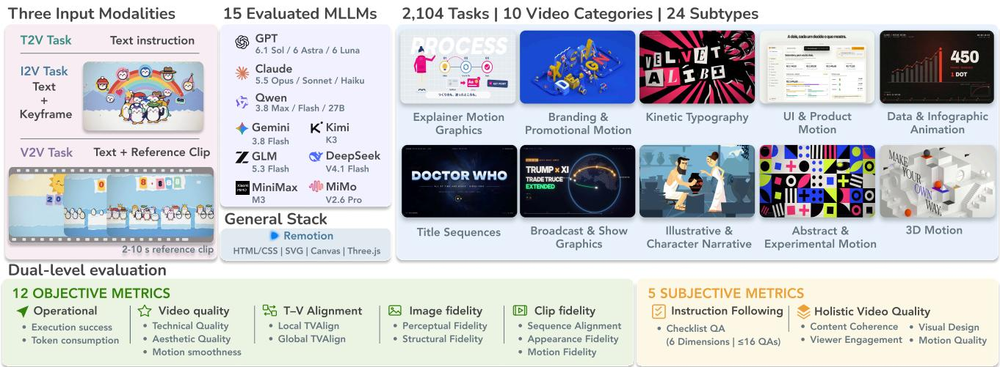  
Figure 1. Overview of Code2Video-Compass. The benchmark evaluates 15 multimodal large language models (MLLMs) on code-based text-to-video (T2V), image-to-video (I2V), and video-to-video (V2V) generation. Models generate executable code from text and optional visual references using a general-purpose stack supporting HTML/CSS, SVG, Canvas, and Three.js, with Remotion rendering the resulting videos. It comprises 2,104 tasks spanning 10 categories and 24 subtypes, evaluated through a comprehensive dual-level framework combining 12 objective metrics with five subjective metrics.

## Abstract

Code-based video generation offersfine-grained control, targeted editing, and component reuse compared with direct video generation. This approach requires multimodal large language models (MLLMs) to translate visual and temporal requirements into executable programs that produce complete videos. However, existing code-based benchmarks primarily target specialized tasks, leaving complete video creation across diverse creative categories and input modalities insufficiently evaluated. We introduce Code2Video-Compass, a general-purpose benchmark for code-based video generation across text-to-video (T2V), image-to-video (I2V), and video-to-video (V2V) settings. Code2Video-Compass comprises 2,104 tasks spanning 10 categories, 24 subtypes, and three complexity dimensions covering construction, dynamic animation, and state dependency. It combines tasks curated from textual instructions and visual references with corre-

sponding T2V, I2V, and V2V tasks derived from complete professional and user-created videos. We propose a duallevel evaluationframework combining 12 objective metrics andfive subjective metrics. Objective evaluation covers operational performance, video quality, text–video alignment, and reference fidelity, while subjective evaluation uses an MLLMjudge to evaluate instructionfollowing and holistic video quality. Extensive evaluation of 15 recent proprietary and open-weight MLLMs from nine families reveals that even leading modelsface challenges in reliably generating high-quality complete videos aligned with textual and visual requirements, with performance generally declining as construction, dynamic animation, and state-dependency complexity increases. We anticipate that Code2Video-Compass will advance reliable, coherent, and controllable code-based video generation and inspire broader progress in programmatic visual creation

## 1. Introduction

Recent advances in multimodal large language models (MLLMs) [3, 18, 38, 41, 44] are making it increasingly feasible to create complete videos through executable code, a task requiring world knowledge, spatial reasoning, creative judgment, and complex programming. Compared with direct video generation, code-based approaches explicitly represent visual structures and animation parameters, enabling fine-grained control, targeted editing, and component reuse [12, 33, 46]. Generating complete videos that follow textual instructions requires models to plan coherent narratives and visuals, reliably generate lengthy code across interdependent files, and coordinate animations and evolving states across scenes and timelines. Moreover, visual references introduce additional challenges, requiring models to reconstruct the referenced appearance or motion and integrate it into the complete video [29, 63].

Existing benchmarks for direct video generation, including VBench [22], EvalCrafter [32], and T2V-CompBench [51], evaluate visual quality, semantic alignment, and compositional requirements, while LongAV-Compass [30] extends evaluation to longer sequences and multiple input conditions. Code-based tasks target specialized applications or representations, including Manim educational videos [13], data narratives [35], SVG animations [53], and web animation reconstruction [24]. Similarly, HeyGen’s Code2Video Benchmark [62] focuses on short motion graphics clips representing individual beats of product launch videos. Nevertheless, as shown in Tab. 1, existing codebased benchmarks remain limited in task coverage and input modalities, and lack comprehensive evaluation combining objective and subjective metrics.

To address these gaps, we introduce Code2Video-Compass (Fig. 1), a general-purpose benchmark for codebased text-to-video (T2V), image-to-video (I2V), and videoto-video (V2V) generation, where models create complete videos following textual instructions and, when provided, reconstruct and integrate visual references at appropriate temporal positions. Guided by a taxonomy of motion-design practices, we combine independently constructed tasks based on curated textual instructions and visual references with tasks derived from complete professional and user-created videos. This yields 2,104 tasks across 10 categories and 24 subtypes, each annotated along three complexity dimensions: construction, dynamic animation, and state dependency. We further propose a comprehensive dual-level evaluation framework combining 12 objective metrics and five subjective metrics. Objective evaluation measures execution success, token consumption, technical and aesthetic quality, motion smoothness, text–video alignment, and reference fidelity. Subjective evaluation employs an MLLM-as-a-judge protocol to evaluate fine-grained instruction following through explicit checklists and evaluate holistic creative quality across content coherence, visual design, motion quality, and viewer engagement.

In summary, our main contributions are as follows:

• General-Purpose Code-Based Video Generation. We formulate unified T2V, I2V, and V2V tasks that require MLLMs to generate executable code for video generation.

• Taxonomy-Driven Benchmark Dataset. We curate 2,104 tasks spanning 10 categories and 24 subtypes, annotated along three complexity dimensions, each with three levels.

• Comprehensive Dual-Level Evaluation Framework. We integrate 12 objective metrics and five subjective metrics to evaluate code-based video generation capabilities.

• Extensive MLLM Benchmarking and Insights. We evaluate 15 proprietary and open-weight MLLMs, revealing that video quality and execution reliability do not always align, with performance declining as complexity increases.

## 2. Related Work

## 2.1. Direct Video Generation

Benchmarks for direct video generation have established diverse evaluation tasks and frameworks for assessing mode capabilities. VBench [22] and EvalCrafter [32] evaluate perceptual quality, while T2V-CompBench [51] and TC-Bench [16] examine compositional and temporal constraints. VBench++ [23] and KeyFrame-Compass [52] extend evaluation to image conditioning and keyframe adherence. StoryBench [9], MSVBench [48], and LongAV-Compass [30] further address narrative progression and long-range consistency, with the latter covering text, image, and video conditioning. T2AV-Compass [10] combines objective and subjective evaluation. However, code-based video generation requires evaluating operational performance and the technical, semantic, and creative quality of complete videos.

## 2.2. Code-Based Video and Animation Generation

Prior work has explored code-based video and animation generation across specialized applications. Code2Video [13] introduces a Manim-based agent framework and the MMMC benchmark for educational videos, while DataReel [35] supports animated data storytelling. LogoMotion [31] generates editable logo animations, and MG-Gen [49] produces layered HTML animations from images. InternSVG [53] and LottieGPT [12] explore structured vector animations.

Evaluation of code-based generation has advanced within specific tasks. MMMC evaluates aesthetics, knowledge transfer, and efficiency, while Animation2Code [24] evaluates execution, appearance, and motion fidelity. MoVer [34] verifies motion constraints, and HeyGen’s Code2Video Benchmark [62] employs subjective evaluation of short promotional motion graphics. However, comprehensive evaluation of complete code-generated videos across diverse creative categories and input conditions remains limited.

Table 1. Comparison of representative video generation benchmarks. Source denotes Real (derived from existing works), Synthetic (constructed without such works), or Hybrid (both). T, I, and V denote text, image, and video inputs; Duration is the average video length in minutes. Dual combines objective and subjective evaluation. Avg. Tokens uses the Qwen3 tokenizer [60], while event counts follow T2AV-Compass [10]. † indicates statistics from partial datasets; N/A and – denote visual-only input and unavailable data, respectively.
<table><tr><td>Benchmark</td><td>#Items</td><td>Source</td><td>Approach Task Scope</td><td></td><td>Input</td><td></td><td></td><td>Output Duration Avg. Tokens / Events Evaluation #Metrics</td><td></td><td></td></tr><tr><td>Direct Video Generation</td><td></td><td></td><td></td><td></td><td></td><td></td><td></td><td></td><td></td><td></td></tr><tr><td>VBench [22]</td><td>946</td><td>Synthetic</td><td>Direct</td><td>General</td><td>T</td><td>Video</td><td>&lt; 1</td><td>10 / 1.06</td><td>Objective</td><td>16</td></tr><tr><td>VABench [21]</td><td>1,299</td><td>Synthetic</td><td>Direct</td><td>General</td><td>T/I</td><td>Video</td><td>&lt; 1</td><td>50 /2.31</td><td>Dual</td><td>15</td></tr><tr><td>T2AV-Compass [10]</td><td>500</td><td>Hybrid</td><td>Direct</td><td>General</td><td>T</td><td>Video</td><td>&lt; 1</td><td>154/3.61</td><td>Dual</td><td>13</td></tr><tr><td>LongAV-Compass [30]</td><td>284</td><td>Hybrid</td><td>Direct</td><td>General</td><td>T/I/V</td><td>Video</td><td>&gt;1</td><td>209 / 6.76</td><td>Dual</td><td>16</td></tr><tr><td>Code-Based Generation</td><td></td><td></td><td></td><td></td><td></td><td></td><td></td><td></td><td></td><td></td></tr><tr><td>MMMC (Code2Video) [13]</td><td>456</td><td>Real</td><td>Manim</td><td>Education</td><td>T</td><td>Video</td><td>&gt;1</td><td>8† / -</td><td>Dual</td><td>8</td></tr><tr><td>SArena-Animation [53]</td><td>1,008</td><td>Hybrid</td><td>SVG</td><td>Animation</td><td>T/V</td><td>SVG</td><td>&lt; 1</td><td>65/-</td><td>Objective</td><td>8</td></tr><tr><td>Animation2Code [24]</td><td>1,069</td><td>Real</td><td>Web</td><td>Animation</td><td>V</td><td>Video</td><td>&lt; 1</td><td>N/A/ -</td><td>Objective</td><td>3</td></tr><tr><td>HeyGen Code2Video [62]</td><td>168</td><td>Real</td><td>General</td><td>Product</td><td>T</td><td>Video</td><td>&lt; 1</td><td>471† / -</td><td>Subjective</td><td>5</td></tr><tr><td>Code2Video-Compass (Ours)</td><td>2,104</td><td>Hybrid</td><td>General</td><td>General</td><td>T/I/V</td><td>Video</td><td>&gt;1</td><td>594 / 9.46</td><td>Dual</td><td>17</td></tr></table>

Tab. 1 summarizes task sources, generation paradigms, input settings, scale, and evaluation.

## 3. Code2Video-Compass

## 3.1. Task Formulation

Code2Video-Compass evaluates general-purpose code-based video generation, where MLLMs translate textual instructions and optional visual references into executable projects. The rendering stack supports HTML/CSS, SVG, Canvas, and Three.js, with Remotion [46] producing the videos. Generated videos must exhibit coherent progression across events or visual states, with reference content reconstructed through code rather than directly embedded or replayed. We consider three input settings:

Text-to-Video (T2V). Models interpret a self-contained instruction and generate code to realize the specified visual content and temporal progression.

Image-to-Video (I2V). Models interpret the instruction and reference keyframe, understand its visual content, determine where it should appear in the complete video, and generate code to reconstruct and integrate its visual state.

Video-to-Video (V2V). Models interpret the instruction and reference clip, determine its placement in the complete video, and generate code to reconstruct and integrate its appearance, motion, and event sequence.

## 3.2. Data Categories and Complexity

We derive 10 categories from professional motion-design websites, award categories, template libraries, and creative portfolios [5, 7, 25]: (1) Explainer Motion Graphics; (2) Branding & Promotional Motion; (3) Kinetic Typography; (4) UI & Product Motion; (5) Data & Infographic Animation; (6) Title Sequences; (7) Broadcast & Show Graphics;

(8) Illustrative & Character Narrative; (9) Abstract & Experimental Motion; and (10) 3D Motion. The categories are further refined into 24 subtypes using YouTube [61] examples, considering communication purpose, visual structure, and temporal organization. This taxonomy supports multiple labels per task and guides data collection and category-level analysis. We further define three complementary complexity dimensions, each with three levels.

Construction Complexity measures visual construction demands: standard primitives and component compositions (Level 1), custom geometry and detailed structures (Level 2), and procedural or simulation systems (Level 3).

Dynamic Animation Complexity measures temporal organization: staged sequences (Level 1), coordinated changes across elements and scenes (Level 2), and complex concurrent motion or transformations (Level 3).

State-Dependency Complexity measures the temporal span over which objects, data, and states must remain consistent: adjacent stages (Level 1), intervening stages (Level 2), and long-range dependencies across multiple changes (Level 3).

## 3.3. Data Construction

We construct 2,104 tasks through two complementary strategies, as illustrated in Fig. 2. The Independent Task Set broadens creative coverage using text seeds and visual references, while the Paired Task Set grounds tasks in real-world creative practice by deriving them from complete professional and user-created videos. Three co-authors conduct manual verification and quality review throughout the data construction process.

Independent Task Set. For T2V, we source prompts from VidProM [54] and video descriptions from Shot2Story [19]. After source-specific cleaning, deterministic sampling yields

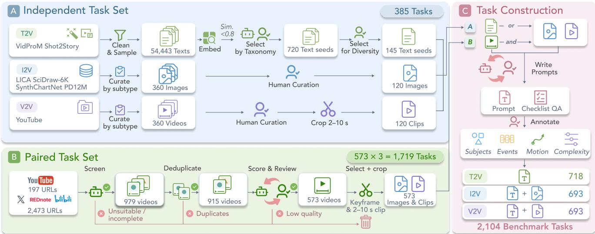  
Figure 2. Data construction pipeline. (A) Independent tasks are developed from curated text seeds, reference images, and video clips. (B) Paired T2V, I2V, and V2V tasks are derived from shared complete source videos. (C) Both task sets undergo prompt construction, QA checklist development, and annotation of subjects, temporal events, motion types, and three complexity dimensions, yielding 2,104 tasks.

54,443 candidates, which we embed using all-MiniLM-L6- v2 [47]. With GPT-6.1 Sol [40] assistance and human review, taxonomy-guided curation narrows the pool to 720 candidates, from which we select 145 diverse task seeds.

For I2V, we curate reference images from LICA [20], SciDraw-6K [11], SynthChartNet [39], and PD12M [36]. For V2V, we collect animation videos from YouTube [61]. For both settings, we curate 15 candidates per subtype and select five through content verification and manual quality review, yielding 120 references from 360 candidates in each setting. We crop a continuous 2–10 s key segment from each selected video to form the V2V reference clip. These seeds and references guide complete-video task construction.

Paired Task Set. To cover professional and user-created videos across platforms, we collect 197 animation records from YouTube [61] and 2,473 candidate URLs from Bilibili [8], REDnote [45], and X [58]. We screen candidates for video completeness and suitability for code-based generation with assistance from Gemini 3.8 Flash [18], retaining 979 videos. We remove exact duplicates using normalized URLs and SHA-256 hashes, and identify near-duplicates across all video sources using SSCD [43] frame embeddings indexed with FAISS [15]. Temporal matching distinguishes reposted works from videos with similar visual styles. After deduplication, we score the remaining 915 videos for narrative progression, content, visual design, and motion quality using Gemini 3.8 Flash. Human review retains 573 complete videos, from which we select representative keyframes and crop continuous 2–10 s reference clips with Gemini 3.8 Flash assistance and human verification. Each video yields aligned T2V, I2V, and V2V tasks with shared creative goals and event progression, totaling 1,719 tasks.

Prompt Construction and Annotation. We develop detailed, self-contained instructions for both task sets with assistance from Gemini 3.8 Flash and human review. Independent instructions specify a new complete video based on each text seed or visual reference. For each paired source, we jointly develop T2V, I2V, and V2V instructions with shared core content requirements and event progression. Instructions specify visual elements, spatial relationships, exact text and data, motion, event sequences, and cross-stage dependencies, including reference content and surrounding events where applicable. We annotate subjects, temporal events, motion types, and three complexity dimensions, and construct fine-grained QA checklists for instruction following, as described in Sec. 3.5.2. We iteratively review and refine these checklists with assistance from GPT-6.1 Sol.

## 3.4. Dataset Statistics

The benchmark combines 1,719 paired tasks from 573 source videos with 385 independent tasks, totaling 2,104 tasks across T2V (718), I2V (693), and V2V (693). For coverage analysis, we count each paired source once, resulting in 958 records comprising 573 paired sources and 385 independent tasks. Figures 3 and 4 characterize coverage across creative categories, subjects, motion types, video duration, prompt length, and the three complexity dimensions, demonstrating the breadth and diversity of the benchmark.

## 3.5. Dual-Level Evaluation Framework

We introduce a dual-level evaluation framework comprising 12 objective metrics and five subjective metrics. Objective evaluation covers execution reliability, efficiency, video quality, text–video alignment, and reference fidelity. We employ Gemini 3.8 Flash [18] to evaluate instruction following and rate four dimensions of holistic video quality.

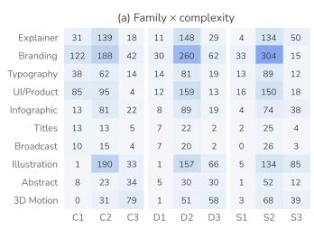

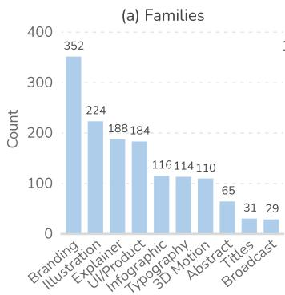

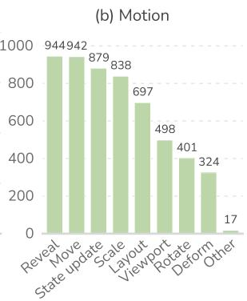

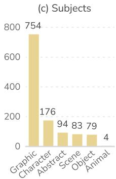

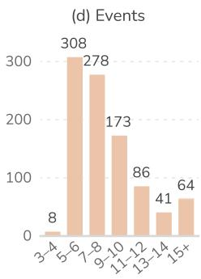

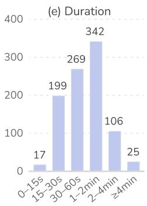

Figure 3. Distributions of (a) video categories, (b) motion types, (c) subject types, (d) event counts, and (e) target durations across 958 records (573 paired sources + 385 independent tasks). A record may have multiple video categories, motion types, and subject types.  
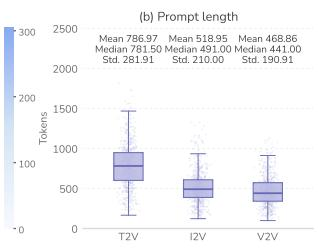  
Figure 4. Task complexity and prompt length. C, D, and S denote construction, dynamic animation, and state-dependency complexity. (a) Record counts by category and complexity level (1–3), with multi-label records counted in each assigned category. (b) Prompt token distributions across T2V, I2V, and V2V, as in Tab. 1.

## 3.5.1. Objective Evaluation

Operational Performance. Practical video creation requires reliable execution and efficient generation. Execution success measures whether the code produces a usable video, while token consumption measures generation effort.

Execution Success (ES). Usable video projects must execute and render successfully. We report the fraction of sampled tasks producing complete, playable videos without errors under the shared backend and resource limits. Failed outputs receive zero on all non operational metrics to prevent inflated averages from excluding difficult tasks.

Token Consumption (TC). We measure generation efficiency using mean API-reported output tokens per attempted task, consistent with token-based model comparisons such as Artificial Analysis [6].

Video Quality. Rendered videos need clear images, appealing visual presentation, and temporally consistent motion. The objective metrics capture these complementary properties through technical quality, aesthetic quality, and motion smoothness.

Technical Quality (TQ). Technical degradation, including blur, noise, and compression artifacts, affects the clarity of rendered content. The technical branch of DOVER++ [57] provides a score for this aspect of video quality.

Aesthetic Quality (AQ). The visual appeal of composition, color, and style contributes to effective presentation. Averaging frame-level scores from Aesthetic Predictor V2.5 [1] gives a video-level estimate of aesthetic quality.

Motion Smoothness (MS). Smooth motion should be temporally predictable from neighboring frames. We resample videos to 24 FPS and use AMT [28] to predict each intermediate frame from its two neighbors. The score is one minus the mean RGB absolute error normalized by 255, excluding comparisons across hard cuts.

Text–Video Alignment. Instructions describe individual events and the overall progression of a complete video. Local TVAlign and Global TVAlign evaluate semantic correspondence at these two scales across T2V, I2V, and V2V.

Local TVAlign (L-TVA). Local TVAlign measures local semantic correspondence between eight-frame sliding video windows and text chunks derived from global and event-level descriptions. We compute window-level alignment scores using ViCLIP-L [55] and aggregate them across the video.

Global TVAlign (G-TVA). Global TVAlign measures semantic alignment between the complete video and the instruction as a whole, complementing local alignment and reference-fidelity metrics. We use Qwen3-VL-Embedding-8B [27] to encode the instruction and frames spanning the video, then compute their embedding cosine similarity.

I2V Reference Fidelity. Reference keyframes may appear at any stage, so we search the full generated video for the closest matching frame. Perceptual and structural fidelity measure visual resemblance and image structure.

Perceptual Fidelity (PF). Recognizable subjects and visual elements are central to reconstructing the reference image. We use DINOv3 [50] features to locate the closest matching frame and measure perceptual resemblance.

Structural Fidelity (SF). Faithful reconstruction also requires preserving the reference’s local image structure. SSIM [56] measures luminance, contrast, and structural similarity at the same matching frame.

V2V Reference Fidelity. The reference clip must be reconstructed within a complete video, so we first locate its corresponding interval in the output. Sequence alignment, appearance fidelity, and motion fidelity measure visual sequence correspondence, appearance similarity, and motion consistency within this interval.

Sequence Alignment (SA). To measure whether the reference’s visual progression is preserved despite timing differences, we locate the corresponding interval using subsequence dynamic time warping (DTW) on DINOv3 [50] frame embeddings. The score is the mean cosine similarity along the matched path.

Appearance Fidelity (AF). The reconstructed interval should preserve the reference’s subjects, colors, and shapes. Within the localized interval, we perform constrained DTW using DreamSim [17] cosine distances and define AF as one minus the path-averaged distance.

Motion Fidelity (MF). Similar visual appearance and temporal sequences do not necessarily imply similar motion patterns. We use CoTracker3 [26] to extract point trajectories from the reference clip and the localized generated interval and compare their displacement directions and magnitudes after spatial and temporal normalization. We aggregate trajectory similarities through bidirectional best matching.

## 3.5.2. Subjective Evaluation

Instruction Following (IF). We derive verifiable QA checklists from each instruction and employ Gemini 3.8 Flash [18] to check whether the generated video satisfies each requirement. Each checklist contains up to 16 questions, including up to 14 generic questions across six dimensions and two task-specific questions. The six dimensions are (1) Content, covering exact text and information, (2) Attribute, covering appearance and quantity, (3) Composition, covering layout, framing, and color, (4) Relations, covering spatial and logical connections, (5) Dynamics, covering motion, interaction, transformation, viewport motion, and temporal relations, and (6) Aesthetics, covering style. The two task-specific questions cover full-video requirements or reference integration. IF reports the fraction of questions passed.

Holistic Video Quality. Creating an effective complete video requires coherent content, purposeful design, expressive motion, and sustained viewer interest. We rate these four aspects using five-point Likert scales.

Content Coherence (CC). Content coherence is rated based on progression, relationships among stages, state continuity, and consistency of text, data, charts, and interfaces.

Visual Design (VD). Visual design is rated based on composition, typography, readability, color, visual hierarchy, and purposeful detail within the intended style.

Motion Quality (MQ). Motion quality is rated based on easing, pacing, continuity, transitions, coordinated elements, temporal hierarchy, and behavioral variety, capturing both smoothness and expressive choreography.

Viewer Engagement (VE). Viewer engagement is rated by how well emphasis, pacing, and presentation sustain interest in a way that suits the video’s intended use.

## 4. Experiments

## 4.1. Experimental Setup

Models. We evaluate 15 recent proprietary and open-weight MLLMs from nine model families, including GPT-6 Astra, GPT-6.1 Sol, GPT-6 Luna [40–42], Claude Opus 5.5, Claude Sonnet 5.5, Claude Haiku 5.5 [2–4], Gemini 3.8 Flash [18], Qwen3.8-Max, Qwen3.8-Flash, Qwen3.8-27B [44], Kimi K3 [38], GLM-5.3-Flash [64], DeepSeek-V4.1-Flash [14], MiniMax M3 [37], and MiMo-V2.6-Pro [59].

Evaluation Protocol. For task selection, we sample approximately half of the records from each of our two task construction strategies, yielding a fixed subset of 1,054 tasks (360 T2V, 347 I2V, and 347 V2V) for all models. The subset shows no significant differences from unsampled records in the distributions of the three complexity dimensions defined in Sec. 3.2 (Pearson’s $\chi ^ { 2 }$ tests, pHolm > 0.05, V < 0.02) or prompt lengths (Welch’s t-tests, pHolm > 0.05, |g| < 0.05). For model inference, each model generates code from task instructions and applicable visual references in a single API call, without execution feedback or repair. We use each provider’s default reasoning settings. Output token totals include reasoning tokens reported by the API. For V2V Task, GPT and Claude receive 4-FPS frame sequences, while other models receive native videos with API sampling set to 4 FPS.

## 4.2. Main Results

Tab. 2–4 report results for 15 MLLMs on the fixed evaluation subset of 1,054 tasks.

Overall Performance. Claude Opus 5.5 achieves the best average rank across all three settings, with 1.60 on T2V, 1.08 on I2V, and 1.15 on V2V, followed by Claude Sonnet 5.5 in each setting. Proprietary models occupy the top three positions in every setting. Among open-weight models, DeepSeek-V4.1-Flash leads T2V, while MiMo-V2.6-Pro leads I2V and V2V. Execution success varies considerably across models, ranging from 0.52 to 0.94 on T2V, 0.59 to 0.96 on I2V, and 0.69 to 0.97 on V2V.

Table 2. Main results on T2V. Metrics are defined in Sec. 3.5. Avg. Rank averages per-metric ranks across all 15 models, excluding ES and TC, with ties assigned average ranks. Models are ordered by Avg. Rank within each group, with darker cells indicating better ranks. Bes and second-best scores within each group are bold and underlined, respectively, using unrounded values. ↑/↓ indicate higher/lower is better
<table><tr><td>Model</td><td>Avg.</td><td colspan="2">Operational</td><td colspan="3">Video Quality</td><td colspan="2">Text Alignment</td><td>Instr. Follow.</td><td colspan="4">Holistic Video Quality</td></tr><tr><td></td><td>Rank↓</td><td>ES↑</td><td>TC↓</td><td>TQ↑</td><td>AQ↑</td><td>MS↑</td><td>L-TVA↑</td><td>G-TVA↑</td><td>IF↑</td><td>CC↑</td><td>VD↑</td><td>MQ↑</td><td>VE↑</td></tr><tr><td>Proprietary Models</td><td></td><td></td><td></td><td></td><td></td><td></td><td></td><td></td><td></td><td></td><td></td><td></td><td></td></tr><tr><td> Claude Opus 5.5</td><td>1.600</td><td>0.944</td><td>29,400</td><td>0.115</td><td>3.636</td><td>0.933</td><td>0.522</td><td>0.653</td><td>0.915</td><td>4.047</td><td>3.808</td><td>3.828</td><td>3.894</td></tr><tr><td>米Claude Sonnet 5.5</td><td>1.900</td><td>0.936</td><td>48,679</td><td>0.116</td><td>3.587</td><td>0.924</td><td>0.521</td><td>0.648</td><td>0.911</td><td>4.039</td><td>3.861</td><td>3.847</td><td>3.900</td></tr><tr><td>GPT-6.1 Sol</td><td>2.600</td><td>0.892</td><td>13,022</td><td>0.117</td><td>3.631</td><td>0.884</td><td>0.501</td><td>0.614</td><td>0.873</td><td>3.953</td><td>3.883</td><td>3.767</td><td>3.861</td></tr><tr><td>GPT-6 Astra</td><td>4.700</td><td>0.864</td><td>16,647</td><td>0.112</td><td>3.561</td><td>0.856</td><td>0.482</td><td>0.594</td><td>0.850</td><td>3.806</td><td>3.756</td><td>3.703</td><td>3.747</td></tr><tr><td>Gemini 3.8 Flash</td><td>5.700</td><td>0.903</td><td>17,817</td><td>0.100</td><td>3.332</td><td>0.894</td><td>0.482</td><td>0.614</td><td>0.798</td><td>3.481</td><td>3.383</td><td>3.272</td><td>3.375</td></tr><tr><td>Qwen3.8-Max</td><td>6.250</td><td>0.875</td><td>60,316</td><td>0.105</td><td>3.271</td><td>0.867</td><td>0.481</td><td>0.598</td><td>0.812</td><td>3.561</td><td>3.253</td><td>3.308</td><td>3.356</td></tr><tr><td>GPT-6 Luna</td><td>7.400</td><td>0.883</td><td>9,923</td><td>0.109</td><td>3.461</td><td>0.877</td><td>0.483</td><td>0.600</td><td>0.732</td><td>3.111</td><td>3.200</td><td>2.908</td><td>3.072</td></tr><tr><td>Claude Haiku 5.5</td><td>10.600</td><td>0.808</td><td>47,634</td><td>0.096</td><td>2.989</td><td>0.800</td><td>0.445</td><td>0.551</td><td>0.737</td><td>3.161</td><td>2.872</td><td>2.889</td><td>2.950</td></tr><tr><td>Qwen3.8-Flash</td><td>12.800</td><td>0.739</td><td>65,945</td><td>0.088</td><td>2.763</td><td>0.732</td><td>0.400</td><td>0.500</td><td>0.641</td><td>2.639</td><td>2.469</td><td>2.481</td><td>2.492</td></tr><tr><td>Open-weight Models</td><td></td><td></td><td></td><td></td><td></td><td></td><td></td><td></td><td></td><td></td><td></td><td></td><td></td></tr><tr><td>DeepSeek-V4.1-Flash</td><td>7.350</td><td>0.853</td><td>65,680</td><td>0.104</td><td>3.276</td><td>0.845</td><td>0.462</td><td>0.585</td><td>0.797</td><td>3.469</td><td>3.303</td><td>3.308</td><td>3.353</td></tr><tr><td> MiMo-V2.6-Pro</td><td>8.600</td><td>0.861</td><td>22,741</td><td>0.108</td><td>3.264</td><td>0.854</td><td>0.473</td><td>0.585</td><td>0.740</td><td>3.189</td><td>3.089</td><td>3.036</td><td>3.094</td></tr><tr><td>K Kimi K3</td><td>9.300</td><td>0.819</td><td>39,681</td><td>0.094</td><td>3.120</td><td>0.812</td><td>0.443</td><td>0.562</td><td>0.756</td><td>3.247</td><td>3.100</td><td>3.064</td><td>3.125</td></tr><tr><td>Z GLM-5.3-Flash</td><td>12.900</td><td>0.678</td><td>94,000</td><td>0.081</td><td>2.623</td><td>0.671</td><td>0.372</td><td>0.463</td><td>0.640</td><td>2.831</td><td>2.719</td><td>2.683</td><td>2.725</td></tr><tr><td>Qwen3.8-27B</td><td>13.300</td><td>0.692</td><td>87,862</td><td>0.079</td><td>2.676</td><td>0.686</td><td>0.368</td><td>0.464</td><td>0.621</td><td>2.669</td><td>2.547</td><td>2.531</td><td>2.567</td></tr><tr><td>MiniMax M3</td><td>15.000</td><td>0.519</td><td>15,423</td><td>0.052</td><td>1.930</td><td>0.516</td><td>0.262</td><td>0.332</td><td>0.330</td><td>1.356</td><td>1.344</td><td>1.258</td><td>1.294</td></tr></table>

Table 3. Main results on I2V. Metrics are defined in Sec. 3.5. Scoring, ranking, and notation follow Tab. 2.
<table><tr><td rowspan="2">Model</td><td rowspan="2">Avg. Rank↓</td><td colspan="2">Operational</td><td colspan="3">Video Quality</td><td colspan="2">Text Alignment</td><td colspan="2">Image Fidelity</td><td>Instr. Follow.</td><td colspan="3">Holistic Video Quality</td></tr><tr><td>ES↑</td><td>TC↓</td><td>TQ↑</td><td>AQ↑</td><td>MS↑</td><td>L-TVA↑</td><td>G-TVA↑</td><td>PF↑ SF↑</td><td></td><td>IF↑</td><td>CC↑ VD↑</td><td>MQ↑</td><td>VE↑</td></tr><tr><td>Proprietary Models</td><td></td><td></td><td></td><td></td><td></td><td></td><td></td><td></td><td></td><td></td><td></td><td></td><td></td><td></td></tr><tr><td> Claude Opus 5.5</td><td>1.083</td><td>0.960</td><td>19,905 0.112</td><td>3.754</td><td>0.948</td><td>0.517</td><td>0.625</td><td>0.894</td><td>0.658</td><td>0.915</td><td></td><td>3.934 3.784</td><td>3.755</td><td>3.818</td></tr><tr><td> Claude Sonnet 5.5</td><td>1.917</td><td>0.954</td><td>28,926 0.114</td><td>3.716</td><td>0.942</td><td>0.514</td><td>0.620</td><td>0.890</td><td>0.657</td><td>0.901</td><td>3.853</td><td>3.718</td><td>3.683</td><td>3.749</td></tr><tr><td>S GPT-6 Astra</td><td>4.000</td><td>0.873</td><td>12,689 0.111</td><td>3.603</td><td>0.866</td><td>0.481</td><td>0.574</td><td>0.834</td><td>0.649</td><td>0.855</td><td>3.692</td><td>3.657</td><td>3.467</td><td>3.591</td></tr><tr><td>米 Claude Haiku 5.5</td><td>4.000</td><td>0.948</td><td>35,606 0.111</td><td>3.665</td><td>0.938</td><td>0.505</td><td>0.605</td><td>0.857</td><td>0.629</td><td>0.838</td><td>3.493</td><td>3.378</td><td>3.288</td><td>3.380</td></tr><tr><td>S GPT-6.1 Sol</td><td>5.417</td><td>0.870</td><td>10,015 0.110</td><td>3.539</td><td>0.863</td><td>0.478</td><td>0.570</td><td>0.828</td><td>0.635</td><td>0.837</td><td>3.631</td><td>3.548</td><td>3.435</td><td>3.550</td></tr><tr><td>Gemini 3.8 Flash</td><td>6.792</td><td>0.931</td><td>15,014 0.103</td><td>3.577</td><td>0.922</td><td>0.499</td><td>0.596</td><td>0.839</td><td>0.586</td><td>0.745</td><td>3.118</td><td>3.210</td><td>2.888</td><td>3.055</td></tr><tr><td>S GPT-6 Luna</td><td>8.167</td><td>0.902</td><td>8,833 0.108</td><td>3.556</td><td>0.896</td><td>0.490</td><td>0.579</td><td>0.823</td><td>0.617</td><td>0.703</td><td>2.882</td><td>3.075</td><td>2.611</td><td>2.793</td></tr><tr><td>女 Qwen3.8-Flash</td><td>11.500</td><td>0.769</td><td>54,246 0.087</td><td>2.938</td><td>0.763</td><td>0.406</td><td>0.499</td><td>0.694</td><td>0.469</td><td>0.704</td><td>2.968</td><td>2.807</td><td>2.769</td><td>2.841</td></tr><tr><td>女 Qwen3.8-Max</td><td>14.000</td><td>0.640</td><td>42,967 0.072</td><td>2.479</td><td>0.634</td><td>0.341</td><td>0.413</td><td>0.587</td><td>0.424</td><td>0.598</td><td>2.516</td><td>2.427</td><td>2.418</td><td>2.458</td></tr><tr><td colspan="10">Open-weight Models</td><td></td><td></td><td></td><td></td><td></td></tr><tr><td>x MiMo-V2.6-Pro</td><td>7.500</td><td>0.870</td><td>27,446 0.108</td><td>3.404</td><td>0.863</td><td>0.473</td><td>0.568</td><td>0.788</td><td>0.540</td><td>0.778</td><td>3.282</td><td>3.233</td><td>3.121</td><td>3.199</td></tr><tr><td>K Kimi K3</td><td>8.083</td><td>0.865</td><td>39,300 0.099</td><td>3.391</td><td>0.856</td><td>0.462</td><td>0.563</td><td>0.776</td><td>0.539</td><td>0.783</td><td>3.337</td><td>3.251</td><td>3.138</td><td>3.196</td></tr><tr><td>DeepSeek-V4.1-Flash</td><td>8.792</td><td>0.824</td><td>61,171 0.099</td><td>3.222</td><td>0.817</td><td>0.442</td><td>0.536</td><td>0.746</td><td>0.503</td><td>0.766</td><td>3.280</td><td>3.210</td><td>3.141</td><td>3.210</td></tr><tr><td>GLM-5.3-Flash</td><td>10.750</td><td>0.767</td><td>88,070</td><td>0.089 3.014</td><td>0.759</td><td>0.411</td><td>0.498</td><td>0.701</td><td>0.485</td><td>0.715</td><td>3.066</td><td>2.977</td><td>2.939</td><td>2.988</td></tr><tr><td>Qwen3.8-27B</td><td>13.000</td><td>0.718</td><td>50,307</td><td>0.081 2.798</td><td>0.712</td><td>0.378</td><td>0.465</td><td>0.646</td><td>0.452</td><td>0.651</td><td>2.651</td><td>2.559</td><td>2.481</td><td>2.542</td></tr><tr><td>MiniMax M3</td><td>15.000</td><td>0.588</td><td>12,115</td><td>0.059 2.219</td><td>0.584</td><td>0.289</td><td>0.360</td><td>0.491</td><td>0.348</td><td>0.403</td><td>1.591</td><td>1.605</td><td>1.476</td><td>1.513</td></tr></table>

T2V. Claude Opus 5.5 leads IF and CC with scores of 0.91 and 4.05, respectively, along with AQ and both text–video alignment metrics. Claude Sonnet 5.5 leads MQ and VE with scores of 3.85 and 3.90, while GPT-6.1 Sol leads VD with 3.88 and TQ, highlighting distinct strengths among leading models across evaluation dimensions.

I2V. Claude Opus 5.5 leads both image-fidelity metrics, with PF of 0.89 and SF of 0.66, as well as all five subjective metrics. GPT-6 Astra and GPT-6 Luna achieve similar image fidelity, with PF scores of 0.83 and 0.82 and SF scores of 0.65 and 0.62, but differ considerably in IF at 0.86 versus 0.70 and MQ at 3.47 versus 2.61, suggesting that faithful keyframe reconstruction does not necessarily ensure strong instruction following or motion quality.

V2V. Claude Opus 5.5 leads all three clip-fidelity metrics, with SA of 0.88, AF of 0.79, and MF of 0.44, as well as all five subjective metrics. Claude Sonnet 5.5 achieves comparable clip fidelity, with SA of 0.87, AF of 0.77, and MF of 0.44, but lower IF and CC scores of 0.76 and 3.36, compared with 0.93 and 4.00 for Claude Opus 5.5, highlighting the gap between reference-clip reconstruction and complete-video requirements.

Table 4. Main results on V2V. Metrics are defined in Sec. 3.5. Scoring, ranking, and notation follow Tab. 2. indicates frame sequence input; all other models receive native video.
<table><tr><td rowspan="2">Model</td><td rowspan="2">Avg. Rank↓</td><td colspan="2">Operational</td><td colspan="2">Video Quality</td><td colspan="2">Text Alignment</td><td colspan="2">Clip Fidelity</td><td colspan="2">Instr. Follow.</td><td colspan="3">Holistic Video Quality</td></tr><tr><td>ES↑</td><td>TC↓</td><td>TQ↑</td><td>AQ↑ MS↑</td><td>L-TVA↑</td><td>G-TVA↑</td><td>SA↑</td><td>AF↑</td><td>MF↑</td><td>IF↑</td><td>CC↑ VD↑</td><td>MQ↑</td><td>VE↑</td></tr><tr><td>Proprietary Models</td><td></td><td></td><td></td><td></td><td></td><td></td><td></td><td></td><td></td><td></td><td></td><td></td><td></td><td></td></tr><tr><td> Claude Opus 5.5 </td><td>1.154</td><td>0.971</td><td>29,050</td><td>0.115</td><td>3.794 0.958</td><td>0.527</td><td>0.630</td><td>0.882</td><td>0.787 0.445</td><td>0.929</td><td></td><td>3.997 3.853</td><td>3.839 3.882</td><td></td></tr><tr><td>Claude Sonnet 5.5</td><td>2.846</td><td>0.963</td><td>34,355 0.118</td><td>3.744</td><td>0.948</td><td>0.528</td><td>0.555</td><td>0.873</td><td>0.773 0.443</td><td>0.756</td><td></td><td>3.357 3.568</td><td>3.507</td><td>3.438</td></tr><tr><td>S GPT-6 Astra </td><td>4.000</td><td>0.850</td><td>12,158 0.107</td><td>3.445</td><td>0.840</td><td>0.471</td><td>0.557</td><td>0.790</td><td>0.727 0.401</td><td>0.821</td><td></td><td>3.530 3.507</td><td>3.441</td><td>3.478</td></tr><tr><td>米 Claude Haiku 5.5</td><td>4.846</td><td>0.931</td><td>38,142 0.107</td><td>3.538</td><td>0.921</td><td>0.495</td><td>0.580</td><td>0.801</td><td>0.668 0.393</td><td>0.797</td><td></td><td>3.326 3.196</td><td>3.184</td><td>3.202</td></tr><tr><td>Gemini 3.8 Flash</td><td>5.462</td><td>0.925</td><td>13,708 0.102</td><td>3.526</td><td>0.916</td><td>0.492</td><td>0.574</td><td>0.781</td><td>0.642 0.393</td><td>0.764</td><td></td><td>3.268 3.305</td><td>3.207</td><td>3.265</td></tr><tr><td>S GPT-6.1 Sol </td><td>5.538</td><td>0.847</td><td>9,862 0.107</td><td>3.399</td><td>0.837</td><td>0.466</td><td>0.549</td><td>0.779</td><td>0.710 0.386</td><td>0.808</td><td></td><td>3.432 3.452</td><td>3.369</td><td>3.401</td></tr><tr><td>S GPT-6 Luna </td><td>7.654</td><td>0.905</td><td>7,050 0.110</td><td>3.608</td><td>0.899</td><td>0.488</td><td>0.514</td><td>0.782</td><td>0.661 0.383</td><td>0.614</td><td>2.602</td><td>2.856</td><td>2.637</td><td>2.648</td></tr><tr><td>女 Qwen3.8-Max</td><td>12.308</td><td>0.703</td><td>42,217</td><td>0.078 2.685</td><td>0.696</td><td>0.376</td><td>0.452</td><td>0.616</td><td>0.533 0.317</td><td>0.637</td><td>2.671</td><td>2.545</td><td>2.556</td><td>2.579</td></tr><tr><td>女 Qwen3.8-Flash</td><td>13.077</td><td>0.709</td><td>26,971</td><td>0.079 2.715</td><td>0.702</td><td>0.375</td><td>0.454</td><td>0.607 0.504</td><td>0.306</td><td>0.628</td><td>2.559</td><td>2.412</td><td>2.429</td><td>2.455</td></tr><tr><td>Open-weight Models</td><td></td><td></td><td></td><td></td><td></td><td></td><td></td><td></td><td></td><td></td><td></td><td></td><td></td><td></td></tr><tr><td>MiMo-V2.6-Pro</td><td>5.923</td><td>0.879</td><td>36,345</td><td>0.108 3.432 0.870</td><td></td><td>0.473</td><td>0.558</td><td>0.757 0.624 0.374</td><td></td><td>0.783</td><td></td><td>3.352 3.265</td><td>3.236 3.303</td><td></td></tr><tr><td>Q DeepSeek-V4.1-Flash</td><td>8.462</td><td>0.824</td><td>65,570</td><td>0.097 3.212</td><td>0.815</td><td>0.440</td><td>0.530</td><td>0.713</td><td>0.598 0.354</td><td>0.757</td><td>3.216</td><td>3.179</td><td>3.141</td><td>3.153</td></tr><tr><td>GLM-5.3-Flash</td><td>9.615</td><td>0.784</td><td>87,794</td><td>0.091 3.067</td><td>0.775</td><td>0.424</td><td>0.508</td><td>0.684</td><td>0.569 0.345</td><td>0.734</td><td>3.121</td><td>3.086</td><td>3.058</td><td>3.075</td></tr><tr><td>K Kimi K3</td><td>10.885</td><td>0.761</td><td>38,403</td><td>0.086 2.960</td><td>0.753</td><td>0.404</td><td>0.488</td><td>0.639</td><td>0.506 0.321</td><td>0.661</td><td>2.752</td><td>2.657</td><td>2.634</td><td>2.648</td></tr><tr><td>Qwen3.8-27B</td><td>13.231</td><td>0.706</td><td>47,197</td><td>0.079 2.677</td><td>0.699</td><td>0.377</td><td>0.452</td><td></td><td>0.6040.5060.303</td><td>0.625</td><td>2.597</td><td>2.496</td><td>2.493</td><td>2.499</td></tr><tr><td>MiniMax M3</td><td>15.000</td><td>0.686</td><td>11,880</td><td>0.068 2.560</td><td>0.680</td><td>0.342</td><td>0.418</td><td>0.5440.4100.280</td><td></td><td>0.481</td><td></td><td>1.879 1.873</td><td>1.775</td><td>1.784</td></tr></table>

## 5. Insights and Discussions

## 5.1. Quality and Reliability Analysis

As shown in Sec. 4.2, execution success varies substantially across models, motivating a closer examination of how execution failures affect overall quality scores. We use mean holistic video quality, averaged across four holistic quality metrics, to compare performance over all evaluated tasks and successfully rendered videos. As shown in Fig. 5, GPT-6 Astra and GPT-6.1 Sol achieve higher mean holistic quality among successfully rendered videos, with scores of 4.19 and 4.15, respectively, compared with 4.04 for Claude Opus 5.5. However, their higher execution failure rates reduce their full-set means to 3.62 and 3.61, while Claude Opus 5.5 achieves the highest full-set mean of 3.87. Higher video quality on successful runs can coexist with lower execution reliability, highlighting the need to consider both when evaluating code-based video generation.

## 5.2. Failure Analysis

We analyze 2,756 error cases to characterize failure patterns across models. As shown in Fig. 6, failure types vary considerably across models. Compilation errors and missing APIs or packages account for 83.4% of GPT-6 Astra’s failures, while missing APIs and packages alone dominate Qwen3.8- Max at 59.7%. In contrast, runtime exceptions account for 75.0% of Claude Opus 5.5’s failures and over half of those for GLM-5.3-Flash, DeepSeek-V4.1-Flash, and MiMo-V2.6- Pro. These distinct profiles reveal different sources of failure across models, ranging from code compilation and dependency handling to runtime execution. Reliably generating lengthy code across interdependent files remains a major challenge, with compilation, dependency, and runtime failures varying across models.

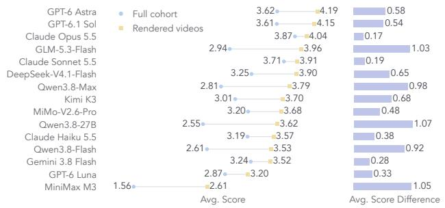  
Figure 5. Mean holistic video quality across all evaluated tasks and successfully rendered videos for 15 MLLMs. Bars indicate the difference between the two averages.

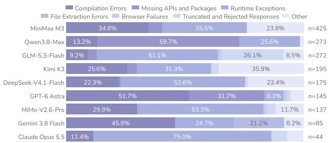  
Figure 6. Distribution of failure types across nine selected models.

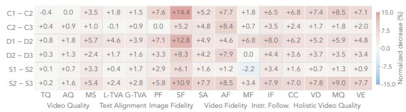  
Figure 7. Performance changes between adjacent complexity levels, using the notation in Fig. 4. Values are normalized by metric scale, with positive values indicating performance declines.

## 5.3. Complexity Analysis

To examine how current MLLMs handle increasing task complexity, we analyze performance across construction, dynamic animation, and state-dependency complexity levels. As shown in Fig. 7, performance generally declines with increasing complexity, with SF particularly affected. SF decreases by 14.38% and 12.82% of its score range from L1 to L2 under construction and dynamic animation complexity, respectively. Across most metrics, these two dimensions exhibit steeper declines from L1 to L2 than from L2 to L3, whereas state-dependency complexity shows larger declines from L2 to L3 across all 15 metrics. These contrasting patterns suggest that even moderate construction and dynamic animation complexity can challenge current MLLMs, whereas lower state-dependency complexity is relatively manageable and long-range dependencies remain challenging.

## 5.4. Generation Effort and Cost

We analyze the relationship between generation effort, API cost, and holistic video quality in Fig. 8. Higher token consumption does not necessarily yield better quality. GLM-5.3- Flash uses 90.0k output tokens per request, compared with 13.9k for GPT-6 Astra, yet achieves a lower quality score of 2.94 versus 3.62. API costs also vary substantially at comparable quality levels. GPT-6.1 Sol and GPT-6 Astra achieve nearly identical quality scores of 3.61 and 3.62, yet GPT-6 Astra incurs approximately 6.1 times the estimated API cost. Claude Opus 5.5 achieves the highest quality score of 3.87 at a lower estimated cost than GPT-6 Astra. Greater generation effort and API spending do not necessarily translate into better video quality, revealing substantial differences in efficiency across models.

## 5.5. MLLM Judge Validation

We further validate the Gemini 3.8 Flash judge on 300 outputs from six models of varying capabilities, including GPT-6 Astra, Claude Opus 5.5, Gemini 3.8 Flash, Kimi K3, Qwen3.8-27B, and MiniMax M3, each evaluated on the same 50 tasks sampled to balance categories and complexity levels. Each output is evaluated three times to assess scoring stability. For human validation, three independent raters evaluate a subset of 200 outputs for instruction following and mean holistic video quality. We compare the three-run judge mean with the three-rater human mean using Pearson’s r. As shown in Tab. 5, Pearson’s r reaches 0.796 for IF and 0.783 for holistic video quality, while ICC(A,3) reaches 0.983 and 0.970, respectively, indicating strong human alignment and repeat stability.

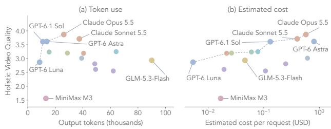  
Figure 8. Output tokens (a) and estimated API cost (b) versus mean holistic video quality for all 15 models, with selected models labeled. Dashed lines indicate the Pareto frontier.

Table 5. Gemini 3.8 Flash judge validation. Human Alignment uses Pearson’s r, and Repeat Stability uses ICC(A,3) on 300 outputs.
<table><tr><td>Metric</td><td>Human Alignment</td><td>Repeat Stability</td></tr><tr><td>Instruction Following</td><td>0.796</td><td>0.983</td></tr><tr><td>Holistic Video Quality</td><td>0.783</td><td>0.970</td></tr></table>

## 6. Conclusion

We introduce Code2Video-Compass, a general-purpose benchmark for complete code-based video generation across T2V, I2V, and V2V, comprising 2,104 diverse tasks and a comprehensive dual-level evaluation framework. Evaluation of 15 MLLMs reveals persistent challenges in execution reliability, instruction following, reference fidelity, and handling increasing task complexity. We believe that Code2Video-Compass provides valuable insights into the limitations of current MLLMs and serves as a diagnostic testbed for advancing reliable, coherent, and high-quality code-based video generation.

## References

[1] Aesthetic Predictor V2.5. https://github.com/ discus0434/aesthetic- predictor- v2- 5, n.d. Official implementation and model documentation. Accessed October 11, 2026. 5

[2] Anthropic. Claude Haiku 5.5. https://platform. claude . com / docs / en / models / haiku - 5 - 5 / overview, n.d.. Official model documentation. Accessed October 13, 2026. 6

[3] Anthropic. Claude Opus 5.5. https://platform. claude . com / docs / en / models / opus - 5 - 5 / overview, n.d.. Official model documentation. Accessed October 11, 2026. 2

[4] Anthropic. Claude Sonnet 5.5. https://platform. claude.com/docs/en/models/sonnet- 5- 5/ overview, n.d.. Official model documentation. Accessed October 13, 2026. 6

[5] Art of the Title. https://www.artofthetitle. com/, n.d. 3

[6] Artificial Analysis. Comparison of Models: Intelligence, Performance & Price Analysis. https : / / artificialanalysis.ai/models, n.d. Model comparison dashboard. Accessed October 20, 2026. 5

[7] Behance. Motion Graphics. https://www.behance. net/galleries/motion/motion-graphics, n.d. 3

[8] Bilibili. https://www.bilibili.com/, n.d. 4

[9] Emanuele Bugliarello, H. Hernan Moraldo, Ruben Villegas, et al. StoryBench: A Multifaceted Benchmark for Continuous Story Visualization. In Advances in Neural Information Processing Systems, Datasets and Benchmarks Track, 2023. 2

[10] Zhe Cao, Tao Wang, Jiaming Wang, et al. T2AV-Compass: Towards Unified Evaluation for Text-to-Audio-Video Generation. In Proceedings of the 43rd International Conference on Machine Learning, pages 11536–11580, 2026. 2, 3

[11] Davie Chen. SciDraw-6K: A Multilingual Scientific Illustration Dataset Generated by Google Gemini. https: //doi.org/10.5281/zenodo.19642870, 2026. 4

[12] Junhao Chen, Kejun Gao, Yuehan Cui, et al. LottieGPT: Tokenizing Vector Animation for Autoregressive Generation. In Proceedings of the IEEE/CVF Conference on Computer Vision and Pattern Recognition, 2026. 2

[13] Yanzhe Chen, Kevin Qinghong Lin, and Mike Zheng Shou. Code2Video: A Code-centric Paradigm for Educational Video Creation. In Proceedings ofthe 43rd International Conference on Machine Learning, pages 15370–15396, 2026. 2, 3

[14] DeepSeek AI. DeepSeek-V4.1-Flash: Smarter, Faster, More Efficient. https://api- docs.deepseek. com/news/news260910/, 2026. Official model release, September 10, 2026. Accessed October 11, 2026. 6

[15] FAISS. Faiss Indexes. https://github.com/ facebookresearch / faiss / wiki / Faiss indexes, n.d. Official software documentation. Accessed October 11, 2026. 4

[16] Weixi Feng, Jiachen Li, Michael Saxon, Tsu-Jui Fu, Wenhu Chen, and William Yang Wang. TC-Bench: Benchmarking

Temporal Compositionality in Conditional Video Generation. In Findings of the Association for Computational Linguistics: ACL, pages 4638–4662, 2025. 2

[17] Stephanie Fu, Netanel Tamir, Shobhita Sundaram, Lucy Chai, Richard Zhang, Tali Dekel, and Phillip Isola. DreamSim: Learning New Dimensions of Human Visual Similarity using Synthetic Data. In Advances in Neural Information Processing Systems, 2023. 6

[18] Google. Gemini 3.8 Flash. https://ai.google.dev/ gemini-api/docs/models/gemini-3.8-flash, n.d. Official model documentation. Accessed October 11, 2026. 2, 4, 5, 6

[19] Mingfei Han, Linjie Yang, Xiaojun Chang, Lina Yao, and Heng Wang. Shot2Story: A New Benchmark for Comprehensive Understanding of Multi-shot Videos. In Proceedings of the International Conference on Learning Representations, 2025. 3

[20] Elad Hirsch, Shubham Yadav, Mohit Garg, and Purvanshi Mehta. LICA: Layered Image Composition Annotations for Graphic Design Research. arXiv preprint arXiv:2603.16098, 2026. 4

[21] Daili Hua, Xizhi Wang, Bohan Zeng, et al. VABench: A Comprehensive Benchmark for Audio-Video Generation. In Proceedings of the IEEE/CVF Conference on Computer Vision and Pattern Recognition, 2026. 3

[22] Ziqi Huang, Yinan He, Jiashuo Yu, et al. VBench: Comprehensive Benchmark Suite for Video Generative Models. In Proceedings of the IEEE/CVF Conference on Computer Vision and Pattern Recognition, pages 21807–21818, 2024. 2, 3

[23] Ziqi Huang, Fan Zhang, Xiaojie Xu, et al. VBench++: Comprehensive and Versatile Benchmark Suite for Video Generative Models. IEEE Transactions on Pattern Analysis and Machine Intelligence, 48(3):3268–3285, 2026. 2

[24] Anya Ji, Abhijith Varma Mudunuri, David M. Chan, et al. Animation2Code: Evaluating Temporal Visual Reasoning in Video-to-Code Generation. arXiv preprint arXiv:2606.28593, 2026. 2, 3

[25] Jitter. Free motion graphics templates. https://jitter. video/templates/, n.d. 3

[26] Nikita Karaev, Yuri Makarov, Jianyuan Wang, Natalia Neverova, Andrea Vedaldi, and Christian Rupprecht. Co-Tracker3: Simpler and Better Point Tracking by Pseudo-Labelling Real Videos. In Proceedings of the IEEE/CVF International Conference on Computer Vision, pages 6013– 6022, 2025. 6

[27] Mingxin Li, Yanzhao Zhang, Dingkun Long, et al. Qwen3- VL-Embedding and Qwen3-VL-Reranker: A Unified Framework for State-of-the-Art Multimodal Retrieval and Ranking. arXiv preprint arXiv:2601.04720, 2026. 5

[28] Zhen Li, Zuo-Liang Zhu, Ling-Hao Han, Qibin Hou, Chun-Le Guo, and Ming-Ming Cheng. AMT: All-Pairs Multi-Field Transforms for Efficient Frame Interpolation. In Proceedings ofthe IEEE/CVF Conference on Computer Vision and Pattern Recognition, pages 9801–9810, 2023. 5

[29] Feng Liang, Bichen Wu, Jialiang Wang, Licheng Yu, Kunpeng Li, Yinan Zhao, Ishan Misra, Jia-Bin Huang, Peizhao

Zhang, Peter Vajda, and Diana Marculescu. Flowvid: Taming imperfect optical flows for consistent video-to-video synthesis. In 2024 IEEE/CVF Conference on Computer Vision and Pattern Recognition (CVPR), pages 8207–8216, 2024. 2

[30] Tengfei Liu, Yang Shi, Xuanyu Zhu, et al. LongAV-Compass: Towards Unified Evaluation of Minute-Scale Audio-Visual Generation Across T2AV, I2AV, and V2AV. arXiv preprint arXiv:2605.26244, 2026. 2, 3

[31] Vivian Liu, Rubaiat Habib Kazi, Li-Yi Wei, Matthew Fisher, Timothy Langlois, Seth Walker, and Lydia Chilton. Logo-Motion: Visually-Grounded Code Synthesis for Creating and Editing Animation. In Proceedings ofthe CHI Conference on Human Factors in Computing Systems, 2025. 2

[32] Yaofang Liu, Xiaodong Cun, Xuebo Liu, et al. EvalCrafter: Benchmarking and Evaluating Large Video Generation Models. In Proceedings of the IEEE/CVF Conference on Computer Vision and Pattern Recognition, 2024. 2

[33] Ziyuan Liu, Shizhao Sun, Danqing Huang, et al. DesignAsCode: Bridging Structural Editability and Visual Fidelity in Graphic Design Generation. arXiv preprint arXiv:2602.17690, 2026. 2

[34] Jiaju Ma and Maneesh Agrawala. MoVer: Motion Verification for Motion Graphics Animations. ACM Transactions on Graphics, 44(4):33:1–33:17, 2025. 2

[35] Ridwan Mahbub, Syem Aziz, Mizanur Rahman, et al. DATA-REEL: Automated Data-Driven Video Story Generation with Animations. arXiv preprint arXiv:2604.25220, 2026. 2

[36] Jordan Meyer, Nick Padgett, Cullen Miller, and Laura Exline. Public Domain 12M: A Highly Aesthetic Image-Text Dataset with Novel Governance Mechanisms. arXiv preprint arXiv:2410.23144, 2024. 4

[37] MiniMax. Models. https://platform.minimax. io/docs/guides/models-intro, n.d. MiniMax API documentation. Accessed October 20, 2026. 6

[38] Moonshot AI. Kimi K3. https://huggingface.co/ moonshotai/Kimi-K3, n.d. Official model card. Accessed October 11, 2026. 2, 6

[39] Ahmed Nassar, Matteo Omenetti, Maksym Lysak, Nikolaos Livathinos, Christoph Auer, Lucas Morin, Rafael Teixeira de Lima, Yusik Kim, A. Said Gurbuz, Michele Dolfi, and Peter W. J. Staar. SmolDocling: An ultra-compact vision-language model for end-to-end multi-modal document conversion. In Proceedings of the IEEE/CVF International Conference on Computer Vision, pages 21972–21983, 2025. 4

[40] OpenAI. GPT-6.1 Sol Model. https://developers. openai.com/api/docs/models/gpt- 6.1- sol, n.d.. Official model documentation. Accessed October 13, 2026. 4, 6

[41] OpenAI. GPT-6 Astra Model. https://developers. openai.com/api/docs/models/gpt-6-astra, n.d.. Official model documentation. Accessed October 11, 2026. 2

[42] OpenAI. GPT-6 Luna Model. https://developers. openai.com/api/docs/models/gpt- 6- luna, n.d.. Official model documentation. Accessed October 13, 2026. 6

[43] Ed Pizzi, Sreya Dutta Roy, Sugosh Nagavara Ravindra, Priya Goyal, and Matthijs Douze. A Self-Supervised Descriptor

for Image Copy Detection. In Proceedings ofthe IEEE/CVF Conference on Computer Vision and Pattern Recognition, pages 14532–14542, 2022. 4

[44] Qwen Team. Qwen3.8-Max. https://www.qwencloud. com/models/qwen3.8-max, n.d. Official model documentation. Accessed October 11, 2026. 2, 6

[45] REDnote. REDnote (Xiaohongshu). https://www. xiaohongshu.com/, n.d. 4

[46] Remotion. Make videos programmatically. https://www. remotion.dev/, n.d. Official Remotion website and documentation. Accessed October 20, 2026. 2, 3

[47] Sentence Transformers. all-MiniLM-L6-v2. https : //huggingface.co/sentence- transformers/ all-MiniLM-L6-v2, n.d. Official model card and configuration. Accessed October 11, 2026. 4

[48] Haoyuan Shi, Yunxin Li, Nanhao Deng, et al. MSVBench: Towards Human-Level Evaluation of Multi-Shot Video Generation. arXiv preprint arXiv:2602.23969, 2026. 2

[49] Takahiro Shirakawa, Tomoyuki Suzuki, Takuto Narumoto, and Daichi Haraguchi. MG-Gen: Single Image to Motion Graphics Generation. In Proceedings ofthe IEEE/CVF International Conference on Computer Vision Workshops, pages 3554–3563, 2025. 2

[50] Oriane Simeoni, Huy V. Vo, Maximilian Seitzer, et al. DI-´ NOv3. Transactions on Machine Learning Research, 2026. 6

[51] Kaiyue Sun, Kaiyi Huang, Xian Liu, et al. T2V-CompBench: A Comprehensive Benchmark for Compositional Text-tovideo Generation. In Proceedings of the IEEE/CVF Conference on Computer Vision and Pattern Recognition, pages 8406–8416, 2025. 2

[52] Yuqi Tang, Tengfei Liu, Yizheng Lai, et al. KeyFrame-Compass: Towards Comprehensive Evaluation of Keyframe-Conditioned Video Generation. arXiv preprint arXiv:2607.14202, 2026. 2

[53] Haomin Wang, Jinhui Yin, Qi Wei, et al. InternSVG: Towards Unified SVG Tasks with Multimodal Large Language Models. In Proceedings of the International Conference on Learning Representations, 2026. 2, 3

[54] Wenhao Wang and Yi Yang. VidProM: A Million-scale Real Prompt-Gallery Dataset for Text-to-Video Diffusion Models. In Advances in Neural Information Processing Systems, Datasets and Benchmarks Track, 2024. 3

[55] Yi Wang, Yinan He, Yizhuo Li, et al. InternVid: A Largescale Video-Text Dataset for Multimodal Understanding and Generation. In Proceedings ofthe International Conference on Learning Representations, 2024. 5

[56] Zhou Wang, Alan C. Bovik, Hamid R. Sheikh, and Eero P. Simoncelli. Image Quality Assessment: From Error Visibility to Structural Similarity. IEEE Transactions on Image Processing, 13(4):600–612, 2004. 6

[57] Haoning Wu, Erli Zhang, Liang Liao, et al. Exploring Video Quality Assessment on User Generated Contents from Aesthetic and Technical Perspectives. In Proceedings of the IEEE/CVF International Conference on Computer Vision, pages 20144–20154, 2023. 5

[58] X. https://x.com/, n.d. 4

[59] Xiaomi MiMo. MiMo-V2.6-Pro. https://mimo.mi. com/models/zh-CN/mimo-v2.6-pro, n.d. Official model page. Accessed October 20, 2026. 6

[60] An Yang, Anfeng Li, Baosong Yang, et al. Qwen3 Technical Report. arXiv preprint arXiv:2505.09388, 2025. 3

[61] YouTube. https://www.youtube.com/, n.d. Accessed October 12, 2026. 3, 4

[62] Abhay Zala, Miao Yang, Wenbo Zhu, Bin Liu, and Kaggle Team. Benchmarking Code-to-Video: Evaluating AI Agents on the Art of Motion Design. https: //www.heygen.com/research/introducingcode2video-benchmark, 2026. September 18, 2026. Accessed October 20, 2026. 2, 3

[63] Zhongwei Zhang, Fuchen Long, Yingwei Pan, Zhaofan Qiu, Ting Yao, Yang Cao, and Tao Mei. TRIP: Temporal Residual Learning with Image Noise Prior for Image-to-Video Diffusion Models. In Proceedings of the IEEE/CVF Conference on Computer Vision and Pattern Recognition (CVPR), pages 8671–8681, 2024. 2

[64] Zhipu AI. GLM-5.3-Flash/FlashX. https://docs. bigmodel.cn/cn/guide/models/vlm/glm-5.3- flash, n.d. Official model documentation. Accessed October 11, 2026. 6