# Continual Concept Personalization in Diffusion Models via Residual-Space Adaptation

Yuzhi Liu∗ Enis Simsar Giulia Lanzillotta Thomas Hofmann ETH Zurich¨

## Abstract

Text-to-image personalization aims to equip pretrained diffusion models with the ability to learn user-specific concepts from only a few reference images. Existing methods, however, typically train each concept independently or assume that all concepts are available simultaneously. In practical applications, concepts often arrive sequentially, requiring models to continually learn new subjects, objects, or styles while minimizing interference with previously acquired concepts. We address this continual concept personalization setting by extending residual-space adaptation to the stochastic adaptation process of pretrained diffusion models. Our work achieves the highest concept fidelity among competing continual personalization methods while maintaining near-zero forgetting. Beyond these empirical gains, the learned residual-space dynamics reveal where adaptation capacity is concentrated within the diffusion model. Restricting adaptation to the identified layers preserves nearly the same performance while reducing the number of trainable parameters by up to 72%, demonstrating that residual-space dynamics can identify the layers that contribute most to continual concept personalization and directly guide more parameter-efficient adaptation.

## 1 Introduction

Recent text-to-image models such as Stable Diffusion [15, 17] and FLUX [11] have enabled highquality image synthesis from natural language descriptions, making generative models increasingly accessible to end users. Their flexibility has further motivated personalization methods that adapt pretrained models to user-specific concepts, subjects, objects, or artistic styles from only a few examples.

Personalization methods commonly rely on parameter-efficient fine-tuning techniques such as LoRA [9] to adapt pretrained diffusion models to new concepts. Most existing approaches [7, 10, 14, 21] perform a separate fine-tuning procedure for every concept, and subsequently merge the resulting adapters into a unified personalized model. In many practical scenarios, however, concepts are acquired sequentially over time as new subjects, objects, or styles become available. Under this setting, whenever a new concept is introduced, the expensive merging procedure must be repeated to reconstruct the final personalized model. As the number of concepts grows, this repeated merging process becomes increasingly inefficient. This motivates continual concept personalization, where a single model is updated incrementally to incorporate new concepts while preserving previously acquired ones. The main obstacle to continual concept personalization is interference: learning new concepts can degrade performance on previously learned concepts. At the same time, the fixed model capacity must be used parsimoniously to preserve sufficient adaptation capacity for future concepts. Several continual learning methods [1, 4, 12, 19] achieve low levels of interference by constraining the parameter update to a pre-computed safe subspace. The most successful among these rely on layer-wise input statistics to characterize the safe subspace. This procedure cannot be directly extended to stochastic backbones, thus limiting its applicability in image generation tasks. In this work, we bridge this gap, extending residual-space adaptation to stochastic diffusion models for continual concept personalization. In particular, our starting point is an adapted version of DyRA [1] into diffusion models, a recent method which we choose for its elegant formulation and explicit theoretical guarantees. We also introduce a novel systematic evaluation framework for continual concept personalization and show that the resulting residual-space dynamics reveal layerwise specialization, providing a practical tool for guiding parameter-efficient adaptation.

Contributions. Our contributions are as follows:

• We extend residual-space adaptation from deterministic language models to stochastic diffusion training, providing a new competitive option for continual concept personalization that mitigates interference while maintaining adaptivity at low cost.

• We introduce a systematic evaluation framework for continual personalization that captures concept fidelity, going beyond judging only image-generation quality.

• We show that residual-space dynamics can serve as an efficient probe for identifying the layers that contribute most to continual concept adaptation, providing insights into layerwise specialization and guiding more targeted parameter-efficient fine-tuning strategies.

## 2 Related Work

## 2.1 Diffusion Personalization

Text-to-image personalization has been widely studied for adapting pretrained diffusion models to user-specific identities, objects, or styles from only a few examples. Early approaches such as Textual Inversion [6] learn new concepts in the text embedding space while keeping the diffusion model fixed. DreamBooth [18] improves personalization quality by fine-tuning the diffusion model using a prior-preservation objective. Subsequent methods such as Custom Diffusion [10] restrict adaptation to selected cross-attention layers, improving parameter efficiency while supporting multi-concept customization. More recent personalization methods increasingly adopt parameter-efficient finetuning techniques such as LoRA. Mix-of-Show [7] introduces ED-LoRA together with structured concept tokens for multi-concept personalization, while LoRACLR [21] improves composition through contrastive alignment of independently trained adapters.

Another line of work reduces interference through the design of the adaptation space itself. Orthogonal Adaptation (OA) [14] constructs approximately orthogonal LoRA subspaces, allowing independently trained adapters to be combined through simple summation with minimal interference. Although originally proposed in a non-continual setting, its orthogonal structure naturally lends itself to sequential adaptation. Overall, most existing personalization methods assume that all concepts are jointly available during training or are learned independently and combined afterward, and are therefore not explicitly designed for continual settings.

## 2.2 Continual Adaptation

Continual learning methods [8] operate in a sequential training fashion, aiming to preserve knowledge and plasticity over time. Classical approaches rely on regularization, replay, or gradient projection mechanisms to mitigate catastrophic forgetting [23].

Within diffusion adaptation, C-LoRA [22] extends Custom Diffusion to a sequential setting by introducing regularization to preserve earlier concepts. Orthogonal Adaptation [14] can also be naturally extended to continual settings through additive composition of orthogonal adapters.

Several methods constrain the parameter update to a safe subspace based on the layer-wise input statistics. Among these, Gradient Projection Memory (GPM) [19] estimates layer-wise feature covariance from previous tasks and constrains the new updates to its low-energy subspace. The more recent InfLoRA [12] applies the same strategy to LoRA-based fine-tuning, where each task is learned within a fixed low-rank budget. Building upon InfLoRA, Barinka et al. [1] propose a dynamic rank allocation method with simplified updates which allows for significant capacity savings. In addition to providing theoretical guarantees for mitigating forgetting, the method demonstrates strong empirical performance on challenging continual language model adaptation tasks.

Although effective, these approaches have been studied primarily in deterministic architectures. Whether residual-space methods remain effective in stochastic diffusion training, where layer statistics are influenced by sampled noise, remains unexplored.

## 2.3 Evaluation of Personalized Generative Models

Evaluating personalized generative models typically involves measuring text alignment, image similarity, and identity preservation. Text alignment is commonly assessed using CLIP-based [16] text-image similarity, which measures whether generated images are semantically consistent with their prompts. Image alignment metrics compare generated images with reference examples, often using CLIP image embeddings. Several works additionally evaluate identity preservation through specialized recognition models such as ArcFace [3]. However, these metrics are mainly designed for human faces and do not generalize to arbitrary objects.

Beyond specialized identity metrics, a variety of pretrained embedding models have been used to assess perceptual similarity. CLIP [16] is trained on large-scale image–text pairs and provides representations that emphasize global semantic correspondence between images and language. In contrast, DINO-based models [2, 13, 20] learn self-supervised visual representations without text supervision and preserve fine-grained visual structure and local semantic information. DreamSim [5] combines multiple pretrained visual embeddings together with human similarity annotations, leveraging both global semantic understanding and fine-grained visual details to produce perceptual representation that closely align with human judgments.

Overall, most existing evaluation protocols are designed for static personalization settings and do not measure identity preservation or forgetting over time.

## 3 Evaluating Continual Performance

Evaluating continual text-to-image personalization requires measuring not only the quality of generated images but also how well previously learned concepts are preserved throughout sequential adaptation. Unlike discriminative tasks, where forgetting can be directly quantified through accuracy, there is no canonical notion of forgetting for generative models. As discussed in Section 2.3, existing evaluation protocols are primarily designed for static personalization settings and focus on aggregate measures of text or image alignment. In order to assess the degradation of the concept identity over time, it is important to have metrics that distinguish concept fidelity from general image quality. To address this problem, we first introduce a concept-level fidelity measure that quantifies how faithfully a personalized concept is preserved. We then derive continual evaluation metrics directly from this quantity.

## 3.1 Concept Fidelity

Our objective is to evaluate the personalized concept itself rather than the similarity between individual images. A generated image may differ substantially from its reference in pose, background, or artistic style while still faithfully depicting the same concept. We therefore introduce concept fidelity, which measures similarity at the concept level rather than the image level.

To quantify concept fidelity, we first measure similarity between individual generated and reference images in a learned embedding space. Given an embedding function $F ( \cdot )$ , we define the similarity between two images $i _ { 1 }$ and $i _ { 2 }$ as

$$
\sin ( i _ { 1 } , i _ { 2 } ) = \cos \left( F ( i _ { 1 } ) , F ( i _ { 2 } ) \right) .\tag{1}
$$

While image similarity is defined between individual image pairs, the fidelity of a personalized concept should be assessed from a set of generated images rather than a single sample. We therefore generalize the image-level similarity measure by aggregating pairwise similarities across the generated and reference image sets.

Let $G = \{ g _ { 1 } , \dots , g _ { m } \}$ denote the generated images corresponding to a personalized concept and let $I = \{ i _ { 1 } , \ldots , i _ { n } \}$ denote the associated reference images. The concept fidelity score is defined as

$$
S ( G , I ) = { \frac { 1 } { | G | | I | } } \sum _ { g \in G } \sum _ { i \in I } \sin ( g , i ) .\tag{2}
$$

This concept fidelity score extends image-level similarity to a set of generated images, providing a single measure of how well a model preserves a personalized concept.

We consider several pretrained embedding models, including CLIP [16], DINO [20], and Dream-Sim [5], as candidates for computing concept fidelity. Figure 1 provides a qualitative example of nearest-neighbor retrieval using the distance (1 − sim), where sim denotes the similarity score defined in Eq. (1). DreamSim retrieves images belonging to the same personalized concept despite variations in pose and background, whereas CLIP and DINO retrieve visually similar images from different concepts. Our quantitative comparison in Appendix A further supports that image similarity in the DreamSim embedding space best reflects concept-level similarity. We therefore adopt DreamSim as the default embedding model throughout the paper.

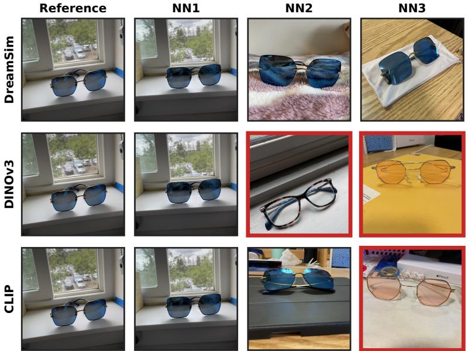  
Figure 1. Nearest-neighbor retrieval for one reference image across embedding spaces. Red frames indicate retrieved images that belong to a different concept than the query.

## 3.2 Final Fidelity and Forgetting Metrics

Using the concept fidelity score, we now define continual evaluation metrics that summarize model performance throughout sequential adaptation.

Let N denote the total number of concepts. For concept $k ,$ let $G _ { k } ^ { ( T ) }$ denote the generated images after all concepts have been learned.

Final concept fidelity. We define the final concept fidelity as:

$$
Q = \frac { 1 } { N } \sum _ { k = 1 } ^ { N } S \left( G _ { k } ^ { ( T ) } , I _ { k } \right) ,\tag{3}
$$

which characterizes the average concept fidelity retained at the end of continual training.

Forgetting dynamics and final forgetting. To investigate the dynamics of forgetting throughout training, let $t _ { k }$ denote the training stage immediately after learning concept k. We define the average forgetting trajectory at training stage $t \geq t _ { k }$ as

$$
F ( t ) = \frac { 1 } { n _ { t } } \sum _ { k = 1 } ^ { n _ { t } } \left[ S \left( G _ { k } ^ { ( t _ { k } ) } , I _ { k } \right) - S \left( G _ { k } ^ { ( t ) } , I _ { k } \right) \right] ,\tag{4}
$$

where $n _ { t }$ is the number of concepts that have been learned by stage t. The trajectory measures the average loss of concept fidelity as new concepts are acquired.

The final forgetting is defined as

$$
F = F ( T ) ,\tag{5}
$$

which measures the average loss of concept fidelity after continual training.

Together, $Q$ summarizes the model’s average concept fidelity after continual training, while $F ( t )$ characterizes the forgetting dynamics throughout sequential adaptation.

## 4 Residual-Space Adaptation in Diffusion

We build upon the residual-space adaptation framework DyRA [1], originally designed for LLMs, which constructs layer-wise adaptation subspaces from the input representations. Applying this framework to diffusion models is nontrivial, as these representations depend not only on the input concept but also on the randomly sampled diffusion noise and denoising timestep. We therefore first review the residual-space adaptation procedure and then develop a stochastic interpretation that justifies applying the framework to diffusion models and motivates our implementation.

## 4.1 Background: DyRA

We consider a sequence of concept personalization tasks $\{ \mathcal { D } _ { t } \} _ { t = 1 } ^ { T }$ , where each task introduces a new concept t and training is performed sequentially. Following [1], each adapted layer l is parameterized by a LoRA update

$$
\Delta W _ { t } ^ { ( l ) } = A _ { t } ^ { ( l ) } B _ { t } ^ { ( l ) } ,\tag{6}
$$

where $B _ { t } ^ { ( l ) }$ is initialized before training and kept fixed, while only $A _ { t } ^ { ( l ) }$ is optimized. The accumulated model after task t is

$$
\boldsymbol { W } _ { t } ^ { ( l ) } = \boldsymbol { W } ^ { ( l ) } + \sum _ { i = 1 } ^ { t } \Delta \boldsymbol { W } _ { i } ^ { ( l ) } .\tag{7}
$$

The key idea of DyRA is to restrict learning to feature directions that are informative for the current task while avoiding directions already captured by previous tasks. For each adapted layer, the method applies a spectral decomposition of the input features matrix from all tasks, and identifies therein directions unique to the current task, i.e. the residual space leftover from previous tasks. Since different layers exhibit different residual-space spectra, the number of informative directions also varies, motivating adaptive rank allocation instead of a fixed LoRA rank.

Concretely, the procedure for each adapted layer consists of three steps:

1. Estimate the input subspace most representative of previous tasks, named $\mathcal { M } _ { t - 1 } ^ { ( l ) }$

2. Project the current task input space $\mathcal { H } _ { t } ^ { ( l ) }$ onto the orthogonal complement of $\mathcal { M } _ { t - 1 } ^ { ( l ) }$ to obtain the residual space.

3. Initialize the LoRA down-projection matrix $B _ { t } ^ { ( l ) }$ in the residual space, picking only directions with singular values above a given threshold τ. During training, $B _ { t } ^ { ( l ) }$ remains fixed and only the corresponding up-projection matrix $A _ { t } ^ { ( l ) }$ is optimized.

Importantly, it is the threshold which implicitly determines the layer-wise rank. This is the key to flexible rank allocation.

## 4.2 A Stochastic Formulation for Diffusion

A key step of residual-space adaptation is constructing the residual space from layer input representations collected before training each task. For deterministic backbones, this procedure is well defined since each training sample corresponds to a unique layer input. Diffusion models, however, introduce an additional source of stochasticity through the sampled diffusion noise and denoising timestep, so the layer input of a training sample is no longer unique. This raises the central question of this section: how should the layer input space $\mathcal { H } _ { t } ^ { ( l ) }$ be estimatedfor residual-space construction?

Start by interpreting the layer input as the random variable

$$
x _ { t } ^ { ( l ) } = x _ { t } ^ { ( l ) } ( s , \epsilon ) ,\tag{8}
$$

where $\epsilon \sim \mathcal { N } ( 0 , I )$ denotes the sampled diffusion noise and s denotes the sampled denoising timestep.

Extending the deterministic interference measure in $[ 1 ] , \| B _ { j } ^ { ( l ) } x _ { i } ^ { ( l ) } \| ^ { 2 }$ to its expectation, consider the following stochastic interpretation of residual-space adaptation: projection directions should maximize the expected adaptation ability of the current task while suppressing the expected interference with previously learned tasks,

$$
\begin{array} { r l } { \underset { B _ { j } ^ { ( l ) } } { \operatorname* { m a x } } } & { \mathbb { E } _ { s , \epsilon } \left[ \left\| B _ { j } ^ { ( l ) } x _ { j } ^ { ( l ) } \right\| ^ { 2 } \right] } \\ { \mathrm { s . t . } } & { \mathbb { E } _ { s , \epsilon } \left[ \left\| B _ { j } ^ { ( l ) } x _ { i } ^ { ( l ) } \right\| ^ { 2 } \right] \leq \delta , \quad i < j . } \end{array}\tag{9}
$$

From this interpretation the answer to our question directly follows. Since the optimization objective is defined over the training distribution of diffusion noise and denoising timesteps, the collected layer inputs should provide an empirical estimate of the same distribution. Therefore, layer inputs are collected using exactly the same sampling strategy as diffusion training, namely Gaussian noise with uniformly sampled denoising timesteps. This simple step extends residual-space adaptation from deterministic feature representations to stochastic diffusion training by aligning the feature collection procedure with the stochastic optimization objective. Detailed implementation and derivation are provided in Appendix B.

## 5 Stable Continual Personalization

This section evaluates whether residual-space adaptation can be successfully extended to continual diffusion personalization. We first assess its ability to preserve concept fidelity while mitigating forgetting throughout continual learning, and then examine scalability and capacity preservation.

## 5.1 Experimental Setup

We conduct all experiments on Concept101 [10], a benchmark containing 101 concepts spanning 17 semantic classes, including visually similar concepts, making it particularly suitable for studying interference and identity preservation in continual learning. All concepts are learned sequentially in a rehearsal-free setting, where only the current concept data are available during training. Unless otherwise stated, all methods follow the same randomly shuffled task ordering. Throughout the experiments, we denote DyRA configured with the sigular value threshold τ as DyRA-τ. We compare DyRA with $\tau \in \{ 0 . 5 , 1 . 0 \}$ against three continual LoRA baselines: Trainable-AB, which optimizes both LoRA projection matrices A, B and corresponds to a continual variant of Mix-of-Show [7]; Rank-Fixed-B, which optimizes only the LoRA up-projection A while keeping the randomly initialized down-projection B fixed; and OA, the continual version of Orthogonal Adaptation [14]. Unless otherwise specified, all methods adapt the linear projections in the transformer blocks of both the text encoder and the UNet, and all fixed-rank methods use rank $r = 4 .$ . All experiments are conducted on Stable Diffusion v1.5 [17]. Models are periodically evaluated throughout continual training. For each concept, images are generated using only the learned concept token as the prompt, without additional textual descriptions, thereby isolating the learned concept representation and enabling a direct comparison of concept fidelity across methods. At the end of training, we further validate the model using diverse prompt templates. Additional implementation details and training hyperparameters are provided in Appendix C.

## 5.2 Concept Fidelity and Forgetting

Quantitative Results. Table 1 summarizes the final concept fidelity (Q) and forgetting (F). Trainable-AB achieves competitive concept fidelity but exhibits the largest forgetting, highlighting the trade-off between adapting to new concepts and preserving previously learned ones. In contrast, Rank-Fixed-B and OA effectively suppress forgetting but achieve slightly lower concept fidelity. DyRA maintains negligible forgetting while achieving the highest concept fidelity. These results demonstrate that residual-space adaptation extends effectively to the stochastic training process of diffusion models.

<table><tr><td>Method</td><td>Q↑</td><td>F↓</td></tr><tr><td>Trainable-AB</td><td> $0 . 6 3 9 2 \pm 0 . 0 0 1 5$ </td><td> $0 . 0 3 6 8 \pm 0 . 0 0 1 4$ </td></tr><tr><td>Rank-Fixed-B</td><td> $0 . 6 4 4 2 \pm 0 . 0 0 2 9$ </td><td> $\mathbf { - 0 . 0 0 3 3 \pm 0 . 0 0 2 0 }$ </td></tr><tr><td>OA</td><td> $0 . 6 4 3 5 \pm 0 . 0 0 3 1$ </td><td> $- 0 . 0 0 2 3 \pm 0 . 0 0 0 3$ </td></tr><tr><td>DyRA-0.5</td><td>0.6454 ± 0.0022</td><td> $0 . 0 0 0 2 \pm 0 . 0 0 0 1$ </td></tr><tr><td>DyRA-1.0</td><td>0.6497 ± 0.0008</td><td> $- 0 . 0 0 0 1 \pm 0 . 0 0 0 7$ </td></tr></table>

Table 1. Concept fidelity (Q) and forgetting (F) scores. Values are mean ± SD over three seeds.

Qualitative Results. The quantitative improvements are also reflected in the generated images. Figure 2a tracks concept pet dog2, introduced at task 14, from the moment it is learned to the final model. As additional concepts are introduced, Trainable-AB exhibits the largest appearance drift, Rank-Fixed-B and OA preserve the concept with only minor degradation, and DyRA remains nearly unchanged. Figure 2b shows that DyRA maintains high concept fidelity under diverse prompt templates, demonstrating generalization beyond the token-only prompts used during continual evaluation.

Forgetting dynamics. While Table 1 summarizes the final forgetting score, Figure 3 reveals how forgetting evolves throughout continual learning. Trainable-AB oscillates around substantially higher forgetting values, indicating persistent forgetting throughout the training process. In contrast, Rank-Fixed-B, OA, and DyRA all fluctuate closely around zero, demonstrating that their low forgetting is maintained consistently over time rather than occurring only at the final evaluation. Figure 4 provides a zoomed-in view, enabling a clearer comparison of the forgetting dynamics among Rank-Fixed-B, OA, and DyRA.

Overall, the quantitative metrics, qualitative generations, and forgetting trajectories consistently demonstrate that DyRA preserves high concept fidelity while effectively mitigating catastrophic forgetting.

## 5.3 Dynamic Rank Improves Parameter Efficiency

The performance gains of DyRA stem not only from restricting adaptation to the residual space, but also from allocating adaptation capacity according to the residual-space structure of each layer. We therefore compare DyRA with the fixed-rank OA under different trainable parameter budgets to evaluate the effectiveness of dynamic rank allocation.

Figure 5 compares concept fidelity against the number of trainable parameters for OA with different fixed ranks and DyRA with different singular-value thresholds. Each point corresponds to a different parameter budget. Across the entire range of budgets, DyRA consistently achieves higher concept fidelity than OA with comparable numbers of trainable parameters, demonstrating a superior performance–parameter trade-off.

Notably, even under high singular-value thresholds, where DyRA has substantially fewer trainable parameters, it outperforms OA with considerably larger parameter budgets. These results indicate that allocating rank adaptively according to the residual-space structure is substantially more parameterefficient than assigning a uniform rank to every layer, allowing DyRA to maintain strong concept fidelity under a reduced parameter budget.

## 6 Layer-wise Specialization

Section 5 demonstrated that DyRA achieves strong continual personalization performance while improving parameter efficiency through adaptive rank allocation. Beyond these empirical gains, the adaptive ranks themselves provide a signal of where adaptation capacity is consumed during continual learning, since additional rank is allocated only when new concepts introduce directions outside the accumulated input subspace. This section analyzes these rank dynamics to understand how adaptation capacity is distributed across the layers and how this information can inform future parameter-efficient adaptation.

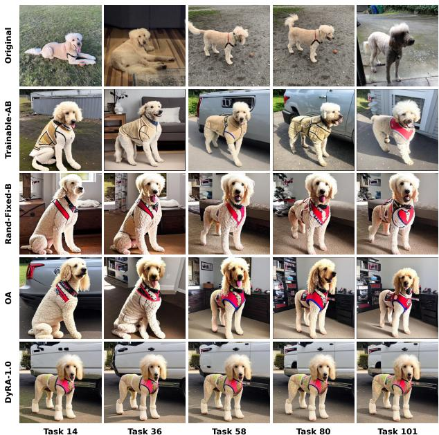

(a) Continual generation across the task sequence. Row 1 shows reference images; rows 2–5 show Trainable-AB, Rank-Fixed-B, OA, and DyRA-1.0.  
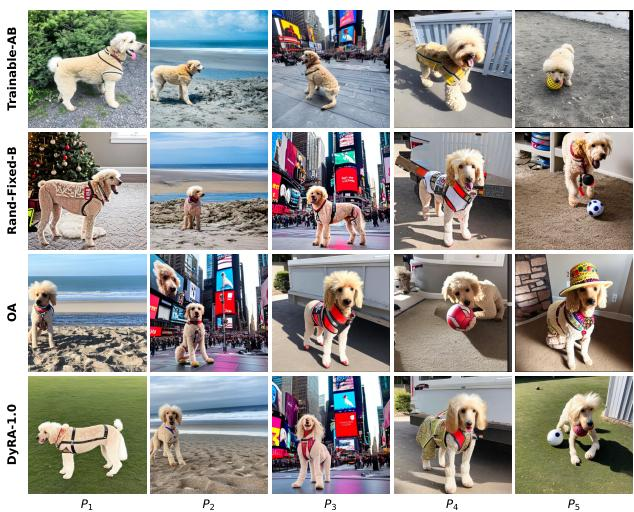  
(b) Final generations under diverse prompt templates. Rows show Trainable-AB, Rank-Fixed-B, OA, and DyRA-1.0.

Figure 2. Qualitative results for concept 14 (pet dog2).  
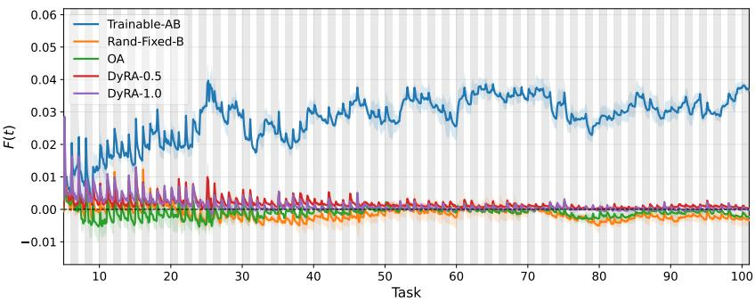  
Figure 3. Forgetting trajectory across continual training. Higher values indicate more forgetting.

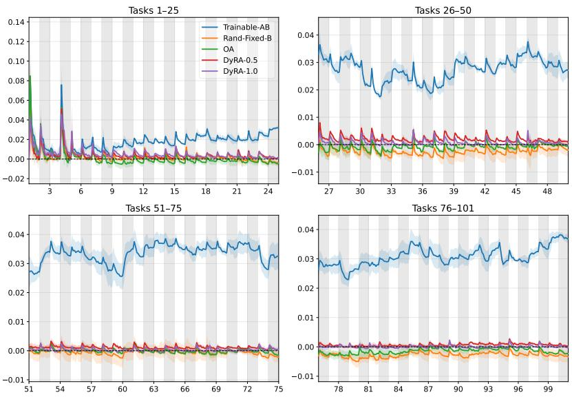  
Figure 4. Zoomed views of the forgetting trajectory over four task intervals.

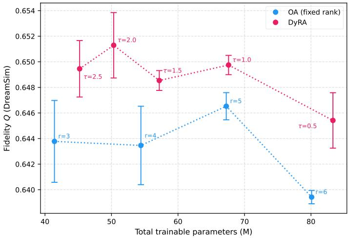  
Figure 5. Parameter-efficiency frontier comparing concept fidelity and trainable parameter count for OA and DyRA variants. Error bars indicate one standard deviation over three random seeds.

## 6.1 Adaptation Capacity Concentration

We first analyze how DyRA distributes adaptation capacity across the adapted layers by averaging the allocated ranks over all 101 concepts. Figure 6 illustrates the average rank allocated to each layer. The x-axis indexes the adapted layers in architectural order, and the corresponding module names are provided in Appendix D.

Rather than allocating the same rank to every layer, DyRA exhibits clear layer-dependent allocation patterns that closely follow the repeated transformer architecture. In the text encoder, the allocated ranks exhibit a four-layer periodicity that exactly mirrors the repeated key(K), value(V), query(Q), and output projection layers within each transformer block. A similar correspondence is observed in the UNet, where every group of eight adapted layers corresponds to the self-attention and cross-attention projections within a transformer block. Within every block, the two dominant rank peaks consistently coincide with the cross-attention key(K) and value(V) projection layers, which repeatedly receive substantially larger ranks than all other projections.

The repeated concentration of residual rank in the UNet cross-attention K,V projections indicates that these layers consistently consume more adaptation capacity than other adapted modules during continual concept personalization. This observation motivates a closer examination of these layers in the following analysis.

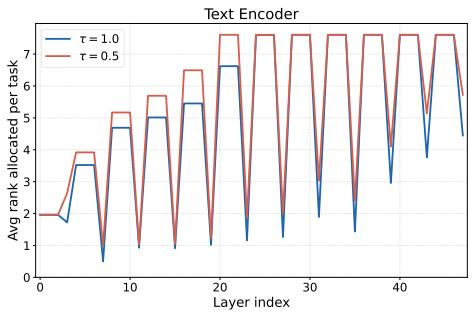

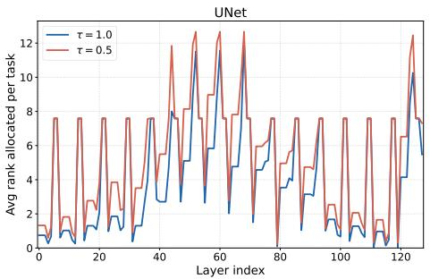  
Figure 6. Average allocated rank per adapted layer over 101 concepts.

## 6.2 Early Capacity Saturation

The UNet cross-attention K,V projections receive the largest residual ranks. We next examine whether exhausting the residual capacity of these layers is associated with degraded adaptation to subsequently learned concepts.

Figure 7 summarizes the remaining rank of every adapted layer after learning all 101 concepts. Under DyRA-0.5, all 32 UNet cross-attention K,V projections become fully saturated, whereas no UNet layer saturates under DyRA-1.0. Figure 8 further illustrates representative remaining-rank trajectories. While non-saturated layers retain sufficient residual capacity throughout training, representative crossattention K,V layers under DyRA-0.5 steadily exhaust their available rank and become saturated around tasks 77–78. In contrast, the corresponding layers under DyRA-1.0 retain residual capacity throughout the entire task sequence.

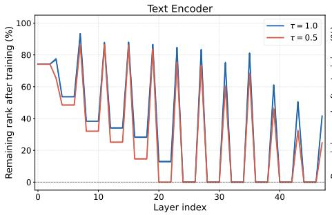

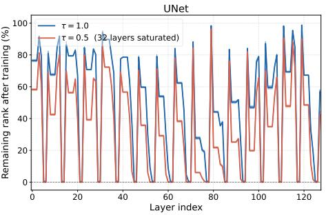  
Figure 7. Remaining rank capacity after 101 tasks.

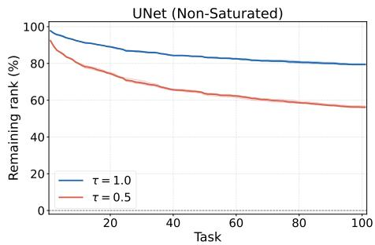

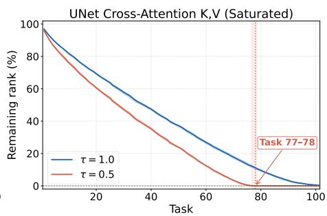  
Figure 8. Representative remaining-rank trajectories of UNet layers: a non-saturated layer (left) and a crossattention K,V layer that saturates under DyRA-0.5 (right).

To assess the effect of this capacity exhaustion, Table 2 compares the final concept fidelity with the average fidelity of the final 20 learned concepts. DyRA-1.0 maintains essentially unchanged performance on later concepts, whereas DyRA-0.5 exhibits a clear late-task fidelity degradation after the cross-attention K,V layers become saturated. Although this evidence is correlational, the consistent agreement between the rank allocation, capacity saturation, and late-task performance suggests that preserving residual capacity in the UNet cross-attention K,V projections is important for sustaining continual concept adaptation over long task sequences.

<table><tr><td>Method</td><td>Final Q ↑</td><td>Last-20 Q ↑</td><td>Gap ↓</td></tr><tr><td>DyRA-0.5</td><td>0.6454</td><td>0.6340</td><td>0.0114</td></tr><tr><td>DyRA-1.0</td><td>0.6497</td><td>0.6501</td><td>-0.0004</td></tr></table>

Table 2. Final concept fidelity compared with the average fidelity on the final 20 learned concepts. The reported score are averaged over three seeds. Standard deviations are below 0.007 in all cases.

## 6.3 Layer-Guided Parameter-Efficient Adaptation

The analyses in Sections 6.1 and 6.2 consistently identify the UNet cross-attention K,V projections as the layers that require the largest residual adaptation subspaces throughout continual learning. Thi suggests that these layers differentiate newly learned concepts through distinct adaptation directions. If this interpretation is correct, restricting adaptation to the identified layers would be expected to preserve most of the continual personalization performance while substantially reducing the number of trainable parameters.

Table 3 supports this hypothesis. Restricting adaptation to only the UNet K,V projections reduces the trainable parameter count by approximately 60% $( 6 7 . 5 6 \mathrm { M } \overset { \cdot } {  } 2 7 . 1 2 \mathrm { M } )$ while achieving virtually identical concept fidelity $( Q = 0 . 6 4 9 6 \mathrm { v s . } 0 . 6 4 9 7 )$ and comparable forgetting. Restricting adaptation further to only the UNet cross-attention K,V projections reduces the trainable parameter count by approximately 72% (67.56M → 18.87M), yet still preserves nearly all continual personalization performance in practice.

Beyond validating the proposed interpretation, these results also provide a structural explanation for previous personalization methods such as Custom Diffusion [10] and C-LoRA [22], which restrict adaptation to cross-attention K,V projections based primarily on empirical observations of large weight updates during training. In contrast, residual-space dynamics explain the same design choice from the perspective of feature-space utilization, providing a principled interpretation of why these layers are particularly effective adaptation targets.

More broadly, residual-space dynamics provide a principled way to identify where adaptation capacity is most effectively utilized. Rather than relying on empirical heuristics or exhaustive layerwise search, the proposed analysis directly guides targeted adaptation, enabling substantially more parameterefficient continual personalization while preserving nearly the same overall performance.
<table><tr><td>Method</td><td>Q↑</td><td>F↓</td><td>Params (M)</td></tr><tr><td>Full DyRA</td><td> $0 . 6 4 9 7 \pm 0 . 0 0 0 8$ </td><td> $- 0 . 0 0 0 1 \pm 0 . 0 0 0 7$ </td><td> $6 7 . 5 6 \pm 0 . 0 6$ </td></tr><tr><td>UNet K,V</td><td> $0 . 6 4 9 6 \pm 0 . 0 0 1 3$ </td><td> $- 0 . 0 0 1 1 \pm 0 . 0 0 0 3$ </td><td> $2 7 . 1 2 \pm 0 . 0 6$ </td></tr><tr><td>UNet cross-attention K,V</td><td> $0 . 6 4 7 9 \pm 0 . 0 0 0 4$ </td><td> $- 0 . 0 0 0 8 \pm 0 . 0 0 0 2$ </td><td> $1 8 . 8 7 \pm 0 . 0 0$ </td></tr></table>

Table 3. Performance of targeted adaptation strategies guided by residual-space dynamics. Values are mean ± SD over three seeds.

## 7 Conclusion

Limitations and Future Directions. Although DyRA achieves strong continual personalization performance, several limitations remain. First, the adaptation capacity of residual-space methods is fundamentally bounded by the width of individual layers. As continual learning progresses, layers with consistently high adaptation demand may eventually exhaust their available residual subspaces, limiting scalability to arbitrarily long task sequences. Second, the method is implemented only on Stable Diffusion v1.5 and Concept101. Nevertheless, the residual-space analysis developed in this work is considerably more general than the specific adaptation algorithm. Since it relies only on layer input statistics and residual-space dynamics, it can potentially be applied to other diffusion backbones, transformer-based generative models, or broader neural architectures to identify the layers that contribute most to learning new tasks. Exploring these adaptation patterns across architectures may provide further insights into representation specialization and guide the design of future parameter-efficient adaptation methods.

Key Takeaways. Our work shows that residual-space adaptation extends naturally to stochastic diffusion models, enabling continual concept personalization with stable performance, negligible interference, and strong parameter efficiency. Beyond its empirical performance, the residual-space dynamics observed during continual adaptation reveal how adaptation demand is distributed across the adapted layers. By identifying the layers that consistently require new concept-specific adaptation directions, it provides a structural interpretation of existing adaptation strategies and directly guides more parameter-efficient adaptation. We hope this perspective motivates future work that uses adaptation dynamics not only to improve continual learning algorithms, but also to better understand layer specialization in modern generative models.

## References

[1] Louis Barinka, Giulia Lanzillotta, Enis Simsar, Tanguy Dieudonne, and Thomas Hofmann. Provable´ forgetting bounds drive capacity savings: Spectral thresholding in continual lora. In Continual Adaptation at Scale: Towards Sustainable AI Workshop, 2026.

[2] Mathilde Caron, Hugo Touvron, Ishan Misra, Herve J ´ egou, Julien Mairal, Piotr Bojanowski, and Armand´ Joulin. Emerging properties in self-supervised vision transformers. In Proceedings of the IEEE/CVF international conference on computer vision, pages 9650–9660, 2021.

[3] Jiankang Deng, Jia Guo, Niannan Xue, and Stefanos Zafeiriou. Arcface: Additive angular margin loss for deep face recognition. In Proceedings of the IEEE/CVF conference on computer vision and pattern recognition, pages 4690–4699, 2019.

[4] Mehrdad Farajtabar, Navid Azizan, Alex Mott, and Ang Li. Orthogonal Gradient Descent for Continual Learning. In Proceedings of the Twenty Third International Conference on Artificial Intelligence and Statistics, pages 3762–3773. PMLR, 2020.

[5] Stephanie Fu, Netanel Tamir, Shobhita Sundaram, Lucy Chai, Richard Zhang, Tali Dekel, and Phillip Isola. Dreamsim: Learning new dimensions of human visual similarity using synthetic data. arXiv preprint arXiv:2306.09344, 2023.

[6] Rinon Gal, Yuval Alaluf, Yuval Atzmon, Or Patashnik, Amit H Bermano, Gal Chechik, and Daniel Cohen-Or. An image is worth one word: Personalizing text-to-image generation using textual inversion. arXiv preprint arXiv:2208.01618, 2022.

[7] Yuchao Gu, Xintao Wang, Jay Zhangjie Wu, Yujun Shi, Yunpeng Chen, Zihan Fan, Wuyou Xiao, Rui Zhao, Shuning Chang, Weijia Wu, Yixiao Ge, Ying Shan, and Mike Zheng Shou. Mix-of-show: Decentralized low-rank adaptation for multi-concept customization of diffusion models, 2023.

[8] Raia Hadsell, Dushyant Rao, Andrei A Rusu, and Razvan Pascanu. Embracing change: Continual learning in deep neural networks. Trends in cognitive sciences, 24(12):1028–1040, 2020.

[9] Edward J. Hu, Yelong Shen, Phillip Wallis, Zeyuan Allen-Zhu, Yuanzhi Li, Shean Wang, Lu Wang, and Weizhu Chen. Lora: Low-rank adaptation of large language models, 2021.

[10] Nupur Kumari, Bingliang Zhang, Richard Zhang, Eli Shechtman, and Jun-Yan Zhu. Multi-concept customization of text-to-image diffusion. In Proceedings of the IEEE/CVF conference on computer vision and pattern recognition, pages 1931–1941, 2023.

[11] Black Forest Labs, Stephen Batifol, Andreas Blattmann, Frederic Boesel, Saksham Consul, Cyril Diagne, Tim Dockhorn, Jack English, Zion English, Patrick Esser, Sumith Kulal, Kyle Lacey, Yam Levi, Cheng Li, Dominik Lorenz, Jonas Muller, Dustin Podell, Robin Rombach, Harry Saini, Axel Sauer, and Luke Smith.¨ Flux.1 kontext: Flow matching for in-context image generation and editing in latent space, 2025.

[12] Yan-Shuo Liang and Wu-Jun Li. Inflora: Interference-free low-rank adaptation for continual learning. In Proceedings of the IEEE/CVF Conference on Computer Vision and Pattern Recognition, pages 23638– 23647, 2024.

[13] Maxime Oquab, Timothee Darcet, Th ´ eo Moutakanni, Huy Vo, Marc Szafraniec, Vasil Khalidov, Pierre ´ Fernandez, Daniel Haziza, Francisco Massa, Alaaeldin El-Nouby, et al. Dinov2: Learning robust visual features without supervision. arXiv preprint arXiv:2304.07193, 2023.

[14] Ryan Po, Guandao Yang, Kfir Aberman, and Gordon Wetzstein. Orthogonal adaptation for modular customization of diffusion models. In Proceedings of the IEEE/CVF conference on computer vision and pattern recognition, pages 7964–7973, 2024.

[15] Dustin Podell, Zion English, Kyle Lacey, Andreas Blattmann, Tim Dockhorn, Jonas Muller, Joe Penna,¨ and Robin Rombach. Sdxl: Improving latent diffusion models for high-resolution image synthesis, 2023.

[16] Alec Radford, Jong Wook Kim, Chris Hallacy, Aditya Ramesh, Gabriel Goh, Sandhini Agarwal, Girish Sastry, Amanda Askell, Pamela Mishkin, Jack Clark, et al. Learning transferable visual models from natural language supervision. In International conference on machine learning, pages 8748–8763. PmLR, 2021.

[17] Robin Rombach, Andreas Blattmann, Dominik Lorenz, Patrick Esser, and Bjorn Ommer. High-resolution¨ image synthesis with latent diffusion models. In Proceedings ofthe IEEE/CVF conference on computer vision and pattern recognition, pages 10684–10695, 2022.

[18] Nataniel Ruiz, Yuanzhen Li, Varun Jampani, Yael Pritch, Michael Rubinstein, and Kfir Aberman. Dreambooth: Fine tuning text-to-image diffusion models for subject-driven generation. In Proceedings ofthe IEEE/CVF conference on computer vision and pattern recognition, pages 22500–22510, 2023.

[19] Gobinda Saha, Isha Garg, and Kaushik Roy. Gradient projection memory for continual learning. arXiv preprint arXiv:2103.09762, 2021.

[20] Oriane Simeoni, Huy V Vo, Maximilian Seitzer, Federico Baldassarre, Maxime Oquab, Cijo Jose, Vasil´ Khalidov, Marc Szafraniec, Seungeun Yi, Michael Ramamonjisoa, et al. Dinov3.¨ arXiv preprint arXiv:2508.10104, 2025.

[21] Enis Simsar, Thomas Hofmann, Federico Tombari, and Pinar Yanardag. Loraclr: Contrastive adaptation for customization of diffusion models, 2025.

[22] James Seale Smith, Yen-Chang Hsu, Lingyu Zhang, Ting Hua, Zsolt Kira, Yilin Shen, and Hongxia Jin. Continual diffusion: Continual customization of text-to-image diffusion with c-lora. arXiv preprint arXiv:2304.06027, 2023.

[23] Liyuan Wang, Xingxing Zhang, Hang Su, and Jun Zhu. A comprehensive survey of continual learning: Theory, method and application. IEEE transactions on pattern analysis and machine intelligence, 46(8): 5362–5383, 2024.

## A Embedding Metric Comparison

We quantitatively compare the embedding spaces used to compute concept fidelity in the main text. The goal of this comparison is to measure whether an embedding model captures concept-level identity rather than only low-level visual similarity. A suitable embedding should map images of the same personalized concept close to one another while separating images from different concepts.

We evaluate this property using a clustering protocol on the ground-truth reference images. Given image embeddings, we define the pairwise clustering distance as

$$
d ( i _ { 1 } , i _ { 2 } ) = 1 - \mathrm { s i m } ( i _ { 1 } , i _ { 2 } ) ,\tag{10}
$$

where sim(·, ·) denotes the cosine similarity in the corresponding embedding space. We cluster all ground-truth images into 101 clusters, matching the number of personalized concepts. To make the comparison deterministic and reduce sensitivity to random initialization, the cluster centroids are initialized using one image from each ground-truth concept.

We report clustering accuracy and Adjusted Rand Index (ARI) with respect to the ground-truth concept labels. Clustering accuracy is computed as the fraction of images assigned to their correct concept cluster. ARI measures the agreement between the predicted clustering and the ground-truth partition based on pairwise co-clustering decisions, adjusted for chance. Higher values indicate that the embedding space better recovers the underlying concept structure.

<table><tr><td>Embedding model</td><td>Acc.</td><td>ARI</td></tr><tr><td>DINOv3 ViT-S/16 DINO ViT-B/16</td><td>0.9085</td><td>0.8304</td></tr><tr><td rowspan="2">OpenCLIP ViT-B/32</td><td>0.9196</td><td>0.8044</td></tr><tr><td>0.9543</td><td>0.8935</td></tr><tr><td rowspan="2">CLIP ViT-B/32 DreamSim ensemble</td><td>0.9385</td><td>0.8873</td></tr><tr><td>0.9558</td><td>0.9050</td></tr></table>

Table 4. Clustering-based comparison of embedding spaces on ground-truth reference images.

As shown in Table 4, DreamSim achieves the highest performance on both metrics. This quantitative result complements the nearest-neighbor visualization in the main text and supports the use of DreamSim as the default embedding for concept fidelity.

## B Stochastic Residual-Space Derivation

This section derives the residual-space construction used in the main text as the solution of a stochastic adaptation objective. We focus on one adapted layer l and omit the layer superscript when the notation is unambiguous.

## B.1 Stochastic Objective

For concept $c _ { t }$ , the layer input in a diffusion model depends on the sampled training image, the diffusion timestep $s ,$ and the Gaussian noise ϵ. We therefore treat the layer input as a random variable

$$
\begin{array} { r } { x _ { t } ^ { ( l ) } = x ^ { ( l ) } ( c _ { t } , s , \epsilon ) , \qquad \epsilon \sim \mathcal { N } ( 0 , I ) , } \end{array}\tag{11}
$$

which induces a concept-level feature distribution $p _ { t } ^ { ( l ) } ( x )$ . Let

$$
M _ { t } ^ { ( l ) } = \mathbb { E } _ { x _ { t } \sim p _ { t } ^ { ( l ) } } [ x _ { t } x _ { t } ^ { \top } ]\tag{12}
$$

denote its second-moment matrix.

The new projection $B _ { t } ^ { ( l ) }$ should satisfy two competing objectives. For the current concept, it should preserve as much projected feature energy as possible:

$$
\operatorname* { m a x } _ { B _ { t } ^ { ( l ) } } \mathbb { E } _ { x _ { t } \sim p _ { t } ^ { ( l ) } } \left[ \| B _ { t } ^ { ( l ) } x _ { t } \| ^ { 2 } \right] , \qquad B _ { t } ^ { ( l ) } ( B _ { t } ^ { ( l ) } ) ^ { \top } = I .\tag{13}
$$

For a previous concept $c _ { i } , i < t ,$ it should instead have small expected response:

$$
\operatorname* { m i n } _ { B _ { t } ^ { ( l ) } } \mathbb { E } _ { x _ { i } \sim p _ { i } ^ { ( l ) } } \left[ \| B _ { t } ^ { ( l ) } x _ { i } \| ^ { 2 } \right] , \qquad B _ { t } ^ { ( l ) } ( B _ { t } ^ { ( l ) } ) ^ { \top } = I .\tag{14}
$$

For any concept $c _ { i }$ , this expected response can be written as

$$
\begin{array} { r l } & { \mathbb { E } _ { \boldsymbol { x } _ { i } \sim p _ { i } ^ { ( l ) } } \left[ \| \boldsymbol { B } _ { t } ^ { ( l ) } \boldsymbol { x } _ { i } \| ^ { 2 } \right] = \mathbb { E } \left[ \boldsymbol { x } _ { i } ^ { \top } ( { \boldsymbol { B } } _ { t } ^ { ( l ) } ) ^ { \top } { \boldsymbol { B } } _ { t } ^ { ( l ) } \boldsymbol { x } _ { i } \right] } \\ & { \qquad = \operatorname { T r } \left( { \boldsymbol { B } } _ { t } ^ { ( l ) } \boldsymbol { M } _ { i } ^ { ( l ) } ( { \boldsymbol { B } } _ { t } ^ { ( l ) } ) ^ { \top } \right) . } \end{array}\tag{15}
$$

Let the eigenvalues of $M _ { i } ^ { ( l ) }$ be sorted in descending order. By the Rayleigh–Ritz variational principle, the exact rank-r minimizer of Eq. (14) is the bottom-r eigenspace of $M _ { i } ^ { ( l ) }$ , while the exact rank-r maximizer of Eq. (13) is the top-r eigenspace of ${ M } _ { t } ^ { ( l ) }$ . Enforcing the bottom eigenspace solution simultaneously for all previous concepts is impractical. DyRA instead uses a tractable relaxation: after a task selects its dominant adaptation directions, later tasks are constrained to be orthogonal to those directions. This suppresses the directions with largest expected response on previous concepts while leaving a residual subspace for new concepts.

## B.2 Residual-Space Construction

For the first task, there is no previous occupied subspace. The method therefore solves only the adaptability objective in Eq. (13). Its rank- $\cdot _ { 1 } ^ { ( \dot { l } ) }$ solution is

$$
\mathcal { R } _ { 1 } ^ { ( l ) } = \mathrm { T o p E i g } _ { r _ { 1 } ^ { ( l ) } } \left( M _ { 1 } ^ { ( l ) } \right) , \qquad \mathrm { R o w } ( B _ { 1 } ^ { ( l ) } ) = \mathcal { R } _ { 1 } ^ { ( l ) } .\tag{16}
$$

We set $\mathcal { M } _ { 1 } ^ { ( l ) } = \mathcal { R } _ { 1 } ^ { ( l ) }$

For task $t > 1$ , let $\mathcal { M } _ { t - 1 } ^ { ( l ) }$ denote the accumulated occupied subspace from previous tasks and let $P _ { t - 1 } ^ { ( l ) }$ be its orthogonal projector. The relaxed interference objective constrains the new projection to avoid previously selected dominant directions:

$$
\operatorname { R o w } ( B _ { t } ^ { ( l ) } ) \subseteq \left( { \mathcal { M } } _ { t - 1 } ^ { ( l ) } \right) ^ { \perp } .\tag{17}
$$

This constraint implies

$$
B _ { t } ^ { ( l ) } P _ { t - 1 } ^ { ( l ) } = 0 .\tag{18}
$$

Therefore the current feature can be replaced by its residual component in the adaptability objective:

$$
B _ { t } ^ { ( l ) } x _ { t } = B _ { t } ^ { ( l ) } ( I - P _ { t - 1 } ^ { ( l ) } ) x _ { t } .\tag{19}
$$

The constrained current-task objective becomes

$$
\begin{array} { r l } { \underset { B _ { t } ^ { ( l ) } } { \operatorname* { m a x } } } & { \mathbb { E } \left[ \left\| B _ { t } ^ { ( l ) } ( I - P _ { t - 1 } ^ { ( l ) } ) x _ { t } \right\| ^ { 2 } \right] } \\ { \mathrm { s . t . } } & { \mathrm { R o w } ( B _ { t } ^ { ( l ) } ) \subseteq \left( \mathcal { M } _ { t - 1 } ^ { ( l ) } \right) ^ { \perp } , } \\ & { B _ { t } ^ { ( l ) } ( B _ { t } ^ { ( l ) } ) ^ { \top } = I . } \end{array}\tag{20}
$$

The corresponding residual second-moment matrix is

$$
M _ { t , \perp } ^ { ( l ) } = ( I - P _ { t - 1 } ^ { ( l ) } ) M _ { t } ^ { ( l ) } ( I - P _ { t - 1 } ^ { ( l ) } ) .\tag{21}
$$

Using Eq. (15), the objective in Eq. (20) becomes

$$
\begin{array} { r l } { \underset { B _ { t } ^ { ( l ) } } { \operatorname* { m a x } } } & { \operatorname { T r } \left( B _ { t } ^ { ( l ) } M _ { t , \perp } ^ { ( l ) } ( B _ { t } ^ { ( l ) } ) ^ { \top } \right) } \\ { \mathrm { s . t . } } & { \operatorname { R o w } ( B _ { t } ^ { ( l ) } ) \subseteq \left( \mathcal { M } _ { t - 1 } ^ { ( l ) } \right) ^ { \perp } , } \\ & { B _ { t } ^ { ( l ) } ( B _ { t } ^ { ( l ) } ) ^ { \top } = I . } \end{array}\tag{22}
$$

By the Rayleigh–Ritz variational principle, the optimal rank- $r _ { t } ^ { ( l ) }$ row space is the dominant eigenspace of the residual second-moment matrix:

$$
\mathcal { R } _ { t } ^ { ( l ) } = \mathrm { T o p E i g } _ { r _ { t } ^ { ( l ) } } \left( M _ { t , \perp } ^ { ( l ) } \right) , \qquad \mathrm { R o w } ( B _ { t } ^ { ( l ) } ) = \mathcal { R } _ { t } ^ { ( l ) } .\tag{23}
$$

The occupied subspace is then updated recursively as

$$
\mathcal { M } _ { t } ^ { ( l ) } = \mathcal { M } _ { t - 1 } ^ { ( l ) } \oplus \mathcal { R } _ { t } ^ { ( l ) } .\tag{24}
$$

Consequently, the DyRA construction is the natural solution of the stochastic max/min adaptation problem under the practical interference relaxation: task 1 selects the dominant eigenspace of its stochastic features, and each later task selects the dominant eigenspace of the current stochastic features after projecting out directions occupied by previous tasks.

## B.3 Empirical Estimation and Initialization

In implementation, ${ M } _ { t } ^ { ( l ) }$ is estimated from collected stochastic layer features. If $H _ { t } ^ { ( l ) } ~ =$ $[ x _ { t , 1 } ^ { ( l ) } , \ldots , x _ { t , n } ^ { ( l ) } ]$ is the feature matrix collected before training task t, we use

$$
\widehat { M } _ { t } ^ { ( l ) } = \frac { 1 } { n } H _ { t } ^ { ( l ) } ( H _ { t } ^ { ( l ) } ) ^ { \top } .\tag{25}
$$

The samples used to construct $H _ { t } ^ { ( l ) }$ follow the same stochastic process as diffusion training: each forward pass uses sampled Gaussian noise and a sampled denoising timestep. Therefore $\widehat { M } _ { t } ^ { \left( l \right) }$ is an empirical estimate of the second moment appearing in the stochastic objective.

Algorithm 1 summarizes the initialization. The rank is selected independently for each layer by thresholding the singular values of the residual second-moment estimate, so a single threshold $\tau$ induces layer-dependent ranks $r _ { t } ^ { ( l ) }$

We maintain $Q ^ { ( l ) }$ as an orthonormal basis of the occupied subspace and form the projector as $P ^ { ( l ) } = Q ^ { ( l ) } ( \dot { Q ^ { ( l ) } } ) ^ { \top }$ . This avoids accumulating numerical error from previously initialized LoRA matrices and keeps the residual covariance in Eq. (21) symmetric positive semidefinite up to numerical precision.

## C Implementation Details

We provide additional implementation details for the continual personalization experiments in the main text.

Dataset and task order. We randomly shuffle the 101 concepts once and use this fixed task order for all methods and random seeds in the main experiments. This avoids presenting concepts in semantic clusters, such as all visually similar instances from the same class arriving consecutively. During each task, the dataloader contains only the reference images for the current concept. To check robustness to task ordering, we additionally repeat all experiments with two other independently shuffled concept orders and observe results consistent with those reported in the main text.

Backbone and adapted layers. We use Stable Diffusion v1.5 [17] as the pretrained text-to-image backbone. The model uses a CLIP ViT-L/14 text encoder with 12 transformer blocks and a UNet with 16 cross-attention blocks. LoRA modules are inserted into the query, key, value, and output projections of the attention layers in both the text encoder and the UNet. This yields 48 adapted projection layers in the text encoder and 128 adapted projection layers in the UNet.

Training configuration. Each concept is trained for 400 gradient-update steps. Since each concept has only a small number of reference images, the concept dataset is cycled during training. We train with fp16 mixed precision on two NVIDIA RTX 4090 GPUs. All methods are run with three global random seeds, {0, 42, 619}. The training prompt for concept c follows the dual-token format

$$
\ddot { \mathrm { ~ \normalfont ~ a ~ p h o t o ~ o f ~ } } ( c _ { 1 } ) \langle c _ { 2 } \rangle ^ { \flat } .\tag{26}
$$

Residual-space construction. Layer inputs for subspace estimation are collected before training each new task using the same stochastic inputs as diffusion training: Gaussian noise is sampled for each image and the denoising timestep is sampled uniformly.

Algorithm 1: DyRA initialization for stochastic diffusion features.   
Input: adapted layers $\mathcal { L } _ { \mathrm { a d a p t } } ;$ current data $\mathcal { D } _ { t } ;$ threshold $\tau ;$ task index $t ;$ layer bases $Q ^ { ( l ) }$ and   
allocated ranks cumRan $\varsigma ^ { ( l ) } .$ , initialized as empty and zero before task 1   
Output: fixed $\mathrm { L o R A }$ projections $B _ { t } ^ { ( l ) }$ ; updated bases $Q ^ { ( l ) }$ and ranks cumRank(l)   
1 Collect stochastic layer features by forwarding $\mathcal { D } _ { t }$ with sampled diffusion timesteps and   
Gaussian noise;   
2 Compute $\begin{array} { r } { \widehat { M } _ { t } ^ { ( l ) } = \frac { 1 } { n } H _ { t } ^ { ( l ) } ( H _ { t } ^ { ( l ) } ) ^ { \top } } \end{array}$ for each $l \in \mathcal { L } _ { \mathrm { a d a p t } } ;$   
3 foreach $l \in \mathcal { L } _ { \mathrm { a d a p t } }$ do   
4 i $\cdot t = 1$ then   
5 $C ^ { ( l ) } \gets \widehat { M } _ { t } ^ { ( l ) } ;$   
6 else   
7 if cumRan $\mathrm { k } ^ { ( l ) } \geq d _ { \mathrm { i n } } ^ { ( l ) }$ then continue;   
8 $P ^ { ( l ) } \gets Q ^ { ( l ) } ( Q ^ { ( l ) } ) ^ { \dagger } ;$   
9 $C ^ { ( l ) } \gets ( I - P ^ { ( l ) } ) \widehat { M } _ { t } ^ { ( l ) } ( I - P ^ { ( l ) } ) ;$   
10 end   
11 $U , S \gets \mathrm { S V D } ( C ^ { ( l ) } ) ;$   
12 $r  | \{ k : S _ { k } \geq \tau \} | ;$   
13 if $\dot { { \boldsymbol { t } } } = \dot { { \boldsymbol { 1 } } }$ then   
14 if r = 0 then $r \gets 1 ;$   
15 else   
16 if $r = 0$ then continue;   
17 $r \gets \operatorname* { m i n } ( r , d _ { \mathrm { i n } } ^ { ( l ) } - \mathrm { c u m R a n k } ^ { ( l ) } ) ;$   
18 end   
19 $U _ { r } \gets U [ : , 1 : r ] ;$   
20 $B _ { t } ^ { ( l ) } \gets U _ { r } ^ { \top } ;$   
21 Initialize $A _ { t } ^ { ( l ) } \gets 0 ;$   
22 $Q ^ { ( l ) } \gets \mathrm { Q R } ( [ Q ^ { ( l ) } | U _ { r } ] ) ;$   
23 cumRank(l) ← cumRank $\boldsymbol { \mathbf { \ell } } _ { \cdot } ( \boldsymbol { l } ) \mathbf { \ell } _ { + r } ;$   
24 end   
Setting Value   
Training steps per task 400   
Evaluation interval Every 50 steps   
Per-device batch size 2   
Optimizer AdamW   
AdamW parameters $\beta _ { 1 } { = } 0 . 9 , \beta _ { 2 } { = } 0 . 9 9 9 ,$ wd 0.01   
Learning rate   
LR schedule Linear decay, no warmup   
Token-embedding LR $1 \times 1 0 ^ { - 3 }$   
Text-encoder LoRA LR $1 \times 1 0 ^ { - 5 }$   
UNet LoRA LR $1 \times 1 0 ^ { - 4 }$   
LoRA configuration   
Rank (fixed-rank baselines) r = 4   
Scaling coefficient $\alpha = 1 . 0$   
Image preprocessing   
Input resolution 512 × 512   
Random crop p=0.5   
Random scale 0.8–1.0  
Table 5. Training hyperparameters shared across methods.

Evaluation protocol. We evaluate the model every 50 training steps. At each evaluation checkpoint, we generate images for all concepts that have been learned so far. For each concept, we sample 10 images using different random seeds. The generated images are compared with the ground-truth reference images using the concept-fidelity metric described in the main text. During this quantitative evaluation, we prompt the model only with the two concept-specific tokens, $\langle \bar { c _ { 1 } } \rangle \langle \bar { c _ { 2 } } \rangle$ , to isolate concept identity from prompt-induced scene variation.

Final qualitative validation. For final qualitative validation after all 101 concepts have been learned, we use the class-level prompt templates provided by Concept 101. Each semantic class has 10 prompts, and we replace the placeholder token in each template with the two concept-specific tokens. We sample 8 images per prompt with different random seeds. For the pet dog2 validation example shown in the main text, the five selected prompts are <TOK> at a beach with a view of the seashore., <TOK> in Times Square., <TOK> is in a construction outfit., <TOK> is playing with a ball., and <TOK> is wearing a sombrero. In all templates, <TOK> is replaced by the two concept-specific tokens. All methods use the same prompts and seeds.

<table><tr><td>Setting</td><td>Value</td></tr><tr><td>Sampler</td><td>DPM-Solver++ multistep</td></tr><tr><td>Inference steps</td><td>50</td></tr><tr><td>CFG scale</td><td>7.5</td></tr><tr><td>Output resolution</td><td>512 × 512</td></tr><tr><td>Evaluation samples per concept</td><td>10</td></tr><tr><td>Validation prompts per class</td><td>10</td></tr><tr><td>Validation samples per prompt</td><td>8</td></tr></table>

Table 6. Generation settings used for evaluation and final validation.

## D Layer-Index Mapping

This section provides the mapping between the adapted layer indices used in the layer-wise rank analysis and the corresponding attention projections. We use Q, K, V, and O to denote the query, key, value, and output projections, respectively. For the UNet, we explicitly distinguish self-attention from cross-attention projections.

Text encoder. The CLIP text encoder contains 12 transformer blocks. In each block, we adapt the self-attention projections in the order $K , V , Q , O$ . Thus, for text-encoder block $b \in \{ 0 , \ldots , 1 1 \}$ , the adapted layer indices are

$$
4 b + \{ 0 , 1 , 2 , 3 \} \quad \longleftrightarrow \quad \{ K , V , Q , O \} .\tag{27}
$$

All text-encoder adapted layers have input dimension $d _ { \mathrm { i n } } = 7 6 8$
<table><tr><td>Block b</td><td>K</td><td>V Q</td><td>0</td><td></td><td> $\overline { { d _ { \mathrm { i n } } } }$ </td></tr><tr><td>0</td><td>0</td><td>1</td><td>2</td><td>3</td><td>768</td></tr><tr><td>1</td><td>4</td><td>5</td><td>6</td><td>7</td><td>768</td></tr><tr><td>2</td><td>8</td><td>9</td><td>10</td><td>11</td><td>768</td></tr><tr><td>3</td><td>12</td><td>13</td><td>14</td><td>15</td><td>768</td></tr><tr><td>4</td><td>16</td><td>17</td><td>18</td><td>19</td><td>768</td></tr><tr><td>5</td><td>20</td><td>21</td><td>22</td><td>23</td><td>768</td></tr><tr><td>6</td><td>24</td><td>25</td><td>26</td><td>27</td><td>768</td></tr><tr><td>7</td><td>28</td><td>29</td><td>30</td><td>31</td><td>768</td></tr><tr><td>8</td><td>32</td><td>33</td><td>34</td><td>35</td><td>768</td></tr><tr><td>9</td><td>36</td><td>37</td><td>38</td><td>39</td><td>768</td></tr><tr><td>10</td><td>40</td><td>41</td><td>42</td><td>43</td><td>768</td></tr><tr><td>11</td><td>44</td><td>45</td><td>46</td><td>47</td><td>768</td></tr></table>

Table 7. Text-encoder layer-index mapping. The text encoder uses self-attention only.

UNet. The UNet contains 16 adapted transformer modules across the down, up, and middle blocks. Each module contributes eight adapted projection layers: four self-attention projections followed by four cross-attention projections. For UNet transformer module m, the self-attention indices are

$$
{ 8 m + \{ 0 , 1 , 2 , 3 \} longleftrightarrow \{ \mathrm { s e l f } { - } Q , \mathrm { s e l f } { - } K , \mathrm { s e l f } { - } V , \mathrm { s e l f } { - } O \} } ,\tag{28}
$$

and the cross-attention indices are

$$
\begin{array} { c } { { 8 m + \{ 4 , 5 , 6 , 7 \} \longleftrightarrow } } \\ { { \{ \mathrm { c r o s s } { - } Q , \mathrm { c r o s s } { - } K , \mathrm { c r o s s } { - } V , \mathrm { c r o s s } { - } O \} . } } \end{array}\tag{29}
$$

The cross-attention K and V projections take text-encoder features as input, so their input dimension is always 768. The remaining projections use the UNet hidden dimension of the corresponding transformer module.

<table><tr><td>m</td><td>Range Block</td><td>UNet dim.</td></tr><tr><td>0</td><td>0-7 down 0</td><td>320</td></tr><tr><td>1</td><td>8-15</td><td>down 0 320</td></tr><tr><td>2</td><td>16-23 down 1</td><td>640</td></tr><tr><td>3</td><td>24-31 down 1</td><td>640</td></tr><tr><td>4</td><td>32-39 down 2</td><td>1280</td></tr><tr><td>5</td><td>40-47 down 2</td><td>1280</td></tr><tr><td>6</td><td>48-55 up 1</td><td>1280</td></tr><tr><td>7</td><td>56-63 up 1</td><td>1280</td></tr><tr><td>8 64-71</td><td>up 1</td><td>1280</td></tr><tr><td>9 72-79</td><td>up 2</td><td>1280</td></tr><tr><td>10</td><td>80-87 up 2</td><td>1280</td></tr><tr><td>11 88-95</td><td>up 2</td><td>1280</td></tr><tr><td>12 96-103</td><td>up 3</td><td>320</td></tr><tr><td>13 104-111</td><td>up 3</td><td>320</td></tr><tr><td>14 112-119</td><td>up 3</td><td>320</td></tr><tr><td>15 120-127</td><td>middle</td><td>1280</td></tr></table>

Table 8. UNet transformer-module mapping. Within each layer range, offsets 0–3 correspond to self-attention $Q , K , V , O ,$ , and offsets 4–7 correspond to cross-attention $Q , K , V , { \bar { O } } .$

This mapping explains the periodic structure in the rank-allocation plots. In particular, the UNet cross-attention $\bar { K , V }$ projections correspond to indices $8 m + 5$ and $8 m + 6$ for each transformer module m, which are the layers that consistently receive the largest residual ranks in the analysis.

## E Additional Qualitative Examples

We provide additional final-validation and continual-generation examples for three other concepts spanning different categories. For each concept, the continual-generation figure is shown first, followed by the final validation generations. In the validation figures, columns $P _ { 1 } { - } P _ { 5 }$ correspond to the prompt set listed in the same subsection, and <TOK> is replaced by the two learned concept tokens. For each continual-generation figure, the first shown task is the task at which the concept is introduced.

## E.1 Jewelry Ring

## Validation prompts.

$P _ { 1 } \colon$ : A close shot of <TOK> worn by a model.

$P _ { 2 } \colon$ A <TOK> lying in a red jewelry box.

$P _ { 3 } \colon$ A <TOK> on a blue velvet rug.

$P _ { 4 }$ : A <TOK> on a mossy forest floor.

$P _ { 5 } \colon$ A <TOK> on a sunlit beach, a seashell beside it.

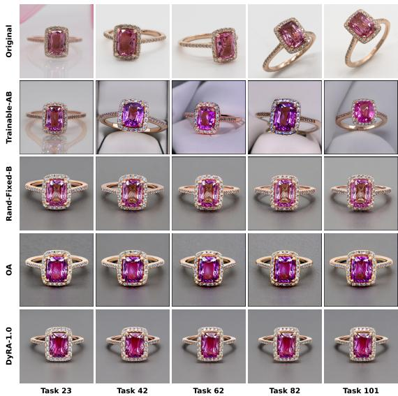  
(a) Continual generation, beginning at task 23.

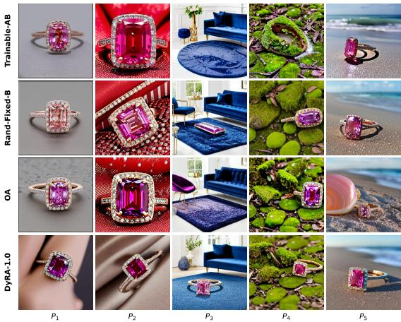  
(b) Final validation; columns correspond to prompts $P _ { 1 } { - } P _ { 5 }$  
Figure 9. Additional qualitative results for Jewelry Ring.

## E.2 Plushie Panda

## Validation prompts.

$P _ { 1 } \mathbf { : }$ : Photo of a <TOK>.

$P _ { 2 } \colon$ <TOK> in front of a medieval castle.

$P _ { 3 } \colon$ <TOK> in Grand Canyon.

$P _ { 4 } \mathrm { { : } }$ <TOK> in Times Square.

$P _ { 5 } \colon$ <TOK> on a boat in the sea.

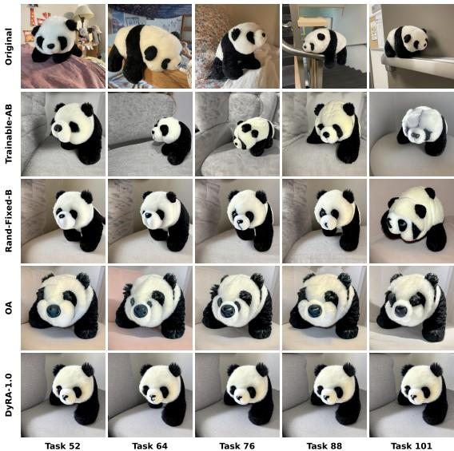  
(a) Continual generation, beginning at task 52.

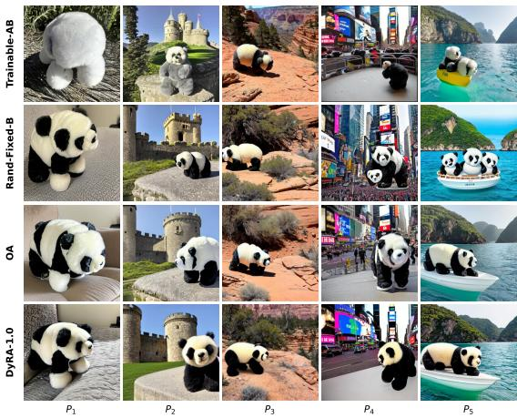  
(b) Final validation; columns correspond to prompts $P _ { 1 } { - } P _ { 5 }$  
Figure 10. Additional qualitative results for Plushie Panda.

## E.3 Wearable Jacket

## Validation prompts.

$P _ { 1 } \colon$ : A humanoid robot wearing <TOK> with a futuristic city in the background.

$P _ { 2 } \colon$ A mannequin showcasing <TOK>.

$P _ { 3 } \colon$ A <TOK> on a hanger in the window of a shop.

$P _ { 4 }$ : A <TOK> on a hook in a study room with bookshelves.

$P _ { 5 } \colon$ Photo of a <TOK>.

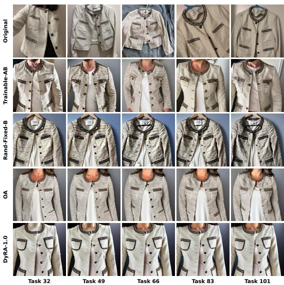  
(a) Continual generation, beginning at task 32.

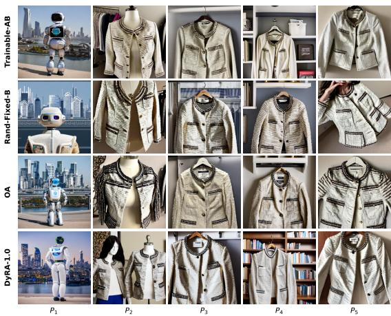  
(b) Final validation; columns correspond to prompts $P _ { 1 }$ ${ } _ { - } P _ { 5 }$  
Figure 11. Additional qualitative results for Wearable Jacket.