# CrossFit-GS: Out-of-Fold Pose Estimation for COLMAP-Free 3D Gaussian Splatting

Zijian Wu Mingfeng Jiang Zidian Lin Ying Song Ziqian Lu Jinliang Wang Zhejiang Sci-Tech University Tsinghua University

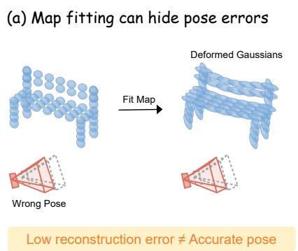

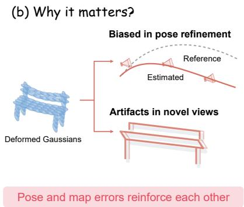

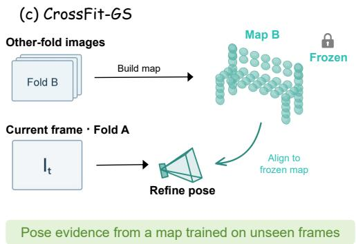  
Figure 1. Pose–map compensation motivates cross-fitted camera registration. (a) Gaussian deformation can reduce training-view error while an incorrect camera pose persists. (b) The resulting geometry can bias subsequent registration and introduce novel-view artifacts. (c) CrossFit-GS refines each frame’s pose against a frozen Gaussian map trained on the opposite frame partition, alternating the roles of the two partitions.

## Abstract

Pose-free 3D Gaussian Splatting (3DGS) aims to bypass cumbersome Structure-from-Motion (SfM) by directly reconstructing scenes from unposed image sequences. In this work, we present CrossFit-GS, a deferred-commitment progressive framework that mitigates cumulative trajectory drift and breaks the self-reinforcing loop of distorted-map error propagation. Specifically, we partition the input sequence into interleaved subsets and maintain two complementary submaps. Each candidate pose is cross-refined against a frozen opposite submap that has never been optimized using the target frame, thereby providing an independent geometric reference for pose estimation. Checkerboard validation and spatial coverage safeguards further reject unreliable updates, and only verified poses are committed to their corresponding owner submap. Once the trajectory has been refined, the intermediate submaps are discarded and the final global representation is trained from scratch using the fixed refined poses. Extensive evaluations across multiple benchmarks demonstrate that CrossFit-GS substantially reduces cumulative trajectory drift and consistently improves both camera pose estimation and novel-

view synthesis over existing methods.

## 1. Introduction

3D Gaussian Splatting (3DGS) [1, 16] has demonstrated remarkable success across a wide range of applications [23, 28, 29, 36]. However, standard 3DGS heavily relies on pre-computed camera extrinsics from classical Structurefrom-Motion (SfM) pipelines like COLMAP [32]. However, SfM preprocessing is computationally expensive, sensitive to rapid camera motion, and prone to failure in texture-less or low-overlap regions, hindering the practical deployment of 3DGS in real-time or streaming scenarios [11, 13, 22].

Recent efforts explore pose-free reconstruction paradigms that estimate camera trajectories and scene geometry directly from unposed image sequences [5, 19, 21, 40]. Initial implicit methods [14, 43, 46], such as BARF [20] and Nope-NeRF [2], pioneered this direction by fitting coordinate-based Neural Radiance Fields (NeRFs) [25] alongside camera frame parameters. Leveraging the explicit representation and fast rasterization of Gaussians, frameworks like CF-3DGS [9] adapted this concept into a sequential regime by estimating relative poses with local Gaussian models while dynamically expanding a global scene representation. Follow-up studies improve complementary components of this pipeline by enhancing Gaussian coverage through hierarchical merging [15], refining local pose estimation via feature and frequency regularization [44], and introducing global trajectory constraints using long-range feature tracks [33].

Despite these empirical advances, existing progressive paradigms fundamentally struggle to reconcile local tracking tractability with global geometric consistency. Standard sequential frameworks estimate pairwise relative transformations from local Gaussian representations and compose them into a global trajectory [9, 15, 44]. Although this localized formulation makes pose tracking tractable, residual pairwise errors can accumulate along the sequence and are absorbed by the global scene representation [12, 24]. Spatially flexible Gaussians can deform to accommodate these registration offsets, yielding deceptively low training-view reconstruction errors despite inaccurate camera trajectories [13, 18]. As additional frames are incorporated, the evolving representation is repeatedly optimized to explain new observations under accumulated pose errors, causing geometric distortion to propagate throughout the reconstruction. While scene-level pose refinement offers a theoretical remedy for such cumulative drift, optimizing a camera pose against a scene representation trained on that very same observation creates a self-explanation shortcut [27, 31, 37]. Unresolved, this underlying dilemma often leads existing methodologies to focus heavily on refining initial pose estimates, rather than addressing systemic trajectory drift at its root. We highlight this self-explanation loop as a critical bottleneck in progressive camera-free reconstruction.

To overcome this fundamental limitation, we propose CrossFit-GS, a progressive pose-free reconstruction framework built on a deferred-commitment protocol. Centered on dual-map information-flow isolation, CrossFit-GS strictly decouples camera pose refinement from scene map updates for unposed image streams. Specifically, the input sequence is partitioned into two interleaved temporal subsets (A/B folds), each maintaining an independent Gaussian submap. For an incoming frame, a candidate pose proposal is generated from the preceding motion estimate and cross-refined exclusively against the frozen opposite submap. To improve optimization stability, this cross-map pose refinement is strictly regulated by checkerboard validation masks and spatial coverage gates. Following our deferred-commitment principle, candidate pose updates are committed to the global trajectory and integrated into owner submap updates only after passing these validation checks. Once all camera extrinsics across the sequence are verified and frozen, the intermediate submaps are discarded, and a single global Gaussian representation is initialized and trained from scratch under the fixed trajectory. Through these coordinated strategies, CrossFit-GS effectively breaks the self-reinforcing pose–map error propagation loop, substantially mitigating cumulative trajectory drift while yielding highly accurate camera estimates and superior novelview rendering quality.

Our contributions are summarized as follows:

• We diagnose a fundamental bottleneck in COLMAPfree 3DGS, highlighting how accumulated pairwise errors distort the evolving scene representation and how reusing this pose-contaminated map for scene-level refinement creates a self-explanation shortcut that closes a self-reinforcing pose–map fitting loop.

• We design a deferred-commitment progressive framework, CrossFit-GS, that prevents error propagation and suppresses trajectory drift by explicitly decoupling pose refinement from scene reconstruction through dual-map information isolation and cross-validation safeguards.

• Extensive experiments validate that CrossFit-GS significantly suppresses trajectory drift, achieving state-of-theart camera tracking and view synthesis.

## 2. Related Work

## 2.1. Generalizable Feed-Forward Methods

One line of research addresses unposed sparse-view reconstruction using generalizable models [7, 39] learned from large-scale multi-view data [3, 8, 12, 35, 38, 48]. FreeSplatter [45] predicts pixel-aligned Gaussian primitives in a shared reference frame and recovers camera parameters from the predicted geometry. SPFSplat [12] jointly predicts camera poses and 3D Gaussians from unposed sparse views in a single feed-forward pass without pose supervision. Related approaches combine learned multi-view geometric priors with per-scene optimization. InstantSplat [6], for example, initializes camera poses and dense geometry using a pretrained multi-view model and subsequently refines the scene through Gaussian bundle adjustment.

These methods are primarily designed for rapid reconstruction from a small set of sparse, potentially unordered views. Their learned priors provide strong geometric initialization but introduce dependence on the training distribution and are not specifically formulated for incrementally processing long, temporally ordered sequences. Our work instead considers per-scene progressive reconstruction, where camera poses must remain globally consistent as observations are incorporated throughout an extended sequence.

## 2.2. Sequential Pose-Free Reconstruction

Sequential COLMAP-free methods exploit temporal continuity to estimate camera motion and scene geometry through per-scene optimization [10, 21]. Early implicit methods achieve pose-free reconstruction by jointly optimizing camera parameters alongside radiance fields [41, 47, 49], employing frequency annealing in BARF [20] and monocular depth consistency in Nope-NeRF [2] to prevent optimization collapse. Transitioning to explicit representations [4, 34], CF-3DGS [9] estimates relative transformations between adjacent frames using local Gaussian models, composes them into a camera trajectory, and progressively grows a global Gaussian representation. Subsequent work improves different components of this pipeline. PCR-GS [44] introduces feature-reprojection and frequency-domain [26] regularization to improve local pose estimation. HT-3DGS [15] uses video frame interpolation to reduce the motion between adjacent observations and hierarchically trains and merges segment-specific Gaussian models to improve scene coverage. TrackGS [33] incorporates long-range feature tracks, track-constrained Gaussians, and multi-view geometric losses to jointly optimize camera parameters and the Gaussian representation under global trajectory constraints.

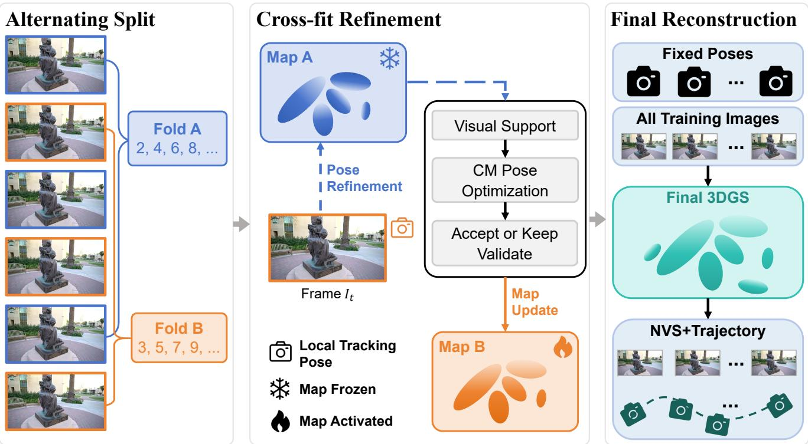  
Figure 2. Overview of CrossFit-GS. The input sequence is partitioned into two interleaved folds, each associated with a separate Gaussian map. For a frame in Fold B, its pose is refined against the frozen Map A, with visual-support checks and an accept-or-keep validation rule governing the update. The frame subsequently contributes only to Map B. The roles of the two folds alternate, ensuring that a frame does not train the map used to assess its pose. Finally, a unified Gaussian representation is trained from scratch using all training images and the fixed estimated poses.

Despite these advances, sequential methods remain vulnerable to cumulative drift from locally composed pose estimates, whose errors can be absorbed by the flexible Gaussian representation. When long-range refinement is introduced, poses are typically optimized against a map trained on the same observations, leaving a self-explanation pathway between pose estimation and map fitting.

## 3. Method

## 3.1. Problem Formulation and System Overview

Given an unposed sequence of RGB images $\{ I _ { i } \} _ { i = 0 } ^ { N - 1 }$ with known intrinsic matrix K, our goal is to recover the camera trajectory $\{ T _ { i } \in \mathrm { ~ S E ( 3 ) } \} _ { i = 0 } ^ { \tilde { N } - 1 }$ and subsequently reconstruct a global 3D Gaussian scene representation $\mathcal { G } =$ $\{ ( { \pmb { \mu } } _ { j } , { \pmb { \Sigma } } _ { j } , \alpha _ { j } , { \bf f } _ { j } ) \} _ { j = 1 } ^ { M } \left[ 1 6 \right]$ . Differentiable rasterization renders a synthesized RGB image ${ \mathcal { R } } ( { \mathcal { G } } , T _ { i } ; K )$ along with an accumulated opacity map $A ( \mathcal { G } , T _ { i } ; K )$

To reconcile local tracking with global geometric consistency and suppress cumulative drift, CrossFit-GS introduces an observation-isolated pipeline under a deferredcommitment protocol (Fig. 2). Rather than continuously updating a shared global map during pose estimation, our framework decouples trajectory solving from global scene synthesis through three functional components: (i) Alternating Split and Local Tracking, which streamwise partitions incoming frames into interleaved temporal folds and derives initial pose proposals; (ii) Cross-fit Refinement and Validation, which optimizes target camera poses against the frozen opposite submap while updating the activated owner submap only upon passing validation controls; and (iii) Final Reconstruction under Deferred Commitment, which discards intermediate submaps once all camera extrinsics are verified and frozen, utilizing the fixed poses to train a unified global 3DGS representation from scratch.

## 3.2. Dual-Map Partitioning and Local Pose Tracking

To enforce observation isolation during progressive tracking, the input frame stream $\{ I _ { i } \} _ { i = 0 } ^ { N - 1 }$ is temporally partitioned according to index parity, with owner assignment $a ( i ) = i$ mod 2 and opposite assignment $b ( i ) = 1 - a ( i )$ We initialize the progressive reconstruction from the first frame, which defines the world coordinate system with $\widehat { T } _ { 0 } = \mathbf { I }$ and provides the monocular-depth initialization of the Gaussian representation. As subsequent frames arrive, they are assigned to their owner folds, yielding two source image sets $ { \boldsymbol { S } } _ { 0 }$ and $S _ { 1 }$ and their corresponding provisional Gaussian submaps ${ \mathcal { G } } ^ { ( 0 ) }$ and $\mathcal { G } ^ { ( 1 ) }$ . The two submaps are constructed and updated alternately throughout the sequence.

For each target frame $I _ { i } ,$ the opposite submap used for pose refinement excludes that frame from its source image set:

$$
I _ { i } \notin S _ { b ( i ) } .\tag{1}
$$

This exclusion ensures that the representation used to refine $T _ { i }$ has received no direct training feedback from $I _ { i } ,$ thereby preventing direct target-to-map self-fitting.

When a new frame $I _ { i }$ arrives $( i \geq 1 )$ , a local tracker first provides an initial pose proposal $\tilde { T } _ { i } \in \mathrm { S E } ( 3 )$ before crossmap refinement. Specifically, a reference Gaussian model is constructed from the preceding frame $I _ { i - 1 }$ using monocular depth estimation. Differentiable rendering against this local model estimates a relative motion $\widehat { \Delta } _ { i }$ , initialized via short-term kinematic continuity as $\Delta _ { i } ^ { ( 0 ) } \ = \ \widehat { T } _ { i - 1 } \widehat { T } _ { i - 2 } ^ { - 1 }$ for $i \geq 2$ (and identity I for $i = 1 )$ ). The local pose proposal is formulated as:

$$
\widetilde { T } _ { i } = \widehat { \Delta } _ { i } \widehat { T } _ { i - 1 } .\tag{2}
$$

Because $\widetilde { T } _ { i }$ relies solely on a single frame’s unrefined local geometry, it serves strictly as an initial proposal. To verify and refine $\widetilde { T } _ { i }$ , target frame $I _ { i }$ is subsequently registered against the frozen opposite submap $\mathcal { G } ^ { ( b ( i ) ) }$ , where all Gaussian parameters are detached from gradient computation to optimize only $T _ { i }$

## 3.3. Frozen-Map Cross-Fitted Pose Refinement

Having obtained the local proposal $\widetilde { T } _ { i } ,$ CrossFit-GS refines the target camera pose against the opposite submap $\mathcal { G } ^ { ( b ( i ) ) }$ Throughout refinement, all Gaussian parameters in $\mathcal { G } ^ { ( b ( i ) ) }$ are frozen, and the pose is initialized as $T _ { i } ^ { ( 0 ) } = \widetilde { T } _ { i }$ . Consequently, the opposite submap cannot deform to reduce the target-frame loss; only the camera transformation is updated. To ensure robust convergence and reliable trajectory updates, we introduce spatial, photometric, and validation controls built upon this cross-fit objective.

## 3.3.1. Initial Visibility Support and Coverage Gating

We first evaluate the spatial overlap between the candidate pose and the opposite map using the rendered accumulated opacity:

$$
V _ { i } ( p ) = \mathbf { 1 } \left[ A ( \mathcal { G } ^ { ( b ( i ) ) } , \widetilde { T } _ { i } ; K ) ( p ) > \tau _ { \alpha } \right] ,\tag{3}
$$

$$
c _ { i } ^ { ( 0 ) } = \vert \Omega _ { i } \vert ^ { - 1 } \sum _ { p \in \Omega _ { i } } V _ { i } ( p ) ,\tag{4}
$$

where $\Omega _ { i }$ denotes the image pixel grid and $\tau _ { \alpha }$ is the opacity threshold. The ratio $c _ { i } ^ { ( 0 ) }$ measures initial view coverage. To prevent unconstrained pose optimization on unmapped scene regions, we apply an initial coverage gate: If $c _ { i } ^ { ( 0 ) } < \tau _ { \mathrm { c o v } }$ , cross-map optimization is bypassed, we set $\widehat { T } _ { i } = \widetilde { T } _ { i } .$ , and proceed directly to the owner submap update. Otherwise, $V _ { i }$ is fixed as the valid evaluation domain for frame $i .$

## 3.3.2. Checkerboard Masking and Pose Optimization

Within the valid visibility support $V _ { i } ,$ , we introduce checkerboard masking (CM) using a deterministic binary mask $H _ { i } ( p )$

$$
H _ { i } ( p ) = { \left\{ \begin{array} { l l } { 1 , } & { { \mathrm { i f ~ } } ( x _ { p } + y _ { p } ) { \mathrm { ~ m o d ~ } } 2 = 0 , } \\ { 0 , } & { { \mathrm { o t h e r w i s e } } . } \end{array} \right. }\tag{5}
$$

This mask divides the visible pixels into two spatially interleaved and disjoint sets: optimization pixels $V _ { i } H _ { i }$ , which provide gradients for pose refinement, and validation pixels $V _ { i } ( 1 - H _ { i } )$ , which are excluded from gradient computation.

For pose refinement, the optimizable camera pose $T$ is initialized from $\widetilde { T } _ { i }$ and optimized over the support region $V _ { i } H _ { i }$

$$
\begin{array} { l } { { \displaystyle { \mathcal L } _ { \mathrm { p o s e } } ( T ) = \frac { 1 } { N _ { i } } \sum _ { p \in { \Omega } _ { i } } V _ { i } ( p ) H _ { i } ( p ) { \ell } _ { \mathrm { s m o o t h } } ( { \mathcal R } _ { p } ( T ) , I _ { i , p } ) } } \\ { { \displaystyle ~ + \lambda _ { \mathrm { a n c h } } D ( T , { \widetilde T } _ { i } ) } , } \end{array}\tag{6}
$$

where $\begin{array} { r } { N _ { i } \ = \ \operatorname* { m a x } \Big ( 1 , \sum _ { p \in \Omega _ { i } } V _ { i } ( p ) H _ { i } ( p ) \Big ) } \end{array}$ is the number of valid optimization pixels, $\mathcal { R } ( T ) ~ = ~ \mathcal { R } ( \mathcal { G } ^ { ( b ( i ) ) } , T ; K )$ and $\mathcal { L } _ { \mathrm { s m o o t h } }$ denotes the channel-averaged Smooth- $. L _ { 1 }$ loss. The spatial anchor regularizer $D ( T , \widetilde { T } _ { i } )$ penalizes rotational and scale-normalized translational deviations from proposal

Table 1. Quantitative novel view synthesis results on Tanks and Temples. Evaluated using PSNR ↑, SSIM ↑, and LPIPS ↓. Best results are bolded.
<table><tr><td rowspan="2">Scene</td><td colspan="3">CF-3DGS [9]</td><td colspan="3">HT-3DGS [15]</td><td colspan="3">TrackGS [33]</td><td colspan="3">PCR-GS [44]</td><td colspan="3">Ours</td></tr><tr><td>PSNR</td><td>SSIM</td><td>LPIPS</td><td>PSNR</td><td>SSIM</td><td>LPIPS</td><td>PSNR</td><td>SSIM</td><td>LPIPS</td><td>PSNR</td><td>SSIM</td><td>LPIPS</td><td>PSNR</td><td>SSIM</td><td>LPIPS</td></tr><tr><td>Ballroom</td><td>24.917</td><td>0.828</td><td>0.123</td><td>25.620</td><td>0.850</td><td>0.110</td><td>25.709</td><td>0.875</td><td>0.105</td><td>25.164</td><td>0.832</td><td>0.117</td><td>30.272</td><td>0.931</td><td>0.060</td></tr><tr><td>Barn</td><td>19.264</td><td>0.567</td><td>0.382</td><td>19.327</td><td>0.560</td><td>0.354</td><td>21.623</td><td>0.625</td><td>0.280</td><td>19.003</td><td>0.534</td><td>0.458</td><td>22.863</td><td>0.657</td><td>0.262</td></tr><tr><td>Church</td><td>26.825</td><td>0.869</td><td>0.142</td><td>31.046</td><td>0.942</td><td>0.073</td><td>25.960</td><td>0.831</td><td>0.206</td><td>27.308</td><td>0.885</td><td>0.133</td><td>29.246</td><td>0.922</td><td>0.092</td></tr><tr><td>Family</td><td>25.033</td><td>0.845</td><td>0.164</td><td>27.801</td><td>0.889</td><td>0.124</td><td>28.663</td><td>0.899</td><td>0.119</td><td>27.147</td><td>0.896</td><td>0.119</td><td>29.079</td><td>0.918</td><td>0.104</td></tr><tr><td>Francis</td><td>23.898</td><td>0.737</td><td>0.270</td><td>24.313</td><td>0.717</td><td>0.257</td><td>24.365</td><td>0.738</td><td>0.272</td><td>24.774</td><td>0.727</td><td>0.258</td><td>25.359</td><td>0.742</td><td>0.266</td></tr><tr><td>Horse</td><td>17.556</td><td>0.598</td><td>0.281</td><td>17.806</td><td>0.606</td><td>0.279</td><td>28.364</td><td>0.906</td><td>0.102</td><td>17.864</td><td>0.609</td><td>0.280</td><td>26.190</td><td>0.854</td><td>0.140</td></tr><tr><td>Ignatius</td><td>21.762</td><td>0.691</td><td>0.213</td><td>22.465</td><td>0.770</td><td>0.161</td><td>24.315</td><td>0.714</td><td>0.262</td><td>21.976</td><td>0.704</td><td>0.195</td><td>23.135</td><td>0.768</td><td>0.172</td></tr><tr><td>Museum</td><td>16.194</td><td>0.523</td><td>0.437</td><td>17.480</td><td>0.540</td><td>0.420</td><td>23.136</td><td>0.737</td><td>0.214</td><td>18.397</td><td>0.503</td><td>0.393</td><td>23.821</td><td>0.773</td><td>0.201</td></tr><tr><td>Mean</td><td>21.931</td><td>0.707</td><td>0.252</td><td>23.232</td><td>0.734</td><td>0.222</td><td>25.267</td><td>0.791</td><td>0.195</td><td>22.704</td><td>0.711</td><td>0.244</td><td>26.246</td><td>0.821</td><td>0.162</td></tr></table>

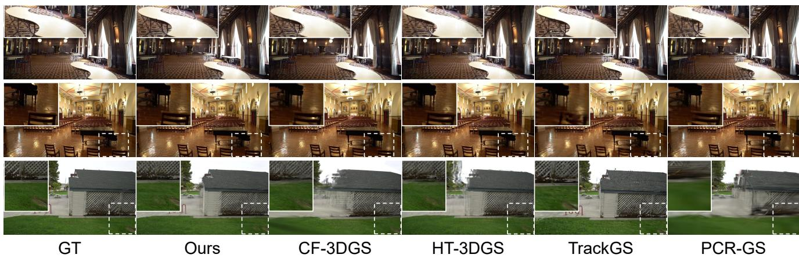  
Figure 3. Qualitative comparison of novel-view synthesis on Tanks and Temples. CrossFit-GS preserves fine textures and sharp structural boundaries while reducing rendering artifacts.

Tei:

$$
D ( T , \widetilde { T } _ { i } ) = \frac { 1 } { 9 } \big \| R ( T ) - R ( \widetilde { T } _ { i } ) \big \| _ { F } ^ { 2 } + \frac { 1 } { 3 r _ { i } ^ { 2 } } \big \| t ( T ) - t ( \widetilde { T } _ { i } ) \big \| _ { 2 } ^ { 2 } ,\tag{7}
$$

with $r _ { i }$ representing the spatial radius of submap $\mathcal { G } ^ { ( b ( i ) ) }$ ) to maintain scale consistency across diverse scenes.

Conversely, the complementary region $V _ { i } ( 1 - H _ { i } )$ serves purely as a held-out validation set to evaluate pose candidates:

$$
\mathcal { L } _ { \mathrm { v a l } } ( T ) = \frac { 1 } { N _ { i } ^ { \mathrm { v a l } } } \sum _ { p \in \Omega _ { i } } V _ { i } ( p ) \big ( 1 - H _ { i } ( p ) \big ) \ell _ { \mathrm { s m o o t h } } ( \mathcal { R } _ { p } ( T ) , I _ { i , p } )\tag{8}
$$

where $\begin{array} { r } { N _ { i } ^ { \mathrm { v a l } } = \operatorname* { m a x } \Bigl ( 1 , \sum _ { p \in \Omega _ { i } } V _ { i } ( p ) ( 1 - H _ { i } ( p ) ) \Bigr ) } \end{array}$ . Without back-propagating gradients, $\mathcal { L } _ { \mathrm { v a l } } ( T )$ provides unbiased photometric evidence to guide candidate selection and acceptance.

## 3.3.3. Retention Guard and Accept-or-Keep Decision

During pose optimization, we continuously track the visible support fraction $q _ { i } ( T )$ to prevent pose divergence into

unobserved space:

$$
q _ { i } ( T ) = \frac { \sum _ { p } V _ { i } ( p ) V _ { i } ^ { T } ( p ) } { \operatorname* { m a x } \Bigl ( 1 , \sum _ { p } V _ { i } ( p ) \Bigr ) } ,\tag{9}
$$

where $V _ { i } ^ { T }$ denotes the synthesized opacity mask under current pose T. Optimization terminates early if $q _ { i } ( T )$ falls below threshold $\tau _ { \mathrm { r e t } }$ . Among generated pose states, we select $T _ { i } ^ { \mathrm { b e s t } }$ that minimizes error on the validation set $\mathcal { L } _ { \mathrm { v a l } } ( T )$ The candidate pose is committed to the trajectory if and only if it yields a sufficient error reduction over proposal $\tilde { \cal T } _ { i } \mathrm { : }$

$$
\widehat { T } _ { i } = \displaystyle \left\{ \begin{array} { l l } { T _ { i } ^ { \mathrm { b e s t } } , } & { \mathrm { i f } \mathcal { L } _ { \mathrm { v a l } } ( T _ { i } ^ { \mathrm { b e s t } } ) + \epsilon _ { \mathrm { g a i n } } < \mathcal { L } _ { \mathrm { v a l } } ( \widetilde { T } _ { i } ) , } \\ { \widetilde { T } _ { i } , } & { \mathrm { o t h e r w i s e } . } \end{array} \right.\tag{10}
$$

Upon committing $\widehat { T } _ { i } .$ , frame $I _ { i }$ updates its owner submap $\mathcal { G } ^ { ( a ( i ) ) }$ while holding extrinsics fixed. Primitive parameters are optimized via the standard combined photometric ob-

Table 2. Quantitative NVS results on selected CO3D-V2 sequences. Evaluated using PSNR ↑, SSIM ↑, and LPIPS ↓. Best results are bolded.
<table><tr><td rowspan="2">Sequence</td><td colspan="2">CF-3DGS [9]</td><td colspan="2">HT-3DGS [15]</td><td colspan="2">PCR-GS [44]</td><td colspan="2"></td><td colspan="2">TrackGS [33]</td><td colspan="2">Ours</td></tr><tr><td>PSNR</td><td>SSIM LPIPS</td><td>PSNR</td><td>SSIM LPIPS</td><td>PSNR</td><td>SSIM LPIPS</td><td></td><td>PSNR</td><td>SSIM LPIPS</td><td>PSNR</td><td>SSIM</td><td>LPIPS</td></tr><tr><td>apple_23361</td><td>31.758</td><td>0.899</td><td>0.134 30.477</td><td>0.859</td><td>0.163 34.305</td><td>0.935</td><td>0.106</td><td>34.059</td><td>0.935</td><td>0.103</td><td>35.034 0.939</td><td>0.101</td></tr><tr><td>hydrant_108483</td><td>21.852</td><td>0.724 0.314</td><td>22.337</td><td>0.759 0.279</td><td>22.129</td><td>0.722</td><td>0.317</td><td>20.822</td><td>0.658 0.320</td><td>23.432</td><td>0.779</td><td>0.263</td></tr><tr><td>plant_50907</td><td>25.931</td><td>0.744 0.310</td><td>27.463</td><td>0.795 0.283</td><td>25.554</td><td>0.733</td><td>0.316</td><td>23.178</td><td>0.643 0.389</td><td>30.543</td><td>0.859</td><td>0.235</td></tr><tr><td>teddybear_38541</td><td>32.048</td><td>0.862 0.334</td><td>33.957</td><td>0.900 0.279</td><td>32.059</td><td>0.862</td><td>0.333</td><td>33.509 0.865</td><td>0.288</td><td>34.732</td><td>0.903</td><td>0.290</td></tr><tr><td>bench_110109</td><td>32.509</td><td>0.894 0.144</td><td>30.302</td><td>0.844 0.195</td><td>31.397</td><td>0.856</td><td>0.164</td><td>27.415</td><td>0.713 0.277</td><td>34.595</td><td>0.933</td><td>0.109</td></tr><tr><td>suitcase_8645</td><td>28.587</td><td>0.856 0.269</td><td>32.020</td><td>0.920 0.224</td><td>30.862</td><td>0.891</td><td>0.253</td><td>32.321</td><td>0.923</td><td>0.143 30.019</td><td>0.900</td><td>0.244</td></tr><tr><td>Mean</td><td>28.781</td><td>0.830</td><td>0.251 29.426</td><td>0.846</td><td>0.237</td><td>29.384 0.833</td><td>0.248</td><td>|28.551</td><td>0.789</td><td>0.253 |31.393</td><td>0.886</td><td>0.207</td></tr></table>

Table 3. Quantitative camera pose estimation results on Tanks and Temples (stride 5) and selected CO3D-V2 sequences. Evaluated using $\mathrm { R P E } _ { t } \downarrow ( \times 1 0 ^ { - 2 } )$ , $\mathrm { R P E } _ { r } \downarrow ( ^ { \circ } )$ , and ATE ↓. Best results are bolded.
<table><tr><td rowspan="2">Method</td><td colspan="3">Tanks and Temples</td><td colspan="3">CO3D-V2</td></tr><tr><td>RPEt</td><td>RPEr</td><td>ATE</td><td>RPEt</td><td>RPEr</td><td>ATE</td></tr><tr><td>CF-3DGS [9]</td><td>1.327</td><td>0.695</td><td>0.024</td><td>0.515</td><td>0.336</td><td>0.018</td></tr><tr><td>HT-3DGS [15]</td><td>1.229</td><td>0.667</td><td>0.022</td><td>0.460</td><td>0.324</td><td>0.019</td></tr><tr><td>TrackGS [33]</td><td>0.600</td><td>0.348</td><td>0.014</td><td>0.992</td><td>0.782</td><td>0.041</td></tr><tr><td>PCR-GS [44]</td><td>1.440</td><td>0.596</td><td>0.041</td><td>0.453</td><td>0.331</td><td>0.014</td></tr><tr><td>Ours</td><td>0.571</td><td>0.347</td><td>0.010</td><td>0.344</td><td>0.323</td><td>0.009</td></tr></table>

jective:

$$
\mathcal { L } _ { \mathrm { m a p } } = ( 1 - \lambda _ { \mathrm { d s s i m } } ) \mathcal { L } _ { 1 } ( \mathcal { R } , I _ { i } ) + \lambda _ { \mathrm { d s s i m } } \mathcal { L } _ { \mathrm { D - S S I M } } ( \mathcal { R } , I _ { i } ) ,\tag{11}
$$

thereby maintaining strict observation isolation across both submap partitions.

## 3.4. Deferred Global Scene Reconstruction

Upon completing the streamwise trajectory optimization, the intermediate submaps ${ \mathcal { G } } ^ { ( 0 ) }$ and $\mathcal { G } ^ { ( 1 ) }$ have fulfilled their purpose and are discarded. Under our deferred-commitment protocol, all verified camera extrinsics $\lbrace \widehat { T } _ { i } \rbrace _ { i = 0 } ^ { N - 1 }$ are permanently frozen, converting the optimized trajectory into immutable geometric anchors. A single global Gaussian representation $\mathcal { G } _ { \mathrm { f i n a l } }$ is then initialized from $I _ { 0 }$ and trained from scratch across all available views $\{ I _ { i } \} _ { i = 0 } ^ { N - 1 }$ by minimizing the global photometric error:

$$
\mathcal { L } _ { \mathrm { f i n a l } } = \frac { 1 } { N } \sum _ { i = 0 } ^ { N - 1 } \mathcal { L } _ { \mathrm { m a p } } \Big ( \mathcal { R } ( \mathcal { G } _ { \mathrm { f i n a l } } , \widehat { T } _ { i } ; K ) , I _ { i } \Big ) .\tag{12}
$$

By deferring full-capacity scene modeling until the trajectory is locked, the final stage prevents early pose errors from being permanently encoded in the output representation and enables high-quality novel-view synthesis.

## 4. Experiments

We evaluate CrossFit-GS on challenging unposed benchmarks to assess both novel view synthesis fidelity and camera pose recovery accuracy.

## 4.1. Experimental Setup

Datasets. Following previous benchmark evaluation protocols [9, 15, 33, 44], we evaluate on Tanks and Temples [17] using a frame-subsampling stride of 5 to simulate challenging wide-baseline camera motion. Additionally, we benchmark on CO3D-V2 [30] across representative scenes featuring diverse geometric and textural complexities. In line with standard evaluation setups, every 8th frame is held out as test views for novel view synthesis.

Metrics. Novel view synthesis is evaluated using PSNR, SSIM [42], and LPIPS [50]. Camera trajectory estimation is aligned via Sim(3) Umeyama alignment and evaluated using Absolute Trajectory Error (ATE) as well as Relative Pose Errors for translation (RPEt) and rotation (RPEr) [2, 20].

Implementation Details. Training sequences are split into alternating A/B folds (i mod 2). Local relative registration uses 1,000 iterations for reference view fitting and 300 for target tracking. Cross-map pose optimization uses Adam $( 1 . 0 \times 1 0 ^ { - 3 } )$ for up to 100 iterations, gated by 20% initial alpha coverage and checkerboard-masked validation. A pose update is committed if validation loss improves by $> 1 . 0 \times 1 0 ^ { - 5 }$ while retaining ≥ 50% visible coverage. Frozen poses are then used to train a unified global Gaussian map for $5 0 0 \times N$ steps from scratch.

## 4.2. Novel View Synthesis Evaluation

Table 1 and Table 2 report the quantitative visual quality on the Tanks and Temples and CO3D-V2, respectively. CrossFit-GS consistently outperforms existing baselines across both datasets. On Tanks and Temples, our method achieves a mean PSNR of 26.246 dB, representing a 4.315 dB gain over CF-3DGS and a 0.979 dB advantage over TrackGS. Similarly, on CO3D-V2, it yields an overall mean PSNR of 31.393 dB, showing marked improvements on complex scenes such as plant 50907.

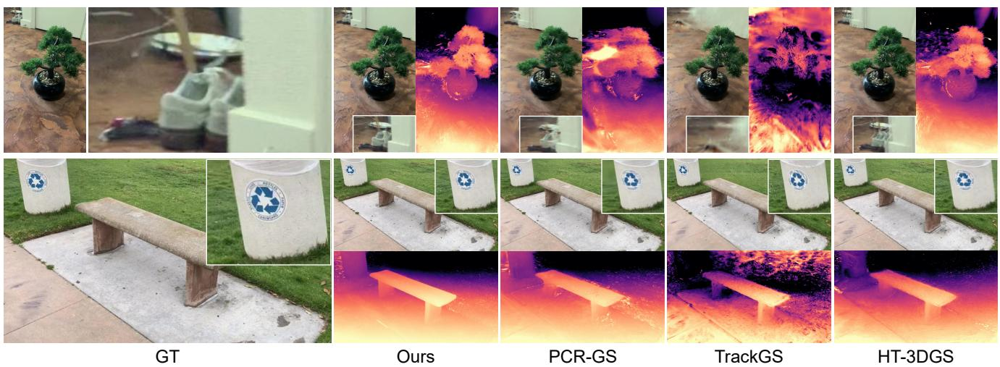  
Figure 4. Qualitative comparison of novel-view synthesis on CO3D-V2. CrossFit-GS delivers highly accurate geometry and sharp visual details under rapid camera rotations, effectively suppressing blur and floating artifacts.

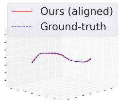

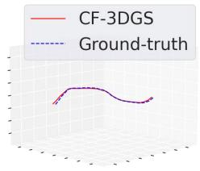

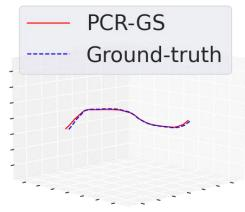

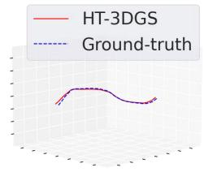

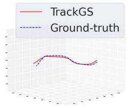

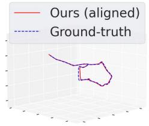

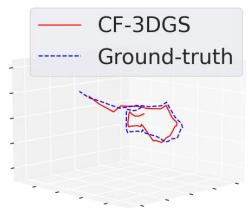

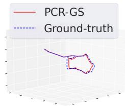

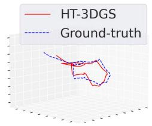

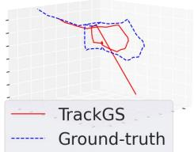  
Figure 5. Visualization of estimated camera trajectories. The top row shows the Ignatius sequence from Tanks and Temples, and the bottom row shows the apple 23361 sequence from CO3D-V2. Red solid lines denote estimated trajectories, while blue dashed lines indicate the ground truth.

These gains validate our observation-isolated design. Existing progressive methods often absorb residual pose errors into flexible Gaussian primitives, causing geometric artifacts and texture blur (Fig. 3 and 4). By refining poses against frozen out-of-fold submaps and deferring global map updates until trajectories are fixed, CrossFit-GS prevents error propagation and renders sharper geometry and fine details.

## 4.3. Trajectory Estimation Evaluation

Table 3 reports the quantitative trajectory errors across both benchmarks. CrossFit-GS delivers the highest camera tracking precision, reducing the ATE on Tanks and Temples from 0.024 for CF-3DGS to 0.010, which represents a 58.3% improvement and surpasses TrackGS (0.014).

On CO3D-V2, our method achieves a mean ATE of 0.009 alongside a mean $\mathrm { R P E } _ { t } = 0 . 3 4 4$

The trajectory visual comparisons in Fig. 5 demonstrate that CrossFit-GS preserves global motion paths under complex camera movements. This gain stems from the interaction between local pose initialization and out-of-fold refinement. The local stage provides short-range motion estimates, while cross-fit refinement checks those estimates against the multi-view context of the opposing submap. Supported by spatial anchoring and the accept-or-keep verification, these safeguards limit local registration errors and yield stable long-term trajectories.

## 4.4. Ablation Studies

## 4.4.1. Contribution of Each Component

To quantify the contribution of each core component in CrossFit-GS, we conduct systematic ablation experiments on Tanks and Temples (Table 4).

Table 4. Ablation study on Tanks and Temples. Evaluated across pose metrics (RPEt $\downarrow \times 1 0 ^ { - 2 }$ , RPEr ↓◦, ATE ↓) and NVS metrics (PSNR ↑, SSIM ↑, LPIPS ↓). Best results are bolded.
<table><tr><td>Variant</td><td>Pose RPEt RPEr</td><td>ATE</td><td>PSNR</td><td>NVS SSIM</td><td>LPIPS</td></tr><tr><td>Local tracking only Naive cross-fit</td><td>1.327 0.636</td><td>0.695 0.381</td><td>0.024</td><td>21.931 0.707 0.801</td><td>0.252 0.174</td></tr><tr><td>w/o Coverage Gate</td><td>0.643</td><td>0.370</td><td>0.017 0.016</td><td>25.486 25.835</td><td>0.170</td></tr><tr><td></td><td></td><td></td><td></td><td></td><td>0.813</td></tr><tr><td>w/o Retention Guard</td><td>0.578</td><td>0.367</td><td>0.014</td><td>25.909 0.812</td><td>0.167</td></tr><tr><td>w/o Checkerboard</td><td>0.612</td><td>0.362</td><td>0.015</td><td>25.733 0.810</td><td>0.167</td></tr><tr><td>w/o Accept-or-Keep</td><td>0.652</td><td>0.370</td><td>0.016</td><td>25.807 0.812</td><td>0.169</td></tr><tr><td></td><td></td><td></td><td></td><td></td><td></td></tr><tr><td>Full CrossFit-GS</td><td>0.571</td><td>0.347</td><td>0.010</td><td>26.246 0.821</td><td>0.162</td></tr></table>

Table 5. Efficiency comparison on the first 50 frames of selected CO3D-V2 sequences. Total runtime is measured in minutes (m).
<table><tr><td>Method</td><td>Total Time (min) ↓</td></tr><tr><td>HT-3DGS [15]</td><td>91.0</td></tr><tr><td>TrackGS [33]</td><td>88.0</td></tr><tr><td>CF-3DGS [9]</td><td>64.0</td></tr><tr><td>Ours</td><td>67.5</td></tr></table>

Replacing local tracking with a naive cross-map optimization scheme (Naive cross-fit) yields a substantial performance leap, reducing ATE from 0.024 to 0.017 and increasing PSNR from 21.931 dB to 25.486 dB. This validates that optimizing target camera poses against an out-of-fold frozen submap successfully breaks the target-to-map selffitting loop.

Spatially interleaving optimization and validation pixels via checkerboard masking ensures unbiased candidate evaluation; removing it (w/o Checkerboard) degrades both ATE (0.015) and PSNR (25.733 dB). Similarly, disabling the accept-or-keep mechanism (w/o Accept-or-Keep) increases tracking error, confirming the necessity of filtering out unhelpful pose updates using held-out photometric evidence.

Boundary and coverage controls provide critical safeguards against divergence. Omitting the coverage gate (w/o Coverage Gate) impairs pose alignment (ATE = 0.016) under limited spatial overlap, while removing the retention guard (w/o Retention Guard) drops PSNR to 25.909 dB due to pose drift into unobserved space. Combining all components into Full CrossFit-GS achieves the best trajectory accuracy and NVS fidelity.

## 4.4.2. Runtime Efficiency

We evaluate runtime efficiency on a single NVIDIA RTX 4090 GPU across the first 50 frames of CO3D-V2 sequences, with results summarized in Table 5. All measurements account for both mapping and pose optimization time.

Table 6. Diagnostic ablation of the self-explanation pathway on Tanks and Temples. Target-Used: whether the target image is used to train the reference map before pose refinement. Map Frozen: whether the reference map parameters are frozen during pose refinement.
<table><tr><td>Variant</td><td></td><td>Target-Used Map Frozen</td><td>Validation Loss↓ | ATE↓ | PSNR↑</td><td></td><td></td></tr><tr><td>TCTM</td><td>Yes</td><td>No</td><td>0.000849</td><td>0.028</td><td>23.702</td></tr><tr><td>TCFM</td><td>Yes</td><td>Yes</td><td>0.000850</td><td>0.027</td><td>23.789</td></tr><tr><td>TETM</td><td>No</td><td>No</td><td>0.005092</td><td>0.029</td><td>23.305</td></tr><tr><td>TEFM (Ours) |</td><td>No</td><td>Yes</td><td>0.032814</td><td>0.010</td><td>26.246</td></tr></table>

Despite the additional cross-map refinement, CrossFit-GS remains close to CF-3DGS in runtime because it avoids replay during progressive estimation and trains the final global representation only once. It is also faster than HT-3DGS and TrackGS, which require hierarchical map consolidation and long-horizon joint optimization, respectively.

## 4.4.3. Diagnosing Target-to-Map Self-Explanation

To directly test our core hypothesis, we evaluate four variants across two orthogonal factors—whether the reference map incorporates the target view prior to refinement, and whether it remains frozen during optimization: Targetconditioned trainable (TCTM), Target-conditioned frozen (TCFM), Target-excluded trainable (TETM), and Targetexcluded frozen (TEFM, ours).

Table 6 reveals a clear mismatch between validation loss and downstream accuracy. Target-conditioned maps obtain extremely low losses, but freezing them barely changes ATE or PSNR because the target has already been absorbed. Target exclusion alone is likewise insufficient when the map can still adapt during pose optimization. Our target-excluded frozen variant instead improves PSNR by 2.457 dB and reduces ATE by 63.0% over the targetconditioned frozen variant, despite having a substantially higher validation loss. This inversion provides direct evidence of target-to-map self-explanation.

## 5. Conclusion

We presented CrossFit-GS, a deferred-commitment framework designed for COLMAP-free 3DGS. By enforcing strict observation isolation and refining each candidate pose against a frozen out-of-fold submap, our approach effectively eliminates the target-to-map self-explanation loop and prevents pose errors from being absorbed into Gaussian primitives. Experiments on benchmarks demonstrate that CrossFit-GS achieves substantial improvements in both global trajectory accuracy and novel-view rendering. Furthermore, our diagnostic studies confirm that isolating target-frame observations during pose refinement is crucial for preventing trajectory drift and reconstructing geometrically faithful 3D representations.

## References

[1] Yanqi Bao, Tianyu Ding, Jing Huo, Yaoli Liu, Yuxin Li, Wenbin Li, Yang Gao, and Jiebo Luo. 3d gaussian splatting: Survey, technologies, challenges, and opportunities. IEEE Transactions on Circuits and Systems for Video Technology, 35(7):6832–6852, 2025. 1

[2] Wenjing Bian, Zirui Wang, Kejie Li, and Jia-Wang Bian. Nope-nerf: Optimising neural radiance field with no pose prior. In 2023 IEEE/CVF Conference on Computer Vision and Pattern Recognition (CVPR), pages 4160–4169, 2023. 1, 3, 6

[3] David Charatan, Sizhe Lester Li, Andrea Tagliasacchi, and Vincent Sitzmann. pixelsplat: 3d gaussian splats from image pairs for scalable generalizable 3d reconstruction. In Proceedings of the IEEE/CVF Conference on Computer Vision and Pattern Recognition (CVPR), pages 19457–19467, 2024. 2

[4] Yu Chen, Rolandos Alexandros Potamias, Evangelos Ververas, Jifei Song, Jiankang Deng, and Gim Hee Lee. Zerogs: Training 3d gaussian splatting from unposed images. arXiv preprint arXiv:2411.15779, 2024. 3

[5] Zhen-Hui Dong, Sheng Ye, Yu-Hui Wen, Nannan Li, and Yong-Jin Liu. Towards better robustness: Pose-free 3d gaussian splatting for arbitrarily long videos, 2025. 1

[6] Zhiwen Fan, Wenyan Cong, Kairun Wen, Kevin Wang, Jian Zhang, Xinghao Ding, Danfei Xu, Boris Ivanovic, Marco Pavone, Georgios Pavlakos, et al. Instantsplat: Sparse-view gaussian splatting in seconds. arXiv preprint arXiv:2403.20309, 2024. 2

[7] Xianze Fang, Jingnan Gao, Zhe Wang, Zhuo Chen, Xingyu Ren, Jiangjing Lyu, Qiao-Mu Ren, Zhonglei Yang, Xiaokang Yang, Yichao Yan, et al. Dens3r: A foundation model for 3d geometry prediction. In International Conference on Learning Representations, pages 80604–80634, 2026. 2

[8] Guofeng Feng, Siyan Chen, Rong Fu, Zimu Liao, Yi Wang, Tao Liu, Boni Hu, Linning Xu, Zhilin Pei, Hengjie Li, et al. Flashgs: Efficient 3d gaussian splatting for large-scale and high-resolution rendering. In Proceedings of the IEEE/CVF Conference on Computer Vision and Pattern Recognition, pages 26652–26662, 2025. 2

[9] Yang Fu, Sifei Liu, Amey Kulkarni, Jan Kautz, Alexei A. Efros, and Xiaolong Wang. Colmap-free 3d gaussian splatting. In Proceedings of the IEEE/CVF Conference on Computer Vision and Pattern Recognition (CVPR), pages 20796– 20805, 2024. 1, 2, 3, 5, 6, 8

[10] Yu Gao, Lutong Su, Ruixiang Huang, Tianji Jiang, Jiadong Tang, Yufeng Yue, and Yi Yang. Energy-gs: Image energyguided pose alignment gaussian splatting with redesigned pose gradient flow. In Proceedings of the IEEE/CVF Conference on Computer Vision and Pattern Recognition (CVPR), pages 7310–7319, 2026. 2

[11] Meijun Guo, Yongliang Shi, Caiyun Liu, Yixiao Feng, Ming Ma, Tinghai Yan, Weining Lu, and Bin Liang. Robust and high-fidelity 3d gaussian splatting: Fusing pose priors and geometry constraints for texture-deficient outdoor scenes. In 2025 IEEE/RSJ International Conference on Intelligent

Robots and Systems (IROS), pages 4414–4420. IEEE, 2025. 1

[12] Ranran Huang and Krystian Mikolajczyk. No pose at all: Self-supervised pose-free 3d gaussian splatting from sparse views. In Proceedings of the IEEE/CVF International Con ference on Computer Vision (ICCV), pages 27947–27957, 2025. 2

[13] Zhisheng Huang, Peng Wang, Jingdong Zhang, Yuan Liu, Xin Li, and Wenping Wang. 3r-gs: Best practice in optimizing camera poses along with 3dgs. arXiv preprint arXiv:2504.04294, 2025. 1, 2

[14] Yoonwoo Jeong, Seokjun Ahn, Christopher Choy, Anima Anandkumar, Minsu Cho, and Jaesik Park. Self-calibrating neural radiance fields. In Proceedings of the IEEE/CVF International Conference on Computer Vision (ICCV), pages 5846–5854, 2021. 1

[15] Bo Ji and Angela Yao. Sfm-free 3d gaussian splatting via hi erarchical training. In 2025 IEEE/CVF Conference on Computer Vision and Pattern Recognition (CVPR), pages 21654– 21663. IEEE, 2025. 2, 3, 5, 6, 8

[16] Bernhard Kerbl, Georgios Kopanas, Thomas Leimkuhler,¨ and George Drettakis. 3d gaussian splatting for real-time radiance field rendering. ACM Trans. Graph., 42(4):139–1, 2023. 1, 3

[17] Arno Knapitsch, Jaesik Park, Qian-Yi Zhou, and Vladlen Koltun. Tanks and temples: benchmarking large-scale scene reconstruction. ACM Trans. Graph., 36(4), 2017. 6

[18] Mangyu Kong, Jaewon Lee, Seongwon Lee, and Euntai Kim. Rethinking pose refinement in 3d gaussian splatting under pose prior and geometric uncertainty. In Proceedings of the IEEE/CVF Conference on Computer Vision and Pattern Recognition (CVPR), pages 25958–25968, 2026. 2

[19] Bohao Liao, Wei Zhai, Zengyu Wan, Zhixin Cheng, Wenfei Yang, Yang Cao, Tianzhu Zhang, and Zheng-Jun Zha. Ef 3dgs: Event-aided free-trajectory 3d gaussian splatting. In Advances in Neural Information Processing Systems, pages 86307–86338. Curran Associates, Inc., 2025. 1

[20] Chen-Hsuan Lin, Wei-Chiu Ma, Antonio Torralba, and Simon Lucey. Barf: Bundle-adjusting neural radiance fields. In 2021 IEEE/CVF International Conference on Computer Vision (ICCV), pages 5721–5731, 2021. 1, 3, 6

[21] Chin-Yang Lin, Cheng Sun, Fu-En Yang, Min-Hung Chen, Yen-Yu Lin, and Yu-Lun Liu. Longsplat: Robust unposed 3d gaussian splatting for casual long videos. In Proceedings of the IEEE/CVF International Conference on Computer Vision (ICCV), pages 27412–27422, 2025. 1, 2

[22] Changkun Liu, Shuai Chen, Yash Bhalgat, Siyan HU, Ming Cheng, Zirui Wang, Victor Prisacariu, and Tristan Braud. Gs-cpr: Efficient camera pose refinement via 3d gaussian splatting. In International Conference on Learning Representations, pages 76761–76780, 2025. 1

[23] Yang Liu, Chuanchen Luo, Lue Fan, Naiyan Wang, Jun ran Peng, and Zhaoxiang Zhang. Citygaussian: Real-time high-quality large-scale scene rendering with gaussians. In European Conference on Computer Vision, pages 265–282. Springer, 2024. 1

[24] Mao Mao, Xujie Shen, Guyuan Chen, Boming Zhao, Jiarui Hu, Hujun Bao, and Zhaopeng Cui. Accidentalgs: 3d gaussian splatting from accidental camera motion. In Proceedings of the IEEE/CVF International Conference on Computer Vision (ICCV), pages 27445–27455, 2025. 2

[25] Ben Mildenhall, Pratul P Srinivasan, Matthew Tancik, Jonathan T Barron, Ravi Ramamoorthi, and Ren Ng. Nerf: Representing scenes as neural radiance fields for view synthesis. Communications of the ACM, 65(1):99–106, 2021. 1

[26] Maxime Oquab, Timothee Darcet, Theo Moutakanni, Huy V.´ Vo, Marc Szafraniec, Vasil Khalidov, Pierre Fernandez, Daniel Haziza, Francisco Massa, Alaaeldin El-Nouby, Russell Howes, Po-Yao Huang, Hu Xu, Vasu Sharma, Shang-Wen Li, Wojciech Galuba, Mike Rabbat, Mido Assran, Nicolas Ballas, Gabriel Synnaeve, Ishan Misra, Herve Jegou, Julien Mairal, Patrick Labatut, Armand Joulin, and Piotr Bojanowski. Dinov2: Learning robust visual features without supervision, 2023. 3

[27] Jizong Peng, Tze Ho Elden Tse, Kai Xu, Wenchao Gao, and Angela Yao. A constrained optimization approach for gaussian splatting from coarsely-posed images and noisy lidar point clouds. In Proceedings of the IEEE/CVF International Conference on Computer Vision (ICCV), pages 2961–2970, 2025. 2

[28] Jiating Qian, Yiming Yan, Fengjiao Gao, Baoyu Ge, Maosheng Wei, Boyi Shangguan, and Guangjun He. C3dgs: Compressing 3d gaussian model for surface reconstruction of large-scale scenes based on multiview uav images. IEEE Journal of Selected Topics in Applied Earth Observations and Remote Sensing, 18:4396–4409, 2025. 1

[29] Zhiyin Qian, Shaofei Wang, Marko Mihajlovic, Andreas Geiger, and Siyu Tang. 3dgs-avatar: Animatable avatars via deformable 3d gaussian splatting. In Proceedings of the IEEE/CVF conference on computer vision and pattern recognition, pages 5020–5030, 2024. 1

[30] Jeremy Reizenstein, Roman Shapovalov, Philipp Henzler, Luca Sbordone, Patrick Labatut, and David Novotny. Common objects in 3d: Large-scale learning and evaluation of real-life 3d category reconstruction. In Proceedings of the IEEE/CVF International Conference on Computer Vision (ICCV), pages 10901–10911, 2021. 6

[31] Christian Schmidt, Jens Piekenbrinck, and Bastian Leibe. Look gauss, no pose: Novel view synthesis using gaussian splatting without accurate pose initialization, 2024. 2

[32] Johannes L. Schonberger and Jan-Michael Frahm. Structure-¨ from-motion revisited. In 2016 IEEE Conference on Computer Vision and Pattern Recognition (CVPR), pages 4104– 4113, 2016. 1

[33] Dongbo Shi, Shen Cao, Lubin Fan, Bojian Wu, Jinhui Guo, Ligang Liu, and Renjie Chen. Trackgs: Optimizing colmapfree 3d gaussian splatting with global track constraints. In Proceedings of the AAAI Conference on Artificial Intelligence, pages 8960–8968, 2026. 2, 3, 5, 6, 8

[34] Wei Sun, Xiaosong Zhang, Fang Wan, Yanzhao Zhou, Yuan Li, Qixiang Ye, and Jianbin Jiao. Correspondence-guided sfm-free 3d gaussian splatting for nvs. arXiv preprint arXiv:2408.08723, 2024. 3

[35] Stanislaw Szymanowicz, Chrisitian Rupprecht, and Andrea Vedaldi. Splatter image: Ultra-fast single-view 3d recon struction. In Proceedings of the IEEE/CVF conference on computer vision and pattern recognition, pages 10208– 10217, 2024. 2

[36] Jiadong Tang, Yu Gao, Dianyi Yang, Liqi Yan, Yufeng Yue, and Yi Yang. Dronesplat: 3d gaussian splatting for ro bust 3d reconstruction from in-the-wild drone imagery. In 2025 IEEE/CVF Conference on Computer Vision and Pattern Recognition (CVPR), pages 833–843, 2025. 1

[37] Prune Truong, Marie-Julie Rakotosaona, Fabian Manhardt, and Federico Tombari. Sparf: Neural radiance fields from sparse and noisy poses. In Proceedings of the IEEE/CVF Conference on Computer Vision and Pattern Recognition (CVPR), pages 4190–4200, 2023. 2

[38] Shreeya Venkatraman, Yuvan Raj Krishna, et al. Vggt-based colmap-free initialization for sparse-view 3d gaussian splat ting. In 2026 International Conference on Signal Processing and Communications (SPCOM), pages 1–5. IEEE, 2026. 2

[39] Jianyuan Wang, Minghao Chen, Nikita Karaev, Andrea Vedaldi, Christian Rupprecht, and David Novotny. Vggt: Visual geometry grounded transformer. In 2025 IEEE/CVF Conference on Computer Vision and Pattern Recognition (CVPR), pages 5294–5306. IEEE, 2025. 2

[40] Peng Wang, Yuan Liu, Zhaoxi Chen, Lingjie Liu, Ziwei Liu, Taku Komura, Christian Theobalt, and Wenping Wang. F2- nerf: Fast neural radiance field training with free camera trajectories. In 2023 IEEE/CVF Conference on Computer Vision and Pattern Recognition (CVPR), pages 4150–4159, 2023. 1

[41] Peng Wang, Yuan Liu, Zhaoxi Chen, Lingjie Liu, Ziwei Liu, Taku Komura, Christian Theobalt, and Wenping Wang. F2- nerf: Fast neural radiance field training with free camera trajectories. CVPR, 2023. 3

[42] Zhou Wang, A. C. Bovik, H. R. Sheikh, and E. P. Simoncelli. Image quality assessment: from error visibility to structural similarity. Trans. Img. Proc., 13(4):600–612, 2004. 6

[43] Zirui Wang, Shangzhe Wu, Weidi Xie, Min Chen, and Victor Adrian Prisacariu. Nerf–: Neural radiance fields without known camera parameters, 2022. 1

[44] Yu Wei, Jiahui Zhang, Xiaoqin Zhang, Ling Shao, and Shijian Lu. Pcr-gs: Colmap-free 3d gaussian splatting via pose co-regularizations. In 2025 IEEE/CVF International Conference on Computer Vision (ICCV), pages 26499–26508. IEEE, 2025. 2, 3, 5, 6

[45] Jiale Xu, Shenghua Gao, and Ying Shan. Freesplatter: Posefree gaussian splatting for sparse-view 3d reconstruction. In Proceedings of the IEEE/CVF International Conference on Computer Vision (ICCV), pages 25442–25452, 2025. 2

[46] Qingsong Yan, Qiang Wang, Kaiyong Zhao, Jie Chen, Bo Li, Xiaowen Chu, and Fei Deng. Cf-nerf: camera parameter free neural radiance fields with incremental learning. In Proceedings ofthe Thirty-Eighth AAAI Conference on Artifi cial Intelligence and Thirty-Sixth Conference on Innovative Applications of Artificial Intelligence and Fourteenth Symposium on Educational Advances in Artificial Intelligence. AAAI Press, 2024. 1

[47] Chen Yang, Peihao Li, Zanwei Zhou, Shanxin Yuan, Bingbing Liu, Xiaokang Yang, Weichao Qiu, and Wei Shen. Nerfvs: Neural radiance fields for free view synthesis via geometry scaffolds. In 2023 IEEE/CVF Conference on Computer Vision and Pattern Recognition (CVPR), pages 16549– 16558. IEEE, 2023. 3

[48] Alex Yu, Vickie Ye, Matthew Tancik, and Angjoo Kanazawa. pixelnerf: Neural radiance fields from one or few images. In Proceedings of the IEEE/CVF conference on computer vision and pattern recognition, pages 4578–4587, 2021. 2

[49] Qi Zhang, Chi Huang, Qian Zhang, Nan Li, and Wei Feng. Learning geometry consistent neural radiance fields from sparse and unposed views. In Proceedings of the 32nd ACM International Conference on Multimedia, page 8508–8517, New York, NY, USA, 2024. Association for Computing Machinery. 3

[50] Richard Zhang, Phillip Isola, Alexei A. Efros, Eli Shechtman, and Oliver Wang. The unreasonable effectiveness of deep features as a perceptual metric. In Proceedings of the IEEE Conference on Computer Vision and Pattern Recognition (CVPR), 2018. 6