# DART: SCALING A SHAPE REPRESENTATION ACROSS ANATOMICAL CLASSES AND IMAGING MODALITIES

Koushik Swarna1 Pedro R. A. S. Bassi1 Lam Ngo2,3 Wenxuan Li1 Jiancheng Yang2,3 Alan Yuille1 Zongwei Zhou1,4∗

1Johns Hopkins University 2ELLIS Institute Finland 3Aalto University 4Johns Hopkins Medicine

## ABSTRACT

Current state-of-the-art segmentation models still produce anatomically implausible shapes, such as broken vessels and fragmented glands, on the structures that are hardest to segment. Learned shape representations capture what structures look like and can help correct these errors, but most cover a fixed set of anatomical classes. Extending this coverage across classes and imaging modalities is costly because it often requires new voxel-level annotations. We propose Diffusion for Anatomical Reshaping with Text (DART), which learns a shared shape representation from segmentation probabilities. It uses anatomical descriptions to correct these probabilities without receiving medical images. Across 13 public benchmarks, absolute Dice gains reach 31% for individual gallbladder cases in CT and 10% for individual prostate cases in MRI. Using existing segmentation predictions, we scale a single shape representation from 50 to 377 anatomical classes without new voxel-level annotations for correction training. The shared representation also corrects four lesion classes absent from training and transfers from CT to MRI without retraining. Corrected labels also improve segmentation models, raising one model’s Dice from 57.1% to 67.5%. The same pipeline supports annotations for 45,000 CT scans. These results suggest that sharing shape information within and across classes can reduce the need for new voxel-level annotations when extending segmentation to more anatomical classes and imaging modalities. The model is available at https://huggingface.co/Koushik45/DART-Seg.

## 1 INTRODUCTION

Anatomical shape provides reusable knowledge for medical image segmentation. Conventional multi-class segmentation models learn from voxel-level annotations, and extending them to more classes or imaging modalities often requires additional annotations (Li et al., 2024; Bassi et al., 2025a). Even with this supervision, thin vessels, small glands, and hollow organs remain difficult (Figure 1). Their masks can contain broken vessels or fragmented glands, even when much of the anatomy is correctly located. However, learned shape representations used for segmentation correction usually cover one anatomy or a fixed class set (Larrazabal et al., 2020; Painchaud et al., 2020), limiting the reuse of existing annotations. We therefore ask: can a shared shape representation make these annotations useful across patients, anatomical classes, and imaging modalities?

We hypothesize that shape similarities within and across anatomical classes allow knowledge learned by existing segmentation models to support correction beyond their original training examples. Within a class, recurring geometry lets predictions for some patients guide correction in other patients. Across classes, anatomical descriptions let one model share common shape features. This reuses anatomical knowledge expressed in segmentation probabilities, without directly relying on image appearance. This reuse offers a way to reduce the need for new voxel-level annotations as anatomical and modality coverage expands.

To test this hypothesis, we propose Diffusion for Anatomical Reshaping with Text (DART), a single 3D diffusion model that learns from segmentation probabilities for 377 anatomical classes. Given a predicted segmentation probability map and a description of the target anatomy, it corrects the probabilities using the learned shape representation (Figure 2). This preserves information that would be lost by first converting the prediction to a binary mask. The description specifies the class, shape, and location needed to guide correction. The medical image is not required. The design supports three capabilities.

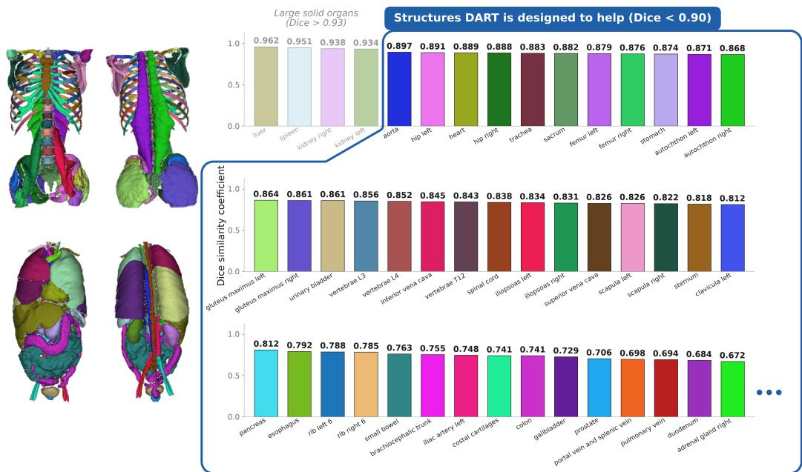  
Figure 1: Segmentation quality is uneven across anatomy. Best reported Dice per class, from the Touchstone benchmark (Bassi et al., 2024) and TotalSegmentator (Wasserthal et al., 2023). Large solid organs such as the liver and spleen exceed 0.95. Most other structures, including tubular structures, small glands and hollow organs, score lower. The outlined structures, all below 0.90, are the ones DART is designed to help; the dots indicate that its vocabulary extends to 377 classes.

• Scaling across anatomical classes. Anatomical descriptions let one model share shape information across classes. We test whether this representation can correct lesion classes absent from training, without collecting training annotations for those classes.

• Transfer across imaging modalities. The shape representation is learned from segmentation probabilities without image intensities. We test whether a model trained on probabilities predicted from CT can correct predictions from MRI without MRI training annotations, with its weights and noise-level selection rule unchanged.

• Compatibility with segmentation models. Correction operates on segmentation probabilities from automatic segmentation models or MedSAM with bounding-box prompts. Corrected probabilities are converted to masks that can serve as training labels for segmentation models on additional scans.

Our evaluation includes 13 public benchmarks, ten external to the training data. We compare with Post-DAE (Larrazabal et al., 2020), SegRefiner (Wang et al., 2023), a single-pass U-Net with DART’s backbone, and traditional methods including morphological closing and statistical shape models. In the controlled 90-class comparison, DART achieves the highest Dice on 77 classes (Sec tion 5.1). The CT-trained correction model also improves MRI masks and four lesion classes absent from its training data, without additional training annotations or retraining (Section 5.2). By learning from existing segmentation predictions, we expand the training vocabulary from 50 to 377 anatomical classes without new voxel-level annotations for correction training. Paraphrase and mismatch tests show that correction responds to the anatomical content of descriptions (Section 5.4). Corrected labels also improve all fifteen segmentation model configurations we train, spanning convolutional, residual, attention-gated and transformer architectures, by up to 10.4 Dice points (Section 5.3). Together, these results support reusing shape information in segmentation models’ predictions both to correct new cases and to produce training labels.

In summary, we make four contributions.

• We introduce a shared anatomical shape representation learned by a text-conditioned 3D diffusion model. It learns from and corrects segmentation probabilities using anatomical descriptions without receiving medical images (Figure 2; conditioning in Eq. 1, training in Eq. 2, correction in Section 3.3).

• We demonstrate scaling from 50 to 377 anatomical classes (Section 5.4, Table 5) and transfer from CT to MRI and to unseen lesion classes without target-specific training annotations or retraining (Figure 4a, Appendix C).

• We evaluate segmentation correction on 13 public benchmarks against learned and traditional correction methods (Table 1, Figure 3, Table 10), with inputs from both automatic models (Figure 3, Tables 2 and 3) and prompted MedSAM (Table 1).

• We show that corrected labels improve all fifteen segmentation model configurations we train (Figure 4b, Table 8), and release DART-45K, annotations for 45,000 CT scans (Appendix N).

## 2 RELATED WORK

Shape representations for segmentation. Rule-based postprocessing, such as hole filling, morphological closing and keeping the largest connected component, is fast but applies the same rule to every structure (Soille, 2004; Serra, 1983; He et al., 2009); organ-specific rule sets narrow this gap but must be written by hand for each class (Liu et al., 2025). Statistical shape models project a mask onto a linear space of training shapes (Cootes et al., 1995; Rogers & Graham, 2002). Learned models are more flexible: anatomically constrained models add a learned shape code to the training loss (Oktay et al., 2018a), Post-DAE maps an implausible mask to a plausible one with a denoising autoencoder (Larrazabal et al., 2020), Painchaud et al. (2020) map a cardiac mask to the nearest valid shape in a latent space, and implicit shape models learn shape manifolds or templates end to end (Raju et al., 2022; Yang et al., 2022b). Neural Annotation Refinement improves adrenal gland annotations (Yang et al., 2022a), and template-guided reconstruction shows that anatomical plausibility matters beyond voxel overlap (Xie et al., 2025). Each of these models covers one anatomy, such as the pancreas (Yao et al., 2022), or a fixed set of anatomical classes. SegRefiner adjusts predicted segmentation masks with a discrete diffusion process but does not know which structure it is adjusting (Wang et al., 2023), and in natural images CascadePSP and SegFix sharpen mask boundaries using the image (Cheng et al., 2020; Yuan et al., 2020). DART is a single model that knows which class it is correcting, because a description names it, and it needs no image. Qualityestimation methods score a mask without reference annotations rather than correcting it (Cosarinsky et al., 2026; Galati & Zuluaga, 2021; Wang et al., 2020a; Chen et al., 2026).

Diffusion models in medical segmentation. Denoising diffusion models learn to reverse a gradual noising process (Ho et al., 2020), and conditioning steers one model toward different outputs (Dhariwal & Nichol, 2021). In medical imaging they are mostly used to predict segmentation masks from images (Wu et al., 2024; Bieder et al., 2024; Xing et al., 2023), or to generate images from text (Li et al., 2026). SDEdit edits an input by partially noising and then denoising it (Meng et al., 2022), and diffusion models can reuse learned distributions in other inference problems (Graikos et al., 2022). DART applies this idea to segmentation probabilities.

Text-prompted and universal segmentation. TotalSegmentator segments more than one hundred structures from CT (Wasserthal et al., 2023), and nnU-Net remains a strong default (Isensee et al., 2021). The CLIP-Driven Universal Model, SegVol, SAT and VoxTell segment many structures from text prompts (Liu et al., 2023; 2024; Du et al., 2024; Zhao et al., 2025; Rokuss et al., 2026), and SAM and MedSAM made promptable segmentation widely available (Kirillov et al., 2023; Ma et al., 2024a). DART borrows the text interface but does not segment images: it corrects the segmentation probabilities that such models predict, and its corrected masks can serve as their training labels.

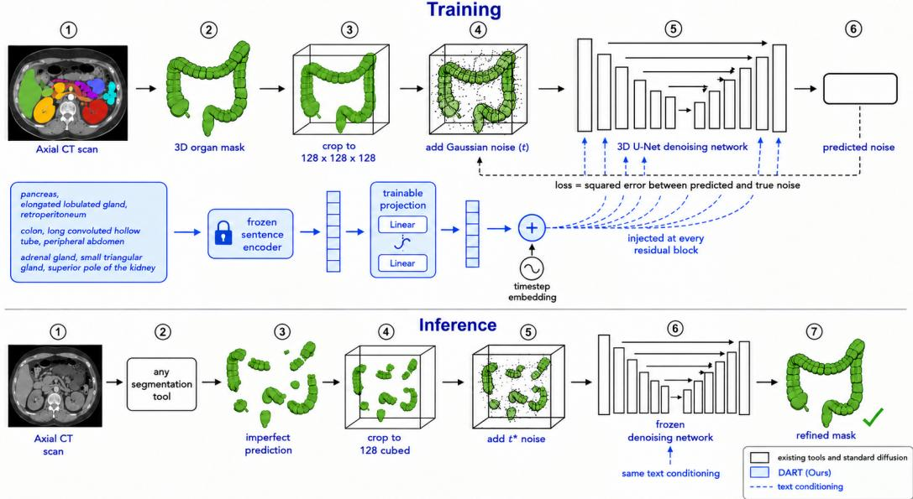  
Figure 2: Overview of DART. Training (top): a segmentation probability map predicted by a segmentation model is cropped, resized to 128×128×128, and corrupted with Gaussian noise. A 3D U-Net learns to reverse the corruption. Conditioning (middle, blue): an anatomical description is encoded by a frozen text encoder, projected by a trainable MLP, added to the timestep embedding, and injected into every residual block. Inference (bottom): probabilities are thresholded at 0.5 only to locate the crop. Their original values within the crop are resized, noised up to $t ^ { * }$ , and denoised under the same description. The final result is thresholded to obtain a segmentation mask. Blue components are contributed by this work.

## 3 METHOD

DART learns from and corrects segmentation probabilities predicted by segmentation models. For a class named by a description s, its input is a probability map $p \in [ 0 , \mathbf { \check { 1 } } ] ^ { H \times W \times D }$ , where $p _ { v }$ is the predicted probability that voxel v belongs to the class. It has three parts (Figure 2): a conditioning path that turns s into a vector, a 3D diffusion model that learns a shape representation from probability maps, and a partial noising procedure that corrects $p .$ Probability values preserve information that a binary input would discard: a value of 0.4, for example, would otherwise become background after thresholding at 0.5.

## 3.1 CONDITIONING ON ANATOMICAL DESCRIPTIONS

Each anatomical class is identified by a description of its name, shape, and location, for example “colon, long convoluted haustrated hollow tube, framing the peripheral abdomen from cecum to sigmoid”. Descriptions are drafted by a large language model from standard anatomy references and reviewed by the authors (Appendix O). A frozen text encoder E, all-MiniLM-L6-v2 (Reimers & Gurevych, 2019; Wang et al., 2020b), maps s to a 384-dimensional embedding, and a trainable projection g maps that embedding to a conditioning vector,

$$
c = g ( E ( s ) ) \in \mathbb { R } ^ { d } , \qquad g : { \mathrm { ~ L i n e a r } } ( 3 8 4 , 1 2 8 ) \to { \mathrm { S i L U } } \to { \mathrm { L i n e a r } } ( 1 2 8 , d ) ,\tag{1}
$$

where d is the width of the U-Net timestep embedding. The timestep embedding $\tau _ { t }$ and c are summed, $h = \tau _ { t } + c ,$ and h is injected into every residual block as a per-channel offset. We use a text encoder rather than an integer embedding table for two reasons. An index table has no entry for a class outside its training vocabulary, and its entries carry no information about how structures relate. A text encoder can encode descriptions of classes absent from training and represent relationships between descriptions. Because the crop removes absolute position and the model sees no neighbouring structures, location words cannot place a structure in the body; they act only through the embedding, where they make the descriptions of nearby structures similar. Section 5.4 compares the two schemes.

## 3.2 LEARNING THE SHAPE REPRESENTATION

During training, the Clean sample $x _ { 0 }$ is constructed from a segmentation probability map predicted by an existing segmentation model. We threshold the map at 0.5 to locate the structure, add a fixed margin to its bounding box, and crop and resize the original probability values to $1 2 8 ^ { 3 }$ . The binary localization mask is not the diffusion input. Here, clean means before Gaussian corruption, not an error-free reference annotation. Following Ho et al. (2020), the forward process adds Gaussian noise, $q ( x _ { t } \mid x _ { 0 } ) = \mathcal { N } \big ( x _ { t } ; \sqrt { \bar { \alpha } _ { t } } x _ { 0 } , ( 1 - \bar { \alpha } _ { t } ) \mathbf { I } \big )$ , and the model $\epsilon _ { \theta }$ is trained to predict that noise under the conditioning vector c:

$$
\mathcal { L } = \mathbb { E } _ { \boldsymbol { x } _ { 0 } , \boldsymbol { \epsilon } , t } \Big [ \| \boldsymbol { \epsilon } - \boldsymbol { \epsilon } _ { \theta } ( \boldsymbol { x } _ { t } , t , \boldsymbol { c } ) \| _ { 2 } ^ { 2 } \Big ] , \qquad \boldsymbol { \epsilon } \sim \mathcal { N } ( 0 , \bf { I } ) .\tag{2}
$$

We use $T = 1 0 0 0$ steps with a linear noise schedule (Appendix L). The model parameters encode a shared shape representation, expressed through $p _ { \theta } ( x _ { 0 } \mid c )$ , the conditional distribution of segmentation probability maps. Conditioning on c selects the anatomy specified by the description. The diffusion model receives predicted probabilities, not medical images or binary reference annotations. Its learned representation can reflect both anatomical shape and errors in the source predictions. We use generic Gaussian corruption rather than explicitly simulated segmentation errors. Clean probability values lie in [0, 1]; Gaussian-corrupted states $x _ { t }$ need not remain in this interval.

## 3.3 CORRECTION BY PARTIAL NOISING

At inference, we form a localization mask $m _ { v } = \mathbf { 1 } [ p _ { v } > 0 . 5 ]$ and compute its bounding box with the same fixed margin. Thresholding determines only this rough location. We Crop and resize the original probability map $p$ to obtain $x _ { 0 } ^ { \mathrm { i n } }$ , retaining values below 0.5 inside the crop. If the localization mask is empty, we return an empty segmentation mask. DART also receives the anatomical description and noise level $t ^ { * } ;$ it receives no medical image, reference annotation, or bounding-box prompt. Following SDEdit (Meng et al., 2022), we add noise to the cropped probability map up to an intermediate timestep $t ^ { * }$

$$
x _ { t ^ { * } } = \sqrt { \bar { \alpha } _ { t ^ { * } } } x _ { 0 } ^ { \mathrm { i n } } + \sqrt { 1 - \bar { \alpha } _ { t ^ { * } } } \epsilon , \qquad \epsilon \sim \mathcal { N } ( 0 , \mathbf { I } ) ,\tag{3}
$$

and run the reverse process from $t ^ { * }$ to 0 under c. The denoised estimate is resampled to the native geometry and thresholded at 0.5 to obtain the corrected segmentation mask mˆ (Algorithm 1, Appendix K). A small $t ^ { * }$ allows limited changes, while a larger $t ^ { * }$ allows larger shape changes at the cost of fidelity to the input.

Choosing $t ^ { * }$ . The noise level $t ^ { * }$ is the only hyperparameter specific to DART. It is selected once per class on a validation split from $\{ 5 0 , 1 5 0 , \dots , 6 5 0 \}$ and then held fixed for every test case and every experiment in this paper, including the transfer experiments (Figure 11). The selected values follow anatomy: compact solid organs take the least noise, glands and hollow organs more, and vessels and muscles the most. For a class absent from the training vocabulary, such as a lesion, $t ^ { * }$ is copied from the structure in which it occurs, for example the hippocampus for a hippocampal tumor. No labels from a test task are used to choose $t ^ { * }$ . The same values work unchanged on segmentation probabilities from every segmentation model we test (Appendix D), which suggests that $t ^ { * }$ reflects the shape of a structure rather than the errors of one segmentation model.

## 4 EXPERIMENTAL SETUP

Training data. The diffusion model is trained on segmentation probability maps predicted for 3,066 CT, cone-beam CT (CBCT) and CT angiography volumes from eight public datasets (Appendix A). Their voxel-level annotations define the class inventory: merging labels that refer to the same anatomy turns 420 annotated label classes into a vocabulary of 377 anatomical classes, spanning organs, tissues, body regions and composite classes. No MRI volume is used, and the four lesion classes in these sources are held out.

Benchmarks. We evaluate on 13 public benchmarks. Three use held-out subjects from training datasets: TotalSegmentator (90 classes), ToothFairy (77) (Bolelli et al., 2024) and DAP-Atlas (145)

Table 1: DART gives the largest gains on thin, small and elongated structures. Dice on the six TotalSegmentator classes with the largest DART gains. Every method starts from the MedSAM predictions in the first row. ±: standard deviation of the per-case paired gain over the input; ∆: DART’s mean gain in Dice points. Best per column in bold blue, second best in blue; † reads image intensity; ‘—’: no result. All 90 classes are in Table 10.
<table><tr><td>Type</td><td>Method</td><td>Autoch. L</td><td>Autoch. R</td><td>Spinal cord</td><td>Adrenal R</td><td>Glut. min. L Esophagus</td><td></td></tr><tr><td></td><td>MedSAM input (Ma et al., 2024a)</td><td>79.1</td><td>79.8</td><td>77.5</td><td>65.6</td><td>63.8</td><td>78.5</td></tr><tr><td rowspan="4">Learned</td><td>Single-pass U-Net (Ronneberger et al., 2015)</td><td>78.8±0.4</td><td>79.5±0.4</td><td>76.9±1.0</td><td>65.6±0.0</td><td>63.7±0.1</td><td>78.0±0.7</td></tr><tr><td>SegRefiner† (Wang et al., 2023)</td><td>75.1±6.2</td><td>74.9±5.5</td><td>73.9±3.8</td><td>64.6±6.3</td><td>64.2±3.3</td><td>73.2±7.3</td></tr><tr><td>Post-DAE (Larrazabal et al., 2020)</td><td>62.4±14.4</td><td>62.7±14.8</td><td>61.8±12.4</td><td>39.0±8.5</td><td>51.4±5.8</td><td>58.0±18.4</td></tr><tr><td>Hole filling (Soille, 2004)</td><td>79.1±0.0</td><td>79.8±0.0</td><td>77.5±0.0</td><td>65.6±0.0</td><td>63.8±0.0</td><td>78.5±0.0</td></tr><tr><td rowspan="8">Traditional</td><td>Morphological closing (Serra, 1983)</td><td>81.8±1.6</td><td>82.2±1.7</td><td>80.0±1.9</td><td>66.6±4.2</td><td>66.5±1.5</td><td>80.2±6.4</td></tr><tr><td>Convex hull (Barber et al., 1996)</td><td>81.9±1.2</td><td>82.0±1.0</td><td>78.5±1.0</td><td>66.6±1.8</td><td>64.6±2.1</td><td>80.2±0.8</td></tr><tr><td>Largest component (He et al., 2009)</td><td>79.1±0.0</td><td>79.7±0.2</td><td>72.6±8.9</td><td>64.4±5.0</td><td>63.8±0.1</td><td>74.1±9.2</td></tr><tr><td>Geodesic contour† (Caselles et al., 1997)</td><td>74.6±7.7</td><td>74.1±7.2</td><td>63.6±20.1</td><td>1.4±14.9</td><td>19.9±14.0</td><td>34.3±16.7</td></tr><tr><td>GMM graph-cut† (Rother et al., 2004)</td><td>66.8±18.4</td><td>66.2±17.6</td><td>77.4±18.8</td><td>57.9±10.9</td><td>64.0±3.4</td><td>72.2±10.8</td></tr><tr><td>ASM (Cootes et al., 1995)</td><td>21.3±28.3</td><td>18.7±27.9</td><td>8.2±21.1</td><td></td><td>11.1±19.9</td><td>6.6±21.7</td></tr><tr><td>Robust ASM (Rogers &amp; Graham, 2002)</td><td>20.7±25.1</td><td>18.3±24.4</td><td>6.3±18.2</td><td></td><td>11.1±19.9</td><td>6.6±21.7</td></tr><tr><td></td><td></td><td></td><td></td><td></td><td></td><td></td></tr><tr><td>Ours</td><td>DART ∆ over MedSAM input</td><td>85.7±2.7 +6.6</td><td>85.4±2.9 +5.6</td><td>83.1±4.4 +5.6</td><td>70.7±3.4 +5.1</td><td>68.8±2.0 +5.0</td><td>83.3±3.3 +4.8</td></tr></table>

(Jaus et al., 2023). Ten are external and contribute nothing to training: FLARE22 (Ma et al., 2024b), KiTS23 (Heller et al., 2023) and the spleen and pancreas tasks of the Medical Segmentation Decathlon (MSD) (Antonelli et al., 2022) in CT; the MSD heart, hippocampus and prostate tasks in MRI; and the CT, T1 and T2 scans of CHAOS (Kavur et al., 2021). Held-out WORD and AMOS22 cases, the PanSegNet MRI pancreas and seven transfer tasks complement them (Appendix B).

Input predictions. DART receives the probability map predicted by a segmentation model, never the medical image. On CT, three automatic segmentation models predict without bounding-box prompts: TotalSegmentator (Wasserthal et al., 2023), AtlasNet (Bassi et al., 2025c; Li et al., 2024) and WholeBodySeg (Cardoso et al., 2022). MedSAM (Ma et al., 2024a), prompted slice by slice with bounding boxes from the reference annotation, places every structure in the right location and so isolates shape. On MRI we use MedSAM and TotalSegmentator MRI (Akinci D’Antonoli et al., 2025).

Metrics. Dice, IoU, clDice (centerline overlap, which reflects connectivity) and NSD (boundary agreement within 2 mm) are measured against the reference annotation on a 0–100 scale, and their changes are absolute points; HD95 is the 95th-percentile Hausdorff distance in mm. “Up to” denotes the largest per-case gain unless stated otherwise (Appendix B).

Baselines. Every correction method starts from the same upstream predictions (DART from the probability map, the others from its thresholded mask) and is tuned per class on the validation split, as t∗ is for DART. On the TotalSegmentator benchmark we compare the eleven baselines of Table 1: four rules, two statistical shape models, two methods that read the image, and three learned correction methods trained on predictions paired with reference annotations: Post-DAE, SegRefiner and a single-pass U-Net with DART’s backbone but no diffusion. The external benchmarks add further methods and the identity control (Appendix M).

## 5 RESULTS

## 5.1 DART CORRECTS PREDICTIONS FROM AUTOMATIC AND PROMPTED MODELS

Best on 77 of 90 classes in the controlled comparison. With every correction method starting from the same MedSAM predictions on held-out TotalSegmentator cases, DART raises mean Dice over 90 classes from 73.6 to 75.6, is best on 77 and gains significantly (5% false discovery rate) on 84 (Table 10, Appendix H). It is the only method whose class mean never falls below the input; where a baseline leads, the margin is at most 4.1 points. On the six classes with the largest gains, all thin, small or elongated structures (Table 1), DART adds 4.8 to 6.6 Dice points and leads the strongest baselines, morphological closing and the convex hull, by 2.3 to 4.1 points. The learned baselines do not help: SegRefiner and Post-DAE lower Dice on 87 and 90 classes, and the single-pass U-Net stays within 1.6 points of its input. Image-based and shape-model baselines can fail badly, for example the geodesic contour on the right adrenal gland (1.4).

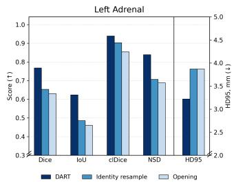

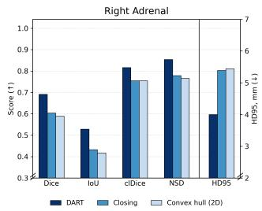

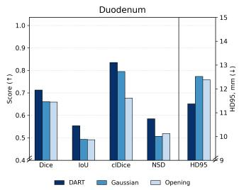

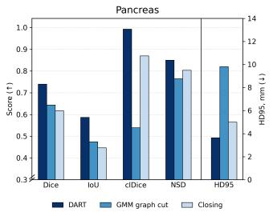

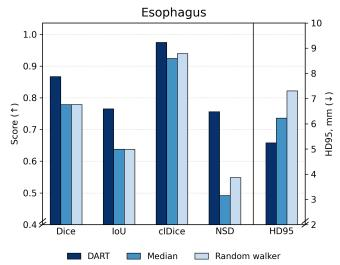  
Figure 3: On five hard structures, DART outperforms the two strongest baselines on every metric. Predictions from TotalSegmentator, AtlasNet and WholeBodySeg on the external benchmarks, averaged over the three models and over the benchmarks that annotate each structure. Each panel compares DART with the two baselines with the highest mean Dice for that structure, named in its legend. Dice, IoU, clDice and NSD (within 2 mm) use the left axis (higher is better); HD95 in mm uses the right axis (lower is better).

Up to 31 Dice points with automatic segmentation models. With every t∗ fixed in advance, the frozen model corrects predictions from TotalSegmentator, AtlasNet and WholeBodySeg, which receive no bounding-box prompts. On the external CT benchmarks, DART raises Dice by up to 31 points per case (gallbladder, FLARE22, AtlasNet input), and on five hard structures it outperforms the two strongest baselines on every metric: Dice, IoU, clDice, NSD and HD95 (Figure 3). Mean Dice rises on every external benchmark (Appendix C). On held-out WORD and AMOS22 cases it rises by 2.47 and 1.04 points on TotalSegmentator and AtlasNet predictions, and on held-out TotalSegmentator cases by 3.77 points on WholeBodySeg predictions of 104 classes (Appendix D).

Abnormal kidneys keep their tumors. On the abnormal kidneys of KiTS23, whose reference kidney includes the tumor, DART raises mean Dice on TotalSegmentator predictions from 91.8 to 95.1 without erasing the tumor to make the kidney look typical; giving the kidney another structure’s description lowers Dice by 4.9 points (Appendix C).

The gain comes from the diffusion model. The identity control, which skips diffusion, adds at most 0.24 Dice points (Appendix G), whereas sampling from pure noise in the same crop, which discards the input, scores 34.1 Dice against an input of 77.4 and DART’s 78.9 on about 50 MSD heart and FLARE22 cases (Appendix H). DART thus edits its input rather than generating a class template. A single-pass U-Net with the same backbone but no diffusion learns little more than the identity (Appendix H). On held-out WORD cases, DART also halves the connected components per mask, from 3.33 to 1.67 (Appendix F).

## 5.2 A SHAPE REPRESENTATION LEARNED FROM CT TRANSFERS TO MRI

Up to 10 Dice and 28 NSD points on MRI. Because DART never receives image intensities, a model trained only on CT predictions can correct MRI predictions; no MRI volume or lesion class appears in training, and neither the weights nor any t∗ changes. On TotalSegmentator MRI predictions, mean Dice rises on all four MRI-only datasets of Appendix C: the PanSegNet MRI pancreas (Zhang et al., 2025) from 74.1 to 82.3, the left atrium from 80.2 to 84.8, the prostate from 87.6 to 91.9 and the hippocampus from 86.0 to 89.8, with per-case prostate gains reaching 10 Dice and 28 NSD points. With MedSAM input, DART also improves all six MRI tasks of Figure 4a, including pancreatic cysts from Cyst-X (Pan et al., 2025) in all seven scanner and sequence groups.

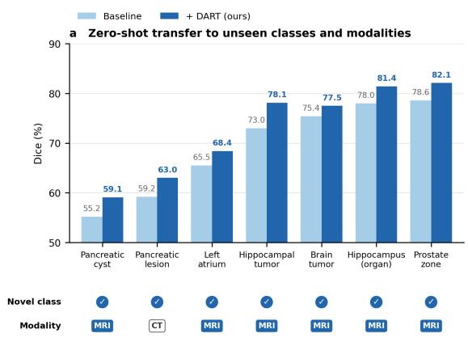

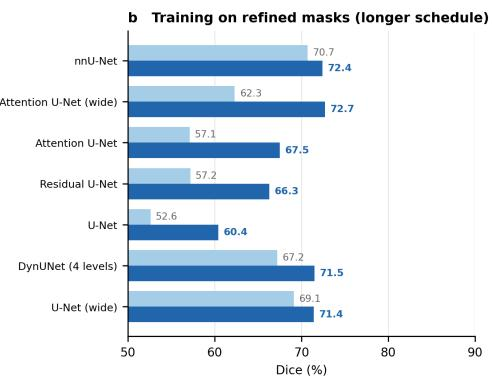  
Figure 4: One frozen model transfers to new tasks, and its corrected labels train better models. (a) Dice before and after DART on the seven transfer tasks with MedSAM input, six in MRI and one in CT (pancreatic lesion); four are lesion classes, and none of the seven appears in training. (b) Seven of the fifteen configurations of Table 8, trained on original and on corrected labels with every other factor fixed; nnU-Net is the five-level DynUNet.

Unseen lesion classes. Four lesion classes in Figure 4a never appear in training, three in MRI and one in CT, the pancreatic lesions of PanTS (Li et al., 2025b). DART raises mean Dice on all four, by 2.1 to 5.1 points, most on hippocampal tumor. We do not isolate why. Early tumors share appearance across organs in CT (Chen et al., 2024), and a generic description such as “rounded mass” would separate knowledge of the named structure from generic smoothing.

## 5.3 CORRECTED LABELS TRAIN BETTER SEGMENTATION MODELS

All fifteen configurations improve. We train each segmentation model configuration on masks predicted by the three automatic segmentation models, TotalSegmentator, AtlasNet and WholeBodySeg (original labels), and on the masks DART produces from the same predictions (corrected labels), with everything else identical (Appendix L.1). Neither set of labels uses a bounding-box prompt or a reference annotation. Corrected labels improve all fifteen configurations (Table 8, Figure 4b), from nnU-Net to UNETR, so the gain comes from the labels rather than from one design. Among the eleven configurations that train well, the gain reaches 10.4 points (Attention U-Net, from 57.1 to 67.5), with a median of 3.9.

45,000 annotated CT scans. We apply the same pipeline to 45,000 public CT scans without annotations: published segmentation models predict each structure, DART corrects every prediction, and DART-Seg, a text-promptable segmentation model trained on the corrected masks, produces the released annotations, DART-45K. In a reader audit of 10,000 of these scans, 98.5% passed (Appendix N).

## 5.4 ONE SHAPE REPRESENTATION SCALES ACROSS CLASSES AND TRAINING EXAMPLES

Expanding the vocabulary preserves mean Dice. A model trained on all 377 classes scores 74.20 mean Dice on the original 50 classes, against 73.85 for a model trained on those 50 alone (Table 5): one model absorbs 327 additional classes without lowering mean Dice on the original ones.

Descriptions outperform class indices, and DART follows them. Replacing the description with a learned class embedding, everything else fixed, cuts the gain over the input from 5.49 to 0.39 Dice points (Table 6), partly because an index cannot name classes outside its training vocabulary; text embeddings likewise outperform one-hot labels in multi-class segmentation (Liu et al., 2023;

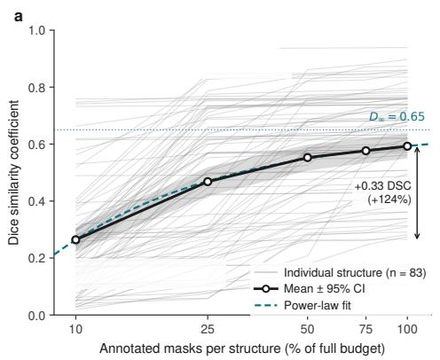

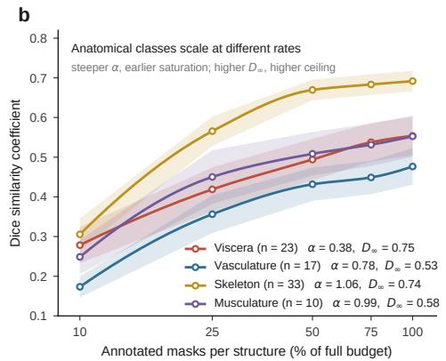  
Figure 5: The model keeps improving with more training examples. (a) Dice after DART (on a 0–1 scale) for 83 anatomical classes when the model is trained on 10% to 100% of the available training examples: individual classes (thin lines), their mean with a 95% confidence interval (heavy line) and a saturating power-law fit to the mean (dashed; Appendix I). The mean curve passes the mean input Dice of 0.53 at about 40% of the training examples. (b) The same runs grouped by anatomy.

2024). Rewording a description moves Dice by at most 0.13 points on any class, whereas another structure’s description lowers Dice on every class tested, by 2.07 points on average (Appendix E).

More training examples make a better model. Retrained on nested subsets with 10% to 100% of each structure’s training examples, the model’s mean Dice over 83 classes rises from 26 to 59 and is still rising at the full budget (Figure 5). It improves its input (mean 53) from about 40% of the training examples onward; skeletal structures saturate earliest, and thin, branching vessels reach the lowest ceiling (Appendix I).

## 6 DISCUSSION

Where DART helps most. The gain follows the room the input leaves. With automatic segmentation models, it falls as the input improves (Spearman $\rho = - 0 . 8 9$ and −0.68; Appendix D), and in Appendix C it ranges from 8.2 points on an input of 74.1 to 0.4 on an input above 94. In the controlled comparison, the largest gains fall on elongated structures and small glands, whereas the portal vein, pulmonary vessels and colon gain under 1 point, consistent with the low ceiling of vessels in Figure 5b.

Limitations and future work. DART works inside the bounding box of its thresholded input plus a fixed margin, so it cannot recover anatomy missing from that crop, and its shape representation can inherit errors of the source models. Stronger departures from typical shape than tumor-bearing kidneys remain untested; the change $1 - \operatorname { D i c e } ( m , { \hat { m } } )$ between the thresholded input mask m and the corrected mask mˆ can flag such cases for review without reference annotations. Other imaging modalities, and combining the shape representation with image features, remain to be explored.

## 7 CONCLUSION

DART, a single text-conditioned 3D diffusion model, learns one shared shape representation for 377 anatomical classes from predicted segmentation probabilities. Without receiving the image, it corrects predictions from automatic and prompted segmentation models across 13 public benchmarks, transfers from CT to MRI and to four unseen lesion classes without retraining, and produces corrected labels that train better segmentation models. Anatomical shape can be learned once and reused across classes and imaging modalities.

## ETHICS STATEMENT

This work uses only publicly available, de-identified CT, CBCT and MRI datasets, each accessed under its published license, and no new data were collected from human subjects. DART corrects the output of segmentation models and is not validated for clinical decision-making. Because it learns from predicted probabilities, it can inherit errors of the source models, and its behaviour on strongly atypical anatomy is untested (Section 6); the change $1 - \operatorname { D i c e } ( m , { \hat { m } } )$ can flag cases for human review. DART-45K is derived only from public scans, is released under the licenses of its sources, and was audited by readers on 10,000 scans (Appendix N).

## REPRODUCIBILITY STATEMENT

Architecture, noise schedule and training configuration are given in Section 3 and Table 7 (Appendix L), and the correction procedure in Algorithm 1 (Appendix K). All training and evaluation datasets are public and listed with their splits in Appendices A and B; baseline implementations and tuning ranges are in Appendix M. The code, model weights, every anatomical description (Ap pendix O) and the per-class noise level t∗ will be released.

## AI USE STATEMENT

We used a large language model to draft the anatomical descriptions used for text conditioning (Section 3.1); the authors reviewed and edited every description against standard anatomy references. We also used a large language model to edit the wording of this manuscript. Large language models were not used to generate results, data or conclusions, and the authors take full responsibility for the content.

## ACKNOWLEDGMENTS

This work was supported by the Lustgarten Foundation for Pancreatic Cancer Research and the National Institutes of Health (NIH) under Award Number R01EB039836. We would like to thank the Johns Hopkins Research IT team in IT@JH for their support and infrastructure resources where some of these analyses were conducted; especially DISCOVERY HPC. We acknowledge CSC – IT Center for Science, Finland, for providing access to Roihu and LUMI, owned by the EuroHPC Joint Undertaking and hosted by CSC Finland in collaboration with the LUMI consortium.

## REFERENCES

Tugba Akinci D’Antonoli, Lucas K. Berger, Ashraya K. Indrakanti, Nathan Vishwanathan, Jakob Weiss, Matthias Jung, Zeynep Berkarda, Alexander Rau, Marco Reisert, Thomas Küstner, Alexandra Walter, Elmar M. Merkle, Daniel T. Boll, Hanns-Christian Breit, Andrew Phillip Nicoli, Martin Segeroth, Joshy Cyriac, Shan Yang, and Jakob Wasserthal. TotalSegmentator MRI: Robust sequence-independent segmentation of multiple anatomic structures in MRI. Radiology, 314(2):e241613, 2025. doi: 10.1148/radiol.241613.

Michela Antonelli, Annika Reinke, Spyridon Bakas, Keyvan Farahani, Annette Kopp-Schneider, Bennett A. Landman, Geert Litjens, Bjoern Menze, Olaf Ronneberger, Ronald M. Summers, et al. The medical segmentation decathlon. Nature Communications, 13(1):4128, 2022.

C. Bradford Barber, David P. Dobkin, and Hannu Huhdanpaa. The quickhull algorithm for convex hulls. ACM Transactions on Mathematical Software, 22(4):469–483, 1996.

Pedro RAS Bassi, Wenxuan Li, Yucheng Tang, Fabian Isensee, Zifu Wang, Jieneng Chen, Yu-Cheng Chou, Yannick Kirchhoff, Maximilian Rokuss, Ziyan Huang, Jin Ye, Junjun He, Tassilo Wald, Constantin Ulrich, Michael Baumgartner, Saikat Roy, Klaus H. Maier-Hein, Paul Jaeger, Yiwen Ye, Yutong Xie, Jianpeng Zhang, Ziyang Chen, Yong Xia, Zhaohu Xing, Lei Zhu, Yousef Sadegheih, Afshin Bozorgpour, Pratibha Kumari, Reza Azad, Dorit Merhof, Pengcheng Shi, Ting Ma, Yuxin Du, Fan Bai, Tiejun Huang, Bo Zhao, Haonan Wang, Xiaomeng Li, Hanxue

Gu, Haoyu Dong, Jichen Yang, Maciej A. Mazurowski, Saumya Gupta, Linshan Wu, Jiaxin Zhuang, Hao Chen, Holger Roth, Daguang Xu, Matthew B. Blaschko, Sergio Decherchi, Andrea Cavalli, Alan L. Yuille, and Zongwei Zhou. Touchstone benchmark: Are we on the right way for evaluating ai algorithms for medical segmentation? Advances in Neural Information Processing Systems (NeurIPS) Datasets and Benchmarks Track, 37:15184–15201, 2024. URL https://github.com/MrGiovanni/Touchstone.

Pedro RAS Bassi, Wenxuan Li, Jieneng Chen, Zheren Zhu, Tianyu Lin, Sergio Decherchi, Andrea Cavalli, Kang Wang, Yang Yang, Alan L Yuille, and Zongwei Zhou. Learning segmentation from radiology reports. In International Conference on Medical Image Computing and Computer-Assisted Intervention, pp. 305–315. Springer, 2025a. URL https://github. com/MrGiovanni/R-Super.

Pedro RAS Bassi, Qilong Wu, Wenxuan Li, Sergio Decherchi, Andrea Cavalli, Alan Yuille, and Zongwei Zhou. Label critic: Design data before models. In IEEE International Symposium on Biomedical Imaging (ISBI), pp. 1–5. IEEE, 2025b. URL https://github.com/ PedroRASB/LabelCritic.

Pedro RAS Bassi, Mehmet Can Yavuz, Ibrahim Ethem Hamamci, Sezgin Er, Xiaoxi Chen, Wenxuan Li, Bjoern Menze, Sergio Decherchi, Andrea Cavalli, Kang Wang, Yang Yang, Alan Yuille, and Zongwei Zhou. Radgpt: Constructing 3d image-text tumor datasets. In Proceedings of the IEEE/CVF International Conference on Computer Vision, pp. 23720–23730, 2025c. URL https://github.com/MrGiovanni/RadGPT.

Florentin Bieder, Julia Wolleb, Alicia Durrer, Robin Sandkühler, and Philippe C Cattin. Memoryefficient 3d denoising diffusion models for medical image processing. Medical Imaging with Deep Learning (MIDL), 2024.

Federico Bolelli, Kevin Marchesini, Luca Lumetti, et al. Segmenting the inferior alveolar canal in CBCTs volumes: the ToothFairy challenge. IEEE Transactions on Medical Imaging, 2024.

M. Jorge Cardoso, Wenqi Li, Richard Brown, Nic Ma, Eric Kerfoot, Yiheng Wang, Benjamin Murrey, Andriy Myronenko, Can Zhao, Dong Yang, et al. MONAI: An open-source framework for deep learning in healthcare. arXiv preprint arXiv:2211.02701, 2022.

Vicent Caselles, Ron Kimmel, and Guillermo Sapiro. Geodesic active contours. International Journal ofComputer Vision, 22(1):61–79, 1997.

Qi Chen, Xiaoxi Chen, Haorui Song, Zhiwei Xiong, Alan Yuille, Chen Wei, and Zongwei Zhou. Towards generalizable tumor synthesis. In IEEE/CVF conference on computer vision and pattern recognition (CVPR), pp. 11147–11158, 2024. URL https://github.com/MrGiovanni/ DiffTumor.

Yixiong Chen, Zongwei Zhou, Wenxuan Li, and Alan Yuille. Large-scale label quality assessment for medical segmentation via a vision-language judge and synthetic data. arXiv preprint arXiv:2601.14406, 2026.

Ho Kei Cheng, Jihoon Chung, Yu-Wing Tai, and Chi-Keung Tang. CascadePSP: Toward classagnostic and very high-resolution segmentation via global and local refinement. In IEEE/CVF Conference on Computer Vision and Pattern Recognition (CVPR), 2020.

Timothy F. Cootes, Christopher J. Taylor, David H. Cooper, and Jim Graham. Active shape models—their training and application. Computer Vision and Image Understanding, 61(1):38–59, 1995.

Matias Cosarinsky, Ramiro Billot, Lucas Mansilla, Gabriel Jimenez, Nicolás Gaggion, Guanghui Fu, Tom Tirer, and Enzo Ferrante. ConfIC-RCA: Statistically grounded efficient estimation of segmentation quality. IEEE Transactions on Medical Imaging, 2026.

Prafulla Dhariwal and Alexander Nichol. Diffusion models beat gans on image synthesis. In Advances in Neural Information Processing Systems (NeurIPS), 2021.

Yuxin Du, Fan Bai, Tiejun Huang, and Bo Zhao. SegVol: Universal and interactive volumetric medical image segmentation. In Advances in Neural Information Processing Systems (NeurIPS), 2024.

Thorsten Falk, Dominic Mai, Robert Bensch, Özgün Çiçek, Ahmed Abdulkadir, Yassine Marrakchi, Anton Böhm, Jan Deubner, Zoe Jäckel, Katharina Seiwald, et al. U-net: deep learning for cell counting, detection, and morphometry. Nature methods, 16(1):67–70, 2019.

Francesco Galati and Maria A Zuluaga. Efficient model monitoring for quality control in cardiac image segmentation. In Functional Imaging and Modeling of the Heart (FIMH), volume 12738 of Lecture Notes in Computer Science, pp. 101–111. Springer, 2021.

Alexandros Graikos, Nikolay Malkin, Nebojsa Jojic, and Dimitris Samaras. Diffusion models as plug-and-play priors. In Advances in Neural Information Processing Systems (NeurIPS), 2022.

Lifeng He, Yuyan Chao, Kenji Suzuki, and Kesheng Wu. Fast connected-component labeling. Pattern Recognition, 42(9):1977–1987, 2009.

Yufan He, Pengfei Guo, Yucheng Tang, Andriy Myronenko, Vishwesh Nath, Ziyue Xu, Dong Yang, Can Zhao, Benjamin Simon, Mason Belue, Stephanie Harmon, Baris Turkbey, Daguang Xu, and Wenqi Li. VISTA3D: A unified segmentation foundation model for 3D medical imaging. arXiv preprint arXiv:2406.05285, 2024.

Nicholas Heller, Fabian Isensee, Dasha Trofimova, Resha Tejpaul, Zhongchen Zhao, Huai Chen, Lisheng Wang, Alex Golts, Daniel Khapun, Daniel Shats, et al. The KiTS21 challenge: Automatic segmentation of kidneys, renal tumors, and renal cysts in corticomedullary-phase CT. arXiv preprint arXiv:2307.01984, 2023.

Jonathan Ho, Ajay Jain, and Pieter Abbeel. Denoising diffusion probabilistic models. In Advances in Neural Information Processing Systems, volume 33, pp. 6840– 6851, 2020. URL https://proceedings.neurips.cc/paper/2020/hash/ 4c5bcfec8584af0d967f1ab10179ca4b-Abstract.html.

Fabian Isensee, Paul F Jaeger, Simon AA Kohl, Jens Petersen, and Klaus H Maier-Hein. nnunet: a self-configuring method for deep learning-based biomedical image segmentation. Nature Methods, 18(2):203–211, 2021.

Alexander Jaus, Constantin Seibold, Kelsey Hermann, Alexandra Walter, Kristina Giske, Johannes Haubold, Jens Kleesiek, and Rainer Stiefelhagen. Towards unifying anatomy segmentation: automated generation of a full-body ct dataset via knowledge aggregation and anatomical guidelines. arXiv preprint arXiv:2307.13375, 2023.

Yuanfeng Ji, Haotian Bai, Jie Yang, Chongjian Ge, Ye Zhu, Ruimao Zhang, Zhen Li, Lingyan Zhang, Wanling Ma, Xiang Wan, et al. Amos: A large-scale abdominal multi-organ benchmark for versatile medical image segmentation. arXiv preprint arXiv:2206.08023, 2022.

A. Emre Kavur, N. Sinem Gezer, Mustafa Barı¸s, Sinem Aslan, Pierre-Henri Conze, Vladimir Groza, Duc Duy Pham, Soumick Chatterjee, Philipp Ernst, Sava¸s Özkan, et al. CHAOS challenge – combined (CT-MR) healthy abdominal organ segmentation. Medical Image Analysis, 69:101950, 2021. doi: 10.1016/j.media.2020.101950.

Alexander Kirillov, Eric Mintun, Nikhila Ravi, Hanzi Mao, Chloe Rolland, Laura Gustafson, Tete Xiao, Spencer Whitehead, Alexander C Berg, Wan-Yen Lo, et al. Segment anything. arXiv preprint arXiv:2304.02643, 2023.

Agostina J Larrazabal, César Martínez, Ben Glocker, and Enzo Ferrante. Post-dae: Anatomically plausible segmentation via post-processing with denoising autoencoders. IEEE Transactions on Medical Imaging, 39(12):3813–3820, 2020.

Wenxuan Li, Chongyu Qu, Xiaoxi Chen, Pedro RAS Bassi, Yijia Shi, Yuxiang Lai, Qian Yu, Huimin Xue, Yixiong Chen, Xiaorui Lin, Yutong Tang, Yining Cao, Haoqi Han, Zheyuan Zhang, Jiawei Liu, Tiezheng Zhang, Yujiu Ma, Jincheng Wang, Guang Zhang, Alan Yuille, and Zongwei Zhou. Abdomenatlas: A large-scale, detailed-annotated, & multi-center dataset for efficient transfer learning and open algorithmic benchmarking. Medical Image Analysis, pp. 103285, 2024. URL https://github.com/MrGiovanni/AbdomenAtlas.

Wenxuan Li, Pedro RAS Bassi, Tianyu Lin, Yu-Cheng Chou, Xinze Zhou, Yucheng Tang, Fabian Isensee, Kang Wang, Qi Chen, Xiaowei Xu, Jin Ye, Zheren Zhu, Sergio Decherchi, Andrea Cavalli, Alan L Yuille, and Zongwei Zhou. Scalemai: Accelerating the development of trusted datasets and ai models. arXiv preprint arXiv:2501.03410, 2025a. URL https://github. com/MrGiovanni/ScaleMAI.

Wenxuan Li, Xinze Zhou, Qi Chen, Tianyu Lin, Pedro RAS Bassi, Xiaoxi Chen, Chen Ye, Zheren Zhu, Kai Ding, Heng Li, Kang Wang, Yang Yang, Yucheng Tang, Daguang Xu, Alan L Yuille, and Zongwei Zhou. Pants: The pancreatic tumor segmentation dataset. In Conference on Neural Information Processing Systems (NeurIPS) Datasets and Benchmarks Track, 2025b. URL https://github.com/MrGiovanni/PanTS.

Xinran Li, Yi Shuai, Chen Liu, Qi Chen, Tianyu Lin, Pengfei Guo, Dong Yang, Can Zhao, Pedro RAS Bassi, Daguang Xu, Kang Wang, Yang Yang, Alan L Yuille, and Zongwei Zhou. Text-driven tumor synthesis. IEEE Transactions on Medical Imaging, 2026. URL https: //github.com/MrGiovanni/TextoMorph.

Jie Liu, Yixiao Zhang, Jie-Neng Chen, Junfei Xiao, Yongyi Lu, Bennett A Landman, Yixuan Yuan, Alan Yuille, Yucheng Tang, and Zongwei Zhou. Clip-driven universal model for organ segmentation and tumor detection. In Proceedings of the IEEE/CVF International Conference on Computer Vision, pp. 21152–21164, 2023. URL https://github.com/ljwztc/ CLIP-Driven-Universal-Model.

Jie Liu, Yixiao Zhang, Kang Wang, Mehmet Can Yavuz, Xiaoxi Chen, Yixuan Yuan, Haoliang Li, Yang Yang, Alan Yuille, Yucheng Tang, and Zongwei Zhou. Universal and extensible languagevision models for organ segmentation and tumor detection from abdominal computed tomography. Medical Image Analysis, pp. 103226, 2024. URL https://github.com/ljwztc/ CLIP-Driven-Universal-Model.

Junqi Liu, Dongli He, Wenxuan Li, Ningyu Wang, Alan L Yuille, and Zongwei Zhou. Shapekit. In International Workshop on Shape in Medical Imaging, pp. 44–58. Springer, 2025. URL https: //github.com/BodyMaps/ShapeKit.

Xiangde Luo, Wenjun Liao, Jianghong Xiao, Tao Song, Xiaofan Zhang, Kang Li, Guotai Wang, and Shaoting Zhang. Word: Revisiting organs segmentation in the whole abdominal region. arXiv preprint arXiv:2111.02403, 2021.

Xiangde Luo, Jia Fu, Yunxin Zhong, et al. SegRap2023: A benchmark of organs-at-risk and gross tumor volume segmentation for radiotherapy planning of nasopharyngeal carcinoma. Medical Image Analysis, 2025. arXiv:2312.09576.

Jun Ma, Yuting He, Feifei Li, Lin Han, Chenyu You, and Bo Wang. Segment anything in medical images. Nature Communications, 15(1):654, 2024a.

Jun Ma, Yao Zhang, Song Gu, Cheng Ge, Shihao Mae, Adamo Young, Cheng Zhu, Xin Yang, Kangkang Meng, Ziyan Huang, et al. Unleashing the strengths of unlabelled data in deep learningassisted pan-cancer abdominal organ quantification: the FLARE22 challenge. The Lancet Digital Health, 6(11):e815–e826, 2024b. doi: 10.1016/S2589-7500(24)00154-7.

Chenlin Meng, Yutong He, Yang Song, Jiaming Song, Jiajun Wu, Jun-Yan Zhu, and Stefano Ermon. SDEdit: Guided image synthesis and editing with stochastic differential equations. In International Conference on Learning Representations, 2022.

Andriy Myronenko. 3d MRI brain tumor segmentation using autoencoder regularization. In Brainlesion: Glioma, Multiple Sclerosis, Stroke and Traumatic Brain Injuries, volume 11384 of Lecture Notes in Computer Science, pp. 311–320. Springer, 2019. doi: 10.1007/978-3-030-11726-9\_28.

Ozan Oktay, Enzo Ferrante, Konstantinos Kamnitsas, et al. Anatomically constrained neural networks (acnns): application to cardiac image enhancement and segmentation. IEEE Transactions on Medical Imaging, 37(2):384–395, 2018a.

Ozan Oktay, Jo Schlemper, Loic Le Folgoc, Matthew Lee, Mattias Heinrich, Kazunari Misawa, Kensaku Mori, Steven McDonagh, Nils Yannick Hammerla, Bernhard Kainz, Ben Glocker, and Daniel Rueckert. Attention u-net: Learning where to look for the pancreas. arXiv preprint arXiv:1804.03999, 2018b.

Nathan Painchaud, Youssef Skandarani, Thierry Judge, Olivier Bernard, Alain Lalande, and Pierre-Marc Jodoin. Cardiac segmentation with strong anatomical guarantees. IEEE Transactions on Medical Imaging, 39(11):3703–3713, 2020.

Hongyi Pan, Gorkem Durak, Elif Keles, Ziliang Hong, Deniz Seyithanoglu, Zheyuan Zhang, Alpay Medetalibeyoglu, Halil Ertugrul Aktas, and Ulas Bagci. Cyst-X: A multi-center mri benchmark and federated learning framework for malignancy-risk stratification of pancreatic cystic neoplasm. arXiv preprint arXiv:2507.22017, 2025.

Gasper Podobnik, Primoz Strojan, Primoz Peterlin, Bulat Ibragimov, and Tomaz Vrtovec. HaN-Seg: The head and neck organ-at-risk ct and mr segmentation dataset. Medical Physics, 50(3): 1917–1927, 2023.

Ashwin Raju, Shun Miao, Dakai Jin, Le Lu, Junzhou Huang, and Adam P Harrison. Deep implicit statistical shape models for 3d medical image delineation. In AAAI Conference on Artificial Intelligence, 2022.

Nils Reimers and Iryna Gurevych. Sentence-BERT: Sentence embeddings using Siamese BERTnetworks. In Proceedings of EMNLP-IJCNLP, pp. 3982–3992, 2019.

Mike Rogers and Jim Graham. Robust active shape model search. In European Conference on Computer Vision (ECCV), pp. 517–530, 2002.

Maximilian Rokuss, Fabian Isensee, and Klaus H Maier-Hein. VoxTell: Free-text promptable universal 3d medical image segmentation. arXiv preprint arXiv:2511.11450, 2026.

Olaf Ronneberger, Philipp Fischer, and Thomas Brox. U-net: Convolutional networks for biomedical image segmentation. In Medical Image Computing and Computer-Assisted Intervention – MICCAI 2015, pp. 234–241. Springer, 2015. doi: 10.1007/978-3-319-24574-4\_28.

Carsten Rother, Vladimir Kolmogorov, and Andrew Blake. GrabCut: Interactive foreground extraction using iterated graph cuts. ACM Transactions on Graphics, 23(3):309–314, 2004.

Jean Serra. Image Analysis and Mathematical Morphology. Academic Press, 1983.

Pierre Soille. Morphological Image Analysis: Principles and Applications. Springer, 2 edition, 2004.

Stéfan van der Walt, Johannes L. Schönberger, Juan Nunez-Iglesias, François Boulogne, Joshua D. Warner, Neil Yager, Emmanuelle Gouillart, and Tony Yu. scikit-image: Image processing in Python. PeerJ, 2:e453, 2014.

Pauli Virtanen, Ralf Gommers, Travis E. Oliphant, et al. SciPy 1.0: Fundamental algorithms for scientific computing in Python. Nature Methods, 17:261–272, 2020.

Mengyu Wang, Henghui Ding, Jun Hao Liew, Jiajun Liu, Yao Zhao, and Yunchao Wei. Segrefiner: Towards model-agnostic segmentation refinement with discrete diffusion process. In Advances in Neural Information Processing Systems (NeurIPS), 2023.

Shuo Wang, Giacomo Tarroni, Chen Qin, Yuanhan Mo, Chengliang Dai, Chen Chen, Ben Glocker, Yike Guo, Daniel Rueckert, and Wenjia Bai. Deep generative model-based quality control for cardiac MRI segmentation. In Medical Image Computing and Computer Assisted Intervention (MICCAI), volume 12264 of Lecture Notes in Computer Science, pp. 88–97. Springer, 2020a.

Wenhui Wang, Furu Wei, Li Dong, Hangbo Bao, Nan Yang, and Ming Zhou. MiniLM: Deep selfattention distillation for task-agnostic compression of pre-trained transformers. In Advances in Neural Information Processing Systems (NeurIPS), 2020b.

Jakob Wasserthal, Hanns-Christian Breit, Manfred T. Meyer, Maurice Pradella, Daniel Hinck, Alexander W. Sauter, Tobias Heye, Daniel T. Boll, Joshy Cyriac, Shan Yang, Michael Bach, and Martin Segeroth. Totalsegmentator: Robust segmentation of 104 anatomic structures in ct images. Radiology: Artificial Intelligence, 5(5):e230024, 2023.

Junde Wu, Rao Fu, Huihui Fang, Yu Zhang, Yehui Yang, Haoyi Xiong, Huiying Liu, and Yanwu Xu. MedSegDiff: Medical image segmentation with diffusion probabilistic model. In Medical Imaging with Deep Learning, volume 227 of Proceedings of Machine Learning Research, pp. 1623– 1639. PMLR, 2024. URL https://proceedings.mlr.press/v227/wu24a.html.

Kangxian Xie, Yufei Zhu, Kaiming Kuang, Li Zhang, Hongwei Bran Li, Mingchen Gao, and Jiancheng Yang. Template-guided reconstruction of pulmonary segments with neural implicit functions. Medical Image Analysis, 2025.

Zhaohu Xing, Liang Wan, Huazhu Fu, Guang Yang, and Lei Zhu. Diff-unet: A diffusion embedded network for volumetric segmentation. arXiv preprint arXiv:2303.10326, 2023.

Jiancheng Yang, Rui Shi, Udaranga Wickramasinghe, Qikui Zhu, Bingbing Ni, and Pascal Fua. Neural annotation refinement: Development of a new 3d dataset for adrenal gland analysis. In Medical Image Computing and Computer Assisted Intervention (MICCAI), volume 13432 of Lecture Notes in Computer Science. Springer, 2022a.

Jiancheng Yang, Udaranga Wickramasinghe, Bingbing Ni, and Pascal Fua. ImplicitAtlas: Learning deformable shape templates in medical imaging. In IEEE/CVF Conference on Computer Vision and Pattern Recognition (CVPR), 2022b.

Kaiyuan Yang, Pengcheng Shi, Houjing Huang, Fabio Musio, et al. TopBrain segmentation challenge for whole brain vessel anatomy. medRxiv, 2026. doi: 10.64898/2026.05.28.26354312.

Yuan Yao, Fengze Liu, Zongwei Zhou, Yan Wang, Wei Shen, Alan Yuille, and Yongyi Lu. Unsupervised domain adaptation through shape modeling for medical image segmentation. arXiv preprint arXiv:2207.02529, 2022. URL https://github.com/yyNoBug/VAE\_segmentation.

Yuhui Yuan, Jingyi Xie, Xilin Chen, and Jingdong Wang. SegFix: Model-agnostic boundary refinement for segmentation. In European Conference on Computer Vision (ECCV), 2020.

Zheyuan Zhang, Elif Keles, Gorkem Durak, Yavuz Taktak, Onkar Susladkar, Vandan Gorade, Debesh Jha, Asli C. Ormeci, Alpay Medetalibeyoglu, Lanhong Yao, et al. Large-scale multicenter CT and MRI segmentation of pancreas with deep learning. Medical Image Analysis, 99: 103382, 2025. doi: 10.1016/j.media.2024.103382.

Ziheng Zhao, Yao Zhang, Chaoyi Wu, Xiaoman Zhang, Ya Zhang, Yanfeng Wang, and Weidi Xie. One model to rule them all: Towards universal segmentation for medical images with text prompts. npj Digital Medicine, 2025. arXiv:2312.17183.

## A TRAINING DATA

The diffusion model is trained on segmentation probabilities predicted for 3,066 volumes from eight public datasets (Figure 6). Each training example is a probability map for one anatomical class in one volume. The source datasets’ voxel-level annotations define the class inventory; they are not the clean diffusion samples. TotalSegmentator (Wasserthal et al., 2023) contributes 1,228 CT volumes (mean age 63.6, range 18 to 97, 41.2% female). DAP-Atlas (Jaus et al., 2023) contributes 533 CT volumes. AMOS22 (Ji et al., 2022) contributes its 500 CT volumes (mean age 53.6, range 14 to 94, 37.2% female). ToothFairy (Bolelli et al., 2024), in its ToothFairy3 release, contributes 443 CBCT and CT volumes. WORD (Luo et al., 2021) contributes 150 CT volumes (mean age 49.0, range 26 to 78, 41.3% female). SegRap2023 (Luo et al., 2025) contributes 120 CT volumes, TopBrain (Yang et al., 2026) 50 CT angiography volumes, and HaN-Seg (Podobnik et al., 2023) 42 CT volumes. No MRI or MRA volume from any dataset is used. The four lesion classes in these datasets, both kidney cysts and the primary and nodal gross tumor volumes, are held out. Four datasets report no demographics, and those that do skew male (55 to 63%) and oncologic. We report demographics because a shape representation inherits the shapes of its training cohort.

The eight datasets annotate 420 label classes. Merging labels that refer to the same anatomy gives a training vocabulary of 377 anatomical classes. The number of annotated subjects per class varies by more than two orders of magnitude, and Appendix I shows that the model improves as a structure gains training examples. An anatomical class is a segmentation category, so 377 classes are not 377 separate organs: the vocabulary includes composite tissue and body-region classes inherited from the source datasets, such as muscle, visceral adipose tissue and body trunk, alongside individual anatomical structures. The released vocabulary lists every class with its subject count and marks the composite classes.

DART training corpus: 8 public datasets, 3,066 CT volumes, 377 structure prompts

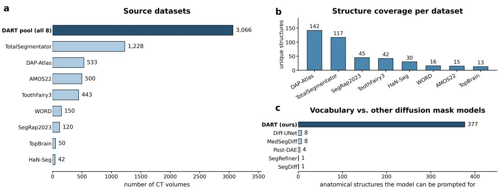  
Figure 6: Composition of the training corpus. (a) Volumes contributed by each public dataset and the pooled total. (b) Annotated classes per dataset. (c) Number of anatomical classes in the training vocabulary, compared with the number of classes that other mask-based models can be conditioned on; SegRefiner is class-agnostic and Post-DAE is not a diffusion model, so this panel compares vocabulary size only, not quality.

## B EVALUATION PROTOCOL

Evaluation sets. Each experiment uses a fixed evaluation set, and sets are not pooled.

• External benchmarks (Section 5.1, Figure 3, Appendix C): ten benchmarks from datasets that contribute nothing to training. In CT: FLARE22, KiTS23, MSD spleen (Task09) and MSD pancreas (Task07). In MRI: MSD heart (Task02), MSD hippocampus (Task04) and MSD prostate (Task05). CHAOS contributes three: CT, T1 MRI and T2 MRI. Inputs come from TotalSegmentator, AtlasNet and WholeBodySeg on CT and from TotalSegmentator MRI on MRI.

• Method comparison (Section 5.1, Table 1, Appendix P): 90 TotalSegmentator anatomical classes on which all twelve methods were run, all starting from MedSAM predictions. The two ASM variants produce a result for 41 of them.

• Held-out WORD and AMOS22 cases (Appendix D): TotalSegmentator and AtlasNet predictions on held-out subject-level test splits, 120 cases, 14 abdominal classes; WholeBodySeg predictions on held-out TotalSegmentator test cases, 104 predicted classes.

• Description sensitivity (Appendix E): the WORD and AMOS22 cases and inputs above.

• Dataset-level means (Appendix F): 77 anatomical classes on the ToothFairy test split and 145 on the DAP-Atlas test split.

• Surface distance and connected components (Appendix F): held-out WORD cases, which provide dense abdominal annotations at native spacing, with MedSAM input.

• Identity controls (Appendix G): the ToothFairy test split, the held-out WORD, AMOS22 and TotalSegmentator cases above, and the external benchmarks.

• Pure-noise control (Appendix H): about 50 cases from MSD heart and FLARE22 with MedSAM input.

• Abnormal kidneys (Section 5.1, Appendix C): the abnormal cases of KiTS23, kidneys that contain tumors, with TotalSegmentator input.

• MRI and lesion transfer tasks (Section 5.2): TotalSegmentator MRI predictions on MSD heart, hippocampus and prostate and on the PanSegNet MRI dataset (Zhang et al., 2025); MedSAM input on the seven transfer tasks of Figure 4a, namely the MSD prostate zone, hippocampus, left atrium and brain tumor, the hippocampal tumor task, the pancreatic cysts of Cyst-X (Pan et al., 2025) and, in CT, the pancreatic lesions of PanTS (Li et al., 2025b).

• Downstream training (Section 5.3, Appendix L.1): original labels predicted by TotalSegmentator, AtlasNet and WholeBodySeg, corrected labels produced by DART from the same predictions, and held-out reference annotations for evaluation.

• Data scaling (Appendix I): 83 anatomical classes.

• Vocabulary size and text versus index (Appendix J): the same 500-case subset of TotalSegmentator, AMOS22 and WORD, so these two experiments are comparable with each other but not with the sets above.

Reference annotations. Reference annotations are the released annotations of each dataset. DAP-Atlas annotations were created by an automated pipeline and approved through expert review (Jaus et al., 2023).

Bounding-box prompts for MedSAM. MedSAM is prompted slice by slice with 2D bounding boxes derived from the reference annotation, so the correction methods start from predictions in the right location and the comparison measures shape. DART never sees these bounding-box prompts. It receives MedSAM’s segmentation probabilities, thresholds them at 0.5 to locate its crop, and processes the original probabilities inside the crop, exactly as it does for automatic segmentation models. Because the prompts come from the reference, the extent of this input, and so of DART’s crop, is close to the reference extent. This favours every method that works within its input’s extent, DART included; the automatic inputs of Appendices C and D carry no such information.

Noise level. For each training class, t∗ is selected on a validation split and then fixed. For a class outside the training vocabulary, t∗ is copied from the structure in which it occurs. No test labels are consulted, and t∗ is not re-selected for any transfer experiment.

“Up to” values. Unless stated otherwise, “up to” gives the largest per-case gain in the stated evaluation set. Three exceptions are stated where they occur: for the baseline comparison it gives the largest per-class margin over a baseline (Table 10), for the segmentation models of Section 5.3 the largest gain of a single configuration, and for the lesion classes the largest gain in mean Dice of a single task.

Statistics. For each class in the 90-class comparison, we compute the per-case paired gain (after DART minus input) and test the null hypothesis of zero mean gain, controlling the false discovery rate at 5% with the Benjamini–Hochberg procedure. Per-class gains are reported as mean ± standard deviation of the per-case paired gain.

## C EXTERNAL VALIDATION

Figure 3 covers five hard structures. This section evaluates DART more broadly, on the ten external benchmarks and on the PanSegNet MRI dataset, none of which contributes training volumes to DART. Every t∗ is fixed in advance, nothing is retuned, and every available case is used (Figure 7).

Setup. On CT we run TotalSegmentator (Wasserthal et al., 2023), AtlasNet and WholeBodySeg with their released weights and default settings, and report the mean over the three. AtlasNet is the nnU-Net-based segmentation model released with AbdomenAtlas and used as the segmentation stage of RadGPT (Bassi et al., 2025c; Li et al., 2024; Isensee et al., 2021). On MRI we run TotalSegmentator MRI (Akinci D’Antonoli et al., 2025). For CHAOS, Figure 7 averages its CT scans, predicted by the three CT models, with its T1 and T2 MRI scans, predicted by TotalSegmentator MRI. Each model is evaluated on the structures that it predicts and the benchmark annotates. The baselines of Appendix M were run on the benchmarks of Figure 3; for the others we report the input, DART and, where we ran it, the identity control. AbdomenAtlas and TotalSegmentator draw on public CT collections, so some external images may be in an input model’s training data. DART’s own training sources exclude these external cases (Appendix A), but its inputs depend on the upstream models, so such overlap can influence both input quality and the measured correction.

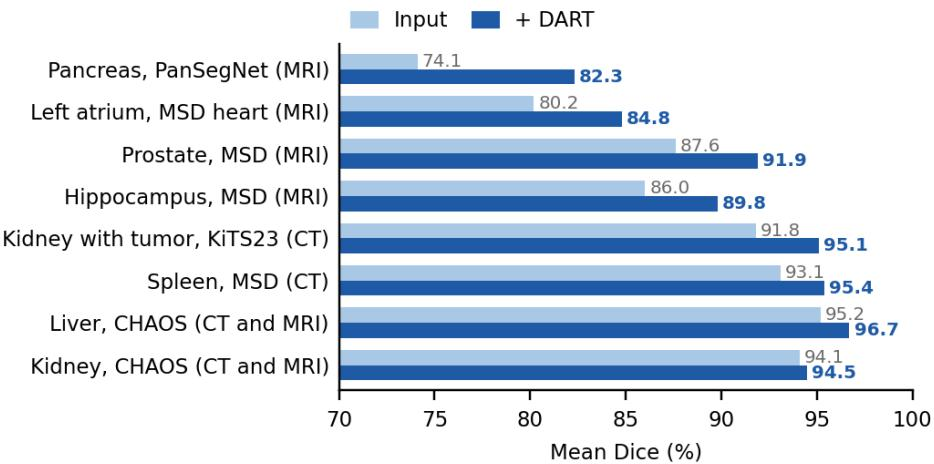  
Figure 7: DART raises mean Dice on every external benchmark. Mean Dice of the input (light) and after DART (dark). The axis starts at 70. CT inputs are the mean over TotalSegmentator, Atlas-Net and WholeBodySeg, except KiTS23, which uses TotalSegmentator on its abnormal cases. MRI inputs come from TotalSegmentator MRI, and CHAOS averages its CT and MRI scans. FLARE22 and MSD pancreas appear in Figure 3.

CT. Mean Dice rises from 93.1 to 95.4 on MSD spleen, from 95.2 to 96.7 on the CHAOS liver, and from 94.1 to 94.5 on the CHAOS kidney, the smallest gain in this section, from an input already above 94. On the benchmarks of Figure 3, DART raises Dice by up to 31 points on a single case, the gallbladder in FLARE22 with AtlasNet input, and outperforms the two displayed baselines on every metric for the five structures shown.

Abnormal kidneys. In KiTS23 (Heller et al., 2023), the reference kidney annotation includes the tumor. On the abnormal cases, with TotalSegmentator input, DART raises mean Dice from 91.8 to 95.1 and keeps the tumor voxels inside the kidney: the model does not erase the tumor to make the kidney look typical. Giving the kidney the description of a different structure lowers Dice by 4.9 points relative to the matching description, so the result depends on what the description names.

MRI. The model is trained only on CT, and every t∗ is the value selected on the CT validation split. On predictions from TotalSegmentator MRI, mean Dice rises on all four MRI-only datasets: on the pancreas of the PanSegNet MRI dataset (Zhang et al., 2025) from 74.1 to 82.3, the largest gain in this section; on the left atrium (MSD heart) from 80.2 to 84.8; on the prostate from 87.6 to 91.9; and on the hippocampus, averaged over left and right, from 86.0 to 89.8. On single prostate cases the gain reaches 10 Dice points and 28 NSD points at 2 mm. The MSD heart and hippocampus also appear in Figure 4a with MedSAM input, so the numbers there differ.

Identity control. Running DART’s crop, resize and threshold steps without the diffusion model adds 0.02 Dice points on the spleen, 0.09 on the CHAOS liver, 0.21 on the left atrium and 0.24 on the hippocampus, between 0.9% and 6.2% of DART’s gain on the same benchmark.

Summary. Mean Dice rises on every benchmark in this section, and the gain is broadly largest where the input is weakest: 8.2 points on an input of 74.1, against 0.4 points on an input above 94. Held-out WORD and AMOS22 cases show the same pattern (Appendix D).

## D AUTOMATIC SEGMENTATION MODELS ON HELD-OUT WORD AND AMOS22 CASES

Here we evaluate automatic segmentation models on held-out cases from two datasets that also contribute training volumes, which lets us compare two models on the same cases.

Setup. We run TotalSegmentator and AtlasNet on held-out subject-level test splits of WORD (Luo et al., 2021) and AMOS22 (Ji et al., 2022), 120 cases in total, none of which contributed probability maps to DART’s training. We report the 14 abdominal classes the two models share with those reference annotations. On TotalSegmentator inputs we exclude the rectum, which that model does not segment as its own class (input Dice 11.6); it is kept for AtlasNet.

Two segmentation models, two starting points. AbdomenAtlas includes WORD and AMOS22 among its sources, so AtlasNet starts from stronger inputs than TotalSegmentator on most structures, and DART gains correspondingly less. The pair therefore shows how the gain depends on input quality.

Table 2: DART on TotalSegmentator predictions. Dice before and after DART on held-out WORD and AMOS22 cases, sorted by gain. ± is the standard deviation of the per-case paired gain. Mean Dice improves for every evaluated class.
<table><tr><td>Anatomical class</td><td>TotalSegmentator</td><td>+ DART</td><td>Gain</td></tr><tr><td>Adrenal glands</td><td>64.70</td><td>70.46</td><td>+5.76 ± 3.14</td></tr><tr><td>Duodenum</td><td>60.44</td><td>64.50</td><td>+4.07 ± 2.40</td></tr><tr><td>Esophagus</td><td>76.51</td><td>80.18</td><td>+3.67 ± 2.51</td></tr><tr><td>Galibladder</td><td>66.85</td><td>70.20</td><td>+3.35 ± 3.92</td></tr><tr><td>Colon</td><td>76.43</td><td>79.54</td><td>+3.11 ± 1.72</td></tr><tr><td>Pancreas</td><td>79.67</td><td>82.74</td><td>+3.08 ± 2.28</td></tr><tr><td>Intestine</td><td>80.92</td><td>83.85</td><td>+2.93 ± 3.51</td></tr><tr><td>Kidney (left)</td><td>93.44</td><td>95.08</td><td>+1.65 ± 1.19</td></tr><tr><td>Kidney (right)</td><td>93.53</td><td>95.11</td><td>+1.58 ± 1.37</td></tr><tr><td>Spleen</td><td>94.42</td><td>95.63</td><td>+1.21 ± 0.80</td></tr><tr><td>Stomach</td><td>92.22</td><td>93.06</td><td>+0.83 ± 0.51</td></tr><tr><td>Bladder</td><td>92.09</td><td>92.62</td><td> $+ 0 . 5 3 \pm 0 . 5 0$ </td></tr><tr><td>Liver</td><td>95.74</td><td>96.01</td><td>+0.28 ± 0.47</td></tr><tr><td>Mean</td><td>82.07</td><td>84.54</td><td>+2.47</td></tr></table>

Results. DART improves 26 of the 27 class–model pairs (Tables 2 and 3, Figure 8). Mean Dice rises by 2.47 points on TotalSegmentator predictions and by 1.04 on AtlasNet predictions. On the same inputs, the identity control of Appendix G adds 0.06 and 0.05 points, and morphological closing, with its structuring element swept per class on the validation split, adds 0.15 and 0.13.

Table 3: DART on AtlasNet predictions. Same protocol as Table 2. Mean Dice improves for thirteen of fourteen classes; the intestine loses 0.16 points, which is within the per-case spread.
<table><tr><td>Anatomical class</td><td>AtlasNet</td><td>+ DART</td><td>Gain</td></tr><tr><td>Rectum</td><td>72.13</td><td>75.64</td><td> $+ 3 . 5 1 \pm 4 . 5 6$ </td></tr><tr><td>Adrenal glands</td><td>69.43</td><td>72.88</td><td> $+ 3 . 4 5 \pm 2 . 8 4$ </td></tr><tr><td>Esophagus</td><td>76.89</td><td>78.41</td><td> $+ 1 . 5 2 \pm 1 . 9 7$ </td></tr><tr><td>Galibladder</td><td>79.14</td><td>80.59</td><td> $+ 1 . 4 4 \pm 1 . 6 6$ </td></tr><tr><td>Duodenum</td><td>72.75</td><td>73.70</td><td> $+ 0 . 9 5 \pm 1 . 0 6$ </td></tr><tr><td>Bladder</td><td>85.60</td><td>86.35</td><td> $+ 0 . 7 5 \pm 0 . 9 5$ </td></tr><tr><td>Pancreas</td><td>82.82</td><td>83.55</td><td> $+ 0 . 7 3 \pm 1 . 2 8$ </td></tr><tr><td>Liver</td><td>95.33</td><td>96.06</td><td> $+ 0 . 7 3 \pm 0 . 6 9$ </td></tr><tr><td>Spleen</td><td>95.15</td><td>95.62</td><td> $+ 0 . 4 7 \pm 0 . 6 6$ </td></tr><tr><td>Kidney (right)</td><td>93.31</td><td>93.75</td><td> $+ 0 . 4 4 \pm 0 . 6 5$ </td></tr><tr><td>Stomach</td><td>92.24</td><td>92.53</td><td> $+ 0 . 2 9 \pm 0 . 5 2$ </td></tr><tr><td>Kidney (left)</td><td>93.96</td><td>94.25</td><td> $+ 0 . 2 8 \pm 0 . 2 8$ </td></tr><tr><td>Colon</td><td>82.72</td><td>82.87</td><td> $+ 0 . 1 4 \pm 1 . 3 9$ </td></tr><tr><td>Intestine</td><td>87.03</td><td>86.87</td><td> $- 0 . 1 6 \pm 0 . 7 8$ </td></tr><tr><td>Mean</td><td>84.18</td><td>85.22</td><td>+1.04</td></tr></table>

(a) Correction of two automatic segmenters  
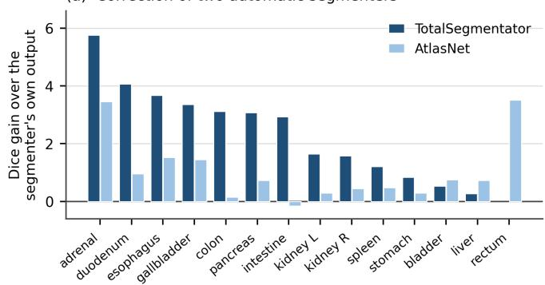

(b) Against the controls  
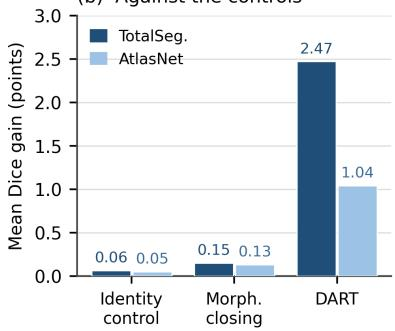  
Figure 8: DART improves the predictions of two automatic segmentation models. (a) Dice gain per class over each model’s own prediction, on held-out WORD and AMOS22 cases with the perclass t∗ unchanged. (b) Mean gain against the two controls that use the same inputs: the identity path with the diffusion model removed, and morphological closing with its structuring element swept per class on the validation split.

The gain follows the headroom. Reading the two tables together separates the effect of the structure from the effect of the input. The same structure gains less when the input is better: the duode num gains 4.07 from a 60.4 input and 0.95 from a 72.8 input; the colon gains 3.11 from 76.4 and 0.14 from 82.7; the intestine gains 2.93 from 80.9 and loses 0.16 from 87.0. Within each model, the largest gains fall on the adrenal glands, duodenum, esophagus and gallbladder, where both models are weakest, and the smallest on the liver, spleen, bladder and stomach, which are close to solved. Across structures, the gain falls as the input improves, with a Spearman correlation of $\rho = - 0 . 8 9$ for TotalSegmentator $( p < 0 . 0 0 1 )$ and $\rho = - 0 . 6 8$ for AtlasNet $( p = 0 . 0 0 8 )$ . This is the behaviour a shape representation should show.

A third segmentation model on a different dataset. We also apply DART to the predictions of WholeBodySeg, the MONAI whole-body CT segmentation model (Cardoso et al., 2022): a SegRes-Net that predicts 104 anatomical classes, trained on a different TotalSegmentator release from the one we test on. We run it on TotalSegmentator test cases held out from DART’s training and correct every class it predicts, with the same frozen model and per-class t∗. Mean Dice rises by 3.77 points. The identity control, run on the same inputs, adds 0.08 points, 2.1% of the gain, so nearly all of the gain comes from the diffusion model. This extends the results for automatic segmentation models to a third model, a third dataset and structures across the whole body.

(a) Effect of the prompt

## E ANATOMICAL DESCRIPTION SENSITIVITY: PARAPHRASE AND MISMATCH

Setup. We condition the frozen model on three description variants on the WORD and AMOS22 inputs of Appendix D, holding the noise level t∗, the random seed and everything else fixed, and report the change in Dice relative to the matching description. Paraphrase rewrites the descrip tion in different words while keeping the name, shape cue and location cue, for example replacing “pancreas, elongated lobulated gland, retroperitoneum behind the stomachfrom duodenal curve to splenic hilum” with a rewording that names the same organ, the same shape and the same neigh bours. Mismatch substitutes the unmodified description of a different class in the vocabulary, chosen by hand for each class. The paraphrase run also includes the left and right femur. Values are averaged over the segmentation models that predict each class.

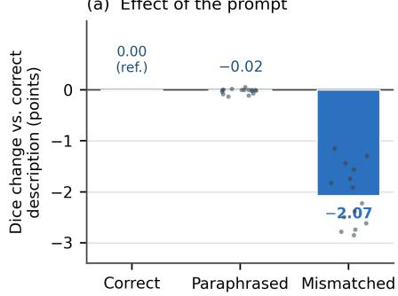

(b) Per structure  
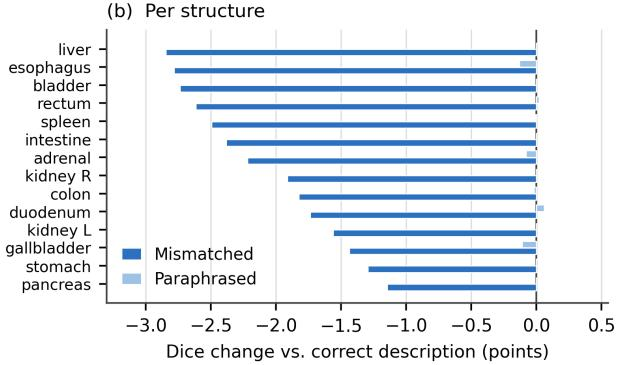  
Figure 9: DART follows what the description says, not its wording. Change in Dice relative to the matching description, on the predictions of the automatic segmentation models of Appendix D, with the noise level and seed held fixed. (a) A paraphrase that keeps the anatomy but changes the words barely changes Dice (−0.02 points); substituting another structure’s description costs 2.07 points. Dots are individual anatomical classes. (b) The same, per class. Every class loses Dice under a mismatched description; none moves by more than 0.13 points under a paraphrase.

Results. A paraphrase changes Dice by −0.02 points on average over 16 anatomical classes and by at most 0.13 points on any one (Figure 9, Table 4). A mismatched description costs 2.07 points on average over 14 anatomical classes and lowers Dice on every one. The two effects differ by two orders of magnitude. A model that treated the description as an arbitrary code would be thrown off by a paraphrase, because a paraphrase is a different string. A model that ignored the description would not notice a mismatch. DART is insensitive to wording and sensitive to what the description names.

What the mismatch test measures. Both variants run at the noise level $t ^ { * }$ of the matching class, which keeps the output close to its input. The mismatch cost measures sensitivity to the anatomical description at this noise level; it does not isolate a distinct shape representation for each class. Across the 14 classes, the mismatch cost is unrelated to the gain from DART (Spearman $\rho = - 0 . 0 7$ $p = 0 . 8 2 )$ .

## F DATASET-LEVEL RESULTS AND SEGMENTATION QUALITY

Over the 77 ToothFairy anatomical classes, DART raises mean Dice from 53.83 to 57.67 (+3.8 points). Over the 145 DAP-Atlas anatomical classes, it raises mean Dice from 68.70 to 73.40 (+4.7 points). Both gains are larger than on the 90 TotalSegmentator anatomical classes, which include organs whose inputs are already accurate. On held-out WORD cases with MedSAM input, DART reduces the average symmetric surface distance from 1.75 mm to 1.66 mm (−5.2%) and the number of connected components per mask from 3.33 to 1.67 (−49.8%) (Figure 10).

Table 4: Description sensitivity. Change in Dice (points) relative to the matching description, averaged over the two segmentation models of Appendix D. ‘—’ means the class was not included in that run.
<table><tr><td>Anatomical class</td><td>Paraphrased</td><td>Mismatched</td></tr><tr><td>Adrenal glands</td><td>-0.08</td><td>-2.22</td></tr><tr><td>Bladder</td><td>0.00</td><td>-2.74</td></tr><tr><td>Colon</td><td>-0.02</td><td>-1.83</td></tr><tr><td>Duodenum</td><td>+0.06</td><td>-1.74</td></tr><tr><td>Esophagus</td><td>-0.13</td><td>-2.78</td></tr><tr><td>Femur (left)</td><td>-0.03</td><td></td></tr><tr><td>Femur (right)</td><td>-0.07</td><td></td></tr><tr><td>Gallbladder</td><td>-0.11</td><td>-1.44</td></tr><tr><td>Intestine</td><td>0.00</td><td>-2.38</td></tr><tr><td>Kidney (left)</td><td>0.00</td><td>-1.56</td></tr><tr><td>Kidney (right)</td><td>0.00</td><td>-1.91</td></tr><tr><td>Liver</td><td>0.00</td><td>-2.85</td></tr><tr><td>Pancreas</td><td>0.00</td><td>-1.15</td></tr><tr><td>Rectum</td><td>+0.02</td><td>-2.61</td></tr><tr><td>Spleen</td><td>-0.01</td><td>-2.49</td></tr><tr><td>Stomach</td><td>+0.01</td><td>-1.29</td></tr><tr><td>Mean</td><td>-0.02</td><td>-2.07</td></tr></table>

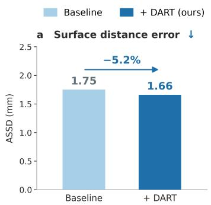

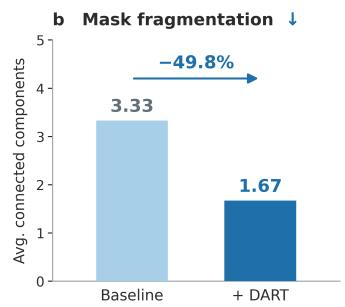

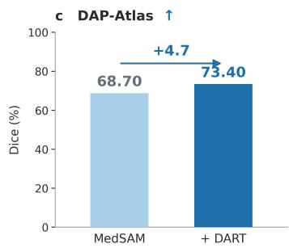  
Figure 10: Boundary and fragmentation metrics. (a) Average symmetric surface distance before and after DART on held-out WORD cases. (b) Connected components per mask on the same cases. (c) Mean Dice on DAP-Atlas for the MedSAM input and after DART.

## G IDENTITY CONTROLS

DART locates its crop by thresholding the input probabilities at 0.5, crops and resizes the original probabilities to 1283, runs the reverse process, resamples back to the native crop by trilinear interpolation, and thresholds the result. Resampling and thresholding can change Dice on their own, so two controls run this path without the diffusion model. Identity crops, resizes, resamples and thresh olds at 0.5, with no noising or denoising. Identity (volume-matched) does the same but chooses the threshold that reproduces the foreground voxel count of the input probabilities thresholded at 0.5, which removes any volume bias of a fixed threshold.

On ToothFairy, against a MedSAM input of 53.83 Dice, the identity control reaches 53.96 and the volume-matched identity control reaches 54.00, while DART reaches 57.67. The resampling path therefore accounts for 3.4% of the gain, and the volume bias for 4.4%. On the same split, Gaussian smoothing reaches 54.12, a median filter 54.23, the convex hull 54.69, morphological closing 55.72, and convex hull followed by closing 56.18. DART thus exceeds the strongest traditional method by 1.5 points and the identity control by 3.7 points. Across this evaluation set, the gain is positive on 652 of 658 class–case pairs.

On the held-out WORD and AMOS22 inputs of Appendix D, the same identity control adds 0.06 Dice points on TotalSegmentator predictions and 0.05 on AtlasNet predictions, and on held-out

TotalSegmentator cases it adds 0.08 on WholeBodySeg predictions, against 2.47, 1.04 and 3.77 for DART. On the external benchmarks of Appendix C, it adds between 0.02 and 0.24 points, 0.9% to 6.2% of the gain. On the benchmarks of Figure 3, it is included as a baseline; on the left adrenal gland it is among the two strongest, because most other baselines lower Dice there.

## H ADDITIONAL OBSERVATIONS

The opposite control: sampling from pure noise. The identity control removes the diffusion model; this control removes the input. The reverse process starts from pure noise at t = T, in the same crop and under the same description, so the output depends on the description and the crop but not on the probability values within that crop. On about 50 cases from MSD heart (MRI) and FLARE22 (CT) with MedSAM input, the input scores 77.37 Dice, DART 78.91, and sampling from pure noise 34.08, or 34.31 with the threshold chosen to maximise Dice. Because MedSAM is prompted with bounding boxes from the reference annotation, the crop nearly matches the reference extent; even so, the description alone recovers less than half of the input’s Dice. DART therefore edits its input rather than replacing it with a shape generated for the class.

The baselines are weak on the TotalSegmentator benchmark. Nine of the eleven baselines lower Dice on more than half of the classes they run on (Table 10): the convex hull on 65 of 90, SegRefiner on 87 and Post-DAE on all 90, while the two classical methods that read the image lose 21.6 and 28.5 points on average and the two ASM variants about 59. We re-checked each implementation after observing this. The losses follow from what each method assumes, as the paragraphs below explain, not from implementation errors.

Fixed rules help some structures and hurt others. The convex hull improves the left autochthon by 2.8 Dice points but lowers the pancreas by 10.8 and the colon by 7.1: a convex shape suits compact structures and not lobulated or tubular ones. Hole filling barely changes Dice, so the input errors lie at boundaries and in connectivity rather than in interior holes.

Methods that read the image are unsafe to apply blindly. GMM graph-cut and geodesic active contours work where a strong intensity edge coincides with the anatomical boundary and fail elsewhere. Over the 90 anatomical classes, their mean gains are −21.6 and −28.5 Dice points. Neither can be applied to an unknown structure without first deciding whether it will help.

Classes without a significant gain. At a 5% false discovery rate, the gain is not significant on six of the 90 anatomical classes: liver (+0.01 points), spleen (+0.09), left scapula (+0.15), right hip (+0.18), right kidney (+0.18) and left kidney (+0.30). The four organs have inputs above 94 Dice and leave little to improve. The two bones have low inputs (51.0 and 59.9 Dice), yet the model changes them little.

How the gain relates to input quality depends on the input. On the fixed MedSAM input, regressing the per-class gain on input Dice over the 90 anatomical classes gives a slope of −0.003 (r = −0.03, p = 0.78), and grouping is more informative than the regression: +2.5 points on the 59 anatomical classes below 80 Dice and +0.8 on the nine above 90. We attribute the weak relationship to the input itself: bounding-box prompts from the reference annotation raise input Dice unevenly across structures and compress the range, so input quality is a poor proxy for how much shape error remains. On predictions from automatic segmentation models in Appendix D, which receive no such prompts, the relationship is clear: the gain falls as the input improves (ρ = −0.89 and −0.68), both across structures and for the same structure across the two models. The second setting is the one that matches deployment.

ASM depends strongly on anatomy. On the 41 TotalSegmentator anatomical classes where they produce a result, both ASM variants lower mean Dice by about 59 points. A linear shape space fitted to a few dozen aligned examples cannot represent the variability of hollow and branching structures and pulls the mask toward the mean shape. For thin structures such as the iliac arteries and the subclavian vessels, a small misalignment between that mean shape and the true structure leaves almost no overlap. The two variants differ on only 3 of these 41 anatomical classes. For example, on the right iliac vein, DART reaches 87.0 Dice and ASM 6.1, a difference of 80.9 points. The input is already 84.7, and morphological closing, the strongest baseline for this class, reaches 86.1. Thus, the 80.9-point difference reflects an ASM failure; DART improves the input by 2.3 points and exceeds the strongest baseline by 0.9.

Why the learned baselines fall short. All three are trained on segmentation predictions paired with their reference annotations, so they learn from the kind of errors they are tested on. Post-DAE must reconstruct the whole mask through a compact code, which likely costs detail even where the input is already right; it lowers Dice on every class. SegRefiner reads the image, but it was designed for 2D natural images; applied slice by slice, it lacks 3D context and lowers Dice on 87 of the 90 classes. The single-pass U-Net shares DART’s backbone and text conditioning but maps its input to the reference annotation in one deterministic forward pass, without diffusion or partial noising. Trained to map a mask that is already close to its reference onto that reference in one step, it learns little more than the identity: it stays within 1.6 Dice points of its input on every class, and on the right adrenal gland it returns its input unchanged on every case (per-case gain $0 . { \dot { 0 } } \pm 0 . 0$ in Table 1). DART instead adds noise first, which turns the input into a noisy sample of the form seen in training and lets the model make larger changes of shape.

## I SCALING WITH TRAINING EXAMPLES

Figure 5 (Section 5.4) retrains the model on nested subsets with 10% to 100% of each structure’s training probability maps, keeping everything else fixed, and evaluates 83 anatomical classes. This experiment uses its own set of classes and its own starting point, separate from Table 10.

Grouped by anatomy (Figure 5b), skeletal structures saturate earliest, viscera reach the highest ceiling and vessels the lowest. We see two reasons for the low-data points, where the output falls below the input. With few training examples, the learned distribution is a coarse model of the structure. And t∗ is held at the values chosen for the full model, so a weak model may change a prediction as much as a strong one. Together they can pull a mask toward an inaccurate shape. With more training examples, the learned shape representation improves, and correction at the same noise level becomes useful.

The mean curve is well described by a saturating power law in the percentage $f$ of training examples, with Dice on a 0–1 scale, $D ( f ) = \mathbf { \bar { \boldsymbol { D } } } _ { \infty } - a f ^ { - \mathbf { \bar { \alpha } } }$ , with $D _ { \infty } = 0 . 6 \bar { 5 } , a = 2 . \bar { 6 } 3$ and $\alpha = 0 . 8 3$ . Setting $D ( f )$ to the mean input Dice of 0.53 gives $f \approx 4 1 \%$ . We use the fit as a summary of the measured curve. The conclusions rest on the measured points themselves: mean Dice rises monotonically, is still rising between 75% and 100% of the training examples, and exceeds the input from about 40% onward.

## J VOCABULARY AND CONDITIONING ABLATIONS

Both experiments use the same 500-case subset of TotalSegmentator, AMOS22 and WORD, with subject-level disjoint splits. Absolute Dice values are therefore not comparable to the 90-class tables or to Appendix D.

Table 5: Expanding the vocabulary preserves mean Dice on existing classes. Mean Dice on the same 50 anatomical classes, on TotalSegmentator, AMOS22 and WORD test cases, for model trained on 50 anatomical classes and on the full vocabulary.
<table><tr><td>Training vocabulary</td><td>Test classes</td><td>Dice</td></tr><tr><td>50</td><td>50</td><td>73.85</td></tr><tr><td>377</td><td>50</td><td>74.20</td></tr></table>

What the vocabulary comparison measures. Table 5 compares two separately trained models with the same architecture on the same 50 classes. The 377-class model also covers 327 additional classes, so the comparison tests whether sharing one shape representation across many more classes lowers mean Dice on the original ones; it does not.

Table 6: Anatomical descriptions outperform class indices. Replacing the text embedding with a learned class embedding indexed by an integer class identifier, with everything else fixed, reduces the gain from +5.49 to +0.39 Dice points on TotalSegmentator, AMOS22 and WORD test cases. The evaluation set includes classes outside the index-conditioned model’s vocabulary; see the text below.
<table><tr><td>Model</td><td>Dice</td><td>Gain</td></tr><tr><td>Input (before DART)</td><td>68.71</td><td></td></tr><tr><td>Index-conditioned</td><td>69.10</td><td>+0.39</td></tr><tr><td>Text-conditioned (DART)</td><td>74.20</td><td>+5.49</td></tr></table>

What the index comparison measures. An index-conditioned model learns a separate class embedding for each class from its training examples. The source datasets’ annotation counts vary by more than two orders of magnitude across classes (Appendix A), so class coverage is uneven, which may limit embeddings for classes with few training examples. Text embeddings can instead encode similarities between anatomical descriptions. However, the evaluation also includes classes outside the index-conditioned model’s vocabulary, which an index cannot represent. Table 6 therefore combines differences in conditioning with differences in vocabulary coverage. It does not establish how much of the gap is due to each factor.

The index comparison involves two separately trained models, while the mismatch test of Appendix E keeps one model and changes only the anatomical description. This is why the text–index gap (5.10 points) and the mismatch cost (2.07 points) measure different things: the first compares two models, the second changes the anatomical description supplied to the same model.

## K DART ALGORITHM

Algorithm 1 gives the full procedure of Section 3.3. It receives a segmentation probability map, an anatomical description and the per-class noise level. The binary mask m locates the crop; the diffusion input retains the original probabilities.

Algorithm 1 DART   
Require: segmentation probability map p; anatomical description s; noise level t∗   
Ensure: corrected segmentation mask in the native geometry of p   
1: $m \gets \mathbf { 1 } [ p > 0 . 5 ]$ ▷ Localization only   
2: if m is empty then   
3: return m   
4: end if   
5: B ← BoundingBox(m) with the fixed margin   
6: $c  g ( E ( s ) )$ ▷ Eq. 1   
7: $x _ { 0 } ^ { \mathrm { i n } }  \mathrm { R e s i z e } ( \mathrm { C r o p } ( p , B ) , 1 2 8 ^ { 3 } )$   
8: $\epsilon \sim \mathcal { N } ( 0 , \mathbf { I } )$   
9: $x _ { t ^ { * } } \gets \tilde { \sqrt { \bar { \alpha } _ { t ^ { * } } } } x _ { 0 } ^ { \mathrm { i n } } + \sqrt { 1 - \bar { \alpha } _ { t ^ { * } } } \epsilon$ ▷ Eq. 3   
10: for $t = \stackrel { \cdot } { t } ^ { * } , t ^ { * } - 1 , \ldots , 1$ do   
11: $x _ { t - 1 } \gets \mathrm { D D P M S t e p } ( x _ { t } , \epsilon _ { \theta } ( x _ { t } , t , c ) )$   
12: end for   
13: return $\mathrm { U n c r o p } ( \mathrm { R e s a m p l e } ( x _ { 0 } ) > 0 . 5 , B )$

## L IMPLEMENTATION DETAILS

Table 7 lists the training and inference configuration, and Figure 11 shows the validation-selected noise levels.

Anatomical descriptions. Each description should explain the target anatomy’s shape, location and distinguishing characteristics; its level of detail depends on the anatomy. The implementation processes descriptions within the input limit of the chosen text encoder.

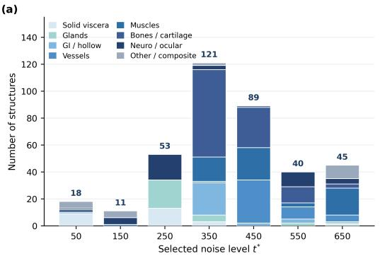

(b)  
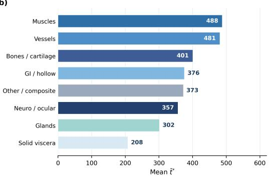  
Figure 11: Selected noise levels follow anatomy. (a) Validation-selected t∗ for the training vocab ulary, stacked by anatomical group. (b) Mean $t ^ { * }$ per group. Compact solid organs need the least noise; muscles and vessels need the most. The per-class values are released with the code.

Table 7: Training and inference configuration.
<table><tr><td>Architecture Backbone</td><td>3D MONAIDiffusionModelUNet</td></tr><tr><td>Resolution levels Input</td><td>4, with channels (16, 32, 64, 128) 1-channel probability map, cropped and resized to  $1 2 8 ^ { 3 }$ </td></tr><tr><td>Text conditioning Text encoder</td><td></td></tr><tr><td>Text embedding</td><td> $\mathtt { a l l - M i n i L M - L 6 - v } 2$  , frozen 384-dim, computed once and stored</td></tr><tr><td>Projection</td><td>Linear(384,128), SiLU, Linear(128,d), trainable</td></tr><tr><td>Injection</td><td>added to the timestep embedding in every residual block</td></tr><tr><td>Diffusion</td><td></td></tr><tr><td>Total steps  $T$ </td><td></td></tr><tr><td></td><td>1000</td></tr><tr><td>Noise schedule</td><td>linear,  $\beta _ { 1 } = 1 { \times } 1 0 ^ { - 4 } , \beta _ { T } = 0 . 0 2$ </td></tr><tr><td>Objective</td><td></td></tr><tr><td>Sampler</td><td>noise prediction with mean squared error</td></tr><tr><td>Noise level  $t ^ { * }$ </td><td>DDPM ancestral sampling from t* to 0</td></tr><tr><td></td><td>per class, from  $\{ 5 0 , \hat { 1 5 } 0 , \bar { \dots } , 6 5 0 \}$ </td></tr><tr><td>Optimization</td><td></td></tr><tr><td></td><td></td></tr><tr><td>Optimizer</td><td>AdamW, learning rate  $2 \times 1 0 ^ { - 4 }$  , weight decay  $1 \times 1 0 ^ { - 5 }$ </td></tr><tr><td>Schedule</td><td>cosine annealing</td></tr><tr><td>Batch size / epochs</td><td>24 / 113</td></tr><tr><td>Gradient clipping</td><td></td></tr><tr><td></td><td>global norm 1.0</td></tr><tr><td>Precision</td><td>automatic mixed precision</td></tr><tr><td>Augmentation</td><td>random flips along all axes, random  $9 0 ^ { \circ }$  rotations</td></tr></table>

Inference cost. DART takes 0.59 s per probability map on one AMD MI250X GPU at $1 2 8 ^ { 3 }$ . A scan containing 50 anatomical classes therefore costs about half a minute of GPU time on top of segmentation. DART runs once over each predicted probability map.

## L.1 SEGMENTATION MODELS FOR THE DOWNSTREAM EXPERIMENT

Table 8 lists the fifteen segmentation model configurations. They cover convolutional (U-Net (Ronneberger et al., 2015), Basic U-Net (Falk et al., 2019) and V-Net), residual (Residual U-Net and SegResNet (Myronenko, 2019)), attention-gated (Attention U-Net (Oktay et al., 2018b)), self configuring (nnU-Net (Isensee et al., 2021) in its DynUNet implementation) and transformer (UN-ETR) architectures, in several widths and depths. The original-label arm trains on masks predicted by a combination of three automatic segmentation models, TotalSegmentator (Wasserthal et al., 2023), AtlasNet (Bassi et al., 2025c; Li et al., 2024) and WholeBodySeg (Cardoso et al., 2022), and the corrected-label arm on the masks that DART produces from the same probability maps. Both arms of each configuration share one training schedule and are evaluated against the same held-ou reference annotations, so they differ only in their training labels.

Corrected labels improve every configuration. We summarize the eleven whose original-label arm reaches 45 Dice, which train well under this schedule: gains range from 0.8 to 10.4 points, with a median of 3.9 and a mean of 4.9. Figure 4b shows seven of these configurations; its nnU-Net arm is the five-level DynUNet.

Table 8: Corrected labels improve all fifteen segmentation model configurations. Dice of each configuration trained on the original labels and on the same labels after DART, with one shared training schedule and every other factor fixed. Configurations are grouped by whether the originallabel arm reaches 45 Dice.
<table><tr><td>Configuration</td><td>Original labels</td><td>Corrected labels</td><td>Gain</td></tr><tr><td colspan="4">Original-label arm at least 45 Dice</td></tr><tr><td>Attention U-Net (wide)</td><td>62.3</td><td>72.7</td><td>+10.4</td></tr><tr><td>Attention U-Net</td><td>57.1</td><td>67.5</td><td>+10.4</td></tr><tr><td>Residual U-Net</td><td>57.2</td><td>66.3</td><td>+9.1</td></tr><tr><td>U-Net</td><td>52.6</td><td>60.4</td><td>+7.8</td></tr><tr><td>DynUNet (4 levels)</td><td>67.2</td><td>71.5</td><td>+4.4</td></tr><tr><td>V-Net</td><td>45.3</td><td>49.2</td><td>+3.9</td></tr><tr><td>U-Net (wide)</td><td>69.1</td><td>71.4</td><td>+2.4</td></tr><tr><td>DynUNet (5 levels)</td><td>70.7</td><td>72.4</td><td>+1.7</td></tr><tr><td>Basic U-Net (wide)</td><td>59.5</td><td>61.2</td><td>+1.7</td></tr><tr><td>Residual U-Net (deep)</td><td>62.5</td><td>63.5</td><td>+1.0</td></tr><tr><td>U-Net (deep)</td><td>65.6</td><td>66.4</td><td>+0.8</td></tr><tr><td colspan="4">Median / mean gain</td></tr><tr><td colspan="4">Original-label arm below 45 Dice</td></tr><tr><td>SegResNet (tiny)</td><td>6.6</td><td>30.4</td><td>+23.8</td></tr><tr><td>SegResNet</td><td>43.3</td><td>50.3</td><td>+7.0</td></tr><tr><td>UNETR (small)</td><td>34.9</td><td>36.5</td><td>+1.6</td></tr><tr><td>U-Net (tiny)</td><td>23.7</td><td>25.2</td><td>+1.5</td></tr></table>

## M BASELINE METHODS

Correction methods start from the predictions of the same upstream segmentation model for each structure and return binary masks. DART receives segmentation probabilities; methods that need a binary input use the corresponding thresholded mask. On the TotalSegmentator benchmark the upstream model is MedSAM; on the external benchmarks it is an automatic segmentation model. No method sees test labels. Hyperparameters are selected per class on the validation split by grid search over the ranges below and then applied unchanged to the test cases, in the same way as t∗ for DART. Morphological closing, the strongest single traditional method on ToothFairy (Appendix G), is also run on the held-out WORD and AMOS22 inputs of Appendix D with the same per-class sweep.

Learned methods. All three are trained on segmentation predictions paired with their reference annotations, with the same subject-level splits as DART. The single-pass U-Net (Ronneberger et al., 2015) uses DART’s backbone and text conditioning and receives the same thresholded prediction as the other correction baselines, but maps it to its reference annotation in one deterministic forward pass, without diffusion or partial noising. It tests whether a single forward pass is enough. Post-DAE (Larrazabal et al., 2020) is a denoising autoencoder that maps an implausible mask to a plausible one; we reimplement it in 3D. SegRefiner (Wang et al., 2023) adjusts a coarse mask with a discrete diffusion process conditioned on the image, trained on the same pairs. It was designed for 2D images, so we apply it slice by slice, with the image.

Traditional methods: morphology and connected components. These use only the mask. Morphological operations use a ball-shaped structuring element with radius swept over {1, 2, 3, 4, 5} voxels. Holefilling (Soille, 2004) fills all background components not connected to the volume bor der and has no parameters. Morphological closing (Serra, 1983) is a dilation followed by an erosion. Largest component (He et al., 2009) keeps the largest 26-connected component, which is only valid for structures that form a single component. Convex hull (Barber et al., 1996) replaces the mask by its 3D convex hull.

Traditional methods: statistical shape models. Both are fitted on the training split and applied by projection. Shapes are signed distance functions on a fixed grid, rigidly aligned to a per-class mean. The number of modes is swept over {5, 10, 20, 50} or chosen to explain 95% of variance. ASM (Cootes et al., 1995) projects the shape onto the leading modes. Robust ASM (Rogers & Graham, 2002) uses a trimmed least-squares fit that down-weights outlying boundary points, with trimming fraction swept over {0.1, 0.2, 0.3}. Both produce a result for 41 of the 90 TotalSegmentator anatomical classes.

Traditional methods: image-based. These two methods, like SegRefiner, read image intensity; the remaining correction baselines, including the single-pass U-Net, and DART use segmentation predictions without the image. We include them because a practitioner would try them first. GMM graph-cut (Rother et al., 2004) runs iterative graph-cut segmentation with Gaussian mixture appearance models, five components per mixture and three iterations. Geodesic active contour (Caselles et al., 1997) evolves an edge-based contour, with balloon force swept over {−1, 0, 1} and iteration budget over {25, 50, 100, 200}.

Additional baselines on the external benchmarks. On the external benchmarks, the comparison extends the learned and traditional methods above with opening, dilation, erosion, opening followed by closing, 2D hole filling, removal of small components, Gaussian, median and signed-distance smoothing, a 2D convex hull, a mean-shape and a PCA signed-distance shape model, Chan–Vese and random walker segmentation, and the identity control of Appendix G. Each is tuned per class on the validation split. Figure 3 shows the two strongest for each structure. Unless stated otherwise, baselines use scikit-image (van der Walt et al., 2014), SciPy (Virtanen et al., 2020) and SimpleITK on the stated input representations and identical hardware.

## N CORPUS-SCALE ANNOTATION AND RELEASE

We run the pipeline on 45,000 CT scans assembled from the public datasets catalogued by Rokuss et al. (2026). The pipeline has three stages. The same predict-then-correct design has been used to assemble large annotated collections with limited human review (Li et al., 2025a).

Stage 1: prediction by a suite of specialist models. These scans have no reference annotations, so MedSAM with bounding-box prompts from the reference is not available. Instead we predict each structure with the published segmentation model that covers it best. The suite comprises the TotalSegmentator task models (Wasserthal et al., 2023), VISTA3D (He et al., 2024), the DAP-Atlas pipeline (Jaus et al., 2023) and further published whole-body and organ-specific models, together with MedSAM (Ma et al., 2024a) on the ToothFairy structures, where reference boxes are available. Models were assigned to structures by coverage of the structure, the modality and field of view of the scan, and reported performance on that structure; where more than one model covered a structure, the assigned model’s prediction was used without fusion. The full structure-to-model assignment table is released with the annotations. Most scans cover only part of the body, so each contributes far fewer classes than the vocabulary holds.

Stage 2: correction. DART corrects each predicted probability map with that class’s description and its fixed t∗, with no retuning for the corpus. The resulting corrected masks serve as training labels.

Stage 3: distillation and release. DART-Seg, a free-text promptable 3D segmentation model with the architecture of Rokuss et al. (2026), is trained on the corrected training labels and applied across the corpus to produce the released annotations (Figure 12). Like DART, DART-Seg names classes with text, so a large vocabulary needs no equally large output layer. The released annotations are therefore the output of DART-Seg.

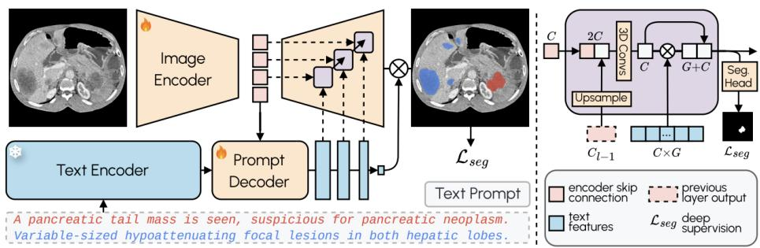  
Figure 12: Architecture of DART-Seg (Rokuss et al., 2026). Left: a frozen text encoder embeds a text prompt naming the target structure, and a trainable Prompt Decoder produces text features that modulate the image decoder. Right: at each decoder level, upsampled features are concatenated with the encoder skip connection and modulated by the text features before the segmentation head, with deep supervision at every level. We use the architecture unmodified and train it on DARTcorrected training labels.

Compute. DART takes 0.59 s per probability map on one AMD MI250X GPU at 1283. The corpus pipeline took about two thousand GPU-hours on AMD MI250X GPUs, and training the model, including the scaling and conditioning experiments, a few hundred more.

Quality audit. We drew a uniform random sample of 10,000 of the 45,000 scans and split it into five disjoint blocks of 2,000, one per reader. For each scan, the reader saw the annotation with a written annotation guideline for each structure present, and marked the scan as passing if every structure followed its guideline. 98.5% of scans passed, with a binomial standard error below 0.2 percentage points. Automated critics offer a complementary route to flagging label errors in released collections (Bassi et al., 2025b).

Release. We release the annotations for the 45,000 scans, together with the vocabulary, the description used for every class, the per-class t∗ and the structure-to-model assignment table, so that the annotations can be regenerated and audited independently. The source datasets carry different licences, several of them non-commercial or share-alike, so DART-45K is released as an annotation layer for each source dataset under that dataset’s own terms.

## O ANATOMICAL DESCRIPTIONS

Anatomical descriptions identify each class and characterize its shape and location; their level of detail can vary with the anatomy being described. For the experiments reported here, descriptions were drafted by a large language model from standard anatomy references and reviewed by the authors before training. The same process was used for lesion descriptions at inference. Table 9 gives one example per anatomical group; the full set is released with the code, since the vocabulary is large enough that a printed table would be neither readable nor a reliable record of what was used.

## P PER-CLASS COMPARISON ACROSS ALL METHODS

Table 10 compares all methods on the 90 TotalSegmentator anatomical classes, in the format of the Touchstone benchmark (Bassi et al., 2024): classes across the top, methods down the side, read in blocks of six. Every method starts from the MedSAM predictions. Table 1 in the main text shows the six classes with the largest DART gains.

Table 9: Example anatomical descriptions, one per anatomical group. The last row is a held-out lesion class, described at inference only.
<table><tr><td>Group</td><td>Anatomical class</td><td>Description</td></tr><tr><td>Solid viscus</td><td>pancreas</td><td>pancreas, elongated lobulated gland, retroperitoneum behind the stomach from duodenal curve to splenic hilum</td></tr><tr><td>Hollow organ</td><td>colon</td><td>colon, long convoluted haustrated hollow tube, framing the peripheral abdomen from cecum to sigmoid</td></tr><tr><td>Gland</td><td>adrenal_gland_left</td><td>left adrenal gland, small thin comma-shaped gland with slen- der limbs, superior pole of the left kidney medial to the spleen</td></tr><tr><td>Vessel</td><td>aorta</td><td>aorta, thick-walled large arterial tube arching then descend- ing, from the left ventricle through the mediastinum to the</td></tr><tr><td>Muscle</td><td>autochthon_left</td><td>iliac bifurcation left autochthon, long paraspinal erector spinae muscle mass, alongside the left vertebral column from sacrum to skull base</td></tr><tr><td>Bone</td><td>clavicula_left</td><td>left clavicle, slender S-shaped long bone, horizontal at the left base of the neck from sternum to scapula</td></tr><tr><td>Neuro / ocular</td><td>chiasm</td><td>optic chiasm, small flat X-shaped neural crossing, skull base above the pituitary gland</td></tr><tr><td>Lesion (held out)</td><td>kidney_cyst_left</td><td>left kidney cyst, rounded fluid-filled lesion, within or on the surface of the left kidney</td></tr></table>

Table 10: Dice for all methods on the 90 TotalSegmentator anatomical classes. Read in blocks of six; each column is one anatomical class. Every method starts from the MedSAM predictions. Best per column in bold blue, second best in blue. ‘—’ means the method produces no result (the two ASM variants cover 41 of the 90 classes). † reads image intensity. DART is the only method whose Dice is never below the input.
<table><tr><td>Method</td><td>Adrenal L</td><td>Adrenal R</td><td>Aorta</td><td>Atr. app. L</td><td>Autoch. L</td><td>Autoch. R</td></tr><tr><td>MedSAM (input)</td><td>78.6</td><td>65.6</td><td>85.1</td><td>74.6</td><td>79.1</td><td>79.8</td></tr><tr><td>Single-pass U-Net</td><td>78.6</td><td>65.6</td><td>84.5</td><td>74.6</td><td>78.8</td><td>79.5</td></tr><tr><td>SegRefiner†</td><td>72.3</td><td>64.6</td><td>74.9</td><td>70.2</td><td>75.1</td><td>74.9</td></tr><tr><td>Post-DAE</td><td>49.0</td><td>39.0</td><td>53.6</td><td>41.7</td><td>62.4</td><td>62.7</td></tr><tr><td>Hole filling</td><td>78.6</td><td>65.6</td><td>85.1</td><td>74.6</td><td>79.1</td><td>79.8</td></tr><tr><td>Morph. closing</td><td>79.3</td><td>66.6</td><td>83.8</td><td>76.0</td><td>81.8</td><td>82.2</td></tr><tr><td>Geodesic†</td><td>17.3</td><td>1.4</td><td>67.2</td><td>18.2</td><td>74.6</td><td>74.1</td></tr><tr><td>GMM graph-cut†</td><td>74.3</td><td>57.9</td><td>55.2</td><td>61.5</td><td>66.8</td><td>66.2</td></tr><tr><td>Convex hull</td><td>77.4</td><td>66.6</td><td>81.3</td><td>76.2</td><td>81.9</td><td>82.0</td></tr><tr><td>Largest comp.</td><td>78.1</td><td>64.4</td><td>85.3</td><td>74.5</td><td>79.1</td><td>79.7</td></tr><tr><td>ASM</td><td>1</td><td></td><td>一</td><td></td><td>21.3</td><td>18.7</td></tr><tr><td>Robust ASM</td><td></td><td></td><td></td><td></td><td>20.7</td><td>18.3</td></tr><tr><td>DART</td><td>80.6</td><td>70.7</td><td>85.5</td><td>79.2</td><td>85.7</td><td>85.4</td></tr><tr><td>Method</td><td>Brachioc. trunk Brachioc. vein L Brachioc. vein R</td><td></td><td></td><td>Brain</td><td>Clavicle L</td><td>Clavicle R</td></tr><tr><td>MedSAM (input)</td><td>85.1</td><td>79.5</td><td>85.4</td><td>85.6</td><td>83.8</td><td>82.8</td></tr><tr><td>Single-pass U-Net</td><td>85.1</td><td>79.5</td><td>85.4</td><td>85.6</td><td>83.6</td><td>82.7</td></tr><tr><td>SegRefiner†</td><td>77.8</td><td>75.5</td><td>77.5</td><td>80.8</td><td>74.2</td><td>74.0</td></tr><tr><td>Post-DAE</td><td>53.3</td><td>54.7</td><td>56.3</td><td>73.0</td><td>57.5</td><td>62.3</td></tr><tr><td>Hole filling</td><td>85.1</td><td>79.5</td><td>85.4</td><td>85.6</td><td>83.8</td><td>82.9</td></tr><tr><td>Morph. closing</td><td>86.7</td><td>81.0</td><td>86.8</td><td>84.9</td><td>82.9</td><td>81.5</td></tr><tr><td>Geodesic†</td><td>33.9</td><td>42.0</td><td>27.6</td><td>55.7</td><td>66.3</td><td>64.0</td></tr><tr><td>GMM graph-cut†</td><td>56.2</td><td>41.3</td><td>56.8</td><td>67.8</td><td>35.1</td><td>31.0</td></tr><tr><td>Convex hull</td><td>85.4</td><td>79.5</td><td>86.1</td><td>83.6</td><td>82.2</td><td>81.5</td></tr><tr><td>Largest comp. ASM</td><td>85.1</td><td>79.5</td><td>85.4</td><td>85.6</td><td>83.7</td><td>82.8</td></tr><tr><td>Robust ASM</td><td></td><td></td><td></td><td></td><td>10.8</td><td>12.2</td></tr><tr><td></td><td>一</td><td></td><td></td><td></td><td>10.8</td><td>12.2</td></tr><tr><td>DART</td><td>86.6</td><td>82.6</td><td>87.6</td><td>86.4</td><td>84.7</td><td>84.4</td></tr><tr><td>Method</td><td>Colon</td><td>C. carotid L</td><td>C. carotid R</td><td>Costal c.</td><td>Duodenum</td><td>Esophagus</td></tr><tr><td>MedSAM (input)</td><td>46.6</td><td>75.4</td><td>74.1</td><td>29.6</td><td>65.5</td><td>78.5</td></tr><tr><td>Single-pass U-Net</td><td>46.4</td><td>75.4</td><td>74.2</td><td>29.0</td><td>65.5</td><td>78.0</td></tr><tr><td>SegRefiner†</td><td>44.6</td><td>67.2</td><td>68.3</td><td>28.8</td><td>62.2</td><td>73.2</td></tr><tr><td>Post-DAE</td><td>33.7</td><td>51.2</td><td>50.4</td><td>17.6</td><td>56.4</td><td>58.0</td></tr><tr><td>Hole filling</td><td>46.6</td><td>75.4</td><td>74.1</td><td>29.6</td><td>65.5</td><td>78.5</td></tr><tr><td>Morph. closing</td><td>46.2</td><td>77.8</td><td>76.1</td><td>28.6</td><td>62.9</td><td>80.2</td></tr></table>

continued on next page

Table 10 continued from previous page
<table><tr><td colspan="7">Table 10 continued from previous page</td></tr><tr><td>Geodesic†</td><td>42.0</td><td>13.6</td><td>6.9</td><td>24.6</td><td>46.7</td><td>34.3</td></tr><tr><td>GMM graph-cut†</td><td>42.8</td><td>56.9</td><td>54.6</td><td>20.1</td><td>61.3</td><td>72.2</td></tr><tr><td>Convex hull</td><td>39.5</td><td>77.1</td><td>75.4</td><td>21.9</td><td>61.6</td><td>80.2</td></tr><tr><td>Largest comp.</td><td>45.0</td><td>71.4</td><td>71.5</td><td>27.8</td><td>64.3</td><td>74.1</td></tr><tr><td>ASM</td><td>12.4</td><td>6.6</td><td>5.9</td><td></td><td></td><td>6.6</td></tr><tr><td>Robust ASM</td><td>12.4</td><td>6.6</td><td>5.9</td><td></td><td></td><td>6.6</td></tr><tr><td>DART</td><td>47.1</td><td>79.8</td><td>78.3</td><td>30.3</td><td>67.4</td><td>83.3</td></tr><tr><td>Method</td><td>Femur L</td><td>Femur R</td><td>Gallbladder</td><td></td><td>Glut. max. L Glut. max. R Glut. med. L</td><td></td></tr><tr><td>MedSAM (input)</td><td>90.7</td><td>91.0</td><td>90.9</td><td>89.9</td><td>89.5</td><td>81.1</td></tr><tr><td>Single-pass U-Net</td><td>90.7</td><td>90.9</td><td>90.9</td><td>89.9</td><td>89.6</td><td>81.2</td></tr><tr><td>SegRefiner†</td><td>83.6</td><td>83.3</td><td>84.9</td><td>82.4</td><td>82.9</td><td>78.7</td></tr><tr><td>Post-DAE</td><td>67.5</td><td>65.9</td><td>62.1</td><td>65.7</td><td>64.9</td><td>71.2</td></tr><tr><td>Hole filling</td><td>91.1</td><td>91.4</td><td>90.9</td><td>89.9</td><td>89.5</td><td>81.1</td></tr><tr><td>Morph. closing</td><td>90.1</td><td>89.4</td><td>88.4</td><td>90.0</td><td>89.3</td><td>81.1</td></tr><tr><td>Geodesic†</td><td>82.1</td><td>83.8</td><td>53.3</td><td>83.8</td><td>83.3</td><td>69.8</td></tr><tr><td>GMM graph-cut†</td><td>70.7</td><td>70.5</td><td>85.4</td><td>70.0</td><td>72.3</td><td>60.6</td></tr><tr><td>Convex hull</td><td>90.3</td><td>90.3</td><td>90.8</td><td>88.3</td><td>87.5</td><td>79.8 81.1</td></tr><tr><td>Largest comp. ASM</td><td>90.7</td><td>91.0</td><td>90.9</td><td>89.9 29.5</td><td>89.5 25.8</td><td>23.7</td></tr><tr><td>Robust ASM</td><td>37.2 37.2</td><td>36.5 36.5</td><td></td><td>29.5</td><td>25.8</td><td>23.7</td></tr><tr><td>DART</td><td></td><td></td><td>92.0</td><td></td><td></td><td></td></tr><tr><td></td><td>91.5</td><td>92.0</td><td></td><td>90.9</td><td>90.4</td><td>83.1</td></tr><tr><td>Method</td><td>Glut. med. R</td><td>Glut. min. L</td><td>Glut. min. R</td><td>Heart</td><td>Hip L</td><td>Hip R</td></tr><tr><td>MedSAM (input)</td><td>80.8</td><td>63.8</td><td>64.8</td><td>87.2</td><td>62.5</td><td>59.9</td></tr><tr><td>Single-pass U-Net</td><td>80.8</td><td>63.7</td><td>64.9</td><td>87.0</td><td>62.3</td><td>59.6</td></tr><tr><td>SegRefiner†</td><td>78.2</td><td>64.2</td><td>64.6</td><td>79.1</td><td>58.7</td><td>57.2</td></tr><tr><td>Post-DAE</td><td>68.8</td><td>51.4</td><td>56.3</td><td>65.7 87.2</td><td>52.9</td><td>51.9</td></tr><tr><td>Hole filling</td><td>80.8</td><td>63.8</td><td>64.8</td><td></td><td>62.5</td><td>59.9</td></tr><tr><td>Morph. closing</td><td>80.6</td><td>66.5</td><td>65.5</td><td>85.6 81.7</td><td>61.3</td><td>60.2</td></tr><tr><td>Geodesic†</td><td>70.0</td><td>19.9</td><td>25.4</td><td></td><td>64.4</td><td>63.3</td></tr><tr><td>GMM graph-cut†</td><td>63.3</td><td>64.0</td><td>65.3</td><td>62.2</td><td>49.4</td><td>45.9</td></tr><tr><td>Convex hull</td><td>79.3</td><td>64.6</td><td>63.8 64.8</td><td>85.7 87.2</td><td>59.6 62.5</td><td>57.2 59.9</td></tr><tr><td>Largest comp. ASM</td><td>80.9</td><td>63.8</td><td>20.4</td><td></td><td>15.5</td><td>22.5</td></tr><tr><td>Robust ASM</td><td>17.7 17.7</td><td>11.1 11.1</td><td>20.4</td><td></td><td>15.5</td><td>22.5</td></tr><tr><td>DART</td><td></td><td></td><td>67.2</td><td>87.7</td><td></td><td>60.1</td></tr><tr><td>Method</td><td>82.1</td><td>68.8</td><td></td><td></td><td>63.0</td><td></td></tr><tr><td>MedSAM (input)</td><td>Humerus L</td><td>Humerus R</td><td>Iliac a. L</td><td>Iliac a. R</td><td>Iliac v. L</td><td>Iliac v. R</td></tr><tr><td></td><td>88.9</td><td>87.0</td><td>80.2</td><td>78.6</td><td>82.7</td><td>84.7</td></tr><tr><td>Single-pass U-Net</td><td>88.9</td><td>87.0</td><td>79.0</td><td>77.2</td><td>82.1</td><td>84.1</td></tr><tr><td>SegRefiner†</td><td>79.5</td><td>79.5</td><td>70.3</td><td>67.6 64.1</td><td>76.9 68.1</td><td>78.1</td></tr><tr><td>Post-DAE</td><td>53.2</td><td>50.6</td><td>62.4 80.2</td><td>78.6</td><td>82.7</td><td>61.5</td></tr><tr><td>Hole filling</td><td>89.2</td><td>87.2</td><td>80.1</td><td>79.5</td><td>84.5</td><td>84.7</td></tr><tr><td>Morph. closing</td><td>83.8</td><td>76.8</td><td></td><td></td><td></td><td>86.1</td></tr><tr><td>Geodesic†</td><td>65.7</td><td>68.5</td><td>22.8</td><td>21.9</td><td>36.4</td><td>29.1</td></tr><tr><td>GMM graph-cut†</td><td>79.9</td><td>81.8</td><td>51.5</td><td>49.4</td><td>57.0</td><td>52.9</td></tr><tr><td>Convex hull</td><td>90.0</td><td>87.9</td><td>80.5</td><td>79.2</td><td>83.4</td><td>85.3</td></tr><tr><td>Largest comp.</td><td>88.9</td><td>87.0</td><td>76.4</td><td>71.9</td><td>81.8</td><td>84.0</td></tr><tr><td>ASM</td><td></td><td></td><td>4.0</td><td>3.5</td><td>5.6</td><td>6.1</td></tr><tr><td>Robust ASM</td><td></td><td></td><td>4.0</td><td>3.5</td><td>5.6</td><td>6.1</td></tr><tr><td>DART</td><td>91.0</td><td>89.0</td><td>81.6</td><td>80.8</td><td>85.3</td><td>87.0</td></tr><tr><td>Method</td><td>Iliopsoas L</td><td>Iliopsoas R</td><td>IVC</td><td>Kidney L</td><td>Kidney R</td><td>Liver</td></tr><tr><td>MedSAM (input)</td><td>80.6</td><td>80.7</td><td>88.7</td><td>94.4</td><td>96.2</td><td>95.8</td></tr><tr><td>Single-pass U-Net</td><td>80.4</td><td>80.5</td><td>88.2</td><td>94.3</td><td>96.1</td><td>95.3</td></tr><tr><td>SegRefiner†</td><td>76.3</td><td>75.8</td><td>81.3</td><td>85.6</td><td>86.6</td><td>86.7</td></tr><tr><td>Post-DAE</td><td>69.7</td><td>70.0</td><td>65.3</td><td>70.4</td><td>69.6 96.1</td><td>77.2 95.8</td></tr><tr><td>Hole filling Morph. closing</td><td>80.6 81.5</td><td>80.7 81.0</td><td>88.7 89.9</td><td>94.4 93.4</td></table>

continued on next page

Table 10 continued from previous page
<table><tr><td>MedSAM (input)</td><td>72.9</td><td>68.8</td><td>77.5</td><td>78.4</td><td>79.8</td><td>80.1</td></tr><tr><td>Single-pass U-Net</td><td>73.0</td><td>68.9</td><td>77.6</td><td>78.3</td><td>79.8</td><td>80.0</td></tr><tr><td>SegRefiner†</td><td>69.4</td><td>63.7</td><td>71.0</td><td>71.4</td><td>73.1</td><td>73.0</td></tr><tr><td>Post-DAE</td><td>58.0</td><td>51.8</td><td>58.9</td><td>60.2</td><td>64.4</td><td>63.2</td></tr><tr><td>Hole filling</td><td>72.9 72.9</td><td>68.8</td><td>77.5 72.5</td><td>78.4 76.4</td><td>79.8 75.6</td><td>80.1</td></tr><tr><td>Morph. closing</td><td></td><td>67.6</td><td></td><td></td><td></td><td>77.2</td></tr><tr><td>Geodesic†</td><td>73.6</td><td>74.3</td><td>70.1</td><td>75.5</td><td>71.4</td><td>59.1</td></tr><tr><td>GMM graph-cut†</td><td>75.3</td><td>71.7</td><td>76.6</td><td>81.1</td><td>82.8</td><td>78.7</td></tr><tr><td>Convex hull</td><td>72.6</td><td>70.6</td><td>77.2</td><td>77.8</td><td>79.3</td><td>69.3</td></tr><tr><td>Largest comp.</td><td>72.9</td><td>68.8</td><td>77.5</td><td>78.3</td><td>79.8</td><td>80.2</td></tr><tr><td>ASM Robust ASM</td><td></td><td></td><td></td><td>18.8</td><td>18.0</td><td></td></tr><tr><td></td><td></td><td>一</td><td></td><td>18.8</td><td>18.0</td><td></td></tr><tr><td>DART</td><td>74.2</td><td>70.2</td><td>78.6</td><td>79.1</td><td>80.7</td><td>80.6</td></tr><tr><td>Method</td><td>Portal v.</td><td>Prostate</td><td>Pulm. v.</td><td>Rib L 1</td><td>Rib L 10</td><td>Rib L 11</td></tr><tr><td>MedSAM (input)</td><td>35.6</td><td>82.2</td><td>37.8</td><td>74.3</td><td>64.7</td><td>65.0</td></tr><tr><td>Single-pass U-Net</td><td>35.3</td><td>82.2</td><td>37.7</td><td>74.4</td><td>63.3</td><td>64.6</td></tr><tr><td>SegRefiner†</td><td>33.0</td><td>79.8</td><td>37.0</td><td>68.0</td><td>58.3</td><td>59.3</td></tr><tr><td>Post-DAE</td><td>28.7</td><td>57.4</td><td>22.2</td><td>60.0</td><td>56.2</td><td>59.0</td></tr><tr><td>Hole filling</td><td>35.6</td><td>82.2</td><td>37.8</td><td>74.3</td><td>64.7</td><td>65.0</td></tr><tr><td>Morph. closing</td><td>35.4</td><td>85.7</td><td>30.9</td><td>76.1</td><td>65.8</td><td>66.2</td></tr><tr><td>Geodesic†</td><td>22.5</td><td>66.0</td><td>19.8</td><td>21.9</td><td>31.8</td><td>21.5</td></tr><tr><td>GMM graph-cut†</td><td>37.8</td><td>79.8</td><td>28.5</td><td>33.9</td><td>20.8</td><td>19.3</td></tr><tr><td>Convex hull</td><td>28.9</td><td>84.0</td><td>35.2</td><td>73.3</td><td>63.6</td><td>64.1</td></tr><tr><td>Largest comp.</td><td>32.3</td><td>82.2</td><td>36.8</td><td>73.2</td><td>62.6</td><td>59.7</td></tr><tr><td>ASM Robust ASM</td><td></td><td></td><td></td><td>7.9 7.9</td><td></td><td></td></tr><tr><td>DART</td><td></td><td></td><td>38.6</td><td></td><td></td><td>68.8</td></tr><tr><td>Method</td><td>35.8 Rib L 12</td><td>85.5</td><td>Rib L 3</td><td>75.8</td><td>68.3</td><td>Rib L 6</td></tr><tr><td>MedSAM (input)</td><td>63.6</td><td>Rib L 2</td><td>63.4</td><td>Rib L 4</td><td>Rib L 5</td><td>67.9</td></tr><tr><td>Single-pass U-Net</td><td></td><td>71.7</td><td></td><td>64.2</td><td>65.9</td><td></td></tr><tr><td>SegRefiner†</td><td>63.6 55.2</td><td>71.3 66.8</td><td>62.8 57.7</td><td>63.2 59.0</td><td>64.9 59.4</td><td>67.3 61.5</td></tr><tr><td>Post-DAE</td><td>50.8</td><td>53.6</td><td>53.5</td><td>52.9</td><td>53.0</td><td>48.5</td></tr><tr><td>Hole filling</td><td>63.6</td><td>71.7</td><td>63.4</td><td>64.2</td><td>65.9</td><td>67.9</td></tr><tr><td>Morph. closing</td><td>65.0</td><td>72.2</td><td>62.9</td><td>59.8</td><td>65.6</td><td>68.4</td></tr><tr><td>Geodesic†</td><td>9.3</td><td>18.6</td><td>14.7</td><td>18.3</td><td>27.7</td><td>37.0</td></tr><tr><td>GMM graph-cut†</td><td>28.7</td><td>27.4</td><td>22.8</td><td>23.2</td><td>22.8</td><td>26.8</td></tr><tr><td></td><td>62.5</td><td>69.8</td><td>61.2</td><td>62.3</td><td>64.0</td><td>67.2</td></tr><tr><td>Convex hull</td><td>60.7</td><td>66.3</td><td>59.5</td><td>63.8</td><td>63.9</td><td>66.4</td></tr><tr><td>Largest comp. ASM</td><td></td><td>6.3</td><td></td><td></td><td></td><td></td></tr><tr><td>Robust ASM</td><td></td><td>6.3</td><td></td><td></td><td></td><td></td></tr><tr><td>DART</td><td></td><td></td><td></td><td></td><td></td><td></td></tr><tr><td></td><td>66.5</td><td>73.8</td><td>65.3</td><td>66.5</td><td>67.7</td><td>70.9</td></tr><tr><td>Method</td><td>Rib L 7</td><td>Rib L 8</td><td>Rib L 9</td><td>Rib R 1</td><td>Rib R 10</td><td>Rib R 11</td></tr><tr><td>MedSAM (input)</td><td>66.2</td><td>62.2</td><td>62.5</td><td>76.5</td><td>72.3</td><td>70.6</td></tr><tr><td>Single-pass U-Net</td><td>65.3</td><td>61.6</td><td>61.3</td><td>76.5</td><td>70.7</td><td>69.8</td></tr><tr><td>SegRefiner†</td><td>60.6</td><td>56.7</td><td>57.5</td><td>70.5</td><td>64.4 63.7</td><td>63.4</td></tr><tr><td>Post-DAE</td><td>47.8 66.2</td><td>45.9 62.2</td><td>51.2</td><td>59.3 76.5</td><td>72.3</td><td>63.6 70.6</td></tr><tr><td>Hole filling Morph. closing</td><td>67.9</td><td></td><td>62.5 64.3</td><td>78.1</td><td>73.0</td><td>71.9</td></tr><tr><td></td><td></td><td>61.3</td><td></td><td></td><td></td><td>23.1</td></tr><tr><td>Geodesic†</td><td>34.1</td><td>30.3</td><td>33.9</td><td>24.8</td><td>27.1</td><td>18.2</td></tr><tr><td>GMM graph-cut†</td><td>25.9</td><td>29.5</td><td>22.7</td><td>35.9</td><td>19.5</td><td></td></tr><tr><td>Convex hull</td><td>65.3</td><td>61.6</td><td>61.1</td><td>75.9</td><td>70.8</td><td>69.2</td></tr><tr><td>Largest comp. ASM</td><td>63.9</td><td>60.2</td><td>59.4</td><td>74.8</td><td>71.8</td><td>69.3</td></tr><tr><td>Robust ASM</td><td></td><td></td><td></td><td>6.8 6.8</td><td></td><td></td></tr><tr><td>DART</td><td>70.1</td><td>65.4</td><td>65.5</td><td>77.6</td><td>75.1</td><td>73.4</td></tr><tr><td>Method</td><td>Rib R 12</td><td>Rib R 2</td><td>Rib R 3</td><td>Rib R 4</td><td>Rib R 5</td><td>Rib R 6</td></tr><tr><td>MedSAM (input)</td><td>68.7</td></table>

continued on next page

Table 10 continued from previous page
<table><tr><td>Largest comp. ASM</td><td>63.5</td><td>70.4 7.0</td><td>51.9</td><td>62.5</td><td>66.8</td><td>69.3</td></tr><tr><td>Robust ASM</td><td>一 一</td><td>7.0</td><td>一 一</td><td>一 一</td><td>一 一</td><td>一 一</td></tr><tr><td>DART</td><td>72.4</td><td>75.7</td><td>64.9</td><td>68.4</td><td>69.2</td><td>72.9</td></tr></table>

<table><tr><td>Method</td><td>Rib R 7</td><td>Rib R 8</td><td>Rib R 9</td><td>Sacrum</td><td>Scapula L</td><td>Scapula R</td></tr><tr><td>MedSAM (input)</td><td>70.8</td><td>71.3</td><td>70.7</td><td>64.3</td><td>51.0</td><td>48.6</td></tr><tr><td>Single-pass U-Net</td><td>69.9</td><td>70.3</td><td>69.7</td><td>64.4</td><td>51.0</td><td>48.4</td></tr><tr><td>SegRefiner†</td><td>64.5</td><td>62.9</td><td>63.4</td><td>65.0</td><td>48.7</td><td>45.9</td></tr><tr><td>Post-DAE</td><td>50.9</td><td>54.2</td><td>59.4</td><td>56.8</td><td>37.5</td><td>34.6</td></tr><tr><td>Hole filling</td><td>70.8</td><td>71.3</td><td>70.7</td><td>64.4</td><td>51.0</td><td>48.6</td></tr><tr><td>Morph. closing</td><td>71.3</td><td>71.9</td><td>71.0</td><td>65.3</td><td>48.3</td><td>44.8</td></tr><tr><td>Geodesic†</td><td>33.6</td><td>29.8</td><td>33.2</td><td>59.9</td><td>37.9</td><td>36.9</td></tr><tr><td>GMM graph-cut†</td><td>28.1</td><td>25.9</td><td>22.8</td><td>48.1</td><td>44.5</td><td>43.4</td></tr><tr><td>Convex hull</td><td>69.5</td><td>69.5</td><td>69.0</td><td>61.6</td><td>49.7</td><td>47.9</td></tr><tr><td>Largest comp.</td><td>70.6</td><td>68.0</td><td>70.2</td><td>64.3</td><td>50.9</td><td>48.5</td></tr><tr><td>ASM</td><td></td><td></td><td></td><td>17.3</td><td>12.1</td><td>9.4</td></tr><tr><td>Robust ASM</td><td></td><td></td><td></td><td>17.3</td><td>12.1</td><td>9.4</td></tr><tr><td>DART</td><td>73.0</td><td>74.5</td><td>73.0</td><td>65.8</td><td>51.1</td><td>49.2</td></tr></table>

<table><tr><td>Method</td><td>Skull</td><td>Small bowel</td><td>Spinal cord</td><td>Spleen</td><td>Sternum</td><td>Stomach</td></tr><tr><td>MedSAM (input)</td><td>60.5</td><td>63.6</td><td>77.5</td><td>96.4</td><td>78.2</td><td>90.8</td></tr><tr><td>Single-pass U-Net</td><td>60.3</td><td>63.5</td><td>76.9</td><td>96.1</td><td>78.0</td><td>90.5</td></tr><tr><td>SegRefiner†</td><td>50.9</td><td>60.9</td><td>73.9</td><td>86.8</td><td>72.8</td><td>81.5</td></tr><tr><td>Post-DAE</td><td>31.0</td><td>51.2</td><td>61.8</td><td>74.4</td><td>52.5</td><td>68.2</td></tr><tr><td>Hole filling</td><td>60.5</td><td>63.6</td><td>77.5</td><td>96.4</td><td>78.2</td><td>90.8</td></tr><tr><td>Morph. closing</td><td>49.5</td><td>64.1</td><td>80.0</td><td>95.1</td><td>80.2</td><td>90.6</td></tr><tr><td>Geodesic†</td><td>45.3</td><td>56.6</td><td>63.6</td><td>84.0</td><td>57.7</td><td>77.7</td></tr><tr><td>GMM graph-cut†</td><td>62.7</td><td>62.0</td><td>77.4</td><td>64.6</td><td>58.5</td><td>88.0</td></tr><tr><td>Convex hull</td><td>60.2</td><td>58.8</td><td>78.5</td><td>91.6</td><td>78.7</td><td>87.9</td></tr><tr><td>Largest comp.</td><td>60.5</td><td>63.5</td><td>72.6</td><td>96.4</td><td>78.0</td><td>90.8</td></tr><tr><td>ASM</td><td>16.6</td><td>12.5</td><td>8.2</td><td></td><td>一</td><td></td></tr><tr><td>Robust ASM</td><td>16.6</td><td>12.5</td><td>6.3</td><td>一</td><td>一</td><td></td></tr></table>

<table><tr><td>DART</td><td>63.0</td><td>64.8</td><td>83.1</td><td>96.5</td><td>82.4</td><td>92.0</td></tr><tr><td>Method</td><td>Subclav. L</td><td>Subclav. R</td><td>SVC</td><td>Thyroid</td><td>Trachea</td><td>Bladder</td></tr><tr><td>MedSAM (input)</td><td>54.1</td><td>57.4</td><td>86.6</td><td>51.5</td><td>78.7</td><td>90.1</td></tr><tr><td>Single-pass U-Net</td><td>54.1</td><td>57.3</td><td>86.6</td><td>51.5</td><td>78.8</td><td>90.0</td></tr><tr><td>SegRefiner†</td><td>50.4</td><td>55.7</td><td>80.8</td><td>52.3</td><td>73.1</td><td>85.0</td></tr><tr><td>Post-DAE</td><td>36.6</td><td>37.7</td><td>58.6</td><td>35.4</td><td>65.6</td><td>71.1</td></tr><tr><td>Hole filling</td><td>54.1</td><td>57.4</td><td>86.6</td><td>51.5</td><td>78.7</td><td>90.2</td></tr><tr><td>Morph. closing</td><td>54.3</td><td>58.8</td><td>81.9</td><td>53.0</td><td>80.2</td><td>89.7</td></tr><tr><td>Geodesic†</td><td>10.9</td><td>12.4</td><td>57.9</td><td>22.0</td><td>63.1</td><td>79.8</td></tr><tr><td>GMM graph-cut†</td><td>48.1</td><td>56.9</td><td>50.3</td><td>47.5</td><td>67.7</td><td>83.6</td></tr><tr><td>Convex hull</td><td>51.0</td><td>53.9</td><td>88.0</td><td>46.6</td><td>79.0</td><td>91.2</td></tr><tr><td>Largest comp.</td><td>48.6</td><td>56.6</td><td>86.6</td><td>51.1</td><td>78.7</td><td>90.2</td></tr><tr><td>ASM</td><td>5.1</td><td>8.1</td><td>一</td><td>10.6</td><td>12.8</td><td>29.6</td></tr><tr><td>Robust ASM</td><td>5.1</td><td>8.1</td><td></td><td>10.6</td><td>12.8</td><td>29.6</td></tr><tr><td>DART</td><td>55.5</td><td>58.9</td><td>90.0</td><td>53.5</td><td>80.7</td><td>92.6</td></tr></table>