# DISTRACT: Degradation-Indexed Study of Textual Reference Across Competing Targets

Dan Zlotnikov

Ohad Ben-Shahar

Ben-Gurion University of the Negev, Israel

danzlot@post.bgu.ac.il ben-shahar@cs.bgu.ac.il

## Abstract

Vision-language trackers (VLTs) accept descriptions intended to assist tracking, but accepting text does not establish that its content changes tracking decisions, particularly as visual evidence deteriorates. We introduce DISTRACT, a matched-intervention benchmark that holds video, target, and distractor fixed while crossing four text priors with four image degradations along a controlled severity axis. We evaluate five VLTs on four datasets using behavioral contrasts, layerwise representation probes, and activation patching.

Molmo2 and JointNLT exhibit directed text use. Some effects contract under degradation, whereas others show no significant endpoint change after multiplicity correction. UVLTrack, MMTrack, and DUTrack respond only weakly to changes in text semantics, with no directed behavioral effect surviving FDR correction in the tested settings. Model-internal analyses reveal that at decision-near states, correct-versus-conflicting text is decodable in Molmo2 and JointNLT but not in the other three systems. In the responsive models, decodability peaks at late states where replacement produces little behavioral change, whereas replacing selected earlier states redirects conflict-associated trajectories toward the target. Because matched-correct donors do not significantly outperform unrelated donors, these interventions identify earlier intervention-sensitive states without establishing target-specific semantic rescue. DIS-TRACT thus exposes when and where text affects tracking under degraded visual evidence.

## 1. Introduction

Visual object tracking must preserve an object’s identity as appearance, position, and context change over time. Vision–language trackers (VLTs) add a natural-language specification—for example, “the player in white moving toward the basket”—to distinguish a target from a similar competitor semantically [23, 37]. This capability is most valuable outside clean laboratory video: robots, autonomous cameras, and other perception–action systems encounter image degradations under which even subtle perturbations can cause severe perception failures [15, 26, 29].

Accuracy with a target-valid description, however, does not establish that a tracker uses language’s semantic content to select the target over an on-screen competitor. Prior robustness studies show that degraded visibility harms trackers and VLMs [13, 27, 31, 35], while VLT studies show that description content and delivery can alter performance [1, 18, 21]. They generally vary visual quality and semantic validity separately, leaving open whether language rescues weak vision, misdirects selection toward a matching distractor, or is behaviorally redundant on the same clip.

We evaluate Molmo2 [3], JointNLT [41], UVL-Track [24], MMTrack [40], and DUTrack [22] on four diverse datasets, crossing four language priors with progressive visual degradation (Fig. 1). UVLTrack, MM-Track, and DUTrack show only small, inconsistent textconditioned differences. Molmo2 and JointNLT respond directionally on clean video, but their severity trajectories are heterogeneous: some supported effects attenuate toward the null, whereas for others—including the single harmful clean-input effect—we detect no FDR-significant endpoint change.

However, behavior alone cannot reveal whether a description never reaches a tracking pathway, remains represented but does not affect localization, or loses its link to the spatial decision under degradation. We therefore complement the benchmark with layerwise, source-video-grouped probes across all five systems and targeted activation patching in the two responsive systems. This distinguishes linearly recoverable text-condition information from stages at which controlled state replacement changes the trajectory, while donor-content controls test whether that redirection is target-specific.

Our contributions are:

• A matched four-condition, multi-severity VLT protocol spanning four perturbations, five systems, and four datasets, while preserving models’ supported point- or

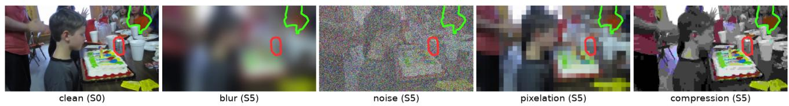  
Figure 1. A real MeViS target–distractor pair (green = target; red = distractor) at the clean initialization frame and the terminal severity (S5) of blur, noise, pixelation, and compression. Descriptions: target, “girl in red sitting on the right side of the table”; distractor, “The can next to the cake”.

box-tracking interfaces.

• A five-model degradation study showing that text effects impact VLTs in meaningfully different ways, depending on the model, dataset, and perturbation.

• Layerwise probing and controlled state-replacement analyses that trace text-condition signals across all five systems and identify intervention-sensitive stages in Molmo2 and JointNLT.

## 2. Related Work

Evaluating language use in tracking. Languageannotated benchmarks (OTB99-Lang [23], LaSOT [7], TNL2K [37], MGIT [14], WebUAV-3M [38]) and VLT methods (SNLT [8], ModaMixer [9], JointNLT [41], MM-Track [40], UVLTrack [24], DUTrack [22]) are evaluated by trajectory accuracy under valid descriptions – accuracy given truthful language, not whether counterfactually changing that language changes target selection. Nor do the language diagnostics we are aware of isolate visibility: DTLLM-VLT and DTVLT vary detail and update frequency while keeping text target-consistent [18, 19]; VLTVerse crosses multiple text variants with naturally occurring sequence-level factors, rather than applying controlled degradation [21]; VLT-MI changes text and the box together [20]; and CLDTracker’s substitutions are neither tied to an on-screen competitor nor tested across severity [1]. Our protocol addresses both gaps by independently varying text relation and severity on the same clip with a designated distractor.

Robustness under degraded visual evidence. Commoncorruption evaluation applies graded transformations to a fixed source [11], but tracking benchmarks instead use naturally difficult sequences (LaSOT [7], TNL2K [37], AVisT [27], adverse-weather person tracking [15]) that confound visibility with target, motion, and scene difficulty. DBVOT evaluates six progressive defocus levels [13], while adversarial-blur work synthesizes motion-blur attacks against vision-only trackers [10], and VLM corruption suites retain a valid prompt while scoring one-shot answers [31, 35] – neither directly measures changing text authority or temporal identity errors. Our graded blur, noise, pixelation, and compression experiments test whether language guides tracking as visual evidence weakens.

Cross-modal conflict and behavioral consequence. CLASH and CrossCheck-Bench ask models to recognize controlled image–text contradictions, not to reveal their unprompted behavioral consequence in an ongoing spatial task [30, 34], and SIGNPOST-Bench shows that embedded scene text can bias still-image geolocation, but does not study a graded visual-degradation axis [17]. By holding scene content fixed, identifying the competing object, and measuring the direction and duration of tracking errors, our benchmark tests whether language remains actionable under imperfect sensing.

Mechanistic interpretability of grounding models. Causal tracing and activation patching have probed how general vision–language models use visual information, including BLIP [28] and object hallucination in large VLMs [16], but not, to our knowledge, vision–language tracking, where a spatial decision is emitted every frame rather than a single caption. We apply the same causaltracing toolkit to five VLT systems to test whether text condition is decodable at decision-near representations and whether controlled interventions at selected text-reachable states alter localization.

## 3. Benchmark and Protocol

## 3.1. Datasets and pair construction

We use source videos from MeViS [5], a referring video object segmentation benchmark, and from the multi-object tracking benchmarks DanceTrack [33], SportsMOT [4], and PersonPath22 [32] (Table 1). MeViS provides its native referring expressions and masks. For the three MOT sources, human-written expressions and released point/mask trajectories come from the public Molmo2-VideoTrackEval annotation release [3]; the original MOT datasets provide the source videos. We derive initialization boxes from the released masks and enumerate ordered target–distractor pairs. A pair is eligible only if the target T and distractor D are co-visible in at least five frames and have mean co-visible mask IoU below 0.3. Every selected pair receives the same text conditions and perturbation protocol.

The MeViS selector takes one eligible pair per source video, while for the other three datasets, we construct outcome-enriched diagnostic stress subsets. Molmo2’s clean conflicting-text run identifies cases for inclusion, with seeded random filling of the remaining quota, yielding 16/60 DanceTrack, 2/30 SportsMOT, and 6/30 Person-Path22 persistent-takeover cases in the final subsets. These subsets let us track how conflict-relevant cases evolve under degradation. Because pairs are partly selected on an outcome related to what we measure, naive effect estimates on this set risk running high; a supplementary inverseprobability-weighted check estimates the corresponding effects over the full eligible candidate pool; effect directions are preserved, although some na¨ıve stress-subset estimates—particularly $C _ { T } \mathrm { - a r e }$ larger. A second, more direct check in the supplementary reruns all four specialized trackers on the complete, outcome-independent eligible pool, reproducing the qualitative separation between JointNLT and the three small-effect specialized trackers.

<table><tr><td>Dataset</td><td>Characterization</td><td>Pairs</td><td> ${ \mathrm { S e q . } }$ </td></tr><tr><td>MeViS</td><td>referring seg., masks</td><td>120</td><td>120</td></tr><tr><td>DanceTrack</td><td>dance MOT, similar look</td><td>60</td><td>13</td></tr><tr><td>SportsMOT</td><td>athlete MOT, fast motion</td><td>30</td><td>19</td></tr><tr><td>PersonPath22</td><td>pedestrian MOT, crowded</td><td>30</td><td>20</td></tr></table>

Table 1. Per-dataset pair and source-video coverage. Pairs is the number of selected target–distractor pairs. Seq. is the number of distinct source videos selected.

## 3.2. Targets and distractors

Let a video contain an ordered pair of distinct annotated objects $( T , D )$ , where T is the object initialized for tracking and D is a co-visible distractor. At evaluated frame t, their annotated spatial supports are $\mathcal { M } _ { T , t }$ and $\mathcal { M } _ { D , t } .$ . Each pair has a human-written expression e referring to $T$ and an expression $e _ { D }$ referring to $D .$

## 3.3. Text conditions

We vary the text input independently of the video through four conditions:

• Neutral $( c _ { \mathrm { n e u t r a l } } ) { : }$ a generic tracking instruction with no target-identifying description.

• Unrelated $( c _ { \mathrm { u n r e l a t e d } } ) { : }$ a real expression $e _ { U }$ from another clip, that is not annotated as referring to either $T$ nor $D .$

• Correct $\scriptstyle ( c _ { \mathrm { c o r r e c t } } ) :$ the target expression $e _ { T }$

• Conflicting $( c _ { \mathrm { c o n f l i c t i n g } } ) { : }$ the distractor expression $e _ { D } .$

The unrelated expression is sampled once from a different annotated clip with the same category label as the pair, then fixed across every model, condition, and severity.

## 3.4. Model initialization, inputs, and outputs

Every run is anchored to the same clean annotated target instance and uses the same fixed post-initialization frames for every model, text condition, and perturbation. Molmo2 is initialized with a target point and predicts points; $\mathrm { U V L ^ { - } }$

Track, MMTrack, JointNLT, and DUTrack are initialized with a tight axis-aligned box and predict boxes, evaluating which object is selected rather than boundary precision. Points/boxes are derived from mask centroids/extents when masks are available, and otherwise from the corresponding released box trajectory. We additionally report native-box and absolute-performance metrics in the supplementary.

Molmo2 receives text through the scaffold “Track the object indicated by the point,” with descriptive conditions appending “The target is: $e . { \vec { \mathbf { \sigma } } }$ UVLTrack, MMTrack, and JointNLT receive the raw expression e directly, with the generic token object as their neutral-condition input. DUTrack shares this interface but normally regenerates a description from the current frame, overwriting the assigned condition; we use static-external mode and reset all adapter state between pair–condition–severity runs. A supplementary dynamic-mode audit verifies this conditionpreservation control.

## 3.5. Perturbations and fixed severity schedule

Each corruption is applied independently to every postinitialization frame; the initialization frame remains clean and corruptions are never composed. We use Gaussian blur, additive Gaussian noise, pixelation, and JPEG compression—common corruption families with fixed, ordered severity ladders in robustness benchmarks [11]. Table 2 gives our disclosed, perturbation-specific parameter schedules; these were chosen to produce visibly distinct changes at the native video resolution. S0 is an exact no-op. Severity is an ordinal dose axis within each perturbation, not a claim of perceptual equivalence across perturbation types; the supplementary reports descriptive PSNR/SSIM diagnostics. For noise, a video–frame hash fixes one standardnormal field shared across conditions and severities, so contrasts never compare different noise realizations.

<table><tr><td>Perturbation</td><td>Fixed schedule values, S0-S5</td></tr><tr><td>Blur,  $\overline { { k _ { s } } }$ </td><td>0, .004, .008, .016, .032, .064</td></tr><tr><td>Noise,  $\sigma _ { s }$ </td><td>0, .12, .20, .30, .45, 1.5</td></tr><tr><td>Pixelation,  $r _ { s }$ </td><td>1, .35, .25, .18, .12, .04</td></tr><tr><td>Compression, qs</td><td>no-op, 15, 10, 7, 3, 1</td></tr></table>

Table 2. Fixed severity schedule.

## 3.6. Outcomes and metrics

Each post-initialization evaluated sample receives exactly one of the following labels:

• absent (no usable predicted point at that timestamp).

• target $( \hat { p } _ { t } \in \mathcal { M } _ { T , t } )$

• distractor (pˆt ∈/ $\mathcal { M } _ { T , t }$ and $\hat { p } _ { t } \in \mathcal { M } _ { D , t } )$

• other.

Target takes precedence when masks overlap, and absent samples remain in the denominator of all frame-level rates.

For pair $p ,$ condition $c ,$ and severity $s ,$ let $A _ { T } ^ { p } ( c , s )$ $A _ { D } ^ { p } ( c , s ) , A _ { O } ^ { p } ( c , s )$ , and $A _ { \varnothing } ^ { p } ( c , s )$ be the fractions of postinitialization samples classified as target, distractor, other, and absent. They sum to one. We aggregate frames within a pair before aggregating pairs, preventing longer tracks from receiving greater weight. In addition to condition-specific rates, the primary contrastive semantic effects anchor every comparison at the correct condition – the observed target accuracy when the model receives the ground-truth referring expression – and measure the gap to each of the other three conditions:

$$
B _ { T } ( s ) = A _ { T } ( \mathrm { c o r r e c t } , s ) - A _ { T } ( \mathrm { u n r e l a t e d } , s ) ,\tag{1}
$$

$$
N _ { T } ( s ) = A _ { T } ( \mathrm { c o r r e c t } , s ) - A _ { T } ( \mathrm { n e u t r a l } , s ) ,\tag{2}
$$

$$
C _ { T } ( s ) = A _ { T } ( \mathrm { c o r r e c t } , s ) - A _ { T } ( \mathrm { c o n f i c t i n g } , s ) .\tag{3}
$$

$B _ { T }$ is the correct-versus-unrelated effect (a same-type but unrelated description), $N _ { T }$ is the correct-versus-neutral effect (no target-identifying description), and $C _ { T }$ is the correct-versus-conflicting effect; each is signed and can be negative. Two further effects, the directed distractor-capture effect $S _ { D }$ and the conflict-specific target-loss effect $L _ { T }$ , are defined in the supplementary alongside the full endpoint test family.

Severity-integrated effect magnitude. To summarize the size of a condition effect across the severity ramp, we use integrated absolute deviation (IAD). Severities are indexed $s \in \{ 0 , \ldots , 5 \}$ ( Table 2); for conditions $c _ { 1 } , c _ { 2 }$ , let $\Delta _ { c _ { 1 } , c _ { 2 } } ( s ) = A _ { T } ( c _ { 1 } , s ) - A _ { T } ( c _ { 2 } , s )$ and define

$$
\mathrm { I A D } ( c _ { 1 } , c _ { 2 } ) = \sum _ { s = 0 } ^ { 4 } \frac { 1 } { 2 } \big [ | \Delta _ { c _ { 1 } , c _ { 2 } } ( s ) | + | \Delta _ { c _ { 1 } , c _ { 2 } } ( s + 1 ) | \big ] .\tag{4}
$$

Taking the absolute value before integrating preserves effects that change direction over severity. IAD is nonnegative and symmetric in its two conditions; with six severity levels, $\mathrm { I A D } / 5$ is the mean absolute condition gap per severity step. We report all ${ \binom { 4 } { 2 } } \ = \ 6$ unordered condition contrasts as the upper triangle of a 4 × 4 matrix per model and dataset. Per-severity signed contrasts $( B _ { T } , N _ { T }$ , and $C _ { T } )$ remain the primary directional measurements and are used for endpoint tests.

Behavioral inference. We compute every contrast within pair and use source video as the resampling unit, keeping all selected pairs from one video together. We report 95% source-video-clustered bootstrap CIs and use paired sourcevideo sign-flip tests for clean effects and severity-endpoint changes. Benjamini–Hochberg correction is applied within each stated hypothesis family; IAD is descriptive rather than inferential. The supplementary specifies the resampling algorithm, test statistics, hypothesis families, and formulas in full.

## 3.7. Model-internal and mechanistic measurements

For internal analyses, we save compact pooled states at model-specific functional stages—text encoding/projection, early and late multimodal fusion, and the decision-near localization state—rather than treating raw layer indices as comparable across architectures. Exact hooked tensors, layer counts, and semantics per model are listed in the supplementary.

At a matched video frame, let $h _ { l } ^ { c }$ be a pooled state at stage l under text condition c. Let $m _ { t }$ be the target– distractor output margin at evaluated frame t,

$$
m _ { t } = \mathrm { I o U } ( \hat { b } _ { t } , b _ { T , t } ) - \mathrm { I o U } ( \hat { b } _ { t } , b _ { D , t } ) ,\tag{5}
$$

with the analogous target/distractor label used for point output. We use three procedures to characterize the text pathway before defining the metrics computed from them.

Text-condition probe. Following low-capacity probing practice [2, 12], at every saved stage we standardize the pooled state using statistics fit only on the training fold, project it onto a training-fold SVD basis (at most 20 components), and fit a ridge-regularized linear classifier for correct-versus-conflicting condition. Cross-validation holds out complete source videos, so the probe cannot exploit sentence- or token-identity shortcuts shared within a video; group-preserving label permutations provide its null distribution. We report the probe’s held-out balanced accuracy as Text BA at stage l (0.5 is chance). Within conflicting runs, we repeat the same procedure for the observed targetversus-distractor outcome. This establishes whether the prompt distinction is linearly present in a state, not whether the tracker acts on it; causal relevance is tested with the interventions below [6].

Activation patching. We intervene on the forward pass directly, following intervention-based interpretability, causal-tracing, and activation-patching work [25, 36, 39]. For a fixed video, template, and evaluated-frame sequence, we run the network under a target condition (typically conflicting) but replace its unpooled native state at the identified text boundary with the corresponding state from an independently run source condition (source ∈ {correct, neutral, unrelated, zero}) on the same visual input,

$$
\begin{array} { r } { h _ { l } ^ { \mathrm { t a r g e t } }  h _ { l } ^ { \mathrm { s o u r c e } } , } \end{array}\tag{6}
$$

before continuing the forward pass and subsequent sequential tracking unmodified. Every patch site is validated with two controls: an exact self-patch (source = target), required to reproduce the unpatched trajectory exactly, and an unpatched repeat, which confirms that reset and replay are themselves deterministic.

For each activation-patching intervention, we report the paired change in trajectory-mean $m _ { t }$ and the count of target–distractor switches, with source-video bootstrap CIs and paired sign-flip tests; these controls establish patch integrity and deterministic replay. They support interpreting differences as consequences of the intervention, but do not by themselves establish target-specific semantic mediation; that stronger interpretation requires donor-content controls. Full-depth layer sweeps. Rather than committing in advance to one decision-near stage, we apply the textcondition probe at every saved functional stage for every model, (for Molmo2, at all 37 pre-coordinate decoder depths). This traces the depth at which the correct/conflicting distinction becomes linearly decodable, from text encoding through fusion to the localization output, reducing the risk that a null result at one selected stage is incorrectly generalized to the model’s entire saved path way.

## 4. Results

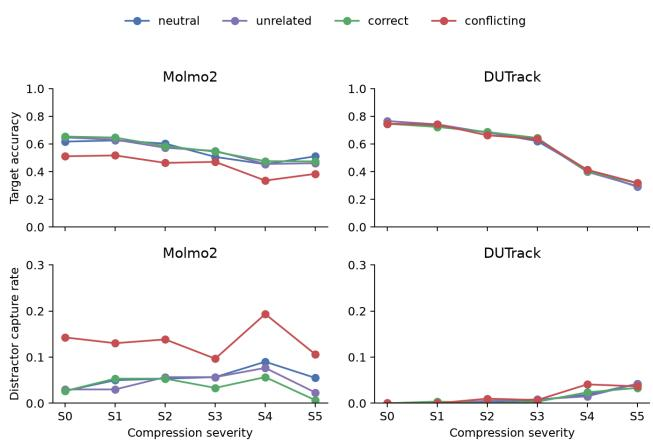  
Figure 2. Representative compression trajectories on PersonPath22. Molmo2 (left) separates text conditions in target accuracy and distractor capture; DUTrack (right) remains nearly unchanged.

Fig. 2 illustrates the behavioral contrast that the aggregate analyses quantify: Molmo2’s target accuracy and distractor capture diverge across text conditions, whereas DUTrack’s trajectories closely overlap. We use the full matched grid below to assess the breadth and uncertainty of this qualitative pattern across the tested settings.

## 4.1. UVLTrack, MMTrack, and DUTrack show limited behavioral sensitivity to text semantics

Fig. 3 plots each system’s severity-integrated absolute target-accuracy effect as $\textbf { a } 4 \times \textbf { 4 }$ grid over the four text conditions, one grid per model on a shared color scale, where larger, warmer cells mark condition pairs whose accuracy diverges more across the full clean-tosevere range as text effects differ. Two grids show consistently larger effects; the remaining three stay pale in every cell. This qualitative split holds numerically: the three less-responsive systems’ largest target-accuracy

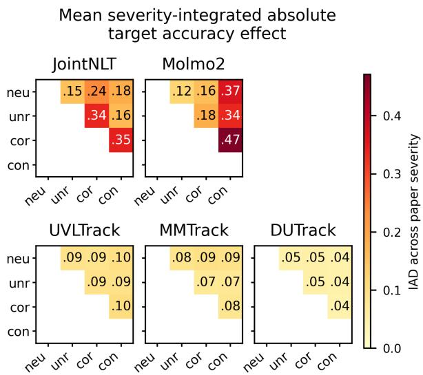  
Figure 3. Mean severity-integrated absolute target-accuracy effect (IAD(c1, c2), Eq. 4) across all four perturbations and four datasets, per model. Top row: JointNLT, Molmo2. Bottom row: UVLTrack, MM-Track, DUTrack, same color scale. Condition labels abbreviate neu tral/unrelated/correct/conflicting.

IAD cells are 0.05 (DUTrack), 0.09 (MMTrack), and 0.10 (UVLTrack), versus JointNLT’s mean 0.24 (maximum 0.35) and Molmo2’s mean 0.27 (maximum 0.47), both peaking at the correct–conflicting contrast. These observed separations remain small after taking absolute values before integration, so their small IAD values are not caused by cancellation between opposite-signed severities. The corresponding distractor-capture IAD is also small (0.02/0.05/0.08 for DUTrack/MMTrack/UVLTrack vs. 0.29/0.37 for JointNLT/Molmo2), again largest at the correct–conflicting contrast, consistent with conflictdirected capture rather than a uniform output-quality change.

Thus, we detect no FDR-supported directed semantictext effect in these three systems, without implying absent internal language processing yet. Their 62–68% correcttext $S _ { 0 }$ target accuracy argues against a simple floor/ceiling explanation and leaves room for change in either direction.

## 4.2. Directed language effects degrade unevenly, including harmful effects

The deployment-relevant question for the two responsive systems is not merely whether accuracy falls with degradation, but whether a CI-supported clean-input text effect reliably weakens as visual evidence degrades. We test every effect with a CI-supported $S _ { 0 }$ signal (95% CI excludes zero) for FDR-significant contraction toward zero across all four main perturbations: 14 target-accuracy cases and 4 distractor-capture cases, spanning both responsive systems and all four datasets (Table 4).

Of the 14 target-accuracy effects with a CI-supported clean-input value, four show FDR-significant contraction under at least one perturbation, including one that contracts under all four; the remaining ten show no FDRsignificant endpoint change under any perturbation. None of Molmo2’s five cases yields a significant contraction after correction. These nonsignificant change tests should not be interpreted as evidence that the effects remain unchanged.

<table><tr><td>Dataset</td><td colspan="3">Molmo2</td><td colspan="3">JointNLT</td><td colspan="3">UVLTrack</td><td colspan="3">MMTrack</td><td colspan="3">DUTrack</td></tr><tr><td></td><td> $C _ { T }$ </td><td> $B _ { T }$ </td><td> $N _ { T }$ </td><td> $C _ { T }$ </td><td> $B _ { T }$ </td><td> $N _ { T }$ </td><td> $C _ { T }$ </td><td> $B _ { T }$ </td><td> $N _ { T }$ </td><td> $C _ { T }$ </td><td> $B _ { T }$ </td><td> $N _ { T }$ </td><td> $C _ { T }$ </td><td> $B _ { T }$ </td><td> $N _ { T }$ </td></tr><tr><td>DanceTrack</td><td>+25%</td><td>+13%</td><td>+8%</td><td>+11%</td><td>+11%</td><td>+6%</td><td></td><td></td><td></td><td>+1% -1% +2% -1% +0% +0% +0% +1%</td><td></td><td></td><td></td><td></td><td>+0%</td></tr><tr><td>SportsMOT</td><td>+6%</td><td>+0%</td><td>+4%</td><td> $- 2 \%$ </td><td>-11%</td><td>-6%</td><td></td><td></td><td></td><td>-1% +1% -1% +1% -2%</td><td></td><td>-4%</td><td>-1%-2%</td><td></td><td>+0%</td></tr><tr><td>PersonPath22</td><td>+14%</td><td> $+ 1 \%$ </td><td></td><td>+4% +27%</td><td>+18%</td><td>+17%</td><td></td><td></td><td></td><td>+5% +5% +5% +2% +1% +3% +0% -2%</td><td></td><td></td><td></td><td></td><td> $+ 0 \% ^ { \dag }$ </td></tr><tr><td>MeViS</td><td>+8%</td><td>+4%</td><td>+2%</td><td>+14%</td><td>+11%</td><td>+8%</td><td></td><td></td><td>+2% +1% -1% +0% +0% +1% +0% +0%</td><td></td><td></td><td></td><td></td><td></td><td>+0%</td></tr></table>

Table 3. Clean-input $( S _ { 0 } )$ text effects for all five systems on all four datasets. Underlined: 95% source-video cluster-bootstrap CI excludes zero. Among UVLTrack/MMTrack/DUTrack: $0 / 1 2 \ C _ { T } .$ , 1/12 $\dot { B _ { T } }$ , 2/12 $N _ { T }$ CIs exclude zero; the sole $B _ { T }$ case (UVLTrack/PersonPath22) fails the clustered sign-flip test (p = .08, BH $q = . 6 6 8 )$ , so is not treated as a reproducible effect. † Near-zero-variance bootstrap artifact, not interpreted.

<table><tr><td>Contraction level (of 4 perturbation ramps) Cases (of 14)</td><td></td></tr><tr><td>4/4</td><td>1</td></tr><tr><td>1-3/4</td><td>3</td></tr><tr><td>0/4</td><td>10</td></tr></table>

Table 4. FDR-significant contraction toward zero, across the 14 targetaccuracy cases with a CI-supported clean-input signal.

One of the ten cases is JointNLT’s SportsMOT $B _ { T }$ the study’s only significantly harmful clean-input effect (−11.2%, 95% CI excluding zero). Under the primary point-in-support metric, its estimated S5 changes substantially reduce or reverse the clean effect, but these changes do not survive FDR correction.

The distractor-capture effect $S _ { D }$ exhibits a similar inferential pattern. Of four model–dataset combinations with a CI-supported clean-input misdirection effect, JointNLT/MeViS shows significant contraction under three of four perturbations. For Molmo2/PersonPath22, the largest clean capture effect in the study (+11.3 pp), no endpoint change survives correction; nevertheless, the point estimates contract almost completely under blur, noise, and pixelation and remain more clearly positive under compression.

Thus, contraction is established in some settings, while the remaining changes are statistically inconclusive rather than evidence of persistence. Their behavior varies across models, datasets, effects, metrics, and perturbations.

## 4.3. Model internals

The behavioral results identify FDR-supported directed text effects for JointNLT and Molmo2, in contrast to the demonstrably smaller effects observed for MMTrack, DU-Track, and UVLTrack. They do not, however, localize where the supported effects arise. We probe this with the internal-mechanism captures of Sec. 3.7, restricted to MeViS: its pairs are the only ones with one independent source video each (Table 1); its mask-native annotations pool a hooked state over exactly the target/distractor’s tokens, not a background-containing box; and its native task is itself referring expression segmentation.

Of the 120 one-pair-per-video MeViS entries, 115 have at least two co-visible target/distractor frames. JointNLT’s causal study further uses an outcome-enriched 90-video subset (23 persistent captures, 67 retention controls) so the rarer capture outcome is well represented.

## 4.3.1. Decision-near text decodability aligns with the behavioral split

For every system we probe Text BA (Sec. 3.7) at its most decision-near hooked stage. Table 5 reports the FDRcorrected result.

<table><tr><td>Model</td><td>Decision-near stage</td><td>Text BA</td><td>95%CI</td><td>q</td></tr><tr><td>Molmo2</td><td>final coord. query (L36)</td><td>0.574</td><td>[0.543,0.605]</td><td>0.015</td></tr><tr><td>JointNLT</td><td>late-fusion T—D</td><td>0.695</td><td>[0.647,0.744]</td><td>0.002</td></tr><tr><td>UVLTrack</td><td>pre-box-head search</td><td>0.530</td><td>[0.505,0.554]</td><td>0.174</td></tr><tr><td>MMTrack</td><td>coord. decoder input</td><td>0.488</td><td>[0.469,0.509]</td><td>0.898</td></tr><tr><td>DUTrack</td><td>pre-CENTER-head visual</td><td>0.504</td><td>[0.499,0.512]</td><td>0.506</td></tr></table>

Table 5. Correct-vs-conflicting Text BA (0.5=chance) at each system’s decision-near hooked stage (115-video MeViS manifest). Underlined: FDR-significant (q < .05).

Only Molmo2 and JointNLT carry an FDR-robust textcondition signal to the selected decision-near state: MM-Track and DUTrack are near chance (95% CIs spanning 0.5); UVLTrack’s CI ([0.505, 0.554]) is nominally above chance but neither FDR-significant nor precise enough for equivalence – converging with Sec. 4.1’s behavioral result that these same three systems carry no reliable signal at their decision-near states.

Fig. 4 sweeps every text-reachable state in these three systems, rather than only the decision-near endpoint in Table 5.

The full sweeps show different routes to a decision-near effect that is not FDR-supported. UVLTrack is significant at 14/25 states, spanning its text encoder and fusion stages, but not at the pre-localization endpoint. MMTrack is significant at 6/37 states, all in its text encoder/projection and none at or beyond fusion. DUTrack has no FDR-significant state in its 53-state sweep (33 are formally chance-equivalent).

Clean MeViS: layerwise correct-vs-conflicting text decodability  
JointNLT: encoder → fusion → localization  
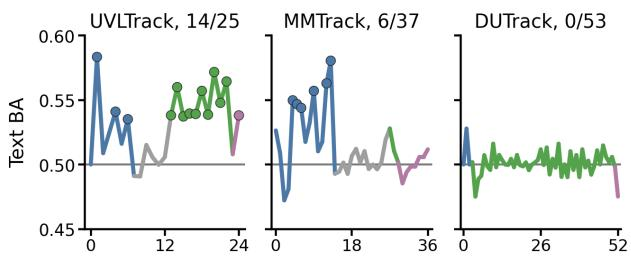  
Figure 4. Exhaustive correct-vs-conflicting Text BA sweeps for the three behaviorally small-effect systems. Colors denote functional stage: text encoder/projection (blue), pre-fusion vision (gray), multimodal fusion (green), and localization/pre-box-head (purple). Filled circles mark FDRsignificant states; titles report the number of FDR-surviving states and the total evaluated.

## 4.3.2. Layerwise text-condition decodability follows distinct routes in the two responsive systems

Fig. 5 sweeps correct-vs-conflicting Text BA through each Molmo2 and JointNLT’s functional pathway.

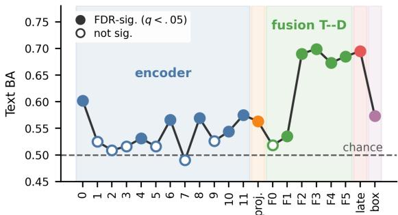  
Molmo2: 37 decoder states before coordinate generation

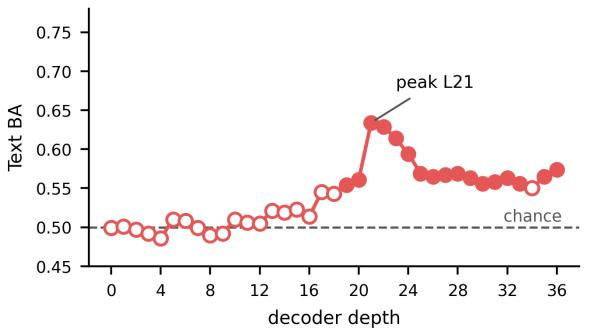  
Figure 5. Exhaustive correct-vs-conflicting Text BA sweeps for Molmo2 and JointNLT. Solid trajectory segments indicate the functional state at their left endpoint: text encoder/projection (blue), pre-fusion vision (gray), multimodal fusion (green), and localization/pre-box-head (purple).

JointNLT carries text-condition information through its encoder–fusion pathway, though the early encoder signal is intermittent. The fusion pathway starts weak, then turns consistently strong from its second block onward, staying robust at the selected late-fusion state (0.695, q = .002) – text is linearly recoverable near localization, not uniformly strong throughout. Molmo2 shows a different pattern: no decoder state through layer 16 is FDR-significant; decodability becomes significant at layer 19, peaks at layer 21 (0.634), and decreases but remains significant (except one) through the final state. This onset is consistent with its token order: image tokens precede the appended description, so condition information can emerge only after the description is processed. Thus, both systems carry decodable text to decision-near states through distinct pathways; intervention effects are tested next.

## 4.3.3. State-replacement interventions redirect JointNLT and Molmo2 trajectories

Fig. 6 contrasts the full Text-BA trajectory with matchedcorrect state replacement at each tested depth.

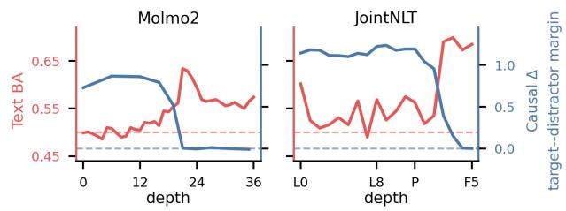  
Figure 6. Text-condition decodability and matched-correct statereplacement effect across depth. Red, left ordinate: held-out Text BA. Blue, right ordinate: mean paired change in target–distractor margin after replacing a conflicting-run state with its same-video correct-run state. Both evaluated on the persistent-capture stratum. Dashed horizontal lines mark chance Text BA and zero replacement effect.

Both systems dissociate linear decodability from intervention efficacy: replacement produces larger observed trajectory changes at selected earlier sites and smaller changes at each system’s Text-BA peak, so the most linearly decodable state is not necessarily the most effective intervention point.

Fig. 7 shows this recovery per persistent-distractorcapture video, at each model’s best-recovery site.

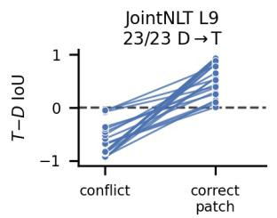

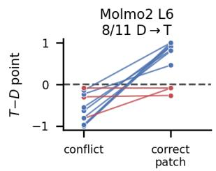  
Figure 7. Matched-correct state replacement redirects conflict-associated trajectories in both responsive systems, each shown at its best-recovery site; sites maximize the observed capture-stratum effect on the displayed data. Each line connects the unpatched conflicting run with its correct-textstate patch; blue: distractor-to-target transition, red: none.

JointNLT’s BERT-layer-9 patch reverses all 23/23 persistent captures from distractor- to target-preferred, and Molmo2’s layer-6 patch does so in 8 of 11. On this stratum, however, neither system’s correct-donor effect significantly exceeds an unrelated donor’s once corrected $\left( { \mathrm { J o i n t N L T } } q = \right.$ .124, Molmo2 $q ~ = ~ . 0 9 2 )$ Both correct and unrelated donors can redirect the conflict-associated trajectory, so the grounding-to-output association interventions do not establish target-specific semantic content as the cause of the redirection.

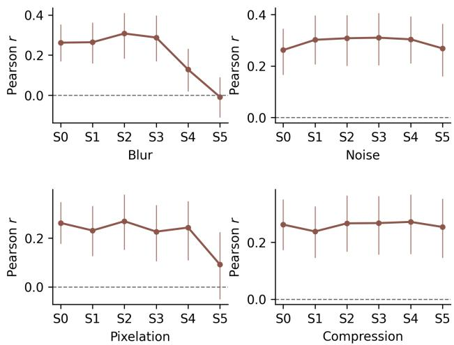

## 4.3.4. Under degradation, JointNLT retains fused text information while grounding-to-output association becomes inconsistent

Sec. 4.2 showed that JointNLT’s behavioral text effects sometimes contract under degradation, although late-fusion Text BA (Fig. 5) remains above chance. The grounding-tooutput association asks whether the pre-localization target– distractor margin predicts the final output margin. Figure 8 traces this association, and Table 6 contrasts its $S _ { 5 }$ value with late visual separation and Text BA.

Figure 8. JointNLT’s pre-localization state–output association (Pearson r) across $S _ { 0 } – S _ { 5 } ;$ dashed line: zero.
<table><tr><td>Perturbation</td><td>late vis. sep.</td><td>late fused-text BA</td><td>output assoc. r</td></tr><tr><td>blur</td><td>.173</td><td>.582</td><td>-.009[-.111, .089]</td></tr><tr><td>noise</td><td>.042</td><td>.566</td><td>+.268[.160, .363]</td></tr><tr><td>pixelation</td><td>.148</td><td>.539</td><td>+.091[-.051, .225]</td></tr><tr><td>compression</td><td>.253</td><td>.577</td><td>+.254[.145, .353]</td></tr></table>

Table 6. Terminal $S _ { 5 }$ JointNLT summaries. Underlined: CI excludes zero.

This is not a uniform collapse (Fig. 8, Table 6): blur and pixelation fall to a CI spanning zero by $S _ { 5 }$ while fused-text decodability remains nominally 4–8 points above chance throughout; noise and compression retain a CI-supported positive association. Nor does it track visual degradation – compression has the largest terminal visual separation (.253) yet one of the two CI-supported positive state–output associations. Thus, the association does not vary monotonically with this visual-separation summary, arguing against a simple one-to-one account while not ruling out visual mediation.

## 4.4. Limitations

DISTRACT uses controlled comparative evidence across five systems, four datasets, four perturbations, and fixed $S _ { 0 } – S _ { 5 }$ schedules; native interfaces make cross-system differences whole-system rather than architectural, and three datasets are stratified toward conflict-relevant pairs, so raw error frequencies are not prevalence estimates. Controlled perturbations and four priors isolate image quality and directed target–distractor semantics, respectively, but not natural adverse conditions or relational, temporal, multi-turn, and pragmatic language. They also do not reproduce the coupled weather, scene, and sensor shifts of deployment. Model-internal clean sweeps use 115 MeViS videos, and degraded internals are observational and JointNLT-only; state replacement localizes sensitivity, not target-specific semantic mediation. Broader models, datasets, and heldout causal tests are therefore needed to further validate these claims.

## 5. Discussion and Future Work

DISTRACT treats text as an experimental variable, testing whether counterfactual descriptions redirect tracking decisions and how these effects change under degraded vision. Three of five systems show limited sensitivity to text semantics and no directed behavioral effect surviving FDR correction, demonstrating that correct-text accuracy alone does not establish discriminative language use. Molmo2 and JointNLT show supported directed effects, but their severity trajectories vary across settings: some contract significantly, while others remain inconclusive after correction.

Internal analyses localize this distinction. Text condition is decodable in four of five systems, showing that decodability alone is insufficient evidence of behavioral use. In the responsive systems, replacement at selected earlier sites produces larger changes than at peak-decoding states, but correct donors do not outperform unrelated donors, identifying sensitive stages without establishing target-specific semantic mediation. Neither architecture nor clean-input responsiveness consistently anticipates degradation behavior across the tested panel; robustness and correct language use should therefore be evaluated separately.

Future work. Our internal analyses are restricted to MeViS and, under degradation, to JointNLT (Sec. 4.4). Extending them across datasets, models, and newer VLT architectures could reveal whether architectural properties explain the responsive/non-responsive split. Additional datasets and relational, temporal, and multi-turn text conditions are natural extensions of DISTRACT.

## References

[1] Mohamad Alansari, Sajid Javed, Iyyakutti Iyappan Ganapathi, Sara Alansari, and Muzammal Naseer. CLDTracker: A comprehensive language description for visual tracking. Information Fusion, 124:103374, 2025.

[2] Yonatan Belinkov. Probing classifiers: Promises, shortcomings, and advances. Computational Linguistics, 48(1):207– 219, 2022.

[3] Christopher Clark, Jieyu Zhang, Zixian Ma, Jae Sung Park, Rohun Tripathi, Sangho Lee, Mohammadreza Salehi, Jason Ren, Chris Dongjoo Kim, Yinuo Yang, Vincent Shao, Yue Yang, Weikai Huang, Ziqi Gao, Taira Anderson, Jianrui Zhang, Jitesh Jain, George Stoica, Ali Farhadi, and Ranjay Krishna. Molmo2: Open weights and data for visionlanguage models with video understanding and grounding. In Proceedings of the IEEE/CVF Conference on Computer Vision and Pattern Recognition, pages 28652–28668, 2026.

[4] Yutao Cui, Chenkai Zeng, Xiaoyu Zhao, Yichun Yang, Gangshan Wu, and Limin Wang. SportsMOT: A large multiobject tracking dataset in multiple sports scenes. In Proceedings of the IEEE/CVF International Conference on Computer Vision, pages 9921–9931, 2023.

[5] Henghui Ding, Chang Liu, Shuting He, Xudong Jiang, and Chen Change Loy. MeViS: A large-scale benchmark for video segmentation with motion expressions. In Proceedings ofthe IEEE/CVF International Conference on Computer Vision, pages 2694–2703, 2023.

[6] Yanai Elazar, Shauli Ravfogel, Alon Jacovi, and Yoav Goldberg. Amnesic probing: Behavioral explanation with amnesic counterfactuals. Transactions of the Association for Computational Linguistics, 9:160–175, 2021.

[7] Heng Fan, Liting Lin, Fan Yang, Peng Chu, Ge Deng, Sijia Yu, Hexin Bai, Yong Xu, Chunyuan Liao, and Haibin Ling. LaSOT: A high-quality benchmark for large-scale single object tracking. In Proceedings of the IEEE/CVF Conference on Computer Vision and Pattern Recognition, pages 5374– 5383, 2019.

[8] Qi Feng, Vitaly Ablavsky, Qinxun Bai, and Stan Sclaroff. Siamese natural language tracker: Tracking by natural language descriptions with siamese trackers. In Proceedings of the IEEE/CVF Conference on Computer Vision and Pattern Recognition, pages 5851–5860, 2021.

[9] Mingzhe Guo, Zhipeng Zhang, Heng Fan, and Liping Jing. Divert more attention to vision-language tracking. In Advances in Neural Information Processing Systems, pages 4446–4460, 2022.

[10] Qing Guo, Ziyi Cheng, Felix Juefei-Xu, Lei Ma, Xiaofei Xie, Yang Liu, and Jianjun Zhao. Learning to adversarially blur visual object tracking. In Proceedings of the IEEE/CVF International Conference on Computer Vision, pages 10839– 10848, 2021.

[11] Dan Hendrycks and Thomas Dietterich. Benchmarking neural network robustness to common corruptions and perturbations. In Proceedings of the International Conference on Learning Representations, 2019.

[12] John Hewitt and Percy Liang. Designing and interpreting probes with control tasks. In Proceedings of the 2019 Con-

ference on Empirical Methods in Natural Language Processing and the 9th International Joint Conference on Natural Language Processing, pages 2733–2743, 2019.

[13] Fen Hu, Peng Yang, Jie Dou, and Lei Dou. Detecting and tracking moving objects in defocus blur scenes. Journal of Visual Communication and Image Representation, 103: 104259, 2024.

[14] Shiyu Hu, Dailing Zhang, Meiqi Wu, Xiaokun Feng, Xuchen Li, Xin Zhao, and Kaiqi Huang. A multi-modal global instance tracking benchmark (MGIT): Better locating target in complex spatio-temporal and causal relationship. In Advances in Neural Information Processing Systems, Datasets and Benchmarks Track, 2023.

[15] Abdulrahman Kerim, Ufuk Celikcan, Erkut Erdem, and Aykut Erdem. Using synthetic data for person tracking under adverse weather conditions. Image and Vision Computing, 111:104187, 2021.

[16] Qiming Li, Zekai Ye, Xiaocheng Feng, Weihong Zhong, Weitao Ma, and Xiachong Feng. Causal tracing of object representations in large vision language models: Mechanistic interpretability and hallucination mitigation. arXiv preprint arXiv:2511.05923, 2025.

[17] Sirun Li, Minghao Liu, Ling Dai, Yong Li, Haoxin Lyu, Junt ing Zhou, and Fan Zhang. SIGNPOST-Bench: Benchmark ing text-vision conflict resolution in multimodal large lan guage models. arXiv preprint arXiv:2608.04244, 2026.

[18] Xuchen Li, Xiaokun Feng, Shiyu Hu, Meiqi Wu, Dailing Zhang, Jing Zhang, and Kaiqi Huang. DTLLM-VLT: Diverse text generation for visual language tracking based on LLM. In Proceedings of the IEEE/CVF Conference on Computer Vision and Pattern Recognition Workshops, pages 7283–7292, 2024.

[19] Xuchen Li, Shiyu Hu, Xiaokun Feng, Dailing Zhang, Meiqi Wu, Jing Zhang, and Kaiqi Huang. DTVLT: A multi-modal diverse text benchmark for visual language tracking based on LLM. arXiv preprint arXiv:2410.02492, 2024.

[20] Xuchen Li, Shiyu Hu, Xiaokun Feng, Dailing Zhang, Meiqi Wu, Jing Zhang, and Kaiqi Huang. Visual language tracking with multi-modal interaction: A robust benchmark. arXiv preprint arXiv:2409.08887, 2024.

[21] Xuchen Li, Shiyu Hu, Xiaokun Feng, Dailing Zhang, Meiqi Wu, Jing Zhang, and Kaiqi Huang. How texts help? a fine grained evaluation to reveal the role of language in vision language tracking. arXiv preprint arXiv:2411.15600, 2024.

[22] Xiaohai Li, Bineng Zhong, Qihua Liang, Zhiyi Mo, Jian Nong, and Shuxiang Song. Dynamic updates for language adaptation in visual-language tracking. In Proceedings of the IEEE/CVF Conference on Computer Vision and Pattern Recognition, pages 19165–19174, 2025.

[23] Zhenyang Li, Ran Tao, Efstratios Gavves, Cees G. M. Snoek, and Arnold W. M. Smeulders. Tracking by natural language specification. In Proceedings of the IEEE Conference on Computer Vision and Pattern Recognition, pages 6495– 6503, 2017.

[24] Yinchao Ma, Yuyang Tang, Wenfei Yang, Tianzhu Zhang, Jinpeng Zhang, and Mengxue Kang. Unifying visual and vision-language tracking via contrastive learning. In Pro-

ceedings of the AAAI Conference on Artificial Intelligence, pages 4107–4116, 2024.

[25] Kevin Meng, David Bau, Alex Andonian, and Yonatan Belinkov. Locating and editing factual associations in GPT. In Advances in Neural Information Processing Systems, 2022.

[26] Claudio Michaelis, Benjamin Mitzkus, Robert Geirhos, Evgenia Rusak, Oliver Bringmann, Alexander S. Ecker, Matthias Bethge, and Wieland Brendel. Benchmarking robustness in object detection: Autonomous driving when winter is coming. arXiv preprint arXiv:1907.07484, 2019.

[27] Mubashir Noman, Wafa H. Al Ghallabi, Daniya Najiha, Christoph Mayer, Akshay Dudhane, Martin Danelljan, Hisham Cholakkal, Salman Khan, Luc Van Gool, and Fahad Shahbaz Khan. AVisT: A benchmark for visual object tracking in adverse visibility. In Proceedings of the British Machine Vision Conference, 2022.

[28] Vedant Palit, Rohan Pandey, Aryaman Arora, and Paul Pu Liang. Towards vision-language mechanistic interpretability: A causal tracing tool for BLIP. arXiv preprint arXiv:2308.14179, 2023.

[29] Zachary Pezzementi, Trenton Tabor, Samuel Yim, Jonathan K. Chang, Bill Drozd, David Guttendorf, Michael Wagner, and Philip Koopman. Putting image manipulations in context: Robustness testing for safe perception. In Proceedings of the IEEE International Symposium on Safety, Security, and Rescue Robotics, pages 1–8, 2018.

[30] Teodora Popordanoska, Jiameng Li, and Matthew B. Blaschko. CLASH: A benchmark for cross-modal contradiction detection. In Proceedings of the IEEE/CVF Conference on Computer Vision and Pattern Recognition Findings, pages 6051–6061, 2026.

[31] Rohit Saxena, Alessandro Suglia, and Pasquale Minervini. VLM-RobustBench: A comprehensive benchmark for robustness of vision-language models. In Proceedings of the International Conference on Machine Learning, 2026.

[32] Bing Shuai, Alessandro Bergamo, Uta Buechler, Andrew G. Berneshawi, Alyssa Boden, and Joseph Tighe. Large scale real-world multi-person tracking. In Proceedings of the European Conference on Computer Vision, pages 504–521, 2022.

[33] Peize Sun, Jinkun Cao, Yi Jiang, Zehuan Yuan, Song Bai, Kris Kitani, and Ping Luo. DanceTrack: Multi-object tracking in uniform appearance and diverse motion. In Proceedings of the IEEE/CVF Conference on Computer Vision and Pattern Recognition, pages 20993–21002, 2022.

[34] Baoliang Tian, Yuxuan Si, Jilong Wang, Lingyao Li, Zhongyuan Bao, Zineng Zhou, Tao Wang, Sixu Li, Ziyao Xu, Mingze Wang, Zhouzhuo Zhang, Zhihao Wang, Yike Yun, Ke Tian, Ning Yang, and Minghui Qiu. CrossCheck-Bench: Diagnosing compositional failures in multimodal conflict resolution. In Proceedings of the AAAI Conference on Artificial Intelligence, pages 25887–25895, 2026.

[35] Muhammad Usama, Syeda Aisha Asim, Syed Bilal Ali, Syed Talal Wasim, and Umair Bin Mansoor. Analysing the robustness of vision-language models to common corruptions. arXiv preprint arXiv:2504.13690, 2025.

[36] Jesse Vig, Sebastian Gehrmann, Yonatan Belinkov, Sharon Qian, Daniel Nevo, Yaron Singer, and Stuart Shieber. Inves-

tigating gender bias in language models using causal mediation analysis. In Advances in Neural Information Processing Systems, 2020.

[37] Xiao Wang, Xiujun Shu, Zhipeng Zhang, Bo Jiang, Yaowei Wang, Yonghong Tian, and Feng Wu. Towards more flexible and accurate object tracking with natural language: Algorithms and benchmark. In Proceedings of the IEEE/CVF Conference on Computer Vision and Pattern Recognition, pages 13763–13773, 2021.

[38] Chunhui Zhang, Guanjie Huang, Li Liu, Shan Huang, Yinan Yang, Xiang Wan, Shiming Ge, and Dacheng Tao. WebUAV-3M: A benchmark for unveiling the power of million-scale deep UAV tracking. IEEE Transactions on Pattern Analysis and Machine Intelligence, 45(7):9186–9205, 2023.

[39] Fred Zhang and Neel Nanda. Towards best practices of activation patching in language models: Metrics and methods. In Proceedings of the International Conference on Learning Representations, 2024.

[40] Yaozong Zheng, Bineng Zhong, Qihua Liang, Guorong Li, Rongrong Ji, and Xianxian Li. Toward unified token learning for vision-language tracking. IEEE Transactions on Circuits and Systemsfor Video Technology, 34(4):2125–2135, 2024.

[41] Li Zhou, Zikun Zhou, Kaige Mao, and Zhenyu He. Joint visual grounding and tracking with natural language specification. In Proceedings of the IEEE/CVF Conference on Com puter Vision and Pattern Recognition, pages 23151–23160, 2023.

# DISTRACT: Degradation-Indexed Study of Textual Reference Across Competing Targets

Supplementary Material

## A. Benchmark and Protocol

## A.1. Models

Table 1 lists the exact model revisions, checkpoints, source URLs, and stated license status used in this study.

## A.2. Datasets

Table 2 records dataset and annotation provenance. The benchmark uses MeViS and three MOT sources. MeViS supplies native expressions and masks. For DanceTrack, SportsMOT, and PersonPath22, source videos and identities come from the original releases, while expressions and point/mask trajectories come from Molmo2- VideoTrackEval. The selected-pair manifest retains sourcevideo, clip, and annotation-row identifiers. Source-media terms and the separate Molmo2-VideoTrackEval annotation license are reported independently: the latter applies to its expressions, masks, and points, not to the underlying videos.

## A.3. Inverse-probability-weighted sensitivity check

For the three MOT datasets, Table 3 records an inverseprobability-weighted sensitivity calculation for the 120- pair stress subset and the 404-pair candidate pool. The guaranteed-quota and random-fill draws are uniform random permutations within their defined strata, giving the following marginal inclusion probabilities:

$$
\begin{array} { r l } & { P ( \mathrm { p o s } ) = \frac { n _ { g } } { n _ { \mathrm { p o s } } } + \left( 1 - \frac { n _ { g } } { n _ { \mathrm { p o s } } } \right) \frac { f } { n _ { \mathrm { p o s } } - n _ { g } + n _ { \mathrm { n e g } } } , } \\ & { P ( \mathrm { n e g } ) = \frac { f } { n _ { \mathrm { p o s } } - n _ { g } + n _ { \mathrm { n e g } } } , } \end{array}
$$

where $n _ { g }$ is the guaranteed-quota size and $f = \mathrm { t a r g e t } { - } n _ { g }$ is the random-fill size.

## A.4. Annotation conversion and common scoring

For segmentation datasets, the initialization box is the tight, axis-aligned bounding box of the mask foreground. Concretely, for mask M with foreground pixel coordinates (x, y):

$$
x _ { \operatorname* { m i n } } = \operatorname* { m i n } _ { ( x , y ) \in \mathcal { M } } x , \qquad y _ { \operatorname* { m i n } } = \operatorname* { m i n } _ { ( x , y ) \in \mathcal { M } } y ,
$$

$$
x _ { \mathrm { m a x } } = \operatorname* { m a x } _ { ( x , y ) \in \mathcal { M } } x , \qquad y _ { \mathrm { m a x } } = \operatorname* { m a x } _ { ( x , y ) \in \mathcal { M } } y ,
$$

$$
b = \left( x _ { \operatorname* { m i n } } , \ y _ { \operatorname* { m i n } } , \ x _ { \operatorname* { m a x } } - x _ { \operatorname* { m i n } } , \ y _ { \operatorname* { m a x } } - y _ { \operatorname* { m i n } } \right) .
$$

Tracker boxes are reduced to their centers $\hat { p } = ( x + w / 2 , y +$ $h / 2 )$ for common scoring; Molmo2 supplies its point directly. Future annotations are not used for initialization or inference.

## A.5. Text-condition construction

Each pair has target and distractor expressions $e _ { T } , e _ { D }$ . The neutral input contains no target identity; the unrelated donor $e _ { U }$ is drawn once from a different annotated clip with the same category label and then fixed across models and severities. The donor pool never relaxes this category constraint. For DanceTrack, SportsMOT, and PersonPath22, the category label is the dataset’s single coarse class; MeViS uses the annotation category. Table 4 records the concrete input supplied to each model under each condition.

## A.6. Native inputs, outputs, and state reset

Table 5 records each native interface and the state cleared between runs.

DUTrack’s released dynamic-description path would otherwise overwrite the assigned condition. Table 6 records the condition-preservation audit used to select the primary static-external policy; it is a protocol verification, not an efficacy result.

<table><tr><td>Policy/check</td><td>Text handling</td><td>Audit outcome</td><td></td></tr><tr><td>Static (primary)</td><td></td><td>external Adapter resets the external Holds provider to the assigned phrase benchmark before every tracked frame. fixed.</td><td>the assigned condition</td></tr><tr><td>(audit)</td><td></td><td>Seeded dynamic Assigned phrase seeds the first Description tracked step; native updater re- and active token IDs mains enabled. in 192/192 runs.</td><td>string changed by frame two</td></tr></table>

Table 6. DUTrack condition-preservation audit. The seeded-dynamic row is an audit mode, not a benchmark condition.

## A.7. Outcome definitions and behavioral inference

For every post-initialization frame, a usable prediction is target, distractor, or other according to the common pointin-support rule above; missing, nonfinite, or invalid predictions are absent. Target takes precedence when supports overlap, and absent frames remain in every denominator. For each pair, condition, and displayed severity, frame fractions are aggregated within pair before pairs are aggregated. In addition to $B _ { T } , N _ { T } , C _ { T }$ in the main paper, the endpoint family contains

$$
L _ { T } ( s ) = A _ { T } ( \mathrm { u n r e l a t e d } , s ) - A _ { T } ( \mathrm { c o n f i c t i n g } , s ) ,\tag{1}
$$

$$
S _ { D } ( s ) = A _ { D } ( { \mathrm { c o n f i c t i n g } } , s ) - A _ { D } ( { \mathrm { u n r e l a t e d } } , s ) .\tag{2}
$$

<table><tr><td>System</td><td>Native operation</td><td>Pinned artifact used</td><td>Source / download URL</td><td>License status</td></tr><tr><td>Molmo2</td><td>8B VLM; clean point plus native tracking prompt → point trajectory</td><td>allenai/Molmo2-8B, re- vision e28fa285</td><td>https://huggingface.co/allenai/Molmo2-8B https://github.com/allenai/molmo2</td><td>Apache-2.0</td></tr><tr><td>JointNLT</td><td>BERT text encoder and visual-language fusion; clean box → box trajec- tory</td><td>commit 94b338e1; JointNLT_ep0300. pth.tar;</td><td>https://github.com/lizhou-cs/JointNLT https://drive.google.com/drive/folders/ 1ZKBDhgXgV1GLSzFxw5fqpqd</td><td>MIT</td></tr><tr><td>UVLTrack</td><td>Language-conditioned box tracker; clean box and raw expression → box trajec- tory</td><td>commit 6ca34055; UVLTrack_ep0300. pth.tar (baseline-base)</td><td>ZuX1hjfQe?usp=share_link https://github.com/OpenSpaceAI/UVLTrack https://drive.google.com/drive/folders/ 1UZTrGcL3YlxvNpHi0wKsO_s KsTYuYnFo?usp=sharing</td><td>MIT</td></tr><tr><td>MMTrack</td><td>Language-conditioned multimodal tracker; clean box and raw expression → box trajectory</td><td>commit 4586b013; MMTrack_ep0150. pth.tar (baseline)</td><td>https://github.com/Azong-HQU/MMTrack https://drive.google.com/file/d/ 1kM8qxwJHJg4HuZNPPTMFZZTG EdtASVAf/view?usp=sharing</td><td>MIT</td></tr><tr><td>DUTrack</td><td>Description-conditioned box tracker; static external expression plus clean box</td><td>commit 490d9985; DUTrack_ep0045. pth.tar</td><td>https://github.com/GXNU-ZhongLab/ DUTrack https://drive.google.com/drive/folders/ 1edieIddvSzy9219F4WShajv</td><td>No license file in pinned repo</td></tr></table>

Table 1. Models, pinned artifacts, upstream source ${ \mathrm { U R L s } } ,$ and stated license status.
<table><tr><td>Dataset</td><td>Source media and annotations used</td><td>Access URL(s)</td><td colspan="2">License / use terms</td></tr><tr><td>MeViS</td><td>120 pairs from 120 source videos. Native human- written motion expressions and masks provide both text and geometry. Source media are ob- tained from the upstream release.</td><td>https://github.com/henghuiding/MeVis</td><td>Upstream data: CC BY- NC-SA 4.0 org/licenses/</td><td>https://creativecommons.</td></tr><tr><td>DanceTrack</td><td>60 pairs. DanceTrack provides source video and identities; Molmo2-VideoTrackEval provides human-written expressions and point/mask trajec- tories.</td><td>https://dancetrack.github.io/ https://huggingface.co/datasets/allenai/ Molmo2-VideoTrackEval</td><td>tributed here Source video: commercial not project property.</td><td>non- research; DanceTrack notes that Internet-sourced media are</td></tr><tr><td>SportsMOT</td><td>30 pairs. SportsMOT provides source video and identities; Molmo2-VideoTrackEval provides human-written expressions and point/mask trajec- tories.</td><td>https://github.com/MCG-NJU/SportsMOT https://huggingface.co/datasets/allenai/ Molmo2-VideoTrackEval</td><td>4.0 org/licenses/ by-nc/4.0/ Molmo2-VideoTrackEval</td><td>Source video: CC BY-NC https://creativecommons.</td></tr><tr><td>PersonPath22</td><td>30 pairs. PersonPath22 provides source video and identities; Molmo2-VideoTrackEval provides human-written expressions and point/mask trajec- tories.</td><td>https://github.com/amazon-science/ tracking-dataset https://huggingface.co/datasets/allenai/ Molmo2-VideoTrackEval</td><td>Source release: CC BY- NC 4.0; some externally sourced videos are not re- distributed by the provider.</td><td>ODC-BY-1.0 Molmo2-VideoTrackEval</td></tr></table>

Table 2. Dataset sources, annotation provenance, access URLs, and applicable upstream terms. Molmo2-VideoTrackEval annotation terms are distinct from source-media terms.

Persistent takeover and recovery require three consecutive distractor and subsequent target labels, respectively. For a fixed model, dataset, perturbation, and displayed severity $s \in \{ 0 , \ldots , 5 \}$ , let $d _ { p , s }$ s denote a paired effect for pair $p ;$ for example, $d _ { p , s } = \bar { A _ { T } ^ { p } } ( \mathrm { c o r r e c t } , s ) - A _ { T } ^ { p }$ (unrelated, s) for $B _ { T }$ . The reported point estimate is the pair-weighted mean

$$
\hat { \theta } _ { s } = \frac { 1 } { N } \sum _ { p = 1 } ^ { N } d _ { p , s } .\tag{3}
$$

Pairs from the same source video are not treated as independent. Let $g ( p ) \in \mathcal { V }$ assign pair p to its source video, and let $\begin{array} { r } { S _ { v } = \sum _ { p : q ( p ) = v } d _ { p , s } } \end{array}$ and $\begin{array} { r } { n _ { v } = \sum _ { v } { \bf 1 } [ g ( p ) = v ] } \end{array}$

For each of $R = 1 0 \small { , } 0 0 0$ bootstrap replicates, we draw |V| videos with replacement, $Z _ { 1 } ^ { ( r ) } , \ldots , Z _ { | \nu | } ^ { ( r ) }$ , and retain every selected pair. The replicate estimate is

$$
\hat { \theta } _ { s } ^ { ( r ) } = \frac { \sum _ { j = 1 } ^ { | \mathcal { V } | } S _ { Z _ { j } ^ { ( r ) } } } { \sum _ { j = 1 } ^ { | \mathcal { V } | } n _ { Z _ { j } ^ { ( r ) } } } .\tag{4}
$$

<table><tr><td>Dataset</td><td>Effect</td><td>Naive (selected)</td><td>IPW</td><td>Full pool</td></tr><tr><td>DanceTrack</td><td> $B _ { T }$ </td><td>+12.8%</td><td>+11.3%</td><td>+11.4%</td></tr><tr><td></td><td> $N _ { T }$ </td><td>+7.6%</td><td>+7.3%</td><td>+9.4%</td></tr><tr><td></td><td> $C _ { T }$ </td><td>+25.3%</td><td>+21.5%</td><td>+18.0%</td></tr><tr><td>SportsMOT</td><td> $B _ { T }$ </td><td>+0.2%</td><td>+0.2%</td><td>+1.2%</td></tr><tr><td></td><td> $N _ { T }$ </td><td>+3.8%</td><td>+2.2%</td><td>+2.6%</td></tr><tr><td>PersonPath22</td><td> $C _ { T }$ </td><td>+5.5%</td><td>+1.6%</td><td>+4.9%</td></tr><tr><td></td><td> $B _ { T }$ </td><td>+0.7%</td><td>+0.6%</td><td>+6.7%</td></tr><tr><td></td><td> $N _ { T }$ </td><td>+3.6%</td><td>+4.0%</td><td>+6.7%</td></tr><tr><td></td><td> $C _ { T }$ </td><td>+14.3%</td><td>+9.3%</td><td>+12.5%</td></tr><tr><td>Pooled (3 datasets)</td><td> $B _ { T }$ </td><td>+6.6%</td><td>+5.8%</td><td>+7.7%</td></tr><tr><td></td><td> $N _ { T }$ </td><td>+5.7%</td><td>+5.2%</td><td>+7.0%</td></tr><tr><td></td><td> $C _ { T }$ </td><td>+17.6%</td><td>+13.5%</td><td>+13.4%</td></tr></table>

Table 3. Molmo2 clean-input $B _ { T }$ , $N _ { T }$ , and $C _ { T } \colon$ unweighted stress-subset estimate, inverse-probability-weighted estimate, and candidate-pool mean.
<table><tr><td>Condition</td><td>Molmo2 input after its fixed scaffold</td><td>Specialized trackers</td></tr><tr><td>Neutral</td><td>no appended identity description</td><td>object</td></tr><tr><td>Unrelated</td><td>&quot;The target is:  $e \boldsymbol { U } ^ { \flat }$ </td><td> $e _ { U }$ </td></tr><tr><td>Correct</td><td>&quot;The target is:  $e { _ { T } } ^ { , , }$ </td><td> $e _ { T }$ </td></tr><tr><td>Conflicting</td><td>&quot;The target is:  $\boldsymbol { e } _ { D } \boldsymbol { \ ' }$ </td><td> $e _ { D }$ </td></tr></table>

Table 4. Text input under each condition for Molmo2 and the specialized trackers.

The 95% CI is the empirical [2.5, 97.5] percentile interval. For a two-sided paired sign-flip test, we independently draw $\epsilon _ { v } ^ { ( r ) } \in \{ - 1 , + 1 \}$ for every source video and form

$$
\hat { \theta } _ { s , 0 } ^ { ( r ) } = \frac { 1 } { N } \sum _ { v \in \mathcal { V } } \epsilon _ { v } ^ { ( r ) } S _ { v } , \qquad p = \frac { 1 } { R } \sum _ { r = 1 } ^ { R } \mathbf { 1 } \Big [ \vert \hat { \theta } _ { s , 0 } ^ { ( r ) } \vert \ge \vert \hat { \theta } _ { s } \vert \Big ] .\tag{5}
$$

For a severity-endpoint test, we apply the same procedure to $d _ { p , S _ { 5 } } - d _ { p , S _ { 0 } }$

For every model–dataset experiment, the endpoint family contains the five effects $B _ { T } , N _ { T } , C _ { T } , L _ { T } , S _ { D }$ , each tested for nonzero effect at $S _ { 5 }$ and for the $S _ { 0 }  S _ { 5 }$ change within each of the four perturbations (40 tests), plus one nonzero-effect-at- ${ \bf \nabla } . { \cal S } _ { 0 }$ test per effect (5 tests): the $S _ { 0 }$ record is the shared clean baseline and is identical across every perturbation’s ladder, so it is tested once per effect rather than once per perturbation, for 45 tests total. We apply Benjamini–Hochberg to all m p-values in this family. For ordered p-values $p _ { ( 1 ) } \leq \dots \leq p _ { ( m ) }$ , the reported adjusted value is

$$
q _ { ( i ) } = \operatorname* { m i n } \biggl \{ 1 , \operatorname* { m i n } _ { j \geq i } \frac { m } { j } p _ { ( j ) } \biggr \} .\tag{6}
$$

IAD is excluded from this testing family because it is descriptive.

## A.8. Perturbation realization and displayed severity

Each corruption is applied independently to every postinitialization frame (the initialization frame is always clean); corruptions are never composed. For a frame $I \in$ $[ 0 , 2 5 5 ] ^ { H \times W \times 3 }$ , the four perturbations are implemented as follows.

Blur. Per-channel Gaussian smoothing with $\sigma _ { s } = k _ { s }$ min $( H , W )$ , kernel truncated at $\pm 3 \sigma _ { s } \colon I _ { \cdot , \cdot , c } ^ { \prime } ~ = ~ I _ { \cdot , \cdot , c } \ : *$ $\mathcal { N } ( 0 , \sigma _ { s } ^ { 2 } )$ for each channel c. $k _ { 0 } = 0$ is an exact identity.

Noise. The frame is normalized to $\lceil 0 , 1 \rceil ;$ a single standard-normal field $\eta \ \sim \ \mathcal { N } ( 0 , 1 ) ^ { H \times } \mathbf { \bar { W } } \times \mathbf { \bar { 3 } }$ , seeded deterministically from a hash of (video, frame index) only – never condition, pair, or severity – is drawn once per frame and reused unchanged across all four text conditions and every severity for that frame: ${ { I } ^ { \prime } } =$ round $\textstyle \bigl ( 2 5 5 \cdot \cos ( \frac { I } { 2 5 5 } + \dot { \sigma } _ { s } \eta , 0 , \dot { 1 } \bigr ) \bigr )$ $\sigma _ { 0 } = 0$ is an exact identity; because only the scale $\sigma _ { s }$ changes for a fixed draw of η, severities differ in dose, not in noise realization, so contrasts across conditions at one severity are never confounded by different noise instances.

Pixelation. Block-mosaic resampling: downscale to $( \mathrm { r o u n d } ( r _ { s } W )$ , round $( r _ { s } H ) _ { , }$ ) and upscale back to $( W , H )$ both steps using PIL’s BOX (area-average) filter – the ImageNet-C pixelate corruption. $r _ { 0 } ~ = ~ 1$ is an exact identity.

Compression. The frame is re-encoded to JPEG at quality $q _ { s }$ (libjpeg’s 1–100 scale) and immediately decoded back to RGB – the ImageNet-C jpeg compression corruption. $q _ { 0 } = 1 0 0$ is treated as an exact identity (the untouched frame is passed through, not a quality-100 re-encode).

Table 7 gives the raw-index subsequence used for the displayed $S _ { 0 } – S _ { 5 }$ schedule. $S _ { 0 }$ is raw index 0 for every perturbation. Figure 1 shows one frame under the displayed schedule.

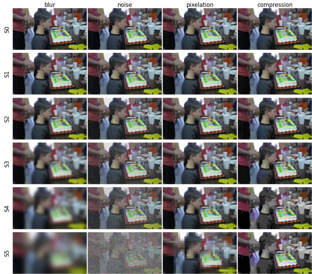  
Figure 1. Displayed $S _ { 0 } – S _ { 5 }$ perturbation schedule on one MeViS frame.

## A.9. Objective distortion audit

Table 8 reports clean-to-S PSNR and SSIM over a deterministic 10-video, one-frame-per-video sample.

<table><tr><td>System</td><td>Initialization</td><td>Text interface</td><td>Output</td><td>Reset safeguard</td></tr><tr><td>Molmo2</td><td>clean target point</td><td>native point-tracking scaffold</td><td>point trajectory</td><td>fresh generation state</td></tr><tr><td>JointNLT</td><td>clean tight box</td><td>raw expression, native TRACK mode</td><td>box trajectory</td><td>ROI queue, template features, tracker state</td></tr><tr><td>UVLTrack</td><td>clean tight box</td><td>raw expression</td><td>box trajectory</td><td>state, frame counter, score and output cache</td></tr><tr><td>MMTrack</td><td>clean tight box</td><td>raw expression</td><td>box trajectory</td><td>adapter/tracker and decode state</td></tr><tr><td>DUTrack</td><td>clean tight box</td><td>static external expression</td><td>box trajectory</td><td>dynamic description and tracker state</td></tr></table>

Table 5. Native inputs, outputs, and reset state.

<table><tr><td>Perturbation</td><td>raw n</td><td> $S _ { 0 }$ </td><td> $S _ { 1 }$ </td><td> $S _ { 2 }$ </td><td> $S _ { 3 }$ </td><td> $S _ { 4 }$ </td><td> $S _ { 5 }$ </td></tr><tr><td>Blur</td><td>8</td><td>0</td><td>2</td><td>3</td><td>4</td><td>5</td><td>6</td></tr><tr><td>Noise</td><td>9</td><td>0</td><td>4</td><td>5</td><td>6</td><td>7</td><td>8</td></tr><tr><td>Pixelation</td><td>8</td><td>0</td><td>1</td><td>2</td><td>3</td><td>4</td><td>7</td></tr><tr><td>Compression</td><td>7</td><td>0</td><td>2</td><td>3</td><td>4</td><td>5</td><td>6</td></tr></table>

Table 7. Raw implementation indices used for each displayed $S _ { 0 } – S _ { 5 }$ severity.
<table><tr><td>Perturbation</td><td>PSNR mean (dB)</td><td>PSNR range</td><td>SSIM mean</td><td>SSIM range</td></tr><tr><td>Blur</td><td>19.5</td><td>[17.2, 24.0]</td><td>0.72</td><td>[0.40, 0.85]</td></tr><tr><td>Noise</td><td>6.1</td><td>[5.6, 6.4]</td><td>0.02</td><td>[0.01, 0.03]</td></tr><tr><td>Pixelation</td><td>22.1</td><td>[19.2, 26.1]</td><td>0.70</td><td>[0.40, 0.82]</td></tr><tr><td>Compression</td><td>23.7</td><td>[20.8, 26.1]</td><td>0.73</td><td>[0.55, 0.84]</td></tr></table>

Table 8. Clean-to-displayed- $S _ { 5 }$ PSNR and SSIM on 10 fixed videos (one frame per video); ranges are min–max.

## B. Results

## B.1. Behavioral degradation study

This section provides the complete behavioral-result grid across five models, four datasets, and four perturbations.

For standalone readability, with $\Delta _ { c _ { 1 } , c _ { 2 } } ( s )$ denoting the target-accuracy difference between conditions at severity s, we use

$$
\mathrm { I A D } ( c _ { 1 } , c _ { 2 } ) = \sum _ { s = 0 } ^ { 4 } \frac { 1 } { 2 } \left( | \Delta _ { c _ { 1 } , c _ { 2 } } ( s ) | + | \Delta _ { c _ { 1 } , c _ { 2 } } ( s + 1 ) | \right) .\tag{7}
$$

## B.2. IAD matrices by model

Each figure gives the upper triangle of the neutral/unrelated/correct/ conflicting IAD matrix for one model and perturbation, with datasets as panels. Each cell is the accumulated absolute target-accuracy difference between its row and column conditions. For each system, the blur, noise, pixelation, and compression matrices are given in Figures 2–5 (Molmo2); Figures 6–9 (UVLTrack); Figures 10–13 (MMTrack); Figures 14–17 (JointNLT); and Figures 18–21 (DUTrack).

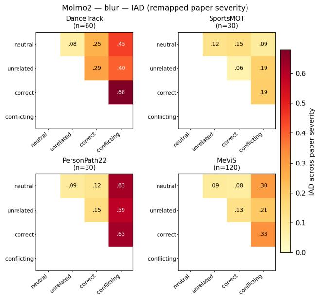  
Figure 2. Molmo2, blur: IAD matrix (Eq. 7) across all four datasets.

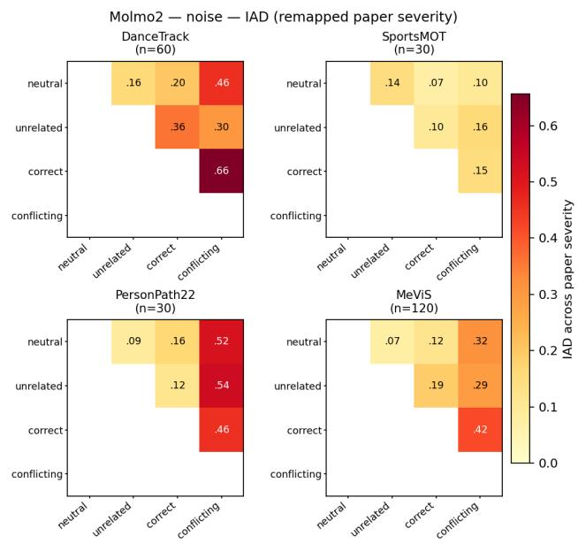  
Figure 3. Molmo2, noise: IAD matrix (Eq. 7) across all four datasets.

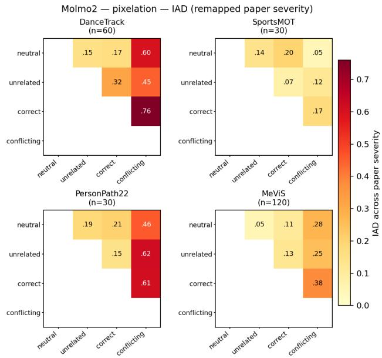  
Figure 4. Molmo2, pixelation: IAD matrix (Eq. 7) across all four datasets.

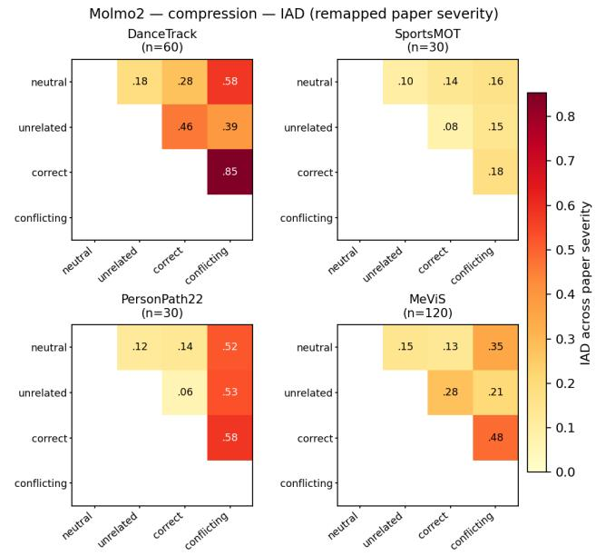  
Figure 5. Molmo2, compression: IAD matrix (Eq. 7) across all four datasets.

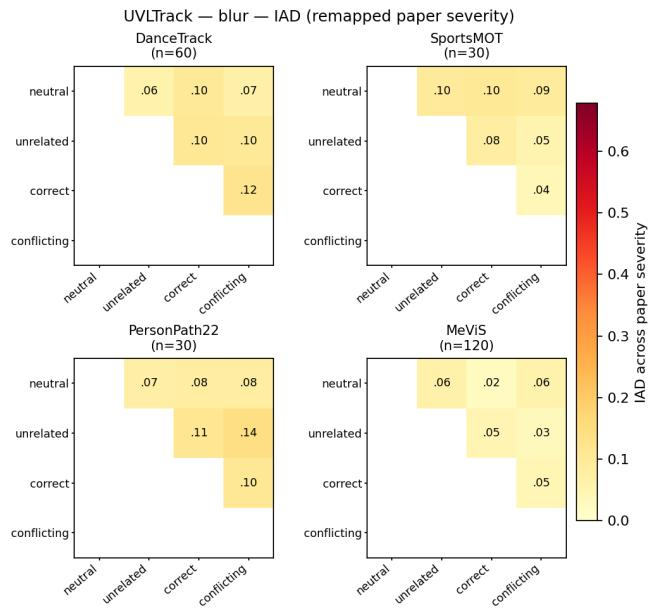  
Figure 6. UVLTrack, blur: IAD matrix (Eq. 7) across all four datasets.

  
Figure 7. UVLTrack, noise: IAD matrix (Eq. 7) across all four datasets.

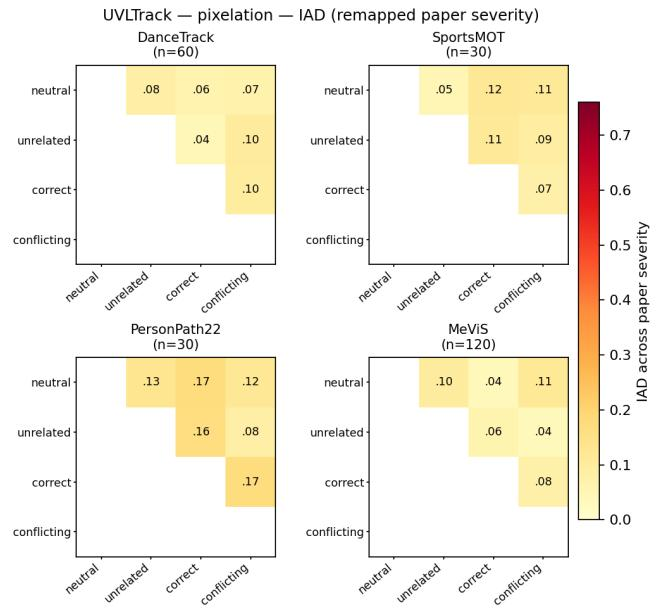  
Figure 8. UVLTrack, pixelation: IAD matrix (Eq. 7) across all four datasets.

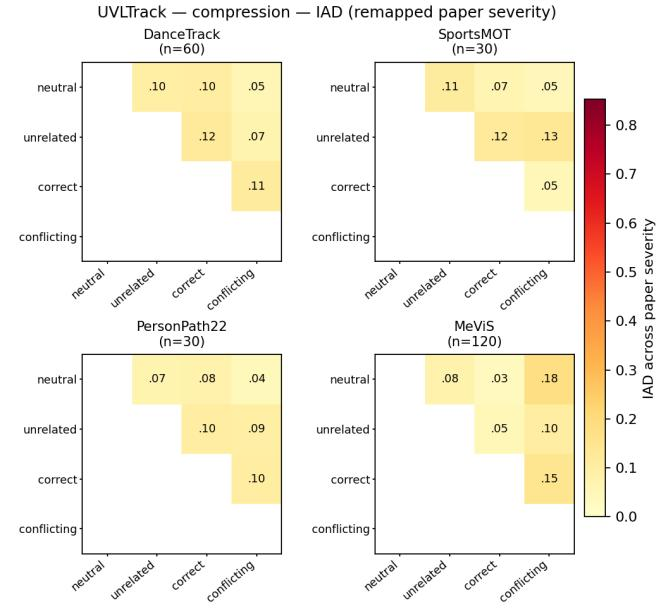  
Figure 9. UVLTrack, compression: IAD matrix (Eq. 7) across all four datasets.

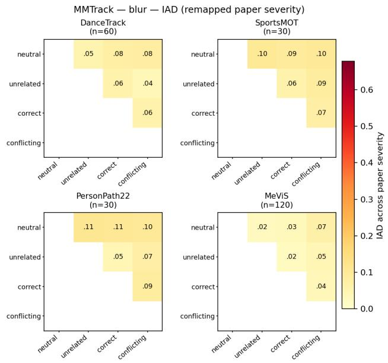

Figure 10. MMTrack, blur: IAD matrix (Eq. 7) across all four datasets.  
  
Figure 12. MMTrack, pixelation: IAD matrix (Eq. 7) across all four datasets.

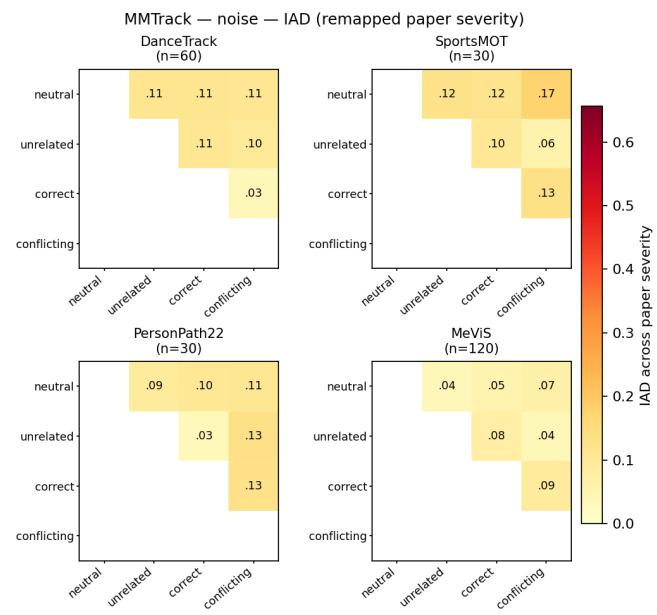

Figure 11. MMTrack, noise: IAD matrix (Eq. 7) across all four datasets.  
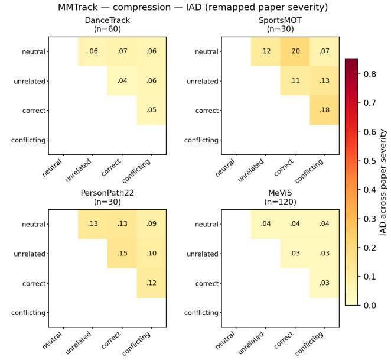  
Figure 13. MMTrack, compression: IAD matrix (Eq. 7) across all four datasets.

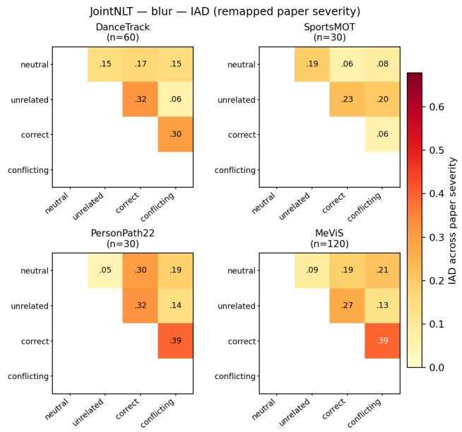  
Figure 14. JointNLT, blur: IAD matrix (Eq. 7) across all four datasets.

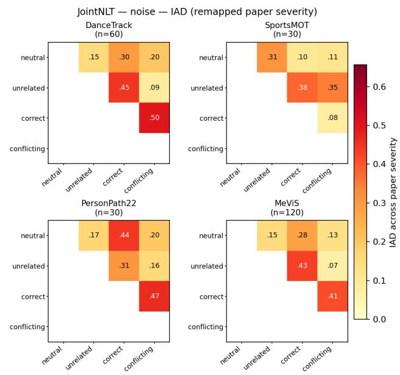  
Figure 15. JointNLT, noise: IAD matrix (Eq. 7) across all four datasets.

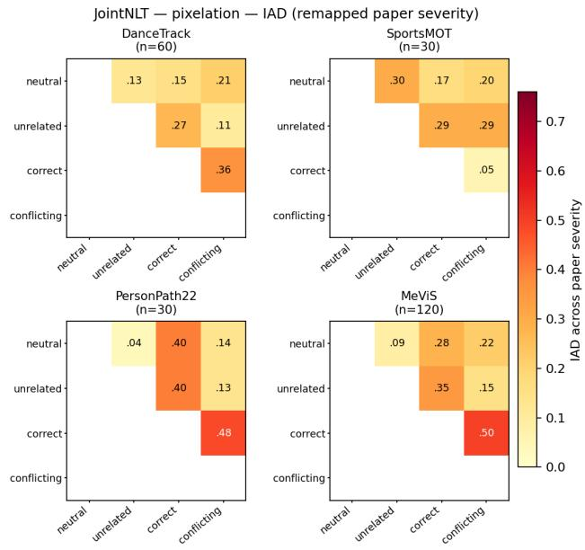  
Figure 16. JointNLT, pixelation: IAD matrix (Eq. 7) across all four datasets.

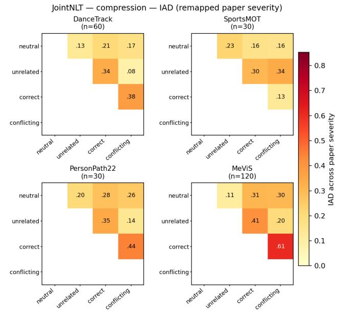  
Figure 17. JointNLT, compression: IAD matrix (Eq. 7) across all four datasets.

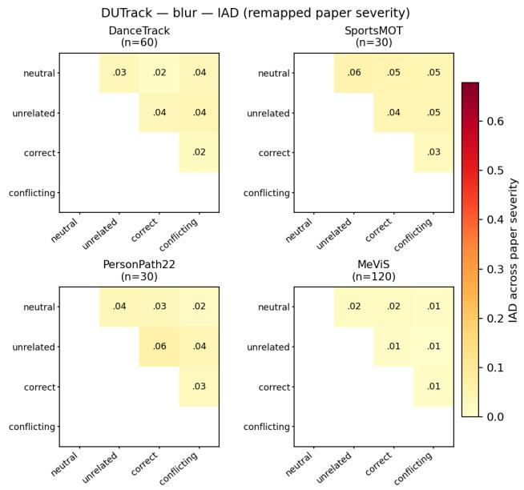  
Figure 18. DUTrack, blur: IAD matrix (Eq. 7) across all four datasets.

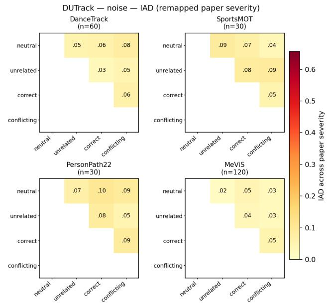  
Figure 19. DUTrack, noise: IAD matrix (Eq. 7) across all four datasets.

  
Figure 20. DUTrack, pixelation: IAD matrix (Eq. 7) across all four datasets.

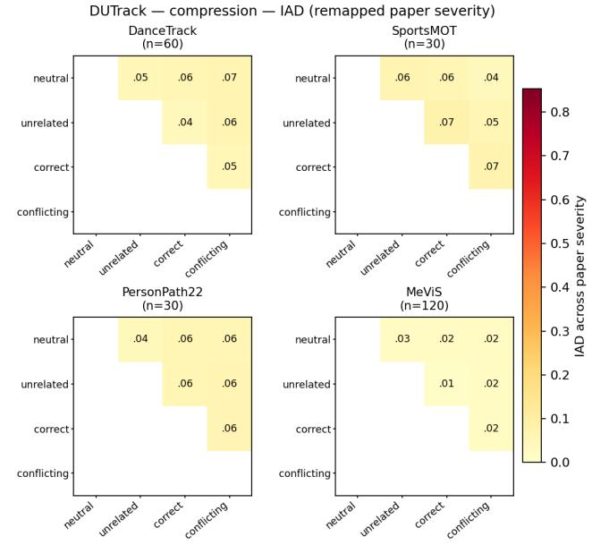  
Figure 21. DUTrack, compression: IAD matrix (Eq. 7) across all four datasets.

## B.3. Signed severity trajectories

(c) Pixelation  
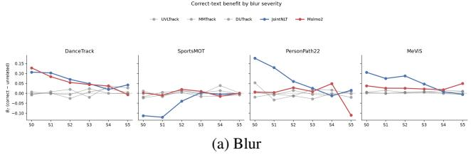

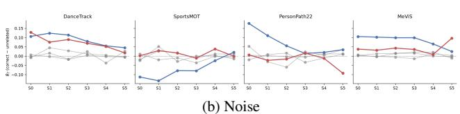

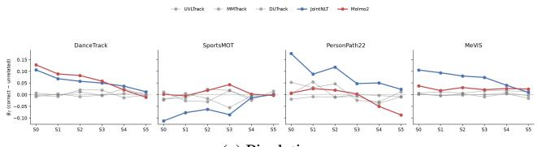

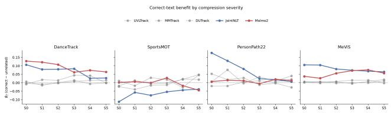  
(d) Compression  
Figure 23. Correct-versus-unrelated target-accuracy effect $B _ { T }$ across severity, systems, datasets, and perturbations.  
Mean severity-integrated absolute distractor capture effect

Figure 23 provides the signed $B _ { T }$ trajectories that complement the unsigned IAD matrices.

## B.4. Four-condition trajectories, all systems

The following figures provide condition-specific targetaccuracy and distractor-capture trajectories for every model–dataset pair. Figure 24 gives the pooled distractorcapture summary before the per-model–dataset trajectories.

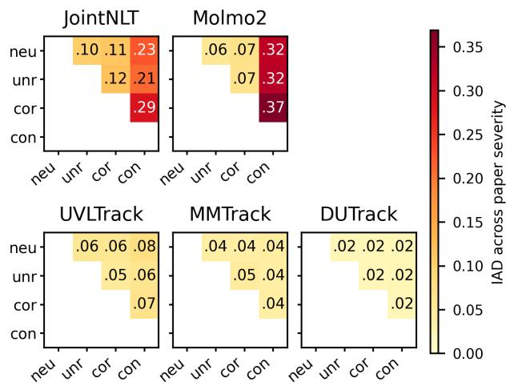  
Figure 24. Mean severity-integrated distractor-capture differences, pooled across datasets and perturbations.

Figures 25–28 give Molmo2 target-accuracy trajectories; Figures 29–32 give distractor-capture trajectories.

Figures 33–36 give UVLTrack target-accuracy trajectories;   
Figures 37–40 give distractor-capture trajectories. Figures 41–44 give MMTrack target-accuracy trajectories;   
Figures 45–48 give distractor-capture trajectories. Figures 49–52 give JointNLT target-accuracy trajectories;   
Figures 53–56 give distractor-capture trajectories. Figures 57–60 give DUTrack target-accuracy trajectories;   
Figures 61–64 give distractor-capture trajectories.

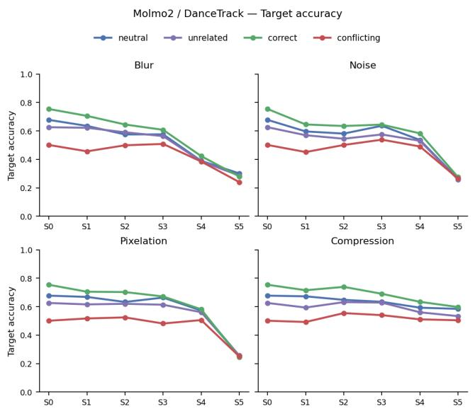

Figure 25. Molmo2 on DanceTrack: target accuracy across all four perturbations, for all four text conditions.  
Figure 26. Molmo2 on SportsMOT: target accuracy across all four perturbations, for all four text conditions.  
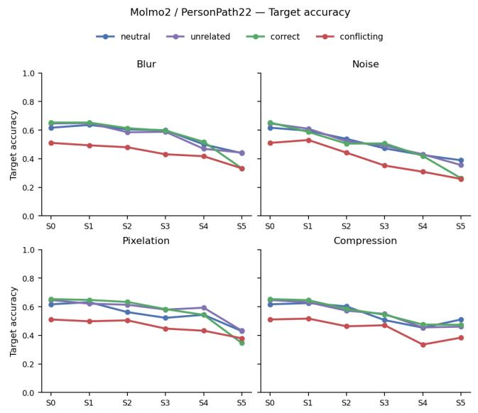

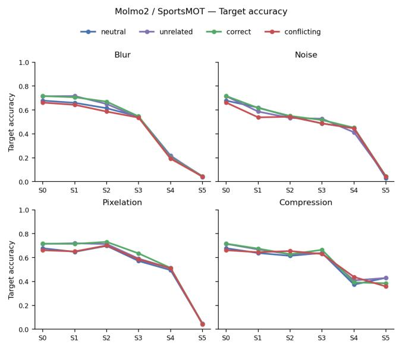

Figure 27. Molmo2 on PersonPath22: target accuracy across all four perturbations, for all four text conditions.  
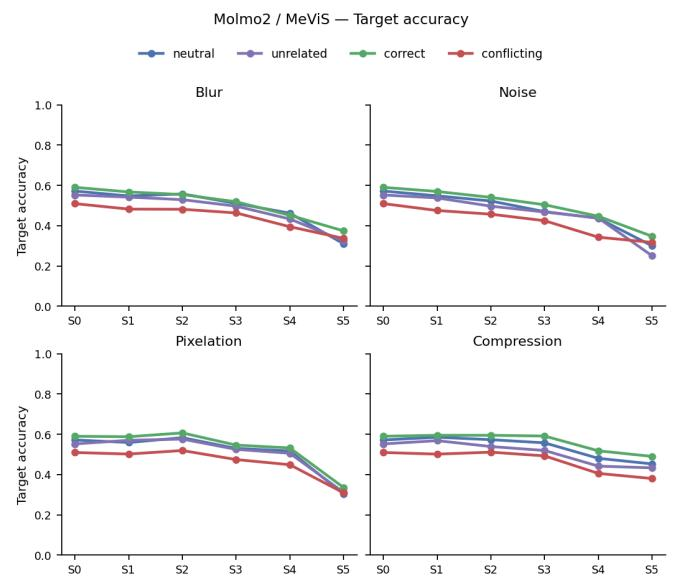  
Figure 28. Molmo2 on MeViS: target accuracy across all four perturbations, for all four text conditions.

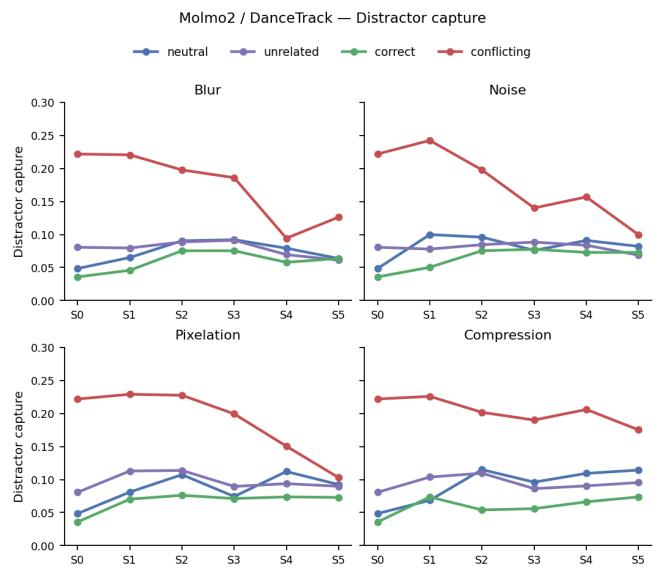  
Figure 29. Molmo2 on DanceTrack: distractor capture across all four perturbations, for all four text conditions.

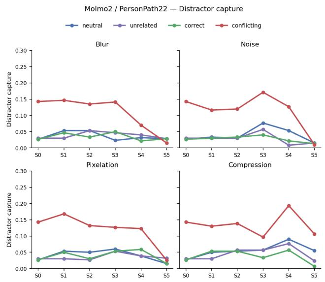  
Figure 31. Molmo2 on PersonPath22: distractor capture across all four perturbations, for all four text conditions.

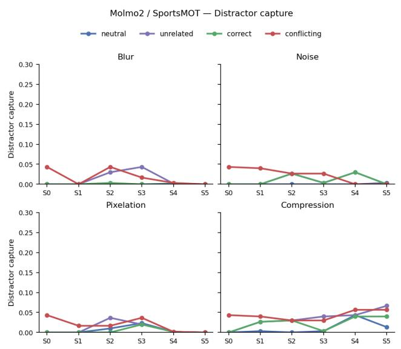  
Figure 30. Molmo2 on SportsMOT: distractor capture across all four perturbations, for all four text conditions.

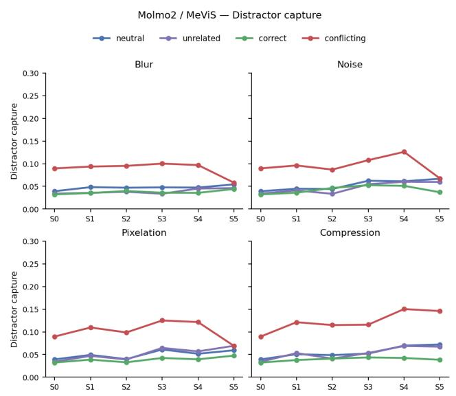  
Figure 32. Molmo2 on MeViS: distractor capture across all four perturba tions, for all four text conditions.

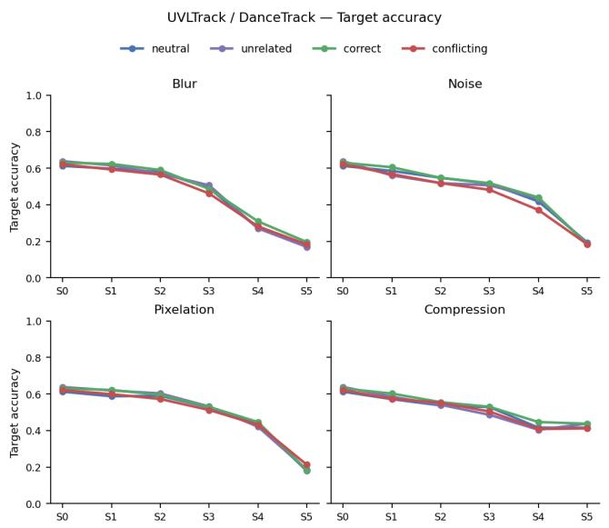

Figure 33. UVLTrack on DanceTrack: target accuracy across all four perturbations, for all four text conditions.  
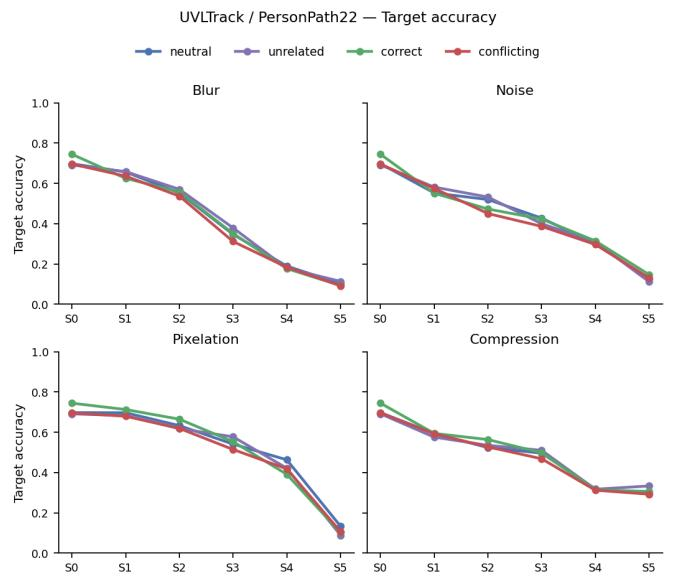  
Figure 35. UVLTrack on PersonPath22: target accuracy across all four perturbations, for all four text conditions.

Figure 34. UVLTrack on SportsMOT: target accuracy across all four pertur bations, for all four text conditions.  
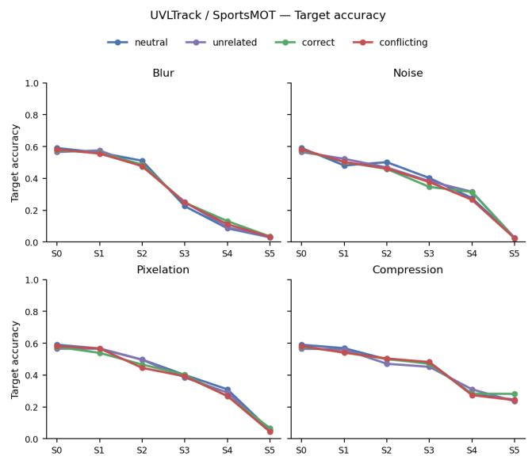

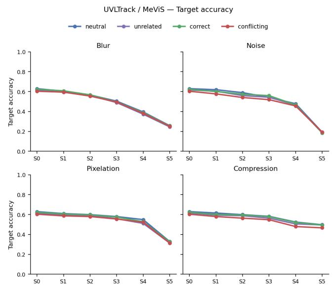  
Figure 36. UVLTrack on MeViS: target accuracy across all four perturbations, for all four text conditions.

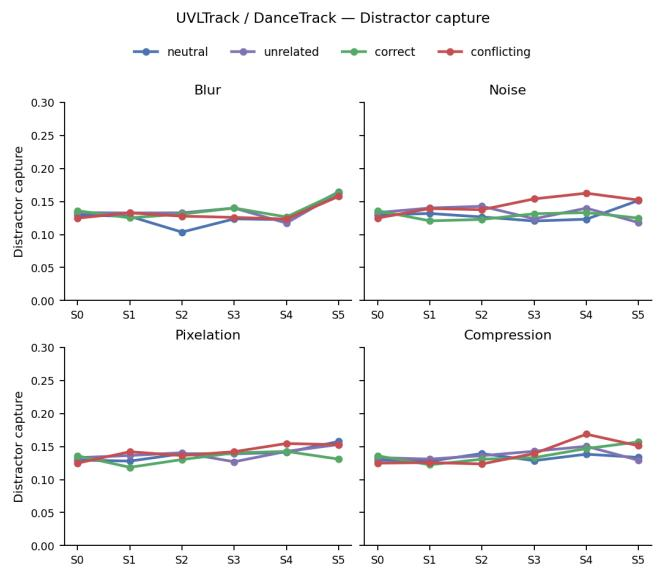  
Figure 37. UVLTrack on DanceTrack: distractor capture across all four perturbations, for all four text conditions.

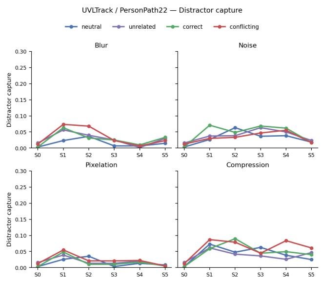  
Figure 39. UVLTrack on PersonPath22: distractor capture across all four perturbations, for all four text conditions.

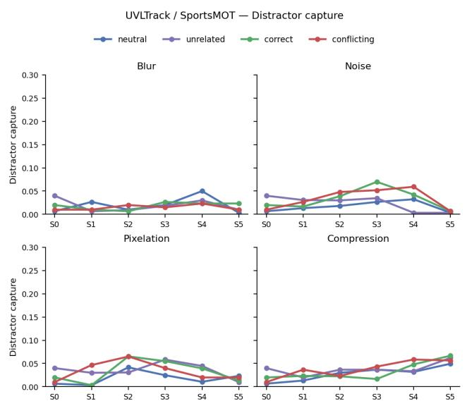  
Figure 38. UVLTrack on SportsMOT: distractor capture across all four perturbations, for all four text conditions.

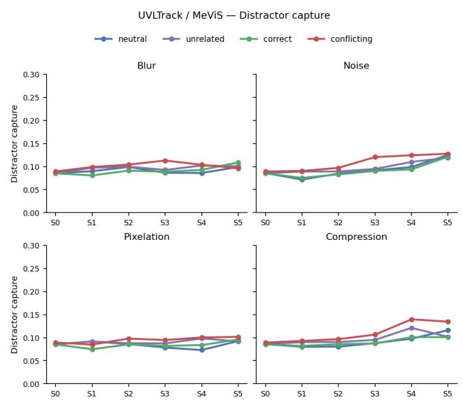  
Figure 40. UVLTrack on MeViS: distractor capture across all four perturbations, for all four text conditions.

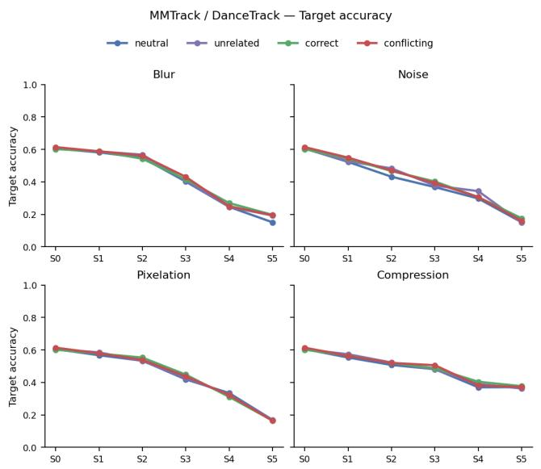

Figure 41. MMTrack on DanceTrack: target accuracy across all four perturbations, for all four text conditions.  
Figure 42. MMTrack on SportsMOT: target accuracy across all four perturbations, for all four text conditions.  

Figure 43. MMTrack on PersonPath22: target accuracy across all four perturbations, for all four text conditions.  
  
Figure 44. MMTrack on MeViS: target accuracy across all four perturbations, for all four text conditions.

  
Figure 45. MMTrack on DanceTrack: distractor capture across all four perturbations, for all four text conditions.

  
Figure 47. MMTrack on PersonPath22: distractor capture across all four perturbations, for all four text conditions.

  
Figure 46. MMTrack on SportsMOT: distractor capture across all four perturbations, for all four text conditions.

  
Figure 48. MMTrack on MeViS: distractor capture across all four perturbations, for all four text conditions.

Figure 49. JointNLT on DanceTrack: target accuracy across all four perturbations, for all four text conditions.  
Figure 50. JointNLT on SportsMOT: target accuracy across all four perturbations, for all four text conditions.  

Figure 51. JointNLT on PersonPath22: target accuracy across all four perturbations, for all four text conditions.  
  
Figure 52. JointNLT on MeViS: target accuracy across all four perturbations, for all four text conditions.

  
Figure 53. JointNLT on DanceTrack: distractor capture across all four perturbations, for all four text conditions.

  
Figure 55. JointNLT on PersonPath22: distractor capture across all four perturbations, for all four text conditions.

  
Figure 54. JointNLT on SportsMOT: distractor capture across all four perturbations, for all four text conditions.

  
Figure 56. JointNLT on MeViS: distractor capture across all four perturbations, for all four text conditions.

Figure 57. DUTrack on DanceTrack: target accuracy across all four perturbations, for all four text conditions.  
Figure 58. DUTrack on SportsMOT: target accuracy across all four perturbations, for all four text conditions.  

Figure 59. DUTrack on PersonPath22: target accuracy across all four perturbations, for all four text conditions.  
  
Figure 60. DUTrack on MeViS: target accuracy across all four perturbations, for all four text conditions.

  
Figure 61. DUTrack on DanceTrack: distractor capture across all four perturbations, for all four text conditions.

  
Figure 63. DUTrack on PersonPath22: distractor capture across all four perturbations, for all four text conditions.

  
Figure 62. DUTrack on SportsMOT: distractor capture across all four perturbations, for all four text conditions.

  
Figure 64. DUTrack on MeViS: distractor capture across all four perturbations, for all four text conditions.

## B.5. Textual direction under degradation: full percase statistics

These tables list the responsive-system effects with a CIsupported clean input value. $S _ { 0 }$ is the clean signed effect; later entries are signed $S _ { 5 } - S _ { 0 }$ changes in percentage points. Asterisks mark FDR-significant endpoint tests. Figure 65 visualizes the endpoint inventory, and Fig. 66 shows the corresponding full trajectories. Tables 9 and 10 provide the numerical target-accuracy and distractor-capture values.

  
Figure 65. Endpoint change $( S _ { 5 } ~ - ~ S _ { 0 } )$ in responsive-system targetaccuracy effects; asterisks mark FDR-significant endpoint tests.

Target-accuracy effects $( B _ { T }$ , $C _ { T } ,$ , or $N _ { T } ) .$
<table><tr><td>Model</td><td>Dataset</td><td>Eff.</td><td> $\overline { { S _ { 0 } } }$ </td><td>Blur</td><td>Noise</td><td>Pixel.</td><td>Compr.</td></tr><tr><td>JointNLT</td><td>MeViS</td><td> $\overline { { C _ { T } } }$ </td><td>+14.2</td><td>-13.8*</td><td>-13.9*</td><td>-9.9*</td><td>-5.2</td></tr><tr><td>JointNLT</td><td>PersonPath22</td><td> $C _ { T }$ </td><td>+26.9</td><td>-28.0*</td><td>-23.5*</td><td>-29.9*</td><td> $- 2 4 . 2 ^ { * }$ </td></tr><tr><td>Molmo2</td><td>DanceTrack</td><td> $B _ { T }$ </td><td>+12.8</td><td>-13.5</td><td>-11.0</td><td>-13.9</td><td>-6.4</td></tr><tr><td>JointNLT</td><td>MeViS</td><td> $B _ { T }$ </td><td>+10.6</td><td>-11.1*</td><td>-8.1*</td><td>-9.6*</td><td>-4.1</td></tr><tr><td>Molmo2</td><td>DanceTrack</td><td> $C _ { T }$ </td><td>+25.3</td><td>-21.4</td><td>-24.3</td><td>-25.8</td><td>-16.0</td></tr><tr><td>JointNLT</td><td>MeViS</td><td> $N _ { T }$ </td><td>+7.8</td><td>-8.9*</td><td>-7.8*</td><td>-5.1</td><td>-3.4</td></tr><tr><td>JointNLT</td><td>DanceTrack</td><td> $B _ { T }$ </td><td>+10.7</td><td>-6.4</td><td>-6.1</td><td>-9.4</td><td>-7.8</td></tr><tr><td>JointNLT</td><td>DanceTrack</td><td> $C _ { T }$ </td><td>+10.9</td><td>-9.6</td><td>-8.6</td><td>-11.5</td><td>-8.5</td></tr><tr><td>JointNLT</td><td>PersonPath22</td><td> $B _ { T }$ </td><td>+17.6</td><td>-16.1</td><td>-14.1</td><td>-15.3</td><td>-17.0</td></tr><tr><td>JointNLT</td><td>PersonPath22</td><td> $N _ { T }$ </td><td>+17.0</td><td>-15.3</td><td>-10.8</td><td>-16.0</td><td>-10.2</td></tr><tr><td>JointNLT</td><td>SportsMOT</td><td> $B _ { T }$ </td><td>-11.2†</td><td>+11.2</td><td>+13.4</td><td>+11.3</td><td>+7.4</td></tr><tr><td>Molmo2</td><td>MeViS</td><td> $B _ { T }$ </td><td>+3.8</td><td>+1.1</td><td>+5.9</td><td>-1.4</td><td>+1.9</td></tr><tr><td>Molmo2</td><td>MeViS</td><td> $C _ { T }$ </td><td>+8.1</td><td>-4.4</td><td>-5.0</td><td>-5.4</td><td>+2.9</td></tr><tr><td>Molmo2</td><td>DanceTrack</td><td> $N _ { T }$ </td><td>+7.6</td><td>-9.8</td><td>-6.4</td><td>-8.6</td><td>-6.3</td></tr></table>

Table 9. Target-accuracy effects with a CI-supported clean-input value. Values after $S _ { 0 }$ are signed endpoint changes; asterisks mark FDRsignificant endpoint tests.

Distractor-capture effects $( S _ { D } ) .$
<table><tr><td>Model</td><td>Dataset</td><td> $S _ { 0 }$ </td><td>Blur</td><td>Noise</td><td>Pixel.</td><td>Compr.</td></tr><tr><td>JointNLT</td><td>MeViS</td><td> $+ 9 . 2$ </td><td>-8.2* *</td><td> $- 7 . 3 ^ { * }$ </td><td> $- 7 . 0 ^ { * }$ </td><td>-1.6</td></tr><tr><td>Molmo2</td><td>DanceTrack</td><td>+14.1</td><td>-7.6</td><td>-11.0</td><td>-12.8</td><td>-6.1</td></tr><tr><td>Molmo2</td><td>MeViS</td><td>+5.6</td><td>-4.4</td><td>-4.8</td><td> $- 5 . 6 ^ { * }$ </td><td>+2.3</td></tr><tr><td>Molmo2</td><td>PersonPath22</td><td>+11.3</td><td>-12.6</td><td>-11.8</td><td>-11.9</td><td>-3.0</td></tr></table>

Table 10. Distractor-capture effects with a CI-supported clean-input value. Values after $S _ { 0 }$ are signed endpoint changes; asterisks mark FDRsignificant endpoint tests.

$$
C _ { T }
$$

JointNLT / PersonPath22: Correct-versus-conflicting effect $C \tau$  
  
\*: FDR-significant paired $S _ { 0 ^ { - } ^ { - } } S _ { 5 }$ contraction.  
Figure 66. Full severity trajectories for the three model–dataset–effect cases with FDR-supported endpoint contraction.

## B.6. Absolute performance and floor/ceiling diagnostics

Table 11 reports absolute target accuracy, distractor capture, and other/absent rate under correct text at $S _ { 0 }$ and $S _ { 5 }$

<table><tr><td></td><td colspan="3"> $S _ { 0 }$ </td><td colspan="3"> $S _ { 5 }$  (pooled, 4 perturbations)</td></tr><tr><td>Model</td><td> $A _ { T }$ </td><td> $A _ { D }$ </td><td>other/absent</td><td> $A _ { T }$ </td><td> $A _ { D }$ </td><td>other/absent</td></tr><tr><td>Molmo2</td><td>67.9%</td><td>2.4%</td><td>29.7%</td><td>37.4%</td><td>3.7%</td><td>58.8%</td></tr><tr><td>JointNLT</td><td>43.6%</td><td>9.0%</td><td>47.4%</td><td>19.3%</td><td>7.3%</td><td>73.4%</td></tr><tr><td>UVLTrack</td><td>64.4%</td><td>6.1%</td><td>29.5%</td><td>27.4%</td><td>7.6%</td><td>65.0%</td></tr><tr><td>MMTrack</td><td>62.9%</td><td>6.4%</td><td>30.7%</td><td>24.2%</td><td>7.0%</td><td>68.8%</td></tr><tr><td>DUTrack</td><td>68.1%</td><td>4.8%</td><td>27.1%</td><td>33.2%</td><td>6.6%</td><td>60.2%</td></tr></table>

Table 11. Correct-text outcome rates, pooled across datasets at $S _ { 0 }$ and across datasets and perturbations at $S _ { 5 }$ . “other/absent” combines the two non-target, non-distractor labels.

## B.7. Model internals

## B.7.1. Saved states and hook semantics

Table 12 records the clean-MeViS hook map and pooled state semantics. Language states use [CLS] tokens or sentence vectors; visual states pool search tokens in target or distractor regions.

<table><tr><td>Model</td><td>Hooked modules/stages and stored pooled semantics</td></tr><tr><td>Molmo2</td><td>Decoder inputs 0-36 (post-connector input through final nor- malized decoder state): description-token state before coordinate generation and target/distractor visual states pooled over mask-</td></tr><tr><td>JointNLT</td><td>covered image tokens. BERT layers 0-11 under language_backbone; text_proj; six vl_joint_trans encoder blocks; tar- get decoder; box-head input. We retain BERT/projected/fused [CLS], target/distractor search-region means, target query, and</td></tr><tr><td></td><td>the spatially averaged pre-box-head feature. UVLTrack backbone. bert embeddings/layers 0–5; ViT blocks 0-11; backbone output. We retain text [CLS], target/distractor search-</td></tr><tr><td>MMTrack</td><td>region means, and final text/search states before the box head. Text encoder and text_adj; visual blocks; bottleneck; vl_fusion; coordinate decoder and predictor. We retain [CLS]/sentence states, target/distractor search-region means,</td></tr><tr><td>DUTrack</td><td>and coordinate-query states through localization. backbone.descript_embedding; first joint-block input; every text-reachable joint block; backbone output. We retain description/fusion-input [CLS], target/distractor search-region means, and the final visual state before temporal weight-</td></tr></table>

Table 12. Model-specific hook map and stored pooled states.

## B.7.2. Full-depth Text BA sweeps

Tables 13–14 give the complete clean-input Text BA sweeps for JointNLT and Molmo2.
<table><tr><td>Stage</td><td>Text BA</td><td>q</td></tr><tr><td>text encoder L0</td><td>0.602</td><td>.002</td></tr><tr><td>text encoder L1</td><td>0.525</td><td>.098</td></tr><tr><td>text encoder L2</td><td>0.509</td><td>.316</td></tr><tr><td>text encoder L3</td><td>0.516</td><td>.202</td></tr><tr><td>text encoder L4</td><td>0.531</td><td>.040</td></tr><tr><td>text encoder L5</td><td>0.516</td><td>.196</td></tr><tr><td>text encoder L6</td><td>0.566</td><td>.002</td></tr><tr><td>text encoder L7</td><td>0.490</td><td>.760</td></tr><tr><td>text encoder L8</td><td>0.569</td><td>.002</td></tr><tr><td>text encoder L9</td><td>0.526</td><td>.067</td></tr><tr><td>text encoder L10</td><td>0.544</td><td>.006</td></tr><tr><td>text encoder L11</td><td>0.575</td><td>.002</td></tr><tr><td>text projection</td><td>0.563</td><td>.002</td></tr><tr><td>fusion L0 text</td><td>0.566</td><td>.002</td></tr><tr><td>fusion L0 T−D</td><td>0.518</td><td>.196</td></tr><tr><td>fusion L1 text</td><td>0.585</td><td>.002</td></tr><tr><td>fusion L1 T-D</td><td>0.535</td><td>.049</td></tr><tr><td>fusion L2 text</td><td>0.577</td><td>.002</td></tr><tr><td>fusion L2 T−D</td><td>0.690</td><td>.002</td></tr><tr><td>fusion L3 text</td><td>0.576</td><td>.002</td></tr><tr><td>fusion L3 T−D</td><td>0.699</td><td>.002</td></tr><tr><td>fusion L4 text</td><td>0.601</td><td>.002</td></tr><tr><td>fusion L4 T−D</td><td>0.673</td><td>.002</td></tr><tr><td>fusion L5 text</td><td>0.553</td><td>.006</td></tr><tr><td>fusion L5 T−D</td><td>0.685</td><td>.002</td></tr><tr><td>confirmatory late fusion T—D</td><td>0.695</td><td>.002</td></tr><tr><td>pre-loc. target query</td><td>0.519</td><td>.202</td></tr><tr><td>pre-loc. box feature</td><td>0.573</td><td>.002</td></tr></table>

Table 13. JointNLT correct-versus-conflicting Text BA at every hooked stage (0.5 is chance); q is FDR-corrected over the sweep. Bold denotes the decision-near stage used in the main paper.

<table><tr><td>Layer</td><td>BA</td><td>q</td></tr><tr><td>L0</td><td>0.499</td><td>1.000</td></tr><tr><td>L1</td><td>0.501</td><td>.567</td></tr><tr><td>L2</td><td>0.497</td><td>.688</td></tr><tr><td>L3</td><td>0.492</td><td>.702</td></tr><tr><td>L4</td><td>0.486</td><td>.797</td></tr><tr><td>L5</td><td>0.510</td><td>.441</td></tr><tr><td>L6</td><td>0.508</td><td>.459</td></tr><tr><td>L7</td><td>0.499</td><td>.688</td></tr><tr><td>L8</td><td>0.490</td><td>.709</td></tr><tr><td>L9</td><td>0.492</td><td>.701</td></tr><tr><td>L10</td><td>0.510</td><td>.441</td></tr><tr><td>L11</td><td>0.506</td><td>.441</td></tr><tr><td>L12</td><td>0.505</td><td>.554</td></tr><tr><td>L13</td><td>0.521</td><td>.275</td></tr><tr><td>L14</td><td>0.519</td><td>.370</td></tr><tr><td>L15</td><td>0.523</td><td>.252</td></tr><tr><td>L16</td><td>0.514</td><td>.441</td></tr><tr><td>L17</td><td>0.545</td><td>.053</td></tr><tr><td>L18</td><td>0.543</td><td>.057</td></tr><tr><td>L19</td><td>0.554</td><td>.033</td></tr><tr><td>L20</td><td>0.561</td><td>.033</td></tr><tr><td>L21</td><td>0.634</td><td>.015</td></tr><tr><td>L22</td><td>0.629</td><td>.015</td></tr><tr><td>L23</td><td>0.614</td><td>.015</td></tr><tr><td>L24</td><td>0.594</td><td>.015</td></tr><tr><td>L25</td><td>0.569</td><td>.015</td></tr><tr><td>L26</td><td>0.565</td><td>.015</td></tr><tr><td>L27</td><td>0.567</td><td>.015</td></tr><tr><td>L28</td><td>0.569</td><td>.015</td></tr><tr><td>L29</td><td>0.563</td><td>.015</td></tr><tr><td>L30</td><td>0.556</td><td>.025</td></tr><tr><td></td><td>0.558</td><td>.015</td></tr><tr><td>L31</td><td></td><td></td></tr><tr><td>L32 L33</td><td>0.563</td><td>.015 .025</td></tr><tr><td></td><td>0.556</td><td></td></tr><tr><td>L34</td><td>0.550</td><td>.057</td></tr><tr><td>L35</td><td>0.565</td><td>.015</td></tr><tr><td>L36</td><td>0.574</td><td>.015</td></tr></table>

Table 14. Molmo2 correct-versus-conflicting Text BA at all saved coordinate-query decoder depths (0.5 is chance); q is FDR-corrected over the 37-layer sweep. Bold denotes the peak.

## B.7.3. JointNLT across visual degradation

JointNLT is evaluated on the clean MeViS manifest across all displayed severities. The query frame is clean; tracker state is reset for every run; and features are sampled at three fixed co-visible frames per source video. Figures 67, 68, 69, and 70 provide the four perturbation-specific trajectories, and Table 15 records their terminal late-fusion values.

  
Figure 67. JointNLT MeViS internal trajectories under blur. Panels show visual separation, Text BA, and grounding-to-output association; error bars are 95% source-video bootstrap CIs.

  
Figure 68. JointNLT MeViS internal trajectories under noise.

  
Figure 69. JointNLT MeViS internal trajectories under pixelation.

  
Figure 70. JointNLT MeViS internal trajectories under compression.

<table><tr><td>Perturbation</td><td>late visual sep.</td><td>late fused-text BA</td><td>output association r</td></tr><tr><td>blur</td><td>.173 [.154, .192]</td><td>.582[.531, .633]</td><td>-.009[-.111, .089]</td></tr><tr><td>noise</td><td>.042[.036, .048]</td><td>.566 [.515, .621]</td><td>+.268[.160, .363]</td></tr><tr><td>pixelation</td><td>.148 [.130, .168]</td><td>.539 [.485, .593]</td><td>+.091[-.051, .225]</td></tr><tr><td>compression</td><td>.253 [.230, .278]</td><td>.577[.528, .625]</td><td>+.254[.145, .353]</td></tr></table>

Table 15. JointNLT late-fusion $S _ { 5 }$ values by perturbation. Brackets are 95% source-video bootstrap CIs.

## C. Ablations

This section reports protocol and intervention sensitivity checks.

## C.1. Native-box-metrics sensitivity check

The four box trackers are also scored with native box IoU against tight mask-extent ground-truth boxes (IoU ≥ 0.5), using the same predictions and clustered inference as the point-in-mask metric. Table 16 reports the clean-input point and box-IoU effects side by side.

## C.2. Causal donor-content controls

Each control replaces the state at the main-paper patch site while holding visual input, initialization, and sequential replay fixed.

JointNLT content controls. Table 17 lists the donor-state contrasts for the retention-control and persistent-capture strata.
<table><tr><td>Contrast (correct —)</td><td>Mean ∆</td><td>95% CI</td><td>q</td></tr><tr><td colspan="4">Retention controls (n=67)</td></tr><tr><td>neutral</td><td>+0.176</td><td>[0.090,0.274]</td><td>.0001</td></tr><tr><td>unrelated</td><td>+0.184</td><td>[0.101,0.280]</td><td>.0001</td></tr><tr><td>cross-video</td><td>+0.226</td><td>[0.140,0.326]</td><td>.0000</td></tr><tr><td>self (effect)</td><td>+0.049</td><td>[0.022,0.080]</td><td>.0006</td></tr><tr><td colspan="4">Persistent captures (n=23)</td></tr><tr><td>neutral</td><td>+0.359</td><td>[0.077,0.622]</td><td>.0251</td></tr><tr><td>unrelated</td><td>+0.193</td><td>[-0.045,0.413]</td><td>.1241</td></tr><tr><td>cross-video</td><td>+0.368</td><td>[0.110,0.634]</td><td>.0206</td></tr><tr><td>self (effect)</td><td>+1.193</td><td>[0.971,1.410]</td><td>.0000</td></tr></table>

Table 17. JointNLT donor-state contrasts by outcome stratum. Values are FDR-corrected within each layer–stratum family.

Molmo2 confirmation strata. Table 18 lists the L6/L12 donor-state contrasts by confirmation stratum.
<table><tr><td>Source state</td><td>Stratum</td><td>n</td><td>Layer</td><td>Mean ∆m [95% CI]</td><td>p</td></tr><tr><td>correct</td><td>conflict capture</td><td>15</td><td>L6</td><td>+.868[+.477,+1.266]</td><td>.0008</td></tr><tr><td></td><td></td><td>15</td><td>L12</td><td>+.861[+.470,+1.261]</td><td>.0012</td></tr><tr><td>correct</td><td>other/error</td><td>12</td><td>L6</td><td>+.242[+.068,+.429]</td><td>.0332</td></tr><tr><td></td><td></td><td>12</td><td>L12</td><td>+.232[+.073,+.410]</td><td>.0604</td></tr><tr><td>correct</td><td>target retention</td><td>88</td><td>L6</td><td>+.013[-.019,+.045]</td><td>.4253</td></tr><tr><td></td><td></td><td>88</td><td>L12</td><td>+.021[+.000,+.044]</td><td>.0618</td></tr><tr><td>unrelated</td><td>conflict capture</td><td>15</td><td>L6</td><td>+.770[+.411,+1.136]</td><td>.0037</td></tr><tr><td></td><td></td><td>15</td><td>L12</td><td>+.789[+.401,+1.181]</td><td>.0027</td></tr><tr><td>unrelated</td><td>other/error</td><td>12</td><td>L6</td><td>+.029[-.157,+.218]</td><td>.8219</td></tr><tr><td>unrelated</td><td></td><td>12</td><td>L12</td><td>+.133[+.010,+.281]</td><td>.1282</td></tr><tr><td></td><td>target retention</td><td>88</td><td>L6</td><td>+.007[-.023,+.036]</td><td>.6450</td></tr><tr><td></td><td></td><td>88</td><td>L12</td><td>+.005[−.028,+.038]</td><td>.7749</td></tr><tr><td></td><td>correct—unrelated conflict capture</td><td>15</td><td>L6</td><td>+.098[+.020,+.218]</td><td>.0241</td></tr><tr><td></td><td></td><td>15</td><td>L12</td><td>+.072[-.024,+.204]</td><td>.3134</td></tr><tr><td>correct—unrelated other/error</td><td></td><td>12</td><td>L6</td><td>+.213[+.051,+.446]</td><td>.0308</td></tr><tr><td></td><td></td><td>12</td><td>L12</td><td>+.099[+.028,+.185]</td><td>.0635</td></tr><tr><td>correct—unrelated target retention</td><td></td><td>88</td><td>L6</td><td>+.006[-.037,+.051] .7952</td><td></td></tr><tr><td></td><td></td><td>88 L12</td><td></td><td>+.016[-.016,+.052] .3774</td><td></td></tr></table>

<table><tr><td>Model</td><td>Dataset</td><td>point</td><td>box-IoU</td><td>diff</td></tr><tr><td colspan="5"> $B _ { T }$ </td></tr><tr><td>UVLTrack</td><td>DanceTrack</td><td>-0.8%</td><td>+0.4%</td><td>+1.2</td></tr><tr><td>UVLTrack</td><td>SportsMOT</td><td>+1.2%</td><td>+0.5%</td><td>-0.7</td></tr><tr><td>UVLTrack</td><td>PersonPath22</td><td>+5.3%</td><td>+4.1%</td><td>-1.2</td></tr><tr><td>UVLTrack</td><td>MeViS</td><td>+0.6%</td><td>+1.3%</td><td>+0.7</td></tr><tr><td>MMTrack</td><td>DanceTrack</td><td>-0.3%</td><td>+1.3%</td><td>+1.7</td></tr><tr><td>MMTrack</td><td>SportsMOT</td><td>-2.3%</td><td>-0.5%</td><td>+1.8</td></tr><tr><td>MMTrack</td><td>PersonPath22</td><td>+0.5%</td><td>-2.5%</td><td>-3.0</td></tr><tr><td>MMTrack</td><td>MeViS</td><td>+0.4%</td><td>+0.5%</td><td>+0.1</td></tr><tr><td>JointNLT</td><td>DanceTrack</td><td>+10.7%</td><td>+11.1%</td><td>+0.4</td></tr><tr><td>JointNLT</td><td>SportsMOT</td><td>-11.2%</td><td>-11.6%</td><td>-0.3</td></tr><tr><td>JointNLT</td><td>PersonPath22</td><td>+17.6%</td><td>+17.1%</td><td>-0.6</td></tr><tr><td>JointNLT</td><td>MeViS</td><td>+10.6%</td><td>+12.0%</td><td>+1.5</td></tr><tr><td>DUTrack</td><td>DanceTrack</td><td>+0.7%</td><td>+0.2%</td><td>-0.5</td></tr><tr><td>DUTrack</td><td>SportsMOT</td><td>-1.8%</td><td>-1.3%</td><td>+0.5</td></tr><tr><td>DUTrack</td><td>PersonPath22</td><td>-1.9%</td><td>-0.2%</td><td>+1.7</td></tr><tr><td>DUTrack</td><td>MeViS</td><td>+0.2%</td><td>-0.0%</td><td>-0.2</td></tr><tr><td colspan="5"> $S _ { D }$ </td></tr><tr><td>UVLTrack</td><td>DanceTrack</td><td>-0.8%</td><td>+0.9%</td><td>+1.7</td></tr><tr><td>UVLTrack</td><td>SportsMOT</td><td>-3.0%</td><td>-3.3%</td><td>-0.3</td></tr><tr><td>UVLTrack</td><td>PersonPath22</td><td>-0.3%</td><td>-0.5%</td><td>-0.2</td></tr><tr><td>UVLTrack</td><td>MeViS</td><td>+0.4%</td><td>+0.3%</td><td>-0.1</td></tr><tr><td>MMTrack</td><td>DanceTrack</td><td>+0.9%</td><td>+1.3%</td><td>+0.5</td></tr><tr><td>MMTrack</td><td>SportsMOT</td><td>+0.0%</td><td>+0.0%</td><td>+0.0</td></tr><tr><td>MMTrack</td><td>PersonPath22</td><td>+0.9%</td><td>+0.2%</td><td>-0.8</td></tr><tr><td>MMTrack</td><td>MeViS</td><td>-0.7%</td><td>-0.6%</td><td>+0.1</td></tr><tr><td>JointNLT</td><td>DanceTrack</td><td>+4.6%</td><td>+6.0%</td><td>+1.3</td></tr><tr><td>JointNLT</td><td>SportsMOT</td><td>+1.9%</td><td>+2.6%</td><td>+0.8</td></tr><tr><td>JointNLT</td><td>PersonPath22</td><td>+12.3%</td><td>+11.4%</td><td>-0.9</td></tr><tr><td>JointNLT</td><td>MeViS</td><td>+9.2%</td><td>+7.4%</td><td>-1.9</td></tr><tr><td>DUTrack</td><td>DanceTrack</td><td>-0.3%</td><td>+0.0%</td><td>+0.3</td></tr><tr><td>DUTrack</td><td>SportsMOT</td><td>+0.0%</td><td>+0.0%</td><td>+0.0</td></tr><tr><td>DUTrack</td><td>PersonPath22</td><td>+0.0%</td><td>+0.0%</td><td>+0.0</td></tr><tr><td>DUTrack</td><td>MeViS</td><td>-0.5%</td><td>-0.1%</td><td>+0.3</td></tr></table>

Table 16. Clean-input $B _ { T }$ and $S _ { D }$ under point-in-mask and box-IoU scoring. “diff” is box-IoU minus point, in percentage points; underlining denotes a 95% source-video bootstrap CI excluding zero.  
Table 18. Molmo2 L6/L12 donor-state contrasts. ∆m is the trajectorymean target-minus-distractor point-margin change from the conflicting baseline; CIs use source-video bootstrap and p is paired sign-flip. The bottom block compares correct and unrelated donors.

Causal audit of the behaviorally null systems. The three small-effect systems are tested on the 115-video manifest with matched-correct replacement and zero-text ablation at their declared text boundaries. Contrasts use the conflicting baseline; q is FDR-corrected within each system’s two-contrast family. Table 19 reports the resulting semantic and presence contrasts.

<table><tr><td>Model</td><td>Contrast (vs. conflicting)</td><td>Mean ∆</td><td>q</td><td>Equiv.</td></tr><tr><td rowspan="2">UVLTrack</td><td>matched-correct (semantic)</td><td>+0.024</td><td>.365</td><td>No</td></tr><tr><td>zero-ablation (presence)</td><td>+0.036</td><td>.007</td><td>No</td></tr><tr><td rowspan="2">MMTrack</td><td>matched-correct (semantic)</td><td>-0.012</td><td>.099</td><td>Yes</td></tr><tr><td>zero-ablation (presence)</td><td>-0.022</td><td>.021</td><td>No</td></tr><tr><td rowspan="2">DUTrack</td><td>matched-correct (semantic)</td><td>+0.002</td><td>.573</td><td>Yes</td></tr><tr><td>zero-ablation (presence)</td><td>-0.013</td><td>.379</td><td>Yes</td></tr></table>

Table 19. Output-margin change after matched-correct replacement (semantic) or zero-text ablation (presence), by system.

  
Figure 71. Outcome-independent pool: target-accuracy IAD, averaged equally across the three MOT sources and four perturbations over paper S0–S5. Labels abbreviate neutral/unrelated/correct/conflicting.

## C.3. Outcome-independent sample confirmation

The main-paper MOT subsets intentionally retain rare Molmo2 conflicting-text takeover cases before seeded random filling. This confirmation instead retains the complete annotation-eligible DanceTrack, SportsMOT, and Person-Path22 pool: 404 pairs from 81 source videos (214/17, 110/31, and 80/33 pairs/videos, respectively). Pair inclusion requires at least five co-visible annotated frames, mean co-visible mask IoU below 0.3, and the required target, distractor, and deterministic category-matched unrelated expressions; it uses no model output, accuracy, or takeover label.

JointNLT, UVLTrack, MMTrack, and DUTrack (Molmo2 is out of scope) were run under all four text conditions at every displayed $S _ { 0 } – S _ { 5 }$ severity level of blur, noise, pixelation, and compression.

Figure 71 compactly summarizes each system’s targetaccuracy IAD matrices. Within a model, we equally average the three source-dataset matrices and, within a dataset, the four perturbation-specific IAD matrices over the paper’s six-position severity ladder. Larger cells therefore indicate a larger average absolute condition gap, not a directional or inferential test.

Effect pattern. Figure 71 retains the main behavioral split under the outcome-independent distribution. JointNLT’s correct–conflicting IAD is .50, .18, and .35 on DanceTrack, SportsMOT, and PersonPath22, respectively. The corresponding cells remain smaller for UVLTrack (.13, .06, .09), MMTrack (.03, .06, .04), and DUTrack (.02, .04, .03).

## D. Reproducibility

We release the complete experimental pipeline as a selfcontained, anonymized repository in the supplementary material, structured to reproduce every table, figure, and statistical test in this paper through a single configuration file and entry point rather than the roughly twenty scripts and five separate Python environments the pipeline spans internally. The repository provides the inference, validation, consolidation, statistics, and model-internals code exactly as used to generate the reported results; it introduces no reimplementation of the underlying methodology.

The archive does not redistribute raw third-party video or image frames. It provides code, frozen manifests and provenance metadata, annotations only where their upstream terms permit redistribution, and scripts that obtain and prepare source media from the original providers (Table 1, Table 2). The packaged operational smoke fixture is an author-created synthetic two-object sequence. It exercises the shared specialized-tracker input, four-condition text, perturbation, output-schema, and validation paths, but is not a scientific replication or an estimate of tracking or text-prior performance. Reproducing the full five-model study requires obtaining the source media, annotations, and checkpoints under their respective upstream terms. A CPUonly test suite covering adapter contracts, outcome-label invariants, and the statistical correction routines requires neither a GPU nor a model checkpoint.

Scaling from the synthetic operational fixture to the full paper-scale grid (every selected pair, all six severities) requires obtaining the complete datasets and model checkpoints per their documented licenses (Table 1, Table 2) and otherwise leaves the pipeline unchanged. The repository is anonymized for review; the complete, de-anonymized version will be made publicly available upon acceptance.

## E. Ethics and Societal Impact

DISTRACT evaluates existing vision-language trackers; it does not train a tracker, collect new personal data, or release raw third-party media. Its purpose is to reveal failures under ordinary image degradation, not to certify a model as safe for deployment. Tracking can be used in privacysensitive or surveillance contexts, although the code adds no surveillance-specific capability. Users must obtain data lawfully, respect upstream terms and privacy obligations, and apply suitable oversight and safeguards before operational use.