# Decoupling Action from Egocentric Observation for World Simulation

Yue Ma1 Pengjie Song1 Xinyu Wang2 Yi He2

Zeqian Long3 Fangneng Zhan1 Kaichen Zhou4 Hongyu Liu1

Hongfa Wang2 Peihao Li5 Haoyang Huang5 Nan Duan5 Qifeng Chen1,∗

1HKUST 2Tsinghua University 3Stanford University 4MIT 5JD Explore Academy

Project Page: https://ego-act.github.io/

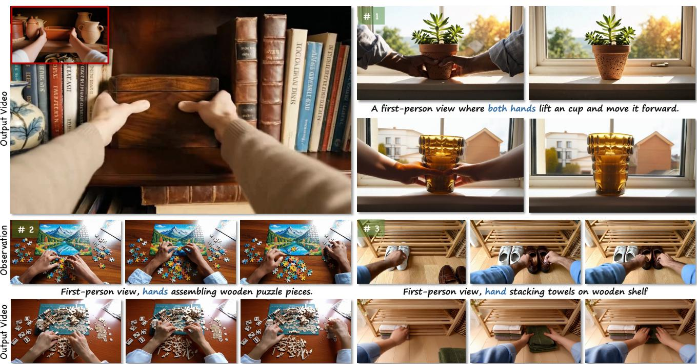  
Figure 1. Showcase of our method. Given an egocentric manipulation video as observation, EgoACT decouples the transferable action semantics and generates new interaction videos that faithfully reproduce the reference action while maintaining physically plausible hand-object interactions in the target scene.

## Abstract

Egocentric action transfer aims to decouple the semantic action from egocentric observations and reproduce them in new visual contexts, enabling scalable world simulation, embodied policy learning, and robotic data generation. Existing approaches to transferring actions rely on conditionguided video generation, which converts the observation video into explicit geometric controls (e.g., hand poses or meshes) to drive synthesis. However, these methods introduce geometric estimation errors, making it difficult to preserve physically plausible interactions when transferred

to new scenes. Alternatively, motion transfer methods directly extract motion patterns from the observation video, yet motion-level features alone cannot encode rich contact dynamics, frequently leading to severe hand structural collapse and implausible contact layout. To address both limitations, we present EgoACT, a test-time framework for egocentric action transfer that operates directly on the denoising process of video diffusion models without requiring additional geometric estimators. EgoACT uses Velocityguided Structure Anchoring to stabilize reference-consistent hand-object structure in the early denoising stage, and Sparse Correspondence Calibration to refine reliable local correspondences in the mid-to-late denoising stages. Together, these two components preserve transferable action semantics while improving temporal coherence and interaction realism. We further establish EgoActionBench, a benchmarkfor evaluating action preservation, visual quality, and hand-object plausibility across diverse egocentric manipulation scenarios. Experiments show that EgoACT generates more coherent and physically plausible interaction videos than strong baselines.

## 1. Introduction

Egocentric action transfer aims to decouple the semantic action from egocentric observations and reproduce it in new visual scenes, enabling scalable world simulation, embodied policy learning, and robotic data generation. The core challenge is to decouple what action is being performed from how the current scene happens to look, so that the interaction logic, including contact transitions, object responses, and coordinated hand-object dynamics , can be faithfully reproduced in novel scenarios.

Existing approaches to transferring egocentric actions are predominantly formulated as condition-guided video generation [71, 77, 88]. These methods first convert an observation video into explicit geometric controls, such as keypoints, hand poses, or mesh sequences [11, 24, 74], and then force the target video to follow these extracted conditions. However, these methods rely on accurate geometric estimation and inevitably introduce external errors into the generation process. When transferred to a new scene, the injected geometric controls cannot guarantee physically valid interactions (Fig. 2). An alternative line of work, motion transfer [37, 43, 45], sidesteps explicit geometric estimation by extracting and replaying motion patterns directly from the observation video. While this avoids estimatorinduced errors, motion-level features alone cannot encode the rich contact dynamics inherent in egocentric manipulation. These methods frequently suffer from severe hand structural collapse and implausible contact layout (Fig. 2).

To address this, instead of hard-copying sparse geometric structures or replaying raw motion from an observation video, we aim to extract the transferable semantic action from an egocentric observation and use it to synthesize a new interaction video under a different visual realization. This setting asks the model to preserve the interaction logic behind the motion, including contact timing, object response, and coherent hand-object coordination, rather than the observation appearance or exact geometric condition.

In this work, we present EgoACT, a test-time action transfer framework for egocentric world simulation. We observe that egocentric action transfer faces two major failure modes during generation. First, hand-object structural collapse often occurs in the early denoising stage, where action guidance can distort hands, objects, and contact geometry before a stable interaction layout is formed.

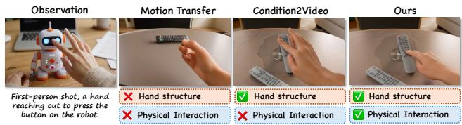  
Figure 2. Motivation. Motion transfer suffers from hand structural collapse and lacks physical interaction. Condition-guided generation preserves hand shape but produces physically implausible contact. Our method maintains both hand structure and realistic interaction.

Second, physically unrealistic interaction can still appear even when visible motion is roughly aligned, because local correspondences, contact timing, and object responses may drift in later denoising stages. To address these challenges, EgoACT combines two complementary test-time refinements. Velocity-guided Structure Anchoring (VSA) stabilizes early denoising by preserving reference-consistent hand-object structure, while Sparse Correspondence Calibration (SCC) refines mid-to-late denoising by correcting reliable local correspondences around interaction regions.

Beyond the method, we establish EgoActionBench, a benchmark for evaluating egocentric action transfer. EgoActionBench contains 350 egocentric manipulation videos covering diverse interaction categories, object types, hand configurations, and scene layouts. It evaluates not only visual fidelity, but also action preservation, temporal coherence, and hand-object interaction plausibility. Experiments on EgoActionBench show that EgoACT produces more coherent transferred actions and more plausible hand-object interactions than strong baselines, supporting the effectiveness of our formulation. Our contributions are summarized as follows:

• We analyze the challenges of egocentric action transfer and propose EgoACT, a test-time action transfer framework that decouples transferable action semantics from observation visual appearance without additional training.

• Technically, we introduce Velocity-guided Structure Anchoring and Sparse Correspondence Calibration, which respectively address hand-object structural collapse and physically unrealistic interaction.

• We establish EgoActionBench, a benchmark for evaluating egocentric action transfer comprehensively, and conduct extensive experiments that support the effectiveness of our formulation and method.

## 2. Related Work

Video Motion Transfer. Motion transfer aims to synthesize novel videos by preserving reference motion dynamics, requiring effective decoupling of spatial appearance and temporal motion. Early works [8, 15, 71, 77, 78, 87, 88] rely on explicit control signals, which demand large-scale annotations and substantial computation. Consequently, recent diffusion models shift toward implicit control, employing either parameter-efficient tuning [26, 52, 72, 89] or inference-time motion extraction [14, 23, 37, 46–50, 75, 81]. However, these frameworks primarily target 3D U-Nets [3]. As models evolve toward Diffusion Transformers (DiTs) [44] with fully coupled 3D attention, traditional methods relying on explicit spatio-temporal separation become difficult to apply. Recent DiT-based adaptations explore attention flow optimization [45], parameter-efficient tuning [1], temporal kernel encoding [54], and streamlined extraction [43]. However, these methods still focus primarily on visible motion transfer, while egocentric action transfer requires preserving contact transitions and hand-object dynamics.

Interaction-Centric Video Generation. Recent advances in diffusion have increasingly pushed generative video models toward the paradigm of video world modeling [4, 5, 21], where the goal is to capture not only visual appearance but also the underlying dynamics and interactions of the physical world. Some works [30, 40, 86] address interactive manipulation video generation by introducing structured interaction signals to improve controllability and physical plausibility. Methods such as Mask2IV [30] and VHOI [86] leverage mask trajectories or keypoints to guide fine-grained interactions. Other approaches incorporate more explicit control cues or geometric priors, such as InterDyn [2], GenHSI [33], and ZeroHSI [31]. EgoSim [16] and Hand2World [70] further introduce egocentric conditioning or structured world representations to enhance interaction realism and consistency. Despite these advances, existing methods largely rely on external condition estimators [11, 24, 74] to guide the generation of physically consistent interaction videos, which limit practical application. In contrast, we propose EgoACT, which enhances interaction consistency without requiring external estimators, enabling more robust interaction world modeling.

## 3. Method

Given an egocentric manipulation video $x ^ { \mathrm { r e f } }$ that demonstrates a source action, egocentric action transfer aims to synthesize a new video $x ^ { \mathrm { g e n } }$ that preserves the transferable action semantics while allowing the visual realization to change. The transferred signal should not be limited to visible hand displacement, but should also retain the underlying interaction logic, including contact transitions, object response, and coordinated hand-object dynamics. In this section, we first discuss the motivation and key challenges of egocentric action transfer in Sec. 3.1. We then introduce Velocity-guided Structure Anchoring (VSA) in Sec. 3.2, which stabilizes the global hand-object structure during the early denoising stage. Finally, we present Sparse Correspondence Calibration (SCC) in Sec. 3.3, which refines local temporal correspondences in the mid-to-late denoising stages.

## 3.1. Motivation

Egocentric action transfer requires the model to transfer the semantic action from a reference egocentric observation while synthesizing a new interaction video under a different visual realization. Consistent with the discussion in Sec. 1, this setting is difficult because the model must preserve the interaction logic behind the motion rather than simply reproduce visible hand displacement. We focus on two failure modes that commonly appear during generation:

Hand-object Structural Collapse. Explicit condition guidance usually converts the reference video into geometric controls, such as keypoints, hand poses, or mesh sequences, and then forces the generation process to follow these controls. Although this can preserve coarse motion, it is fragile in egocentric manipulation, where hands are frequently occluded, distorted by perspective, and tightly coupled with objects. Noisy or distribution-mismatched controls can over-constrain the early denoising trajectory, leading to broken fingers, distorted hands, collapsed objects, or implausible contact geometry.

Physically Unrealistic Interaction. Even when visible motion is roughly aligned, the generated video may still fail to preserve the physical logic of manipulation, such as when contact is established, how the object responds, and whether local hand-object correspondences remain temporally consistent. This problem becomes especially apparent in the mid-to-late denoising stages, where fine-grained appearance and contact details are formed.

To address these two failure modes, EgoACT performs two complementary latent optimization steps during inference. Velocity-guided Structure Anchoring (VSA) is applied in the early denoising stage to keep the generation close to reference-consistent hand-object structure, reducing structural collapse before the interaction layout is formed. Sparse Correspondence Calibration (SCC) is then applied in the mid-to-late denoising stages to correct reliable local correspondences around interaction regions, improving temporal consistency and hand-object realism without additional training.

Both modules use a frozen reference branch and an optimized generation branch. At each guided denoising step t, the clean reference latent $z _ { 0 } ^ { \mathrm { r e f } }$ is mapped to the same noise level by the forward process, $z _ { t } ^ { \mathrm { r e f } } = ( 1 - \sigma _ { t } ) z _ { 0 } ^ { \mathrm { r e f } } + \sigma _ { t } \epsilon ,$ and is used only to extract stop-gradient guidance targets. We update only the generation latent $z _ { t } ^ { \mathrm { o p t } }$ . The reference branch is evaluated with a null-text prompt, while the generation branch uses the target prompt.

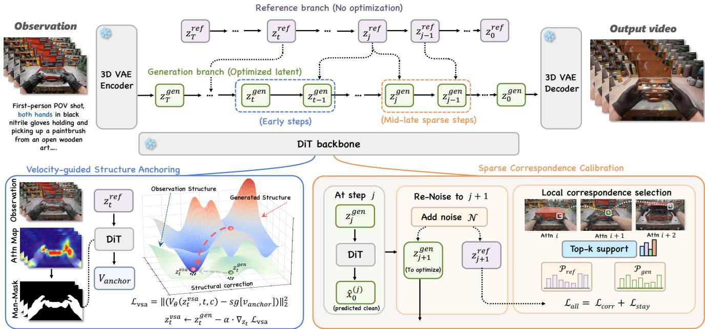  
Figure 3. Overview of the proposed framework. Given an egocentric manipulation video, our framework uses a reference branch and an optimized generation branch for test-time action transfer. We apply Velocity-guided Structure Anchoring (VSA) in the early denoising steps to preserve hand-object structure, and Sparse Correspondence Calibration (SCC) in the mid-to-late steps to refine local correspondences and improve interaction realism.

## 3.2. Velocity-guided Structure Anchoring

To prevent the hand-object structural layout from being severely derailed during the initial motion injection, we propose Velocity-guided Structure Anchoring (VSA) at the early guidance steps. In egocentric manipulation, the source observation does not merely provide a motion template; it also encodes implicit physical knowledge about feasible hand-object contacts, relative object motion, and interaction timing. Directly injecting motion cues without preserving this knowledge can produce trajectories that follow the reference displacement but violate the physical structure of the manipulation process. VSA therefore uses the reference branch as a structure-and-physics anchor at the same noise level, aligning the generation trajectory with both the kinematic layout and the interaction dynamics implied by the observation video.

Specifically, instead of relying purely on spatial loss, we extract the velocity prediction from the reference branch at the same noise level $v _ { \mathrm { a n c h o r } } = \mathrm { s g } \big [ v ( z _ { t } ^ { \mathrm { r e f } } ) \big ]$ , where $V _ { \theta } ( \cdot )$ denotes the velocity prediction of the diffusion model parameterized by θ at noise level t and sg[ ] denotes the stopgradient operation. Given the velocity prediction $v _ { \mathrm { o p t } } =$ $v ( z _ { t } ^ { \mathrm { o p t } } )$ of the currently optimized generation latent, VSA acts as a spatially weighted velocity regression.

The rationale behind using velocity as the structural carrier is that, in flow-based diffusion sampling, the velocity prediction defines the local tangent direction of the denoising trajectory on the latent video manifold. For egocentric manipulation, this tangent direction implicitly captures how hand poses, object states, and their spatial relations should evolve from the current noisy state. Therefore, aligning $v _ { \mathrm { o p t } }$ with $v _ { \mathrm { a n c h o r } }$ does not directly copy the reference latent; instead, it steers the current generation to follow a referenceconsistent local flow. This preserves the freedom of the generated content while encouraging its structural features to move toward the physically plausible manifold indicated by $z _ { t } ^ { \mathrm { r e f } }$

To avoid applying the velocity anchor uniformly over the entire frame, we introduce an Attention Motion Flow (AMF) [45] induced soft structural mask $\mathcal { M } ( \mathbf { x } )$ The intuition is that regions with stronger reference motion, such as moving hands and manipulated objects, should receive stronger structural anchoring, while static backgrounds should still retain a weak constraint to preserve global coherence. Let $\mathcal { A } _ { \mathrm { r e f } } ( \mathbf { x } )$ denote the reference AMF at spatial location x, and define the structural saliency score as its magnitude:

$$
\begin{array} { r } { { \cal S } ( { \bf x } ) = \| { \cal A } _ { \mathrm { r e f } } ( { \bf x } ) \| _ { 2 } . } \end{array}\tag{1}
$$

We normalize $S ( \mathbf { x } )$ into $[ 0 , 1 ]$ denoted as $\hat { S } ( \mathbf { x } )$ and apply a power transform controlled by γ to adjust the concentration of the mask. With a minimum weight bound $m _ { \mathrm { m i n } } .$ , the final soft mask is formulated as:

$$
\mathcal { M } ( \mathbf { x } ) = \hat { \mathcal { S } } ( \mathbf { x } ) ^ { \gamma } ( 1 - m _ { \mathrm { m i n } } ) + m _ { \mathrm { m i n } } .\tag{2}
$$

The resulting $\mathcal { M } ( \mathbf { x } )$ is defined only over spatial locations and is shared across all frames during VSA optimization. Using soft masks and velocity anchors provides structural guidance. The final VSA objective is a mask-weighted velocity regression over N spatial-temporal latent positions:

$$
\mathcal { L } _ { \mathrm { V S A } } = \frac { 1 } { N } \sum _ { \mathbf { x } } \mathcal { M } ( \mathbf { x } ) \left. v _ { \mathrm { o p t } } ( \mathbf { x } ) - v _ { \mathrm { a n c h o r } } ( \mathbf { x } ) \right. _ { 2 } ^ { 2 } .\tag{3}
$$

During early sampling, by gradient descent $z _ { t } ^ { \mathrm { o p t } } \gets z _ { t } ^ { \mathrm { o p t } } -$ $\alpha \nabla _ { z _ { \star } ^ { \mathrm { o p t } } } \mathcal { L } _ { \mathrm { V S A } }$ , the latent is directly updated, effectively stabilizing the global structural layout.

## 3.3. Sparse Correspondence Calibration

While VSA stabilizes the macroscopic structure in the early stage of denoising, cross-frame correspondences may still drift during the following denoising process. Existing global optimization strategies, such as test-time optimization [28, 32, 73], usually regularize the noisy latent with dense reconstruction, feature, or motion-level objectives. In egocentric manipulation, however, the visual content and action semantics are tightly coupled: hands, objects, and contact states jointly determine whether a trajectory remains valid. Global objectives tend to dilute these finegrained vision-action constraints into a single optimization target, which may over-correct the latent and unintentionally alter object appearance, hand-object relations, or the intended action.

To address this, we introduce Sparse Correspondence Calibration (SCC), which operates within a valid diffusion path and aligns the local correspondence distributions between the reference and generated branches at equivalent noise levels. By optimizing only the reliable sparse matching support induced by the reference branch, SCC provides a more targeted correction signal for local interaction-level correspondence drift while avoiding unnecessary updates on ambiguous or irrelevant regions.

Egocentric manipulation videos exhibit locally continuous motion between adjacent frames: a hand or object token is unlikely to jump to an arbitrary global position within one denoising step. Based on this observation, SCC searches for correspondences only within a local displacement window $\mathcal { N } ( u ) = \{ u + \Delta \ | \ \Delta \ \in \ [ - r , r ] ^ { 2 } \}$ around each query token u. Specifically, for each adjacent frame pair $( i , i + 1 )$ SCC uses the query token from the current frame and the key token from the next frame, i.e., $q _ { i } ( u )$ and $k _ { i + 1 } ( u + \Delta )$ to measure cross-frame correspondence. In the dual branch, we score each candidate displacement by the scaled querykey similarity:

$$
s _ { i } ( u , \Delta ) = \frac { \langle q _ { i } ( u ) , k _ { i + 1 } ( u + \Delta ) \rangle } { \sqrt { d } } , \quad u + \Delta \in \mathcal { N } ( u ) .\tag{4}
$$

We then keep the top-k displacements with the largest reference scores as $\Omega _ { k } ^ { i ^ { \bf 1 } } ( u )$ This reference-induced support

specifies where reliable local matches are expected to occur. Both the reference and generated correspondence distributions are normalized over the same support:

$$
\mathcal { P } _ { i } ( \Delta \mid u ) = \mathrm { s o f t m a x } \left( \frac { s _ { i } ( u , \Delta ) } { \tau } \right) , \quad \Delta \in \Omega _ { k } ^ { i } ( u ) .\tag{5}
$$

Recognizing that not all reference tokens provide reliable matching cues, we assign a confidence weight $\begin{array} { r } { w _ { \mathrm { c o n f } } ^ { i } ( u ) ~ = ~ 1 ^ { \setminus } - ~ \frac { H _ { i } ( u ) } { \log k } } \end{array}$ based on the entropy $H _ { i } ( u )$ of the reference distribution, and normalize it as $\bar { w } _ { i } ( u ) ~ =$ $\begin{array} { r } { w _ { \mathrm { c o n f } } ^ { i } ( u ) / \sum _ { u ^ { \prime } } w _ { \mathrm { c o n f } } ^ { i } ( u ^ { \prime } ) } \end{array}$ . The correspondence alignment is then supervised by a confidence-weighted cross-entropy loss:

$$
\begin{array} { r l } & { \mathcal { L } _ { \mathrm { c o r r } } = - \displaystyle \sum _ { i } \sum _ { u } \bar { w } _ { i } ( u ) } \\ & { \quad \quad \cdot \displaystyle \sum _ { \Delta \in \Omega _ { k } ^ { i } ( u ) } \mathcal { P } _ { \mathrm { r e f } , i } ( \Delta \mid u ) \log \mathcal { P } _ { \mathrm { g e n } , i } ( \Delta \mid u ) . } \end{array}\tag{6}
$$

This objective encourages the generated branch to place high probability on the same local displacements preferred by the reference branch. The confidence weight further makes sharp and reliable reference correspondences dominate the calibration, while suppressing ambiguous tokens with high-entropy matching distributions. In this way, SCC optimizes the cross-frame matching structure rather than directly pulling the latent toward a dense visual target, which helps correct local correspondence drift while preserving the generated content.

To restrict the correction magnitude and prevent the latent from deviating too far from the original sampling path, a stay regularizer $\bar { L } _ { \mathrm { s t a y } } = \| z _ { j + 1 } ^ { \mathrm { o p t } } - \mathrm { s g } [ z _ { j + 1 } ^ { - } ] \| _ { 2 } ^ { 2 }$ is added. The total objective is:

$$
\begin{array} { r } { \mathcal { L } _ { \mathrm { S C C } } = \lambda _ { \mathrm { c } } \mathcal { L } _ { \mathrm { c o r r } } + \lambda _ { \mathrm { s } } \mathcal { L } _ { \mathrm { s t a y } } . } \end{array}\tag{7}
$$

By minimizing $L _ { \mathrm { S C C } } ,$ the model efficiently rectifies shape drift in interactive regions while regularizing the latent to stay close to the original sampling path.

## 4. Experiments

## 4.1. Implementation Details

In our experiments, we implement EgoACT on top of a pretrained video diffusion transformer [65] and keep all model parameters frozen during inference. Unless otherwise specified, videos are sampled with 50 denoising steps at a resolution of $8 3 2 \times 4 8 0$ and 81 frames. During inference, we apply the sliding-window AMF guidance in the first 20% of the outer denoising process to stabilize the hand-object layout, and use SCC in the mid-to-late denoising stage from step 35 to 45 to calibrate local correspondences. Each guided outer step performs a 10-step latent-only optimization with AdamW, where the learning rate is linearly decayed from 0.003 to 0.002. More implementation details are provided in the supplementary material.

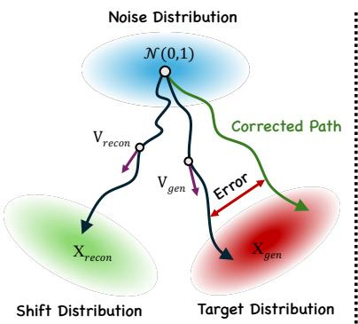

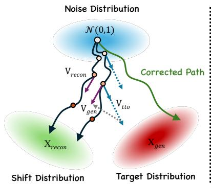

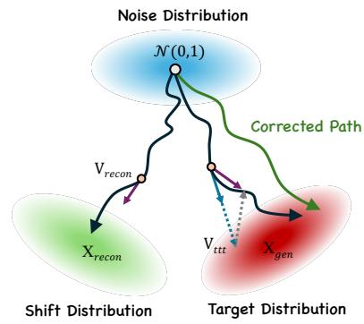

Figure 4. Illustration of the proposed SCC. (a) Direct transfer injects the reference action without correction, which may lead to errors in weak hand-object interactions. (b) Applying correction throughout the whole denoising process over-constrains early generation, making it difficult to decouple transferable action from source observation. (c) Our SCC performs sparse correspondence calibration only in the mid-to-late denoising stages, where the action layout has been established and local interaction details can be refined, improving temporal consistency and hand-object realism.  
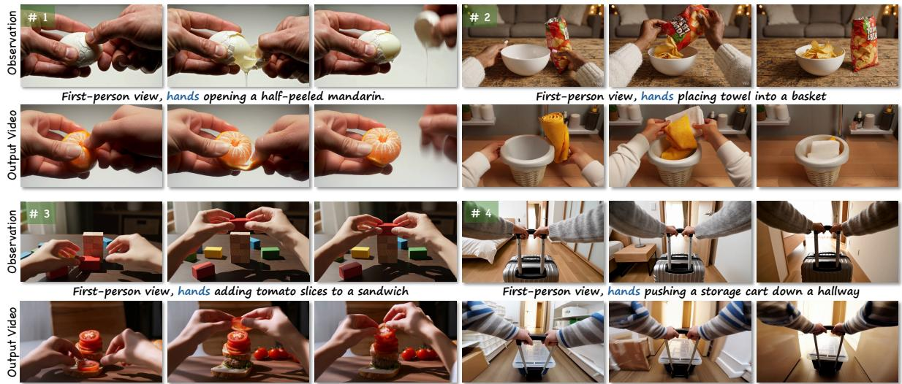  
Figure 5. Gallery of proposed method. EgoACT can transfer a wide range of egocentric manipulation videos, covering diverse interaction categories, object types, and motion patterns. The generated videos preserve plausible hand-object structure, contact dynamics, and temporal coherence while adapting the reference action to new visual contexts.

EgoActionBench. We establish EgoActionBench to evaluate egocentric action transfer in action-centric world simulation. EgoActionBench is built from online egocentric manipulation videos, public manipulation datasets [12, 13, 20], and generated videos from powerful video diffusion models [18, 29, 65]. It contains 350 high-quality observation videos and 1,400 evaluation prompts, covering 287 indoor and 63 outdoor scenes, with 164 single-hand and 186 twohand interactions. The actions include grasping, opening, pouring, placing, tool use, and handover across diverse objects and interaction patterns. To ensure the visual quality of benchmark, we filter out clips with excessive ego-camera motion, severe blur, heavy occlusion, objects leaving the frame, unclear hand-object contact, incomplete actions, or corrupted frames. For each retained video, GPT-5 generates an action-centric source caption, from which we derive 4 target prompts by changing the scene, object appearance, or background while preserving the original action semantics. All prompts are manually checked to avoid referencespecific appearance leakage. Each sample is annotated with scene type, hand type, action category, and object category.

## 4.2. Comparison with Baselines

Qualitative comparison. We compare EgoACT with representative egocentric manipulation and interaction generation methods, including VACE [27], Mask2IV [30], Cos-Hand [61], InterDyn [2], and DiTFlow [45]. As shown in Fig. 8, previous methods exhibit different failure patterns in egocentric manipulation transfer. Mask2IV and Cos-Hand better preserve hand shape but struggle with contact consistency, often generating implausible object responses such as objects remaining static despite clear grasping motion. InterDyn and DiTFlow introduce visible structural artifacts when hands and objects are tightly coupled, leading to floating contacts or broken spatial relations. In contrast, EgoACT preserves a more stable hand-object layout while maintaining temporally coherent contact and physically plausible object response throughout the interaction sequence. These qualitative results confirm that VSA suppresses early structural collapse by anchoring the handobject skeleton, while SCC improves local correspondence consistency in the later denoising stages to produce more realistic contact dynamics.

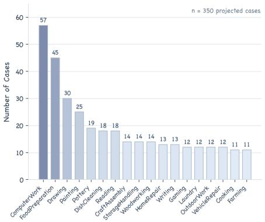

Table 1. Comparison with state-of-the-art methods. Red and Blue denote the best and second best results, respectively.
<table><tr><td rowspan="2">Method</td><td colspan="4">Quantitative Metrics</td><td colspan="4">Vbench Metrics</td></tr><tr><td>Text Sim.↑</td><td>Motion Fid.↑</td><td>Temp. Cons.↑</td><td>App. Cons.↑</td><td>Sub. Cons.↑</td><td>Back. Cons.↑</td><td>Aes. Qual.↑</td><td>Motion Smooth.↑</td></tr><tr><td>InterDyn [2]</td><td>0.2645</td><td>0.2434</td><td>0.9673</td><td>0.9265</td><td>0.9105</td><td>0.9069</td><td>0.4273</td><td>0.9865</td></tr><tr><td>Mask2IV [30]</td><td>0.2604</td><td>0.1910</td><td>0.9749</td><td>0.8565</td><td>0.8929</td><td>0.9495</td><td>0.4673</td><td>0.9820</td></tr><tr><td>CosHand [61]</td><td>0.2602</td><td>0.2227</td><td>0.9277</td><td>0.9133</td><td>0.8381</td><td>0.9201</td><td>0.4226</td><td>0.8784</td></tr><tr><td>DiTFlow [45]</td><td>0.2579</td><td>0.2167</td><td>0.9750</td><td>0.8839</td><td>0.8856</td><td>0.9325</td><td>0.5065</td><td>0.9868</td></tr><tr><td>VACE [27]</td><td>0.2624</td><td>0.2389</td><td>0.9571</td><td>0.9149</td><td>0.9439</td><td>0.9507</td><td>0.4647</td><td>0.9881</td></tr><tr><td>Ours</td><td>0.2746</td><td>0.2750</td><td>0.9866</td><td>0.9617</td><td>0.9732</td><td>0.9719</td><td>0.5633</td><td>0.9898</td></tr></table>

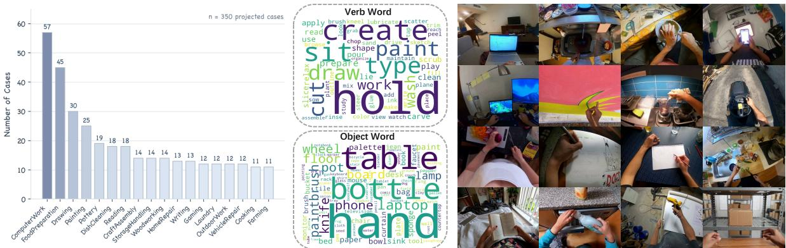  
Figure 6. The overview of EgoActionBench. EgoActionBench contains 350 reference manipulation videos and 1,400 target prompts, covering indoor/outdoor scenes, single-/two-hand interactions, and diverse manipulation categories. The benchmark evaluates whethe generated videos preserve the reference action semantics while adapting to new visual contexts.

Quantitative comparison. We quantitatively compare EgoACT with VACE [27], Mask2IV [30], CosHand [61], InterDyn [2], and DiTFlow [45] on EgoActionBench. For fair comparison, all methods are evaluated on the same set of reference manipulation videos and target prompts. Following prior works, we adopt four task-level metrics: (a) Text Similarity, the average CLIP similarity between the target prompt and generated frames; (b) Motion Fidelity, the tracklet similarity between reference and generated videos; (c) Temporal Consistency, the average feature similarity between consecutive frames; and (d) Appearance Consistency, measuring how well the generated video preserves the target visual appearance.

User Study. To account for the limitations of automatic metrics in capturing real-world preferences, we conduct a user study with 20 volunteers on 50 randomly selected test cases. The volunteers categorize each result into one of four levels: excellent, good, pass, or fail, based on appearance consistency, text alignment, temporal consistency, and motion fidelity. In Fig. 7, B1–B5 correspond to VACE, Mask2IV, CosHand, InterDyn, and DiTFlow, respectively. Our method outperforms others in both automated metrics and human subjective preferences.

VBench Metrics. We further adopt four VBench metrics for a broader assessment of video quality. Subject Consistency evaluates whether the main subject identity is preserved across frames. Background Consistency measures the coherence of static scene regions. Aesthetic Quality scores the visual appeal of generated videos, and Motion Smoothness evaluates inter-frame motion continuity. As shown in Table 1, EgoACT achieves strong performance across all metrics, which further validates the effectiveness of our method in producing high-quality, coherent, and semantically aligned egocentric manipulation videos.

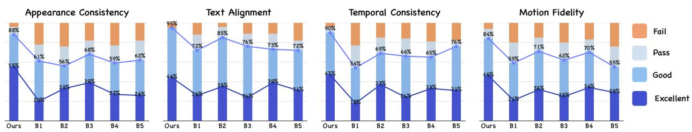

Figure 7. User Study. B1–B5 denote VACE, Mask2IV, CosHand, InterDyn, and DiTFlow, respectively. Our method is consistently preferred by human evaluators, achieving the highest excellent/good ratio across all evaluated aspects.  
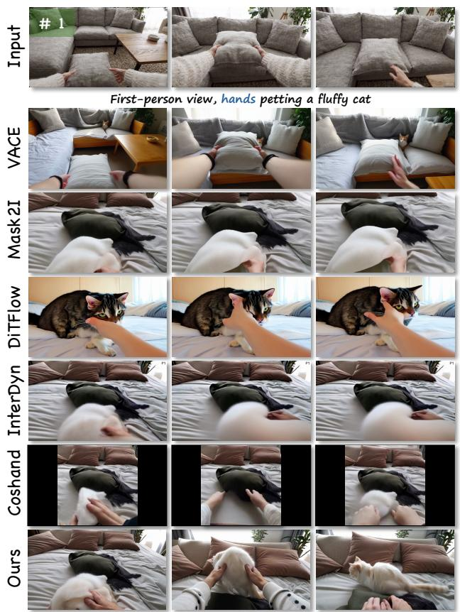  
Figure 8. Qualitative comparison. Compare with previous methods, our method preserves stable hand-object layout and object response.

## 4.3. Ablation Study

We ablate the two core components of EgoACT under the same experimental setup as the main comparison to validate their individual contributions.

Effectiveness of VSA. As shown in Table 2 and Fig. 9, removing VSA leads to notable degradation in hand generation quality. Without velocity-guided anchoring in early denoising, the generation trajectory lacks structural constraints from the reference branch, causing frequent hand distortion, broken fingers, and implausible contact geometry. With VSA enabled, the reference velocity field steers the latent toward a structurally consistent manifold, preventing structural collapse before the interaction skeleton is established.

Table 2. Quantitative ablation. Red and blue denote the best and second-best results, respectively.
<table><tr><td>Method</td><td>Text Sim.↑</td><td>Motion Fid.↑</td><td>Temp. Cons.↑</td><td>App. Cons.↑</td></tr><tr><td>W/o VSA</td><td>0.2689</td><td>0.2442</td><td>0.9683</td><td>0.9312</td></tr><tr><td>W/o SCC</td><td>0.2641</td><td>0.2398</td><td>0.9714</td><td>0.9487</td></tr><tr><td>Ours</td><td>0.2746</td><td>0.2750</td><td>0.9866</td><td>0.9617</td></tr></table>

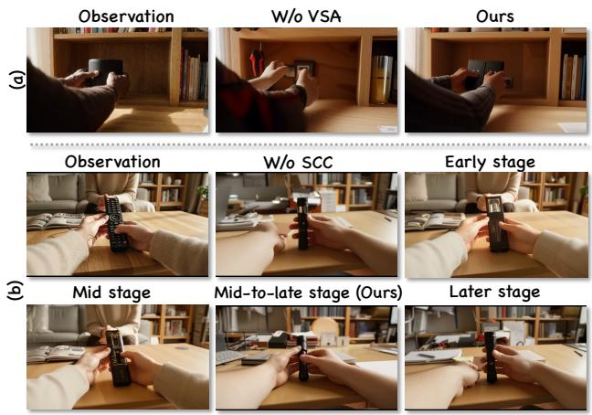  
Figure 9. Visual ablation. VSA suppresses structural collapse, while SCC improves local correspondence.

Effectiveness of SCC. Disabling SCC preserves coarse hand motion but degrades fine-grained interaction quality. Without correspondence calibration, local hand-object correspondences drift across frames, resulting in contact jitter and delayed object response (Table 2, Fig. 9). We apply SCC in the mid-to-late denoising stages (steps 35– 45): early-stage correction over-constrains the latent and disrupts action-appearance decoupling, while late-stage intervention has limited effect as fine details have solidified. This window allows SCC to refine correspondences after the global layout is stabilized by VSA, yielding more plau-

sible interactions.

## 5. Conclusion

We present EgoACT, a test-time action transfer framework for egocentric world simulation that decouples transferable action semantics from source visual appearance without additional training. EgoACT addresses two critical failure modes in egocentric manipulation transfer: hand-object structural collapse in early denoising and physically unrealistic interaction in later stages. Velocity-guided Structure Anchoring (VSA) stabilizes the global hand-object layout by aligning the generation trajectory with referenceconsistent velocity fields during early denoising, while Sparse Correspondence Calibration (SCC) refines local correspondences around interaction regions in the mid-to-late stages to improve contact consistency and object response plausibility. We also introduce EgoActionBench, a benchmark with 350 egocentric manipulation videos and 1,400 evaluation prompts spanning diverse scenes, hand configurations, and interaction categories. Extensive experiments demonstrate that EgoACT outperforms existing methods in both quantitative metrics and human evaluation, producing more coherent action transfer with plausible hand-object interactions.

## References

[1] Rameen Abdal, Or Patashnik, Ivan Skorokhodov, Willi Menapace, Aliaksandr Siarohin, Sergey Tulyakov, Daniel Cohen-Or, and Kfir Aberman. Dynamic concepts personalization from single videos. In Proceedings of the Special Interest Group on Computer Graphics and Interactive Techniques Conference Conference Papers, pages 1–9, 2025. 3

[2] Rick Akkerman, Haiwen Feng, Michael J Black, Dimitrios Tzionas, and Victoria Fernandez Abrevaya. Interdyn: Con-´ trollable interactive dynamics with video diffusion models. In Proceedings of the IEEE/CVF Conference on Computer Vision and Pattern Recognition, pages 12467–12479, 2025. 3, 6, 7

[3] Andreas Blattmann, Robin Rombach, Huan Ling, Tim Dockhorn, Seung Wook Kim, Sanja Fidler, and Karsten Kreis. Align your latents: High-resolution video synthesis with latent diffusion models. In Proceedings ofthe IEEE/CVF conference on computer vision and pattern recognition, pages 22563–22575, 2023. 3

[4] Tim Brooks, Bill Peebles, Connor Holmes, Will DePue, Yufei Guo, Leo Jing, David Schnurr, Joe Taylor, Troy Luhman, Eric Luhman, et al. Video generation models as world simulators. OpenAI Blog, 1(8):1, 2024. 3

[5] Jake Bruce, Michael D Dennis, Ashley Edwards, Jack Parker-Holder, Yuge Shi, Edward Hughes, Matthew Lai, Aditi Mavalankar, Richie Steigerwald, Chris Apps, et al. Genie: Generative interactive environments. In Forty-first International Conference on Machine Learning, 2024. 3

[6] Chubin Chen, Sujie Hu, Jiashu Zhu, Meiqi Wu, Jintao Chen, Yanxun Li, Nisha Huang, Chengyu Fang, Jiahong Wu, Xi-

angxiang Chu, et al. Taming preference mode collapse via directional decoupling alignment in diffusion reinforcement learning. In Proceedings of the IEEE/CVF Conference on Computer Vision and Pattern Recognition, pages 12775– 12786, 2026. 13

[7] Luca Eyring, Shyamgopal Karthik, Alexey Dosovitskiy, Nataniel Ruiz, and Zeynep Akata. Noise hypernetworks: Amortizing test-time compute in diffusion models. arXiv preprint arXiv:2508.09968, 2025. 13

[8] Kunyu Feng, Yue Ma, Bingyuan Wang, Chenyang Qi, Haozhe Chen, Qifeng Chen, and Zeyu Wang. Dit4edit: Diffusion transformer for image editing. In Proceedings of the AAAI Conference on Artificial Intelligence, pages 2969– 2977, 2025. 2

[9] Yossi Gandelsman, Yu Sun, Xinlei Chen, and Alexei Efros. Test-time training with masked autoencoders. Advances in Neural Information Processing Systems, 35:29374–29385, 2022. 13

[10] Heyuan Gao, Bangxun Tang, Yiren Song, Guian Fang, Zijian He, Jie Yang, and Mike Zheng Shou. Pai-studio: Cinematic video background replacement with camera-aware motion. arXiv preprint arXiv:2606.01399, 2026. 13

[11] Liuhao Ge, Yujun Cai, Junwu Weng, and Junsong Yuan. Hand pointnet: 3d hand pose estimation using point sets. In Proceedings ofthe IEEE conference on computer vision and pattern recognition, pages 8417–8426, 2018. 2, 3

[12] GenRobot. Gen-EgoData. Hugging Face Datasets, 2025. https://huggingface.co/datasets/genrobot 2025/Gen-EgoData. 6

[13] GenRobot. 10kh-realomni-opendata. https://huggin gface.co/datasets/genrobot2025/10Kh-Real Omin-OpenData, 2025. Accessed: 2026-04-28. 6

[14] Michal Geyer, Omer Bar-Tal, Shai Bagon, and Tali Dekel. Tokenflow: Consistent diffusion features for consistent video editing. arXiv preprint arXiv:2307.10373, 2023. 3

[15] Yuwei Guo, Ceyuan Yang, Anyi Rao, Zhengyang Liang, Yaohui Wang, Yu Qiao, Maneesh Agrawala, Dahua Lin, and Bo Dai. Animatediff: Animate your personalized textto-image diffusion models without specific tuning. arXiv preprint arXiv:2307.04725, 2023. 2

[16] Jinkun Hao, Mingda Jia, Ruiyan Wang, Xihui Liu, Ran Yi, Lizhuang Ma, Jiangmiao Pang, and Xudong Xu. Egosim: Egocentric world simulator for embodied interaction generation. arXiv preprint arXiv:2604.01001, 2026. 3

[17] Haoran He, Jiajun Liang, Xintao Wang, Pengfei Wan, Di Zhang, Kun Gai, and Ling Pan. Scaling image and video generation via test-time evolutionary search. arXiv preprint arXiv:2505.17618, 2025. 13

[18] Wenyi Hong, Ming Ding, Wendi Zheng, Xinghan Liu, and Jie Tang. Cogvideo: Large-scale pretraining for text-to-video generation via transformers. arXiv preprint arXiv:2205.15868, 2022. 6

[19] Yining Hong, Beide Liu, Maxine Wu, Yuanhao Zhai, Kai-Wei Chang, Linjie Li, Kevin Lin, Chung-Ching Lin, Jian feng Wang, Zhengyuan Yang, et al. Slowfast-vgen: Slowfast learning for action-driven long video generation. arXiv preprint arXiv:2410.23277, 2024. 13

[20] Ryan Hoque, Peide Huang, David J Yoon, Mouli Sivapurapu, and Jian Zhang. Egodex: Learning dexterous manipulation from large-scale egocentric video. arXiv preprint arXiv:2505.11709, 2025. 6

[21] Anthony Hu, Lloyd Russell, Hudson Yeo, Zak Murez, George Fedoseev, Alex Kendall, Jamie Shotton, and Gianluca Corrado. Gaia-1: A generative world model for autonomous driving. arXiv preprint arXiv:2309.17080, 2023. 3

[22] Sujie Hu, Chubin Chen, Jiashu Zhu, Jiahong Wu, Xiangxiang Chu, and Xiu Li. Embedding-perturbed exploration preference optimization for flow models. arXiv preprint arXiv:2605.15803, 2026. 13

[23] Teng Hu, Jiangning Zhang, Ran Yi, Yating Wang, Hongrui Huang, Jieyu Weng, Yabiao Wang, and Lizhuang Ma. Motionmaster: Training-free camera motion transfer for video generation. arXiv preprint arXiv:2404.15789, 2024. 3

[24] Wenbo Hu, Xiangjun Gao, Xiaoyu Li, Sijie Zhao, Xiaodong Cun, Yong Zhang, Long Quan, and Ying Shan. Depthcrafter: Generating consistent long depth sequences for open-world videos. In Proceedings of the IEEE/CVF Conference on Computer Vision and Pattern Recognition, pages 2005– 2015, 2025. 2, 3

[25] Jiahui Huang, Qunjie Zhou, Hesam Rabeti, Aleksandr Korovko, Huan Ling, Xuanchi Ren, Tianchang Shen, Jun Gao, Dmitry Slepichev, Chen-Hsuan Lin, et al. Vipe: Video pose engine for 3d geometric perception. arXiv preprint arXiv:2508.10934, 2025. 16

[26] Hyeonho Jeong, Jinho Chang, Geon Yeong Park, and Jong Chul Ye. Dreammotion: Space-time self-similar score distillation for zero-shot video editing. In European Conference on Computer Vision, pages 358–376. Springer, 2024. 3

[27] Zeyinzi Jiang, Zhen Han, Chaojie Mao, Jingfeng Zhang, Yulin Pan, and Yu Liu. Vace: All-in-one video creation and editing. In Proceedings ofthe IEEE/CVF International Conference on Computer Vision, pages 17191–17202, 2025. 6, 7

[28] Sunwoo Kim, Minkyu Kim, and Dongmin Park. Testtime alignment of diffusion models without reward overoptimization. arXiv preprint arXiv:2501.05803, 2025. 5, 13

[29] Weijie Kong, Qi Tian, Zijian Zhang, Rox Min, Zuozhuo Dai, Jin Zhou, Jiangfeng Xiong, Xin Li, Bo Wu, Jianwei Zhang, et al. Hunyuanvideo: A systematic framework for large video generative models. arXiv preprint arXiv:2412.03603, 2024. 6

[30] Gen Li, Bo Zhao, Jianfei Yang, and Laura Sevilla-Lara. Mask2iv: Interaction-centric video generation via mask trajectories. In Proceedings of the AAAI Conference on Artificial Intelligence, pages 6091–6099, 2026. 3, 6, 7

[31] Hongjie Li, Hong-Xing Yu, Jiaman Li, and Jiajun Wu. Zerohsi: Zero-shot 4d human-scene interaction by video generation. arXiv preprint arXiv:2412.18600, 2024. 3

[32] Yafu Li, Xuyang Hu, Xiaoye Qu, Linjie Li, and Yu Cheng. Test-time preference optimization: On-the-fly alignment via iterative textual feedback. arXiv preprint arXiv:2501.12895, 2025. 5, 13

[33] Zekun Li, Rui Zhou, Rahul Sajnani, Xiaoyan Cong, Daniel Ritchie, and Srinath Sridhar. Genhsi: Controllable generation of human-scene interaction videos. In Proceedings of the IEEE/CVF Winter Conference on Applications of Computer Vision, pages 138–149, 2026. 3

[34] Long Lian, Baifeng Shi, Adam Yala, Trevor Darrell, and Boyi Li. Llm-grounded video diffusion models. arXiv preprint arXiv:2309.17444, 2023. 13

[35] Jian Liang, Dapeng Hu, and Jiashi Feng. Do we really need to access the source data? source hypothesis transfer for unsupervised domain adaptation. In International conference on machine learning, pages 6028–6039. PMLR, 2020. 13

[36] Jian Liang, Ran He, and Tieniu Tan. A comprehensive survey on test-time adaptation under distribution shifts. International Journal of Computer Vision, 133(1):31–64, 2025. 13

[37] Pengyang Ling, Jiazi Bu, Pan Zhang, Xiaoyi Dong, Yuhang Zang, Tong Wu, Huaian Chen, Jiaqi Wang, and Yi Jin. Motionclone: Training-free motion cloning for controllable video generation. arXiv preprint arXiv:2406.05338, 2024. 2, 3

[38] Fangfu Liu, Hanyang Wang, Yimo Cai, Kaiyan Zhang, Xiaohang Zhan, and Yueqi Duan. Video-t1: Test-time scaling for video generation. In Proceedings of the IEEE/CVF interna tional conference on computer vision, pages 18671–18681, 2025. 13

[39] Hongyu Liu, Chun Wang, Feng Gao, Xuanhua He, Yue Ma, Ziyu Wan, Yong Zhang, Xiaoming Wei, and Qifeng Chen. Opsd-v: On-policy self-distillation for post-training few-step autoregressive video generators. arXiv preprint arXiv:2607.08766, 2026. 13

[40] Kun Liu, Qi Liu, Xinchen Liu, Jie Li, Yongdong Zhang, Jiebo Luo, Xiaodong He, and Wu Liu. Hoigen-1m: A largescale dataset for human-object interaction video generation. arXiv preprint arXiv:2503.23715, 2025. 3

[41] Yue Ma, Yingqing He, Xiaodong Cun, Xintao Wang, Siran Chen, Xiu Li, and Qifeng Chen. Follow your pose: Poseguided text-to-video generation using pose-free videos. In Proceedings of the AAAI Conference on Artificial Intelligence, pages 4117–4125, 2024. 13

[42] Yue Ma, Yulong Liu, Qiyuan Zhu, Ayden Yang, Kunyu Feng, Xinhua Zhang, Zhifeng Li, Sirui Han, Chenyang Qi, and Qifeng Chen. Follow-your-motion: Video motion transfer via efficient spatial-temporal decoupled finetuning. arXiv preprint arXiv:2506.05207, 2025. 13

[43] Yue Ma, Zhikai Wang, Tianhao Ren, Mingzhe Zheng, Hongyu Liu, Jiayi Guo, Mark Fong, Yuxuan Xue, Zixiang Zhao, Konrad Schindler, et al. Fastvmt: Eliminating redundancy in video motion transfer. arXiv preprint arXiv:2602.05551, 2026. 2, 3, 13

[44] William Peebles and Saining Xie. Scalable diffusion models with transformers. In Proceedings of the IEEE/CVF international conference on computer vision, pages 4195–4205, 2023. 3

[45] Alexander Pondaven, Aliaksandr Siarohin, Sergey Tulyakov, Philip Torr, and Fabio Pizzati. Video motion transfer with diffusion transformers. In Proceedings of the Computer

Vision and Pattern Recognition Conference, pages 22911– 22921, 2025. 2, 3, 4, 6, 7

[46] Chenyang Qi, Xiaodong Cun, Yong Zhang, Chenyang Lei, Xintao Wang, Ying Shan, and Qifeng Chen. Fatezero: Fusing attentions for zero-shot text-based video editing. In Proceedings of the IEEE/CVF International Conference on Computer Vision, pages 15932–15942, 2023. 3

[47] Xiangfei Qiu, Jilin Hu, Lekui Zhou, Xingjian Wu, Junyang Du, Buang Zhang, Chenjuan Guo, Aoying Zhou, Christian S. Jensen, Zhenli Sheng, and Bin Yang. TFB: Towards comprehensive and fair benchmarking of time series forecasting methods. In Proc. VLDB Endow., pages 2363–2377, 2024.

[48] Xiangfei Qiu, Xingjian Wu, Hanyin Cheng, Xvyuan Liu, Chenjuan Guo, Jilin Hu, and Bin Yang. Dbloss: Decomposition-based loss function for time series forecasting. In NeurIPS, 2025.

[49] Xiangfei Qiu, Xingjian Wu, Yan Lin, Chenjuan Guo, Jilin Hu, and Bin Yang. DUET: Dual clustering enhanced multivariate time series forecasting. In SIGKDD, pages 1185– 1196, 2025.

[50] Xiangfei Qiu, Yuhan Zhu, Zhengyu Li, Xingjian Wu, Bin Yang, and Jilin Hu. Dag: A dual correlation network for time series forecasting with exogenous variables. In ICML, 2026. 3

[51] Vignav Ramesh and Morteza Mardani. Test-time scaling of diffusion models via noise trajectory search. arXiv preprint arXiv:2506.03164, 2025. 13

[52] Yixuan Ren, Yang Zhou, Jimei Yang, Jing Shi, Difan Liu, Feng Liu, Mingi Kwon, and Abhinav Shrivastava. Customize-a-video: One-shot motion customization of textto-video diffusion models. In European Conference on Computer Vision, pages 332–349. Springer, 2024. 3

[53] Steffen Schneider, Evgenia Rusak, Luisa Eck, Oliver Bringmann, Wieland Brendel, and Matthias Bethge. Improving robustness against common corruptions by covariate shift adaptation. Advances in neural information processing systems, 33:11539–11551, 2020. 13

[54] Qingyu Shi, Jianzong Wu, Jinbin Bai, Jiangning Zhang, Lu Qi, Yunhai Tong, and Xiangtai Li. Decouple and track: Benchmarking and improving video diffusion transformers for motion transfer. In Proceedings of the IEEE/CVF International Conference on Computer Vision, pages 10995– 11005, 2025. 3

[55] Manli Shu, Weili Nie, De-An Huang, Zhiding Yu, Tom Goldstein, Anima Anandkumar, and Chaowei Xiao. Testtime prompt tuning for zero-shot generalization in visionlanguage models. Advances in Neural Information Processing Systems, 35:14274–14289, 2022. 13

[56] Yang Shu, Zhangjie Cao, Chenyu Wang, Jianmin Wang, and Mingsheng Long. Open domain generalization with domainaugmented meta-learning. In Proceedings of the IEEE/CVF conference on computer vision and pattern recognition, pages 9624–9633, 2021. 13

[57] Raghav Singhal, Zachary Horvitz, Ryan Teehan, Mengye Ren, Zhou Yu, Kathleen McKeown, and Rajesh Ranganath. A general framework for inference-time scaling and steering of diffusion models. arXiv preprint arXiv:2501.06848, 2025. 13

[58] Yiren Song, Shijie Huang, Chen Yao, Hai Ci, Xiaojun Ye, Jiaming Liu, Yuxuan Zhang, and Mike Zheng Shou. Processpainter: Learning to draw from sequence data. In SIG-GRAPH Asia 2024 Conference Papers, pages 1–10, 2024. 13

[59] Yiren Song, Cheng Liu, Yuxin Jiang, and Mike Zheng Shou. Streamingeffect: Real-time human-centric video effect gen eration. arXiv preprint arXiv:2605.17019, 2026. 13

[60] Yiren Song, Wangzi Yao, Haofan Wang, and Mike Zheng Shou. Vista: Triplet-supervised video style transfer with diffusion transformers. arXiv preprint arXiv:2605.17312, 2026. 13

[61] Sruthi Sudhakar, Ruoshi Liu, Basile Van Hoorick, Carl Vondrick, and Richard Zemel. Controlling the world by sleight of hand. In European Conference on Computer Vision, pages 414–430. Springer, 2024. 6, 7

[62] Yu Sun, Xiaolong Wang, Zhuang Liu, John Miller, Alexei Efros, and Moritz Hardt. Test-time training with selfsupervision for generalization under distribution shifts. In International conference on machine learning, pages 9229– 9248. PMLR, 2020. 13

[63] Chengzhuo Tong, Ziyu Guo, Renrui Zhang, Wenyu Shan, Xinyu Wei, Zhenghao Xing, Hongsheng Li, and Pheng-Ann Heng. Delving into rl for image generation with cot: A study on dpo vs. grpo. arXiv preprint arXiv:2505.17017, 2025. 13

[64] Bram Wallace, Meihua Dang, Rafael Rafailov, Linqi Zhou, Aaron Lou, Senthil Purushwalkam, Stefano Ermon, Caiming Xiong, Shafiq Joty, and Nikhil Naik. Diffusion model alignment using direct preference optimization. In Proceedings of the IEEE/CVF Conference on Computer Vision and Pattern Recognition, pages 8228–8238, 2024. 13

[65] Team Wan, Ang Wang, Baole Ai, Bin Wen, Chaojie Mao, Chen-Wei Xie, Di Chen, Feiwu Yu, Haiming Zhao, Jianxiao Yang, et al. Wan: Open and advanced large-scale video generative models. arXiv preprint arXiv:2503.20314, 2025. 5, 6, 13

[66] Jiangshan Wang, Yue Ma, Jiayi Guo, Yicheng Xiao, Gao Huang, and Xiu Li. Cove: Unleashing the diffusion feature correspondence for consistent video editing. Advances in Neural Information Processing Systems, 37:96541–96565, 2024. 13

[67] Jiangshan Wang, Junfu Pu, Zhongang Qi, Jiayi Guo, Yue Ma, Nisha Huang, Yuxin Chen, Xiu Li, and Ying Shan. Taming rectified flow for inversion and editing. arXiv preprint arXiv:2411.04746, 2024. 13

[68] Renhao Wang, Yu Sun, Arnuv Tandon, Yossi Gandelsman, Xinlei Chen, Alexei A Efros, and Xiaolong Wang. Test-time training on video streams. Journal ofMachine Learning Research, 26(9):1–29, 2025. 13

[69] Xinyu Wang, Chongbo Zhao, Fangneng Zhan, and Yue Ma. Liveedit: Towards real-time diffusion-based streaming video editing. arXiv preprint arXiv:2606.26740, 2026. 13

[70] Yuxi Wang, Wenqi Ouyang, Tianyi Wei, Yi Dong, Zhiq Shen, and Xingang Pan. Hand2world: Autoregressive ego centric interaction generation via free-space hand gestures. arXiv preprint arXiv:2602.09600, 2026. 3

[71] Zhouxia Wang, Ziyang Yuan, Xintao Wang, Yaowei Li, Tianshui Chen, Menghan Xia, Ping Luo, and Ying Shan.

Motionctrl: A unified and flexible motion controller for video generation. In ACM SIGGRAPH 2024 Conference Papers, pages 1–11, 2024. 2

[72] Jianzong Wu, Xiangtai Li, Yanhong Zeng, Jiangning Zhang, Qianyu Zhou, Yining Li, Kai Chen, and Yunhai Tong. Motionbooth: Motion-aware customized text-to-video generation. Advances in Neural Information Processing Systems, 37:34322–34348, 2024. 3

[73] Tsung-Han Wu, Long Lian, Joseph E Gonzalez, Boyi Li, and Trevor Darrell. Self-correcting llm-controlled diffusion models. In Proceedings of the IEEE/CVF Conference on Computer Vision and Pattern Recognition, pages 6327– 6336, 2024. 5, 13

[74] Yuxi Xiao, Qianqian Wang, Shangzhan Zhang, Nan Xue, Sida Peng, Yujun Shen, and Xiaowei Zhou. Spatialtracker: Tracking any 2d pixels in 3d space. In Proceedings of the IEEE/CVF Conference on Computer Vision and Pattern Recognition, pages 20406–20417, 2024. 2, 3

[75] Zeqi Xiao, Yifan Zhou, Shuai Yang, and Xingang Pan. Video diffusion models are training-free motion interpreter and controller. Advances in Neural Information Processing Systems, 37:76115–76138, 2024. 3

[76] Enze Xie, Junsong Chen, Yuyang Zhao, Jincheng Yu, Ligeng Zhu, Chengyue Wu, Yujun Lin, Zhekai Zhang, Muyang Li, Junyu Chen, et al. Sana 1.5: Efficient scaling of training-time and inference-time compute in linear diffusion transformer. arXiv preprint arXiv:2501.18427, 2025. 13

[77] Jinbo Xing, Menghan Xia, Yuxin Liu, Yuechen Zhang, Yong Zhang, Yingqing He, Hanyuan Liu, Haoxin Chen, Xiaodong Cun, Xintao Wang, et al. Make-your-video: Customized video generation using textual and structural guidance. IEEE transactions on visualization and computer graphics, 31(2): 1526–1541, 2024. 2

[78] Jinbo Xing, Menghan Xia, Yong Zhang, Haoxin Chen, Wangbo Yu, Hanyuan Liu, Gongye Liu, Xintao Wang, Ying Shan, and Tien-Tsin Wong. Dynamicrafter: Animating open-domain images with video diffusion priors. In European Conference on Computer Vision, pages 399–417. Springer, 2024. 2

[79] Xuancheng Xu, Ming Tao, and Bing-Kun Bao. Clgc: Continuous layout guidance for consistent text-to-video editing. In 2025 IEEE International Conference on Multimedia and Expo (ICME), pages 1–6. IEEE, 2025. 13

[80] Xuancheng Xu, Gengyun Jia, and Bing-Kun Bao. Discolora: Disentangled composition of content, style, and motion for multi-concept video customization. arXiv preprint arXiv:2606.26668, 2026. 13

[81] Hidir Yesiltepe, Tuna Han Salih Meral, Connor Dunlop, and Pinar Yanardag. Motionshop: Zero-shot motion transfer in video diffusion models with mixture of score guidance. arXiv preprint arXiv:2412.05355, 2024. 3

[82] Zhengyang Yu, Akio Hayakawa, Masato Ishii, Qingtao Yu, Takashi Shibuya, Jing Zhang, and Yuki Mitsufuji. Autorefiner: Improving autoregressive video diffusion models via reflective refinement over the stochastic sampling path. arXiv preprint arXiv:2512.11203, 2025. 13

[83] Marvin Zhang, Sergey Levine, and Chelsea Finn. Memo: Test time robustness via adaptation and augmentation. Ad-

vances in neural information processing systems, 35:38629– 38642, 2022.

[84] Ruicheng Zhang, Kaixi Cong, Jun Zhou, Zhizhou Zhong, Zunnan Xu, Shuiyang Mao, Wei Liu, and Xiu Li. Kvpo: Ode-native grpo for autoregressive video alignment via kv semantic exploration. arXiv preprint arXiv:2605.14278, 2026.

[85] Ruicheng Zhang, Jun Zhou, Zunnan Xu, Zihao Liu, Jiehu Huang, Mingyang Zhang, Yu Sun, and Xiu Li. Zo3t: Zeroshot 3d-aware trajectory-guided image-to-video generation via test-time training. In Proceedings of the AAAI Confer ence on Artificial Intelligence, pages 12708–12716, 2026. 13

[86] Wanyue Zhang, Lin Geng Foo, Thabo Beeler, Rishabh Dabral, and Christian Theobalt. Vhoi: Controllable video generation of human-object interactions from sparse trajectories via motion densification. arXiv preprint arXiv:2512.09646, 2025. 3

[87] Yabo Zhang, Xinpeng Zhou, Yihan Zeng, Hang Xu, Hui Li, and Wangmeng Zuo. Framepainter: Endowing interactive image editing with video diffusion priors. In Proceedings ofthe IEEE/CVF International Conference on Computer Vi sion, pages 18121–18131, 2025. 2

[88] Min Zhao, Rongzhen Wang, Fan Bao, Chongxuan Li, and Jun Zhu. Controlvideo: Adding conditional control for one shot text-to-video editing. arXiv preprint arXiv:2305.17098, 2(3), 2023. 2

[89] Rui Zhao, Yuchao Gu, Jay Zhangjie Wu, David Junhao Zhang, Jia-Wei Liu, Weijia Wu, Jussi Keppo, and Mike Zheng Shou. Motiondirector: Motion customization of text-to-video diffusion models. In European Conference on Computer Vision, pages 273–290. Springer, 2024. 3

[90] Le Zhuo, Liangbing Zhao, Sayak Paul, Yue Liao, Renru Zhang, Yi Xin, Peng Gao, Mohamed Elhoseiny, and Hongsheng Li. From reflection to perfection: Scaling inference time optimization for text-to-image diffusion models via reflection tuning. In Proceedings of the IEEE/CVF International Conference on Computer Vision, pages 15329–15339, 2025. 13

## A. Related Work

Test-Time Visual Generation. Video generation [39, 41, 42, 59, 66, 67, 69] has advanced rapidly, largely driven by recent progress in diffusion models. Test-time methods enhance pre-trained models during inference without retraining [36, 62, 68]. Existing approaches primarily follow two paradigms. First, test-time scaling improves quality through iterative candidate search [17, 38], preference optimization [63, 64], or VLM-guided reflection [76, 90]. However, this process requires prohibitive computational costs and shows marginal improvements for continuous diffusion models due to inherent architectural constraints [51, 57]. Second, test-time optimization refines outputs via auxiliary parameter updates [6, 7, 9, 10, 19, 22, 35, 53, 56, 58, 60, 79, 80, 82–85], prompt tuning [55], or layout-guided latent optimization [28, 32, 34, 73], but often relies on complex instance-specific training or global objectives. In contrast, our test-time refinements target the hand-object structure and local correspondences needed for egocentric action transfer.

## Video Diffusion Model.

## B. More Implementation Details

We use WAN-2.1 [65] as the base video generation model and keep all model parameters frozen during inference. For ablation study, all ablation variants are evaluated under the same setting as the main comparison, with only the specified component removed or modified. The latent video is initialized with Gaussian noise of shape $\textstyle 1 \times 1 6 \times ( { \frac { F - 1 } { 4 } } + 1 ) \times$ ${ \frac { H } { 8 } } \times { \frac { W } { 8 } }$ , where $F$ is internally rounded to 4k +1. We enable latent tiling in the VAE space with $\scriptstyle \pm \mathrm { i } 1 \in \mathscr { s } \mathrm { i } \mathrm { z e } = ( 3 0 , 5 2 )$ and $\mathtt { t i l e \_ s t r i d e = } ( 1 5 , 2 6 )$ , which produces a per-frame DiT token grid of $\begin{array} { r } { h = \frac { H } { 8 } \ : \mathrm { { b y } } \ : w = \frac { W } { 8 } } \end{array}$

AMF-based structural mask. As described in the main text (Sec. 3.2), AMF is used solely to construct the soft structural mask  for VSA, not as a separate optimization objective. For sliding-window AMF computation, we use a tile grid of 3 4 tokens, temporal span $s _ { f } = 5$ , local search window l = 21 with half-width 10, and temperature $\tau = 1 . 0$ . The AMF magnitude from the reference branch is computed over temporal offsets with linear weights decayed from 1.0 to 0.8 across offsets, normalized by the number of offsets and tokens, and then converted into the structural saliency mask via Eq. 1–2. The actual optimization objective is the mask-weighted velocity regression ${ \mathcal { L } } _ { \mathrm { V S A } }$ $( \mathrm { E q . } 3 )$ , and gradients are applied only to the latent variable. To reduce computational cost during the inner optimization loop, we recompute Q/K features and tile-level AMF every 3 steps and reuse the cached mask on intermediate steps.

Optimization. At each guided diffusion step t, we form the reference latent by adding step-consistent noise to the cached clean latent and run a null-text forward pass to extract query/key features from the 15th DiT block. Each guided step performs 10 latent-only AdamW updates with a linear learning-rate decay from 0.003 to 0.002. The VSA weight, SCC correspondence weight, and stay regularization weight are set to 15.0, 1.0, and 0.05, respectively.

Inference time. On an NVIDIA A100 GPU, the average inference time for a 81-frame video of resolution $8 3 2 \times 4 8 0$ is approximately 413 seconds, which includes the base diffusion process and the additional test-time optimization steps. The VSA module adds around 23 seconds, while the SCC module contributes an additional 72 seconds. The overall time is still within a practical range for test-time refinement, given the improved quality and consistency of the generated videos.

## C. More Details about Attention Motion Flow

Attention Motion Flow (AMF) [43] extracts implicit motion cues from the self-attention layers of a video diffusion transformer. The key observation is that cross-frame querykey affinity in DiT attention naturally encodes patch-level correspondences: if a token in one frame attends strongly to a token in a neighboring frame, their spatial offset provides an estimate of the local motion. Instead of using external trackers or optical-flow estimators, we compute AMF directly from the internal attention features of the frozen generation model. To instantiate this intuition, we compute token-level correspondences from local query-key affinities within self-attention.

Local Attention-based Correspondence. For a spatial token u in frame i, we search its correspondence in a nearby frame j within a local displacement window $\mathcal { N } ( u ) = \{ u +$ $\Delta \mid \Delta \in [ - r , r ] ^ { 2 } \}$ . Let $q _ { i } ( u )$ be the query feature at token u and $k _ { j } ( u + \Delta )$ be the key feature at the candidate location. We compute the local attention score as:

$$
s _ { i \to j } ( u , \Delta ) = \frac { \langle q _ { i } ( u ) , k _ { j } ( u + \Delta ) \rangle } { \sqrt { d } } , \quad \Delta \in [ - r , r ] ^ { 2 } ,\tag{8}
$$

where d is the feature dimension. The normalized local correspondence distribution is then

$$
p _ { i \to j } ( u , \Delta ) = \frac { \exp ( s _ { i \to j } ( u , \Delta ) ) } { \sum _ { \Delta ^ { \prime } \in [ - r , r ] ^ { 2 } } \exp ( s _ { i \to j } ( u , \Delta ^ { \prime } ) ) } .\tag{9}
$$

Following the soft motion extraction strategy in FastVMT, we use the expectation over local displacements to obtain a differentiable AMF vector:

$$
\mathcal { A } _ { i \to j } ( u ) = \sum _ { \Delta \in [ - r , r ] ^ { 2 } } p _ { i \to j } ( u , \Delta ) \Delta .\tag{10}
$$

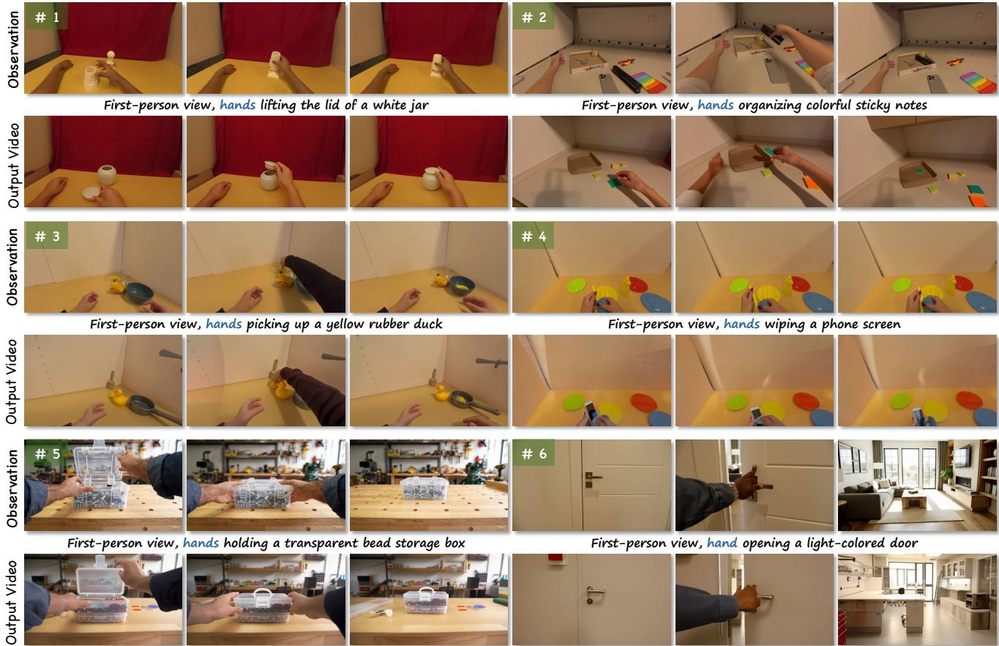  
Figure 10. More visual results.

This sliding-window design reflects the local continuity of video motion and avoids unreliable global matching between unrelated tokens.

AMF-induced Structural Mask. In our VSA module, AMF is not used as a hard motion supervision signal; instead, it serves as a cue for locating interaction-relevant structures. We compute AMF from the reference branch and convert its magnitude into a structural saliency score:

$$
\begin{array} { r } { \boldsymbol { S } ( \boldsymbol { u } ) = \| \boldsymbol { \mathcal { A } } _ { \mathrm { r e f } } ( \boldsymbol { u } ) \| _ { 2 } , } \end{array}\tag{11}
$$

where larger values usually indicate regions with stronger action dynamics, such as moving hands, manipulated objects, and hand-object contact areas. Intuitively, these regions carry most of the structural and physical constraints of egocentric manipulation, so they should receive stronger anchoring during optimization.

After normalizing the structural saliency score over with Eq. 2, we then apply a power reweighting to control the concentration of the mask:

$$
\mathcal { M } ( u ) = \hat { \mathcal { S } } ( u ) ^ { \gamma } ( 1 - m _ { \operatorname* { m i n } } ) + m _ { \operatorname* { m i n } } .\tag{12}
$$

where, $\gamma > 1$ sharpens the mask and emphasizes the most motion-salient regions, while $\gamma < 1$ produces a flatter weighting profile. The lower bound $m _ { \mathrm { m i n } }$ ensures that low-motion regions still contribute weakly to the velocity anchoring objective, which helps preserve global scene layout and prevents the optimization from overfitting only to highly dynamic tokens.

Therefore, the AMF-induced mask allocates optimization strength adaptively: dynamic interaction regions are emphasized, whereas static regions are softly regularized. This design allows VSA in Sec. 3.2 to focus on the actioncritical structure without imposing unnecessarily strong constraints on unrelated background content.

## D. More Details about User Study

To complement automatic metrics, we conduct a user study with 20 volunteers on 50 randomly selected cases from EgoActionBench. For each evaluated case, volunteers are shown the reference egocentric manipulation video, the target text prompt, and generated videos from all compared methods. The method names are hidden, and the generated videos are presented in randomized order to reduce ordering

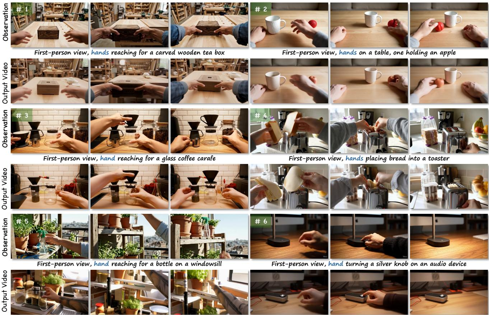  
Figure 11. More visual results.

bias.

Rating Dimensions. Annotators evaluate each generated result according to the following four criteria:

Appearance Consistency: whether the generated video preserves a coherent target appearance across frames without obvious identity drift, texture inconsistency, or visual artifacts.

Text Alignment: whether the generated video follows the target prompt, including the described scene, object appearance, and intended manipulation context.

Temporal Consistency: whether the generated video remains stable over time without obvious flickering, jittering, ghosting, or frame-to-frame structural instability.

Motion Fidelity: whether the generated video preserves the reference action pattern, including hand motion, contact timing, and object response, without severe drifting or motion collapse.

Scoring Scale. Each dimension is rated using a four-level ordinal scale: Excellent (fully satisfies the criterion with no obvious artifacts), Good (minor artifacts or deviations), Pass (noticeable but acceptable issues), and Fail (severe artifacts or failure to satisfy the criterion). The final statistics are obtained by aggregating ratings across all volunteers and evaluated cases.

## E. More Details about EgoActionBench

EgoActionBench focuses on whether the generated video preserves the interaction logic of the reference action, including contact transitions, object response, and coordinated hand-object dynamics. The main paper summarizes the data sources, category coverage, and basic filtering rules of EgoActionBench. The benchmark contains 350 reference videos, with 4 target prompts for each video, resulting in 1,400 evaluation prompts. It includes 287 indoor scenes and 63 outdoor scenes, with 164 single-hand and 186 twohand manipulation cases. In terms of data composition, approximately 60% of the reference videos are sourced from real-world egocentric recordings (online videos and public manipulation datasets), while the remaining 40% are generated by video diffusion models to cover rarer manipulation categories and ensure diversity. Here we provide additional details about camera-motion filtering, prompt construction, and manual quality control.

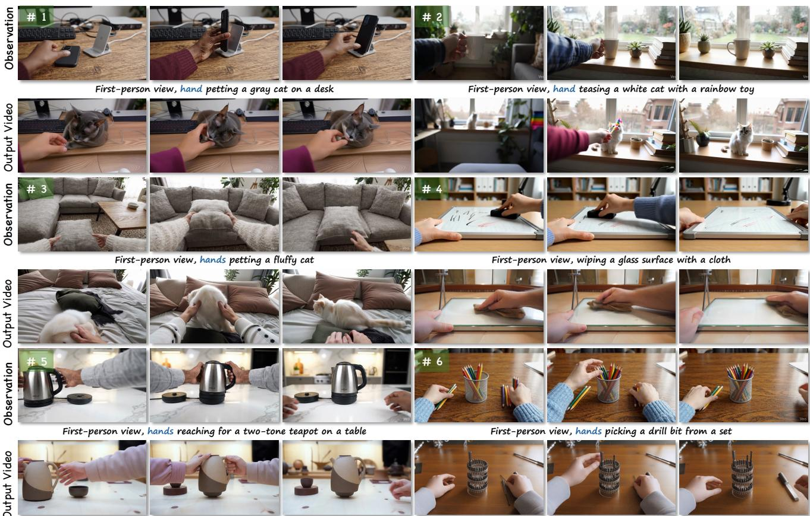  
Figure 12. More visual results.

Camera-motion filtering. Egocentric videos often contain strong head or body motion, which can make action transfer evaluation ambiguous: a method may appear to fail because the reference observation is dominated by camera shake rather than hand-object interaction. To reduce this issue, we estimate camera poses with ViPE [25] for candidate real videos and compute frame-to-frame camera translation and rotation changes. Clips with large pose jumps, unstable pose estimates, or camera motion that dominates the handobject region are removed before manual inspection. This filtering step keeps moderate egocentric viewpoint changes while excluding references where the manipulated object cannot be reliably tracked in the image plane.

Caption and prompt instructions. For each retained clip, we ask GPT-5 to produce an action-centric caption using the following instruction: Describe the egocentric manipulation action in one sentence. Focus on the actor’s hand motion, the manipulated object, the contact transition, and the object’s response. Do not describe camera motion, video quality, identity, or irrelevant background details. Based on this source caption, we further ask GPT-5 to generate target prompts with the instruction: Rewrite the scene, object appearance, or background while preserving the same manipulation verb, contact order, and object response. Avoid copying reference-specific colors, textures, or scene details unless they are essential to the action. This prompt design encourages evaluation cases that test action transfer rather than source appearance copying.

Manual quality control. After automatic captioning and prompt rewriting, we manually review each benchmark sample. We reject prompts that change the action semantics, introduce physically incompatible objects, leak referencespecific appearance details, or describe interactions that are not visible in the source clip. We also check whether the target prompt is feasible for the reference action; for example, actions involving pouring, opening, or handover require objects with compatible affordances. The remaining samples are annotated with difficulty tags according to contact complexity, object motion magnitude, and whether the action involves one or two hands. These tags are used only for analysis and are not provided to the generation methods.

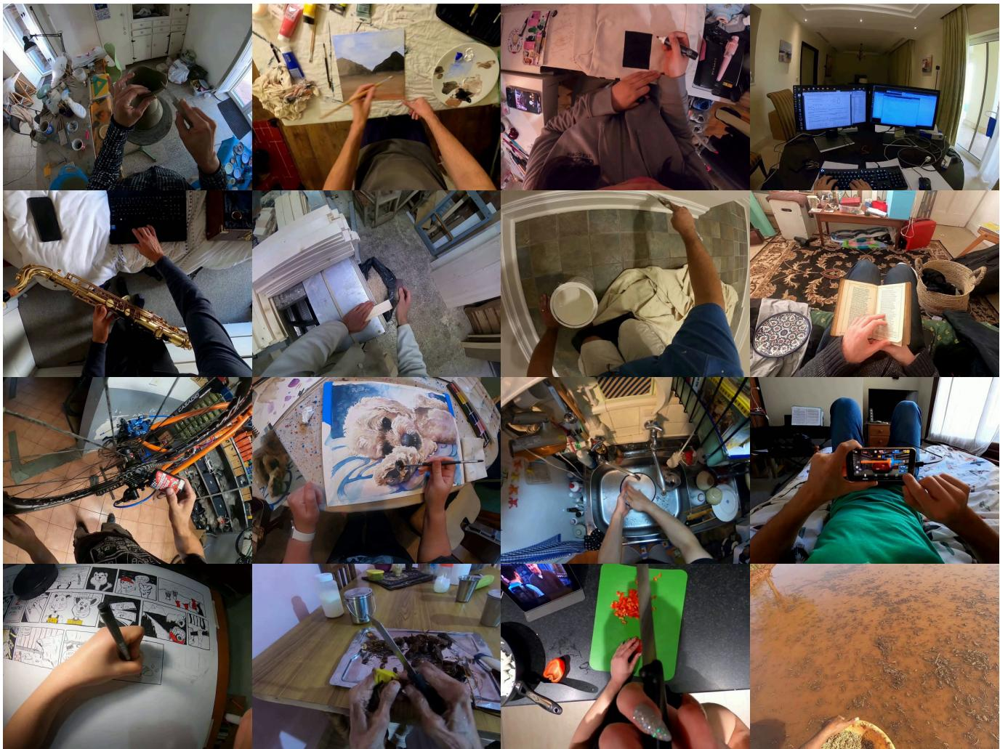  
Figure 13. More details about EgoActionBench. EgoActionBench covers diverse egocentric manipulation scenarios and is annotated b scene type, and object category.

## F. More Results

More Comparison with Baseline. We provide more visual comparisons with baselines in Fig. 16. Our method consistently produces more coherent action transfer and more plausible hand-object interactions than baselines, which often suffer from structural collapse, temporal inconsistency, or physically unrealistic interactions.

More Visual Results. Figures 10, 11, and 12 show more visual results of our method. The generated videos can be viewed in the demo video.

## G. Limitations and Future Work

Although EgoACT achieves strong results on a wide range of egocentric manipulation scenarios, it still struggles with actions involving very fast hand or object motion. As shown in Fig. 14, the generated videos may exhibit motion blur, temporal aliasing, or loss of hand-object correspondence in such cases. We attribute this limitation primarily to the base video diffusion model, which was not specifically trained to handle rapid egocentric dynamics and tends to produce temporally smoothed outputs when the inter-frame displacement is large. As video foundation models continue to advance in temporal resolution and motion modeling capacity, we expect this limitation to be naturally alleviated. In future work, we also plan to extend EgoACT to longer-horizon action sequences and multi-step task compositions, enabling more complex manipulation planning within the world simulation paradigm.

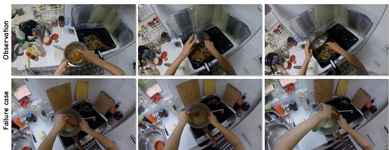  
Figure 14. Failure case. Our method may struggle with actions involving very fast hand or object motion, which can lead to motion blur, temporal aliasing, or loss of hand-object correspondence. This limitation is primarily due to the base video diffusion model, which was not specifically trained to handle rapid egocentric dynamics and tends to produce temporally smoothed outputs when the inter-frame displacement is large.

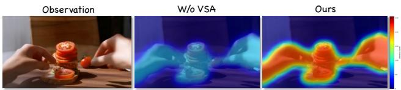  
in user-facing applications.  
Figure 15. Attention Visualization. We visualize the crossframe attention maps before and after enabling VSA during the early denoising stage. Without VSA, attention is dispersed across irrelevant regions, failing to capture coherent hand-object structure. With VSA enabled, the attention concentrates on interactionrelevant areas such as hand, object, and contact regions, indicating that the generation trajectory is better aligned with the reference structural layout. This confirms that VSA effectively anchors the hand-object skeleton through velocity-guided alignment, resulting in more structurally consistent attention patterns.

## H. Potential Social Impact

Our work studies egocentric action transfer for controllable video world simulation. The potential positive impacts include more efficient simulation for embodied AI, robotics, and human-object interaction research, where generating diverse interaction videos can reduce the cost of collecting physical demonstrations and enable safer testing before real-world deployment. The method may also support content creation and instructional video synthesis when used with appropriate consent and attribution. At the same time, the ability to generate realistic egocentric manipulation videos may be misused to create misleading visual content or to synthesize actions that did not actually occur. Since our method builds on pre-trained video generation models, it may also inherit biases, failure modes, or unsafe generation behaviors from the underlying model and source data. To mitigate these risks, released examples and benchmark assets should be filtered for sensitive or harmful content, and generated videos should be clearly identified as synthetic when used outside research settings. We also recommend applying existing provenance, watermarking, or content moderation tools when deploying such systems

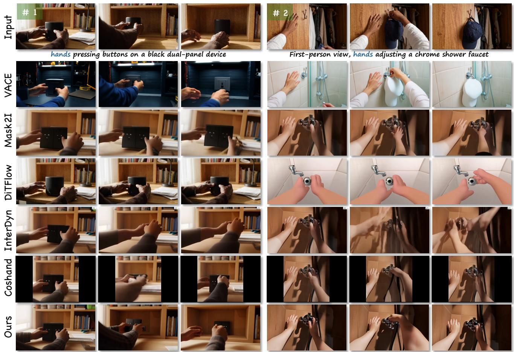  
Figure 16. More Comparison with Baseline. Our method consistently produces more coherent action transfer and more plausible hand object interactions than baselines, which often suffer from structural collapse, temporal inconsistency, or physically unrealistic interactions.

Algorithm 1 EgoACT test-time latent optimization   
Require: Reference clean latent $x _ { 0 } ^ { \mathrm { r e f } }$ , target prompt $c ,$ frozen video diffusion model $V _ { \theta } ,$ timesteps   
$\{ t _ { j } \} _ { j = 0 } ^ { T - 1 }$ , VSA step set $\mathcal { T } _ { \mathrm { V S A } }$ , SCC step set $\mathcal { T } _ { \mathrm { S C C } } , \mathrm { V S A }$ iterations $K _ { \mathrm { V S A } }$ , SCC iterations $K _ { \mathrm { S C C } } .$   
local window ${ \mathcal { N } } ,$ top-k size $k ,$ learning rate $\eta ,$ SCC weights $\lambda _ { \mathrm { c } } , \lambda _ { \mathrm { s } }$   
Ensure: Generated video $x ^ { \mathrm { g e n } }$   
1: $z _ { T } \sim \mathcal { N } ( 0 , I )$   
2: for $j = \dot { T } - \dot { 1 }$ to 0 do   
3: Predict velocity/noise for $z _ { t _ { j } }$ with $V _ { \theta } ( \cdot , t _ { j } , c )$   
4: $z _ { t _ { j } } ^ { \mathrm { o p t } } \gets z _ { t _ { j } }$   
5: Velocity-guided Structure Anchoring   
6: if $t _ { j } \in \dot { \mathcal { T } } _ { \mathrm { V S A } }$ then   
7: $\bar { z } _ { t _ { j } } ^ { \mathrm { r e f } } \gets q ( z \mid x _ { 0 } ^ { \mathrm { r e f } } , t _ { j } )$   
8: Extract reference Q/K features from $\boldsymbol { z } _ { t _ { j } } ^ { \mathrm { r e f } }$   
9: Compute reference $\mathbf { A M F } \mathbf { \mathcal { A } } _ { \mathrm { r e f } }$ and structural mask $\mathcal { M }$   
10: $v _ { \mathrm { a n c h o r } }  \mathrm { s g } [ V _ { \theta } ( z _ { t _ { j } } ^ { \mathrm { r e f } } , t _ { j } ) ]$   
11: for $n = 1$ to $K _ { \mathrm { V S A } }$ do   
12: $v _ { \mathrm { o p t } }  V _ { \theta } ( z _ { t _ { i } } ^ { \mathrm { o p t } } , t _ { j } , c )$   
13: $\begin{array} { r } { \mathcal { L } _ { \mathrm { V S A } }  N ^ { - 1 } \sum _ { \mathbf { x } } \mathcal { M } ( \mathbf { x } ) \| v _ { \mathrm { o p t } } ( \mathbf { x } ) - v _ { \mathrm { a n c h o r } } ( \mathbf { x } ) \| _ { 2 } ^ { 2 } } \end{array}$   
14: $z _ { t _ { j } } ^ { \mathrm { o p t } } \gets z _ { t _ { j } } ^ { \mathrm { o p t } } - \eta \nabla _ { z _ { t _ { j } } ^ { \mathrm { o p t } } } \mathcal { L } _ { \mathrm { V S A } }$   
15: end for   
16: end if   
17: $( z _ { t _ { j + 1 } } , \hat { x } _ { 0 } ^ { ( j ) } )$ ← SchedulerStep $( z _ { t _ { j } } ^ { \mathrm { o p t } } , t _ { j } )$   
18: $z _ { t _ { j + 1 } } ^ { \mathrm { o p t } } \gets z _ { t _ { j + 1 } }$   
19: Sparse Correspondence Calibration   
20: if $t _ { j } \in \tau _ { \mathrm { S C C } }$ then   
21: $\bar { z } _ { t _ { j + 1 } } ^ { \mathrm { r e f } } \gets q ( z \mid x _ { 0 } ^ { \mathrm { r e f } } , t _ { j + 1 } ; \epsilon _ { 1 } )$   
22: $z _ { t _ { j + 1 } } ^ { \mathrm { o p t } } \gets q ( z \mid \hat { x } _ { 0 } ^ { ( j ) } , t _ { j + 1 } ; \epsilon _ { 1 } )$   
23: Extract $\{ q _ { \mathrm { r e f } } ^ { i } , k _ { \mathrm { r e f } } ^ { i + 1 } \}$ and $\{ q _ { \mathrm { g e n } } ^ { i } , k _ { \mathrm { g e n } } ^ { i + 1 } \}$   
24: for $( i , u )$ do   
25: $\Omega _ { k } ^ { i } ( u ) \gets \mathrm { T o p K } _ { \Delta \in \mathcal { N } ( u ) } \langle q _ { \mathrm { r e f } } ^ { i } ( u ) , k _ { \mathrm { r e f } } ^ { i + 1 } ( u + \Delta ) \rangle / \sqrt { d }$   
26: $\mathcal { P } _ { \mathrm { r e f } , i } , \mathcal { P } _ { \mathrm { g e n } , i } $ softma $\mathsf { \tilde { \rho } } _ { \Delta \in \Omega _ { k } ^ { i } } ( u ) ^ { \left( { s _ { i } } / { \tau } \right) }$   
27: $\bar { w } _ { i } ( u )  ( 1 - H _ { i } ( u ) / \log k ) \tilde { / } \sum _ { u ^ { \prime } } w _ { \mathrm { c o n f } } ^ { i } ( u ^ { \prime } )$   
28: end for   
29: for $n = 1$ to $K _ { \mathrm { S C C } }$ do   
30: $\begin{array} { r } { \mathcal { L } _ { \mathrm { c o r r } } \gets - \sum _ { i } \sum _ { u } \bar { w } _ { i } ( u ) \sum _ { \Delta \in \Omega _ { k } ^ { i } ( u ) } } \end{array}$   
$\mathcal { P } _ { \mathrm { r e f } , i } ( \Delta \mid u ) \log \mathcal { P } _ { \mathrm { g e n } , i } ( \Delta \mid u )$   
31: $\mathcal { L } _ { \mathrm { s t a y } }  \| z _ { t _ { j + 1 } } ^ { \mathrm { o p t } } - \mathrm { s g } [ z _ { t _ { j + 1 } } ] \| _ { 2 } ^ { 2 }$   
32: ${ \mathcal { L } } _ { \mathrm { S C C } } \gets \lambda _ { \mathrm { c } } { \bf \ddot { \mathcal { L } } _ { \mathrm { c o r r } } } + \lambda _ { \mathrm { s } } { \mathcal { L } } _ { \mathrm { s t a y } }$   
33: $z _ { t _ { j + 1 } } ^ { \mathrm { o p t } }  z _ { t _ { j + 1 } } ^ { \mathrm { o p t } } - \eta \nabla _ { z _ { t _ { j + 1 } } ^ { \mathrm { o p t } } } \mathcal { L } _ { \mathrm { S C C } }$   
34: end for   
35: end if   
36: $z _ { t _ { j + 1 } } \gets z _ { t _ { j + 1 } } ^ { \mathrm { o p t } }$   
37: end for   
38: $x ^ { \mathrm { g e n } }  \mathrm { V A E } .$ decode $: ( z _ { 0 } )$   
39:   
40: return $x ^ { \mathrm { g e n } }$