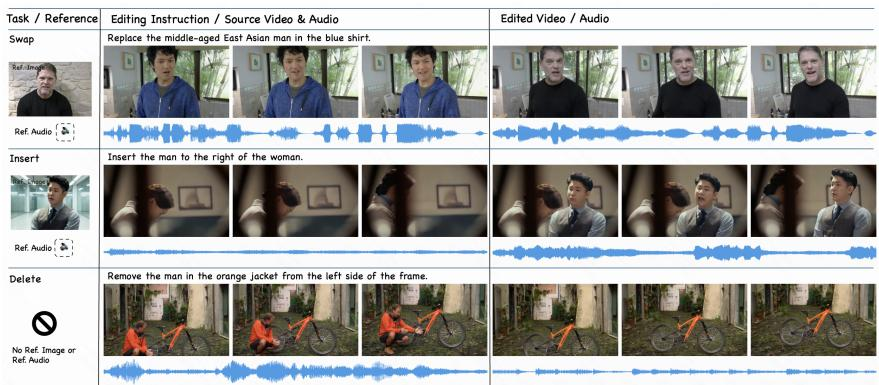
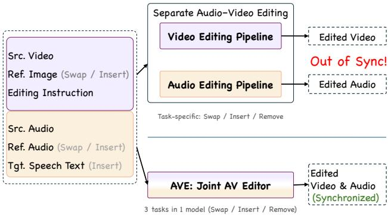
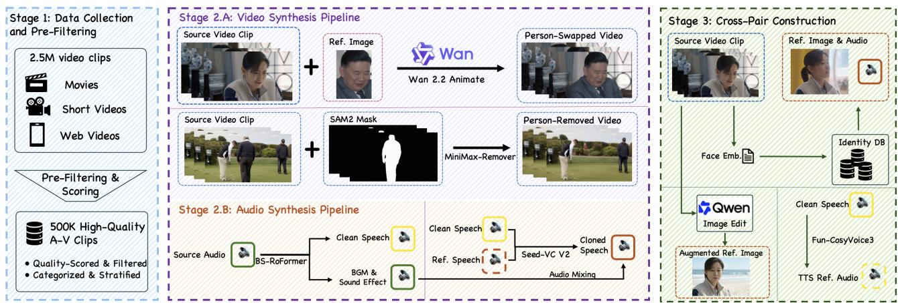
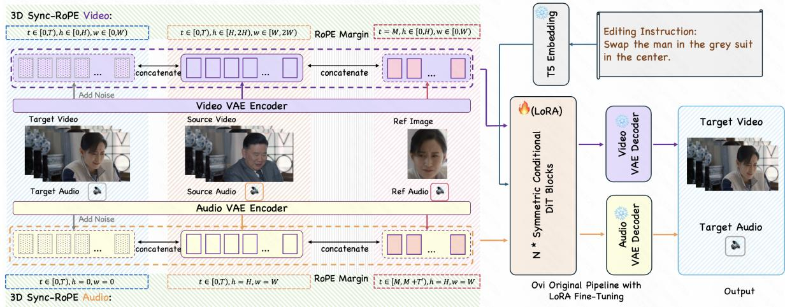
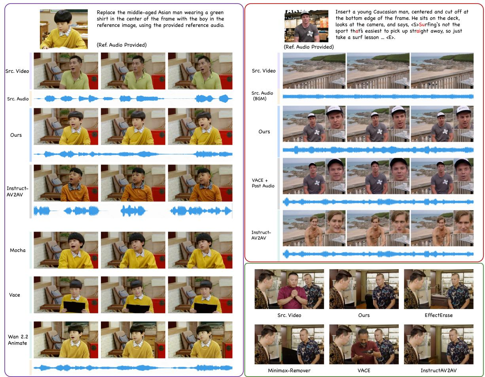

# Edit in Sync: Unified End-to-End Audio-Visual Editing for Human-Centric Videos

Ziye Yuan1,6,† Minghong Cai2,6,† Xu He3,6,† Ruchang Yao2 Xiao Fu2

Kaixin Ding4 Ming Zhang1 Xiangyu Du6,‡ Tianpeng Lan5,6,§ Da Xie6,‡ Xiangyu Yue2

1Peking University 2The Chinese University of Hong Kong 3Tsinghua University

4University of Hong Kong 5National University of Defense Technology 6Kling AI, Kuaishou Technology

†Current interns at Kling AI. ‡Former employees of Kling AI. §Current employee at Kling AI.

  
Figure 1. Overview of AVE across person swapping, insertion, and deletion. Appearance and voice references are provided for swapping and insertion, while deletion requires no reference.

## Abstract

Human-centric audio-visual editing requires precise alignment oflip movements, gestures, and expressions with speech. Existing methods process inputs through independent video and audio pipelines, preventing cross-modal interaction between visual editing and audio dubbing. Many of these pipelinesfurther rely on mask-based inpainting. As a result, they sufferfrom poor lip-audio synchronization, cumulative pipeline errors, and an inherent mask-size dilemma. We present AVE, the first unified end-to-end framework that jointly performs reference-guided person swapping, insertion, and deletion across both audio and video modalities without requiring spatial masks. To overcome data scarcity, we design a synthesis pipeline and introduce AVE-Dataset, the first audio-visual editing dataset to provide 100K pairs with appearance and voice references. By combining Synthetic-to-Real reconstruction with preliminary audio warm-up, ourframework transcends synthetic pipeline limits and mitigates audio-video token imbalance. AVE outperforms modality-separate audio-visual editing pipelines in editing realism, temporal consistency, and audio-visual alignment.

## 1. Introduction

Content editing has long been an important topic in both visual and audio fields. Representative visual editing tasks include object removal [13, 34, 57, 58], insertion [1, 21, 46, 53], and replacement [12, 35, 51], while audio editing commonly involves voice conversion [22, 29], source separation [30, 32, 44], and speech content editing [36, 41]. Despite progress in both modalities, independent audiovisual editing remains insufficient for human-centric scenarios where visual events and speech are intrinsically coupled across lip movements, facial expressions, and bodily actions [16, 27]. Human-centric editing such as insertion, removal, and replacement should be reflected coherently in both modalities, with consistent subject presence, identity, and timing [14, 26]. Thus, joint human-centric audio-visual editing has emerged as a key multimodal frontier and the primary focus of this work.

Existing approaches to audio-visual editing typically decouple video and audio processing into independent pipelines [19, 49]. Consequently, the visual editor remains speech-agnostic while the audio stage lacks visual guidance; this absent reciprocal conditioning degrades synchronization and compounds pipeline errors (Fig. 2). Emerging joint audio-video generators prove that unified cross-modal modeling naturally leads to more synchronized and realistic outputs [15, 31]. Inspired by these advances, we develop an end-to-end framework that unifies the core suite of humancentric operations into a single model.

  
Figure 2. Separate editing pipelines versus AVE

However, training such a unified framework is severely constrained by data scarcity. End-to-end supervision requires paired audio-visual editing data, which is virtually non-existent in the wild and costly to collect manually at scale. A common workaround is to reformulate editing as a self-supervised mask-and-reconstruct task [7, 14, 26], where the target subject and speech are masked to reconstruct the original content from the remaining context. Yet, such maskdependent training imposes strict spatial constraints that often erase fine motion cues and surrounding context, causing visual artifacts and temporal instability. To overcome this bottleneck, we build a three-stage data construction pipeline. We leverage specialized visual and audio models to synthesize diverse editing pairs. To improve reference adherence across diverse visual and acoustic contexts, we construct cross-pair multimodal references by retrieving the target identity across distinct scenes or synthesizing it with generative augmentations, providing reliable identity and timbre guidance while preventing copy-and-paste shortcuts. Through multi-stage visual and acoustic filtering, we assemble AVE-Dataset, comprising 100K curated audio-visual pairs that support unified character Delete, Insert, and Swap.

Based on AVE-Dataset, we propose AVE, an end-to-end framework for human-centric joint audio-visual editing, supporting three tasks within a unified architecture. By taking complete source audio-video signals directly as input AVE preserves full spatiotemporal and acoustic context, producing harmoniously synchronized output under multimodal conditions. AVE builds on a joint audio-video backbone [31], utilizing its bidirectional cross-modal attention for synchronized editing across modalities. To handle complex multimodal inputs, we introduce a Modality-Aware Sync-RoPE design that assigns role-specific positional coordinates to source, target, and reference tokens. This preserves sourcetarget temporal correspondence while aligning audio and video along a shared timeline. Furthermore, we introduce a multi-stage training curriculum with bidirectional supervision: forward supervision (from a real source to a synthetic target) teaches the intended editing operations, while the backward direction exposes the model to real target distributions. Together with audio warm-up, bidirectional joint adaptation, and quality-focused refinement, this curriculum mitigates synthesis artifacts and enables the mask-free editor to bootstrap beyond the quality ceiling of its synthetic training data.

Our main contributions are as follows: (1) We present AVE, a unified mask-free framework for human-centric audio-visual editing. It employs Modality-Aware Sync-RoPE to enable comprehensive cross-modal interaction while preserving audio-visual temporal correspondence. (2) We develop a scalable data synthesis pipeline to construct AVE-Dataset, providing 100K verified audio-visual editing pairs equipped with appearance and voice references alongside a standardized benchmark. (3) We introduce a multistage training curriculum with bidirectional supervision, enabling the final model to progressively surpass the quality ceiling imposed by synthetic training data.

## 2. Related Work

Joint audio–video foundation models learn visual and acoustic content as a coupled distribution rather than separate streams. Early works explored coupled U-Nets for unconditional synthesis [42], while recent DiT-based models scale cross-modal generation to open domains with strong multimodal priors [3, 15, 31]. However, general generation capability alone does not naturally resolve the central editing problem: transferring requested attributes while preserving operation-irrelevant source content. Initial editing formulations adapted single-modality models to paired image–audio data [25] or relied on test-time optimization on video [28]. Modular pipelines follow a decomposition that separately inverts, edits, or dubs audio and video [12, 19, 49, 55], yet these one-way cascades lack bidirectional interaction and inevitably compound pipeline errors. Recent works move toward coupled end-to-end architectures [5, 26, 50, 56], yet they remain restricted to single operations [50] or rely on mask-guided routing [26]. In contrast, we combine external appearance and timbre references with mask-free localization to unify person-level Swap, Insert, and Delete within a single generative process.

In human-centric scenarios, existing studies have separately investigated visual identity transfer [35, 51] and speech-driven facial animation [16, 33]. While achieving promising portrait fidelity and lip synchronization, they primarily operate on the visual stream or require external driving audio, failing to jointly transfer appearance and voice. Conversely, joint dubbing and audio-video personalization methods couple appearance and voice for identity-consistent generation [2, 4, 6, 9, 23, 24], but they synthesize new scenes from scratch rather than preserving source-video context. DreamID-Omni [14] represents the closest effort by supporting reference-based generation and person replacement. Nonetheless, it does not unify person insertion and deletion under a consistent editing framework, nor does it preserve source motion and linguistic context as editing invariants. In contrast, our approach enables holistic identity and timbre control across all three operations.

Audio editing provides essential capabilities for manipulating acoustic content in human-centric scenes. Zero-shot voice cloning synthesizes speech in an arbitrary timbre for character insertion [11, 37], while voice conversion preserves linguistic timing and prosody for character replacement [29]. In parallel, speech separation and extraction isolate target voices from acoustic mixtures to facilitate character deletion [43, 49]. However, these audio-centric methods cannot exploit visual cues to resolve speaker attribution and lip synchronization in talking videos, nor can separation alone reconstruct vacated visual regions. Our framework integrates these editing capabilities into a unified multimodal backbone, allowing acoustic and visual decisions to co-evolve seamlessly.

## 3. Method

We study instruction-guided audio-visual editing for talking videos across three person-level operations: Swap, Insert, and Delete. Given a source video $\mathbf { v } _ { s } .$ its synchronized audio $\mathbf { a } _ { s } .$ , a natural-language instruction $c ,$ and optional multimodal references $( \mathbf { r } _ { v } , \mathbf { r } _ { a } )$ providing the target appearance and vocal timbre (with $\mathbf { r } _ { v } , \mathbf { r } _ { a } = \emptyset$ for Delete), our goal is to predict the edited audio-visual pair $( \hat { \bf v } , \hat { \bf a } )$ using a single unified model $f _ { \boldsymbol { \theta } } { : }$

$$
( \hat { \mathbf { v } } , \hat { \mathbf { a } } ) = f _ { \theta } ( \mathbf { v } _ { s } , \mathbf { a } _ { s } , \mathbf { r } _ { v } , \mathbf { r } _ { a } , c ) ,\tag{1}
$$

The core challenge lies in editing both modalities jointly without explicit spatial signals: $f _ { \theta }$ must implicitly resolve the target referent from c, maintain precise lip-speech alignment across modalities, and faithfully preserve non-target context.

Building on this formulation, we present AVE. In this section, we first describe our data synthesis pipeline for obtaining complex editing pairs in Sec. 3.1. Then we present our editing framework with Modality-Aware Sync-RoPE design in Sec. 3.2. Finally, Sec. 3.3 introduces a progressive training curriculum with bidirectional supervision to overcome the quality ceiling of synthetic training data.

## 3.1. Data

To obtain scalable supervision for joint audio-visual editing, we build an automatic data construction pipeline illustrated in Fig. 3. In Phase 1, we filter 2.5M raw video clips to retain a 500K high-quality, dialogue-rich source corpus (see

Appendix A.1 for details). In Phase 2, we synthesize paired examples for Swap, Insert, and Delete, and verify the resulting samples for visual, acoustic, and synchronization fidelity. In Phase 3, we construct cross-pair appearance and voice references through identity retrieval and augmentation, ensuring that the references preserve the desired identity and timbre while differing in pose, scene, and linguistic content. Additionally, structured editing instructions are annotated using Qwen3.5 [38] (detailed in Appendix A.2) to guide cross-modal editing intents. To guarantee dataset fidelity, a multi-stage verification suite (detailed in Appendix A.3) rigorously filters out visual artifacts, lip-speech misalignments, and identity-timbre mismatches throughout the pipeline. The resulting AVE-Dataset contains 100K curated audio-visual editing pairs, including 40K Swap pairs, over 35K Insert pairs, and over 20K Delete pairs.

## 3.1.1. Edit Pair Synthesis

We construct high-quality editing pairs with aligned audio and video through a multi-stage synthesis and filtering pipeline (Fig. 3, Stage 2). The pipeline has two branches: Swap, and the complementary Delete/Insert operations. The resulting editing pairs support both distillation from synthetic targets and reconstruction of real targets.

Swapping. Person swapping replaces the appearance and voice timbre of a target person in the source video with those of a reference individual. It should faithfully preserves the original motion and poses, speech timing, and background audio. For video synthesis (Stage 2.A), we employ Wan 2.2 Animate [7] with filtered source video clips serving as motion and pose drivers, combining them with reference facial images to synthesize videos with replaced appearances (Person-Swapped Video). For audio synthesis (Stage 2.B), we first utilize BS-RoFormer [32] to precisely separate the source audio into clean speech and background noise/sound effect tracks. Subsequently, Seed-VC V2 [29] performs voice conversion using the isolated speech for content and prosody guidance with the reference timbre. The cloned speech is then remixed with background audio, yielding a target track synchronized with the edited video.

Removal & Insertion. Removal and insertion are inverse audio-visual editing operations. For video-level erasing, we track the target person in the source video using SAM 2 [40] to generate frame-wise binary masks, which are then fed into MiniMax-Remover [58] for inpainting to yield a background video with the target person removed (Person-Removed Video). For audio-level separation, we similarly strip the target voice via BS-RoFormer, retaining only ambient background sounds and audio effects (or silence if no background audio exists). From the resulting video and audio, we construct bidirectional editing pairs: 1) Removal:

  
Figure 3. Automated data construction pipeline of AVE-Dataset. The workflow consists of three phases: (1) raw corpus collection and quality pre-filtering, (2) video-audio synthesis for editing pair creation, (3) identity retrieval and multimodal augmentation for cross-pai reference construction.

The original audio-visual clip serves as the source, while the person-removed video and background audio serve as the target; 2) Insertion: We reverse the pair and provide reference images and audio of the person to be inserted, using the original clip as the target. Thus, insertion is supervised by real, synchronized audio-visual targets.

## 3.1.2. Cross-Pair Reference Construction

For reference-conditioned backward (using synthetic clips as inputs and real clips as targets) reconstruction, we need references for the original person. Simply cropping the real target would expose its pose, scene, or speech content, encouraging copy-and-paste shortcuts. Therefore, we construct cross-pair visual and audio references that match the target’s identity and clothing but differ in background, pose, expression. For visual references, we sample and crop one face per second from each video. We then compute face embeddings and use them to index the crops in an identity retrieval database. We retrieve candidate references of the same identity and further verify them through speaker-timbre similarity. After suppressing background sounds and sound effects, the corresponding speech segments serve as candidate audio references. Qwen3.5 rejects neighboring excerpts from the same continuous scene and candidates with inconsistent clothing, accessories, or hairstyles, which commonly arise when the same actor appears in different productions. We complement retrieved references with generative augmentation via Qwen-Image-Edit [48] and CosyVoice 3 [11]. For visual augmentation, an image editor swaps the subject’s background with samples from a background library while introducing subtle variations in expression and pose. For audio augmentation, CosyVoice 3 synthesizes new utterances from a text corpus using clean speech segments as voice prompts. All synthesized references undergo a final quality check (detailed in Appendix A.3).

## 3.2. Framework of AVE

With the paired data in place, we build our editor on a joint audio–video generation backbone, so that editing inherits a strong prior on how speech, lip motion, and ambient sound co-occur instead of having to relearn cross-modal consistency from the editing pairs alone. Our design relies on only three properties shared across this family of models [3, 15, 31]: separate video and audio VAEs map the two streams into their own latent spaces; two Diffusion Transformer (DiT) branches are coupled by bidirectional cross-modal attention, so that each modality conditions on the other at every block; and a shared frozen text encoder supplies the semantic embedding of the editing instruction. Because we assume nothing beyond these properties, our method is not tied to a particular backbone. We instantiate it with Ovi [31] and adapt the conditional DiT blocks to source-conditioned editing.

## 3.2.1. Source- and Reference-Conditioned Editing

As illustrated in Fig. 4, the source and reference inputs are encoded as clean context, whereas the target video and audio streams are initialized from noise. Within each modality, the target, source, and reference tokens are concatenated and jointly processed by the coupled DiT backbones. After joint denoising, the video and audio decoders produce the edited pair.

## 3.2.2. Modality-Aware Sync-RoPE

Inspired by DreamID-Omni [14], we design a Modality-Aware Sync-RoPE layout that distinguishes the roles of target, source, and reference tokens without disrupting source– target temporal correspondence. Both streams share the same three coordinate axes, but each modality interprets them according to its own structure. Let T, H, and W denote the temporal, height, and width dimensions of the video latent grid. We assign the target and source video tokens to

  
Figure 4. Overview of the AVE framework. To prevent token ambiguity, our Modality-Aware Sync-RoPE introduces role-specific 3D coordinate offsets that explicitly distinguish source, target, and reference tokens while maintaining temporal correspondence along a shared timeline.

$$
\begin{array} { r l } & { \Omega _ { \mathrm { t a r } } ^ { v } = [ 0 , T ) \times [ 0 , H ) \times [ 0 , W ) , } \\ & { \Omega _ { \mathrm { s r c } } ^ { v } = [ 0 , T ) \times [ H , 2 H ) \times [ W , 2 W ) . } \end{array}\tag{2}
$$

Thus, corresponding source and target frames share the same temporal coordinates, while offsets along both spatial axes prevent their tokens from being interpreted as the same latent canvas. For an optional reference image, we use

$$
\Omega _ { \mathrm { r e f } } ^ { v } = \{ M \} \times [ 0 , H ) \times [ 0 , W ) ,\tag{3}
$$

where the RoPE margin M separates reference information from the source and target sequences.

We apply the same principle to the audio stream. Let $T _ { a }$ be the number of audio latent tokens; following Ovi [31], we scale their temporal RoPE frequencies by $\gamma = T / T _ { a } ,$ , such that $\gamma T _ { a } = T$ and the audio and video streams span the same temporal RoPE range. Since audio has no intrinsic spatial grid, we use the two auxiliary RoPE axes to encode token roles:

$$
\begin{array} { r l } & { \Omega _ { \mathrm { t a r } } ^ { a } = [ 0 , T _ { a } ) \times \{ 0 \} \times \{ 0 \} , } \\ & { \Omega _ { \mathrm { s r c } } ^ { a } = [ 0 , T _ { a } ) \times \{ H \} \times \{ W \} , } \\ & { \Omega _ { \mathrm { r e f } } ^ { a } = [ M , M + T _ { a } ) \times \{ H \} \times \{ W \} } \end{array}\tag{4}
$$

The source and target audio tokens therefore remain temporally aligned, while the reference audio is isolated by the same margin. We retain Ovi’s [31] temporal RoPE scaling between the audio and video branches so that their different token rates correspond to the same physical timeline.

## 3.3. Progressive Training

## 3.3.1. Bidirectional Supervision

Training only in the forward direction (from a real source to a synthetic target) would primarily distill the capabilities and artifacts of the data-synthesis pipeline. We therefore additionally reverse each editing-pair: the synthesized sample is used as the source and its real counterpart as the supervision target. This backward direction exposes the model to real target distributions and improves generation quality. We train primarily on backward pairs, supplemented by forward pairs. Forward supervision teaches the intended edits from real source videos without compromising the pretrained generation prior, whereas backward supervision improves output fidelity without encouraging the model to exploit residual synthesis artifacts as shortcuts. Our stringent filtering makes the synthetic targets used in forward training and the synthetic inputs used in backward training closely approximate real audio–video data.

## 3.3.2. Multi-Stage Training Curriculum

Stage 0: Audio Warm-up. We first isolate the audio branch and train it on audio-only synthetic data for TTS, voice conversion, and speaker-timbre disentanglement. This warm-up is critical for mitigating the severe audio–video token imbalance and substantially accelerates subsequent joint optimization, allowing the audio editor to be efficiently integrated into the joint model.

Stage 1: Bidirectional Joint Adaptation. We train with both forward and backward directions. We first freeze the audio branch and optimize the video and cross-modal fusion modules on joint audio-video data, and subsequently unfreeze the audio branch to jointly optimize all trainable modules. This enables the model to acquire all three editing operations within a unified framework.

Stage 2: Quality Refinement. We select the highest-quality subset from each data category based on VBench [18], Sync-Net [8], and other quality scores, retaining only samples with retrieved cross-pair references for continued backward training. This quality-focused stage improves local details and reduces the residual artifacts from Stage 1.

## 4. Experiments

## 4.1. Experimental Setup

Implementation Details. We fine-tune Ovi [31] using LoRA [17]; trainable modules are detailed in Appendix B. Training videos are standardized to a resolution of 480 × 832 at 24 fps with a duration of 5.04 seconds (121 frames), aligning with Ovi’s temporal grid. Audio is sampled at 16 kHz. For Modality-Aware Sync-RoPE, we set the shared RoPE margin to M = 350 for both the video and audio branches. Following the curriculum in Sec. 3.3: In Stage 0, we train the audio-only LoRA parameters with a batch size of 512 for 2k steps. In Stage 1, we train on audio-video pairs with a batch size of 64, running 2k steps with frozen audio LoRA parameters followed by 2k steps of joint optimization across all LoRA parameters. In Stage 2, we continue backward training on the top-50% quality-refined subset with a batch size of 64 for 2k steps.

Benchmark Evaluation. Publicly available benchmarks closest to our setting remain fragmented. InstructAV2AV and JAVEdit provide multi-operation evaluation sets based on text instructions, without external appearance or voice references [5, 56]. IDBench-Omni provides referenceconditioned evaluation, but its released source-video editing set comprises only 25 full-human-swap cases and 25 faceswap cases, with target dialogue specified by text prompts; person insertion and deletion into existing source videos are not evaluated [14].

To address these gaps, we construct AVE-Dataset-Bench, comprising held-out video clips strictly disjoint from our training set. Specifically, AVE-Dataset-Bench contains 64 carefully curated test samples for each of the three editing tasks, yielding 192 test cases in total. Models receive real-world audio-visual clips as source inputs, paired with reference images and audio as conditioning signals.

Baselines. We compare AVE with two categories of baselines: separate audio-video editing pipelines and the textdriven joint audio-video editing model InstructAV2AV [56]. For separate audio–video editing, each visual editor is paired with the corresponding task-specific audio editing pipeline. Specifically, we use VACE [20] as the generalpurpose visual baseline across all three tasks: Swap, Delete, and Insert. In addition, for Swap, we evaluate Wan-Animate [7] and MoCha [51]; for Delete, we evaluate MiniMax-Remover [58] and EffectErase [13]. To benchmark against end-to-end joint editing, we further compare with InstructAV2AV. Since InstructAV2AV is conditioned solely on text instructions and does not natively accept external visual or vocal references, we convert the reference subject’s salient appearance and vocal attributes into detailed text descriptions and append them to the instruction prompt.

Evaluation Metrics. We evaluate the edited results across five dimensions: (1) Visual quality: five VBench dimensions [18], including subject consistency, background consistency, temporal flickering, motion smoothness, and imaging quality; (2) Acoustic quality: AudioBox PQ [45] (↑) measuring the acoustic quality of generated speech; (3) Audiovisual synchronization: Sync-C (↑, confidence) and Sync-D (↓, feature distance) evaluated via SyncNet [8]; (4) Reference fidelity: ArcFace [10] (↑) for facial identity similarity, CAM++ [47] (↑) for speaker timbre similarity, and CLIP-I [39] (↑) for image-level subject similarity; (5) Background fidelity: PSNR (↑) and LPIPS [52] (↓) computed over the background region. For Swap and Delete, the background is obtained by segmenting the edited subject via SAM 2 [40] followed by a moderate mask dilation. For Insert, the inserted subject is segmented from the edited output, and the unmasked region is taken as the background.

## 4.2. Main Results

Table 1 summarizes the quantitative comparisons across the three editing tasks, and Figure 5 shows representative qualitative examples. Overall, AVE delivers competitive visual and acoustic quality, strong audio–visual synchronization, and high reference fidelity.

Swapping. In Figure 5, AVE seamlessly replaces the target subject with the reference child. In contrast, VACE exhibits lip-speech misalignment, Wan-Animate alters the background layout, and MoCha degrades facial fidelity. InstructAV2AV modifies appearance via text prompts, but cannot recover the specific reference identity. Quantitatively, AVE achieves the highest identity fidelity (ArcFace 0.682, CAM++ 0.647) and best audio–visual synchronization (Sync-C 5.39, Sync-D 8.53).

Insertion. For person insertion, AVE generates a new speaker with precise lip synchronization on key syllables and clear facial details. VACE suffers from blurred eyes and poor lip sync, while InstructAV2AV produces an unnatural pose and disobey the prompt. In quantitative evaluation, AVE substantially improves audio–visual alignment (Sync-C 4.43, Sync-D 8.83 versus 3.93, 9.73 for VACE+PA) and achieves a higher imaging quality score (72.82).

Removal. For subject removal, AVE naturally infills the vacated region without explicit masks. EffectErase generates discordant background textures, MiniMax-Remover leaves black artifacts, VACE fails to delete the target, and InstructAV2AV distorts the adjacent person while blurring the background. AVE achieves both the best background preservation (PSNR 31.74, LPIPS 0.0926) and the highest imaging quality (67.15).

  
Figure 5. Qualitative comparisons across person swapping, insertion, and removal. Please zoom in for more details.

Table 1. Quantitative comparison on AVE-Dataset-Bench across three editing tasks. Reconstruction metrics are computed over the background region. Best results are shown in bold. “+PA” denotes cascaded baselines paired with our audio post-processing pipeline.
<table><tr><td rowspan="3">Task / Method</td><td colspan="5">VBench (%)</td><td colspan="3">Audio Quality &amp; AV Sync</td><td colspan="2">Ref Similarity</td><td colspan="3">BG Fidelity</td></tr><tr><td>Subj. Cons. ↑</td><td>BG Cons. ↑</td><td>Temp. Flick.</td><td>Motion Sm.</td><td>Imaging Q.</td><td colspan="5"></td><td colspan="3"></td></tr><tr><td></td><td></td><td></td><td>↑</td><td>个</td><td></td><td>↑ PQ ↑ Sync-C ↑ Sync-D ↓ CAM++ ↑ Arc ↑ CLIP ↑ PSNR ↑ LPIPS ↓</td><td></td><td></td><td></td><td></td><td></td><td></td></tr><tr><td>Swap</td><td></td><td></td><td></td><td></td><td></td><td></td><td></td><td></td><td></td><td></td><td></td><td></td><td></td></tr><tr><td>VACE+PA</td><td>95.26</td><td>94.30</td><td>96.48</td><td>98.11</td><td>68.13</td><td>6.586</td><td>4.86</td><td>9.29</td><td>0.665</td><td>0.614</td><td>0.705</td><td>35.37</td><td>0.0481</td></tr><tr><td>Wan2.2+PA</td><td>94.09</td><td>96.12</td><td>97.76</td><td>97.71</td><td>66.41</td><td>6.586</td><td>5.02</td><td>8.76</td><td>0.665</td><td>0.634</td><td>0.710</td><td>33.27</td><td>0.0505</td></tr><tr><td>MoCha+PA</td><td>96.52</td><td>93.16</td><td>97.97</td><td>97.30</td><td>65.11</td><td>6.586</td><td>5.05</td><td>8.72</td><td>0.665</td><td>0.639</td><td>0.712</td><td>32.42</td><td>0.0584</td></tr><tr><td>InstructAV2AV</td><td>95.86</td><td>93.88</td><td>95.56</td><td>98.10</td><td>66.60</td><td>6.255</td><td>3.87</td><td>9.65</td><td></td><td></td><td></td><td>31.84</td><td>0.0640</td></tr><tr><td>Ours</td><td>97.35</td><td>95.69</td><td>97.67</td><td>98.54</td><td>69.74</td><td>6.709</td><td>5.39</td><td>8.53</td><td>0.682</td><td>0.647</td><td>0.712</td><td>34.62</td><td>0.0549</td></tr><tr><td>Delete</td><td></td><td></td><td></td><td></td><td></td><td></td><td></td><td></td><td></td><td></td><td></td><td></td><td></td></tr><tr><td>VACE+PA</td><td>93.06</td><td>92.72</td><td>95.61</td><td>97.59</td><td>65.64</td><td>6.813</td><td></td><td></td><td></td><td></td><td>一</td><td>29.94</td><td>0.1129</td></tr><tr><td>MiniMax-Remover+PA</td><td>97.39</td><td>95.90</td><td>97.97</td><td>97.98</td><td>59.07</td><td>6.813</td><td>一</td><td>一</td><td>一</td><td></td><td>一</td><td>27.99</td><td>0.1317</td></tr><tr><td>Effect Erase+PA</td><td>97.69</td><td>96.24</td><td>98.04</td><td>96.20</td><td>62.65</td><td>6.813</td><td>一</td><td>一</td><td>一</td><td></td><td>一</td><td>31.27</td><td>0.1212</td></tr><tr><td>InstructAV2AV</td><td>96.53</td><td>93.82</td><td>96.32</td><td>97.56</td><td>60.63</td><td>6.573</td><td>一</td><td>一</td><td>一</td><td>一</td><td>一</td><td>29.74</td><td>0.0991</td></tr><tr><td>Ours</td><td>98.49</td><td>96.64</td><td>98.12</td><td>98.43</td><td>67.15</td><td>6.810</td><td></td><td>一</td><td></td><td>一</td><td>一</td><td>31.74</td><td>0.0926</td></tr><tr><td>Insert</td><td></td><td></td><td></td><td></td><td></td><td></td><td></td><td></td><td></td><td></td><td></td><td></td><td></td></tr><tr><td>VACE+PA</td><td>96.04</td><td>94.71</td><td>97.61</td><td>97.70</td><td>68.20</td><td>6.384</td><td>3.93</td><td>9.73</td><td>0.638</td><td>0.614</td><td>0.705</td><td>28.66</td><td>0.1271</td></tr><tr><td>InstructAV2AV</td><td>95.71</td><td>93.52</td><td>98.10</td><td>98.63</td><td>63.72</td><td>6.090</td><td>3.84</td><td>10.60</td><td></td><td></td><td></td><td>29.38</td><td>0.0950</td></tr><tr><td>Ours</td><td>98.36</td><td>96.87</td><td>98.05</td><td>98.44</td><td>72.82</td><td>6.491</td><td>4.43</td><td>8.83</td><td>0.651</td><td>0.630</td><td>0.698</td><td>27.70</td><td>0.1023</td></tr></table>

## 4.3. Ablation Study and Analysis

We conduct ablation studies on AVE-Dataset-Bench to validate our core training strategies, additional ablation of

Modality-Aware Sync-RoPE is provided in Appendix C.

Effect of Audio Warm-up (Stage 0). To verify the necessity of isolated audio warm-up, we compare our full model against a variant that skips Stage 0 and directly initiates joint training from Stage 1 through Stage 2 (with extra training in Stage 1 to ensure equal total training iterations). As demonstrated in our experiments, omitting Stage 0 causes severe cross-modal token imbalance and leads to degraded speech quality (AudioBox PQ) and poorer AV synchronization (Sync-C), confirming that preliminary audio warm-up provides crucial acoustic priors for joint optimization.

Table 2. Ablation study on AVE-Dataset-Bench across tasks. Best results are shown in bold.
<table><tr><td></td><td colspan="5">VBench (%)</td><td colspan="3">Audio Quality &amp; AV Sync</td></tr><tr><td>Task / Variant</td><td>Subj. Cons. ↑</td><td>BG Cons. ↑</td><td>Temp. Flick. ↑</td><td>Motion Sm. ↑</td><td>Imaging Q.</td><td>↑PQ↑</td><td>Sync-C ↑</td><td>Sync-D ↓</td></tr><tr><td>Swap</td><td></td><td></td><td></td><td></td><td></td><td></td><td></td><td></td></tr><tr><td>w/o Audio Pretrain</td><td>96.60</td><td>95.34</td><td>97.94</td><td>97.95</td><td>68.58</td><td>6.107</td><td>4.71</td><td>9.25</td></tr><tr><td>w/o Multistage</td><td>95.90</td><td>94.57</td><td>97.28</td><td>98.21</td><td>67.88</td><td>6.580</td><td>5.28</td><td>8.66</td></tr><tr><td>Ours</td><td>97.35</td><td>95.69</td><td>97.67</td><td>98.54</td><td>69.74</td><td>6.709</td><td>5.39</td><td>8.53</td></tr><tr><td>Delete</td><td></td><td></td><td></td><td></td><td></td><td></td><td></td><td></td></tr><tr><td>w/o Audio Pretrain</td><td>97.87</td><td>96.20</td><td>97.93</td><td>98.44</td><td>65.57</td><td>6.304</td><td>一</td><td>一</td></tr><tr><td>w/o Multistage</td><td>96.57</td><td>95.08</td><td>97.61</td><td>98.13</td><td>63.27</td><td>6.704</td><td>一</td><td></td></tr><tr><td>Ours</td><td>98.49</td><td>96.64</td><td>98.12</td><td>98.43</td><td>67.15</td><td>6.810</td><td>一</td><td></td></tr><tr><td>Insert</td><td></td><td></td><td></td><td></td><td></td><td></td><td></td><td></td></tr><tr><td>w/o Audio Pretrain</td><td>96.75</td><td>94.95</td><td>98.37</td><td>97.97</td><td>68.21</td><td>5.980</td><td>3.54</td><td>9.75</td></tr><tr><td>w/o Multistage</td><td>96.69</td><td>95.21</td><td>98.47</td><td>97.60</td><td>68.22</td><td>6.320</td><td>4.15</td><td>9.18</td></tr><tr><td>Ours</td><td>98.36</td><td>96.87</td><td>98.05</td><td>98.44</td><td>72.82</td><td>6.491</td><td>4.43</td><td>8.83</td></tr></table>

Effect of Multi-Stage Refinement (Stage 2). We evaluate the impact of Stage 2 quality refinement by comparing against a variant that continues training exclusively on Stage 1 data for an equal number of iterations without quality filtering. As shown in Table 2, omitting Stage 2 leads to a performance degradation, particularly in visual quality and consistency metrics evaluated by VBench.

## 5. Conclusion

We present AVE, an end-to-end framework for mask-free human-centric audio-visual editing that unifies person Swap, Insert, and Delete within a single generative process while preserving external appearance and voice reference control. To overcome data scarcity, we construct AVE-Dataset, a 100K-pair audio-visual editing dataset with multimodal references, and train the model primarily with backward reconstruction to leverage authentic targets as supervision. Experimental results across all three tasks demonstrate that AVE achieves stronger editing fidelity, temporal stability, and lip-speech synchronization than cascaded editing baselines.

## Reproducibility Statement

To ensure the reproducibility of our results, all key architectural designs, mathematical formulations, and coordinate assignments of Modality-Aware Sync-RoPE are presented in Section 3.2 and Section 3.3. Detailed training hyperparameters, stage schedules, and optimization configurations are provided in Appendix B. The data curation workflow, filtering criteria, and benchmark protocols are described in Section 3.1 and Appendix A. The source code, evaluation benchmark (AVE-Dataset-Bench), and model weights will be made publicly available for research purposes upon publication.

## Ethics Statement

This work explores human-centric audio-visual editing for creative content generation and multimedia post-production. We recognize the potential risks of identity manipulation, deepfake generation, and unauthorized voice cloning. To mitigate these risks, all video and audio datasets used in this research were gathered exclusively from publicly available sources for academic research purposes. We strictly oppose malicious uses of identity manipulation and advocate the integration of synthetic media detection frameworks and digital watermarking alongside generative models.

## AI Use Statement

In this work, generative foundation models and specialized tools were used as algorithmic components of our data curation and training pipeline: Qwen3.5 for instruction annotation and visual filtering, Wan-Animate and MiniMax-Remover for video synthesis, and BS-RoFormer, Seed-VC, and CosyVoice 3 for audio separation, voice conversion, and speech augmentation. Generative LLMs were also used solely for text polishing and proofreading of the manuscript. All synthesized datasets and final manuscript texts were carefully verified and audited by the authors. We take full responsibility for the content and artifacts presented in this paper.

## References

[1] Chen Bai, Zeman Shao, Guoxiang Zhang, Di Liang, Jie Yang, Zhuorui Zhang, Yujian Guo, Chengzhang Zhong, Yiqiao Qiu, Zhendong Wang, et al. Anything in any scene: Photorealistic video object insertion. arXiv preprint arXiv:2401.17509, 2024. 1

[2] Anthony Chen, Naomi Ken Korem, Gal Zeevi, Tavi Halperin, Matan Ben Yosef, Urska Jelercic, Ofir Bibi, Or Patashnik, and Daniel Cohen-Or. Just-dub-it: Video dubbing via joint audiovisual diffusion. arXiv preprint arXiv:2601.22143, 2026. 3

[3] Guibin Chen, Dixuan Lin, Jiangping Yang, Youqiang Zhang, Zhengcong Fei, Debang Li, Sheng Chen, Chaofeng Ao, Nuo Pang, Yiming Wang, et al. SkyReels-V4: Multi-modal videoaudio generation, inpainting and editing model. arXiv preprint arXiv:2602.21818, 2026. 2, 4

[4] Yuheng Chen, Qingdong He, Teng Hu, Yuji Wang, Yabiao Wang, Lizhuang Ma, and Jiangning Zhang. Omni-Customizer: End-to-end multimodal customization for joint audio-video generation. arXiv preprint arXiv:2605.17488, 2026. 3

[5] Yinan Chen, Chuming Lin, Zhennan Chen, Yuxiang Zeng, Junwei Zhu, Yali Bi, Xijie Huang, Chengming Xu, Donghao Luo, Zhucun Xue, et al. JAVEdit: Joint audio-visual instruction-guided video editing with agentic data curation. arXiv preprint arXiv:2606.03168, 2026. 2, 6

[6] Yingjie Chen, Shilun Lin, Cai Xing, Binxin Yang, Long Zhou, Qixin Yan, Wenjing Wang, Dingming Liu, Hao Liu, Chen Li, et al. Identity as presence: Towards appearance and voice personalized joint audio-video generation. arXiv preprint arXiv:2603.17889, 2026. 3

[7] Gang Cheng, Xin Gao, Li Hu, Siqi Hu, Mingyang Huang, Chaonan Ji, Ju Li, Dechao Meng, Jinwei Qi, Penchong Qiao, et al. Wan-Animate: Unified character animation and replacement with holistic replication. arXiv preprint arXiv:2509.14055, 2025. 2, 3, 6

[8] Joon Son Chung and Andrew Zisserman. Out of time: Automated lip sync in the wild. In Asian Conference on Computer Vision, pages 251–263. Springer, 2016. 5, 6, 12

[9] Aviad Dahan, Moran Yanuka, Noa Kraicer, Lior Wolf, and Raja Giryes. ID-LoRA: Identity-driven audio-video personalization with in-context lora. In European Conference on Computer Vision, pages 467–483. Springer, 2026. 3

[10] Jiankang Deng, Jia Guo, Niannan Xue, and Stefanos Zafeiriou. Arcface: Additive angular margin loss for deep face recognition. In Proceedings ofthe IEEE/CVF conference on computer vision and pattern recognition, pages 4690–4699, 2019. 6

[11] Zhihao Du, Qian Chen, Shiliang Zhang, Kai Hu, Heng Lu, Yexin Yang, Hangrui Hu, Siqi Zheng, Yue Gu, Ziyang Ma, et al. CosyVoice: A scalable multilingual zero-shot textto-speech synthesizer based on supervised semantic tokens. arXiv preprint arXiv:2407.05407, 2024. 3, 4

[12] Youquan Fu, Ruiyang Si, Hongfa Wang, Dongzhan Zhou, Jiacheng Sun, Ping Luo, Di Hu, Hongyuan Zhang, and Xuelong Li. Object-AVEdit: An object-level audio-visual editing model. arXiv preprint arXiv:2510.00050, 2025. 1, 2

[13] Yang Fu, Yike Zheng, Ziyun Dai, and Henghui Ding. Effecterase: Joint video object removal and insertion for high-

quality effect erasing. arXiv preprint arXiv:2603.19224, 2026. 1, 6, 12

[14] Xu Guo, Fulong Ye, Qichao Sun, Liyang Chen, Bingchuan Li, Pengze Zhang, Jiawei Liu, Songtao Zhao, Qian He, and Xiangwang Hou. DreamID-Omni: Unified framework for controllable human-centric audio-video generation. arXiv preprint arXiv:2602.12160, 2026. 1, 2, 3, 4, 6

[15] Yoav HaCohen, Benny Brazowski, Nisan Chiprut, Yaki Bitterman, Andrew Kvochko, Avishai Berkowitz, Daniel Shalem, Daphna Lifschitz, Dudu Moshe, Eitan Porat, et al. LTX-2: Efficient joint audio-visual foundation model. arXiv preprint arXiv:2601.03233, 2026. 2, 4

[16] Xu He, Haoxian Zhang, Hejia Chen, Changyuan Zheng, Liyang Chen, Songlin Tang, Jiehui Huang, Xiaoqiang Liu, Pengfei Wan, and Zhiyong Wu. From inpainting to editing: A self-bootstrapping paradigm for context-rich visual dubbing. arXiv preprint arXiv:2512.25066, 2025. 1, 2

[17] Edward J Hu, Yelong Shen, Phillip Wallis, Zeyuan Allen-Zhu, Yuanzhi Li, Shean Wang, Lu Wang, and Weizhu Chen. Lora: Low-rank adaptation of large language models. arXiv preprint arXiv:2106.09685, 2021. 6

[18] Ziqi Huang, Yinan He, Jiashuo Yu, Fan Zhang, Chenyang Si, Yuming Jiang, Yuanhan Zhang, Tianxing Wu, Qingyang Jin, Nattapol Chanpaisit, et al. Vbench: Comprehensive benchmark suite for video generative models. In 2024 IEEE/CVF Conference on Computer Vision and Pattern Recognition (CVPR), pages 21807–21818. IEEE, 2024. 5, 6, 12

[19] Masato Ishii, Akio Hayakawa, Takashi Shibuya, and Yuki Mitsufuji. Coherent audio-visual editing via conditional audio generation following video edits. arXiv preprint arXiv:2512.07209, 2025. 1, 2

[20] Zeyinzi Jiang, Zhen Han, Chaojie Mao, Jingfeng Zhang, Yulin Pan, and Yu Liu. VACE: All-in-one video creation and editing. In 2025 IEEE/CVF International Conference on Computer Vision (ICCV), pages 17191–17202. IEEE, 2025. 6

[21] Hoiyeong Jin, Hyojin Jang, Jeongho Kim, Junha Hyung, Kinam Kim, Dongjin Kim, Huijin Choi, Hyeonji Kim, and Jaegul Choo. Insertanywhere: Bridging 4d scene geometry and diffusion models for realistic video object insertion. arXiv preprint arXiv:2512.17504, 2025. 1

[22] Jingyi Li, Weiping Tu, and Li Xiao. Freevc: Towards highquality text-free one-shot voice conversion. In ICASSP 2023- 2023 IEEE International Conference on Acoustics, Speech and Signal Processing (ICASSP), pages 1–5. IEEE, 2023. 1

[23] Liyang Li, Wen Wang, Canyu Zhao, Tianjian Feng, Zhiyue Zhao, Hao Chen, and Chunhua Shen. MMControl: Unified multi-modal control for joint audio-video generation. In European Conference on Computer Vision, pages 650–667. Springer, 2026. 3

[24] Maomao Li, Zhen Li, Kaipeng Zhang, Guosheng Yin, Zhifeng Li, and Dong Xu. OmniCustom: Sync audio-video customization via joint audio-video generation model. arXiv preprint arXiv:2602.12304, 2026. 3

[25] Susan Liang, Chao Huang, Yapeng Tian, Anurag Kumar, and Chenliang Xu. Language-guided joint audio-visual editing via one-shot adaptation. In Asian Conference on Computer Vision, pages 123–139. Springer, 2024. 2

[26] Sen Liang, Cong Wang, Fengbin Guan, Zhentao Yu, Yiting Lu, Yuanzhi Wang, Yuan Zhou, Xin Li, and Zhibo Chen. SpongeBob: Sync-aware harmonious audio-visual generative editing. arXiv preprint arXiv:2605.25193, 2026. 1, 2

[27] Gaojie Lin, Jianwen Jiang, Chao Liang, Tianyun Zhong, Jiaqi Yang, and Yanbo Zheng. Cyberhost: Taming audio-driven avatar diffusion model with region codebook attention. arXiv preprint arXiv:2409.01876, 2024. 1

[28] Yan-Bo Lin, Kevin Lin, Zhengyuan Yang, Linjie Li, Jianfeng Wang, Chung-Ching Lin, Xiaofei Wang, Gedas Bertasius, and Lijuan Wang. Zero-shot audio-visual editing via cross-modal delta denoising. In 2026 IEEE/CVF Winter Conference on Applications of Computer Vision (WACV), pages 7344–7354. IEEE, 2026. 2

[29] Songting Liu. Zero-shot voice conversion with diffusion transformers. arXiv preprint arXiv:2411.09943, 2024. 1, 3

[30] Xubo Liu, Qiuqiang Kong, Yan Zhao, Haohe Liu, Yi Yuan, Yuzhuo Liu, Rui Xia, Yuxuan Wang, Mark D Plumbley, and Wenwu Wang. Separate anything you describe. IEEE Transactions on Audio, Speech and Language Processing, 33:458– 471, 2024. 1

[31] Chetwin Low, Weimin Wang, and Calder Katyal. Ovi: Twin backbone cross-modal fusion for audio-video generation. arXiv preprint arXiv:2510.01284, 2025. 2, 4, 5, 6

[32] Wei-Tsung Lu, Ju-Chiang Wang, Qiuqiang Kong, and Yun-Ning Hung. Music source separation with band-split rope transformer. In ICASSP 2024-2024 IEEE International Conference on Acoustics, Speech and Signal Processing (ICASSP), pages 481–485. IEEE, 2024. 1, 3

[33] Binyamin Manela, Sharon Gannot, and Ethan Fetyaya. Video editing for audio-visual dubbing. arXiv preprint arXiv:2505.23406, 2025. 2

[34] Chenxuan Miao, Yutong Feng, Jianshu Zeng, Zixiang Gao, Hantang Liu, Yunfeng Yan, Donglian Qi, Xi Chen, Bin Wang, and Hengshuang Zhao. Rose: Remove objects with side effects in videos. Advances in Neural Information Processing Systems, 38:149140–149162, 2026. 1

[35] Tianrui Pan, Lin Liu, Jie Liu, Xiaopeng Zhang, Jie Tang, Gangshan Wu, and Qi Tian. RASA: Replace anyone, say anything—a training-free framework for audiodriven and universal portrait video editing. arXiv preprint arXiv:2503.11571, 2025. 1, 2

[36] Puyuan Peng, Po-Yao Huang, Shang-Wen Li, Abdelrahman Mohamed, and David Harwath. Voicecraft: Zero-shot speech editing and text-to-speech in the wild. In Proceedings ofthe 62nd Annual Meeting of the Association for Computational Linguistics (Volume 1: Long Papers), pages 12442–12462, 2024. 1

[37] Zengyi Qin, Wenliang Zhao, Xumin Yu, and Xin Sun. OpenVoice: Versatile instant voice cloning. arXiv preprint arXiv:2312.01479, 2023. 3

[38] Qwen Team. Qwen3.5: Towards native multimodal agents, 2026. 3, 12

[39] Alec Radford, Jong Wook Kim, Chris Hallacy, Aditya Ramesh, Gabriel Goh, Sandhini Agarwal, Girish Sastry, Amanda Askell, Pamela Mishkin, Jack Clark, et al. Learning transferable visual models from natural language supervi-

sion. In International conference on machine learning, pages 8748–8763. PmLR, 2021. 6, 12

[40] Nikhila Ravi, Valentin Gabeur, Yuan-Ting Hu, Ronghang Hu, Chaitanya Ryali, Tengyu Ma, Haitham Khedr, Roman Radle,¨ Chloe Rolland, Laura Gustafson, et al. Sam 2: Segment anything in images and videos. In International Conference on Learning Representations, pages 28085–28128, 2025. 3, 6

[41] Yong Ren, Jiangyan Yi, Jianhua Tao, Tao Wang, Le Xu, and Zhengqi Wen. Edit content, preserve acoustics: Imperceptible text-based speech editing via self-consistency rewards. arXiv preprint arXiv:2602.00560, 2026. 1

[42] Ludan Ruan, Yiyang Ma, Huan Yang, Huiguo He, Bei Liu, Jianlong Fu, Nicholas Jing Yuan, Qin Jin, and Baining Guo. MM-Diffusion: Learning multi-modal diffusion models for joint audio and video generation. In 2023 IEEE/CVF Conference on Computer Vision and Pattern Recognition (CVPR), pages 10219–10228. IEEE, 2023. 2

[43] Bowen Shi, Andros Tjandra, John Hoffman, Helin Wang, Yi-Chiao Wu, Luya Gao, Julius Richter, Matt Le, Apoorv Vyas, Sanyuan Chen, et al. Sam audio: Segment anything in audio. arXiv preprint arXiv:2512.18099, 2025. 3

[44] Cem Subakan, Mirco Ravanelli, Samuele Cornell, Mirko Bronzi, and Jianyuan Zhong. Attention is all you need in speech separation. In ICASSP 2021-2021 IEEE International Conference on Acoustics, Speech and Signal Processing (ICASSP), pages 21–25. IEEE, 2021. 1

[45] Andros Tjandra, Yi-Chiao Wu, Baishan Guo, John Hoffman, Brian Ellis, Apoorv Vyas, Bowen Shi, Sanyuan Chen, Matt Le, Nick Zacharov, et al. Meta audiobox aesthetics: Unified automatic quality assessment for speech, music, and sound. arXiv preprint arXiv:2502.05139, 2025. 6

[46] Yuanpeng Tu, Hao Luo, Xi Chen, Sihui Ji, Xiang Bai, and Hengshuang Zhao. Videoanydoor: High-fidelity video object insertion with precise motion control. In Proceedings ofthe Special Interest Group on Computer Graphics and Interactive Techniques Conference Conference Papers, pages 1–11, 2025. 1

[47] Hui Wang, Siqi Zheng, Yafeng Chen, Luyao Cheng, and Qian Chen. Cam++: A fast and efficient network for speaker verification using context-aware masking. arXiv preprint arXiv:2303.00332, 2023. 6, 12

[48] Chenfei Wu, Jiahao Li, Jingren Zhou, Junyang Lin, Kaiyuan Gao, Kun Yan, Sheng-ming Yin, Shuai Bai, Xiao Xu, Yilei Chen, et al. Qwen-Image technical report. arXiv preprint arXiv:2508.02324, 2025. 4

[49] Kam Man Wu, Zeyue Tian, Liya Ji, and Qifeng Chen. VAInpaint: Zero-shot video-audio inpainting framework with llmsdriven module. arXiv preprint arXiv:2509.17022, 2025. 1, 2, 3

[50] Weihan Xu, Kan Jen Cheng, Koichi Saito, Muhammad Jehanzeb Mirza, Tingle Li, Yisi Liu, Alexander H Liu, Liming Wang, Masato Ishii, Takashi Shibuya, et al. Schrodinger¨ audio-visual editor: Object-level audiovisual removal. arXiv preprint arXiv:2512.12875, 2025. 2

[51] Zhengbo Xu, Jie Ma, Ziheng Wang, Zhan Peng, Jun Liang, and Jing Li. MoCha: End-to-end video character replacement without structural guidance. arXiv preprint arXiv:2601.08587, 2026. 1, 2, 6

[52] Richard Zhang, Phillip Isola, Alexei A Efros, Eli Shechtman, and Oliver Wang. The unreasonable effectiveness of deep features as a perceptual metric. In 2018 IEEE/CVF conference on computer vision and pattern recognition, pages 586–595. IEEE, 2018. 6

[53] Qi Zhao, Zhan Ma, and Pan Zhou. Dreaminsert: Zero-shot image-to-video object insertion from a single image. arXiv preprint arXiv:2503.10342, 2025. 1

[54] Shengkui Zhao, Zexu Pan, and Bin Ma. Clearervoice-studio: Bridging advanced speech processing research and practical deployment. arXiv preprint arXiv:2506.19398, 2025. 12

[55] Haojie Zheng, Shuchen Weng, Jingqi Liu, Siqi Yang, Boxin Shi, and Xinlong Wang. Audio-sync video instance editing with granularity-aware mask refiner. In Proceedings of the IEEE/CVF Conference on Computer Vision and Pattern Recognition, pages 23150–23160, 2026. 2

[56] Haojie Zheng, Yixin Yang, Siqi Yang, Shuchen Weng, and Boxin Shi. InstructAV2AV: Instruction-guided audio-video joint editing. arXiv preprint arXiv:2605.18467, 2026. 2, 6

[57] Shangchen Zhou, Chongyi Li, Kelvin CK Chan, and Chen Change Loy. Propainter: Improving propagation and transformer for video inpainting. In Proceedings of the IEEE/CVF international conference on computer vision, pages 10477–10486, 2023. 1

[58] Bojia Zi, Weixuan Peng, Xianbiao Qi, Jianan Wang, Shihao Zhao, Rong Xiao, and Kam-Fai Wong. Minimax-remover: Taming bad noise helps video object removal. Advances in Neural Information Processing Systems, 38:75518–75547, 2026. 1, 3, 6

## A. Dataset Profile and Curation Details

## A.1. Source Corpus and Pre-Filtering

We collect videos featuring human subjects from films, television programs, and short-form video platforms. We filter the collection along multiple dimensions, including file specifications (duration, resolution, frame rate, and audio sampling rate), visual quality, temporal continuity and motion, visual contamination, suitability of the person and speaking scene, audio quality, audio-visual consistency, and content safety. We then stratify the retained clips and balance their distributions across key attributes.

## A.2. Editing Instruction Generation

To enable precise model comprehension of cross-modal editing intents, we leverage Qwen3.5 [38] to jointly analyze source video frames, bounding boxes of edited/erased regions, and reference images, automatically generating structured instructions: 1) Unique Referring Description: Details the target person’s absolute and relative spatial position along with unique appearance traits, grounding the referring expression to prevent referent ambiguity during inference; 2) Action Prompts: concise editing directives (e.g., “Replace the man in suit with the reference person” or “Remove the speaker”). These two components are combined into a complete instruction via templates and polished using Qwen3.5 to ensure strong generalization across diverse user inputs in real-world inference scenarios.

For Insert, since the reference image and audio specify only the target person’s identity (appearance and timbre) but not their action or speech content in the video, we additionally annotate this information within the instruction: actions are annotated by Qwen3.5, while speech content is primarily derived from subtitle OCR and pre-obtained scripts, with ASR serving as an auxiliary check. These annotations preserve the temporal synchronization between action and speech, alternately describing the action and the corresponding utterance at each moment rather than listing all speech content at once. All instructions strictly omit explicit identity or timbre descriptions present in the reference inputs (e.g., specific facial features or vocal traits), preventing the model from exploiting textual shortcuts to bypass reference encoders.

## A.3. Multi-Stage Quality Verification Suite

To ensure pristine quality and fidelity across the synthesized dataset, we incorporate a rigorous quality verification suite throughout the entire synthesis workflow: 1) Raw Data Pre-Filtering: VBench [18] evaluates video aesthetics and temporal smoothness, while SyncNet [8] filters out audiovisual synchronization offsets; 2) Synthesis Quality Control: Qwen3.5 checks the precision of SAM 2 masks and prompt bounding boxes, while ClearVoice [54] performs denoising and enhancement on cloned speech; 3) Cross-Pair Audit: ArcFace verifies facial cosine similarity, CAM++ audits speaker identity consistency, and ASR combined with subtitle OCR cross-verifies spoken dialogue accuracy, ultimately yielding high-fidelity audio-visual editing pairs.

For generatively augmented cross-pair references, we apply additional modality-specific checks. Qwen3.5 verifies visual fidelity and the absence of visible artifacts, while ASRbased checks assess the linguistic correctness of synthesized speech. We then compute CLIP-based visual similarity [39] and CAM++-based timbre similarity [47] between each synthesized reference and the original identity, retaining only samples with a CLIP score above 0.75 and a CAM++ score above 0.70.

## B. Training Details

Table 3 summarizes the data mixtures, optimization settings, trainable modules, and hardware for the curriculum in Sec. 3.3. All stages optimize rank-256 LoRA adapters; the pre-trained backbone weights, VAEs, and T5 text encoder remain frozen.

The filtered, camera-captured VOR subset [13] provides real removal supervision in Stages 1 and 2. Quality refinement selects approximately the top 50% of our constructed data pool as a whole while retaining this external subset.

## C. Additional Ablation Studies

## C.1. Effect of Modality-Aware Sync-RoPE

We compare our full model with a conventional sequential RoPE variant that distinguishes token roles only by their positions along the first RoPE axis. For video, the target and source tokens occupy [0, T) and [T, 2T) on this axis, respectively, and the reference image is placed at 2T; all three use the same spatial coordinates $[ 0 , H ) \times [ 0 , W )$ . For audio, the target, source, and reference tokens occupy [0, Ta), $[ T _ { a } , 2 T _ { a } )$ , and $\left[ 2 T _ { a } , 3 T _ { a } \right)$ , respectively, while sharing auxiliary coordinates $\{ 0 \} \times \{ 0 \}$ . Thus, this variant removes both the role-specific offsets along the H and W axes and the fixed reference margin M used by Modality-Aware Sync-RoPE. The token concatenation order, network architecture, training data, optimization schedule, and all other settings remain unchanged.

As shown in Table 4, replacing Modality-Aware Sync-RoPE with sequential RoPE consistently degrades imaging quality and AudioBox PQ across all three tasks. The full design improves imaging quality by 8.78, 4.68, and 3.27 points and AudioBox PQ by 0.659, 0.575, and 0.952 for Swap, Delete, and Insert, respectively. It also substantially improves audio-visual alignment for Swap and Insert, increasing Sync-C by 2.25 and 1.44 while reducing Sync-D by 1.31 and 1.18. Visual consistency generally improves as well, despite isolated exceptions in background consistency for Swap and motion smoothness for Insert. These results demonstrate that jointly preserving source–target temporal correspondence, separating token roles on the auxiliary axes, and isolating references with a fixed margin yields more reliable multimodal editing than sequential role encoding alone.

Table 3. Stage-wise training configuration. Dataset sizes and task mixtures are approximate. The VOR subset is included in, not added to, the reported Delete counts.
<table><tr><td>Configuration</td><td>Stage 0 Audio Warm-up</td><td>Stage 1 Bidirectional Joint Adaptation</td><td>Stage 2 Quality Refinement</td></tr><tr><td>Training data</td><td>200K audio examples</td><td>120K editing pairs</td><td>70K editing pairs</td></tr><tr><td>Task mixture</td><td>30% voice conversion;</td><td>40K Swap;</td><td>25K Swap;</td></tr><tr><td></td><td>40% text-to-speech;</td><td>37K Insert;</td><td>15K Insert;</td></tr><tr><td></td><td>30% vocal separation</td><td>41K Delete</td><td>30K Delete</td></tr><tr><td>Reference source</td><td></td><td>Retrieved + generated</td><td>Retrieved only</td></tr><tr><td>VOR real-captured subset</td><td></td><td>20K Delete</td><td>20K Delete</td></tr><tr><td>Optimizer</td><td>AdamW</td><td>AdamW</td><td>AdamW</td></tr><tr><td>Learning rate</td><td> $5 \times 1 0 ^ { - 5 }$ </td><td> $1 \times 1 0 ^ { - 5 }$ </td><td> $1 \times 1 0 ^ { - 5 }$ </td></tr><tr><td>LoRA rank</td><td>256</td><td>256</td><td>256</td></tr><tr><td>Batch size</td><td>512</td><td>64</td><td>64</td></tr><tr><td>Training steps</td><td>2K</td><td> $2 K + 2 K$ </td><td>2K</td></tr><tr><td>Trainable LoRA modules</td><td>A only</td><td>First 2K: V + F; next 2K: A + V + F</td><td> $\mathbf { A } + \mathbf { V } + \mathbf { F }$ </td></tr><tr><td>GPUs</td><td>8× NVIDIA H800</td><td>24× NVIDIA H800</td><td>24× NVIDIA H800</td></tr><tr><td>Distributed training</td><td>DeepSpeed</td><td>DeepSpeed</td><td>DeepSpeed</td></tr><tr><td></td><td>ZeRO Stage 1</td><td>ZeRO Stage 2</td><td>ZeRO Stage 2</td></tr></table>

A and V denote LoRA adapters in the audio and video DiT blocks, respectively; F denotes adapters in the bidirectional audio-video cross-modal fusion attention.

Table 4. Ablation study of Modality-Aware Sync-RoPE on AVE-Dataset-Bench across tasks. Best results are shown in bold.
<table><tr><td></td><td colspan="5">VBench (%)</td><td colspan="3">Audio Quality &amp; AV Sync</td></tr><tr><td>Task / Variant</td><td>Subj. Cons. ↑</td><td>BG Cons. ↑</td><td>Temp. Flick. ↑</td><td>Motion Sm. ↑</td><td>Imaging Q.</td><td>↑PQ↑</td><td>Sync-C ↑</td><td>Sync-D ↓</td></tr><tr><td colspan="9">Swap</td></tr><tr><td>w/o Modality-Aware Sync-RoPE</td><td>96.46</td><td>96.01</td><td>95.38</td><td>98.43</td><td>60.96</td><td>6.050</td><td>3.14</td><td>9.84</td></tr><tr><td>Ours</td><td>97.35</td><td>95.69</td><td>97.67</td><td>98.54</td><td>69.74</td><td>6.709</td><td>5.39</td><td>8.53</td></tr><tr><td colspan="9">Delete</td></tr><tr><td>w/o Modality-Aware Sync-RoPE</td><td>94.24</td><td>93.73</td><td>96.09</td><td>97.80</td><td>62.47</td><td>6.235</td><td></td><td>一</td></tr><tr><td>Ours</td><td>98.49</td><td>96.64</td><td>98.12</td><td>98.43</td><td>67.15</td><td>6.810</td><td>一 一</td><td>一</td></tr><tr><td colspan="9">Insert</td></tr><tr><td>w/o Modality-Aware Sync-RoPE</td><td>95.87</td><td>93.96</td><td>97.44</td><td>98.63</td><td>69.55</td><td>5.539</td><td>2.99</td><td>10.01</td></tr><tr><td>Ours</td><td>98.36</td><td>96.87</td><td>98.05</td><td>98.44</td><td>72.82</td><td>6.491</td><td>4.43</td><td>8.83</td></tr></table>