# Efficient SAM3 Adaptation for Multi-Class Semantic Segmentation via Dense Competitive Representations

Wenbin Liao1,2 Hao Zhu1,2 Yike Ma1 Hao Jiang1 Feng Dai1,∗ 1Institute of Computing Technology, Chinese Academy of Science 2School of Computer Science and Technology, University of Chinese Academy of Sciences {liaowenbin23z, zhuhao22z, ykma, jianghao, fdai}@ict.ac.cn

## Abstract

The Segment Anything Model 3 (SAM3) has achieved significant progress in Promptable Concept Segmentation (PCS) by processing short noun phrases to generate segmentation masks with unique instance identifiers. While SAM3 excels at single-concept segmentation, it falls short in complex, real-world environments where multiple concepts must be segmented simultaneously. In particular, SAM3 typically fails to simultaneously process concepts with semantic overlap, leading to semantic misclassifications and redundant mask predictions. Moreover, as the number of concepts increases, the independent inference paradigm introduces prohibitive inference latency. To address these limitations, we propose the Dense Competitive Representations SAM (DCR-SAM) framework. By decoupling cross-modal interactions, the proposed method alleviates the inference latency. To resolve semantic misclassifications, DCR-SAM dynamically aligns textual concepts with visual representations and incorporates a dense competition head to enforce explicit inter-class competition. Furthermore, a learnable background token is applied to absorb non-target objects dynamically. These mechanisms effectively suppress overlapping predictions and generate high-fidelity masks. Extensive experimental evaluations across multiple benchmarks demonstrate that the proposed framework: ❶ achieves a 2.3% ∼ 10.7% performance improvement over state-of-the-art methods, ❷ delivers a 33× inference speedup compared to the native SAM3, and ❸ exhibits strong robustness across diverse scenarios. Our code is publicly available at GitHub §.

## 1 Introduction

The evolution of Visual Foundation Models (VFMs) [10, 42, 49, 27, 46, 9] achieved a breakthrough with the Segment Anything Model 3 [9] (SAM3). As a pioneering architecture in Promptable Concept Segmentation (PCS), SAM3 [9] demonstrates exceptional capability in single-concept segmentation guided by short noun phrases (e.g., a red billboard). By incorporating deep cross-modal attention mechanisms, the model leverages textual prompts to dynamically condition visual representations, enabling precise mask generation.

While SAM3 [9] excels at single-concept segmentation, complex real-world scenarios [31, 33, 6] (e.g., autonomous driving and remote sensing) require simultaneous identification and segmentation of multiple concepts within a single scene. Conventional semantic segmentation methods [62, 11, 19, 25] achieve multi-class segmentation by assigning individual pixels to a set of predefined classes. However, these methods face limitations in complex environments. They typically rely on narrow, task-specific feature representations and lack broad semantic priors of large-scale foundation models. On the other hand, SAM3 [9] leverage robust visual-linguistic representations to achieve remarkable performance in single-concept segmentation. However, it faces two critical challenges when extended to multi-class scenarios: ❶ SAM3 typically fails to simultaneously process similar concepts, leading to semantic misclassifications and redundant mask predictions. ❷ As the number of target concepts increases, the original SAM3 inference paradigm incurs exceptionally high inference latency.

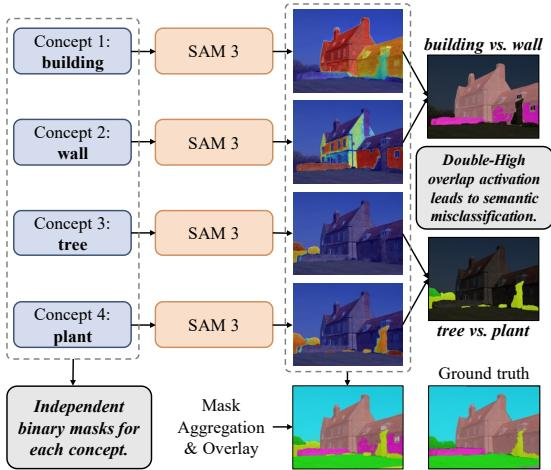  
Figure 1: Limitations of direct mask aggregation in SAM3. Treating multi-class segmentation as isolated binary segmentation tasks lacks inter-class competition, causing “double-high” activation for similar concepts and leading to severe semantic misclassifications in the final mask.

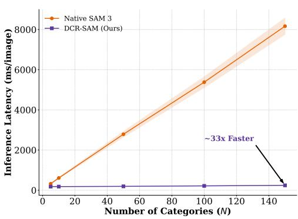  
Figure 2: Comparison of inference latency. The inference latency of the original SAM3 increases linearly O(n) with the number of categories, whereas our method achieves a 33x speedup.

Recent works [31, 14] achieve multi-class segmentation by aggregating the individual masks independently predicted by SAM3 for multiple categories. However, this paradigm inherently treats the multi-class segmentation as a series of independent binary segmentation tasks. Consequently, there is a complete absence of competition among categories, which leaves the model without explicit constraints to differentiate semantically similar concepts. As shown in Figure 1, the model frequently produces “double-high” activations for identical pixel regions when processing similar concepts (e.g., tree vs. plant). This unconstrained behavior inevitably leads to semantic misclassifications and overlapping masks, severely degrading the reliability of the dense prediction results.

On the other hand, the standard architecture of SAM3 requires executing independent and computationally expensive cross-attention operations for each concept to acquire concept-specific dense visual features, followed by an independent decoding process. As shown in Figure 2, our inference latency scaling analysis reveals that on the ADE20K [70] dataset with 150 categories, the inference time scales linearly (O(n)) as the number of categories increases, ultimately resulting in severe inference latency.

To address these limitations, we propose the Dense Competitive Representations SAM (DCR-SAM) framework, which adapts SAM3 into an efficient architecture for multi-class segmentation. Specifically, the proposed framework resolves the aforementioned challenges through three key designs: ❶ To overcome the O(n) inference latency, we decouple the deep cross-modal interactions by replacing class-specific text queries with a unified learnable prompt sequence. This approach enables the extraction of a globally contextualized visual representation shared across all concepts through a single forward pass, achieving a nearly 33× inference speedup compared to the native SAM3, as shown in Figure 2. ❷ To resolve semantic misclassifications among similar concepts, we transition from isolated decoding to a dense competitive paradigm through the introduction of the Vision-Conditioned Text Refinement (VCTR) and Vision-Guided Text Pooling (VGTP) modules, coupled with a dense competition head. VCTR explicitly aligns textual sequence with the modified visual representation by injecting image-specific visual cues, whereas VGTP dynamically compresses this aligned sequence into highly discriminative global class anchors. By enforcing explicit inter-class competition, the proposed method effectively alleviates “double-high” activations and generates high-fidelity masks. ❸ Furthermore, to enhance adaptability across diverse unconstrained scenarios, we incorporate a dynamically learnable background token to absorb non-target objects adaptively.

The main contributions of our work are summarized as follows:

• We reveal how the independent inference paradigm of SAM3 induces severe semantic misclassification among conceptually similar categories and results in an O(n) inference latency.

• We propose DCR-SAM, by decoupling cross-modal interactions to alleviate inference latency and dynamically aligning textual concepts with visual representation, the proposed method effectively suppresses overlapping predictions to generate high-fidelity masks.

• Extensive experimental evaluations demonstrate that our method achieves state-of-theart (SOTA) performance across multiple domain benchmarks while exhibiting excellent inference efficiency.

## 2 Related Work

Promptable Segmentation Models The Segment Anything Model (SAM) [27, 46, 9] represents a significant milestone for promptable segmentation models, demonstrating remarkable cross-domain generalization across diverse downstream applications [31, 3, 54, 41, 6, 33]. Central to this success is the Promptable Visual Segmentation (PVS) paradigm introduced by SAM [27] and SAM 2 [46], where visual prompts (e.g., points, boxes, or masks) guide the segmentation of specific targets. Driven by large-scale, high-quality datasets, this paradigm establishes a robust baseline for generalized segmentation. Building upon this foundation, SAM3 [9] extends the architecture from PVS to Promptable Concept Segmentation (PCS), enabling the model to segment all instances of a given concept using short noun phrases (e.g., a red billboard). Recent studies [30, 44, 63, 64, 13] explore improvements to this architecture. For example, EfficientSAM3 [63, 64] enhances the overall inference efficiency of SAM3 through distillation, SAM3-Adapter [13] injects prior heuristic information for downstream tasks via a lightweight staged adapter. However, these works fundamentally retain the inherent serial inference mechanism of the native architecture. Consequently, they incur non-negligible inference latency and semantic misclassification when applied to real-world multi-class segmentation tasks. Meanwhile CoCo-SAM3 [14] proposes a training-free framework that separates the inference process into intra-class enhancement and inter-class competition modules to alleviate semantic misclassification. Nevertheless, this method relies heavily on complex score calibration and multi-prompt encoding. In this work, we alleviate these issues at the architectural level by decoupling cross-modal interactions. Furthermore, by dynamically aligning textual anchors with visual representations and introducing explicit inter-class competition, the proposed framework effectively mitigates semantic misclassification and generates high-fidelity masks.

Multi-Class Semantic Segmentation and Foundation Models Multi-class semantic segmentation is a fundamental task in computer vision, with the objective of assigning a specific semantic label to every pixel within an image. The field has witnessed remarkable progress, evolving from early CNN-based models, such as FCN [35] and U-Net [47], to modern Transformer-based architectures, such as SegFormer [61], Mask2Former [16] and EoMT [25]. While these methods excel at efficient dense prediction, they typically rely on narrow, task-specific feature representations, thereby lacking the broad semantic priors inherent in large-scale foundation models. Several vision-language models, such as CLIP [45], SigLIP [65], and ALIGN [24], emphasize global image-text alignment and inherently lack pixel-level granularity, rendering them unsuitable for direct application to downstream dense prediction tasks. Conversely, self-supervised vision foundation models, such as DINO [10, 42, 49], capture excellent fine-grained pixel-level representations on massive image corpora, yet they lack explicit cross-modal semantic guidance and require the training of task-specific decoder heads for multi-class segmentation. In this work, we fully leverage the powerful cross-modal priors of SAM3 [9] to enhance the potential of the model in dense prediction tasks.

## 3 Methodology

In this section, we first briefly review the Promptable Concept Segmentation (PCS) pipeline of SAM3 (§3.1). Subsequently, we elaborate on the overall architecture of our proposed DCR-SAM

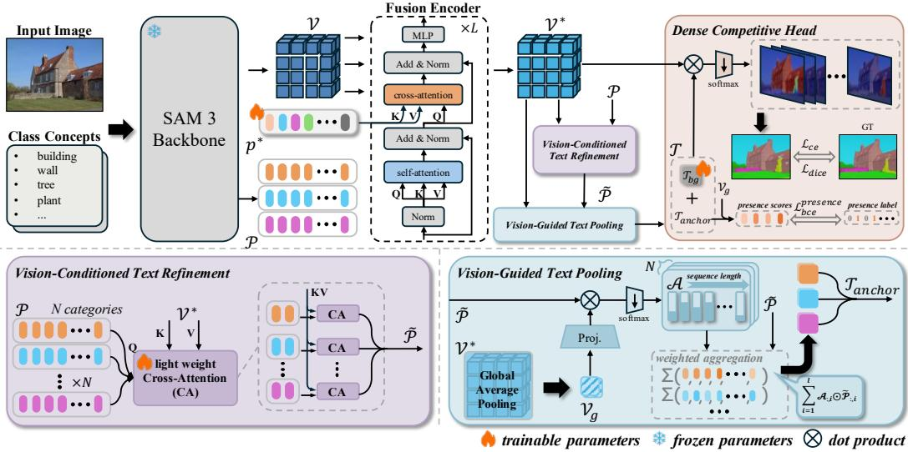  
Figure 3: Overview of our proposed DCR-SAM framework. It transforms SAM3 from an independent decoding paradigm to a dense competitive paradigm. First, we alleviate the inference latency via Decoupled Visual Conditioning to obtain a globally contextualized visual representation. Then, we align text and visual features using the VCTR and VGTP modules. Finally, we design a competition head to enforce explicit inter-class competition and generate high-fidelity masks.

framework (§3.2). The overview of our method is illustrated in Figure 3. Finally, we introduce the joint optimization and the corresponding objective functions (§3.3).

## 3.1 Preliminary

Unlike dual-encoder architectures such as CLIP [45], SAM3 [9] employs an encoder-decoder architecture where the core modules comprise the vision encoder, the text encoder, the fusion encoder, and the semantic decoding head (for simplicity, we exclusively discuss the modules relevant to this work). Given an input image $\dot { I } \in \mathbb { R } ^ { H \times W \times \ddot { 3 } }$ and a target concept set comprising N categories $C = \{ c _ { 1 } , c _ { 2 } , \dots , c _ { N } \}$ , the network initially processes the image through a vision encoder to extract the unconditioned visual embeddings $\gamma \in \mathbb { R } ^ { h w \times d }$ , where d denotes the embedding dimension, h and w depend on the patch resolution of the vision encoder. Simultaneously, each specific concept $c _ { i }$ is encoded into prompt tokens $p _ { i } \in \mathbb { R } ^ { l \times d }$ via a text encoder, where l denotes the sequence length. The complete set of prompt tokens is denoted as $\mathcal { P } = \{ p _ { 1 } , p _ { 2 } , . . . , p _ { N } \}$ . Subsequently, to achieve concept-specific localization, the unconditioned visual embeddings must be dynamically conditioned on the prompt tokens. Following the native architecture of SAM3 [9], a fusion encoder $E _ { f u s i o n }$ accepts the unconditioned visual embeddings V and conditions these embeddings on the prompt tokens $p _ { i }$ using a stack of Transformer [55] blocks equipped with self-attention and cross-attention layers. The output of fusion encoder constitutes the conditioned visual embeddings:

$$
\mathcal { V } _ { c o n d } ^ { i } = E _ { f u s i o n } ( \mathcal { V } , p _ { i } ) , \quad \mathcal { V } _ { c o n d } ^ { i } \in \mathbb { R } ^ { h w \times d } .\tag{1}
$$

Finally, these conditioned embeddings are fed into a semantic decoding head, which is adapted from the MaskFormer [15] architecture, to decode the binary semantic logits map $\mathcal { M } _ { i }$ for the specific concept $c _ { i } { : }$

$$
\mathcal { M } _ { i } = \mathrm { S e g H e a d } ( V _ { c o n d } ^ { i } ) , \quad \mathcal { M } _ { i } \in \mathbb { R } ^ { h \times w } .\tag{2}
$$

In a dense multi-class scenario, to obtain the comprehensive multi-class prediction M, the independently generated binary semantic logit maps must first be aggregated. Subsequently, a standard softmax activation is applied to normalize the probabilities across categories, followed by an argmax operation to derive the final segmentation mask:

$$
\mathcal { M } = \mathrm { C o n c a t } _ { i = 1 } ^ { N } ( \mathcal { M } _ { i } ) , \quad \mathcal { M } \in \mathbb { R } ^ { N \times h \times w } .\tag{3}
$$

Limitations This pipeline must execute the feature fusion and decoding processes independently for each category, which introduces a inference latency with a complexity of ${ \mathcal { O } } ( n )$ . Furthermore, the independent prediction paradigm for each category inherently lacks inter-class competition, thereby provoking severe semantic misclassifications and overlapping masks. In contrast, by decoupling the cross-modal fusion process and constructing a dense competition head, our method transforms the native serial binary segmenter into a highly efficient competitive multi-class architecture.

## 3.2 Architecture of DCR-SAM

Decoupled Visual Conditioning To alleviate the prohibitive ${ \mathcal { O } } ( n )$ inference latency caused by the concept-specific fusion and decoding process, we design a decoupled visual conditioning strategy. Instead of repeatedly feeding the specific text prompt $p _ { i }$ into the computationally intensive fusion encoder (cf. Eq. 1), we introduce a unified learnable prompt sequence $p ^ { * } \in \mathbb { R } ^ { l \times \check { d } }$ . By substituting the concept-specific tokens with $p ^ { * }$ , We completely decouple the deep cross-modal feature fusion from specific prompt tokens. Consequently, the fusion encoder integrates the visual features with the unified prompt sequence through a single forward pass, yielding the joint representation $\nu ^ { * }$

$$
\mathcal { V } ^ { * } = E _ { f u s i o n } ( \mathcal { V } , p ^ { * } ) , \quad \mathcal { V } ^ { * } \in \mathbb { R } ^ { h w \times d } .\tag{4}
$$

This modification adapts the native fusion encoder to extract high-quality, globally contextualized visual representations shared across all concepts. These representations serve as a universal visual foundation for all subsequent multi-class prediction tasks. Benefiting from this strictly categoryagnostic feature fusion process, our approach fundamentally alleviates the inherent inference latency bottleneck of the native architecture.

Vision-Conditioned Text Refinement The native SAM3 [9] independent inference paradigm lacks inter-class competition, leading to severe semantic misclassification and overlapping masks among conceptually similar categories. To fundamentally resolve this issue, our DCR-SAM framework shifts from isolated decoding to a dense competitive paradigm, where textual features are explicitly aligned with globally contextualized visual representations to ensure robust cross-modal grounding. However, original textual features extracted by the text encoder are static and context-free, rendering direct alignment suboptimal. Therefore, we propose the Vision-Conditioned Text Refinement (VCTR) module, which achieves dynamic alignment by integrating image-specific visual cues into textual features. Specifically, we design a lightweight Cross-Attention (CA) module to refine the text representations. The text tokens $p _ { i }$ for each category serve as the Query (Q), while the globally contextualized visual features $\nu ^ { * }$ act as the $K e y \left( K \right)$ and Value (V ). Finally, we aggregate all category features to obtain the aligned textual feature set $\widetilde { \mathcal { P } } = \{ \tilde { p } _ { 1 } , \tilde { p } _ { 2 } , \hdots , \tilde { p } _ { N } \}$

$$
\tilde { p } _ { i } = \mathrm { M H A } ( \mathrm { L N } ( p _ { i } ) , \mathrm { L N } ( \mathcal { V } ^ { * } ) , \mathrm { L N } ( \mathcal { V } ^ { * } ) ) + p _ { i } , \quad \mathrm { w h e r e ~ } \tilde { p } _ { i } \in \mathbb { R } ^ { l \times d } , ~ \widetilde { \mathcal { P } } \in \mathbb { R } ^ { N \times l \times d } .\tag{5}
$$

where MHA and LN denote the Multi-Head Attention and Layer Normalization, respectively. Notably, this lightweight module involves only simple matrix operations and a minimal number of additional parameters, incurring a negligible inference latency.

Vision-Guided Text Pooling For highly efficient dense matching, the aligned text sequence $\widetilde { \mathcal P }$ must be compressed into a global feature embedding (anchor) for each category. An intuitive approach applies average pooling across the sequence. However, this introduces redundant noise from less relevant content or padding tokens, compromising the discriminative capability of semantic anchors. Instead, we propose the Vision-Guided Text Pooling (VGTP) module. First, we apply Global Average Pooling (GAP) and a linear projection layer $\mathcal { F } _ { p r o j }$ to the globally contextualized visual representation $\nu ^ { * }$ to generate a global visual embedding $\gamma _ { g } \mathrm { : }$

$$
\mathcal { V } _ { g } = \mathcal { F } _ { p r o j } ( \mathrm { G A P } ( \mathcal { V } ^ { * } ) ) , \quad \mathcal { V } _ { g } \in \mathbb { R } ^ { 1 \times d } .\tag{6}
$$

Next, we compute the attention scores matrix A between visual embedding and the aligned text sequence. These scores facilitate a weighted aggregation along the sequence length l to generate the final global text anchors $\mathcal { T } _ { a n c h o r }$ for each category:

$$
\mathcal { A } = \sf { s o f t m a x } \left( \frac { \widetilde { \mathcal { P } } \mathcal { V } _ { g } ^ { T } } { \sqrt { d } } \right) , \quad \mathcal { A } \in \mathbb { R } ^ { N \times l } ,\tag{7}
$$

$$
\mathcal { T } _ { a n c h o r } = \sum _ { i = 1 } ^ { l } \mathcal { A } _ { : , i } \odot \widetilde { \mathcal { P } } _ { : , i } , \quad \mathcal { T } _ { a n c h o r } \in \mathbb { R } ^ { N \times d } .\tag{8}
$$

Dynamic Background In multi-class segmentation tasks, pixels not belonging to predefined target categories are typically assigned to a background class. To adapt the SAM3 [9] to this formulation, a straightforward solution uses a generic text prompt, e.g., background. However, this concept is overly broad and lacks explicit visual grounding. Alternatively, hard-coding background categories (e.g., sky or cloud) severely degrades architectural universality, requires extensive dataset-specific engineering, and fails to exhaust all potential unknown distractors. To address these limitations, we introduce an independent, learnable background token $\mathcal { T } _ { b q } \in \mathbb { R } ^ { 1 \times d }$ and concatenate it with the generated text anchors to form a complete semantic anchor set $\tau { : }$

$$
\mathcal { T } = \operatorname { C o n c a t } ( \mathcal { T } _ { a n c h o r } , \mathcal { T } _ { b g } ) , \quad \mathcal { T } \in \mathbb { R } ^ { ( N + 1 ) \times d } .\tag{9}
$$

Dense Competitive Head Equipped with the complete set of text anchors $\tau$ and the globally contextualized visual representation $\nu ^ { * }$ , we discard the isolated decoding paradigm in favor of a dense competitive head. To ensure stable optimization and prevent feature magnitude discrepancies from dominating the logit computation, we apply $L _ { 2 }$ normalization along the channel dimension and introduce a temperature scaling parameter τ prior to the dot product. Specifically, we compute the scaled similarity between the normalized dense visual features and the text anchors to generate the dense logits map $\mathcal { M } ^ { * }$

$$
\mathcal { M } ^ { * } = \frac { 1 } { \tau } \left( \frac { \mathcal { T } } { \| \mathcal { T } \| _ { 2 } } \right) \left( \frac { \mathcal { V } ^ { * } } { \| \mathcal { V } ^ { * } \| _ { 2 } } \right) ^ { T } , \quad \mathcal { M } ^ { * } \in \mathbb { R } ^ { ( N + 1 ) \times h w } .\tag{10}
$$

## 3.3 Joint Optimization for DCR-SAM

Global Presence Score While the dense competitive head suppresses semantic misclassification, relying solely on local dense features can occasionally lead to false positive predictions due to localized visual similarities. To provide a robust constraint, we follow the training strategy of SAM3 [9] and introduce a global presence score during the training phase. Specifically, we compute the dot product between the global visual embedding $\mathcal { V } _ { g }$ and the set of target semantic anchors $\mathcal { T } _ { a n c h o r } .$ , followed by a sigmoid operation, to generate the image-level presence scores $S _ { p r e s e n c e } \colon$

$$
S _ { p r e s e n c e } = \mathbf { s i g m o i d } ( \mathcal { T } _ { a n c h o r } \mathcal { V } _ { g } ^ { T } ) , \quad S _ { p r e s e n c e } \in \mathbb { R } ^ { N \times 1 } .\tag{11}
$$

Joint Objective To holistically optimize the proposed model, we formulate a joint end-to-end training objective. We employ the cross-entropy loss and the dice loss to supervise the final mask, and utilize the binary cross-entropy loss to supervise the global presence score, and $\lambda _ { i }$ denotes the weight to rescale the loss terms:

$$
\mathcal { L } _ { t o t a l } = \lambda _ { 1 } \mathcal { L } _ { c e } + \lambda _ { 2 } \mathcal { L } _ { d i c e } + \lambda _ { 3 } \mathcal { L } _ { b c e } ^ { p r e s e n c e } .\tag{12}
$$

## 4 Experiments

## 4.1 Experimental Setup

Datasets and Evaluation Metric We evaluate our DCR-SAM on four highly challenging naturalscene benchmarks: ADE20K [70], which encompasses a dense label space of 150 classes, Cityscapes [17], which contains 19 classes tailored for urban driving scenarios, COCO-Stuff-164K [7] (COCO-Stuff), which features a vast and diverse label space of 171 classes, and PASCAL-Context59 [40] (Context59), which provides dense annotations for 59 prevalent categories. To demonstrate cross-domain robustness, we extend our evaluation to four representative remote sensing benchmarks: LoveDA [56] with 7 classes, ISPRS Potsdam [48] with 6 classes, ISPRS Vaihingen [39] with 6 classes, and iSAID [58] with 16 classes. Unless stated otherwise, all models are trained on their respective training sets, and the results are reported on the official validation sets. We employ the standard mean Intersection over Union (mIoU) as our primary metric.

Baselines We compare DCR-SAM with state-of-the-art semantic segmentation methods, including InternImage-H [57], EoMT [25], and SegMAN-L [19]. For SAM3 [9], we adopt its complete official architecture, retaining all core components, including the detector and presence prediction modules, and establish two baselines: ➀ Native-Binary (SAM3†), which follows the official training strategy to independently predict binary masks for each category; and ➁ Native-Multi-Class (SAM3‡), which concatenates category-wise predictions and is fine-tuned under a standard multi-class training paradigm. Following established SAM3 adaptation practices, semantic masks from both the semantic and detector heads are fused to obtain the final segmentation results. Notably, the latter configuration lacks explicit inter-class competition, potentially leading to semantic overlap among related categories.

Table 1: Comparison with state-of-the-art semantic segmentation methods on natural scene and remote sensing, with the best results in bold, the second-best underlined, and all results evaluated on the validation set. † denotes Native-Binary paradigm and ‡ denotes Native-Multi-Class paradigm.
<table><tr><td rowspan="2">Methods</td><td rowspan="2">Pub. &amp; Year</td><td rowspan="2">Backbone</td><td colspan="4">Train on Natural Scene</td></tr><tr><td>ADE20K</td><td>Cityscapes</td><td>COCO-Stuff</td><td>Context59</td></tr><tr><td>DeepLabV3 [11]</td><td>ECCV&#x27;18</td><td>ResNet-101</td><td>42.6</td><td>77.1</td><td>37.9</td><td>52.0</td></tr><tr><td>DeepLabV3+ [12]</td><td>ECCV&#x27;18</td><td>ResNet-101</td><td>44.5</td><td>73.6</td><td></td><td>53.2</td></tr><tr><td>HiPoSeg [32]</td><td>ICLR&#x27;26</td><td>ResNet-101</td><td>49.0</td><td>84.0</td><td></td><td></td></tr><tr><td>HRNet [51]</td><td>arXiv&#x27;19</td><td>HRNetV2-W48</td><td>41.9</td><td>78.5</td><td>36.0</td><td>51.9</td></tr><tr><td>OCRNet [62]</td><td>ECCV&#x27;20</td><td>HRNetV2-W48</td><td>41.5</td><td>80.0</td><td>39.0</td><td>54.4</td></tr><tr><td>OCRNet [62]</td><td>ECCV&#x27;20</td><td>D-ResNet-101</td><td>45.3</td><td>81.8</td><td></td><td>54.8</td></tr><tr><td>SETR-PUP [68]</td><td>CVPR&#x27;21</td><td>ViT-L</td><td>50.1</td><td>82.2</td><td></td><td>55.3</td></tr><tr><td>EoMT [25]</td><td>CVPR&#x27;25</td><td>ViT-L</td><td>58.4</td><td>84.2</td><td></td><td></td></tr><tr><td>DTop [52]]</td><td>ICCV&#x27;23</td><td>ViT-L</td><td>52.8</td><td></td><td>47.1</td><td>62.7</td></tr><tr><td>SegViT [66]</td><td>NeurIPS&#x27;22</td><td>ViT-L</td><td>53.3</td><td></td><td>47.4</td><td>63.0</td></tr><tr><td>ECENet [34]</td><td>ICCV&#x27;23</td><td>Swin-L</td><td>55.2</td><td>84.5</td><td></td><td>65.9</td></tr><tr><td>CPT [53]</td><td>TIP&#x27;25</td><td>Swin-L</td><td>58.5</td><td>84.6</td><td></td><td>65.6</td></tr><tr><td>SegMAN-L [19]</td><td>CVPR&#x27;25</td><td>LASS</td><td>53.2</td><td>84.2</td><td></td><td></td></tr><tr><td>SegNeXt-T [21]</td><td>NeurIPS&#x27;22</td><td>MSCAN-T</td><td>41.1</td><td>79.8</td><td>38.7</td><td>51.2</td></tr><tr><td>InternImage-H [57]</td><td>CVPR&#x27;23</td><td>DCNv3</td><td>60.3</td><td>86.1</td><td></td><td>70.3</td></tr><tr><td>SAM3† [9]</td><td>ICLR&#x27;26</td><td>SAM3 (PE-L+/14)</td><td>46.5</td><td>75.4</td><td>48.1</td><td>66.3</td></tr><tr><td>SAM3 [9]</td><td>ICLR&#x27;26</td><td>SAM3 (PE-L+/14)</td><td>41.2</td><td>72.6</td><td>45.4</td><td>64.3</td></tr><tr><td>DCR-SAM (Ours)</td><td></td><td>SAM3 (PE-L+/14)</td><td>68.7↑8.4</td><td>89.1↑3.0</td><td>50.8↑2.7</td><td>72.6↑2.3</td></tr><tr><td rowspan="3">Methods</td><td rowspan="3">Pub. &amp; Year</td><td rowspan="3">Backbone</td><td></td><td>Train on Remote Sensing</td><td></td><td></td></tr><tr><td>LoveDA</td><td>Potsdam</td><td>Vaihingen</td><td>iSAID</td></tr><tr><td>48.3</td><td>82.0</td><td>76.8</td><td>60.2</td></tr><tr><td>PSPNet [67] DeepLabV3+ [12]</td><td>CVPR&#x27;17 ECCV&#x27;18</td><td>ResNet-50 ResNet-50</td><td>47.6</td><td>84.2</td><td>77.1</td><td>61.9</td></tr><tr><td>DANet [18]</td><td>CVPR&#x27;19</td><td>ResNet-50</td><td>50.2</td><td>81.4</td><td>77.3</td><td>60.0</td></tr><tr><td>SemanticFPN [26]</td><td>CVPR&#x27;19</td><td>ResNet-50</td><td>48.2</td><td>84.6</td><td>77.9</td><td>59.3</td></tr><tr><td>FarSeg [69]</td><td>CVPR&#x27;20</td><td>ResNet-50</td><td>48.2</td><td>84.3</td><td>79.1</td><td>63.7</td></tr><tr><td>LOGCAN++ [38]</td><td>TGRS&#x27;25</td><td>ResNet-50</td><td>53.4</td><td>87.6</td><td>83.9</td><td>65.0</td></tr><tr><td>SCSM [37]</td><td>ISPRS&#x27;25</td><td>ResNet-50</td><td>54.6</td><td>87.8</td><td>84.7</td><td></td></tr><tr><td>Segmenter [50]</td><td>ICCV&#x27;21</td><td>ViT-L</td><td>47.1</td><td>86.5</td><td>79.4</td><td>66.9</td></tr><tr><td>EfficientViT [8]</td><td>ICCV&#x27;23</td><td>EfficientViT-L2</td><td>47.1</td><td>84.2</td><td>80.5</td><td></td></tr><tr><td>DDP [23]</td><td>ICCV&#x27;23</td><td>Swin-T</td><td>52.5</td><td>87.4</td><td>82.6</td><td></td></tr><tr><td></td><td>ICLR&#x27;26</td><td></td><td>55.8</td><td></td><td></td><td></td></tr><tr><td>SAM3† [9]</td><td></td><td>SAM3 (PE-L+/14)</td><td></td><td>66.4</td><td>69.8</td><td>61.1</td></tr><tr><td>SAM3 [9] DCR-SAM (Ours)</td><td>ICLR&#x27;26</td><td>SAM3 (PE-L+/14) SAM3 (PE-L+/14)</td><td>50.4 66.5↑10.7</td><td>61.3 90.2↑2.4</td><td>65.7 89.2↑4.5</td><td>55.4 75.4↑8.5</td></tr></table>

Implementation Details The proposed DCR-SAM is implemented in the PyTorch framework [43]. All models are initialized with the official pre-trained weights of SAM3 [9]. For the concept set, we directly utilize the original category names provided by the respective datasets. The length of the unified learnable prompt sequence $p ^ { * }$ is set to 32. The scaling parameter τ is set to 0.07. The scaling weights $( \lambda _ { 1 } , \lambda _ { 2 }$ , and $\lambda _ { 3 } )$ of the loss functions are set to 1 by default. The dynamic background strategy is optional, it can be omitted when all pixels in the evaluation dataset belong to the target categories. During the training phase, we freeze the original weights of SAM3 backbone and only fine-tune the newly introduced parameters: the learnable prompt sequence, the lightweight cross-modal attention module, and the learnable background token. The network is optimized end-to-end using the AdamW optimizer [36] with an initial learning rate of $1 \times 1 0 ^ { - 4 }$ and a weight decay of $5 \times 1 0 ^ { - 4 }$ . The batch size is set to 8, and all models are trained for 80, 000 iterations. All experiments are conducted on 8 NVIDIA RTX 4090 GPUs. Further details are provided in the Appendix A.1.

## 4.2 Overall Performance

Quantitative Comparisons As shown in Table 1, our method demonstrates exceptional performance across various benchmarks. In natural scene datasets, the proposed method significantly outperforms previous SOTA approaches, yielding substantial improvements ranging from 2.3% ∼ 8.4%. Even compared with InternImage-H [57], a vision foundation model built upon deformable convolutions, our method consistently achieves superior results. In cross-domain remote sensing scenarios, it continues to demonstrate substantial superiority, achieving improvements of approximately 2.4% ∼ 10.7%. Furthermore, it significantly surpasses specialized methods designed for remote sensing, such as LOGCAN++ [38] and SCSM [37], verifying its robust scene adaptability. Notably, the performance gains achieved in remote sensing are generally more pronounced than those in natural scenes. We attribute this phenomenon to the significantly smaller concept space of remote sensing imagery compared to natural scenes, enabling the dense competition head to establish more stable semantic anchors.

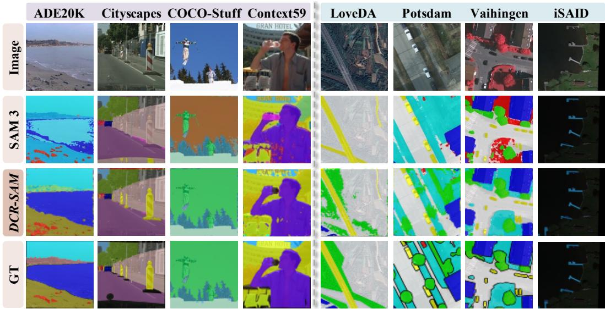  
Figure 4: Qualitative comparison results on natural scene and remote sensing. We use the SAM3† to present the visualization results of the second row.

Moreover, the comparison with the two SAM3 adaptation baselines demonstrates that both training paradigms fail to achieve optimal results without modifying the core network architecture. Notably, the performance of the Native-Multi-Class paradigm (SAM3‡) is inferior to that of the original Native-Binary paradigm (SAM3†). This performance degradation indicates that merely adjusting the training strategy fails to compensate for the inherent architectural defects of the model in multi-class segmentation tasks. More experimental analysis in the Appendix B.1.

Qualitative Results We visualize the segmentation results across both natural scene and remote sensing benchmarks in Figure 4. SAM3 exhibits limitations such as semantic fragmentation, noisy artifacts (e.g., on the person in Context59), and regional misclassifications (e.g., omitting vegetation in LoveDA) in complex semantic contexts. Conversely, our DCR-SAM preserves the high-fidelity spatial delineation inherent to SAM3 while demonstrating significant improvements in semantic discriminability.

## 4.3 Further analysis

Component Ablation To validate the effectiveness of the proposed modules, we conduct an ablation analysis on the ADE20K and LoveDA benchmarks. Table 2 reports the per-image inference time (ms) and the mIoU on both benchmarks. The proposed method achieves a 33× inference speedup on the ADE20K benchmark, decreasing the inference time from 8038 ms to 244 ms alongside substantial performance gains, which demonstrates the necessity of decoupling the cross-modal feature fusion. Furthermore, the text refinement results indicate that incorporating the VCTR module yields significant improvements with only a marginal increase in inference latency, extending the inference time from 224 ms to 244 ms on the ADE20K dataset. Regarding the pooling strategy, the proposed VGTP module significantly outperforms conventional approaches such as first, last, and mean pooling, confirming that dynamic compression constructs highly discriminative textual anchors. For the background category, it can be observed that the proposed dynamic background strategy $( \mathcal { T } _ { b g } )$ achieves optimal performance. Although expanding the number of hard-coding background categories can further improve the performance, this strategy requires extensive prompt engineering and manual adaptations specific to the dataset, thereby significantly limiting the general applicability of the model. Additional ablation analyses are detailed in Appendix B.1.

Table 2: Ablation analysis of core components. We use the $\mathbf { S A M } 3 ^ { \dagger }$ as our baseline model.
<table><tr><td rowspan="2">Components</td><td colspan="2">ADE20K</td><td colspan="2">LoveDA</td></tr><tr><td>Time.↓</td><td>mIoU</td><td>Time.↓</td><td>mIoU</td></tr><tr><td>baseline</td><td>8038</td><td>46.5</td><td>647</td><td>55.8</td></tr><tr><td>(a) text refinement</td><td></td><td></td><td></td><td></td></tr><tr><td>DCR-SAM w/o VCTR</td><td>224</td><td>61.4</td><td>179</td><td>60.9</td></tr><tr><td>DCR-SAM w/ VCTR</td><td>244</td><td>68.7</td><td>183</td><td>66.5</td></tr><tr><td>(b) pooling strategy</td><td></td><td></td><td></td><td></td></tr><tr><td>First</td><td>244</td><td>63.1</td><td>183</td><td>61.8</td></tr><tr><td>Last</td><td>244</td><td>62.8</td><td>183</td><td>60.2</td></tr><tr><td>Mean</td><td>244</td><td>66.5</td><td>183</td><td>63.2</td></tr><tr><td>VGTP.</td><td>244</td><td>68.7</td><td>183</td><td>66.5</td></tr><tr><td>(c) background strategy</td><td></td><td></td><td></td><td></td></tr><tr><td>generic text</td><td>一</td><td>一</td><td>183</td><td>59.5</td></tr><tr><td>hard-coding</td><td>一</td><td>一</td><td>193</td><td>64.1</td></tr><tr><td>dynamic background</td><td>一</td><td>一</td><td>183</td><td>66.5</td></tr></table>

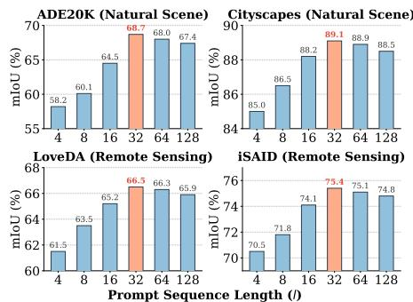  
Figure 5: Analysis of learnable prompt sequence length. We select six different lengths $( \bar { l } ~ \in ~ \{ 4 , \bar { 8 , } 1 6 , 3 2 , 6 4 , 1 2 8 \}$ ) and report the mIoU on four benchmarks. Best results are highlighted in orange.

Impact of Learnable Prompt Sequence Length We investigate the impact of the learnable prompt sequence length $( l \in \{ 4 , 8 , \bar { 1 6 } , 3 \bar { 2 } , 6 4 , 1 2 8 \} )$ on the final segmentation performance, as illustrated in Figure 5. The performance variations exhibit a highly consistent trend across all four evaluation benchmarks, uniformly achieving optimal results when l is set to 32. When the sequence length is highly restricted $( l \leq \bar { 8 } )$ , the model lacks the representational capacity to capture complex semantic variations, resulting in suboptimal segmentation performance. Conversely, the performance degrades when the sequence length exceeds 32. This degradation is likely attributable to redundant parameters that introduce noise and increase the risk of overfitting. Therefore, we apply a unified sequence length across all benchmarks in this work.

Analysis of Objective Function We evaluate the individual contributions of the three loss components $( \mathcal { L } _ { c e } ,$ $\mathcal { L } _ { d i c e } ,$ and $\mathcal { L } _ { b c e } ^ { p r e s e n c e } )$ in Table 3. The results indicate that $\mathcal { L } _ { c e }$ and $\mathcal { L } _ { d i c e }$ are highly complementary, and their joint application yields substantial improvements. Ultimately, the incorporation of the binary cross-entropy loss $( \mathcal { L } _ { b c e } ^ { p r e s e n c e } )$ for the prediction of category presence achieves peak mIoU scores of 68.7% and 66.5% on the two benchmarks, respectively. This demonstrates the critical role of this component in mitigating false positives. In addition, Figure 6 visualizes the training trajectories, which illustrate a highly stable and synchronous convergence process across both domains, thereby validating the robustness of the joint optimization strategy.

Table 3: Analysis of loss functions. We report the results on the ADE20K and LoveDA datasets.
<table><tr><td> $\mathcal { L } _ { c e }$ </td><td> $\mathcal { L } _ { d i c e }$ </td><td> $\mathcal { L } _ { b c e } ^ { p r e s e n c e }$ </td><td>ADE20K</td><td>LoveDA</td></tr><tr><td>√</td><td>X</td><td>X</td><td>66.7</td><td>64.0</td></tr><tr><td>√</td><td>√</td><td>X</td><td>67.3</td><td>64.9</td></tr><tr><td></td><td>」</td><td>√</td><td>68.7</td><td>66.5</td></tr></table>

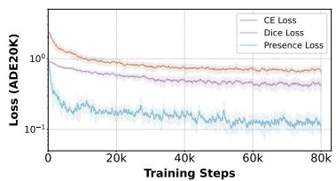

Comparison with SAM 3-Based Methods. We further compare DCR-SAM with four recent SAM 3-based methods, including SegEarth-OV3 [31], CoCo-SAM3 [14], EfficientSAM3 [63], and SAM3- Adapter [13]. As shown in Table 4, DCR-SAM consistently outperforms these methods, achieving 68.7% mIoU on ADE20K and 66.5% mIoU on LoveDA, surpassing the strongest baselines by 21.5% and 13.6%, respectively. While SegEarth-OV3 and CoCo-SAM3 adopt training-free strategies, EfficientSAM3 and

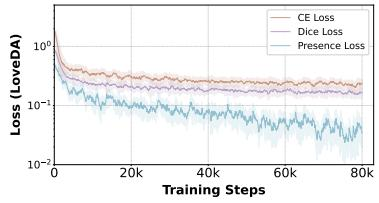  
Figure 6: Loss curves of three loss functions.

Table 4: Comparison with SAM 3-based methods on ADE20K and LoveDA (mIoU, %).
<table><tr><td>Method</td><td>ADE20K</td><td>LoveDA</td></tr><tr><td>SegEarth-OV3</td><td>36.6</td><td>47.4</td></tr><tr><td>CoCo-SAM3</td><td>38.3</td><td></td></tr><tr><td>EfficientSAM3</td><td>43.2</td><td>50.3</td></tr><tr><td>SAM3-Adapter</td><td>47.2</td><td>52.9</td></tr><tr><td>DCR-SAM</td><td>68.7</td><td>66.5</td></tr></table>

Table 5: Comparison of different segmentation architectures using a unified PE-L+/14 backbone on ADE20K (mIoU, %).
<table><tr><td>Method</td><td>Backbone</td><td>mIoU↑</td></tr><tr><td>UPerNet</td><td>PE-L+/14</td><td>59.6</td></tr><tr><td>EoMT-Style</td><td>PE-L+/14</td><td>52.1</td></tr><tr><td>Mask2Former</td><td>PE-L+/14</td><td>61.3</td></tr><tr><td>DCR-SAM</td><td>PE-L+/14</td><td>68.7</td></tr></table>

SAM3-Adapter primarily focus on efficient adaptation without explicitly addressing inter-class semantic conflicts. In contrast, DCR-SAM introduces a dense competitive head to enforce explicit inter-class competition, effectively mitigating semantic overlap and improving multi-class segmentation performance.

Comparison under a Unified Backbone To isolate the contribution of our segmentation architecture, we further compare DCR-SAM with representative segmentation heads, including UPerNet [60], Mask2Former [16], and EoMT-Style [25], using the same PE-L+/14 backbone [4]. As shown in Table 5, DCR-SAM achieves 68.7 mIoU on ADE20K, outperforming UPerNet, EoMT-Style, and Mask2Former by 9.1%, 16.6%, and 7.4%, respectively. These results demonstrate that the performance gains are not solely attributable to the backbone, but also benefit from our proposed dense competitive architecture. Notably, the PE backbone is specifically optimized for open-vocabulary tasks, making it less suitable for conventional closed-set segmentation heads. By preserving the native promptable architecture of SAM 3 and introducing explicit inter-class competition, DCR-SAM better exploits its pre-trained cross-modal representations for dense multi-class segmentation.

## 5 Conclusion

In this paper, we propose the Dense Competitive Representations SAM (DCR-SAM) framework to mitigate the inference latency and inherent semantic misclassifications encountered during the adaptation of SAM3 to multi-class segmentation. The proposed method decouples the feature fusion process to ensure optimal inference efficiency. Furthermore, the alignment of textual and visual representations within a dense competitive paradigm effectively suppresses overlapping predictions among conceptually similar categories. Extensive experiments demonstrate that the framework achieves SOTA performance across diverse benchmarks while delivering a 33× speedup. We hope our work paves the way for adapting foundation models to complex, real-world multi-class segmentation tasks.

Limitations DCR-SAM reduces text prompt sensitivity and inference latency, facilitating its potential application in autonomous systems and medical imaging. However, its reliance on largescale foundation models incurs substantial computational costs and may inherit biases from pretraining data. Moreover, inter-class competition may impair the recognition of unseen concepts. Future work will focus on improving computational efficiency and generalization in open-vocabulary segmentation.

## References

[1] Nikita Araslanov and Stefan Roth. Single-stage semantic segmentation from image labels. In Proceedings of the IEEE/CVF conference on computer vision and pattern recognition, pages 4253–4262, 2020.

[2] Jimmy Lei Ba, Jamie Ryan Kiros, and Geoffrey E Hinton. Layer normalization. arXiv preprint arXiv:1607.06450, 2016.

[3] Roni Blushtein-Livnon, Osher Rafaeli, David Ioffe, Amir Boger, Karen Sandberg Esquenazi, and Tal Svoray. On the effectiveness of textual prompting with lightweight fine-tuning for sam3 remote sensing segmentation. arXiv preprint arXiv:2512.15564, 2025.

[4] Daniel Bolya, Po-Yao Huang, Peize Sun, Jang Hyun Cho, Andrea Madotto, Chen Wei, Tengyu Ma, Jiale Zhi, Jathushan Rajasegaran, Hanoona Bangalath, et al. Perception encoder: The best visual embeddings are not at the output of the network. Advances in Neural Information Processing Systems, 38:60884–60937, 2026.

[5] Sébastien Bubeck, Christian Coester, Ronen Eldan, Timothy Gowers, Yin Tat Lee, Alexandru Lupsasca, Mehtaab Sawhney, Robert Scherrer, Mark Sellke, Brian K Spears, et al. Early science acceleration experiments with gpt-5. arXiv preprint arXiv:2511.16072, 2025.

[6] Valay Bundele, Mehran Hosseinzadeh, and Hendrik Lensch. Memory-enhanced sam3 for occlusion-robust surgical instrument segmentation. In Medical Imaging with Deep Learning, 2025.

[7] Holger Caesar, Jasper Uijlings, and Vittorio Ferrari. Coco-stuff: Thing and stuff classes in context. In Proceedings of the IEEE conference on computer vision and pattern recognition, pages 1209–1218, 2018.

[8] Han Cai, Junyan Li, Muyan Hu, Chuang Gan, and Song Han. Efficientvit: Lightweight multi-scale attention for high-resolution dense prediction. In Proceedings of the IEEE/CVF international conference on computer vision, pages 17302–17313, 2023.

[9] Nicolas Carion, Laura Gustafson, Yuan-Ting Hu, Shoubhik Debnath, Ronghang Hu, Didac Suris, Chaitanya Ryali, Kalyan Vasudev Alwala, Haitham Khedr, Andrew Huang, et al. Sam 3: Segment anything with concepts. arXiv preprint arXiv:2511.16719, 2025.

[10] Mathilde Caron, Hugo Touvron, Ishan Misra, Hervé Jégou, Julien Mairal, Piotr Bojanowski, and Armand Joulin. Emerging properties in self-supervised vision transformers. In Proceedings of the IEEE/CVF international conference on computer vision, pages 9650–9660, 2021.

[11] Liang-Chieh Chen, George Papandreou, Florian Schroff, and Hartwig Adam. Rethinking atrous convolution for semantic image segmentation. arXiv preprint arXiv:1706.05587, 2017.

[12] Liang-Chieh Chen, Yukun Zhu, George Papandreou, Florian Schroff, and Hartwig Adam. Encoder-decoder with atrous separable convolution for semantic image segmentation. In Proceedings of the European conference on computer vision (ECCV), pages 801–818, 2018.

[13] Tianrun Chen, Runlong Cao, Xinda Yu, Lanyun Zhu, Chaotao Ding, Deyi Ji, Cheng Chen, Qi Zhu, Chunyan Xu, Papa Mao, et al. Sam3-adapter: Efficient adaptation of segment anything 3 for camouflage object segmentation, shadow detection, and medical image segmentation. arXiv preprint arXiv:2511.19425, 2025.

[14] Yanhui Chen, Baoyao Yang, Siqi Liu, and Jingchao Wang. Coco-sam3: Harnessing concept conflict in open-vocabulary semantic segmentation. arXiv preprint arXiv:2604.19648, 2026.

[15] Bowen Cheng, Alex Schwing, and Alexander Kirillov. Per-pixel classification is not all you need for semantic segmentation. Advances in neural information processing systems, 34: 17864–17875, 2021.

[16] Bowen Cheng, Ishan Misra, Alexander G Schwing, Alexander Kirillov, and Rohit Girdhar. Masked-attention mask transformer for universal image segmentation. In Proceedings of the IEEE/CVF conference on computer vision and pattern recognition, pages 1290–1299, 2022.

[17] Marius Cordts, Mohamed Omran, Sebastian Ramos, Timo Rehfeld, Markus Enzweiler, Rodrigo Benenson, Uwe Franke, Stefan Roth, and Bernt Schiele. The cityscapes dataset for semantic urban scene understanding. In Proceedings of the IEEE conference on computer vision and pattern recognition, pages 3213–3223, 2016.

[18] Jun Fu, Jing Liu, Haijie Tian, Yong Li, Yongjun Bao, Zhiwei Fang, and Hanqing Lu. Dual attention network for scene segmentation. In Proceedings of the IEEE/CVF conference on computer vision and pattern recognition, pages 3146–3154, 2019.

[19] Yunxiang Fu, Meng Lou, and Yizhou Yu. Segman: Omni-scale context modeling with state space models and local attention for semantic segmentation. In Proceedings of the Computer Vision and Pattern Recognition Conference, pages 19077–19087, 2025.

[20] Jingda Guo, Xu Ma, Andrew Sansom, Mara McGuire, Andrew Kalaani, Qi Chen, Sihai Tang, Qing Yang, and Song Fu. Spanet: Spatial pyramid attention network for enhanced image recognition. In 2020 IEEE International Conference on Multimedia and Expo (ICME), 2020.

[21] Meng-Hao Guo, Cheng-Ze Lu, Qibin Hou, Zhengning Liu, Ming-Ming Cheng, and Shi-Min Hu. Segnext: Rethinking convolutional attention design for semantic segmentation. Advances in neural information processing systems, 35:1140–1156, 2022.

[22] Kaiming He, Xiangyu Zhang, Shaoqing Ren, and Jian Sun. Deep residual learning for image recognition. In Proceedings of the IEEE conference on computer vision and pattern recognition, pages 770–778, 2016.

[23] Yuanfeng Ji, Zhe Chen, Enze Xie, Lanqing Hong, Xihui Liu, Zhaoqiang Liu, Tong Lu, Zhenguo Li, and Ping Luo. Ddp: Diffusion model for dense visual prediction. In Proceedings of the IEEE/CVF International Conference on Computer Vision, pages 21741–21752, 2023.

[24] Chao Jia, Yinfei Yang, Ye Xia, Yi-Ting Chen, Zarana Parekh, Hieu Pham, Quoc Le, Yun-Hsuan Sung, Zhen Li, and Tom Duerig. Scaling up visual and vision-language representation learning with noisy text supervision. In International conference on machine learning, pages 4904–4916. PMLR, 2021.

[25] Tommie Kerssies, Niccolo Cavagnero, Alexander Hermans, Narges Norouzi, Giuseppe Averta, Bastian Leibe, Gijs Dubbelman, and Daan De Geus. Your vit is secretly an image segmentation model. In Proceedings of the computer vision and pattern recognition conference, pages 25303– 25313, 2025.

[26] Alexander Kirillov, Ross Girshick, Kaiming He, and Piotr Dollár. Panoptic feature pyramid networks. In Proceedings of the IEEE/CVF conference on computer vision and pattern recognition, pages 6399–6408, 2019.

[27] Alexander Kirillov, Eric Mintun, Nikhila Ravi, Hanzi Mao, Chloe Rolland, Laura Gustafson, Tete Xiao, Spencer Whitehead, Alexander C Berg, Wan-Yen Lo, et al. Segment anything. In Proceedings of the IEEE/CVF international conference on computer vision, pages 4015–4026, 2023.

[28] Earl J Kirkland. Bilinear interpolation. In Advanced computing in electron microscopy, pages 261–263. Springer, 2010.

[29] Philipp Krähenbühl and Vladlen Koltun. Efficient inference in fully connected crfs with gaussian edge potentials. Advances in neural information processing systems, 24, 2011.

[30] Jingjing Li, Yue Feng, Yuchen Guo, Jincai Huang, Yongri Piao, Qi Bi, Miao Zhang, Xiaoqi Zhao, Qiang Chen, Shihao Zou, et al. Sam3-i: Segment anything with instructions. arXiv preprint arXiv:2512.04585, 2025.

[31] Kaiyu Li, Shengqi Zhang, Yupeng Deng, Zhi Wang, Deyu Meng, and Xiangyong Cao. Segearthov3: Exploring sam 3 for open-vocabulary semantic segmentation in remote sensing images. arXiv preprint arXiv:2512.08730, 2025.

[32] Seoha Lim, Jinmyeong Kim, Jieun Kim, and Sung-Bae Cho. Hierarchical prototype learning for semantic segmentation. In The Fourteenth International Conference on Learning Representations, 2025.

[33] Yida Lin, Bing Xue, Mengjie Zhang, Sam Schofield, and Richard Green. Progressive per-branch depth optimization for defom-stereo and sam3 joint analysis in uav forestry applications. arXiv preprint arXiv:2602.20539, 2026.

[34] Yuhe Liu, Chuanjian Liu, Kai Han, Quan Tang, and Zengchang Qin. Boosting semantic segmentation from the perspective of explicit class embeddings. In Proceedings of the IEEE/CVF International Conference on Computer Vision, pages 821–831, 2023.

[35] Jonathan Long, Evan Shelhamer, and Trevor Darrell. Fully convolutional networks for semantic segmentation. In Proceedings of the IEEE conference on computer vision and pattern recognition, pages 3431–3440, 2015.

[36] Ilya Loshchilov and Frank Hutter. Decoupled weight decay regularization. arXiv preprint arXiv:1711.05101, 2017.

[37] Xiaowen Ma, Rongrong Lian, Zhenkai Wu, Renxiang Guan, Tingfeng Hong, Mengjiao Zhao, Mengting Ma, Jiangtao Nie, Zhenhong Du, Siyang Song, et al. A novel scene coupling semantic mask network for remote sensing image segmentation. ISPRS Journal of Photogrammetry and Remote Sensing, 221:44–63, 2025.

[38] Xiaowen Ma, Rongrong Lian, Zhenkai Wu, Hongbo Guo, Fan Yang, Mengting Ma, Sensen Wu, Zhenhong Du, Wei Zhang, and Siyang Song. Logcan++: Adaptive local-global classaware network for semantic segmentation of remote sensing images. IEEE Transactions on Geoscience and Remote Sensing, 2025.

[39] ITC Markus Gerke. Use of the stair vision library within the isprs 2d semantic labeling benchmark (vaihingen), 2014.

[40] Roozbeh Mottaghi, Xianjie Chen, Xiaobai Liu, Nam-Gyu Cho, Seong-Whan Lee, Sanja Fidler, Raquel Urtasun, and Alan Yuille. The role of context for object detection and semantic segmentation in the wild. In Proceedings of the IEEE conference on computer vision and pattern recognition, pages 891–898, 2014.

[41] Diederick C Niehorster and Marcus Nyström. Eye image segmentation using visual and concept prompts with segment anything model 3 (sam3). arXiv preprint arXiv:2603.17715, 2026.

[42] Maxime Oquab, Timothée Darcet, Théo Moutakanni, Huy Vo, Marc Szafraniec, Vasil Khalidov, Pierre Fernandez, Daniel Haziza, Francisco Massa, Alaaeldin El-Nouby, et al. Dinov2: Learning robust visual features without supervision. arXiv preprint arXiv:2304.07193, 2023.

[43] Adam Paszke, Sam Gross, Francisco Massa, Adam Lerer, James Bradbury, Gregory Chanan, Trevor Killeen, Zeming Lin, Natalia Gimelshein, Luca Antiga, et al. Pytorch: An imperative style, high-performance deep learning library. Advances in neural information processing systems, 32, 2019.

[44] Gensheng Pei, Xiruo Jiang, Yazhou Yao, Xiangbo Shu, Fumin Shen, and Byeungwoo Jeon. Taming sam3 in the wild: A concept bank for open-vocabulary segmentation. arXiv preprint arXiv:2602.06333, 2026.

[45] Alec Radford, Jong Wook Kim, Chris Hallacy, Aditya Ramesh, Gabriel Goh, Sandhini Agarwal, Girish Sastry, Amanda Askell, Pamela Mishkin, Jack Clark, et al. Learning transferable visual models from natural language supervision. In International conference on machine learning, pages 8748–8763. PmLR, 2021.

[46] Nikhila Ravi, Valentin Gabeur, Yuan-Ting Hu, Ronghang Hu, Chaitanya Ryali, Tengyu Ma, Haitham Khedr, Roman Rädle, Chloe Rolland, Laura Gustafson, et al. Sam 2: Segment anything in images and videos. arXiv preprint arXiv:2408.00714, 2024.

[47] Olaf Ronneberger, Philipp Fischer, and Thomas Brox. U-net: Convolutional networks for biomedical image segmentation. In International Conference on Medical image computing and computer-assisted intervention, pages 234–241. Springer, 2015.

[48] Franz Rottensteiner, Gunho Sohn, Markus Gerke, and Jan D Wegner. Isprs semantic labeling contest. ISPRS: Leopoldshöhe, Germany, 1(4):4, 2014.

[49] Oriane Siméoni, Huy V Vo, Maximilian Seitzer, Federico Baldassarre, Maxime Oquab, Cijo Jose, Vasil Khalidov, Marc Szafraniec, Seungeun Yi, Michaël Ramamonjisoa, et al. Dinov3. arXiv preprint arXiv:2508.10104, 2025.

[50] Robin Strudel, Ricardo Garcia, Ivan Laptev, and Cordelia Schmid. Segmenter: Transformer for semantic segmentation. In Proceedings of the IEEE/CVF international conference on computer vision, pages 7262–7272, 2021.

[51] Ke Sun, Yang Zhao, Borui Jiang, Tianheng Cheng, Bin Xiao, Dong Liu, Yadong Mu, Xinggang Wang, Wenyu Liu, and Jingdong Wang. High-resolution representations for labeling pixels and regions. arXiv preprint arXiv:1904.04514, 2019.

[52] Quan Tang, Bowen Zhang, Jiajun Liu, Fagui Liu, and Yifan Liu. Dynamic token pruning in plain vision transformers for semantic segmentation. In Proceedings of the IEEE/CVF International Conference on Computer Vision, pages 777–786, 2023.

[53] Quan Tang, Chuanjian Liu, Fagui Liu, Jun Jiang, Bowen Zhang, CL Philip Chen, Kai Han, and Yunhe Wang. Rethinking feature reconstruction via category prototype in semantic segmentation. IEEE Transactions on Image Processing, 34:1036–1047, 2025.

[54] Zhenran Tang, Rohan Nagabhirava, and Changliu Liu. Cad-prompted sam3: Geometryconditioned instance segmentation for industrial objects. arXiv preprint arXiv:2602.20551, 2026.

[55] Ashish Vaswani, Noam Shazeer, Niki Parmar, Jakob Uszkoreit, Llion Jones, Aidan N Gomez, Łukasz Kaiser, and Illia Polosukhin. Attention is all you need. Advances in neural information processing systems, 30, 2017.

[56] Junjue Wang, Zhuo Zheng, Ailong Ma, Xiaoyan Lu, and Yanfei Zhong. Loveda: A remote sensing land-cover dataset for domain adaptive semantic segmentation. arXiv preprint arXiv:2110.08733, 2021.

[57] Wenhai Wang, Jifeng Dai, Zhe Chen, Zhenhang Huang, Zhiqi Li, Xizhou Zhu, Xiaowei Hu, Tong Lu, Lewei Lu, Hongsheng Li, et al. Internimage: Exploring large-scale vision foundation models with deformable convolutions. In Proceedings of the IEEE/CVF conference on computer vision and pattern recognition, pages 14408–14419, 2023.

[58] Syed Waqas Zamir, Aditya Arora, Akshita Gupta, Salman Khan, Guolei Sun, Fahad Shahbaz Khan, Fan Zhu, Ling Shao, Gui-Song Xia, and Xiang Bai. isaid: A large-scale dataset for instance segmentation in aerial images. In Proceedings of the IEEE/CVF conference on computer vision and pattern recognition workshops, pages 28–37, 2019.

[59] Monika Wysoczanska, Antonin Vobecky, Amaia Cardiel, Tomasz Trzci´ nski, Renaud Marlet,´ Andrei Bursuc, and Oriane Siméoni. Test-time contrastive concepts for open-world semantic segmentation with vision-language models. arXiv preprint arXiv:2407.05061, 2024.

[60] Tete Xiao, Yingcheng Liu, Bolei Zhou, Yuning Jiang, and Jian Sun. Unified perceptual parsing for scene understanding. In European conference on computer vision, pages 432–448. Springer, 2018.

[61] Enze Xie, Wenhai Wang, Zhiding Yu, Anima Anandkumar, Jose M Alvarez, and Ping Luo. Segformer: Simple and efficient design for semantic segmentation with transformers. Advances in neural information processing systems, 34:12077–12090, 2021.

[62] Yuhui Yuan, Xilin Chen, and Jingdong Wang. Object-contextual representations for semantic segmentation. In European conference on computer vision, pages 173–190. Springer, 2020.

[63] Chengxi Zeng, Yuxuan Jiang, and Aaron Zhang. Efficientsam3: Progressive hierarchical distillation for video concept segmentation from sam1, 2, and 3. arXiv preprint arXiv:2511.15833, 2025.

[64] Chengxi Zeng, Yuxuan Jiang, Ge Gao, Shuai Wang, Duolikun Danier, Bin Zhu, Stevan Rudinac, David Bull, and Fan Zhang. Sam3-litetext: An anatomical study of the sam3 text encoder for efficient vision-language segmentation. arXiv preprint arXiv:2602.12173, 2026.

[65] Xiaohua Zhai, Basil Mustafa, Alexander Kolesnikov, and Lucas Beyer. Sigmoid loss for language image pre-training. In Proceedings of the IEEE/CVF international conference on computer vision, pages 11975–11986, 2023.

[66] Bowen Zhang, Zhi Tian, Quan Tang, Xiangxiang Chu, Xiaolin Wei, Chunhua Shen, et al. Segvit: Semantic segmentation with plain vision transformers. Advances in Neural Information Processing Systems, 35:4971–4982, 2022.

[67] Hengshuang Zhao, Jianping Shi, Xiaojuan Qi, Xiaogang Wang, and Jiaya Jia. Pyramid scene parsing network. In Proceedings of the IEEE conference on computer vision and pattern recognition, pages 2881–2890, 2017.

[68] Sixiao Zheng, Jiachen Lu, Hengshuang Zhao, Xiatian Zhu, Zekun Luo, Yabiao Wang, Yanwei Fu, Jianfeng Feng, Tao Xiang, Philip HS Torr, et al. Rethinking semantic segmentation from a sequence-to-sequence perspective with transformers. In Proceedings of the IEEE/CVF conference on computer vision and pattern recognition, pages 6881–6890, 2021.

[69] Zhuo Zheng, Yanfei Zhong, Junjue Wang, and Ailong Ma. Foreground-aware relation network for geospatial object segmentation in high spatial resolution remote sensing imagery. In Proceedings of the IEEE/CVF conference on computer vision and pattern recognition, pages 4096–4105, 2020.

[70] Bolei Zhou, Hang Zhao, Xavier Puig, Sanja Fidler, Adela Barriuso, and Antonio Torralba. Scene parsing through ade20k dataset. In Proceedings of the IEEE conference on computer vision and pattern recognition, pages 633–641, 2017.

A Implementation and Architectural Details 16   
A.1 Detailed Implementation Setup . 16   
A.2 Expanded Architectural Details of DCR-SAM 17   
B Additional Experimental Analysis and Discussion 18   
B.1 Further Experimental Analysis . 18   
C Expanded Qualitative Analysis 20   
C.1 Cross-Modal Activation Map Visualizations . 20   
C.2 Extended Qualitative Comparisons 20

## A Implementation and Architectural Details

## A.1 Detailed Implementation Setup

Training and Evaluation Protocols During the training phase, we strictly adhere to the data processing protocols established for the SAM3 [9] model. To maintain batch consistency across varying image scales, all input images are randomly resized to dimensions within the range of 480 to 1008 pixels utilizing a stride of 32, and subsequently padded to a unified spatial resolution of 1008 × 1008. In addition, standard data augmentation techniques, including random horizontal flipping and color jittering, are uniformly applied. During the inference phase, all images are processed using the standard 1008×1008 input resolution natively required by the SAM3 architecture. Furthermore, to ensure fairness in the evaluation, all experimental results are derived directly from the raw outputs of the model without the application of any post-processing techniques (e.g., PAMR [1] or DenseCRF [29]).

Measurement of Inference Latency For a fair and rigorous evaluation of inference efficiency as reported in Figure 2 and Table 2, all inference latency measurements are conducted on a single NVIDIA RTX 4090 GPU. We report the per-image processing time configured with a batch size of 1. To eliminate hardware initialization and memory allocation overhead, we perform 50 warm-up iterations prior to measurement, and the final latency is calculated as the average execution time of the subsequent forward passes.

Configurations for SAM3 Baselines To thoroughly evaluate our method, we fine-tune the pretrained SAM3 model under two distinct paradigms. As shown in Figure 7, for both baselines, the image encoder and the text encoder are strictly frozen to preserve broad generic priors, while only the fusion encoder and the segmentation heads are fully optimized. For foreground categories, we directly utilize the original class names provided by the dataset, whereas a generic text prompt, i.e., “background”, is employed to represent the background category. The detailed settings are as follows:

I) Native-Binary (SAM3†): This baseline strictly adheres to the official strategy of SAM3. The fusion encoder processes each text prompt independently in a serial O(n) manner. The model is optimized using isolated binary prediction heads, supervised by a combination of the binary cross-entropy loss, dice loss, and presence loss for each individual concept. To construct the training data for this binary paradigm, we decouple the dense ground-truth annotations into independent binary masks based on the target categories present in the current image. Furthermore, we randomly introduce negative samples (i.e., unrepresented categories with completely empty ground-truth masks) during training to enhance the model’s semantic discriminability and effectively suppress false positive predictions.

II) Native-Multi-Class (SAM3‡): To adapt the native SAM3 architecture for a conventional multiclass setting, we concatenate the independently generated logits along the category dimension. A standard softmax activation is then applied to explicitly calibrate probabilities across the N classes, followed by optimization via the cross-entropy loss and dice loss. To prevent Out-of-Memory (OOM)

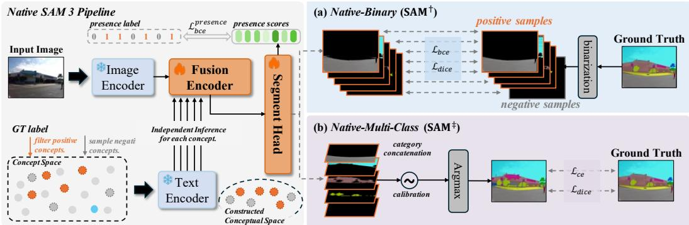  
Figure 7: Overview of two SAM3 baseline models for multi-class semantic segmentation. We detail the construction of the concept space and the differences in training settings between the two baselines.

errors caused by processing an excessive number of categories simultaneously, we employ a dynamic prompt sampling strategy during training: we sample all ground-truth categories present in the current scene alongside a dynamically varying number of negative categories, ensuring a stable memory footprint per forward pass.

Hard-Coding Background Strategy Details In the component ablation study presented in Table 2, we evaluated a hard-coding background strategy as a comparative baseline against our proposed dynamic background token $( \mathcal { T } _ { b g } )$ . To implement this strategy without extensive manual annotation, we employed large language models (LLMs) to automatically generate a comprehensive, datasetspecific list of negative concepts (e.g., “sky”, “road”, and “cloud”) that frequently appear in scenes but belong to the background class. Specifically, we utilized GPT-5 [5] to generate K diverse background concepts tailored to the domain of each benchmark. To prevent excessive semantic overlap with existing foreground categories, we applied the filtering pipeline of previous work [59] to these background concepts. First, we discarded visually uninformative and abstract concepts, such as “image” and “view”. Subsequently, we used the CLIP [45] model to compute the semantic similarity between the generated background concepts and the predefined foreground categories. Any background concept exhibiting a similarity score exceeding a threshold of 0.8 was removed. The specific prompts used are detailed below:

You are an expert in computer vision and semantic segmentation. I need you to generate {K} background or negative concept words that typically appear within the scenes of {dataset name} dataset:

{dataset scene type, foreground categories, and additional related information}.

These concepts should encompass a wide range of background elements, environmental descriptors, or non-target objects to ensure high diversity.

examples: “asphalt road”, “cloudy sky”, “dense forest” and “bare soil”.

All generated terms must be in lowercase English. You are required to output exclusively a Python list containing {K} strings, formatted similarly to [“sky”, “road”, “water”], and to omit any additional explanations or code block markers.

## A.2 Expanded Architectural Details of DCR-SAM

To complement the methodological overview (§3.2) in of DCR-SAM, we detail the micro-architectural designs and precise mathematical formulations of our proposed modules, ensuring complete structural transparency.

Vision-Conditioned Text Refinement (VCTR) In practice, the Vision-Conditioned Text Refinement (VCTR) module is implemented using the standard nn.MultiheadAttention function provided by the PyTorch framework. Specifically, the text tokens $p _ { i } \in \mathbb { R } ^ { l \times d }$ serves as the Query (Q), while the globally contextualized visual representation $\mathcal { V } ^ { * } \in \mathbb { R } ^ { \bar { h } w \times d }$ acts simultaneously as both the Key (K) and the Value (V). To ensure optimization stability, this process is naturally accompanied by standard

Layer Normalization [2] (LN) and residual connections [22]. The entire module relies exclusively on highly optimized matrix operations, thereby introducing minimal computational latency to the overall inference pipeline (please see Table 2 for more details).

Vision-Guided Text Pooling (VGTP) Regarding the dimensional broadcasting in Eq. 7 and Eq. 8, the global visual embedding $\dot { \mathcal { V } } _ { g } \in \mathbb { R } ^ { 1 \times d }$ is implicitly broadcasted along the category dimension N to match the shape of the aligned text sequences. Crucially, the attention computation is strictly performed per class rather than being shared. The dot product between $\mathcal { V } _ { g }$ and $\tilde { \mathcal P }$ yields an attention matrix $\mathcal { A } \in \mathbb { R } ^ { N \times l }$ , where the softmax activation normalizes the weights strictly along the sequence length l for each specific category. This ensures that the aggregated text anchors $\bar { \mathcal { T } } _ { a n c h o r }$ capture class-specific discriminative cues without inter-class sequence interference.

Dense Competitive Head After obtaining the dense logits map $\mathcal { M } ^ { \ast } \in \mathbb { R } ^ { ( N + 1 ) \times h w }$ , we subsequently reshape it back to the 2D spatial dimensions of $\mathbf { \mathbb { R } } ^ { ( N + 1 ) \times h \times w } .$ A bilinear upsampling algorithm [28] is then applied to align the resolution with that of the original input image. Following this, an argmax operation is performed along the category dimension to produce the final segmentation masks.

## B Additional Experimental Analysis and Discussion

## B.1 Further Experimental Analysis

Impact of Concept Space Scale on Performance As observed in Table 1, DCR-SAM achieves more pronounced performance gains on remote sensing benchmarks compared to natural scene benchmarks. We hypothesize that this phenomenon is fundamentally driven by the scale of the concept space: the massive number of fine-grained categories in natural scenes exacerbates feature space crowding and semantic competition. To validate this hypothesis, we conducted a progressive subsetting experiment on the highly complex ADE20K [70] dataset (N = 150). Specifically, we establish a base set comprising the Top-30 most frequent categories and progressively expand the target category count $\bar { N ^ { \prime } } \in \{ \bar { 3 0 } , 6 0 , 9 \bar { 0 } , 1 5 0 \}$ . For subsets where $N < 1 5 0$ , all pixels belonging to unselected categories are uniformly absorbed by our dynamic background token $( \mathcal { T } _ { b g } )$ Crucially, we isolate and track the performance of the identical Base-30 classes across all experimental configurations.

As shown in Table 6, As the number of semantic categories increases (30 → 150), the overall performance declines due to the introduction of difficult long-tail classes. Furthermore, the isolated Base-30 class also suffers a substantial degradation, dropping from 79.4% to 70.3%. This indicates that even the most well-represented foundational categories are negatively impacted by the severe feature competition and representational crowding triggered by a larger concept space. Consequently, in remote sensing scenarios where the concept space is typically constrained $( e . g . , N \leq 1 0 ) .$ , the dense competitive head can establish highly stable and non-overlapping semantic anchors. This effectively unlocks the full discriminative potential of the model architecture, thereby yielding superior performance gains.

Table 6: Impact of the concept space scale on the ADE20K dataset.
<table><tr><td>Target Category Count</td><td>Semantic Space Composition</td><td>Time.↓</td><td>Overall mIoU (%)</td><td>Base-30 mIoU (%)</td></tr><tr><td>N = 30</td><td>Top-30 frequent classes only</td><td>236</td><td>79.4</td><td>79.4</td></tr><tr><td>N = 60</td><td>Base-30 + Next 30 frequent classes</td><td>238</td><td>75.6↓3.8</td><td>77.5↓1.9</td></tr><tr><td>N = 90</td><td>Base-30 + Next 60 frequent classes</td><td>241</td><td> $7 1 . 5 \downarrow 7 . 9$ </td><td>73.9↓5.5</td></tr><tr><td>N = 150</td><td>Full concept space</td><td>244</td><td> $6 8 . 7 \downarrow 1 0 . 7$ </td><td>70.3↓9.1</td></tr></table>

Impact of Concept Space Scale on Inference Efficiency We further investigate the impact of the concept space scale on inference latency. Specifically, we evaluate the DCR-SAM framework on the ADE20K dataset with 150 categories (A-150) alongside its full version comprising 847 categories (A-847), as well as the PASCAL Context dataset with 59 categories (PC-59) and its full version comprising 459 categories (PC-459). As illustrated in Figure $^ { 8 , }$ expanding the target categories from 150 to 847 on ADE20K introduces a manageable latency overhead of +369 ms (244 ms → 613 ms).

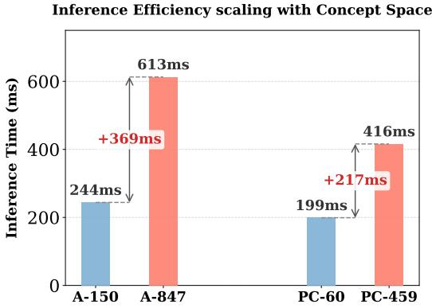  
Figure 8: Impact of the concept space scale on inference efficiency.

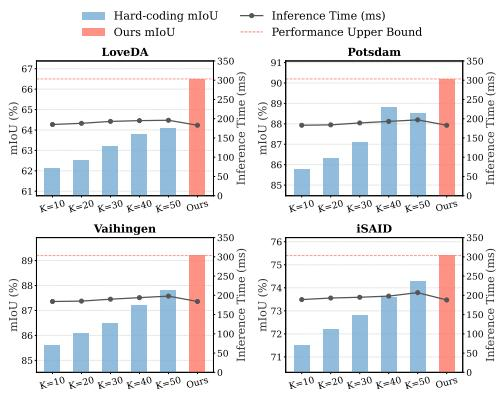  
Figure 9: Impact of hard-coding background concept number K.

Similarly, scaling from 59 to 459 categories on PASCAL Context incurs a mere +217 ms increase (199 ms → 416 ms). Compared to the staggering 8038 ms required by the native SAM3 on the A-150 benchmark (please see Table 2), these fractional increments are practically negligible. While our core cross-modal feature fusion process remains strictly category-agnostic, the lightweight matrix operations within the VCTR module and the dense competitive head naturally introduce a sub-linear computational overhead as the number of target concepts N grows. Nevertheless, achieving highfidelity semantic segmentation for nearly a thousand categories in approximately 600 ms thoroughly demonstrates the extreme efficiency and scalability of our architecture, effectively bypassing the severe O(N) complexity bottleneck inherent to the native SAM3 baseline.

Investigating Spatial-Preserving Pooling Strategies Our VGTP module employs Global Average Pooling (GAP) on the visual features $\mathcal { V } ^ { \bar { * } }$ to generate a global visual embedding $\mathcal { V } _ { g } \ ( c f . \ \mathrm { E q . 6 } )$ . A reasonable concern is whether this GAP operation collapses fine-grained spatial cues, which are often deemed critical for resolving small objects in dense segmentation tasks. To investigate this, we conducted an ablation study comparing our GAP-based VGTP against a Spatial-Preserving Attention (SPA) [20] variant. Specifically, we bypassed the GAP operation and flattened the spatial dimensions, computing a dense similarity matrix $s$ directly between the aligned text sequence $\mathcal { \tilde { P } } \in \mathbb { R } ^ { N \times l \times d }$ and the full spatial visual features $\mathcal { V } ^ { * } \in \mathbb { R } ^ { h w \times d }$ . The spatial-aware attention weights $\mathcal { A } _ { s p a } \in \mathbb { R } ^ { N \times l }$ are obtained by marginalizing this dense similarity matrix over the spatial dimensions:

$$
\mathcal { A } _ { s p a } = \mathrm { s o f t m a x } \left( \frac { 1 } { h w } \sum _ { i = 1 } ^ { h w } S _ { : , i , i } \right) , \quad \mathrm { w h e r e } ~ S = \frac { \tilde { P } ( \mathcal { V } ^ { * } ) ^ { T } } { \sqrt { d } } , ~ S \in \mathbb { R } ^ { N \times l \times h w } .\tag{13}
$$

The final semantic anchors are subsequently aggregated using these spatial-aware weights, formulated as $\begin{array} { r } { \mathcal { T } _ { a n c h o r } = \sum _ { i = 1 } ^ { l } ( \mathcal { A } _ { s p a } ) _ { : , i } \odot \tilde { \mathcal { P } } _ { : , i } } \end{array}$

As presented in Table 7, the incorporation of the full spatial resolution in the SPA variant elevates the computational complexity of the attention mechanism. This introduces a slight inference latency and a concurrent performance decline (e.g., a 4.8% mIoU drop on the ADE20K dataset). We argue that the retention of the full spatial resolution during the anchor generation phase compels the model to overfit to localized, noisy visual artifacts. In contrast, the GAP operation serves as an effective information bottleneck. It distills robust global representations from the features to reliably guide the aggregation of the text sequence, while delegating the high-fidelity spatial delineation to the final Dense Competitive Head.

Impact of Hard-Coding Background Concept Number To thoroughly investigate the efficacy and potential limitations of the hard-coding strategy, we conducted an ablation study varying the number of generated background concepts, denoted as K. Using the filtered background concepts (please see Appendix A.1), we reported the overall mIoU and inference time on the remote sensing benchmarks by progressively scaling the hard-coding concept number, i.e., $K \in \{ 1 0 , 2 0 , 3 0 , 4 0 , 5 0 \}$ During the inference phase, we appended these filtered concepts to the target category list to explicitly absorb non-target pixels. As shown in Figure 9, due to the highly efficient, decoupled architecture of DCR-SAM, processing these additional concepts introduces only a marginal computational overhead rather than a severe latency bottleneck. However, the primary limitation emerges in the semantic performance, while scaling up K initially improves background absorption, the performance gains rapidly saturate, even with a large set of explicitly designed negative concepts, the rigid textua anchors struggle to encompass all unconstrained background variations, resulting in suboptimal performance compared to our proposed dynamic background strategy $( \mathcal { T } _ { b g } ) .$ , which consistently achieves superior performance, demonstrating that it provides a more elegant and adaptable solution for robust semantic masking without the necessity of exhaustive prompt engineering.

Table 7: Ablation study on the text sequence pooling strategy across four diverse datasets.
<table><tr><td rowspan="2">Pooling Strategy</td><td colspan="2">ADE20K</td><td colspan="2">Cityscapes</td><td colspan="2">LoveDA</td><td colspan="2">Potsdam</td></tr><tr><td>Time.↓</td><td>mIoU</td><td>Time.↓</td><td>mIoU</td><td>Time.↓</td><td>mIoU</td><td>Time.↓</td><td>mIoU</td></tr><tr><td>SPA (Spatial-Preserving)</td><td>248</td><td>63.9</td><td>184</td><td>81.5</td><td>187</td><td>59.6</td><td>185</td><td>85.8</td></tr><tr><td>VGTP (GAP-based)</td><td>244</td><td>68.7</td><td>183</td><td>89.1</td><td>183</td><td>66.5</td><td>183</td><td>90.2</td></tr></table>

Compared with batched inference mode To further evaluate inference efficiency, we compare DCR-SAM with native SAM 3 under different batch sizes on ADE20K, which contains 150 categories. As shown in Table 8, increasing the batch size from 1 to 50 reduces the inference latency of SAM 3 from 8038 ms to 5687 ms per image, but increases memory consumption from 9010 MB to 29080 MB. In contrast, DCR-SAM achieves a substantially lower latency of 244 ms with only 6318 MB of memory.

The limited acceleration of batched inference stems from the architecture of SAM 3, which involves backbone inference, feature fusion, and mask decoding. Although batching reduces redundant backbone computations by sharing visual features across categories, feature fusion and mask decoding must still be performed separately for each category, resulting in increasing computational overhead as the number of categories grows. In contrast, DCR-SAM performs backbone inference and feature fusion only once, with negligible additional overhead from the lightweight matrix operations in the VCTR module. These results demonstrate the superior computational efficiency and memory utilization of DCR-SAM in large-scale multi-class segmentation.

Table 8: Efficiency comparison between SAM 3 and DCR-SAM across different batch sizes.
<table><tr><td>Inference Strategy</td><td>Backbone Passes</td><td>Time (ms)↓</td><td>Memory (MB)↓</td></tr><tr><td>SAM 3 (Sequential, bs=1)</td><td>150</td><td>8038</td><td>9010</td></tr><tr><td>SAM 3 (Batched, bs=15)</td><td>10</td><td>6392</td><td>12960</td></tr><tr><td>SAM 3 (Batched, bs=25)</td><td>6</td><td>6067</td><td>17488</td></tr><tr><td>SAM 3 (Batched, bs=30)</td><td>5</td><td>5966</td><td>19816</td></tr><tr><td>SAM 3 (Batched, bs=50)</td><td>3</td><td>5687</td><td>29080</td></tr><tr><td>DCR-SAM (Ours)</td><td>1</td><td>244</td><td>6318</td></tr></table>

## C Expanded Qualitative Analysis

## C.1 Cross-Modal Activation Map Visualizations

To verify the effectiveness of our method in mitigating overlapping predictions, we conduct a visual analysis of the cross-modal activation maps. As illustrated in Figure 10, it can be observed that directly aggregating the masks obtained from the independent inference of the native SAM3 results in overlapping predictions within the same regions. In contrast, our method effectively alleviates this issue through explicit inter-class competition.

## C.2 Extended Qualitative Comparisons

To further substantiate the qualitative superiority of our proposed framework, we present an extended set of visual comparisons across diverse natural scene and remote sensing benchmarks, as shown in

aggregate  
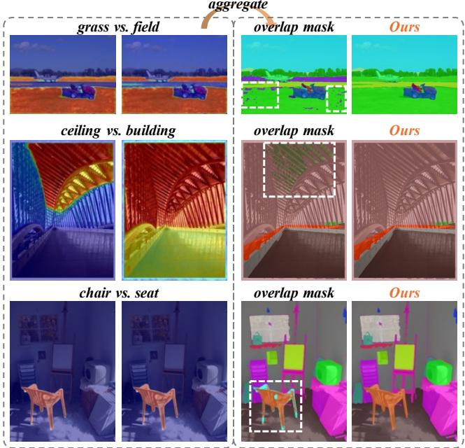  
Figure 10: Cross-modal semantic activation maps. Aggregation in the original SAM3 leads to overlapping masks, whereas our method mitigates this issue through explicit inter-class competition.

Figure 11-18. These comprehensive visualizations demonstrate that the proposed method robustly delineates high-fidelity spatial boundaries while mitigating the severe semantic fragmentation prevalent in baseline models.  
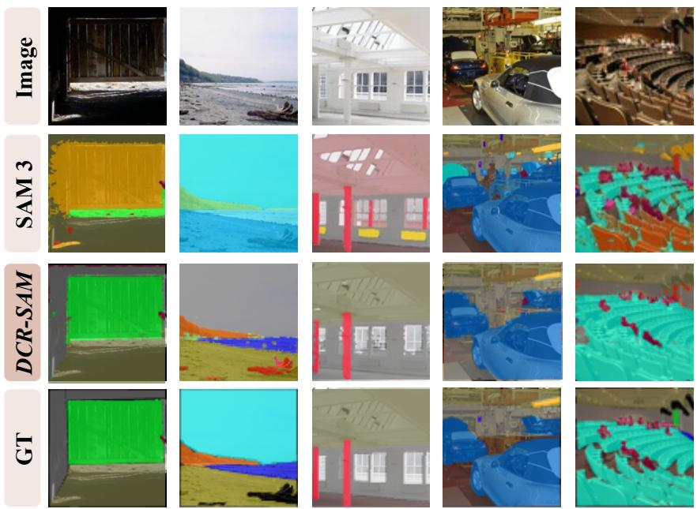  
Figure 11: Qualitative comparison results on ADE20k dataset.

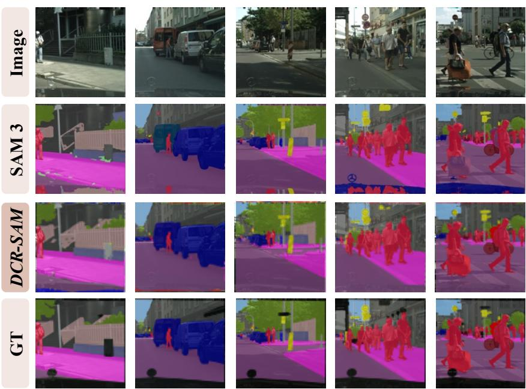  
Figure 12: Qualitative comparison results on Cityscapes dataset.

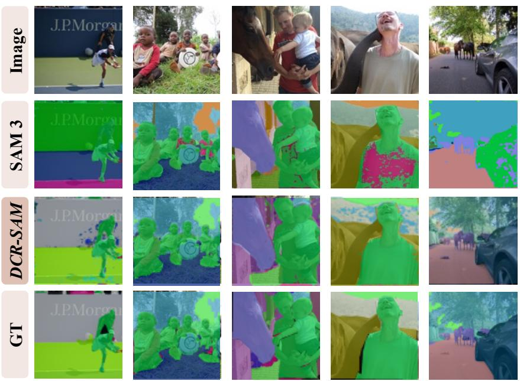  
Figure 13: Qualitative comparison results on COCO-Stuff dataset.

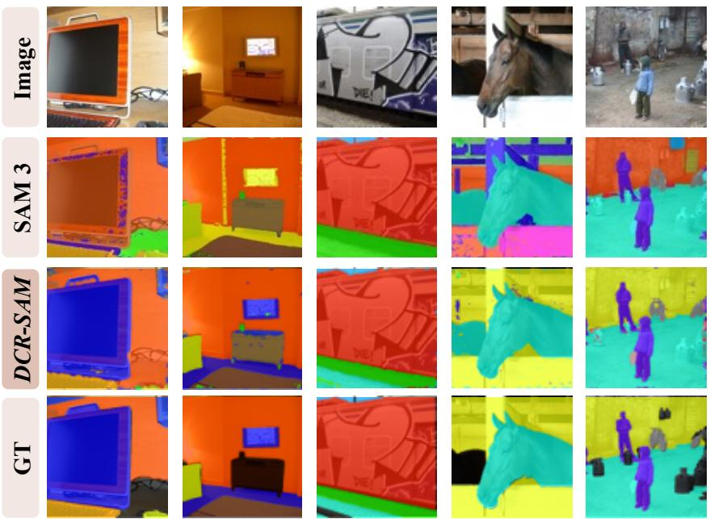  
Figure 14: Qualitative comparison results on Context59 dataset.

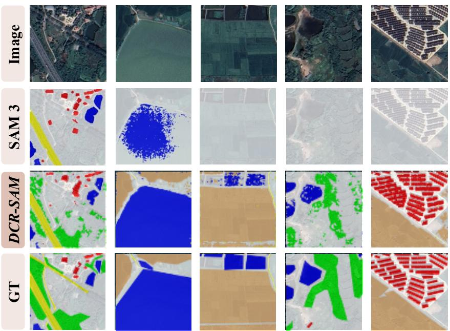  
Figure 15: Qualitative comparison results on LoveDA dataset.

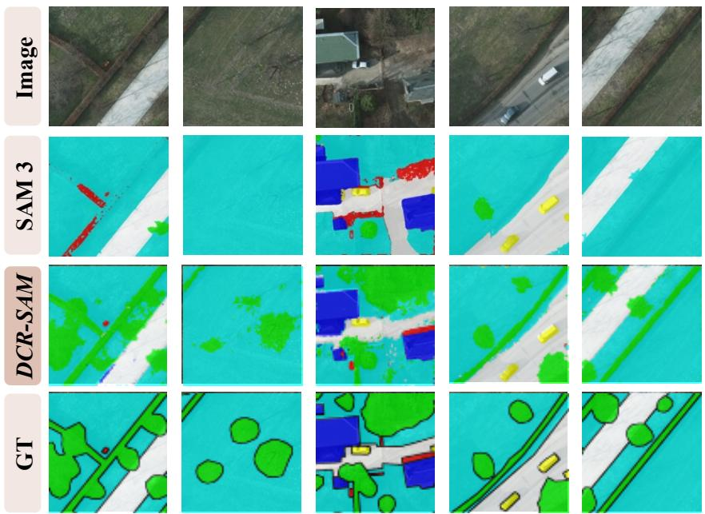  
Figure 16: Qualitative comparison results on Potsdam dataset.

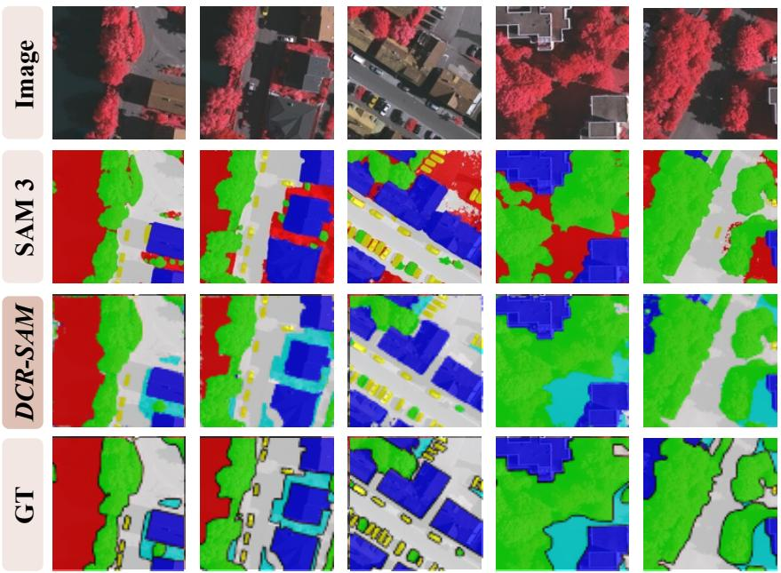  
Figure 17: Qualitative comparison results on Vaihingen dataset.

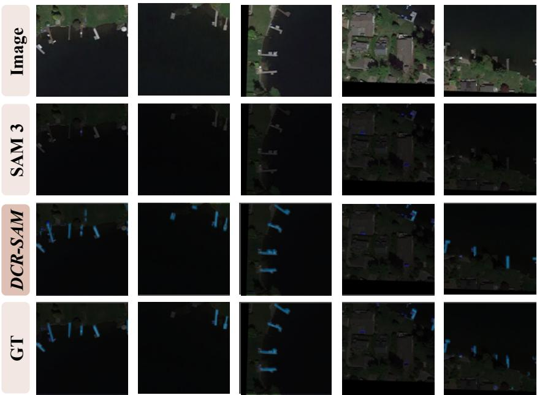  
Figure 18: Qualitative comparison results on iSAID dataset.