# ALPS: Visual State Encoders for World Models

Yanqing Liu1 Letian Zhang1 Chengzhi Liu3 Zijun Wang1

Jieru Mei2 Hongliang Fei2 Yuyin Zhou1 Cihang Xie1

1University of California, Santa Cruz 2Google 3University of California, Santa Barbara

€ ucsc-vlaa.github.io/ALPS § github.com/UCSC-VLAA/ALPS huggingface.co/UCSC-VLAA/ALPS

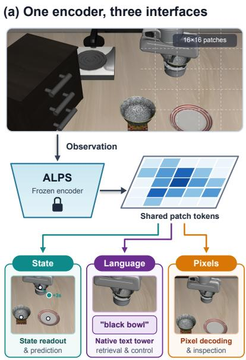  
One set of patch tokens supports all three

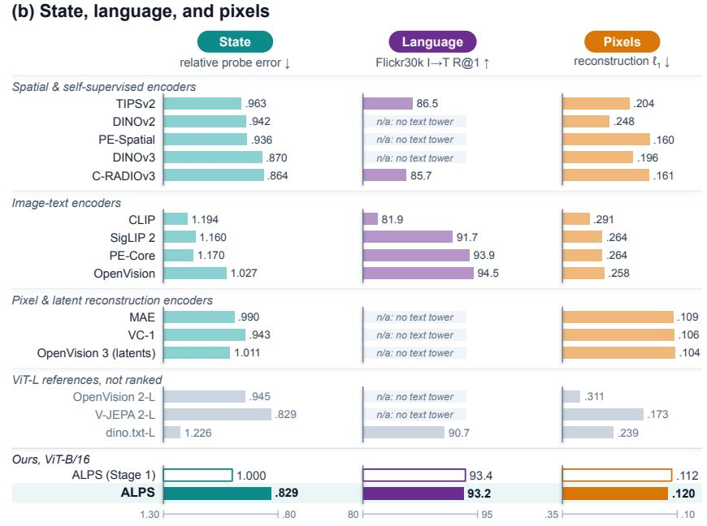  
Figure 1. One frozen encoder for state, language, and pixels. (a) Conceptual illustration of the three interfaces of ALPS. (b) Every encoder of Tab. 1 on LIBERO state-probe error, Flickr30k image-to-text R@1, and the $\ell _ { 1 }$ error of a decoder trained on its tokens, bars oriented so that longer is better; n/a: no text tower released (not zero). No compared encoder is better than ALPS on all three.

## Abstract

World models turn visual representations into predictions and actions. We argue that their visual foundation should combine physical-state information, native language alignment, and pixel reconstruction, so that a single representation can support prediction, instruction, and inspection. However, existing encoders typically specialize in only one or two of these capabilities; we therefore introduce ALPS, a pretrained visual state encoder that unifies all three in a single set ofpatch tokens. Using only still images and text, we pretrain a ViT-B/16 from scratch with language, reconstruction, and spatial correspondence objectives, and then refine

it via cross-view self-distillation. In a unified evaluation across fifteen public encoders, ALPS achieves the lowest aggregate LIBERO state-probe error among ViT-B models (matching the 3.5× larger V-JEPA 2-L) while maintaining strong language alignment and accurate pixel reconstruction. Downstream, frozen ALPS tokens reach the highest mean policy success on LIBERO (85.5%) when paired with our native text tower, match or exceed leading encoders on world-model planning across PushT, Wall, and Granular, and allow predicted future tokens to be decoded directly into pixels for visual inspection. We hope this work helps establish visual pretraining as a sharedfoundation for understanding, prediction, and action in world models.

## 1. Introduction

World models predict how a scene changes in response to actions and use these predictions to plan. Many of them operate in the latent space of a frozen pretrained visual encoder [4, 6, 91]. The encoder therefore decides what the world model can see: only when its tokens encode where objects are and what state they are in can a downstream world model learn how that state changes from scarce interaction data. Two complementary interfaces make such an encoder far more versatile. With tokens aligned to language, instructions and goals stated in words can be related to the scene without a second visual encoder. With tokens that decode back into images, both observed scenes and imagined futures can be rendered and inspected. This raises a central question: how can we pretrain a single visual encoder that provides physical-state information, language alignment, and pixel reconstruction at once?

Existing public encoders typically specialize in only one or two of these capabilities. Self-supervised and agglomerative models such as DINOv2, DINOv3, and C-RADIOv3 provide transferable spatial features [30, 53, 66], while predictive video encoders such as V-JEPA 2 learn spatiotemporal representations through latent prediction [4]. Meanwhile, image-text encoders such as CLIP, SigLIP 2, and PE-Core align vision with language [7, 61, 69], and reconstruction-based encoders preserve fine visual detail in pixels or latents [29, 86]. Combining state information, language alignment, and pixel reconstruction in a single representation is not straightforward. A refinement that improves the state information of an image-text encoder, for example, can substantially degrade its language alignment, as we show for SigLIP 2 and CLIP (Sec. 5.2).

To resolve this tension, we pretrain our encoder in two stages (Fig. 2). The first stage establishes language alignment, pixel reconstruction, and spatial features in a shared representation. We train a ViT-B/16 from scratch on imagetext pairs with contrastive alignment, captioning, reconstruction, and dense correspondence objectives on the same patch tokens. The second stage then strengthens state information through cross-view self-distillation, training the encoder to predict scene content across changes in crop, scale, and appearance. From an augmented view, the student predicts a frozen first-stage teacher’s patch tokens at corresponding locations in a clean view. Both stages train on still images and text alone, without video or interaction supervision. We call the final encoder ALPS (A Languagealigned, Pixel-renderable State encoder) and the intermediate encoder after the first stage ALPS (Stage 1).

We compare ALPS with fifteen public encoders, all frozen and evaluated under common protocols (Fig. 1, Tab. 1). ALPS achieves the lowest aggregate LIBERO state-probe error among ViT-B encoders, matching the 3.5× larger V-JEPA 2-L, while retaining strong language alignment and accurate pixel reconstruction. Cross-view refinement reduces state-probe error by 17% while changing image-text retrieval by at most 0.5 points, and also improves world-model prediction. In contrast, the same refinement lowers ImageNet zero-shot accuracy and image-to-text retrieval by 4–12 points for SigLIP 2 and CLIP (Fig. 5). Frozen ALPS tokens achieve the highest mean policy success in our LIBERO comparison when paired with our native text tower, and support leading planning performance on PushT, Wall, and Granular (Sec. 5.3). Predicted future tokens can also be decoded into images for inspection.

Our contributions are as follows:

• We formulate visual state pretraining for world models and establish a unified evaluation protocol spanning physical-state information, native language alignment, pixel reconstruction, and downstream control, planning, and prediction.

• We introduce ALPS, pretrained from scratch on still images and text with joint language, reconstruction, and spatial objectives followed by cross-view self-distillation.

• We demonstrate that one frozen representation can combine competitive performance across all three capabilities and serve as a shared visual foundation for robot policies and world models.

## 2. Related Work

Image-text and unified visual pretraining. Contrastive image-text pretraining connects visual representations to language [61, 84]. Subsequent approaches incorporate captioning supervision [40, 44, 82], self-distillation and masked prediction [69], spatial objectives [12, 49], image reconstruction [67], or autoregressive patch prediction [23]. Meanwhile, unified tokenizers and multimodal models couple understanding with generation [46, 76, 89]. Other work instead adapts a frozen self-supervised backbone to language, as in dino.txt [32], or encodes the latents of a generative autoencoder, as in OpenVision 3 [86]. Instead of adapting a frozen backbone or encoding autoencoder latents, our first stage jointly trains unnormalized patch tokens for language alignment, pixel reconstruction, and dense correspondence, providing a unified initialization for stage-two cross-view refinement.

Self-supervised and agglomerative representations. Self-distillation [13, 53, 66, 92], latent prediction [3, 18], and multi-teacher distillation [30, 63] learn transferable patch representations. To further strengthen dense spatial features, recent methods align region features with crop embeddings [75], match patch-neighborhood orderings across views [55], enforce locality alignment [17], apply spatial refinement as in Perception Encoder [7], or supervise predictions at multiple depths [51]. Without relying on external teachers, our second stage refines the encoder from its own frozen first-stage weights through geometryconditioned cross-view self-distillation, sharpening state information while preserving native language alignment and pixel reconstruction.

Multitask pretrainingStage 1  
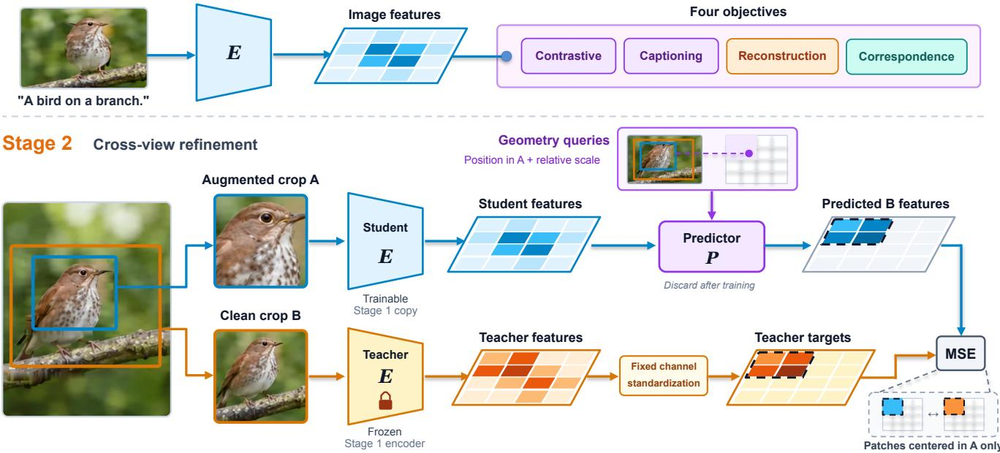  
Figure 2. Two-stage visual state pretraining. Stage 1 trains an encoder E from scratch with four objectives on shared patch tokens. Stage 2 initializes a student from E and keeps E frozen as the teacher. Given student tokens from an augmented crop A and query tokens encoding position and relative scale, a predictor regresses standardized teacher tokens from a clean crop B. Only patches of B whose centers lie inside A contribute to the loss. After training, the predictor is discarded and the refined student serves as ALPS.

Visual representations for robot learning. Policies using pretrained visual representations can be competitive with those using ground-truth state inputs [54]. Robot representations have been learned from egocentric video [52], masked autoencoding [48, 62], language supervision [33], foundation-model distillation [65], and neural rendering [93]. Comparative studies find no single dominant representation [48], show that general vision datasets can match egocentric video for visuomotor pretraining [19], and note that domain-specific pretraining does not guarantee robustness under visual shifts [11]. Pretrained on generaldomain images and text, ALPS provides frozen state tokens and a native text tower that transfer directly to languageconditioned manipulation.

Representations for world models. World models can learn a visual autoencoder before fitting latent dynamics [27], learn representations jointly with dynamics [28, 36, 47], or build on pretrained features [6]. In particular, DINO-WM plans over frozen DINOv2 tokens [91], V-JEPA 2 connects video pretraining to action-conditioned planning [4], and frozen features also support languageconditioned planning [38], whereas RepWAM learns visual and action tokenizers directly from robot data [70]. Generative world models instead simulate observations using learned tokenizers with autoregressive or diffusion dynamics [1, 9, 50], or via pixel-space diffusion [2]. Recent studies further show that off-the-shelf features do not automatically improve sample efficiency in model-based reinforcement learning [64], that pixel reconstruction fidelity alone is an unreliable proxy for recovering actions from latent transitions [80], and that static image encoders can outperform video encoders depending on downstream protocols [68]. We focus on pretraining the visual encoder whose frozen tokens serve as the state representation for downstream world models.

## 3. Method

Let E map an image x to patch tokens $z = E ( x ) \in \mathbb { R } ^ { N \times d }$ Downstream state probes, policies, world models, and pixel decoders operate directly on the frozen tokens z. For language alignment, a linear projection $W _ { \mathrm { i m g } }$ followed by average pooling and $\ell _ { 2 }$ normalization maps z to a global image embedding $\begin{array} { r } { v = \mathrm { n o r m } \Big ( \frac { 1 } { N } \sum _ { i = 1 } ^ { N } W _ { \mathrm { i m g } } z _ { i } \Big ) \in \mathbb { R } ^ { D } } \end{array}$ , which is paired with a text encoder $E _ { \mathrm { t e x t } }$

## 3.1. Stage 1: joint pretraining from scratch

Stage 1 builds a shared representation through complementary language, pixel, and spatial supervision (Fig. 2, top). Contrastive alignment and captioning connect the tokens to language, reconstruction preserves visual detail, and dense correspondence supervises local spatial relationships across views.

Architecture. The image encoder E is a ViT-B/16 [22] with fixed sine-cosine position embeddings. It outputs the raw patch tokens z of the last transformer block without a final normalization layer. We jointly train a text encoder and a caption decoder with the same width and depth as E (Sec. S1). A lightweight convolutional decoder D maps z to pixels for the pretraining reconstruction objective, whereas all reported reconstructions use a separate evaluation decoder trained on frozen tokens (Sec. 4).

Objectives. Four objectives supervise the same patch tokens:

$$
\mathcal { L } _ { 1 } = \mathcal { L } _ { \mathrm { i t c } } + \mathcal { L } _ { \mathrm { c a p } } + w _ { \mathrm { r e c } } \mathcal { L } _ { \mathrm { r e c } } + 0 . 2 5 \mathcal { L } _ { \mathrm { d e n s e } } .\tag{1}
$$

Contrastive alignment. Each image is paired with its web caption and one sentence from a longer synthetic caption. We compute an InfoNCE loss [61] between the meanpooled, projected image tokens and each caption set, then average the two losses to obtain ${ \mathcal { L } } _ { \mathrm { i t c } }$ . Each loss uses its own softmax, so the two captions paired with the same image are never treated as negatives of each other.

Captioning. The caption decoder autoregressively predicts the full synthetic caption, conditioned on the image tokens and preceding text [82].

Reconstruction. The decoder D reconstructs x from both z and a noisy copy of $z .$ The objective combines $\ell _ { 1 }$ , structural similarity, and image gradient terms (Sec. S1). We do not apply color augmentation to $x ,$ which directly serves as the reconstruction target.

Dense correspondence. This objective directly supervises patch correspondence across crops, scales, and flips. We form a second view $g ( x )$ via a random crop and flip of x, so the location of each patch in the original view is known. A small projection head maps the tokens of both views to contrastive features. For each patch of $g ( x )$ , the positive feature is sampled bilinearly from the projected token field of $x$ at the corresponding location. Features at other locations in the same image and from other images serve as negatives in an InfoNCE loss $\mathcal { L } _ { \mathrm { d e n s e } }$ (Sec. S1), encouraging local discriminability. Following prior work on dense correspondence and pixel-level consistency [71, 77], this term adds explicit cross-view patch supervision to global imagetext alignment and single-image reconstruction.

Data. We train on DataComp-1B [24] using its web captions and synthetic captions generated by the LLaVA-LLaMA-3 captioner from Recap-DataComp-1B [39], conditioned on the original web caption [44]. Because the captioner uses a frozen CLIP ViT-L/14 [39], knowledge from this image-text model reaches our encoder only through text; no external visual model supplies feature targets. Training processes 12.8 billion samples at 128×128 resolution, followed by 1.0 billion samples at 224×224 resolution (Sec. S1). After Stage 1, we retain the image encoder, text encoder, and image projection, while discarding the caption decoder, dense-correspondence projector, and $D .$

## 3.2. Stage 2: cross-view self-distillation on single images

Stage 2 refines the shared representation through cross-view self-distillation (Fig. 2, bottom). From an augmented crop, the student predicts the tokens produced by a frozen Stage 1 teacher for a clean crop of the same image. Known crop geometry specifies the target locations, and supervision focuses on the overlap between views.

Teacher and student. Both the frozen teacher and the trainable student are initialized from the Stage 1 encoder, and only the student encoder and predictor are updated. Before training, we compute fixed per-channel statistics to standardize the teacher tokens throughout this stage. For each image, we independently sample two views: the teacher receives a clean crop B covering 40% to 100% of the image, while the student receives with equal probability a local crop A (10% to 40%) or a global crop (40% to 100%) with photometric augmentation (Sec. S1).

Geometry queries. Geometry queries specify where and at what scale the predictor should estimate teacher features. $\mathbf { A }$ four-layer transformer predictor $P$ reads the student tokens $E ( A )$ and produces one output for each query $q _ { i }$ associated with patch i of B. In each layer, the queries first attend to one another and then to $E ( A )$ . The crop boxes determine the position of each teacher patch center in the coordinate frame of A. Each query encodes this position using a fixed sine-cosine embedding, measured in the patch units of $A ,$ and encodes the log side-length ratio of $B$ to A through a learned embedding (Tab. S2). The queries thus supply the geometric correspondence, while the student features provide the visual content used to predict the teacher tokens.

Training objective. Let V denote the set of teacher patches whose centers fall inside the student crop $A .$ . We minimize the mean squared error between the predicted features and the standardized teacher tokens over $V { : }$

$$
\mathcal { L } _ { 2 } = \frac { 1 } { | V | d } \sum _ { i \in V } \big \| P \big ( E ( A ) , q _ { i } \big ) - \bar { z } _ { i } ^ { \mathrm { t e a c h e r } } ( B ) \big \| ^ { 2 } .\tag{2}
$$

Patches outside $V$ are excluded from the loss, and we resample the student crop $\mathrm { i f } \ \lvert V \rvert < 1 6$ . Unlike masked prediction of unseen regions, this geometry-conditioned objective trains local patch tokens to remain consistent across changes in crop context, scale, and appearance while staying aligned with the frozen Stage 1 teacher.

Data and output. Stage 2 trains on 5 million singleimage samples drawn from a curated collection of public image-editing datasets (Sec. S1). These sources provide high-resolution, object-centric scenes well-suited for local cross-view crops, which we sample as individual images without edit-pair or instruction supervision. After training, we discard the predictor and retain the refined student encoder as ALPS, paired directly with the unchanged Stage 1 text encoder and image projection.

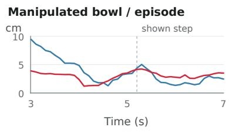

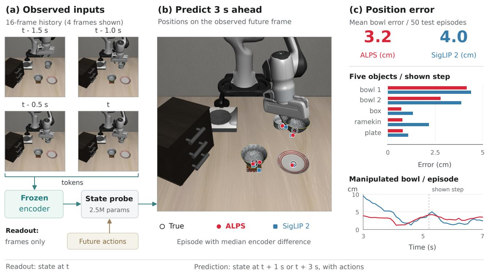

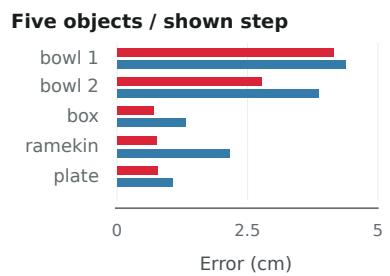  
Figure 3. The LIBERO state probe. (a) A lightweight probe reads frozen tokens from the last 16 frames to estimate the current scene state from observations alone (readout) or predict the state 1 or 3 s ahead given robot actions (prediction). (b) State predictions 3 s ahead from ALPS and SigLIP 2, overlaid on the frame observed 3 s later, shown on the held-out LIBERO-Spatial episode with the median error difference between the two encoders. (c) Per-object position errors at this step, the manipulated bowl’s error over the episode, and its mean error across 50 held-out episodes.

## 4. Evaluation protocol

We evaluate the encoders across three core capabilities (physical-state information, language alignment, and pixel reconstruction; Sec. 1), as well as downstream control, planning, and world-model prediction. All encoders remain frozen and follow a shared evaluation protocol on each benchmark.

Encoders. We compare fifteen public encoders with our first-stage encoder and ALPS (Tab. 1). Fourteen of the public models are image encoders, while V-JEPA 2 ViT-L [4] is a video encoder that takes the last 16 frames at 256 × 256 resolution and outputs tokens for the current frame. Our primary comparison uses ViT-B image towers at 224 × 224 resolution (196 tokens for B/16 and 256 for B/14), taking each encoder’s last-layer patch tokens with its default normalization. Alongside the ViT-B models, Open-Vision 2, V-JEPA 2, and dino.txt [32] serve as ViT-L references; for dino.txt, we extract the patch tokens after its language-aligned vision head.

State probe. The state probe evaluates scene-state readout and action-conditioned prediction directly from frozen tokens (Fig. 3). Using demonstrations from LIBERO-Object and LIBERO-Spatial [42], a two-layer attentive probe (2.5M parameters) reads the tokens of the last 16 frames to estimate the movable objects’ 3D positions, orientations, and binary predicates against simulator ground truth. In the readout setting, the probe estimates the current state from the frames alone; in the two prediction settings, it additionally receives the robot actions over the next 1 or 3 seconds to predict the future state at that horizon. We report position error relative to our first-stage encoder, averaged across the six combinations of the two suites and three settings (Tab. S4 reports absolute errors in centimeters). World models instead predict future tokens in latent space and are evaluated separately (Sec. 5.3).

Language alignment. We evaluate language alignment using each model’s native text tower, reporting ImageNet-1k [20] zero-shot accuracy and Recall@1 for image-text retrieval on Flickr30k [81] and COCO [41]. For encoders released without a paired text tower, these metrics are marked n/a, indicating the absence of a native text interface rather than a lack of semantic information in the features. C-RADIOv3 uses the stronger of its two language adaptor heads, while ALPS uses its Stage 1 language interface without modification.

<table><tr><td rowspan="2"></td><td colspan="4">State probe (LIBERO, relative error ↓)</td><td colspan="5">Language alignment ↑</td><td colspan="2">Reconstruction ↓</td></tr><tr><td>read- out</td><td>+1 s</td><td>+3s</td><td>mean</td><td>IN-1k 0-shot</td><td>Flickr30k R@1 I→T</td><td>T→I</td><td>I→T</td><td>COCO R@1 T→I</td><td> $\ell _ { 1 }$ </td><td>LPIPS</td></tr><tr><td colspan="10">Spatial &amp; self-supervised encoders</td><td></td><td></td><td></td></tr><tr><td>TIPSv2-B/14 [12]</td><td>.947</td><td>.946</td><td>.995</td><td>.963</td><td>71.1</td><td>86.5</td><td>72.2</td><td>63.7</td><td>48.2</td><td>.204</td><td>.467</td></tr><tr><td>DINOv2-B/14 [53]</td><td>.916</td><td>.901</td><td>1.010</td><td>.942</td><td>n/a</td><td>n/a</td><td>n/a</td><td>n/a</td><td>n/a</td><td>.248</td><td>.535</td></tr><tr><td>PE-Spatial-B/16 [7]</td><td>1.000</td><td>.892</td><td>.917</td><td>.936</td><td>n/a</td><td>n/a</td><td>n/a</td><td>n/a</td><td>n/a</td><td>.160</td><td>.386</td></tr><tr><td>DINOv3-B/16 [66]</td><td>.860</td><td>.911</td><td>.840</td><td>.870</td><td>n/a</td><td>n/a</td><td>n/a</td><td>n/a</td><td>n/a</td><td>.196</td><td>.424</td></tr><tr><td>C-RADIOv3-B [30]</td><td>.876</td><td>.838</td><td>.877</td><td>.864</td><td>66.5</td><td>85.7</td><td>74.3</td><td>56.5</td><td>46.0</td><td>.161</td><td>.359</td></tr><tr><td colspan="10">Image-text encoders</td><td></td><td></td></tr><tr><td>CLIP-B/16 [61]</td><td></td><td></td><td>1.091 1.110 1.380</td><td>1.194</td><td>68.4</td><td>81.9</td><td>62.0</td><td>52.5</td><td>33.1</td><td>.291</td><td>.579</td></tr><tr><td>SigLIP 2-B/16 [69]</td><td>1.149</td><td>1.202</td><td>1.130</td><td>1.160</td><td>77.6</td><td>91.7</td><td>78.1</td><td>67.9</td><td>52.4</td><td>.264</td><td>.541</td></tr><tr><td>PE-Core-B/16 [7]</td><td>1.118</td><td>1.099</td><td>1.292</td><td>1.170</td><td>78.4</td><td>93.9</td><td>80.9</td><td>71.1</td><td>50.3</td><td>.264</td><td>.559</td></tr><tr><td>OpenVision-B/16 [40]</td><td>1.042</td><td>1.008</td><td>1.032</td><td>1.027</td><td>73.3</td><td>94.5</td><td>78.9</td><td>71.3</td><td>51.3</td><td>.258</td><td>.551</td></tr><tr><td colspan="10">Pixel &amp; latent reconstruction encoders</td><td></td><td></td></tr><tr><td>MAE-B/16 [29]</td><td>.935</td><td>1.008</td><td>1.027</td><td>.990</td><td>n/a</td><td>n/a</td><td>n/a</td><td>n/a</td><td>n/a</td><td>.109</td><td>.260</td></tr><tr><td>VC-1-B [48]</td><td>1.064</td><td>.841</td><td>.924</td><td>.943</td><td>n/a</td><td>n/a</td><td>n/a</td><td>n/a</td><td>n/a</td><td>.106</td><td>.258</td></tr><tr><td>OpenVision 3-B [86]</td><td>1.029</td><td>.934</td><td>1.071</td><td>1.011</td><td>n/a</td><td>n/a</td><td>n/a</td><td>n/a</td><td>n/a</td><td>.104</td><td>.243</td></tr><tr><td colspan="10">Larger encoders, ViT-L (304M to 330M parameters)</td><td></td><td></td></tr><tr><td>OpenVision 2-L/14 [44]</td><td>.969</td><td>.881</td><td>.987</td><td>.945</td><td>n/a</td><td>n/a</td><td>n/a</td><td>n/a</td><td>n/a</td><td>.311</td><td>.602</td></tr><tr><td>V-JEPA 2-L/16 [4]</td><td>.741</td><td>.841</td><td>.904</td><td>.829</td><td>n/a</td><td>n/a</td><td>n/a</td><td>n/a</td><td>n/a</td><td>.173</td><td>.413</td></tr><tr><td>dino.txt-L/14 [32]</td><td>1.090</td><td>1.170</td><td>1.418</td><td>1.226</td><td>81.6</td><td>90.7</td><td>75.8</td><td>64.9</td><td>46.7</td><td>.239</td><td>.552</td></tr><tr><td>ALPS (Stage 1)</td><td>1.000</td><td>1.000</td><td>1.000</td><td>1.000</td><td>74.5</td><td>93.4</td><td>79.4</td><td>70.6</td><td>52.0</td><td>.112</td><td>.365</td></tr><tr><td>ALPS</td><td>.842</td><td>.834</td><td>.813</td><td>.829</td><td>73.4</td><td>93.2</td><td>78.9</td><td>70.2</td><td>51.9</td><td>.120</td><td>.372</td></tr></table>

Table 1. Frozen encoders on state, language, and pixels: ALPS has the lowest state-probe error among the ViT-B encoders. State probe: LIBERO position error relative to ALPS (Stage 1); language: each model’s own text tower. Bold: best ViT-B encoder in each column, ALPS (Stage 1) not ranked; gray: ViT-L references; n/a: no released text tower (not zero).

Pixel reconstruction. To evaluate pixel reconstruction on equal footing, we train a separate lightweight convolutional adapter for each encoder that maps its frozen tokens to the latents of a frozen SDXL autoencoder [57] for image decoding. The adapter is trained on 19,000 ImageNet validation images and evaluated on 1,000 held-out images (one per class) using $\ell _ { 1 }$ error and LPIPS [87]. Although much larger generative decoders can reconstruct plausible images from DINOv2 or SigLIP 2 tokens [90], our protocol measures the visual detail directly recoverable by a lightweight probe, and ALPS maintains its advantage when paired with a stronger decoder (Sec. S2).

Control. For visuomotor control, we train the LIBERO transformer policy [42] on frozen visual tokens via behavior cloning with 50 demonstrations per task across four LIBERO suites. Task instructions are embedded either by a frozen BERT model [21] or by each encoder’s native text tower. Each trained policy is evaluated three times over 50 rollouts per task (Sec. S2).

World-model prediction and planning. We follow the DINO-WM protocol [91] on PushT, Wall, PointMaze, Granular, and Rope, and LeWorldModel [47] on Reacher. On each task, we train an identical dynamics predictor over the frozen patch tokens of each encoder to support both cross-entropy planning and multi-step prediction evaluation (Sec. S2).

## 5. Results

## 5.1. One encoder for state, language, and pixels

Table 1 and Fig. 1 (b) compare ALPS with fifteen public encoders on state information, language alignment, and pixel reconstruction.

State. ALPS achieves the lowest aggregate relative position error among the compared ViT-B encoders (.829), followed by C-RADIOv3 (.864) and DINOv3 (.870); together, these three models form a leading group ahead of PE-Spatial (.936). ALPS also achieves the lowest error in each of the three individual settings (readout, +1 s, and +3 s) as well as on frames rendered at 256 × 256 resolution (Tab. S6). While V-JEPA 2-L matches its aggregate error using 3.5× as many parameters and video pretraining, the two models show complementary strengths: V-

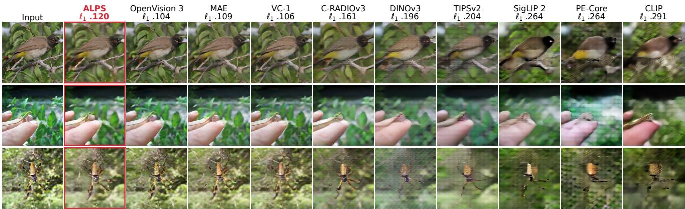  
Figure 4. Reconstruction from frozen tokens. Following the input column, each column shows the evaluation decoder’s output from one encoder’s frozen tokens, labeled with its mean $\ell _ { 1 }$ error across the 1,000 held-out ImageNet images. The rows show the first three images from a random sample (Fig. S7). ALPS, OpenVision 3, MAE, and VC-1 retain sharp edges and textures. C-RADIOv3 and DINOv3 preserve spatial layout with softer detail, while SigLIP 2, PE-Core, and CLIP mainly recover coarse structure.

JEPA 2 reads out the current state more accurately (.741 vs. .842), whereas ALPS is more accurate at 3-second prediction (.813 vs. .904). Compared with SigLIP 2 and PE-Core (1.160 and 1.170), ALPS reduces aggregate state-probe error by about 29%, and probing their intermediate layers narrows this gap without closing it (Sec. S2). On moving objects, ALPS reaches a mean error of 3.22 cm across the four prediction settings, matching the 3.04–3.25 cm range of V-JEPA 2, DINOv3, and C-RADIOv3 (Tab. S5).

Language. ALPS retains retrieval performance close to the strongest image-text encoders in our comparison. It reaches 93.2/78.9 Recall@1 on Flickr30k and 70.2/51.9 on COCO (image-to-text/text-to-image), within 2 points of the best score on each of the four measures. Its ImageNet zeroshot accuracy is 73.4, compared with 78.4 for PE-Core, the strongest ViT-B image-text encoder on this metric. This larger 5.0-point gap on classification is expected when pretraining on descriptive synthetic captions, whose distribution differs from short ImageNet class prompts [43].

Pixels. ALPS preserves fine visual detail that can be decoded directly from its tokens. With the evaluation decoder, ALPS achieves an $\ell _ { 1 }$ error of .120 and an LPIPS of .372 (Fig. 4), yielding a lower $\ell _ { 1 }$ error than every compared encoder not explicitly trained to reconstruct pixels or latents. In particular, C-RADIOv3 has 34% higher $\ell _ { 1 }$ error (.161), DINOv3 has 63% higher error (.196), and the image-text encoders have more than twice the error. Encoders pretrained to reconstruct pixels (MAE at .109 and VC-1 at .106) or autoencoder latents (OpenVision 3 at .104) reconstruct more accurately, but incur 14% to 22% higher stateprobe error. LPIPS gives a slightly different ordering: these three reconstruction-focused encoders score .243–.260, and C-RADIOv3 also edges out ALPS (.359, about 4% lower). Under a stronger decoder configuration, however, ALPS maintains a lower $\ell _ { 1 }$ error than C-RADIOv3 (.107 vs. .141, about 24% lower) and overtakes it on LPIPS (.302 vs. .311; Tab. S18).

All three at once. ALPS combines leading state-probe performance, strong language alignment, and accurate pixel reconstruction in one frozen representation. Other leading state encoders have weaker retrieval or no paired text tower, while encoders with comparable retrieval or lower reconstruction error have higher state-probe error (Fig. 1). We use these interfaces for instruction-conditioned control and visual inspection of predicted world-model rollouts (Sec. 5.3).

## 5.2. Effect of cross-view refinement on state and language

Cross-view refinement moves our encoder into the leading state group: before refinement, ALPS (Stage 1) has higher state-probe error than seven public ViT-B encoders in Tab. 1, whereas after refinement it achieves the lowest. Figure 5 compares the same Stage 2 recipe across our first-stage encoder, SigLIP 2-B/16, and CLIP-B/16, each trained for 5 million samples with its own frozen copy as the teacher and evaluated through its unchanged language head (Tab. S20). For our encoder, refining on DataComp web images also reduces state-probe error, though less than our default curated collection (.886 vs. .829) under the same training budget, reflecting differences in both scene content and native resolution (Sec. S3).

All three encoders improve on state probing. Stage 2 reduces our encoder’s aggregate state-probe error by 17% (14% to 19% across the six individual settings) and raises DAVIS video object segmentation from .456 to .533 (Sec. S2). Similarly, SigLIP 2 improves from 1.160 to .893 on the state probe and from .503 to .552 on DAVIS, while CLIP improves from 1.194 to .898 and from .574 to .585,

(a) State-probe error ↓  
(b) Flickr30k I → T R@1 ↑  
(c) COCO I → T R@1 ↑  
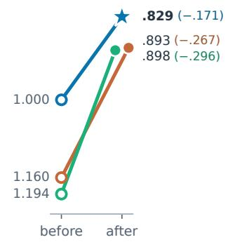

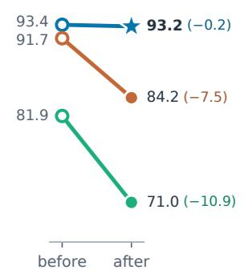

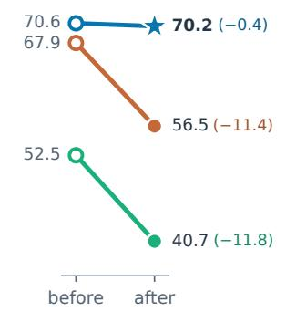

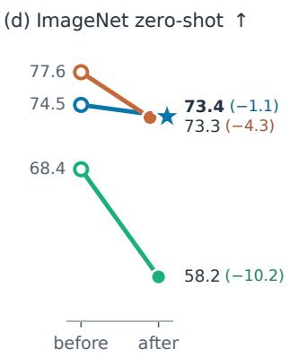  
Figure 5. The same Stage 2 refinement applied to ALPS (Stage 1), SigLIP 2, and CLIP, each using its own frozen copy as the teacher. Lines connect each encoder before and after refinement, and the star marks ALPS. Language is evaluated through each encoder’s unchanged head. Higher values are better in every panel, with state-probe error relative to ALPS (Stage 1) inverted in (a). Endpoint labels show the value after Stage 2 and its change (Tab. S20). All three improve state information, while only ALPS preserves language alignment.  
respectively.

Only our encoder keeps its language alignment. For ALPS, the improvement in state accuracy comes with minimal change to the other capabilities: image-text retrieval shifts by at most 0.5 points, ImageNet accuracy changes by about 1 point, and reconstruction remains close to its firststage level $( \ell _ { 1 }$ .120 vs. .112 and LPIPS .372 vs. .365). In contrast, the public encoders lose substantially more language performance. SigLIP 2 drops by 4.3 points on ImageNet accuracy and by 7.5 and 11.4 points on Flickr30k and COCO image-to-text retrieval, while CLIP drops by 10.2, 10.9, and 11.8 points, respectively. These results show that cross-view refinement can strengthen state information while preserving the other interfaces, but this balance depends critically on the encoder being refined.

<table><tr><td>Encoder Long</td><td>Goal</td><td>Spatial</td><td>Object</td><td>mean</td></tr><tr><td colspan="5">Instruction embedded by BERT</td></tr><tr><td>CLIP-B/16 SigLIP 2-B/16</td><td>56.3 74.1 72.3</td><td>76.5 84.1</td><td>93.2 90.3</td><td>75.0 81.4</td></tr><tr><td>DINOv2-B/14</td><td>78.8 66.5 78.6</td><td>80.5</td><td>88.1</td><td>78.4</td></tr><tr><td>DINOv3-B/16</td><td></td><td></td><td></td><td></td></tr><tr><td>C-RADIOv3-B</td><td>68.4 72.7 66.0 79.9</td><td>80.7 74.9</td><td>94.4</td><td>79.0</td></tr><tr><td>ALPS (Stage 1)</td><td></td><td></td><td>92.3</td><td>78.2</td></tr><tr><td>ALPS</td><td>68.9 84.3 69.7 85.1</td><td>76.8 86.5</td><td>94.3 92.2</td><td>81.1 83.4</td></tr><tr><td colspan="5">Instruction embedded by the encoder&#x27;s own text tower</td></tr><tr><td>CLIP-B/16 SigLIP 2-B/16</td><td>61.5 84.3 73.3 90.2</td><td>79.1 84.1</td><td>91.9 91.7</td><td>79.2</td></tr><tr><td>C-RADIOv3-B</td><td>73.4 89.5</td><td>82.9</td><td>81.4</td><td>84.8 81.8</td></tr><tr><td></td><td></td><td></td><td></td><td></td></tr><tr><td>ALPS</td><td>78.5 87.4</td><td>82.6</td><td>93.7</td><td>85.5</td></tr></table>

Table 2. Policy learning on LIBERO with frozen tokens: ALPS achieves the highest mean success with both BERT and its native text tower. Success in % (mean of three evaluations, 50 rollouts per task); instructions from BERT (top) or each encoder’s own text tower (bottom). Bold: best in each block.

Lowering the learning rate does not remove the language gap. To test whether SigLIP 2 simply requires a smaller step size, we lower its encoder learning rate from $1 0 ^ { - 5 } \mathrm { ~ t o ~ 3 ~ } \times \mathrm { ~ 1 0 ^ { - 6 } ~ }$ while keeping all other settings unchanged. Its state-probe error then falls by 17% (from 1.160 to .959), matching the relative reduction of our encoder (from 1.000 to .829). Yet it still loses more on every language metric: image-to-text Recall@1 falls by 2.3 points on Flickr30k and 2.9 on COCO, compared with 0.2 and 0.4 for ALPS (Sec. S5). Under the default refinement schedule, ALPS also exhibits smaller drift in its patch tokens and image embeddings (Sec. S5). A key structural difference lies in the language readout: ALPS linearly projects meanpooled patch tokens, whereas SigLIP 2 uses nonlinear attention pooling and CLIP reads a class token. Because linear projection commutes with average pooling, zero-mean local token updates can cancel out in the pooled image representation, even without an explicit language constraint in Stage 2.

## 5.3. Control, planning, and prediction on frozen tokens

We next test whether the learned representation supports downstream control, planning, and dynamics prediction. Policies act directly on the encoded frames, while planners use a world model that predicts future tokens.

Policies. ALPS achieves the highest mean policy success in our LIBERO evaluation (Tab. 2), which tests four suites using shared BERT instructions in the upper block and each encoder’s native text tower in the lower block. With BERT,

<table><tr><td></td><td colspan="2">PushT (50)</td><td colspan="2">Wall (50)</td><td>PointMaze (50)</td><td>Reacher (50)</td><td>Granular (10)</td><td>Rope (50)</td></tr><tr><td>Encoder</td><td>success ↑</td><td>state dist. ↓</td><td>success ↑</td><td>state dist. ↓</td><td>success ↑</td><td>success ↑</td><td>Chamfer ↓</td><td>Chamfer↓</td></tr><tr><td>DINOv2-B/14</td><td>88</td><td>25.0</td><td>92</td><td>3.62</td><td>100</td><td>76.7</td><td>.211</td><td>.701</td></tr><tr><td>DINOv3-B/16</td><td>88</td><td>24.2</td><td>90</td><td>3.69</td><td>100</td><td>86.0</td><td>.275</td><td>.681</td></tr><tr><td>C-RADIOv3-B</td><td>90</td><td>20.2</td><td>90</td><td>3.31</td><td>100</td><td>82.0</td><td>.180</td><td>.558</td></tr><tr><td>SigLIP 2-B/16</td><td>84</td><td>29.0</td><td>88</td><td>3.73</td><td>100</td><td>74.0</td><td>.230</td><td>.848</td></tr><tr><td>ALPS (Stage 1)</td><td>88</td><td>24.0</td><td>90</td><td>3.43</td><td>100</td><td>76.0</td><td>.324</td><td>.943</td></tr><tr><td>ALPS</td><td>90</td><td>23.4</td><td>92</td><td>3.21</td><td>100</td><td>78.7</td><td>.176</td><td>.750</td></tr></table>

Table 3. Planning with world models trained on frozen tokens: ALPS leads or ties the best results on PushT, Wall, and Granular. DINO-WM [91] on PushT, Wall, PointMaze, Granular, and Rope and LeWorldModel [47] on Reacher, trained with one recipe (Sec. S2); in parentheses: goals evaluated; Reacher: mean of three planner seeds. Success in %; state dist.: final-to-goal state distance; Chamfer: final-to-goal particle distance. Bold: best of a column; none if all tie.
<table><tr><td>Encoder</td><td>PushT block (units)</td><td>Wall agent (units)</td><td>Granular Chamfer</td><td>Rope Chamfer</td><td>Reacher joints (deg)</td></tr><tr><td>DINOv2-B/14</td><td>7.16</td><td>9.69</td><td>.246</td><td>.410</td><td>1.21</td></tr><tr><td>DINOv3-B/16</td><td>8.70</td><td>9.78</td><td>.222</td><td>.407</td><td>1.03</td></tr><tr><td>C-RADIOv3-B</td><td>5.64</td><td>9.75</td><td>.218</td><td>.372</td><td>1.06</td></tr><tr><td>SigLIP 2-B/16</td><td>11.96</td><td>9.91</td><td>.268</td><td>.469</td><td>2.02</td></tr><tr><td>ALPS (Stage 1)</td><td>9.32</td><td>9.81</td><td>.272</td><td>.424</td><td>1.42</td></tr><tr><td>ALPS</td><td>6.73</td><td>9.69</td><td>.236</td><td>.377</td><td>1.18</td></tr></table>

Table 4. State read out from predicted tokens, 5 world-model steps ahead: Stage 2 reduces prediction error by 11–28% across four tasks. A probe trained on real frames reads the world-model predictions of Tab. 3 and Tab. S11 on held-out trajectories; lower is better, positions in workspace units. Bold: lowest of a column. Every step and two references: Tab. S16; protocol: Sec. S2.

ALPS reaches 83.4% mean success, outperforming spatial encoders such as C-RADIOv3 (78.2%), DINOv2 (78.4%), and DINOv3 (79.0%) as well as SigLIP 2 (81.4%). Moreover, Stage 2 refinement raises LIBERO-Spatial success by 9.7 points, from 76.8% to 86.5% (per-suite breakdown in Sec. S2).

The text tower as the instruction interface. We replace BERT with projected embeddings from each encoder’s native text tower, scaled to the mean norm of BERT embeddings. Mean success rises from 83.4% to 85.5% for ALPS, from 81.4% to 84.8% for SigLIP 2, from 78.2% to 81.8% for C-RADIOv3, and from 75.0% to 79.2% for CLIP. Across three independent training runs per suite, ALPS gains an average of 3.1 percentage points with its native text tower (Sec. S2). These gains, especially on the multi-step instructions in LIBERO-Long, likely benefit from visionlanguage alignment during pretraining and, for ALPS, joint training on detailed synthetic captions.

Planning. ALPS leads or ties the best planning results on PushT, Wall, and Granular under the shared training protocols (Tab. 3). It reaches 90% success on PushT (tied with C-RADIOv3) and 92% on Wall (tied with DINOv2), while all six encoders solve every goal on PointMaze. On Granular, refinement substantially lowers the Chamfer distance from .324 (Stage 1) to .176, ahead of DINOv3 and SigLIP 2. On the remaining tasks, C-RADIOv3 achieves the lowest error on Rope (.558 vs. .750), and DINOv3 attains the highest success rate on Reacher (86.0% vs. 78.7%).

World-model prediction. Refinement also improves the accuracy of predicted states across four tasks (Tab. 4). We evaluate five-step token predictions using state probes trained on real-frame tokens, with true-token readout as a reference (Tab. S16; protocol and rollout analysis in Sec. S2). Stage 2 reduces the first-stage encoder’s prediction error by 28% on PushT, 17% on Reacher, 13% on Granular, and 11% on Rope. Compared with specialized spatial encoders, ALPS outperforms DINOv3 on PushT and matches its accuracy on Granular and Rope, while C-RADIOv3 and DINOv3 achieve lower error on Reacher. On Wall, true-token readout error is already close to prediction error, leaving little room to differentiate the encoders.

Rendering predicted tokens. The pixel interface makes the world model’s imagined futures visible. On PushT, an evaluation decoder trained only on real-frame tokens (Sec. 4) renders the world model’s five-step open-loop predictions without participating in dynamics training or planning (Fig. 6 and Tab. S15). The rendered rollouts clearly expose predicted object motion and visual errors, with ALPS achieving lower five-step LPIPS (.020) than DINOv3 (.024), Stage 1 (.025), and SigLIP 2 (.031), behind only C-

<table><tr><td rowspan="2">Stage 1 objectives</td><td colspan="4">State probe (LIBERO, relative error ↓)</td><td colspan="5">Language alignment ↑</td><td colspan="2">Reconstruction ↓</td></tr><tr><td>read- out</td><td>+1 s</td><td>+3 s</td><td>mean</td><td>IN-1k 0-shot</td><td>Flickr30k R@1 I→T</td><td>T→I</td><td>I→T</td><td>COCO R@1 T→I</td><td> $\ell _ { 1 }$ </td><td>LPIPS</td></tr><tr><td colspan="10">After Stage 1 at 10% of its schedule</td><td></td><td></td><td></td></tr><tr><td>all four objectives</td><td>1.000</td><td>1.000</td><td>1.000</td><td>1.000</td><td>68.9</td><td>89.6</td><td>72.8</td><td>66.3</td><td>46.6</td><td>.113</td><td>.333</td></tr><tr><td>no reconstruction</td><td>.956</td><td>.917</td><td>.873</td><td>.915</td><td>69.6</td><td>90.8</td><td>73.7</td><td>67.1</td><td>47.1</td><td>.194</td><td>.412</td></tr><tr><td>no dense correspondence</td><td>1.010</td><td>1.019</td><td>.994</td><td>1.008</td><td>69.1</td><td>88.5</td><td>73.4</td><td>66.0</td><td>46.5</td><td>.113</td><td>.345</td></tr><tr><td>no captioning</td><td>.978</td><td>.940</td><td>.953</td><td>.957</td><td>67.9</td><td>89.6</td><td>72.5</td><td>66.2</td><td>45.9</td><td>.112</td><td>.336</td></tr><tr><td>contrastive only</td><td>.969</td><td>1.043</td><td>1.085</td><td>1.033</td><td>69.8</td><td>91.0</td><td>74.4</td><td>67.1</td><td>47.6</td><td>.200</td><td>.447</td></tr><tr><td colspan="10">After the Stage 2 refinement of each variant</td><td></td><td></td></tr><tr><td>all four objectives</td><td>.838</td><td>.822</td><td>.932</td><td>.864</td><td>67.0</td><td>88.4</td><td>71.4</td><td>65.3</td><td>45.8</td><td>.116</td><td>.343</td></tr><tr><td>no reconstruction</td><td>.751</td><td>.772</td><td>.721</td><td>.748</td><td>67.1</td><td>89.7</td><td>72.2</td><td>64.5</td><td>46.5</td><td>.196</td><td>.400</td></tr><tr><td>no dense correspondence</td><td>.865</td><td>.805</td><td>.927</td><td>.866</td><td>67.5</td><td>88.4</td><td>71.9</td><td>64.2</td><td>46.0</td><td>.116</td><td>.351</td></tr><tr><td>no captioning</td><td>.771</td><td>.777</td><td>.774</td><td>.774</td><td>66.3</td><td>88.5</td><td>71.4</td><td>63.8</td><td>45.5</td><td>.116</td><td>.350</td></tr><tr><td>contrastive only</td><td>.822</td><td>.840</td><td>.948</td><td>.870</td><td>67.9</td><td>89.3</td><td>72.9</td><td>64.1</td><td>46.8</td><td>.205</td><td>.433</td></tr></table>

Table 5. Stage 1 objectives at one tenth of the budget. Each variant is pretrained from scratch with 10% of the Stage 1 schedule and refined with Stage 2; all keep the contrastive objective. State probe relative to the all-four variant after Stage 1; other columns as in Tab. 1. Reconstruction gives the pixel interface at a cost in state-probe error.

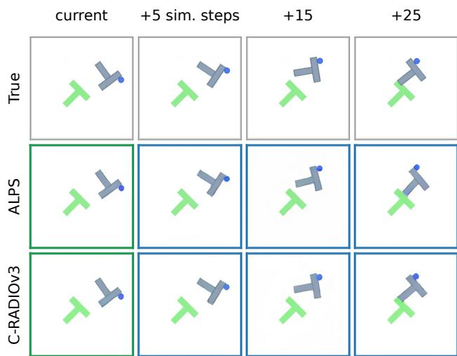  
Figure 6. Rendered world-model predictions on PushT (window 834, largest true motion among 200 windows). The top row shows ground-truth frames; lower rows show each encoder’s evaluation-decoder outputs from real current tokens (green) and open-loop predicted tokens given recorded actions (blue). Mean errors: Tab. S15; full sequence: Fig. S4.

RADIOv3 (.018).

## 5.4. Trade-offs between the first-stage objectives

State, language, and pixels. The first-stage objectives contribute differently to the three capabilities. We train each variant from scratch at one tenth of the Stage 1 schedule, then apply the same Stage 2 refinement (Tab. 5). All variants retain contrastive alignment, so the ablation tests the three auxiliary objectives. The reconstruction loss is essential for the pixel interface: the two variants without it incur 72% and 78% higher $\ell _ { 1 }$ reconstruction error after Stage 1 (.194 and .200 vs. .113). Removing reconstruction or captioning lowers state-probe error by 8.5% and 4.3%, respectively, indicating a capacity trade-off among the auxiliary tasks. Across all variants, Stage 2 reduces state-probe error by 14% to 19%, largely preserves language performance, and changes $\ell _ { 1 }$ error by less than 4%. We therefore retain all objectives in the full recipe, trading a small amount of state-probe accuracy for accurate pixel decoding while still outperforming specialized ViT-B spatial encoders at scale (Tab. 1).

Language retention across objectives. Refinement also preserves language alignment even without the three auxiliary objectives. For the contrastive-only variant, ImageNet zero-shot accuracy changes from 69.8 to 67.9, while imageto-text Recall@1 changes from 91.0 to 89.3 on Flickr30k and from 67.1 to 64.1 on COCO. Thus, the auxiliary objectives are not required to retain strong language alignment in this reduced-budget setting.

Dense correspondence. Dense correspondence directly supervises local patch matching across crops, scales, and flips (Sec. 3.1). Under the one-tenth budget of Tab. 5, removing $\mathcal { L } _ { \mathrm { d e n s e } }$ has minimal impact on global and singleview metrics (changing aggregate state-probe error by less than 1%, $\ell _ { 1 }$ error by under .001, LPIPS negligibly, and retrieval by at most 1.1 points), as these benchmarks do not directly test cross-view patch correspondence. When evaluated directly on cross-view patch matching (Sec. S4), however, removing $\mathcal { L } _ { \mathrm { d e n s e } }$ reduces matching accuracy by 6.0 points after Stage 1 (from 37.4% to 31.4%), and the full recipe retains a 2.6-point advantage even after Stage 2 re-

finement (40.8% vs. 38.2%).

## 6. Conclusion

ALPS shows that a single frozen visual representation, pretrained on still images and text, can combine competitive state information, native language alignment, and pixel reconstruction. Cross-view refinement strengthens state representations while preserving the language and pixel interfaces. The same tokens support robot control, world-model prediction and planning, and visual inspection of predicted scenes. These results suggest visual state pretraining as a shared foundation for robot policies and world models.

Limitations and future work. We focus on a ViT-B/16 backbone and simulation benchmarks for controlled comparison across fifteen encoders, leaving larger model scales and real-robot deployment to future work. On the training side, our recipe relies on a two-stage curriculum to balance reconstruction, language, and spatial state (Sec. 5.4); folding cross-view refinement into a single training stage remains an open question. Moreover, ALPS is pretrained without video supervision and is less sensitive to finegrained temporal actions despite improving cross-frame correspondence on DAVIS (Sec. S2), which motivates extending Stage 2 to video and interaction data. Finally, our downstream evaluations test language-conditioned control and world-model planning in separate settings; integrating state, language, and pixel decoding into a single languageguided, pixel-verifiable planner is a natural next step.

## References

[1] Niket Agarwal, Arslan Ali, Maciej Bala, Yogesh Balaji, Erik Barker, Tiffany Cai, Prithvijit Chattopadhyay, Yongxin Chen, Yin Cui, Yifan Ding, et al. Cosmos world foundation model platform for physical ai. arXiv preprint arXiv:2501.03575, 2025. 3

[2] Eloi Alonso, Adam Jelley, Vincent Micheli, Anssi Kanervisto, Amos Storkey, Tim Pearce, and Franc¸ois Fleuret. Diffusion for world modeling: Visual details matter in atari. Advances in Neural Information Processing Systems, 37: 58757–58791, 2024. 3

[3] Mahmoud Assran, Quentin Duval, Ishan Misra, Piotr Bojanowski, Pascal Vincent, Michael Rabbat, Yann LeCun, and Nicolas Ballas. Self-supervised learning from images with a joint-embedding predictive architecture. In 2023 IEEE/CVF Conference on Computer Vision and Pattern Recognition (CVPR), pages 15619–15629. IEEE, 2023. 2

[4] Mido Assran, Adrien Bardes, David Fan, Quentin Garrido, Russell Howes, Matthew Muckley, Ammar Rizvi, Claire Roberts, Koustuv Sinha, Artem Zholus, et al. V-jepa 2: Selfsupervised video models enable understanding, prediction and planning. arXiv preprint arXiv:2506.09985, 2025. 2, 3, 5, 6, S3, S4, S19

[5] Jinbin Bai, Wei Chow, Ling Yang, Xiangtai Li, Juncheng Li, Hanwang Zhang, and Shuicheng Yan. Humanedit: A high-

quality human-rewarded dataset for instruction-based image editing. arXiv preprint arXiv:2412.04280, 2024. S3

[6] Federico Baldassarre, Marc Szafraniec, Basile Terver, Vasil Khalidov, Francisco Massa, Yann LeCun, Patrick Labatut, Maximilian Seitzer, and Piotr Bojanowski. Back to the features: Dino as a foundation for video world models. arXiv preprint arXiv:2507.19468, 2025. 2, 3

[7] Daniel Bolya, Po-Yao Huang, Peize Sun, Jang Hyun Cho, Andrea Madotto, Chen Wei, Tengyu Ma, Jiale Zhi, Jathushan Rajasegaran, Hanoona Bangalath, et al. Perception encoder: The best visual embeddings are not at the output of the network. Advances in Neural Information Processing Systems, 38:60884–60937, 2026. 2, 6, S3, S4, S5, S19

[8] Tim Brooks, Aleksander Holynski, and Alexei A Efros. Instructpix2pix: Learning to follow image editing instructions. In 2023 IEEE/CVF Conference on Computer Vision and Pattern Recognition (CVPR), pages 18392–18402. IEEE, 2023. S3

[9] Jake Bruce, Michael D Dennis, Ashley Edwards, Jack Parker-Holder, Yuge Shi, Edward Hughes, Matthew Lai, Aditi Mavalankar, Richie Steigerwald, Chris Apps, et al. Genie: Generative interactive environments. In Forty-first international conference on machine learning, 2024. 3

[10] Nhat-Tan Bui, Dinh-Hieu Hoang, Quoc-Huy Trinh, Minh Triet Tran, Truong Nguyen, and Susan Gauch. Nein: Telling what you don’t want. In 2025 IEEE/CVF Confer ence on Computer Vision and Pattern Recognition Work shops (CVPRW), pages 3098–3106. IEEE, 2025. S3

[11] Kaylee Burns, Zach Witzel, Jubayer Ibn Hamid, Tianhe Yu, Chelsea Finn, and Karol Hausman. What makes pre-trained visual representations successful for robust manipulation? arXiv preprint arXiv:2312.12444, 2023. 3

[12] Bingyi Cao, Koert Chen, Kevis-Kokitsi Maninis, Kaifeng Chen, Arjun Karpur, Ye Xia, Sahil Dua, Tanmaya Dabral, Guangxing Han, Bohyung Han, et al. Tipsv2: Advancing vision-language pretraining with enhanced patch-text alignment. arXiv preprint arXiv:2604.12012, 2026. 2, 6, S3, S4, S19

[13] Mathilde Caron, Hugo Touvron, Ishan Misra, Herve J´ egou,´ Julien Mairal, Piotr Bojanowski, and Armand Joulin. Emerg ing properties in self-supervised vision transformers. In 2021 IEEE/CVF international conference on computer vision (ICCV), pages 9630–9640. IEEE, 2021. 2, S19

[14] Guanzhou Chen, Erfei Cui, Changyao Tian, Danni Yang, Ganlin Yang, Yu Qiao, Hongsheng Li, Gen Luo, and Hongjie Zhang. Scaleedit-12m: Scaling open-source image editing data generation via multi-agent framework. arXiv preprint arXiv:2603.20644, 2026. S3

[15] Wei Chow, Linfeng Li, Lingdong Kong, Zefeng Li, Qi Xu, Hang Song, Tian Ye, Xian Wang, Jinbin Bai, Shilin Xu, et al. Editmgt: unleashing potentials of masked generative transformers in image editing. In Proceedings of the IEEE/CVF Conference on Computer Vision and Pattern Recognition, pages 38038–38048, 2026. S3

[16] Wei Chow, Jiachun Pan, Yongyuan Liang, Mingze Zhou, Xue Song, Liyu Jia, Saining Zhang, Siliang Tang, Juncheng Li, Fengda Zhang, et al. Weave: Unleashing and benchmark ing the in-context interleaved comprehension and generation.

In Proceedings of the IEEE/CVF Conference on Computer Vision and Pattern Recognition, pages 15343–15353, 2026. S3

[17] Ian Covert, Tony Sun, James Y Zou, and Tatsunori Hashimoto. Locality alignment improves vision-language models. In International Conference on Learning Representations, pages 83127–83165, 2025. 2

[18] Timothee Darcet, Federico Baldassarre, Maxime Oquab,´ Julien Mairal, and Piotr Bojanowski. Cluster and predict latent patches for improved masked image modeling. arXiv preprint arXiv:2502.08769, 2025. 2

[19] Sudeep Dasari, Mohan Kumar Srirama, Unnat Jain, and Abhinav Gupta. An unbiased look at datasets for visuo-motor pre-training. In Conference on Robot Learning, pages 1183– 1198. PMLR, 2023. 3

[20] Jia Deng, Wei Dong, Richard Socher, Li-Jia Li, Kai Li, and Li Fei-Fei. Imagenet: A large-scale hierarchical image database. In 2009 IEEE conference on computer vision and pattern recognition, pages 248–255. Ieee, 2009. 5

[21] Jacob Devlin, Ming-Wei Chang, Kenton Lee, and Kristina Toutanova. Bert: Pre-training of deep bidirectional transformers for language understanding. In Proceedings of the 2019 conference ofthe North American chapter ofthe associationfor computational linguistics: human language technologies, volume 1 (long and short papers), pages 4171– 4186, 2019. 6

[22] Alexey Dosovitskiy. An image is worth 16x16 words: Transformers for image recognition at scale. arXiv preprint arXiv:2010.11929, 2020. 4

[23] Enrico Fini, Mustafa Shukor, Xiujun Li, Philipp Dufter, Michal Klein, David Haldimann, Sai Aitharaju, Victor G Turrisi da Costa, Louis Bethune, Zhe Gan, et al. Multi-´ modal autoregressive pre-training of large vision encoders. In 2025 IEEE/CVF Conference on Computer Vision and Pattern Recognition (CVPR), pages 9641–9654. IEEE, 2025. 2

[24] Samir Yitzhak Gadre, Gabriel Ilharco, Alex Fang, Jonathan Hayase, Georgios Smyrnis, Thao Nguyen, Ryan Marten, Mitchell Wortsman, Dhruba Ghosh, Jieyu Zhang, et al. Datacomp: In search of the next generation of multimodal datasets. Advances in Neural Information Processing Systems, 36:27092–27112, 2023. 4, S19

[25] Yuying Ge, Sijie Zhao, Chen Li, Yixiao Ge, and Ying Shan. Seed-data-edit technical report: A hybrid dataset for instructional image editing. arXiv preprint arXiv:2405.04007, 2024. S3

[26] Raghav Goyal, Samira Ebrahimi Kahou, Vincent Michalski, Joanna Materzynska, Susanne Westphal, Heuna Kim, Valentin Haenel, Ingo Fruend, Peter Yianilos, Moritz Mueller-Freitag, et al. The “something something” video database for learning and evaluating visual common sense. In 2017 IEEE international conference on computer vision (ICCV), pages 5843–5851. IEEE, 2017. S14

[27] David Ha and Jurgen Schmidhuber. Recurrent world models¨ facilitate policy evolution. Advances in neural information processing systems, 31, 2018. 3

[28] Danijar Hafner, Jurgis Pasukonis, Jimmy Ba, and Timothy Lillicrap. Mastering diverse control tasks through world models. Nature, 640(8059):647–653, 2025. 3

[29] Kaiming He, Xinlei Chen, Saining Xie, Yanghao Li, Piotr Dollar, and Ross Girshick. Masked autoencoders are scalable´ vision learners. In 2022 IEEE/CVF conference on computer vision and pattern recognition (CVPR), pages 15979–15988. IEEE, 2022. 2, 6, S3, S4

[30] Greg Heinrich, Mike Ranzinger, Hongxu Yin, Yao Lu, Jan Kautz, Andrew Tao, Bryan Catanzaro, and Pavlo Molchanov. Radiov2. 5: Improved baselines for agglomerative vision foundation models. In Proceedings of the IEEE/CVF Conference on Computer Vision and Pattern Recognition, pages 22487–22497, 2025. 2, 6, S3, S4, S19

[31] Mude Hui, Siwei Yang, Bingchen Zhao, Yichun Shi, Heng Wang, Peng Wang, Yuyin Zhou, and Cihang Xie. Hq-edit: A high-quality dataset for instruction-based image editing. arXiv preprint arXiv:2404.09990, 2024. S3

[32] Cijo Jose, Theo Moutakanni, Dahyun Kang, Federico´ Baldassarre, Timothee Darcet, Hu Xu, Daniel Li, Marc´ Szafraniec, Michael Ramamonjisoa, Maxime Oquab, et al.¨ Dinov2 meets text: A unified framework for image-and pixel-level vision-language alignment. In 2025 IEEE/CVF Conference on Computer Vision and Pattern Recognition (CVPR), pages 24905–24916. IEEE, 2025. 2, 5, 6, S3, S4

[33] Siddharth Karamcheti, Suraj Nair, Annie S Chen, Thomas Kollar, Chelsea Finn, Dorsa Sadigh, and Percy Liang. Language-driven representation learning for robotics. arXiv preprint arXiv:2302.12766, 2023. 3

[34] Simon Kornblith, Mohammad Norouzi, Honglak Lee, and Geoffrey Hinton. Similarity of neural network representations revisited. In International conference on machine learning, pages 3519–3529. PMlR, 2019. S20

[35] Benno Krojer, Dheeraj Vattikonda, Luis Lara, Varun Jampani, Eva Portelance, Christopher Pal, and Siva Reddy. Learning action and reasoning-centric image editing from videos and simulation. Advances in Neural Information Pro cessing Systems, 37:38035–38078, 2024. S3

[36] Yilun Kuang, Yash Dagade, Quentin Le Lidec, Lucas Maes, Randall Balestriero, and Yann LeCun. Lpwm: A case for sparse representations in world models. arXiv preprint arXiv:2608.22764, 2026. 3

[37] Maksim Kuprashevich, Grigorii Alekseenko, Irina Tolstykh, Georgii Fedorov, Bulat Suleimanov, Vladimir Dokholyan, and Aleksandr Gordeev. Nohumansrequired: Autonomous high-quality image editing triplet mining. In 2026 IEEE/CVF Winter Conference on Applications of Computer Vision (WACV), pages 6059–6068. IEEE, 2026. S3

[38] Quanyi Li, Lan Feng, Haonan Zhang, Wuyang Li, Letian Wang, Alexandre Alahi, and Harold Soh. Grounded world model for semantically generalizable planning. arXiv preprint arXiv:2604.11751, 2026. 3

[39] Xianhang Li, Haoqin Tu, Mude Hui, Zeyu Wang, Bingchen Zhao, Junfei Xiao, Sucheng Ren, Jieru Mei, Qing Liu, Huangjie Zheng, et al. What if we recaption billions of web images with llama-3? arXiv preprint arXiv:2406.08478, 2024. 4

[40] Xianhang Li, Yanqing Liu, Haoqin Tu, and Cihang Xie. Openvision: A fully-open, cost-effective family of advanced vision encoders for multimodal learning. In 2025 IEEE/CVF

International Conference on Computer Vision (ICCV), pages 3977–3987. IEEE, 2025. 2, 6, S3, S4

[41] Tsung-Yi Lin, Michael Maire, Serge Belongie, James Hays, Pietro Perona, Deva Ramanan, Piotr Dollar, and C Lawrence´ Zitnick. Microsoft coco: Common objects in context. In European conference on computer vision, pages 740–755. Springer, 2014. 5

[42] Bo Liu, Yifeng Zhu, Chongkai Gao, Yihao Feng, Qiang Liu, Yuke Zhu, and Peter Stone. Libero: Benchmarking knowledge transfer for lifelong robot learning. Advances in Neural Information Processing Systems, 36:44776–44791, 2023. 5, 6, S9

[43] Yanqing Liu, Xianhang Li, Zeyu Wang, Bingchen Zhao, and Cihang Xie. Clips: An enhanced clip framework for learning with synthetic captions. arXiv preprint arXiv:2411.16828, 2024. 7

[44] Yanqing Liu, Xianhang Li, Letian Zhang, Zirui Wang, Zeyu Zheng, Yuyin Zhou, and Cihang Xie. Openvision 2: A family of generative pretrained visual encoders for multimodal learning. In Proceedings ofthe IEEE/CVF Conference on Computer Vision and Pattern Recognition, pages 39164– 39174, 2026. 2, 4, 6, S3, S4

[45] Davide Lobba, Fulvio Sanguigni, Bin Ren, Marcella Cornia, Rita Cucchiara, and Nicu Sebe. Dress-ed: Instruction-guided editing for virtual try-on and try-off. In European Conference on Computer Vision, pages 57–75. Springer, 2026. S3

[46] Chuofan Ma, Yi Jiang, Junfeng Wu, Jihan Yang, Xin Yu, Zehuan Yuan, Bingyue Peng, and Xiaojuan Qi. Unitok: A unified tokenizer for visual generation and understanding. Advances in Neural Information Processing Systems, 38:129274–129297, 2026. 2

[47] Lucas Maes, Quentin Le Lidec, Damien Scieur, Yann Le-Cun, and Randall Balestriero. Leworldmodel: Stable endto-end joint-embedding predictive architecture from pixels. arXiv preprint arXiv:2603.19312, 2026. 3, 6, 9, S8

[48] Arjun Majumdar, Karmesh Yadav, Sergio Arnaud, Jason Ma, Claire Chen, Sneha Silwal, Aryan Jain, Vincent-Pierre Berges, Tingfan Wu, Jay Vakil, et al. Where are we in the search for an artificial visual cortex for embodied intelligence? Advances in Neural Information Processing Systems, 36:655–677, 2023. 3, 6, S3, S4

[49] Kevis-Kokitsi Maninis, Kaifeng Chen, Soham Ghosh, Arjun Karpur, Koert Chen, Ye Xia, Bingyi Cao, Daniel Salz, Guangxing Han, Jan Dlabal, et al. Tips: Text-image pretraining with spatial awareness. In International Conference on Learning Representations, pages 64256–64279, 2025. 2

[50] Vincent Micheli, Eloi Alonso, and Franc¸ois Fleuret. Transformers are sample-efficient world models. arXiv preprint arXiv:2209.00588, 2022. 3

[51] Lorenzo Mur-Labadia, Matthew Muckley, Amir Bar, Mido Assran, Koustuv Sinha, Mike Rabbat, Yann LeCun, and Nicolas Ballas. V-jepa 2.1: Unlocking dense features in video self-supervised learning. In European Conference on Computer Vision, pages 671–689. Springer, 2026. 2

[52] Suraj Nair, Aravind Rajeswaran, Vikash Kumar, Chelsea Finn, and Abhinav Gupta. R3m: A universal visual representation for robot manipulation. arXiv preprint arXiv:2203.12601, 2022. 3

[53] Maxime Oquab, Timothee Darcet, Th´ eo Moutakanni, Huy´ Vo, Marc Szafraniec, Vasil Khalidov, Pierre Fernandez, Daniel Haziza, Francisco Massa, Alaaeldin El-Nouby, et al. Dinov2: Learning robust visual features without supervision. arXiv preprint arXiv:2304.07193, 2023. 2, 6, S3, S4, S19

[54] Simone Parisi, Aravind Rajeswaran, Senthil Purushwalkam, and Abhinav Gupta. The unsurprising effectiveness of pretrained vision models for control. In international conference on machine learning, pages 17359–17371. PMLR, 2022. 3

[55] Valentinos Pariza, Mohammadreza Salehi, Gertjan J Burghouts, Francesco Locatello, and Yuki Asano. Near, far: Patchordering enhances vision foundation models’ scene understanding. In International Conference on Learning Repre sentations, pages 101552–101579, 2025. 2

[56] Bimsara Pathiraja, Maitreya Patel, Shivam Singh, Yezhou Yang, and Chitta Baral. Refedit: A benchmark and method for improving instruction-based image editing model on referring expressions. In 2025 IEEE/CVF International Con ference on Computer Vision (ICCV), pages 15646–15656. IEEE, 2025. S3

[57] Dustin Podell, Zion English, Kyle Lacey, Andreas Blattmann, Tim Dockhorn, Jonas Muller, Joe Penna, and¨ Robin Rombach. Sdxl: Improving latent diffusion models for high-resolution image synthesis. In International Confer ence on Learning Representations, pages 1862–1874, 2024. 6, S14

[58] Jordi Pont-Tuset, Federico Perazzi, Sergi Caelles, Pablo Arbelaez, Alex Sorkine-Hornung, and Luc Van Gool. The 2017´ davis challenge on video object segmentation. arXiv preprint arXiv:1704.00675, 2017. S14

[59] Yuandong Pu, Le Zhuo, Songhao Han, Jinbo Xing, Kaiwen Zhu, Shuo Cao, Bin Fu, Si Liu, Hongsheng Li, Yu Qiao, et al. Picabench: How far are we from physical realistic image editing? In The Fourteenth International Conference on Learning Representations, 2025. S3

[60] Yusu Qian, Eli Bocek-Rivele, Liangchen Song, Jialing Tong, Yinfei Yang, Jiasen Lu, Wenze Hu, and Zhe Gan. Picobanana-400k: A large-scale dataset for text-guided image editing. In Proceedings of the IEEE/CVF Conference on Computer Vision and Pattern Recognition, pages 37226– 37235, 2026. S3

[61] Alec Radford, Jong Wook Kim, Chris Hallacy, Aditya Ramesh, Gabriel Goh, Sandhini Agarwal, Girish Sastry, Amanda Askell, Pamela Mishkin, Jack Clark, et al. Learning transferable visual models from natural language supervision. In International conference on machine learning, pages 8748–8763. PmLR, 2021. 2, 4, 6, S3, S4, S19

[62] Ilija Radosavovic, Tete Xiao, Stephen James, Pieter Abbeel, Jitendra Malik, and Trevor Darrell. Real-world robot learning with masked visual pre-training. In Conference on Robot Learning, pages 416–426. PMLR, 2023. 3

[63] Mike Ranzinger, Greg Heinrich, Jan Kautz, and Pavlo Molchanov. Am-radio: Agglomerative vision foundation model reduce all domains into one. In 2024 IEEE/CVF Conference on Computer Vision and Pattern Recognition (CVPR), pages 12490–12500. IEEE, 2024. 2

[64] Moritz Schneider, Robert Krug, Narunas Vaskevicius, Luigi Palmieri, and Joschka Boedecker. The surprising ineffectiveness of pre-trained visual representations for model-based reinforcement learning. Advances in Neural Information Processing Systems, 37:32916–32946, 2024. 3

[65] Jinghuan Shang, Karl Schmeckpeper, Brandon B May, Maria Vittoria Minniti, Tarik Kelestemur, David Watkins, and Laura Herlant. Theia: Distilling diverse vision foundation models for robot learning. arXiv preprint arXiv:2407.20179, 2024. 3

[66] Oriane Simeoni, Huy V Vo, Maximilian Seitzer, Federico´ Baldassarre, Maxime Oquab, Cijo Jose, Vasil Khalidov, Marc Szafraniec, Seungeun Yi, Michael Ramamonjisoa,¨ et al. Dinov3. arXiv preprint arXiv:2508.10104, 2025. 2, 6, S3, S4, S19

[67] Zineng Tang, Long Lian, Seun Eisape, XuDong Wang, Roei Herzig, Adam Yala, Alane Suhr, Trevor Darrell, and David M Chan. Tulip: Towards unified language-image pretraining. arXiv preprint arXiv:2503.15485, 2025. 2

[68] Basile Terver, Tsung-Yen Yang, Jean Ponce, Adrien Bardes, and Yann LeCun. What drives success in physical planning with joint-embedding predictive world models? arXiv preprint arXiv:2512.24497, 2025. 3

[69] Michael Tschannen, Alexey Gritsenko, Xiao Wang, Muhammad Ferjad Naeem, Ibrahim Alabdulmohsin, Nikhil Parthasarathy, Talfan Evans, Lucas Beyer, Ye Xia, Basil Mustafa, et al. Siglip 2: Multilingual vision-language encoders with improved semantic understanding, localization, and dense features. arXiv preprint arXiv:2502.14786, 2025. 2, 6, S3, S4, S19

[70] Junke Wang, Qihang Zhang, Shuai Yang, Yiming Luo, Yujun Shen, Zuxuan Wu, Yu-Gang Jiang, and Yinghao Xu. Repwam: World action modeling with representation visualaction tokenizers. arXiv preprint arXiv:2606.13674, 2026. 3

[71] Xinlong Wang, Rufeng Zhang, Chunhua Shen, Tao Kong, and Lei Li. Dense contrastive learning for self-supervised visual pre-training. In 2021 IEEE/CVF Conference on Computer Vision and Pattern Recognition (CVPR), pages 3023– 3032. IEEE, 2021. 4

[72] Yuhan Wang, Siwei Yang, Bingchen Zhao, Letian Zhang, Qing Liu, Yuyin Zhou, and Cihang Xie. Gpt-image-edit-1.5 m: A million-scale, gpt-generated image dataset. arXiv preprint arXiv:2507.21033, 2025. S3

[73] Navve Wasserman, Noam Rotstein, Roy Ganz, and Ron Kimmel. Paint by inpaint: Learning to add image objects by removing them first. In 2025 IEEE/CVF Conference on Computer Vision and Pattern Recognition (CVPR), pages 18313–18324. IEEE, 2025. S3

[74] Cong Wei, Zheyang Xiong, Weiming Ren, Xeron Du, Ge Zhang, and Wenhu Chen. Omniedit: Building image editing generalist models through specialist supervision. In International Conference on Learning Representations, pages 259–271, 2025. S3

[75] Size Wu, Wenwei Zhang, Lumin Xu, Sheng Jin, Xiangtai Li, Wentao Liu, and Chen Change Loy. Clipself: Vision transformer distills itself for open-vocabulary dense prediction. In

International conference on learning representations, pages 52484–52503, 2024. 2

[76] Yecheng Wu, Zhuoyang Zhang, Junyu Chen, Haotian Tang, Dacheng Li, Yunhao Fang, Ligeng Zhu, Enze Xie, Hongxu Yin, Li Yi, et al. Vila-u: a unified foundation model integrating visual understanding and generation. In International Conference on Learning Representations, pages 93620–93638, 2025. 2

[77] Zhenda Xie, Yutong Lin, Zheng Zhang, Yue Cao, Stephen Lin, and Han Hu. Propagate yourself: Exploring pixel-level consistency for unsupervised visual representation learning. In Proceedings of the IEEE/CVF conference on computer vision and pattern recognition, pages 16684–16693, 2021. 4

[78] Keming Ye, Zhipeng Huang, Canmiao Fu, Qingyang Liu, Jiani Cai, Zheqi Lv, Chen Li, Jing Lyu, Zhou Zhao, and Shengyu Zhang. Unicedit-10m: A dataset and benchmark breaking the scale-quality barrier via unified verification for reasoning-enriched edits. In Proceedings of the IEEE/CVF Conference on Computer Vision and Pattern Recognition, pages 37279–37289, 2026. S3

[79] Yang Ye, Xianyi He, Zongjian Li, Shenghai Yuan, Zhiyuan Yan, Bohan Hou, Li Yuan, et al. Imgedit: A unified image editing dataset and benchmark. Advances in Neural Information Processing Systems, 38, 2026. S3

[80] Jewon Yeom, Hanseul Kim, Jeongjae Park, Sungmok Jung, Jaejin Lee, and Taesup Kim. What makes video world model latents action-relevant: Prediction over reconstruction. arXiv preprint arXiv:2606.07687, 2026. 3

[81] Peter Young, Alice Lai, Micah Hodosh, and Julia Hockenmaier. From image descriptions to visual denotations: New similarity metrics for semantic inference over event descrip tions. Transactions ofthe associationfor computational lin guistics, 2:67–78, 2014. 5

[82] Jiahui Yu, Zirui Wang, Vijay Vasudevan, Legg Yeung, Mojtaba Seyedhosseini, and Yonghui Wu. CoCa: Contrastive captioners are image-text foundation models. TMLR, 2022. 2, 4

[83] Qifan Yu, Wei Chow, Zhongqi Yue, Kaihang Pan, Yang Wu, Xiaoyang Wan, Juncheng Li, Siliang Tang, Hanwang Zhang, and Yueting Zhuang. Anyedit: Mastering unified high-quality image editing for any idea. In 2025 IEEE/CVF Conference on Computer Vision and Pattern Recognition (CVPR), pages 26125–26135. IEEE, 2025. S3

[84] Xiaohua Zhai, Basil Mustafa, Alexander Kolesnikov, and Lucas Beyer. Sigmoid loss for language image pre-training. In 2023 IEEE/CVF International Conference on Computer Vision (ICCV), pages 11941–11952. IEEE, 2023. 2

[85] Kai Zhang, Lingbo Mo, Wenhu Chen, Huan Sun, and Yu Su. Magicbrush: A manually annotated dataset for instruction guided image editing. Advances in neural information pro cessing systems, 36:31428–31449, 2023. S3

[86] Letian Zhang, Sucheng Ren, Yanqing Liu, Xianhang Li, Zeyu Wang, Yuyin Zhou, Huaxiu Yao, Zeyu Zheng, Weili Nie, Guilin Liu, et al. Openvision 3: A family of unified visual encoder for both understanding and generation. arXiv preprint arXiv:2601.15369, 2026. 2, 6, S3, S4

[87] Richard Zhang, Phillip Isola, Alexei A Efros, Eli Shechtman, and Oliver Wang. The unreasonable effectiveness of deep

features as a perceptual metric. In 2018 IEEE/CVF conference on computer vision and pattern recognition, pages 586– 595. IEEE, 2018. 6

[88] Haozhe Zhao, Xiaojian Ma, Liang Chen, Shuzheng Si, Rujie Wu, Kaikai An, Peiyu Yu, Minjia Zhang, Qing Li, and Baobao Chang. Ultraedit: Instruction-based fine-grained image editing at scale. Advances in Neural Information Processing Systems, 37:3058–3093, 2024. S3

[89] Yue Zhao, Fuzhao Xue, Scott Reed, Linxi Fan, Yuke Zhu, Jan Kautz, Zhiding Yu, Philipp Krahenb¨ uhl, and De-An¨ Huang. Qlip: Text-aligned visual tokenization unifies autoregressive multimodal understanding and generation. arXiv preprint arXiv:2502.05178, 2025. 2

[90] Boyang Zheng, Nanye Ma, Shengbang Tong, and Saining Xie. Diffusion transformers with representation autoencoders. In International Conference on Learning Representations, pages 35791–35820, 2026. 6

[91] Gaoyue Zhou, Hengkai Pan, Yann LeCun, and Lerrel Pinto. Dino-wm: World models on pre-trained visual features enable zero-shot planning. arXiv preprint arXiv:2411.04983, 2024. 2, 3, 6, 9, S8

[92] Jinghao Zhou, Chen Wei, Huiyu Wang, Wei Shen, Cihang Xie, Alan Yuille, and Tao Kong. ibot: Image bert pre-training with online tokenizer. arXiv preprint arXiv:2111.07832, 2021. 2

[93] Haoyi Zhu, Honghui Yang, Yating Wang, Jiange Yang, Limin Wang, and Tong He. Spa: 3d spatial-awareness enables effective embodied representation. In International Conference on Learning Representations, pages 26361– 26391, 2025. 3

# ALPS: Visual State Encoders for World Models

Supplementary Material

## S1. Training details

Stage 1. Table S1 lists the architecture and optimization hyperparameters of Stage 1. Both the text encoder and the caption decoder have 12 layers and width 768; a class token participates in attention but is not used in any loss. Training runs at $1 2 8 \times 1 2 8$ resolution for 12.8 billion samples (batch size 32,768, peak learning rate $1 . 0 \times 1 0 ^ { - 3 } , w _ { \mathrm { r e c } } = 2 )$ and then at 224 × 224 resolution for 1.0 billion samples (batch size 16,384, peak learning rate $2 . 6 \times 1 0 ^ { - 5 } , w _ { \mathrm { r e c } } = 1 \rangle$ ). The contrastive temperature is learned (initialized at 0.07), with the logit scale clamped between 1 and 100. At each step, the second positive caption for each image is a single randomly sampled sentence from its synthetic caption, whereas the caption decoder predicts the full synthetic caption.

Reconstruction. With $\tilde { z } = z + 0 . 0 5 \mathrm { r m s } ( z ) \epsilon$ and $\epsilon \sim$ $\mathcal { N } ( 0 , I )$ , where the per-token root mean square $\operatorname { r m s } ( z )$ is computed without backpropagating gradients, the reconstruction loss is $\mathcal { L } _ { \mathrm { r e c } } ~ = ~ \rho \big ( D ( z ) , x \big ) + 0 . 2 5 \rho \big ( D ( \tilde { z } ) , x \big )$ where $\rho$ combines $\ell _ { 1 } .$ , structural similarity, and image gradient terms with weights 1, 0.2, and 0.1.

Dense correspondence. The projection head maps the tokens of both views to 256 dimensions, and $\mathcal { L } _ { \mathrm { d e n s e } }$ is an InfoNCE loss with temperature 0.1. It is computed as a weighted sum of two separate softmax terms, one over negatives from other locations in the same image (weight 0.75) and one over negatives from other images (weight 0.25), which keeps their balance fixed across resolutions. At 128 pixels, the negatives consist of all 63 other locations in the same image and 64 locations from other images; at 224 pixels, we sample 64 negatives of each type while excluding the $3 \times 3$ neighborhood around the positive location. After training, we retain the image encoder, text encoder, and contrastive image projection, and discard the caption decoder, dense-correspondence projector, and pretraining decoder.

Stage 2. Table S2 lists the crop views, predictor architecture, and target settings of Stage 2 for ALPS, matching our training configuration and code. The query for patch i of the teacher crop B is defined as

$$
\begin{array} { l } { q _ { i } = m + \mathrm { P E } ( p _ { i } ) + W _ { r } \big [ \ln r , ( \ln r ) ^ { 2 } \big ] , \ } \\ { p _ { i } = 1 4 \Big ( \frac { y _ { i } - y _ { A } } { s _ { A } } , \ \frac { x _ { i } - x _ { A } } { s _ { A } } \Big ) , \ ~ \ r = \frac { s _ { B } } { s _ { A } } , } \end{array}
$$

where m is a learned embedding, PE is the fixed sine-cosine positional encoding, $W _ { r }$ is a learned linear projection, $( y _ { A } , x _ { A } )$ is the top-left corner of the student crop $A , s _ { A }$ and $s _ { B }$ are the side lengths of A and B, and $( y _ { i } , x _ { i } )$ is the center of patch i in B, all measured in the coordinate frame of the image’s central square; $p _ { i }$ is thus expressed in patch units of A. Stage 2 trains for 4,883 steps at batch size 1,024 (5M sampled images in total), with a learning rate of $1 0 ^ { - 4 }$ for the predictor and $1 0 ^ { - 5 }$ for the encoder. We use AdamW $( \beta _ { 1 } = 0 . 9 , \beta _ { 2 } = 0 . 9 9 )$ with weight decay 0.05, gradient clipping at 1.0, 244 warm-up steps, and a cosine learning-rate schedule. Photometric augmentation on the student crop applies color jitter (brightness 0.4, contrast 0.4, saturation 0.2, no hue shift) with probability 0.8, grayscale conversion with probability 0.1, and Gaussian blur $( \sigma \in [ 0 . 1 , 2 . 0 ]$ pixels) with probability 0.5.

Stage 2 training data. Stage 2 trains on 5M single-image samples drawn from a curated collection of public imageediting datasets (Tab. S3), which provide high-resolution, object-centric scenes. Dataset metadata and edit pairings are used only for deduplication, filtering, and sampling weights. Specifically, we remove exact duplicates; global or camera-level edits (style, tone, weather, lighting, background, or viewpoint) and edits of unknown type; image pairs that are identical, misaligned, unchanged, or rerendered under a patch-wise pixel check at 224 × 224 resolution; and frames from real videos. We cap each instruction group at 200 instances and each source image at 4 instances, applying no further filtering on resolution, aesthetics, or content. During training, attribute-level records are subsampled to 10% of the samples, and physical-state records (relations, states, and poses) are sampled with probability 0.05. Each training sample selects a record according to these weights and takes either its source or edited image with probability 0.5; both crops A and B are extracted from this single image, and neither the edit pairing nor any text instruction is used in the training objective. Every refinement experiment in this paper uses this exact budget of 5M sampled images (4,883 steps at batch size 1,024). The collection contains no real video: at most 1.8% of the sampled images are individual frames from a generative video dataset (PICA-100K), and at most 2.5% come from AU-RORA, which mixes edited photographs with simulator renderings.

## S2. Evaluation details

State probe. Figure 3 in the main text illustrates the stateprobe setup; Tab. S4 reports per-setting position errors in centimeters, and Tab. S5 reports the remaining outputs of the probe, which jointly predicts positions, orientations, and binary predicates.

Data. We use agent-view camera recordings from the LIBERO-Object and LIBERO-Spatial demonstrations (10 tasks with 50 demonstrations each), flipped upright and subsampled from 20 to 10 Hz; frames are stored at $1 2 8 \times 1 2 8$ resolution and resized to 224 × 224 via bicubic interpolation. For each task, demonstrations are split by episode into 35 for training, 5 for validation, and 5 for testing, while the remaining 5 are held out as a reserve test set unused in this work. Every frame whose prediction target falls within the same episode serves as a valid sample, yielding roughly 11k–26k training samples and 1.5k–3.7k test samples per

<table><tr><td colspan="2">Architecture encoder ViT-B/16, width 768, 12 layers, 12 heads, MLP 3,072</td></tr><tr><td>image embedding text encoder caption decoder tokenizer pretraining decoder</td><td>fixed 2D sine-cosine position embedding, no final normalization one class token, used in attention but not in any loss mean-pooled patch tokens, linear projection to 768 12 layers, width 768, 32 tokens, pooled at the last token 12 layers, width 768, prefix over image tokens, 80 text tokens WordPiece, BERT vocabulary (lowercase)  $1 \times 1$  conv to 512 channels, 4 blocks with 256, 128, 64, 32 channels  $( 3 \times 3$  conv, pixel shuffle  $\times 2 ,$  GroupNorm, SiLU, 3 × 3 conv),  $3 \times 3$  conv to RGB; 7.4M parameters</td></tr><tr><td>dense head Views input x dense view  $g ( x )$ </td><td>linear 768 to 256 with normalization, shared by both views Inception crop, area 0.4 to 1, no color augmentation square crop of x, area 0.5 to 1, horizontal flip with  $p = 0 . 5$ </td></tr><tr><td>Optimization optimizer weight decay schedule precision</td><td>AdamW,  $\beta _ { 1 } = 0 . 9 , \beta _ { 2 } = 0 . 9 5 ,$  no gradient clipping 0.05 on weight matrices, none on biases, norms, embeddings linear warm-up, then cosine decay to 0 bfloat16 compute, 32-bit parameters</td></tr><tr><td>Phases 128 pixels 224 pixels</td><td>batch 32,768, peak lr  $1 . 0 \times 1 0 ^ { - 3 }$  , 390,981 steps, warm-up 1% batch 16,384, peak lr  $2 . 6 \times 1 0 ^ { - 5 }$  , 62,556 steps, warm-up 5% initialized from the 128-pixel weights with a fresh optimizer state</td></tr></table>

Table S1. Settings of Stage 1. Loss weights and objectives: Secs. S1 and 3.1.
<table><tr><td>Views crop frame teacher crop B</td><td>central square of the image, side m; square boxes of side  $\sqrt { a } \cdot$  m in integer pixels, sampled uniformly</td></tr><tr><td>token grids Predictor P</td><td>photometric augmentation; at least 16 patch centers of B inside A, else up to 10 resamples, then  $A = B$   $1 4 \times 1 4$  patches of 16 pixels for both crops; no flip</td></tr><tr><td>queries position relative scale</td><td>one per patch of B (196); learned vector, position code, and learned linear map of  $( \ln r , ( \ln r ) ^ { 2 } )$  center of each patch of B in the frame of A (in patch units of A); patch  $( u , v )$  is centered at  $( u + 0 . 5 , v + 0 . 5 )$   $r = s _ { B } / s _ { A }$  (side of B over side of A); natural logarithm</td></tr><tr><td>position code keys and values layer</td><td>fixed 2D sine-cosine code, 128 frequencies  $1 0 0 0 0 ^ { - k / 1 2 8 }$  per axis; also added to the student tokens student tokens  $E ( A )$  projected to width 512, plus the position code of their patch centers and one constant register token self-attention among all 196 queries, cross-attention from queries to keys, MLP of width 2,048; pre-norm</td></tr><tr><td>size Targets</td><td>4 layers, width 512, 8 heads; output: normalization and linear map to 768, then normalization and linear map</td></tr><tr><td></td><td></td></tr><tr><td>teacher</td><td></td></tr><tr><td> $\mu , \sigma$ </td><td>frozen Stage 1 encoder on B; tokens standardized per channel,  $\bar { z } = ( z - \mu ) / \sigma$ </td></tr><tr><td></td><td></td></tr><tr><td></td><td>mean and standard deviation of each of the 768 channels over all 196 positions of 32,768 training images, computed once</td></tr><tr><td></td><td>(square crops of 80% to 100% of the central square at 224 pixels, no augmentation, Stage 1 encoder)</td></tr><tr><td>loss</td><td>squared error averaged over the 768 channels and patches of B centered inside A, then across images</td></tr><tr><td></td><td></td></tr></table>

Table S2. Settings of Stage 2 for ALPS. Optimization and augmentation details: Sec. S1.

<table><tr><td>source</td><td>share (%)</td><td>source</td><td>share (%)</td></tr><tr><td>SEED-Data-Edit [25]</td><td>17.5</td><td>PICA-100K [59]</td><td>1.8</td></tr><tr><td>ScaleEdit-12M [14]</td><td>14.9</td><td>NeIn [10]</td><td>1.2</td></tr><tr><td>UltraEdit [88]</td><td>10.1</td><td>Pico-Banana [60]</td><td>1.1</td></tr><tr><td>PIPE [73]</td><td>9.7</td><td>Dress-ED [45]</td><td>1.0</td></tr><tr><td>AnyEdit [83]</td><td>9.5</td><td>WEAVE [16]</td><td>0.7</td></tr><tr><td>OmniEdit [74]</td><td></td><td>8.4 GPT-Image-Edit [72]</td><td>0.3</td></tr><tr><td>NHR-Edit [37]</td><td></td><td>6.0 InstructPix2Pix [8]</td><td>0.2</td></tr><tr><td>CrispEdit-2M [15]</td><td></td><td>5.7 RefEdit [56]</td><td>0.1</td></tr><tr><td>UnicEdit-10M [78]</td><td></td><td>5.1 HumanEdit [5]</td><td>0.1</td></tr><tr><td>ImgEdit [79]</td><td></td><td>4.2 HQ-Edit [31]</td><td>0.0</td></tr><tr><td>AURORA (with MagicBrush) [35, 85]</td><td>2.5 total</td><td></td><td>100</td></tr></table>

Table S3. Sources of the Stage 2 training images and their share of the 5M sampled images.
<table><tr><td rowspan="2">Encoder</td><td colspan="3">LIBERO-Object (cm ↓)</td><td colspan="3">LIBERO-Spatial (cm ↓)</td><td colspan="3">All six cells</td></tr><tr><td>readout</td><td>+1 s</td><td>+3s</td><td>readout</td><td>+1 s</td><td>+3s</td><td>mean (cm)</td><td>median (cm)</td><td>relative</td></tr><tr><td colspan="10">Spatial &amp; self-supervised encoders</td></tr><tr><td>TIPSv2-B/14 [12]</td><td>.995</td><td>1.141</td><td>1.582</td><td>1.765</td><td>1.517</td><td>1.790</td><td>1.465</td><td>1.016</td><td>.963</td></tr><tr><td>DINOv2-B/14 [53]</td><td>.994</td><td>1.036</td><td>1.642</td><td>1.651</td><td>1.529</td><td>1.763</td><td>1.436</td><td>.938</td><td>.942</td></tr><tr><td>PE-Spatial-B/16 [7]</td><td>1.008</td><td>.989</td><td>1.340</td><td>1.944</td><td>1.574</td><td>1.827</td><td>1.447</td><td>.906</td><td>.936</td></tr><tr><td>DINOv3-B/16 [66]</td><td>.910</td><td>1.041</td><td>1.184</td><td>1.592</td><td>1.557</td><td>1.738</td><td>1.337</td><td>.921</td><td>.870</td></tr><tr><td>C-RADIOv3-B [30]</td><td>.907</td><td>.956</td><td>1.285</td><td>1.659</td><td>1.436</td><td>1.742</td><td>1.331</td><td>.893</td><td>.864</td></tr><tr><td colspan="10">Image-text encoders</td></tr><tr><td>CLIP-B/16 [61]</td><td>1.092</td><td>1.151</td><td>1.884</td><td>2.137</td><td>2.093</td><td>2.949</td><td>1.884</td><td>1.148</td><td>1.194</td></tr><tr><td>SigLIP 2-B/16 [69]</td><td>1.130</td><td>1.207</td><td>1.487</td><td>2.286</td><td>2.333</td><td>2.499</td><td>1.824</td><td>1.225</td><td>1.160</td></tr><tr><td>PE-Core-B/16 [7]</td><td>1.138</td><td>1.200</td><td>1.980</td><td>2.153</td><td>1.973</td><td>2.436</td><td>1.813</td><td>1.205</td><td>1.170</td></tr><tr><td>OpenVision-B/16 [40]</td><td>1.168</td><td>1.095</td><td>1.530</td><td>1.809</td><td>1.819</td><td>2.022</td><td>1.574</td><td>1.074</td><td>1.027</td></tr><tr><td colspan="10">Pixel &amp; latent reconstruction encoders</td></tr><tr><td>MAE-B/16 [29]</td><td>.906</td><td>.944</td><td>1.529</td><td>1.886</td><td>2.073</td><td>2.003</td><td>1.557</td><td>.886</td><td>.990</td></tr><tr><td>VC-1-B [48]</td><td>1.136</td><td>.868</td><td>1.104</td><td>1.953</td><td>1.593</td><td>2.214</td><td>1.478</td><td>.906</td><td>.943</td></tr><tr><td>OpenVision 3-B [86]</td><td>1.007</td><td>.933</td><td>1.581</td><td>2.054</td><td>1.822</td><td>2.109</td><td>1.584</td><td>.993</td><td>1.011</td></tr><tr><td colspan="10">Larger encoders, ViT-L (304M to 330M parameters)</td></tr><tr><td>OpenVision 2-L/14 [44]</td><td>.996</td><td>.911</td><td>1.375</td><td>1.848</td><td>1.664</td><td>2.067</td><td>1.477</td><td>1.012</td><td>.945</td></tr><tr><td>V-JEPA 2-L/16 [4]</td><td>.805</td><td>.945</td><td>1.336</td><td>1.333</td><td>1.466</td><td>1.780</td><td>1.277</td><td>.882</td><td>.829</td></tr><tr><td>dino.txt-L/14 [32]</td><td>1.038</td><td>1.145</td><td>2.005</td><td>2.231</td><td>2.321</td><td>2.930</td><td>1.945</td><td>1.204</td><td>1.226</td></tr><tr><td>ALPS (Stage 1)</td><td>1.031</td><td>1.082</td><td>1.392</td><td>1.901</td><td>1.810</td><td>2.097</td><td>1.552</td><td>.992</td><td>1.000</td></tr><tr><td>ALPS</td><td>.891</td><td>.932</td><td>1.128</td><td>1.558</td><td>1.459</td><td>1.711</td><td>1.280</td><td>.820</td><td>.829</td></tr></table>

Table S4. LIBERO state probe in centimeters. Position error of the objects on held-out episodes, for the current frame (readout) and 1 and 3 s ahead given the robot actions. Over the six cells: mean error, mean of the median errors, and mean of the errors relative to ALPS (Stage 1), as reported in Tab. 1. Marks as in Tab. 1.

setting.

Targets. Each movable object in a suite is assigned a fixed slot in alphabetical order: 11 slots in LIBERO-Object (7 present per task) and 5 in LIBERO-Spatial, with absent objects masked out. From the simulator ground truth, we extract each object’s 3D world-frame position, its orientation (predicted as a 6D rotation representation and evaluated up to object symmetries), and the suite’s 10 binary on and in predicates. The prediction settings target the scene state

10 or 30 frames ahead while supplying the probe with the   
20 or 60 intervening robot actions.

Probe. Patch tokens from the last 16 frames are standardized per channel using statistics computed from every fifth training episode, then projected to width 256 with learned spatial and temporal embeddings; robot actions are embedded via a lightweight MLP. Eight learned queries pass through two transformer decoder layers (4 heads, feedforward width 1,024) that cross-attend to all visual and action tokens, followed by linear heads that predict positions, rotations, and predicates. The training objective sums the $\ell _ { 1 }$ position loss, 0.1× the rotation loss, and the binary crossentropy predicate loss. We train the probe using AdamW (learning rate $3 \times 1 0 ^ { - 4 }$ , weight decay 0.01, cosine schedule without warm-up, gradient clipping at 1.0) for 6,000 steps with batch size 128 and bfloat16 mixed precision, evaluating validation loss every 1,000 steps and selecting the checkpoint with the lowest validation loss. We report mean Euclidean position error across all test samples and present objects. Two simple baselines contextualize these errors: predicting each object’s mean training position yields 9.6 to 16.1 cm error across the six settings, whereas copying the true current position yields 1.5 to 4.8 cm overall at +1 and +3 s (since most objects remain static) but 12.8 to 31.6 cm on moving objects, where all tested encoders achieve under 6 cm (Tab. S5).

<table><tr><td rowspan="2">Encoder</td><td rowspan="2">orientation error (deg ↓)</td><td rowspan="2">predicates macro-F1 ↑</td><td colspan="4">position error of the objects that moved (cm ↓)</td></tr><tr><td>Object +1 s</td><td>Object +3 s</td><td>Spatial +1 s</td><td>Spatial +3 s</td></tr><tr><td>Spatial &amp; self-supervised encoders</td><td></td><td></td><td></td><td></td><td></td><td></td></tr><tr><td>TIPSv2-B/14 [12]</td><td>1.79</td><td>.871</td><td>3.53</td><td>3.87</td><td>2.94</td><td>3.10</td></tr><tr><td>DINOv2-B/14 [53]</td><td>1.71</td><td>.889</td><td>3.46</td><td>5.04</td><td>3.15</td><td>3.31</td></tr><tr><td>PE-Spatial-B/16 [7]</td><td>1.84</td><td>.866</td><td>3.38</td><td>4.27</td><td>2.96</td><td>3.54</td></tr><tr><td>DINOv3-B/16 [66]</td><td>1.77</td><td>.894</td><td>3.33</td><td>3.24</td><td>2.93</td><td>3.04</td></tr><tr><td>C-RADIOv3-B [30]</td><td>1.75</td><td>.891</td><td>3.18</td><td>3.80</td><td>2.82</td><td>3.19</td></tr><tr><td>Image-text encoders</td><td></td><td></td><td></td><td></td><td></td><td></td></tr><tr><td>CLIP-B/16 [61]</td><td>1.78</td><td>.849</td><td>3.71</td><td>5.32</td><td>3.54</td><td>4.91</td></tr><tr><td>SigLIP 2-B/16 [69]</td><td>1.81</td><td>.828</td><td>4.15</td><td>4.42</td><td>3.47</td><td>3.95</td></tr><tr><td>PE-Core-B/16 [7]</td><td>1.78</td><td>.841</td><td>3.43</td><td>5.90</td><td>3.55</td><td>3.98</td></tr><tr><td>OpenVision-B/16 [40]</td><td>1.77</td><td>.853</td><td>3.65</td><td>4.82</td><td>3.17</td><td>3.40</td></tr><tr><td>Pixel &amp; latent reconstruction encoders</td><td></td><td></td><td></td><td></td><td></td><td></td></tr><tr><td>MAE-B/16 [29]</td><td>1.78</td><td>.830</td><td>3.30</td><td>4.69</td><td>3.18</td><td>3.80</td></tr><tr><td>VC-1-B [48]</td><td>1.72</td><td>.868</td><td>3.45</td><td>3.55</td><td>3.47</td><td>3.45</td></tr><tr><td>OpenVision 3-B [86]</td><td>1.77</td><td>.847</td><td>3.29</td><td>3.99</td><td>3.50</td><td>4.00</td></tr><tr><td></td><td></td><td></td><td></td><td></td><td></td><td></td></tr><tr><td colspan="7">Larger encoders, ViT-L (304M to 330M parameters)</td></tr><tr><td>OpenVision 2-L/14 [44]</td><td>1.73</td><td>.900</td><td>3.24</td><td></td><td></td><td></td></tr><tr><td>V-JEPA 2-L/16 [4]</td><td>1.68</td><td>.897</td><td>2.93</td><td>3.60 3.89</td><td>3.11 2.51</td><td>3.44</td></tr><tr><td>dino.txt-L/14 [32]</td><td>1.84</td><td>.841</td><td>3.70</td><td>5.42</td><td>4.09</td><td>2.83 5.46</td></tr><tr><td>ALPS (Stage 1)</td><td>1.79</td><td>.863</td><td>3.52</td><td></td><td></td><td></td></tr><tr><td>ALPS</td><td>1.69</td><td>.874</td><td>3.20</td><td>4.14 3.44</td><td>3.29 3.08</td><td>3.82 3.17</td></tr></table>

Table S5. Further outputs of the state probe. Orientation error and macro-F1 of the binary predicates, as means over the six cells, and the position error of the objects that moved between the current and the target frame. Marks as in Tab. 1.

Encoders. Each encoder uses its default input normalization; replacing DINOv2’s native normalization with the DINO-WM convention (mean and standard deviation 0.5) lowers its relative error from .942 to .909. V-JEPA 2 takes 16-frame clips at 256 × 256 resolution, whereas TIPSv2 and PE-Spatial are evaluated at 224 × 224 rather than their native 448 and 512 resolutions. For MAE (the pretrained ViT-B/16 without fine-tuning), VC-1 (the base release), and

PE-Spatial, we extract patch tokens after the final normalization layer. For dino.txt, both the state probe and evaluation decoder read the patch tokens after its vision head (256 tokens of width 1,024), while language tasks use its default image representation (the class token concatenated with the mean-pooled patch token after the vision head), tokenizer, and preprocessing. Using the tokens after its vision head, dino.txt yields the highest state-probe error in our comparison (1.226); extracting tokens directly from its frozen DI-NOv2 ViT-L backbone (which lacks language alignment) lowers the error to .924, matching DINOv2 ViT-B (.942).

Frames rendered at 256 × 256 resolution. Standard LIBERO demonstrations store frames at 128 × 128 resolution, which are upsampled to each encoder’s input size. To verify that our findings are not an artifact of low-resolution storage, we re-render the camera frames of all episodes directly at 256×256 from the recorded simulator states and repeat the state-probe evaluation across all encoders in Tab. 1 (Tab. S6), resizing from 256 pixels to each encoder’s standard input resolution. At 128 × 128, re-rendering matches the stored dataset frames within a mean absolute difference of 3.2 out of 255 gray levels. Higher native resolution reduces position error across all models, and ALPS again achieves the lowest mean relative error among ViT-B encoders (.845), followed by DINOv3 (.862) and C-RADIOv3 (.895), while V-JEPA 2 ViT-L reaches .856. CLIP, SigLIP 2, PE-Core, OpenVision 3, dino.txt, and MAE benefit the most from higher resolution (e.g., SigLIP 2 improves from 1.160 to 1.066 and PE-Core from 1.170 to 1.078, relative to our first-stage encoder on the same frames), yet still trail the leading spatial encoders.

<table><tr><td rowspan="4">Encoder</td><td colspan="5">Frames rendered at 256 px</td><td rowspan="2">128 px</td></tr><tr><td>read- out</td><td>+1 s</td><td>+3s</td><td>mean</td><td>mean (cm)</td><td>mean</td></tr><tr><td>TIPSv2-B/14</td><td>.875</td><td>.896</td><td>1.047</td><td>.939</td><td>1.25</td><td></td></tr><tr><td>DINOv2-B/14</td><td>.863</td><td>.895</td><td>1.008</td><td>.922</td><td>1.22</td><td>.963 .942</td></tr><tr><td>PE-Spatial-B/16</td><td>.986</td><td>.901</td><td>.923</td><td>.937</td><td>1.24</td><td>.936</td></tr><tr><td>DINOv3-B/16</td><td>.880</td><td>.901</td><td>.806</td><td>.862</td><td>1.15</td><td>.870</td></tr><tr><td>C-RADIOv3-B</td><td>.881</td><td>.831</td><td>.973</td><td>.895</td><td>1.19</td><td>.864</td></tr><tr><td>CLIP-B/16</td><td>.980</td><td>1.056</td><td>1.201</td><td>1.079</td><td>1.43</td><td>1.194</td></tr><tr><td>SigLIP 2-B/16</td><td>1.102</td><td>1.069</td><td>1.028</td><td>1.066</td><td>1.42</td><td>1.160</td></tr><tr><td>PE-Core-B/16</td><td>1.045</td><td>1.003</td><td>1.185</td><td>1.078</td><td>1.44</td><td>1.170</td></tr><tr><td>OpenVision-B/16</td><td>1.050</td><td>1.037</td><td>.990</td><td>1.026</td><td>1.37</td><td>1.027</td></tr><tr><td rowspan="3">MAE-B/16 VC-1-B OpenVision 3-B</td><td>.868</td><td>.942</td><td>.944</td><td>.918</td><td>1.24</td><td>.990</td></tr><tr><td>.978</td><td>.918</td><td>.953</td><td>.950</td><td>1.27</td><td>.943</td></tr><tr><td>.887</td><td>.926</td><td>.947</td><td>.920</td><td>1.24</td><td>1.011</td></tr><tr><td rowspan="4">OpenVision 2-L/14 V-JEPA 2-L/16 dino.txt-L/14</td><td>.962</td><td>.903</td><td>.912</td><td>.926</td><td>1.25</td><td>.945</td></tr><tr><td>.743</td><td>.885</td><td>.940</td><td>.856</td><td>1.14</td><td>.829</td></tr><tr><td>1.047</td><td>1.038</td><td>1.051</td><td>1.045</td><td>1.40</td><td>1.226</td></tr><tr><td>1.000</td><td>1.000</td><td>1.000</td><td>1.000</td><td>1.34</td><td>1.000</td></tr><tr><td>ALPS (Stage 1) ALPS</td><td>.868</td><td>.856</td><td>.811</td><td>.845</td><td>1.13</td><td>.829</td></tr></table>

Table S6. State probe on frames rendered at 256 × 256 resolution from the stored states of the episodes of Tab. 1, with the same splits, targets, and probe. Relative error with ALPS (Stage 1) on the same frames as 1.000; last column: the 128-px mean of Tab. 1. Bold: lowest ViT-B mean; gray: ViT-L.
<table><tr><td></td><td></td><td>Validation</td><td colspan="4">Relative error ↓</td></tr><tr><td>Encoder</td><td>Block</td><td>loss (mean)</td><td>read- out</td><td>+1 s</td><td>+3s</td><td>mean</td></tr><tr><td>SigLIP 2-B/16</td><td>6</td><td>.046</td><td>1.194</td><td>.970</td><td>1.277</td><td>1.147</td></tr><tr><td></td><td>8</td><td>.052</td><td>1.165</td><td>1.106</td><td>1.249</td><td>1.173</td></tr><tr><td></td><td>10</td><td>.056</td><td>1.260</td><td>1.169</td><td>1.368</td><td>1.266</td></tr><tr><td></td><td>12</td><td>.059</td><td>1.149</td><td>1.202</td><td>1.130</td><td>1.160</td></tr><tr><td>PE-Core-B/16</td><td>6</td><td>.045</td><td>1.039</td><td>.861</td><td>1.126</td><td>1.009</td></tr><tr><td></td><td>8</td><td>.048</td><td>.943</td><td>.909</td><td>1.104</td><td>.985</td></tr><tr><td></td><td>10</td><td>.046</td><td>.908</td><td>.975</td><td>1.081</td><td>.988</td></tr><tr><td></td><td>12</td><td>.054</td><td>1.118</td><td>1.099</td><td>1.292</td><td>1.170</td></tr><tr><td>ALPS</td><td>12</td><td>.039</td><td>.842</td><td>.834</td><td>.813</td><td>.829</td></tr></table>

Table S7. Intermediate layers on the LIBERO state probe. Relative error as in Tab. 1 for blocks 6, 8, and 10 and for the last block, 12, which Tab. 1 uses. Bold: the block with the lowest mean validation loss, a selection rule fixed before the runs; ALPS uses its last block.

Intermediate layers. Because image-text encoders often retain stronger spatial structure in intermediate layers than in their final output [7], evaluating only the last layer in Tab. 1 could understate their spatial capability. We therefore probed blocks 6, 8, and 10 (out of 12, taking unnormalized block outputs) for SigLIP 2 and PE-Core using the same protocol, selecting for each encoder the block with the lowest mean validation loss across the six settings according to a pre-specified rule. Both encoders select block 6 (Tab. S7), lowering aggregate relative error to 1.147 for SigLIP 2 and 1.009 for PE-Core, compared with 1.160 and 1.170 at the final block; even against their best validation layer, the last layer of ALPS reduces error by 28% and 18%, respectively. No probed intermediate layer of either model matches ALPS; the lowest test error across all probed blocks (.985 at block 8 of PE-Core) still exceeds that of ALPS (.829).

Policy learning. Simulator camera images are stored upside down and flipped upright prior to encoding. Each success rate in Tab. 2 is the mean across three evaluation seeds of a trained policy (50 rollouts per task per evaluation); Tab. S8 reports 95% bootstrap confidence intervals over tasks and initial states, and Tab. S9 provides per-task success rates for the BERT-conditioned policies. These intervals capture evaluation variance for fixed policy checkpoints across 4,000 bootstrap resamples of tasks and initial states; variance across independent policy trainings is analyzed below. With BERT instructions, ALPS achieves 85.1% on LIBERO-Goal and 86.5% on LIBERO-Spatial, outperforming all five public baselines on both suites (72.7%–79.9% on Goal and 74.9%–84.1% on Spatial). On LIBERO-Object and LIBERO-Long, ALPS reaches 92.2% and 69.7%, performing on par with SigLIP 2, DINOv2, DINOv3, and C-RADIOv3 (88.1%–94.4% on Object and 66.0%–72.3% on Long), whereas CLIP reaches 93.2% on Object but drops to 56.3% on Long. Notably, our first-stage encoder already reaches 84.3% on Goal. Under BERT conditioning, the worst-case single-task success rate of ALPS is 71% on Goal and 73% on Spatial, compared with at most 63% and 62% for the public encoders, and 79% on Object (where DINOv3 reaches 89%). Figure S1 visualizes policy rollouts on two tasks per suite.

The upper block of Tab. 2 embeds task instructions using a frozen BERT model. To evaluate a self-contained visuallanguage system, we replaced BERT with the projected text embeddings from our native text tower (rescaled by a single global scalar so that their mean norm across the 40 instructions matches that of BERT) and retrained the policies with all other settings unchanged. To account for training stochasticity, we ran three independent training seeds per suite for each text embedding and evaluated every resulting policy three times as in Tab. 2. Averaged across the four suites and three training seeds, our native text tower achieves 85.2% success versus 82.1% with BERT, a paired improvement of 3.1 percentage points; hierarchical bootstrapping over training runs, tasks, and rollouts yields a 95% confidence interval of [−0.9, +7.1] points, showing that our native text tower serves as an effective instruction interface without an external BERT model. The lower block of Tab. 2 (and the indented rows of Tab. S8) applies the same native-text replacement to each baseline that provides a text tower, keeping all training hyperparameters matched to its

<table><tr><td rowspan="2">Encoder</td><td colspan="3">LIBERO-Long</td><td colspan="3">LIBERO-Goal</td><td colspan="3">LIBERO-Spatial</td><td colspan="3">LIBERO-Object</td><td rowspan="2">All four</td></tr><tr><td>success</td><td>worst task</td><td>tasks ≥ 80</td><td>success</td><td>worst task</td><td>tasks ≥ 80</td><td>success</td><td>worst task</td><td>tasks ≥ 80</td><td>success worst task</td><td>tasks ≥ 80</td><td>mean</td></tr><tr><td>CLIP-B/16</td><td>56.3 [43, 69]</td><td>23</td><td>1</td><td>74.1 [63, 84]</td><td>37</td><td>4</td><td>76.5 [70, 82]</td><td>56</td><td>5</td><td>93.2 [89, 97]</td><td>79</td><td>9</td><td>75.0</td></tr><tr><td>with its text tower</td><td>61.5 [50, 73]</td><td>31</td><td>1</td><td>84.3 [74, 93]</td><td>53</td><td>7</td><td>79.1 [71, 87]</td><td>47</td><td>6</td><td>91.9 [89, 95]</td><td>87</td><td>10</td><td>79.2</td></tr><tr><td>SigLIP 2-B/16</td><td>72.3 [55, 87]</td><td>29</td><td>6</td><td>78.8 [68, 88]</td><td>47</td><td>5</td><td>84.1 [75, 92]</td><td>55</td><td>8</td><td>90.3 [84, 95]</td><td>67</td><td>9</td><td>81.4</td></tr><tr><td>with its text tower</td><td>73.3 [63, 83]</td><td>46</td><td>3</td><td>90.2 [83, 96]</td><td>69</td><td>8</td><td>84.1 [77, 91]</td><td>68</td><td>6</td><td>91.7 [87, 96]</td><td>77</td><td>9</td><td>84.8</td></tr><tr><td>DINOv2-B/14</td><td>66.5 [54, 78]</td><td>29</td><td>3</td><td>78.6 [71, 87]</td><td>63</td><td>4</td><td>80.5 [74, 87]</td><td>62</td><td>4</td><td>88.1 [82, 93]</td><td>69</td><td>9</td><td>78.4</td></tr><tr><td>DINOv3-B/16</td><td>68.4 [57, 78]</td><td>40</td><td>4</td><td>72.7 [63, 82]</td><td>51</td><td>3</td><td>80.7 [73, 87]</td><td>52</td><td>7</td><td>94.4 [92, 97]</td><td>89</td><td>10</td><td>79.0</td></tr><tr><td>C-RADIOv3-B</td><td>66.0 [53, 78]</td><td>39</td><td>5</td><td>79.9 [70, 89]</td><td>53</td><td>6</td><td>74.9 [67, 83]</td><td>58</td><td>4</td><td>92.3 [88, 96]</td><td>77</td><td>9</td><td>78.2</td></tr><tr><td>with its text tower</td><td>73.4 [61, 84]</td><td>36</td><td>4</td><td>89.5 [83, 94]</td><td>67</td><td>9</td><td>82.9 [76, 89]</td><td>63</td><td>7</td><td>81.4 [66, 93]</td><td>24</td><td>7</td><td>81.8</td></tr><tr><td>ALPS (Stage 1)</td><td>68.9 [57, 80]</td><td>33</td><td>2</td><td>84.3 [76, 91]</td><td>61</td><td>7</td><td>76.8 [65, 86]</td><td>32</td><td>5</td><td>94.3 [92, 97]</td><td>88</td><td>10</td><td>81.1</td></tr><tr><td>ALPS</td><td>69.7 [59, 80]</td><td>44</td><td>3</td><td>85.1 [79, 91]</td><td>71</td><td>6</td><td>86.5 [81, 91]</td><td>73</td><td>7</td><td>92.2 [88, 96]</td><td>79</td><td>9</td><td>83.4</td></tr><tr><td>with its text tower</td><td>78.5 [68, 88]</td><td>51</td><td>5</td><td>87.4 [79, 94]</td><td>57</td><td>8</td><td>82.6 [74, 90]</td><td>55</td><td>5</td><td>93.7 [90, 97]</td><td>84</td><td>10</td><td>85.5</td></tr></table>

Table S8. Policy learning on LIBERO in detail, for the policies of Tab. 2. Success in % with a 95% bootstrap interval over tasks and initial states; worst task: the lowest of the 10 tasks; tasks ≥ 80: tasks with at least 80% success. Indented rows: instructions embedded by the encoder’s own text tower instead of BERT. Bold: best of each column.

LIBERO-Spatial: “pick up the black bowl next to the ramekin and place it on the plate”  
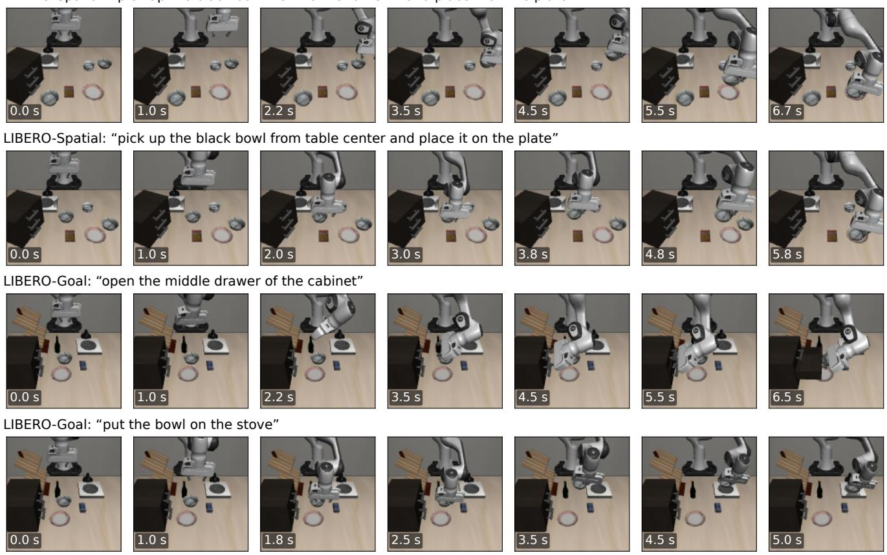  
Figure S1. Closed-loop rollouts of policies trained on frozen ALPS tokens across two tasks each from LIBERO-Spatial and LIBERO Goal, shown with their language instructions. We display the first two tasks (in canonical task order) whose recorded rollout succeeded; overall, 15 of the 20 recorded rollouts across the two suites (one per task) succeeded.

BERT counterpart; for ALPS, these entries correspond to the first seed of the three runs above. SigLIP 2 and CLIP use their own text towers, while C-RADIOv3 uses the text tower of the DFN CLIP ViT-H/14 teacher to which its language adaptor is aligned (matching its language interface in Tab. 1); in each case, the projected text embeddings are globally scaled to match the mean BERT norm across the

<table><tr><td colspan="7">ALPS</td></tr><tr><td>Task</td><td>CLIP SigLIP 2 DINOv2 DINOv3 C-RADIOv3</td><td></td><td></td><td></td><td></td><td>(Stage 1)</td><td>ALPS</td></tr><tr><td>LIBERO-Long</td><td></td><td></td><td></td><td></td><td></td><td></td><td></td></tr><tr><td>alphabet soup and tomato sauce in the basket</td><td>48</td><td>71</td><td>59</td><td>65</td><td>39</td><td>62</td><td>71</td></tr><tr><td>cream cheese box and butter in the basket</td><td>51</td><td>91</td><td>71</td><td>86</td><td>65</td><td>68</td><td>71</td></tr><tr><td>turn on the stove, moka pot on it</td><td>79</td><td>97</td><td>85</td><td>81</td><td>85</td><td>95</td><td>79</td></tr><tr><td>black bowl in the bottom drawer, close it</td><td>90</td><td>98</td><td>94</td><td>87</td><td>93</td><td>96</td><td>93</td></tr><tr><td>white mug on the left plate, yellow-white mug on the right plate</td><td>42</td><td>50</td><td>48</td><td>51</td><td>49</td><td>61</td><td>55</td></tr><tr><td>book in the back compartment of the caddy</td><td>58</td><td>91</td><td>68</td><td>75</td><td>83</td><td>73</td><td>68</td></tr><tr><td>white mug on the plate, pudding right of the plate</td><td>29</td><td>29</td><td>52</td><td>40</td><td>43</td><td>33</td><td>47</td></tr><tr><td>alphabet soup and cream cheese box in the basket</td><td>67</td><td>85</td><td>79</td><td>82</td><td>83</td><td>69</td><td>81</td></tr><tr><td>both moka pots on the stove</td><td>23</td><td>30</td><td>29</td><td>47</td><td>39</td><td>53</td><td>44</td></tr><tr><td>yellow-white mug in the microwave, close it</td><td>75</td><td>82</td><td>81</td><td>71</td><td>81</td><td>78</td><td>89</td></tr><tr><td>mean</td><td>56.3</td><td>72.3</td><td>66.5</td><td>68.4</td><td>66.0</td><td>68.9</td><td>69.7</td></tr><tr><td>LIBERO-Goal</td><td></td><td></td><td></td><td></td><td></td><td></td><td></td></tr><tr><td>open the middle drawer of the cabinet</td><td>93</td><td>96</td><td>92</td><td>85</td><td>97</td><td>92</td><td>95</td></tr><tr><td>put the bowl on the stove</td><td>81</td><td>91</td><td>91</td><td>79</td><td>94</td><td>98</td><td>96</td></tr><tr><td>put the wine bottle on top of the cabinet</td><td>84</td><td>83</td><td>63</td><td>59</td><td>53</td><td>83</td><td>76</td></tr><tr><td>open the top drawer and put the bowl inside</td><td>55</td><td>71</td><td>63</td><td>61</td><td>68</td><td>81</td><td>77</td></tr><tr><td>put the bowl on top of the cabinet</td><td>37</td><td>47</td><td>81</td><td>61</td><td>80</td><td>74</td><td>71</td></tr><tr><td>push the plate to the front of the stove</td><td>77</td><td>89</td><td>69</td><td>73</td><td>83</td><td>93</td><td>86</td></tr><tr><td>put the cream cheese in the bowl</td><td>73</td><td>62</td><td>67</td><td>51</td><td>60</td><td>72</td><td>78</td></tr><tr><td>turn on the stove</td><td>97</td><td>98</td><td>100</td><td>100</td><td>96</td><td>96</td><td>99</td></tr><tr><td>put the bowl on the plate</td><td>65</td><td>74</td><td>79</td><td>89</td><td>93</td><td>93</td><td>92</td></tr><tr><td>put the wine bottle on the rack</td><td>79</td><td>77</td><td>79</td><td>69</td><td>75</td><td>61</td><td>81</td></tr><tr><td>mean</td><td>74.1</td><td>78.8</td><td>78.6</td><td>72.7</td><td>79.9</td><td>84.3</td><td>85.1</td></tr><tr><td>LIBERO-Spatial: pick up the black bowl ... and place it on the plate</td><td></td><td></td><td></td><td></td><td></td><td></td><td></td></tr><tr><td>between the plate and the ramekin</td><td>80</td><td>87</td><td>87</td><td>87</td><td>85</td><td>87</td><td>93</td></tr><tr><td>next to the ramekin</td><td>73</td><td>86</td><td>76</td><td>81</td><td>81</td><td>81</td><td>79</td></tr><tr><td>from the table center</td><td>82</td><td>96</td><td>92</td><td>95</td><td>69</td><td>86</td><td>94</td></tr><tr><td>on the cookie box</td><td>77</td><td>98</td><td>87</td><td>89</td><td>58</td><td>89</td><td>94</td></tr><tr><td>in the top drawer of the wooden cabinet</td><td>79</td><td>80</td><td>62</td><td>81</td><td>87</td><td>74</td><td>89</td></tr><tr><td>on the ramekin</td><td>56</td><td>55</td><td>73</td><td>52</td><td>70</td><td>32</td><td>79</td></tr><tr><td>next to the cookie box</td><td>87</td><td>98</td><td>96</td><td>91</td><td>96</td><td>97</td><td>98</td></tr><tr><td>on the stove</td><td>81</td><td>91</td><td>78</td><td>69</td><td>72</td><td>75</td><td>73</td></tr><tr><td>next to the plate</td><td>65</td><td>85</td><td>75</td><td>83</td><td>61</td><td>70</td><td>81</td></tr><tr><td>on the wooden cabinet</td><td>83</td><td>65</td><td>78</td><td>79</td><td>69</td><td>77</td><td>85</td></tr><tr><td>mean</td><td>76.5</td><td>84.1</td><td>80.5</td><td>80.7</td><td>74.9</td><td>76.8</td><td>86.5</td></tr><tr><td>LIBERO-Object: pick up the ... and place it in the basket</td><td></td><td></td><td></td><td></td><td></td><td></td><td></td></tr><tr><td>alphabet soup</td><td>97</td><td>67</td><td>95</td><td>91</td><td>93</td><td>91</td><td>97</td></tr><tr><td>cream cheese</td><td>79</td><td>95</td><td>69</td><td>93</td><td>93</td><td>95</td><td>90</td></tr><tr><td>salad dressing</td><td>97</td><td>99</td><td>94</td><td>100</td><td>97</td><td>99</td><td>97</td></tr><tr><td>bbq sauce</td><td>89</td><td>99</td><td>97</td><td>95</td><td>94</td><td>97</td><td>86</td></tr><tr><td>ketchup</td><td>92</td><td>83</td><td>87</td><td>97</td><td>85</td><td>94</td><td>93</td></tr><tr><td>tomato sauce</td><td>93</td><td>96</td><td>86</td><td>89</td><td>97</td><td>89</td><td>91</td></tr><tr><td>butter</td><td>100</td><td>93</td><td>89</td><td>91</td><td>97</td><td>88</td><td>96</td></tr><tr><td>milk</td><td>91</td><td>85</td><td>83</td><td>93</td><td>77</td><td>95</td><td>79</td></tr><tr><td>chocolate pudding</td><td>99</td><td>93</td><td>99</td><td>99</td><td>92</td><td>98</td><td>97</td></tr><tr><td>orange juice</td><td>93</td><td>92</td><td>81</td><td>96</td><td>98</td><td>96</td><td>97</td></tr><tr><td>mean</td><td>93.2</td><td>90.3</td><td>88.1</td><td>94.4</td><td>92.3</td><td>94.3</td><td>92.2</td></tr></table>

Table S9. Success of every task in % for the policies of Tab. 2 with BERT, each value the mean of three evaluations (150 rollouts per task), tasks in benchmark order; the mean of a suite is the value of Tab. 2. Bold: best of a row.

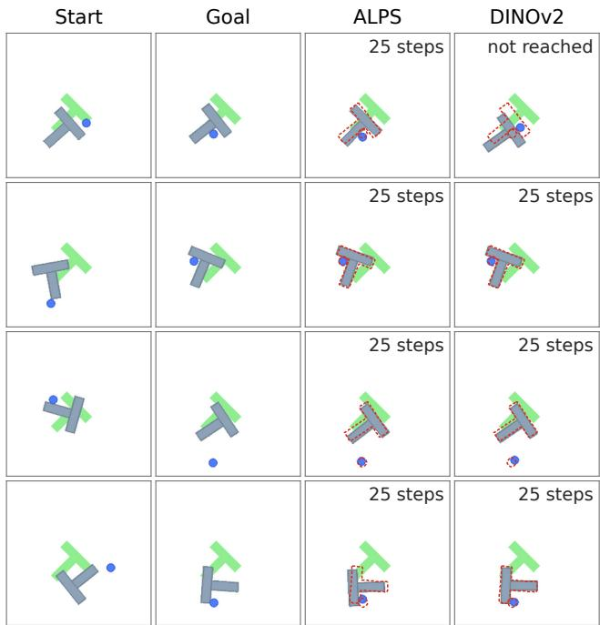  
Figure S2. Planning on PushT with a world model over frozen tokens: start, goal, and final states for each encoder on the first four goals of Tab. 3. Labels indicate executed simulator steps; dashed outlines mark the target block and agent poses. This visualization comes from a separate run of the same CEM planner; because action sampling is stochastic, DINOv2 misses goal 1 here despite succeeding in the main evaluation of Tab. 3.

40 instructions. As with ALPS, we compare the two instruction interfaces for each encoder via their mean success across the four suites.

Table S10 summarizes the policy hyperparameters; within each suite, all encoders and instruction interfaces share identical training and evaluation settings, including random seeds. Complete reproduction configurations specifying seeds, training budgets, checkpoint selection, and evaluation parameters will be released with our code. Relative to the default LIBERO implementation, we replace the end-to-end trained ResNet with a frozen ViT encoder and an attention pooling head, train LIBERO-Long for 25 epochs instead of 50, and evaluate the final checkpoint three times with 50 rollouts per task rather than selecting the best intermediate checkpoint.

Planning. World models. For PushT, Wall, PointMaze, Rope, and Granular, we adopt the codebase, datasets, and planner of DINO-WM [91]. Each encoder is kept frozen, and its patch tokens are standardized per channel using training-set statistics. The dynamics predictor is a 6-layer transformer that maps input tokens to predicted future tokens via learned linear projections, without training an image decoder. All world models share a unified training recipe: batch size 256, learning rate $1 . 4 1 \times 1 0 ^ { - 3 }$ (scaled by p256/32 from DINO-WM’s base rate of $5 \times 1 0 ^ { - 4 }$ at batch size 32), 200 warm-up steps, cosine decay to 1% of the peak rate, and a constant 1% floor over the final 5% of training. Total training updates scale with dataset size: 31,000 steps on PushT (roughly four passes over its training windows), 15,500 on Wall and PointMaze, and 7,750 on Rope and Granular. Conditioning history consists of 3 frames with frame skip 5 on PushT and PointMaze, 1 frame with frame skip 5 on Wall, and 1 frame without frame skip on Rope and Granular. Following DINO-WM, the predictor operates on a 14 × 14 token grid, so input resolution scales with patch size: 224 × 224 for patch size 16 and 196 × 196 for patch size 14 (DINOv2). Every encoder thus produces exactly 196 patch tokens per frame across all five tasks.

Planning and evaluation. All five tasks use the Cross-Entropy Method (CEM) with 300 candidate sequences and 30 elites over a horizon of 5 world-model steps (30 optimization iterations on PushT and 10 on the remaining tasks), replanning after each execution round. On PushT, one world-model step corresponds to 5 simulator steps; after executing the 25 planned simulator steps in a round, the planner replans from the newly reached state for up to 10 rounds. A PushT goal is counted as reached when the combined agent and block position error falls below 20 units (in a 512 × 512 workspace) and the block orientation error is under 20 degrees. PushT and Wall are evaluated across 50 goals, with Wall success defined as reaching within 4.5 units of the goal position. PointMaze is evaluated on 50 random start-goal pairs, with success defined as reaching within 0.5 units of the target. Following DINO-WM, Granular is evaluated on 10 instances and Rope on 50 instances using the Chamfer distance between final and goal particle states (where the first 10 Rope instances match DINO-WM’s default evaluation seed). Goal states are generated by rotating the initial rope by up to 90 degrees with translation, or by scaling the initial particle pile by a factor of 0.6–0.9 with translation. Neither task defines an earlystopping success threshold, so planning always executes all 10 rounds. All encoders are evaluated on identical goals using the same planner seed. Figure S2 illustrates planning results on PushT, and Fig. S3 shows the corresponding rollout trajectories.

Rope. Table S11 supplements the mean Chamfer distance in Tab. 3 with the median across all 50 instances. As a pipeline verification, DINOv2-S/14 trained with DINO-WM’s original predictor and schedule achieves .567 on the 10 default DINO-WM instances (compared with .41 reported in DINO-WM) and .547 across all 50 instances.

Reacher. Because the public DINO-WM release does not include Reacher, we adopt the environment, dataset, and evaluation protocol of LeWorldModel [47]: 10,000 episodes of 201 frames, goals sampled 25 steps ahead within recorded episodes, an interaction budget of 50 environment steps, and success defined as bringing both joints within 0.05 radians of the target. Planning uses CEM with 300 samples, 30 elites, and 30 iterations over a 5-step horizon. We use LeWorldModel’s frozen-encoder baseline architecture, a 6-layer causal transformer predictor without proprioceptive inputs, trained under our unified schedule for 26,000 steps (roughly four passes over the training clips, compared with ten in the default schedule) using mixed precision and unscaled gradient clipping at 1.0. A random policy succeeds on 6% of the 50 evaluation episodes. Table 3 reports mean success across three planner seeds (42, 43, and 44) on the same 50 episodes, with per-seed results listed in Tab. S12. As in the DINO-WM tasks, every encoder outputs 196 tokens (with DINOv2 taking $1 9 6 \times 1 9 6$ inputs); following the LeWorldModel baseline, tokens on Reacher are additionally ℓ -normalized prior to per-channel standardization (computed over 4,096 training frames), and encoder inference runs in float32.

<table><tr><td>Observation cameras encoder input encoder precision tokens per camera pooling language proprioception</td><td>agent view and eye-in-hand,  $1 2 8 \times 1 2 8 ,$  flipped upright bilinear resize to 224 × 224, normalization of the encoder bfloat16 autocast, tokens cast to 32 bit 196 patch tokens of the last block (DINOv2: 256) per camera, one query from the task embedding, 4 heads, output 64 BERT-base (cased), pooled embedding, frozen joint positions (7) and gripper state (2)</td></tr><tr><td>Policy architecture transformer context action head</td><td>transformer policy of LIBERO [42] 4 layers, 6 heads, width 64, MLP 256, dropout 0.1 10 steps Gaussian mixture with 5 modes 8.8M, the same for every encoder</td></tr><tr><td>trainable parameters Training data optimizer schedule batch epochs augmentation</td><td>50 demonstrations per task, 10 tasks per suite AdamW, learning rate  $1 0 ^ { - 4 } .$  weight decay  $1 0 ^ { - 4 }$  cosine decay to  $1 0 ^ { - 5 }$  , no warm-up 32 windows of 10 steps 25 on LIBERO-Long, 50 on the other suites color jitter  $( p = 0 . 9 )$  , random shift of up to 4 pixels</td></tr><tr><td>gradient clipping Evaluation checkpoint rollouts episode repetitions</td><td>norm 100 last epoch 50 per task, one for each fixed initial state of LIBERO at most 600 steps, success when the goal predicates hold three evaluations, differing only in the sampled actions</td></tr></table>

Table S10. Settings of policy learning; within a suite, every encoder is trained and evaluated with matched settings.

<table><tr><td></td><td colspan="2">Chamfer ↓, 50 instances</td></tr><tr><td>Encoder</td><td>mean</td><td>median</td></tr><tr><td>DINOv2-B/14</td><td>.701</td><td>.446</td></tr><tr><td>DINOv3-B/16</td><td>.681</td><td>.406</td></tr><tr><td>C-RADIOv3-B</td><td>.558</td><td>.289</td></tr><tr><td>SigLIP 2-B/16</td><td>.848</td><td>.511</td></tr><tr><td>ALPS (Stage 1)</td><td>.943</td><td>.514</td></tr><tr><td>ALPS</td><td>.750</td><td>.448</td></tr><tr><td>DINOv2-S/14, recipe of DINO-WM</td><td>.547</td><td>.309</td></tr></table>

Table S11. Planning on Rope with the planner of Tab. 3. The first six rows use the world-model recipe of Tab. 3; the last row uses the predictor and the schedule of DINO-WM with its encoder, DINOv2-S/14, as a check of the pipeline.

Prediction accuracy. We also evaluate open-loop state prediction accuracy for the trained world models of Tab. 3 across PushT, Wall, Granular, Rope, and Reacher, directly testing learned latent dynamics rather than the upstream encoder tokens probed in Tab. 1. For each encoder and task, we train a state probe on real frozen tokens from the training set and freeze it; given a single frame’s tokens, the probe estimates the block pose on PushT, the agent position on Wall, 256 particle coordinates on Granular and Rope, or the two joint angles on Reacher (Tab. S13). We then apply this frozen probe to tokens predicted 1 to 5 worldmodel steps ahead from real history frames and recorded actions (corresponding to 5–25 simulator steps on PushT, Wall, and Reacher with frame skip 5, and 1–5 steps on Rope and Granular without frame skip) across 1,500–2,000 heldout windows (100 newly collected episodes on Reacher).

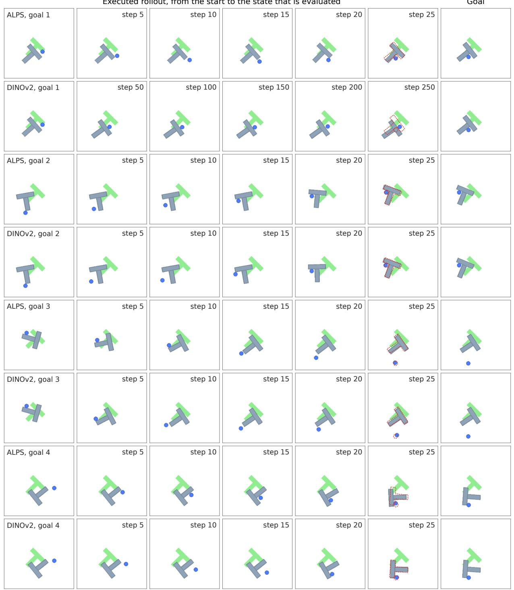  
Figure S3. Executed PushT rollouts for the four goals in Fig. S2, comparing ALPS and DINOv2: six frames from the initial state to the final evaluated state, followed by the goal image (dashed outlines mark the target block and agent poses). DINOv2 misses goal 1 in this rollout (Fig. S2).

Table 4 in the main text reports the 5-step prediction error, while Tab. S16 provides errors at all horizons alongside two baselines: probing the true future tokens at step 5 (which measures the probe’s readout ceiling and serves as a reference rather than a strict lower bound) and copying the last observed frame’s tokens. Across tasks, ALPS achieves lower 5-step prediction error than both SigLIP 2 and our first-stage encoder on PushT, Granular, Rope, and Reacher, and outperforms DINOv3 on PushT while matching it on Granular and Rope, whereas C-RADIOv3 and DINOv3 attain lower error on Reacher. Thus, tokens that yield the lowest single-frame readout error are not always the most predictable under learned dynamics. On Wall, probing true future tokens 5 steps ahead already incurs an error of 9.7– 9.8 (matching the error on predicted tokens), so this task does not meaningfully separate the encoders.

<table><tr><td rowspan="2">Encoder</td><td colspan="2">seed of the planner</td><td rowspan="2">mean</td></tr><tr><td>42 43</td><td>44</td></tr><tr><td>DINOv2-B/14</td><td>72 80</td><td>78</td><td>76.7</td></tr><tr><td>DINOv3-B/16</td><td>90 90</td><td>78</td><td>86.0</td></tr><tr><td>C-RADIOv3-B</td><td>82 86</td><td>78</td><td>82.0</td></tr><tr><td>SigLIP 2-B/16</td><td>68 78</td><td>76</td><td>74.0</td></tr><tr><td>ALPS (Stage 1)</td><td>70 78</td><td>80</td><td>76.0</td></tr><tr><td>ALPS</td><td>82 80</td><td>74</td><td>78.7</td></tr></table>

Table S12. Reacher success in % for every planner seed, with the same world model and the same 50 episodes; the mean is the value of Tab. 3.

Inputs to the world model and state probe. On the four DINO-WM tasks, each history token concatenates the 768 standardized visual channels from the frozen encoder with a 10-dimensional proprioceptive embedding and an action embedding; on Reacher, tokens concatenate only the action embedding (Tab. S13). During open-loop rollouts, each predicted frame is fed back as history along with its predicted proprioceptive channels on the DINO-WM tasks, while the action channels are populated with the groundtruth recorded actions (as analyzed in Tab. S17). The state probe itself reads only the 768 visual channels of the 196 tokens from a single frame (excluding all proprioceptive and action channels), so both real and predicted visual tokens reside in the same standardized space and are evaluated by the exact same probe. Because this token space depends only on the frozen encoder and its training-set statistics, a single trained probe per encoder and task evaluates all worldmodel variants of that encoder.

Probe training. Each task probe is trained exclusively on training-split frames, with checkpoint selection based on validation loss over 2,000 held-out training frames; the evaluation trajectories remain strictly unseen until testing. It shares the width, number of queries, depth, optimizer, learning rate, schedule, training steps, and batch size of the LIBERO probe above, while differing in its singleframe action-free input, 8-head blocks without query selfattention, task-specific losses, weight decay, validation interval, and omission of gradient clipping (Tab. S13).

Decoded frames. We evaluate single-frame reconstruction on PushT following the adapter protocol of Tab. 1. For each encoder, an evaluation decoder is trained on 19,000 frames randomly sampled from the training trajectories and evaluated on 1,000 frames sampled uniformly across the 21 validation trajectories (Tab. S14). All encoders achieve $\ell _ { 1 }$ errors between .0055 and .0066, compared with .0044 for the standalone SDXL autoencoder and .0370 for predicting the mean training frame. Our first-stage encoder achieves the lowest error (.0055), while ALPS (.0061) performs comparably to the public encoders (.0062–.0066).

Rendered predictions. We use these same evaluation decoders to render the future tokens predicted by the world models into pixel space. For each predicted token, we retain the 768 visual channels (discarding proprioceptive and action channels) and invert the world model’s per-channel standardization via $z \sigma + \mu ;$ real tokens undergo the identical inverse transformation before decoding. Because each decoder was trained on raw frozen tokens from the 19,000 training frames at 224 × 224 resolution, the unstandardized world-model tokens on the last observed frame match the decoder’s expected input exactly (cosine similarity 1.000) for all encoders except DINOv2, whose world model operates at 196 × 196 resolution (cosine similarity .80) and is therefore omitted from pixel rendering. We decode tokens predicted 1 to 5 world-model steps ahead across a fixed random sample of 200 validation windows (out of the 1,695 windows in Tab. 4 spanning all 21 validation trajectories) and compare the rendered images against ground-truth future frames (Tab. S15). All 200 windows come from heldout validation trajectories unseen during both world-model and decoder training. At 5 world-model steps ahead, rendered predictions from ALPS achieve an LPIPS of .020, second only to C-RADIOv3 (.018) and outperforming DI-NOv3 (.024), our first-stage encoder (.025), and SigLIP 2 (.031).

Rendered predictions on the windows with the largest motion. Most of the 200 validation windows involve modest object motion (median block displacement of 31 units over 5 steps). To visualize predictions under substantial motion without cherry-picking, we ranked all 200 windows by ground-truth block motion using a rule fixed prior to visual inspection: we filtered for windows with at least 40 units of displacement or 20 degrees of rotation over the 5 steps, and ranked them by displacement plus twice the absolute rotation in degrees. The top three windows are 834 (117 units, −92◦), 138 (115 units, −91◦), and 991 (103 units, +95◦); Fig. 6 in the main text displays window 834 for ALPS and C-RADIOv3, while Figs. S4 to S6 show all three windows across all rendered encoders. Evaluated by the state probe of Tab. 4 on 5-step predicted tokens, block position error on window 834 ranges from 17 to 89 units across all encoders except C-RADIOv3 (2 units), with ALPS at 22 units (up from 3 units at step 1) and under $6 ^ { \circ }$ of orientation error; on window 138, error ranges from 4 units (ALPS) to 35 units (DINOv3); and on window 991, it ranges from 25 units (ALPS) to 58 units (SigLIP 2).

<table><tr><td colspan="7">Shared by all encoders and tasks</td></tr><tr><td>Input</td><td colspan="7">the 196 tokens of one frame with their 768 visual channels, standardized as for the world model; real tokens in training, real or predicted tokens in evaluation; no proprioceptive or action channels and no history frames linear projection to width 256 with learned token embeddings; 8 learned queries; 2 cross-attention blocks with 8 heads and an</td></tr><tr><td></td><td colspan="7">MLP of width 1,024; layer normalization and a linear layer on the concatenated queries; 1.8M parameters, 3.4M for 256 points real tokens of 20,000 frames of the training data; 2,000 other frames of the training data for model selection; evaluation on</td></tr><tr><td>Data</td><td colspan="7">held-out trajectories</td></tr><tr><td>Optimization</td><td colspan="7">AdamW, learning rate  $3 \times 1 0 ^ { - 4 }$  , weight decay 0.05, cosine decay to zero without warm-up, no gradient clipping, batch 128, 6,000 updates, seed 0; encoder frozen lowest validation loss, computed every 500 updates; every selected checkpoint lies at 5,000 to 6,000 updates</td></tr><tr><td>Selection Evaluation</td><td colspan="7">probe frozen and in evaluation mode; one probe per encoder and task reads the real and predicted tokens of every world model of that encoder</td></tr><tr><td>Per task</td><td>PushT</td><td>Wall</td><td></td><td>Granular</td><td>Rope</td><td>Reacher</td></tr><tr><td>World-model history Proprioceptive input</td><td>3 frames, skip 5 agent position and</td><td>1 frame, skip 5 agent position</td><td>1 frame, no skip constant</td><td>1 frame, no skip constant</td><td></td><td>3 frames, skip 5 none</td></tr><tr><td>of the world model Probe frames</td><td>velocity 8-frame windows,</td><td>8-frame windows,</td><td>8-frame windows,</td><td></td><td>8-frame windows,</td><td>every 5th step of</td></tr><tr><td></td><td>skip 5 agent and block</td><td>skip 5</td><td>no skip</td><td>256 points (x, y, z)</td><td>no skip 256 points (x, y, z)</td><td>100-step blocks two joint angles (sine,</td></tr><tr><td>Probe target</td><td>position, block angle</td><td>agent position</td><td></td><td></td><td></td><td>cosine), fingertip</td></tr><tr><td>Training loss</td><td>(sine, cosine)</td><td>MSE</td><td>Chamfer to a fixed</td><td></td><td>Chamfer to all 1,965</td><td>position MSE</td></tr><tr><td></td><td></td><td></td><td></td><td></td><td></td><td></td></tr><tr><td></td><td></td><td>agent position,</td><td></td><td></td><td></td><td></td></tr><tr><td></td><td></td><td></td><td></td><td></td><td></td><td></td></tr><tr><td></td><td></td><td></td><td></td><td></td><td></td><td></td></tr><tr><td></td><td></td><td></td><td></td><td></td><td></td><td></td></tr><tr><td></td><td>MSE</td><td></td><td></td><td></td><td></td><td></td></tr><tr><td></td><td></td><td></td><td></td><td></td><td></td><td></td></tr><tr><td></td><td></td><td></td><td></td><td></td><td></td><td></td></tr><tr><td></td><td></td><td></td><td></td><td></td><td></td><td></td></tr><tr><td></td><td></td><td></td><td></td><td>subset of 2,048 particles</td><td>particles</td><td></td></tr><tr><td></td><td></td><td></td><td></td><td></td><td></td><td></td></tr><tr><td></td><td></td><td></td><td></td><td></td><td></td><td></td></tr><tr><td></td><td></td><td></td><td></td><td></td><td></td><td></td></tr><tr><td>Error in Tab. 4</td><td></td><td></td><td></td><td>Chamfer distance</td><td>Chamfer distance</td><td>joint angles, degrees</td></tr><tr><td></td><td>block position,</td><td></td><td></td><td></td><td></td><td></td></tr><tr><td></td><td></td><td></td><td></td><td></td><td></td><td></td></tr><tr><td></td><td></td><td>workspace units</td><td></td><td></td><td></td><td></td></tr><tr><td></td><td>workspace units</td><td></td><td></td><td></td><td></td><td></td></tr><tr><td></td><td></td><td></td><td></td><td></td><td></td><td></td></tr><tr><td></td><td></td><td></td><td></td><td></td><td></td><td></td></tr><tr><td></td><td></td><td></td><td></td><td></td><td></td><td></td></tr><tr><td></td><td></td><td></td><td></td><td></td><td></td><td></td></tr><tr><td></td><td></td><td></td><td></td><td></td><td></td><td></td></tr><tr><td></td><td></td><td></td><td></td><td></td><td></td><td></td></tr><tr><td></td><td></td><td></td><td></td><td></td><td></td><td></td></tr><tr><td></td><td></td><td></td><td></td><td></td><td></td><td></td></tr><tr><td></td><td></td><td></td><td></td><td></td><td></td><td></td></tr><tr><td></td><td></td><td></td><td></td><td></td><td></td><td></td></tr><tr><td></td><td></td><td></td><td></td><td></td><td></td><td></td></tr><tr><td></td><td></td><td></td><td></td><td></td><td></td><td></td></tr><tr><td></td><td></td><td></td><td></td><td></td><td></td><td></td></tr><tr><td></td><td></td><td></td><td></td><td></td><td></td><td></td></tr><tr><td></td><td></td><td></td><td></td><td></td><td></td><td></td></tr><tr><td></td><td></td><td></td><td></td><td></td><td></td><td></td></tr><tr><td></td><td></td><td></td><td></td><td></td><td></td><td></td></tr><tr><td></td><td></td><td></td><td></td><td></td><td></td><td></td></tr><tr><td></td><td></td><td></td><td></td><td></td><td></td><td></td></tr><tr><td></td><td></td><td></td><td></td><td></td><td></td><td></td></tr><tr><td></td><td></td><td></td><td></td><td></td><td></td><td></td></tr><tr><td></td><td></td><td></td><td></td><td></td><td></td><td></td></tr><tr><td></td><td></td><td></td><td></td><td></td><td></td><td></td></tr><tr><td></td><td></td><td></td><td></td><td></td><td></td><td></td></tr></table>

Table S13. State probe of Tabs. 4 and S16: settings shared by all encoders and tasks, and per task, with the inputs that only the world model receives. MSE: mean squared error of targets standardized with training statistics; Chamfer: symmetric Chamfer distance between the predicted points and the particles of the true state.

<table><tr><td>Encoder</td><td> $\ell _ { 1 }$ </td><td>LPIPS</td></tr><tr><td>DINOv2-B/14</td><td>.0065</td><td>.0091</td></tr><tr><td>DINOv3-B/16</td><td>.0065</td><td>.0080</td></tr><tr><td>C-RADIOv3-B</td><td>.0062</td><td>.0074</td></tr><tr><td>SigLIP 2-B/16</td><td>.0066</td><td>.0086</td></tr><tr><td>ALPS (Stage 1)</td><td>.0055</td><td>.0069</td></tr><tr><td>ALPS</td><td>.0061</td><td>.0073</td></tr><tr><td>SDXL autoencoder alone</td><td>.0044</td><td>.0046</td></tr><tr><td>mean training frame</td><td>.0370</td><td>.0866</td></tr></table>

Table S14. Decoding PushT frames from frozen tokens. We use the protocol of Tab. 1 and evaluate on 1,000 frames from validation trajectories. Lower is better; bold: best encoder in each column.

Readout, one-step prediction, and rollout. To disentangle token readout error, single-step dynamics error, and multi-step compounding error, we evaluate the state probe of Tab. 4 under four conditions across the 200 validation windows of Tab. S15 using the final world-model checkpoints from Tab. 3 (Tab. S17). True future tokens apply the probe directly to the frozen encoder’s tokens of the groundtruth frame k steps ahead. One-step prediction from true history uses teacher forcing: at each step k, the predictor receives the ground-truth tokens (including proprioception) of the three preceding frames along with recorded actions to predict step k, never conditioning on its own prior predictions. The five-step open-loop rollout matches the protocol of Tab. 4 and Fig. 6: starting from three observed frames, each predicted frame and its predicted proprioception are fed back autoregressively as history for the next step, using only the recorded actions. Two additional baselines complete the table: an open-loop rollout where fed-back proprioceptive channels are replaced with ground-truth recorded proprioception, and a static baseline that repeats the last observed frame, confirming that the world models capture nontrivial motion. $\mathrm { A t } \ k = 5 .$ , the error gap between ALPS and C-RADIOv3 remains nearly constant across settings: 0.7 units on true future tokens, 0.7 on one-step predictions, and 0.8 after the five-step rollout (whose confidence interval includes zero). Notably, autoregressive rollout adds only about 3.0 units of error over one-step prediction for both ALPS and C-RADIOv3, compared with 5.7 to 8.9 units for our first-stage encoder, DINOv3, and SigLIP 2. Rendered pixel predictions follow the same trend across the three conditions (LPIPS of .0068 vs. .0070, .0083 vs. .0077, and .0203 vs. .0176). Replacing predicted proprioception with ground-truth proprioception during rollout reduces error for C-RADIOv3 but not for ALPS, widening their gap to 1.6 units. Across the full 1,695 windows of Tab. 4, the postrollout gap is larger than the true-token readout gap (1.1 vs. 0.2 units; Tab. S16), indicating that the fraction of error attributable to rollout accumulation varies across trajectory samples.

<table><tr><td></td><td>token</td><td>decoded real</td><td colspan="3">rendered prediction</td></tr><tr><td>Encoder</td><td>cosine</td><td> $k = 5$  LPIPS</td><td> $k = 1$  LPIPS</td><td> $k = 5$   $\ell _ { 1 }$ </td><td>LPIPS</td></tr><tr><td>SigLIP 2-B/16</td><td>1.000</td><td>.0081</td><td>.0107</td><td>.0150</td><td>.0308</td></tr><tr><td>C-RADIOv3-B</td><td>1.000</td><td>.0070</td><td>.0088</td><td>.0103</td><td>.0176</td></tr><tr><td>DINOv3-B/16</td><td>1.000</td><td>.0074</td><td>.0096</td><td>.0128</td><td>.0242</td></tr><tr><td>ALPS (Stage 1)</td><td>1.000</td><td>.0066</td><td>.0093</td><td>.0126</td><td>.0248</td></tr><tr><td>ALPS</td><td>1.000</td><td>.0068</td><td>.0090</td><td>.0114</td><td>.0203</td></tr></table>

Table S15. Rendered world-model predictions on PushT (200 windows; lower is better). Token cosine: world-model vs. decoder-training tokens (DINOv2: .80, not rendered).

<table><tr><td rowspan="2">Encoder</td><td colspan="5">predicted, world-model steps ahead</td><td colspan="2">references, 5 steps ahead</td></tr><tr><td>1</td><td>2</td><td>3</td><td>4</td><td>5</td><td>true tokens</td><td>last obs.</td></tr><tr><td colspan="8">PushT (block position, workspace units)</td></tr><tr><td>DINOv2-B/14</td><td>4.29</td><td>4.47</td><td>5.16</td><td>6.08</td><td>7.16</td><td>3.24</td><td>38.27</td></tr><tr><td>DINOv3-B/16</td><td>3.87</td><td>4.38</td><td>5.47</td><td>7.04</td><td>8.70</td><td>2.93</td><td>37.87</td></tr><tr><td>C-RADIOv3-B</td><td>3.51</td><td>3.66</td><td>4.21</td><td>4.85</td><td>5.64</td><td>2.66</td><td>38.14</td></tr><tr><td>SigLIP 2-B/16</td><td>6.17</td><td>6.87</td><td>8.21</td><td>9.97</td><td>11.96</td><td>3.52</td><td>38.02</td></tr><tr><td>ALPS (Stage 1)</td><td>5.49</td><td>5.66</td><td>6.58</td><td>7.77</td><td>9.32</td><td>3.36</td><td>38.13</td></tr><tr><td>ALPS</td><td>4.47</td><td>4.74</td><td>5.29</td><td>5.85</td><td>6.73</td><td>2.85</td><td>37.87</td></tr><tr><td colspan="8">Wall (agent position, workspace units)</td></tr><tr><td>DINOv2-B/14</td><td>6.74</td><td>7.47</td><td>8.22</td><td>8.94</td><td>9.69</td><td>9.74</td><td>10.73</td></tr><tr><td>DINOv3-B/16</td><td>6.73</td><td>7.48</td><td>8.26</td><td>9.00</td><td>9.78</td><td>9.79</td><td>10.72</td></tr><tr><td>C-RADIOv3-B</td><td>6.73</td><td>7.45</td><td>8.24</td><td>8.98</td><td>9.75</td><td>9.75</td><td>10.71</td></tr><tr><td>SigLIP 2-B/16</td><td>6.90</td><td>7.57</td><td>8.42</td><td>9.16</td><td>9.91</td><td>9.77</td><td>10.75</td></tr><tr><td>ALPS (Stage 1)</td><td>6.71</td><td>7.46</td><td>8.28</td><td>9.03</td><td>9.81</td><td>9.75</td><td>10.73</td></tr><tr><td>ALPS</td><td>6.71</td><td>7.43</td><td>8.21</td><td>8.94</td><td>9.69</td><td>9.76</td><td>10.71</td></tr><tr><td colspan="8">Granular (Chamfer distance)</td></tr><tr><td>DINOv2-B/14</td><td>.215</td><td>.225</td><td>.233</td><td>.240</td><td>.246</td><td>.225</td><td>.599</td></tr><tr><td>DINOv3-B/16</td><td>.192</td><td>.202</td><td>.210</td><td>.217</td><td>.222</td><td>.199</td><td>.602</td></tr><tr><td>C-RADIOv3-B</td><td>.192</td><td>.201</td><td>.208</td><td>.214</td><td>.218</td><td>.200</td><td>.600</td></tr><tr><td>SigLIP 2-B/16</td><td>.228</td><td>.243</td><td>.253</td><td>.261</td><td>.268</td><td>.231</td><td>.603</td></tr><tr><td>ALPS (Stage 1)</td><td>.229</td><td>.244</td><td>.255</td><td>.265</td><td>.272</td><td>.223</td><td>.595</td></tr><tr><td>ALPS</td><td>.203</td><td>.214</td><td>.223</td><td>.231</td><td>.236</td><td>.208</td><td>.597</td></tr><tr><td colspan="8">Rope (Chamfer distance)</td></tr><tr><td>DINOv2-B/14</td><td>.142</td><td>.204</td><td>.265</td><td>.335</td><td>.410</td><td>.055</td><td>1.674</td></tr><tr><td>DINOv3-B/16</td><td>.133</td><td>.195</td><td>.259</td><td>.330</td><td>.407</td><td>.052</td><td>1.680</td></tr><tr><td>C-RADIOv3-B</td><td>.126</td><td>.179</td><td>.240</td><td>.299</td><td>.372</td><td>.051</td><td>1.678</td></tr><tr><td>SigLIP 2-B/16</td><td>.178</td><td>.253</td><td>.320</td><td>.399</td><td>.469</td><td>.066</td><td>1.669</td></tr><tr><td>ALPS (Stage 1)</td><td>.161</td><td>.228</td><td>.295</td><td>.360</td><td>.424</td><td>.056</td><td>1.674</td></tr><tr><td>ALPS</td><td>.135</td><td>.195</td><td>.248</td><td>.313</td><td>.377</td><td>.053</td><td>1.678</td></tr><tr><td colspan="8">Reacher (joint angles, degrees)</td></tr><tr><td>DINOv2-B/14</td><td>.90</td><td>.99</td><td>1.08</td><td>1.14</td><td>1.21</td><td>.93</td><td>25.23</td></tr><tr><td>DINOv3-B/16</td><td>.70</td><td>.81</td><td>.88</td><td>.95</td><td>1.03</td><td>.75</td><td>25.23</td></tr><tr><td>C-RADIOv3-B</td><td>.81</td><td>.89</td><td>.95</td><td>1.01</td><td>1.06</td><td>.80</td><td>25.21</td></tr><tr><td>SigLIP 2-B/16</td><td>1.10</td><td>1.39</td><td>1.62</td><td>1.84</td><td>2.02</td><td>1.00</td><td>25.24</td></tr><tr><td>ALPS (Stage 1)</td><td>.90</td><td>1.10</td><td>1.20</td><td>1.30</td><td>1.42</td><td>.89</td><td>25.22</td></tr><tr><td>ALPS</td><td>.83</td><td>.93</td><td>1.02</td><td>1.09</td><td>1.18</td><td>.79</td><td>25.22</td></tr></table>

Table S16. State readout from predicted tokens at every step. We evaluate the state probe of Tab. 4 on tokens predicted 1 to 5 worldmodel steps ahead, alongside two references scored against the true state at step 5: the true tokens at step 5 and the last observed tokens (lower is better)
<table><tr><td>Encoder</td><td>true future tokens</td><td>one-step prediction, true history</td><td>five-step open-loop rollout</td><td>rollout with recorded proprioception</td><td>last observation repeated</td></tr><tr><td>ALPS</td><td>3.1</td><td>3.6</td><td>6.6</td><td>6.7</td><td>42.0</td></tr><tr><td>ALPS (Stage 1)</td><td>3.8</td><td>4.3</td><td>9.9</td><td>9.2</td><td>42.3</td></tr><tr><td>C-RADIOv3-B</td><td>2.4</td><td>2.8</td><td>5.8</td><td>5.1</td><td>41.9</td></tr><tr><td>DINOv3-B/16</td><td>3.0</td><td>3.2</td><td>9.1</td><td>8.4</td><td>41.7</td></tr><tr><td>SigLIP 2-B/16</td><td>3.7</td><td>5.2</td><td>14.1</td><td>12.1</td><td>42.0</td></tr><tr><td></td><td></td><td></td><td></td><td>ALPS − C-RADIOv3 +0.68 [+0.26, +1.22] +0.73 [+0.38, +1.09] +0.76 [−0.04, +1.49] +1.60 [+0.42, +2.97] +0.13 [−0.60, +0.80]</td><td></td></tr></table>

Table S17. PushT block error read from true, one-step, and rolled-out tokens 5 world-model steps ahead, in workspace units, lower is better, on the 200 windows of Tab. S15 with the world models of Tab. 3. One-step: every step predicted from the true history. Last row: paired difference with a 95% bootstrap interval over the 21 trajectories. Bold: lowest of a column; conditions: Sec. S2.

Pipeline calibration. To verify our implementation against prior work, we trained DINOv2-S/14 (the default encoder in DINO-WM) using DINO-WM’s original recipe and training budget; it achieves 94% success on PushT and 92% on Wall across 50 goals, closely matching both the numbers reported in DINO-WM (90% and 96%) and our evaluation of their released checkpoints (92% and 94%).

Reconstruction. The evaluation decoder, trained from scratch on frozen tokens for each encoder and separate from our Stage 1 pretraining decoder, maps patch tokens to the latent space of a frozen SDXL autoencoder [57], whose decoder renders the final image. Specifically, it consists of a $1 \times 1$ convolution to width 512, a transposed convolution upsampling the $1 4 \times 1 4$ token grid to 28 × 28 (bilinearly resizing token grids that differ from 14 × 14 beforehand), five residual blocks, and a $3 \times 3$ convolution to the four latent channels. We train the adapter using AdamW (learning rate $1 0 ^ { - 4 } )$ for 20k steps at batch size 8, minimizing the sum of latent-space MSE and decoded-image LPIPS while injecting Gaussian noise of random scale into the input tokens. Training uses 19,000 images from the ImageNet-1k validation set (the first 19 sorted files per class), and evaluation uses the 20th file per class (1,000 held-out images), with all images resized to a short side of 224 pixels and centercropped. We compute $\ell _ { 1 }$ reconstruction error on pixel values scaled to [−1, 1]. Passing the held-out images directly through the SDXL autoencoder without token compression yields an $\ell _ { 1 }$ error of .071 and an LPIPS of .130 (serving as an upper-bound reference), whereas predicting the mean training image yields .460 and .816. Figure S7 displays reconstructions on a random sample of twelve held-out images across ten encoders, the first three of which appear in

<table><tr><td rowspan="2">Encoder</td><td colspan="2">Standard decoder</td><td colspan="2">Larger decoder</td></tr><tr><td> $\ell _ { 1 }$ </td><td>LPIPS</td><td> $\ell _ { 1 }$ </td><td>LPIPS</td></tr><tr><td>ALPS</td><td>.120</td><td>.372</td><td>.107</td><td>.302</td></tr><tr><td>C-RADIOv3-B</td><td>.161</td><td>.359</td><td>.141</td><td>.311</td></tr><tr><td>DINOv2-B/14</td><td>.248</td><td>.535</td><td>.218</td><td>.423</td></tr><tr><td>SigLIP 2-B/16</td><td>.264</td><td>.541</td><td>.220</td><td>.404</td></tr></table>

Table S18. Reconstruction with a stronger decoding and training configuration. Standard: the protocol of Tab. 1; larger: a wider and deeper decoder trained longer on more images; both on the same 1,000 held-out images. Every encoder improves; ALPS keeps the lowest $\ell _ { 1 }$ and overtakes C-RADIOv3 on LPIPS.

Fig. 4 of the main text. For V-JEPA 2, each static image is duplicated into a two-frame clip.

Stronger decoding and training configuration. As a capacity control, we re-evaluate four encoders using a larger adapter (width 1,024 and ten residual blocks) trained for 60k steps on 49,000 ImageNet validation images (all 49 remaining files per class, keeping the 20th file strictly held out) and tested on the same 1,000 held-out images (Tab. S18). Because this setting increases adapter width, depth, training steps, and training set size simultaneously, it tests an overall stronger decoding regime rather than model capacity in isolation. All four encoders improve on both metrics. On $\ell _ { 1 }$ error, ALPS improves from .120 to .107 and C-RADIOv3 from .161 to .141, maintaining a consistent relative advantage for ALPS (25% lower error with the standard adapter and 24% lower with the stronger configuration), while DINOv2 and SigLIP 2 remain at roughly twice our error (.218 and .220). On LPIPS, ALPS moves from 4% behind C-RADIOv3 under the standard adapter (.372 vs. .359) to 3% ahead under the stronger configuration (.302 vs. .311), while DINOv2 and SigLIP 2 reach .423 and .404.

Temporal transfer. Because ALPS is pretrained exclusively on static images and text, we evaluate how its spatial representations transfer to video across two complementary benchmarks (Tab. S19): video object segmentation on DAVIS-2017 [58] via training-free mask propagation $( { \mathcal { I } } \& { \mathcal { F } } ) .$ , which tests cross-frame spatial correspondence, and action recognition on Something-Something v2 (SSv2) [26] using an attentive probe trained for 20 epochs on 16-frame clips at 224 × 224 resolution, which tests fine-grained temporal dynamics. Stage 2 refinement improves DAVIS J &F from .456 to .533 while leaving SSv2 largely unchanged (56.4 vs. 55.6); static cross-view refinement thus sharpens frame-to-frame spatial correspondence without supplying fine-grained motion features, underscoring why physical-state representation and action classification should be evaluated separately. Extending cross-view refinement to video clips and interaction trajectories is a nat-

## PushT window 834 · true-motion rank 1

Block displacement 117 units; rotation -92°. All five encoders.

Conditioning: observed frames at -10, -5 and 0 simulator steps; recorded actions.

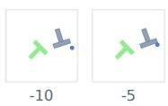

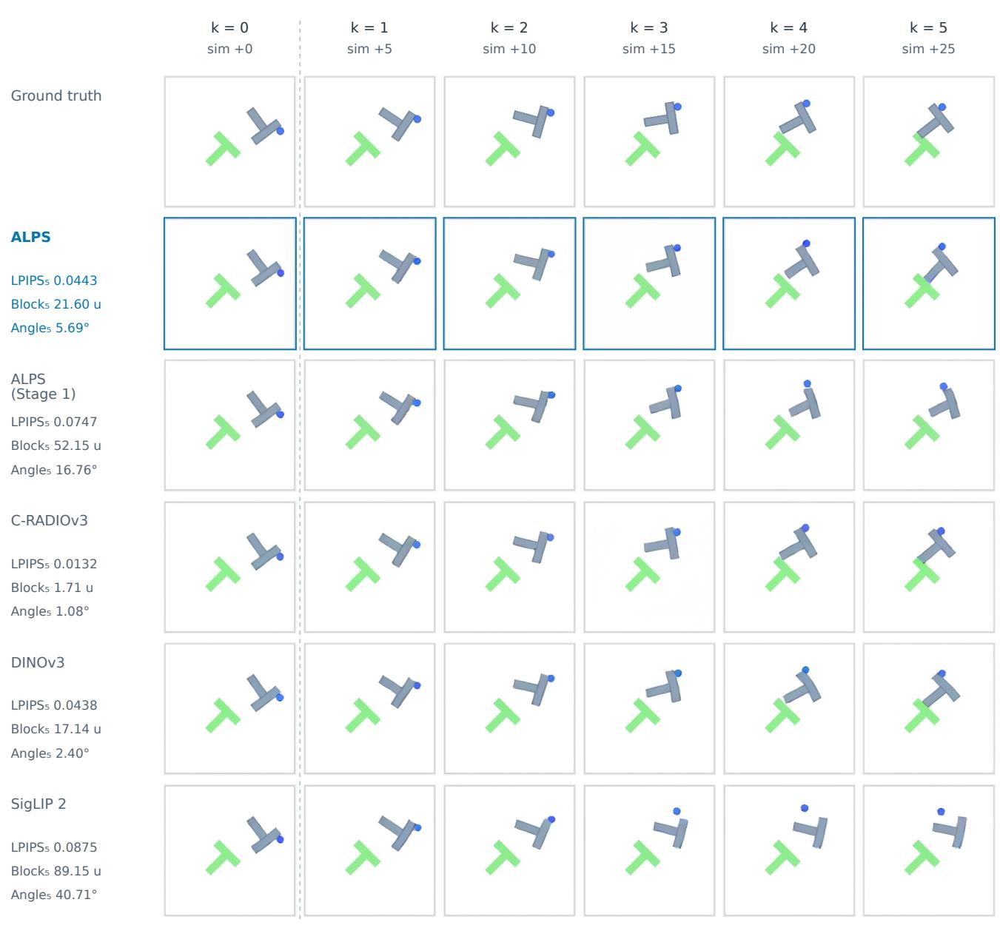  
k = 0: decoded real tokens; k = 1-5: predicted tokens. Full uncropped frames.  
LPIPS compares rendered pixels; block and angle errors come from probes on predicted tokens.

Figure S4. Rendered world-model predictions across encoders on PushT window 834, ranked first by our motion criterion (Sec. S2) Each row applies an encoder’s evaluation decoder to its real tokens at the current frame (k = 0) and to tokens predicted k = 1 to 5 world-model steps ahead; the top row shows ground-truth frames. Row annotations report 5-step LPIPS against the true frame alongside block position and angle errors read by the probe of Tab. 4.

## PushT window 138 · true-motion rank 2

Block displacement 115 units; rotation -91°. All five encoders.

Conditioning: observed frames at -10, -5 and 0 simulator steps; recorded actions.

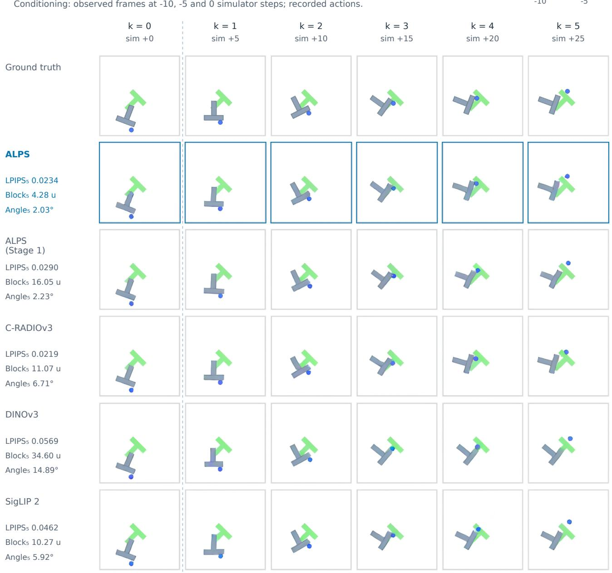  
k = 0: decoded real tokens; k = 1-5: predicted tokens. Full uncropped frames.  
LPIPS compares rendered pixels; block and angle errors come from probes on predicted tokens.

Figure S5. Rendered world-model predictions across encoders on PushT window 138, ranked second by our motion criterion; layout and metrics follow Fig. S4.

## PushT window 991 · true-motion rank 3

Block displacement 103 units; rotation +95°. All five encoders.

Conditioning: observed frames at -10, -5 and 0 simulator steps; recorded actions.

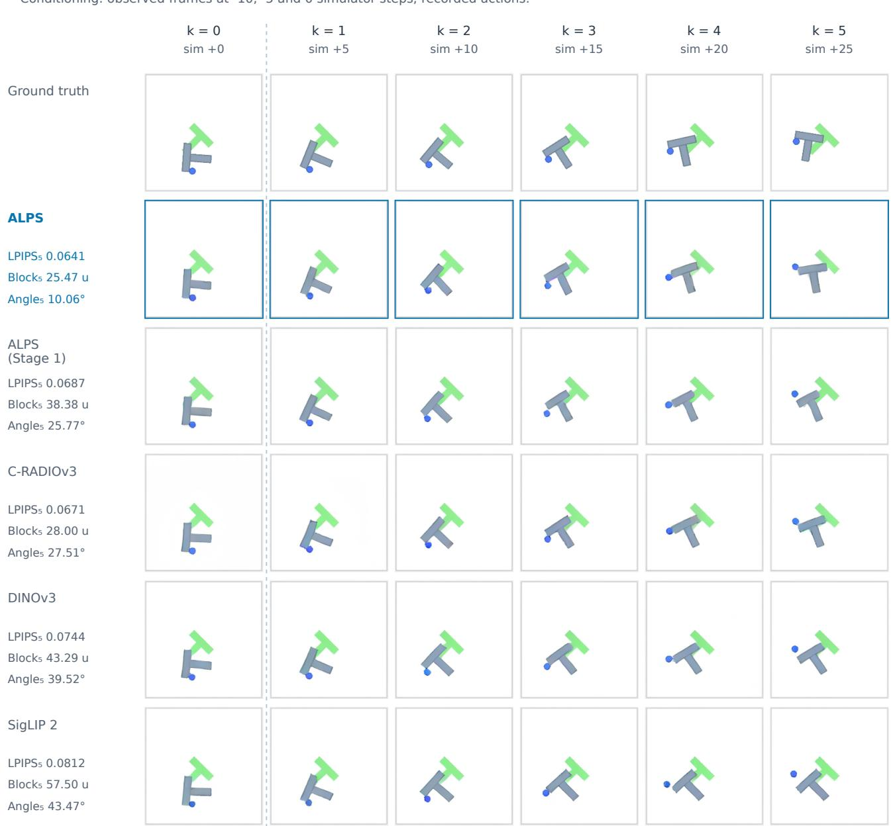  
k = 0: decoded real tokens; k = 1-5: predicted tokens. Full uncropped frames.  
LPIPS compares rendered pixels; block and angle errors come from probes on predicted tokens.

Figure S6. Rendered world-model predictions across encoders on PushT window 991, ranked third by our motion criterion; layout and metrics follow Fig. S4.

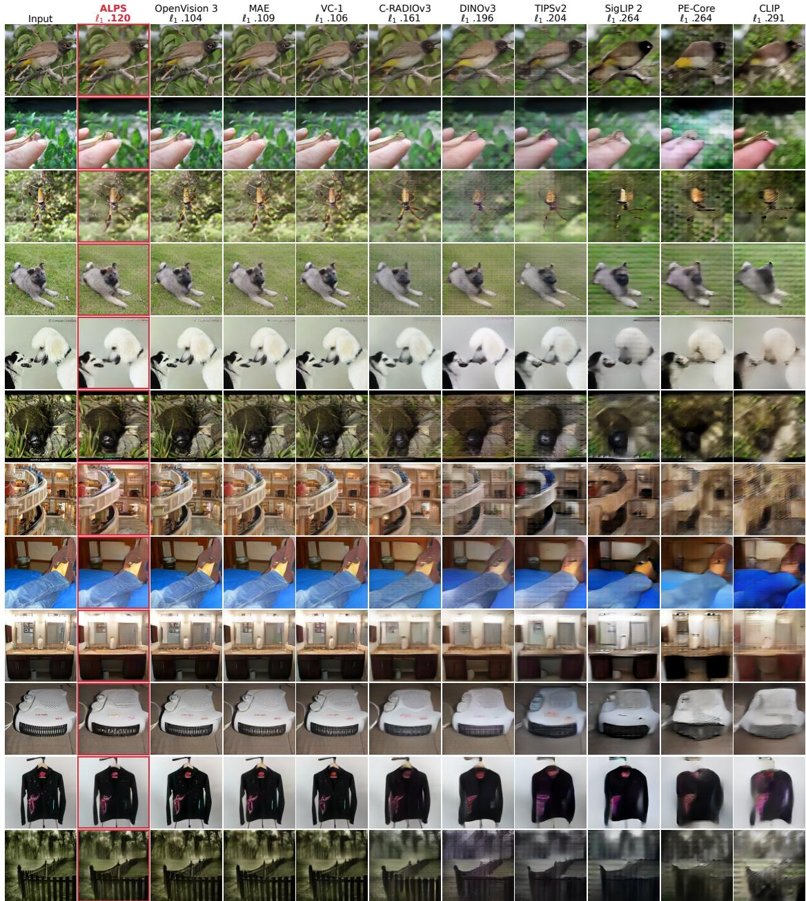  
Figure S7. Reconstruction from frozen tokens on a random sample of held-out ImageNet images: input images alongside outputs from the evaluation decoders of ten encoders, each labeled with its mean ℓ error over the 1,000 held-out images (the first three rows correspond to Fig. 4).

<table><tr><td>Encoder</td><td>DAVIS SSv2 J&amp;F↑ top-1↑</td></tr><tr><td>Spatial &amp; self-supervised encoders TIPSv2-B/14 [12] .652</td><td>57.8</td></tr><tr><td>DINOv2-B/14 [53] .661</td><td></td></tr><tr><td></td><td>63.7</td></tr><tr><td>DINOv3-B/16 [66]</td><td>61.8</td></tr><tr><td>C-RADIOv3-B [30]</td><td>62.1</td></tr><tr><td>Image-text encoders</td><td></td></tr><tr><td>CLIP-B/16 [61]</td><td>.574 43.3 .503</td></tr><tr><td>SigLIP 2-B/16 [69]</td><td>49.4</td></tr><tr><td>PE-Core-B/16 [7]</td><td>42.2</td></tr><tr><td>Larger encoders, ViT-L (304M parameters) V-JEPA 2-L/16 [4] .526</td><td>70.3</td></tr><tr><td></td><td>56.4</td></tr><tr><td>ALPS (Stage 1) ALPS</td><td>55.6</td></tr></table>

Table S19. Temporal transfer: DAVIS-2017 video object segmentation by label propagation (J &F) and Something-Something v2 action recognition with an attentive probe (top-1), protocol in Sec. S2. SSv2 is in the pretraining data of V-JEPA 2. Encoders without a video result are not listed. Marks as in Tab. 1.

<table><tr><td></td><td>State probe</td><td colspan="3">Language alignment ↑</td></tr><tr><td>Encoder</td><td>LIBERO err.↓</td><td>IN-1k 0-shot</td><td>Flickr I→T</td><td>COCO I→T</td></tr><tr><td>ALPS (Stage 1)</td><td>1.000</td><td>74.5</td><td>93.4</td><td>70.6</td></tr><tr><td>ALPS</td><td>.829</td><td>73.4</td><td>93.2</td><td>70.2</td></tr><tr><td>change</td><td>-.171</td><td>-1.1</td><td>-0.2</td><td>-0.4</td></tr><tr><td>SigLIP 2-B/16</td><td>1.160</td><td>77.6</td><td>91.7</td><td>67.9</td></tr><tr><td>+ Stage 2</td><td>.893</td><td>73.3</td><td>84.2</td><td>56.5</td></tr><tr><td>change</td><td>-.267</td><td>-4.3</td><td>-7.5</td><td>-11.4</td></tr><tr><td>CLIP-B/16</td><td>1.194</td><td>68.4</td><td>81.9</td><td>52.5</td></tr><tr><td>+ Stage 2</td><td>.898</td><td>58.2</td><td>71.0</td><td>40.7</td></tr><tr><td>change</td><td>-.296</td><td>-10.2</td><td>-10.9</td><td>-11.8</td></tr></table>

Table S20. Numerical results for Fig. 5: state-probe error and language alignment for each encoder before and after Stage 2, and the change (after minus before), under the same budget of 5M sampled images.

ural next step (Sec. 6).

On DAVIS validation videos, we follow the training-free label propagation protocol of DINO [13]: $\ell _ { 2 } \cdot$ -normalized last-layer patch tokens in each frame are compared against those of the first frame and the preceding seven frames within a 12-token spatial radius, propagating the soft masks of the top five neighbors (temperature 0.1). Video frames are resized to a short side of 480 pixels (476 for patch size 14), with positional embeddings interpolated to the resulting token grid; for our encoders, which use fixed sine-cosine embeddings, spatial coordinates are rescaled to match the 14 × 14 pretraining range. V-JEPA 2 processes 16-frame clips up to the current frame (padded at the start by repeating the first frame), from which we extract the final tubelet’s tokens and rescale spatial rotary positions to its 16 × 16 pretraining grid in the same manner. Without spatial position rescaling, its rotary embeddings extrapolate poorly to 480p inputs, dropping its J&F score from .526 to .347. On Something-Something v2, V-JEPA 2 reaches 70.3% under the same position rescaling and probe protocol (reinitializing the input projection for its 1,024-dimensional tokens and matching temporal embeddings to its 8 tubelets); because SSv2 is part of V-JEPA 2’s pretraining corpus, this score serves as an in-domain reference rather than an outof-distribution transfer result.

Precision. Video object segmentation (DAVIS), action recognition (SSv2), and policy learning (Tab. S10) run frozen encoder inference in bfloat $^ { 1 6 ; }$ running float32 inference on DAVIS shifts $\mathcal { T } \& \mathcal { F }$ slightly from .456 and .533 to .462 and .535 (Tab. S19). Language evaluations run public encoders with float16 autocast and our encoders in float32 (since our encoders output unnormalized patch tokens); for SigLIP $^ { 2 , }$ switching to float32 changes zero-shot accuracy and retrieval by at most 0.06 points.

## S3. Stage 2: full comparison and image source

Table S20 reports the complete state-probe and languagealignment metrics for the refinement comparison in Fig. 5 under a shared budget of 5M sampled images. For our encoder, Stage 2 boosts LIBERO-Spatial policy success by 9.7 points while preserving performance on Goal (+0.8 points) and Long (+0.8 points); for SigLIP 2, refinement shifts policy success by at most 2.1 points across the three suites. When refining SigLIP 2 and CLIP, both the student and frozen teacher are initialized from the released image tower, prediction targets are taken after the final normalization layer (matching downstream evaluation) and standardized over 32,768 training images, and the language projection head remains frozen. Downstream, refined SigLIP 2 reaches 79.0% on LIBERO-Goal and 82.4% on Spatial (compared with 85.1% and 86.5% for ALPS), and 74.4% on Long (compared with 69.7%). Replacing our curated high-resolution image collection in Stage 2 with single web images from DataComp [24] yields a state-probe error of .886 (vs. .829), DAVIS $\mathcal { T } \& \mathcal { F }$ of .523 (vs. .533), and ImageNet zero-shot accuracy of 73.6 (vs. 73.4); because DataComp images have substantially lower native resolution (39% have a short side below 224 pixels, compared with 512–1,024 pixels for most images in our curated set), this gap reflects both scene composition and source resolution.

## S4. Details of the first-stage ablation

Each ablation variant in Tab. 5 is pretrained from scratch for 10% of the Stage 1 schedule (39k steps at 128 × 128 resolution followed by 6.3k steps at 224 × 224) and subsequently refined with the full Stage 2 recipe (4.9k steps, 5M sampled images); variants without the captioning loss train the text tower solely via contrastive alignment. Textto-image retrieval mirrors the image-to-text trends: after Stage 1, recall is highest for the contrastive-only variant (47.6 on COCO and 74.4 on Flickr30k) and lowest when removing captioning (45.9 and 72.5), while Stage 2 reduces recall by only 0.4–0.8 points on COCO and 1.1–1.5 points on Flickr30k across all variants. Because all variants retain contrastive alignment, the ablation isolates the three auxiliary objectives at one-tenth pretraining scale: removing captioning or reconstruction lowers state-probe error (by 4.3% and 8.5% after Stage 1, and by 10.4% and 13.4% relative to the full recipe after Stage 2), removing dense correspondence changes state-probe error by less than 1% but degrades cross-view patch matching (Tab. S21), and none of the auxiliary objectives is required to preserve language alignment during Stage 2.

<table><tr><td></td><td colspan="2">Patch matching (%) ↑</td></tr><tr><td>Stage 1 objectives</td><td>Stage 1</td><td>Stage 2</td></tr><tr><td>all four objectives</td><td>37.4</td><td>40.8</td></tr><tr><td>no reconstruction</td><td>34.6</td><td>38.6</td></tr><tr><td>no dense correspondence</td><td>31.4</td><td>38.2</td></tr><tr><td>no captioning</td><td>37.0</td><td>41.5</td></tr><tr><td>contrastive only</td><td>29.7</td><td>35.1</td></tr></table>

Table S21. Cross-view patch matching for the ablation variants of Tab. 5, evaluated after Stage 1 and after Stage 2. Accuracy measures the percentage of patches whose nearest token neighbor in a second view is the geometrically corresponding patch, averaged across four view-pair settings on 1,000 held-out ImageNet images.

Cross-view patch matching. To directly evaluate the correspondence supervised by $\mathcal { L } _ { \mathrm { d e n s e } }$ , we take the 1,000 heldout ImageNet images from our reconstruction benchmark and extract four pairs of square crops from each image’s central square, resizing every crop to 224 × 224: (1) the full central square paired with a crop covering 50%–100% of its area, randomly flipped with probability 0.5 (matching the view distribution of $\mathcal { L } _ { \mathrm { d e n s e } } ) ;$ (2) the same setup using smaller crops of 10%–50% area; (3) the first setting with Stage 2 photometric augmentations applied to the crop; and (4) two partially overlapping crops each covering 30%–70% of the central square. Each patch in the second view whose center falls inside the first view is matched to its nearest neighbor in the first view by cosine similarity of last-layer tokens, and a match is scored as correct if it selects the patch containing the true geometric center. Table S21 reports mean matching accuracy across the four view settings: removing $\mathcal { L } _ { \mathrm { d e n s e } }$ reduces accuracy by 6.0 points after Stage 1 (37.4% to 31.4%) and by 2.6 points after Stage 2 (40.8% to 38.2%).

## S5. Representation drift under Stage 2

We pass all 5,000 COCO test images through each encoder before and after Stage 2 refinement (using each model’s language-evaluation preprocessing) and measure feature drift both on corresponding last-layer patch tokens and on the global image embeddings produced by the frozen language head (the projected mean token for ALPS, attention pooling for SigLIP 2, and the projected class token for CLIP). For standardized token comparisons, each channel is standardized using the pre-refinement statistics of the respective encoder. For our encoder (Stage 1 vs. ALPS), mean cosine similarity before and after refinement is .88 on raw tokens, .84 on standardized tokens, and .96 on global language embeddings, with a linear centered kernel alignment (CKA) [34] of .83 on patch tokens; by comparison, SigLIP 2 reaches .81, .72, and .84 (linear CKA .74), and CLIP reaches .77, .71, and .83 (linear CKA .59). Our representation thus drifts less than those of SigLIP 2 and CLIP (particularly in its global language embedding), and as shown in Sec. 5.4, our linear mean-pooled language interface preserves alignment through refinement even without any single auxiliary objective in Stage 1.

SigLIP 2 with a smaller encoder learning rate. We repeat Stage 2 refinement on SigLIP 2 with the encoder learning rate reduced from $1 0 ^ { - 5 } \mathrm { ~ t o ~ 3 ~ } \times 1 0 ^ { - 6 }$ and all other hyperparameters unchanged. Its state-probe error improves from 1.160 to .959 and its DAVIS score from .503 to .553, while ImageNet zero-shot accuracy still drops by 1.9 points, image-to-text Recall@1 drops by 2.3 points on Flickr30k and 2.9 on COCO, and text-to-image Recall@1 drops by 1.0 and 0.6 points. On the COCO test set, this lower-learningrate variant yields a mean cosine similarity of .88 on raw tokens, .81 on standardized tokens, and .97 on global language embeddings, with a linear CKA of .81. Notably, although this SigLIP 2 variant retains slightly higher mean image-embedding similarity than ALPS (.97 vs. .96), it still suffers a larger drop in retrieval accuracy. Maintaining high average cosine similarity is therefore insufficient on its own to prevent language degradation under nonlinear attention pooling or class-token readouts. Instead, these results suggest that pairing unnormalized patch tokens with a linear mean-pooled language readout provides a more stable interface under local cross-view refinement.