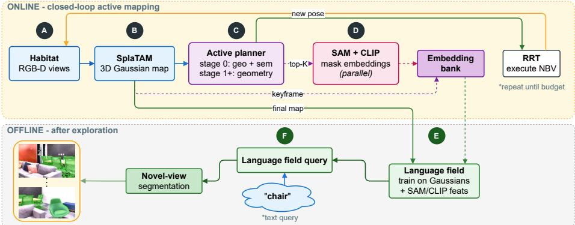
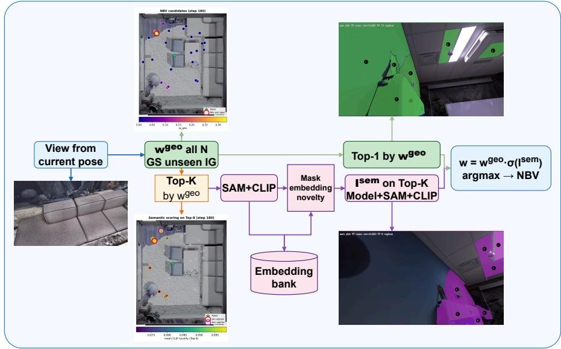
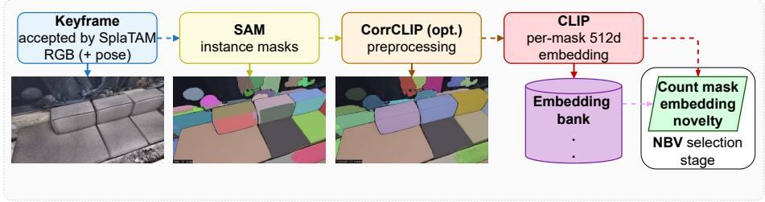
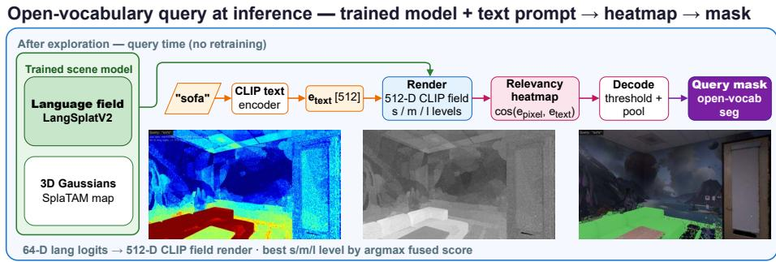
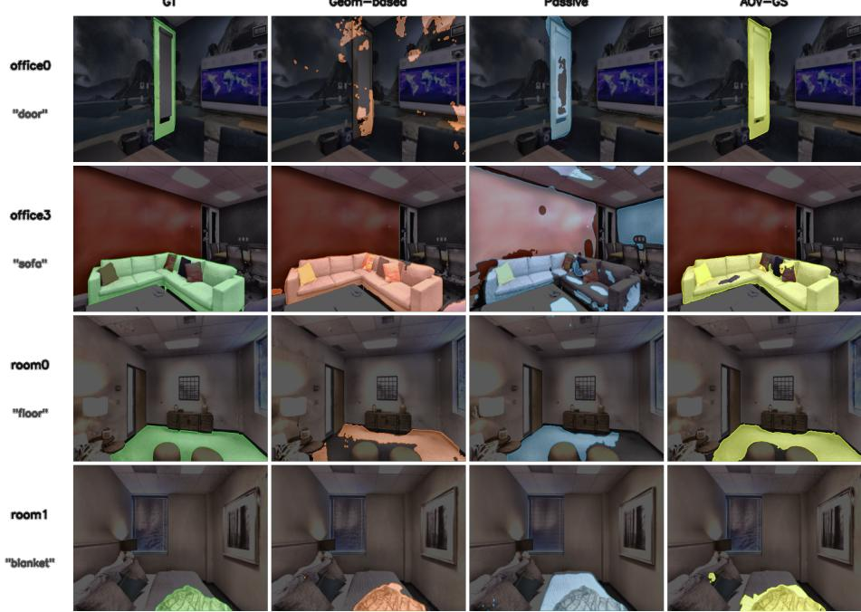
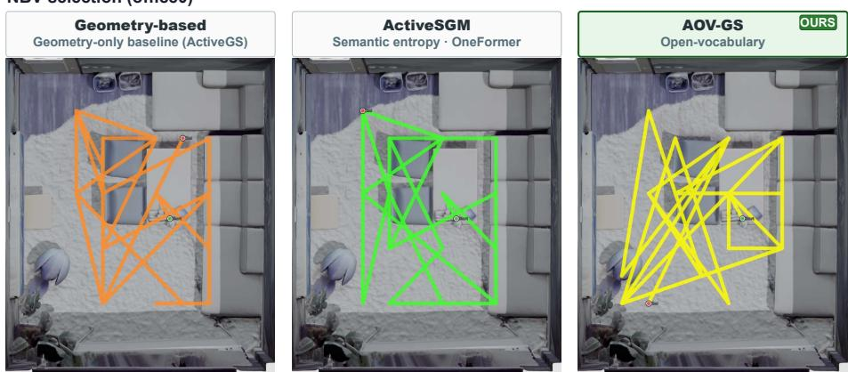
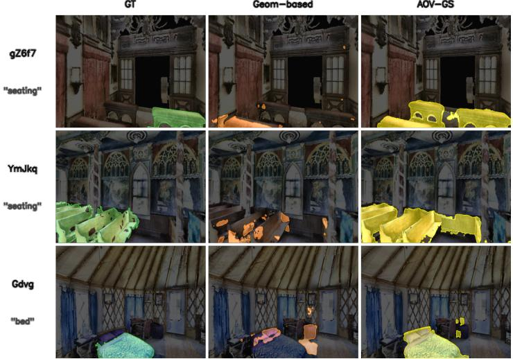

# AOV-GS: Active Open-Vocabulary Semantic Mapping with 3D Gaussian Splatting

Rodion Shkokov1\*, Tatiana Zemskova1,2, and Dmitry Yudin1,2

1 Moscow Institute of Physics and Technology (MIPT), Dolgoprudny, Russia r.shkokov@gmail.com (\*corresponding author) 2 AIRI, Moscow, Russia

Abstract. Robots deployed in human-centered environments need maps that support both geometric navigation and open-vocabulary semantic queries beyond a fixed label set. A key challenge is enriching such maps with semantic information without relying on manually annotated segmentation masks or closed-set semantic categories. Existing geometrydriven active mapping maximizes coverage but treats semantics as a passive by-product of the collected trajectory, whereas active semantic mapping typically depends on supervised semantic segmentation. We present AOV-GS, an active 3D Gaussian mapping system that guides exploration using frozen foundation models. During coarse exploration, AOV-GS re-ranks geometrically promising candidate views according to CLIP mask-embedding novelty computed from SAM instance segmentation, biasing exploration toward semantically informative regions. Frozen SAM and CLIP provide instance masks and language-aligned embeddings throughout mapping, while a lightweight scene-specific language field is fitted ofline directly to the collected CLIP embeddings rather than manually annotated masks, enabling open-vocabulary text-query segmentation on novel views. In a controlled comparison using the same SAM–CLIP perception stack, AOV-GS improves average language-field mIoU over geometry-only active planning by 1.3 percentage points on Replica (34.6% on eight scenes) and by 1.8 points on Matterport3D (23.1% on five scenes). With CorrCLIP, AOV-GS reaches 35.6% on Replica, 2.0 points above the matched Geometry-based + CorrCLIP baseline. Novel-view PSNR remains comparable to the geometry-only baseline on both datasets while depth L1 improves on Replica. Code is available at github.com/OptimusFaber/AOV-GS.

Keywords: Active semantic mapping · Open-vocabulary segmentation · 3D Gaussian splatting · Next-best-view planning

## 1 Introduction

Mobile robots operating in human-centered environments need spatial maps of the environment that support both navigation and task-level semantic interaction. In practice this means a map should render high-quality RGB-D views and support queries such as find the chair or locate the table near the window. These objectives are coupled through exploration: the viewpoints collected during mapping determine geometric completeness, object visibility, and the evidence available for downstream open-vocabulary retrieval.

Recent 3D Gaussian Splatting (3DGS) SLAM systems [13, 11] achieve efficient high-fidelity reconstruction suitable for online robotic mapping. Active planners such as ActiveGS [10], ActiveSplat [19], and ActiveGAMER [3] improve coverage through geometry-aware next-best-view (NBV) selection. In parallel, foundation-model perception enables open-vocabulary semantics: Segment Anything (SAM) [15] provides prompt-free instance masks and CLIP [24] maps mask regions to a language-aligned embedding space. LangSplat [23] and related methods attach such features to 3D primitives for text-query segmentation, but typically assume a fixed observation trajectory.

Active semantic mapping closes part of this gap. ActiveSGM [4] demonstrates that semantic signals can guide exploration in a 3DGS loop, but relies on per-scene OneFormer [7] fine-tuning, which limits open-vocabulary deployment. Passive fusion pipelines [8, 22] can improve semantic quality on pre-recorded trajectories but do not afect online data acquisition.

This paper addresses the following question: Can a robot actively explore an unseen scene using frozen foundation models, improve open-vocabulary segmentation through viewpoint selection, and preserve competitive RGB-D reconstruction quality?

We answer afirmatively with AOV-GS (Fig. 1). During coarse exploration (stage 0), geometric information gain is augmented with CLIP-embedding novelty computed from SAM instance masks on RGB views rendered from the current Gaussian map. Semantic novelty is measured against a growing keyframe embedding bank and re-ranks the top-K geometrically strong candidates. During refinement (stage 1+), planning reverts to geometry-only behavior as in ActiveGS [10]. After exploration, per-keyframe CLIP mask embeddings train a sparse language field on Gaussian primitives, enabling open-vocabulary textquery segmentation on novel views. As in ActiveSGM, candidate RGB views for semantic scoring are rendered from the current Gaussian map; Habitat supplies the posed RGB-D observation after the selected view is executed. The experiments nevertheless use ground-truth camera poses as oracle SLAM input.

Our contributions are:

– A coarse exploration NBV criterion that re-ranks the top-K candidates produced by the geometric planner according to CLIP mask-embedding novelty, steering the robot toward semantically novel object instances while reverting to geometry-only scoring during later refinement stages.

An active open-vocabulary semantic mapping pipeline combining online semantic exploration with ofline LangSplatV2 language-field construction, without per-scene segmenter fine-tuning.

– A two-benchmark evaluation showing average open-vocabulary gains over geometry-only exploration while preserving comparable novel-view reconstruction quality. Under the matched SAM–CLIP stack, AOV-GS reaches 34.6% on Replica (+1.3 pp) and 23.1% on MP3D (+1.8 pp); the per-scene Replica results are heterogeneous and are analyzed explicitly.

## 2 Related Work

Active perception for neural mapping uses information gain and coverage criteria to select informative views [9, 6, 21]. 3D Gaussian Splatting (3DGS) [13, 11] lowers planning and rendering cost relative to Neural Radiance Fields (NeRF) [20], enabling online systems such as ActiveGS [10], ActiveSplat [19], and ActiveGAMER [3]; these methods optimize geometry but leave semantic map utility to the collected trajectory. Semantic and open-vocabulary Gaussian mapping [17, 26, 23, 14, 1, 34] attaches language-aligned features to 3D primitives for text queries, typically on fixed trajectories; our language-field head follows LangSplatV2 [18], but AOV-GS uses semantic novelty to choose views during exploration rather than only processing a passive path. Recent semantic mapping systems also include LEG-SLAM [28] and M3DMap [30], which integrate language-aligned or object-aware semantics into 3D reconstruction. Closely related but complementary is SegmATRon [31], an embodied active segmentation method that generates agent actions to maximize image segmentation quality rather than building a persistent semantic map. ActiveSGM [4] couples geometric and semantic terms during 3DGS exploration but requires per-scene OneFormer fine-tuning [7]. Passive open-vocabulary fusion [8, 22] improves semantics on recorded paths without steering acquisition. AOV-GS trades closed-set semantic supervision for open-vocabulary scene representations based on frozen SAM and CLIP.

## 3 Method

Figure 1 gives a system-level overview: (A–B) posed RGB-D mapping (Sec. 3.1); (C) active NBV planner with semantic stage 0 and geometry-only stage 1+ (Sec. 3.2; Fig. 2); (D) CLIP mask embeddings (Sec. 3.3; Fig. 3); (E–F) languagefield training/query (Sec. 3.4; Fig. 4).

## 3.1 Gaussian Mapping Backbone

We adopt SplaTAM [11] as the reconstruction backbone with ActiveGS-style active planning infrastructure [10]. Habitat [25] provides synchronized RGB-D frames with ground-truth camera poses. In both Replica and Matterport3D experiments, these poses are used as oracle SLAM input (Sec. 4.1). The scene is represented by isotropic 3D Gaussians optimized through diferentiable rendering with RGB and depth $L _ { 1 }$ losses over silhouette pixels [11, 10]. Following ActiveGS [10], we maintain a voxel-based exploration map for collision-free candidate pose sampling and execute selected views with an RRT-based local planner [16].

## 3.2 Coarse Exploration Criterion

Exploration proceeds in two stages following ActiveGAMER [3]: stage 0 augments geometry with semantic novelty; stage 1+ reverts to pure geometry as in ActiveGS [10].

  
Fig. 1. AOV-GS system overview. Online loop: posed RGB-D updates a Gaussian map; the planner selects NBVs; CLIP mask embeddings are extracted in parallel on keyframes. Ofline stage: a language field is trained on Gaussians and queried by text.

Geometric score. For each candidate pose v, we render the current map and count unseen silhouette pixels $N _ { v } ^ { S }$ . Following ActiveGAMER [3], the geometric information gain is

$$
I _ { v } ^ { \mathrm { g e o } } = \sigma ( \log N _ { v } ^ { S } ) ,\tag{1}
$$

where $\sigma ( \cdot )$ denotes softmax normalization over all candidates. Let $T _ { x } ^ { v } \in \mathbb { R } ^ { 3 }$ and $T _ { x } ^ { t } \in \mathbb { R } ^ { 3 }$ denote, respectively, the translation of candidate pose v and the robot translation at planning step t. With distance $l _ { v } ~ = ~ \lVert T _ { x } ^ { v } - T _ { x } ^ { t } \rVert _ { 2 }$ , the distanceweighted score is

$$
w _ { v } ^ { \mathrm { g e o } } = \left( 1 - \sigma ( l _ { v } ) \right) I _ { v } ^ { \mathrm { g e o } } .\tag{2}
$$

Semantic novelty. For the top-K candidates ranked by $w _ { v } ^ { \mathrm { g e o } }$ , the current Gaussian map renders an RGB view at each candidate pose. We apply SAM to obtain instance masks and encode each masked region with CLIP to produce embeddings $\{ e _ { i } \} , e _ { i } \in \mathbb { R } ^ { 5 1 2 }$ (Sec. 3.3). Thus semantic scoring uses only the appearance currently represented by the map, matching the information available to the geometry branch and the corresponding ActiveSGM setup. Each $e _ { i }$ is compared against keyframe bank B. Candidate embeddings are used only transiently to score the current candidate set and are not inserted into $B ;$ the bank contains embeddings extracted from RGB observations at accepted keyframes reached by the executed trajectory. Let sim(a, b) denote cosine similarity. The semantic novelty score is

$$
I _ { v } ^ { \mathrm { s e m } } = \mathrm { A g g } _ { i } \bigg ( 1 - \operatorname* { m a x } _ { b _ { j } \in \mathcal { B } } \mathrm { s i m } ( e _ { i } , b _ { j } ) \bigg ) ,\tag{3}
$$

where Agg is mean pooling over masks and $b _ { j }$ denotes the j-th embedding stored in bank B. To avoid an empty reference set at the start of exploration, semantic scoring is skipped until $\boldsymbol { B }$ contains at least one embedding (the configured threshold is $n _ { \mathrm { m i n } } ^ { B } { = } 1 )$ . We use distinct notation because $\tau _ { q }$ denotes the query decoding threshold below.

AOV-GS NBV — geometry scores all candidates, semantics re-ranks Top-K  
  
Fig. 2. Stage-0 NBV on office0: candidate poses, geometric scores, and geometryonly vs. semantic-aware argmax.

Combined criterion. For each candidate pose v, the fused planner score is

$$
w _ { v } = w _ { v } ^ { \mathrm { g e o } } \cdot \sigma ( I _ { v } ^ { \mathrm { s e m } } ) ,\tag{4}
$$

where $w _ { v } ^ { \mathrm { g e o } }$ and $I _ { v } ^ { \mathrm { s e m } }$ are defined in Eqs. (2) and (3); the NBV is arg maxv wv. Semantic novelty re-weights geometrically strong candidates rather than replacing geometry-driven planning: when geometric scores among top candidates are close, the product can move the argmax toward views whose rendered masks contain embeddings far from B (Fig. 2).

## 3.3 Parallel CLIP Mask Embedding Extraction

For each accepted mapping keyframe, SAM ViT-H [15] segments the RGB image into instance masks; CLIP ViT-B/16 [24] encodes each region into a 512-D embedding (Fig. 3). We refer to this two-step process as the SAM–CLIP pipeline. Following LangSplatV2 [18], per-mask vectors supervise ofline language-field distillation and populate bank B (Eq. (3)). SAM and CLIP are frozen; no perscene fine-tuning is performed. We optionally apply CorrCLIP-style [33] mask merging and inter-class suppression to stabilize downstream training. Extraction runs in a background thread and does not block the online planner.

Parallel SAM+CLIP on mapping keyframes (background thread)  
  
Fig. 3. SAM–CLIP extraction on keyframes with optional CorrCLIP post-processing; embeddings feed B and ofline language-field training.

## 3.4 Language Field Construction and Query

After exploration, stored CLIP mask embeddings train a LangSplatV2 sparse language field on the reconstructed Gaussians. A global codebook is initialized by k-means over mask embeddings; each Gaussian receives sparse coeficients over codebook entries. At inference, a text prompt is encoded by CLIP and matched against multi-scale rendered cosine-similarity maps $( s / m / l )$ , producing an open-vocabulary segmentation mask on a novel view $\left( \mathrm { F i g . ~ 4 } \right)$ . The language field is trained after mapping and is decoupled from geometric refinement.

  
Fig. 4. Open-vocabulary text query via multi-scale cosine-similarity maps and thresholding.

## 3.5 Implementation Details

Default online settings use top-K=8 semantic candidates in stage 0 on an NVIDIA RTX 4070 Ti SUPER (16 GB). Language-field training uses render downscale 0.5; query decoding uses threshold $\tau _ { q } { = } 0 . 5 5$ with open-dictionary negatives and multi-scale $\mathrm { s / m / l }$ decoding, held fixed across compared openvocabulary methods. Switching scenes resets only the geometric map and embedding bank; SAM and CLIP weights remain unchanged. All ablated hyperparameters are listed in Table 7.

## 4 Experiments

## 4.1 Experimental Setup

Datasets. We evaluate in Habitat [25] on two photorealistic indoor benchmarks. All methods in our comparisons receive the same ground-truth Habitat camera poses; none is evaluated with estimated poses or SLAM localization noise.

Replica [27]: eight scenes (office0–office4, room0–room2). Replica follows the standard ActiveGS [10]/ActiveSGM [4] benchmark and therefore enables direct comparison with previous active mapping work. Following ActiveGS [10]/ActiveSGM [4], each Replica exploration is limited to 2000 steps. RGB-D is captured at 680 × 1200. Novel-view semantic evaluation uses held-out camera views that are not used for mapping.

Matterport3D (MP3D) [2]: five scenes from the benchmark used by NARUTO [6], ActiveGAMER [3], and ActiveSGM [4]. The scenes are GdvgFV5R1Z5, gZ6f7yhEvPG, HxpKQynjfin, pLe4wQe7qrG, and YmJkqBEsHnH. We use the same Habitat rendering settings as on Replica. Novel-view semantic evaluation likewise uses held-out camera views that are not used for mapping. We follow the MP3D protocol of ActiveSGM [4], ActiveGAMER [3], and NARUTO [6] using the same five benchmark scenes and a 5000-step exploration budget. No established passive semantic baseline exists for this protocol; therefore, passive comparisons are reported only on Replica.

Baselines. Passive (Replica only, semantic evaluation): fixed NVS trajectory, SAM–CLIP embedding extraction, and ofline language-field training. Geometry-based: geometry-only ActiveGS [10] planner with the same SAM– CLIP and language-field pipeline. Geometry-based + CorrCLIP: the same geometric planner with CorrCLIP applied to accepted keyframe masks and embeddings; candidate views are still ranked only by geometry. ActiveSGM traj. + LangSplatV2: we replay ActiveSGM’s recorded pose sequence and keyframe schedule on each scene, replacing OneFormer with our SAM–CLIP extraction and LangSplatV2 language-field training. This comparison keeps the open-vocabulary perception stack fixed, but does not isolate trajectory quality completely because the replay contains 868 steps versus 956 for AOV-GS. ActiveSGM [4]: per-scene OneFormer fine-tuning on closed Replica and Matterport3D label sets, run in our Habitat setup on both datasets; shown for context only, not as an open-vocabulary baseline. AOV-GS (Ours): our semantic stage-0 planner without CorrCLIP. AOV-GS + CorrCLIP (Ours): the same semantic planner with CorrCLIP applied both to candidate masks during re-ranking and to accepted keyframe masks used for the embedding bank.

Table 1. Open-vocabulary language-field mIoU (%) on Replica novel views. Gray rows: closed-set OneFormer runs in our setup (context only, not open-vocabulary baselines).
<table><tr><td>Method</td><td>Avg.</td><td>Of0</td><td>Of1</td><td>Of2</td><td>Of3</td><td>Of4</td><td>R0</td><td>R1</td><td>R2</td></tr><tr><td>ActiveSGM (closed-set)</td><td>78.8</td><td>74.5</td><td>74.8</td><td>84.9</td><td>85.0</td><td>76.2</td><td>70.1</td><td>82.2</td><td>82.5</td></tr><tr><td>ActiveSGM trajectory + LangSplatV2</td><td>28.2</td><td>32.5</td><td>27.4</td><td>37.1</td><td>27.5</td><td>8.9</td><td>23.1</td><td>40.2</td><td>28.7</td></tr><tr><td>Passive</td><td>32.1</td><td>31.3</td><td>22.8</td><td>29.5</td><td>31.1</td><td>36.4</td><td>35.3</td><td>39.1</td><td>30.9</td></tr><tr><td>Geometry-based</td><td>33.3</td><td>27.3</td><td>31.3</td><td>32.6</td><td>34.1</td><td>35.3</td><td>36.4</td><td>39.7</td><td>29.3</td></tr><tr><td>Geometry-based + CorrCLIP</td><td>33.6</td><td>30.8</td><td>29.7</td><td>34.1</td><td>33.7</td><td>35.2</td><td>36.5</td><td>39.0</td><td>29.5</td></tr><tr><td>AOV-GS (Ours)</td><td>34.6</td><td>34.4</td><td>30.1</td><td>28.7</td><td>39.3</td><td>38.7</td><td>34.7</td><td>42.8</td><td>27.9</td></tr><tr><td>AOV-GS + CorrCLIP (Ours)</td><td>35.6</td><td>33.6</td><td>29.8</td><td>37.3</td><td>38.5</td><td>38.3</td><td>36.4</td><td>41.7</td><td>29.4</td></tr></table>

Metrics. Primary: open-vocabulary language-field mIoU [5] on text-query pairs over held-out novel views. For each dataset category present in a held-out view, its category name is used as the text query, the dataset semantic annotation supplies the binary ground-truth mask, and IoU is computed between that mask and the thresholded language-field prediction. We average over all category– view pairs and then report the scene mean; for example, office0 contains 23 categories and 2477 pairs. The released evaluation configuration fixes the heldout views, category names, negative prompts, and threshold for every compared method. Secondary: novel-view PSNR [12], SSIM [29], LPIPS [32], and depth L1 after map refinement. For the reported MP3D reconstruction metrics, we evaluate the outputs at the end of stage 1 and final refinement and report the better result per scene.

## 4.2 Open-Vocabulary Semantic Segmentation on Replica

Table 1 summarizes open-vocabulary language-field mIoU on eight Replica scenes. AOV-GS reaches 34.6% average mIoU without CorrCLIP (+1.3 over Geometry-based, +2.5 over Passive). With CorrCLIP, AOV-GS reaches 35.6%, compared with 33.6% for Geometry-based + CorrCLIP. ActiveSGM (78.8% closed-set mIoU in our runs) uses per-scene OneFormer on fixed label sets and is listed only as a supervised reference outside our open-vocabulary protocol.

To better understand the heterogeneous per-scene results, we analyzed scene size, object statistics, lighting conditions, and semantic evaluation subsets. No consistent correlation was observed with scene area or object count alone. Instead, improvements were primarily determined by the reliability of semantic observations. Large, well-segmented objects produced stable SAM masks and CLIP embeddings, whereas adverse visual conditions (including low illumination, overexposure, and cluttered scenes containing many small objects) reduced semantic feature quality and limited the benefit of semantic planning. The CorrCLIP improvement on office2 (+8.6 pp) suggests that semantic feature quality is an important bottleneck. CorrCLIP is applied both to candidate masks used for semantic re-ranking and to accepted keyframe masks used to populate the embedding bank, so this result combines planner and representation efects.

Failure modes. The four Replica regressions have diferent signatures (Table 1). office1 is the darkest Replica scene in our image-statistics analysis (mean RGB intensity 44/255; 5th percentile 4/255), which may reduce the reliability of SAM masks and CLIP crops; AOV-GS is 1.2 pp below Geometry-based. We retain the benchmark’s fixed rendering conditions rather than tuning illumination per method. On office2, AOV-GS is 3.9 pp below Geometry-based, while CorrCLIP recovers 8.6 pp; this is consistent with mask fragmentation being an important factor. room0 shows a category trade-of rather than a uniform failure: relative to Passive, AOV-GS improves floor IoU from 17.4% to 57.2% and chair from 75.2% to 82.8%, while its full-category mean decreases from 35.3% to 34.7% (Table 2). On room2, the largest displayed degradation is chair IoU, from 76.3% to 32.8%, although floor improves from 7.0% to 57.6% (Table 2); this points to sensitivity to which object views are collected rather than a uniform loss of reconstruction quality.

GT  
Geom-based  
Passive  
AOV-GS  
  
Fig. 5. Language-field masks on novel views for queries door, sofa, floor, and blanket. AOV-GS improves large-object coverage (office3/sofa, room0/floor); narrow objects such as the office0 door remain dificult for all methods.

Figure 5 qualitatively illustrates representative improvements on large structural objects together with typical failure cases on narrow or visually ambiguous categories.

NBV selection (office0)  
  
Fig. 6. Exploration routes on office0: AOV-GS covers the central workspace more thoroughly than the geometry-only planner.

When semantic exploration helps. Semantic exploration is most beneficial when semantically distinctive objects occupy the central workspace and remain visible from multiple viewpoints. On office0, the geometry-only planner favours peripheral unseen regions over the furniture-dense core (Fig. 6), yielding +7.1 pp mIoU over the geometry-only baseline (Table 1) and strong sofa/table coverage for AOV-GS (87.3%/84.3%). Similar behaviour appears on office3 and office4 (+4.4 and +3.0 pp with CorrCLIP). In the bedroom scene room1, discriminative bed-region embeddings give the best open-vocabulary result (42.8%). Table 2 lists per-category IoU for structural classes.

Trajectory transfer. The ActiveSGM traj. + LangSplatV2 row in Table 1 averages 28.2% mIoU, below both Geometry-based (33.3%) and AOV-GS (34.6%). A trajectory optimized for OneFormer supervision does not benefit a SAM–CLIP language field; the largest degradation occurs on office4 (8.9%), while room1 remains high (40.2%) because furniture layout still yields useful views regardless of planner objective. The 6.4 pp gap between this transferred trajectory and AOV-GS shows that viewpoint selection must be matched to the semantic representation used for training and querying the map.

Table 2. Selected per-category language-field IoU (%) on Replica scenes: AOV-GS vs. Passive. Higher value in bold per category; “—” marks categories absent from a scene. The Mean row is computed over the full evaluation category set, not only the displayed rows.
<table><tr><td></td><td colspan="2">Of0</td><td colspan="2">Of1</td><td colspan="2">Of2</td><td colspan="2">Of3</td><td colspan="2">Of4</td><td colspan="2">R0</td><td colspan="2">R1</td><td colspan="2">R2</td></tr><tr><td>Category Ours Pass. Ours Pass. Ours Pass. Ours Pass. Ours Pass. Ours Pass. Ours Pass. Ours Pass.</td><td></td><td></td><td></td><td></td><td></td><td></td><td></td><td></td><td></td><td></td><td></td><td></td><td></td><td></td><td></td><td></td></tr><tr><td>bed</td><td></td><td></td><td></td><td></td><td></td><td></td><td></td><td></td><td></td><td></td><td></td><td></td><td>26.5 22.0</td><td></td><td></td><td></td></tr><tr><td>sofa</td><td>87.3 70.6</td><td></td><td></td><td></td><td></td><td></td><td></td><td>41.3 54.8 66.6 31.7</td><td></td><td></td><td>29.532.7</td><td></td><td></td><td></td><td></td><td></td></tr><tr><td>table</td><td>84.366.8</td><td></td><td></td><td></td><td>45.6</td><td>57.5 77.0 62.5</td><td></td><td></td><td>0.3</td><td>35.5</td><td>45.3</td><td>59.1</td><td></td><td></td><td>81.3 76.9</td><td></td></tr><tr><td>chair</td><td>36.4 73.8</td><td></td><td>56.3</td><td>29.1</td><td>48.2</td><td>33.4 73.1 75.7 28.6</td><td></td><td></td><td></td><td>27.0</td><td>82.8</td><td>75.2</td><td></td><td></td><td>32.8</td><td>76.3</td></tr><tr><td>wall</td><td>39.7 33.6</td><td></td><td>22.0</td><td>14.2</td><td>59.0</td><td>70.6 57.5</td><td></td><td>47.6</td><td>57.5</td><td>52.8</td><td>15.8</td><td>13.6</td><td>9.1</td><td></td><td>24.612.0</td><td>43.4</td></tr><tr><td>floor</td><td>4.9</td><td>8.7</td><td>22.6</td><td>2.1</td><td>9.3</td><td>15.3</td><td>45.9</td><td>21.0</td><td>41.6</td><td>20.1</td><td>57.2</td><td>17.4</td><td>64.5</td><td>55.1</td><td>57.6</td><td>7.0</td></tr><tr><td>ceiling</td><td>50.3</td><td>17.5</td><td>39.9</td><td>0.1</td><td>39.9</td><td>47.0</td><td>59.5</td><td>73.8</td><td>72.1</td><td>67.6</td><td>68.1</td><td>61.5</td><td>67.5</td><td>62.9</td><td>45.0</td><td>44.6</td></tr><tr><td>pillow</td><td></td><td></td><td></td><td></td><td></td><td></td><td></td><td></td><td></td><td></td><td></td><td></td><td>80.9</td><td>79.2</td><td></td><td></td></tr><tr><td>Mean</td><td>34.4 31.3</td><td></td><td>30.1</td><td>22.8</td><td>28.7 29.5 39.3 31.1 38.7 36.4 34.7 35.3</td><td></td><td></td><td></td><td></td><td></td><td></td><td></td><td>42.8</td><td>39.1</td><td>27.9</td><td>30.9</td></tr></table>

## 4.3 RGB-D Reconstruction on Replica

A practical semantic planner should preserve reconstruction quality while improving semantic coverage. Table 3 reports eight-scene averages from a single run per method. AOV-GS matches the Geometry-based planner on PSNR (31.19 vs. 31.47 dB), SSIM, and LPIPS, while improving depth L1 (1.18 vs. 1.26 cm).

To assess stability, we repeat Geometry-based and AOV-GS on all eight scenes with five independent seeds (0–4). Table 4 summarizes pooled rendering metrics and office0 language-field mIoU. Cross-seed PSNR, SSIM, and LPIPS have similar descriptive means and spreads. On office0, semantic mIoU is 33.6±1.1% for AOV-GS versus 28.8±1.4% for Geometry-based.

## 4.4 Computational Cost

Stage-0 semantic scoring applies only to top-K candidates (≈8 s per view on office0 on an NVIDIA RTX 4070 Ti SUPER); stage 1+ adds no semantic overhead. A complete office0 run takes 52:32, 61:23, and 70:41 for K=4, 8, and 16, respectively, with peak GPU memory of 12.59, 12.92, and 13.80 GB. Because candidate views are scored sequentially, increasing K afects runtime more strongly than memory. Ofline language-field training peaks at 12.6 GB with the default 0.5 downscale and ranges from 9.9 to 29.1 GB across the evaluated render-downscale settings; runtime increases with the number of rendered pixels. Multi-scale text-query decoding takes 1.41 s per query–view pair and peaks at 4.2 GB. On Matterport3D, both open-vocabulary planners fit in 16 GB on this hardware, whereas ActiveSGM in our setup required ≈36–48 GB due to the OneFormer module.

## 4.5 Evaluation on Matterport3D

We apply the same open-vocabulary pipeline to the five MP3D scenes defined in Sec. 4.1. Compared with Replica, MP3D contains larger layouts and substantially longer exploration trajectories, reducing the relative influence of the semantic stage-0 planner. Table 5 reports language-field mIoU on MP3D novel views. AOV-GS improves the average from 21.3% to 23.1% (+1.8 pp) over the Geometry-based planner, with the largest absolute gains on GdvgFV5R1Z5 (+3.5 pp), gZ6f7yhEvPG (+2.7 pp), and pLe4wQe7qrG (+1.9 pp). The improvement on HxpKQynjfin (+0.7 pp) supports that semantic novelty remains informative in larger layouts. On MP3D, exploration trajectories are longer (mean 3472 vs. 3496 steps), but semantic stage-0 re-ranking still shifts viewpoint selection toward CLIP-embedding novelty.

Table 3. Novel-view rendering after refinement on Replica (eight-scene average, single run).
<table><tr><td>Method</td><td></td><td>Steps↓ PSNR↑ SSIM↑ LPIPS↓ L1 (cm)↓</td><td></td><td></td><td></td></tr><tr><td>Passive</td><td>1999</td><td>27.45</td><td>0.949</td><td>0.149</td><td>6.98</td></tr><tr><td>Geometry-based</td><td>914</td><td>31.47</td><td>0.964</td><td>0.131</td><td>1.26</td></tr><tr><td>ActiveSGM</td><td>868</td><td>32.11</td><td>0.970</td><td>0.110</td><td>1.23</td></tr><tr><td>AOV-GS (Ours)</td><td>956</td><td>31.19</td><td>0.964</td><td>0.123</td><td>1.18</td></tr><tr><td>AOV-GS + CorrCLIP (Ours)</td><td>952</td><td>31.56</td><td>0.964</td><td>0.128</td><td>1.14</td></tr></table>

Table 4. Five-seed stability on Replica (seeds 0–4). Rendering: eight-scene average; mIoU: office0 only.
<table><tr><td>Method</td><td>PSNR↑</td><td>SSIM↑</td><td>LPIPS↓</td><td>mIoU (%)</td></tr><tr><td></td><td>Geometry-based 31.62±2.63 0.965±0.0140.128±0.033</td><td></td><td></td><td>28.8±1.4</td></tr><tr><td></td><td>AOV-GS (Ours) 31.53±2.440.965±0.014 0.126±0.02733.6±1.1</td><td></td><td></td><td></td></tr></table>

The CorrCLIP gain is smaller for Geometry-based because its trajectory is fixed by the geometric planner: CorrCLIP can improve only the masks and embeddings extracted from accepted keyframes. In AOV-GS, CorrCLIP additionally changes the candidate-mask embeddings used for semantic re-ranking and can therefore alter the acquired trajectory. CorrCLIP is not uniformly beneficial, however: merging adjacent regions or suppressing small and overlapping masks can remove useful object evidence, so its efect depends on the scene.

With CorrCLIP, AOV-GS reaches 24.0% average mIoU, compared with 21.8% for the matched Geometry-based + CorrCLIP baseline. The resulting +2.2 pp diference isolates the benefit of semantic view selection under the same CorrCLIP-enhanced perception stack.

Although absolute mIoU values are lower on Matterport3D, AOV-GS retains a +1.8 pp average advantage over the geometry-only planner (Fig. 7).

Table 5. Open-vocabulary language-field mIoU (%) on Matterport3D novel views (five scenes). Gray rows: closed-set OneFormer runs in our setup (context only).
<table><tr><td>Method</td><td>Avg.</td><td>HxpK</td><td>Gdvg</td><td>gZ6f</td><td>YmJk</td><td>pLe4</td></tr><tr><td>ActiveSGM (closed-set)</td><td>61.5</td><td>51.2</td><td>56.3</td><td>69.8</td><td>66.1</td><td>64.0</td></tr><tr><td>ActiveSGM trajectory + LangSplatV2</td><td>18.1</td><td>25.2</td><td>16.9</td><td>19.7</td><td>13.8</td><td>15.1</td></tr><tr><td>Geometry-based</td><td>21.3</td><td>29.6</td><td>19.9</td><td>23.2</td><td>16.2</td><td>17.8</td></tr><tr><td>AOV-GS (Ours)</td><td>23.1</td><td>30.3</td><td>23.4</td><td>25.9</td><td>16.2</td><td>19.7</td></tr><tr><td> $\mathrm { G e o m e t r y – b a s e d + C o r r C L I P }$ </td><td>21.8</td><td>29.7</td><td>20.1</td><td>23.6</td><td>17.6</td><td>18.0</td></tr><tr><td> $\mathrm { A O V \mathrm { - } G S } + \mathrm { C o r r C L I P \ ( O u r s ) }$ </td><td>24.0</td><td>30.5</td><td>23.5</td><td>26.8</td><td>18.1</td><td>21.1</td></tr></table>

  
Fig. 7. Language-field masks on MP3D novel views for gZ6f7/seating, HxpKQ/chair, YmJkq/seating, and Gdvg/bed (GT in green; Geometry-based in orange; AOV-GS in yellow).

Novel-view rendering on MP3D is summarized in Table 6. AOV-GS improves novel-view rendering quality over the geometry-only planner on PSNR, SSIM, and LPIPS; depth L1 is the only metric slightly above the geometry baseline (2.83 vs. 2.80 cm). The MP3D results therefore retain the semantic gain without reducing RGB rendering quality.

## 4.6 Ablation Studies

Table 7 summarizes single-run ablations on office0 over 23 categories (2477 query pairs), varying one factor at a time while keeping the default configuration elsewhere (K=8, render downscale 0.5, threshold 0.55, LangSplatV2 “other” negatives). Increasing top-K from 4 to 8 improves mIoU from 33.2% to 34.4%; K=16 does not improve quality and increases semantic-scoring time because twice as many candidates are processed relative to $K { = } 8$ . Render downscale 0.5 balances mIoU and ofline training cost; full resolution (downscale 1.0) overfits CLIP feature noise (26.2%), while downscale 0.25 reaches 32.0% mIoU with lower ofline memory (9.9 GB) and downscale 0.5 reaches the best mIoU 34.4%. LangSplatV2 “other” negatives with $\tau _ { q } { = } 0 . 5 5$ outperform alternatives; queryonly decoding reaches 25.1% mIoU.

Table 6. Novel-view rendering on Matterport3D (five-scene average, single run); each scene uses the better ofline evaluation of the stage-1 and final-refinement outputs.
<table><tr><td>Method</td><td></td><td>Steps↓ PSNR↑ SSIM↑ LPIPS↓ L1 (cm)↓</td><td></td><td></td><td></td></tr><tr><td>Geometry-based</td><td>3496</td><td>26.19</td><td>0.928</td><td>0.233</td><td>2.80</td></tr><tr><td>ActiveSGM</td><td>3821</td><td>26.08</td><td>0.917</td><td>0.259</td><td>3.76</td></tr><tr><td>AOV-GS (Ours)</td><td>3472</td><td>26.25</td><td>0.931</td><td>0.232</td><td>2.83</td></tr><tr><td>AOV-GS + CorrCLIP (Ours)</td><td>3454</td><td>26.27</td><td>0.932</td><td>0.233</td><td>2.79</td></tr></table>

Table 7. Ablation on office0. GPU memory denotes peak allocated memory.
<table><tr><td>Factor</td><td>Setting</td><td></td><td>mIoU↑ Peak GPU memory</td></tr><tr><td rowspan="3">Top-K</td><td>K=4</td><td>33.2</td><td>12.59 GB</td></tr><tr><td> $K { = } 8 \ \mathrm { ( d e f a u l t ) }$ </td><td>34.4</td><td>12.92 GB</td></tr><tr><td> $K { = } 1 6$ </td><td>34.4</td><td>13.80 GB</td></tr><tr><td rowspan="3">Downscale</td><td>0.25</td><td>32.0</td><td>9.9 GB</td></tr><tr><td>0.5 (default)</td><td>34.4</td><td>12.6 GB</td></tr><tr><td>1.0 (full)</td><td>26.2</td><td>29.1 GB</td></tr><tr><td rowspan="3">Negative prompts  $\left( \tau _ { q } = 0 . 5 5 \right)$ </td><td>none</td><td>25.1</td><td>4.2 GB</td></tr><tr><td>1 class vs. all others</td><td>17.7</td><td>4.2GB</td></tr><tr><td>1 class vs. &quot;other&quot; (LangSplatV2)</td><td>34.4</td><td>4.2 GB</td></tr><tr><td rowspan="3">Threshold  $\left( \mathrm { ^ { * } o t h e r ^ { * } n e g s . } \right)$ </td><td> $\tau _ { q } { = } 0 . 5 0$ </td><td>25.0</td><td>4.2 GB</td></tr><tr><td> $\tau _ { q } { = } 0 . 5 5 ~ \mathrm { ( d e f a u l t ) }$ </td><td>34.4</td><td>4.2 GB</td></tr><tr><td> $\tau _ { q } { = } 0 . 6 0$ </td><td>33.9</td><td>4.2 GB</td></tr></table>

## 5 Conclusion

We presented AOV-GS, an active open-vocabulary semantic mapping pipeline that guides exploration with CLIP mask-embedding novelty from frozen SAM and CLIP and trains a scene-specific LangSplatV2 language field on the collected embeddings for text-query segmentation on novel views. Across Replica and Matterport3D, the resulting maps improve average open-vocabulary language-field mIoU over geometry-only exploration while preserving comparable novel-view reconstruction quality. Replica gains vary by scene, while the five-seed office0 experiment shows a consistent advantage over geometry-only exploration.

Experiments further show that these gains depend on alignment between exploration and the downstream semantic representation: trajectories optimized for a closed-set OneFormer pipeline do not transfer to a SAM–CLIP language field, whereas semantic novelty co-designed with that representation improves the average on both benchmarks. The evaluation uses ground-truth camera poses, matching the simulator protocol used by the compared active-mapping methods; robustness to SLAM drift and real sensor noise is outside the scope of this simulator study.

Disclosure of Interests. The authors have no competing interests to declare that are relevant to the content of this article.

## References

1. Cen, J., Fang, J., Yang, C., Xie, L., Zhang, X., Shen, W., Tian, Q.: SAGA: Segment any 3D gaussians. In: arXiv preprint arXiv:2312.00860 (2023)

2. Chang, A., Dai, A., Lambert, T., Funkhouser, T., Nießner, M.: Matterport3d: Learning from RGB-D data in indoor environments. In: 2017 International Conference on 3D Vision (3DV). pp. 667–676. IEEE (2017)

3. Chen, L., Zhan, H., Chen, K., Xu, X., Yan, Q., Cai, C., Xu, Y.: Activegamer: Active gaussian mapping through eficient rendering. In: Proceedings of the Computer Vision and Pattern Recognition Conference. pp. 16486–16497 (2025)

4. Chen, L., Zhan, H., Yin, H., Xu, Y., Mordohai, P.: Understanding while exploring: Semantics-driven active mapping. arXiv preprint arXiv:2506.00225 (2025)

5. Everingham, M., Van Gool, L., Williams, C.K.I., Winn, J., Zisserman, A.: The Pascal visual object classes (VOC) challenge. International Journal of Computer Vision 88(2), 303–338 (2010)

6. Feng, Z., Zhan, H., Chen, Z., Yan, Q., Xu, X., Cai, C., Li, B., Zhu, Q., Xu, Y.: Naruto: Neural active reconstruction from uncertain target observations. In: Proceedings of the IEEE/CVF Conference on Computer Vision and Pattern Recognition. pp. 21572–21583 (2024)

7. Jain, J., Li, J., Chiu, M.T., Hassani, A., Orlov, N., Shi, H.: Oneformer: One transformer to rule universal image segmentation. In: Proceedings of the IEEE/CVF Conference on Computer Vision and Pattern Recognition. pp. 298–307 (2023)

8. Jatavallabhula, K.M., Kuwajerwala, A., Gu, Q., Omama, M., Chen, T., Li, S., Iyer, G., Saryazdi, S., Keetha, N., Tewari, A., et al.: ConceptFusion: Open-set multimodal 3d mapping. In: Proceedings of Robotics: Science and Systems (2023)

9. Jiang, W., Lei, B., Daniilidis, K.: Fisherrf: Active view selection and uncertainty quantification for radiance fields using fisher information. arXiv preprint arXiv:2311.17874 (2023)

10. Jin, L., Zhong, X., Pan, Y., Behley, J., Stachniss, C., Popovi´c, M.: Activegs: Active scene reconstruction using gaussian splatting. IEEE Robotics and Automation Letters (2025)

11. Keetha, N., Karhade, J., Jatavallabhula, K.M., Yang, G., Scherer, S., Ramanan, D., Luiten, J.: Splatam: Splat track & map 3d gaussians for dense rgb-d slam. In: Proceedings of the IEEE/CVF Conference on Computer Vision and Pattern Recognition. pp. 21357–21366 (2024)

12. Kele¸s, O., Yılmaz, M.A., Tekalp, A.M., Korkmaz, C., Do˘gan, Z.: On the computation of PSNR for a set of images or video. In: 2021 Picture Coding Symposium (PCS). pp. 1–5. IEEE (2021)

13. Kerbl, B., Kopanas, G., Leimk¨uhler, T., Drettakis, G.: 3d gaussian splatting for real-time radiance field rendering. ACM Trans. Graph. 42(4), 139–1 (2023)

14. Kerr, J., Kim, C.M., Goldberg, K., Kanazawa, A., Tancik, M.: LERF: Language embedded radiance fields. In: Proceedings of the IEEE/CVF International Conference on Computer Vision. pp. 19729–19739 (2023)

15. Kirillov, A., Mintun, E., Ravi, N., Mao, H., Rolland, C., Gustafson, L., Xiao, T., Whitehead, S., Berg, A.C., Lo, W.Y., et al.: Segment anything. In: Proceedings of the IEEE/CVF International Conference on Computer Vision. pp. 4015–4026 (2023)

16. LaValle, S.M.: Rapidly-exploring random trees: A new tool for path planning. Tech. rep., Iowa State University, Computer Science Department (1998)

17. Li, M., Liu, S., Zhou, H., Zhu, G., Cheng, N., Deng, T., Wang, H.: Sgs-slam: Semantic gaussian splatting for neural dense slam. In: European Conference on Computer Vision. pp. 163–179. Springer (2024)

18. Li, W., Zhao, Y., Qin, M., Liu, Y., Cai, Y., Gan, C., Pfister, H.: Langsplatv2: Highdimensional 3d language gaussian splatting with 450+ fps. In: Advances in Neural Information Processing Systems. vol. 38 (2025). https://doi.org/10.52202/085713- 5798

19. Li, Y., Kuang, Z., Li, T., Hao, Q., Yan, Z., Zhou, G., Zhang, S.: Activesplat: Highfidelity scene reconstruction through active gaussian splatting. IEEE Robotics and Automation Letters (2025)

20. Mildenhall, B., Srinivasan, P.P., Tancik, M., Barron, J.T., Ramamoorthi, R., Ng, R.: Nerf: Representing scenes as neural radiance fields for view synthesis. Communications of the ACM 65(1), 99–106 (2021)

21. Pan, X., Lai, Z., Song, S., Huang, G.: ActiveNeRF: Learning where to see for active sensing. In: European Conference on Computer Vision. pp. 129–144. Springer (2022)

22. Peng, S., Genova, K., Jiang, C.M., Tagliasacchi, A., Pollefeys, M., Funkhouser, T.: OpenScene: 3d scene understanding with open vocabularies. In: Proceedings of the IEEE/CVF Conference on Computer Vision and Pattern Recognition. pp. 815–824 (2023)

23. Qin, M., Li, W., Zhou, J., Wang, H., Pfister, H.: Langsplat: 3d language gaussian splatting. In: Proceedings of the IEEE/CVF Conference on Computer Vision and Pattern Recognition. pp. 20051–20060 (2024)

24. Radford, A., Kim, J.W., Hallacy, C., Ramesh, A., Goh, G., Agarwal, S., Sathyamurthy, G., Askell, A., Mishkin, P., Clark, J., et al.: Learning transferable visual models from natural language supervision. In: International Conference on Machine Learning. pp. 8748–8763. PMLR (2021)

25. Savva, M., Kadian, A., Maksymets, O., Zhao, Y., Wijmans, E., Jain, B., Straub, J., Liu, J., Koltun, V., Malik, J., et al.: Habitat: A platform for embodied ai research. In: Proceedings of the IEEE/CVF International Conference on Computer Vision. pp. 9339–9347 (2019)

26. Siegel, P., Tombari, F., Pollefeys, M., Barath, D.: Segsplat: Feed-forward gaussian splatting and open-set semantic segmentation. arXiv preprint arXiv:2511.18386 (2025)

27. Straub, J., Whelan, T., Ma, L., Chen, Y., Wijmans, E., Green, S., Engel, J.J., Mur-Artal, R., Ren, C., Verma, S., et al.: The replica dataset: A digital replica of indoor spaces. arXiv preprint arXiv:1906.05797 (2019)

28. Titkov, R., Zubkov, E., Yudin, D., Mahmoud, J., Mohrat, M., Sidorov, G.: LEG-SLAM: Real-time language-enhanced gaussian splatting for SLAM. arXiv preprint arXiv:2506.03073 (2025)

29. Wang, Z., Bovik, A.C., Sheikh, H.R., Simoncelli, E.P.: Image quality assessment: from error visibility to structural similarity. IEEE Transactions on Image Processing 13(4), 600–612 (2004)

30. Yudin, D.A.: M3DMap: Object-aware multimodal 3d mapping for dynamic environments. Optical Memory and Neural Networks 34(2), 215–230 (2025)

31. Zemskova, T., Kichik, M., Yudin, D.A., Staroverov, A., Panov, A.: SegmATRon: Embodied adaptive semantic segmentation for indoor environment. Neurocomputing 638, 130169 (2025). https://doi.org/10.1016/j.neucom.2025.130169

32. Zhang, R., Isola, P., Efros, A.A., Shechtman, E., Wang, O.: The unreasonable efectiveness of deep features as a perceptual metric. In: Proceedings of the IEEE/CVF Conference on Computer Vision and Pattern Recognition. pp. 586–595 (2018)

33. Zhao, W., Huang, Y., Li, X., Wang, F., Zhang, Y., Li, G., Yang, Y.: CorrCLIP: Reconstructing correlograms in CLIP for open-vocabulary semantic segmentation. arXiv preprint arXiv:2411.16963 (2024)

34. Zhou, S., Chang, H., Jiang, S., Fan, Z., Zhu, Z., Xu, D., Chari, P., You, S., Wang, Z., Kadambi, A.: Feature 3DGS: Supercharging 3D gaussian splatting to enable distilled feature fields. In: Proceedings of the IEEE/CVF Conference on Computer Vision and Pattern Recognition. pp. 21676–21685 (2024)