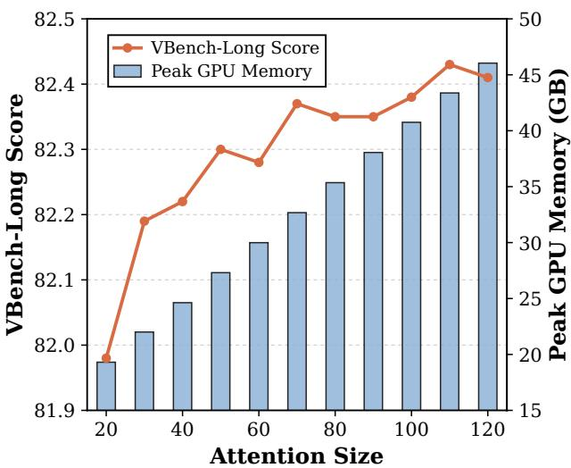
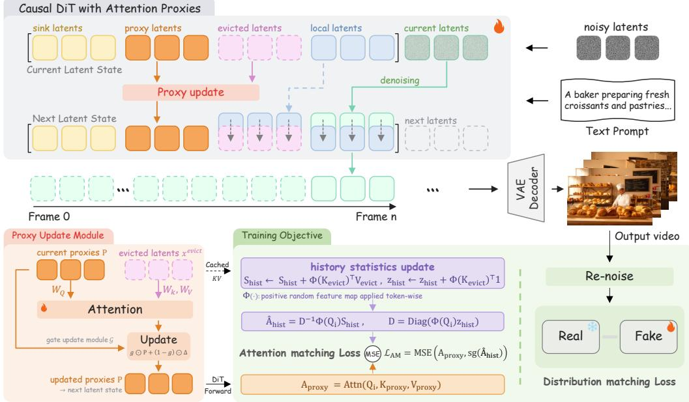
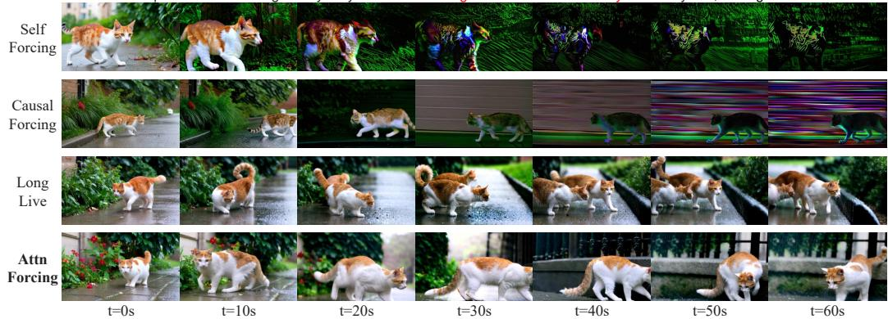
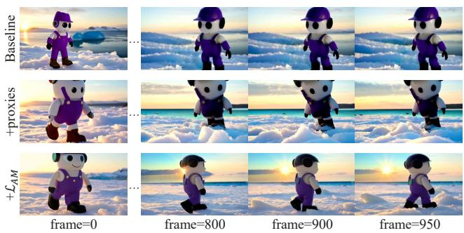
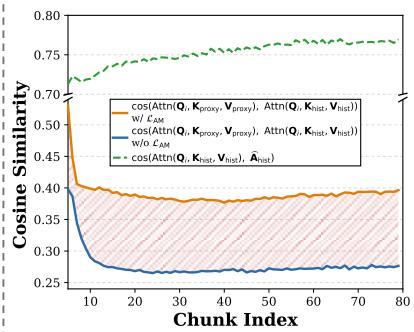
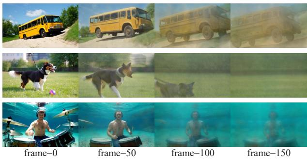
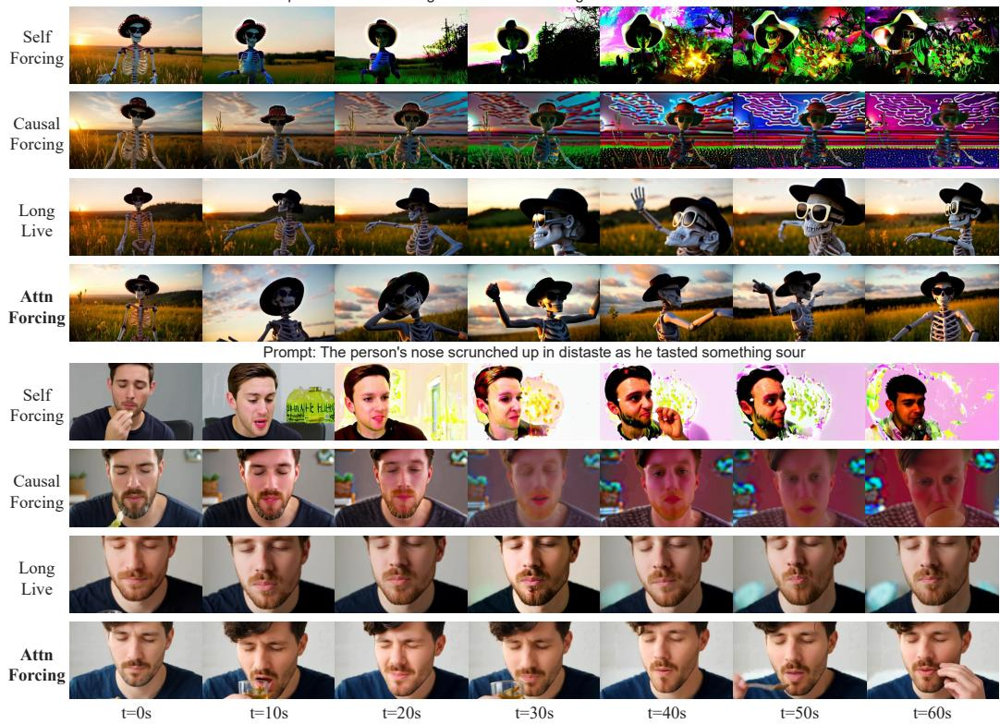

# ATTN-FORCING: LEARNING FULL-CONTEXT ATTEN-TION PROXIES FOR STREAMING VIDEO GENERATION

Junyao Gao1∗, Sibo Liu2\*, Jiaxing Li3\*, Yanan Sun4, Hanxin Zhu2 Weidong Zhang2, Jun Zhang2‡, Cairong Zhao1†‡

1Tongji University, 2Tencent, 3Nanyang Technological University,

4Hong Kong University of Science and Technology

## ABSTRACT

Increasing the attention context length significantly improves streaming video generation quality, while incurring prohibitive memory and computational costs as the context grows. Existing methods attempt to capture this contextual information through attention selection or compression, but remain limited by bounded representations and lack explicit attention-level supervision to retain historical contributions to current queries. To address this, we introduce Attn-Forcing, a novel framework that preserves full-context attention contributions for streaming video generation under bounded memory and computation. We achieve this by introducing attention proxies that continuously approximate the attention responses induced by the historical context. Specifically, we implement the proxies as learnable visual latents and employ a Proxy Update Module to incorporate visual context from historical latents. Moreover, we propose an Attention Matching Loss to explicitly constrain the attention behavior of the learned proxies using full-context attention supervision. Extensive qualitative and quantitative experiments demonstrate that Attn-Forcing consistently improves streaming video generation quality and achieves state-of-the-art performance over existing baseline methods.

## 1 INTRODUCTION

Streaming video generation has gained increasing attention due to its broad applications in interactive content creation, digital humans, live streaming, and persistent virtual environments. With recent advances in autoregressive (AR) diffusion models (Jin et al., 2025; Chen et al., 2025; Wu et al., 2025b; Yuan et al., 2026; Teng et al., 2025; Ma et al., 2026a), streaming generation is commonly implemented through chunk-by-chunk generation with causal KV caching in Diffusion Transformers (DiT) (Peebles & Xie, 2023).

Existing methods (Huang et al., 2026; Zhu et al., 2026; Yi et al., 2025; Liu et al., 2026; Yang et al., 2025a) typically retain only a limited-length KV cache during training and inference. This truncation of full-context attention discards contributions from historical KV states, leading to degraded generation quality. As shown by the experiment in Figure 1, although Self-Forcing (Huang et al., 2026) is trained with a fixed local attention window, simply increasing the KV cache length at inference consistently yields higher VBench-Long (Huang et al., 2024) scores, highlighting the benefit of broader historical context. However, under bounded memory and computational budgets, maintaining increasingly long KV contexts is impractical for streaming generation.

To address this challenge, Guo et al. (2025); Yi et al. (2025); Ji et al. (2025); Ma et al. (2026b) selec tively retain or retrieve relevant historical KV states through adaptive strategies, but remain limited by bounded KV budgets and potentially accumulated errors in current visual latents. Another line of work (Wu et al., 2025b; Lu et al., 2026; Kim et al., 2026; Wu et al., 2026; Xue et al., 2026; Bian et al., 2026) compresses historical context into compact representations using dedicated objectives or predefined compression ratios/schedules, but inevitably faces a trade-off between context coverage and information fidelity. Fundamentally, these methods still perform attention over bounded historical representations and lack attention-level supervision, making it difficult to preserve the contribution of the full context to current queries.

Can we capture this contribution without explicitly maintaining the full context?

In this paper, we answer this question by proposing Attn-Forcing, a novel framework that approximates full-context attention under bounded memory and computation. We achieve this by learning additional attention proxies during distribution matching distillation (DMD) training (Yin et al., 2024). Specifically, we implement the proxies as learnable latents and continuously update them through a Proxy Update Module using visual latents evicted from the local attention window to incorporate the visual history. We then forward the proxy latents through the DiT and use their layer-wise KV states for subsequent streaming generation. However, the DMD training objective primarily matches the model output distribution, without explicitly constraining the attention behavior induced by the learned proxies. We therefore introduce an Attention

  
Figure 1: VBench-Long score and peak GPU memory of Self-Forcing (Huang et al., 2026) during 30s video inference with different local attention sizes. A larger attention window generally improves generation quality, but at the cost of increased peak GPU memory.

Matching Loss to directly match the attention responses obtained with the learned proxies to those of the historical attention.

Extensive qualitative and quantitative experiments demonstrate that Attn-Forcing achieves state-ofthe-art (SOTA) performance over baseline methods. Moreover, ablation studies confirm the effectiveness and advantages of proposed designs, providing valuable insights for the streaming video generation community.

The contributions of this paper are summarized as follows:

• We propose Attn-Forcing, a novel DMD training framework that, for the first time, preserves full-context attention contributions under bounded memory and computation during streaming generation.

• We introduce learnable attention proxies to continuously incorporate visual history and a novel Attention Matching Loss to further align their attention responses with full-context attention.

• Experiments show that Attn-Forcing improves streaming video generation quality and achieves SOTA performance over baseline methods.

## 2 RELATED WORK

## 2.1 VIDEO DIFFUSION MODELS

Early video diffusion models typically extend image diffusion backbones with temporal modules to model spatiotemporal dependencies, enabling high-quality text-to-video generation (Ho et al., 2022; Blattmann et al., 2023; Chen et al., 2023; Guo et al., 2024). With the emergence of Diffusion Transformers (DiT) (Peebles & Xie, 2023), video generation has progressively shifted toward large-scale transformer architectures with stronger scalability and global temporal modeling. Representative models such as Sora (Brooks et al., 2024), CogVideoX (Yang et al., 2025b), MovieGen (Polyak et al., 2024), HunyuanVideo (Kong et al., 2024), and Wan (Wan et al., 2025) have demonstrated impressive video generation capabilities, producing high-fidelity videos with coherent motion, strong temporal consistency, and faithful alignment with textual prompts. Recent open-source models, including LTX-Video (HaCohen et al., 2024), Wan2.2 (Wan et al., 2025), and HunyuanVideo-1.5 (Wu et al., 2025a), further push the performance and efficiency of open-source video generation. Meanwhile, frontier systems such as Veo 3.1 (Google DeepMind, 2025), Kling 3.0 (Kuaishou, 2026),

Seedance 2.0 (Seedance et al., 2026), MiniMax H3 (MiniMax, 2026), and HappyHorse (Alibaba Cloud, 2026) exhibit increasingly sophisticated generation capabilities, including realistic physical dynamics, complex motion, multimodal conditioning, and joint audio-video generation. Our work is built upon Wan2.1-T2V-1.3B (Wan et al., 2025), adapting it for streaming long video generation.

## 2.2 LONG VIDEO GENERATION

Long video generation remains challenging for video diffusion models due to the high computational cost of full-sequence modeling and the temporal extrapolation gap between short-video training and long-video inference. One line of work seeks to extrapolate pretrained short-video diffusion models to longer durations without costly long-video retraining. Representative approaches modify the inference process or temporal modeling through noise rescheduling, progressive denoising, or positional extrapolation, including FreeNoise (Qiu et al., 2024), FIFO-Diffusion (Kim et al., 2024), RIFLEx (Zhao et al., 2025), and Diff-VF (Yang et al., 2026). These methods substantially extend the generation horizon of pretrained video diffusion models while improving temporal continuity over long sequences.

More recently, autoregressive (AR) video diffusion has emerged as a promising paradigm for streaming long video generation. Specifically, CausVid (Yin et al., 2025) introduces causal diffusion distillation to enable efficient streaming generation, while Self-Forcing (Huang et al., 2026) further trains on self-generated histories to reduce the autoregressive train-test discrepancy. Subsequent works such as LongLive (Yang et al., 2025a) and Self-Forcing++ (Cui et al., 2026) further improve longhorizon generation through dedicated long-rollout training and inference strategies. However, due to GPU memory constraints, these methods are restricted to fixed-length KV caches that continuously discard historical information, resulting in degraded and unstable generation quality.

To address this, recent works explore different strategies for preserving useful historical context under bounded memory and computation. Resampling Forcing (Guo et al., 2025) and MemFlow (Ji et al., 2025) dynamically retrieve or activate relevant historical states for current generation, while Deep Forcing (Yi et al., 2025) and FlowCache (Ma et al., 2026b) prune or compress KV caches according to their estimated importance. Other approaches (Wu et al., 2025b; Lu et al., 2026; Kim et al., 2026; Xue et al., 2026; Bian et al., 2026) aggregate or compress historical information into compact representations with bounded computational cost. However, these methods still perform attention over bounded historical representations and lack explicit attention-level supervision to preserve full-context contributions to current queries. To address this, we introduce attention proxies and train them with an additional Attention Matching loss.

## 3 METHOD

In this section, we present the technical details of the proposed Attn-Forcing. The overall framework is illustrated in Figure 2. We first introduce the preliminaries of KV caching and distribution matching distillation in Section 3.1. We then present the construction of attention proxies and the Attention Matching Loss in Sections 3.2 and 3.3, respectively.

## 3.1 PRELIMINARY

KV Cache. Streaming video generation with autoregressive Diffusion Transformers predicts each new video chunk through causal attention over previous chunks, whose key and value states are cached and reused for current generation:

$$
\mathrm { A t t n } \left( \mathbf { Q } _ { i } , \left[ \mathbf { K } _ { \mathrm { s i n k } } , \mathbf { K } _ { \mathrm { l o c a l } } \right] , \left[ \mathbf { V } _ { \mathrm { s i n k } } , \mathbf { V } _ { \mathrm { l o c a l } } \right] \right) = \mathrm { S o f t m a x } \left( \frac { \mathbf { Q } _ { i } \left[ \mathbf { K } _ { \mathrm { s i n k } } , \mathbf { K } _ { \mathrm { l o c a l } } \right] ^ { \top } } { \sqrt { d _ { h } } } \right) \left[ \mathbf { V } _ { \mathrm { s i n k } } , \mathbf { V } _ { \mathrm { l o c a l } } \right] ,\tag{1}
$$

where $\mathbf { Q } _ { i }$ denotes the queries of the i-th video chunk, while $( \mathbf { K } _ { \mathrm { s i n k } } , \mathbf { V } _ { \mathrm { s i n k } } )$ and $\left( \mathbf { K } _ { \mathrm { l o c a l } } , \mathbf { V } _ { \mathrm { l o c a l } } \right)$ denote the cached sink and local key-value states, respectively.

Distribution Matching Distillation (DMD). Following prior methods (Yin et al., 2024), we adopt the DMD objective to distill a multi-step bidirectional diffusion model into a few-step causal generator. Specifically, given the i-th generated video chunk $\mathbf { x } _ { i } ,$ we perturb it at diffusion timestep t

  
Figure 2: The framework of Attn-Forcing. During training, learnable proxy latents are continuously updated using visual latents evicted from the local attention window through a Proxy Update Module. Attention Matching Loss further aligns the proxy-induced attention responses with historical attention responses approximated using online accumulated statistics.

as

$$
\begin{array} { r } { \mathbf { x } _ { i , t } = \alpha _ { t } \mathbf { x } _ { i } + \sigma _ { t } \epsilon , \qquad \epsilon \sim \mathcal { N } ( \mathbf { 0 } , \mathbf { I } ) , } \end{array}\tag{2}
$$

and estimate its score using the pretrained diffusion teacher and a learnable fake-score model. The DMD gradient for the causal generator is given by

$$
\nabla _ { \boldsymbol { \theta } } \mathcal { L } _ { \mathrm { D M D } } = \mathbb { E } _ { i , t , \epsilon } \left[ w _ { t } \left( \mathbf { s } _ { \mathrm { f a k e } } ( \mathbf { x } _ { i , t } , t ) - \mathbf { s } _ { \mathrm { r e a l } } ( \mathbf { x } _ { i , t } , t ) \right) \frac { \partial \mathbf { x } _ { i } } { \partial \boldsymbol { \theta } } \right] ,\tag{3}
$$

where $\mathbf { s } _ { \mathrm { r e a l } }$ and $\mathbf { S f a k e }$ denote the score estimates from the pretrained diffusion teacher and the fake score model, respectively, and $w _ { t }$ denotes the timestep-dependent weighting factor.

## 3.2 ATTENTION PROXIES

As discussed in the Introduction and Figure 1, retaining a longer KV context improves generation quality. However, due to memory and computational constraints, prior methods (Huang et al., 2026; Yang et al., 2025a) restrict the KV cache in Eq. 1 to a fixed-length local window during training and inference. In this setting, older historical states are continuously evicted as generation proceeds, thereby discarding their attention contributions to current queries. Accordingly, to preserve such historical attention contributions without explicitly retaining the growing historical KV cache, we introduce proxy latents to approximate their attention responses to the current query $\mathbf { Q } _ { i }$ :

$$
\mathrm { A t t n } \left( \mathbf { Q } _ { i } , \mathbf { K } _ { \mathrm { p r o x y } } , \mathbf { V } _ { \mathrm { p r o x y } } \right) \approx \mathrm { A t t n } \left( \mathbf { Q } _ { i } , \mathbf { K } _ { \mathrm { h i s t } } , \mathbf { V } _ { \mathrm { h i s t } } \right) ,\tag{4}
$$

where $( \mathbf { K } _ { \mathrm { h i s t } } , \mathbf { V } _ { \mathrm { h i s t } } )$ denote the evicted historical KV states and $( \mathbf { K } _ { \mathrm { p r o x y } } , \mathbf { V } _ { \mathrm { p r o x y } } )$ denote the key and value states derived from the proxy latents.

Specifically, as shown in Figure 2, we implement these proxies as $K = 3$ learnable latents in the same feature space as the DiT visual latents. They are randomly initialized and continuously updated using visual latents evicted from the local attention window as follows.

$$
\mathbf { P } \gets \mathcal { U } \left( \mathbf { P } , \mathbf { x } ^ { \mathrm { e v i c t } } \right) = \mathcal { G } \left( \mathbf { P } , \mathrm { A t t n } \left( \mathbf { W } _ { Q } ( \mathbf { P } ) , \mathbf { W } _ { K } ( \mathbf { x } ^ { \mathrm { e v i c t } } ) , \mathbf { W } _ { V } ( \mathbf { x } ^ { \mathrm { e v i c t } } ) \right) \right) ,\tag{5}
$$

where U denotes the Proxy Update Module, and ${ \bf W } _ { Q } ( \cdot ) , { \bf W } _ { K } ( \cdot )$ , and $\mathbf { W } _ { V } ( \cdot )$ denote its learnable query, key, and value projections, respectively. For the newly evicted visual latents $\mathbf { x } ^ { \mathrm { e v i c t } }$ , the current proxy latents P query the evicted latents through cross-attention to capture their contextual

information, which is then further processed and fused with P through the gated update module ${ \mathcal { G } } .$ More details are provided in Appendix A.3. The updated proxy latents are then propagated through the DiT to obtain the layer-wise key and value states for subsequent chunk generation:

$$
{ \bf K } _ { \mathrm { p r o x y } } ^ { l } = { \bf W } _ { K } ^ { l } ( { \bf P } ^ { l } ) , \qquad { \bf V } _ { \mathrm { p r o x y } } ^ { l } = { \bf W } _ { V } ^ { l } ( { \bf P } ^ { l } ) ,\tag{6}
$$

where $\mathbf { P } ^ { 0 } = \mathbf { P }$ and $\mathbf { P } ^ { l + 1 } \ = \ B ^ { l } ( \mathbf { P } ^ { l } )$ , with $B ^ { l }$ denoting the l-th DiT block, and $\mathbf { W } _ { K } ^ { l } ( \cdot )$ and $\mathbf { W } _ { V } ^ { l } ( \cdot )$ denoting its key and value projections. The resulting proxy KV states are then denoted as $\dot { \mathbf { K } } _ { \mathrm { p r o x y } } , \mathbf { V } _ { \mathrm { p r o x y } }$ and appended between the sink and local KV states in Eq. 1, yielding

$$
\mathrm { A t t n } \left( \mathbf { Q } _ { i } , [ \mathbf { K } _ { \mathrm { s i n k } } , \mathbf { K } _ { \mathrm { p r o x y } } , \mathbf { K } _ { \mathrm { l o c a l } } ] , [ \mathbf { V } _ { \mathrm { s i n k } } , \mathbf { V } _ { \mathrm { p r o x y } } , \mathbf { V } _ { \mathrm { l o c a l } } ] \right) .\tag{7}
$$

The proxy KV states allow evicted visual context to continue contributing to the attention responses of current queries without explicitly retaining the full historical KV cache.

## 3.3 ATTENTION MATCHING LOSS

Although the proxy latents continuously incorporate visual context from the evicted latents, their induced attention responses may not faithfully reproduce those induced by the full historical KV states. This is because the standard DMD objective used during training (Eq. 3) mainly focuses on distribution-level score matching, rather than directly aligning the attention responses in Eq. 4. However, computing historical attention responses requires explicitly retaining these historical states, resulting in unacceptable memory and computational costs as the historical context grows. To address this, we propose an efficient approximation to Attn $( \mathbf { Q } _ { i } , \mathbf { K } _ { \mathrm { h i s t } } , \mathbf { V } _ { \mathrm { h i s t } } )$ using online accumulated statistics, avoiding growing memory and computational costs.

Specifically, we first rewrite the attention response for each query $\mathbf { q } \in \mathbf { Q } _ { i }$ i in Attn $( \mathbf { Q } _ { i } , \mathbf { K } _ { \mathrm { h i s t } } , \mathbf { V } _ { \mathrm { h i s t } } )$ as

$$
\mathbf { a } _ { \mathrm { h i s t } } ( \mathbf { q } ) = \frac { \sum _ { j \in \mathcal { H } } \kappa ( \mathbf { q } , \mathbf { k } _ { j } ) \mathbf { v } _ { j } } { \sum _ { j \in \mathcal { H } } \kappa ( \mathbf { q } , \mathbf { k } _ { j } ) } , \qquad \kappa ( \mathbf { q } , \mathbf { k } ) = \exp \left( \frac { \mathbf { q } ^ { \intercal } \mathbf { k } } { \sqrt { d _ { h } } } \right) ,\tag{8}
$$

where H indexes the KV states in $( \mathbf { K } _ { \mathrm { h i s t } } , \mathbf { V } _ { \mathrm { h i s t } } )$ . Next, following Choromanski et al. (2020), we leverage the positive random feature representation of the softmax kernel. Given a positive random feature $\phi _ { \omega } ( \cdot )$ , the softmax kernel can be expressed as

$$
\kappa ( \mathbf { q } , \mathbf { k } ) = \mathbb { E } _ { \omega } \left[ \phi _ { \omega } ( \mathbf { q } ) \phi _ { \omega } ( \mathbf { k } ) \right] .\tag{9}
$$

Approximating this expectation with M sampled random features gives

$$
\kappa ( \mathbf { q } , \mathbf { k } ) \approx \phi ( \mathbf { q } ) ^ { \top } \phi ( \mathbf { k } ) ,\tag{10}
$$

where $\boldsymbol { \phi } ( \cdot ) \in \mathbb { R } ^ { M }$ denotes the resulting finite-dimensional positive random feature mapping, with M being the number of random features and the attention scaling absorbed into $\phi ( \cdot )$ . A detailed derivation is provided in Appendix A.1. Substituting Eq. 10 into Eq. 8 gives

$$
\mathbf { a } _ { \mathrm { h i s t } } ( \mathbf { q } ) \approx \frac { \sum _ { j \in \mathcal { H } } \phi ( \mathbf { q } ) ^ { \top } \phi ( \mathbf { k } _ { j } ) \mathbf { v } _ { j } } { \sum _ { j \in \mathcal { H } } \phi ( \mathbf { q } ) ^ { \top } \phi ( \mathbf { k } _ { j } ) } = \frac { \left( \sum _ { j \in \mathcal { H } } \phi ( \mathbf { k } _ { j } ) \mathbf { v } _ { j } ^ { \top } \right) ^ { \top } \phi ( \mathbf { q } ) } { \left( \sum _ { j \in \mathcal { H } } \phi ( \mathbf { k } _ { j } ) \right) ^ { \top } \phi ( \mathbf { q } ) } .\tag{11}
$$

This factorization allows the historical attention response to be approximated using two online accumulated statistics:

$$
\mathbf { S } _ { \mathrm { h i s t } } = \sum _ { j \in \mathcal { H } } \phi ( \mathbf { k } _ { j } ) \mathbf { v } _ { j } ^ { \top } , \qquad \mathbf { z } _ { \mathrm { h i s t } } = \sum _ { j \in \mathcal { H } } \phi ( \mathbf { k } _ { j } ) .\tag{12}
$$

Whenever new KV states are evicted from the local attention window, these statistics are incrementally updated as

$$
\begin{array} { r l } & { \mathbf { S } _ { \mathrm { h i s t } }  \mathbf { S } _ { \mathrm { h i s t } } + \Phi ( \mathbf { K } _ { \mathrm { e v i c t } } ) ^ { \top } \mathbf { V } _ { \mathrm { e v i c t } } , } \\ & { \mathbf { z } _ { \mathrm { h i s t } }  \mathbf { z } _ { \mathrm { h i s t } } + \Phi ( \mathbf { K } _ { \mathrm { e v i c t } } ) ^ { \top } \mathbf { 1 } , } \end{array}\tag{13}
$$

where $\Phi ( \cdot )$ applies $\phi ( \cdot )$ token-wise. The sizes of $\mathbf { S } _ { \mathrm { h i s t } }$ and $\mathbf { z } _ { \mathrm { h i s t } }$ are independent of the historical context length, preventing the memory and attention computation from growing with the accumu lated history.

Table 1: Quantitative comparison on 5s short videos and 30s long videos generated from the official VBench prompts. Best results are shown in bold, and second-best results are underlined.
<table><tr><td rowspan="2">Model</td><td rowspan="2">#Params</td><td rowspan="2">Resolution</td><td colspan="3">Evaluation Scores on 5s ↑</td><td colspan="3">Evaluation Scores on 30s ↑</td></tr><tr><td>Total</td><td>Quality</td><td>Semantic</td><td>Total</td><td>Quality</td><td>Semantic</td></tr><tr><td colspan="2">Diffusion models</td><td></td><td></td><td></td><td></td><td></td><td></td><td></td></tr><tr><td>LTX-Video</td><td>1.9B</td><td> $7 6 8 \times 5 1 2$ </td><td>79.31</td><td>81.51</td><td>70.53</td><td>一</td><td>一</td><td>一</td></tr><tr><td>Wan-2.1</td><td>1.3B</td><td>832×480</td><td>82.84</td><td>83.64</td><td>79.67</td><td>一</td><td>一</td><td>一</td></tr><tr><td colspan="2">Autoregressive models</td><td></td><td></td><td></td><td></td><td></td><td></td><td></td></tr><tr><td>Self-Forcing</td><td>1.3B</td><td>832×480</td><td>83.76</td><td>84.43</td><td>81.06</td><td>81.92</td><td>82.98</td><td>77.68</td></tr><tr><td>Causal-Forcing</td><td>1.3B</td><td> $8 3 2 \times 4 8 0$ </td><td>83.75</td><td>84.58</td><td>80.41</td><td>80.56</td><td>83.23</td><td>69.90</td></tr><tr><td>LongLive</td><td>1.3B</td><td> $8 3 2 \times 4 8 0$ </td><td>83.53</td><td>84.23</td><td>80.71</td><td>83.15</td><td>84.18</td><td>79.05</td></tr><tr><td>Attn-Forcing</td><td>1.3B</td><td> $8 3 2 \times 4 8 0$ </td><td>84.10</td><td>84.94</td><td>80.74</td><td>83.85</td><td>85.26</td><td>78.18</td></tr></table>

Extending Eq. 11 to all queries in $\mathbf { Q } _ { i }$ , we obtain

$$
\widehat { \bf A } _ { \mathrm { h i s t } } = { \bf D } ^ { - 1 } \Phi ( { \bf Q } _ { i } ) { \bf S } _ { \mathrm { h i s t } } , \qquad { \bf D } = \mathrm { D i a g } \left( \Phi ( { \bf Q } _ { i } ) { \bf z } _ { \mathrm { h i s t } } \right) ,\tag{14}
$$

where $\widehat { \mathbf { A } } _ { \mathrm { h i s t } }$ provides an efficient approximation to Attn $( \mathbf { Q } _ { i } , \mathbf { K } _ { \mathrm { h i s t } } , \mathbf { V } _ { \mathrm { h i s t } } )$ in Eq. 4. Since $\widehat { \mathbf { A } } _ { \mathrm { h i s t } }$ is obtained via random-feature approximation rather than native KV states, directly using it for generation would introduce approximation errors into the attention computation. We therefore use it only as an attention-level supervision target.

For the proxy KV states, the corresponding attention response is

$$
\begin{array} { r } { { \bf A } _ { \mathrm { p r o x y } } = \mathrm { A t t n } \left( { \bf Q } _ { i } , { \bf K } _ { \mathrm { p r o x y } } , { \bf V } _ { \mathrm { p r o x y } } \right) . } \end{array}\tag{15}
$$

We then define the Attention Matching Loss as

$$
\begin{array} { r } { \mathcal { L } _ { \mathrm { A M } } = \mathrm { M S E } \left( { \bf A } _ { \mathrm { p r o x y } } , \mathrm { s g } \left( \widehat { \bf A } _ { \mathrm { h i s t } } \right) \right) . } \end{array}\tag{16}
$$

where $\operatorname { s g } ( \cdot )$ denotes stop-gradient. Since $\widehat { \mathbf { A } } _ { \mathrm { h i s t } }$ approximates the attention response induced by the full historical KV states, minimizing $\mathcal { L } _ { \mathrm { A M } }$ provides a tractable surrogate for directly optimizing the approximation objective in Eq. 4. In practice, we apply this objective to the last L DiT layers and average the resulting losses across them.

Together with the DMD objective, the overall training objective is defined as:

$$
\mathcal { L } = \mathcal { L } _ { \mathrm { D M D } } + \lambda _ { \mathrm { A M } } \mathcal { L } _ { \mathrm { A M } } ,\tag{17}
$$

where $\lambda _ { \mathrm { A M } }$ controls the strength of attention matching. The DMD objective jointly optimizes the generator $G _ { \theta }$ and proxy-related parameters, while the Attention Matching Loss only optimizes the proxy-related parameters. More details are provided in Appendix A.2.

## 4 EXPERIMENTS

## 4.1 IMPLEMENTATION DETAILS

We build Attn-Forcing upon Wan2.1-T2V-1.3B (Wan et al., 2025), which generates 5s clips at $8 3 2 \times$ 480 resolution. We first adopt the causal init model from Self-Forcing (Huang et al., 2026) and apply DMD training on it to enable the frame sink and attention proxies. We then perform streaming long tuning on 60-second sequences following LongLive (Yang et al., 2025a), using the overall training objective in Eq. 17. Text prompts are sampled from the filtered and LLM-augmented VidProM (Wang & Yang, 2024) dataset. During streaming long tuning, we use $K = 3$ proxy latents and $M = 1 2 8$ random features, and apply the Attention Matching Loss to the last 6 DiT layers with $\lambda _ { \mathrm { A M } } = 5 \times 1 0 ^ { - 4 }$ . We use four denoising steps [1000, 750, 500, 250] for each generated chunk, with a frame sink of 3 frames and an effective local attention window of 9 frames. We adopt AdamW with learning rates of $1 \times 1 0 ^ { - 5 } , 2 \times 1 0 ^ { - 6 }$ , and $1 \times 1 0 ^ { - 4 }$ for the generator, fake-score model, and attention proxies, respectively, and update the generator every 5 fake-score updates. Training uses a total batch size of 32 on 16 H20 GPUs. We train the short initialization stage for 700 steps and the long streaming stage for 2,300 steps, for a total of 3,000 training steps.

Prompt: A white and orange tabby alley cat is seen darting across a back street alley in a heavy rain, looking for shelter  
  
Figure 3: Qualitative comparison on 60s videos generated using MovieGen prompts. Attn-Forcing achieves stronger generation quality and motion dynamics.

Table 2: Quantitative comparison on 60s long videos generated from the official MovieGen prompts. Best results are shown in bold, and second-best results are underlined.
<table><tr><td rowspan="2">Model</td><td colspan="7">Evaluation Scores on 60s ↑</td></tr><tr><td>Total</td><td>Subject</td><td>Background</td><td>Smoothness</td><td>Dynamic</td><td>Aesthetic</td><td>Imaging Quality</td></tr><tr><td>Self-Forcing</td><td>78.29</td><td>97.07</td><td>96.17</td><td>98.51</td><td>34.53</td><td>54.28</td><td>67.32</td></tr><tr><td>Causal-Forcing</td><td>79.05</td><td>95.78</td><td>95.80</td><td>97.36</td><td>61.20</td><td>50.46</td><td>64.78</td></tr><tr><td>LongLive</td><td>79.26</td><td>97.93</td><td>96.60</td><td>98.85</td><td>35.55</td><td>55.99</td><td>68.81</td></tr><tr><td>Attn-Forcing</td><td>82.37</td><td>97.11</td><td>95.84</td><td>98.56</td><td>72.14</td><td>56.03</td><td>69.42</td></tr></table>

Evaluation Benchmarks & Metrics. Following the standard VBench evaluation protocol (Huang et al., 2024), we measure generation quality on both 5s and 30s videos using 946 prompts (each sampled with 5 different seeds) across 16 dimensions, with VBench used for 5s videos and VBench-Long for 30s videos. Moreover, for longer-horizon evaluation, we follow Yin et al. (2025) and generate 60s videos using 128 prompts from MovieGen (Polyak et al., 2024), evaluating them using VBench-Long across six dimensions.

## 4.2 COMPARISON WITH SOTA METHODS

Short-Horizon (5s). We compare Attn-Forcing against relevant open-source video generation models of similar scale, including diffusion-based models LTX-Video (HaCohen et al., 2024) and Wan2.1 (Wan et al., 2025), and autoregressive models Self-Forcing (Huang et al., 2026), Causal-Forcing (Zhu et al., 2026), and LongLive (Yang et al., 2025a). We first report the quality, semantic, and total VBench scores on 5s videos in Table 1. Attn-Forcing achieves the best quality and total scores at 84.94 and 84.10, respectively, and the second-best semantic score at 80.74, demonstrating superior overall video generation quality.

Long-Horizon (30s/60s). For long-horizon evaluation, we generate 30s and 60s videos for all compared autoregressive methods using the VBench and MovieGen prompts, respectively. We evaluate the 30s videos across all 16 VBench-Long dimensions, and the 60s videos across six VBench-Long dimensions: subject consistency, background consistency, motion smoothness, dynamic degree, aesthetic quality, and imaging quality. As shown in Table 1 and Table 2, Attn-Forcing shows more pronounced gains in long-horizon generation. Specifically, on 30s videos, Attn-Forcing achieves the best total and quality scores of 83.85 and 85.26, while achieving the second-best semantic score of 78.18. On the more challenging 60s generation, Attn-Forcing achieves the best total score of 82.37, with a dynamic degree of 72.14 and the best aesthetic and imaging quality scores, consistently surpassing existing baselines and demonstrating its effectiveness in preserving generation quality over extended durations. Qualitative comparisons further confirm the advantage of our approach. As shown in Figure 3, Attn-Forcing produces more dynamic long videos while maintaining competitive temporal consistency and visual quality over extended durations.

  
Figure 4: (Left) Qualitative comparison of ablations on our proposed modules. (Right) The orange and blue curves show the cosine similarity between proxy and exact historical attention with and without $\mathcal { L } _ { \mathrm { A M } } .$ , respectively. The green dashed curve shows the similarity between exact historical attention and its approximation $\widehat { \mathbf { A } } _ { \mathrm { h i s t } }$

## 4.3 ABLATION STUDIES

We conduct ablation studies on the key components of our framework using 60s videos generated from the 128 MovieGen prompts, as follows:

Impact of proxies and $\mathcal { L } _ { \mathrm { A M } }$ . We first apply the standard streaming long tuning as the baseline. Starting from the baseline, introducing learnable attention proxies improves the image quality score from 68.70 to 69.41, while slightly increasing the total score from 80.03 to 80.16, as shown in Table 3. Further incorporating $\mathcal { L } _ { \mathrm { A M } }$ substantially improves the total score to 82.37, with a particularly notable gain in dynamic degree from 46.82 to 72.14. Visual results in Figure 4 (Left) also show that our full model maintains high generation

Table 3: Ablation studies on key components using 60s videos generated from the 128 MovieGen prompts. The best results for the “Improvement” module are indicated in bold.
<table><tr><td rowspan="2">Model</td><td colspan="5">Evaluation Scores on 60s ↑</td></tr><tr><td>Total</td><td>Background</td><td>Smooth</td><td>Dynamic</td><td>Quality</td></tr><tr><td colspan="7">Improvement</td></tr><tr><td rowspan="2">Baseline + proxies</td><td>80.03</td><td>96.25</td><td>98.57</td><td>46.30</td><td>68.70</td></tr><tr><td>80.16 82.37</td><td>96.13 95.84</td><td>98.35 98.56</td><td>46.82 72.14</td><td>69.41 69.42</td></tr><tr><td colspan="6"> $+ \bar { \mathcal { L } } _ { \mathrm { A M } }$  Impact of M</td></tr><tr><td colspan="6"> $M = 1 2 8$ </td></tr><tr><td colspan="2">82.37  $M = 6 4$  79.50</td><td>95.84 95.89</td><td>98.56 98.48</td><td>72.14 47.08</td><td>69.42 67.52</td></tr><tr><td colspan="2">M = 32 79.31</td><td>95.69</td><td>98.27</td><td>47.03</td><td>68.05</td></tr><tr><td colspan="6">Impact of L</td></tr><tr><td colspan="2"> $L = 1 2$  80.23</td><td>95.00</td><td>98.20</td><td>65.31</td><td>67.06</td></tr><tr><td colspan="2"> $L = 6$  82.37</td><td>95.84</td><td>98.56</td><td>72.14</td><td>69.42</td></tr><tr><td colspan="2"> $L = 3$  79.63</td><td>95.89</td><td>98.46</td><td>45.10</td><td>69.11</td></tr><tr><td colspan="2"></td><td></td><td></td><td></td><td></td></tr></table>

quality and strong dynamics throughout one minute of generation. These qualitative and quantitative comparisons demonstrate the effectiveness of Attn-Forcing. Moreover, to directly assess the effect of $\mathcal { L } _ { \mathrm { A M } }$ , we compare the cosine similarity between Attn $( { \bf Q } _ { i } , { \bf K } _ { \mathrm { p r o x y } } , { \bf V } _ { \mathrm { p r o x y } } )$ and Attn $( \mathbf { Q } _ { i } , \mathbf { K } _ { \mathrm { h i s t } } , \mathbf { V } _ { \mathrm { h i s t } } )$ with and without $\mathcal { L } _ { \mathrm { A M } }$ at the last DiT layer, and plot the similarity curves over a 60s generation horizon. As shown in Figure 4 (Right), incorporating $\mathcal { L } _ { \mathrm { A M } }$ (the orange curves) consistently yields higher attention similarity throughout the generation horizon, demonstrating that it effectively improves the approximation of historical attention responses by the learned proxies.

Impact of the number of random features M. The number of random features M controls the approximation capacity of the historical attention statistics. As shown in Table 3, reducing M from 128 to 64 or 32 leads to a clear performance drop, with the total score decreasing from 82.37 to 79.50 and 79.31, respectively. The degradation is particularly significant in dynamic degree, which drops from 72.14 to around 47, while the image quality score also decreases from 69.42 to 67.52 and 68.05. Meanwhile, background consistency and motion smoothness remain relatively stable. Therefore, we set $M = 1 2 8$ in our final model.

Impact of the number of selected layers L. We further study the number of DiT layers L supervised by $\mathcal { L } _ { \mathrm { A M } }$ . As shown in Table 3, $L = 6$ achieves the best overall performance, with a total score of 82.37 and a dynamic degree of 72.14. Accordingly, we use the last 6 DiT layers in our final model.

## 4.4 ANALYSIS

Full-context attention and $\widehat { \mathbf { A } } _ { \mathrm { h i s t } }$ for full-context attention or the approximated historical attention response $\widehat { \mathbf { A } } _ { \mathrm { h i s t } }$ during long-horizon generation. We first extend the local attention size of LongLive from 12 to 120 during 60s video inference (240, corresponding to full-context attention, exceeds the available GPU memory). As shown in Table 4, this improves background consistency and motion smoothness from 96.60 and 98.85 to

Table 4: Quantitative comparison of LongLive, LongLive with a local attention size of 120, and Attn-Forcing. The best results are indicated in bold.
<table><tr><td rowspan="2">Model</td><td colspan="5">Evaluation Scores on 60s ↑</td></tr><tr><td></td><td>Total Background Smooth Dynamic Quality</td><td></td><td></td><td></td></tr><tr><td>LongLive</td><td>79.26</td><td>96.60</td><td>98.85</td><td>35.55</td><td>68.81</td></tr><tr><td>w/ Attn. Size = 120 75.01</td><td></td><td>97.08</td><td>99.37</td><td>11.69</td><td>57.27</td></tr><tr><td>Attn-Forcing</td><td>82.37</td><td>95.84</td><td>98.56</td><td>72.14</td><td>69.42</td></tr></table>

97.08 and 99.37, respectively. However, the total score drops from 79.26 to 75.01, with dynamic degree decreasing from 35.55 to 11.69 and image quality from 68.81 to 57.27. This degradation may stem from LongLive being trained with a much shorter attention window due to GPU memory constraints, limiting its ability to handle longer contexts at inference.

We further replace the proxy attention with $\widehat { \mathbf { A } } _ { \mathrm { h i s t } }$ during inference. Although $\widehat { \mathbf { A } } _ { \mathrm { h i s t } }$ serves as a good approximation to the exact historical attention response (as illustrated by the green dashed curve in Figure 4 (Right)), directly using this approximation leads to increasing blur as generation proceeds, as shown in Figure 5. This is because $\widehat { \mathbf { A } } _ { \mathrm { h i s t } }$ is obtained through random-feature approximation rather than native KV states, introducing accumulation errors into the inference-time attention computation. In contrast, our atten-

  
Figure 5: Qualitative results of directly using $\widehat { \mathbf { A } } _ { \mathrm { h i s t } }$ for generation. Direct use of the approximation results in increasing blur over time.

tion proxies produce native KV states through the standard DiT forward pass while preserving full context attention contributions.

Inference time analysis. Compared with LongLive, Attn-Forcing introduces additional computation for proxy updates and one extra DiT forward pass. In practice, these operations incur only approximately 13% additional end-to-end inference time for generating a video on an H20 GPU.

## 5 CONCLUSION

In this work, we presented Attn-Forcing, a novel framework for preserving full-context attention contributions in streaming video generation under bounded memory and computation. We achieve this by introducing learnable attention proxies that continuously incorporate evicted visual context and produce native KV states for subsequent generation. To further improve their approximation of historical attention responses, we proposed an Attention Matching Loss with efficient full-context supervision constructed from online accumulated statistics. Extensive experiments on both shortand long-horizon video generation demonstrate that Attn-Forcing consistently improves generation quality and achieves state-of-the-art performance over existing baselines, highlighting the effectiveness of explicitly modeling historical attention contributions for high-quality streaming video generation.

## REFERENCES

Alibaba Cloud. Happyhorse. https://www.alibabacloud.com/help/en/ model-studio/video-generate-edit-model, 2026.

Yuxuan Bian, Zeyue Xue, Songchun Zhang, Shiyi Zhang, Weiyang Jin, Yaowei Li, Junhao Zhuang, Haoran Li, Jie Huang, Haoyang Huang, et al. Echo-infinity: Learning evolving memory for real-time infinite video generation. arXiv preprint arXiv:2606.04527, 2026.

Andreas Blattmann, Tim Dockhorn, Sumith Kulal, Daniel Mendelevitch, Maciej Kilian, Dominik Lorenz, Yam Levi, Zion English, Vikram Voleti, Adam Letts, et al. Stable video diffusion: Scaling latent video diffusion models to large datasets. arXiv preprint arXiv:2311.15127, 2023.

Tim Brooks, Bill Peebles, Connor Holmes, Will DePue, Yufei Guo, Li Jing, David Schnurr, Joe Taylor, Troy Luhman, Eric Luhman, Clarence Ng, Ricky Wang, and Aditya Ramesh. Video generation models as world simulators. 2024. URL https://openai.com/research/ video-generation-models-as-world-simulators.

Guibin Chen, Dixuan Lin, Jiangping Yang, Chunze Lin, Junchen Zhu, Mingyuan Fan, Hao Zhang, Sheng Chen, Zheng Chen, Chengcheng Ma, et al. Skyreels-v2: Infinite-length film generative model. arXiv preprint arXiv:2504.13074, 2025.

Haoxin Chen, Menghan Xia, Yingqing He, Yong Zhang, Xiaodong Cun, Shaoshu Yang, Jinbo Xing, Yaofang Liu, Qifeng Chen, Xintao Wang, et al. Videocrafter1: Open diffusion models for highquality video generation. arXiv preprint arXiv:2310.19512, 2023.

Krzysztof Choromanski, Valerii Likhosherstov, David Dohan, Xingyou Song, Andreea Gane, Tamas Sarlos, Peter Hawkins, Jared Davis, Afroz Mohiuddin, Lukasz Kaiser, et al. Rethinking attention with performers. arXiv preprint arXiv:2009.14794, 2020.

Jiaxing Cui, Jie Wu, Ming Li, Tao Yang, Xiaojie Li, Rui Wang, Andrew Bai, Yuanhao Ban, and Cho-Jui Hsieh. Self-forcing++: Towards minute-scale high-quality video generation. In International Conference on Learning Representations, volume 2026, pp. 85802–85822, 2026.

Google DeepMind. Veo 3.1. https://deepmind.google/models/veo/, 2025.

Yuwei Guo, Ceyuan Yang, Anyi Rao, Zhengyang Liang, Yaohui Wang, Yu Qiao, Maneesh Agrawala, Dahua Lin, and Bo Dai. Animatediff: Animate your personalized text-to-image diffusion models without specific tuning. International Conference on Learning Representations, 2024.

Yuwei Guo, Ceyuan Yang, Hao He, Yang Zhao, Meng Wei, Zhenheng Yang, Weilin Huang, and Dahua Lin. End-to-end training for autoregressive video diffusion via self-resampling. arXiv preprint arXiv:2512.15702, 2025.

Yoav HaCohen, Nisan Chiprut, Benny Brazowski, Daniel Shalem, Dudu Moshe, Eitan Richardson, Eran Levin, Guy Shiran, Nir Zabari, Ori Gordon, et al. Ltx-video: Realtime video latent diffusion. arXiv preprint arXiv:2501.00103, 2024.

Jonathan Ho, Tim Salimans, Alexey Gritsenko, William Chan, Mohammad Norouzi, and David J Fleet. Video diffusion models. Advances in neural information processing systems, 35:8633– 8646, 2022.

Xun Huang, Zhengqi Li, Guande He, Mingyuan Zhou, and Eli Shechtman. Self forcing: Bridging the train-test gap in autoregressive video diffusion. Advances in Neural Information Processing Systems, 38:167283–167308, 2026.

Ziqi Huang, Yinan He, Jiashuo Yu, Fan Zhang, Chenyang Si, Yuming Jiang, Yuanhan Zhang, Tianxing Wu, Qingyang Jin, Nattapol Chanpaisit, et al. Vbench: Comprehensive benchmark suite for video generative models. In 2024 IEEE/CVF Conference on Computer Vision and Pattern Recognition (CVPR), pp. 21807–21818. IEEE, 2024.

Sihui Ji, Xi Chen, Shuai Yang, Xin Tao, Pengfei Wan, and Hengshuang Zhao. Memflow: Flowing adaptive memory for consistent and efficient long video narratives. arXiv preprint arXiv:2512.14699, 2025.

Yang Jin, Zhicheng Sun, Ningyuan Li, Kun Xu, Hao Jiang, Nan Zhuang, Quzhe Huang, Yang Song, Yadong Mu, and Zhouchen Lin. Pyramidal flow matching for efficient video generative modeling. In International Conference on Learning Representations, volume 2025, pp. 23378–23402, 2025.

Jihwan Kim, Junoh Kang, Jinyoung Choi, and Bohyung Han. Fifo-diffusion: Generating infinite videos from text without training. Advances in Neural Information Processing Systems, 37: 89834–89868, 2024.

Youngrae Kim, Qixin Hu, C-C Jay Kuo, and Peter A Beerel. Memrope: Training-free infinite video generation via evolving memory tokens. arXiv preprint arXiv:2603.12513, 2026.

Weijie Kong, Qi Tian, Zijian Zhang, Rox Min, Zuozhuo Dai, Jin Zhou, Jiangfeng Xiong, Xin Li, Bo Wu, Jianwei Zhang, et al. Hunyuanvideo: A systematic framework for large video generative models. arXiv preprint arXiv:2412.03603, 2024.

Kuaishou. Kling 3.0. https://klingai.com/, 2026.

Kunhao Liu, Wenbo Hu, Jiale Xu, Ying Shan, and Shijian Lu. Rolling forcing: Autoregressive long video diffusion in real time. In International Conference on Learning Representations, volume 2026, pp. 91177–91196, 2026.

Yunhong Lu, Yanhong Zeng, Haobo Li, Hao Ouyang, Qiuyu Wang, Ka Leong Cheng, Jiapeng Zhu, Hengyuan Cao, Zhipeng Zhang, Xing Zhu, et al. Reward forcing: Efficient streaming video generation with rewarded distribution matching distillation. In Proceedings of the IEEE/CVF Conference on Computer Vision and Pattern Recognition, pp. 34385–34397, 2026.

Xinyin Ma, Julius Berner, Chao Liu, Arash Vahdat, Weili Nie, and Xinchao Wang. Flexforcing: Towards a unified autoregressive and bidirectional video diffusion model. arXiv preprint arXiv:2607.03509, 2026a.

Yuexiao Ma, Xuzhe Zheng, Jing Xu, Xiwei Xu, Feng Ling, Xiawu Zheng, Huafeng Kuang, Huixia Li, Xing Wang, Xuefeng Xiao, et al. Flow caching for autoregressive video generation. arXiv preprint arXiv:2602.10825, 2026b.

MiniMax. Minimax h3. https://www.minimax.io/news/ minimax-h3-open-source, 2026.

William Peebles and Saining Xie. Scalable diffusion models with transformers. In 2023 IEEE/CVF International Conference on Computer Vision (ICCV), pp. 4172–4182. IEEE, 2023.

Adam Polyak, Amit Zohar, Andrew Brown, Andros Tjandra, Animesh Sinha, Ann Lee, Apoorv Vyas, Bowen Shi, Chih-Yao Ma, Ching-Yao Chuang, et al. Movie gen: A cast of media founda tion models. arXiv preprint arXiv:2410.13720, 2024.

Haonan Qiu, Menghan Xia, Yong Zhang, Yingqing He, Xintao Wang, Ying Shan, and Ziwei Liu. Freenoise: Tuning-free longer video diffusion via noise rescheduling. In International Conference on Learning Representations, volume 2024, pp. 5260–5274, 2024.

Team Seedance, De Chen, Liyang Chen, Xin Chen, Ying Chen, Zhuo Chen, Zhuowei Chen, Feng Cheng, Tianheng Cheng, Yufeng Cheng, et al. Seedance 2.0: Advancing video generation for world complexity. arXiv preprint arXiv:2604.14148, 2026.

Hansi Teng, Hongyu Jia, Lei Sun, Lingzhi Li, Maolin Li, Mingqiu Tang, Shuai Han, Tianning Zhang, WQ Zhang, Weifeng Luo, et al. Magi-1: Autoregressive video generation at scale. arXiv preprint arXiv:2505.13211, 2025.

Team Wan, Ang Wang, Baole Ai, Bin Wen, Chaojie Mao, Chen-Wei Xie, Di Chen, Feiwu Yu, Haiming Zhao, Jianxiao Yang, et al. Wan: Open and advanced large-scale video generative models. arXiv preprint arXiv:2503.20314, 2025.

Wenhao Wang and Yi Yang. Vidprom: A million-scale real prompt-gallery dataset for text-to-video diffusion models. Advances in Neural Information Processing Systems, 37:65618–65642, 2024.

Bing Wu, Chang Zou, Changlin Li, Duojun Huang, Fang Yang, Hao Tan, Jack Peng, Jianbing Wu, Jiangfeng Xiong, Jie Jiang, et al. Hunyuanvideo 1.5 technical report. arXiv preprint arXiv:2511.18870, 2025a.

Ruiqi Wu, Xuanhua He, Meng Cheng, Tianyu Yang, Yong Zhang, Zhuoliang Kang, Xunliang Cai, Xiaoming Wei, Chunle Guo, Chongyi Li, et al. Infinite-world: Scaling interactive world models to 1000-frame horizons via pose-free hierarchical memory. arXiv preprint arXiv:2602.02393, 2026.

Xiaofei Wu, Guozhen Zhang, Zhiyong Xu, Yuan Zhou, Qinglin Lu, and Xuming He. Pack and force your memory: Long-form and consistent video generation. arXiv preprint arXiv:2510.01784, 2025b.

Bowen Xue, Brandon Y Feng, Chenguo Lin, Yuchen Lin, Yujia Zeng, Lvmin Zhang, Maneesh Agrawala, Honglei Yan, and Panwang Pan. Ring forcing: Towards precise long-term memory for autoregressive video diffusion. arXiv preprint arXiv:2608.26794, 2026.

Haoning Yang, Xinyuan Chen, Yaohui Wang, and Guo Lu. Diff-vf: Training-free high-quality long video generation via diffusion model. ACM Transactions on Multimedia Computing, Communications and Applications, 2026.

Shuai Yang, Wei Huang, Ruihang Chu, Yicheng Xiao, Yuyang Zhao, Xianbang Wang, Muyang Li, Enze Xie, Yingcong Chen, Yao Lu, et al. Longlive: Real-time interactive long video generation. arXiv preprint arXiv:2509.22622, 2025a.

Zhuoyi Yang, Jiayan Teng, Wendi Zheng, Ming Ding, Shiyu Huang, Jiazheng Xu, Yuanming Yang, Wenyi Hong, Xiaohan Zhang, Guanyu Feng, et al. Cogvideox: Text-to-video diffusion models with an expert transformer. In International Conference on Learning Representations, volume 2025, pp. 83048–83077, 2025b.

Jung Yi, Wooseok Jang, Paul Hyunbin Cho, Jisu Nam, Heeji Yoon, and Seungryong Kim. Deep forcing: Training-free long video generation with deep sink and participative compression. arXiv preprint arXiv:2512.05081, 2025.

Tianwei Yin, Michael Gharbi, Richard Zhang, Eli Shechtman, Fredo Durand, William T Freeman,¨ and Taesung Park. One-step diffusion with distribution matching distillation. In 2024 IEEE/CVF Conference on Computer Vision and Pattern Recognition (CVPR), pp. 6613–6623. IEEE, 2024.

Tianwei Yin, Qiang Zhang, Richard Zhang, William T Freeman, Fredo Durand, Eli Shechtman, and Xun Huang. From slow bidirectional to fast autoregressive video diffusion models. In 2025 IEEE/CVF Conference on Computer Vision and Pattern Recognition (CVPR), pp. 22963–22974. IEEE, 2025.

Shenghai Yuan, Yuanyang Yin, Zongjian Li, Xinwei Huang, Xiao Yang, and Li Yuan. Helios: Real real-time long video generation model. arXiv preprint arXiv:2603.04379, 2026.

Min Zhao, Guande He, Yixiao Chen, Hongzhou Zhu, Chongxuan Li, and Jun Zhu. Riflex: A free lunch for length extrapolation in video diffusion transformers. arXiv preprint arXiv:2502.15894, 2025.

Hongzhou Zhu, Min Zhao, Guande He, Hang Su, Chongxuan Li, and Jun Zhu. Causal forcing: Autoregressive diffusion distillation done right for high-quality real-time interactive video generation. arXiv preprint arXiv:2602.02214, 2026.

## A APPENDIX

## A.1 DERIVATION OF THE POSITIVE RANDOM FEATURE APPROXIMATION

We provide the derivation of the positive random feature approximation used in Section 3.3. Following Choromanski et al. (2020), we consider the softmax kernel

$$
\kappa ( \mathbf { q } , \mathbf { k } ) = \exp \left( \frac { \mathbf { q } ^ { \top } \mathbf { k } } { \sqrt { d _ { h } } } \right) .\tag{18}
$$

We absorb the attention scaling into the query and key by defining

$$
\bar { \bf q } = \frac { { \bf q } } { d _ { h } ^ { 1 / 4 } } , \qquad \bar { \bf k } = \frac { { \bf k } } { d _ { h } ^ { 1 / 4 } } ,\tag{19}
$$

such that

$$
\kappa ( { \bf q } , { \bf k } ) = \exp \left( \bar { \bf q } ^ { \top } \bar { \bf k } \right) .\tag{20}
$$

Let ${ \boldsymbol \omega } \sim \mathcal { N } ( { \bf 0 } , { \bf I } )$ and define the positive random feature

$$
\phi _ { \omega } ( \mathbf { q } ) = \exp \left( \omega ^ { \top } \bar { \mathbf { q } } - \frac { \| \bar { \mathbf { q } } \| _ { 2 } ^ { 2 } } { 2 } \right) , \qquad \phi _ { \omega } ( \mathbf { k } ) = \exp \left( \omega ^ { \top } \bar { \mathbf { k } } - \frac { \| \bar { \mathbf { k } } \| _ { 2 } ^ { 2 } } { 2 } \right) .\tag{21}
$$

We first rewrite the softmax kernel as

$$
\begin{array} { l } { \displaystyle \kappa ( { \bf q } , { \bf k } ) = \exp \big ( \bar { \bf q } ^ { \top } \bar { \bf k } \big ) } \\ { \displaystyle = \exp \left( - \frac { \| \bar { \bf q } \| _ { 2 } ^ { 2 } } { 2 } \right) \exp \left( \frac { \| \bar { \bf q } + \bar { \bf k } \| _ { 2 } ^ { 2 } } { 2 } \right) \exp \left( - \frac { \| \bar { \bf k } \| _ { 2 } ^ { 2 } } { 2 } \right) . } \end{array}\tag{22}
$$

For any $\mathbf { c } \in \mathbb { R } ^ { d _ { h } }$

$$
( 2 \pi ) ^ { - d _ { h } / 2 } \int \exp \left( - \frac { \| \omega - \mathbf { c } \| _ { 2 } ^ { 2 } } { 2 } \right) d \omega = 1 .\tag{23}
$$

Setting $\mathbf { c } = \bar { \mathbf { q } } + \bar { \mathbf { k } }$ gives

$$
\begin{array} { l } { { \displaystyle \exp \left( \frac { \| \bar { \bf q } + \bar { \bf k } \| _ { 2 } ^ { 2 } } { 2 } \right) = ( 2 \pi ) ^ { - d _ { h } / 2 } \int \exp \left( - \frac { \| \omega \| _ { 2 } ^ { 2 } } { 2 } + \omega ^ { \top } ( \bar { \bf q } + \bar { \bf k } ) \right) d \omega } } \\ { { \displaystyle \qquad = \mathbb { E } _ { \omega \sim \mathcal { N } ( { \bf 0 } , { \bf I } ) } \left[ \exp \left( \omega ^ { \top } \bar { \bf q } \right) \exp \left( \omega ^ { \top } \bar { \bf k } \right) \right] . } } \end{array}\tag{24}
$$

Substituting Eq. 24 into Eq. 22, we obtain

$$
\kappa ( \mathbf { q } , \mathbf { k } ) = \mathbb { E } _ { \omega } \left[ \phi _ { \omega } ( \mathbf { q } ) \phi _ { \omega } ( \mathbf { k } ) \right] ,\tag{25}
$$

which is the positive random feature representation used in Eq. 9.

Given M sampled random projections $\lbrace \omega _ { m } \rbrace _ { m = 1 } ^ { M }$ , we define the finite-dimensional feature mapping

$$
\phi ( { \bf q } ) = \frac { 1 } { \sqrt { M } } \left[ \begin{array} { c } { { \phi _ { \omega _ { 1 } } ( { \bf q } ) } } \\ { { \vdots } } \\ { { \phi _ { \omega _ { M } } ( { \bf q } ) } } \end{array} \right] , \qquad \phi ( { \bf k } ) = \frac { 1 } { \sqrt { M } } \left[ \begin{array} { c } { { \phi _ { \omega _ { 1 } } ( { \bf k } ) } } \\ { { \vdots } } \\ { { \phi _ { \omega _ { M } } ( { \bf k } ) } } \end{array} \right] .\tag{26}
$$

Therefore,

$$
\phi ( \mathbf { q } ) ^ { \top } \phi ( \mathbf { k } ) = \frac { 1 } { M } \sum _ { m = 1 } ^ { M } \phi _ { \omega _ { m } } ( \mathbf { q } ) \phi _ { \omega _ { m } } ( \mathbf { k } ) \approx \kappa ( \mathbf { q } , \mathbf { k } ) ,\tag{27}
$$

which gives Eq. 10. In implementation, following Choromanski et al. (2020), we use Gaussian orthogonal random projections, which maintain the Gaussian marginal distribution while reducing the variance of the finite-sample kernel estimator.

Algorithm 1 Training Procedure   
Require: Autoregressive chunks $\{ { \mathbf { x } } _ { i } \} _ { i = 1 } ^ { N }$ , proxy latents P, selected last L DiT layers   
1: Initialize P and $\{ \mathbf { S } _ { \mathrm { h i s t } } ^ { l } , \mathbf { z } _ { \mathrm { h i s t } } ^ { l } \}$   
2: for $i = 1 , \ldots , N$ do   
3: if historical statistics are available then   
4: $( \mathbf { K } _ { \mathrm { p r o x y } } , \mathbf { V } _ { \mathrm { p r o x y } } ) \xleftarrow { G _ { \theta } { \mathrm { ~ f o r w a r d } } }$ P   
5: $\hat { \mathbf { x } } _ { i } , \{ \mathbf { Q } _ { i } ^ { l } \}  G _ { \theta } ( \mathbf { x } _ { i , t } ; \mathbf { K V } _ { \mathrm { s i n k } } , \mathbf { K V } _ { \mathrm { p r o x y } } , \mathbf { K V } _ { \mathrm { l o c a l } } )$   
6: for l in the last L DiT layers do   
7: $\widehat { \mathbf { A } } _ { \mathrm { h i s t } } ^ { l }  [ \mathrm { D i a g } ( \Phi ( \mathbf { Q } _ { i } ^ { l } ) \mathbf { z } _ { \mathrm { h i s t } } ^ { l } ) ] ^ { - 1 } \Phi ( \mathbf { Q } _ { i } ^ { l } ) \mathbf { S } _ { \mathrm { h i s t } } ^ { l }$   
8: $\mathbf { A } _ { \mathrm { p r o x y } } ^ { l }  \mathrm { A t t n } ( \mathbf { Q } _ { i } ^ { l } , \mathbf { K } _ { \mathrm { p r o x y } } ^ { l } , \mathbf { V } _ { \mathrm { p r o x y } } ^ { l } )$   
9: end for   
10: Compute $\mathcal { L } _ { \mathrm { A M } }$ using Eq. 16   
11: else   
12: $\hat { \mathbf { x } } _ { i } \gets G _ { \theta } ( \mathbf { x } _ { i , t } ; \mathbf { K V } _ { \mathrm { s i n k } } , \mathbf { K V } _ { \mathrm { l o c a l } } )$   
13: $\mathcal { L } _ { \mathrm { A M } }  0$   
14: end if   
15: if visual latents are evicted then   
16: $\mathbf { P }  \mathcal { U } ( \mathbf { P } , \mathbf { x } _ { i } ^ { \mathrm { e v i c t } } )$ (Eq. 5)   
17: for l in the last L DiT layers do   
18: $\mathbf { S } _ { \mathrm { h i s t } } ^ { l }  \mathbf { S } _ { \mathrm { h i s t } } ^ { l } + \Phi ( \mathbf { K } _ { \mathrm { e v i c t } } ^ { \check { l } } ) ^ { \top } \mathbf { V } _ { \mathrm { e } } ^ { l }$ evict   
19: $\mathbf { z } _ { \mathrm { h i s t } } ^ { l }  \mathbf { z } _ { \mathrm { h i s t } } ^ { l } + \Phi ( \mathbf { K } _ { \mathrm { e v i c t } } ^ { l } ) ^ { \top } \mathbf { 1 }$   
20: end for   
21: end if   
22: end for   
23: $\mathcal { L } \gets \mathcal { L } _ { \mathrm { D M D } } + \lambda _ { \mathrm { A M } } \mathcal { L } _ { \mathrm { A M } }$ (Eq. 17)   
24: Update model parameters using L

Algorithm 2 Inference Procedure   
Require: Autoregressive chunks $\{ { \mathbf { x } } _ { i } \} _ { i = 1 } ^ { N }$ , proxy latents P   
1: for $i = 1 , \ldots , N$ do   
2: if visual latents have been evicted then   
3: $( \mathbf { K } _ { \mathrm { p r o x y } } , \mathbf { V } _ { \mathrm { p r o x y } } ) \xleftarrow { G _ { \theta } { \mathrm { ~ f o r w a r d } } } \mathbf { P }$   
4: $\grave { \mathbf { x } } _ { i } \gets \check { G } _ { \theta } ( \mathbf { x } _ { i , t } ; \mathbf { K V } _ { \mathrm { s i n k } } , \mathbf { K V } _ { \mathrm { p r o x y } } , \mathbf { K V } _ { \mathrm { l o c a l } } )$   
5: else   
6: $\hat { \mathbf { x } } _ { i }  G _ { \theta } ( \mathbf { x } _ { i , t } ; \mathbf { K V } _ { \mathrm { s i n k } } , \mathbf { K V } _ { \mathrm { l o c a l } } )$   
7: end if   
8: if visual latents are evicted then   
9: $\mathbf { P }  \mathcal { U } ( \mathbf { P } , \mathbf { x } _ { i } ^ { \mathrm { e v i c t } } )$ (Eq. 5)   
10: end if   
11: end for

## A.2 TRAINING AND INFERENCE PROCEDURE

We summarize the training and inference procedures of Attn-Forcing in Algorithms 1 and 2, respectively. During streaming long tuning, we first perform standard DMD training until visual latents begin to be evicted from the local attention window. Once eviction occurs, the evicted states are incorporated into our proxy training process. Specifically, the corresponding visual latents are used to update the proxy latents through the Proxy Update Module, while their cached layer-wise KV states are used to update the historical attention statistics. Starting from subsequent chunks, the updated proxy latents are propagated through the standard DiT forward pass to obtain their layer-wise proxy KV states, which are then inserted between the sink and local KV states for attention computation. Meanwhile, for the last $L = 6 \mathrm { D i T }$ layers, the accumulated statistics are used to construct the historical attention supervision for $\mathcal { L } _ { \mathrm { A M } }$ . The resulting $\mathcal { L } _ { \mathrm { A M } }$ is combined with the DMD objective according to Eq. 17. We optimize the proxy-related parameters with $\mathcal { L } _ { \mathrm { A M } }$ only during generator updates.

Prompt: A skeleton wearing a flower hat and sunglasses dances in the wild at sunse  
  
Figure 6: Additional qualitative comparison on 60s videos generated using MovieGen prompts. Attn-Forcing achieves stronger generation quality and motion dynamics.

At inference time, Attn-Forcing follows the autoregressive streaming generation process. Before any visual latents are evicted from the local attention window, each chunk is generated using the sink and local KV states. Once eviction occurs, the corresponding visual latents are used to update the proxy latents through the Proxy Update Module. Starting from the next chunk, the updated proxy latents are propagated through the DiT to obtain the proxy KV states, which are inserted between the sink and local KV states for attention computation. As generation proceeds, newly evicted visual latents continuously update the proxy latents for subsequent chunks. The historical attention statistics and $\mathcal { L } _ { \mathrm { A M } }$ are used only during training and are not required at inference.

## A.3 IMPLEMENTATION DETAILS

We provide additional details of the Proxy Update Module U in Eq. 5. For simplicity, we omit the module-specific superscripts of the learnable projections. Given the current proxy latents P and newly evicted visual hidden states $\mathbf { x } ^ { \mathrm { e v i c t } }$ , we first summarize the evicted context through crossattention:

$$
{ \bf H } = \mathrm { A t t n } \left( { { \bf W } _ { Q } ( { \bf P } ) , { \bf W } _ { K } ( { \bf x } ^ { \mathrm { e v i c t } } ) , { \bf W } _ { V } ( { \bf x } ^ { \mathrm { e v i c t } } ) } \right) .\tag{28}
$$

The resulting context is then further refined and fused with the current proxy latents through an additional cross-attention block followed by an FFN:

$$
\begin{array} { r l } & { { \bf C } = { \bf P } + \mathrm { A t t n } ( { \bf W } _ { Q } ( { \bf P } ) , { \bf W } _ { K } ( { \bf H } ) , { \bf W } _ { V } ( { \bf H } ) ) , } \\ & { { \bf C }  { \bf C } + \mathrm { F F N } ( \mathrm { L N } ( { \bf C } ) ) . } \end{array}\tag{29}
$$

The refined context is further transformed into a candidate update:

$$
\pmb { \Delta } = \mathrm { R M S N o r m } \left( \mathrm { M L P } ( \mathbf { C } ) \right) ,\tag{30}
$$

where $\mathrm { M L P ( \cdot ) }$ consists of two linear layers with a GELU activation.

We then compute an element-wise gate

$$
g = \sigma \left( { \bf W } \left[ \mathrm { L N } ( { \bf P } ) ; \mathrm { L N } ( { \bf C } ) \right] + { \bf b } \right) ,\tag{31}
$$

and obtain the updated proxy latents through the gated update module $\mathcal { G } \colon$

$$
\mathscr { G } \left( \mathbf { P } , \mathbf { H } \right) = { \mathfrak { g } } \odot \mathbf { P } + ( 1 - { \mathfrak { g } } ) \odot \Delta .\tag{32}
$$

For temporal positional encoding, the proxies are assigned the same RoPE positions as the sink frames. For gradient flow, the current queries in ${ \mathcal { L } } _ { \mathrm { A M } }$ and the evicted visual hidden states used for proxy updates are treated as stop-gradient inputs.

## A.4 ADDITIONAL QUALITATIVE RESULTS

In this subsection, we present additional visual comparison on 60s videos in Figure 6.

## A.5 LIMITATIONS

Although Attn-Forcing preserves historical attention contributions under bounded memory and computation, several limitations remain. First, Attn-Forcing maintains a fixed number of attention proxies throughout generation. While this design keeps the additional memory and computational overhead bounded, it also imposes a fixed capacity for representing the accumulated history. As the generation horizon grows substantially longer or the visual content becomes increasingly diverse, a limited number of proxies may become insufficient to preserve all relevant historical information.

Second, the Attention Matching Loss relies on a random-feature approximation of the historical attention response rather than exact full-context attention. Although this approximation enables efficient long-context supervision using constant-size online statistics, it inevitably introduces approximation error into the supervision signal.