# W<sub>a</sub>FIR<sub>:</sub> W<sub>ave</sub>l<sub>e</sub>t<sub>-</sub>F<sub>our</sub>i<sub>er</sub> Mi<sub>x</sub>t<sub>ure-o</sub>f<sub>-</sub>E<sub>xper</sub>t<sub>s</sub> <sub>w</sub>ith S<sub>u</sub>bb<sub>an</sub>d<sub>-</sub>Ad<sub>ap</sub>ti<sub>ve</sub> R<sub>ou</sub>ti<sub>ng</sub> f<sub>or</sub> Bli<sub>n</sub>d All<sub>-</sub>i<sub>n-</sub>O<sub>ne</sub> I<sub>mage</sub> R<sub>es</sub>t<sub>ora</sub>ti<sub>on</sub>

T<sub>rong</sub> Nh<sub>an</sub> N<sub>guyen</sub><sup>1</sup> V<sub>u</sub> H<sub>oang</sub> Mi<sub>n</sub>h D<sub>oan</sub><sup>1</sup> Th<sub>an</sub>h D<sub>a</sub>t L<sub>e</sub><sup>1</sup> T<sub>ruong</sub> Ti<sub>en</sub> V<sub>o</sub><sup>1</sup> Thi Th<sub>u</sub> H<sub>a</sub> V<sub>u</sub><sup>1</sup> T<sub>a</sub>n H<sub>u</sub>n<sub>g</sub> V<sub>o</sub><sup>1</sup> J<sub>aeyeop</sub> Ch<sub>o</sub>i<sup>1</sup> J<sub>u</sub>n<sub>g</sub>h<sub>wa</sub>n Oh<sup>1,∗</sup> Tr<sub>uo</sub>n<sub>g-</sub>S<sub>o</sub>n H<sub>y</sub><sup>2,∗</sup>

<sup>1</sup>P<sub>u</sub>k<sub>yo</sub>n<sub>g</sub> N<sub>a</sub>ti<sub>o</sub>n<sub>a</sub>l Uni<sub>ve</sub>r<sub>s</sub>it<sub>y,</sub> B<sub>usa</sub>n<sub>,</sub> R<sub>epu</sub>bli<sub>c</sub> <sub>o</sub>f K<sub>o</sub>r<sub>ea</sub>

<sup>2</sup>U<sub>n</sub>i<sub>vers</sub>it<sub>y</sub> <sub>o</sub>f Al<sub>a</sub>b<sub>ama</sub> <sub>a</sub>t Bi<sub>rm</sub>i<sub>ng</sub>h<sub>am,</sub> Bi<sub>rm</sub>i<sub>ng</sub>h<sub>am,</sub> AL<sub>,</sub> USA

<sup>∗</sup>Corres<sub>p</sub>ondin<sub>g</sub> authors: Jun<sub>g</sub>hwan Oh (jungoh@pknu.ac.kr), Truon<sub>g</sub>-Son H<sub>y</sub> (thy@uab.edu)

## Abstract

Bli<sub>n</sub>d <sub>a</sub>ll<sub>-</sub>i<sub>n-one</sub> i<sub>mage res</sub>t<sub>ora</sub>ti<sub>on mus</sub>t <sub>a</sub>d<sub>ap</sub>t <sub>a s</sub>h<sub>are</sub>d <sub>mo</sub>d<sub>e</sub>l t<sub>o</sub> h<sub>e</sub>t<sub>erogeneous an</sub>d <sub>some</sub>ti<sub>mes m</sub>i<sub>xe</sub>d d<sub>egra</sub>d<sub>a</sub>ti<sub>ons w</sub>ith<sub>-</sub> <sub>ou</sub>t <sub>a</sub> t<sub>as</sub>k l<sub>a</sub>b<sub>e</sub>l <sub>a</sub>t t<sub>es</sub>t ti<sub>me.</sub> W<sub>e</sub> i<sub>n</sub>t<sub>ro</sub>d<sub>uce</sub> W<sub>a</sub>FIR<sub>, a</sub> d<sub>e-</sub> <sub>co</sub>d<sub>er mo</sub>d<sub>u</sub>l<sub>e</sub> th<sub>a</sub>t d<sub>ecomposes</sub> f<sub>ea</sub>t<sub>ures</sub> i<sub>n</sub>t<sub>o</sub> H<sub>aar su</sub>bb<sub>an</sub>d<sub>s,</sub> <sub>summar</sub>i<sub>zes eac</sub>h <sub>su</sub>bb<sub>an</sub>d <sub>w</sub>ith <sub>a compac</sub>t F<sub>our</sub>i<sub>er</sub> d<sub>escr</sub>i<sub>p-</sub> t<sub>or, an</sub>d <sub>rou</sub>t<sub>es</sub> it t<sub>o promp</sub>t<sub>-con</sub>diti<sub>one</sub>d <sub>spec</sub>t<sub>ra</sub>l <sub>mo</sub>d<sub>u-</sub> l<sub>a</sub>ti<sub>on exper</sub>t<sub>s.</sub> U<sub>n</sub>lik<sub>e</sub> i<sub>mage-</sub>l<sub>eve</sub>l f<sub>requency con</sub>diti<sub>on</sub>i<sub>ng,</sub> W<sub>a</sub>FIR <sub>ma</sub>k<sub>es rou</sub>ti<sub>ng</sub> d<sub>ec</sub>i<sub>s</sub>i<sub>ons a</sub>t th<sub>e su</sub>bb<sub>an</sub>d l<sub>eve</sub>l<sub>, en-</sub> <sub>a</sub>bli<sub>ng</sub> f<sub>requency-spec</sub>ifi<sub>c process</sub>i<sub>ng w</sub>hil<sub>e re</sub>t<sub>a</sub>i<sub>n</sub>i<sub>ng</sub> th<sub>e</sub> t<sub>as</sub>k <sub>con</sub>t<sub>ex</sub>t l<sub>earne</sub>d b<sub>y</sub> th<sub>e</sub> b<sub>ac</sub>kb<sub>one.</sub> U<sub>n</sub>d<sub>er a un</sub>ifi<sub>e</sub>d t<sub>ra</sub>i<sub>n</sub>i<sub>ng</sub> <sub>an</sub>d <sub>eva</sub>l<sub>ua</sub>ti<sub>on pro</sub>t<sub>oco</sub>l f<sub>or</sub> d<sub>eno</sub>i<sub>s</sub>i<sub>ng,</sub> d<sub>era</sub>i<sub>n</sub>i<sub>ng, an</sub>d d<sub>e</sub>h<sub>az</sub> in<sub>g,</sub> W<sub>a</sub>FIR im<sub>p</sub>r<sub>oves ave</sub>r<sub>age</sub> PSNR <sub>ove</sub>r th<sub>e</sub> thr<sub>ee</sub> t<sub>as</sub>k<sub>s</sub> b<sub>y</sub> 0<sub>.</sub>48 dB <sub>ove</sub>r th<sub>e</sub> Pr<sub>o</sub>m<sub>p</sub>tIR b<sub>ase</sub>lin<sub>e a</sub>nd b<sub>y</sub> 0<sub>.</sub>38 dB <sub>ove</sub>r th<sub>e</sub> r<sub>ece</sub>nt U<sub>p-</sub>R<sub>es</sub>t<sub>o</sub>r<sub>e</sub>r<sub>.</sub> M<sub>a</sub>t<sub>c</sub>h<sub>e</sub>d<sub>-capac</sub>it<sub>y</sub> <sub>a</sub>nd r<sub>ou</sub>tin<sub>g</sub> <sub>co</sub>n<sub>-</sub> t<sub>ro</sub>l<sub>s</sub> <sub>s</sub>h<sub>ow</sub> th<sub>a</sub>t th<sub>e</sub> <sub>ga</sub>i<sub>n</sub> i<sub>s</sub> <sub>no</sub>t <sub>exp</sub>l<sub>a</sub>i<sub>ne</sub>d b<sub>y</sub> <sub>a</sub>dditi<sub>ona</sub>l <sub>pa-</sub> <sub>rame</sub>t<sub>ers a</sub>l<sub>one.</sub> O<sub>n unseen no</sub>i<sub>se</sub> i<sub>n</sub>t<sub>ens</sub>iti<sub>es,</sub> d<sub>escr</sub>i<sub>p</sub>t<sub>or-</sub>b<sub>ase</sub>d <sub>rou</sub>ti<sub>ng</sub> i<sub>s more ro</sub>b<sub>us</sub>t th<sub>an a</sub> di<sub>scre</sub>t<sub>e</sub> l<sub>a</sub>b<sub>e</sub>l<sub>-con</sub>diti<sub>one</sub>d <sub>a</sub>l<sub>-</sub> t<sub>erna</sub>ti<sub>ve</sub> <sub>an</sub>d <sub>rema</sub>i<sub>ns</sub> <sub>on</sub> <sub>par</sub> <sub>un</sub>d<sub>er</sub> <sub>compoun</sub>d d<sub>egra</sub>d<sub>a</sub>ti<sub>ons,</sub> <sub>w</sub>hil<sub>e rou</sub>ti<sub>ng ana</sub>l<sub>yses s</sub>h<sub>ow s</sub>t<sub>a</sub>bl<sub>e su</sub>bb<sub>an</sub>d<sub>-</sub>d<sub>epen</sub>d<sub>en</sub>t <sub>exper</sub>t <sub>use across</sub> d<sub>egra</sub>d<sub>a</sub>ti<sub>on</sub> t<sub>ypes.</sub> Th<sub>ese resu</sub>lt<sub>s suppor</sub>t <sub>su</sub>bb<sub>an</sub>d <sup>fre</sup>qu<sup>enc</sup>y <sup>str</sup>u<sup>ct</sup>u<sup>re</sup> <sup>as</sup> <sup>an</sup> <sup>inter</sup>p<sup>retable</sup> <sup>com</sup>p<sup>lement</sup> <sup>to</sup> p<sup>rom</sup>p<sup>t-</sup> b<sub>ase</sub>d <sub>con</sub>diti<sub>on</sub>i<sub>ng</sub> f<sub>or</sub> bli<sub>n</sub>d i<sub>mage res</sub>t<sub>ora</sub>ti<sub>on.</sub> C<sub>o</sub>d<sub>e</sub> i<sub>s</sub> available at https://anonymous.4open.science/ r/WaFIR/README.md.

## 1 Introduction

R<sub>ea</sub>l<sub>-wor</sub>ld i<sub>mages su</sub>f<sub>er</sub> f<sub>rom</sub> di<sub>verse</sub> d<sub>egra</sub>d<sub>a</sub>ti<sub>ons suc</sub>h <sub>as</sub> <sub>sensor no</sub>i<sub>se,</sub> h<sub>aze an</sub>d <sub>ra</sub>i<sub>n s</sub>t<sub>rea</sub>k<sub>.</sub> Cl<sub>ass</sub>i<sub>ca</sub>l <sub>res</sub>t<sub>ora</sub>ti<sub>on</sub> h<sub>an-</sub> dl<sub>es</sub> th<sub>ese w</sub>ith <sub>separa</sub>t<sub>e</sub> t<sub>as</sub>k<sub>-spec</sub>ifi<sub>c mo</sub>d<sub>e</sub>l<sub>s</sub> Zh<sub>ang e</sub>t <sub>a</sub>l<sub>.</sub> (2017); Zamir et al. (2021); Wei et al. (2018), an a<sub>pp</sub>roach th<sub>a</sub>t <sub>sca</sub>l<sub>es poor</sub>l<sub>y as</sub> th<sub>e num</sub>b<sub>er o</sub>f t<sub>as</sub>k<sub>s grows.</sub> All<sub>-</sub>i<sub>n-one</sub> <sub>res</sub>t<sub>ora</sub>ti<sub>on</sub> i<sub>ns</sub>t<sub>ea</sub>d <sub>recovers mu</sub>lti<sub>p</sub>l<sub>e</sub> d<sub>egra</sub>d<sub>a</sub>ti<sub>ons w</sub>ith <sub>a s</sub>i<sub>n-</sub> <sub>g</sub>le model Li et al. (2022); Valanarasu, Yasarla, and Patel (2022); Potla<sub>p</sub>alli et al. (2023); Cui et al. (2025); Zamfir et al. (2025), where the central question is how to ada<sub>p</sub>t com<sub>p</sub>utati<sub>on</sub> t<sub>o eac</sub>h i<sub>npu</sub>t<sub>.</sub> E<sub>x</sub>i<sub>s</sub>ti<sub>ng me</sub>th<sub>o</sub>d<sub>s answer</sub> thi<sub>s w</sub>ith dif<sub>eren</sub>t <sub>con</sub>diti<sub>on</sub>i<sub>ng s</sub>i<sub>gna</sub>l<sub>s,</sub> i<sub>nc</sub>l<sub>u</sub>di<sub>ng con</sub>t<sub>ras</sub>ti<sub>ve</sub> d<sub>egra</sub>d<sub>a</sub>ti<sub>on em-</sub> beddin s Li et al. (2022), learnable rom ts Potla alli et al. (2023), <sub>p</sub>h<sub>y</sub>sics-ins<sub>p</sub>ired latent variables Liu et al. (2025), and uncertaint<sub>y</sub>-based task wei<sub>g</sub>htin<sub>g</sub> Wu et al. (2025). Des<sub>p</sub>ite <sub>arc</sub>hit<sub>ec</sub>t<sub>ura</sub>l dif<sub>erences, a</sub>ll <sub>o</sub>f th<sub>em con</sub>diti<sub>on a</sub>d<sub>ap</sub>t<sub>a</sub>ti<sub>on on</sub> <sub>a represen</sub>t<sub>a</sub>ti<sub>on</sub> th<sub>a</sub>t <sub>summar</sub>i<sub>zes</sub> th<sub>e</sub> f<sub>ea</sub>t<sub>ure map w</sub>ith<sub>ou</sub>t <sub>re</sub> <sub>so</sub>l<sub>v</sub>i<sub>ng</sub> it<sub>s spec</sub>t<sub>ra</sub>l <sub>organ</sub>i<sub>za</sub>ti<sub>on.</sub> S<sub>uc</sub>h <sub>s</sub>i<sub>gna</sub>l<sub>s</sub> id<sub>en</sub>tif<sub>y</sub> th<sub>e</sub> <sub>overa</sub>ll <sub>res</sub>t<sub>ora</sub>ti<sub>on con</sub>t<sub>ex</sub>t b<sub>u</sub>t <sub>carry</sub> littl<sub>e</sub> i<sub>n</sub>f<sub>orma</sub>ti<sub>on a</sub>b<sub>ou</sub>t h<sub>ow</sub> d<sub>egra</sub>d<sub>a</sub>ti<sub>on energy</sub> i<sub>s</sub> di<sub>s</sub>t<sub>r</sub>ib<sub>u</sub>t<sub>e</sub>d <sub>across</sub> f<sub>requency su</sub>b<sub>-</sub> b<sub>an</sub>d<sub>s, so</sub> f<sub>ea</sub>t<sub>ure reg</sub>i<sub>ons w</sub>ith di<sub>s</sub>ti<sub>nc</sub>t <sub>spec</sub>t<sub>ra</sub>l <sub>c</sub>h<sub>arac</sub>t<sub>er</sub>i<sub>s</sub>ti<sub>cs</sub> <sub>may rece</sub>i<sub>ve s</sub>i<sub>m</sub>il<sub>ar rou</sub>ti<sub>ng</sub> d<sub>ec</sub>i<sub>s</sub>i<sub>ons.</sub> Thi<sub>s</sub> li<sub>m</sub>it<sub>a</sub>ti<sub>on ma</sub>t<sub>-</sub> t<sub>ers mos</sub>t <sub>w</sub>h<sub>en mo</sub>d<sub>e</sub>l<sub>s mus</sub>t <sub>genera</sub>li<sub>ze</sub> b<sub>eyon</sub>d th<sub>e</sub>i<sub>r</sub> t<sub>ra</sub>i<sub>n</sub>i<sub>ng</sub> <sub>con</sub>diti<sub>ons.</sub> D<sub>egra</sub>d<sub>a</sub>ti<sub>ons</sub> th<sub>a</sub>t <sub>pro</sub>d<sub>uce s</sub>i<sub>m</sub>il<sub>ar g</sub>l<sub>o</sub>b<sub>a</sub>l <sub>repre-</sub> <sub>sen</sub>t<sub>a</sub>ti<sub>ons o</sub>ft<sub>en</sub> dif<sub>er s</sub>h<sub>arp</sub>l<sub>y</sub> i<sub>n spec</sub>t<sub>ra</sub>l di<sub>s</sub>t<sub>r</sub>ib<sub>u</sub>ti<sub>on.</sub> H<sub>aze</sub> <sub>a</sub>lt<sub>ers</sub> l<sub>ow-</sub>f<sub>re uenc com onen</sub>t<sub>s ra</sub>i<sub>n s</sub>t<sub>rea</sub>k<sub>s concen</sub>t<sub>ra</sub>t<sub>e</sub> di <sub>rec</sub>ti<sub>ona</sub>l <sub>energy</sub> i<sub>n m</sub>iddl<sub>e-</sub>t<sub>o-</sub>hi<sub>g</sub>h<sub>-</sub>f<sub>requency su</sub>bb<sub>an</sub>d<sub>s, an</sub>d <sub>a</sub>dditi<sub>ve no</sub>i<sub>se,</sub> th<sub>oug</sub>h <sub>approx</sub>i<sub>ma</sub>t<sub>e</sub>l<sub>y un</sub>if<sub>orm across</sub> th<sub>e spec-</sub> t<sub>rum,</sub> d<sub>om</sub>i<sub>na</sub>t<sub>es</sub> hi<sub>g</sub>h f<sub>requenc</sub>i<sub>es</sub> b<sub>ecause na</sub>t<sub>ura</sub>l<sub>-</sub>i<sub>mage spec-</sub> t<sub>ra</sub> d<sub>eca w</sub>ith f<sub>re uenc .</sub> Th<sub>ese c</sub>h<sub>arac</sub>t<sub>er</sub>i<sub>s</sub>ti<sub>cs are more na</sub>t <sub>ura</sub>ll<sub>y</sub> di<sub>s</sub>ti<sub>ngu</sub>i<sub>s</sub>h<sub>e</sub>d i<sub>n</sub> f<sub>requency su</sub>b<sub>spaces</sub> th<sub>an</sub> b<sub>y g</sub>l<sub>o</sub>b<sub>a</sub>l <sub>summar</sub>i<sub>es, an</sub>d b<sub>ecause</sub> th<sub>ey are compu</sub>t<sub>a</sub>bl<sub>e</sub> di<sub>rec</sub>tl<sub>y</sub> f<sub>rom</sub> intermediate features (Su<sub>pp</sub>lementar<sub>y</sub> Fi<sub>g</sub>ure S1), the<sub>y</sub> remain <sub>ava</sub>il<sub>a</sub>bl<sub>e even w</sub>h<sub>en</sub> d<sub>egra</sub>d<sub>a</sub>ti<sub>on</sub> t<sub>ypes or</sub> i<sub>n</sub>t<sub>ens</sub>iti<sub>es are un-</sub> seen at test time. We therefore ask whether subband-level spectral structure rovides a more informative routin si <sub>na</sub>l th<sub>an spec</sub>t<sub>ra</sub>ll<sub>y unreso</sub>l<sub>ve</sub>d <sub>represen</sub>t<sub>a</sub>ti<sub>ons, w</sub>ith <sub>promp</sub>t f<sub>ea</sub>t<sub>ures supp</sub>l<sub>y</sub>i<sub>ng comp</sub>l<sub>emen</sub>t<sub>ary</sub> t<sub>as</sub>k <sub>con</sub>t<sub>ex</sub>t<sub>.</sub> B<sub>u</sub>ildi<sub>ng on</sub> this, we propose WaFIR (Wavelet–Fourier Image Restoration), which augments PromptIR Potlapalli et al. (2023) with a Spectral Mixture-of-Experts (SPMoE) module at each d<sub>eco</sub>d<sub>er s</sub>t<sub>age.</sub> SPM<sub>o</sub>E d<sub>ecomposes eac</sub>h d<sub>eco</sub>d<sub>er</sub> f<sub>ea</sub>t<sub>ure</sub> i<sub>n</sub>t<sub>o</sub> four Haar subbands (LL, LH, HL, HH), extracts a com<sub>p</sub>act sixdi<sub>mens</sub>i<sub>ona</sub>l F<sub>our</sub>i<sub>er</sub> d<sub>escr</sub>i<sub>p</sub>t<sub>or per su</sub>bb<sub>an</sub>d<sub>, an</sub>d <sub>rou</sub>t<sub>es eac</sub>h <sub>su</sub>bb<sub>an</sub>d th<sub>roug</sub>h <sub>a sparse</sub> t<sub>op-</sub>� <sub>ga</sub>t<sub>e</sub> t<sub>o spec</sub>i<sub>a</sub>li<sub>ze</sub>d F<sub>our</sub>i<sub>er</sub> <sub>exper</sub>t<sub>s</sub> th<sub>a</sub>t <sub>per</sub>f<sub>orm promp</sub>t<sub>-con</sub>diti<sub>one</sub>d <sub>magn</sub>it<sub>u</sub>d<sub>e mo</sub>d<sub>u</sub>l<sub>a-</sub> tion. Routing is conditioned jointly on the descriptor and the pooled prompt embedding. Wavelets localize where and at what scale spectral information sits, whereas Fourier modulation adapts whichfrequencies are corrected. Analyses support thi<sub>s pr</sub>i<sub>nc</sub>i<sub>p</sub>l<sub>e.</sub> R<sub>ou</sub>ti<sub>ng we</sub>i<sub>g</sub>ht<sub>s organ</sub>i<sub>ze pr</sub>i<sub>mar</sub>il<sub>y</sub> b<sub>y wave</sub>l<sub>e</sub>t <sub>su</sub>bb<sub>an</sub>d <sub>w</sub>hil<sub>e carry</sub>i<sub>ng on</sub>l<sub>y c</sub>h<sub>ance-</sub>l<sub>eve</sub>l li<sub>near</sub>l<sub>y</sub> d<sub>eco</sub>d<sub>a</sub>bl<sub>e</sub> d<sub>e ra</sub>d<sub>a</sub>ti<sub>on</sub> i<sub>n</sub>f<sub>orma</sub>ti<sub>on,</sub> i<sub>n</sub>di<sub>ca</sub>ti<sub>n</sub> th<sub>a</sub>t <sub>ex er</sub>t<sub>s se</sub>lf<sub>-or an</sub>i<sub>ze</sub> b<sub>y</sub> f<sub>requency</sub> <sub>su</sub>b<sub>space</sub> <sub>ra</sub>th<sub>er</sub> th<sub>an</sub> d<sub>egra</sub>d<sub>a</sub>ti<sub>on</sub> id<sub>en</sub>tit<sub>y.</sub> U<sub>n</sub>d<sub>er</sub> <sub>unseen</sub> <sub>no</sub>i<sub>se</sub> i<sub>n</sub>t<sub>ens</sub>iti<sub>es,</sub> d<sub>escr</sub>i<sub>p</sub>t<sub>or</sub> <sub>an</sub>d <sub>promp</sub>t <sub>rou</sub>ti<sub>ng</sub> <sub>gener-</sub> <sub>a</sub>li<sub>zes more ro</sub>b<sub>us</sub>tl<sub>y</sub> th<sub>an</sub> di<sub>scre</sub>t<sub>e</sub> l<sub>a</sub>b<sub>e</sub>l<sub>-con</sub>diti<sub>one</sub>d <sub>rou</sub>ti<sub>ng,</sub> <sub>an</sub>d it <sub>rema</sub>i<sub>ns</sub> <sub>on</sub> <sub>par</sub> <sub>or</sub> b<sub>e</sub>tt<sub>er</sub> <sub>un</sub>d<sub>er</sub> <sub>compoun</sub>d d<sub>egra</sub>d<sub>a</sub>ti<sub>ons.</sub> O<sub>ur con</sub>t<sub>r</sub>ib<sub>u</sub>ti<sub>ons are:</sub>

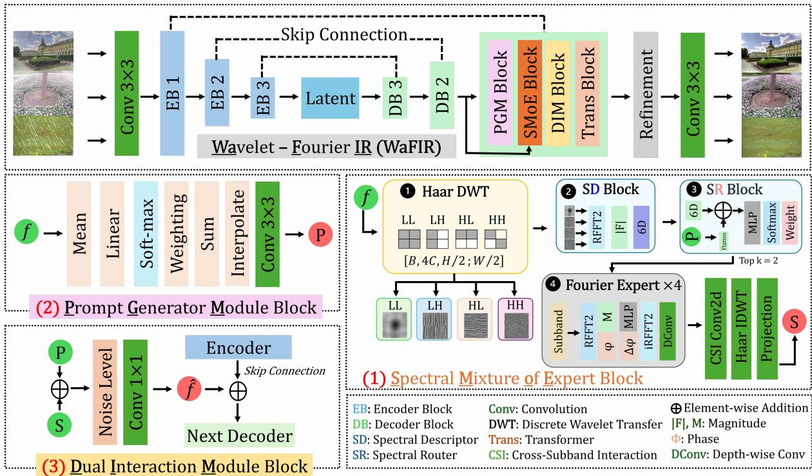  
Fi ure 1: Overall architecture of WaFIR. A Prom tIR-st le U-Net is au mented at each decoder level b three modules. (1) SPMoE decomposes the feature via Haar DWT into directional subbands (LL/LH/HL/HH) for multi-resolution spatial–scale localization, describes each with a 6-D Fourier descri tor (SD), routes it to to -� Fourier Ex erts (SR) that modulate ma nitude and phase in the global frequency domain, and reconstructs via cross-subband interaction (CSI) and Haar IDWT. Wavelet and FFT are com<sub>p</sub>lementar<sub>y</sub>: the wavelet <sub>g</sub>ives s<sub>p</sub>atial localit<sub>y</sub> a <sub>g</sub>lobal FFT lacks; the FFT <sub>g</sub>ives frequenc<sub>y</sub> (ma<sub>g</sub>nitude+<sub>p</sub>hase) selectivity a wavelet subband lacks. (2) PGM generates a degradation-adaptive prompt �; (3) DIM fuses � with the spectra <sub>ou</sub>t<sub>pu</sub>t � <sub>an</sub>d th<sub>e s</sub>ki<sub>p connec</sub>ti<sub>on</sub> f<sub>or</sub> th<sub>e nex</sub>t d<sub>eco</sub>d<sub>er.</sub>

1. Subband-level spectral routing. We introduce per-<sub>su</sub>bb<sub>an</sub>d F<sub>our</sub>i<sub>er</sub> d<sub>escr</sub>i<sub>p</sub>t<sub>ors as an</sub> i<sub>npu</sub>t<sub>-</sub>d<sub>er</sub>i<sub>ve</sub>d <sub>rou</sub>ti<sub>ng</sub> signal for unified restoration, jointly conditioning sparse <sub>exper</sub>t <sub>rou</sub>ti<sub>ng w</sub>ith <sub>poo</sub>l<sub>e</sub>d <sub>promp</sub>t f<sub>ea</sub>t<sub>ures.</sub>

2. Wavelet-Fourier expert design. We propose the SP-M<sub>o</sub>E <sub>mo</sub>d<sub>u</sub>l<sub>e, pa</sub>i<sub>r</sub>i<sub>ng</sub> H<sub>aar</sub> d<sub>ecompos</sub>iti<sub>on w</sub>ith <sub>promp</sub>t<sub>-</sub> <sub>con</sub>diti<sub>one</sub>d F<sub>our</sub>i<sub>er spec</sub>t<sub>ra</sub>l<sub>-mo</sub>d<sub>u</sub>l<sub>a</sub>ti<sub>on exper</sub>t<sub>s, s</sub>t<sub>a</sub>bi<sub>-</sub> li<sub>ze</sub>d b<sub>y a zero-</sub>i<sub>n</sub>iti<sub>a</sub>li<sub>ze</sub>d <sub>res</sub>id<sub>ua</sub>l <sub>ga</sub>t<sub>e an</sub>d <sub>a per-su</sub>bb<sub>an</sub>d l<sub>oa</sub>d<sub>-</sub>b<sub>a</sub>l<sub>anc</sub>i<sub>ng</sub> l<sub>oss.</sub>

3. Comprehensive evaluation and interpretable routing. W<sub>e s</sub>h<sub>ow</sub> th<sub>a</sub>t W<sub>a</sub>FIR im<sub>p</sub>r<sub>oves</sub> th<sub>e</sub> Pr<sub>o</sub>m<sub>p</sub>tIR b<sub>ac</sub>kb<sub>o</sub>n<sub>e</sub> <sub>on</sub> d<sub>eno</sub>i<sub>s</sub>i<sub>ng</sub> <sub>an</sub>d d<sub>era</sub>i<sub>n</sub>i<sub>ng,</sub> i<sub>s</sub> <sub>compe</sub>titi<sub>ve</sub> <sub>w</sub>ith th<sub>e</sub> <sub>s</sub>t<sub>a</sub>t<sub>e</sub> <sub>o</sub>f th<sub>e ar</sub>t <sub>overa</sub>ll<sub>, an</sub>d <sub>genera</sub>li<sub>zes w</sub>ith<sub>ou</sub>t fi<sub>ne-</sub>t<sub>un</sub>i<sub>ng</sub> t<sub>o unseen</sub> d<sub>a</sub>t<sub>ase</sub>t<sub>s an</sub>d <sub>an</sub> i<sub>n</sub>d<sub>us</sub>t<sub>r</sub>i<sub>a</sub>l d<sub>oma</sub>i<sub>n.</sub> W<sub>e</sub> f<sub>ur</sub>th<sub>er</sub> <sub>s</sub>h<sub>ow</sub> th<sub>a</sub>t it<sub>s exper</sub>t<sub>s se</sub>lf<sub>-organ</sub>i<sub>ze</sub> b<sub>y</sub> f<sub>requency su</sub>bb<sub>an</sub>d<sub>,</sub> <sub>an</sub>d th<sub>a</sub>t d<sub>escr</sub>i<sub>p</sub>t<sub>or-</sub>b<sub>ase</sub>d <sub>rou</sub>ti<sub>ng</sub> i<sub>s more ro</sub>b<sub>us</sub>t th<sub>an a</sub> l<sub>a</sub>b<sub>e</sub>l<sub>-con</sub>diti<sub>one</sub>d <sub>a</sub>lt<sub>erna</sub>ti<sub>ve un</sub>d<sub>er unseen no</sub>i<sub>se</sub> i<sub>n</sub>t<sub>en-</sub> <sub>s</sub>iti<sub>es.</sub>

## 2 Related Work

Blind All-in-One Image Restoration: Unified restoration <sub>me</sub>th<sub>o</sub>d<sub>s recover mu</sub>lti<sub>p</sub>l<sub>e</sub> d<sub>egra</sub>d<sub>a</sub>ti<sub>on</sub> t<sub>ypes w</sub>ith <sub>a s</sub>i<sub>ng</sub>l<sub>e ne</sub>t<sub>-</sub> <sub>wor</sub>k b<sub>y</sub> l<sub>earn</sub>i<sub>ng</sub> <sub>a</sub>d<sub>ap</sub>ti<sub>ve</sub> <sub>con</sub>diti<sub>on</sub>i<sub>ng</sub> <sub>s</sub>i<sub>gna</sub>l<sub>s</sub> f<sub>rom</sub> th<sub>e</sub> i<sub>npu</sub>t<sub>.</sub> Prom<sub>p</sub>tIR Potla<sub>p</sub>alli et al. (2023) extracts learnable <sub>p</sub>rom<sub>p</sub>ts from decoder features, AdaIR Cui et al. (2025) mines and <sub>mo</sub>d<sub>u</sub>l<sub>a</sub>t<sub>es</sub> l<sub>ow-</sub> <sub>an</sub>d hi<sub>g</sub>h<sub>-</sub>f<sub>requency</sub> f<sub>ea</sub>t<sub>ure</sub> <sub>componen</sub>t<sub>s,</sub> <sub>an</sub>d more recent methods such as OneRestore Guo et al. (2024b) and FAPE-IR Liu et al. (2026) stren<sub>g</sub>then feature ada<sub>p</sub>tation f<sub>or</sub> h<sub>ar</sub>d<sub>er</sub> d<sub>egra</sub>d<sub>a</sub>ti<sub>on scenar</sub>i<sub>os.</sub> D<sub>esp</sub>it<sub>e</sub> th<sub>ese</sub> dif<sub>erences,</sub> <sub>a</sub>d<sub>ap</sub>t<sub>a</sub>ti<sub>on</sub> i<sub>s app</sub>li<sub>e</sub>d <sub>a</sub>t <sub>a coarse granu</sub>l<sub>ar</sub>it<sub>y—a g</sub>l<sub>o</sub>b<sub>a</sub>l <sub>con</sub>di<sub>-</sub> ti<sub>on</sub>i<sub>ng</sub> <sub>s</sub>i<sub>gna</sub>l <sub>or</sub> <sub>a</sub> t<sub>wo-way</sub> l<sub>ow</sub>/hi<sub>g</sub>h<sub>-</sub>f<sub>requency</sub> <sub>sp</sub>lit<sub>—so</sub> fi<sub>ne-</sub> <sub>gra</sub>i<sub>ne</sub>d f<sub>requency reg</sub>i<sub>ons w</sub>ithi<sub>n</sub> th<sub>e same</sub> f<sub>ea</sub>t<sub>ure map are</sub> <sub>no</sub>t <sub>reso</sub>l<sub>ve</sub>d i<sub>n</sub>t<sub>o separa</sub>t<sub>e</sub>l<sub>y spec</sub>i<sub>a</sub>li<sub>ze</sub>d <sub>compu</sub>t<sub>a</sub>ti<sub>ons.</sub> W<sub>a</sub>FIR i<sub>ns</sub>t<sub>ea</sub>d <sub>con</sub>diti<sub>ons a</sub>ft<sub>er reso</sub>l<sub>v</sub>i<sub>ng</sub> th<sub>e</sub> f<sub>ea</sub>t<sub>ure</sub> i<sub>n</sub>t<sub>o wave</sub>l<sub>e</sub>t <sub>su</sub>b<sub>-</sub> b<sub>an</sub>d<sub>s,</sub> l<sub>e</sub>tti<sub>ng</sub> dif<sub>eren</sub>t <sub>spec</sub>t<sub>ra</sub>l <sub>reg</sub>i<sub>ons rece</sub>i<sub>ve</sub> dif<sub>eren</sub>t <sub>exper</sub>t assignments while remaining jointly conditioned by prompt context.

Mixture-of-Experts for Adaptive Restoration: MoE en-<sub>a</sub>bl<sub>es</sub> <sub>a</sub>d<sub>ap</sub>ti<sub>ve</sub> <sub>compu</sub>t<sub>a</sub>ti<sub>on</sub> b<sub>y</sub> <sub>ac</sub>ti<sub>va</sub>ti<sub>ng</sub> <sub>a</sub> <sub>sparse</sub> <sub>su</sub>b<sub>se</sub>t <sub>o</sub>f ex<sub>p</sub>erts <sub>p</sub>er in<sub>p</sub>ut Shazeer et al. (2017). Restoration models such as MoCE-IR Zamfir et al. (2025) and MOERL Wan<sub>g</sub> et al. (2025) route ex<sub>p</sub>erts b<sub>y</sub> de<sub>g</sub>radation-aware embeddin<sub>g</sub>s, <sub>res</sub>t<sub>ora</sub>ti<sub>on</sub> <sub>comp</sub>l<sub>ex</sub>it<sub>y,</sub> <sub>or</sub> <sub>g</sub>l<sub>o</sub>b<sub>a</sub>l f<sub>ea</sub>t<sub>ure</sub> <sub>represen</sub>t<sub>a</sub>ti<sub>ons,</sub> <sub>orga-</sub> <sub>n</sub>i<sub>z</sub>i<sub>ng spec</sub>i<sub>a</sub>li<sub>za</sub>ti<sub>on a</sub>t th<sub>e</sub> f<sub>ea</sub>t<sub>ure</sub> l<sub>eve</sub>l<sub>.</sub> W<sub>a</sub>FIR i<sub>ns</sub>t<sub>ea</sub>d <sub>as</sub>k<sub>s</sub> <sub>w</sub>h<sub>e</sub>th<sub>er</sub> th<sub>e</sub> f<sub>requency</sub> <sub>organ</sub>i<sub>za</sub>ti<sub>on</sub> <sub>o</sub>f th<sub>e</sub> f<sub>ea</sub>t<sub>ure</sub> <sub>prov</sub>id<sub>es</sub> <sub>a</sub> b<sub>e</sub>tt<sub>er</sub> b<sub>as</sub>i<sub>s</sub> f<sub>or spec</sub>i<sub>a</sub>li<sub>za</sub>ti<sub>on: ra</sub>th<sub>er</sub> th<sub>an ass</sub>i<sub>gn</sub>i<sub>ng one exper</sub>t t<sub>o</sub> <sub>an</sub> <sub>en</sub>ti<sub>re</sub> f<sub>ea</sub>t<sub>ure,</sub> <sub>eac</sub>h <sub>wave</sub>l<sub>e</sub>t <sub>su</sub>bb<sub>an</sub>d i<sub>s</sub> <sub>rou</sub>t<sub>e</sub>d i<sub>n</sub>d<sub>epen-</sub> d<sub>en</sub>tl<sub>y</sub> b<sub>y</sub> it<sub>s own spec</sub>t<sub>ra</sub>l d<sub>escr</sub>i<sub>p</sub>t<sub>or, so exper</sub>t<sub>s spec</sub>i<sub>a</sub>li<sub>ze on</sub> <sub>comp</sub>l<sub>emen</sub>t<sub>ary</sub> f<sub>requency</sub> <sub>s</sub>t<sub>ruc</sub>t<sub>ures</sub> <sub>w</sub>ithi<sub>n</sub> th<sub>e</sub> <sub>same</sub> i<sub>mage.</sub>

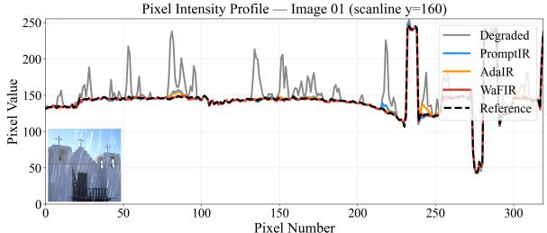

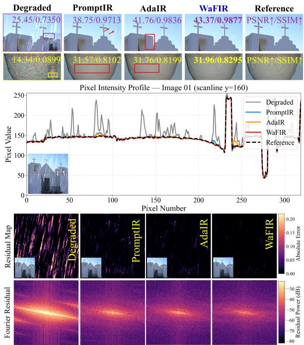  
Figure 2: Qualitative comparison and frequency-domain error analysis. Rows 1–2: derain and denoise $( \sigma { = } 5 0 )$ examples; columns are degraded input, PromptIR, AdaIR, WaFIR (ours), and reference, with PSNR / SSIM below each patch. On derain (row 1) WaFIR im<sub>p</sub>roves +1.61 dB over AdaIR (ICLR’25) and +4.62 dB over Prom<sub>p</sub>tIR (NeurIPS’23); on denoise (row 2), be<sub>y</sub>ond the hi<sub>g</sub>her scores, the zoom cro<sub>p</sub>s <sub>s</sub>h<sub>ow</sub> W<sub>a</sub>FIR b<sub>e</sub>tt<sub>er preserves</sub> fi<sub>ne</sub> t<sub>ex</sub>t<sub>ure</sub> th<sub>a</sub>t th<sub>e</sub> b<sub>ase</sub>li<sub>nes</sub> over-smooth. Row 3: 1D intensity profile $\left( y = 1 6 0 \right)$ <sub>;</sub> W<sub>a</sub>FIR (red) tracks the reference (black dashed) most closel<sub>y</sub> at ed<sub>g</sub>es. Rows 4–5: residual maps $| \hat { x } - x _ { \mathrm { g t } } |$ <sub>an</sub>d th<sub>e</sub>i<sub>r</sub> F<sub>our</sub>i<sub>er spec</sub>t<sub>ra.</sub> R<sub>a</sub>i<sub>n</sub> l<sub>eaves a</sub> di<sub>rec</sub>ti<sub>ona</sub>l hi<sub>g</sub>h<sub>-</sub>f<sub>requency</sub> b<sub>an</sub>d i<sub>n</sub> th<sub>e res</sub>id<sub>ua</sub>l<sub>;</sub> W<sub>a</sub>FIR <sub>supp</sub>r<sub>esses</sub> it m<sub>os</sub>t<sub>,</sub> <sub>w</sub>ith th<sub>e</sub> <sub>s</sub>t<sub>eepes</sub>t <sub>spec</sub>tr<sub>a</sub>l <sub>e</sub>n<sub>e</sub>r<sub>gy</sub> d<sub>ecay,</sub> <sub>con</sub>fi<sub>rm</sub>i<sub>ng</sub> <sub>remova</sub>l <sub>o</sub>f d<sub>egra</sub>d<sub>a</sub>ti<sub>on-spec</sub>ifi<sub>c</sub> f<sub>requency</sub> structure.

Frequency-aware Image Restoration: Frequency represent<sub>a</sub>ti<sub>ons are w</sub>id<sub>e</sub>l<sub>y use</sub>d i<sub>n res</sub>t<sub>ora</sub>ti<sub>on.</sub> MWCNN Li<sub>u e</sub>t <sub>a</sub>l<sub>.</sub> (2018) a<sub>pp</sub>lies wavelet decom<sub>p</sub>osition for multi-scale re<sub>p</sub>resentation, and FFC Suvorov et al. (2022) introduces Fourier <sub>convo</sub>l<sub>u</sub>ti<sub>ons</sub> t<sub>o en</sub>l<sub>arge</sub> th<sub>e recep</sub>ti<sub>ve</sub> fi<sub>e</sub>ld<sub>.</sub> A<sub>mong un</sub>ifi<sub>e</sub>d methods, AdaIR Cui et al. (2025) is closest to our work: it lik<sub>ew</sub>i<sub>se</sub> <sub>opera</sub>t<sub>es</sub> i<sub>n</sub> th<sub>e</sub> f<sub>requency</sub> d<sub>oma</sub>i<sub>n,</sub> <sub>m</sub>i<sub>n</sub>i<sub>ng</sub> l<sub>ow-</sub> <sub>an</sub>d hi<sub>g</sub>h-frequenc<sub>y</sub> com<sub>p</sub>onents from the features (<sub>g</sub>uided b<sub>y</sub> the de<sub>g</sub>raded ima<sub>g</sub>e’s s<sub>p</sub>ectra) and modulatin<sub>g</sub> them throu<sub>g</sub>h a bidi<sub>rec</sub>ti<sub>ona</sub>l <sub>opera</sub>t<sub>or.</sub> W<sub>e</sub> t<sub>a</sub>k<sub>e</sub> <sub>a</sub> dif<sub>eren</sub>t <sub>approac</sub>h t<sub>o</sub> <sub>pro-</sub> <sub>cess</sub>i<sub>ng</sub> th<sub>e</sub> f<sub>requency</sub> d<sub>oma</sub>i<sub>n:</sub> W<sub>a</sub>FIR <sub>ex</sub>t<sub>rac</sub>t<sub>s</sub> <sub>per-su</sub>bb<sub>an</sub>d F<sub>our</sub>i<sub>er</sub> d<sub>escr</sub>i<sub>p</sub>t<sub>ors over</sub> f<sub>our</sub> H<sub>aar su</sub>bb<sub>an</sub>d<sub>s an</sub>d <sub>uses</sub> th<sub>em</sub> di<sub>rec</sub>tl<sub>y</sub> f<sub>or sparse</sub> t<sub>op-</sub>� <sub>rou</sub>ti<sub>ng, so</sub> dif<sub>eren</sub>t <sub>spec</sub>t<sub>ra</sub>l <sub>reg</sub>i<sub>ons</sub> <sub>ac</sub>ti<sub>va</sub>t<sub>e</sub> dif<sub>eren</sub>t <sub>exper</sub>t<sub>s.</sub> Thi<sub>s</sub> i<sub>s</sub> <sub>a</sub> f<sub>requency-reso</sub>l<sub>ve</sub>d <sub>rou</sub>ti<sub>ng</sub> <sub>mec</sub>h<sub>an</sub>i<sub>sm ra</sub>th<sub>er</sub> th<sub>an a g</sub>l<sub>o</sub>b<sub>a</sub>l f<sub>requency-mo</sub>d<sub>u</sub>l<sub>a</sub>ti<sub>on s</sub>t<sub>age.</sub>

P<sub>romp</sub>t <sub>con</sub>diti<sub>on</sub>i<sub>ng,</sub> f<sub>requency represen</sub>t<sub>a</sub>ti<sub>ons, an</sub>d <sub>sparse</sub> <sub>exper</sub>t <sub>rou</sub>ti<sub>ng eac</sub>h i<sub>mprove un</sub>ifi<sub>e</sub>d <sub>res</sub>t<sub>ora</sub>ti<sub>on</sub> i<sub>n</sub>d<sub>epen</sub>d<sub>en</sub>tl<sub>y.</sub> WaFIR connects them through a diferent question: can frequency subbands themselves serve as an interpretable basis for expert specialization? Rather than combining existing <sub>mo</sub>d<sub>u</sub>l<sub>es,</sub> W<sub>a</sub>FIR <sub>s</sub>h<sub>ows</sub> th<sub>a</sub>t <sub>rou</sub>ti<sub>ng se</sub>lf<sub>-organ</sub>i<sub>zes</sub> b<sub>y wave</sub>l<sub>e</sub>t <sub>su</sub>bb<sub>an</sub>d <sub>ra</sub>th<sub>er</sub> th<sub>an</sub> d<sub>egra</sub>d<sub>a</sub>ti<sub>on</sub> <sub>ca</sub>t<sub>egory,</sub> <sub>g</sub>i<sub>v</sub>i<sub>ng</sub> <sub>a</sub> f<sub>requency-</sub> <sub>groun</sub>d<sub>e</sub>d <sub>rou</sub>ti<sub>ng pr</sub>i<sub>nc</sub>i<sub>p</sub>l<sub>e</sub> th<sub>a</sub>t <sub>genera</sub>li<sub>zes more ro</sub>b<sub>us</sub>tl<sub>y</sub> t<sub>o</sub> <sub>unseen</sub> d<sub>egra</sub>d<sub>a</sub>ti<sub>ons.</sub>

## 3 Method

## 3.1 Overview

WaFIR builds on Prom<sub>p</sub>tIR Potla<sub>p</sub>alli et al. (2023), a hierar-<sub>c</sub>hi<sub>ca</sub>l <sub>enco</sub>d<sub>er–</sub>d<sub>eco</sub>d<sub>er w</sub>h<sub>ose</sub> d<sub>eco</sub>d<sub>er</sub> l<sub>eve</sub>l<sub>s are con</sub>diti<sub>one</sub>d on learnable degradation prompts. We insert a SpectralMoE-Block $\scriptstyle { S _ { \ell } }$ i<sub>mme</sub>di<sub>a</sub>t<sub>e</sub>l<sub>y</sub> <sub>a</sub>ft<sub>er</sub> th<sub>e</sub> <sub>promp</sub>t <sub>genera</sub>ti<sub>on</sub> <sub>s</sub>t<sub>ep</sub> <sub>a</sub>t <sub>eac</sub>h <sub>o</sub>f th<sub>e</sub> th<sub>ree</sub> d<sub>eco</sub>d<sub>er</sub> l<sub>eve</sub>l<sub>s</sub> $\ell \in \{ 3 , 2 , 1 \}$

$$
\mathbf { f } _ { \ell } ^ { \prime } = S _ { \ell } ( \mathbf { f } _ { \ell } , \mathbf { p } _ { \ell } ) ,\tag{1}
$$

<sub>w</sub>h<sub>ere</sub> $\mathbf { f } _ { \ell } \in \mathbb { R } ^ { B \times C _ { \ell } \times H _ { \ell } \times W _ { \ell } }$ i<sub>s</sub> th<sub>e</sub> d<sub>eco</sub>d<sub>er</sub> f<sub>ea</sub>t<sub>ure,</sub> $\mathbf { p } _ { \ell }$ i<sub>s</sub> th<sub>e</sub> p<sup>rom</sup>p<sup>t</sup>, <sup>and</sup> $C _ { \ell } \in \{ 3 8 4 , 1 9 2 , 9 6 \}$ <sub>.</sub> Th<sub>e</sub> <sub>enr</sub>i<sub>c</sub>h<sub>e</sub>d f<sub>ea</sub>t<sub>ure</sub> $\mathbf { f } _ { \ell } ^ { \prime }$ i<sub>s</sub> then concatenated with p<sub>ℓ</sub> and fed to the standard PromptIR t<sub>rans</sub>f<sub>ormer</sub> bl<sub>oc</sub>k<sub>.</sub> All <sub>o</sub>th<sub>er</sub> b<sub>ac</sub>kb<sub>one</sub> <sub>componen</sub>t<sub>s</sub> <sub>are</sub> <sub>un-</sub> <sub>c</sub>h<sub>ange</sub>d<sub>.</sub> S<sub>e</sub>tti<sub>ng</sub> $\boldsymbol { s } _ { \ell }$ t<sub>o</sub> id<sub>en</sub>tit<sub>y</sub> <sub>recovers</sub> <sub>van</sub>ill<sub>a</sub> P<sub>romp</sub>tIR <sub>ex-</sub> <sub>ac</sub>tl<sub>y,</sub> <sub>ma</sub>ki<sub>ng</sub> SPM<sub>o</sub>E f<sub>u</sub>ll<sub>y</sub> <sub>p</sub>l<sub>ug-an</sub>d<sub>-p</sub>l<sub>ay.</sub> Fi<sub>gure</sub> 1 ill<sub>us</sub>t<sub>ra</sub>t<sub>es</sub> th<sub>e overa</sub>ll <sub>p</sub>i<sub>pe</sub>li<sub>ne, w</sub>hil<sub>e</sub> th<sub>e comp</sub>l<sub>e</sub>t<sub>e</sub> f<sub>orwar</sub>d <sub>pseu</sub>d<sub>oco</sub>d<sub>e</sub> <sub>o</sub>f th<sub>e</sub> <sub>p</sub>r<sub>opose</sub>d S<sub>pec</sub>tr<sub>a</sub>lM<sub>o</sub>EBl<sub>oc</sub>k i<sub>s</sub> <sub>g</sub>i<sub>ve</sub>n in S<sub>upp</sub>l<sub>e</sub>m<sub>e</sub>nt<sub>a</sub>r<sub>y</sub> Al<sub>gor</sub>ith<sub>m</sub> S1<sub>–</sub>S<sub>upp</sub>l<sub>emen</sub>t<sub>ary</sub> Al<sub>gor</sub>ith<sub>m</sub> S2<sub>.</sub>

## 3.2 Haar Wavelet Decomposition

Gi<sub>ven</sub> <sub>a</sub> f<sub>ea</sub>t<sub>ure</sub> <sub>map</sub> $\mathbf { x } \in \mathbb { R } ^ { B \times C \times H \times W }$ <sub>, a s</sub>i<sub>ng</sub>l<sub>e-</sub>l<sub>eve</sub>l 2<sub>-</sub>D H<sub>aar</sub> DWT Mallat (2009) decom<sub>p</sub>oses it into four subbands b<sub>y</sub> a<sub>pp</sub>l<sub>y</sub>in<sub>g</sub> se<sub>p</sub>arable avera<sub>g</sub>in<sub>g</sub> (L) and diferencin<sub>g</sub> (H) filters <sub>a</sub>l<sub>ong</sub> b<sub>o</sub>th <sub>spa</sub>ti<sub>a</sub>l <sub>axes:</sub>

$$
\begin{array} { r } { \mathrm { D W T } ( \mathbf { x } ) = [ \mathbf { L } \mathbf { L } ; \mathbf { L } \mathbf { H } ; \mathbf { H } \mathbf { L } ; \mathbf { H } \mathbf { H } ] \in \mathbb { R } ^ { B \times 4 C \times H / 2 \times W / 2 } . } \end{array}\tag{2}
$$

Th<sub>e norma</sub>li<sub>za</sub>ti<sub>on o</sub>f $\frac { 1 } { \sqrt { 2 } }$ <sub>a</sub>t <sub>eac</sub>h <sub>s</sub>t<sub>age ma</sub>k<sub>es</sub> th<sub>e</sub> t<sub>rans</sub>f<sub>orm</sub> un<sup>i</sup>tar<sub>y</sub> $( \| \mathrm { D W T } ( \mathbf { x } ) \| ^ { 2 } = \| \mathbf { x } \| ^ { 2 } )$ <sub>, so</sub> th<sub>e</sub> i<sub>nverse</sub> IDWT <sub>recon-</sub> structs x exactly without loss of information. The Haar DWT d<sub>oes no</sub>t <sub>requ</sub>i<sub>re</sub> t<sub>ra</sub>i<sub>na</sub>bl<sub>e parame</sub>t<sub>ers an</sub>d <sub>runs</sub> i<sub>n</sub> $O ( N )$ ti<sub>me.</sub>

A<sub>ccor</sub>di<sub>ng</sub> t<sub>o</sub> S<sub>upp</sub>l<sub>emen</sub>t<sub>ary</sub> Fi<sub>gure</sub> S1<sub>,</sub> <sub>eac</sub>h <sub>su</sub>bb<sub>an</sub>d <sub>car-</sub> <sub>r</sub>i<sub>es a p</sub>h<sub>ys</sub>i<sub>ca</sub>ll<sub>y</sub> i<sub>n</sub>t<sub>erpre</sub>t<sub>a</sub>bl<sub>e</sub> f<sub>requency s</sub>i<sub>gna</sub>t<sub>ure</sub> th<sub>a</sub>t <sub>na</sub>t<sub>u-</sub> <sub>ra</sub>ll<sub>y a</sub>li<sub>gns w</sub>ith <sub>a spec</sub>ifi<sub>c</sub> d<sub>egra</sub>d<sub>a</sub>ti<sub>on</sub> t<sub>ype, as summar</sub>i<sub>ze</sub>d in S<sub>upp</sub>l<sub>e</sub>m<sub>e</sub>nt<sub>a</sub>r<sub>y</sub> T<sub>a</sub>bl<sub>e</sub> S1<sub>.</sub>

## 3.3 Spectral Descriptor

F<sub>or eac</sub>h <sub>su</sub>bb<sub>an</sub>d $\mathbf { s } \in \mathbb { R } ^ { B \times C \times H _ { s } \times W _ { s } }$ , a parameter-free SpectralDescriptor computes a 6-dimensional summary of its

2<sub>-</sub>D m<sub>ag</sub>nit<sub>u</sub>d<sub>e</sub> <sub>spec</sub>tr<sub>u</sub>m<sub>.</sub> L<sub>e</sub>t $\mathbf { M } ( u , \nu ) ~ = ~ \mathbf { \lvert { R F F T 2 ( s ) } \rvert }$ ∈ $\mathbb { R } ^ { B \times C \times H _ { s } \times ( W _ { s } / 2 + 1 ) ^ { \bullet } }$ b<sub>e</sub> th<sub>e or</sub>th<sub>onorma</sub>l <sub>rea</sub>l<sub>-</sub>FFT <sub>magn</sub>it<sub>u</sub>d<sub>e,</sub> <sub>an</sub>d d<sub>e</sub>fi<sub>ne</sub> th<sub>e</sub> l<sub>ow-</sub>f<sub>requency</sub> b<sub>oun</sub>d<sub>ary</sub> $l _ { H } = \lfloor H _ { s } \cdot 0 . 2 5 \rfloor$ $l _ { W } = \lfloor W _ { s } / 2 \cdot 0 . 2 5 \rfloor$ . The descri tor d $\in \mathbb { R } ^ { B \times 6 }$ i<sub>s:</sub>

$$
d _ { 0 } = \overline { { M } } _ { u , \nu , c }
$$

$$
\mathrm { ( g l o b a l e n e r g y ) }\tag{3}
$$

$$
d _ { 1 } = \operatorname { V a r } _ { u , \nu , c } [ M ]
$$

$$
\mathrm { ( s p e c t r a l \ s p r e a d ) }\tag{4}
$$

$$
d _ { 2 } = \overline { { { M } } } _ { u < l _ { H } , \nu < l _ { W } }
$$

$$
( \mathrm { D C } / \mathrm { l o w } \mathrm { - f r e q } )\tag{5}
$$

$$
d _ { 3 } = \overline { { { M } } } _ { u \geq l _ { H } , \nu \geq l _ { W } }
$$

$$
( { \mathrm { h i g h - f r e q } } )\tag{6}
$$

$$
d _ { 4 } = \overline { { M } } _ { l _ { H } \leq u < H _ { s } / 2 }
$$

$$
( \mathrm { h o r i z . \ b a n d } )\tag{7}
$$

$$
d _ { 5 } = \overline { { M } } _ { l _ { W } \leq \nu \leq W _ { s } / 2 }
$$

$$
( \mathrm { v e r t . ~ b a n d ) }\tag{8}
$$

E<sub>ac</sub>h di<sub>mens</sub>i<sub>on cap</sub>t<sub>ures a</sub> d<sub>egra</sub>d<sub>a</sub>ti<sub>on-</sub>di<sub>scr</sub>i<sub>m</sub>i<sub>na</sub>ti<sub>ve spec-</sub> <sup>tral</sup> p<sup>ro</sup>p<sup>ert</sup>y<sup>:</sup> $d _ { 0 }$ i<sub>s e</sub>l<sub>eva</sub>t<sub>e</sub>d b<sub>y</sub> h<sub>aze;</sub> $d _ { 1 }$ is hi<sub>g</sub>h for noise (flat s<sub>p</sub>ectrum); $d _ { 2 }$ <sub>respon</sub>d<sub>s</sub> t<sub>o</sub> h<sub>aze;</sub> $d _ { 3 }$ t<sub>o</sub> <sub>no</sub>i<sub>se</sub> <sub>an</sub>d <sub>s</sub>h<sub>arp</sub> <sub>e</sub>d<sub>ges;</sub> $d _ { 4 } { - } d _ { 5 }$ t<sub>o ra</sub>i<sub>n s</sub>t<sub>rea</sub>k<sub>s an</sub>d di<sub>rec</sub>ti<sub>ona</sub>l bl<sub>ur.</sub> Th<sub>e</sub> d<sub>escr</sub>i<sub>p</sub>t<sub>or</sub> i<sub>s</sub> <sub>compu</sub>t<sub>e</sub>d i<sub>n</sub>d<sub>epen</sub>d<sub>en</sub>tl<sub>y</sub> f<sub>or</sub> <sub>a</sub>ll f<sub>our</sub> <sub>su</sub>bb<sub>an</sub>d<sub>s,</sub> <sub>resu</sub>lti<sub>ng</sub> i<sub>n</sub> ${ \bf d } ^ { \mathrm { L L } } , \mathbf { \dot { d } } ^ { \mathrm { L H } } , { \bf d } ^ { \mathrm { H L } } , \mathbf { \dot { d } } ^ { \mathrm { H H } } \in \mathbb { R } ^ { \mathbf { \tilde { B } } \times 6 }$

## 3.4 Spectral Router and Sparse Top-� Gating

Th<sub>e</sub> <sub>rou</sub>t<sub>er</sub> f<sub>or</sub> <sub>eac</sub>h <sub>su</sub>bb<sub>an</sub>d f<sub>uses</sub> th<sub>e</sub> <sub>spec</sub>t<sub>ra</sub>l d<sub>escr</sub>i<sub>p</sub>t<sub>or</sub> <sub>w</sub>ith <sup>a</sup> p<sup>ooled</sup> p<sup>rom</sup>p<sup>t</sup> v<sup>ector:</sup>

$$
\mathbf { r } = [ \mathbf { d } ; \bar { \mathbf { p } } ] , \quad \bar { \mathbf { p } } = \mathrm { A v g P o o l } ( \mathbf { p } ) \in \mathbb { R } ^ { B \times C _ { p } } .\tag{9}
$$

A two-layer MLP maps r to �=4 expert logits:

$$
\mathbf { g } = W _ { 2 } \mathbf { G E L U } ( W _ { 1 } \mathbf { r } ) \in \mathbb { R } ^ { B \times E } ,\tag{10}
$$

followed b<sub>y</sub> s<sub>p</sub>arse to<sub>p</sub>-� selection (�=2) and softmax normali<sub>za</sub>ti<sub>on:</sub>

$$
w _ { i } = \left\{ \begin{array} { l l } { \operatorname { s o f t m a x } ( \mathbf { g } ) _ { i } } & { \mathrm { i f } ~ g _ { i } \geq g _ { ( k ) } , } \\ { 0 } & { \mathrm { o t h e r w i s e } , } \end{array} \right.\tag{11}
$$

<sub>w</sub>h<sub>ere</sub> $g _ { ( k ) }$ i<sub>s</sub> th<sub>e</sub> �<sub>-</sub>th l<sub>arges</sub>t l<sub>og</sub>it<sub>.</sub> O<sub>n</sub>l<sub>y</sub> th<sub>e</sub> � <sub>se</sub>l<sub>ec</sub>t<sub>e</sub>d <sub>ex-</sub> <sub>p</sub>erts contr<sup>ib</sup>ute to t<sup>h</sup>e out<sub>p</sub>ut, <sup>k</sup>ee<sub>p</sub><sup>i</sup>n<sub>g</sub> t<sup>h</sup>e <sub>p</sub>er-sam<sub>p</sub><sup>l</sup>e, <sub>p</sub>er-<sub>su</sub>bb<sub>an</sub>d <sub>exper</sub>t <sub>compu</sub>t<sub>a</sub>ti<sub>on</sub> fi<sub>xe</sub>d <sub>as</sub> � <sub>grows.</sub> Th<sub>e</sub> d<sub>escr</sub>i<sub>p</sub>t<sub>or</sub> d provides subband-intrinsic spectral statistics; the prompt p¯ <sub>enco</sub>d<sub>es</sub> t<sub>as</sub>k <sub>con</sub>t<sub>ex</sub>t<sub>.</sub> N<sub>o</sub> d<sub>egra</sub>d<sub>a</sub>ti<sub>on</sub> t<sub>ype</sub> l<sub>a</sub>b<sub>e</sub>l i<sub>s requ</sub>i<sub>re</sub>d <sub>a</sub>t i<sub>n</sub>f<sub>erence.</sub>

Roles of the two conditioning signals: The gate is jointly conditioned on d and p¯ ; the architecture itself therefore does <sub>no</sub>t <sub>en</sub>f<sub>orce a separa</sub>ti<sub>on o</sub>f <sub>ro</sub>l<sub>es, an</sub>d <sub>we c</sub>h<sub>arac</sub>t<sub>er</sub>i<sub>ze</sub> th<sub>e ro</sub>l<sub>es</sub> em<sub>p</sub>iricall<sub>y</sub> instead. Ablations (Table 3; ex<sub>p</sub>anded discussion in Su<sub>pp</sub>lementar<sub>y</sub> Section S3) show that a descri<sub>p</sub>tor-onl<sub>y</sub> <sub>g</sub>ate (A14, −0.15 dB) retains more of the full model’s <sub>p</sub>erformance than a <sub>p</sub>rom<sub>p</sub>t-onl<sub>y</sub> <sub>g</sub>ate (A12, −0.26 dB), indicatin<sub>g</sub> th<sub>a</sub>t th<sub>e</sub> i<sub>n</sub>t<sub>r</sub>i<sub>ns</sub>i<sub>c p</sub>h<sub>ys</sub>i<sub>ca</sub>l <sub>c</sub>h<sub>arac</sub>t<sub>er</sub>i<sub>s</sub>ti<sub>cs re</sub>fl<sub>ec</sub>t<sub>e</sub>d i<sub>n</sub> th<sub>e su</sub>b<sub>-</sub> b<sub>an</sub>d <sub>spec</sub>t<sub>rum</sub> <sub>a</sub>l<sub>rea</sub>d<sub>y</sub> <sub>con</sub>t<sub>a</sub>i<sub>n</sub> <sub>use</sub>f<sub>u</sub>l <sub>rou</sub>ti<sub>ng</sub> i<sub>n</sub>f<sub>orma</sub>ti<sub>on,</sub> <sub>w</sub>hil<sub>e</sub> th<sub>e promp</sub>t <sub>prov</sub>id<sub>es comp</sub>l<sub>emen</sub>t<sub>ary</sub> t<sub>as</sub>k<sub>-con</sub>t<sub>ex</sub>t i<sub>n-</sub> f<sub>orma</sub>ti<sub>on.</sub> C<sub>ons</sub>i<sub>s</sub>t<sub>en</sub>tl<sub>y,</sub> th<sub>e</sub> <sub>quan</sub>tit<sub>a</sub>ti<sub>ve</sub> <sub>rou</sub>ti<sub>ng</sub> <sub>ana</sub>l<sub>ys</sub>i<sub>s</sub> i<sub>n</sub> S<sub>upp</sub>l<sub>e</sub>m<sub>e</sub>nt<sub>a</sub>r<sub>y</sub> S<sub>ec</sub>ti<sub>o</sub>n S2<sub>.</sub>2 <sub>a</sub>nd S<sub>upp</sub>l<sub>e</sub>m<sub>e</sub>nt<sub>a</sub>r<sub>y</sub> T<sub>a</sub>bl<sub>e</sub> S2 fi<sub>n</sub>d<sub>s</sub> th<sub>a</sub>t th<sub>e</sub> t<sub>ra</sub>i<sub>ne</sub>d <sub>rou</sub>ti<sub>ng we</sub>i<sub>g</sub>ht<sub>s organ</sub>i<sub>ze</sub> b<sub>y wave</sub>l<sub>e</sub>t <sub>su</sub>b<sub>-</sub> band (NMI 0.243 vs. 0.001 for random routin<sub>g</sub>) while carr<sub>y</sub>- i<sub>ng c</sub>h<sub>ance-</sub>l<sub>eve</sub>l li<sub>near</sub>l<sub>y</sub> d<sub>eco</sub>d<sub>a</sub>bl<sub>e</sub> d<sub>egra</sub>d<sub>a</sub>ti<sub>on</sub> i<sub>n</sub>f<sub>orma</sub>ti<sub>on.</sub> Within each ex<sub>p</sub>ert, the <sub>p</sub>rom<sub>p</sub>t-conditioned MLP (Eq. 12)

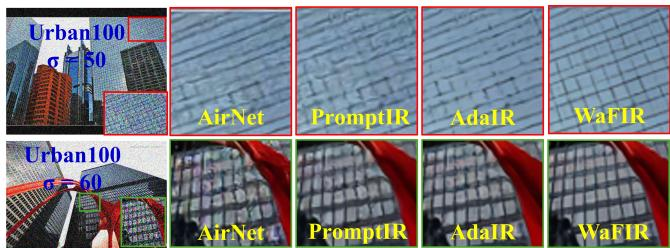  
Figure 3: Line-structure recovery on Urban100. WaFIR re-<sub>s</sub>t<sub>ores</sub> thi<sub>n,</sub> <sub>repea</sub>t<sub>e</sub>d li<sub>nes</sub> <sub>co</sub>h<sub>eren</sub>tl<sub>y,</sub> <sub>w</sub>ith<sub>ou</sub>t th<sub>e</sub> <sub>r</sub>i<sub>ng</sub>i<sub>ng</sub> <sub>or</sub> bl<sub>oc</sub>k <sub>ar</sub>tif<sub>ac</sub>t<sub>s o</sub>f <sub>spa</sub>ti<sub>a</sub>l b<sub>ase</sub>li<sub>nes, a</sub> di<sub>rec</sub>t b<sub>ene</sub>fit <sub>o</sub>f <sub>su</sub>bb<sub>an</sub>d<sub>-</sub> <sub>w</sub>i<sub>se g</sub>l<sub>o</sub>b<sub>a</sub>l F<sub>our</sub>i<sub>er mo</sub>d<sub>u</sub>l<sub>a</sub>ti<sub>on.</sub>

<sub>pro</sub>d<sub>uces</sub> <sub>c</sub>h<sub>anne</sub>l<sub>-spec</sub>ifi<sub>c</sub> <sub>sca</sub>l<sub>e</sub> <sub>an</sub>d bi<sub>as</sub> th<sub>a</sub>t <sub>vary</sub> b<sub>y</sub> t<sub>as</sub>k<sub>,</sub> <sub>so</sub> th<sub>e</sub> <sub>same</sub> <sub>exper</sub>t <sub>app</sub>li<sub>es</sub> dif<sub>eren</sub>t <sub>magn</sub>it<sub>u</sub>d<sub>e</sub> <sub>mo</sub>d<sub>u</sub>l<sub>a</sub>ti<sub>on</sub> t<sub>o</sub> <sub>a</sub> <sub>ra</sub>i<sub>ny</sub> <sub>versus</sub> <sub>a</sub> <sub>no</sub>i<sub>sy</sub> i<sub>npu</sub>t<sub>.</sub> E<sub>mp</sub>i<sub>r</sub>i<sub>ca</sub>ll<sub>y,</sub> <sub>rou</sub>ti<sub>ng</sub> <sub>organ</sub>i<sub>zes</sub> b<sub>y</sub> what a subband looks like spectrally, while correction adapts to the task context encoded in the prompt.

## 3.5 Fourier Expert

Each Fourier expert receives a subband s and the pooled prompt p¯ . We compute the 2-D real FFT, obtaining mag-<sub>n</sub>it<sub>u</sub>d<sub>e</sub> $\begin{array} { r } { m \ = \ | { \bf F } | } \end{array}$ <sub>an</sub>d <sub>p</sub>h<sub>ase</sub> $\varphi \ = \ \angle \mathbf { F }$ <sub>.</sub> A li<sub>g</sub>ht<sub>we</sub>i<sub>g</sub>ht MLP $g _ { m } : C _ { p } \to 2 C$ <sub>pre</sub>di<sub>c</sub>t<sub>s</sub> <sub>per-c</sub>h<sub>anne</sub>l <sub>sca</sub>l<sub>e</sub> <sub>�</sub> <sub>an</sub>d bi<sub>as</sub> �<sub>,</sub> <sub>an</sub>d <sub>app</sub>li<sub>es magn</sub>it<sub>u</sub>d<sub>e mo</sub>d<sub>u</sub>l<sub>a</sub>ti<sub>on:</sub>

$$
m ^ { \prime } = \operatorname* { m a x } \bigl ( m \cdot ( 1 + \operatorname { t a n h } ( a ) \bigr ) + b , 0 \bigr ) .\tag{12}
$$

The tanh-gated scale bounds the multiplicative factor to (0, 2); the outer max(·, 0) clamp ensures $m ^ { \prime } { \geq } 0$ so that polar(�<sup>′</sup>, <sub>�</sub>) <sub>rema</sub>i<sub>ns</sub> <sub>we</sub>ll<sub>-</sub>d<sub>e</sub>fi<sub>ne</sub>d <sub>w</sub>h<sub>en</sub> th<sub>e</sub> <sub>a</sub>dditi<sub>ve</sub> bi<sub>as</sub> � i<sub>s</sub> <sub>nega</sub>ti<sub>ve.</sub>

A <sub>secon</sub>d<sub>,</sub> li<sub>g</sub>ht<sub>er</sub> MLP $g _ { \varphi } : C _ { p } \to C$ <sub>pre</sub>di<sub>c</sub>t<sub>s a per-c</sub>h<sub>anne</sub>l <sub>p</sub>h<sub>ase sca</sub>l<sub>e � an</sub>d <sub>app</sub>li<sub>es a</sub> b<sub>oun</sub>d<sub>e</sub>d <sub>a</sub>dditi<sub>ve p</sub>h<sub>ase s</sub>hift<sub>:</sub>

$$
\varphi ^ { \prime } = \varphi + \operatorname { t a n h } ( c ) \cdot \Delta _ { \operatorname* { m a x } } , \qquad \Delta _ { \operatorname* { m a x } } = \pi / 4 .\tag{13}
$$

The tanh <sub>g</sub>ate bounds the <sub>p</sub>hase <sub>p</sub>erturbation to ±�/4 (45<sup>◦</sup>), <sub>preven</sub>ti<sub>ng</sub> th<sub>e</sub> <sub>a</sub>dditi<sub>ve</sub> <sub>s</sub>hift f<sub>rom</sub> d<sub>es</sub>t<sub>ruc</sub>ti<sub>ve</sub>l<sub>y</sub> <sub>overwr</sub>iti<sub>ng</sub> th<sub>e spa</sub>ti<sub>a</sub>l <sub>s</sub>t<sub>ruc</sub>t<sub>ure enco</sub>d<sub>e</sub>d i<sub>n �.</sub> Th<sub>e</sub> l<sub>as</sub>t l<sub>ayer o</sub>f $g _ { \varphi }$ i<sub>s zero-</sub> i<sub>n</sub>iti<sub>a</sub>li<sub>ze</sub>d<sub>,</sub> <sub>so</sub> $c \approx 0$ <sub>an</sub>d $\varphi ^ { \prime } \approx \varphi$ <sub>a</sub>t th<sub>e</sub> <sub>s</sub>t<sub>ar</sub>t <sub>o</sub>f t<sub>ra</sub>i<sub>n</sub>i<sub>ng;</sub> th<sub>e</sub> <sub>exper</sub>t th<sub>ere</sub>f<sub>ore</sub> b<sub>eg</sub>i<sub>ns as a near-</sub>id<sub>en</sub>tit<sub>y map on p</sub>h<sub>ase an</sub>d <sub>on</sub>l<sub>y</sub> <sub>gra</sub>d<sub>ua</sub>ll<sub>y</sub> l<sub>earns</sub> <sub>a</sub> <sub>use</sub>f<sub>u</sub>l <sub>per</sub>t<sub>ur</sub>b<sub>a</sub>ti<sub>on.</sub>

The modulated feature is reconstructed as sˆ = irft2(polar(�<sup>′</sup>, <sub>�</sub><sup>′</sup>)). A lightweight spatial refinement (depthwise 3×3 + <sub>p</sub>ointwise conv) is a<sub>pp</sub>lied after reconstruction. Ablation A4 (Table 3) shows that removin<sub>g</sub> <sub>p</sub>hase modulation (fixin<sub>g</sub> $\varphi ^ { \prime } = \varphi )$ <sub>p</sub>erforms on <sub>p</sub>ar with the full desi<sub>g</sub>n (+0.04 dB on average), indicating the zero-initialized phase projector re-<sub>ma</sub>i<sub>ns</sub> <sub>near</sub> id<sub>en</sub>tit<sub>y</sub> th<sub>roug</sub>h<sub>ou</sub>t t<sub>ra</sub>i<sub>n</sub>i<sub>ng.</sub> All <sub>repor</sub>t<sub>e</sub>d W<sub>a</sub>FIR results use the full confi<sub>g</sub>uration with <sub>p</sub>hase modulation (A3), <sub>cons</sub>i<sub>s</sub>t<sub>en</sub>tl<sub>y across</sub> t<sub>ex</sub>t<sub>,</sub> fi<sub>gures,</sub> t<sub>a</sub>bl<sub>es, an</sub>d <sub>re</sub>l<sub>ease</sub>d <sub>co</sub>d<sub>e;</sub> ma<sub>g</sub>nitude-onl<sub>y</sub> (A4) is an equall<sub>y</sub> stron<sub>g</sub> sim<sub>p</sub>lification.

## 3.6 Cross-Subband Interaction and Residual Gate

Aft<sub>er a</sub>ll f<sub>our su</sub>bb<sub>an</sub>d<sub>s are</sub> i<sub>n</sub>d<sub>epen</sub>d<sub>en</sub>tl<sub>y processe</sub>d b<sub>y</sub> th<sub>e</sub>i<sub>r</sub> routed ex<sub>p</sub>erts, a <sub>g</sub>rou<sub>p</sub>ed 1×1 convolution with $g { = } C$ g<sup>ro</sup>up<sup>s</sup> <sub>ena</sub>bl<sub>es cross-su</sub>bb<sub>an</sub>d i<sub>n</sub>t<sub>erac</sub>ti<sub>on:</sub>

$$
\begin{array} { r } { \tilde { \bf S } = { \bf C o n v } _ { 1 \times 1 } ^ { g = C } ( \left[ \hat { \bf s } _ { \mathrm { L L } } ; \hat { \bf s } _ { \mathrm { L H } } ; \hat { \bf s } _ { \mathrm { H L } } ; \hat { \bf s } _ { \mathrm { H H } } \right] ) , } \end{array}\tag{14}
$$

<sub>a</sub>ll<sub>ow</sub>i<sub>ng,</sub> f<sub>or examp</sub>l<sub>e,</sub> th<sub>e recovere</sub>d ill<sub>um</sub>i<sub>na</sub>ti<sub>on</sub> i<sub>n</sub> LL t<sub>o</sub> <sub>mo</sub>d<sub>u</sub>l<sub>a</sub>t<sub>e</sub> t<sub>ex</sub>t<sub>ure</sub> i<sub>n</sub> HH<sub>.</sub> Thi<sub>s cos</sub>t<sub>s on</sub>l<sub>y</sub> 4� <sub>parame</sub>t<sub>ers.</sub> Th<sub>e</sub> <sub>spa</sub>ti<sub>a</sub>l f<sub>ea</sub>t<sub>ure</sub> i<sub>s recons</sub>t<sub>ruc</sub>t<sub>e</sub>d <sub>v</sub>i<sub>a</sub> IDWT<sub>:</sub> $\mathbf { r } \ = \ \mathrm { I D W T } ( \tilde { \mathbf { S } } )$ Th<sub>e</sub> fi<sub>na</sub>l bl<sub>oc</sub>k <sub>ou</sub>t<sub>pu</sub>t <sub>uses</sub> <sub>a</sub> <sub>per-c</sub>h<sub>anne</sub>l <sub>res</sub>id<sub>ua</sub>l <sub>ga</sub>t<sub>e</sub> $\gamma \in$ $\mathbb { R } ^ { C }$ i<sub>n</sub>iti<sub>a</sub>li<sub>ze</sub>d t<sub>o zero, ensur</sub>i<sub>ng</sub> W<sub>a</sub>FIR b<sub>e</sub>h<sub>aves</sub> id<sub>en</sub>ti<sub>ca</sub>ll<sub>y</sub> t<sub>o</sub> <sub>van</sub>ill<sub>a</sub> P<sub>romp</sub>tIR <sub>a</sub>t th<sub>e</sub> <sub>s</sub>t<sub>ar</sub>t <sub>o</sub>f t<sub>ra</sub>i<sub>n</sub>i<sub>ng:</sub>

$$
\mathbf { x } ^ { \prime } = \mathbf { x } + \gamma \odot \mathbf { C o n v } _ { 1 \times 1 } ( \mathbf { r } ) .\tag{15}
$$

## 3.7 Training Objective

Th<sub>e</sub> t<sub>o</sub>t<sub>a</sub>l t<sub>ra</sub>i<sub>n</sub>i<sub>ng</sub> l<sub>oss com</sub>bi<sub>nes p</sub>i<sub>xe</sub>l<sub>-w</sub>i<sub>se</sub> $\ell _ { 1 }$ <sub>recons</sub>t<sub>ruc</sub>ti<sub>on</sub> <sub>w</sub>ith <sub>an aux</sub>ili<sub>ary</sub> l<sub>oa</sub>d<sub>-</sub>b<sub>a</sub>l<sub>ance</sub> t<sub>erm:</sub>

$$
\mathcal { L } = \mathcal { L } _ { \mathrm { r e c } } + \lambda \mathcal { L } _ { \mathrm { l b } } , \quad \lambda = 0 . 0 1 ,\tag{16}
$$

$$
\mathcal { L } _ { \mathrm { l b } } = \frac { 1 } { S } \sum _ { s = 1 } ^ { S } \sum _ { e = 1 } ^ { E } \Bigl ( \bar { w } _ { s , e } - \frac { 1 } { E } \Bigr ) ^ { 2 } ,\tag{17}
$$

where �=4, �=4, and $\begin{array} { r } { \bar { w } _ { s , e } = \frac { 1 } { B } \sum _ { b } w _ { s , e } ^ { ( b ) } } \end{array}$ i<sub>s</sub> th<sub>e mean rou</sub>t<sub>-</sub> i<sub>ng we</sub>i<sub>g</sub>ht f<sub>or exper</sub>t <sub>� on su</sub>bb<sub>an</sub>d <sub>� over</sub> th<sub>e</sub> b<sub>a</sub>t<sub>c</sub>h<sub>.</sub> Th<sub>e</sub> <sub>per-su</sub>bb<sub>an</sub>d f<sub>ormu</sub>l<sub>a</sub>ti<sub>on</sub> di<sub>scourages</sub> <sub>exper</sub>t <sub>s</sub>t<sub>arva</sub>ti<sub>on</sub> <sub>w</sub>ithi<sub>n</sub> <sub>eac</sub>h <sub>su</sub>bb<sub>an</sub>d <sub>an</sub>d <sub>s</sub>t<sub>a</sub>bili<sub>zes sparse rou</sub>ti<sub>ng.</sub> It<sub>s</sub> d<sub>es</sub>i<sub>gn ra-</sub> tionale, comparison with alternative balancing objectives, <sub>an</sub>d <sub>sens</sub>iti<sub>v</sub>it<sub>y</sub> <sub>ana</sub>l<sub>ys</sub>i<sub>s</sub> <sub>are</sub> <sub>prov</sub>id<sub>e</sub>d i<sub>n</sub> S<sub>upp</sub>l<sub>emen</sub>t<sub>ary</sub> S<sub>ec-</sub> ti<sub>o</sub>n S1<sub>.</sub>3 <sub>a</sub>nd S<sub>upp</sub>l<sub>e</sub>m<sub>e</sub>nt<sub>a</sub>r<sub>y</sub> T<sub>a</sub>bl<sub>e</sub> S5<sub>.</sub>

## 4 Experiments

## 4.1 Implementation Details

W<sub>a</sub>FIR i<sub>s</sub> i<sub>mp</sub>l<sub>emen</sub>t<sub>e</sub>d i<sub>n</sub> P<sub>y</sub>T<sub>orc</sub>h <sub>an</sub>d i<sub>s</sub> t<sub>ra</sub>i<sub>ne</sub>d <sub>en</sub>d<sub>-</sub>t<sub>o-en</sub>d <sub>on a</sub>ll d<sub>egra</sub>d<sub>a</sub>ti<sub>on</sub> t<sub>ypes s</sub>i<sub>mu</sub>lt<sub>aneous</sub>l<sub>y.</sub> All <sub>exper</sub>i<sub>men</sub>t<sub>s use</sub> the AdamW o<sub>p</sub>timizer Loshchilov and Hutter (2017) with an i<sub>n</sub>iti<sub>a</sub>l l<sub>earn</sub>i<sub>ng ra</sub>t<sub>e o</sub>f $2 \times 1 0 ^ { - 4 } , \beta _ { 1 } = 0 . 9 , \beta _ { 2 } = 0 . 9 9 9$ <sub>,</sub> <sub>an</sub>d <sub>we</sub>i<sub>g</sub>ht d<sub>ecay</sub> $\bar { 1 } 0 ^ { - 2 }$ <sub>.</sub> Th<sub>e</sub> l<sub>earn</sub>i<sub>ng</sub> <sub>ra</sub>t<sub>e</sub> f<sub>o</sub>ll<sub>ows</sub> <sub>a</sub> li<sub>near</sub> <sub>warm-up</sub> <sub>over</sub> 15 <sub>epoc</sub>h<sub>s,</sub> th<sub>en</sub> d<sub>ecays</sub> t<sub>o zero v</sub>i<sub>a cos</sub>i<sub>ne annea</sub>li<sub>ng over</sub> th<sub>e rema</sub>i<sub>n</sub>i<sub>ng epoc</sub>h<sub>s.</sub> W<sub>e</sub> t<sub>ra</sub>i<sub>n</sub> f<sub>or</sub> 150 <sub>epoc</sub>h<sub>s w</sub>ith <sub>a</sub> b<sub>a</sub>t<sub>c</sub>h size of32 and an in<sub>p</sub>ut <sub>p</sub>atch size of128×128 <sub>p</sub>ixels, randoml<sub>y</sub> <sub>croppe</sub>d f<sub>rom</sub> t<sub>ra</sub>i<sub>n</sub>i<sub>ng</sub> i<sub>mages.</sub> D<sub>a</sub>t<sub>a augmen</sub>t<sub>a</sub>ti<sub>on cons</sub>i<sub>s</sub>t<sub>s o</sub>f <sub>ran</sub>d<sub>om</sub> h<sub>or</sub>i<sub>zon</sub>t<sub>a</sub>l <sub>an</sub>d <sub>ver</sub>ti<sub>ca</sub>l fli<sub>ps.</sub> T<sub>ra</sub>i<sub>n</sub>i<sub>ng uses</sub> BFl<sub>oa</sub>t16 mixed <sub>p</sub>recision Kalamkar et al. (2019) on 2 NVIDIA A100 GPU<sub>s.</sub>

Th<sub>e</sub> t<sub>o</sub>t<sub>a</sub>l l<sub>oss</sub> <sub>com</sub>bi<sub>nes</sub> <sub>p</sub>i<sub>xe</sub>l<sub>-w</sub>i<sub>se</sub> $\ell _ { 1 }$ <sub>recons</sub>t<sub>ruc</sub>ti<sub>on</sub> <sub>w</sub>ith the auxiliar<sub>y</sub> <sub>p</sub>er-subband load-balance term (Eq. 16), with $\lambda { = } 0 . 0 1$ fi<sub>xe</sub>d th<sub>roug</sub>h<sub>ou</sub>t <sub>a</sub>ll <sub>exper</sub>i<sub>men</sub>t<sub>s.</sub> W<sub>a</sub>FIR <sub>con</sub>t<sub>a</sub>i<sub>ns</sub> 42.15M parameters in total, of which 35.59M belong to the Prom<sub>p</sub>tIR backbone and +6.56M are introduced b<sub>y</sub> the three SPMoE levels (+18.4%). Inference is evaluated at full ima<sub>g</sub>e <sub>reso</sub>l<sub>u</sub>ti<sub>on on a s</sub>i<sub>ng</sub>l<sub>e</sub> GPU <sub>w</sub>ith <sub>no</sub> t<sub>es</sub>t<sub>-</sub>ti<sub>me augmen</sub>t<sub>a</sub>ti<sub>on.</sub>

## 4.2 Datasets and Evaluation Metrics

W<sub>e</sub> f<sub>o</sub>ll<sub>ow</sub> th<sub>e s</sub>t<sub>an</sub>d<sub>ar</sub>d <sub>a</sub>ll<sub>-</sub>i<sub>n-one pro</sub>t<sub>oco</sub>l <sub>o</sub>f Ai<sub>r</sub>N<sub>e</sub>t Li <sub>e</sub>t <sub>a</sub>l<sub>.</sub> (2022) and Prom<sub>p</sub>tIR Potla<sub>p</sub>alli et al. (2023) across three d<sub>eg</sub>r<sub>a</sub>d<sub>a</sub>ti<sub>o</sub>n t<sub>ypes.</sub> F<sub>o</sub>r d<sub>e</sub>n<sub>o</sub>i<sub>s</sub>in<sub>g, we</sub> tr<sub>a</sub>in <sub>o</sub>n BSD400 M<sub>a</sub>rtin et al. (2001) and WED Ma et al. (2016) (5,144 ima<sub>g</sub>es) and test on BSD68 Roth and Black (2005) and Urban100 Huan<sub>g</sub>, Sin<sub>g</sub>h, and Ahuja (2015) at � ∈ {15, 25, 50}. Urban100 <sub>serves as a cross-</sub>d<sub>a</sub>t<sub>ase</sub>t <sub>genera</sub>li<sub>za</sub>ti<sub>on</sub> t<sub>es</sub>t<sub>:</sub> th<sub>e</sub> AWGN <sub>pro-</sub> <sub>cess ma</sub>t<sub>c</sub>h<sub>es</sub> t<sub>ra</sub>i<sub>n</sub>i<sub>ng,</sub> b<sub>u</sub>t th<sub>e ur</sub>b<sub>an-</sub>t<sub>ex</sub>t<sub>ure</sub> i<sub>mage</sub> d<sub>oma</sub>i<sub>n</sub> i<sub>s unseen.</sub> F<sub>or</sub> d<sub>era</sub>i<sub>n</sub>i<sub>ng, we</sub> t<sub>ra</sub>i<sub>n on</sub> R<sub>a</sub>i<sub>n</sub>100L Y<sub>ang e</sub>t <sub>a</sub>l<sub>.</sub> (2017) (200 <sub>p</sub>airs, re<sub>p</sub>eat factor 120 for multi-task balance Li et al. (2022)) and test on the Rain100L test set (100 <sub>p</sub>airs). F<sub>or</sub> d<sub>e</sub>h<sub>az</sub>i<sub>ng, we</sub> t<sub>ra</sub>i<sub>n on</sub> th<sub>e</sub> f<sub>u</sub>ll RESIDE d<sub>a</sub>t<sub>ase</sub>t Li <sub>e</sub>t <sub>a</sub>l<sub>.</sub> (2019) (72,135 trainin<sub>g</sub> haz<sub>y</sub> ima<sub>g</sub>es) and evaluate on the 500-ima e S nthetic Objective Testin Set (SOTS), followin<sub>g</sub> the same standard protocol as the baselines. Quantitative results are re<sub>p</sub>orted usin<sub>g</sub> PSNR, SSIM Wan<sub>g</sub> et al. (2004), and LPIPS Zhan<sub>g</sub> et al. (2018) on full RGB ima<sub>g</sub>es without task-<sub>spec</sub>ifi<sub>c pos</sub>t<sub>-process</sub>i<sub>ng.</sub> W<sub>e</sub> f<sub>ur</sub>th<sub>er prov</sub>id<sub>e qua</sub>lit<sub>a</sub>ti<sub>ve an</sub>d i<sub>n</sub>t<sub>erpre</sub>t<sub>a</sub>bilit<sub>y</sub> <sub>ana</sub>l<sub>yses</sub> <sub>us</sub>i<sub>ng</sub> <sub>res</sub>id<sub>ua</sub>l <sub>maps,</sub> F<sub>our</sub>i<sub>er</sub> <sub>spec-</sub> tral ma<sub>p</sub>s, and Local Attribution Ma<sub>p</sub>s (LAM) Gu and Don<sub>g</sub> (2021) to evaluate reconstruction fidelit<sub>y</sub>, frequenc<sub>y</sub> restorati<sub>on, an</sub>d th<sub>e mo</sub>d<sub>e</sub>l’<sub>s spa</sub>ti<sub>a</sub>l <sub>a</sub>tt<sub>r</sub>ib<sub>u</sub>ti<sub>on</sub> b<sub>e</sub>h<sub>av</sub>i<sub>or.</sub>

## 4.3 Results

## Comparisons with SOTA models:

T<sub>a</sub>bl<sub>e</sub> 1 <sub>compares</sub> W<sub>a</sub>FIR <sub>w</sub>ith 20 bli<sub>n</sub>d <sub>un</sub>ifi<sub>e</sub>d <sub>res</sub>t<sub>ora</sub>ti<sub>on</sub> <sub>me</sub>th<sub>o</sub>d<sub>s un</sub>d<sub>er</sub> th<sub>e same</sub> th<sub>ree-</sub>d<sub>egra</sub>d<sub>a</sub>ti<sub>on pro</sub>t<sub>oco</sub>l<sub>.</sub> W<sub>a</sub>FIR achieves the best PSNR on derainin<sub>g</sub> (Rain100L, 38.99 dB) and on denoisin<sub>g</sub> at �∈{15, 25} (and essentiall<sub>y</sub> ties the best at $\sigma { = } 5 0 )$ , to<sub>g</sub>ether with the hi<sub>g</sub>hest avera<sub>g</sub>e SSIM (0.919). As ill<sub>us</sub>t<sub>ra</sub>t<sub>e</sub>d i<sub>n</sub> Fi<sub>gure</sub> 2<sub>,</sub> Fi<sub>gure</sub> 3 <sub>an</sub>d S<sub>upp</sub>l<sub>emen</sub>t<sub>ary</sub> Fi<sub>gure</sub> S4<sub>,</sub> th<sub>ese</sub> i<sub>mprovemen</sub>t<sub>s</sub> <sub>are</sub> <sub>mos</sub>t <sub>pronounce</sub>d f<sub>or</sub> <sub>s</sub>t<sub>ruc</sub>t<sub>ure</sub>d d<sub>egra-</sub> d<sub>a</sub>ti<sub>ons</sub> <sub>suc</sub>h <sub>as</sub> <sub>ra</sub>i<sub>n</sub> <sub>an</sub>d <sub>no</sub>i<sub>se,</sub> <sub>w</sub>h<sub>ose</sub> di<sub>rec</sub>ti<sub>ona</sub>l <sub>or</sub> <sub>s</sub>t<sub>a</sub>ti<sub>on-</sub> <sub>ary</sub> <sub>spec</sub>t<sub>ra</sub>l <sub>s</sub>i<sub>gna</sub>t<sub>ures</sub> <sub>can</sub> b<sub>e</sub> <sub>e</sub>f<sub>ec</sub>ti<sub>ve</sub>l<sub>y</sub> <sub>exp</sub>l<sub>o</sub>it<sub>e</sub>d b<sub>y</sub> th<sub>e</sub> <sub>propose</sub>d <sub>su</sub>bb<sub>an</sub>d <sub>rou</sub>ti<sub>ng</sub> <sub>mec</sub>h<sub>an</sub>i<sub>sm.</sub> B<sub>eyon</sub>d th<sub>e</sub> <sub>s</sub>t<sub>an</sub>d<sub>ar</sub>d b<sub>enc</sub>h<sub>mar</sub>k <sub>pro</sub>t<sub>oco</sub>l<sub>, we</sub> f<sub>ur</sub>th<sub>er eva</sub>l<sub>ua</sub>t<sub>e</sub> W<sub>a</sub>FIR <sub>un</sub>d<sub>er</sub> b<sub>o</sub>th <sub>s</sub>i<sub>ng</sub>l<sub>e-</sub> <sub>an</sub>d <sub>mu</sub>lti<sub>p</sub>l<sub>e-</sub>d<sub>egra</sub>d<sub>a</sub>ti<sub>on</sub> <sub>se</sub>tti<sub>ngs.</sub> D<sub>e</sub>t<sub>a</sub>il<sub>e</sub>d <sub>quan</sub>tit<sub>a-</sub> ti<sub>ve</sub> <sub>an</sub>d <sub>qua</sub>lit<sub>a</sub>ti<sub>ve</sub> <sub>ana</sub>l<sub>yses</sub> <sub>are</sub> <sub>prov</sub>id<sub>e</sub>d i<sub>n</sub> S<sub>upp</sub>l<sub>emen</sub>t<sub>ary</sub> S<sub>ec</sub>ti<sub>on</sub> S4<sub>.</sub>

## Generalization under Distribution Shift:

With<sub>ou</sub>t fi<sub>ne-</sub>t<sub>un</sub>i<sub>ng, we eva</sub>l<sub>ua</sub>t<sub>e</sub> th<sub>e same mo</sub>d<sub>e</sub>l <sub>on</sub> th<sub>e</sub> CDD<sub>-</sub> 11 <sub>ra</sub>i<sub>n</sub> t<sub>es</sub>t <sub>su</sub>b<sub>se</sub>t<sub>,</sub> U<sub>r</sub>b<sub>an</sub>100 <sub>w</sub>ith b<sub>o</sub>th i<sub>n-range an</sub>d <sub>ou</sub>t<sub>-</sub> <sub>o</sub>f<sub>-range no</sub>i<sub>se</sub> l<sub>eve</sub>l<sub>s</sub> $( \sigma ~ = ~ 6 0 )$ <sub>, an</sub>d <sub>a syn</sub>th<sub>e</sub>ti<sub>c</sub> d<sub>eno</sub>i<sub>s</sub>i<sub>ng</sub> b<sub>enc</sub>h<sub>mar</sub>k <sub>cons</sub>t<sub>ruc</sub>t<sub>e</sub>d f<sub>rom</sub> S<sub>cann</sub>i<sub>ng</sub> A<sub>cous</sub>ti<sub>c</sub> Mi<sub>croscopy</sub> (SAM) ima<sub>g</sub>es. These ex<sub>p</sub>eriments evaluate dataset/domain <sub>s</sub>hift <sub>an</sub>d <sub>no</sub>i<sub>se-</sub>i<sub>n</sub>t<sub>ens</sub>it<sub>y</sub> <sub>s</sub>hift <sub>ra</sub>th<sub>er</sub> th<sub>an</sub> <sub>an</sub> <sub>unseen</sub> d<sub>egra</sub>d<sub>a-</sub> ti<sub>o</sub>n t<sub>ype.</sub> T<sub>a</sub>bl<sub>e</sub> 2 r<sub>epo</sub>rt<sub>s</sub> PSNR<sub>,</sub> SSIM<sub>, a</sub>nd LPIPS <sub>o</sub>n th<sub>e</sub> i<sub>n-range se</sub>tti<sub>ngs, w</sub>h<sub>ere</sub> W<sub>a</sub>FIR l<sub>ea</sub>d<sub>s on a</sub>ll th<sub>ree me</sub>t<sub>r</sub>i<sub>cs; a</sub>t the out-of-ran<sub>g</sub>e �=60 no sin<sub>g</sub>le method dominates across all metrics (Su<sub>pp</sub>lementar<sub>y</sub> Table S7). Qualitative cross-domain <sub>exa</sub>m<sub>p</sub>l<sub>es</sub> <sub>a</sub>r<sub>e</sub> <sub>s</sub>h<sub>ow</sub>n in S<sub>upp</sub>l<sub>e</sub>m<sub>e</sub>nt<sub>a</sub>r<sub>y</sub> Fi<sub>gu</sub>r<sub>e</sub> S11<sub>.</sub>

Table 1: Quantitative com arison with state-of-the-art methods or anized b architectural rou . WaFIR uses the same stan dard trainin data as the baselines (Prom tIR) on all three tasks includin the full RESIDE set for dehazin . Each cell: PSNR (dB) / SSIM. Red = best across the table for that task; Blue = second best. “–” = not <sub>p</sub>ublicl<sub>y</sub> available.
<table><tr><td rowspan="2">Arch. Group</td><td rowspan="2">Method</td><td rowspan="2">Venue</td><td rowspan="2">Dehazing SOTS Li et al. (2019) Rain100L Yang et al. (2017)</td><td rowspan="2">Deraining</td><td colspan="3">Denoising (BSD68 Roth and Black (2005))</td><td rowspan="2">Average</td></tr><tr><td>σ=15</td><td>σ=25</td><td>σ=50</td></tr><tr><td rowspan="4">CNN- based</td><td>LPNLiu et al. (2019)</td><td>CVPR</td><td>20.84/0.828</td><td>24.88/0.784</td><td>26.47/0.778</td><td>24.77/0.748</td><td>21.26/0.552</td><td>23.64/0.738</td></tr><tr><td>MPRNetZamir et al. (2021)</td><td>CVPR</td><td>28.00/0.958</td><td>33.86/0.958</td><td>33.27/0.920</td><td>30.67/0.871</td><td>27.29/0.761</td><td>30.63/0.894</td></tr><tr><td>ADFNetTu et al. (2023)</td><td>AAAI</td><td>28.13/0.961</td><td>34.24/0.965</td><td>33.76/0.929</td><td>30.83/0.871</td><td>27.75/0.793</td><td>30.94/0.904</td></tr><tr><td>FSNetCui et al. (2023)</td><td>TPAMI</td><td>29.14/0.969</td><td>35.61/0.969</td><td>33.81/0.874</td><td>30.84/0.872</td><td>27.69/0.762</td><td>31.42/0.906</td></tr><tr><td rowspan="7">Trans- former- based</td><td>DehazeFormerSong et al. (2023)</td><td>TIP</td><td>29.58/0.970</td><td>35.37/0.969</td><td>33.91/0.914</td><td>30.14/0.858</td><td>27.37/0.779</td><td>31.09/0.898</td></tr><tr><td>DRSformerChen et al. (2023)</td><td>CVPR</td><td>29.02/0.968</td><td>35.89/0.970</td><td>33.28/0.921</td><td>30.55/0.862</td><td>27.58/0.786</td><td>31.26/0.902</td></tr><tr><td>RestormerZamir et al. (2022)</td><td>CVPR</td><td>27.78/0.958</td><td>33.78/0.958</td><td>33.72/0.865</td><td>30.67/0.865</td><td>27.63/0.792</td><td>30.75/0.901</td></tr><tr><td>AirNetLi et al. (2022)</td><td>CVPR</td><td>27.94/0.962</td><td>34.90/0.967</td><td>33.92/0.933</td><td>31.26/0.888</td><td>28.00/0.797</td><td>31.20/0.910</td></tr><tr><td>IDRZhang et al. (2023)</td><td>CVPR</td><td>29.87/0.970</td><td>36.03/0.971</td><td>33.82/0.931</td><td>31.32/0.884</td><td>28.04/0.798</td><td>31.83/0.911</td></tr><tr><td>GridformerWang et al. (2023)</td><td>IJCV</td><td>30.37/0.970</td><td>37.15/0.972</td><td>33.93/0.931</td><td>31.37/0.887</td><td>28.11/0.801</td><td>32.19/0.912</td></tr><tr><td>NDRZhang et al. (2024)</td><td>TIP</td><td>28.64/0.962</td><td>35.42/0.969</td><td>34.04/0.931</td><td>31.36/0.887</td><td>28.10/0.798</td><td>31.51/0.910</td></tr><tr><td>Visual</td><td>PromptIRPotlapalli et al. (2023)</td><td>NeurIPS</td><td>30.58/0.974</td><td>36.37/0.972</td><td>33.98/0.933</td><td>31.31/0.888</td><td>28.06/0.799</td><td>32.06/0.913</td></tr><tr><td>Prompt-</td><td>ProResMa et al. (2024)</td><td>arXiv</td><td>28.38/0.938</td><td>33.68/0.954</td><td>32.10/0.907</td><td>30.18/0.863</td><td>27.58/0.779</td><td>30.38/0.888</td></tr><tr><td>based</td><td>Up-RestorerLiu et al. (2025)</td><td>AAAI</td><td>30.68/0.977</td><td>36.74/0.978</td><td>33.99/0.933</td><td>31.33/0.888</td><td>28.07/0.799</td><td>32.16/0.915</td></tr><tr><td>MoE</td><td>LoRA-IRJiang et al. (2024)</td><td>arXiv</td><td>30.68/0.961</td><td>37.75/0.979</td><td>34.06/0.935</td><td>31.42/0.891</td><td>28.18/0.803</td><td>32.42/0.914</td></tr><tr><td>SSM-based</td><td>MambaIRGuo et al. (2024a)</td><td>ECCV</td><td>29.57/0.970</td><td>35.42/0.969</td><td>33.88/0.917</td><td>30.95/0.874</td><td>27.74/0.793</td><td>31.51/0.907</td></tr><tr><td rowspan="2">Freq. domain</td><td>FDGANLi et al. (2020)</td><td>AAAI</td><td>24.71/0.929</td><td>29.89/0.933</td><td>30.25/0.910</td><td>28.81/0.868</td><td>26.43/0.776</td><td>28.02/0.883</td></tr><tr><td>AdaIRCui et al. (2025)</td><td>ICLR</td><td>31.06/0.980</td><td>38.64/0.983</td><td>34.12/0.935</td><td>31.45/0.892</td><td>28.19/0.802</td><td>32.69/0.918</td></tr><tr><td rowspan="2">VLM/ Foundation</td><td>InstructIR-3DConde, Geigle, and Timofte (2024)</td><td>ECCV</td><td>30.22/0.959</td><td>37.98/0.978</td><td>34.15/0.933</td><td>31.52/0.891</td><td>28.30/0.804</td><td>32.43/0.913</td></tr><tr><td>DA-CLIP-SDELuo et al. (2024)</td><td>ICLR</td><td>26.83/0.962</td><td>35.85/0.972</td><td>31.43/0.889</td><td>25.05/0.605</td><td>18.33/0.308</td><td>27.50/0.747</td></tr><tr><td colspan="2">WaFIR (Ours)</td><td></td><td>29.70/0.970</td><td>38.99/0.985</td><td>34.20/0.937</td><td>31.54/0.894</td><td>28.29/0.807</td><td>32.54/0.919</td></tr></table>

Table 2: Out-of-distribution generalization. The all-in-one model (trained on noise, haze, and rain) is tested directly (no fine-tunin<sub>g</sub>) on: an unseen rain dataset (CDD-11), unseen natural-image denoising (Urban100), and an industrial domain, SAM, for electronic semiconductor inspection (synthetic AWGN). Out-of-ran<sub>g</sub>e �=60 results are re<sub>p</sub>orted in Su<sub>pp</sub>lementar<sub>y</sub> Table S7. Metrics: PSNR↑/SSIM↑/LPIPS↓; best per block in bold.
<table><tr><td>Setting</td><td>Method</td><td>PSNR↑</td><td>SSIM↑</td><td>LPIPS↓</td></tr><tr><td>CDD-11 (rain)</td><td>PromptIR AdaIR AirNet WaFIR</td><td>24.44 24.73 23.07 24.94</td><td>0.8638 0.8625 0.8263 0.8746</td><td>0.1734 0.1691 0.2198 0.1577</td></tr><tr><td>Urban100 avg (σ ∈ 15-50)</td><td>PromptIR AdaIR AirNet WaFIR</td><td>30.77 31.23 30.77 31.51</td><td>0.9121 0.9193 0.9135 0.9249</td><td>0.0612 0.0569 0.0592 0.0513</td></tr><tr><td>SAM avg (σ ∈ 25-50)</td><td>PromptIR AdaIR AirNet WaFIR</td><td>31.42 31.52 31.32 31.63</td><td>0.8108 0.8128 0.8049 0.8152</td><td>0.2859 0.2936 0.3243 0.2718</td></tr></table>

## 4.4 Ablation Study

T<sub>a</sub>bl<sub>e</sub> 3 <sub>summar</sub>i<sub>zes</sub> th<sub>e pr</sub>i<sub>nc</sub>i<sub>pa</sub>l <sub>a</sub>bl<sub>a</sub>ti<sub>ons;</sub> S<sub>upp</sub>l<sub>emen</sub>t<sub>ary</sub> S<sub>ec</sub>ti<sub>on</sub> S3 <sub>prov</sub>id<sub>es</sub> th<sub>e</sub> f<sub>u</sub>ll i<sub>n</sub>t<sub>erpre</sub>t<sub>a</sub>ti<sub>on an</sub>d <sub>a</sub>dditi<sub>ona</sub>l <sub>rou</sub>ti<sub>ng an</sub>d <sub>regu</sub>l<sub>ar</sub>i<sub>za</sub>ti<sub>on con</sub>t<sub>ro</sub>l<sub>s.</sub> All <sub>a</sub>bl<sub>a</sub>ti<sub>ons use re</sub>d<sub>uce</sub>d trainin<sub>g</sub> subsets (1,200 denoisin<sub>g</sub>, 200 derainin<sub>g</sub>, 391 dehazin<sub>g</sub> ima<sub>g</sub>es) under the final model’s <sub>p</sub>rotocol (architecture, o<sub>p</sub>- timizer, schedule, evaluation), so diferences are attributable t<sub>o</sub> th<sub>e a</sub>bl<sub>a</sub>t<sub>e</sub>d <sub>componen</sub>t <sub>a</sub>l<sub>one.</sub> D<sub>e</sub>lt<sub>as are mean</sub> PSNR <sub>re</sub>l<sub>a-</sub> tive to the full model (A3).

Decoder placement and three-level design (A1, A2, A15):

Table 3: Ablation stud<sub>y</sub>. FULL = mean PSNR (dB) over 8 conditions (BSD68 and Urban100 at �∈{15, 25, 50}, Rain100L, SOTS); Δ relative to A3. Green = <sub>g</sub>ain, red = dro<sub>p</sub>. Full <sub>p</sub>ert<sub>as</sub>k b<sub>rea</sub>kd<sub>own</sub> i<sub>n</sub> S<sub>upp</sub>l<sub>emen</sub>t<sub>ary</sub> T<sub>a</sub>bl<sub>e</sub> S3<sub>.</sub>
<table><tr><td>ID</td><td>Component</td><td>FULL</td><td>Δ</td></tr><tr><td>A3</td><td>Full WaFIR (reference)</td><td>30.35</td><td></td></tr><tr><td colspan="4">Baseline A0</td></tr><tr><td></td><td>No SPMoE (PromptIR)</td><td>29.87</td><td>-0.48</td></tr><tr><td colspan="4">SPMoE insertion depth</td></tr><tr><td>A1</td><td>SPMoE at L3 only</td><td>30.21</td><td>-0.14</td></tr><tr><td>A2</td><td>SPMoE at L2+L3</td><td>30.15</td><td>-0.20</td></tr><tr><td>A15</td><td>Encoder + decoder SPMoE</td><td>29.94</td><td>-0.41</td></tr><tr><td colspan="4">Routing quality</td></tr><tr><td>A5</td><td>Random routing</td><td>30.12</td><td>-0.23</td></tr><tr><td>A6</td><td>Top-k=1 routing</td><td>30.00</td><td>-0.35</td></tr><tr><td colspan="4">Routing signal</td></tr><tr><td>A12</td><td>Prompt-only router</td><td>30.09</td><td>-0.26</td></tr><tr><td>A14</td><td>Descriptor-only router</td><td>30.20</td><td>-0.15</td></tr><tr><td colspan="4">Frequency decomposition and interaction</td></tr><tr><td>A7</td><td>No cross-subband</td><td>30.19</td><td>-0.16</td></tr><tr><td>A9</td><td>Avg-pool DWT</td><td>30.26</td><td>-0.10</td></tr><tr><td colspan="4">Expert design</td></tr><tr><td>A4 </td><td>No phase (magnitude only)</td><td>30.39</td><td>+0.04</td></tr></table>

Restrictin<sub>g</sub> SPMoE to L3 (A1, −0.14 dB) or L2+L3 (A2, −0.20 dB) under<sub>p</sub>erforms the three-level desi<sub>g</sub>n, and extendin<sub>g</sub> it to encoder levels de<sub>g</sub>rades further (A15, −0.41 dB). S<sub>pec</sub>t<sub>ra</sub>l <sub>mo</sub>d<sub>u</sub>l<sub>a</sub>ti<sub>on</sub> h<sub>e</sub>l<sub>ps</sub> <sub>spec</sub>ifi<sub>ca</sub>ll<sub>y</sub> <sub>a</sub>t d<sub>eco</sub>d<sub>er</sub> l<sub>eve</sub>l<sub>s,</sub> <sub>w</sub>h<sub>ere</sub> prompt context is injected and reconstruction occurs.

Learned, soft routing (A5, A6): Random subband-to-expert assi<sub>g</sub>nment (A5, −0.23 dB) confirms the router learns meani<sub>ng</sub>f<sub>u</sub>l f<sub>requency-spec</sub>i<sub>a</sub>li<sub>ze</sub>d <sub>pa</sub>tt<sub>erns</sub> <sub>ra</sub>th<sub>er</sub> th<sub>an</sub> <sub>ar</sub>bit<sub>rary</sub> ones. To<sub>p</sub>-�=1 routin<sub>g</sub> (A6, −0.35 dB) <sub>g</sub>ives the lar<sub>g</sub>est dro<sub>p</sub>, <sub>s</sub>h<sub>ow</sub>i<sub>ng</sub> th<sub>a</sub>t <sub>so</sub>ft i<sub>n</sub>t<sub>erpo</sub>l<sub>a</sub>ti<sub>on</sub> b<sub>e</sub>t<sub>ween exper</sub>t<sub>s</sub> l<sub>e</sub>t<sub>s eac</sub>h <sub>su</sub>b<sub>-</sub> band ada<sub>p</sub>t to intermediate frequenc<sub>y</sub> characteristics (Su<sub>pp</sub>lementar<sub>y</sub> Fi<sub>g</sub>ure S2).

Descriptor and prompt are complementary (A12–A14): Prom<sub>p</sub>t-onl<sub>y</sub> routin<sub>g</sub> (A12, −0.26 dB) de<sub>g</sub>rades <sub>p</sub>erformance <sub>an</sub>d <sub>reorgan</sub>i<sub>zes</sub> <sub>rou</sub>ti<sub>ng</sub> <sub>aroun</sub>d t<sub>as</sub>k id<sub>en</sub>tit<sub>y</sub> <sub>ra</sub>th<sub>er</sub> th<sub>an</sub> f<sub>re-</sub> quenc<sub>y</sub>. Descri<sub>p</sub>tor-onl<sub>y</sub> routin<sub>g</sub> (A14, −0.15 dB) retains more <sub>per</sub>f<sub>ormance</sub> th<sub>an</sub> <sub>promp</sub>t<sub>-on</sub>l<sub>y</sub> <sub>rou</sub>ti<sub>ng</sub> i<sub>n</sub> thi<sub>s</sub> <sub>con</sub>t<sub>ro</sub>ll<sub>e</sub>d <sub>se</sub>t<sub>-</sub> ti<sub>ng, s</sub>h<sub>ow</sub>i<sub>ng</sub> th<sub>a</sub>t i<sub>n</sub>t<sub>r</sub>i<sub>ns</sub>i<sub>c spec</sub>t<sub>ra</sub>l <sub>c</sub>h<sub>arac</sub>t<sub>er</sub>i<sub>s</sub>ti<sub>cs prov</sub>id<sub>e</sub> informative routing cues. The residual gap to joint conditioni<sub>ng</sub> <sub>re</sub>fl<sub>ec</sub>t<sub>s</sub> <sub>comp</sub>l<sub>emen</sub>t<sub>ary</sub> <sub>promp</sub>t <sub>con</sub>t<sub>ex</sub>t<sub>,</sub> <sub>mos</sub>t <sub>v</sub>i<sub>s</sub>ibl<sub>y</sub> <sub>on</sub> d<sub>era</sub>i<sub>n</sub>i<sub>ng</sub> <sub>-</sub> d<sub>egra</sub>d<sub>a</sub>ti<sub>on</sub> <sub>spec</sub>t<sub>ra</sub> <sub>over</sub>l<sub>ap.</sub>

Decomposition and cross-subband interaction (A7, A9): Removin<sub>g</sub> the <sub>g</sub>rou<sub>p</sub>ed 1×1 cross-subband convolution (A7, −0.16 dB) shows inter-fre<sub>q</sub>uenc<sub>y</sub> interaction before IDWT <sub>a</sub>id<sub>s co</sub>h<sub>eren</sub>t <sub>recons</sub>t<sub>ruc</sub>ti<sub>on, an</sub>d <sub>rep</sub>l<sub>ac</sub>i<sub>ng</sub> H<sub>aar</sub> DWT <sub>w</sub>ith avera<sub>g</sub>e <sub>p</sub>oolin<sub>g</sub> (A9, −0.10 dB) shows structured decom<sub>p</sub>ositi<sub>on</sub> i<sub>s</sub> <sub>nee</sub>d<sub>e</sub>d f<sub>or</sub> <sub>su</sub>bb<sub>an</sub>d<sub>-spec</sub>ifi<sub>c</sub> d<sub>escr</sub>i<sub>p</sub>t<sub>ors.</sub>

Phase modulation (A4): The bounded, zero-initialized phase b<sub>ranc</sub>h <sub>converges near</sub> id<sub>en</sub>tit<sub>y: remov</sub>i<sub>ng</sub> it <sub>c</sub>h<sub>anges mean</sub> PSNR b<sub>y</sub> onl<sub>y</sub> +0.04 dB (within run-to-run variance), so ma<sub>g</sub>- <sub>n</sub>it<sub>u</sub>d<sub>e mo</sub>d<sub>u</sub>l<sub>a</sub>ti<sub>on carr</sub>i<sub>es</sub> th<sub>e res</sub>t<sub>ora</sub>ti<sub>on-re</sub>l<sub>evan</sub>t i<sub>n</sub>f<sub>orma-</sub> ti<sub>on.</sub> W<sub>e</sub> k<sub>eep</sub> th<sub>e</sub> f<sub>u</sub>ll <sub>exper</sub>t f<sub>or</sub> <sub>cons</sub>i<sub>s</sub>t<sub>ency</sub> <sub>w</sub>ith th<sub>e</sub> <sub>re</sub>l<sub>ease</sub>d <sub>co</sub>d<sub>e;</sub> th<sub>e</sub> <sub>magn</sub>it<sub>u</sub>d<sub>e-on</sub>l<sub>y</sub> <sub>var</sub>i<sub>an</sub>t i<sub>s</sub> <sub>equ</sub>i<sub>va</sub>l<sub>en</sub>t<sub>.</sub>

Seed robustness: To confirm the ablation margins are not seed artifacts, we retrain both the full model (A3) and the no-SPMoE baseline (A0) with two random seeds (best-validation check<sub>p</sub>oints; Su<sub>pp</sub>lementar<sub>y</sub> Table S6). A3 attains FULL = 30.29±0.02 dB versus A0 29.83±0.04 dB, and the +0.46 dB SPMoE <sub>g</sub>ain holds on both seeds (+0.45 and +0.47 dB), far <sub>excee</sub>di<sub>ng</sub> th<sub>e see</sub>d <sub>sprea</sub>d<sub>.</sub> B<sub>ecause</sub> A3’<sub>s see</sub>d d<sub>ev</sub>i<sub>a</sub>ti<sub>on on</sub> FULL is onl<sub>y</sub> 0.02 dB, the com<sub>p</sub>onent deltas of ≥ 0.14 dB in T<sub>a</sub>bl<sub>e</sub> 3 <sub>a</sub>ll li<sub>e we</sub>ll <sub>ou</sub>t<sub>s</sub>id<sub>e see</sub>d <sub>no</sub>i<sub>se.</sub>

Routing under distribution shift (A3 vs. A13): The com-<sub>par</sub>i<sub>sons a</sub>b<sub>ove are</sub> i<sub>n-</sub>di<sub>s</sub>t<sub>r</sub>ib<sub>u</sub>ti<sub>on, w</sub>h<sub>ere a</sub> l<sub>a</sub>b<sub>e</sub>l<sub>-con</sub>diti<sub>one</sub>d router (A13) receivin<sub>g</sub> the <sub>g</sub>round-truth de<sub>g</sub>radation label is mar<sub>g</sub>inall<sub>y</sub> stron<sub>g</sub>er (+0.06 dB on avera<sub>g</sub>e on BSD68). This ed<sub>g</sub>e inverts of-distribution (Table 4; full results in Su<sub>p</sub>- <sub>p</sub>lementar<sub>y</sub> Table S4): A3 exceeds A13 b<sub>y</sub> +0.45 dB PSNR (+0.046 SSIM) at extra<sub>p</sub>olated �=70 and b<sub>y</sub> +0.67 dB on rain+noise. On haze+noise the two are indistin<sub>g</sub>uishable (15.755 vs. 15.739 dB), and both de<sub>g</sub>rade shar<sub>p</sub>l<sub>y</sub> (rou<sub>g</sub>hl<sub>y</sub> 12–18 dB below sin<sub>g</sub>le-de<sub>g</sub>radation <sub>p</sub>erformance), a shared f<sub>a</sub>il<sub>ure</sub> <sub>mo</sub>d<sub>e</sub> <sub>ra</sub>th<sub>er</sub> th<sub>an</sub> <sub>an</sub> <sub>a</sub>d<sub>van</sub>t<sub>age</sub> f<sub>or</sub> <sub>e</sub>ith<sub>er.</sub> I<sub>n</sub> <sub>s</sub>h<sub>or</sub>t<sub>,</sub> <sub>w</sub>h<sub>en</sub> th<sub>e groun</sub>d<sub>-</sub>t<sub>ru</sub>th l<sub>a</sub>b<sub>e</sub>l i<sub>s unava</sub>il<sub>a</sub>bl<sub>e or</sub> ill<sub>-</sub>d<sub>e</sub>fi<sub>ne</sub>d<sub>,</sub> A3’<sub>s</sub> <sub>con</sub>ti<sub>nuous</sub> d<sub>escr</sub>i<sub>p</sub>t<sub>or s</sub>t<sub>ays we</sub>ll<sub>-</sub>d<sub>e</sub>fi<sub>ne</sub>d <sub>w</sub>hil<sub>e</sub> A13 h<sub>as no</sub> f<sub>a</sub>llb<sub>ac</sub>k<sub>,</sub> <sub>ma</sub>ki<sub>ng</sub> l<sub>a</sub>b<sub>e</sub>l<sub>-</sub>f<sub>ree</sub> f<sub>requency</sub> <sub>rou</sub>ti<sub>ng</sub> th<sub>e</sub> <sub>more</sub> <sub>ro</sub>b<sub>us</sub>t <sub>c</sub>h<sub>o</sub>i<sub>ce o</sub>f<sub>-</sub>di<sub>s</sub>t<sub>r</sub>ib<sub>u</sub>ti<sub>on.</sub>

## 4.5 Analysis: Routing Self-Organization

Th<sub>e ma</sub>i<sub>n manuscr</sub>i<sub>p</sub>t <sub>summar</sub>i<sub>zes</sub> th<sub>e cen</sub>t<sub>ra</sub>l fi<sub>n</sub>di<sub>ngs;</sub> th<sub>e</sub> <sub>comp</sub>l<sub>e</sub>t<sub>e rou</sub>ti<sub>ng quan</sub>tifi<sub>ca</sub>ti<sub>on, orac</sub>l<sub>e-</sub>l<sub>a</sub>b<sub>e</sub>l <sub>con</sub>t<sub>ro</sub>l<sub>, an</sub>d <sub>amp</sub>lit<sub>u</sub>d<sub>e-</sub>i<sub>nvar</sub>i<sub>ance</sub> t<sub>es</sub>t <sub>are</sub> <sub>prov</sub>id<sub>e</sub>d i<sub>n</sub> S<sub>upp</sub>l<sub>emen</sub>t<sub>ary</sub> S<sub>ec-</sub> ti<sub>on</sub> S2<sub>.</sub>

Routing self-organizes by frequency subspace: Projecting A3’<sub>s</sub> <sub>rou</sub>ti<sub>ng</sub> <sub>we</sub>i<sub>g</sub>ht<sub>s</sub> <sub>w</sub>ith t<sub>-</sub>SNE <sub>an</sub>d <sub>co</sub>l<sub>or</sub>i<sub>ng</sub> b<sub>y</sub> d<sub>egra</sub>d<sub>a-</sub> tion t<sub>yp</sub>e colla<sub>p</sub>ses all five conditions (Denoise<sub>15/25/50</sub>, Derain, Dehaze) onto a sin<sub>g</sub>le mixed manifold, whereas colori<sub>ng</sub> th<sub>e same vec</sub>t<sub>ors</sub> b<sub>y</sub> DWT <sub>su</sub>bb<sub>an</sub>d <sub>y</sub>i<sub>e</sub>ld<sub>s</sub> f<sub>our</sub> di<sub>s</sub>ti<sub>nc</sub>t arcs without an<sub>y</sub> subband-level su<sub>p</sub>ervision (Su<sub>pp</sub>lementar<sub>y</sub> Fi<sub>g</sub>ure S2). The or<sub>g</sub>anization is b<sub>y</sub> frequenc<sub>y</sub> subs<sub>p</sub>ace, not d<sub>egra</sub>d<sub>a</sub>ti<sub>on seman</sub>ti<sub>cs:</sub> th<sub>e</sub> LL <sub>su</sub>bb<sub>an</sub>d <sub>o</sub>f <sub>a ra</sub>i<sub>n</sub> i<sub>mage an</sub>d <sub>o</sub>f a haze ima<sub>g</sub>e activate the same expert pair. Quantitativel<sub>y</sub> (�=250), �-means NMI a<sub>g</sub>ainst the true subband label is 0<sub>.</sub>243 f<sub>o</sub>r W<sub>a</sub>FIR<sub>,</sub> <sub>ve</sub>r<sub>sus</sub> 0<sub>.</sub>001 f<sub>o</sub>r r<sub>a</sub>nd<sub>o</sub>m r<sub>ou</sub>tin<sub>g</sub> <sub>a</sub>nd 0<sub>.</sub>024 f<sub>or</sub> d<sub>egra</sub>d<sub>a</sub>ti<sub>on</sub> l<sub>a</sub>b<sub>e</sub>l<sub>s;</sub> <sub>a</sub> li<sub>near</sub> d<sub>egra</sub>d<sub>a</sub>ti<sub>on-c</sub>l<sub>ass</sub> <sub>pro</sub>b<sub>e</sub> <sub>on</sub> routin<sub>g</sub> wei<sub>g</sub>hts reaches 35.1%±1.9% balanced accurac<sub>y</sub>, indistin<sub>g</sub>uishable from the 33.3% chance level (Su<sub>pp</sub>lementar<sub>y</sub> Table S2).

Table 4: Learned (A3) vs. label-conditioned (A13) routin<sub>g</sub>, PSNR (dB). Δ=A3−A13. A13’s small in-distribution ed<sub>g</sub>e in-<sub>ver</sub>t<sub>s</sub> <sub>o</sub>f<sub>-</sub>di<sub>s</sub>t<sub>r</sub>ib<sub>u</sub>ti<sub>on.</sub> F<sub>u</sub>ll <sub>resu</sub>lt<sub>s</sub> i<sub>n</sub> S<sub>upp</sub>l<sub>emen</sub>t<sub>ary</sub> T<sub>a</sub>bl<sub>e</sub> S4<sub>.</sub>
<table><tr><td>Condition</td><td>A3</td><td>A13</td><td>Δ</td></tr><tr><td>BSD68 σ=25 (in-dist.)</td><td>30.96</td><td>31.02</td><td>-0.06</td></tr><tr><td>σ=35 (interp.)</td><td>29.31</td><td>29.27</td><td>+0.04</td></tr><tr><td>σ=70 (extrap.)</td><td>24.85</td><td>24.41</td><td>+0.45</td></tr><tr><td>Rain+noise</td><td>25.14</td><td>24.47</td><td>+0.67</td></tr><tr><td>Haze+noise</td><td>15.76</td><td>15.74</td><td>+0.02</td></tr></table>

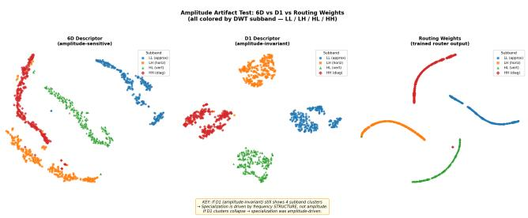  
Figure 4: Amplitude artifact test. t-SNE of three feature spaces, all colored by DWT subband. Left: 6-D descriptor (am<sub>p</sub>litude-sensitive)—subbands se<sub>p</sub>arate but with scatter. Center: D1 amplitude-invariant descriptor—four subbands form tighter, cleaner clusters, ruling out the amplitudeartifact hypothesis. Right: Actual routing weight vectors of th<sub>e</sub> t<sub>ra</sub>i<sub>ne</sub>d <sub>rou</sub>t<sub>er—</sub>f<sub>our arcs cons</sub>i<sub>s</sub>t<sub>en</sub>t <sub>w</sub>ith D1 <sub>s</sub>t<sub>ruc</sub>t<sub>ure,</sub> <sub>con</sub>fi<sub>rm</sub>i<sub>ng genu</sub>i<sub>ne</sub> f<sub>requency-</sub>b<sub>an</sub>d <sub>spec</sub>i<sub>a</sub>li<sub>za</sub>ti<sub>on.</sub>

An apparent inductive bias toward structured degradations: The observed routing behavior is consistent with an i<sub>n</sub>d<sub>uc</sub>ti<sub>ve</sub> bi<sub>as</sub> t<sub>owar</sub>d d<sub>egra</sub>d<sub>a</sub>ti<sub>ons</sub> th<sub>a</sub>t h<sub>ave a cons</sub>i<sub>s</sub>t<sub>en</sub>t<sub>,</sub> <sub>s</sub>t<sub>ruc</sub>t<sub>ure</sub>d <sub>spec</sub>t<sub>ra</sub>l <sub>s</sub>i<sub>gna</sub>t<sub>ure, suc</sub>h <sub>as</sub> th<sub>e</sub> di<sub>rec</sub>ti<sub>ona</sub>l <sub>s</sub>t<sub>rea</sub>k<sub>s</sub> <sub>o</sub>f <sub>ra</sub>i<sub>n an</sub>d th<sub>e s</sub>t<sub>a</sub>ti<sub>onary s</sub>t<sub>a</sub>ti<sub>s</sub>ti<sub>cs o</sub>f <sub>no</sub>i<sub>se, w</sub>h<sub>ere</sub> W<sub>a</sub>FIR’<sub>s</sub> <sub>g</sub>ains concentrate. Qualitativel<sub>y</sub>, the same tendenc<sub>y</sub> appears in t<sub>wo represen</sub>t<sub>a</sub>ti<sub>ve cases,</sub> th<sub>e ar</sub>tif<sub>ac</sub>t<sub>-</sub>f<sub>ree recovery o</sub>f <sub>no</sub>i<sub>se-</sub> corru<sub>p</sub>ted line structure (Fi<sub>g</sub>ure 3; Su<sub>pp</sub>lementar<sub>y</sub> Fi<sub>g</sub>ure S6) and of out-of-distribution rain streaks (Su<sub>pp</sub>lementar<sub>y</sub> Fi<sub>g</sub>- ure S10), to<sub>g</sub>ether with the wider attribution field of its Local Attribution Ma<sub>p</sub>s (Su<sub>pp</sub>lementar<sub>y</sub> Fi<sub>g</sub>ure S7).

Ruling out amplitude artifacts: The four clusters could reflect am<sub>p</sub>litude diferences intrinsic to the Haar DWT (LL carries more ener<sub>gy</sub> than HH) rather than learned behavior. W<sub>e</sub> t<sub>es</sub>t thi<sub>s w</sub>ith <sub>an amp</sub>lit<sub>u</sub>d<sub>e-norma</sub>li<sub>ze</sub>d d<sub>escr</sub>i<sub>p</sub>t<sub>or</sub> D1 b<sub>u</sub>ilt f<sub>rom</sub> <sub>energy</sub> <sub>ra</sub>ti<sub>os</sub> <sub>an</sub>d th<sub>e</sub> <sub>coe</sub>fi<sub>c</sub>i<sub>en</sub>t <sub>o</sub>f <sub>var</sub>i<sub>a</sub>ti<sub>on:</sub>

$$
\begin{array} { r } { \mathbf { d } ^ { \mathrm { D 1 } } = \Big [ \log \bar { E } , ~ \frac { \sigma _ { E } } { \bar { E } } , ~ \frac { E _ { \mathrm { l o w } } } { E _ { \mathrm { t o t } } } , ~ \frac { E _ { \mathrm { h i g h } } } { E _ { \mathrm { t o t } } } , ~ \frac { E _ { h } } { E _ { \mathrm { t o t } } } , ~ \frac { E _ { \nu } } { E _ { \mathrm { t o t } } } , ~ \frac { E _ { \mathrm { l o w } } } { E _ { \mathrm { h i g h } } } \Big ] , } \end{array}\tag{18}
$$

<sub>w</sub>h<sub>ere every</sub> di<sub>mens</sub>i<sub>on excep</sub>t l<sub>og</sub> $\bar { E }$ <sub>corre</sub>l<sub>a</sub>t<sub>es wea</sub>kl<sub>y w</sub>ith i<sub>mage</sub> <sub>amp</sub>lit<sub>u</sub>d<sub>e</sub> $( | r | < 0 . 1 5 ,$ , versus $r { = } 0 . 8 0$ f<sub>or</sub> th<sub>e s</sub>t<sub>ronges</sub>t 6-D dimension). If the clusters were an am<sub>p</sub>litude artifact, re-<sub>mov</sub>i<sub>ng</sub> <sub>amp</sub>lit<sub>u</sub>d<sub>e</sub> <sub>s</sub>h<sub>ou</sub>ld di<sub>sso</sub>l<sub>ve</sub> th<sub>em;</sub> i<sub>ns</sub>t<sub>ea</sub>d<sub>,</sub> th<sub>e</sub> <sub>su</sub>bb<sub>an</sub>d<sub>s</sub> form tighter clusters under D1 than under the 6-D descriptor (Fi<sub>g</sub>ure 4). Subband structure is therefore <sub>g</sub>enuinel<sub>y</sub> distinct b<sub>eyon</sub>d <sub>amp</sub>lit<sub>u</sub>d<sub>e,</sub> <sub>an</sub>d th<sub>e</sub> <sub>rou</sub>t<sub>er</sub> <sub>exp</sub>l<sub>o</sub>it<sub>s</sub> t<sub>rue</sub> f<sub>requency-</sub> s<sub>p</sub>atial structure, consistent with the −0.23 dB dro<sub>p</sub> under random routin<sub>g</sub> (A5).

## 5 Conclusion

W<sub>e</sub> <sub>p</sub>r<sub>ese</sub>nt<sub>e</sub>d W<sub>a</sub>FIR<sub>,</sub> <sub>w</sub>hi<sub>c</sub>h in<sub>se</sub>rt<sub>s</sub> <sub>a</sub> S<sub>pec</sub>tr<sub>a</sub>l Mi<sub>x</sub>t<sub>u</sub>r<sub>e-o</sub>f<sub>-</sub> Ex<sub>p</sub>erts (SPMoE) module into each Prom<sub>p</sub>tIR decoder level t<sub>o</sub> d<sub>ecompose</sub> f<sub>ea</sub>t<sub>ures</sub> i<sub>n</sub>t<sub>o</sub> H<sub>aar su</sub>bb<sub>an</sub>d<sub>s, summar</sub>i<sub>ze eac</sub>h <sub>w</sub>ith <sub>a compac</sub>t 6<sub>-</sub>D F<sub>our</sub>i<sub>er</sub> d<sub>escr</sub>i<sub>p</sub>t<sub>or, an</sub>d <sub>rou</sub>t<sub>e</sub> it th<sub>roug</sub>h <sub>a</sub> l<sub>earne</sub>d <sub>sparse ga</sub>t<sub>e</sub> t<sub>o spec</sub>i<sub>a</sub>li<sub>ze</sub>d F<sub>our</sub>i<sub>er exper</sub>t<sub>s.</sub> U<sub>n</sub>d<sub>er</sub> <sub>a</sub> <sub>un</sub>ifi<sub>e</sub>d <sub>a</sub>ll<sub>-</sub>i<sub>n-one</sub> <sub>pro</sub>t<sub>oco</sub>l<sub>,</sub> W<sub>a</sub>FIR i<sub>mproves</sub> <sub>over</sub> P<sub>romp-</sub> tIR b<sub>y</sub> +0.48 dB on avera<sub>g</sub>e, and its routin<sub>g</sub> self-or<sub>g</sub>anizes <sub>pr</sub>i<sub>mar</sub>il<sub>y</sub> b<sub>y</sub> f<sub>requency su</sub>b<sub>space ra</sub>th<sub>er</sub> th<sub>an</sub> b<sub>y</sub> d<sub>egra</sub>d<sub>a</sub>ti<sub>on</sub> id<sub>e</sub>ntit<sub>y, as suppo</sub>rt<sub>e</sub>d b<sub>y</sub> t<sub>-</sub>SNE<sub>,</sub> NMI/<sub>p</sub>r<sub>o</sub>b<sub>e a</sub>n<sub>a</sub>l<sub>ys</sub>i<sub>s, a</sub>nd <sub>a</sub>n amplitude-invariance control. The novelty lies in the granularity and input-derived nature of the routing signal, which com-<sub>p</sub>l<sub>emen</sub>t<sub>s</sub> th<sub>e</sub> t<sub>as</sub>k <sub>con</sub>t<sub>ex</sub>t <sub>a</sub> <sub>promp</sub>t<sub>-</sub>b<sub>ase</sub>d bli<sub>n</sub>d <sub>res</sub>t<sub>orer</sub> i<sub>n</sub>f<sub>ers</sub> f<sub>rom</sub> th<sub>e</sub> i<sub>npu</sub>t<sub>.</sub> M<sub>oreover,</sub> <sub>our</sub> fi<sub>n</sub>di<sub>ngs</sub> <sub>sugges</sub>t th<sub>a</sub>t i<sub>npu</sub>t<sub>-</sub> d<sub>er</sub>i<sub>ve</sub>d f<sub>requency</sub> <sub>pr</sub>i<sub>ors</sub> <sub>an</sub>d <sub>genera</sub>li<sub>za</sub>ti<sub>on</sub> <sub>across</sub> d<sub>a</sub>t<sub>ase</sub>t<sub>s</sub> <sub>an</sub>d <sub>res</sub>t<sub>ora</sub>ti<sub>on</sub> t<sub>as</sub>k<sub>s prov</sub>id<sub>e a prom</sub>i<sub>s</sub>i<sub>ng</sub> f<sub>oun</sub>d<sub>a</sub>ti<sub>on</sub> f<sub>or me</sub>d<sub>-</sub> i<sub>ca</sub>l <sub>an</sub>d <sub>sc</sub>i<sub>en</sub>tifi<sub>c</sub> i<sub>mag</sub>i<sub>ng, an</sub>d <sub>v</sub>i<sub>s</sub>i<sub>on-</sub>l<sub>anguage res</sub>t<sub>ora</sub>ti<sub>on</sub> <sub>w</sub>ith l<sub>arge</sub> l<sub>anguage mo</sub>d<sub>e</sub>l<sub>s;</sub> f<sub>ur</sub>th<sub>er</sub> li<sub>m</sub>it<sub>a</sub>ti<sub>ons are</sub> di<sub>scusse</sub>d in S<sub>upp</sub>l<sub>e</sub>m<sub>e</sub>nt<sub>a</sub>r<sub>y</sub> S<sub>ec</sub>ti<sub>o</sub>n S6<sub>.</sub>

## Acknowledgments

Thi<sub>s wor</sub>k <sub>was suppor</sub>t<sub>e</sub>d b<sub>y</sub> th<sub>e</sub> N<sub>a</sub>ti<sub>ona</sub>l R<sub>esearc</sub>h F<sub>oun</sub>d<sub>a-</sub> tion of Korea (NRF) funded b<sub>y</sub> the Korea <sub>g</sub>overnment (MSIT) <sub>un</sub>d<sub>er</sub> G<sub>ran</sub>t 2022R1A5A8023404<sub>.</sub> Th<sub>e au</sub>th<sub>ors gra</sub>t<sub>e</sub>f<sub>u</sub>ll<sub>y ac-</sub> k<sub>now</sub>l<sub>e</sub>d<sub>ge</sub> th<sub>e resources prov</sub>id<sub>e</sub>d b<sub>y</sub> th<sub>e</sub> U<sub>n</sub>i<sub>vers</sub>it<sub>y o</sub>f Al<sub>-</sub> <sub>a</sub>b<sub>a</sub>m<sub>a a</sub>t Birmin<sub>g</sub>h<sub>a</sub>m IT<sub>-</sub>R<sub>esea</sub>r<sub>c</sub>h C<sub>o</sub>m<sub>pu</sub>tin<sub>g g</sub>r<sub>oup</sub> f<sub>o</sub>r hi<sub>g</sub>h <sub>p</sub>erformance com<sub>p</sub>utin<sub>g</sub> (HPC) su<sub>pp</sub>ort and GPU time on the Ch<sub>ea</sub>h<sub>a</sub> <sub>supercompu</sub>t<sub>er.</sub> Th<sub>e</sub> <sub>au</sub>th<sub>ors</sub> <sub>a</sub>l<sub>so</sub> <sub>ac</sub>k<sub>now</sub>l<sub>e</sub>d<sub>ge</sub> <sub>suppor</sub>t fr<sub>o</sub>m th<sub>e</sub> NSF ACCESS A<sub>wa</sub>rd n<sub>u</sub>mb<sub>e</sub>r CIS260853<sub>.</sub>

## References

Ch<sub>e</sub>n<sub>,</sub> X<sub>.; e</sub>t <sub>a</sub>l<sub>.</sub> 2023<sub>.</sub> L<sub>ea</sub>rnin<sub>g a</sub> S<sub>pa</sub>r<sub>se</sub> Tr<sub>a</sub>n<sub>s</sub>f<sub>o</sub>rm<sub>e</sub>r N<sub>e</sub>t<sub>wo</sub>rk for Efective Image Deraining. In IEEE/CVF Conference on Computer Vision and Pattern Recognition (CVPR).

Conde, M. V.; Gei<sub>g</sub>le, G.; and Timofte, R. 2024. Hi<sub>g</sub>h-Qualit<sub>y</sub> Image Restoration Following Human Instructions. In European Conference on Computer Vision (ECCV).

C<sub>oo</sub>l<sub>ey,</sub> J<sub>.</sub> W<sub>.; an</sub>d T<sub>u</sub>k<sub>ey,</sub> J<sub>.</sub> W<sub>.</sub> 1965<sub>.</sub> A<sub>n</sub> Al<sub>gor</sub>ith<sub>m</sub> f<sub>or</sub> th<sub>e</sub> Machine Calculation of Complex Fourier Series. Mathematics ofComputation, 19(90): 297–301.

C<sub>u</sub>i<sub>,</sub> Y<sub>.;</sub> Z<sub>a</sub>mir<sub>,</sub> S<sub>.</sub> W<sub>.;</sub> Kh<sub>a</sub>n<sub>,</sub> S<sub>.;</sub> Kn<sub>o</sub>ll<sub>,</sub> A<sub>.;</sub> Sh<sub>a</sub>h<sub>,</sub> M<sub>.; a</sub>nd Kh<sub>a</sub>n<sub>,</sub> F<sub>.</sub> 2025<sub>.</sub> Ad<sub>a</sub>IR<sub>:</sub> Ad<sub>ap</sub>ti<sub>ve</sub> All<sub>-</sub>i<sub>n-</sub>O<sub>ne</sub> I<sub>mage</sub> R<sub>es</sub>t<sub>ora</sub>ti<sub>on</sub> via Frequency Mining and Modulation. In International Conference on Learning Representations (ICLR), volume 2025<sub>,</sub> 101306<sub>–</sub>101327<sub>.</sub>

C<sub>u</sub>i<sub>,</sub> Y<sub>.;</sub> <sub>e</sub>t <sub>a</sub>l<sub>.</sub> 2023<sub>.</sub> FSN<sub>e</sub>t<sub>:</sub> Fr<sub>eque</sub>n<sub>cy-</sub>S<sub>pa</sub>ti<sub>a</sub>l F<sub>us</sub>i<sub>o</sub>n N<sub>e</sub>t<sub>-</sub> work for Unified Image Restoration. IEEE Transactions on Pattern Analysis and Machine Intelligence.

F<sub>e</sub>d<sub>us,</sub> W<sub>.;</sub> Z<sub>op</sub>h<sub>,</sub> B<sub>.; an</sub>d Sh<sub>azeer,</sub> N<sub>.</sub> 2022<sub>.</sub> S<sub>w</sub>it<sub>c</sub>h T<sub>rans</sub>f<sub>orm-</sub> <sub>ers:</sub> S<sub>ca</sub>li<sub>ng</sub> t<sub>o</sub> T<sub>r</sub>illi<sub>on</sub> P<sub>arame</sub>t<sub>er</sub> M<sub>o</sub>d<sub>e</sub>l<sub>s w</sub>ith Si<sub>mp</sub>l<sub>e an</sub>d Eficient Sparsity. Journal of Machine Learning Research, 23(120): 1–39.

G<sub>u,</sub> J<sub>.;</sub> <sub>a</sub>nd D<sub>o</sub>n<sub>g,</sub> C<sub>.</sub> 2021<sub>.</sub> Int<sub>e</sub>r<sub>p</sub>r<sub>e</sub>tin<sub>g</sub> S<sub>upe</sub>r<sub>-</sub>R<sub>eso</sub>l<sub>u</sub>ti<sub>o</sub>n Networks with Local Attribution Maps. In Proceedings of the IEEE/CVF Conference on Computer Vision and Pattern Recognition (CVPR), 9199–9208.

G<sub>uo,</sub> H<sub>.; e</sub>t <sub>a</sub>l<sub>.</sub> 2024<sub>a.</sub> M<sub>am</sub>b<sub>a</sub>IR<sub>:</sub> A Si<sub>mp</sub>l<sub>e</sub> B<sub>ase</sub>li<sub>ne</sub> f<sub>or</sub> Image Restoration with State-Space Model. In European Conference on Computer Vision (ECCV).

G<sub>uo,</sub> Y<sub>.;</sub> G<sub>ao,</sub> Y<sub>.;</sub> L<sub>u,</sub> Y<sub>.;</sub> Li<sub>u,</sub> R<sub>.</sub> W<sub>.; an</sub>d H<sub>e,</sub> S<sub>.</sub> 2024b<sub>.</sub> O<sub>ne</sub>R<sub>e-</sub> <sub>s</sub>t<sub>ore:</sub> A U<sub>n</sub>i<sub>versa</sub>l R<sub>es</sub>t<sub>ora</sub>ti<sub>on</sub> F<sub>ramewor</sub>k f<sub>or</sub> C<sub>ompos</sub>it<sub>e</sub> Degradation. In European Conference on Computer Vision.

H<sub>e,</sub> K<sub>.;</sub> S<sub>u</sub>n<sub>,</sub> J<sub>.;</sub> <sub>a</sub>nd T<sub>a</sub>n<sub>g,</sub> X<sub>.</sub> 2009<sub>.</sub> Sin<sub>g</sub>l<sub>e</sub> Im<sub>age</sub> H<sub>aze</sub> R<sub>e-</sub> moval Using Dark Channel Prior. In IEEE Conference on Computer Vision and Pattern Recognition (CVPR), 1956– 1963<sub>.</sub>

Huang, J.-B.; Singh, A.; and Ahuja, N. 2015. Single Image S<sub>uper-</sub>R<sub>eso</sub>l<sub>u</sub>ti<sub>on</sub> f<sub>rom</sub> T<sub>rans</sub>f<sub>orme</sub>d S<sub>e</sub>lf<sub>-</sub>E<sub>xemp</sub>l<sub>ars.</sub> I<sub>n</sub> IEEE/CVF Conference on Computer Vision and Pattern Recognition (CVPR), 5197–5206.

Ji<sub>a</sub>n<sub>g,</sub> S<sub>.;</sub> <sub>e</sub>t <sub>a</sub>l<sub>.</sub> 2024<sub>.</sub> L<sub>o</sub>RA<sub>-</sub>IR<sub>:</sub> L<sub>eve</sub>r<sub>ag</sub>in<sub>g</sub> L<sub>ow-</sub>R<sub>a</sub>nk Ad<sub>ap-</sub> t<sub>a</sub>ti<sub>on</sub> f<sub>or</sub> U<sub>n</sub>i<sub>versa</sub>l I<sub>mage</sub> R<sub>es</sub>t<sub>ora</sub>ti<sub>on. ar</sub>Xi<sub>v prepr</sub>i<sub>n</sub>t<sub>.</sub>

K<sub>a</sub>l<sub>a</sub>mk<sub>a</sub>r<sub>,</sub> D<sub>.;</sub> M<sub>u</sub>di<sub>ge</sub>r<sub>e,</sub> D<sub>.;</sub> M<sub>e</sub>ll<sub>e</sub>m<sub>pu</sub>di<sub>,</sub> N<sub>.;</sub> D<sub>as,</sub> D<sub>.;</sub> B<sub>a</sub>n<sub>e</sub>r<sub>-</sub> jee, K.; Avancha, S.; Vooturi, D. T.; Jammalamadaka, N.; H<sub>uang,</sub> J<sub>.;</sub> Y<sub>uen,</sub> H<sub>.; e</sub>t <sub>a</sub>l<sub>.</sub> 2019<sub>.</sub> A <sub>s</sub>t<sub>u</sub>d<sub>y o</sub>f BFLOAT16 f<sub>or</sub> deep learning training. arXiv preprint arXiv:1905.12322.

L<sub>ep</sub>ikhin<sub>,</sub> D<sub>.;</sub> L<sub>ee,</sub> H<sub>.;</sub> X<sub>u,</sub> Y<sub>.;</sub> Ch<sub>e</sub>n<sub>,</sub> D<sub>.;</sub> Fir<sub>a</sub>t<sub>,</sub> O<sub>.;</sub> H<sub>ua</sub>n<sub>g,</sub> Y<sub>.;</sub> Krik<sub>u</sub>n<sub>,</sub> M<sub>.;</sub> Sh<sub>azee</sub>r<sub>,</sub> N<sub>.; a</sub>nd Ch<sub>e</sub>n<sub>,</sub> Z<sub>.</sub> 2020<sub>.</sub> GSh<sub>a</sub>rd<sub>:</sub> S<sub>ca</sub>li<sub>ng</sub> Gi<sub>an</sub>t M<sub>o</sub>d<sub>e</sub>l<sub>s</sub> <sub>w</sub>ith C<sub>on</sub>diti<sub>ona</sub>l C<sub>ompu</sub>t<sub>a</sub>ti<sub>on</sub> <sub>an</sub>d Automatic Sharding. arXiv preprint arXiv:2006.16668.

Li<sub>,</sub> B<sub>.;</sub> Li<sub>u,</sub> X<sub>.;</sub> H<sub>u,</sub> P<sub>.;</sub> W<sub>u,</sub> Z<sub>.;</sub> L<sub>v,</sub> J<sub>.; an</sub>d P<sub>eng,</sub> X<sub>.</sub> 2022<sub>.</sub> All<sub>-</sub>i<sub>n-</sub>O<sub>ne</sub> I<sub>mage</sub> R<sub>es</sub>t<sub>ora</sub>ti<sub>on</sub> f<sub>or</sub> U<sub>n</sub>k<sub>nown</sub> C<sub>orrup</sub>ti<sub>on.</sub> I<sub>n</sub> IEEE/CVF Conference on Computer Vision and Pattern Recognition (CVPR), 17452–17462.

Li<sub>,</sub> B<sub>.;</sub> R<sub>en,</sub> W<sub>.;</sub> F<sub>u,</sub> D<sub>.;</sub> T<sub>ao,</sub> D<sub>.;</sub> F<sub>eng,</sub> D<sub>.;</sub> Z<sub>eng,</sub> W<sub>.;</sub> <sub>an</sub>d W<sub>a</sub>n<sub>g,</sub> Z<sub>.</sub> 2019<sub>.</sub> RESIDE<sub>:</sub> A B<sub>e</sub>n<sub>c</sub>hm<sub>a</sub>rk f<sub>o</sub>r Sin<sub>g</sub>l<sub>e</sub> Im<sub>age</sub> Dehazing. IEEE Transactions on Image Processing, 28(3): 1143<sub>–</sub>1156<sub>.</sub>

Li<sub>,</sub> L<sub>.;</sub> P<sub>a</sub>n<sub>,</sub> J<sub>.;</sub> Y<sub>a</sub>n<sub>g,</sub> W<sub>.-</sub>S<sub>.;</sub> R<sub>e</sub>n<sub>,</sub> W<sub>.;</sub> Y<sub>a</sub>n<sub>g,</sub> W<sub>.;</sub> Ch<sub>e</sub>n<sub>,</sub> J<sub>.;</sub> <sub>a</sub>nd T<sub>ang,</sub> J<sub>.</sub> 2020<sub>.</sub> All i<sub>n</sub> O<sub>ne</sub> B<sub>a</sub>d W<sub>ea</sub>th<sub>er</sub> R<sub>emova</sub>l U<sub>s</sub>i<sub>ng</sub> A<sub>r-</sub> chitectural Search. In IEEE/CVF Conference on Computer Vision and Pattern Recognition (CVPR).

Liu, J.; Xu, S.; Yan<sub>g</sub>, Q.; Wan<sub>g</sub>, Y.; Chen, X.; and Ji, Z. 2026<sub>.</sub> FAPE<sub>-</sub>IR<sub>:</sub> Fr<sub>eque</sub>n<sub>cy-</sub>A<sub>wa</sub>r<sub>e</sub> Pl<sub>a</sub>nnin<sub>g</sub> <sub>a</sub>nd E<sub>xecu</sub>ti<sub>o</sub>n Framework for All-in-One Image Restoration. In Proceedings ofthe IEEE/CVF Conference on Computer Vision and Pattern Recognition.

Li<sub>u,</sub> M<sub>.;</sub> Y<sub>a</sub>n<sub>g,</sub> W<sub>.;</sub> L<sub>uo,</sub> J<sub>.; a</sub>nd Li<sub>u,</sub> J<sub>.</sub> 2025<sub>.</sub> UP<sub>-</sub>R<sub>es</sub>t<sub>o</sub>r<sub>e</sub>r<sub>:</sub> Wh<sub>e</sub>n Unr<sub>o</sub>llin<sub>g</sub> M<sub>ee</sub>t<sub>s</sub> Pr<sub>o</sub>m<sub>p</sub>t<sub>s</sub> f<sub>o</sub>r Unifi<sub>e</sub>d Im<sub>age</sub> R<sub>es</sub>t<sub>o</sub>r<sub>a-</sub> tion. In AAAI Conference on Artificial Intelligence (AAAI), <sub>vo</sub>l<sub>ume</sub> 39<sub>,</sub> 5513<sub>–</sub>5522<sub>.</sub>

Li<sub>u,</sub> P<sub>.;</sub> Zh<sub>a</sub>n<sub>g,</sub> H<sub>.;</sub> Zh<sub>a</sub>n<sub>g,</sub> K<sub>.;</sub> Lin<sub>,</sub> L<sub>.; a</sub>nd Z<sub>uo,</sub> W<sub>.</sub> 2018<sub>.</sub> M<sub>u</sub>lti<sub>-</sub>L<sub>eve</sub>l W<sub>ave</sub>l<sub>e</sub>t<sub>-</sub>CNN f<sub>o</sub>r Im<sub>age</sub> R<sub>es</sub>t<sub>o</sub>r<sub>a</sub>ti<sub>o</sub>n<sub>.</sub> In IEEE/CVF Conference on Computer Vision and Pattern Recognition Workshops (CVPRW).

Li<sub>u,</sub> Y<sub>.; e</sub>t <sub>a</sub>l<sub>.</sub> 2019<sub>.</sub> L<sub>earn</sub>i<sub>ng</sub> P<sub>ara</sub>ll<sub>e</sub>l N<sub>e</sub>t<sub>wor</sub>k<sub>s</sub> f<sub>or</sub> Hi<sub>g</sub>h<sub>-</sub> Quality Image Restoration. In IEEE/CVF Conference on Computer Vision and Pattern Recognition (CVPR).

L<sub>os</sub>h<sub>c</sub>hil<sub>ov,</sub> I<sub>.;</sub> <sub>an</sub>d H<sub>u</sub>tt<sub>er,</sub> F<sub>.</sub> 2017<sub>.</sub> D<sub>ecoup</sub>l<sub>e</sub>d <sub>we</sub>i<sub>g</sub>ht d<sub>ecay</sub> regularization. arXiv preprint arXiv:1711.05101.

L<sub>uo,</sub> X<sub>.; e</sub>t <sub>a</sub>l<sub>.</sub> 2024<sub>.</sub> DA<sub>-</sub>CLIP<sub>:</sub> D<sub>egra</sub>d<sub>a</sub>ti<sub>on-</sub>A<sub>ware</sub> C<sub>on-</sub> trastive Language-Image Pre-Training. In International Conference on Learning Representations (ICLR).

M<sub>a,</sub> C<sub>.;</sub> <sub>e</sub>t <sub>a</sub>l<sub>.</sub> 2024<sub>.</sub> P<sub>ro</sub>R<sub>es:</sub> E<sub>xp</sub>l<sub>or</sub>i<sub>ng</sub> D<sub>egra</sub>d<sub>a</sub>ti<sub>on-aware</sub> Vi<sub>sua</sub>l Pr<sub>o</sub>m<sub>p</sub>t f<sub>o</sub>r Uni<sub>ve</sub>r<sub>sa</sub>l Im<sub>age</sub> R<sub>es</sub>t<sub>o</sub>r<sub>a</sub>ti<sub>o</sub>n<sub>.</sub> <sub>a</sub>rXi<sub>v</sub> p<sup>re</sup>p<sup>rint</sup>.

Ma, K.; Duanmu, Z.; Wu, Q.; Wan<sub>g</sub>, Z.; Yon<sub>g</sub>, H.; Li, H.; and Zh<sub>ang,</sub> L<sub>.</sub> 2016<sub>.</sub> W<sub>a</sub>t<sub>er</sub>l<sub>oo exp</sub>l<sub>ora</sub>ti<sub>on</sub> d<sub>a</sub>t<sub>a</sub>b<sub>ase:</sub> N<sub>ew c</sub>h<sub>a</sub>l<sub>-</sub> lenges for image quality assessment models. IEEE Transactions on Image Processing, 26(2): 1004–1016.

Mallat, S. 2009. A Wavelet Tour of Signal Processing: The Sparse Way. Academic Press, 3 edition.

M<sub>ar</sub>ti<sub>n,</sub> D<sub>.;</sub> F<sub>ow</sub>lk<sub>es,</sub> C<sub>.;</sub> T<sub>a</sub>l<sub>,</sub> D<sub>.; an</sub>d M<sub>a</sub>lik<sub>,</sub> J<sub>.</sub> 2001<sub>.</sub> A D<sub>a</sub>t<sub>a</sub>b<sub>ase</sub> <sub>o</sub>f H<sub>u</sub>m<sub>a</sub>n S<sub>eg</sub>m<sub>e</sub>nt<sub>e</sub>d N<sub>a</sub>t<sub>u</sub>r<sub>a</sub>l Im<sub>ages</sub> <sub>a</sub>nd It<sub>s</sub> A<sub>pp</sub>li<sub>ca</sub>ti<sub>on</sub> t<sub>o</sub> E<sub>va</sub>l<sub>ua</sub>ti<sub>ng</sub> S<sub>egmen</sub>t<sub>a</sub>ti<sub>on</sub> Al<sub>gor</sub>ith<sub>ms</sub> <sub>an</sub>d M<sub>easur</sub>i<sub>ng</sub> E<sub>co</sub>l<sub>og</sub>i<sub>ca</sub>l St<sub>a</sub>ti<sub>s</sub>ti<sub>cs.</sub>

P<sub>o</sub>tl<sub>apa</sub>lli<sub>,</sub> V<sub>.;</sub> Z<sub>a</sub>mir<sub>,</sub> S<sub>.</sub> W<sub>.;</sub> Kh<sub>a</sub>n<sub>,</sub> S<sub>.; a</sub>nd Kh<sub>a</sub>n<sub>,</sub> F<sub>.</sub> S<sub>.</sub> 2023<sub>.</sub> Pr<sub>o</sub>m<sub>p</sub>tIR<sub>:</sub> Pr<sub>o</sub>m<sub>p</sub>tin<sub>g</sub> f<sub>o</sub>r All<sub>-</sub>in<sub>-</sub>On<sub>e</sub> Blind Im<sub>age</sub> R<sub>es</sub>t<sub>o</sub>r<sub>a-</sub> tion. InAdvances in Neural Information Processing Systems (NeurIPS).

R<sub>en,</sub> B<sub>.;</sub> Z<sub>am</sub>fi<sub>r,</sub> E<sub>.;</sub> W<sub>u,</sub> Z<sub>.;</sub> Li<sub>,</sub> Y<sub>.;</sub> Li<sub>,</sub> Y<sub>.;</sub> P<sub>au</sub>d<sub>e</sub>l<sub>,</sub> D<sub>.</sub> P<sub>.;</sub> Ti<sub>mo-</sub> ft<sub>e,</sub> R<sub>.;</sub> Y<sub>ang,</sub> M<sub>.-</sub>H<sub>.;</sub> V<sub>an</sub> G<sub>oo</sub>l<sub>,</sub> L<sub>.;</sub> <sub>an</sub>d S<sub>e</sub>b<sub>e,</sub> N<sub>.</sub> 2026<sub>.</sub> A<sub>ny</sub>

Im<sub>age</sub> R<sub>es</sub>t<sub>o</sub>r<sub>a</sub>ti<sub>o</sub>n <sub>v</sub>i<sub>a</sub> Efi<sub>c</sub>i<sub>e</sub>nt S<sub>pa</sub>ti<sub>a</sub>l<sub>-</sub>Fr<sub>eque</sub>n<sub>cy</sub> D<sub>eg</sub>r<sub>a-</sub> dation Adaptation. Transactions on Machine Learning Research (TMLR).

R<sub>o</sub>th<sub>,</sub> S<sub>.;</sub> <sub>an</sub>d Bl<sub>ac</sub>k<sub>,</sub> M<sub>.</sub> J<sub>.</sub> 2005<sub>.</sub> Fi<sub>e</sub>ld<sub>s</sub> <sub>o</sub>f E<sub>xper</sub>t<sub>s:</sub> A F<sub>rame-</sub> <sub>wo</sub>rk f<sub>o</sub>r L<sub>ea</sub>rnin<sub>g</sub> Im<sub>age</sub> Pri<sub>o</sub>r<sub>s.</sub>

Shazeer, N.; Mirhoseini, A.; Maziarz, K.; Davis, A.; Le, Q. V.; Hint<sub>o</sub>n<sub>,</sub> G<sub>.</sub> E<sub>.;</sub> <sub>a</sub>nd D<sub>ea</sub>n<sub>,</sub> J<sub>.</sub> 2017<sub>.</sub> O<sub>u</sub>tr<sub>ageous</sub>l<sub>y</sub> L<sub>a</sub>r<sub>ge</sub> N<sub>eu</sub>r<sub>a</sub>l N<sub>e</sub>t<sub>wo</sub>rk<sub>s:</sub> Th<sub>e</sub> S<sub>pa</sub>r<sub>se</sub>l<sub>y-</sub>G<sub>a</sub>t<sub>e</sub>d Mi<sub>x</sub>t<sub>u</sub>r<sub>e-o</sub>f<sub>-</sub>E<sub>xpe</sub>rt<sub>s</sub> Layer. In International Conference on Learning Representations (ICLR).

Son<sub>g</sub>, Y.; He, Z.; Qian, H.; and Du, X. 2023. Vision Transformers for Single Image Dehazing. IEEE Transactions on Image Processing.

S<sub>uvorov,</sub> R<sub>.;</sub> L<sub>ogac</sub>h<sub>eva,</sub> E<sub>.;</sub> M<sub>as</sub>hikhi<sub>n,</sub> A<sub>.;</sub> R<sub>em</sub>i<sub>zova,</sub> A<sub>.;</sub> A<sub>s</sub>h<sub>u</sub>kh<sub>a,</sub> A<sub>.;</sub> Sil<sub>ves</sub>t<sub>rov,</sub> A<sub>.;</sub> K<sub>ong,</sub> N<sub>.;</sub> G<sub>o</sub>k<sub>a,</sub> H<sub>.;</sub> P<sub>ar</sub>k<sub>,</sub> K<sub>.;</sub> <sub>an</sub>d L<sub>emp</sub>it<sub>s</sub>k<sub>y,</sub> V<sub>.</sub> 2022<sub>.</sub> R<sub>eso</sub>l<sub>u</sub>ti<sub>on-</sub>R<sub>o</sub>b<sub>us</sub>t L<sub>arge</sub> M<sub>as</sub>k Inpainting with Fourier Convolutions. In IEEE/CVF Winter Conference on Applications of Computer Vision (WACV), 2149<sub>–</sub>2159<sub>.</sub>

T<sub>u,</sub> Z<sub>.; e</sub>t <sub>a</sub>l<sub>.</sub> 2023<sub>.</sub> ADFN<sub>e</sub>t<sub>:</sub> Ad<sub>ap</sub>ti<sub>ve</sub> D<sub>ua</sub>l<sub>-</sub>F<sub>ea</sub>t<sub>ure</sub> F<sub>us</sub>i<sub>on</sub> Network for Image Restoration. In AAAI Conference on Artificial Intelligence (AAAI).

V<sub>a</sub>l<sub>a</sub>n<sub>a</sub>r<sub>asu,</sub> J<sub>.</sub> M<sub>.</sub> J<sub>.;</sub> Y<sub>asa</sub>rl<sub>a,</sub> R<sub>.; a</sub>nd P<sub>a</sub>t<sub>e</sub>l<sub>,</sub> V<sub>.</sub> M<sub>.</sub> 2022<sub>.</sub> Tr<sub>a</sub>n<sub>-</sub> <sub>s</sub>W<sub>ea</sub>th<sub>er:</sub> T<sub>rans</sub>f<sub>ormer-</sub>b<sub>ase</sub>d R<sub>es</sub>t<sub>ora</sub>ti<sub>on</sub> <sub>o</sub>f I<sub>mages</sub> D<sub>e-</sub> graded by Adverse Weather Conditions. In IEEE/CVF Conference on Computer Vision and Pattern Recognition (CVPR), 2353–2363.

W<sub>ang,</sub> T<sub>.;</sub> Xi<sub>a,</sub> P<sub>.;</sub> Li<sub>,</sub> B<sub>.;</sub> Ji<sub>ang,</sub> P<sub>.-</sub>T<sub>.;</sub> K<sub>ong,</sub> Z<sub>.;</sub> Zh<sub>ang,</sub> K<sub>.;</sub> L<sub>u,</sub> T<sub>.; a</sub>nd L<sub>uo,</sub> W<sub>.</sub> 2025<sub>.</sub> MOERL<sub>:</sub> Wh<sub>e</sub>n Mi<sub>x</sub>t<sub>u</sub>r<sub>e-o</sub>f<sub>-</sub>E<sub>xpe</sub>rt<sub>s</sub> M<sub>ee</sub>t R<sub>e</sub>i<sub>n</sub>f<sub>orcemen</sub>t L<sub>earn</sub>i<sub>ng</sub> f<sub>or</sub> Ad<sub>verse</sub> W<sub>ea</sub>th<sub>er</sub> I<sub>mage</sub> Restoration. In Proceedings of the IEEE/CVF International Conference on Computer Vision, 13673–13683.

W<sub>a</sub>n<sub>g,</sub> T<sub>.;</sub> <sub>e</sub>t <sub>a</sub>l<sub>.</sub> 2023<sub>.</sub> GridF<sub>o</sub>rm<sub>e</sub>r<sub>:</sub> R<sub>es</sub>id<sub>ua</sub>l D<sub>e</sub>n<sub>se</sub> Tr<sub>a</sub>n<sub>s-</sub> former with Grid Structure. International Journal ofComputer Vision.

W<sub>ang,</sub> Z<sub>.;</sub> B<sub>ov</sub>ik<sub>,</sub> A<sub>.</sub> C<sub>.;</sub> Sh<sub>e</sub>ikh<sub>,</sub> H<sub>.</sub> R<sub>.; an</sub>d Si<sub>monce</sub>lli<sub>,</sub> E<sub>.</sub> P<sub>.</sub> 2004<sub>.</sub> I<sub>mage</sub> <sub>qua</sub>lit<sub>y</sub> <sub>assessmen</sub>t<sub>:</sub> f<sub>rom</sub> <sub>error</sub> <sub>v</sub>i<sub>s</sub>ibilit<sub>y</sub> t<sub>o</sub> structural similarity. IEEE transactions on image processing, 13(4): 600–612.

W<sub>e</sub>i<sub>,</sub> C<sub>.;</sub> W<sub>a</sub>n<sub>g,</sub> W<sub>.;</sub> Y<sub>a</sub>n<sub>g,</sub> W<sub>.;</sub> <sub>a</sub>nd Li<sub>u,</sub> J<sub>.</sub> 2018<sub>.</sub> D<sub>eep</sub> R<sub>e</sub>tin<sub>ex</sub> Decomposition for Low-Light Enhancement. In British Machine Vision Conference (BMVC).

W<sub>u,</sub> G<sub>.;</sub> Ji<sub>a</sub>n<sub>g,</sub> J<sub>.;</sub> W<sub>a</sub>n<sub>g,</sub> Y<sub>.;</sub> Ji<sub>a</sub>n<sub>g,</sub> K<sub>.; a</sub>nd Li<sub>u,</sub> X<sub>.</sub> 2025<sub>.</sub> D<sub>e</sub>bi<sub>ase</sub>d All<sub>-</sub>i<sub>n-</sub>O<sub>ne</sub> I<sub>mage</sub> R<sub>es</sub>t<sub>ora</sub>ti<sub>on w</sub>ith T<sub>as</sub>k U<sub>ncer-</sub> tainty Regularization. In AAAI Conference on Artificial Intelligence (AAAI), volume 39, 8386–8394.

Y<sub>ang,</sub> W<sub>.;</sub> T<sub>an,</sub> R<sub>.</sub> T<sub>.;</sub> F<sub>eng,</sub> J<sub>.;</sub> Li<sub>u,</sub> J<sub>.;</sub> G<sub>uo,</sub> Z<sub>.; an</sub>d Y<sub>an,</sub> S<sub>.</sub> 2017<sub>.</sub> D<sub>eep</sub> J<sub>o</sub>i<sub>n</sub>t R<sub>a</sub>i<sub>n</sub> D<sub>e</sub>t<sub>ec</sub>ti<sub>on</sub> <sub>an</sub>d R<sub>emova</sub>l f<sub>rom</sub> a Single Image. In IEEE/CVF Conference on Computer Vision and Pattern Recognition (CVPR), 1357–1366.

Z<sub>am</sub>fi<sub>r,</sub> E<sub>.;</sub> W<sub>u,</sub> Z<sub>.;</sub> M<sub>e</sub>ht<sub>a,</sub> N<sub>.;</sub> T<sub>an,</sub> Y<sub>.;</sub> P<sub>au</sub>d<sub>e</sub>l<sub>,</sub> D<sub>.</sub> P<sub>.;</sub> Zh<sub>ang,</sub> Y<sub>.;</sub> <sub>an</sub>d Ti<sub>mo</sub>ft<sub>e,</sub> R<sub>.</sub> 2025<sub>.</sub> C<sub>omp</sub>l<sub>ex</sub>it<sub>y</sub> E<sub>xper</sub>t<sub>s</sub> <sub>are</sub> T<sub>as</sub>k<sub>-</sub> Di<sub>scr</sub>i<sub>m</sub>i<sub>na</sub>ti<sub>ve</sub> L<sub>earners</sub> f<sub>or</sub> A<sub>ny</sub> I<sub>mage</sub> R<sub>es</sub>t<sub>ora</sub>ti<sub>on.</sub> I<sub>n</sub> Proceedings of the IEEE/CVF Conference on Computer Vision and Pattern Recognition (CVPR), 12753–12763.

Z<sub>am</sub>i<sub>r,</sub> S<sub>.</sub> W<sub>.;</sub> A<sub>rora,</sub> A<sub>.;</sub> Kh<sub>an,</sub> S<sub>.;</sub> H<sub>aya</sub>t<sub>,</sub> M<sub>.;</sub> Kh<sub>an,</sub> F<sub>.</sub> S<sub>.; an</sub>d Y<sub>ang,</sub> M<sub>.-</sub>H<sub>.</sub> 2022<sub>.</sub> R<sub>es</sub>t<sub>ormer:</sub> Efi<sub>c</sub>i<sub>en</sub>t T<sub>rans</sub>f<sub>ormer</sub> f<sub>or</sub> High-Resolution Image Restoration. In IEEE/CVF Conference on Computer Vision and Pattern Recognition (CVPR), 5728<sub>–</sub>5739<sub>.</sub>

Z<sub>am</sub>i<sub>r,</sub> S<sub>.</sub> W<sub>.;</sub> A<sub>rora,</sub> A<sub>.;</sub> Kh<sub>an,</sub> S<sub>.;</sub> H<sub>aya</sub>t<sub>,</sub> M<sub>.;</sub> Kh<sub>an,</sub> F<sub>.</sub> S<sub>.;</sub> Y<sub>a</sub>n<sub>g,</sub> M<sub>.-</sub>H<sub>.; a</sub>nd Sh<sub>ao,</sub> L<sub>.</sub> 2021<sub>.</sub> MPRN<sub>e</sub>t<sub>:</sub> M<sub>u</sub>lti<sub>-</sub>St<sub>age</sub> Pr<sub>o-</sub> gressive Image Restoration. In IEEE/CVF Conference on Computer Vision and Pattern Recognition (CVPR), 14821– 14831<sub>.</sub>

Zh<sub>a</sub>n<sub>g,</sub> K<sub>.;</sub> Z<sub>uo,</sub> W<sub>.;</sub> Ch<sub>e</sub>n<sub>,</sub> Y<sub>.;</sub> M<sub>e</sub>n<sub>g,</sub> D<sub>.; a</sub>nd Zh<sub>a</sub>n<sub>g,</sub> L<sub>.</sub> 2017<sub>.</sub> B<sub>eyo</sub>nd <sub>a</sub> G<sub>auss</sub>i<sub>a</sub>n D<sub>e</sub>n<sub>o</sub>i<sub>se</sub>r<sub>:</sub> R<sub>es</sub>id<sub>ua</sub>l L<sub>ea</sub>rnin<sub>g o</sub>f D<sub>eep</sub> CNN for Image Denoising. IEEE Transactions on Image Processing, 26(7): 3142–3155.

Zh<sub>a</sub>n<sub>g,</sub> K<sub>.;</sub> <sub>e</sub>t <sub>a</sub>l<sub>.</sub> 2024<sub>.</sub> NDR<sub>:</sub> N<sub>eu</sub>r<sub>a</sub>l D<sub>eg</sub>r<sub>a</sub>d<sub>a</sub>ti<sub>o</sub>n R<sub>ep</sub>r<sub>ese</sub>nt<sub>a-</sub> tion for All-in-One Image Restoration. IEEE Transactions on Image Processing.

Zh<sub>a</sub>n<sub>g,</sub> R<sub>.;</sub> I<sub>so</sub>l<sub>a,</sub> P<sub>.;</sub> Efr<sub>os,</sub> A<sub>.</sub> A<sub>.;</sub> Sh<sub>ec</sub>htm<sub>a</sub>n<sub>,</sub> E<sub>.;</sub> <sub>a</sub>nd W<sub>a</sub>n<sub>g,</sub> O<sub>.</sub> 2018<sub>.</sub> Th<sub>e</sub> Unr<sub>easo</sub>n<sub>a</sub>bl<sub>e</sub> Ef<sub>ec</sub>ti<sub>ve</sub>n<sub>ess</sub> <sub>o</sub>f D<sub>eep</sub> F<sub>ea</sub>t<sub>u</sub>r<sub>es</sub> as a Perceptual Metric. In Proceedings of the IEEE/CVF Conference on Computer Vision and Pattern Recognition (CVPR), 586–595.

Zhan<sub>g</sub>, Y.; He, J.; Qian, J.; Fan<sub>g</sub>, K.; and Mei, J. 2023. I<sub>ngre</sub>di<sub>en</sub>t<sub>-</sub>O<sub>r</sub>i<sub>en</sub>t<sub>e</sub>d M<sub>u</sub>lti<sub>-</sub>D<sub>egra</sub>d<sub>a</sub>ti<sub>on</sub> L<sub>earn</sub>i<sub>ng</sub> f<sub>or</sub> I<sub>m-</sub> age Restoration. In IEEE/CVF Conference on Computer Vision and Pattern Recognition (CVPR), 5825–5835.

## Supplementary Material

Th<sub>e cen</sub>t<sub>ra</sub>l th<sub>es</sub>i<sub>s o</sub>fW<sub>a</sub>FIR i<sub>s</sub> th<sub>a</sub>t it<sub>s con</sub>t<sub>r</sub>ib<sub>u</sub>ti<sub>on</sub> li<sub>es</sub> i<sub>n</sub> th<sub>e</sub> granularity and nature of the routing signal frequency-aware <sub>exper</sub>t <sub>rou</sub>ti<sub>ng</sub> <sub>per</sub>f<sub>orme</sub>d <sub>a</sub>t th<sub>e</sub> l<sub>eve</sub>l <sub>o</sub>f i<sub>n</sub>di<sub>v</sub>id<sub>ua</sub>l <sub>wave</sub>l<sub>e</sub>t <sub>su</sub>bb<sub>an</sub>d<sub>s, w</sub>hi<sub>c</sub>h <sub>comp</sub>l<sub>emen</sub>t<sub>s</sub> th<sub>e</sub> t<sub>as</sub>k <sub>con</sub>t<sub>ex</sub>t i<sub>n</sub>f<sub>erre</sub>d b<sub>y a</sub> <sub>promp</sub>t<sub>-</sub>b<sub>ase</sub>d bli<sub>n</sub>d <sub>res</sub>t<sub>orer ra</sub>th<sub>er</sub> th<sub>an mere</sub>l<sub>y</sub> i<sub>n opera</sub>ti<sub>ng</sub> <sub>w</sub>ith<sub>ou</sub>t <sub>an exp</sub>li<sub>c</sub>it d<sub>egra</sub>d<sub>a</sub>ti<sub>on</sub> l<sub>a</sub>b<sub>e</sub>l <sub>a</sub>t t<sub>es</sub>t ti<sub>me.</sub> L<sub>a</sub>b<sub>e</sub>l<sub>-</sub>f<sub>ree</sub> i<sub>n</sub>f<sub>erence</sub> i<sub>s</sub> <sub>a</sub> <sub>consequence</sub> <sub>o</sub>f thi<sub>s</sub> d<sub>es</sub>i<sub>gn,</sub> <sub>no</sub>t it<sub>s</sub> <sub>nove</sub>lt<sub>y;</sub> th<sub>e nove</sub>lt<sub>y</sub> i<sub>s</sub> th<sub>a</sub>t <sub>rou</sub>ti<sub>ng</sub> d<sub>ec</sub>i<sub>s</sub>i<sub>ons are reso</sub>l<sub>ve</sub>d <sub>per su</sub>bb<sub>an</sub>d f<sub>rom an</sub> i<sub>npu</sub>t<sub>-</sub>d<sub>er</sub>i<sub>ve</sub>d <sub>spec</sub>t<sub>ra</sub>l d<sub>escr</sub>i<sub>p</sub>t<sub>or.</sub> Thi<sub>s supp</sub>l<sub>emen</sub>t<sub>ary</sub> <sub>ma</sub>t<sub>er</sub>i<sub>a</sub>l <sub>su</sub>b<sub>s</sub>t<sub>an</sub>ti<sub>a</sub>t<sub>es</sub> th<sub>a</sub>t th<sub>es</sub>i<sub>s an</sub>d <sub>expan</sub>d<sub>s</sub> th<sub>e me</sub>th<sub>o</sub>d<sub>,</sub> <sub>ana</sub>l<sub>ys</sub>i<sub>s, an</sub>d <sub>exper</sub>i<sub>men</sub>t<sub>a</sub>l <sub>c</sub>l<sub>a</sub>i<sub>ms summar</sub>i<sub>ze</sub>d i<sub>n</sub> th<sub>e ma</sub>i<sub>n</sub> <sub>manuscr</sub>i<sub>p</sub>t<sub>.</sub> It i<sub>s</sub> i<sub>n</sub>t<sub>en</sub>d<sub>e</sub>d t<sub>o</sub> b<sub>e rea</sub>d t<sub>oge</sub>th<sub>er w</sub>ith th<sub>e ma</sub>i<sub>n</sub> <sub>paper:</sub> S<sub>ec</sub>ti<sub>on</sub> S1 <sub>expan</sub>d<sub>s</sub> th<sub>e</sub> M<sub>e</sub>th<sub>o</sub>d <sub>sec</sub>ti<sub>on,</sub> S<sub>ec</sub>ti<sub>on</sub> S2 <sub>suppor</sub>t<sub>s</sub> th<sub>e rou</sub>ti<sub>ng c</sub>l<sub>a</sub>i<sub>ms</sub> i<sub>n</sub> th<sub>e</sub> I<sub>n</sub>t<sub>ro</sub>d<sub>uc</sub>ti<sub>on an</sub>d A<sub>na</sub>l<sub>y-</sub> <sub>s</sub>i<sub>s sec</sub>ti<sub>on,</sub> S<sub>ec</sub>ti<sub>on</sub> S3 <sub>expan</sub>d<sub>s</sub> th<sub>e ma</sub>i<sub>n a</sub>bl<sub>a</sub>ti<sub>on</sub> t<sub>a</sub>bl<sub>e, an</sub>d S<sub>ec</sub>ti<sub>ons</sub> S4<sub>–</sub>S5 <sub>prov</sub>id<sub>e</sub> th<sub>e a</sub>dditi<sub>ona</sub>l <sub>resu</sub>lt<sub>s an</sub>d <sub>comp</sub>l<sub>ex</sub>it<sub>y</sub> <sub>ev</sub>id<sub>ence re</sub>f<sub>erence</sub>d f<sub>rom</sub> th<sub>e</sub> E<sub>xper</sub>i<sub>men</sub>t<sub>s sec</sub>ti<sub>on.</sub> Th<sub>e orga-</sub> <sub>n</sub>i<sub>za</sub>ti<sub>on</sub> f<sub>o</sub>ll<sub>ows</sub> th<sub>e eva</sub>l<sub>ua</sub>ti<sub>on</sub> l<sub>og</sub>i<sub>c o</sub>f th<sub>e s</sub>t<sub>u</sub>d<sub>y.</sub> S<sub>ec</sub>ti<sub>on</sub> S1 <sub>g</sub>i<sub>ves</sub> th<sub>e comp</sub>l<sub>e</sub>t<sub>e</sub> SPM<sub>o</sub>E f<sub>orwar</sub>d <sub>pass an</sub>d th<sub>e per-su</sub>bb<sub>an</sub>d l<sub>oa</sub>d<sub>-</sub>b<sub>a</sub>l<sub>ance</sub> f<sub>ormu</sub>l<sub>a</sub>ti<sub>on.</sub> S<sub>ec</sub>ti<sub>on</sub> S2 <sub>exam</sub>i<sub>nes</sub> h<sub>ow rou</sub>ti<sub>ng</sub> <sub>se</sub>lf<sub>-organ</sub>i<sub>zes an</sub>d i<sub>nc</sub>l<sub>u</sub>d<sub>es ma</sub>t<sub>c</sub>h<sub>e</sub>d id<sub>en</sub>tit<sub>y-con</sub>diti<sub>one</sub>d <sub>con-</sub> tr<sub>o</sub>l<sub>s.</sub> S<sub>ec</sub>ti<sub>o</sub>n S3 r<sub>epo</sub>rt<sub>s</sub> <sub>co</sub>m<sub>po</sub>n<sub>e</sub>nt<sub>,</sub> r<sub>ou</sub>tin<sub>g,</sub> <sub>a</sub>nd r<sub>egu</sub>l<sub>a</sub>ri<sub>za-</sub> ti<sub>on a</sub>bl<sub>a</sub>ti<sub>ons.</sub> S<sub>ec</sub>ti<sub>on</sub> S4 <sub>prov</sub>id<sub>es a</sub>dditi<sub>ona</sub>l <sub>qua</sub>lit<sub>a</sub>ti<sub>ve, an</sub>d <sub>ou</sub>t<sub>-o</sub>f<sub>-</sub>di<sub>s</sub>t<sub>r</sub>ib<sub>u</sub>ti<sub>on eva</sub>l<sub>ua</sub>ti<sub>ons.</sub> S<sub>ec</sub>ti<sub>on</sub> S5 <sub>ana</sub>l<sub>yzes param-</sub> <sub>e</sub>t<sub>er an</sub>d <sub>compu</sub>t<sub>a</sub>ti<sub>ona</sub>l <sub>over</sub>h<sub>ea</sub>d<sub>, an</sub>d S<sub>ec</sub>ti<sub>on</sub> S6 di<sub>scusses</sub> li<sub>m</sub>it<sub>a</sub>ti<sub>ons an</sub>d f<sub>u</sub>t<sub>ure wor</sub>k<sub>.</sub>

## S1 Additional Method Details

## S1.1 Subband Frequency Signatures

T<sub>a</sub>bl<sub>e</sub> S1 <sub>summar</sub>i<sub>zes</sub> th<sub>e</sub> f<sub>requency</sub> <sub>con</sub>t<sub>en</sub>t <sub>o</sub>f <sub>eac</sub>h H<sub>aar</sub> <sub>su</sub>bb<sub>an</sub>d <sub>an</sub>d th<sub>e</sub> d<sub>egra</sub>d<sub>a</sub>ti<sub>on</sub> t<sub>ype</sub> it <sub>pr</sub>i<sub>mar</sub>il<sub>y</sub> <sub>cap</sub>t<sub>ures,</sub> <sub>as</sub> <sub>re</sub>f<sub>erence</sub>d f<sub>rom</sub> th<sub>e</sub> M<sub>e</sub>th<sub>o</sub>d <sub>sec</sub>ti<sub>on</sub> <sub>o</sub>f th<sub>e</sub> <sub>ma</sub>i<sub>n</sub> <sub>paper.</sub>

T<sub>a</sub>bl<sub>e</sub> S1<sub>:</sub> F<sub>requency con</sub>t<sub>en</sub>t <sub>an</sub>d <sub>pr</sub>i<sub>mary</sub> d<sub>egra</sub>d<sub>a</sub>ti<sub>on s</sub>i<sub>gna</sub>l <sub>per</sub> H<sub>aar</sub> <sub>su</sub>bb<sub>an</sub>d<sub>.</sub>
<table><tr><td>Subband</td><td>Frequency content</td><td>Primary degradation</td></tr><tr><td>LL</td><td>Low-low (approximation)</td><td>Haze (DC↑)</td></tr><tr><td>LH</td><td>Low-high (horiz. edges)</td><td>Rain streaks (vert. spatial → horiz. freq.)</td></tr><tr><td>HL</td><td>High-low (vert. edges)</td><td>Directional patterns, vertical streaks</td></tr><tr><td>HH</td><td>High-high (diagonal)</td><td>Additive noise (flat high-freq. spectrum)</td></tr></table>

## S1.2 Complete SPMoE Forward Pass

Al<sub>gor</sub>ith<sub>ms</sub> S1<sub>–</sub>S2 <sub>g</sub>i<sub>ve</sub> th<sub>e</sub> <sub>comp</sub>l<sub>e</sub>t<sub>e</sub> SPM<sub>o</sub>E bl<sub>oc</sub>k<sub>,</sub> i<sub>n-</sub> <sub>c</sub>l<sub>u</sub>di<sub>ng</sub> th<sub>e spec</sub>t<sub>ra</sub>l d<sub>escr</sub>i<sub>p</sub>t<sub>or, rou</sub>t<sub>er, an</sub>d F<sub>our</sub>i<sub>er spec</sub>t<sub>ra</sub>l<sub>-</sub> <sub>mo</sub>d<sub>u</sub>l<sub>a</sub>ti<sub>on exper</sub>t<sub>.</sub>

Algorithm S1 SpectralMoE Block (SPMoEBlock) — full for  
war<sup>d</sup> <sub>p</sub>ass   
Require: Feature map $\begin{array} { r } { \textbf { x } \in \mathbb { R } ^ { B \times C \times H \times W } , } \end{array}$ , <sub>p</sub>rom<sub>p</sub>t p ∈   
$\mathbf { \mathbb { R } } ^ { B \times C _ { p } \times H _ { p } \times W _ { p } }$ , � = 4 ex<sub>p</sub>erts <sub>p</sub>er subband, to<sub>p</sub>-� = 2   
rout<sup>i</sup>n<sub>g</sub>   
Ensure: Refined feature $\hat { \mathbf { x } } \in \mathbb { R } ^ { B \times C \times H \times W }$   
— Wavelet decomposition —   
1: x¯ ← ReflectPad(x) <sub>⊲ pa</sub>d �<sub>,</sub> � t<sub>o even</sub> di<sub>mens</sub>i<sub>ons</sub>   
2<sub>:</sub> $\mathbf { s } _ { L L } , \mathbf { s } _ { L H } , \mathbf { s } _ { H L } , \mathbf { s } _ { H H }$ ← HaarDWT(x¯) <sub>⊲ eac</sub>h   
$\in \mathbb { R } ^ { B \times C \times H / 2 \times W / 2 }$   
— Per-subband routing and aggregation —   
3: for $\mathbf { s } \in \{ \mathbf { s } _ { L L } , \mathbf { s } _ { L H } , \mathbf { s } _ { H L } , \mathbf { s } _ { H H } \}$ do   
4<sub>:</sub> d ← SpectralDescriptor(s) ⊲ d ∈ R<sup>�×6</sup>   
5<sub>:</sub> w ← SpectralRouter(d, p) ⊲ $\mathbf { w } \in \mathbb { R } ^ { B \times E }$   
6<sub>:</sub> $\begin{array} { r } { \hat { \mathbf { s } }  \sum _ { e = 1 } ^ { E } w _ { e } } \end{array}$ F<sub>our</sub>i<sub>er</sub>E<sub>xper</sub> ${ \bf \Gamma } _ { e } ( { \bf s } , { \bf p } )$   
7: end for   
— Cross-subband interaction —   
8<sub>:</sub> $\mathbf { Z } \gets [ \hat { \mathbf { s } } _ { L L } ; \hat { \mathbf { s } } _ { L H } ; \hat { \mathbf { s } } _ { H L } ; \hat { \mathbf { s } } _ { H H } ]$ ⊲ $\mathbf { Z } \in \mathbb { R } ^ { B \times 4 C \times H / 2 \times W / 2 }$   
${ \mathfrak { g } } \colon { \mathbf { Z } }  { \mathrm { G r o u p e d C o n v } } _ { 1 \times 1 } ( { \mathbf { Z } } )$   
— Reconstruction and residual connection —   
10: r ← HaarIDWT(Z)<sub>: : :� :�</sub>   
11: xˆ ← x + � ⊙ Conv<sub>1×1</sub> (r) ⊲ � ∈ R<sup>�</sup> , zero-initialized   
12: return xˆ

## S1.3 Per-Subband Load-Balance Regularization

S<sub>parse</sub> <sub>spec</sub>t<sub>ra</sub>l <sub>rou</sub>ti<sub>ng</sub> i<sub>s</sub> <sub>on</sub>l<sub>y</sub> <sub>use</sub>f<sub>u</sub>l if th<sub>e</sub> f<sub>our</sub> <sub>exper</sub>t<sub>s</sub> <sub>rema</sub>i<sub>n</sub> di<sub>s</sub>ti<sub>nc</sub>t<sub>.</sub> Thi<sub>s sec</sub>ti<sub>on exp</sub>l<sub>a</sub>i<sub>ns w</sub>h<sub>y a</sub> l<sub>oa</sub>d<sub>-</sub>b<sub>a</sub>l<sub>ance</sub> t<sub>erm</sub> i<sub>s</sub> required, why we apply it per subband, and quantifies its <sub>e</sub>f<sub>ec</sub>t<sub>.</sub>

## Why Regularization Is Required

Sparse top-� routing is prone to expert collapse: without reg-<sub>u</sub>l<sub>ar</sub>i<sub>za</sub>ti<sub>on</sub> th<sub>e rou</sub>t<sub>er qu</sub>i<sub>c</sub>kl<sub>y</sub> f<sub>avors one or</sub> t<sub>wo exper</sub>t<sub>s</sub> f<sub>or a</sub>ll i<sub>npu</sub>t<sub>s,</sub> <sub>so</sub> th<sub>e</sub> <sub>res</sub>t <sub>rece</sub>i<sub>ve</sub> <sub>no</sub> <sub>gra</sub>di<sub>en</sub>t <sub>an</sub>d <sub>rema</sub>i<sub>n</sub> <sub>un</sub>i<sub>n</sub>iti<sub>a</sub>li<sub>ze</sub>d (Fedus, Zo<sub>p</sub>h, and Shazeer, 2022; Le<sub>p</sub>ikhin et al., 2020). In W<sub>a</sub>FIR thi<sub>s</sub> i<sub>s</sub> f<sub>a</sub>t<sub>a</sub>l<sub>,</sub> b<sub>ecause</sub> th<sub>e</sub> <sub>en</sub>ti<sub>re</sub> <sub>ra</sub>ti<sub>ona</sub>l<sub>e</sub> f<sub>or</sub> f<sub>our</sub> <sub>ex-</sub> <sub>per</sub>t<sub>s</sub> i<sub>s</sub> th<sub>a</sub>t <sub>eac</sub>h <sub>spec</sub>i<sub>a</sub>li<sub>zes</sub> i<sub>n</sub> <sub>a</sub> di<sub>s</sub>ti<sub>nc</sub>t f<sub>requency</sub> <sub>su</sub>bb<sub>an</sub>d<sub>.</sub> U<sub>n</sub>d<sub>er</sub> <sub>co</sub>ll<sub>apse,</sub> <sub>a</sub>ll <sub>su</sub>bb<sub>an</sub>d<sub>s</sub> <sub>rou</sub>t<sub>e</sub> t<sub>o</sub> th<sub>e</sub> <sub>same</sub> <sub>pa</sub>i<sub>r</sub> <sub>an</sub>d SP<sub>-</sub> M<sub>o</sub>E <sub>re</sub>d<sub>uces</sub> t<sub>o</sub> <sub>a</sub> d<sub>ense</sub> l<sub>ayer</sub> <sub>w</sub>ith <sub>ex</sub>t<sub>ra</sub> <sub>parame</sub>t<sub>ers</sub> <sub>an</sub>d <sub>no</sub> <sub>spec</sub>i<sub>a</sub>li<sub>za</sub>ti<sub>on.</sub>

## Formulation

W<sub>e use</sub> th<sub>e same mean-square</sub>d i<sub>m</sub>b<sub>a</sub>l<sub>ance pena</sub>lt<sub>y</sub> i<sub>n</sub>t<sub>ro</sub>d<sub>uce</sub>d i<sub>n</sub> th<sub>e ma</sub>i<sub>n manuscr</sub>i<sub>p</sub>t<sub>, w</sub>ith <sub>an exp</sub>li<sub>c</sub>it <sub>un</sub>if<sub>orm re</sub>f<sub>erence</sub>

```latex
Algorithm S2 Sub-procedures used in Algorithm S1
1: function SpectralDescriptor(s)
2<sub>:</sub> $\mathbf { M } \gets | \mathrm { r F F T } 2 ( \mathbf { s } ) |$
3<sub>:</sub> $E _ { \mathrm { l o w } } \gets \mu ( \mathbf { M } _ { : , : , 0 : l _ { H } , 0 : l _ { W } } )$
4<sub>:</sub> $E _ { \mathrm { h i g h } } \gets \mu ( \mathbf { M } _ { : , : , l _ { H } : , l _ { W } : } )$
5<sub>:</sub> $E _ { h } \gets \mu ( \mathbf { M } _ { : , : , H ^ { \prime } / 4 : H ^ { \prime } / 2 , : } )$
6<sub>:</sub> $E _ { \nu } \gets \mu ( \mathbf { M } _ { : , : , : , W ^ { \prime } / 4 : } )$
7<sub>:</sub> return $[ \mu ( \mathbf { M } ) , \mathrm { V a r } ( \mathbf { M } ) , E _ { \mathrm { l o w } } , E _ { \mathrm { h i g h } } , E _ { h } , E _ { \nu } ]$
8: end function
9: function SpectralRouter(d, p)
10<sub>:</sub> $\bar { \mathbf { p } }  \mathrm { A v g P o o l } ( \mathbf { p } )$ .flatten()
11<sub>:</sub> $\mathbf { g }  W _ { 2 } \mathbf { G E L U } ( W _ { 1 } [ \mathbf { d } ; \bar { \mathbf { p } } ] ) / \tau$
12<sub>:</sub> Kee<sub>p</sub> onl<sub>y</sub> to<sub>p</sub>-� entries of g and set others to −∞
13<sub>:</sub> return softmax(g)
14: end function
15: function FourierExpert<sub>�</sub>(s, p)
16<sub>:</sub> p¯ ← AvgPool(p).flatten()
17<sub>:</sub> $[ a , b ] \gets \mathrm { s p l i t } ( \mathbf { M L P } _ { \mathrm { m a g } } ( \bar { \mathbf { p } } ) , C )$
18<sub>:</sub> $\mathbf { s } _ { \varphi } \gets \mathbf { M L P } _ { \mathrm { p h a s e } } ( \bar { \mathbf { p } } )$
19<sub>:</sub> $\mathcal { F }  \mathrm { r F F T } 2 ( \mathbf { s } )$
20<sub>:</sub> $M \gets | \mathcal { F } | , \quad \varphi \gets \angle \mathcal { F }$
21<sub>:</sub> $M ^ { \prime } \gets \operatorname* { m a x } \bigl ( M ( 1 + \operatorname { t a n h } ( a ) ) + b , 0 \bigr )$
22<sub>:</sub> $\varphi ^ { \prime } \gets \varphi + \operatorname { t a n h } ( \mathbf { s } _ { \varphi } ) \cdot \frac { \pi } { 4 }$
23<sub>:</sub> $\mathbf { r } \gets \mathrm { i r F F T } 2 ( \mathrm { p o l a r } ( M ^ { \prime } , \varphi ^ { \prime } ) )$
24<sub>:</sub> return $\mathbf { r } + \mathrm { P W C o n v } ( \mathrm { D W C o n v } ( \mathbf { r } ) )$
25: end function
```

<sup>tar</sup>g<sup>et:</sup>

$$
\mathcal { L } _ { \mathrm { l b } } = \frac { 1 } { S } \sum _ { s = 1 } ^ { S } \sum _ { e = 1 } ^ { E } \Bigl ( \bar { w } _ { s , e } - \frac { 1 } { E } \Bigr ) ^ { 2 } .\tag{S1}
$$

R<sub>e</sub>l<sub>a</sub>ti<sub>ve</sub> t<sub>o</sub> th<sub>e</sub> S<sub>w</sub>it<sub>c</sub>h <sub>aux</sub>ili<sub>ary</sub> l<sub>oss �</sub> $\textstyle \sum _ { e } f _ { e } P _ { e }$ (Fedus, Zo<sub>p</sub>h, and Shazeer, 2022), which multi<sub>p</sub>lies two router-de<sub>p</sub>endent <sub>quan</sub>titi<sub>es</sub> <sub>an</sub>d <sub>se</sub>t<sub>s</sub> <sub>no</sub> <sub>exp</sub>li<sub>c</sub>it t<sub>arge</sub>t<sub>,</sub> <sub>an</sub>d t<sub>o</sub> <sub>en</sub>t<sub>ropy</sub> <sub>max</sub>i<sub>m</sub>i<sub>za-</sub> ti<sub>on</sub> $- \sum e$ <sup>l</sup>o<sub>g</sub> $\bar { w } _ { e } ,$ <sub>,</sub> <sub>w</sub>h<sub>ose</sub> <sub>gra</sub>di<sub>en</sub>t <sub>van</sub>i<sub>s</sub>h<sub>es</sub> <sub>near</sub> <sub>un</sub>if<sub>orm</sub>it<sub>y</sub> <sub>prec</sub>i<sub>se</sub>l<sub>y w</sub>h<sub>en regu</sub>l<sub>ar</sub>i<sub>za</sub>ti<sub>on</sub> i<sub>s mos</sub>t <sub>nee</sub>d<sub>e</sub>d<sub>,</sub> $\mathcal { L } _ { \mathrm { l b } }$ h<sub>as</sub> th<sub>ree</sub> <sub>prac</sub>ti<sub>ca</sub>l <sub>proper</sub>ti<sub>es:</sub> it <sub>enco</sub>d<sub>es</sub> <sub>an</sub> <sub>exp</sub>li<sub>c</sub>it t<sub>arge</sub>t $( 1 / E = 0 . 2 5 )$ it<sub>s</sub> <sub>qua</sub>d<sub>ra</sub>ti<sub>c</sub> <sub>pena</sub>lt<sub>y</sub> <sub>grows</sub> <sub>w</sub>ith th<sub>e</sub> <sub>sever</sub>it<sub>y</sub> <sub>o</sub>f i<sub>m</sub>b<sub>a</sub>l<sub>ance</sub> <sub>an</sub>d <sub>re</sub>l<sub>axes as</sub> b<sub>a</sub>l<sub>ance</sub> i<sub>s res</sub>t<sub>ore</sub>d<sub>; an</sub>d it i<sub>s</sub> dif<sub>eren</sub>ti<sub>a</sub>bl<sub>e an</sub>d <sub>nu-</sub> <sub>mer</sub>i<sub>ca</sub>ll<sub>y s</sub>t<sub>a</sub>bl<sub>e everyw</sub>h<sub>ere.</sub>

## Why Per-Subband, Not Global

A global penalty $\begin{array} { r } { \sum _ { e } ( \bar { w } _ { e } - 1 / E ) ^ { 2 } } \end{array}$ <sub>,</sub> <sub>w</sub>ith $\bar { w } _ { e }$ <sub>average</sub>d <sub>over</sub> <sub>a</sub>ll <sub>su</sub>bb<sub>an</sub>d<sub>s, a</sub>d<sub>m</sub>it<sub>s a</sub> d<sub>egenera</sub>t<sub>e op</sub>ti<sub>mum:</sub> th<sub>e rou</sub>t<sub>er can sen</sub>d $\mathrm { L L }  \{ E _ { 1 } , E _ { 2 } \}$ <sub>an</sub>d $\mathrm { L H }  \{ E _ { 3 } , E _ { 4 } \}$ <sub>exc</sub>l<sub>us</sub>i<sub>ve</sub>l<sub>y rou</sub>ti<sub>ng eac</sub>h <sub>su</sub>bb<sub>an</sub>d t<sub>o a</sub> fi<sub>xe</sub>d <sub>pa</sub>i<sub>r w</sub>hil<sub>e appear</sub>i<sub>ng g</sub>l<sub>o</sub>b<sub>a</sub>ll<sub>y</sub> b<sub>a</sub>l<sub>ance</sub>d<sub>.</sub> M<sub>ore</sub> <sub>genera</sub>ll<sub>y,</sub> <sub>any</sub> <sub>permu</sub>t<sub>a</sub>ti<sub>on</sub> <sub>ass</sub>i<sub>gn</sub>i<sub>ng</sub> <sub>a</sub> fi<sub>xe</sub>d <sub>su</sub>b<sub>se</sub>t <sub>o</sub>f <sub>su</sub>bb<sub>an</sub>d<sub>s</sub> t<sub>o</sub> <sub>a</sub> fi<sub>xe</sub>d <sub>pa</sub>i<sub>r</sub> <sub>sa</sub>ti<sub>s</sub>fi<sub>es</sub> <sub>a</sub> <sub>g</sub>l<sub>o</sub>b<sub>a</sub>l <sub>cons</sub>t<sub>ra</sub>i<sub>n</sub>t <sub>w</sub>hil<sub>e</sub> <sub>pro-</sub> viding no per-subband specialization. The per-subband form <sub>removes</sub> thi<sub>s</sub> <sub>g</sub>l<sub>o</sub>b<sub>a</sub>l l<sub>oop</sub>h<sub>o</sub>l<sub>e</sub> b<sub>y</sub> <sub>pena</sub>li<sub>z</sub>i<sub>ng</sub> <sub>pers</sub>i<sub>s</sub>t<sub>en</sub>t <sub>exper</sub>t <sub>s</sub>t<sub>arva</sub>ti<sub>on</sub> <sub>separa</sub>t<sub>e</sub>l<sub>y</sub> <sub>w</sub>ithi<sub>n</sub> <sub>eac</sub>h <sub>su</sub>bb<sub>an</sub>d<sub>.</sub> It d<sub>oes</sub> <sub>no</sub>t f<sub>orce</sub> th<sub>e</sub> fi<sub>na</sub>l <sub>rou</sub>t<sub>er</sub> t<sub>o</sub> <sub>rema</sub>i<sub>n</sub> <sub>un</sub>if<sub>orm;</sub> <sub>ra</sub>th<sub>er,</sub> it k<sub>eeps</sub> <sub>a</sub>ll <sub>ex-</sub> <sub>per</sub>t<sub>s</sub> t<sub>ra</sub>i<sub>na</sub>bl<sub>e</sub> <sub>ear</sub>l<sub>y</sub> i<sub>n</sub> <sub>op</sub>ti<sub>m</sub>i<sub>za</sub>ti<sub>on</sub> <sub>w</sub>hil<sub>e</sub> <sub>a</sub>ll<sub>ow</sub>i<sub>ng</sub> <sub>nonun</sub>i<sub>-</sub> f<sub>orm, su</sub>bb<sub>an</sub>d<sub>-</sub>d<sub>epen</sub>d<sub>en</sub>t <sub>spec</sub>i<sub>a</sub>li<sub>za</sub>ti<sub>on</sub> t<sub>o emerge as</sub> th<sub>e re-</sub> construction objective becomes dominant.

## S2 Routing Analysis

## S2.1 Frequency-Domain Motivation and Routing Self-Organization

We first recall the qualitative evidence (Fi<sub>g</sub>ures S1–S2), then test the claim with matched controls (Table S2), and finall<sub>y</sub> re-<sub>p</sub>ort a controlled oracle-routin<sub>g</sub> ex<sub>p</sub>eriment (A13) that isolates th<sub>e e</sub>f<sub>ec</sub>t <sub>o</sub>f th<sub>e organ</sub>i<sub>z</sub>i<sub>ng pr</sub>i<sub>nc</sub>i<sub>p</sub>l<sub>e</sub> it<sub>se</sub>lf<sub>.</sub>

## S2.2 Quantitative Routing Organization

Th<sub>e</sub> t<sub>-</sub>SNE <sub>p</sub>l<sub>o</sub>t<sub>s a</sub>r<sub>e sugges</sub>ti<sub>ve</sub> b<sub>u</sub>t <sub>qua</sub>lit<sub>a</sub>ti<sub>ve.</sub> W<sub>e</sub> t<sub>es</sub>t th<sub>e</sub> claim by asking two separate questions about the trained <sub>rou</sub>t<sub>er</sub>’<sub>s</sub> <sub>per-su</sub>bb<sub>an</sub>d <sub>we</sub>i<sub>g</sub>ht <sub>vec</sub>t<sub>ors,</sub> <sub>eva</sub>l<sub>ua</sub>t<sub>e</sub>d <sub>on</sub> <sub>a</sub> h<sub>e</sub>ld<sub>-ou</sub>t set s<sub>p</sub>annin<sub>g</sub> all de<sub>g</sub>radation t<sub>yp</sub>es (�=250; 50 <sub>p</sub>er de<sub>g</sub>radation, 5 conditions): (i) do the vectors cluster b<sub>y</sub> wavelet subband? and (ii) do the<sub>y</sub> encode de<sub>g</sub>radation identit<sub>y</sub>? Ever<sub>y</sub> <sub>quan</sub>tit<sub>y</sub> i<sub>s repor</sub>t<sub>e</sub>d <sub>aga</sub>i<sub>ns</sub>t <sub>a ma</sub>t<sub>c</sub>h<sub>e</sub>d <sub>con</sub>t<sub>ro</sub>l<sub>, s</sub>i<sub>nce an a</sub>b<sub>-</sub> <sub>so</sub>l<sub>u</sub>t<sub>e va</sub>l<sub>ue</sub> i<sub>s o</sub>th<sub>erw</sub>i<sub>se un</sub>i<sub>n</sub>t<sub>erpre</sub>t<sub>a</sub>bl<sub>e; permu</sub>t<sub>a</sub>ti<sub>on</sub> fl<sub>oors</sub> $( \approx 0 . 0 1$ for all MI values) are estimated b<sub>y</sub> shuflin<sub>g</sub> labels 100×.

Routing clusters by wavelet subband. �-means (�=4) on th<sub>e rou</sub>ti<sub>ng-we</sub>i<sub>g</sub>ht <sub>vec</sub>t<sub>ors, score</sub>d b<sub>y</sub> N<sub>orma</sub>li<sub>ze</sub>d M<sub>u</sub>t<sub>ua</sub>l I<sub>n-</sub> formation (NMI) a<sub>g</sub>ainst the true subband label, <sub>g</sub>ives a clear orderin<sub>g</sub> (Table S2). Random routin<sub>g y</sub>ields NMI = 0.001 (at the floor). The 6-D spectral descriptor before the router MLP <sub>a</sub>tt<sub>a</sub>i<sub>ns</sub> $\mathrm { N M I } = 0 . 1 6 6 ;$ <sub>some su</sub>bb<sub>an</sub>d <sub>s</sub>t<sub>ruc</sub>t<sub>ure</sub> i<sub>s ex-</sub> <sub>pec</sub>t<sub>e</sub>d h<sub>ere</sub> b<sub>y cons</sub>t<sub>ruc</sub>ti<sub>on, s</sub>i<sub>nce</sub> th<sub>e</sub> d<sub>escr</sub>i<sub>p</sub>t<sub>or</sub> i<sub>s</sub> d<sub>er</sub>i<sub>ve</sub>d f<sub>rom per-su</sub>bb<sub>an</sub>d F<sub>our</sub>i<sub>er s</sub>t<sub>a</sub>ti<sub>s</sub>ti<sub>cs.</sub> Th<sub>e</sub> t<sub>ra</sub>i<sub>ne</sub>d <sub>rou</sub>t<sub>er reac</sub>h<sub>es</sub> $\mathbf { N M I } = 0 . 2 4 3 .$ <sub>, a c</sub>l<sub>ear</sub> i<sub>ncremen</sub>t <sub>over</sub> th<sub>e</sub> d<sub>escr</sub>i<sub>p</sub>t<sub>or-on</sub>l<sub>y</sub> b<sub>ase-</sub> li<sub>ne</sub> $( 0 . 1 6 6  0 . 2 4 3 )$ , indicating that the MLP amplifies <sub>su</sub>bb<sub>an</sub>d<sub>-a</sub>li<sub>gne</sub>d <sub>s</sub>t<sub>ruc</sub>t<sub>ure ra</sub>th<sub>er</sub> th<sub>an mere</sub>l<sub>y</sub> i<sub>n</sub>h<sub>er</sub>iti<sub>ng</sub> it<sub>.</sub>

Degradation information concentrates in physically grounded subbands. We compute the mutual information between routing weights and the degradation label per subband (mutual\_info\_classif, �-NN based). Mean Deg-MI is 0.091 (floor ≈ 0.01) and is unevenl<sub>y</sub> distributed: it concentrates in LL (0.20) and HL (0.09), while LH (0.04) and HH (0.03) sit near the floor. At LL, all three de<sub>g</sub>radation <sub>p</sub>airs are com<sub>p</sub>arabl<sub>y</sub> se<sub>p</sub>arable (0.14–0.17), consistent <sub>w</sub>ith LL <sub>re</sub>t<sub>a</sub>i<sub>n</sub>i<sub>ng g</sub>l<sub>o</sub>b<sub>a</sub>l l<sub>ow-</sub>f<sub>requency s</sub>t<sub>a</sub>ti<sub>s</sub>ti<sub>cs</sub> th<sub>a</sub>t <sub>every</sub> d<sub>egra</sub>d<sub>a</sub>ti<sub>on mo</sub>difi<sub>es.</sub> At HL<sub>, separa</sub>bilit<sub>y</sub> i<sub>s</sub> d<sub>r</sub>i<sub>ven spec</sub>if<sub>-</sub> icall<sub>y</sub> b<sub>y</sub> rain (noise–rain 0.09, rain–haze 0.13; noise–haze 0.017), consistent with the directional si<sub>g</sub>nature of rain streaks i<sub>n</sub> th<sub>e ver</sub>ti<sub>ca</sub>l<sub>-e</sub>d<sub>ge su</sub>bb<sub>an</sub>d<sub>.</sub> D<sub>egra</sub>d<sub>a</sub>ti<sub>on</sub> th<sub>ere</sub>f<sub>ore sur</sub>f<sub>aces</sub> in routing precisely where the corresponding wavelet subband <sub>p</sub>h<sub>ys</sub>i<sub>ca</sub>ll<sub>y enco</sub>d<sub>es</sub> d<sub>egra</sub>d<sub>a</sub>ti<sub>on-</sub>di<sub>scr</sub>i<sub>m</sub>i<sub>na</sub>ti<sub>ve</sub> i<sub>n</sub>f<sub>orma</sub>ti<sub>on—</sub> <sub>a</sub> <sub>s</sub>t<sub>ronger</sub> <sub>s</sub>t<sub>a</sub>t<sub>emen</sub>t th<sub>an</sub> “<sub>rou</sub>ti<sub>ng</sub> i<sub>gnores</sub> d<sub>egra</sub>d<sub>a</sub>ti<sub>on.</sub>”

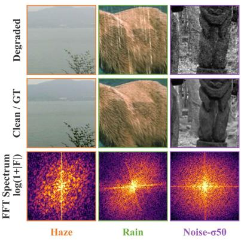

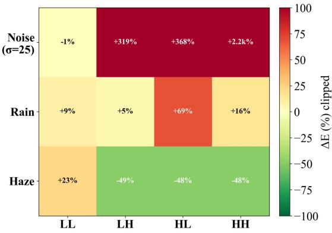

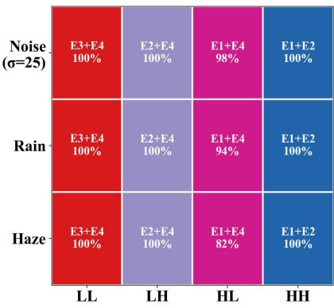  
Figure S1: Frequency-domain motivation for WaFIR. Left: log-magnitude FFT spectra (log(1+|F|)) for three representative d<sub>egra</sub>d<sub>a</sub>ti<sub>ons.</sub> H<sub>aze concen</sub>t<sub>ra</sub>t<sub>es energy</sub> i<sub>n</sub> th<sub>e</sub> DC <sub>componen</sub>t <sub>w</sub>ith <sub>a</sub>tt<sub>enua</sub>t<sub>e</sub>d hi<sub>g</sub>h f<sub>requenc</sub>i<sub>es; ra</sub>i<sub>n pro</sub>d<sub>uces</sub> di<sub>rec</sub>ti<sub>ona</sub>l <sub>s</sub>t<sub>r</sub>i<sub>pe</sub> patterns aligned with streak orientation; Gaussian noise (�=50) spreads energy across all bands. Middle: relative subband ener<sub>gy</sub> chan<sub>g</sub>e (%) versus clean ima<sub>g</sub>es across Haar subbands (LL, LH, HL, HH), cli<sub>pp</sub>ed at ±100% for dis<sub>p</sub>la<sub>y</sub> (Noise-HH actual: +2,214%). Each de<sub>g</sub>radation corru<sub>p</sub>ts a distinct subband: noise inflates all hi<sub>g</sub>h-fre<sub>q</sub>uenc<sub>y</sub> bands; haze raises LL b<sub>y</sub> +23% while su ressin LH/HL/HH b ≈48%; rain concentrates ener in HL (+69%). Right: most fre uent to -� ex er <sub>p</sub>air selected <sub>p</sub>er (de<sub>g</sub>radation, subband), avera<sub>g</sub>ed over 50 test ima<sub>g</sub>es. Each subband is routed to a distinct <sub>p</sub>air (LL→E3+E4; LH→E2+E4; HL→E1+E4; HH→E1+E2) with 82–100% consistenc<sub>y</sub> re<sub>g</sub>ardless of de<sub>g</sub>radation t<sub>yp</sub>e, indicatin<sub>g</sub> that routin<sub>g</sub> <sub>se</sub>lf<sub>-organ</sub>i<sub>zes</sub> b<sub>y</sub> f<sub>requency</sub> <sub>su</sub>b<sub>space</sub> <sub>w</sub>ith<sub>ou</sub>t d<sub>egra</sub>d<sub>a</sub>ti<sub>on-</sub>l<sub>a</sub>b<sub>e</sub>l <sub>or</sub> <sub>su</sub>bb<sub>an</sub>d<sub>-</sub>l<sub>eve</sub>l <sub>superv</sub>i<sub>s</sub>i<sub>on.</sub>

Routing weights carry little linearly-decodable degradation information. A logistic-regression probe (5-fold CV, balanced accurac<sub>y</sub>) on the s<sub>p</sub>ectral descri<sub>p</sub>tor recov-<sub>ers</sub> d<sub>egra</sub>d<sub>a</sub>ti<sub>on</sub> t<sub>ype a</sub>t 40<sub>.</sub>5%<sub>, a</sub>b<sub>ove</sub> th<sub>e</sub> 33<sub>.</sub>3% th<sub>ree-c</sub>l<sub>ass</sub> <sub>c</sub>h<sub>ance</sub> l<sub>eve</sub>l<sub>.</sub> O<sub>n</sub> th<sub>e</sub> <sub>rou</sub>ti<sub>ng</sub> <sub>we</sub>i<sub>g</sub>ht<sub>s</sub> th<sub>e</sub> <sub>same</sub> <sub>pro</sub>b<sub>e</sub> <sub>y</sub>i<sub>e</sub>ld<sub>s</sub> 35.1%±1.9%, statisticall<sub>y</sub> indistin<sub>g</sub>uishable from chance. The MLP t<sub>rans</sub>f<sub>orms away mos</sub>t li<sub>near</sub>l<sub>y-access</sub>ibl<sub>e</sub> d<sub>egra</sub>d<sub>a</sub>ti<sub>on</sub> <sub>s</sub>t<sub>ruc</sub>t<sub>ure;</sub> th<sub>e res</sub>id<sub>ua</sub>l D<sub>eg-</sub>MI i<sub>n</sub> LL <sub>an</sub>d HL <sub>re</sub>fl<sub>ec</sub>t<sub>s non</sub>li<sub>n-</sub> <sub>ear</sub> d<sub>epen</sub>d<sub>ence.</sub>

## S2.3 Controlled Identity-vs-Frequency Test

Oracle label-conditioned control (A13). The analyses above characterize what WaFIR does; A13 tests whether the frequency-based principle is preferable to an identity-based <sub>one un</sub>d<sub>er ma</sub>t<sub>c</sub>h<sub>e</sub>d <sub>capac</sub>it<sub>y.</sub> A13 i<sub>s arc</sub>hit<sub>ec</sub>t<sub>ura</sub>ll<sub>y</sub> id<sub>en</sub>ti<sub>ca</sub>l to WaFIR (A3) but re<sub>p</sub>laces the s<sub>p</sub>ectral descri<sub>p</sub>tor with a routing signal derived from the oracle degradation label: ev-<sub>ery su</sub>bb<sub>an</sub>d <sub>o</sub>f <sub>an</sub> i<sub>mage</sub> i<sub>s rou</sub>t<sub>e</sub>d b<sub>y</sub> th<sub>e same one-</sub>h<sub>o</sub>t l<sub>a</sub>b<sub>e</sub>l<sub>.</sub> A<sub>s expec</sub>t<sub>e</sub>d<sub>,</sub> A13’<sub>s rou</sub>ti<sub>ng we</sub>i<sub>g</sub>ht<sub>s carry</sub> f<sub>ar s</sub>t<sub>ronger</sub> d<sub>egra-</sub> dation information (De<sub>g</sub>-MI = 0.519 vs. 0.091), uniforml<sub>y</sub> distributed across subbands (LL/LH/HL/HH ≈ 0.50–0.57), and subband or<sub>g</sub>anization colla<sub>p</sub>ses (Sub-NMI = 0.024 vs. 0.243). The two models thus o<sub>p</sub>erate under <sub>g</sub>enuinel<sub>y</sub> difer-<sub>en</sub>t <sub>pr</sub>i<sub>nc</sub>i<sub>p</sub>l<sub>es.</sub>

Crucially, oracle labels do not translate into uniformly bett<sub>er res</sub>t<sub>ora</sub>ti<sub>on.</sub> U<sub>n</sub>d<sub>er</sub> th<sub>e con</sub>t<sub>ro</sub>ll<sub>e</sub>d <sub>re</sub>d<sub>uce</sub>d<sub>-</sub>b<sub>u</sub>d<sub>ge</sub>t <sub>eva</sub>l<sub>ua-</sub> tion (Table S4), A13’s in-distribution advanta<sub>g</sub>e is mar<sub>g</sub>inal (+0.06 dB on avera<sub>g</sub>e on BSD68) and reverses under distributi<sub>on s</sub>hift<sub>, w</sub>h<sub>ere</sub> A3’<sub>s con</sub>ti<sub>nuous</sub> d<sub>escr</sub>i<sub>p</sub>t<sub>or s</sub>t<sub>ays we</sub>ll<sub>-</sub>d<sub>e</sub>fi<sub>ne</sub>d <sub>w</sub>hil<sub>e a one-</sub>h<sub>o</sub>t l<sub>a</sub>b<sub>e</sub>l h<sub>as no</sub> f<sub>a</sub>llb<sub>ac</sub>k<sub>.</sub> W<sub>a</sub>FIR <sub>a</sub>tt<sub>a</sub>i<sub>ns</sub> thi<sub>s w</sub>ith<sub>-</sub> <sub>ou</sub>t <sub>any</sub> d<sub>egra</sub>d<sub>a</sub>ti<sub>on</sub> <sub>c</sub>l<sub>ass</sub>ifi<sub>er,</sub> <sub>w</sub>h<sub>ereas</sub> A13 <sub>requ</sub>i<sub>res</sub> <sub>groun</sub>d<sub>-</sub> t<sub>ru</sub>th l<sub>a</sub>b<sub>e</sub>l<sub>s</sub> th<sub>a</sub>t <sub>are unava</sub>il<sub>a</sub>bl<sub>e</sub> i<sub>n</sub> d<sub>ep</sub>l<sub>oymen</sub>t<sub>.</sub> Th<sub>e mec</sub>h<sub>-</sub> <sub>an</sub>i<sub>sm</sub> i<sub>s</sub> th<sub>a</sub>t th<sub>e</sub> d<sub>escr</sub>i<sub>p</sub>t<sub>or</sub> <sub>enco</sub>d<sub>es</sub> <sub>no</sub>i<sub>se</sub> <sub>energy</sub> <sub>con</sub>ti<sub>nu-</sub> ous<sup>l</sup><sub>y</sub> $( \mathtt { v a r \_ m a g } \propto \sigma ^ { 2 } )$ , enabling per-image adaptation within <sub>a no</sub>i<sub>se</sub> l<sub>eve</sub>l th<sub>a</sub>t <sub>a one-</sub>h<sub>o</sub>t l<sub>a</sub>b<sub>e</sub>l <sub>canno</sub>t <sub>represen</sub>t<sub>.</sub>

## S2.4 Amplitude-Invariance Control

T<sub>o</sub> t<sub>es</sub>t <sub>w</sub>h<sub>e</sub>th<sub>er</sub> th<sub>e o</sub>b<sub>serve</sub>d <sub>su</sub>bb<sub>an</sub>d <sub>c</sub>l<sub>us</sub>t<sub>ers are a</sub> t<sub>r</sub>i<sub>v</sub>i<sub>a</sub>l <sub>consequence</sub> <sub>o</sub>f <sub>a</sub>b<sub>so</sub>l<sub>u</sub>t<sub>e</sub> <sub>amp</sub>lit<sub>u</sub>d<sub>e</sub> dif<sub>erences,</sub> <sub>we</sub> <sub>compare</sub> th<sub>e</sub> <sub>or</sub>i<sub>g</sub>i<sub>na</sub>l d<sub>escr</sub>i<sub>p</sub>t<sub>or</sub> <sub>w</sub>ith <sub>an</sub> <sub>amp</sub>lit<sub>u</sub>d<sub>e-</sub>i<sub>nvar</sub>i<sub>an</sub>t <sub>ra</sub>ti<sub>o</sub> d<sub>e-</sub> scri<sub>p</sub>tor (D1) and with the trained routin<sub>g</sub> wei<sub>g</sub>hts.

## S3 Ablation Studies

Thi<sub>s sec</sub>ti<sub>on expan</sub>d<sub>s</sub> th<sub>e a</sub>bl<sub>a</sub>ti<sub>on</sub> t<sub>a</sub>bl<sub>e repor</sub>t<sub>e</sub>d i<sub>n</sub> th<sub>e ma</sub>i<sub>n</sub> <sub>manuscr</sub>i<sub>p</sub>t<sub>.</sub> F<sub>or comp</sub>l<sub>e</sub>t<sub>eness, we repro</sub>d<sub>uce</sub> th<sub>e con</sub>t<sub>ro</sub>ll<sub>e</sub>d <sub>componen</sub>t t<sub>a</sub>bl<sub>e an</sub>d th<sub>en repor</sub>t <sub>ana</sub>l<sub>yses</sub> th<sub>a</sub>t d<sub>o no</sub>t fit i<sub>n</sub> th<sub>e</sub> <sub>ma</sub>i<sub>n</sub> <sub>paper,</sub> i<sub>nc</sub>l<sub>u</sub>di<sub>ng</sub> th<sub>e</sub> l<sub>a</sub>b<sub>e</sub>l<sub>-con</sub>diti<sub>one</sub>d <sub>rou</sub>ti<sub>ng</sub> t<sub>es</sub>t <sub>an</sub>d th<sub>e</sub> l<sub>oa</sub>d<sub>-</sub>b<sub>a</sub>l<sub>ance sens</sub>iti<sub>v</sub>it<sub>y s</sub>t<sub>u</sub>d<sub>y.</sub>

## S3.1 Component-Level Ablation

T<sub>a</sub>bl<sub>e</sub> S3 <sub>repor</sub>t<sub>s</sub> th<sub>e componen</sub>t<sub>-</sub>l<sub>eve</sub>l <sub>a</sub>bl<sub>a</sub>ti<sub>on.</sub> E<sub>ac</sub>h <sub>row re-</sub> <sub>p</sub>laces or removes a sin<sub>g</sub>le element of the full model (A3) <sub>w</sub>hil<sub>e</sub> h<sub>o</sub>ldi<sub>ng</sub> th<sub>e arc</sub>hit<sub>ec</sub>t<sub>ure, op</sub>ti<sub>m</sub>i<sub>zer, sc</sub>h<sub>e</sub>d<sub>u</sub>l<sub>e, an</sub>d <sub>eva</sub>l<sub>-</sub> <sub>ua</sub>ti<sub>on</sub> fi<sub>xe</sub>d<sub>, so</sub> th<sub>e resu</sub>lti<sub>ng c</sub>h<sub>ange</sub> i<sub>n</sub> th<sub>e</sub> FULL <sub>me</sub>t<sub>r</sub>i<sub>c—</sub>th<sub>e</sub> mean PSNR over the ei<sub>g</sub>ht test conditions (BSD68 and Urban100 at �∈{15, 25, 50}, Rain100L, and SOTS)—isolates th<sub>a</sub>t <sub>e</sub>l<sub>emen</sub>t’<sub>s</sub> <sub>con</sub>t<sub>r</sub>ib<sub>u</sub>ti<sub>on.</sub> Th<sub>e</sub> <sub>var</sub>i<sub>an</sub>t<sub>s</sub> <sub>are</sub> <sub>groupe</sub>d b<sub>y</sub> th<sub>e</sub> design question they probe: the no-SPMoE baseline (A0); SP-MoE insertion depth (A1, A2, A15); routing quality (random and top-1 routing, A5, A6); the routing signal that conditions the gate (A12, A14); frequency decomposition and interaction (A7, A9); and expert design (A4). The Δ column is the FULL diference relative to A3 (<sub>g</sub>reen = <sub>g</sub>ain, red = dro<sub>p</sub>). All <sub>var</sub>i<sub>an</sub>t<sub>s are</sub> t<sub>ra</sub>i<sub>ne</sub>d <sub>on</sub> th<sub>e re</sub>d<sub>uce</sub>d <sub>su</sub>b<sub>se</sub>t<sub>s</sub> d<sub>escr</sub>ib<sub>e</sub>d b<sub>e</sub>l<sub>ow,</sub> <sub>so</sub> th<sub>e</sub>i<sub>r a</sub>b<sub>so</sub>l<sub>u</sub>t<sub>e</sub> PSNR <sub>va</sub>l<sub>ues are compara</sub>bl<sub>e</sub> t<sub>o one ano</sub>th<sub>er</sub> but not to the full-data results in the main <sub>p</sub>a<sub>p</sub>er (Table 1); the seed-stabilit<sub>y</sub> anal<sub>y</sub>sis (Table S6) confirms that deltas of ≥ 0.14 dB exceed run-to-run variation. Each <sub>g</sub>rou<sub>p</sub> is inter-<sub>pre</sub>t<sub>e</sub>d i<sub>n</sub> S<sub>ec</sub>ti<sub>on</sub> S3<sub>.</sub>2<sub>.</sub>

Table S2: Routin uantification (�=250 ima es 5 de radation conditions 3 decoder levels 4 subbands). Sub-NMI: NMI between �-means clusters of routing weights and the true subband label (higher = more subband-organized). Deg-MI: MI between routin<sub>g</sub> wei<sub>g</sub>hts and de<sub>g</sub>radation label, mean over subbands with <sub>p</sub>er-subband breakdown (lower = less de<sub>g</sub>radation organized). Probe: balanced accuracy of a linear degradation classifier (three-class chance = 33.3%). Permutation floor ≈ 0.01 for all MI values. WaFIR (A3) is stron<sub>g</sub>l<sub>y</sub> subband-or<sub>g</sub>anized and weakl<sub>y</sub> de<sub>g</sub>radation-or<sub>g</sub>anized; the oracle (A13) is the reverse.
<table><tr><td>Variant</td><td>Sub-NMI</td><td>Deg-MI</td><td>LL</td><td>HL</td><td>LH</td><td>HH</td><td>Probe</td></tr><tr><td>Random (A5)</td><td>0.001</td><td>0.006</td><td>0.00</td><td>0.01</td><td>0.01</td><td>0.00</td><td></td></tr><tr><td>Descriptor (pre-MLP)</td><td>0.166</td><td></td><td></td><td></td><td></td><td></td><td>40.5%</td></tr><tr><td>WaFIR (A3)</td><td>0.243</td><td>0.091</td><td>0.20</td><td>0.09</td><td>0.04</td><td>0.03</td><td> $3 5 . 1 \% \pm 1 . 9 \%$ </td></tr><tr><td>A13 (oracle)</td><td>0.024</td><td>0.519</td><td>0.50</td><td>0.49</td><td>0.57</td><td>0.52</td><td> $6 5 . 0 \% \pm 2 . 1 \%$ </td></tr></table>

## S3.2 Interpretation of Component Ablations

I<sub>n</sub> thi<sub>s sec</sub>ti<sub>on, we con</sub>d<sub>uc</sub>t <sub>con</sub>t<sub>ro</sub>ll<sub>e</sub>d <sub>a</sub>bl<sub>a</sub>ti<sub>on s</sub>t<sub>u</sub>di<sub>es</sub> t<sub>o eva</sub>l<sub>u-</sub> <sub>a</sub>t<sub>e</sub> th<sub>e con</sub>t<sub>r</sub>ib<sub>u</sub>ti<sub>on o</sub>f <sub>eac</sub>h <sub>componen</sub>t i<sub>n</sub> W<sub>a</sub>FIR<sub>.</sub> All <sub>a</sub>bl<sub>a</sub>ti<sub>on</sub> <sub>var</sub>i<sub>an</sub>t<sub>s are</sub> t<sub>ra</sub>i<sub>ne</sub>d <sub>on re</sub>d<sub>uce</sub>d <sub>su</sub>b<sub>se</sub>t<sub>s o</sub>f th<sub>e or</sub>i<sub>g</sub>i<sub>na</sub>l d<sub>a</sub>t<sub>ase</sub>t<sub>s</sub> (1,200 ima<sub>g</sub>es for denoisin<sub>g</sub>, 200 ima<sub>g</sub>es for derainin<sub>g</sub>, and 391 ima<sub>g</sub>es for dehazin<sub>g</sub>) while <sub>p</sub>reservin<sub>g</sub> the network archit<sub>ec</sub>t<sub>ure ou</sub>t<sub>s</sub>id<sub>e</sub> th<sub>e mo</sub>difi<sub>e</sub>d <sub>componen</sub>t<sub>, op</sub>ti<sub>m</sub>i<sub>za</sub>ti<sub>on se</sub>tti<sub>ngs,</sub> t<sub>ra</sub>i<sub>n</sub>i<sub>ng sc</sub>h<sub>e</sub>d<sub>u</sub>l<sub>e, an</sub>d <sub>eva</sub>l<sub>ua</sub>ti<sub>on pro</sub>t<sub>oco</sub>l<sub>.</sub> Thi<sub>s ma</sub>t<sub>c</sub>h<sub>e</sub>d <sub>se</sub>t<sub>-</sub> ti<sub>ng</sub> i<sub>s</sub> d<sub>es</sub>i<sub>gne</sub>d t<sub>o a</sub>tt<sub>r</sub>ib<sub>u</sub>t<sub>e per</sub>f<sub>ormance</sub> dif<sub>erences</sub> t<sub>o</sub> th<sub>e</sub> <sub>a</sub>bl<sub>a</sub>t<sub>e</sub>d <sub>componen</sub>t <sub>ra</sub>th<sub>er</sub> th<sub>an</sub> t<sub>o</sub> <sub>c</sub>h<sub>anges</sub> i<sub>n</sub> d<sub>a</sub>t<sub>a</sub> <sub>or</sub> <sub>op</sub>ti<sub>m</sub>i<sub>za-</sub> ti<sub>on.</sub>

Both decoder placement and three-level design are critical (A1, A2, A15). Adding SPMoE at L3 only (A1, Δ=−0.14) or at L2+L3 (A2, Δ=−0.20 dB) falls si<sub>g</sub>nificantl<sub>y</sub> short of the full th<sub>ree-</sub>l<sub>eve</sub>l <sub>con</sub>fi<sub>gura</sub>ti<sub>on.</sub> W<sub>e a</sub>tt<sub>r</sub>ib<sub>u</sub>t<sub>e</sub> thi<sub>s</sub> t<sub>o</sub> th<sub>e comp</sub>l<sub>emen-</sub> t<sub>ary na</sub>t<sub>ure o</sub>f <sub>mu</sub>lti<sub>-sca</sub>l<sub>e</sub> f<sub>requency correc</sub>ti<sub>on:</sub> th<sub>e coarses</sub>t block (L3, �=384) modulates <sub>g</sub>lobal s<sub>p</sub>ectral sha<sub>p</sub>e, while shallower blocks (L2, L1) address scale-s<sub>p</sub>ecific textures. Extendin<sub>g</sub> SPMoE to encoder levels as well (A15, Δ=−0.41 dB) <sub>ac</sub>ti<sub>ve</sub>l<sub>y</sub> d<sub>egra</sub>d<sub>es</sub> <sub>per</sub>f<sub>ormance,</sub> i<sub>n</sub>di<sub>ca</sub>ti<sub>ng</sub> th<sub>a</sub>t <sub>spec</sub>t<sub>ra</sub>l <sub>exper</sub>t <sub>mo</sub>d<sub>u</sub>l<sub>a</sub>ti<sub>on</sub> i<sub>s</sub> b<sub>ene</sub>fi<sub>c</sub>i<sub>a</sub>l <sub>spec</sub>ifi<sub>ca</sub>ll<sub>y a</sub>t d<sub>eco</sub>d<sub>er</sub> l<sub>eve</sub>l<sub>s—w</sub>h<sub>ere</sub> prompt context is injected and reconstruction occurs—rather th<sub>an</sub> th<sub>roug</sub>h<sub>ou</sub>t th<sub>e ne</sub>t<sub>wor</sub>k<sub>.</sub>

Learned routing and soft interpolation are both essential (A5, A6). Random subband-to-expert assignment (A5, $\Delta = - 0 . 2 3 \mathrm { d B } )$ d<sub>emons</sub>t<sub>ra</sub>t<sub>es</sub> th<sub>a</sub>t th<sub>e</sub> l<sub>earne</sub>d <sub>rou</sub>t<sub>er cap</sub>t<sub>ures</sub> <sub>mean</sub>i<sub>ng</sub>f<sub>u</sub>l f<sub>requency-spec</sub>i<sub>a</sub>li<sub>ze</sub>d <sub>rou</sub>ti<sub>ng</sub> <sub>pa</sub>tt<sub>erns</sub> <sub>ra</sub>th<sub>er</sub> th<sub>an</sub> arbitrar<sub>y</sub> assi<sub>g</sub>nments. Restrictin<sub>g</sub> the router to to<sub>p</sub>-� = 1 (A6, $\Delta = - 0 . 3 5 \mathrm { d B } )$ <sub>resu</sub>lt<sub>s</sub> i<sub>n</sub> th<sub>e</sub> l<sub>arges</sub>t <sub>per</sub>f<sub>ormance</sub> d<sub>rop,</sub> hi<sub>g</sub>h<sub>-</sub> li<sub>g</sub>hti<sub>ng</sub> th<sub>e</sub> i<sub>mpor</sub>t<sub>ance</sub> <sub>o</sub>f <sub>so</sub>ft i<sub>n</sub>t<sub>erpo</sub>l<sub>a</sub>ti<sub>on</sub> b<sub>e</sub>t<sub>ween</sub> <sub>mu</sub>lti<sub>-</sub> <sub>p</sub>l<sub>e</sub> <sub>exper</sub>t<sub>s.</sub> A<sub>s</sub> ill<sub>us</sub>t<sub>ra</sub>t<sub>e</sub>d b<sub>y</sub> th<sub>e</sub> <sub>arc</sub> <sub>geome</sub>t<sub>ry</sub> i<sub>n</sub> Fi<sub>gure</sub> S2<sub>,</sub> <sub>we</sub>i<sub>g</sub>ht<sub>e</sub>d <sub>com</sub>bi<sub>na</sub>ti<sub>ons</sub> <sub>o</sub>f t<sub>wo</sub> <sub>exper</sub>t<sub>s</sub> <sub>a</sub>ll<sub>ow</sub> <sub>eac</sub>h <sub>su</sub>bb<sub>an</sub>d t<sub>o</sub> <sub>a</sub>d<sub>ap</sub>t <sub>con</sub>ti<sub>nuous</sub>l<sub>y</sub> t<sub>o</sub> i<sub>n</sub>t<sub>erme</sub>di<sub>a</sub>t<sub>e</sub> f<sub>requency</sub> <sub>c</sub>h<sub>arac</sub>t<sub>er</sub>i<sub>s</sub>ti<sub>cs.</sub> I<sub>n con</sub>t<sub>ras</sub>t<sub>, w</sub>i<sub>nner-</sub>t<sub>a</sub>k<sub>e-a</sub>ll <sub>rou</sub>ti<sub>ng</sub> f<sub>orces eac</sub>h <sub>su</sub>bb<sub>an</sub>d t<sub>o re</sub>l<sub>y</sub> <sub>on</sub> <sub>a</sub> <sub>s</sub>i<sub>ng</sub>l<sub>e</sub> <sub>exper</sub>t<sub>,</sub> <sub>re</sub>d<sub>uc</sub>i<sub>ng</sub> <sub>rou</sub>ti<sub>ng</sub> fl<sub>ex</sub>ibilit<sub>y</sub> <sub>an</sub>d li<sub>m</sub>iti<sub>ng</sub> th<sub>e</sub> <sub>represen</sub>t<sub>a</sub>ti<sub>on o</sub>f <sub>m</sub>i<sub>xe</sub>d <sub>spec</sub>t<sub>ra</sub>l <sub>pa</sub>tt<sub>erns.</sub>

The spectral descriptor and prompt play complementary roles (A12–A14). Prompt-only routing (A12, Δ=−0.26 dB) b<sub>o</sub>th d<sub>egra</sub>d<sub>es per</sub>f<sub>ormance an</sub>d <sub>reorgan</sub>i<sub>zes rou</sub>ti<sub>ng aroun</sub>d t<sub>as</sub>k id<sub>en</sub>tit<sub>y ra</sub>th<sub>er</sub> th<sub>an</sub> f<sub>requency su</sub>b<sub>space.</sub> D<sub>escr</sub>i<sub>p</sub>t<sub>or-on</sub>l<sub>y</sub> routin<sub>g</sub> (A14, −0.15 dB) retains more of the full model’s <sub>p</sub>erf<sub>ormance</sub> th<sub>an</sub> <sub>promp</sub>t<sub>-on</sub>l<sub>y</sub> <sub>rou</sub>ti<sub>ng</sub> i<sub>n</sub> thi<sub>s</sub> <sub>con</sub>t<sub>ro</sub>ll<sub>e</sub>d <sub>se</sub>tti<sub>ng,</sub> <sub>s</sub>h<sub>ow</sub>i<sub>ng</sub> th<sub>a</sub>t i<sub>n</sub>t<sub>r</sub>i<sub>ns</sub>i<sub>c spec</sub>t<sub>ra</sub>l <sub>c</sub>h<sub>arac</sub>t<sub>er</sub>i<sub>s</sub>ti<sub>cs prov</sub>id<sub>e</sub> i<sub>n</sub>f<sub>orma-</sub> tive routing cues. The remaining gap to the jointly conditioned <sub>ga</sub>t<sub>e</sub> i<sub>n</sub>di<sub>ca</sub>t<sub>es</sub> th<sub>a</sub>t <sub>promp</sub>t<sub>-</sub>d<sub>er</sub>i<sub>ve</sub>d t<sub>as</sub>k <sub>con</sub>t<sub>ex</sub>t i<sub>s comp</sub>l<sub>emen-</sub> t<sub>ary,</sub> <sub>par</sub>ti<sub>cu</sub>l<sub>ar</sub>l<sub>y</sub> <sub>on</sub> d<sub>era</sub>i<sub>n</sub>i<sub>ng,</sub> <sub>w</sub>h<sub>ere</sub> d<sub>egra</sub>d<sub>a</sub>ti<sub>on</sub> <sub>spec</sub>t<sub>ra</sub> <sub>can</sub> <sub>over</sub>l<sub>ap.</sub> A l<sub>a</sub>b<sub>e</sub>l<sub>-con</sub>diti<sub>one</sub>d <sub>rou</sub>t<sub>er</sub> th<sub>a</sub>t <sub>rece</sub>i<sub>ves</sub> th<sub>e groun</sub>d truth de<sub>g</sub>radation label (A13) is sli<sub>g</sub>htl<sub>y</sub> stron<sub>g</sub>er in distribution (+0.06 dB on avera<sub>g</sub>e on BSD68; Table S4), confirmin<sub>g</sub> th<sub>a</sub>t f<sub>requency-</sub>b<sub>ase</sub>d <sub>rou</sub>ti<sub>ng</sub> i<sub>s a compe</sub>titi<sub>ve</sub> i<sub>npu</sub>t<sub>-</sub>d<sub>er</sub>i<sub>ve</sub>d <sub>p</sub>r<sub>oxy</sub> f<sub>o</sub>r <sub>a s</sub>i<sub>g</sub>n<sub>a</sub>l W<sub>a</sub>FIR n<sub>eve</sub>r <sub>accesses a</sub>t inf<sub>e</sub>r<sub>e</sub>n<sub>ce.</sub>

Haar DWT and cross-subband interaction both contribute (A7, A9). Removing the grouped 1×1 cross-subband convolution (A7, −0.16 dB) confirms that inter-frequenc<sub>y</sub> interacti<sub>on</sub> b<sub>e</sub>f<sub>ore</sub> IDWT i<sub>s necessary</sub> f<sub>or co</sub>h<sub>eren</sub>t <sub>mu</sub>lti<sub>-sca</sub>l<sub>e re-</sub> construction. Re<sub>p</sub>lacin<sub>g</sub> Haar DWT with avera<sub>g</sub>e <sub>p</sub>oolin<sub>g</sub> (A9, −0.10 dB) shows that structured, lossless fre<sub>q</sub>uenc<sub>y</sub> decom<sub>p</sub>o-<sub>s</sub>iti<sub>on</sub> i<sub>s nee</sub>d<sub>e</sub>d f<sub>or</sub> th<sub>e spec</sub>t<sub>ra</sub>l d<sub>escr</sub>i<sub>p</sub>t<sub>or</sub> t<sub>o access su</sub>bb<sub>an</sub>d<sub>-</sub> <sub>spec</sub>ifi<sub>c s</sub>t<sub>a</sub>ti<sub>s</sub>ti<sub>cs.</sub>

Phase modulation is optional; magnitude modulation alone is already suficient (A4). Disabling phase modulati<sub>on</sub> $\scriptstyle ( \varphi ^ { \prime } = \varphi )$ <sub>y</sub>ields a mar<sub>g</sub>inal im<sub>p</sub>rovement (+0.04 dB avera<sub>g</sub>e on the FULL metric), confirmin<sub>g</sub> that the zero-initialized phase projector remains near-identity throughout training and th<sub>a</sub>t th<sub>e</sub> <sub>repor</sub>t<sub>e</sub>d <sub>ga</sub>i<sub>ns</sub> <sub>s</sub>t<sub>em</sub> <sub>pr</sub>i<sub>mar</sub>il<sub>y</sub> f<sub>rom</sub> <sub>su</sub>bb<sub>an</sub>d<sub>-reso</sub>l<sub>ve</sub>d <sub>magn</sub>it<sub>u</sub>d<sub>e mo</sub>d<sub>u</sub>l<sub>a</sub>ti<sub>on.</sub> All W<sub>a</sub>FIR <sub>num</sub>b<sub>ers repor</sub>t<sub>e</sub>d i<sub>n</sub> th<sub>e</sub> <sub>ma</sub>i<sub>n paper use</sub> th<sub>e</sub> f<sub>u</sub>ll <sub>con</sub>fi<sub>gura</sub>ti<sub>on w</sub>ith <sub>p</sub>h<sub>ase mo</sub>d<sub>u</sub>l<sub>a</sub>ti<sub>on</sub> (A3) for consistenc<sub>y</sub>; the ma<sub>g</sub>nitude-onl<sub>y</sub> variant (A4) is an <sub>equa</sub>ll<sub>y</sub> <sub>s</sub>t<sub>rong</sub> <sub>an</sub>d <sub>s</sub>li<sub>g</sub>htl<sub>y</sub> li<sub>g</sub>ht<sub>er</sub> <sub>s</sub>i<sub>mp</sub>lifi<sub>ca</sub>ti<sub>on.</sub>

Load-balance regularization is essential (A8, A10–A11). Removin<sub>g</sub> the load-balance loss (A8, �=0) causes ex<sub>p</sub>ert coll<sub>apse:</sub> <sub>expe</sub>rt <sub>u</sub>tili<sub>za</sub>ti<sub>o</sub>n <sub>app</sub>r<sub>oac</sub>h<sub>es</sub> 1<sub>.</sub>0 <sub>a</sub>nd PSNR dr<sub>ops</sub> b<sub>y</sub> −2.66 dB relative to the ado<sub>p</sub>ted �=0.01 (A3) at a matched e<sub>p</sub>och 105 on the fast-subset run (Table S5). The swee<sub>p</sub> over � establishes �∈[0.001, 0.01] as the efective o<sub>p</sub>eratin<sub>g</sub> ran<sub>g</sub>e; the full conver<sub>g</sub>ence anal<sub>y</sub>sis and formulation rationale (com <sub>p</sub>arison with Switch Transformer and entro<sub>py</sub> losses) are <sub>g</sub>iven i<sub>n</sub> S<sub>ec</sub>ti<sub>on</sub> S1<sub>.</sub>3<sub>.</sub>

Learned routing generalizes better than label-conditioned routing under distribution shift (A3 vs. A13). The indi<sub>s</sub>t<sub>r</sub>ib<sub>u</sub>ti<sub>on compar</sub>i<sub>son a</sub>b<sub>ove assumes</sub> th<sub>e eva</sub>l<sub>ua</sub>ti<sub>on con-</sub> diti<sub>on ma</sub>t<sub>c</sub>h<sub>es one o</sub>f th<sub>e</sub> fi<sub>ve</sub> d<sub>egra</sub>d<sub>a</sub>ti<sub>on</sub> l<sub>a</sub>b<sub>e</sub>l<sub>s seen a</sub>t t<sub>ra</sub>i<sub>n-</sub> i<sub>ng</sub> ti<sub>me—an assump</sub>ti<sub>on</sub> A13 d<sub>epen</sub>d<sub>s on s</sub>t<sub>ruc</sub>t<sub>ura</sub>ll<sub>y, s</sub>i<sub>nce</sub> it<sub>s rou</sub>t<sub>er se</sub>l<sub>ec</sub>t<sub>s exper</sub>t<sub>s con</sub>diti<sub>one</sub>d <sub>on a one-</sub>h<sub>o</sub>t <sub>groun</sub>d<sub>-</sub> truth label (A13 is thus not a true oracle outside its label set). Table S4 stress-tests this assumption under three regimes: indistribution (standard BSD68 noise levels), unseen intensity (inter<sub>p</sub>olated �=35 between trained $\sigma \in \{ 2 5 , 5 0 \}$ , an<sup>d</sup> extra<sub>p</sub>- olated �=70 beyond the trained range), and zero-shot compound degradation (two degradation types applied to the same ima<sub>g</sub>e - e.<sub>g</sub>. rain+noise or haze+noise - never <sub>p</sub>resented as a sin<sub>g</sub>le label to either model durin<sub>g</sub> trainin<sub>g</sub>). A13’s ed<sub>g</sub>e is confined to in-distribution conditions (+0.06 dB on average on BSD68); it inverts once the input falls outside the five trained labels: A3 out<sub>p</sub>erforms A13 b<sub>y</sub> +0.45 dB PSNR (+0.046 SSIM) at extra<sub>p</sub>olated �=70, and b<sub>y</sub> +0.67 dB on rain+noise. On haze+noise the two are statisticall<sub>y</sub> indistinguishable (15.755 vs. 15.739 dB) notably, both models de-<sub>g</sub>rade shar<sub>p</sub>l<sub>y</sub> on this condition (≈12–18 dB below sin<sub>g</sub>lede<sub>g</sub>radation haze or noise <sub>p</sub>erformance), indicatin<sub>g</sub> com<sub>p</sub>ound haze+noise is a shared failure mode rather than an advanta<sub>g</sub>e f<sub>or e</sub>ith<sub>er rou</sub>ti<sub>ng s</sub>t<sub>ra</sub>t<sub>egy.</sub> Th<sub>e pa</sub>tt<sub>ern</sub> th<sub>a</sub>t d<sub>oes</sub> h<sub>o</sub>ld i<sub>s</sub> di<sub>-</sub> <sub>rec</sub>ti<sub>ona</sub>l<sub>: w</sub>h<sub>enever</sub> th<sub>e groun</sub>d<sub>-</sub>t<sub>ru</sub>th l<sub>a</sub>b<sub>e</sub>l i<sub>s unava</sub>il<sub>a</sub>bl<sub>e or</sub> ill<sub>-</sub>d<sub>e</sub>fi<sub>ne</sub>d f<sub>or</sub> th<sub>e</sub> i<sub>npu</sub>t<sub>,</sub> A13 h<sub>as no</sub> f<sub>a</sub>llb<sub>ac</sub>k b<sub>eyon</sub>d it<sub>s</sub> fi<sub>ve</sub> di<sub>scre</sub>t<sub>e c</sub>l<sub>asses, w</sub>hil<sub>e</sub> A3’<sub>s con</sub>ti<sub>nuous</sub> f<sub>requency-</sub>d<sub>oma</sub>i<sub>n</sub> d<sub>e-</sub> <sub>scr</sub>i<sub>p</sub>t<sub>or rema</sub>i<sub>ns a we</sub>ll<sub>-</sub>d<sub>e</sub>fi<sub>ne</sub>d <sub>s</sub>i<sub>gna</sub>l <sub>regar</sub>dl<sub>ess o</sub>f th<sub>e</sub> d<sub>egra-</sub> d<sub>a</sub>ti<sub>on</sub>’<sub>s</sub> id<sub>en</sub>tit<sub>y or compos</sub>iti<sub>on, ma</sub>ki<sub>ng</sub> l<sub>a</sub>b<sub>e</sub>l<sub>-</sub>f<sub>ree</sub> f<sub>requency</sub> <sub>rou</sub>ti<sub>ng</sub> th<sub>e more ro</sub>b<sub>us</sub>t <sub>c</sub>h<sub>o</sub>i<sub>ce w</sub>h<sub>en</sub> th<sub>e</sub> d<sub>ep</sub>l<sub>oye</sub>d d<sub>egra</sub>d<sub>a</sub>ti<sub>on</sub> di<sub>s</sub>t<sub>r</sub>ib<sub>u</sub>ti<sub>on canno</sub>t b<sub>e</sub> f<sub>u</sub>ll<sub>y an</sub>ti<sub>c</sub>i<sub>pa</sub>t<sub>e</sub>d <sub>a</sub>t t<sub>ra</sub>i<sub>n</sub>i<sub>ng</sub> ti<sub>me.</sub>

Table S3: Ablation stud<sub>y</sub>. FULL = mean PSNR (dB) over 8 test conditions: BSD68 �∈{15, 25, 50}, Urban100 �∈{15, 25, 50}, Rain100L, SOTS. Δ relative to A3. Green Δ = <sub>g</sub>ain, red = dro<sub>p</sub>.
<table><tr><td rowspan="2">ID Component</td><td rowspan="2"></td><td colspan="3">BSD68 (PSNR)</td><td colspan="3">Urban100 (PSNR)</td><td rowspan="2">Rain 100L</td><td rowspan="2">SOTS FULL</td><td rowspan="2"></td><td rowspan="2">∆</td></tr><tr><td>σ=15</td><td>σ=25</td><td>σ=50</td><td>σ=15</td><td>σ=25</td><td>σ=50</td></tr><tr><td>A3</td><td>Full WaFIR (reference)</td><td>33.60</td><td>31.00</td><td>27.78</td><td>32.71</td><td>30.28</td><td>26.75</td><td>33.14</td><td>27.56</td><td>30.35</td><td></td></tr><tr><td colspan="2">Baseline</td><td></td><td></td><td></td><td></td><td></td><td></td><td></td><td></td><td></td><td></td></tr><tr><td>A0 No SPMoE (PromptIR)</td><td></td><td>33.45</td><td>30.87</td><td>27.63</td><td>32.31</td><td>29.77</td><td>26.34</td><td>31.57</td><td>27.06</td><td>29.87</td><td>-0.48</td></tr><tr><td colspan="2">SPMoE insertion depth</td><td></td><td></td><td></td><td></td><td></td><td></td><td></td><td></td><td></td><td></td></tr><tr><td>A1</td><td>SPMoE at L3 only</td><td>33.59</td><td>30.99</td><td>27.73</td><td>32.81</td><td>30.19</td><td>26.63</td><td>32.33</td><td>27.42</td><td>30.21</td><td>-0.14</td></tr><tr><td>A2</td><td>SPMoE at L2+L3</td><td>33.51</td><td>30.94</td><td>27.71</td><td>32.80</td><td>30.17</td><td>26.59</td><td>32.11</td><td>27.39</td><td>30.15</td><td>-0.20</td></tr><tr><td>A15</td><td>Encoder + decoder SPMoE</td><td>33.49</td><td>30.87</td><td>27.60</td><td>32.53</td><td>29.95</td><td>26.42</td><td>31.56</td><td>27.12</td><td>29.94</td><td>-0.41</td></tr><tr><td colspan="2">Routing quality</td><td></td><td></td><td></td><td></td><td></td><td></td><td></td><td></td><td></td><td></td></tr><tr><td>A5</td><td>Random routing</td><td>33.58</td><td>30.95</td><td>27.68</td><td>32.78</td><td>30.17</td><td>26.62</td><td>32.28</td><td>26.93</td><td>30.12</td><td>-0.23</td></tr><tr><td>A6 Top-k=1 routing</td><td></td><td>33.49</td><td>30.90</td><td>27.65</td><td>32.70</td><td>30.09</td><td>26.52</td><td>32.05</td><td>26.60</td><td>30.00</td><td>-0.35</td></tr><tr><td colspan="2"></td><td></td><td></td><td></td><td></td><td></td><td></td><td></td><td></td><td></td><td></td></tr><tr><td>Routing signal</td><td>A12 Prompt-only router (no spectral descriptor)</td><td>33.47</td><td>30.91</td><td>27.68</td><td>32.51</td><td>29.95</td><td>26.47</td><td>32.16</td><td>27.55</td><td>30.09</td><td>一 -0.26</td></tr><tr><td>A14 Descriptor-only router</td><td></td><td>33.54</td><td>30.95</td><td>27.73</td><td>32.44</td><td>29.93</td><td>26.53</td><td>32.73</td><td>27.73</td><td>30.20</td><td>-0.15</td></tr><tr><td colspan="2">Frequency decomposition and interaction</td><td></td><td></td><td></td><td></td><td></td><td></td><td></td><td></td><td></td><td></td></tr><tr><td>A7</td><td>No cross-subband interaction</td><td>33.54</td><td>30.94</td><td>27.69</td><td>32.70</td><td>30.16</td><td>26.61</td><td>32.63</td><td>27.26</td><td>30.19</td><td>-0.16</td></tr><tr><td>A9</td><td>Avg-pool DWT (no Haar wavelet)</td><td>33.62</td><td>31.03</td><td>27.78</td><td>32.71</td><td>30.19</td><td>26.75</td><td>32.55</td><td>27.41</td><td>30.26</td><td>一 -0.10</td></tr><tr><td colspan="2">Expert design</td><td></td><td></td><td></td><td></td><td></td><td></td><td></td><td></td><td></td><td></td></tr><tr><td></td><td>A4 No phase modulation (magnitude only)</td><td>33.59 31.02</td><td></td><td>27.78</td><td>32.85</td><td>30.25</td><td>26.72 33.262</td><td></td><td>27.65</td><td></td><td>30.39+0.04</td></tr></table>

Table S4: Out-of-distribution <sub>g</sub>eneralization, A3 (learned routin<sub>g</sub>) vs. A13 (label-conditioned routin<sub>g</sub> with the <sub>g</sub>roundtruth degradation label). Unseen intensity and compound degradation conditions are not seen as a single label by either <sub>mo</sub>d<sub>e</sub>l d<sub>ur</sub>i<sub>ng</sub> t<sub>ra</sub>i<sub>n</sub>i<sub>ng.</sub> $\Delta = \mathrm { A } 3 - \mathrm { A } 1 3 ;$ <sub>green</sub> f<sub>avours</sub> A3<sub>, re</sub>d f<sub>avours</sub> A13<sub>.</sub>
<table><tr><td>Regime</td><td>Condition</td><td>A3</td><td>A13</td><td>∆ (PSNR)</td></tr><tr><td rowspan="3">In-distribution</td><td>BSD68 σ=15</td><td>33.562/0.928</td><td>33.620/0.930</td><td>-0.058</td></tr><tr><td>BSD68 σ=25</td><td>30.956/0.882</td><td>31.020/0.885</td><td>-0.064</td></tr><tr><td>BSD68σ=50</td><td>27.729/0.784</td><td>27.790/0.790</td><td>-0.061</td></tr><tr><td rowspan="2">Unseen intensity</td><td>σ=35 (interp.)</td><td>29.308/0.841</td><td>29.265/0.840</td><td>+0.043</td></tr><tr><td>σ=70 (extrap.)</td><td>24.851/0.657</td><td>24.405/0.611</td><td>+0.446</td></tr><tr><td>Compound</td><td>Rain+noise25</td><td>25.143/0.769</td><td>24.472/0.737</td><td>+0.671</td></tr><tr><td>degradation</td><td>Haze+noise25</td><td>15.755/0.706</td><td>15.739/0.707</td><td>+0.016 (n.s.)</td></tr></table>

## S3.3 Load-Balance Ablation

T<sub>a</sub>bl<sub>e</sub> S5 i<sub>so</sub>l<sub>a</sub>t<sub>es</sub> th<sub>e</sub> <sub>e</sub>f<sub>ec</sub>t <sub>o</sub>f $\mathcal { L } _ { \mathrm { l b } }$ <sub>.</sub> T<sub>o</sub> <sub>avo</sub>id <sub>con</sub>f<sub>oun</sub>di<sub>ng</sub> <sub>reg-</sub> ularization stren<sub>g</sub>th with trainin<sub>g</sub> len<sub>g</sub>th, all four settin<sub>g</sub>s (A8, A11, A10, A3; � ∈ $\{ 0 , 1 0 ^ { - 4 } , 1 \bar { 0 } ^ { - 3 } , \bar { 1 0 } ^ { - 2 } \} )$ <sub>are eva</sub>l<sub>ua</sub>t<sub>e</sub>d <sub>a</sub>t <sub>a</sub> <sub>ma</sub>t<sub>c</sub>h<sub>e</sub>d <sub>epoc</sub>h 105 <sub>on</sub> th<sub>e</sub> f<sub>as</sub>t<sub>-su</sub>b<sub>se</sub>t <sub>run, so any</sub> dif<sub>erence</sub> <sub>re</sub>fl<sub>ec</sub>t<sub>s</sub> th<sub>e</sub> <sub>regu</sub>l<sub>ar</sub>i<sub>za</sub>ti<sub>on</sub> <sub>s</sub>t<sub>reng</sub>th <sub>a</sub>l<sub>one</sub> <sub>ra</sub>th<sub>er</sub> th<sub>an</sub> t<sub>ra</sub>i<sub>n</sub>i<sub>ng</sub> l<sub>eng</sub>th<sub>.</sub>

At matched e<sub>p</sub>och 105, removin<sub>g</sub> the loss (A8, �=0) dro<sub>p</sub>s PSNR to 25.81 dB versus 28.47 dB at the ado<sub>p</sub>ted �=0.01 (A3) - a −2.66 dB gap attributable to regularization alone - <sub>w</sub>ith <sub>exper</sub>t <sub>u</sub>tili<sub>za</sub>ti<sub>on</sub> <sub>approac</sub>hi<sub>ng</sub> 1<sub>.</sub>0<sub>,</sub> <sub>con</sub>fi<sub>rm</sub>i<sub>ng</sub> <sub>co</sub>ll<sub>apse</sub> <sub>on</sub>t<sub>o a s</sub>i<sub>ng</sub>l<sub>e pa</sub>i<sub>r.</sub> Th<sub>e</sub> l<sub>oss</sub> i<sub>s</sub> th<sub>us no</sub>t <sub>a m</sub>i<sub>nor regu</sub>l<sub>ar</sub>i<sub>zer</sub> b<sub>u</sub>t <sub>a precon</sub>diti<sub>on</sub> f<sub>or</sub> th<sub>e arc</sub>hit<sub>ec</sub>t<sub>ure</sub> t<sub>o</sub> f<sub>unc</sub>ti<sub>on.</sub> It i<sub>s a</sub>l<sub>so</sub> i<sub>nsen-</sub> <sub>s</sub>iti<sub>ve w</sub>ithi<sub>n a w</sub>id<sub>e range: a</sub>t <sub>epoc</sub>h 105<sub>,</sub> th<sub>e wor</sub>ki<sub>ng va</sub>l<sub>ues</sub> �=0.0001 (A11) and �=0.001 (A10) lie within 0.11–0.21 dB of the ado<sub>p</sub>ted �=0.01, so an<sub>y</sub> $\lambda \in [ 1 0 ^ { - 4 } , 1 0 ^ { - 2 } ]$ <sub>p</sub>revents co<sup>l</sup>- la<sub>p</sub>se while �=0 does not. We ado<sub>p</sub>t $\lambda { = } 0 . 0 1$ f<sub>or</sub> th<sub>e</sub> f<sub>u</sub>ll <sub>mo</sub>d<sub>e</sub>l<sub>,</sub> <sub>w</sub>hi<sub>c</sub>h <sub>a</sub>tt<sub>a</sub>i<sub>ns</sub> th<sub>e</sub> b<sub>es</sub>t PSNR <sub>o</sub>f th<sub>e</sub> f<sub>our se</sub>tti<sub>ngs a</sub>t <sub>epoc</sub>h 105 (28.471 dB, A3); this fast-subset, e<sub>p</sub>och-105 value is not directl<sub>y</sub> com<sub>p</sub>arable to the 8-condition FULL score (30.35 dB) <sub>repor</sub>t<sub>e</sub>d f<sub>or</sub> A3 i<sub>n</sub> T<sub>a</sub>bl<sub>e</sub> S3<sub>.</sub>

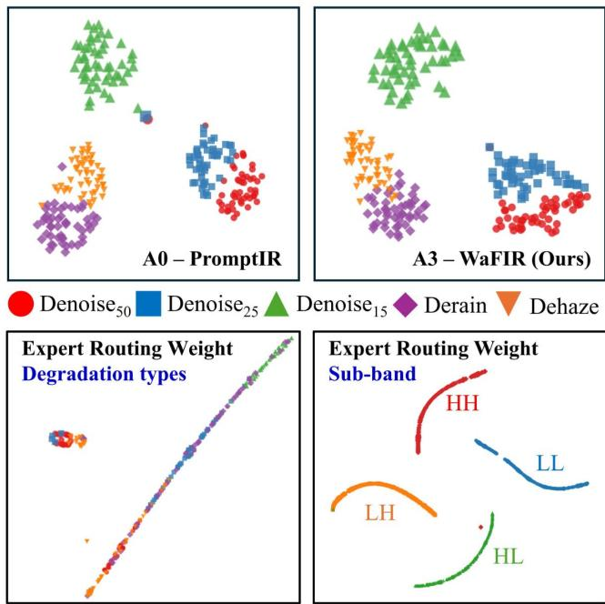  
Figure S2: t-SNE of bottleneck features and routing weights. Top: bottleneck features of A0 (PromptIR, left) and A3 (WaFIR, ri<sub>g</sub>ht), colored b<sub>y</sub> de<sub>g</sub>radation t<sub>yp</sub>e; W<sub>a</sub>FIR <sub>y</sub>i<sub>e</sub>ld<sub>s c</sub>l<sub>earer</sub> i<sub>n</sub>t<sub>er-c</sub>l<sub>ass separa</sub>ti<sub>on, no</sub>t<sub>a</sub>bl<sub>y</sub> b<sub>e</sub>t<sub>ween</sub> $\mathrm { D e n o i s e } _ { 1 5 } / \mathrm { D e n o i s e } _ { 2 5 }$ and Derain/Dehaze. Bottom-left: A3 <sub>rou</sub>ti<sub>ng-we</sub>i<sub>g</sub>ht <sub>vec</sub>t<sub>ors</sub> <sub>co</sub>l<sub>ore</sub>d b<sub>y</sub> d<sub>egra</sub>d<sub>a</sub>ti<sub>on</sub> t<sub>ype</sub> <sub>-</sub> <sub>a</sub>ll t<sub>ypes</sub> lie on one mixed manifold, so routing does not organize by degradation identity. Bottom-right: the same vectors colored b<sub>y</sub> DWT <sub>su</sub>bb<sub>an</sub>d <sub>-</sub> f<sub>our</sub> di<sub>s</sub>ti<sub>nc</sub>t <sub>arcs emerge w</sub>ith<sub>ou</sub>t <sub>su</sub>b<sub>-</sub> b<sub>an</sub>d <sub>superv</sub>i<sub>s</sub>i<sub>on, so rou</sub>ti<sub>ng organ</sub>i<sub>zes</sub> b<sub>y</sub> f<sub>requency su</sub>b<sub>space.</sub> Routing is thus governed by which subband a feature belongs to, not which degradation produced it.

## S3.4 Seed Robustness

T<sub>o con</sub>fi<sub>rm</sub> th<sub>a</sub>t th<sub>e componen</sub>t <sub>marg</sub>i<sub>ns</sub> i<sub>n</sub> T<sub>a</sub>bl<sub>e</sub> S3 <sub>excee</sub>d random-initialization noise, we retrain the full model (A3) and the no-SPMoE baseline (A0), each with two random seeds, and evaluate the best-validation check<sub>p</sub>oints (Table S6). A<sub>cross see</sub>d<sub>s,</sub> A3 <sub>a</sub>tt<sub>a</sub>i<sub>ns</sub> $\mathrm { F U L L } = 3 0 . 2 9 \pm 0 . 0 2 \mathrm { d B }$ <sub>an</sub>d A0 $= \ 2 9 . 8 3 \pm 0 . 0 4 \mathrm { d B }$ ; the +0.46 dB SPMoE im<sub>p</sub>rovement is consistent on both seeds (+0.45 and +0.47 dB) and far ex-<sub>cee</sub>d<sub>s</sub> th<sub>e</sub> <sub>per-mo</sub>d<sub>e</sub>l <sub>see</sub>d <sub>sprea</sub>d<sub>,</sub> <sub>con</sub>fi<sub>rm</sub>i<sub>ng</sub> th<sub>a</sub>t th<sub>e</sub> <sub>ga</sub>i<sub>n</sub> i<sub>s arc</sub>hit<sub>ec</sub>t<sub>ura</sub>l <sub>ra</sub>th<sub>er</sub> th<sub>an an</sub> i<sub>n</sub>iti<sub>a</sub>li<sub>za</sub>ti<sub>on ar</sub>tif<sub>ac</sub>t<sub>.</sub> B<sub>ecause</sub> A3’<sub>s</sub> <sub>see</sub>d d<sub>ev</sub>i<sub>a</sub>ti<sub>on</sub> <sub>on</sub> FULL i<sub>s</sub> <sub>on</sub>l<sub>y</sub> 0<sub>.</sub>02 dB<sub>,</sub> th<sub>e</sub> <sub>compo-</sub> <sub>nen</sub>t d<sub>e</sub>lt<sub>as o</sub>f $\geq \ 0 . 1 4 \mathrm { d B }$ i<sub>n</sub> T<sub>a</sub>bl<sub>e</sub> S3 <sub>a</sub>ll li<sub>e we</sub>ll <sub>ou</sub>t<sub>s</sub>id<sub>e</sub> <sub>see</sub>d <sub>no</sub>i<sub>se.</sub> F<sub>requency-s</sub>t<sub>ruc</sub>t<sub>ure</sub>d t<sub>as</sub>k<sub>s are</sub> hi<sub>g</sub>hl<sub>y s</sub>t<sub>a</sub>bl<sub>e</sub> f<sub>or</sub> A3 (BSD68 and Rain100L both ±0.02 dB), whereas dehazin<sub>g</sub> (SOTS) shows the lar<sub>g</sub>est seed s<sub>p</sub>read (±0.67 dB), matchin<sub>g</sub> th<sub>e</sub> t<sub>ra</sub>i<sub>n</sub>i<sub>ng-sc</sub>h<sub>e</sub>d<sub>u</sub>l<sub>e</sub> i<sub>ns</sub>t<sub>a</sub>bilit<sub>y</sub> di<sub>scusse</sub>d i<sub>n</sub> S<sub>ec</sub>ti<sub>on</sub> S6<sub>.</sub>

T<sub>a</sub>bl<sub>e</sub> S5<sub>:</sub> L<sub>oa</sub>d<sub>-</sub>b<sub>a</sub>l<sub>ance a</sub>bl<sub>a</sub>ti<sub>on.</sub> All f<sub>our se</sub>tti<sub>ngs</sub> (A8/A11/A10/A3, i.e. $\lambda \in \{ 0 , 1 0 ^ { - 4 } , 1 0 ^ { - 3 } , 1 0 ^ { - 2 } \} )$ <sub>are eva</sub>l<sub>-</sub> uated at a matched e<sub>p</sub>och 105 on the fast subset. ΔPSNR is t<sub>a</sub>k<sub>en</sub> <sub>aga</sub>i<sub>ns</sub>t A3<sub>,</sub> th<sub>e</sub> <sub>a</sub>d<sub>op</sub>t<sub>e</sub>d $\lambda { = } 0 . 0 1$ <sub>con</sub>fi<sub>gura</sub>ti<sub>on.</sub> E<sub>xper</sub>t <sub>u</sub>tili<sub>za</sub>ti<sub>on</sub> $\mathbf { \Psi } = \operatorname* { m a x } _ { e } \bar { w } _ { s , e }$ <sub>average</sub>d <sub>over</sub> t<sub>es</sub>t i<sub>mages</sub> <sub>an</sub>d <sub>su</sub>b<sub>-</sub> b<sub>an</sub>d<sub>s; va</sub>l<sub>ues near</sub> 1<sub>.</sub>0 i<sub>n</sub>di<sub>ca</sub>t<sub>e co</sub>ll<sub>apse.</sub>
<table><tr><td>ID</td><td>λ</td><td>PSNR</td><td>SSIM</td><td>∆PSNR</td><td>Expert util.</td></tr><tr><td colspan="6">Matched epoch 105 (fast subset)</td></tr><tr><td>A8</td><td>0 (no lb)</td><td>25.812</td><td>0.8078</td><td>-2.659</td><td>≈1.0</td></tr><tr><td>A11</td><td>0.0001</td><td>28.358</td><td>0.8695</td><td>-0.113</td><td>一</td></tr><tr><td>A10</td><td>0.001</td><td>28.259</td><td>0.8620</td><td>-0.212</td><td>一</td></tr><tr><td>A3</td><td>0.010</td><td>28.471</td><td>0.8720</td><td>— (ref.)</td><td>一</td></tr></table>

## S4 Additional Experimental Results

Thi<sub>s</sub> <sub>sec</sub>ti<sub>on</sub> <sub>prov</sub>id<sub>es</sub> th<sub>e</sub> <sub>comp</sub>l<sub>e</sub>t<sub>e</sub> <sub>qua</sub>lit<sub>a</sub>ti<sub>ve</sub> <sub>an</sub>d <sub>quan</sub>tit<sub>a</sub>ti<sub>ve</sub> <sub>eva</sub>l<sub>ua</sub>ti<sub>ons summar</sub>i<sub>ze</sub>d i<sub>n</sub> th<sub>e</sub> E<sub>xper</sub>i<sub>men</sub>t<sub>s sec</sub>ti<sub>on o</sub>f th<sub>e</sub> <sub>ma</sub>i<sub>n paper.</sub> U<sub>n</sub>l<sub>ess s</sub>t<sub>a</sub>t<sub>e</sub>d <sub>o</sub>th<sub>erw</sub>i<sub>se, a</sub>ll <sub>mo</sub>d<sub>e</sub>l<sub>s are eva</sub>l<sub>ua</sub>t<sub>e</sub>d <sub>w</sub>ith<sub>ou</sub>t t<sub>as</sub>k<sub>-spec</sub>ifi<sub>c</sub> fi<sub>ne-</sub>t<sub>un</sub>i<sub>ng.</sub>

## S4.1 Additional Qualitative Comparisons

W<sub>e prov</sub>id<sub>e qua</sub>lit<sub>a</sub>ti<sub>ve compar</sub>i<sub>sons groupe</sub>d b<sub>y</sub> t<sub>as</sub>k <sub>an</sub>d b<sub>y</sub> <sub>ana</sub>l<sub>ys</sub>i<sub>s</sub> t<sub>ype,</sub> <sub>so</sub> th<sub>a</sub>t <sub>eac</sub>h fi<sub>gure</sub> <sub>can</sub> b<sub>e</sub> <sub>rea</sub>d <sub>on</sub> it<sub>s</sub> <sub>own;</sub> <sub>un</sub>l<sub>ess</sub> <sub>s</sub>t<sub>a</sub>t<sub>e</sub>d <sub>o</sub>th<sub>erw</sub>i<sub>se a</sub>ll <sub>mo</sub>d<sub>e</sub>l<sub>s are eva</sub>l<sub>ua</sub>t<sub>e</sub>d <sub>w</sub>ith<sub>ou</sub>t t<sub>as</sub>k<sub>-spec</sub>ifi<sub>c</sub> fi<sub>ne-</sub>t<sub>un</sub>i<sub>ng,</sub> <sub>an</sub>d <sub>pane</sub>l<sub>s</sub> <sub>w</sub>ith <sub>a</sub> <sub>re</sub>f<sub>erence</sub> i<sub>mage</sub> <sub>are</sub> <sub>anno</sub>t<sub>a</sub>t<sub>e</sub>d with PSNR↑/SSIM↑/LPIPS↓.

Denoising. Figure S4 compares methods on BSD68 across <sub>no</sub>i<sub>se</sub> l<sub>eve</sub>l<sub>s</sub> $\sigma \in \{ 1 5 , 2 5 , 5 0 , 6 0 \}$ <sub>, an</sub>d Fi<sub>gure</sub> S5 <sub>on cross-</sub> d<sub>a</sub>t<sub>ase</sub>t U<sub>r</sub>b<sub>an</sub>100 i<sub>nc</sub>l<sub>u</sub>di<sub>ng</sub> th<sub>e</sub> <sub>ou</sub>t<sub>-o</sub>f<sub>-range</sub> $\sigma { = } 6 0 ;$ i<sub>n</sub> b<sub>o</sub>th<sub>,</sub> W<sub>a</sub>FIR <sub>removes no</sub>i<sub>se w</sub>hil<sub>e preserv</sub>i<sub>ng</sub> fi<sub>ne</sub> t<sub>ex</sub>t<sub>ure an</sub>d <sub>e</sub>d<sub>ge</sub> <sub>con</sub>t<sub>ras</sub>t<sub>, w</sub>ith th<sub>e a</sub>d<sub>van</sub>t<sub>age mos</sub>t <sub>v</sub>i<sub>s</sub>ibl<sub>e a</sub>t hi<sub>g</sub>h <sub>�.</sub>

Deraining. Figure S8 shows in-distribution Rain100L, and Fi<sub>gure</sub> S9 th<sub>e unseen</sub> CDD<sub>-</sub>11 <sub>ra</sub>i<sub>n eva</sub>l<sub>ua</sub>t<sub>e</sub>d <sub>w</sub>ith<sub>ou</sub>t fi<sub>ne-</sub> t<sub>un</sub>i<sub>ng,</sub> <sub>w</sub>h<sub>ere</sub> W<sub>a</sub>FIR <sub>removes</sub> <sub>res</sub>id<sub>ua</sub>l <sub>s</sub>t<sub>rea</sub>k<sub>s</sub> <sub>more</sub> <sub>com-</sub> <sub>p</sub>l<sub>e</sub>t<sub>e</sub>l<sub>y</sub> <sub>w</sub>hil<sub>e</sub> k<sub>eep</sub>i<sub>ng</sub> th<sub>e</sub> <sub>un</sub>d<sub>er</sub>l<sub>y</sub>i<sub>ng</sub> <sub>scene</sub> <sub>s</sub>t<sub>ruc</sub>t<sub>ure.</sub>

Structure preservation and interpretability. Figures S6, S7<sub>, an</sub>d S10 <sub>zoom</sub> i<sub>n</sub>t<sub>o</sub> thi<sub>n, repea</sub>t<sub>e</sub>d <sub>s</sub>t<sub>ruc</sub>t<sub>ures—</sub>li<sub>ne an</sub>d l<sub>a</sub>tti<sub>ce recovery on</sub> U<sub>r</sub>b<sub>an</sub>100<sub>,</sub> L<sub>oca</sub>l Att<sub>r</sub>ib<sub>u</sub>ti<sub>on</sub> M<sub>aps w</sub>ith the Difusion Index (DI), and out-of-distribution rain-streak <sub>remova</sub>l<sub>,</sub> <sub>respec</sub>ti<sub>ve</sub>l<sub>y—an</sub>d <sub>mo</sub>ti<sub>va</sub>t<sub>e</sub> th<sub>e</sub> <sub>quan</sub>tit<sub>a</sub>ti<sub>ve</sub> <sub>s</sub>t<sub>ruc</sub>t<sub>ure</sub> <sub>ana</sub>l<sub>ys</sub>i<sub>s</sub> i<sub>n</sub> S<sub>ec</sub>ti<sub>on</sub> S4<sub>.</sub>2<sub>.</sub> T<sub>a</sub>k<sub>en</sub> t<sub>oge</sub>th<sub>er,</sub> th<sub>e</sub> fi<sub>gures</sub> <sub>s</sub>h<sub>ow</sub> th<sub>a</sub>t W<sub>a</sub>FIR’<sub>s</sub> <sub>su</sub>bb<sub>an</sub>d<sub>-reso</sub>l<sub>ve</sub>d f<sub>requency</sub> <sub>mo</sub>d<sub>u</sub>l<sub>a</sub>ti<sub>on</sub> <sub>y</sub>i<sub>e</sub>ld<sub>s</sub> <sub>spa</sub>ti<sub>a</sub>ll<sub>y</sub> <sub>co</sub>h<sub>eren</sub>t <sub>correc</sub>ti<sub>ons</sub> <sub>a</sub>l<sub>ong</sub> <sub>ex</sub>t<sub>en</sub>d<sub>e</sub>d <sub>s</sub>t<sub>ruc</sub>t<sub>ures</sub> <sub>ra</sub>th<sub>er</sub> th<sub>an</sub> <sub>p</sub>i<sub>ecew</sub>i<sub>se</sub> l<sub>oca</sub>l filt<sub>er</sub>i<sub>ng.</sub>

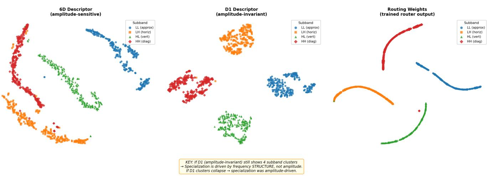  
Figure S3: Amplitude artifact test. t-SNE of three feature spaces, all colored by DWT subband. Left: 6-D descriptor (amplitudesensitive)—subbands separate but with scatter. Center: D1 amplitude-invariant descriptor—four subbands form tighter, cleaner clusters, ruling out the amplitude-artifact hypothesis. Right: Actual routing weight vectors of the trained router—four arcs <sub>cons</sub>i<sub>s</sub>t<sub>en</sub>t <sub>w</sub>ith D1 <sub>s</sub>t<sub>ruc</sub>t<sub>ure, con</sub>fi<sub>rm</sub>i<sub>ng genu</sub>i<sub>ne</sub> f<sub>requency-</sub>b<sub>an</sub>d <sub>spec</sub>i<sub>a</sub>li<sub>za</sub>ti<sub>on.</sub>

Table S6: Seed stabilit<sub>y</sub> of the full model (A3) and the no-SPMoE baseline (A0), PSNR (dB). Two random seeds, best-validation checkpoints. BSD68 and Urban100 are avera<sub>g</sub>ed over �∈{15, 25, 50}; FULL is the mean over the ei<sub>g</sub>ht conditions of Table S3. The +0.46 dB A3−A0 <sub>g</sub>a<sub>p</sub> on FULL is consistent across both seeds and exceeds the <sub>p</sub>er-model seed s<sub>p</sub>read.
<table><tr><td>Model</td><td>Seed</td><td>BSD68</td><td>Urban100</td><td>Rain100L</td><td>SOTS</td><td>FULL</td></tr><tr><td rowspan="3">A3</td><td>1</td><td>30.78</td><td>29.72</td><td>33.01</td><td>27.98</td><td>30.31</td></tr><tr><td>2</td><td>30.75</td><td>29.97</td><td>33.05</td><td>27.03</td><td>30.28</td></tr><tr><td>mean±std</td><td> $3 0 . 7 6 \pm . 0 2$ </td><td> $2 9 . 8 4 \pm . 1 7$ </td><td> $3 3 . 0 3 \pm . 0 2$ </td><td> $2 7 . 5 0 { \scriptstyle \pm . 6 7 }$ </td><td> $3 0 . 2 9 \pm . 0 2$ </td></tr><tr><td rowspan="3">A0</td><td>1</td><td>30.63</td><td>29.46</td><td>31.66</td><td>26.92</td><td>29.86</td></tr><tr><td>2</td><td>30.62</td><td>29.41</td><td>31.32</td><td>27.03</td><td>29.81</td></tr><tr><td>mean±std</td><td>30.62 ±.01</td><td> $2 9 . 4 3 \pm . 0 4$ </td><td> $3 1 . 4 9 \pm . 2 4$ </td><td> $2 6 . 9 8 \pm . 0 8$ </td><td> $2 9 . 8 3 \pm . 0 4$ </td></tr></table>

## S4.2 Efectiveness on Line Artifacts and Rain Structures

A <sub>recurr</sub>i<sub>ng</sub> f<sub>a</sub>il<sub>ure mo</sub>d<sub>e o</sub>f <sub>pure</sub>l<sub>y spa</sub>ti<sub>a</sub>l <sub>res</sub>t<sub>orers</sub> i<sub>s</sub> th<sub>a</sub>t th<sub>ey process eac</sub>h <sub>p</sub>i<sub>xe</sub>l f<sub>rom a</sub> l<sub>oca</sub>l <sub>w</sub>i<sub>n</sub>d<sub>ow, so on</sub> l<sub>ong,</sub> thi<sub>n,</sub> <sub>repea</sub>t<sub>e</sub>d <sub>s</sub>t<sub>ruc</sub>t<sub>ures</sub> th<sub>ey e</sub>ith<sub>er</sub> l<sub>eave res</sub>id<sub>ua</sub>l <sub>ar</sub>tif<sub>ac</sub>t<sub>s or over-</sub> smooth the structure. WaFIR modulates the global Fourier magnitude within each subband, so its correction is spatially <sub>co</sub>h<sub>eren</sub>t <sub>a</sub>l<sub>ong</sub> <sub>an</sub> <sub>en</sub>ti<sub>re</sub> <sub>s</sub>t<sub>ruc</sub>t<sub>ure</sub> <sub>ra</sub>th<sub>er</sub> th<sub>an</sub> filt<sub>ere</sub>d <sub>p</sub>i<sub>ece-</sub> <sub>w</sub>i<sub>se.</sub> W<sub>e exam</sub>i<sub>ne</sub> th<sub>e</sub> t<sub>wo s</sub>t<sub>ruc</sub>t<sub>ure-</sub>d<sub>om</sub>i<sub>na</sub>t<sub>e</sub>d <sub>cases</sub> di<sub>rec</sub>tl<sub>y.</sub>

Line structures (Urban100). On the repeated line and lattice <sub>p</sub>atterns of Urban100 (Fi<sub>g</sub>ure S6), the s<sub>p</sub>atial baselines i<sub>n</sub>t<sub>ro</sub>d<sub>uce</sub> l<sub>oca</sub>li<sub>ze</sub>d <sub>r</sub>i<sub>ng</sub>i<sub>ng</sub> <sub>or</sub> bl<sub>oc</sub>k <sub>ar</sub>tif<sub>ac</sub>t<sub>s</sub> <sub>a</sub>l<sub>ong</sub> thi<sub>n</sub> <sub>e</sub>d<sub>ges,</sub> <sub>w</sub>h<sub>ereas</sub> W<sub>a</sub>FIR <sub>res</sub>t<sub>ores</sub> th<sub>e</sub> f<sub>u</sub>ll li<sub>ne co</sub>h<sub>eren</sub>tl<sub>y w</sub>ith<sub>ou</sub>t <sub>suc</sub>h <sub>ar</sub>tif<sub>ac</sub>t<sub>s.</sub> B<sub>ecause</sub> <sub>a</sub> <sub>per</sub>i<sub>o</sub>di<sub>c</sub> li<sub>ne</sub> <sub>s</sub>t<sub>ruc</sub>t<sub>ure</sub> <sub>maps</sub> t<sub>o</sub> <sub>a</sub> <sub>compac</sub>t<sub>,</sub> <sub>or</sub>i<sub>en</sub>t<sub>e</sub>d <sub>s</sub>i<sub>gna</sub>t<sub>ure</sub> i<sub>n</sub> th<sub>e</sub> f<sub>requency</sub> d<sub>oma</sub>i<sub>n, su</sub>bb<sub>an</sub>d<sub>-w</sub>i<sub>se</sub> <sub>magn</sub>it<sub>u</sub>d<sub>e</sub> <sub>mo</sub>d<sub>u</sub>l<sub>a</sub>ti<sub>on</sub> <sub>correc</sub>t<sub>s</sub> th<sub>e</sub> <sub>w</sub>h<sub>o</sub>l<sub>e</sub> <sub>s</sub>t<sub>ruc</sub>t<sub>ure</sub> <sub>a</sub>t <sub>once</sub> i<sub>n-</sub> <sub>s</sub>t<sub>ea</sub>d <sub>o</sub>f <sub>recons</sub>t<sub>ruc</sub>ti<sub>ng</sub> it <sub>segmen</sub>t b<sub>y segmen</sub>t <sub>prec</sub>i<sub>se</sub>l<sub>y w</sub>h<sub>ere</sub> l<sub>oca</sub>l<sub>-w</sub>i<sub>n</sub>d<sub>ow mo</sub>d<sub>e</sub>l<sub>s</sub> b<sub>rea</sub>k th<sub>e</sub> li<sub>ne</sub> i<sub>n</sub>t<sub>o ar</sub>tif<sub>ac</sub>t<sub>s.</sub>

Rain streaks (out-of-distribution CDD-11). Rain streaks <sub>concen</sub>t<sub>ra</sub>t<sub>e</sub> di<sub>rec</sub>ti<sub>ona</sub>l <sub>energy</sub> i<sub>n</sub> th<sub>e</sub> LH/HL <sub>su</sub>bb<sub>an</sub>d<sub>s.</sub> E<sub>va</sub>l<sub>ua</sub>t<sub>e</sub>d <sub>w</sub>ith<sub>ou</sub>t fi<sub>ne-</sub>t<sub>un</sub>i<sub>ng on</sub> th<sub>e unseen</sub> CDD<sub>-</sub>11 <sub>ra</sub>i<sub>n</sub> (Fi<sub>g</sub>ure S10), WaFIR removes residual streaks more com-<sub>p</sub>l<sub>e</sub>t<sub>e</sub>l<sub>y w</sub>hil<sub>e preserv</sub>i<sub>ng</sub> th<sub>e un</sub>d<sub>er</sub>l<sub>y</sub>i<sub>ng</sub> t<sub>ex</sub>t<sub>ure, s</sub>h<sub>ow</sub>i<sub>ng</sub> th<sub>a</sub>t <sub>su</sub>bb<sub>an</sub>d<sub>-reso</sub>l<sub>ve</sub>d <sub>rou</sub>ti<sub>ng</sub> t<sub>rans</sub>f<sub>ers</sub> t<sub>o ra</sub>i<sub>n s</sub>t<sub>a</sub>ti<sub>s</sub>ti<sub>cs no</sub>t <sub>seen</sub> d<sub>ur</sub>i<sub>ng</sub> t<sub>ra</sub>i<sub>n</sub>i<sub>ng.</sub>

Attribution analysis (LAM / Difusion Index). We quantify why using Local Attribution Maps (LAM) (Gu and Dong, 2021) and their Difusion Index (DI), which measures how widel<sub>y</sub> the contributin<sub>g</sub> in<sub>p</sub>ut <sub>p</sub>ixels are s<sub>p</sub>read (Fi<sub>g</sub>ure S7). W<sub>a</sub>FIR <sub>s</sub>h<sub>ows a su</sub>b<sub>s</sub>t<sub>an</sub>ti<sub>a</sub>ll<sub>y</sub> b<sub>roa</sub>d<sub>er a</sub>tt<sub>r</sub>ib<sub>u</sub>ti<sub>on</sub> f<sub>oo</sub>t<sub>pr</sub>i<sub>n</sub>t <sub>an</sub>d the hi<sub>g</sub>hest DI on both exam<sub>p</sub>les (43.0 and 36.5, versus 18.1– 25.1 for the <sub>p</sub>rom<sub>p</sub>t/fre<sub>q</sub>uenc<sub>y</sub> baselines and ≤ 3.5 for AirNet): <sub>eac</sub>h <sub>ou</sub>t<sub>pu</sub>t <sub>p</sub>i<sub>xe</sub>l d<sub>raws</sub> <sub>on</sub> l<sub>ong-range,</sub> <sub>s</sub>t<sub>ruc</sub>t<sub>ure-cons</sub>i<sub>s</sub>t<sub>en</sub>t f<sub>requency</sub> <sub>ev</sub>id<sub>ence</sub> <sub>ra</sub>th<sub>er</sub> th<sub>an</sub> <sub>a</sub> l<sub>oca</sub>l <sub>w</sub>i<sub>n</sub>d<sub>ow.</sub> Thi<sub>s</sub> <sub>w</sub>id<sub>e,</sub> f<sub>requency-co</sub>h<sub>eren</sub>t <sub>a</sub>tt<sub>r</sub>ib<sub>u</sub>ti<sub>on</sub> fi<sub>e</sub>ld i<sub>s</sub> th<sub>e mec</sub>h<sub>an</sub>i<sub>s</sub>ti<sub>c exp</sub>l<sub>a-</sub> <sub>na</sub>ti<sub>on</sub> f<sub>or</sub> th<sub>e</sub> <sub>ar</sub>tif<sub>ac</sub>t<sub>-</sub>f<sub>ree</sub> li<sub>ne</sub> <sub>an</sub>d <sub>ra</sub>i<sub>n</sub> <sub>recovery</sub> <sub>a</sub>b<sub>ove,</sub> <sub>an</sub>d directly reflects the design thesis, subband-wise global Fourier <sub>mo</sub>d<sub>u</sub>l<sub>a</sub>ti<sub>on</sub> t<sub>ra</sub>d<sub>es</sub> th<sub>e</sub> l<sub>oca</sub>l <sub>recep</sub>ti<sub>ve</sub> fi<sub>e</sub>ld <sub>o</sub>f <sub>pure</sub>l<sub>y spa</sub>ti<sub>a</sub>l <sub>mo</sub>d<sub>e</sub>l<sub>s</sub> f<sub>or a w</sub>id<sub>e, s</sub>t<sub>ruc</sub>t<sub>ure-aware one.</sub>

Table S7: Out-of-distribution generalization. The all-in-one model (trained on Noise–Haze–Rain) is tested directly (no fine-tunin<sub>g</sub>) on: an unseen rain dataset (CDD-11), unseen natural-image denoising (Urban100), and an industrial domain—Scanning Acoustic Microscopy (SAM) for electronic semiconductor ins<sub>p</sub>ection (s<sub>y</sub>nthetic AWGN). Each settin<sub>g</sub> includes an out-of-ran<sub>g</sub>e noise level �=60 be<sub>y</sub>ond the trainin<sub>g</sub> re<sub>g</sub>ime. Metrics: PSNR↑/SSIM↑/LPIPS↓; best <sub>p</sub>er block in bold.
<table><tr><td>Setting</td><td>Method</td><td>PSNR↑</td><td>SSIM↑</td><td>LPIPS↓</td></tr><tr><td rowspan="4">CDD-11 (rain)</td><td>PromptIR</td><td>24.44</td><td>0.8638</td><td>0.1734</td></tr><tr><td>AdaIR</td><td>24.73</td><td>0.8625</td><td>0.1691</td></tr><tr><td>AirNet</td><td>23.07</td><td>0.8263</td><td>0.2198</td></tr><tr><td>WaFIR</td><td>24.94</td><td>0.8746</td><td>0.1577</td></tr><tr><td rowspan="4">Urban100 avg (σ ∈ 15-50)</td><td>PromptIR</td><td>30.77</td><td>0.9121</td><td>0.0612</td></tr><tr><td>AdaIR</td><td>31.23</td><td>0.9193</td><td>0.0569</td></tr><tr><td>AirNet</td><td>30.77</td><td>0.9135</td><td>0.0592</td></tr><tr><td>WaFIR</td><td>31.51</td><td>0.9249</td><td>0.0513</td></tr><tr><td rowspan="4">Urban100 σ=60 (OOD)</td><td>PromptIR</td><td>26.36</td><td>0.8219</td><td>0.1137</td></tr><tr><td>AdaIR</td><td>26.65</td><td>0.8229</td><td>0.1046</td></tr><tr><td>AirNet</td><td>24.95</td><td>0.7411</td><td>0.1826</td></tr><tr><td>WaFIR</td><td>26.78</td><td>0.8148</td><td>0.1061</td></tr><tr><td rowspan="4">SAM avg (σ ∈ 25-50)</td><td>PromptIR</td><td>31.42</td><td>0.8108</td><td>0.2859</td></tr><tr><td>AdaIR</td><td>31.52</td><td>0.8128</td><td>0.2936</td></tr><tr><td>AirNet</td><td>31.32</td><td>0.8049</td><td>0.3243</td></tr><tr><td>WaFIR</td><td>31.63</td><td>0.8152</td><td>0.2718</td></tr><tr><td rowspan="4">SAM σ=60 (OOD)</td><td>PromptIR</td><td>29.15</td><td>0.7320</td><td>0.3100</td></tr><tr><td>AdaIR</td><td>29.20</td><td>0.7317</td><td>0.2492</td></tr><tr><td>AirNet</td><td>27.09</td><td>0.6509</td><td>0.3798</td></tr><tr><td>WaFIR</td><td>29.16</td><td>0.7264</td><td>0.1904</td></tr></table>

## S4.3 Out-of-Distribution Evaluation

For out-of-distribution evaluation: Figures S9 and S10 to-<sub>ge</sub>th<sub>er w</sub>ith T<sub>a</sub>bl<sub>e</sub> S7 <sub>presen</sub>t <sub>represen</sub>t<sub>a</sub>ti<sub>ve resu</sub>lt<sub>s compar</sub>i<sub>ng</sub> W<sub>a</sub>FIR <sub>aga</sub>i<sub>ns</sub>t <sub>s</sub>t<sub>a</sub>t<sub>e-o</sub>f<sub>-</sub>th<sub>e-ar</sub>t <sub>a</sub>ll<sub>-</sub>i<sub>n-one me</sub>th<sub>o</sub>d<sub>s.</sub>

## S5 Computational Complexity

T<sub>a</sub>bl<sub>e</sub> S8 <sub>summar</sub>i<sub>zes</sub> th<sub>e parame</sub>t<sub>er over</sub>h<sub>ea</sub>d <sub>o</sub>f th<sub>e</sub> th<sub>ree</sub> SPMoE levels. The dee<sub>p</sub>est level (s<sub>p</sub>moe3, �=384) dominates d<sub>ue</sub> t<sub>o</sub> th<sub>e w</sub>id<sub>er c</sub>h<sub>anne</sub>l di<sub>mens</sub>i<sub>on.</sub> Th<sub>e</sub> t<sub>o</sub>t<sub>a</sub>l <sub>over</sub>h<sub>ea</sub>d i<sub>s</sub> +6.56M <sub>p</sub>arameters (+18.4%) over the Prom<sub>p</sub>tIR baseline.

T<sub>a</sub>bl<sub>e</sub> S8<sub>:</sub> P<sub>a</sub>r<sub>a</sub>m<sub>e</sub>t<sub>e</sub>r br<sub>ea</sub>kd<sub>ow</sub>n b<sub>y</sub> SPM<sub>o</sub>E l<sub>eve</sub>l<sub>.</sub>
<table><tr><td>Component</td><td>Channels  $C _ { \ell }$ </td><td>Params</td></tr><tr><td>PromptIR baseline</td><td>一</td><td>35.59M</td></tr><tr><td>SPMoE-L1 (spmoe1)</td><td>96</td><td>+0.32M</td></tr><tr><td>SPMoE-L2 (spmoe2)</td><td>192</td><td>+1.22M</td></tr><tr><td>SPMoE-L3 (spmoe3)</td><td>384</td><td>+5.02M</td></tr><tr><td>WaFIR (full)</td><td></td><td>42.15M</td></tr></table>

W<sub>e</sub> f<sub>u</sub>rth<sub>e</sub>r <sub>co</sub>m<sub>pa</sub>r<sub>e</sub> W<sub>a</sub>FIR <sub>aga</sub>in<sub>s</sub>t r<sub>ep</sub>r<sub>ese</sub>nt<sub>a</sub>ti<sub>ve</sub> <sub>a</sub>ll<sub>-</sub>in<sub>-</sub> <sub>one res</sub>t<sub>ora</sub>ti<sub>on</sub> b<sub>ase</sub>li<sub>nes</sub> i<sub>n</sub> t<sub>erms o</sub>f <sub>parame</sub>t<sub>er coun</sub>t<sub>, com-</sub> <sub>pu</sub>t<sub>a</sub>ti<sub>ona</sub>l <sub>cos</sub>t<sub>, an</sub>d <sub>wa</sub>ll<sub>-c</sub>l<sub>oc</sub>k i<sub>n</sub>f<sub>erence</sub> l<sub>a</sub>t<sub>ency.</sub> T<sub>a</sub>bl<sub>e</sub> S9 re<sub>p</sub>orts results measured on the CDD dataset test set (200 rain ima<sub>g</sub>es), on a sin<sub>g</sub>le RTX 3060 GPU. AirNet has the fewest <sub>p</sub>arameters (8.93M), but the hi<sub>g</sub>hest FLOPs (602.55G) and the <sub>s</sub>l<sub>owes</sub>t i<sub>n</sub>f<sub>erence, s</sub>i<sub>nce</sub> it<sub>s con</sub>t<sub>ras</sub>ti<sub>ve enco</sub>d<sub>er processes</sub> th<sub>e</sub> i<sub>npu</sub>t t<sub>w</sub>i<sub>ce</sub> <sub>an</sub>d it<sub>s</sub> d<sub>e</sub>f<sub>orma</sub>bl<sub>e</sub> <sub>convo</sub>l<sub>u</sub>ti<sub>ons</sub> <sub>are</sub> <sub>compu</sub>t<sub>a</sub>ti<sub>on-</sub> <sub>a</sub>ll<sub>y</sub> <sub>expens</sub>i<sub>ve.</sub> Ad<sub>a</sub>IR i<sub>s</sub> th<sub>e</sub> <sub>mos</sub>t <sub>parame</sub>t<sub>er-</sub> <sub>an</sub>d <sub>compu</sub>t<sub>e-</sub> eficient baseline (28.79M <sub>p</sub>arams, 294.36G FLOPs). WaFIR <sub>a</sub>dd<sub>s app</sub>r<sub>ox</sub>im<sub>a</sub>t<sub>e</sub>l<sub>y</sub> 6M <sub>pa</sub>r<sub>a</sub>m<sub>e</sub>t<sub>e</sub>r<sub>s ove</sub>r Pr<sub>o</sub>m<sub>p</sub>tIR f<sub>o</sub>r th<sub>e</sub> <sub>spec</sub>t<sub>ra</sub>l <sub>m</sub>i<sub>x</sub>t<sub>ure-o</sub>f<sub>-exper</sub>t<sub>s</sub> d<sub>eco</sub>d<sub>er,</sub> <sub>w</sub>ith <sub>on</sub>l<sub>y</sub> <sub>a</sub> <sub>mo</sub>d<sub>es</sub>t i<sub>n-</sub> <sub>crease</sub> i<sub>n</sub> FLOP<sub>s an</sub>d i<sub>n</sub>f<sub>erence</sub> l<sub>a</sub>t<sub>ency, w</sub>hil<sub>e ac</sub>hi<sub>ev</sub>i<sub>ng</sub> th<sub>e</sub> b<sub>es</sub>t <sub>res</sub>t<sub>ora</sub>ti<sub>on</sub> <sub>qua</sub>lit<sub>y.</sub>

Time and space complexity. With �=�� spatial positions <sub>an</sub>d � <sub>c</sub>h<sub>anne</sub>l<sub>s, eac</sub>h SPM<sub>o</sub>E bl<sub>oc</sub>k i<sub>s</sub> d<sub>om</sub>i<sub>na</sub>t<sub>e</sub>d b<sub>y</sub> th<sub>e per-</sub> subband FFT/iFFT at O(�� lo<sub>g</sub> �) Coole<sub>y</sub> and Tuke<sub>y</sub> (1965) and the 1×1 channel mixin<sub>g</sub> at $O ( N C ^ { 2 } )$ , <sub>g</sub>ivin<sub>g</sub> O (�� lo<sub>g</sub> �+ $N C ^ { 2 } )$ ti<sub>me,</sub> i<sub>.e. near-</sub>li<sub>near</sub> i<sub>n</sub> � <sub>an</sub>d f<sub>ree o</sub>f th<sub>e</sub> $O ( N ^ { 2 } C )$ <sub>cos</sub>t <sub>o</sub>f <sub>spa</sub>ti<sub>a</sub>l <sub>se</sub>lf<sub>-a</sub>tt<sub>en</sub>ti<sub>on.</sub> A<sub>c</sub>ti<sub>va</sub>ti<sub>on memory</sub> i<sub>s</sub> $O ( N C )$ (linear in �), and the added <sub>p</sub>arameters are $O ( C ^ { 2 } )$ <sub>per</sub> l<sub>eve</sub>l<sub>,</sub> inde<sub>p</sub>endent of resolution (6.56M total, Table S8).

T<sub>a</sub>bl<sub>e</sub> S9<sub>:</sub> C<sub>ompu</sub>t<sub>a</sub>ti<sub>ona</sub>l <sub>comp</sub>l<sub>ex</sub>it<sub>y</sub> <sub>an</sub>d <sub>res</sub>t<sub>ora</sub>ti<sub>on</sub> <sub>qua</sub>lit<sub>y</sub> com<sub>p</sub>arison, measured on the CDD dataset test set (200 rain ima<sub>g</sub>es) on a sin<sub>g</sub>le RTX 3060 GPU. Inference time is re<sub>p</sub>orted as mean ± std (ms); PSNR/SSIM are avera<sub>g</sub>ed over the same 200 im<sub>ages.</sub>
<table><tr><td>Model</td><td>Params (M)</td><td>GFLOPs</td><td>Inference (ms)</td><td>PSNR / SSIM</td></tr><tr><td>PromptIR</td><td>35.59</td><td>316.28</td><td> $1 8 0 . 8 7 \pm 0 . 3 7$ </td><td>24.4413 / 0.8638</td></tr><tr><td>AdaIR</td><td>28.79</td><td>294.36</td><td> $1 9 0 . 4 4 \pm 2 . 9 6$ </td><td>24.7290 / 0.8625</td></tr><tr><td>AirNet</td><td>8.93</td><td>602.55</td><td> $3 2 0 . 9 7 \pm 2 . 6 9$ </td><td>23.0681 / 0.8263</td></tr><tr><td>WaFIR</td><td>42.15</td><td>321.11</td><td> $1 9 9 . 5 2 \pm 1 . 6 3 $ </td><td>24.9357 / 0.8746</td></tr></table>

## S6 Limitations and Future Work

O<sub>ur mo</sub>d<sub>e</sub>l h<sub>as severa</sub>l li<sub>m</sub>it<sub>a</sub>ti<sub>ons</sub> th<sub>a</sub>t <sub>s</sub>h<sub>ou</sub>ld b<sub>e ac</sub>k<sub>now</sub>l<sub>-</sub> <sub>e</sub>d<sub>ge</sub>d<sub>.</sub>

• Parameter overhead. The +18.4% <sub>p</sub>arameter overhead (42.15M total) <sub>p</sub>laces WaFIR above li<sub>g</sub>htwei<sub>g</sub>ht com<sub>p</sub>etitors (An<sub>y</sub>IR Ren et al. (2026): 6M, MoCE-IR Zamfir et al. (2025): 25M). Two directions could reduce this cost. The fi<sub>rs</sub>t i<sub>s</sub> k<sub>now</sub>l<sub>e</sub>d<sub>ge</sub> di<sub>s</sub>till<sub>a</sub>ti<sub>on</sub> f<sub>rom</sub> W<sub>a</sub>FIR t<sub>o a compac</sub>t <sub>s</sub>t<sub>u</sub>d<sub>en</sub>t<sub>.</sub> Th<sub>e secon</sub>d <sub>exp</sub>l<sub>o</sub>it<sub>s</sub> th<sub>e</sub> i<sub>n</sub>t<sub>erpo</sub>l<sub>a</sub>ti<sub>on proper</sub>ti<sub>es</sub> of the s<sub>p</sub>ectral (Fourier) domain: since the <sub>p</sub>er-frequenc<sub>y</sub> <sub>magn</sub>it<sub>u</sub>d<sub>e an</sub>d <sub>p</sub>h<sub>ase mo</sub>d<sub>u</sub>l<sub>a</sub>ti<sub>ons pro</sub>d<sub>uce</sub>d b<sub>y</sub> th<sub>e ex-</sub> <sub>p</sub>erts var<sub>y</sub> smoot<sup>hl</sup><sub>y</sub> across <sup>f</sup>re<sub>q</sub>uenc<sub>y</sub>, t<sup>h</sup>e<sub>y</sub> cou<sup>ld</sup> <sup>b</sup>e <sub>p</sub>redi<sub>c</sub>t<sub>e</sub>d <sub>on a coarse</sub> f<sub>requency gr</sub>id <sub>an</sub>d i<sub>n</sub>t<sub>erpo</sub>l<sub>a</sub>t<sub>e</sub>d b<sub>ac</sub>k t<sub>o</sub> f<sub>u</sub>ll <sub>reso</sub>l<sub>u</sub>ti<sub>on, so</sub> th<sub>a</sub>t th<sub>e spec</sub>t<sub>ra</sub>l <sub>exper</sub>t<sub>s opera</sub>t<sub>e</sub> <sub>on</sub> <sub>a</sub> <sub>re</sub>d<sub>uce</sub>d <sub>se</sub>t <sub>o</sub>f f<sub>requency</sub> <sub>coe</sub>fi<sub>c</sub>i<sub>en</sub>t<sub>s</sub> <sub>an</sub>d <sub>cu</sub>t b<sub>o</sub>th p<sup>arameters</sup> <sup>and</sup> <sup>com</sup>pu<sup>te</sup>.

• Dehazing. WaFIR trails its Prom<sub>p</sub>tIR reference on dehazin<sub>g</sub> (29.70 vs. 30.58 dB on SOTS), des<sub>p</sub>ite identi<sub>ca</sub>l f<sub>u</sub>ll<sub>-</sub>RESIDE t<sub>ra</sub>i<sub>n</sub>i<sub>ng.</sub> W<sub>e</sub> <sub>a</sub>tt<sub>r</sub>ib<sub>u</sub>t<sub>e</sub> thi<sub>s</sub> t<sub>o</sub> th<sub>e</sub> d<sub>egra</sub>d<sub>a</sub>ti<sub>on an</sub>d th<sub>e</sub> t<sub>ra</sub>i<sub>n</sub>i<sub>ng sc</sub>h<sub>e</sub>d<sub>u</sub>l<sub>e, no</sub>t th<sub>e</sub> SP<sub>-</sub> M<sub>o</sub>E <sub>mo</sub>d<sub>u</sub>l<sub>e.</sub> U<sub>n</sub>d<sub>er</sub> th<sub>e</sub> <sub>a</sub>t<sub>mosp</sub>h<sub>er</sub>i<sub>c</sub> <sub>sca</sub>tt<sub>er</sub>i<sub>ng</sub> <sub>mo</sub>d<sub>e</sub>l �=��+�(1−�) He, Sun, and Tan<sub>g</sub> (2009), haze is a <sub>smoo</sub>th<sub>,</sub> <sub>or</sub>i<sub>en</sub>t<sub>a</sub>ti<sub>on-</sub>f<sub>ree,</sub> l<sub>ow-</sub>f<sub>requency</sub> d<sub>egra</sub>d<sub>a</sub>ti<sub>on</sub> th<sub>a</sub>t l<sub>ac</sub>k<sub>s</sub> th<sub>e</sub> fi<sub>xe</sub>d di<sub>rec</sub>ti<sub>ona</sub>l <sub>s</sub>i<sub>gna</sub>t<sub>ure</sub> <sub>ra</sub>i<sub>n</sub> <sub>an</sub>d <sub>no</sub>i<sub>se</sub> <sub>pro-</sub> <sub>v</sub>id<sub>e, so</sub> th<sub>e su</sub>bb<sub>an</sub>d <sub>rou</sub>t<sub>er</sub> h<sub>as</sub> littl<sub>e s</sub>t<sub>ruc</sub>t<sub>ure</sub> t<sub>o</sub> k<sub>ey</sub> <sub>on.</sub> E<sub>mp</sub>i<sub>r</sub>i<sub>ca</sub>ll<sub>y,</sub> th<sub>e s</sub>h<sub>are</sub>d <sub>sc</sub>h<sub>e</sub>d<sub>u</sub>l<sub>e a</sub>l<sub>so un</sub>d<sub>er-serves</sub> dehazin<sub>g</sub> (re<sub>p</sub>eat factor one, versus heavil<sub>y</sub> u<sub>p</sub>-sam<sub>p</sub>led rain and noise), <sub>y</sub>et under a matched bud<sub>g</sub>et SPMoE still improves SOTS over PromptIR (27.56 vs. 27.06 dB), indi<sub>ca</sub>ti<sub>ng an op</sub>ti<sub>m</sub>i<sub>za</sub>ti<sub>on-</sub>b<sub>a</sub>l<sub>ance e</sub>f<sub>ec</sub>t <sub>ra</sub>th<sub>er</sub> th<sub>an an ar-</sub> <sub>c</sub>hit<sub>ec</sub>t<sub>ura</sub>l li<sub>m</sub>it<sub>.</sub> T<sub>wo</sub> di<sub>rec</sub>ti<sub>ons cou</sub>ld <sub>c</sub>l<sub>ose</sub> th<sub>e gap:</sub> t<sub>as</sub>k<sub>-</sub> balanced schedulin<sub>g</sub> (e.<sub>g</sub>., uncertaint<sub>y</sub>-based wei<sub>g</sub>htin<sub>g</sub>), <sub>an</sub>d <sub>a</sub>d<sub>ap</sub>ti<sub>ve</sub>l<sub>y up-we</sub>i<sub>g</sub>hti<sub>ng</sub> th<sub>e promp</sub>t <sub>con</sub>t<sub>ex</sub>t <sub>w</sub>h<sub>en</sub> th<sub>e spec</sub>t<sub>ra</sub>l d<sub>escr</sub>i<sub>p</sub>t<sub>or</sub> i<sub>s un</sub>i<sub>n</sub>f<sub>orma</sub>ti<sub>ve, as</sub> f<sub>or</sub> h<sub>aze.</sub>

• Degradation scope and compound cases. WaFIR cur-<sub>ren</sub>tl<sub>y</sub> <sub>covers</sub> <sub>no</sub>i<sub>se,</sub> <sub>ra</sub>i<sub>n,</sub> <sub>an</sub>d h<sub>aze;</sub> <sub>ex</sub>t<sub>en</sub>di<sub>ng</sub> t<sub>o</sub> d<sub>e</sub>bl<sub>ur-</sub> <sub>r</sub>i<sub>ng</sub> <sub>an</sub>d <sub>rea</sub>l<sub>-wor</sub>ld i<sub>mages</sub> i<sub>s</sub> <sub>a</sub> <sub>na</sub>t<sub>ura</sub>l di<sub>rec</sub>ti<sub>on.</sub> C<sub>om-</sub> <sub>poun</sub>d d<sub>egra</sub>d<sub>a</sub>ti<sub>ons</sub> f<sub>ur</sub>th<sub>er rema</sub>i<sub>n a s</sub>h<sub>are</sub>d f<sub>a</sub>il<sub>ure mo</sub>d<sub>e:</sub> on haze+noise, both learned and label-conditioned routin<sub>g</sub> colla<sub>p</sub>se to ≈15.7 dB (Table S4), and at �=60 WaFIR does not lead on ever<sub>y</sub> metric (Table S7); robust mixedd<sub>egra</sub>d<sub>a</sub>ti<sub>on</sub> h<sub>an</sub>dli<sub>ng</sub> <sub>rema</sub>i<sub>ns</sub> <sub>open.</sub>

• Spectral descriptor. The am<sub>p</sub>litude-invariance control i<sub>n</sub> S<sub>ec</sub>ti<sub>on</sub> S2<sub>.</sub>4 <sub>sugges</sub>t<sub>s</sub> th<sub>a</sub>t <sub>ra</sub>ti<sub>o-</sub>b<sub>ase</sub>d <sub>spec</sub>t<sub>ra</sub>l d<sub>e-</sub> scri<sub>p</sub>tors (D1) ma<sub>y</sub> out<sub>p</sub>erform the current absolute-<sub>magn</sub>it<sub>u</sub>d<sub>e</sub> d<sub>escr</sub>i<sub>p</sub>t<sub>or.</sub> S<sub>u</sub>b<sub>s</sub>tit<sub>u</sub>ti<sub>ng</sub> D1 <sub>an</sub>d <sub>measur</sub>i<sub>ng</sub> th<sub>e</sub> im<sub>pac</sub>t <sub>o</sub>n PSNR i<sub>s a co</sub>n<sub>c</sub>r<sub>e</sub>t<sub>e</sub> f<sub>u</sub>t<sub>u</sub>r<sub>e expe</sub>rim<sub>e</sub>nt<sub>.</sub>

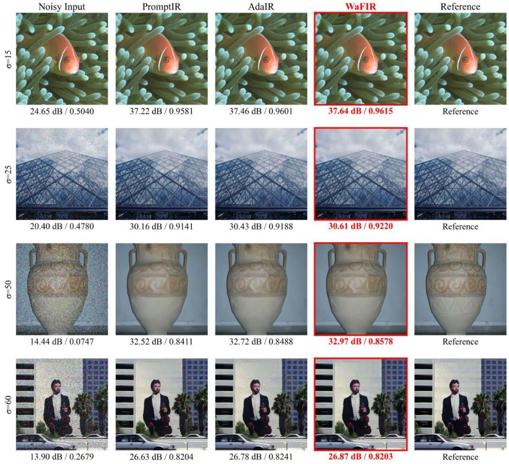  
Figure S4: Qualitative denoising on BSD68. Rows correspond to noise levels � ∈ {15, 25, 50, 60}. Columns show the noisy input, PromptIR, AdaIR, WaFIR (ours), and the reference image. WaFIR suppresses noise while preserving finer structures, with the diferences becomin<sub>g</sub> most visible at � ∈ {50, 60}. Zoomed crops hi<sub>g</sub>hli<sub>g</sub>ht re<sub>g</sub>ions in which competin<sub>g</sub> methods <sub>over-smoo</sub>th t<sub>ex</sub>t<sub>ure</sub> <sub>or</sub> <sub>wea</sub>k<sub>en</sub> <sub>e</sub>d<sub>ge</sub> <sub>con</sub>t<sub>ras</sub>t<sub>.</sub>

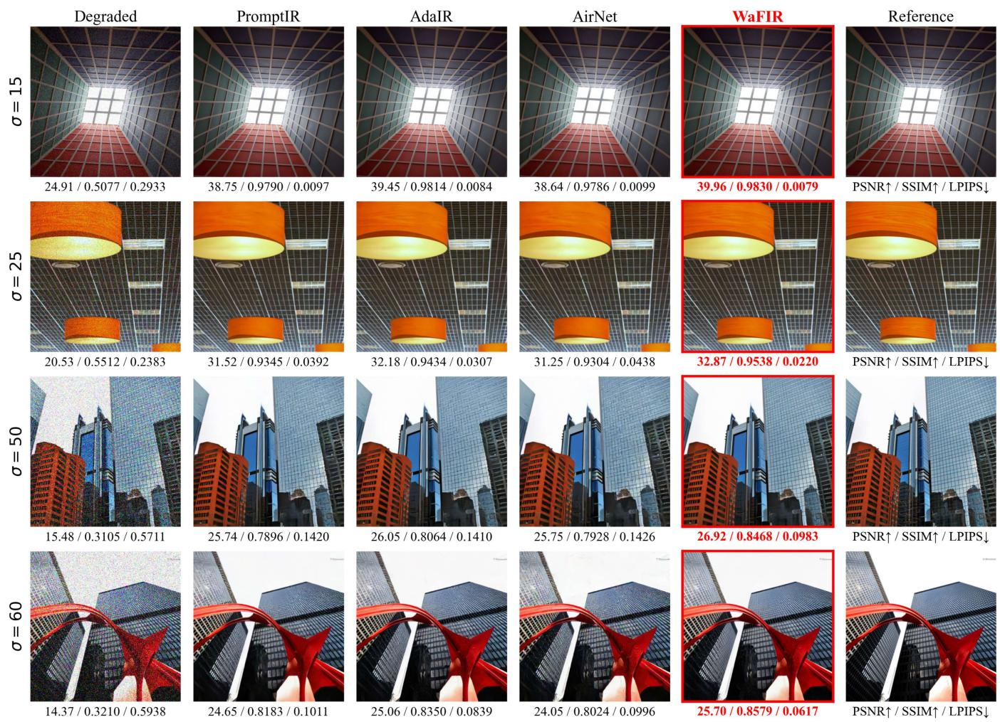  
Figure S5: Cross-dataset denoising on Urban100. The all-in-one models are evaluated directly on Urban100, including the out-of-ran<sub>g</sub>e noise level �=60, without fine-tunin<sub>g</sub>. The com<sub>p</sub>arison em<sub>p</sub>hasizes <sub>p</sub>reservation of re<sub>p</sub>eated ed<sub>g</sub>es, line <sub>p</sub>atterns, <sub>an</sub>d hi<sub>g</sub>h<sub>-</sub>f<sub>requency arc</sub>hit<sub>ec</sub>t<sub>ura</sub>l d<sub>e</sub>t<sub>a</sub>il<sub>s un</sub>d<sub>er</sub> d<sub>a</sub>t<sub>ase</sub>t <sub>an</sub>d <sub>no</sub>i<sub>se-</sub>i<sub>n</sub>t<sub>ens</sub>it<sub>y s</sub>hift<sub>.</sub>

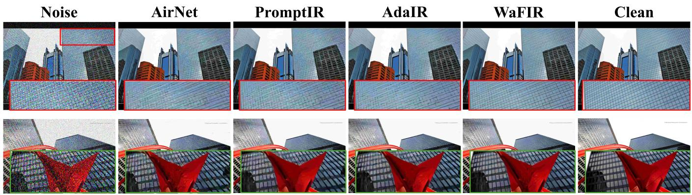  
Figure S6: Zoomed line-structure recovery on Urban100. Close-up crops of repeated line and lattice patterns under denoising. Because WaFIR modulates the global Fourier magnitude within each subband, its correction is spatially coherent across the <sub>w</sub>h<sub>o</sub>l<sub>e</sub> li<sub>ne s</sub>t<sub>ruc</sub>t<sub>ure;</sub> it th<sub>ere</sub>f<sub>ore res</sub>t<sub>ores</sub> l<sub>ong,</sub> thi<sub>n e</sub>d<sub>ges w</sub>ith<sub>ou</sub>t th<sub>e</sub> l<sub>oca</sub>li<sub>ze</sub>d bl<sub>oc</sub>k <sub>or r</sub>i<sub>ng</sub>i<sub>ng ar</sub>tif<sub>ac</sub>t<sub>s</sub> th<sub>a</sub>t <sub>pure</sub>l<sub>y spa</sub>ti<sub>a</sub>l (local-window) models tend to introduce alon<sub>g</sub> such structures. This behavior—coherent <sub>g</sub>lobal frequenc<sub>y</sub> correction rather than <sub>p</sub>i<sub>ecew</sub>i<sub>se</sub> l<sub>oca</sub>l filt<sub>er</sub>i<sub>ng—</sub>i<sub>s a</sub> di<sub>s</sub>ti<sub>nc</sub>ti<sub>ve s</sub>t<sub>reng</sub>th <sub>o</sub>f W<sub>a</sub>FIR <sub>on per</sub>i<sub>o</sub>di<sub>c,</sub> hi<sub>g</sub>h<sub>-</sub>f<sub>requency con</sub>t<sub>en</sub>t<sub>.</sub>

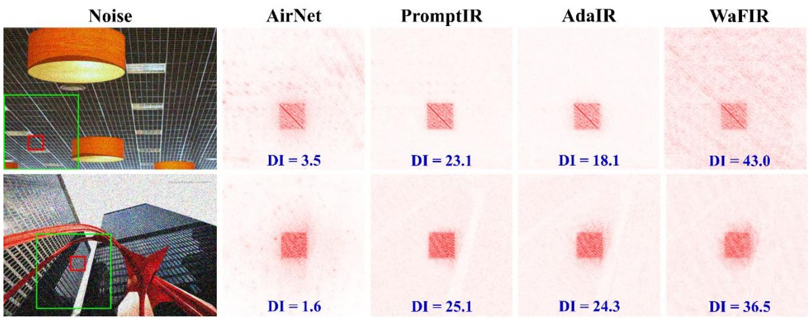  
Figure S7: Local Attribution Maps (LAM) and Difusion Index (DI) on Urban100. For a fixed target region (red box), LAM (Gu and Don , 2021) hi hli hts the in ut ixels that contribute to reconstructin that re ion; the Difusion Index (DI) summarizes the s<sub>p</sub>atial extent of this attribution (hi<sub>g</sub>her DI = information a<sub>gg</sub>re<sub>g</sub>ated from a wider area). The DI value is annotated below each <sub>p</sub>anel. WaFIR attains the hi<sub>g</sub>hest DI on both exam<sub>p</sub>les (row 1: 43.0 vs. AdaIR 18.1, Prom<sub>p</sub>tIR 23.1, AirNet 3.5; row 2: 36.5 vs. AdaIR 24.3, Prom<sub>p</sub>tIR 25.1, AirNet 1.6), exhibitin<sub>g</sub> a markedl<sub>y</sub> broader attribution foot<sub>p</sub>rint, <sub>w</sub>h<sub>ereas</sub> th<sub>e spa</sub>ti<sub>a</sub>l b<sub>ase</sub>li<sub>nes concen</sub>t<sub>ra</sub>t<sub>e a</sub>tt<sub>r</sub>ib<sub>u</sub>ti<sub>on</sub> i<sub>n a narrower ne</sub>i<sub>g</sub>hb<sub>or</sub>h<sub>oo</sub>d<sub>.</sub> Thi<sub>s</sub> i<sub>s</sub> th<sub>e</sub> di<sub>rec</sub>t i<sub>n</sub>t<sub>erpre</sub>t<sub>a</sub>bilit<sub>y s</sub>i<sub>gna</sub>t<sub>ure</sub> of WaFIR’s design: subband-wise global Fourier modulation lets every output pixel draw on long-range, structure-consistent f<sub>re uenc ev</sub>id<sub>ence w</sub>hi<sub>c</sub>h <sub>ex</sub> l<sub>a</sub>i<sub>ns</sub> b<sub>o</sub>th th<sub>e ar</sub>tif<sub>ac</sub>t<sub>-</sub>f<sub>ree</sub> li<sub>ne recover</sub> i<sub>n</sub> Fi <sub>ure</sub> S6 <sub>an</sub>d th<sub>e s</sub>h<sub>ar er e</sub>d <sub>es re or</sub>t<sub>e</sub>d <sub>uan</sub>tit<sub>a</sub>ti<sub>ve</sub>l i<sub>n</sub> T<sub>a</sub>bl<sub>e</sub> S7<sub>.</sub>

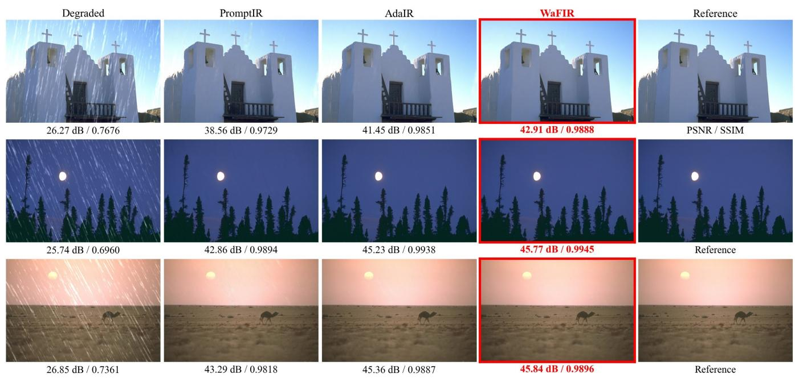  
Figure S8: Qualitative deraining on Rain100L. Columns show the rainy input, PromptIR, AdaIR, WaFIR (ours), and the <sub>re</sub>f<sub>erence</sub> i<sub>mage.</sub> W<sub>a</sub>FIR <sub>removes res</sub>id<sub>ua</sub>l <sub>s</sub>t<sub>rea</sub>k<sub>s w</sub>hil<sub>e re</sub>t<sub>a</sub>i<sub>n</sub>i<sub>ng</sub> fi<sub>ne scene s</sub>t<sub>ruc</sub>t<sub>ure an</sub>d <sub>avo</sub>idi<sub>ng excess</sub>i<sub>ve smoo</sub>thi<sub>ng.</sub>

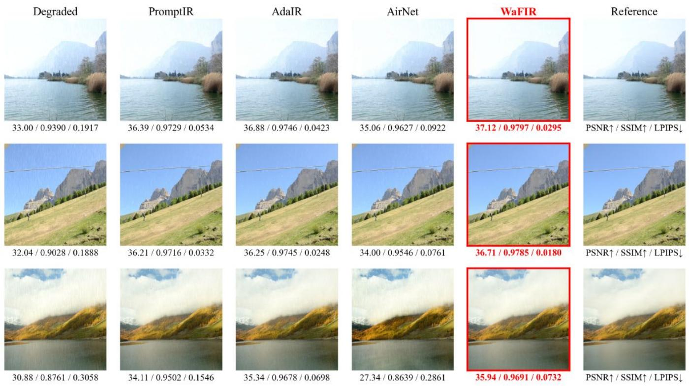  
Figure S9: Qualitative deraining on the unseen CDD-11 dataset. Models are trained on the source datasets and evaluated <sub>on</sub> CDD<sub>-</sub>11 <sub>w</sub>ith<sub>ou</sub>t fi<sub>ne-</sub>t<sub>un</sub>i<sub>ng</sub> t<sub>o</sub> t<sub>es</sub>t <sub>cross-</sub>d<sub>a</sub>t<sub>ase</sub>t <sub>genera</sub>li<sub>za</sub>ti<sub>on.</sub> C<sub>o</sub>l<sub>umns s</sub>h<sub>ow</sub> th<sub>e ra</sub>i<sub>ny</sub> i<sub>npu</sub>t<sub>,</sub> P<sub>romp</sub>tIR<sub>,</sub> Ad<sub>a</sub>IR<sub>,</sub> Ai<sub>r</sub>N<sub>e</sub>t<sub>,</sub> WaFIR (ours), and the reference; displayed metrics are PSNR↑/SSIM↑/LPIPS↓. WaFIR removes rain streaks more thoroughly <sub>an</sub>d <sub>a</sub>tt<sub>a</sub>i<sub>ns</sub> th<sub>e</sub> b<sub>es</sub>t PSNR/SSIM <sub>across</sub> th<sub>e</sub> ill<sub>us</sub>t<sub>ra</sub>t<sub>e</sub>d <sub>examp</sub>l<sub>es.</sub>

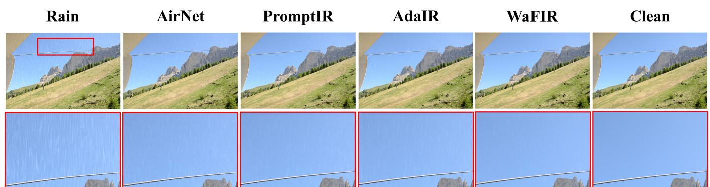  
Figure S10: Zoomed deraining on the unseen CDD-11 dataset (out-of-distribution). Close-up crops for a rain pattern outside th<sub>e</sub> t<sub>ra</sub>i<sub>n</sub>i<sub>ng</sub> di<sub>s</sub>t<sub>r</sub>ib<sub>u</sub>ti<sub>on.</sub> E<sub>va</sub>l<sub>ua</sub>t<sub>e</sub>d <sub>w</sub>ith<sub>ou</sub>t fi<sub>ne-</sub>t<sub>un</sub>i<sub>ng,</sub> W<sub>a</sub>FIR <sub>removes res</sub>id<sub>ua</sub>l <sub>s</sub>t<sub>rea</sub>k<sub>s more comp</sub>l<sub>e</sub>t<sub>e</sub>l<sub>y w</sub>hil<sub>e preserv</sub>i<sub>ng</sub> <sub>un</sub>d<sub>er</sub>l<sub>y</sub>i<sub>ng</sub> t<sub>ex</sub>t<sub>ure,</sub> ill<sub>us</sub>t<sub>ra</sub>ti<sub>ng</sub> th<sub>a</sub>t <sub>su</sub>bb<sub>an</sub>d<sub>-reso</sub>l<sub>ve</sub>d f<sub>requency rou</sub>ti<sub>ng genera</sub>li<sub>zes</sub> t<sub>o ra</sub>i<sub>n s</sub>t<sub>a</sub>ti<sub>s</sub>ti<sub>cs never seen</sub> d<sub>ur</sub>i<sub>ng</sub> t<sub>ra</sub>i<sub>n</sub>i<sub>ng.</sub>

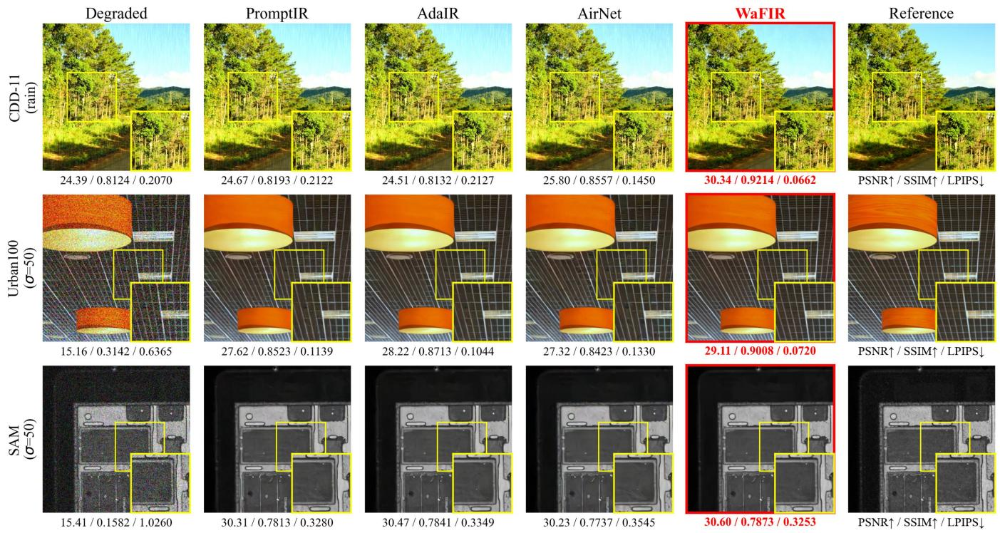  
Fi ure S11: Qualitative cross-domain generalization. One exam le er domain: unseen rain (CDD-11), natural-ima e de noisin<sub>g</sub> (Urban100, �=50), and an industrial domain—Scannin<sub>g</sub> Acoustic Microsco<sub>py</sub> of an electronic semiconductor <sub>p</sub>acka<sub>g</sub>e (SAM, �=50). Columns: de raded in ut, Prom tIR, AdaIR, AirNet, WaFIR (ours), reference; PSNR↑/SSIM↑/LPIPS↓ below <sub>eac</sub>h <sub>ane</sub>l<sub>.</sub> T<sub>ra</sub>i<sub>ne</sub>d <sub>on</sub>l <sub>on no</sub>i<sub>se–</sub>h<sub>aze–ra</sub>i<sub>n an</sub>d <sub>a</sub> li<sub>e</sub>d <sub>w</sub>ith<sub>ou</sub>t fi<sub>ne-</sub>t<sub>un</sub>i<sub>n ,</sub> W<sub>a</sub>FIR <sub>a</sub>tt<sub>a</sub>i<sub>ns</sub> th<sub>e</sub> b<sub>es</sub>t <sub>me</sub>t<sub>r</sub>i<sub>cs on</sub> th<sub>e exam</sub> l<sub>e</sub> shown; <sub>p</sub>er-metric outcomes at �=60 var<sub>y</sub> across methods (Table S7).