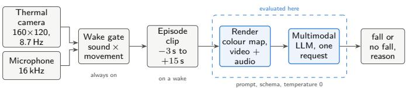
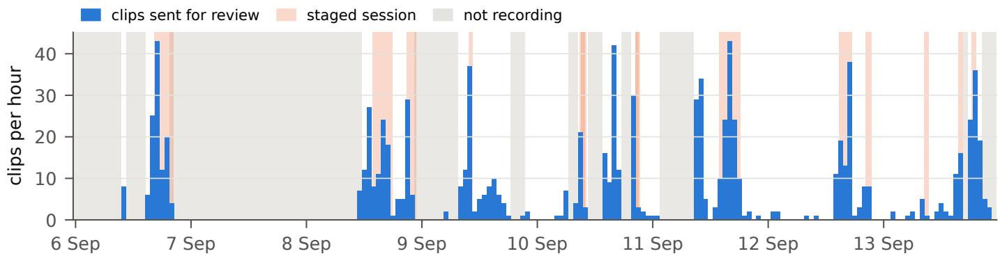
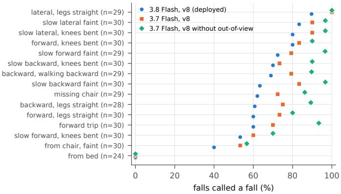
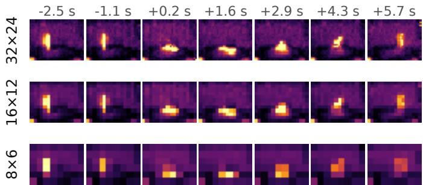
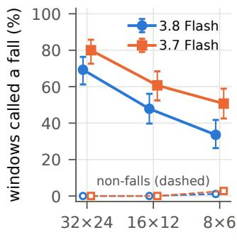
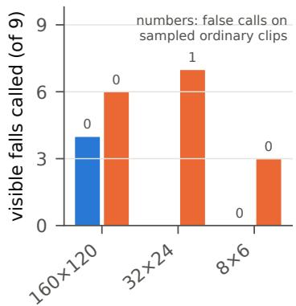
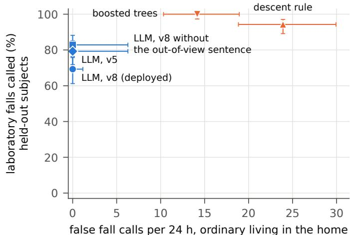

# Asking a Multimodal LLM Whether Someone Fell: Zero-Shot Screening of Low-Resolution Thermal Video in a Laboratory and an Occupied Home

Marcos Junca and Mauro Junca

Senecta Inc.

marcos@senecta.ai

Abstract—Thermal cameras can watch over older people living alone without capturing faces, and multimodal large language models (LLMs) can judge a short video without task-specific training. We evaluate a production multimodal LLM, Gemini 3.8 Flash at temperature 0, as the decision stage of an event-triggered fall screener, used exactly as a deployed prototype uses it: one request per short thermal clip, with its sound track when there is one, and its predecessor Gemini 3.7 Flash on the same requests. On 438 staged falls and 563 non-fall windows that we located by hand in a public 32 × 24 thermal dataset, the deployed request called 69% of the held-out subjects’ falls (67% over all subjects; bed falls excluded) and none of 499 non-fall windows, including people lying on the floor and getting up. Over 76 h of ordinary life in an occupied room, recorded at 160 × 120 with sound, it called none of 395 clips a fall (95% upper bound 1.2 false alarms per day) and caught 4 of the 9 staged falls the camera could see. One cautionary sentence in the prompt (“a person who goes out of view . . . is not a fall”) accounted for many of the misses: removing it raised sensitivity on the held-out subjects from 69% to 83% on 3.8 Flash and from 80% to 92% on Gemini 3.7 Flash, and in the home from 4 to 9 of the 9 visible falls, with no false call in ordinary living but at the price of calling deliberate lie-downs a fall. Sensitivity collapsed at 8 × 6 pixels (34%); identical requests disagreed on 4% of windows; and when the model called a fall, its explanation placed it within a second of the annotated landing 99% of the time. Two conventional detectors trained on the laboratory data caught nearly every held-out laboratory fall but raised 14.2 and 23.9 false alarms per day in the home. We release the frame-level fall annotations of the public dataset and every model answer on it.

Index Terms—fall detection, thermal imaging, thermopile array, multimodal large language model, visionlanguage model, ambient assisted living, privacypreserving sensing, false alarms

## I. Introduction

Falls are a leading cause of injury among older adults, and what happens after the fall matters as much as the fall itself. In a cohort of people over 90, about 80% of those who fell could not get up unaided after at least one fall, three in ten of them lay on the floor for an hour or more, over 80% of falls happened when they were alone, and call alarms, though widely available, went unused in most falls [1]. A system that notices a fall and asks the person whether they are all right could shorten that time. Wearable alarms only help when they are worn and pressed, and cameras are unwelcome in many homes. Thermal sensing sits in between: a low-resolution thermal image shows a warm body and its posture, but not a face or a document [2].

Thermal fall detection has been studied for two decades, almost always by training a classifier on staged falls and testing it on more staged falls from the same setting [3], [4], [5], [6]. Two problems recur. Staged falls by young adults difer from real falls of older people [7], [8], and in a real home the decisive number is how often the system raises an alarm when nothing happened, which laboratory datasets cannot measure. A screener that interrupts a household twice a day is switched of.

Multimodal large language models (LLMs) ofer a diferent route: they can watch a short video with its sound track and answer a question about it without any task-specific training, and they explain their answer in words. This makes them attractive as the decision stage of a screening pipeline. A cheap always-on gate decides that something happened, and the model is asked once about a short clip. But thermal video is far from the visible-light video these models were trained on, and it is not obvious how they behave on a 32 × 24 thermopile array or a 160 × 120 microbolometer, how much the answer depends on how the temperatures are rendered into colours, on a sentence of the prompt, or on the sound, and how stable the answer is when the same question is asked twice.

We measure these things for a production model, Gemini 3.8 Flash, used exactly as a deployed prototype uses it. Our contributions are:

An evaluation of the LLM review stage on two complementary sources: 438 hand-located staged falls and 563 non-fall windows from a public 32×24 thermal dataset [6], with held-out subjects; and every clip that an event-triggered pipeline produced over 98.2 camerahours of continuous radiometric thermal video and audio in one occupied room.

Single-factor ablations of sensor resolution (from 160× 120 down to 8 × 6), colour map, display size, sound, prompt wording and model generation, plus repeated identical requests to measure test–retest stability at temperature 0.

A comparison with conventional detectors (a handwritten descent rule and a gradient-boosted classifier trained on the public data), in the laboratory and transferred to the home.

Practical lessons for anyone using an LLM as a sensor’s judge, including how one cautious sentence in the prompt, which kept false alarms at home near zero, also cost a large share of the visible laboratory falls.

We release the frame-level fall annotations of the public dataset, the windows cut from it, every prompt and every model answer on those windows, under CC BY 4.0, at https://senecta.ai/research/thermal-fall-llm-data.zip. The home recordings stay private.

## II. Related work

a) Thermal and thermopile fall detection: Infrared sensing for falls goes back to SIMBAD, a low-cost pyroelectric array with a field trial in homes [2]. Most later work trains a classifier on staged falls: hand-crafted features on a low-resolution array [3], optical flow on a handheld thermal camera and the Thermal Simulated Fall dataset [4], autoencoders trained on normal activity that treat a fall as an anomaly [5], [9], recurrent and 3D convolutional networks on very-low-resolution arrays [10], [11], including 32 × 24 arrays like the one in our laboratory data [12], [13], and recent large datasets and models: TF-66 with 66 participants in nine environments [14], [15] and TaFall, an 80×62 array evaluated on more than 3,000 falls and in four homes [16]. MUVIM recorded falls with thermal, depth, infrared and RGB cameras together [17]. The eHomeSeniors dataset [6] provides the staged falls we use; the one followup we found that reports results on it trains a support vector machine on its frames [18]. Supervised models reach high accuracy on such data; the cost is training data from the target sensor, and the open question is what happens elsewhere. Two systems close to ours add a second stage after the thermal classifier: a human confirmation step to cut false positives [11], and a voice assistant with an LLM that talks to the person after the fall [19]; in both, the language model never sees the thermal video. Low resolution is also argued for on privacy grounds: recognition survives at 16 × 12 pixels [20], CNN activity recognition degrades as a thermal array is reduced from 32 × 32 to 4×4 [21], and older adults raise few privacy concerns about silhouette-like images [22].

b) From staged falls to homes: Surveys of fall detection [23], [24], [25], [26], [27] agree that evaluation in real conditions is the weak point. Thirteen published accelerometer algorithms caught 57% of 29 real falls on average and raised 3–85 false alarms per day of monitoring [7]; real falls of older people difer from those simulated by students [8], and real fall recordings remain scarce [28]. The few long inhome evaluations report false alarms in diferent units [29]: per hour of use for a wearable alarm [30], and over years of continuous depth video in 13 apartments [31] and months of radar [32], [33]; a camera algorithm that matched the state of the art on simulated data degraded sharply on months of home video [34], and an acoustic detector needed source height to bring false alarms down from 32 to 5 per hour [35]. We therefore report false calls per day of ordinary living.

c) Multimodal LLMs as zero-shot judges of video: Training-free video anomaly detection with language models started from captioning frames and scoring the captions [36]; zero-shot multimodal LLMs tend to be conservative, with high precision and collapsed recall, and class-specific instructions move the operating point [37]. For falls in visible-light video, open 8B models reach a fall F1 of about 0.68 in the wild but mostly call a fallen person “lying”, and changing one prompt component moved fall F1 by up to 13 points [38]; small VLMs prompted on RGB and depth stills are interpretable but less accurate than specialised models [39]; and Gemini Flash has been checked on a small set of hospital fall clips [40]. On thermal imagery, benchmarks find that VLMs fall back on language priors and degrade when the colour map changes [41], [42], [43], and six VLMs evaluated zero-shot on laboratory thermal sequences of elder-care activities handled large movements but not safety-critical events such as staggering [44]. To our knowledge, no prior study has evaluated a multimodal LLM as a zero-shot fall screener on low-resolution thermal video with sound, varied the thermal resolution, rendering or prompt for it, or reported its false-alarm burden over continuous recording in an occupied home.

d) Reliability of hosted models: Hosted LLMs are not deterministic at temperature 0 [45], [46]: across ten identical runs of text tasks, accuracy varied by up to 15% [47], which has been traced to batch-size-dependent kernels in serving [48]. Results also depend on prompt wording and format [49], [50]. We measure both for the screening decision.

## III. The screening pipeline

We evaluate the decision stage of a research prototype of Senecta’s in-home monitoring pod, which has run continuously in one room since September 2026. Figure 1 summarises it. The design rule is record always, analyse on events: sensors stream all the time, a cheap gate decides when something happened, and only then is a short clip sent to the language model.

## A. Sensors and streaming

A microcontroller (ESP32-S3) reads a radiometric FLIR Lepton 3.5 thermal camera [51] (160 × 120 pixels, ≈57◦ horizontal field of view, 8.7 Hz, absolute temperature per pixel in centikelvin) and an I2S MEMS microphone (INMP441, 16 kHz mono). Frames are compressed losslessly on the device (median prediction with Rice coding) and carry a CRC of the original pixels, so the server refuses rather than repairs a corrupted frame. A server keeps the last minutes in memory and archives every 60 s segment of raw packets to object storage. The camera was a bench unit, not a finished product: for much of the recording it looked through a thin polyethylene film window of unspecified composition, and it stood in two places, first seeing most of the floor and later lower, behind a bed (Section IV-B).

  
Fig. 1: The prototype. A thermal camera and a microphone stream continuously; a wake gate combines sound and thermal movement; each wake becomes one short clip (3 s before, 15 s after, extended by further wakes); the clip is rendered as a video with its sound track and reviewed once by a multimodal LLM, which answers with a fixed JSON form. This paper evaluates the last two boxes.

## B. Wake gate

Every review costs money and time, so the gate decides what is worth a look. It combines a sound score (how far a microphone impulse rises above the room’s adaptive noise floor, the 20th percentile of recent levels; 8 dB above it maps to 0 and 24 dB to 1; sounds without a sharp attack count half) with a movement score (the changed fraction of a reduced thermal frame, saturating at 10%). The gate wakes when the product of the two reaches 0.15 with both signals within 2 s, or when movement alone exceeds both 15% of the frame and three times the room’s recent typical movement on two consecutive frames. A quiet, slow collapse while the room is already busy does not wake it; we do not evaluate the gate’s misses here.

## C. Episodes and clips

A wake opens an episode covering 3 s before and 15 s after it, extended by further wakes up to 120 s. Footage is reviewed in clips of at most 30 s; while movement keeps an episode open, later clips are cut every 20 s of new footage or after 10 s of quiet. A clip ends early at its last thermal frame when the camera stalls for more than 4 s (the Lepton’s flatfield correction holds the shutter for ≈1.8 s); a clip whose audio coverage is below 85% is reviewed without its sound track. A cap of 40 reviews an hour holds back ordinary wakes in busy hours; strong wakes (a high index or large movement) are exempt.

## D. Rendering the thermal clip as video

The model receives an MP4 rather than temperatures. Each clip is mapped to colour with one fixed scale for the whole clip (the 2nd and 98th percentiles of all its pixels) through an 8-stop perceptually ordered palette (black–purple–orange–pale yellow, “inferno”), upscaled with nearest-neighbour interpolation (a 160 × 120 frame becomes 480 × 360), and given a 24 px strip with the text THERMAL t=ts. Every source frame is kept at its own timestamp (variable frame rate H.264, CRF 18) and the audio is high-passed at 80 Hz, de-clicked and AAC-encoded.

## E. The request

One request to Gemini 3.8 Flash (a model of the Gemini family [52]; served by Vertex AI, model identifier gemini-3.8-flash, October 2026) carries the video inline (sampled at 8 frames per second), a fixed user text (“Review the complete d s thermal incident clip. Audio track present: . . . . Trigger time: . . . . Only the footage is evidence.”), a three-line system instruction, and a JSON schema; temperature is 0 and the model’s thinking level is low. The deployed instruction, called v8 below, is:

Review the thermal clip and audio.

Report fall\_observed only if you are very certain an upright person collapsed onto the floor.

A person who goes out of view, including dropping behind furniture or below the frame, is not a fall.

The answer has three fields: ends\_on (floor, furniture, out\_of\_view, none, unknown), a binary verdict and a free-text reason. One deterministic host rule applies: a fall verdict whose person ends on furniture is turned into no fall (a heavy sit is not a fall). A fall verdict starts a spoken check-in (“Are you okay?”) in the room; the check-in and the escalation that follows are outside the scope of this paper.

The previous instruction, v5, was deployed from 23 September until 4 October 2026 and is our main comparison:

Review the thermal clip and audio.

Report fall\_observed only if an upright

person visibly collapses onto the floor.

Normal motion, sitting, close-up blobs, and

moving out of frame are no\_fall\_observed.

Its schema asked for ten observation fields before the verdict (scene, person visible, before, after, transition visible, audio observation, impact sound, visibility limits, evidence times, still supported) and the client rejected a fall verdict that did not cite a visible transition. v8 replaced it after replays of the bench recordings showed that v5 called most staged falls that ended out of the camera’s view a fall, and most deliberate lie-downs on the floor too. Neither prompt was tuned on the public dataset used below; during development the deployed prompt was only checked on seven windows of that dataset’s development subjects.

## IV. Data

## A. Staged falls in a laboratory: eHomeSeniors

The eHomeSeniors dataset [6] records six adults (three performers coached by a physiotherapist, aged 34–37, and three adults aged 27–29) staging 15 fall types, five repetitions each, in one 6 × 5 m laboratory, with a Melexis MLX90640 thermopile array [53] (32×24 pixels, 55◦×37.5◦) on the wall at 1.2 m. We use the 90 Melexis recordings (92,908 frames, median 15.5 Hz); the dataset has no audio.

Recordings are labelled only by fall type, with no framelevel times, and each holds several repetitions, so we located every fall ourselves. An automatic detector proposed collapse times from the height of the largest warm region; every one of the 90 recordings was then inspected on a strip of frames sampled every 0.5 s and each repetition’s landing time recorded (the moment the body reaches floor level). The detector agreed with the inspection on 73 of 90 recordings; slow knee-flexion falls, falls towards or away from the camera, and the bed and chair falls were the usual disagreements. One recording was excluded because its logger froze for 84 s. Temporal annotation was done by a single annotator before any model saw any window (Section VIII).

From these times we cut 9 s windows around each fall (3 s before the landing to 6 s after, shortened so that no window reaches into another repetition) and three kinds of non-fall window of 5–9 s that never contain a descent: upright (standing, walking, turning, before a fall or after getting up), recovery (lying on the floor and getting up, a hard negative for a screener that keys on “person on the floor”), and rest (lying on the bed before a bed fall, sitting before a chair fall). This gives 438 fall windows and 563 non-fall windows (182 upright, 335 recovery, 46 rest). We keep the subject partition frozen before this work: subjects G1-1 and G2-1 for development, G1-2 and G2-2 for validation, G1-3 and G2-3 held out. The held-out subjects were never inspected during prompt development; with no training involved, the LLM results on all six subjects are also reported. Windows are exported in the same event format the pipeline produces, without audio, and rendered by the same code (Section III).

## B. Continuous recording in an occupied home

The prototype records one lived-in room (a bedroom with a desk). We use the eight days from 6 September 2026 to 13 September 2026, when it recorded almost continuously and all staged sessions took place; later recordings were intermittent, and from late September the bench camera developed calibration and power faults. The window holds 5,906 archived minutes (98.4 h), of which 98.2 h had a working camera. The camera delivered a median of 8.8 frames per second and paused for its flat-field correction about 28 times an hour (a hole of ≈1.8 s each); a warm body was in view in 10% of frames. The room was used normally: desk work, conversations, people passing, sitting and resting, and people handling the prototype. Besides that, the authors staged falls in it on four days, and on four days tested the prototype’s response to a fall: someone dropped to the floor and then role-played the resident’s answer to the spoken check-in (“Actually, call Marcos”, “Yeah, I’m not okay”). The camera stood in two places:

Floor in view (6 September). The camera saw most of the floor. That afternoon nine falls were staged onto the floor in view; several ended at the left or bottom edge of the frame, and one was followed by a simulated long lie of about 20 minutes.

Floor hidden (from 8 September). The camera stood lower, behind the bed. The 17 falls staged on 8 and 10 September all ended out of its view, behind the bed or below the bottom edge of the frame, and deliberate slow lie-downs on the floor on 9 September were partly hidden too.

The recording therefore answers four questions: how often the pipeline asks the model (wakes and clips per hour); how often the model calls a fall during ordinary living, where every call is a false alarm; how many of the visible staged falls it calls; and what it does when a fall happens but its landing is hidden.

We replayed the archive of 6–13 September (Figure 2) through the deployed gate and pipeline, in recording time, with the model call replaced by a recorder that answers “no fall” after 8 s (the median review latency), and kept every clip the pipeline would have sent: 958 clips, 395 of them during ordinary living (76 h of camera time outside staged sessions). Clips inside staged sessions are labelled visible fall when they show a staged fall the camera saw (9 clips), aftermath when they start with the person already on the floor after one (22 clips), occluded fall when they contain the moment of a staged fall the camera did not see (15 clips) and lie-down when they contain a deliberate lie down (2 clips); the remaining clips of staged sessions, three moments whose earlier labels disagree and clips without a working camera are excluded. The 6 September session was not in the project’s records; we found it because the deployed model called four of its falls, and then labelled every clip of that day on contact sheets without looking at the model’s other answers. The later sessions carry the labels recorded at the time by the people who staged them; of the 9 September lie-downs we keep only the two whose labeller described them. The tests of the response were not in those labels either; we found them in the prototype’s own records of every check-in and contact call, after a first analysis had counted them as ordinary living. Every checkin answered with a role-played call for help, or a question about the fall, marks a test; answers less than 90 minutes apart form one session, widened by 30 minutes on each side, and all of its clips are excluded (8 sessions, 10 h). These sessions are defined from the answers alone, never from a model’s verdict, so excluding them cannot hide a false call; a check-in answered “I’m fine” marks nothing. One more session was excluded on the authors’ word: the afternoon of 11 September, when the response was tested but the check-in could not be heard (its speaker was not ready), so no answer marks it. We asked the authors about it because the deployed request’s only fall call outside the staged sessions fell in it, and we report that call (Section VI-B); the afternoon holds 4.0 h of camera time. Every fall call the language model made during ordinary living was checked on its frames before being counted as a false alarm.

  
Fig. 2: The home recording, 6–13 September 2026: clips the deployed gate and pipeline sent for review, per hour, with the staged sessions (staged falls, lie-downs and tests of the response) and the hours when the bench unit was not recording.

## V. Experimental protocol

## A. Conditions

Every window and clip is reviewed under a baseline condition that reproduces the deployed request, and under conditions that each change one factor (Table I). For the $1 6 0 \times 1 2 0$ home clips the baseline is byte-identical to production: our harness produces the same MP4 (same SHA-256) and the same request body as the deployed reviewer. For the $3 2 \times 2 4$ laboratory windows the baseline shows the frames on the same 480 × 360 canvas as the home clips; the deployed code would have upscaled them only four times, which is the display condition.

Resolution simulates a coarser sensor with the same field of view by averaging blocks of radiometric pixels before colour mapping: in the home from 160 × 120 to $3 2 \times 2 4$ and $8 \times 6 .$ , and the $3 2 \times 2 4$ laboratory data to $1 6 \times 1 2$ and 8 × 6. It keeps the temperature scale and adds no noise, so it is optimistic about real low-cost arrays, whose noise and optics are worse; the 32 × 24 and 8 × 6 grids correspond to common thermopile arrays (MLX90640 [53], Grid-EYE AMG8833 at 8 × 8 [54]). All resolutions are displayed on the same 480 × 360 canvas, so the model receives the same number of video pixels and tokens and only the information difers. Display instead keeps the deployed rule, which upscales by at most four (a 32 × 24 array becomes a 128 × 96 video). Palette replaces the colour map with white-hot greyscale. Audio removes the sound track (home clips only, for v8 and for v5). Prompt either removes the third sentence of v8 and nothing else (no out-of-view) or uses the previous prompt, v5. Model runs the same request on two earlier generations of the same family (Gemini 3.7 and 3.5 Flash). Repeat sends the baseline request again, unchanged, to measure test–retest stability at temperature 0. To see whether the main efects hold beyond one model, the prompt, resolution and repeat conditions were also run on Gemini 3.7 Flash.

During the study the Gemini 3.8 Flash endpoint slowed from about 9 s per request to 50–170 s, often without an answer, while Gemini 3.7 Flash kept answering in 3–10 s.

We therefore ran the full set of conditions on 3.7 Flash and the conditions that matter most on 3.8 Flash, and ran the less important conditions on subsets fixed in advance: the two held-out subjects in the laboratory, and in the home every clip of the staged sessions plus a fixed 20% sample of the ordinary-living clips, chosen by a hash of the clip identifier. Table I lists what each condition was run on.

The laboratory windows carry no sound track, and the request says so; their trigger time is set to the window’s start for every window, fall or not, so that it carries no information about the label.

## B. Outcomes

On the laboratory windows we report sensitivity (fall windows called a fall) and the false-alarm rate on each kind of non-fall window, with Wilson 95% intervals [55]. Windows from one recording share a subject and a fall type, so intervals that treat them as independent are too narrow; we also report results per subject. On the home clips we report the number of fall calls during ordinary living, per clip and per 24 h of camera time, with exact Poisson 95% intervals [56], and the share of visible and occluded staged falls called a fall. Paired diferences between a condition and the baseline use the exact McNemar test [57] on the same items, and test–retest agreement Cohen’s κ [58]. For the laboratory sensitivity we also give an interval that resamples whole recordings (a cluster bootstrap over recordings), because the repetitions in a recording share a subject and a fall type. A request that got no valid answer was retried, up to six attempts and then in a later pass, until every case had an answer; an answer that did not follow the response schema would count as no fall (there were 0 such answers).

## C. Non-LLM baselines

To put the zero-shot numbers in context we use two conventional detectors on the same windows, both operating at $3 2 \times 2 4$ (home clips are block-averaged). A descent rule flags a window when the top of the largest warm region (pixels at least 1.5 K above the frame median) drops by at least a fraction θ of the image height within 1.5 s and stays down; θ is chosen on the development subjects. A gradient-boosted classifier uses 23 summary features of the warm region’s geometry over the window (drop, aspect ratio, height, width, centroid, area, excess temperature, at the start and end of the window) and is trained on the development and validation subjects. Both are then applied, unchanged, to the held-out subjects and to the home clips.

TABLE I: Conditions, each changing one factor of the deployed request, and what each was run on: laboratory windows (all 1,001, or the 360 of the two held-out subjects) and home clips (the 395 ordinary-living clips, or the fixed sample of 73 of them, together with the 48 staged clips; or the staged clips alone). $^ { 6 6 } - \ ' \colon$ not run, or not finished when the paper was built. Gemini 3.5 Flash was run with the base request on 360 laboratory windows.
<table><tr><td rowspan="2">Condition</td><td rowspan="2">Change from the deployed request</td><td colspan="2">Gemini 3.8 Flash</td><td colspan="2">Gemini 3.7 Flash</td></tr><tr><td>lab</td><td>home</td><td>lab</td><td>home</td></tr><tr><td>base</td><td>none: v8 prompt, inferno, 480 × 360, sound, Low thinking</td><td>1,001</td><td>443</td><td>1,001</td><td>121</td></tr><tr><td>no out-of-view</td><td>v8 without its third sentence</td><td>360</td><td>121</td><td>1,001</td><td>121</td></tr><tr><td>v5</td><td>previous prompt and answer form</td><td>360</td><td>121</td><td>360</td><td>121</td></tr><tr><td>repeat</td><td>identical request sent again</td><td>1,001</td><td>121</td><td>360</td><td></td></tr><tr><td>res  $3 2 \times 2 4$ </td><td>frames block-averaged to 32 × 24 (home)</td><td></td><td></td><td></td><td>121</td></tr><tr><td>res  $1 6 \times 1 2$ </td><td>frames block-averaged to  $1 6 \times 1 2$ </td><td>360</td><td></td><td>360</td><td></td></tr><tr><td>res  $8 \times 6$ </td><td>frames block-averaged to  $8 \times 6$ </td><td>1,001</td><td>121</td><td>360</td><td>121</td></tr><tr><td>greyscale</td><td>white-hot greyscale instead of inferno</td><td></td><td></td><td>360</td><td></td></tr><tr><td>display</td><td>deployed upscale rule  $( \leq 4 \times )$ </td><td></td><td></td><td>360</td><td></td></tr><tr><td>no sound</td><td>sound track removed (home)</td><td></td><td>48</td><td></td><td>48</td></tr><tr><td> ${ \mathrm { v } } 5 ,$  no sound</td><td> ${ \mathrm { v } } 5 ,$  sound track removed (home)</td><td></td><td>48</td><td></td><td>48</td></tr></table>

## VI. Results

## A. Staged falls in the laboratory

With the deployed request, Gemini 3.8 Flash called 69% of the falls of the two held-out subjects (97/140) and 67% over all six subjects (279/414; 95% interval 62–73% when whole recordings are resampled), leaving out the bed falls discussed below (Table III). It called none of the 499 nonfall windows a fall: not the 161 of people walking, turning and sitting down, not the 315 of a person lying on the floor and getting up, and not the 23 of a person lying still. Subjects difered (per-subject sensitivity 49–83%). Bed falls were never called (0/24): at $3 2 \times 2 4$ , lying on the bed and lying on the floor below it difer by a few rows of pixels, and the only false calls the model made in the laboratory (12 in all) were windows of the same recordings in which a person lay down on the bed. Gemini 3.7 Flash, given the identical request, called more falls, 77% against 67% on the same 414 windows (McNemar $p < 0 . 0 0 1 )$ , and also no non-fall window.

Figure 3 breaks sensitivity down by fall type. The model did best with falls that end in a long, horizontal body in the middle of the frame (lateral falls), and worst with slow falls from a crouch and with chair falls whose end posture resembles sitting.

a) Why falls were missed: The model’s reasons say why. Of the 135 falls it missed (all subjects, bed falls excluded), 87 were described as a deliberate, controlled movement (“crouching”, “kneeling”, “lowering themselves”, “sitting down”), and 34 as the person going out of view below the bottom edge of the frame, the situation the prompt’s third sentence declares not to be a fall; in 28 of these the reason itself describes a fall (“collapses”, “drops rapidly”) before declining it. The staged protocol feeds the first group: performers get up within seconds, and the model reads a fall followed by a quick recovery as a controlled movement. When the person was still on the floor at the end of the window the model called 77% of falls (109/141), when they were already back up 62% (170/273).

  
Fig. 3: Laboratory falls called a fall, by fall type (all six subjects): Gemini 3.8 Flash and 3.7 Flash with the deployed prompt (v8), and 3.7 Flash with v8 without its out-of-view sentence. Bed falls are shown but excluded from the other laboratory numbers.

b) The model says when: When the model called a fall, its reason almost always located it: in 99% of calls (276/279) the first time or interval it named contained the annotated landing within 1 s, so a person can check the answer by opening the clip at that moment.

## B. The occupied home

The gate woke 3,769 times, 38.4 per camera-hour (98% on sound with movement, the rest on large movement alone). 543 wakes opened an episode; most of the others extended one that was already open, and the pipeline’s hourly cap on reviews held back 65. The pipeline produced 9.8 clips per camera-hour (Figure 2). During 76 h of ordinary living, Gemini 3.8 Flash called none of its 395 clips a fall (95% upper bound 1.2 per 24 h), and Gemini 3.7 Flash none of the 73 sampled clips (Table IV). The excluded test afternoon of 11 September (Section IV-B) holds the only other clip the deployed request called a fall outside the staged sessions (1 of 103): a person walks to the back of the room, drops behind the bed and stays out of view for about ten seconds, then comes back on all fours towards the camera and stands up. The model answered that “an upright individual suddenly collapses onto the floor at around 10.4s accompanied by an impact sound”, while also answering that the person ended out of view, which its prompt says is not a fall. Counted as ordinary living, that afternoon would make it one call in 80 h. The deployed request called $4 / 9$ of the visible staged falls (3.7 Flash: $6 / 9 )$ , none of the clips that began with a person already on the floor after a fall $\left( 0 / 2 2 \right)$ , none of the occluded staged falls $\left( 0 / 1 5 \right)$ and none of the deliberate lie-downs $\left( 0 / 2 \right)$ . The gate produced a clip for $1 5 / 1 7$ of the occluded staged falls and $2 / 2$ of the lie-downs.

The missed visible falls are instructive. All but one ended at the edge of the frame, the body lying along the left or bottom border, and the model’s reason in each case invoked the prompt’s third sentence (Table II): “the person drops below the camera frame and goes out of view, which according to the guidelines does not qualify as an observable fall”. Across visible and occluded home falls, the model declined 17 of its 20 misses as out of view, and in 16 of them its own reason describes the person losing balance or collapsing.

## C. One sentence of the prompt

Removing only the third sentence of the deployed prompt (“A person who goes out of view, including dropping behind furniture or below the frame, is not a fall”) raised laboratory sensitivity on both models. On the held-out subjects, Gemini 3.8 Flash called 83% of falls instead of 69% (140 falls, $p < 0 . 0 0 1 )$ and 0 of 182 non-fall windows instead of $0 ;$ Gemini 3.7 Flash 92% instead of 80%, and over all six subjects 88% instead of 77% (414 falls, $p < 0 . 0 0 1 )$ ), with 4 of 499 non-fall windows called a fall instead of 0. The number of falls declined as out of view dropped from 24 to 0 (3.7 Flash, all subjects). In the home, without the sentence 3.8 Flash called $9 / 9$ visible falls and $1 3 / 1 5$ occluded falls, and none of the $7 3$ sampled ordinary-living clips, where the deployed prompt called 0; 3.7 Flash $9 / 9$ $1 1 / 1 5$ and 1 (deployed prompt: $6 / 9 , 2 / 1 5$ and 0; the one false call is the camera being moved). What removing the sentence cost in the home was the deliberate lie-downs: 3.8 Flash called $2 / 2$ of them a fall (3.7 Flash $0 / 2 )$

  
Fig. 4: One staged fall (a slow backward faint) from the public laboratory data [6] (CC BY 4.0), in the colour map the model saw, seconds from the landing, at the sensor’s $3 2 \times 2 4$ and block-averaged to $1 6 \times 1 2$ and $8 \times 6 .$ . The performer is back on their feet within six seconds.

The previous prompt, v5, which asked for ten observations before its verdict and named “moving out of frame” among the non-falls, called 79% of the held-out laboratory falls where v8 called 69% (Gemini 3.8 Flash, 140 falls, $p = 0 . 0 0 7 )$ , with 2 of 182 non-falls called; on 3.7 Flash 81% against 80%, with 0 non-falls called. In the home it called $5 / 9$ visible and $1 0 / 1 5$ occluded falls, and $2 / 2$ of the deliberate lie-downs, and made 0 false calls on the sampled clips (3.7 Flash: 6/9, 11/15, 1/2 and 0). Calling the lie-downs and the falls the camera did not see is what the out-of-view sentence was written to stop. The sound mattered. Without the sound track, v5 called $5 / 1 5$ occluded falls instead of 10/15 and $0 / 2$ lie-downs instead of $2 / 2$ (3.7 Flash: 8/15 instead of $1 1 / 1 5 )$ : where the landing could not be seen, the sound of it was much of the evidence. v8 caught $2 / 9$ visible falls without sound instead of 4/9 (3.7 Flash: $5 / 9$ instead of $6 / 9 )$

## D. Resolution, rendering and model

Figure 4 shows what the coarser grids leave of a fall, and Figure 5 the efect on the verdicts. In the laboratory, on the held-out subjects, the deployed 3.8 Flash called 48% of falls at $1 6 \times 1 2$ and 34% at $8 \times 6 ,$ the size of the cheapest arrays, against 69% at the sensor’s $3 2 \times 2 4 ;$ Gemini 3.7 Flash 61% and 51% against 80%. At $8 \times 6$ the models called 2 (3.8 Flash) and 5 (3.7 Flash) of the 182 non-fall windows a fall, against none at $3 2 \times 2 4$ . The coarse grids changed the model’s description more than its caution: over all subjects, 3.8 Flash declined 132 falls as out of view at $8 \times 6 .$ against 35 at full resolution, because a person reduced to a few warm blocks near the bottom of the frame looks like someone leaving it. In the home (3.7 Flash, sampled clips), false calls were 0 at $1 6 0 \times 1 2 0 .$ , 1 at $3 2 \times 2 4$ and 0 at $8 \times 6 .$ and the visible falls called went from $6 / 9$ to $7 / 9$ and $3 / 9 .$ The deployed model at $8 \times 6$ caught $0 / 9$ of the visible falls, with 0 false calls on the sampled clips.

TABLE II: The model’s answers, verbatim (deployed request; the laboratory answers’ opening “Audio is unavailable” is omitted). Chosen to illustrate each situation, not sampled.
<table><tr><td>Situation</td><td></td><td>Answer</td><td>Reason given by the model</td></tr><tr><td>Laboratory (backward)</td><td>fall, called</td><td>fall, floor</td><td>“An upright person standing on the right side of the frame begins to collapse around t=2.6s, falling down to the floor where they remain lying horizontally in view through the end of the clip.&quot;</td></tr><tr><td>(backward when trying to sit down)</td><td></td><td>Laboratory fall, missed no fall, none</td><td>“An upright individual performs a controlled squat or crouch down to floor level around t=2.5s to  $\mathrm { { t = } 3 . 5 s , }$  remains briefly in a low position, and then stands back up by the end of the clip without an uncontrolled collapse or fall.&quot;</td></tr><tr><td>Laboratory fall, missed (backward)</td><td></td><td>1 no fall,  $\mathsf { o u t \_ o f \_ v i e w }$ </td><td>“The thermal footage shows a person standing in the center of the frame who descends downwards out of view below the bottom edge between 00:02.375 and 00:03.250. Because the subject moves out of view and does not remain clearly visible collapsing onto the floor within the frame, this cannot be confirmed as a fall.&quot;</td></tr><tr><td>Home, visible fall, calledfall, floor</td><td></td><td></td><td>“An upright individual walks across the room, loses balance around 22.8 seconds, and falls directly onto the floor with an audible impact at approximately 24.0 seconds, remaining on the ground.&quot;</td></tr><tr><td>Home, visible fall, missed</td><td></td><td>fall, no  $\mathsf { o u t \_ o f \_ v i e w }$ </td><td>“The person drops below the camera frame and goes out of view, which according to the guidelines does not qualify as an observable fall.&quot;</td></tr><tr><td>Home, occluded fall</td><td></td><td>no fall, out_of_view</td><td>“The individual loses balance around 7.5 seconds and drops behind furniture out of view, which does not qualify as an observed fall onto the floor per guidelines.&quot;</td></tr></table>

(a) laboratory  

(b) home  
  
Fig. 5: Efect of sensor resolution (block averaging, same field of view, same display size). (a) Laboratory falls and non-falls called a fall, held-out subjects, Wilson 95% intervals. (b) Home: visible staged falls called (of 9) and false calls on sampled ordinary-living clips.

The rendering mattered less. On Gemini 3.7 Flash and the held-out subjects, a greyscale colour map instead of inferno gave 73% laboratory sensitivity against 80%, and the deployed display rule, which shows a $3 2 \times 2 4$ array as a $1 2 8 \times 9 6$ video instead of $4 8 0 \times 3 6 0$ , 86% against the same 80%. The older Gemini 3.5 Flash, given the deployed request, called 86% of the held-out falls, more than 3.7 Flash (80%) and 3.8 Flash (69%), and 0.0% of the non-fall windows (3.8 Flash: 0.0%).

## E. The same question, asked again

Temperature 0 did not make the answer reproducible (Table VI). Two identical laboratory runs of the deployed request agreed on 95.9% of 1,001 windows (Cohen’s κ = 0.90; Gemini 3.7 Flash, held-out subjects: 95.8% of 360, $\kappa = 0 . 9 1 )$ ; the 41 windows whose verdict changed were almost all falls, the borderline cases a single request cannot settle, and overall sensitivity barely moved because flips went both ways. This can be used: calling a fall when either of two identical requests does raised laboratory sensitivity from 67% to 72% with 0 of 499 non-fall windows called. In the home it called 0 of the 73 sampled ordinary-living clips a fall (one request: 0) and 5/9 of the visible falls (one request: 4/9).

## F. Conventional detectors

Table V and Figure 6 set the model beside two detectors built on the laboratory data. On the held-out subjects the boosted trees called 100% of falls and the descent rule 94%, with 1.1% and 1.1% of non-fall windows called, far ahead of the zero-shot model’s 69% at 0.0%. Taken to the home without change, they caught as many or more of the visible falls $( 6 / 9$ and 7/9) but called a fall on 45 and 76 of the 395 ordinary-living clips, 14.2 and 23.9 false alarms per 24 h, and they also called many of the clips that began with a person already on the floor.

## G. Latency and cost

A laboratory window (9 s, no sound) cost 4,394 input tokens and a home clip (18 s with sound) 10,909; at the list price this is \$0.0044 and \$0.0091 per review. The median request to Gemini 3.8 Flash took 9.2 s (laboratory) and 21.3 s (home), with a 90th percentile of 24.8 s and 74.1 s. During part of the study the same endpoint took minutes per request or did not answer at all (Section V), which is what a check-in that waits for the verdict would have experienced. The study used 70 million input tokens, about \$65.

TABLE III: Laboratory windows (eHomeSeniors, $3 2 \times 2 4$ , no sound), 14 fall types (bed falls apart, Section VI-A). Falls called (%) for the two held-out subjects $( n = 1 4 0 )$ and for all six subjects $( n = 4 1 4 ; { ^ { \cdots } } { ^ { \cdots } }$ where a condition was run on the held-out subjects only), and non-fall windows called a fall (upright, recovery and rest windows together; all subjects, or held-out where only those were run).
<table><tr><td rowspan="2">Condition</td><td colspan="3">Gemini 3.8 Flash (deployed)</td><td colspan="3">Gemini 3.7 Flash</td></tr><tr><td>held-out</td><td>all</td><td>non-falls</td><td>held-out</td><td>all</td><td>non-falls</td></tr><tr><td>v8, deployed</td><td>69</td><td>67</td><td>0/499</td><td>80</td><td>77</td><td>0/499</td></tr><tr><td>v8 without the out-of-view sentence</td><td>83</td><td></td><td>0/182</td><td>92</td><td>88</td><td>4/499</td></tr><tr><td>v5 (previous prompt)</td><td>79</td><td></td><td>2/182</td><td>81</td><td></td><td>0/182</td></tr><tr><td>same request, sent again</td><td>72</td><td>68</td><td>0/499</td><td>76</td><td></td><td>1/182</td></tr><tr><td>resolution  $1 6 \times 1 2$ </td><td>48</td><td></td><td>0/182</td><td>61</td><td></td><td>0/182</td></tr><tr><td>resolution  $8 \times 6$ </td><td>34</td><td>29</td><td>5/499</td><td>51</td><td></td><td>5/182</td></tr><tr><td>greyscale colour map</td><td></td><td></td><td></td><td>73</td><td></td><td>1/182</td></tr><tr><td>deployed display,  $1 2 8 \times 9 6$ </td><td></td><td></td><td></td><td>86</td><td></td><td>0/182</td></tr></table>

TABLE IV: The occupied home (160 × 120 with sound). False calls: ordinary-living clips called a fall, all of them false alarms, out of the clips reviewed (every clip for the deployed request on Gemini 3.8 Flash; a fixed 20% sample otherwise; “–” for the conditions run on the staged clips only). Visible: staged falls the camera saw, called. Occluded: staged falls whose landing the camera did not see, called. Clips that began with a person already on the floor, and deliberate lie-downs, are reported in the text.
<table><tr><td></td><td colspan="3">Gemini 3.8 Flash (deployed)</td><td colspan="3">Gemini 3.7 Flash</td></tr><tr><td>Condition</td><td>false calls</td><td>visible</td><td>occluded</td><td>false calls</td><td>visible</td><td>occluded</td></tr><tr><td>v8, deployed</td><td>0/395</td><td>4/9</td><td>0/15</td><td>0/73</td><td>6/9</td><td>2/15</td></tr><tr><td>v8 without the out-of-view sentence</td><td>0/73</td><td>9/9</td><td>13/15</td><td>1/73</td><td>9/9</td><td>11/15</td></tr><tr><td>v5 (previous prompt)</td><td>0/73</td><td>5/9</td><td>10/15</td><td>0/73</td><td>6/9</td><td>11/15</td></tr><tr><td>v8, sound removed</td><td></td><td>2/9</td><td>0/15</td><td></td><td>5/9</td><td>0/15</td></tr><tr><td> ${ \mathrm { v } } 5 ,$  sound removed</td><td></td><td>6/9</td><td>5/15</td><td></td><td>8/9</td><td>8/15</td></tr><tr><td>same request, sent again</td><td>0/73</td><td>3/9</td><td>0/15</td><td></td><td></td><td></td></tr><tr><td>resolution  $3 2 \times 2 4$ </td><td></td><td></td><td></td><td>1/73</td><td>7/9</td><td>3/15</td></tr><tr><td>resolution  $8 \times 6$ </td><td>0/73</td><td>0/9</td><td>1/15</td><td>0/73</td><td>3/9</td><td>1/15</td></tr></table>

TABLE V: The zero-shot model and two conventional detectors. Laboratory: held-out subjects, 14 fall types, falls and non-falls called (%). Home: visible staged falls called, ordinary-living clips called a fall (all false alarms), and occluded staged falls called. The detectors run at $3 2 \times 2 4$ and were built on the laboratory data.
<table><tr><td></td><td colspan="2">Laboratory (held-out), %</td><td colspan="3">Home, clips called a fall</td></tr><tr><td>Screener</td><td>falls</td><td>non-falls</td><td>visible falls</td><td>ordinary living</td><td>occluded falls</td></tr><tr><td>3.8 Flash, v8 (deployed)</td><td>69</td><td>0.0</td><td>4/9</td><td>0/395</td><td>0/15</td></tr><tr><td>3.8 Flash, no out-of-view</td><td>83</td><td>0.0</td><td>9/9</td><td>0/73</td><td>13/15</td></tr><tr><td>3.7 Flash, v8</td><td>80</td><td>0.0</td><td>6/9</td><td>0/73</td><td>2/15</td></tr><tr><td>3.7 Flash, no out-of-view</td><td>92</td><td>1.1</td><td>9/9</td><td>1/73</td><td>11/15</td></tr><tr><td>descent rule</td><td>94</td><td>1.1</td><td>7/9</td><td>76/395</td><td>13/15</td></tr><tr><td>boosted trees (trained)</td><td>100</td><td>1.1</td><td>6/9</td><td>45/395</td><td>8/15</td></tr></table>

TABLE VI: Test–retest at temperature 0: the deployed request sent twice to the same model. Agreement (%), Cohen’s κ and the number of windows or clips whose verdict flipped.
<table><tr><td>Data</td><td>Model</td><td>n</td><td>agree</td><td>k</td><td>flips</td></tr><tr><td>laboratory</td><td>3.8 Flash</td><td>1,001</td><td>95.9</td><td>0.90</td><td>41</td></tr><tr><td>laboratory</td><td>3.7 Flash</td><td>360</td><td>95.8</td><td>0.91</td><td>15</td></tr><tr><td>home</td><td>3.8 Flash</td><td>121</td><td>97.5</td><td>0.56</td><td>3</td></tr></table>

## VII. Discussion

a) The prompt is the operating point: A conventional detector has a threshold; a screener built on a language model has prose. The third sentence of the deployed prompt was written for one installation, a low camera behind a bed, where staged falls disappeared from view and the previous prompt inferred them anyway from a descent and a thud. In that room it did what it was meant to. Elsewhere it is a statement about geometry that the model applies literally: a person lying along the bottom edge of a 32 × 24 frame, or at the left edge of a camera that sees the floor, “goes out of view”, and the model says so and declines. A policy sentence in a prompt therefore needs testing on every camera placement it will meet, like a threshold on every dataset. Here it cost laboratory sensitivity (69% with it, 83% without) and visible falls at home (4 of 9 with it, 9 without), and what it bought was narrow: in ordinary living 3.8 Flash made no false call with or without it, so its only gain in the home was not calling the deliberate lie-downs. A sturdier design keeps policy out of the prompt: ask the model for observations it can be checked on (where the person ends, whether the landing was visible, when it happened), and apply the policy in code, where it can depend on the known geometry of the installation. The deployed form already does this for one case, a fall onto furniture.

  
Fig. 6: Each screener as one point: laboratory falls called (held-out subjects, Wilson 95% interval) against false fall calls per 24 h of ordinary living in the home (exact Poisson 95% interval). The conventional detectors were built on the laboratory data and run at 32 × 24.

b) Zero-shot versus trained: In the laboratory the trained classifier wins by a wide margin. It has seen these six people, this room and this sensor, and the zero-shot model has seen none of them. In the home the order of the two numbers that matter reverses. The trained detectors still catch more of the visible falls, but they called a fall 14.2 and 23.9 times per 24 h of ordinary life, which no household would tolerate; the zero-shot model made none in 76 h, without any data from that room. The two are complementary, and the prototype’s architecture already reflects it: a sensitive, cheap gate decides that something happened, and the model vetoes most of what is not a fall. What this study adds is a measurement of the price of that veto in missed falls, and of how much of that price is set by a single sentence.

c) How many pixels: Every halving of resolution below the laboratory sensor’s 32×24 cost falls, by about the same amount on both models. On the deployed model the heldout falls called went from 69% to 48% at 16 × 12 and 34% at 8 × 6, where a person is a few warm blocks; on 3.7 Flash from 80% to 61% and 51%. Low resolution made the model invent few falls: at 8 × 6 it called 2 (3.8 Flash) and 5 (3.7 Flash) of 182 non-fall windows a fall, against none at full resolution. Mostly it lost falls instead, because a coarse figure near the edge of the frame reads as someone leaving it, which the deployed prompt rules out as a fall. Cheaper sensors therefore cost mostly sensitivity. For hardware, arrays of 32 × 24 and finer are usable for this kind of review and 8 × 8 arrays are not, at least with a general-purpose model and no training; between the two, a sensor buys sensitivity with every pixel.

d) Model versions move the operating point: The same request, sent to three generations of one model family, called 86%, 80% and 69% of the held-out falls (Gemini 3.5, 3.7 and 3.8 Flash), with no laboratory false alarm from any of them: each newer model was more cautious. A deployment that pins a model version keeps the operating point it measured; one that follows a provider’s updates moves it without notice, and needs these tests rerun with every update.

e) After the fall: The model did not flag a person already lying on the floor when the clip did not show the collapse, including a simulated long lie of about twenty minutes, because the prompt asks about a collapse. For the people a screener is for, the long lie is the dangerous part [1]. A screener should ask a second, separate question (is someone on the floor now, and for how long), rather than rely on catching the moment of the fall.

f) Reproducibility: At temperature 0 a few percent of verdicts change when the same request is sent again, concentrated on the falls that are hardest to judge. Majority voting cannot use this, because flips are rare and go both ways; calling a fall when either of two answers does recovers some of the borderline falls, at the price of a second request and a little more risk of false calls. What a deployment needs in any case is the record, the clip, the request and the answer, kept for every decision, and an answer that can be checked. The model’s reasons locate the event in time almost every time it calls a fall, so a person can verify a decision in seconds.

## A. Limitations

The falls are staged. All falls were performed on purpose by adults much younger than the people a screener is for: six performers in a laboratory and members of our team in the home. Real falls of older people are slower, more varied and often happen at night, beside furniture, in bathrooms [7]. The laboratory protocol also makes performers get up within seconds, which made several falls look deliberate to the model.

One home, one camera at a time, one model family. The home recording is one room over eight days; the camera saw the floor on one day only, so the nine visible home falls give a wide interval. Sensitivity in a home where the camera is mounted high and sees the whole floor is the most important number we could not measure. All models are Gemini Flash generations served by one endpoint; models change without notice, the same request can get a diferent answer, and the deployed model’s endpoint slowed so much during the study that several conditions could be run only on its predecessor (Table I).

Labels. The fall times of the public dataset were located by one annotator, AI-assisted, on 0.5 s frame strips; bed falls could not be annotated reliably and are reported apart. The home labels of 8–10 September were made at the time by the people who staged them, the tests of the response were found afterwards in the prototype’s own records, and the 6 September session was labelled by inspecting every clip. One test afternoon, 11 September, was excluded on the authors’ word after a model’s call in it had been seen; counted as ordinary living, it adds that one call (Section VI-B). Unrecorded staged activity may remain among the ordinary-living clips; it can only make the false-call counts higher than they should be, since every model call there is counted, or hide a miss.

Simulated resolution. Block averaging a microbolometer image gives a lower-resolution image with the noise and optics of a much better sensor. Real thermopile arrays are noisier and have their own artefacts, so the low-resolution numbers are an upper bound for those devices.

The gate is not evaluated. We review the clips the deployed gate produced. A fall that does not wake it is never reviewed; its own misses need recordings with the floor in view and many more falls.

## VIII. Ethics, data and disclosure

Home recordings. The home recordings come from a research prototype installed by the authors in a room they use, and everyone who used the room knew that it recorded heat and sound. The staged falls, lie-downs and tests of the response were performed by members of the team, onto the floor of their own room. The recordings are not released: they contain the voices and private conversations of the people in the room. No image of the home appears in this paper.

Public data. eHomeSeniors [6] is published as supplementary material under CC BY 4.0. We used only its thermal frames; no participant metadata or file names were sent to the model. Our changes are the cut windows, the conversion to centikelvin and the video rendering. We release the frame-level fall times we annotated for its Melexis recordings, with the windows, prompts and model answers (https://senecta.ai/research/thermal-fall-llm-data.zip).

Cloud processing. Every clip was sent to a commercial model through Vertex AI. Thermal video at these resolutions does not show faces, but the home clips carry speech, and a deployed system would send audio from people’s homes to a third party; that requires the residents informed consent and a data-processing agreement, and in some jurisdictions the consent of everyone recorded.

Scope of the claims. The prototype is a research system, not a medical device. Nothing here estimates how often real falls of older people would be recognised; the staged falls were performed by younger adults, in one laboratory and one room.

Competing interests. Both authors are founders of Senecta Inc., which develops the in-home monitoring service for home care agencies whose prototype is evaluated here (https://senecta.ai); Senecta funded the work.

Use of AI assistance. The temporal annotation of the public dataset, the experiment and analysis code and an initial draft of this manuscript were produced with the assistance of an AI model (Claude, Anthropic) under the authors’ direction. The authors take full responsibility for the content.

## IX. Conclusion

Used zero-shot as the decision stage of an event-triggered thermal screener, a production multimodal LLM made almost no false fall calls in ordinary home life and in laboratory recordings, explained when it did call a fall, and needed no data from the room it watched. It also missed a large share of clearly staged falls, and how large was decided less by the sensor than by one cautionary sentence in its prompt, written for a diferent camera placement. Each halving of resolution cost falls but added few false calls; colour map and display size mattered less; asking again changed a few percent of answers. A detector trained on laboratory falls was far more sensitive in that laboratory and raised false alarms many times a day in a home. For anyone building on such a model, the practical advice is to measure false alarms in real homes and sensitivity on falls the camera can see, to keep decision policy in code rather than in the prompt, and to treat the prompt as a parameter that is evaluated, versioned and re-tested whenever the installation or the model version changes.

## References

[1] J. Fleming, C. Brayne, and Cambridge City over-75s Cohort (CC75C) study collaboration, “Inability to get up after falling, subsequent time on floor, and summoning help: Prospective cohort study in people over 90,” BMJ, vol. 337, p. a2227, 2008.

[2] A. Sixsmith and N. Johnson, “A smart sensor to detect the falls of the elderly,” IEEE Pervasive Computing, vol. 3, no. 2, pp. 42–47, 2004.

[3] S. Mashiyama, J. Hong, and T. Ohtsuki, “A fall detection system using low resolution infrared array sensor,” in Proc. IEEE 25th Annu. Int. Symp. Personal, Indoor, and Mobile Radio Communication (PIMRC), Sep. 2014, pp. 2109–2113.

[4] S. Vadivelu, S. Ganesan, O. V. R. Murthy, and A. Dhall, “Thermal imaging based elderly fall detection,” in Computer Vision – ACCV 2016 Workshops, ser. Lecture Notes in Computer Science, vol. 10118. Cham: Springer, 2017, pp. 541–553.

[5] J. Nogas, S. S. Khan, and A. Mihailidis, “DeepFall: Noninvasive fall detection with deep spatio-temporal convolutional autoencoders,” Journal of Healthcare Informatics Research, vol. 4, no. 1, pp. 50–70, 2020, preprint: arXiv:1809.00977 (2018).

[6] F. Riquelme, C. Espinoza, T. Rodenas, J.-G. Minonzio, and C. Taramasco, “eHomeSeniors dataset: An infrared thermal sensor dataset for automatic fall detection research,” Sensors, vol. 19, no. 20, p. 4565, 2019.

[7] F. Bagalà, C. Becker, A. Cappello, L. Chiari, K. Aminian, J. M. Hausdorf, W. Zijlstra, and J. Klenk, “Evaluation of accelerometer-based fall detection algorithms on real-world falls,” PLoS ONE, vol. 7, no. 5, p. e37062, 2012.

[8] J. Klenk, C. Becker, F. Lieken, S. Nicolai, W. Maetzler, W. Alt, W. Zijlstra, J. M. Hausdorf, R. C. van Lummel, L. Chiari, and U. Lindemann, “Comparison of acceleration signals of simulated and real-world backward falls,” Medical Engineering & Physics, vol. 33, no. 3, pp. 368–373, 2011.

[9] V. Mehta, A. Dhall, S. Pal, and S. S. Khan, “Motion and region aware adversarial learning for fall detection with thermal imaging,” in Proc. 25th Int. Conf. Pattern Recognition (ICPR), 2021, pp. 6321–6328.

[10] C. Taramasco, T. Rodenas, F. Martinez, P. Fuentes, R. Munoz, R. Olivares, V. H. C. De Albuquerque, and J. Demongeot, “A novel monitoring system for fall detection in older people,” IEEE Access, vol. 6, pp. 43 563–43 574, 2018.

[11] A. Naser, A. Lotfi, M. D. Mwanje, and J. Zhong, “Privacypreserving, thermal vision with human in the loop fall detection alert system,” IEEE Transactions on Human-Machine Systems, vol. 53, no. 1, pp. 164–175, 2023.

[12] S. Tateno, F. Meng, R. Qian, and Y. Hachiya, “Privacy-preserved fall detection method with three-dimensional convolutional neural network using low-resolution infrared array sensor,” Sensors, vol. 20, no. 20, p. 5957, 2020.

[13] A. Rezaei, M. C. Stevens, A. Argha, A. Mascheroni, A. Puiatti, and N. H. Lovell, “An unobtrusive human activity recognition system using low resolution thermal sensors, machine and deep learning,” IEEE Transactions on Biomedical Engineering, vol. 70, no. 1, pp. 115–124, 2023.

[14] C. Silver and T. Akilan, “Thermal fall 66: A robust dataset for thermal imaging-based fall detection and eldercare,” Engineering Applications of Artificial Intelligence, vol. 160, p. 111819, 2025.

[15] ——, “Thermal imaging-based real-time fall detection using motion flow and attention-enhanced convolutional recurrent architecture,” arXiv preprint arXiv:2509.16479, 2025. [Online]. Available: https://arxiv.org/abs/2509.16479

[16] C. Li, X. Zhang, W. Zhu, Y. Jiang, and C. Wu, “TaFall: Balance-informed fall detection via passive thermal sensing,” arXiv preprint arXiv:2604.09693, 2026. [Online]. Available: https://arxiv.org/abs/2604.09693

[17] S. Denkovski, S. S. Khan, B. Malamis, S. Y. Moon, B. Ye, and A. Mihailidis, “Multi visual modality fall detection dataset,” IEEE Access, vol. 10, pp. 106 422–106 435, 2022, preprint: arXiv:2206.12740.

[18] H. Miawarni, T. A. Sardjono, E. Setijadi, A. B. Gumelar, Wijayanti, and M. H. Purnomo, “Enhancing classification of elderly fall detection system using tuned RBF-SVM,” in Proc. IEEE Int. Conf. Imaging Systems and Techniques (IST), 2022, pp. 1–5.

[19] M. Lupión, V. González-Ruiz, J. F. Sanjuan, and P. M. Ortigosa, “Privacy-aware fall detection and alert management in smart environments using multimodal devices,” Internet of Things, vol. 30, p. 101526, 2025.

[20] M. S. Ryoo, B. Rothrock, C. Fleming, and H. J. Yang, “Privacypreserving human activity recognition from extreme low resolution,” in Proc. AAAI Conf. Artificial Intelligence, vol. 31, no. 1, 2017.

[21] G. O. Anyanwu, C. I. Nwakanma, A. R. Putri, J.-M. Lee, D.-S. Kim, J. Kim, and G. Hwang, “Thermal array sensor resolutionaware activity recognition using convolutional neural network,” in Proc. Int. Conf. Artificial Intelligence in Information and Communication (ICAIIC), 2022, pp. 372–376.

[22] G. Demiris, D. P. Oliver, J. Giger, M. Skubic, and M. Rantz, “Older adults’ privacy considerations for vision based recognition methods of eldercare applications,” Technology and Health Care, vol. 17, no. 1, pp. 41–48, 2009.

[23] M. Mubashir, L. Shao, and L. Seed, “A survey on fall detection: Principles and approaches,” Neurocomputing, vol. 100, pp. 144– 152, 2013.

[24] R. Igual, C. Medrano, and I. Plaza, “Challenges, issues and trends in fall detection systems,” BioMedical Engineering OnLine, vol. 12, p. 66, 2013.

[25] N. Noury, A. Fleury, P. Rumeau, A. K. Bourke, G. Ó Laighin, V. Rialle, and J. E. Lundy, “Fall detection – principles and methods,” in Proc. 29th Annu. Int. Conf. IEEE Engineering in Medicine and Biology Society (EMBC), 2007, pp. 1663–1666.

[26] T. Xu, Y. Zhou, and J. Zhu, “New advances and challenges of fall detection systems: A survey,” Applied Sciences, vol. 8, no. 3, p. 418, 2018.

[27] X. Wang, J. Ellul, and G. Azzopardi, “Elderly fall detection systems: A literature survey,” Frontiers in Robotics and AI, vol. 7, p. 71, 2020.

[28] J. Klenk, L. Schwickert, L. Palmerini, S. Mellone, A. Bourke, E. A. F. Ihlen, N. Kerse, K. Hauer, M. Pijnappels, M. Synofzik, K. Srulijes, W. Maetzler, J. L. Helbostad, W. Zijlstra, K. Aminian, C. Todd, L. Chiari, C. Becker, and FARSEEING Consortium, “The FARSEEING real-world fall repository: A large-scale collaborative database to collect and share sensor signals from real-world falls,” European Review of Aging and Physical Activity, vol. 13, p. 8, 2016.

[29] R. W. Broadley, J. Klenk, S. B. Thies, L. P. J. Kenney, and M. H. Granat, “Methods for the real-world evaluation of fall detection technology: A scoping review,” Sensors, vol. 18, no. 7, p. 2060, 2018.

[30] M. Kangas, R. Korpelainen, I. Vikman, L. Nyberg, and T. Jämsä, “Sensitivity and false alarm rate of a fall sensor in long-term fall detection in the elderly,” Gerontology, vol. 61, no. 1, pp. 61–68, 2015.

[31] E. E. Stone and M. Skubic, “Fall detection in homes of older adults using the Microsoft Kinect,” IEEE Journal of Biomedical and Health Informatics, vol. 19, no. 1, pp. 290–301, 2015.

[32] L. Liu, M. Popescu, M. Skubic, M. Rantz, and P. Cuddihy, “An automatic in-home fall detection system using Doppler radar signatures,” Journal of Ambient Intelligence and Smart Environments, vol. 8, no. 4, pp. 453–466, 2016.

[33] B. Y. Su, K. C. Ho, M. Rantz, and M. Skubic, “Radar placement for fall detection: Signature and performance,” Journal of Ambient Intelligence and Smart Environments, vol. 10, no. 1, pp. 21–34, 2018.

[34] G. Debard, M. Mertens, M. Deschodt, E. Vlaeyen, E. Devriendt, E. Dejaeger, K. Milisen, J. Tournoy, T. Croonenborghs, T. Goedemé, T. Tuytelaars, and B. Vanrumste, “Camera-based fall detection using real-world versus simulated data: How far are we from the solution?” Journal of Ambient Intelligence and Smart Environments, vol. 8, no. 2, pp. 149–168, 2016.

[35] M. Popescu, Y. Li, M. Skubic, and M. Rantz, “An acoustic fall detector system that uses sound height information to reduce the false alarm rate,” in Proc. 30th Annu. Int. Conf. IEEE Engineering in Medicine and Biology Society (EMBC), 2008, pp. 4628–4631.

[36] L. Zanella, W. Menapace, M. Mancini, Y. Wang, and E. Ricci, “Harnessing large language models for training-free video anomaly detection,” in Proc. IEEE/CVF Conf. Computer Vision and Pattern Recognition (CVPR), 2024, pp. 18 527–18 536.

[37] S. Yao, A. Danesh Pazho, N. Rashvand, and H. Tabkhi, “Are multimodal LLMs ready for surveillance? A reality check on zero-shot anomaly detection in the wild,” arXiv preprint arXiv:2603.04727, 2026. [Online]. Available: https: //arxiv.org/abs/2603.04727

[38] D. Schneider, Z. Marinov, M. Mistol, Z. Zhong, A. Jaus, R. Düger, R. Baur, M. S. Sarfraz, and R. Stiefelhagen, “OmniFall: From staged through synthetic to wild, a unified multi-domain dataset for robust fall detection,” arXiv preprint arXiv:2505.19889 (v3, 2026); poster at ECCV 2026, 2025. [Online]. Available: https://arxiv.org/abs/2505.19889

[39] O. Guendoul, A. Bahaj, Y. Tabii, and R. Oulad Haj Thami, “Preliminary evaluation of vision-language models for fall detection,” in Applied Informatics: Proc. Int. Conf. Applied Informatics (ICAI), ser. Communications in Computer and Information Science, vol. 2667. Cham: Springer, 2025, pp. 220–234.

[40] P. Gabriel, P. Rehani, Z. Drumm, T. Troy, T. Wyatt, and N. Singh, “Exposure-normalized bed and chair fall rates via

continuous AI monitoring,” arXiv preprint arXiv:2603.22785, 2026. [Online]. Available: https://arxiv.org/abs/2603.22785

[41] A. Shrivastava, K. Gangani, L. Jain, M. Goel, and N. Batra, “ThermEval: A structured benchmark for evaluation of vision-language models on thermal imagery,” arXiv preprint arXiv:2602.14989, 2026. [Online]. Available: https://arxiv.org/ abs/2602.14989

[42] M. Moshtaghi, S. H. Khajavi, and J. Pajarinen, “RGB-Th-Bench: A dense benchmark for visual-thermal understanding of vision language models,” arXiv preprint arXiv:2503.19654, 2025. [Online]. Available: https://arxiv.org/abs/2503.19654

[43] H. I. Ashqar, T. I. Alhadidi, M. Elhenawy, and N. O. Khanfar, “Leveraging multimodal large language models (MLLMs) for enhanced object detection and scene understanding in thermal images for autonomous driving systems,” Automation, vol. 5, no. 4, pp. 508–526, 2024.

[44] H. Hu and H. Chen, “Can vision language models zero-shot thermal images for private and robust human robot interaction?” in Companion Proc. 21st ACM/IEEE Int. Conf. Human-Robot Interaction (HRI ’26). ACM, 2026, pp. 238–242.

[45] Y. Song, G. Wang, S. Li, and B. Y. Lin, “The good, the bad, and the greedy: Evaluation of LLMs should not ignore nondeterminism,” in Proc. 2025 Conf. Nations of the Americas Chapter of the Association for Computational Linguistics: Human Language Technologies (NAACL), Vol. 1: Long Papers. Association for Computational Linguistics, 2025, pp. 4195–4206.

[46] S. Ouyang, J. M. Zhang, M. Harman, and M. Wang, “An empirical study of the non-determinism of ChatGPT in code generation,” ACM Transactions on Software Engineering and Methodology, vol. 34, no. 2, pp. 1–28, 2025.

[47] B. Atıl, S. Aykent, A. Chittams, L. Fu, R. J. Passonneau, E. Radclife, G. R. Rajagopal, A. Sloan, T. Tudrej, F. Ture, Z. Wu, L. Xu, and B. Baldwin, “Non-determinism of “deterministic” LLM system settings in hosted environments,” in Proc. 5th Workshop on Evaluation and Comparison of NLP Systems (Eval4NLP). Association for Computational Linguistics, 2025, pp. 135–148, preprint: arXiv:2408.04667.

[48] H. He and Thinking Machines Lab, “Defeating nondeterminism in LLM inference,” Thinking Machines Lab: Connectionism (blog), Sep. 2025. [Online]. Available: https://thinkingmachines. ai/blog/defeating-nondeterminism-in-llm-inference/

[49] M. Sclar, Y. Choi, Y. Tsvetkov, and A. Suhr, “Quantifying language models’ sensitivity to spurious features in prompt design or: How I learned to start worrying about prompt formatting,” in Proc. 12th Int. Conf. Learning Representations (ICLR), 2024, arXiv:2310.11324. [Online]. Available: https: //arxiv.org/abs/2310.11324

[50] M. Mizrahi, G. Kaplan, D. Malkin, R. Dror, D. Shahaf, and G. Stanovsky, “State of what art? A call for multi-prompt LLM evaluation,” Transactions of the Association for Computational Linguistics, vol. 12, pp. 933–949, 2024.

[51] FLIR Lepton Micro Thermal Imaging Core: Product Datasheet, Teledyne FLIR, 2023, doc. 500-0771-01-09, Rev. 400, Nov. 17, 2023. [Online]. Available: https://flir.netx.net/file/asset/13333/ original/attachment

[52] G. Comanici, E. Bieber, M. Schaekermann, I. Pasupat, N. Sachdeva, I. Dhillon, M. Blistein, O. Ram et al., “Gemini 2.5: Pushing the frontier with advanced reasoning, multimodality, long context, and next generation agentic capabilities,” arXiv preprint arXiv:2507.06261, 2025. [Online]. Available: https://arxiv.org/abs/2507.06261

[53] MLX90640 32x24 IR Array Datasheet, Melexis, 2018, rev. 11, Aug. 3, 2018. [Online]. Available: https://www.melexis.com/en/ documents/documentation/datasheets/datasheet-mlx90640

[54] Infrared Array Sensor Grid-EYE: AMG88xx High Performance Type, Panasonic Industry, 2024, datasheet ADI8000C66 (PDF dated May 28, 2024). [Online]. Available: https://mediap. industry.panasonic.eu/assets/imported/industrial.panasonic. com/cdbs/www-data/pdf/ADI8000/ADI8000C66.pdf

[55] E. B. Wilson, “Probable inference, the law of succession, and statistical inference,” Journal of the American Statistical Association, vol. 22, no. 158, pp. 209–212, 1927.

[56] F. Garwood, “Fiducial limits for the Poisson distribution,” Biometrika, vol. 28, no. 3–4, pp. 437–442, 1936.

[57] Q. McNemar, “Note on the sampling error of the diference between correlated proportions or percentages,” Psychometrika, vol. 12, no. 2, pp. 153–157, 1947.

[58] J. Cohen, “A coeficient of agreement for nominal scales,” Educational and Psychological Measurement, vol. 20, no. 1, pp. 37–46, 1960.