# Beyond Shortcut Learning: Hierarchical Spatial Prototype Regularization for Face Forgery Detection

Chao Shuai1, Shaojing Fan2, Kun Pan1, Jinwu Hu3, Weichen Lian1, Ziqi Yang1, Zhongjie Ba1, Zhenguang Liu1∗,

1State Key Laboratory of Blockchain and Data Security, Zhejiang University, Hangzhou, China

2National University of Singapore, Singapore

3South China University of Technology, Guangzhou, China

{chaoshuai, pankun, yangziqi, zhongjieba}@zju.edu.cn, kevinbaylor@163.com liuzhenguang2008@gmail.com, dcsfs@nus.edu.sg, fhujinwu@gmail.com

## Abstract

Recent advances in generative models have enabled highly realistic face forgeries, yet generalizing deepfake detectors to unseen manipulation pipelines remains a major challenge. One critical yet underexplored issue is that the learned forensic representation itself may fail to remain stable across different manipulation sources. In this paper, we provide new evidence that naively fine-tuned vision models sufer from severeforensic representation collapse: their extracted cues are often entangled with unstable, dataset-specific artifacts, resulting in structurally fragile representations and poor crossdomain generalization. Leveraging this insight, we propose Hierarchical Spatial Prototype (HSP) regularization, which explicitly models the forgery manifold by learning a structured prototype subspace over spatial features. We further introduce prototype orthogonality and second-order assignment balance, which jointly preserve the geometric independence of latent forgery factors and promote high-efective-rank utilization of the forensic representation, thereby reducing reliance on dataset-specific shortcuts. Empirical results demonstrate that our method substantially improves generalizability, yielding average frame-level AUC gains of 5.6% and 5.3% in the cross-dataset and cross-manipulation settings, respectively. Moreover, when used as a plug-in module, HSP boosts the average video-level AUC of existing state-of-the-art detectors to 95.3% (+1.8%). These results demonstrate the practical value of HSP as an easy-to-adopt regularization module for enhancing deepfake detectors.

## 1 Introduction

Deepfake faces are becoming increasingly photorealistic, posing growing risks to digital media security. By 2025, the number of deepfake files shared online had skyrocketed to 8 million, a 16-fold increase from 2023 (The Conversation 2025). Against this backdrop, deepfake detection has evolved from handcrafted cues and statistical artifact analysis to deeplearning-based detectors. Recent studies (Li et al. 2025; Han et al. 2025; Cai et al. 2025; Yan et al. 2025) increasingly adopt large-scale pretrained Vision Transformers (Dosovitskiy 2020), e.g., CLIP (Radford et al. 2021), achieving strong in-domain performance. However, these gains often transfer poorly to unseen manipulation pipelines, where performance degrades substantially. From a representation learning perspective, this limitation arises from shortcut learning: detectors tend to overfit volatile, dataset-specific cues rather than capturing stable forensic patterns.

Motivated by this, we shift the focus from detector design to probing the foundation model itself, and use CLIP, a widely used backbone in deepfake detection, to investigate how forgery evidence is represented. Our preliminary analysis reveals a simple yet overlooked phenomenon: replacing the global [CLS] representation with average pooling over spatial patch tokens improves cross-dataset detection accuracy on Celeb-DF-v2 (Li et al. 2020b) and DFDCP (Dolhansky et al. 2019), from 75.4% and 77.8% to 76.9% and 78.6%, respectively. This improvement motivates the hypothesis that forgery representations should be modeled as a structured feature space rather than compressed into a compact global representation. This hypothesis is consistent with prior work (Yan et al. 2024b), which shows that existing detectors often sufer from low-rank feature collapse, where forgery cues are concentrated along only a few dominant directions.

We further quantitatively analyze the representation structure of a CLIP-initialized ViT-L/14 (Dosovitskiy 2020; Radford et al. 2021) fine-tuned on FaceForensics++ (Rossler et al. 2019). The analysis reveals a clear generalization bottleneck: although fine-tuning enables the model to form discriminative forgery-related patterns in the feature space, the learned representation tends to concentrate on a few dominant source-specific artifacts, as detailed in Section 3. We term this phenomenon forensic representation collapse, where detectors capture a few high-confidence but narrow forgery directions that achieve strong source-domain discrimination but fail to remain stable under unseen manipulations. These observations motivate us to model forgery traces as a structured manifold composed of multiple latent forensic factors, as illustrated in Figure 1(b). In contrast, conventional detectors mainly enforce real–fake separability without explicitly constraining the internal organization of forgery representations, potentially causing heterogeneous forensic cues to remain entangled, as illustrated in Figure 1(a). We argue that real-world forgeries are intrinsically multi-factorial, where diferent manipulation processes introduce diverse yet complementary forensic traces. This view is supported by prior forensic studies that capture various manipulation cues, including synthesis artifacts, blending boundaries, geometric inconsistencies, and post-processing traces (Shiohara and Yamasaki 2022; Qian et al. 2020; Dong et al. 2022).

Based on this intuition, we propose Hierarchical Spatial Prototype (HSP) regularization, a plug-in module that can be seamlessly integrated into both standard baselines and advanced ViT-based deepfake detectors. HSP models learnable prototypes as a structured basis for decomposing tokenlevel features into latent forgery factors. Each spatial token is softly assigned to the prototypes and reconstructed from their weighted combination. Considering that real-world forgeries exhibit diverse and complementary forensic factors, we introduce two theoretically motivated regularization objectives. Theprototype orthogonality constraint preserves the geometric decoupling of learned forgery factors, preventing multiple prototypes from collapsing into the same dataset-specific dominant directions. The second-order assignment-balance objective promotes diverse utilization of the prototype subspace, increasing the efective rank of the forensic representation and preventing token assignments from collapsing onto a limited set of dominant forgery factors. As visualized in Figure 1(c), the features learned by HSP not only form a clear decision boundary but also exhibit a pronounced multifactor organization within the forgery representation space. Our contributions can be summarized as follows:

• We systematically analyze a critical failure mode in deepfake detection, termed forensic representation collapse. Our empirical findings show that naively fine-tuned models are overly dependent on limited and dataset-specific forgery factors and fragile under cross-domain shifts.

• We propose Hierarchical Spatial Prototype (HSP) regularization, a structured manifold learning framework for forgery detection. HSP introduces learnable spatial prototypes with soft token-to-prototype assignment to decompose forgery evidence into diverse latent forensic factors.

• We further introduce two theoretically motivated regularization objectives: prototype orthogonality prevents prototypes from collapsing toward the same source-specific directions, while assignment balance encourages diverse utilization of the prototype subspace and promotes a highefective-rank forensic representation.

## 2 Related work

Face forgery detection is often formulated as a binary classification task, where overfitting severely limits generalization to unseen datasets. To improve generalization, early works focus on mining manipulation-specific artifacts, ranging from high-frequency anomalies (Luo et al. 2021; Frank et al. 2020; Qian et al. 2020; Kashiani, Talemi, and Afghah 2025) to attention-guided fine-grained features (Das et al. 2021; Dang et al. 2020; Zhao et al. 2021). Blending artifacts are investigated by Face X-Ray (Li et al. 2020a) and Chen et al. (Chen et al. 2022), while (Shiohara and Yamasaki 2022; Cheng et al. 2024; Ma et al. 2025) synthesize “pseudo-fakes” to simulate diverse forgery patterns. Another line of research focuses on consistency analysis: (Zhuang et al. 2022; Sun et al. 2022) identify local spatial inconsistencies, (Dong et al. 2022; Cozzolino et al. 2021) exploit identity inconsistencies, and LipForensics (Haliassos et al. 2021) captures high-level semantic irregularities in temporal mouth movements. Furthermore, some methods leverage difusion guidance (Sun et al. 2024) or feature disentanglement (Ba et al. 2024; Yan et al. 2023a; Cao et al. 2022; Luo et al. 2023) to capture manipulation-invariant representations.

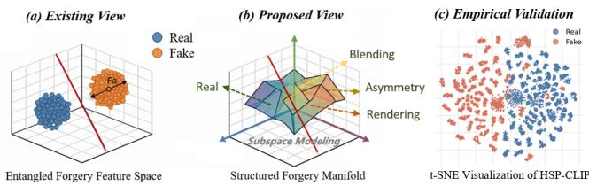  
Figure 1: Structured-manifold modeling of forgery representations. (a) Existing methods separate real and fake samples within an entangled feature space. (b) Our approach instead organizes forgery traces into a structured manifold supported by multiple latent forgery factors. (c) The t-SNE visualization provides empirical support for this structured representation.

Recent deepfake detection methods adopt large-scale pretrained foundation models due to their strong representations. Existing approaches can be categorized into three paradigms: 1) Parameter-Eficient Adaptation aligns largely frozen backbones with forensic tasks using lightweight modules. Forensics Adapter (Cui et al. 2025) introduces learnable adapters into CLIP, while FCG (Han et al. 2025) and plug-and-play methods extend this idea to video detection with eficient spatiotemporal modeling. 2) Feature Disentanglement aims to reduce semantic bias in foundation-model representations. Efort (Yan et al. 2024b) separates semantic components from forgery-relevant residuals via SVD, while UDD (Fu et al. 2025) mitigates positional and content bias through transformer token perturbation. 3) Generalization and Explainability target open-set manipulation and interpretable detection. FakeRadar (Li et al. 2025) models feature-space distributions to distinguish real, known-fake, and unknownfake samples, while DeepShield (Cai et al. 2025) and X2- DFD (Chen et al. 2024) explore local-global analysis and MLLM-assisted explanations, respectively. Our method differs from the existing methods in that it shifts the detection paradigm from learning a monolithic decision boundary to constructing a structured, multi-dimensional forgery subspace. HSP explicitly decomposes complex manipulation traces into independent, orthogonal dimensions, which ensures that the model captures a set of structurally invariant forgery patterns rather than dominant shortcuts.

## 3 Empirical Analysis of Generalization Bottlenecks

Understanding how deepfake detectors organize forgery evidence into latent forensic factors is crucial for improving cross-dataset generalization. To this end, we treat unsupervised feature clusters as temporary proxies for latent forensic factors and introduce three diagnostics to characterize the underlying representation structure. Our experiments show that modeling multiple forgery factors, as instantiated by HSP, provides an efective means of improving the cross-domain generalizability. A detailed analysis of these diagnostics is provided in Appendix A.

(b) HSP-CLIP  
Table 1: Quantitative analysis of feature representations across three models: pretrained and naively finetuned variants of CLIP ViT-L/14, alongside HSP-CLIP.
<table><tr><td>Methods</td><td>H</td><td>I</td><td>P</td><td>ACC</td></tr><tr><td colspan="5">FaceForensics++</td></tr><tr><td>CLIP</td><td> $0 . 5 5 3 ^ { \pm 0 . 0 0 9 }$ </td><td> $0 . 0 0 5 ^ { \pm 0 . 0 0 2 }$ </td><td> $\mathbf { 0 . 9 6 8 ^ { \pm 0 . 0 2 7 } }$ </td><td>0.854</td></tr><tr><td>CLIP-FT</td><td> $0 . 9 9 7 ^ { \pm 0 . 0 0 1 }$ </td><td> $0 . 5 1 8 ^ { \pm 0 . 0 0 3 }$ </td><td> $0 . 8 1 5 ^ { \pm 0 . 1 4 6 }$ </td><td>0.931</td></tr><tr><td>HSP-CLIP-FT</td><td> $\mathbf { 0 . 9 9 8 ^ { \pm 0 . 0 0 1 } }$ </td><td> $\mathbf { 0 . 5 2 1 ^ { \pm 0 . 0 0 1 } }$ </td><td> $0 . 9 1 \dot { 7 } ^ { \pm 0 . 1 1 5 }$ </td><td>0.954</td></tr><tr><td colspan="5">Celeb-DF-v2</td></tr><tr><td>CLIP</td><td> $0 . 6 1 2 ^ { \pm 0 . 0 1 2 }$ </td><td> $0 . 0 1 6 ^ { \pm 0 . 0 0 3 }$ </td><td> $0 . 1 2 6 ^ { \pm 0 . 1 2 1 }$ </td><td>0.665</td></tr><tr><td>CLIP-FT</td><td> $0 . 9 9 6 ^ { \pm 0 . 0 0 1 }$ </td><td> $0 . 1 8 \mathrm { { i } ^ { \pm 0 . 0 0 3 } }$ </td><td> $0 . 4 8 3 ^ { \pm 0 . 0 9 4 }$ </td><td>0.786</td></tr><tr><td>HSP-CLIP-FT</td><td> $\mathbf { 0 . 9 9 8 ^ { \pm 0 . 0 0 1 } }$ </td><td> $\mathbf { 0 . 2 3 4 ^ { \pm 0 . 0 0 2 } }$ </td><td> $\mathbf { 0 . 8 3 2 ^ { \pm 0 . 1 3 6 } }$ </td><td>0.828</td></tr><tr><td colspan="5">DFDCP</td></tr><tr><td>CLIP</td><td> $\overline { { 0 . 6 8 3 ^ { \pm 0 . 0 5 8 } } }$ </td><td> $\overline { { 0 . 0 0 4 ^ { \pm 0 . 0 0 1 } } }$ </td><td> $0 . 1 7 2 ^ { \pm 0 . 1 0 7 }$ </td><td>0.547</td></tr><tr><td>CLIP-FT</td><td> $0 . 9 6 5 ^ { \pm 0 . 0 0 4 }$ </td><td> $0 . \dot { 2 } 0 9 ^ { \pm 0 . 0 0 2 }$ </td><td> $0 . 5 4 4 ^ { \pm 0 . 1 3 6 }$ </td><td>0.779</td></tr><tr><td> $_ \mathrm { H S P - C L I P - F T }$  </td><td> $\mathbf { 0 . 9 9 3 ^ { \pm 0 . 0 0 2 } }$ </td><td> $\mathbf { 0 . 2 4 5 ^ { \pm 0 . 0 0 2 } }$ </td><td> $\mathbf { 0 . 9 1 7 ^ { \pm 0 . 0 2 6 } }$ </td><td>0.816</td></tr><tr><td colspan="5">DFDC</td></tr><tr><td>CLIP</td><td> $0 . 5 8 4 ^ { \pm 0 . 0 0 4 }$ </td><td> $0 . 0 0 3 ^ { \pm 0 . 0 0 1 }$ </td><td> $0 . 4 7 6 ^ { \pm 0 . 1 4 7 }$ </td><td>0.529</td></tr><tr><td>CLIP-FT</td><td> $0 . 9 7 0 ^ { \pm 0 . 0 0 4 }$ </td><td> $0 . 1 7 5 ^ { \pm 0 . 0 0 1 }$ </td><td> $0 . 5 2 3 ^ { \pm 0 . 2 1 9 }$ </td><td>0.725</td></tr><tr><td>HSP-CLIP-FT</td><td> $\mathbf { 0 . 9 9 3 ^ { \pm 0 . 0 0 3 } }$  </td><td> $\mathbf { 0 . 1 9 9 ^ { \pm 0 . 0 0 1 } }$ </td><td> $\mathbf { 0 . 8 1 7 ^ { \pm 0 . 0 9 6 } }$ </td><td>0.775</td></tr></table>

## 3.1 Feature-Centric Perspective Metrics

We denote the dataset as $\mathcal { D } = \{ ( x _ { i } , y _ { i } ) \} _ { i = 1 } ^ { N } ,$ , where $x _ { i } \in X$ represents the input image space and $y _ { i } \in Y = \{ 0 , 1 \}$ } denotes the binary label. Given an input image x $\in \mathbb { R } ^ { \mathbf { \tilde { H } } \times W \times C } ,$ we extract non-overlapping patch embeddings $Z = f _ { \theta } ( x ) \in$ $\mathbb { R } ^ { L \times D }$ , where L and D denote the number of patches and feature dimension, respectively.

Cluster-level Fake Density H. For patch-level features $z _ { i , j }$ , we apply K-means with $N _ { c } = 6 4$ clusters and compute the fake density of cluster $n _ { c }$ as:

$$
\mathcal { H } ( n _ { c } ) = \frac { 1 } { \lvert S _ { n _ { c } } \rvert } \sum _ { i = 1 } ^ { N } \sum _ { j = 1 } ^ { L } \mathbb { I } ( y _ { i } = 1 \wedge ( i , j ) \in \mathcal { S } _ { n _ { c } } ) ,\tag{1}
$$

where $S _ { n _ { c } } ~ = ~ \{ ( i , j ) ~ | ~ \mathrm { a s s i g n } ( z _ { i , j } ) ~ = ~ n _ { c } \}$ denotes the patches assigned to cluster $n _ { c } ,$ and I(·) is the indicator function. Intuitively, $\mathcal { H } ( n _ { c } )$ measures the probability that a patch in cluster $n _ { c }$ comes from a forged image. A higher value indicates that the cluster captures more forgery-related evidence while separating it from genuine visual patterns.

Cluster–Label Dependence I. We employ mutual information (Kraskov, Stögbauer, and Grassberger 2004) between cluster assignments and ground-truth labels to quantify the discriminative structure of clusters. Let C denote the cluster assignment variable, where $n _ { c } \in \{ 1 , \ldots , N _ { c } \}$ indexes a cluster, and $Y \in \{ 0 , 1 \}$ denotes the label. We define I as

$$
\mathcal { I } ( C ; Y ) = \sum _ { n _ { c } = 1 } ^ { N _ { c } } \sum _ { y \in \{ 0 , 1 \} } p ( n _ { c } ) p ( y \mid n _ { c } ) \log \frac { p ( y \mid n _ { c } ) } { p ( y ) } .\tag{2}
$$

$$
p ( y \mid n _ { c } ) = \frac { | \{ ( i , j ) \mid ( i , j ) \in S _ { n _ { c } } \land y _ { i } = y \} | } { | S _ { n _ { c } } | } .\tag{3}
$$

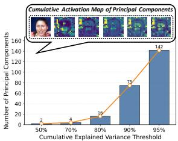

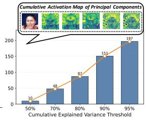  
(a) CLIP trained with the average pooling  
Figure 2: PCA-based analysis of forgery representations. HSP-CLIP requires more principal components to explain the same variance and produces broader cumulative spatial activations, suggesting that it captures more latent forensic factors within a structured subspace.

Here, $p ( y \mid n _ { c } )$ is the empirical probability that a patch assigned to cluster $n _ { c }$ belongs to class y, while $p ( n _ { c } )$ and $p ( y )$ denote the corresponding marginal probabilities. A higher I indicates stronger alignment between the cluster structure and forensic labels, suggesting better separation between real and manipulated samples.

Cross-Dataset Fake Density Correlation $\mathcal { P } , \mathcal { P }$ characterizes whether dominant fake clusters preserve their forensic relevance across domains. For a dataset D, we define the fake density vector:

$$
\mathbf { V } = \left[ \mathcal { H } ( 1 ) , \mathcal { H } ( 2 ) , \ldots , \mathcal { H } ( N _ { c } ) \right] ^ { \top } .\tag{4}
$$

Let $\mathbf { V } _ { t r }$ and $\mathbf { V } _ { t s }$ denote the vectors computed on the training and test datasets using cluster centroids fixed from the training set. We select the top-M fake-dominated clusters in $\mathbf { V } _ { t r }$ as an index set M, where $| { \mathcal { M } } | = M$ , and compute the Pearson correlation coeficient:

$$
P = \frac { \sum _ { m \in \mathcal { M } } ( V _ { \mathrm { t r } } [ m ] - \bar { V } _ { \mathrm { t r } } ) ( V _ { \mathrm { t s } } [ m ] - \bar { V } _ { \mathrm { t s } } ) } { \sqrt { \sum _ { m \in \mathcal { M } } ( V _ { \mathrm { t r } } [ m ] - \bar { V } _ { \mathrm { t r } } ) ^ { 2 } } \sqrt { \sum _ { m \in \mathcal { M } } ( V _ { \mathrm { t s } } [ m ] - \bar { V } _ { \mathrm { t s } } ) ^ { 2 } } } ,\tag{5}
$$

where $\bar { V }$ denotes the mean of the selected M elements. A higher $P$ indicates that fake-dominated clusters in the training domain remain consistent in the test domain, suggesting reliance on transferable forgery patterns.

## 3.2 Empirical Analysis on Deepfake Benchmarks

Key Observation: Naive fine-tuning improves sourcedomain separability but induces a shortcut-dominated, lowrank forensic representation, whereas HSP improves crossdomain feature stability by modeling multiple forgery factors.

We apply the diagnostics to analyze state-of-the-art detectors trained on FaceForensics++ (Rossler et al. 2019) and evaluated on Celeb-DF-v2 (Li et al. 2020b), DFDCP (Dolhansky et al. 2019), and DFDC (Dolhansky et al. 2020). Our analysis centers on ViT-L/14 initialized with CLIP (Radford et al. 2021) weights. For each target dataset, we average results over five trials with 2,000 real and 2,000 fake images, using 64 cluster centroids from the training set and computing H¯ and P over the top-10 fake-dominated clusters.

Results are summarized in Table 1, with additional results for diferent values of M provided in Appendix B. We observe that: 1) vanilla backbones $( e . g .$ ., CLIP) yield nearly random scores $( e . g . , \bar { \mathcal { H } } \approx 0 . 5 5 , \mathcal { T } \approx \mathrm { { 0 . 0 0 1 } ) }$ , indicating that generic visual pre-training lacks intrinsic sensitivity to forgery-specific evidence; 2) naive fine-tuning (CLIP-FT) achieves higher ${ \bar { \mathcal { H } } } .$ suggesting that it captures forgery-related features and improves source-domain discrimination. However, I and $\mathcal { P }$ substantially degrade under OOD evaluation, revealing that the learned patterns are dominated by sourcespecific factors and lack stable cross-domain forensic structures; 3) in contrast, HSP-CLIP preserves high cluster-level fake density while consistently improving both I and P, indicating that our multi-factor forgery representation learning organizes forgery evidence into a more domain-stable representation and improves cross-domain generalization.

We further perform PCA on patch embeddings extracted from 5,000 test images and compare the number of principal components required to reach diferent explained-variance thresholds. We further visualize the cumulative activation maps of the leading principal components by accumulating their token-wise projection energy. Intuitively, if forgery evidence collapses into a few shortcut-dominated directions, the representation should be highly low-rank, requiring only a small number of principal components while producing spatial responses concentrated on limited patches. Conversely, a structured forgery manifold should require more principal components and exhibit broader spatial activation across complementary forensic regions. As shown in Figure $^ { 2 , }$ naively fine-tuned CLIP explains most of its variance with only a few principal directions, whereas HSP-CLIP requires substantially more principal components to reach the same explained-variance thresholds. The cumulative activation maps further reveal a clear geometric diference: CLIP mainly responds to a small number of localized patches, while HSP-CLIP distributes its responses across broader and more complementary spatial regions. These results suggest that HSP-CLIP organizes forgery evidence into a structured manifold rather than compressing it into a shortcutdominated low-rank representation, providing empirical support for the structured forgery manifold proposed in Figure 1.

## 4 Methodology

The observations in Section 3 suggest that weak crossdomain performance stems from narrow, low-rank representations dominated by a few source-specific forgery cues. Accordingly, we formulate deepfake detection from the perspective of structuredforgery manifold learning and propose a plug-in module termed Hierarchical Spatial Prototype (HSP), as illustrated in Figure 3. The core idea is to constrain intermediate spatial representations to be explained by a set of complementary forgery factors.

## 4.1 Prototype-Supported Forgery Manifold

How should we organize heterogeneousforgery evidence into a structuredfeature manifold that can accommodate multiple latent forgery factors? To address this question, given intermediate token embeddings $Z \in \mathbb { R } ^ { B \times N \times D }$ from a ViT layer, we introduce K learnable prototypes $P = \{ p _ { k } \} _ { k = 1 } ^ { K }$ , where each prototype represents a latent spatial forgery factor. Since real-world manipulations typically involve multiple intertwined efects, such as blending, geometric inconsistency, and post-processing, assigning each token to a single prototype is overly restrictive. We therefore adopt temperaturescaled soft assignment, allowing each token $z _ { i } \in \mathbb { R } ^ { D }$ to be reconstructed as a weighted combination of all prototypes:

$$
\hat { z } _ { i } = \sum _ { k = 1 } ^ { K } \underbrace { \mathrm { e x p } ( \cos ( z _ { i } , p _ { k } ) / \tau ) } _ { \sum _ { j = 1 } ^ { K } \mathrm { e x p } ( \cos ( z _ { i } , p _ { j } ) / \tau ) } p _ { k } ,\tag{6}
$$

where $\tau$ is the temperature parameter and $A _ { i , k }$ denotes the soft assignment weight of token $z _ { i }$ to prototype $p _ { k }$

HSP is designed as a plug-in module that preserves the original representational capacity while imposing structured organization on intermediate features. We introduce prototype reconstruction as an auxiliary constraint rather than replacing original token representations. Direct replacement would force all tokens into a finite prototype-supported subspace and may discard subtle forensic cues beyond the learned prototypes. Instead, the reconstruction objective softly aligns features with shared forgery factors while retaining the flexibility of pretrained representations. Specifically, we adopt a dual-path reconstruction loss with stop-gradient:

$$
\begin{array} { r } { \mathcal { L } _ { \mathrm { r e c } } = \underbrace { \| Z - \mathrm { s g } ( \hat { Z } ) \| _ { 2 } ^ { 2 } } _ { \mathrm { f e a t u r e - t o - p r o t o t y p e } } + \underbrace { \alpha \| \mathrm { s g } ( Z ) - \hat { Z } \| _ { 2 } ^ { 2 } } _ { \mathrm { p r o t o t y p e - t o - f e a t u r e } } , } \\ { \mathrm { a l i g n m e n t ~ t e r m } \quad \quad \mathrm { r e c o n s t r u c t i o n ~ t e r m } } \end{array}\tag{7}
$$

where $\operatorname { s g } ( \cdot )$ denotes the stop-gradient operator, and the weighting coeficient α is set to 2 by default. Similar designs have been used to stabilize representation learning (Van Den Oord, Vinyals et al. 2017; Chen and He 2021).

## 4.2 Structured Forgery Manifold Regularization

Based on the learned forgery prototypes, we constrain both prototype geometry and assignment distribution to ensure complementary factor modeling and efective prototype utilization. We first impose an orthogonality regularization on the normalized prototype matrix:

$$
\mathcal { L } _ { \mathrm { o r t h } } = \frac { D } { K ^ { 2 } } \left\| \tilde { P } \tilde { P } ^ { \top } - I _ { K } \right\| _ { F } ^ { 2 } \equiv \frac { D } { K ^ { 2 } } \sum _ { i \neq j } \left( \frac { p _ { i } ^ { \top } p _ { j } } { \| p _ { i } \| _ { 2 } \| p _ { j } \| _ { 2 } } \right) ^ { 2 } ,\tag{8}
$$

where $\tilde { P } \in \mathbb { R } ^ { K \times D }$ is the row-wise normalized prototype matrix, $I _ { K }$ is the identity matrix, and ∥·∥F denotes the Frobenius norm. Although orthogonality encourages diverse forgery factors, assignment collapse may still concentrate features on a few dominant prototypes, leaving the representation effectively low-rank. To this end, we model the second-order geometry of the assignment space. Let $\mathbf { A } \in \mathbb { R } ^ { B N \times K }$ denote the assignment matrix of all tokens in a mini-batch. Since each row of A is a probability vector, ${ \bf A 1 } _ { K } = { \bf 1 } _ { B N }$ . We center the assignment matrix and introduce the assignment-

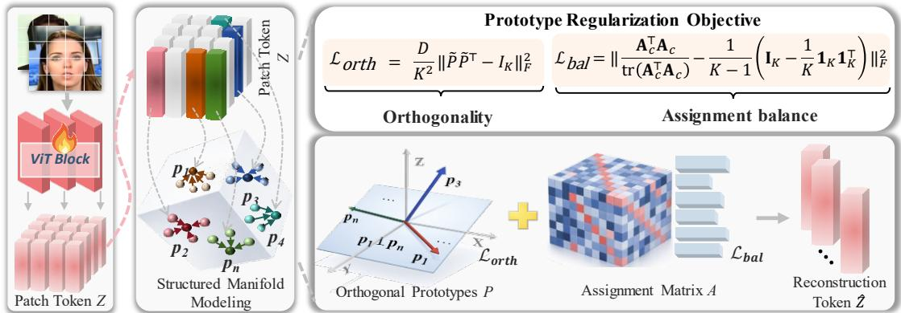  
Figure 3: Overview of the proposed Hierarchical Spatial Prototype (HSP) module for structured-manifold modeling. HSP introduces K learnable spatial prototypes to model latent forgery factors. A soft assignment matrix A decomposes each token into a combination of multiple prototypes and enables heterogeneous forgery traces to be modeled within a prototype-supported manifold. Prototype orthogonality keeps these forgery factors geometrically decoupled, while second-order assignment balance encourages diverse utilization of the prototype space and prevents the representation from collapsing into a few dominant factors.

balance regularizer:

$$
\begin{array} { r l r } & {  { \mathcal { L } _ { \mathrm { b a l } } = \| \frac { { \bf A } _ { c } ^ { \top } { \bf A } _ { c } } { \mathrm { t r } ( { \bf A } _ { c } ^ { \top } { \bf A } _ { c } ) } - \frac { 1 } { K - 1 } ( { \bf I } _ { K } - \frac { 1 } { K } { \bf 1 } _ { K } { \bf 1 } _ { K } ^ { \top } ) \| _ { F } ^ { 2 } , } } \\ & { } & { \bar { \bf \cal a } = \frac { 1 } { B N } { \bf A } ^ { \top } { \bf 1 } _ { B N } , \qquad { \bf A } _ { c } = { \bf A } - { \bf 1 } _ { B N } \bar { \bf a } ^ { \top } . } \end{array}\tag{9}
$$

The matrix $\begin{array} { r } { { \bf I } _ { K } \mathrm { ~ - ~ } \frac { 1 } { K } { \bf 1 } _ { K } { \bf 1 } _ { K } ^ { \top } } \end{array}$ is the rank- $( K - 1 )$ projector onto the centered assignment subspace. Therefore, $\mathcal { L } _ { \mathrm { b a l } }$ encourages the forgery manifold to exploit all admissible prototype-assignment directions instead of collapsing onto a few source-specific prototypes.

## 4.3 Efective Rank of the Forensic Representation

Prototype orthogonality preserves non-redundant forgery directions, while assignment balance distributes feature variation over the full subspace permitted by soft assignments; together, they drive the forensic representation toward its maximum admissible efective rank.

Proposition. Let $\widetilde { \mathbf { P } } \in \mathbb { R } ^ { K \times D }$ denote the row-normalized prototype matrix, and let $\widehat { \mathbf { Z } } _ { c } = \mathbf { A } _ { c } \widetilde { \mathbf { P } }$ be the centered reconstructed forensic features. Assume $K \leq D .$ . If $\mathcal { L } _ { \mathrm { o r t h } } \to 0$ and $\mathcal { L } _ { \mathrm { b a l } } \to 0$ , then the trace-normalized Gram matrix of $\hat { \mathbf { Z } } _ { c }$ converges to a rank- $( K - 1 )$ ) spectrum with equal nonzero eigenvalues. Consequently, its efective rank converges to the maximum admissible value, i.e., $r _ { \mathrm { e f f } } ( \widehat { \mathbf { Z } } _ { c } ^ { \top } \widehat { \mathbf { Z } } _ { c } ) \to K - 1$

Proof. Because each row of A is a probability vector, ${ \bf A 1 } _ { K } = { \bf 1 } _ { B N }$ . Moreover, from $\begin{array} { r } { \bar { \mathbf { a } } = \frac { 1 } { B N } \mathbf { \dot { A } } ^ { \top } \mathbf { 1 } _ { B N } } \end{array}$ , we have $\bar { \mathbf { a } } ^ { \top } \mathbf { 1 } _ { K } = 1$ . Therefore,

$$
\mathbf { A } _ { c } \mathbf { 1 } _ { K } = \left( \mathbf { A } - \mathbf { 1 } _ { B N } { \bar { \mathbf { a } } } ^ { \top } \right) \mathbf { 1 } _ { K } = \mathbf { 1 } _ { B N } - \mathbf { 1 } _ { B N } \left( { \bar { \mathbf { a } } } ^ { \top } \mathbf { 1 } _ { K } \right) = \mathbf { 0 } ,\tag{10}
$$

which implies rank $( \mathbf { A } _ { c } ) \leq K - 1$

As $\mathcal { L } _ { \mathrm { b a l } } \to 0$ , the trace-normalized assignment covariance converges to the normalized projector onto the centered

assignment subspace:

$$
\frac { \mathbf { A } _ { c } ^ { \top } \mathbf { A } _ { c } } { \operatorname { t r } ( \mathbf { A } _ { c } ^ { \top } \mathbf { A } _ { c } ) } \to \frac { 1 } { K - 1 } \left( \mathbf { I } _ { K } - \frac { 1 } { K } \mathbf { 1 } _ { K } \mathbf { 1 } _ { K } ^ { \top } \right) .\tag{11}
$$

The matrix on the right has one zero eigenvalue along $\mathbf { 1 } _ { K }$ and $K - 1$ equal nonzero eigenvalues, each equal to $1 / \breve { ( } K - 1 )$ Meanwhile, $\mathcal { L } _ { \mathrm { o r t h } } \to 0$ implies $\widetilde { \mathbf { P } } \widetilde { \mathbf { P } } ^ { \top }  \mathbf { I } _ { K }$ , so the rows of $\widetilde { \mathbf { P } }$ become orthonormal. The Gram matrix of the centered reconstructed features is $\widehat { \mathbf { Z } } _ { c } ^ { \top } \widehat { \mathbf { Z } } _ { c } = \widetilde { \mathbf { P } } ^ { \top } \mathbf { A } _ { c } ^ { \top } \mathbf { A } _ { c } \widetilde { \mathbf { P } }$

Because $\widetilde { \mathbf { P } }$ has orthonormal rows, this transformation preserves the nonzero eigenvalues of $\mathbf { A } _ { c } ^ { \top } \mathbf { A } _ { c } .$ . Therefore, the trace-normalized Gram matrix of $\widehat { \mathbf { Z } } _ { c }$ also has $K - 1$ equal nonzero eigenvalues, each converging to $1 / ( K - 1 )$ . By the definition of efective rank,

$$
\begin{array} { l } { r _ { \mathrm { e f f } } \left( \widehat { \mathbf { Z } } _ { c } ^ { \top } \widehat { \mathbf { Z } } _ { c } \right) \to \exp \left( - \displaystyle \sum _ { k = 1 } ^ { K - 1 } \frac { 1 } { K - 1 } \log \frac { 1 } { K - 1 } \right) } \\ { \quad \qquad = K - 1 . } \end{array}\tag{12}
$$

The reconstruction objective encourages $\mathbf { Z } _ { c }$ to remain close to its prototype-based reconstruction $\widehat { \mathbf { Z } } _ { c } .$ . Let $\mathbf { E } _ { c } ~ =$ $\mathbf { Z } _ { c } - \widehat { \mathbf { Z } } _ { c }$ denote the reconstruction error. We have

$$
\left\| \mathbf { Z } _ { c } ^ { \top } \mathbf { Z } _ { c } - \widehat { \mathbf { Z } } _ { c } ^ { \top } \widehat { \mathbf { Z } } _ { c } \right\| _ { 2 } \leq 2 \left\| \widehat { \mathbf { Z } } _ { c } \right\| _ { 2 } \left\| \mathbf { E } _ { c } \right\| _ { 2 } + \left\| \mathbf { E } _ { c } \right\| _ { 2 } ^ { 2 } .\tag{13}
$$

By Weyl’s eigenvalue perturbation inequality (Horn and Johnson 2012), the eigenvalue deviation between $\mathbf { Z } _ { c } ^ { \top } \mathbf { Z } _ { c }$ and $\hat { \mathbf { Z } } _ { c } ^ { \top } \hat { \mathbf { Z } } _ { c }$ is bounded by Eq. (13). Therefore, with small reconstruction error, the Gram spectra remain close, allowing the high-efective-rank structure of $\widehat { \mathbf { Z } } _ { c }$ to be approximately inherited by $\mathbf { Z } _ { c }$

## 4.4 Integration and Training Objective

Finally, HSP is implemented as a lightweight plug-in module and inserted at the $1 / 4$ and $1 / 2$ depths of the transformer.

Table 2: Comparison of video- and frame-level AUC (%) on cross-dataset benchmarks. † denotes results from oficial models or our reproduction; other results are from (Yan et al. 2024b; Chen et al. 2024) and original papers.
<table><tr><td rowspan="2">Methods</td><td colspan="6">Video-level AUC</td><td rowspan="2">Methods</td><td colspan="6">Frame-level AUC</td></tr><tr><td>CDF-v2 CDF-v1</td><td>DFDC</td><td>DFDCP</td><td>DFD</td><td>Avg.</td><td></td><td>CDF-v2 CDF-v1</td><td></td><td>DFDC</td><td>DFDCP</td><td>DFD</td><td>Avg.</td></tr><tr><td>F3Net (ECCV&#x27;20)</td><td>78.9</td><td>71.8</td><td>74.9</td><td></td><td>84.4</td><td>77.5</td><td>Efficient-b4† (ICML&#x27;19)</td><td>74.9</td><td>70.5</td><td>69.6</td><td>72.8</td><td>81.5</td><td>73.9</td></tr><tr><td>LaV (MM&#x27;23)</td><td>92.2</td><td>84.7</td><td>82.0</td><td>89.7</td><td>96.8</td><td>89.1</td><td>Face X-Ray (CVPR&#x27;20)</td><td>67.9</td><td>70.9</td><td>63.3</td><td>69.4</td><td>76.7</td><td>70.0</td></tr><tr><td>IID (CVPR&#x27;23)</td><td>83.8</td><td></td><td>70.0</td><td>68.9</td><td>93.9</td><td>79.2</td><td>RECCE (CVPR&#x27;22)</td><td>73.2</td><td></td><td>71.3</td><td>74.2</td><td>74.2</td><td>73.2</td></tr><tr><td>CFM (TIFS&#x27;23)</td><td>89.7</td><td></td><td>70.6</td><td>80.2</td><td>95.2</td><td>83.9</td><td>UCF† (ICCV&#x27;23)</td><td>82.4</td><td>77.9</td><td>80.5</td><td>75.9</td><td>87.8</td><td>80.9</td></tr><tr><td>SBIs (CVPR&#x27;22)</td><td>90.6</td><td></td><td>75.2</td><td>87.7</td><td>88.2</td><td>85.4</td><td>ICT (CVPR&#x27;23)</td><td>85.7</td><td>81.4</td><td></td><td></td><td>84.1</td><td>83.7</td></tr><tr><td>ProDe† (NeurIPS&#x27;24)</td><td>92.6</td><td>95.7</td><td>70.7</td><td>82.8</td><td>95.4</td><td>87.4</td><td>ProDe† (NeurIPS&#x27;24)</td><td>84.5</td><td>90.9</td><td>72.4</td><td>81.2</td><td></td><td>82.3</td></tr><tr><td>CDFA† (ECCV&#x27;24)</td><td>93.8</td><td>92.1</td><td>83.0</td><td>88.1</td><td>95.4</td><td>90.5</td><td>DFFake (NeurIPS&#x27;24)</td><td>80.5</td><td></td><td></td><td>81.0</td><td>90.4</td><td>84.0</td></tr><tr><td>FakeRadar (ICCV&#x27;25)</td><td>91.7</td><td></td><td>84.1</td><td>88.5</td><td>96.2</td><td>90.1</td><td>ExposDe† (AAAI&#x27;24)</td><td>86.4</td><td>81.8</td><td>72.1</td><td>85.1</td><td>89.8</td><td>83.0</td></tr><tr><td>VbSaT (CVPR&#x27;25)</td><td>94.7</td><td></td><td>84.3</td><td>90.9</td><td>96.5</td><td>91.6</td><td>DAID (NeurIPS&#x27;25)</td><td>84.4</td><td></td><td>66.9</td><td></td><td>91.2</td><td>80.8</td></tr><tr><td>DeepShield (ICCV&#x27;25)</td><td>92.2</td><td></td><td>82.8 93.2</td><td></td><td>96.1</td><td>91.1</td><td>UDD (AAAI&#x27;25)</td><td>86.9</td><td></td><td>75.8</td><td>85.6</td><td>91.0</td><td>84.8</td></tr><tr><td>FCG (CVPR&#x27;25)</td><td>95.0</td><td>81.8</td><td></td><td></td><td></td><td>88.4</td><td>FSgD (NeurIPS&#x27;25)</td><td>86.7</td><td>90.1</td><td></td><td>81.8</td><td>82.1</td><td>85.2</td></tr><tr><td>χ2-DFD (NeurIPS’25)</td><td>95.5</td><td></td><td>85.3</td><td>91.2</td><td>95.7</td><td>91.9</td><td>LSDA (CVPR&#x27;24)</td><td>83.0</td><td>86.7</td><td>73.6</td><td>81.5</td><td>88.0</td><td>82.6</td></tr><tr><td>Effort† (ICML&#x27;25)</td><td>95.6</td><td>91.8</td><td>84.3</td><td>90.9</td><td>96.5</td><td>91.8</td><td>FreqDebias (CVPR&#x27;25)</td><td>83.6</td><td>87.5</td><td>74.1</td><td>82.4</td><td>86.8</td><td>82.9</td></tr><tr><td>HSP-CLIP</td><td>96.4 +0.8</td><td>97.1 +1.4</td><td>89.2 +3.9</td><td>92.2</td><td>97.5 +0.7</td><td>94.5 +2.6</td><td>HSP-CLIP</td><td>90.9 +4.0</td><td>91.9 +1.0</td><td>86.7 +6.2</td><td>90.0 +4.4</td><td>94.3 +3.1</td><td>90.8 +5.6</td></tr></table>

Table 3: Video-level and frame-level AUC (%) comparison on unseen manipulation methods. Results are reported on six representative face-swapping methods selected from DF40, where all samples are generated based on the FF++ domain.
<table><tr><td rowspan="2">Methods</td><td colspan="7">Video-level AUC</td><td rowspan="2">Methods</td><td colspan="7">Frame-level AUC</td></tr><tr><td>[UniFace e4s</td><td></td><td>FaceDancerFSGAN InSwap SimSwap</td><td></td><td></td><td>Avg.</td><td></td><td>UniFace</td><td>e4s</td><td>FaceDancerFSGAN InSwap SimSwap</td><td></td><td></td><td></td><td>Avg.</td></tr><tr><td>RECCE (CVPR&#x27;22)</td><td>89.8</td><td></td><td>84.8</td><td>94.9</td><td>84.8</td><td>76.8</td><td>83.2</td><td>RECCE (CVPR&#x27;22)</td><td>84.2</td><td>65.2</td><td>78.3</td><td>88.4</td><td>79.5</td><td></td><td>78.1</td></tr><tr><td>SBIs (CVPR&#x27;22)</td><td>72.4</td><td>68.3 75.0</td><td>59.4</td><td>80.3</td><td>71.2</td><td>70.1</td><td>71.4</td><td>IID (CVPR&#x27;23)</td><td>79.5</td><td>71.0</td><td>79.0</td><td>86.4</td><td>74.4</td><td>73.0 64.0</td><td>75.7</td></tr><tr><td>UCF (ICCV&#x27;23)</td><td>83.1</td><td>73.1</td><td>86.2</td><td>93.7</td><td>80.9</td><td>64.7</td><td>80.3</td><td>SBIs (CVPR&#x27;22)</td><td>64.4</td><td>69.0</td><td>44.7</td><td>87.9</td><td>63.3</td><td>56.8</td><td>64.4</td></tr><tr><td>IID (CVPR&#x27;23)</td><td>83.9</td><td>76.6</td><td>84.4</td><td>92.7</td><td>78.9</td><td>64.4</td><td>80.2</td><td>UCF (ICCV&#x27;23)</td><td>78.7</td><td>69.2</td><td>80.0</td><td>88.1</td><td>76.8</td><td>64.9</td><td>77.5</td></tr><tr><td>LSDA (CVPR&#x27;24)</td><td>87.2</td><td>69.4</td><td>72.1</td><td>93.9</td><td>85.5</td><td>69.3</td><td>79.6</td><td>LSDA (CVPR&#x27;24)</td><td>85.4</td><td>68.4</td><td>75.9</td><td>83.2</td><td>81.0</td><td>72.7</td><td>77.8</td></tr><tr><td>ProDe (NeurIPS&#x27;24)</td><td>90.8</td><td>77.1</td><td>74.7</td><td>92.8</td><td>83.7</td><td>84.4</td><td>83.9</td><td>CDFA (ECCV&#x27;24)</td><td>76.5</td><td>67.4</td><td>75.4</td><td>84.8</td><td>72.0</td><td>76.1</td><td>75.9</td></tr><tr><td>CDFA (ECCV&#x27;24)</td><td>76.2</td><td>63.1</td><td>80.3</td><td>94.2</td><td>77.2</td><td>75.7</td><td>77.8</td><td>ProDe (NeurIPS&#x27;24)</td><td>84.5</td><td>71.0</td><td>73.6</td><td>86.5</td><td>78.8</td><td>77.8</td><td>78.7</td></tr><tr><td>VbSaT (CVPR&#x27;25)</td><td>96.0</td><td>98.0</td><td>91.6</td><td>96.4</td><td>93.7</td><td>93.1</td><td>94.8</td><td>FSgD (NeurIPS&#x27;25)</td><td>91.8</td><td>87.5</td><td>83.0</td><td>86.3</td><td>87.4</td><td>91.0</td><td>87.8</td></tr><tr><td>Effort (ICML&#x27;25)</td><td>96.2</td><td>98.3</td><td>92.6</td><td>95.7</td><td>93.6</td><td>92.6</td><td>94.8</td><td>χ2-DFD (NeurIPS&#x27;25)</td><td>85.2</td><td>91.2</td><td>83.8</td><td>89.9</td><td>78.4</td><td>84.9</td><td>85.6</td></tr><tr><td>HSP-CLIP</td><td>|96.6 +0.499.0 +0.7</td><td></td><td>96.2 +3.6</td><td>98.6 +2.295.6 +1.9</td><td></td><td>93.8 +0.7</td><td>96.6 +1.8</td><td>HSP-CLIP</td><td>93.4 +1.697.2 +6.0</td><td></td><td>91.8 +8.0</td><td>95.8 +5.991.4 +4.0</td><td></td><td>88.7</td><td>93.1 +5.3</td></tr></table>

The plug-in formulation allows HSP to be integrated into both standard ViT architectures and recent ViT-based deepfake detectors, such as Efort (Yan et al. 2024b), with minimal modification, as demonstrated in Figure 4(a). The overall loss function for training the model combines the classification loss $\mathcal { L } _ { \mathrm { c e } }$ , the reconstruction loss $\mathcal { L } _ { \mathrm { r e c } } .$ , the structural regularization terms ${ \mathcal { L } } _ { \mathrm { o r t h } }$ and $\mathcal { L } _ { \mathrm { b a l } }$

$$
\begin{array} { r } { \mathcal { L } = \mathcal { L } _ { \mathrm { c e } } + \lambda _ { 1 } \mathcal { L } _ { \mathrm { r e c } } + \lambda _ { 2 } \mathcal { L } _ { \mathrm { o r t h } } + \lambda _ { 3 } \mathcal { L } _ { \mathrm { b a l } } , } \end{array}\tag{14}
$$

where $\lambda _ { 1 } , \lambda _ { 2 }$ and $\lambda _ { 3 }$ are hyperparameters that balance the importance of the corresponding terms.

## 5 Experiments

## 5.1 Experimental Setting

We train all models on the c23 version of FaceForensics++ (Rossler et al. 2019), consistent with the standard detection protocol in DeepfakeBench (Yan et al. 2023b). We evaluate generalization along two dimensions: Cross-Dataset Evaluation and Cross-Manipulation Evaluation. We use CLIP ViT-L/14 (Radford et al. 2021) as the default backbone and evaluate other ViT-based backbones in Table 5. Following DeepfakeBench, we sample 8/32 frames for training/inference. AdamW (Loshchilov and Hutter 2017) is used with learning rates of $1 \times 1 0 ^ { - 6 }$ for CLIP and $1 \times 1 0 ^ { - 4 }$ for HSP, and batch sizes of 128/256. We apply standard augmentations (Yan et al. 2023b) and report video-level AUC and frame-level AUC/ACC. The default setting uses K = 128 prototypes, with loss weights (1, 1, 1) and (0.5, 0.5, 0.5) for the first and second HSP modules, respectively. More details on the compared baselines are provided in Appendix C.

## 5.2 Cross-Paradigm Generalization Ability

Cross-Dataset Evaluation. We conduct cross-dataset evaluation to assess the generalization capability of HSP-CLIP, as summarized in Table 2. HSP-CLIP consistently outperforms all state-of-the-art baselines, achieving the highest average AUC at both video and frame levels. At the video level, HSP-CLIP achieves an average AUC of 94.5%, surpassing the strongest competitor $( \chi ^ { 2 } \ – \mathrm { D F D } )$ by +2.6%, with notable improvements on challenging datasets such as DFDC (+3.9%). At the frame level, HSP-CLIP further achieves an average AUC of 90.8%, outperforming FSgD (85.2%) by +5.6% and obtaining consistent gains on Celeb-DF-v2 (+4.0%), DFDC (+6.2%), and DFDCP (+4.4%).

Cross-Manipulation Evaluation. We also conduct crossmanipulation evaluation on DF40, as shown in Table 3. HSP-CLIP consistently achieves state-of-the-art performance across six representative face-swapping methods. It reaches an average video-level AUC of $9 6 . 6 \%$ , outperforming Efort and VbSaT by +1.8%. At the frame level, HSP-CLIP further achieves an average AUC of 93.1%, exceeding FSgD(87.8%) by +5.3%, with substantial improvements on challenging manipulations such as FaceDancer (+8.0%) and e4s (+6.0%).

These results demonstrate that HSP-CLIP efectively organizes complex forgery evidence into a diverse and structurally decoupled prototype space, reducing reliance on datasetspecific shortcuts and preserving transferable forensic patterns across diverse manipulation strategies.

## 5.3 Ablation Study

Impact of the HSP Module Placement. We compare diferent HSP placement strategies, as summarized in Figure 4(b).

Table 4: Ablation studies (ACC, %) regarding the proposed HSP-CLIP with loss constraints.
<table><tr><td> $\mathcal { L } _ { r e c }$ </td><td> $\mathcal { L } _ { o r t h }$ </td><td> $\mathcal { L } _ { b a l }$ </td><td>CDF-v2</td><td>DFDCP</td><td>DFDC</td><td>InSwap</td></tr><tr><td>x&gt;</td><td>××&gt;</td><td>×××√</td><td>78.6</td><td>77.9</td><td>72.8</td><td>79.8</td></tr><tr><td></td><td></td><td></td><td>81.3</td><td>80.3</td><td>76.2</td><td>81.5</td></tr><tr><td>V</td><td></td><td></td><td>82.1</td><td>81.0</td><td>77.1</td><td>82.1</td></tr><tr><td>√</td><td>√</td><td></td><td>82.8</td><td>81.6</td><td>77.5</td><td>82.9</td></tr></table>

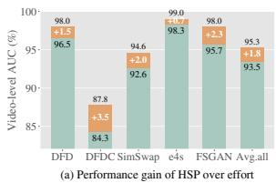

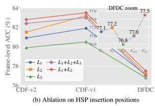  
Figure 4: Performance gains of HSP over Efort and ablation study of HSP insertion positions. Figure (a) and (b) repor video-level AUC (%) and frame-level ACC (%).

We denote the positions at one-quarter, one-half, and threequarters of the backbone depth as $L _ { 1 } , L _ { 2 }$ , and $L _ { 3 }$ , respectively. Applying HSP at $L _ { 2 }$ generally outperforms single placement at $L _ { 1 }$ or $L _ { 3 }$ , while the $L _ { 3 }$ configuration achieves the weakest performance. Applying HSP at all three positions $( L _ { 1 } { + } L _ { 2 } { + } L _ { 3 } )$ also provides no further improvement, whereas the $L _ { 1 } { + } L _ { 2 }$ configuration achieves the best overall results. These results suggest that HSP is most efective on shallow-to-intermediate features that preserve finegrained forensic cues, such as texture inconsistencies, blending boundaries, and geometric distortions. In contrast, early features at $L _ { 1 }$ contain substantial low-level variations, while deeper features at $L _ { 3 }$ encode more global semantics and are less suitable for fine-grained forgery-factor modeling. We therefore adopt $L _ { 1 } { + } L _ { 2 }$ as the default placement strategy.

Incremental Improvement ofthe Proposed Designs. We progressively introduce prototype reconstruction ${ \mathcal { L } } _ { \mathrm { r e c } } .$ , prototype orthogonality ${ \mathcal L } _ { \mathrm { o r t h } }$ , and assignment balance $\mathcal { L } _ { \mathrm { b a l } } . \mathrm { A s }$ shown in Table 4, $\mathcal { L } _ { \mathrm { r e c } }$ substantially improves the baseline, while ${ \mathcal L } _ { \mathrm { o r t h } }$ further improves performance by encouraging factor independence. Adding $\mathcal { L } _ { \mathrm { b a l } }$ achieves the best results across all benchmarks, confirming that balanced prototype utilization promotes a higher-efective-rank representation and improves cross-domain generalization.

Compatibility with Various Vision Foundation Models. We evaluate HSP on three representative backbones: ViT-Base (Dosovitskiy 2020), SigLIP (Zhai et al. 2023), and CLIP (Radford et al. 2021). As shown in Table 5, HSP consistently improves both ACC and AUC across all backbones and datasets, demonstrating its compatibility with diferent vision foundation models.

Compatibility with Existing Detectors. We further integrate it into Efort (Yan et al. 2024b), a strong recent generalizable deepfake detector, and report video-level AUC results in Figure 4(a). HSP improves the average AUC from 93.5% to 95.3% and brings consistent gains across the benchmarks. These results indicate that HSP can serve as a general plug-in regularization module for the advanced detectors.

Table 5: Ablation studies (%) of HSP integrated into diferent vision foundation models (VFMs).
<table><tr><td rowspan="2">Method</td><td colspan="2">CDF-v2</td><td colspan="2">CDF-v1</td><td colspan="2">FSGAN</td></tr><tr><td>ACC</td><td>AUC</td><td>ACC</td><td>AUC</td><td>ACC</td><td>AUC</td></tr><tr><td>ViT-Base +Ours</td><td> $\overline { { 7 0 . 3 } }$   $7 7 . 4 ^ { + 7 . 1 }$ </td><td> $\overline { { 7 9 . 3 } }$   $8 2 . 7 ^ { + 3 . 4 }$ </td><td>68.8  $7 5 . 6 ^ { + 6 . 8 }$ </td><td>76.4  $8 3 . 5 ^ { + 7 . 1 }$ </td><td>76.9  $8 2 . 7 ^ { + 5 . 8 }$ </td><td> $\overline { { 8 4 . 9 } }$   $9 0 . 4 ^ { + 5 . 5 }$ </td></tr><tr><td>SigLIP +Ours</td><td>69.9  $7 4 . 9 ^ { + 5 . 0 }$ </td><td>82.8 85.9+3.1</td><td>72.8  $7 7 . 2 ^ { + 4 . 4 }$ </td><td>82.4 86.1+3.7</td><td>85.3 87.9+2.6</td><td>90.7  $9 4 . 4 ^ { + 3 . 7 } $ </td></tr><tr><td>CLIP +Ours</td><td>78.6  $8 2 . 8 ^ { + 4 . 2 }$ </td><td>84.5  $9 0 . 9 ^ { + 6 . 4 } $ </td><td>79.2  $8 3 . 5 ^ { + 4 . 3 }$ </td><td>87.4  $9 1 . 7 ^ { + 4 . 3 }$ </td><td>88.7 90.7+2.0</td><td>93.9  $9 5 . 9 ^ { + 2 . 0 } $ </td></tr></table>

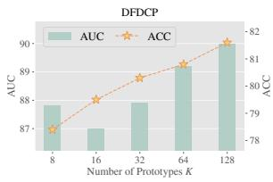

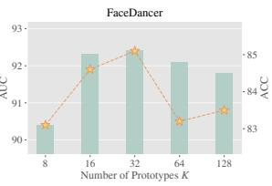  
Figure 5: Impact of diferent numbers of prototypes (K).

Impact of the Number of Prototypes K. We evaluate five prototype settings as shown in Figure 5. DFDCP and FaceDancer achieve their best overall performance at $K = 1 2 8$ and $K = 3 2 ,$ respectively. Complete results are provided in Appendix E. Cross-dataset evaluation entails broader shifts in identities and generation pipelines, benefiting from a larger prototype space that more finely models diverse forgery ProDe. In contrast, cross-manipulation evaluation mainly varies the manipulation algorithm while preserving similar facial content, for which moderate capacity is suficient; larger K may instead introduce redundant directions and weaken generalization. This observation is consistent with our theoretical analysis that increasing K enlarges the maximum efective dimensionality supported by HSP and mitigates collapse into a few source-specific shortcut directions. We adopt $K = 1 2 8$ as the default setting, prioritizing the more challenging cross-dataset generalization.

Additional Analysis. Appendices D and E analyze robustness and loss-weight configurations, respectively, while Appendix F provides further evidence of balanced prototype utilization, high efective rank, and factor diversity.

## 6 Conclusion

In this paper, we identify a critical bottleneck in generalizable deepfake detection: forensic representation collapse, a failure mechanism where detectors over-index on volatile, dataset-specific shortcuts. To address this, we propose Hierarchical Spatial Prototype (HSP), a novel framework that explicitly models the forgery manifold via a set of learnable orthogonal prototypes. This design increases the efective capacity of the forensic representation from an informationbottleneck perspective, enabling the model to capture a diverse and structurally independent set of forensic cues. It achieves state-of-the-art generalization on prominent benchmarks, advancing the reliability of face forgery detection and helping mitigate the growing risks posed by generative AI.

Ba, Z.; Liu, Q.; Liu, Z.; Wu, S.; Lin, F.; Lu, L.; and Ren, K. 2024. Exposing the deception: Uncovering more forgery clues for deepfake detection. In Proceedings of the AAAI Conference on Artificial Intelligence, volume 38, 719–728.

Cai, Y.; Li, J.; Li, Z.; Chen, W.; Lan, R.; Xie, X.; Luo, X.; and Li, G. 2025. DeepShield: Fortifying Deepfake Video Detection with Local and Global Forgery Analysis. In Proceedings of the IEEE/CVF International Conference on Computer Vision, 12524–12534.

Cao, J.; Ma, C.; Yao, T.; Chen, S.; Ding, S.; and Yang, X. 2022. End-to-end reconstruction-classification learning for face forgery detection. In Proceedings of the IEEE/CVF conference on computer vision and pattern recognition, 4113– 4122.

Chen, L.; Zhang, Y.; Song, Y.; Liu, L.; and Wang, J. 2022. Self-supervised learning of adversarial example: Towards good generalizations for deepfake detection. In Proceedings ofthe IEEE/CVF conference on computer vision andpattern recognition, 18710–18719.

Chen, X.; and He, K. 2021. Exploring simple siamese representation learning. In Proceedings of the IEEE/CVF conference on computer vision and pattern recognition, 15750– 15758.

Chen, Y.; Yan, Z.; Cheng, G.; Zhao, K.; Lyu, S.; and Wu, B. 2024. X2-dfd: A framework for explainable and extendable deepfake detection. arXiv preprint arXiv:2410.06126.

Cheng, H.; Liu, M.-H.; Guo, Y.; Wang, T.; Nie, L.; and Kankanhalli, M. 2025. Fair Deepfake Detectors Can Generalize. arXiv preprint arXiv:2507.02645.

Cheng, J.; Yan, Z.; Zhang, Y.; Luo, Y.; Wang, Z.; and Li, C. 2024. Can we leave deepfake data behind in training deepfake detector? Advances in Neural Information Processing Systems, 37: 21979–21998.

Cozzolino, D.; Rössler, A.; Thies, J.; Nießner, M.; and Verdoliva, L. 2021. Id-reveal: Identity-aware deepfake video detection. In Proceedings of the IEEE/CVF international conference on computer vision, 15108–15117.

Cui, X.; Li, Y.; Luo, A.; Zhou, J.; and Dong, J. 2025. Forensics adapter: Adapting clip for generalizable face forgery detection. In Proceedings ofthe Computer Vision and Pattern Recognition Conference, 19207–19217.

Dang, H.; Liu, F.; Stehouwer, J.; Liu, X.; and Jain, A. K. 2020. On the detection of digital face manipulation. In Proceedings of the IEEE/CVF Conference on Computer Vision and Pattern recognition, 5781–5790.

Das, S.; Seferbekov, S.; Datta, A.; Islam, M. S.; and Amin, M. R. 2021. Towards solving the deepfake problem: An analysis on improving deepfake detection using dynamic face augmentation. In Proceedings of the IEEE/CVF International Conference on Computer Vision, 3776–3785.

Davies, D. L.; and Bouldin, D. W. 1979. A Cluster Separation Measure. IEEE Transactions on Pattern Analysis and Machine Intelligence, PAMI-1(2): 224–227.

Dolhansky, B.; Bitton, J.; Pflaum, B.; Lu, J.; Howes, R.; Wang, M.; and Ferrer, C. C. 2020. The deepfake detection challenge (dfdc) dataset. arXiv preprint arXiv:2006.07397.

Dolhansky, B.; Howes, R.; Pflaum, B.; Baram, N.; and Ferrer, C. C. 2019. The deepfake detection challenge (dfdc) preview dataset. arXiv preprint arXiv:1910.08854.

Dong, X.; Bao, J.; Chen, D.; Zhang, T.; Zhang, W.; Yu, N.; Chen, D.; Wen, F.; and Guo, B. 2022. Protecting celebrities from deepfake with identity consistency transformer. In Proceedings ofthe IEEE/CVF conference on computer vision and pattern recognition, 9468–9478.

Dosovitskiy, A. 2020. An image is worth 16x16 words: Transformers for image recognition at scale. arXiv preprint arXiv:2010.11929.

Frank, J.; Eisenhofer, T.; Schönherr, L.; Fischer, A.; Kolossa, D.; and Holz, T. 2020. Leveraging frequency analysis for deep fake image recognition. In International conference on machine learning, 3247–3258. PMLR.

Fu, X.; Yan, Z.; Yao, T.; Chen, S.; and Li, X. 2025. Exploring unbiased deepfake detection via token-level shufling and mixing. In Proceedings ofthe AAAI Conference on Artificial Intelligence, volume 39, 3040–3048.

Haliassos, A.; Vougioukas, K.; Petridis, S.; and Pantic, M. 2021. Lips don’t lie: A generalisable and robust approach to face forgery detection. In Proceedings ofthe IEEE/CVF conference on computer vision and pattern recognition, 5039– 5049.

Han, Y.-H.; Huang, T.-M.; Hua, K.-L.; and Chen, J.-C. 2025. Towards More General Video-based Deepfake Detection through Facial Component Guided Adaptation for Foundation Model. In Proceedings of the Computer Vision and Pattern Recognition Conference, 22995–23005.

Horn, R. A.; and Johnson, C. R. 2012. Matrix analysis. Cambridge university press.

Huang, B.; Wang, Z.; Yang, J.; Ai, J.; Zou, Q.; Wang, Q.; and Ye, D. 2023. Implicit identity driven deepfake face swapping detection. In Proceedings of the IEEE/CVF conference on computer vision and pattern recognition, 4490–4499.

Jiang, L.; Li, R.; Wu, W.; Qian, C.; and Loy, C. C. 2020. Deeperforensics-1.0: A large-scale dataset for real-world face forgery detection. In Proceedings of the IEEE/CVF conference on computer vision and pattern recognition, 2889– 2898.

Kashiani, H.; Talemi, N. A.; and Afghah, F. 2025. Freqdebias: Towards generalizable deepfake detection via consistency-driven frequency debiasing. In 2025 IEEE/CVF Conference on Computer Vision and Pattern Recognition (CVPR), 8775–8785. IEEE.

Kraskov, A.; Stögbauer, H.; and Grassberger, P. 2004. Estimating mutual information. Physical Review E—Statistical, Nonlinear, and Soft Matter Physics, 69(6): 066138.

Li, L.; Bao, J.; Zhang, T.; Yang, H.; Chen, D.; Wen, F.; and Guo, B. 2020a. Face x-ray for more general face forgery detection. In Proceedings of the IEEE/CVF conference on computer vision and pattern recognition, 5001–5010.

Li, Y.; and Lyu, S. 2019. Exposing deepfake videos by detecting face warping artifacts. In IEEE Conference on Computer Vision and Pattern Recognition Workshops (CVPRW), 2–5, 14.

Li, Y.; Yang, X.; Sun, P.; Qi, H.; and Lyu, S. 2020b. Celebdf: A large-scale challenging dataset for deepfake forensics. In Proceedings of the IEEE/CVF conference on computer vision and pattern recognition, 3207–3216.

Li, Z.; Li, J.; Cai, Y.; Chen, J.; Luo, X.; Li, G.; and Lan, R. 2025. FakeRadar: Probing Forgery Outliers to Detect Unknown Deepfake Videos. In Proceedings of the IEEE/CVF International Conference on Computer Vision, 13382–13392.

Lin, Y.; Song, W.; Li, B.; Li, Y.; Ni, J.; Chen, H.; and Li, Q. 2024. Fake it till you make it: Curricular dynamic forgery augmentations towards general deepfake detection. In European conference on computer vision, 104–122. Springer.

Loshchilov, I.; and Hutter, F. 2017. Decoupled weight decay regularization. arXiv preprint arXiv:1711.05101.

Luo, A.; Kong, C.; Huang, J.; Hu, Y.; Kang, X.; and Kot, A. C. 2023. Beyond the prior forgery knowledge: Mining critical clues for general face forgery detection. IEEE Transactions on Information Forensics and Security, 19: 1168–1182.

Luo, Y.; Zhang, Y.; Yan, J.; and Liu, W. 2021. Generalizing face forgery detection with high-frequency features. In Proceedings of the IEEE/CVF conference on computer vision and pattern recognition, 16317–16326.

Ma, L.; Yan, Z.; Xu, J.; Chen, Y.; Guo, Q.; Bi, Z.; Liao, Y.; and Lin, H. 2025. From specificity to generality: Revisiting generalizable artifacts in detecting face deepfakes. arXiv preprint arXiv:2504.04827.

Ni, Y.; Meng, D.; Yu, C.; Quan, C.; Ren, D.; and Zhao, Y. 2022. Core: Consistent representation learning for face forgery detection. In Proceedings of the IEEE/CVF conference on computer vision and pattern recognition, 12–21.

Qian, Y.; Yin, G.; Sheng, L.; Chen, Z.; and Shao, J. 2020. Thinking in frequency: Face forgery detection by mining frequency-aware clues. In European conference on computer vision, 86–103. Springer.

Radford, A.; Kim, J. W.; Hallacy, C.; Ramesh, A.; Goh, G.; Agarwal, S.; Sastry, G.; Askell, A.; Mishkin, P.; Clark, J.; et al. 2021. Learning transferable visual models from natural language supervision. In International conference on machine learning, 8748–8763. PmLR.

Rossler, A.; Cozzolino, D.; Verdoliva, L.; Riess, C.; Thies, J.; and Nießner, M. 2019. Faceforensics++: Learning to detect manipulated facial images. In Proceedings ofthe IEEE/CVF international conference on computer vision, 1–11.

Shiohara, K.; and Yamasaki, T. 2022. Detecting deepfakes with self-blended images. In Proceedings of the IEEE/CVF conference on computer vision and pattern recognition, 18720–18729.

Shuai, C.; Zhong, J.; Wu, S.; Lin, F.; Wang, Z.; Ba, Z.; Liu, Z.; Cavallaro, L.; and Ren, K. 2023. Locate and verify: A two-stream network for improved deepfake detection. In Proceedings of the 31st ACM International Conference on Multimedia, 7131–7142.

Sun, K.; Chen, S.; Yao, T.; Liu, H.; Sun, X.; Ding, S.; and Ji, R. 2024. Difusionfake: Enhancing generalization in deepfake detection via guided stable difusion. Advances in Neural Information Processing Systems, 37: 101474–101497.

Sun, K.; Yao, T.; Chen, S.; Ding, S.; Li, J.; and Ji, R. 2022. Dual contrastive learning for general face forgery detection. In Proceedings of the AAAI conference on artificial intelligence, volume 36, 2316–2324.

The Conversation. 2025. Deepfakes leveled up in 2025 — here’s what’s coming next.

Van Den Oord, A.; Vinyals, O.; et al. 2017. Neural discrete representation learning. Advances in neural information processing systems, 30.

Vinh, N. X.; Epps, J.; and Bailey, J. 2010. Information Theoretic Measures for Clusterings Comparison: Variants, Properties, Normalization and Correction for Chance. Journal of Machine Learning Research, 11: 2837–2854.

Wang, H.; Shen, Z.; et al. 2021. Towards Out-of-Distribution Generalization: A Survey. arXiv preprint arXiv:2108.13624.

Yan, Z.; Luo, Y.; Lyu, S.; Liu, Q.; and Wu, B. 2024a. Transcending forgery specificity with latent space augmentation for generalizable deepfake detection. In Proceedings of the IEEE/CVF Conference on Computer Vision and Pattern Recognition, 8984–8994.

Yan, Z.; Wang, J.; Wang, Z.; Jin, P.; Zhang, K.-Y.; Chen, S.; Yao, T.; Ding, S.; Wu, B.; and Yuan, L. 2024b. Efort: Eficient orthogonal modeling for generalizable ai-generated image detection. arXiv preprint arXiv:2411.15633, 2.

Yan, Z.; Zhang, Y.; Fan, Y.; and Wu, B. 2023a. Ucf: Uncovering common features for generalizable deepfake detection. In Proceedings of the IEEE/CVF international conference on computer vision, 22412–22423.

Yan, Z.; Zhang, Y.; Yuan, X.; Lyu, S.; and Wu, B. 2023b. Deepfakebench: A comprehensive benchmark of deepfake detection. arXiv preprint arXiv:2307.01426.

Yan, Z.; Zhao, Y.; Chen, S.; Guo, M.; Fu, X.; Yao, T.; Ding, S.; Wu, Y.; and Yuan, L. 2025. Generalizing deepfake video detection with plug-and-play: Video-level blending and spatiotemporal adapter tuning. In Proceedings of the Computer Vision and Pattern Recognition Conference, 12615–12625.

Zhai, X.; Mustafa, B.; Kolesnikov, A.; and Beyer, L. 2023. Sigmoid loss for language image pre-training. In Proceedings ofthe IEEE/CVF international conference on computer vision, 11975–11986.

Zhao, H.; Zhou, W.; Chen, D.; Wei, T.; Zhang, W.; and Yu, N. 2021. Multi-attentional deepfake detection. In Proceedings of the IEEE/CVF conference on computer vision and pattern recognition, 2185–2194.

Zhuang, W.; Chu, Q.; Tan, Z.; Liu, Q.; Yuan, H.; Miao, C.; Luo, Z.; and Yu, N. 2022. UIA-ViT: Unsupervised inconsistency-aware method based on vision transformer for face forgery detection. In European conference on computer vision, 391–407. Springer.

## A Theoretical Interpretation of the Diagnostic Metrics

• Cluster-level Fake Density (H) quantifies the concentration of fake samples within each local region of the feature space. It is conceptually related to cluster purity, but is designed to capture whether forgery evidence forms locally coherent and label-enriched forensic regions rather than merely geometrically compact clusters (Davies and Bouldin 1979).

• Cluster–Label Dependence (I) measures how strongly the discovered feature regions are associated with manipulation labels at the global level. It is closely related in spirit to mutual-information-based dependence measures (Vinh, Epps, and Bailey 2010), and reveals the extent to which the learned cluster structure contributes to the final discrimination between real and fake samples.

• Cross-Dataset Fake Density Correlation (P) evaluates whether the same forgery-enriched regions remain salient across datasets with diferent manipulation pipelines and distribution shifts. This metric is intended to quantify structural invariance of forensic patterns across domains (Wang, Shen et al. 2021), thereby connecting representation analysis to cross-dataset generalization.

Taken together, H, I, and P capture three complementary aspects of forgery representations. We further provide formal interpretations of each metric and discuss why none is suficient in isolation.

Notation. Let $Y \in \{ 0 , 1 \}$ denote the forensic label, where $Y = 1$ represents a fake sample, and let $C \in \{ 1 , \dots , N _ { c } \}$ denote the cluster assignment of a spatial token. We denote the global fake prior by $\pi = \operatorname* { P r } ( Y = 1 )$ . For classbalanced evaluation, $\bar { \pi } = 1 / \bar { 2 }$ . For the c-th feature cluster, its population-level fake density is

$$
\begin{array} { r } { \mathcal { H } ( c ) = \mathrm { P r } ( Y = 1 \mid C = c ) . } \end{array}\tag{15}
$$

The empirical definition used in the main paper is the corresponding sample estimate of Eq. (15).

## A.1 Local Concentration Measured by H

We first establish the interpretation of H as a measure of local label enrichment.

Lemma 1 (Fake density under label-independent clustering). Ifthe cluster assignment C is statistically independent ofthe forensic label $Y _ { i }$ , then $\mathcal { H } ( c ) = \pi$ for every cluster c with $\operatorname* { P r } ( C = c ) > 0 .$

Proof. By statistical independence,

$$
\begin{array} { l } { \displaystyle { \mathcal { H } } ( c ) = \frac { \mathrm { P r } ( Y = 1 , C = c ) } { \mathrm { P r } ( C = c ) } } \\ { \displaystyle ~ = \frac { \mathrm { P r } ( Y = 1 ) \mathrm { P r } ( C = c ) } { \mathrm { P r } ( C = c ) } = \mathrm { P r } ( Y = 1 ) = \pi . } \end{array}\tag{16}
$$

Lemma 1 provides a natural reference level for interpreting fake density. If the learned feature partition contains no labelrelevant structure, every nonempty cluster has the same fake proportion as the global class prior π, which equals 0.5 under balanced evaluation. Thus, clusters with $\mathcal { H } ( \bar { c } ) > \pi$ correspond to local feature regions enriched with forged samples. This interpretation is further supported by

$$
{ \frac { \operatorname* { P r } ( C = c \mid Y = 1 ) } { \operatorname* { P r } ( C = c \mid Y = 0 ) } } = { \frac { { \mathcal { H } } ( c ) } { 1 - { \mathcal { H } } ( c ) } } \cdot { \frac { 1 - \pi } { \pi } } ,\tag{17}
$$

showing that, for a fixed prior, a larger $\mathcal { H } ( c )$ provides stronger local evidence for the fake class. However, H does not account for cluster probability mass. A small cluster may attain a high fake density while contributing little to the global decision, motivating the complementary use of I.

## A.2 Global Discriminability Measured by I

The Cluster–Label Dependence is defined as the mutual information between C and Y:

$$
\mathcal { T } = I ( C ; Y ) = \sum _ { c = 1 } ^ { N _ { c } } \sum _ { y \in \{ 0 , 1 \} } p ( c , y ) \log \frac { p ( c , y ) } { p ( c ) p ( y ) } .\tag{18}
$$

The following standard identities clarify its diagnostic meaning:

$$
\begin{array} { l } { { \displaystyle I ( C ; Y ) = H ( Y ) - H ( Y \mid C ) } } \\ { { \displaystyle \qquad = \sum _ { c = 1 } ^ { N _ { c } } p ( c ) D _ { \mathrm { K L } } \left( p ( Y \mid C = c ) \parallel p ( Y ) \right) . } } \end{array}\tag{19}
$$

Lemma 2 (Characterization of zero cluster–label dependence). Thefollowing statements are equivalent:

$$
\begin{array} { r l } & { l . \ I ( C ; Y ) = 0 ; } \\ & { 2 . \ C a n d Y \ a r e \ s t a t i s t i c a l l y \ i n d e p e n d e n t ; } \\ & { 3 . \ p ( Y \mid C = c ) = p ( Y ) \ f o r \ e \nu e r y \ c l u s t e r \ c w i t h \ p ( c ) > 0 . } \end{array}
$$

Proof. Mutual information can be written as

$$
I ( C ; Y ) = D _ { \mathrm { K L } } \left( p ( C , Y ) \| p ( C ) p ( Y ) \right) .\tag{20}
$$

The non-negativity of the Kullback–Leibler divergence gives $I ( C ; Y ) \ge \overline { { 0 } }$ , with equality if and only if

$$
p ( C , Y ) = p ( C ) p ( Y )\tag{21}
$$

almost everywhere. This is exactly the definition of statistical independence and is equivalent to $p ( Y \mid C = c ) = p ( Y )$ for all clusters with nonzero probability. □

Equation (19) also shows why I complements H. The fake density of cluster c determines the conditional Bernoulli distribution $p ( Y \mid C = c ) = { \mathrm { B e r n o u l l i } } { \big ( } { \mathcal { H } } ( c ) { \big ) }$ . Consequently,

$$
\mathcal { T } = \sum _ { c = 1 } ^ { N _ { c } } p ( c ) D _ { \mathrm { K L } } \left( \mathrm { B e r n o u l l i } \big ( \mathcal { H } ( c ) \big ) \parallel \mathrm { B e r n o u l l i } ( \pi ) \right) .\tag{22}
$$

Thus, I aggregates the deviation of cluster-specific fake densities from the global class prior, weighted by the occurrence probability $p ( c )$ . A small but highly fake-enriched cluster has limited influence, whereas suficiently populated realand fake-enriched regions contribute to stronger global dependence. Moreover, since $I ( C ; Y ) = H ( Y ) { \stackrel { \smile } { - } } \breve { H } ( Y \mid C )$ larger I indicates that feature-region assignments reduce uncertainty about forensic labels. Therefore, I measures the global discriminative relevance of the learned partition rather than the purity of individual regions.

## A.3 Cross-Domain Stability Measured by P

Let $\mathcal { D } _ { s }$ and $\mathcal { D } _ { t }$ denote the source and target domains, respectively. The cluster centroids are estimated only from $\mathcal { D } _ { s }$ and are then fixed when assigning target-domain tokens. This produces aligned fake-density profiles

$$
\mathbf { V } _ { s } = \left[ \mathcal { H } _ { s } ( 1 ) , \dots , \mathcal { H } _ { s } ( N _ { c } ) \right] ^ { \top } ,\tag{23}
$$

$$
\mathbf { V } _ { t } = \left[ \mathcal { H } _ { t } ( 1 ) , \ldots , \mathcal { H } _ { t } ( N _ { c } ) \right] ^ { \top } .\tag{24}
$$

Because both domains use the same source-derived centroids, each entry corresponds to the same source-defined feature region. Let M denote the top-M clusters with the largest source-domain fake densities. We define $\mathbf { v } _ { s } = \mathbf { V } _ { s } [ \mathcal { M } ]$ and $\mathbf { v } _ { t } = \mathbf { V } _ { t } [ \mathcal { M } ]$ . When both vectors have nonzero variance, their Pearson correlation is

$$
\mathcal { P } = \frac { \left. \mathbf { v } _ { s } - \bar { v } _ { s } \mathbf { 1 } , \mathbf { v } _ { t } - \bar { v } _ { t } \mathbf { 1 } \right. } { \left\| \mathbf { v } _ { s } - \bar { v } _ { s } \mathbf { 1 } \right\| _ { 2 } \left\| \mathbf { v } _ { t } - \bar { v } _ { t } \mathbf { 1 } \right\| _ { 2 } } .\tag{25}
$$

Proposition 1 (Afine structural invariance). Suppose the target-domain fake-density profile satisfies $\mathbf { v } _ { t } = a \mathbf { v } _ { s } + b \mathbf { 1 }$ where $a \ne 0$ and ${ \bf v } _ { s }$ has nonzero variance. Then $\mathcal { P } =$ sign(a), i.e., P = 1for a > 0 and $\mathcal { P } = - 1 f o r a < 0 .$

Proof. The centered target vector satisfies

$$
\mathbf { v } _ { t } - { \boldsymbol { \bar { v } } _ { t } } \mathbf { 1 } = a ( \mathbf { v } _ { s } - { \boldsymbol { \bar { v } } _ { s } } \mathbf { 1 } ) .\tag{26}
$$

Substituting into Eq. (25) yields $\begin{array} { r } { \mathcal { P } = \frac { a } { | a | } = \mathrm { s i g n } ( a ) } \end{array}$

Proposition 1 shows that P measures the preservation of the relative organization of forgery-enriched regions rather than identical density magnitudes across domains. A target domain may exhibit lower fake densities due to increased difficulty, yet $\bar { \mathcal { P } }$ remains high if source-dominant fake-enriched clusters preserve their relative ordering. Conversely, a low or negative $\mathcal { P }$ indicates that source-domain forgery regions lose their association with fake samples after domain shift, suggesting reliance on unstable domain-specific shortcuts. The top-M restriction further focuses the analysis on the most forgery-relevant regions. Computing correlation over all clusters may be dominated by semantic or label-neutral regions with $\mathcal { H } _ { s } ( c ) \approx \mathcal { H } _ { t } ( c ) \approx \pi$ , which provide limited forensic information. Selecting M from the source domain therefore highlights source-derived forgery evidence while avoiding target-domain information leakage.

## A.4 The Complementarity of Three Diagnostics

We then show through counterexamples that no individual diagnostic is suficient to characterize a transferable forensic representation.

Proposition 2 (Non-suficiency of individual diagnostics). Each of H, I, and P can attain a high value while the representation fails to satisfy at least one other desirable property ofa transferableforensic representation.

Proof. We consider three constructions.

High H but low I. Suppose one cluster contains only fake tokens but has probability mass $\epsilon ,$ where $\epsilon  0$ . Then its fake density satisfies $\mathcal { H } ( c ) = 1$ . However, its contribution to Eq. (22) is weighted by $p ( c ) = \epsilon$ and therefore vanishes as $\epsilon  0$ . Hence, a locally pure fake cluster need not induce globally discriminative structure.

High H and I but low P. Suppose the source domain contains an artifact that perfectly separates fake and real samples, producing highly label-enriched and suficiently populated clusters. Both $\mathcal { H } _ { s }$ and $I _ { s } ( C ; Y )$ can then be high. If the artifact is absent or reverses its label association in the target domain, the source-enriched clusters will not remain targetenriched, resulting in a low or negative $\mathcal { P } _ { \cdot }$ . This construction corresponds to source-domain shortcut learning.

High P but low H and I. Consider nonconstant vectors $\delta _ { s }$ and $\delta _ { t }$ satisfying $\delta _ { t } = a \delta$ s for some $a > 0$ , and define

$$
\mathbf { v } _ { s } = \pi { \mathbf { 1 } } + \epsilon \delta _ { s } , \qquad \mathbf { v } _ { t } = \pi { \mathbf { 1 } } + \epsilon \delta _ { t } ,\tag{27}
$$

where $\epsilon > 0$ is arbitrarily small. Proposition 1 gives $\mathcal { P } = 1$ However, as $\epsilon  0 .$ , all cluster-specific fake densities converge to the class prior π. By Eq. (22), $\mathcal { T } \ \to \ 0 ,$ and the clusters become nearly label-neutral. Thus, high correlation alone does not imply useful forensic discrimination. □

These cases motivate the following joint interpretation.

Proposition 3 (Joint diagnostic interpretation). Jointly high values of H, I, and $\mathcal { P }$ indicate three complementary representation properties:

1. high H indicates locally fake-enriched feature regions;

2. high I indicates strong dependence between the feature partition and forensic labels;

3. high P indicates stable cross-domain organization of forgery-enriched regions.

High H, I, and P do not guarantee low target-domain classification error. Instead, they capture complementary and theoretically interpretable properties expected in transferable forensic representations: local label enrichment (H), global discriminability (I), and cross-domain structural stability (P). Together, these diagnostics distinguish stable forgeryrelated structures from fragile dataset-specific shortcuts.

## B The Impact of Diferent M on Diagnostic Metrics

We further evaluate the robustness of the proposed diagnostics by varying the number of selected fake-dominated clusters as $\bar { M ~ } \in ~ \bar { \{ 1 0 , 2 0 , 3 0 \} }$ . As shown in Table 6, HSP-CLIP consistently achieves higher cluster-level fake density H¯ and cross-dataset fake density correlation $\mathcal { P }$ than CLIP-FT across all target datasets and values of M, indicating more discriminative and cross-domain-stable forensic structures. The improvement in $\mathcal { P }$ is most pronounced at small M and gradually narrows as more clusters are included. This behavior is consistent with the diferent representation structures learned by the two methods. CLIP-FT concentrates forgery evidence along a few dominant directions, making its most fake-enriched clusters more likely to encode source-specific shortcuts. Because a small M primarily evaluates these core clusters, CLIP-FT exhibits relatively weak cross-domain stability. In contrast, HSP reduces reliance on a few sourcespecific directions through multi-factor forgery-space modeling, substantially improving the consistency of dominant forensic regions across domains. As M increases, additional clusters with weaker discriminative relevance or generic visual content are included, which may dilute the sensitivity of P to shortcut-induced instability and narrow the gap between HSP-CLIP and CLIP-FT.

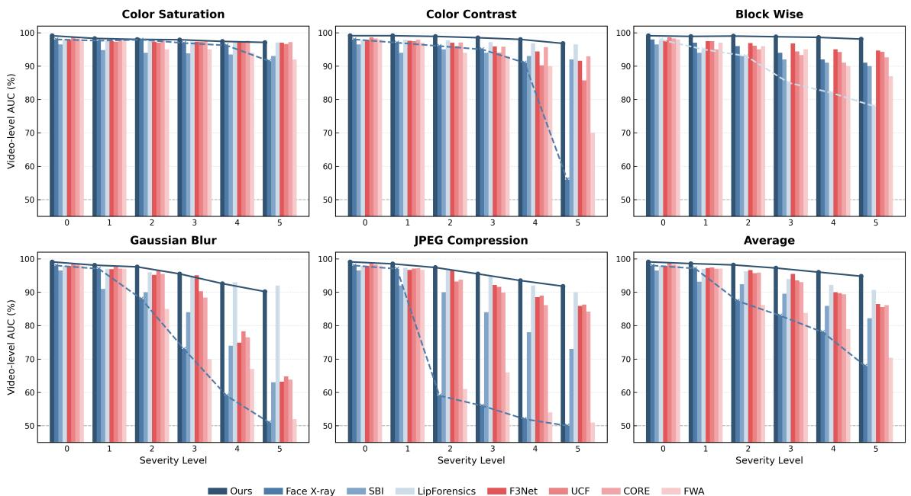  
Figure 6: Robustness evaluation under various unseen perturbations. The grouped bar charts illustrate the video-level AUC (%) performance of our method versus competing approaches across five diferent perturbation types: Color Saturation, JPEG Compression, Color Contrast, Block Wise, and Gaussian Blur. Performance is plotted against increasing severity levels from 0 to 5. Overall, our method demonstrates the strongest comprehensive robustness, achieving highly competitive performance across diferent unseen perturbation types.

Table 6: Quantitative comparison of the feature representations learned by CLIP-FT and HSP-CLIP under diferent values of M, measured by cluster-level fake density H¯ and cross-dataset fake density correlation P.
<table><tr><td rowspan="2">Method</td><td colspan="3">H</td><td colspan="3">P</td></tr><tr><td colspan="6">M = 10 M = 20 M = 30|M = 10 M = 20 M = 30</td></tr><tr><td colspan="7">Celeb-DF-v2</td></tr><tr><td>CLIP-FT HSP-CLIP-FT</td><td>0.996 0.998</td><td>0.973 0.985</td><td>0.907 0.936</td><td>0.483 0.832</td><td>0.853 0.960</td><td>0.914 0.934</td></tr><tr><td colspan="7">DFDCP</td></tr><tr><td>CLIP-FT</td><td>0.965</td><td>0.950</td><td>0.861</td><td>0.544</td><td>0.914</td><td>0.942</td></tr><tr><td>HSP-CLIP-FT</td><td>0.993</td><td>0.968</td><td>0.883</td><td>0.917</td><td>0.976</td><td>0.979</td></tr><tr><td colspan="7">DFDC</td></tr><tr><td>CLIP-FT</td><td>0.970</td><td>0.940</td><td>0.857</td><td>0.523</td><td>0.748</td><td>0.913</td></tr><tr><td>HSP-CLIP-FT</td><td>0.993</td><td>0.957</td><td>0.876</td><td>0.817</td><td>0.977</td><td>0.959</td></tr></table>

## C Evaluation Benchmarking

To provide a comprehensive benchmark, we evaluate our approach against a diverse array of competitive baselines, including F3Net (Qian et al. 2020), Face X-Ray (Li et al. 2020a), RECCE (Cao et al. 2022), and SBIs (Shiohara and Yamasaki 2022), LaV (Shuai et al. 2023), CFM (Luo et al. 2023), IID (Huang et al. 2023), UCF (Yan et al. 2023a), FakeRadar (Li et al. 2025), LSDA (Yan et al. 2024a), FCG (Han et al. 2025), ProDet (Cheng et al. 2024), VbSaT (Yan et al. 2025), DeepShield (Cai et al. 2025), $\chi ^ { 2 } { \cdot } \mathrm { D F D }$ (Chen et al. 2024), FreqDebias (Kashiani, Talemi, and Afghah 2025), ExposDe (Ba et al. 2024), FSgD (Ma et al. 2025), RAID (Cheng et al. 2025), UDD (Fu et al. 2025), DFFake (Sun et al. 2024), ICT (Dong et al. 2022), CDFA (Lin et al. 2024), and Efort (Yan et al. 2024b). For a fair and rigorous comparison, all models are trained on the FaceForensics++ (c23) dataset and evaluated across multiple unseen datasets and manipulation techniques to assess their cross-domain generalization.

## D Robustness to Image Degradations

To evaluate the robustness of HSP against common image degradations, we adopt the evaluation protocols from previous studies (Haliassos et al. 2021; Yan et al. 2024b,a; Jiang et al. 2020). Specifically, we examine five distinct types of perturbations: Color Saturation Change, JPEG Compression, Color Contrast Change, Block-wise Distortion, and Gaussian Blur. For each perturbation, severity levels ranging from 0 (clean) to 5 are applied to assess model stability under varying degrees of degradation. All models are trained on

Table 7: Performance comparison across diferent numbers of prototypes. Results are reported in frame-level ACC and AUC (%). The best result for each dataset and metric is shown in bold. Blue cells highlight the selected high-performance region.
<table><tr><td>K</td><td>Metric</td><td>CD2</td><td>CD1</td><td>DFDCP</td><td>DFD</td><td>DFDC</td><td>SimSwap</td><td>UniFace</td><td>e4s</td><td>FaceDancer</td><td>FSGAN</td><td>InSwap</td></tr><tr><td rowspan="3">8</td><td rowspan="3">ACC AUC</td><td>79.1</td><td>78.9</td><td>78.4</td><td>91.2</td><td>76.8</td><td>83.0</td><td>87.2</td><td>90.3</td><td>83.1</td><td>89.1</td><td>83.2</td></tr><tr><td>89.5</td><td>90.6</td><td>87.8</td><td>94.1</td><td>87.2</td><td>89.2</td><td>93.9</td><td>96.8</td><td>90.4</td><td>95.5</td><td>90.3</td></tr><tr><td>81.6</td><td>81.3</td><td>79.5</td><td>90.9</td><td>76.3</td><td>85.0</td><td>87.7</td><td>90.1</td><td>84.6</td><td>90.2</td><td>84.2</td></tr><tr><td rowspan="2">16</td><td>ACC AUC</td><td>89.8</td><td>91.3</td><td>87.0</td><td>94.1</td><td>86.2</td><td>91.9</td><td>95.1</td><td>97.0</td><td>92.3</td><td>95.9</td><td>91.6</td></tr><tr><td>ACC</td><td>82.0</td><td>82.9</td><td>80.3</td><td>90.9</td><td>76.7</td><td>83.6</td><td>89.1</td><td>93.1</td><td>85.1</td><td>90.4</td><td></td></tr><tr><td rowspan="2">32</td><td>AUC</td><td>90.3</td><td>89.7</td><td>87.9</td><td>94.2</td><td>85.6</td><td>90.2</td><td>94.7</td><td>97.7</td><td>92.4</td><td>96.3</td><td>82.4 90.4</td></tr><tr><td></td><td></td><td>82.7</td><td>80.8</td><td>89.5</td><td>76.9</td><td>81.1</td><td></td><td></td><td></td><td></td><td></td></tr><tr><td rowspan="2">64</td><td>ACC AUC</td><td>82.3 89.8</td><td>91.2</td><td>89.2</td><td>93.9</td><td>85.4</td><td>90.0</td><td>87.6 94.3</td><td>91.4 97.0</td><td>83.2 92.1</td><td>90.1 95.9</td><td>80.9 90.7</td></tr><tr><td></td><td></td><td></td><td></td><td></td><td></td><td></td><td></td><td></td><td></td><td></td><td></td></tr><tr><td>128</td><td>ACC AUC</td><td>82.8 90.9</td><td>83.5 91.9</td><td>81.6 90.0</td><td>90.1 94.3</td><td>77.5 86.7</td><td>81.6 88.7</td><td>86.0 93.4</td><td>91.1 97.2</td><td>83.5 91.8</td><td>90.7 95.8</td><td>82.9 91.4</td></tr></table>

Table 8: Ablation study on layer-wise loss weighting. Uniform Weighting assigns identical loss weights to both HSP layers, whereas Hierarchical Weighting reduces the loss weights of the second HSP layer by half. Results are reported in frame-level ACC and AUC (%), with the best result for each dataset and metric shown in bold.
<table><tr><td>Weighting Strategy</td><td>Metric</td><td>CD2</td><td>CD1</td><td>DFDCP</td><td>DFD</td><td>DFDC</td><td>SimSwap</td><td>UniFace</td><td>e4s</td><td>FaceDancer</td><td>FSGAN</td><td>InSwap</td></tr><tr><td rowspan="2">Uniform</td><td>ACC</td><td>82.2</td><td>83.8</td><td>81.8</td><td>92.2</td><td>76.8</td><td>80.7</td><td>85.1</td><td>89.8</td><td>83.5</td><td>90.6</td><td>82.1</td></tr><tr><td>AUC</td><td>90.6</td><td>91.8</td><td>88.9</td><td>93.7</td><td>85.9</td><td>87.9</td><td>92.7</td><td>97.0</td><td>91.7</td><td>95.5</td><td>90.2</td></tr><tr><td rowspan="2">Hierarchical</td><td>ACC</td><td>82.8</td><td>83.5</td><td>81.6</td><td>90.1</td><td>77.5</td><td>81.6</td><td>86.0</td><td>91.1</td><td>83.5</td><td>90.7</td><td>82.9</td></tr><tr><td>AUC</td><td>90.9</td><td>91.9</td><td>90.0</td><td>94.3</td><td>86.7</td><td>88.7</td><td>93.4</td><td>97.2</td><td>91.8</td><td>95.8</td><td>91.4</td></tr></table>

FaceForensics++ (c23) and evaluated based on video-level AUC scores. We compare our method against several stateof-the-art approaches, including Face X-ray (Li et al. 2020a), SBI (Shiohara and Yamasaki 2022), LipForensics (Haliassos et al. 2021), and FWA (Li and Lyu 2019). Additionally, for a strictly fair comparison, we reproduce F3Net (Qian et al. 2020), UCF (Yan et al. 2023a), and CORE (Ni et al. 2022), ensuring they utilize the same data augmentation scheme as our proposed method. The quantitative results under these unseen perturbations are illustrated in Figure 6. As observed, while most competing methods sufer significant performance drops under severe perturbations, particularly in JPEG compression and Gaussian blur where high-frequency details are lost, our method maintains consistently high performance across all severity levels. Even compared to the reproduced baselines (Qian et al. 2020; Yan et al. 2023a; Ni et al. 2022) trained with identical data augmentation, HSP-CLIP demonstrates superior stability, validating that its robustness stems from the learned generalized features rather than merely data augmentation.

## E Additional Ablation Studies

## E.1 Impact of the Number of Prototypes K

We vary the number of prototypes within {8, 16, 32, 64, 128}, and the results are shown in Table 7. On cross-dataset benchmarks (e.g., CD2, CD1, DFDCP, and DFDC), performance generally improves with a larger prototype space, achieving the best results at $K = 1 2 8$ . In contrast, under cross-manipulation evaluation $( e . g . , \mathsf { D F 4 0 } )$ , performance peaks at $K = 3 2$ and slightly decreases with further expansion. This trend is consistent with the experimental conclusions reported in the main text.

## E.2 Impact of Hierarchical Loss Weighting

To examine whether diferent HSP layers require diferent regularization strengths, we compare two loss-weighting strategies. Uniform Layer-wise Weighting assigns identical weights to all HSP layers, while Hierarchical Layer-wise Weighting reduces the loss weights of the second layer by half. As shown in Table 8, hierarchical weighting achieves more consistent performance across most benchmarks, while uniform weighting is only beneficial on a few datasets. This behavior stems from the hierarchical nature of forensic representations. Earlier layers preserve fine-grained forgery cues, such as texture inconsistencies and blending boundaries, and are therefore more suitable for factor modeling and decoupling. In contrast, deeper layers encode more global semantic information, where excessive reconstruction and decoupling constraints may restrict their discriminative capacity. Reducing the regularization strength of the second HSP layer thus preserves high-level semantics while maintaining structured modeling of fine-grained cues. This observation is consistent with the layer-placement results in Figure 4(b), where deeper features are less suitable for fine-grained factor decoupling.

## F Analysis of Internal Properties Explaining HSP Efectiveness

## F.1 Prototype Diversity Analysis.

We assess the diversity of the learned spatial prototypes under the dual-layer HSP configuration with $\bar { K } \ = \ \mathrm { { \bar { 1 2 8 } } } .$ For each module, we compute the cosine similarity matrix $\mathbf { S } = \hat { \mathbf { P } } \hat { \mathbf { P } } ^ { \top }$ , where Pˆ is obtained by row-wise $\ell _ { 2 }$ normalization. As shown in Figure 7(a,b), both similarity matrices exhibit clear identity-like structures, with diagonal entries of 1.0 and of-diagonal values concentrated near zero. Figure 7(c) further quantifies this behavior: the mean absolute of-diagonal cosine similarities are only $1 . 9 0 \times 1 0 ^ { - 4 }$ and $4 . 6 6 \times 1 0 ^ { - 4 }$ for Modules 1 and 2, respectively. These results confirm that the orthogonality constraint learns nearly independent prototype directions with minimal redundancy, efectively preventing prototype collapse.

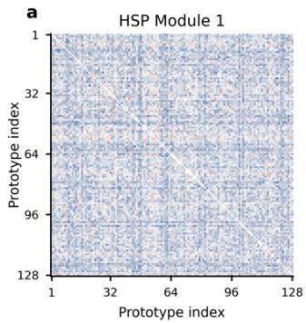

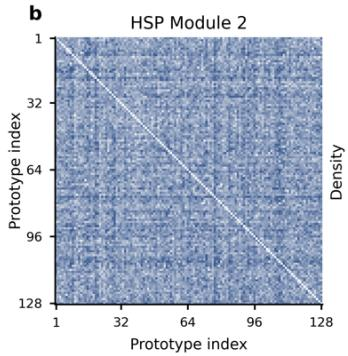

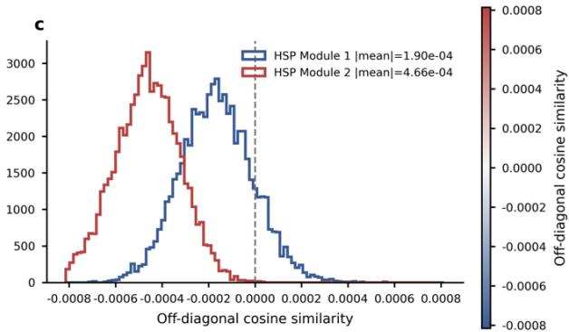  
Figure 7: Cosine similarity analysis of the learned spatial prototypes in the two HSP modules $( K = 1 2 8 )$ . (a,b) Prototype cosine similarity matrices, where the of-diagonal entries are concentrated near zero. (c) Distributions of of-diagonal cosine similarities, with mean absolute values of $1 . { \overset { \cdot } { 9 } } 0 \times 1 0 ^ { - 4 }$ and $4 . 6 6 \times 1 0 ^ { - 4 }$ for Modules 1 and $^ { 2 , }$ respectively. These near-zero similarities demonstrate that HSP learns geometrically decoupled prototypes with minimal redundancy.

## F.2 Prototype Assignment Analysis.

To validate the assignment balance constraint, we randomly sample 2,000 real and 2,000 fake images from CDF-v2 and extract token-to-prototype soft assignments from the two HSP modules with $K \stackrel { \textstyle = } { = } 1 2 8$ . We evaluate assignment balance from two complementary perspectives. First, we average the assignments over all tokens to obtain the marginal prototype-usage distribution a¯ and measure its uniformity using Perplexity:

$$
\mathrm { P e r p } = \exp \left( - \sum _ { k = 1 } ^ { K } \bar { a } _ { k } \log ( \bar { a } _ { k } + \epsilon ) \right) ,
$$

whose maximum is K under perfectly uniform usage. ${ \mathrm { S e c } } -$ ond, we center the assignment matrix as $\mathbf { A } _ { c } = \mathbf { A } - \mathbf { 1 } \bar { \mathbf { a } } ^ { \top }$ and compute the normalized eigenvalues of $\mathbf { A } _ { c } ^ { \top } \mathbf { A } _ { c }$ as $\lambda _ { k } =$ $\sigma _ { k } / \sum _ { j } \sigma _ { j }$ . We then quantify the diversity of assignment variations using the efective rank:

$$
r _ { \mathrm { e f f } } = \exp \left( - \sum _ { k = 1 } ^ { K } \lambda _ { k } \log ( \lambda _ { k } + \epsilon ) \right) .
$$

Because each assignment vector sums to one, the centered assignments lie in a (K − 1)-dimensional subspace, yielding a maximum admissible efective rank of $K - 1 = 1 2 7$

As shown in Figure 8, the prototype-usage frequencies of both modules closely follow the uniform baseline 1/K. Module 1 and Module 2 achieve Perplexity scores of 125.97 and 126.44, respectively, approaching the theoretical maximum of 128 and indicating broad prototype utilization. Their efective ranks reach 95.09 and 103.87, corresponding to 74.8% and 81.8% of the admissible maximum, respectively. Both values approach the theoretical maximum of127, particularly for Module 2, indicating that assignment variations span a broad set of valid directions, thereby enabling the model to learn a richer set of latent forgery-feature directions.

## F.3 Visualization of Spatial Prototype Activation Maps.

To understand the representations learned by HSP, we visualize the spatial activation maps of optimized prototypes. Specifically, we extract token-to-prototype assignment maps from the second HSP module, select 8 representative prototypes, and upsample their assignment weights to the original resolution. As shown in Figure 9, diferent prototypes exhibit distinct spatial preferences across images, with some focusing on localized artifacts around the eyes or mouth and others capturing global facial structures or blending boundaries. This spatial disentanglement validates that orthogonality and balance constraints encourage the decomposition of complex forgery evidence into diverse and independent structural patterns.

## G Limitation

Our method improves cross-domain generalization by using learnable spatial prototypes to model forgery representations through multiple latent factors. However, this factorization is driven by representation-level constraints rather than explicit supervision for specific forensic cues. Consequently, the learned prototype factors are not guaranteed to align with physically interpretable manipulation traces, such as blending boundaries, frequency inconsistencies, or rendering artifacts. Future work could introduce finer-grained supervision over diferent dimensions of the prototype space, for example, through manipulation-specific auxiliary objectives or forgery-region localization (Shuai et al. 2023; Li et al. 2020a), to improve the interpretability and semantic alignment of the learned factors.

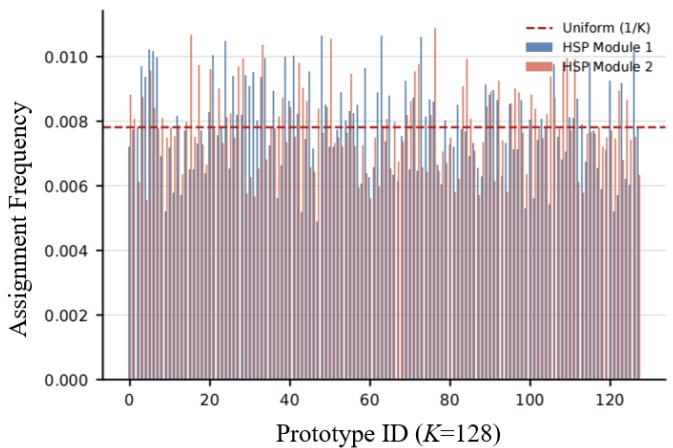  
HSP Module 2 | Perp: 126.44

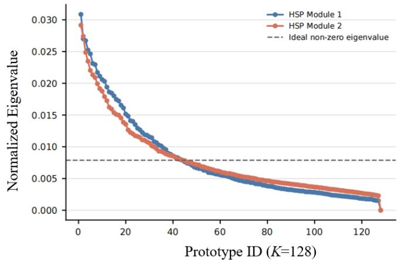  
HSP Module 1 | Effective Rank: 95.09 HSP Module 2 | Effective Rank : 103.87  
Figure 8: Prototype assignment balance across the two HSP modules $( K = 1 2 8 )$ on CDF-v2. The left panel shows the prototypeusage frequencies, with the red dashed line denoting the uniform baseline (1/K); both modules achieve Perplexity scores close to the theoretical maximum of 128. The right panel shows the normalized eigenvalue spectra of the centered assignment covariance, where the efective ranks reach 95.09 and 103.87 and approach the maximum admissible value of 127, indicating broad utilization of the admissible assignment subspace.

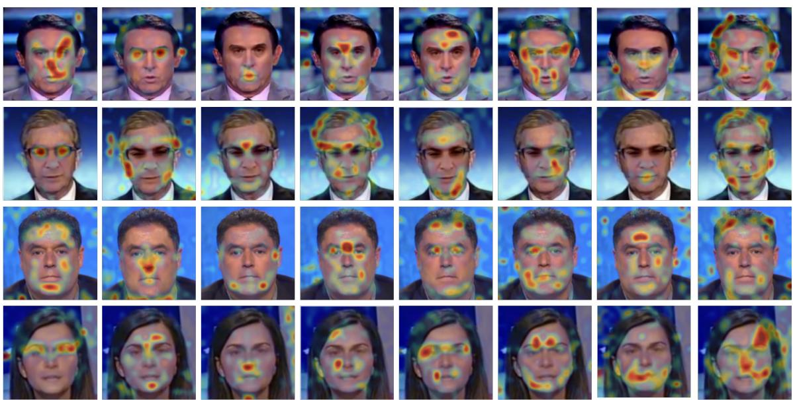  
Figure 9: Visualization of spatial prototype activation maps. We visualize the bilinearly upsampled token-to-prototype soft assignments for 8 selected prototypes (columns) across various input faces (rows). Notably, each prototype isolates distinct and consistent localized regions (e.g., eyes, mouth, or blending boundaries) regardless of the subject’s identity. This demonstrates that the HSP framework successfully disentangles forgery artifacts into diverse, independent structural patterns, mitigating over-reliance on localized shortcuts.