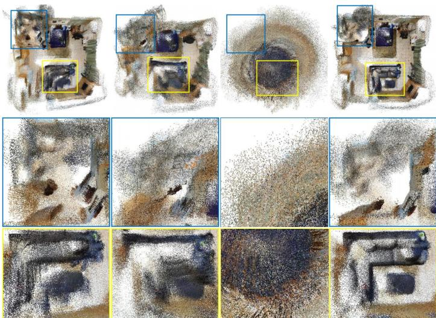
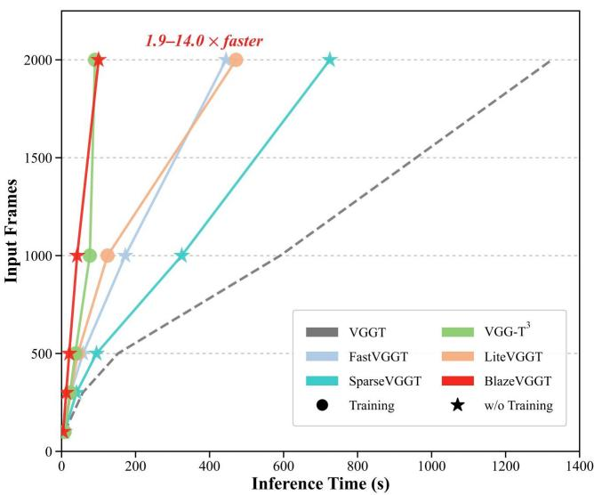
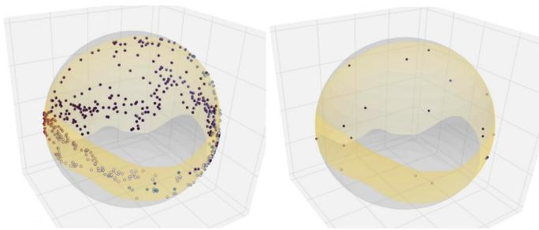
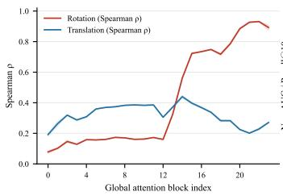
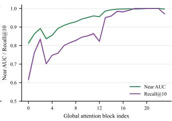
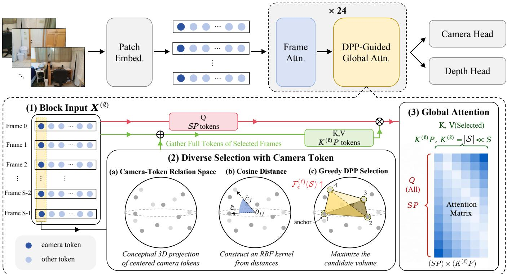
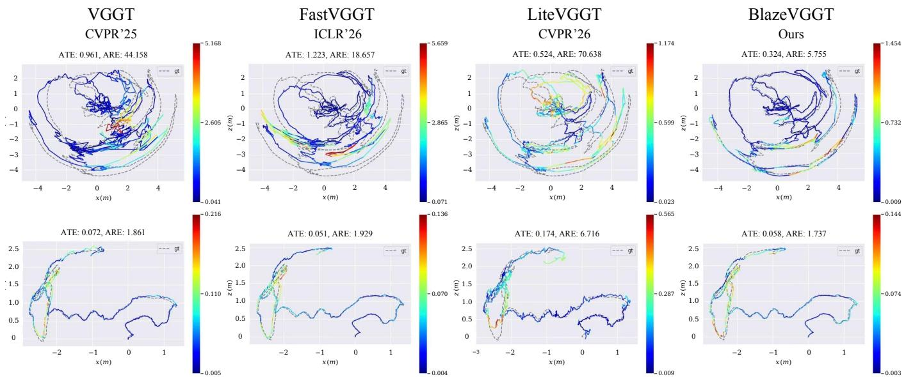
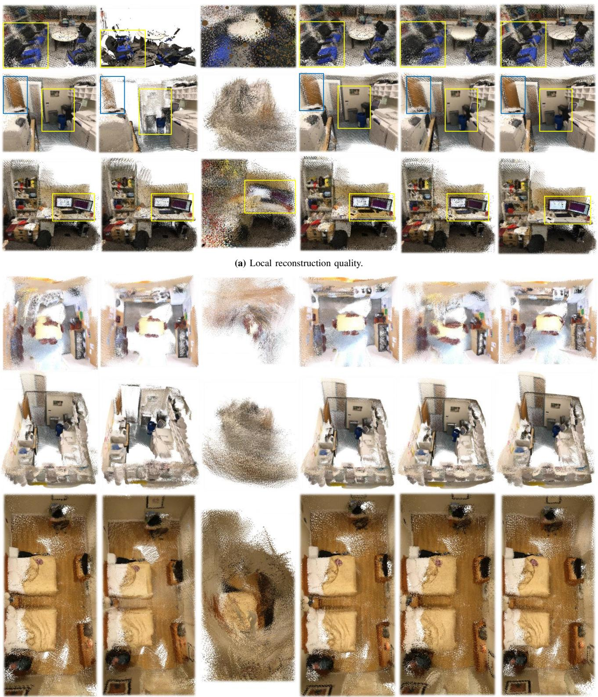
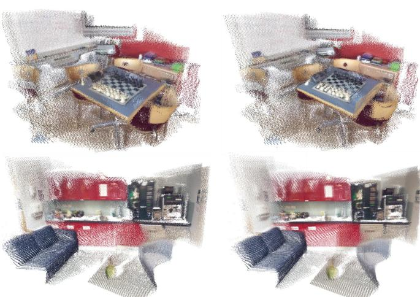

# BlazeVGGT: 13× Faster VGGT at 2,000 Frames via Camera Token without Training

Shujun Yao∗, Junhui Lin∗, Congying Han, Tiande Guo, Ziwen Liu† and Bonan Li†

  
VGGT CD: 0.41 FastVGGT CD: 0.38 VGG-T3 CD: 0.48 Ours CD: 0.32

  
Fig. 1. We propose BlazeVGGT, a training-free frame-level KV sparsification framework that processes 2,000 images in a single inference, achieving 13.0× faster inference while producing cleaner geometric reconstructions. All experiments use the VRAM-efficient implementation of VGGT [1] as the base model, following prior state-of-the-art methods for long-sequence evaluation.

Abstract—Feed-forward visual geometry models, exemplified by VGGT, have demonstrated strong multi-view reconstruction capabilities through dense global attention. However, the resulting all-to-all cross-view computation scales quadratically with the number of input views, making long-sequence inference particularly expensive due to substantial frame-level redundancy among highly overlapping observations. We uncover a topologyfirst, geometry-later evolution in VGGT camera tokens: shallowlayer tokens reliably capture local view neighborhoods, whereas deeper-layer tokens progressively encode globally organized inter-view geometry. Motivated by this observation, we introduce BlazeVGGT, a training-free framework for structureaware frame-level key–value sparsification. At each globalattention block, BlazeVGGT constructs a view-level similarity kernel from camera-token relations and employs greedy determinantal point process inference to select a compact set of mutually complementary views. The selected views constitute the key–value context, while all input frames are retained as queries. This asymmetric attention design preserves dense per-frame predictions while eliminating redundant cross-view computation, allowing our method to be directly integrated into pretrained VGGT as a plug-and-play module without parameter updates. Its advantages become increasingly pronounced with sequence length: at 2,000 frames, BlazeVGGT achieves approximately 13× faster inference than VGGT while reducing the Chamfer Distance from 0.41 to 0.32. Extensive experiments demonstrate a favorable accuracy–efficiency trade-off in pointcloud reconstruction and camera-pose estimation, compatibil-

ity with existing VGGT accelerators such as FastVGGT and LiteVGGT, and transferability to VGGT-based models including StreamVGGT and PAGE-4D.Codes are publicly available at https://github.com/MagiciannnY/BlazeVGGT.git.

Index Terms—Visual geometry transformer, Long-sequence reconstruction, Determinantal point process.

## I. INTRODUCTION

Feed-forward visual geometry models have recently emerged as powerful alternatives to conventional multi-stage reconstruction pipelines. In particular, VGGT [1] jointly estimates camera parameters, depth maps, point maps, and point tracks from an arbitrary collection of input views within a single feed-forward network. Its strong multi-view reasoning capability is largely enabled by global attention, which facilitates information exchange across all input views. However, the resulting all-to-all cross-view computation scales unfavorably with the number of input frames. Given S views and P tokens per view, each global-attention block operates over SP tokens and incurs a dominant computational complexity of $\mathcal { O } ( S ^ { 2 } P ^ { 2 } C )$ , where C denotes the feature dimension. This quadratic dependence on S becomes prohibitively expensive for long image sequences, which commonly contain substantial redundancy among highly overlapping observations.

Existing VGGT acceleration methods [4]–[10] primarily reduce the global-attention workload by compressing token or KV representations, or sparsifying global attention. Although effective, these approaches retain several limitations. Some methods [5]–[7] require additional training, fine-tuning, or input-specific optimization, restricting their direct applicability to pretrained models. Training-free alternatives [4], [8]–[10] generally operate at the granularity of individual tokens, token descriptors, attention heads, or sparse attention blocks, without explicitly modeling the structured redundancy among complete views. Consequently, multiple near-duplicate frames may continue to serve as cross-view information sources even after their spatial representations have been compressed. Moreover, aggressive token-level reduction may fragment the coherent intra-frame evidence required for geometric reasoning. These limitations motivate a complementary perspective: rather than determining which individual tokens should be retained, we ask which views are necessary to provide a representative and geometrically complementary global context.

  
(a)

  
(b)  
Fig. 2: Camera-token structure and its relation to camera geometry. (a) Camera tokens from deep layer, projected to three dimensions by PCA and colored by camera yaw. The left view contains all frames; the right view contains the DPP-selected frames [2], showing that the selected views cover the yaw-organized token manifold. (b) Layerwise diagnostics on a ScanNet [3] sequence. Left: Spearman correlation between centered-cosine camera-token distance and ground-truth rotation or translation distance. Right: local topology preservation measured by Near AUC and Recall@10. Shaded bands span the three token variants (concat, frame, global).

This view-level perspective is particularly relevant to multi-view geometry, where redundancy exhibits a strong frame-wise structure. Adjacent views frequently capture nearly identical scene content, whereas a small number of geometrically distinct viewpoints may provide substantially more complementary evidence. Naive frame sampling, however, can overlook geometrically important observations and fail to represent the global scene structure. An effective viewselection mechanism must therefore preserve each selected frame as a complete unit while identifying a compact subset that jointly covers the input view distribution. As illustrated in Fig. 2(a), the input views densely populate the camera-token space with considerable redundancy, whereas a compact subset can span its underlying view structure. The key challenge is to identify such representative views during inference, particularly in shallow layers where reliable camera geometry has not yet been recovered.

To determine whether the intermediate representations of VGGT provide an effective signal for view selection, we systematically analyze the relational structure encoded by camera tokens at every global-attention block and compare it with ground-truth camera geometry. As shown in Fig. 2(b), camera tokens exhibit a characteristic topology-first, geometry-later evolution. Even in shallow layers, they achieve high Near AUC and Recall@10, indicating that local view neighborhoods are already reliably preserved. At the same time, their rank correlation with global camera geometry remains limited: shallow camera tokens can distinguish nearby views from non-neighboring ones but do not yet accurately encode their global arrangement. Around the middle of the network, this behavior changes markedly. The camera-token similarity structure becomes increasingly consistent with global view geometry, particularly with respect to camera rotation, whereas metric translation remains less precisely calibrated. These observations suggest that camera tokens progressively evolve from neighborhood-aware frame descriptors into taskrelevant geometric representations, rather than explicitly recovering complete metric 6-DoF camera poses.

This progressive representation is particularly well aligned with the requirements of frame-level attention sparsification. In shallow layers, accurate global geometry is unnecessary for redundancy suppression: identifying that multiple views belong to the same local neighborhood is already sufficient to avoid repeatedly attending to nearly duplicate observations. In deeper layers, where cross-view reasoning benefits from a more globally representative context, camera tokens have developed a substantially more organized inter-view geometry. We therefore arrive at a simple principle: local topology is sufficient for redundancy suppression, whereas global geometry promotes scene-wide view coverage. Importantly, both forms of structure emerge directly from the camera tokens of the pretrained network, eliminating the need for an external pose estimator or an additional feature encoder.

Motivated by these observations, we introduce BlazeVGGT, a training-free framework for structureaware frame-level key–value (KV) sparsification. At each global-attention block, BlazeVGGT constructs a view-level similarity kernel from the evolving relations among camera tokens and employs greedy determinantal point process (DPP) selection [2] to identify a compact set of mutually complementary views. Unlike independent view ranking, the DPP criterion jointly accounts for redundancy and diversity within the selected set. As camera-token representations evolve across layers, the same selection mechanism naturally transitions from suppressing local view redundancy in shallow layers to promoting broader scene coverage in deeper layers. The selected views are used exclusively to construct the KV context, while all input frames are retained in the query path. Once a view is selected, its complete token block is preserved, thereby maintaining the coherent intraframe spatial evidence required for geometric reasoning. This query–KV asymmetry preserves predictions for every input frame while substantially reducing redundant cross-view computation. Specifically, if $K _ { \ell } \ \ll \ S$ views are selected at the ℓ-th global-attention block, the dominant attention complexity is reduced from $\mathcal { O } ( S ^ { 2 } P ^ { 2 } C )$ to $\mathcal { O } ( S K _ { \ell } P ^ { 2 } C )$ Because BlazeVGGT modifies only the routing of the KV context and introduces no learnable parameters, it can be directly integrated into pretrained VGGT models as a plug-and-play module without retraining. Its frame-level operation is also complementary to existing acceleration techniques that reduce computation at the token or attention level.

Extensive experiments demonstrate that BlazeVGGT achieves a favorable accuracy–efficiency trade-off, with increasingly pronounced gains as the sequence length grows. As shown in Fig. 1, at 2,000 input frames, our method reduces the inference time from more than 1,300s to approximately 100s, corresponding to a speedup of about 13×, while reducing the Chamfer Distance from 0.41 to 0.32. BlazeVGGT also maintains competitive performance in point-cloud reconstruction and camera-pose estimation. Moreover, it can be seamlessly combined with existing VGGT accelerators, including FastVGGT [4] and LiteVGGT [5], and transferred to other VGGT-based architectures and inference settings, including StreamVGGT [11] and PAGE-4D [12]. Collectively, these results demonstrate the scalability, compatibility, and generalizability of the proposed approach.

Our contributions are summarized as follows:

• We uncover a topology-to-geometry evolution in VGGT camera tokens: local view neighborhoods emerge in shallow layers, while globally organized inter-view geometry strengthens in deeper layers.

• We introduce BlazeVGGT, a training-free framework for frame-level KV sparsification that combines cameratoken relations with DPP-based view selection, retaining all queries and the complete token blocks of selected views.

• Experiments demonstrate favorable accuracy–efficiency trade-offs on sequences of up to 2,000 frames, compatibility with existing VGGT accelerators, and transferability across VGGT-based inference pipelines.

## II. RELATED WORK

## A. 3D Reconstruction

Classical 3D reconstruction estimates scene structure and camera motion through feature correspondence, geometric estimation, and global optimization. Structure-from-motion (SfM) pipelines recover sparse geometry using matching, triangulation, and bundle adjustment [13]–[19]. Their correspondence front ends have evolved from handcrafted descriptors and dense matching [20]–[22] to learned descriptors [23]–[26], learned matching [27]–[32], and featuremetric refinement [33], while classical solvers and registration remain fundamental [34]–[39]. Dense multi-view stereo complements SfM through traditional patch-based methods [40]– [44] and learned cost-volume formulations [45]–[49], although sparse wide-baseline and large-scale settings remain challenging [50], [51]. Neural rendering methods such as NeRF [52] and 3D Gaussian Splatting [53] improve novelview synthesis but typically require per-scene optimization. Direct and learned SfM systems [54]–[60], together with non-rigid formulations [61], further extend this paradigm, but generally retain iterative, pairwise, or sequential processing.

## B. Feed-Forward Visual Geometry Models

Feed-forward visual geometry models replace explicit per-scene optimization with learned geometric priors. DUSt3R [62] predicts aligned point maps from image pairs, while MASt3R [63] incorporates metric-aware matching. Fast3R [64], Spann3R [65], and CUT3R [66] extend this paradigm to multi-view and persistent reconstruction. VGGT [1] instead jointly infers cameras, depth, point maps, and tracks by alternating frame-wise and global attention, enabling direct interaction across the entire image collection. StreamVGGT [11] adapts this architecture to continuous video, while VGGT-Long [67], IncVGGT [68], and MERG3R [69] address long-range reconstruction through chunking, incremental processing, or divide-and-conquer. Nevertheless, benchmarks such as KITTI-360 [70] highlight the continuing need for scalable global reasoning over large image collections.

## C. Efficient VGGT

Efficient VGGT methods can be broadly divided according to whether they require adaptation of the pretrained model. Optimization-dependent approaches include VGG-T3 [7], which compresses variable-length KV representations through test-time training; LiteVGGT [5], which finetunes the model for geometry-aware token merging; and Co-Me [6], which trains an auxiliary merging controller. Although differing in where adaptation occurs, these methods require either offline training or input-specific optimization. Training-free methods instead modify inference while preserving the pretrained parameters. FastVGGT [4] and HTTM [8] reduce redundancy through global or head-wise token merging, whereas SparseVGGT [9] adopts adaptive block-sparse attention. Related approaches use descriptor compression, sensitivity-aware sparsity allocation, or redesigned global attention [10], [71], [72]. These methods primarily operate on spatial tokens, attention heads, or connectivity patterns. BlazeVGGT is likewise training-free but targets redundancy among complete views, restricting the KV context to geometrically complementary frames while retaining all input queries and the full token block of each selected view. Its view-level operation is therefore complementary to token merging, sparse attention, and model adaptation.

## III. METHODOLOGY

## A. Preliminary

We build upon Visual Geometry Grounded Transformer (VGGT) [1], a feed-forward model that jointly predicts camera parameters, depth maps, point maps, and point tracks from a set of RGB images. Let $\Omega = \{ 0 , \ldots , S { - } 1 \}$ denote the index set of S input views $\{ I _ { i } \} _ { i \in \Omega } .$ , where $\pmb { I _ { i } } \in \mathbb { R } ^ { H \times W \times 3 }$

  
Fig. 3: Overview of BlazeVGGT. At each global-attention block, camera tokens from all input frames define a view-level similarity structure, from which greedy DPP [2] selection retains a diverse subset of frames. All frames remain in the Query path, while the selected frame blocks provide the Key–Value context for global attention; the resulting features are passed to the camera and depth heads.

VGGT first independently encodes each image with DI-NOv2 [73] into a sequence of patch tokens. Each view is further augmented with one learnable camera token and four register tokens.

At the input to the ℓ-th global-attention block, we denote the token block associated with view i as

$$
\begin{array} { r } { \pmb { X } _ { i } ^ { ( \ell ) } = \left[ \pmb { c } _ { i } ^ { ( \ell ) } ; \pmb { R } _ { i } ^ { ( \ell ) } ; \pmb { Z } _ { i } ^ { ( \ell ) } \right] \in \mathbb { R } ^ { P \times C } , } \end{array}\tag{1}
$$

where $\pmb { c } _ { i } ^ { ( \ell ) } \in \mathbb { R } ^ { C }$ is the camera token, $R _ { i } ^ { ( \ell ) } \in \mathbb { R } ^ { 4 \times C }$ denotes the register tokens, $Z _ { i } ^ { ( \ell ) } ~ \in ~ \mathbb { R } ^ { ( P - 5 ) \times C }$ denotes the patch tokens, P is the total number of tokens per view, and C is the feature dimension. The camera tokens are progressively updated throughout the backbone and are ultimately decoded by the camera head to predict the corresponding camera parameters.

Alternating frame and global attention. The VGGT aggregator alternates between frame-wise and global self-attention. Frame-wise attention processes each view independently, whereas global attention jointly processes tokens from all views to enable cross-view information exchange. For the ℓ-th global-attention block, the per-view token blocks are concatenated as

$$
\begin{array} { r } { \pmb { X } ^ { ( \ell ) } = \left[ \pmb { X } _ { 0 } ^ { ( \ell ) } ; \ldots ; \pmb { X } _ { S - 1 } ^ { ( \ell ) } \right] \in \mathbb { R } ^ { S P \times C } . } \end{array}\tag{2}
$$

After linear projection, the query, key, and value representations are partitioned accordingly by view, and standard global self-attention is computed as

$$
{ \mathrm { A t t e n t i o n } } ( Q , K , V ) = { \mathrm { s o f t m a x } } \left( { \frac { Q K ^ { \top } } { \sqrt { d _ { h } } } } \right) V ,\tag{3}
$$

where $d _ { h }$ denotes the feature dimension of each attention head. Thus, every query token attends to the key–value tokens from all S views. With a fixed number of tokens per view, the global-attention matrix contains $( S { \cdot } P ) ^ { 2 }$ pairwise interactions, and its computational cost therefore grows quadratically with the number of input views. This dense cross-view interaction is the primary target of our methods introduced below.

## B. Our Method

BlazeVGGT exploits the progressively emerging interview structure of VGGT camera tokens to reduce redundant cross-view computation. As illustrated in Fig. 3, our framework consists of two simple steps. First, we construct a view-level similarity kernel from camera tokens and select a compact set of mutually complementary views using a determinantal objective. Second, we retain all input frames as Queries while restricting the KV context of global attention to the selected views. The entire procedure is training-free and operates directly on the intermediate representations of a pretrained VGGT.

Camera-Token Guided View Selection. Our analysis in Sec. I shows that pairwise relations among camera tokens provide a progressively richer representation of inter-view structure. Rather than decoding explicit camera poses, BlazeVGGT directly uses this relational structure to determine which views provide redundant or complementary evidence.

To emphasize relative differences among views while suppressing the component shared across the sequence, we first center the camera tokens across the input sequence and

Algorithm 1 Camera-Token View Selection in BlazeVGGT   
Require: Camera tokens from S views at the current block,   
threshold $\epsilon ,$ maximum view budget K   
Ensure: Selected view-index set S for the KV context   
1: Center and normalize camera tokens.   
2: Build the adaptive RBF kernel L (Eq. (6)).   
3: S ← {0} (Keep the anchor view)   
4: Initialize the Cholesky factor of $\mathbf { \Delta } _ { L _ { S } }$   
5: Compute residual scores $r _ { j }$ using Eq. (9).   
6: while |S| < min(K, S) do   
7: Select the unselected view $j$ with the largest $r _ { j }$   
8: if $r _ { j } < \epsilon$ then   
9: break   
10: end if   
11: $s  s \cup \{ j \}$   
12: Apply incremental Cholesky updates (Eqs. (12)–(13)).   
13: end while   
14: return S

normalize them,

$$
\hat { c } _ { i } ^ { ( \ell ) } = \frac { { c _ { i } ^ { ( \ell ) } - \bar { c } ^ { ( \ell ) } } } { { \left\| c _ { i } ^ { ( \ell ) } - \bar { c } ^ { ( \ell ) } \right\| _ { 2 } } }\tag{4}
$$

with $\begin{array} { r } { \bar { \mathbf { c } } ^ { ( \ell ) } ~ = ~ \frac { 1 } { S } \sum _ { j = 0 } ^ { S - 1 } c _ { j } ^ { ( \ell ) } } \end{array}$ . The dissimilarity between two views is measured by their cosine distance,

$$
d _ { i j } ^ { ( \ell ) } = 1 - \left( \hat { \pmb { c } } _ { i } ^ { ( \ell ) } \right) ^ { \top } \hat { \pmb { c } } _ { j } ^ { ( \ell ) } .\tag{5}
$$

We convert these distances into an inter-view similarity kernel

$$
L _ { i j } ^ { ( \ell ) } = \exp \left( - \frac { d _ { i j } ^ { ( \ell ) } } { s ^ { ( \ell ) } } \right) ,\tag{6}
$$

where $s ^ { ( \ell ) }$ is an adaptive scale estimated from the pairwise distances at the current block. Since the normalized cameratoken distance is equivalent to squared Euclidean distance on the unit sphere, Eq. (6) defines a positive-semidefinite RBF kernel.

Given the inter-view kernel, the remaining question is how to select a compact set of views that are collectively informative. Independently ranking views by an importance score can retain multiple observations that are individually informative but mutually redundant. We instead model view selection as a set-level diversity problem. Following the diversity principle of determinantal point processes (DPPs) [2], we define the diversity of a view subset ${ \mathcal { S } } \subseteq \Omega$ at block ℓ as $\mathcal { D } ^ { ( \ell ) } ( \mathcal { S } ) : = \operatorname* { d e t } ( L _ { \mathcal { S } } ^ { ( \ell ) } )$ ). Geometrically, the determinant measures the volume spanned by the selected views in the kernel feature space. Highly correlated views contribute little additional volume, whereas views that are dissimilar to the current set provide larger complementary coverage.

Because $\bar { L } _ { i i } ^ { ( \ell ) } = 1$ , Hadmard’s inequality give $\mathcal { D } ^ { ( \ell ) } ( S ) \leq 1$ whereas every singleton has determinant one. Unconstrained determinant maximization therefore admits a singleton solution and cannot by itself determine the adaptive subset size. We instead interpret the implemented stopping rule through the threshold-calibrated log-determinant objective, with $0 < \epsilon \leq 1$

$$
\mathcal { F } _ { \epsilon } ^ { \left( \ell \right) } ( S ) = \log \mathcal { D } ^ { \left( \ell \right) } ( S ) - \vert S \vert \log \epsilon ,\tag{7}
$$

subject to $0 \in S$ and $| S | \le K$ . We optimize this objective by greedy ascent. Consider adding a candidate view $j \in \Omega \backslash { \mathcal { S } } .$ By the Schur complement,

$$
\mathscr { D } ^ { ( \ell ) } ( S \cup \{ j \} ) = \mathscr { D } ^ { ( \ell ) } ( S ) r _ { j } ^ { ( \ell ) } ,\tag{8}
$$

where

$$
r _ { j } ^ { ( \ell ) } = L _ { j j } ^ { ( \ell ) } - \left( l _ { j } ^ { ( \ell ) } \right) ^ { \top } \left( \pmb { L } _ { S } ^ { ( \ell ) } \right) ^ { - 1 } l _ { j } ^ { ( \ell ) } , \qquad l _ { j } ^ { ( \ell ) } = \pmb { L } _ { S , j } ^ { ( \ell ) } .\tag{9}
$$

Thus, $r _ { j } ^ { ( \ell ) }$ measures the marginal diversity contributed by view $j .$ Its marginal gain under Eq. (7) is

$$
\mathcal { F } _ { \epsilon } ^ { \left( \ell \right) } \left( S \cup \left\{ j \right\} \right) - \mathcal { F } _ { \epsilon } ^ { \left( \ell \right) } \left( S \right) = \log \frac { r _ { j } ^ { \left( \ell \right) } } { \epsilon } .\tag{10}
$$

Consequently, adding a view has nonnegative marginal gain exactly when $r _ { j } ^ { ( \ell ) } \geq \epsilon .$ At each iteration, we select

$$
j ^ { \star } = \arg \operatorname* { m a x } _ { j \in \Omega \backslash S } r _ { j } ^ { ( \ell ) } .\tag{11}
$$

To avoid repeatedly evaluating the matrix inverse in Eq. (9), we maintain the residuals using incremental Cholesky updates [74]. Let $L _ { S } ^ { ( \ell ) } = B B ^ { \top }$ and $\bar { \mathbf { q } } _ { j } = \mathbf { { B } } ^ { - 1 } \boldsymbol { l } _ { j } ^ { ( \ell ) }$ After selecting $j ^ { \star }$ , the new Cholesky coefficient for a remaining candidate j is

$$
e _ { j } = \frac { L _ { j ^ { \star } j } ^ { ( \ell ) } - { q } _ { j ^ { \star } } ^ { \top } { \pmb q } _ { j } } { \sqrt { r _ { j ^ { \star } } ^ { ( \ell ) } } } ,\tag{12}
$$

and its residual can be updated efficiently as

$$
r _ { j } ^ { ( \ell ) } \gets r _ { j } ^ { ( \ell ) } - e _ { j } ^ { 2 } , \qquad j \in \Omega \setminus \mathcal { S } .\tag{13}
$$

Selection starts from the anchor view and greedily increases $\mathcal { F } _ { \epsilon } ^ { \left( \ell \right) }$ while the largest residual is at least ϵ, subject to the maximum budget K. This is a thresholded greedy approximation and the resulting cardinality is therefore adaptive: highly redundant representations naturally retain fewer KV views, whereas more diverse ones preserve a larger context. Algorithm 1 summarizes the procedure.

Importantly, the same selection rule is used throughout the network. In shallow blocks, where camera tokens primarily capture local neighborhood structure, the determinant mainly suppresses redundant nearby observations. As camera-token relations become increasingly geometry-aware in deeper blocks, the same objective instead favors views that provide complementary scene coverage. BlazeVGGT therefore requires neither an explicit stage boundary nor separate shallow- and deep-layer selectors; the change in selection behavior emerges directly from the evolving camera-token representation.

Frame-Routed Global Attention. The selected views are used to sparsify only the source of cross-view information.

TABLE I: Point cloud reconstruction on ScanNet-50 [3] with different numbers of input views. We report Chamfer Distance (CD) and inference time. The 2,000-view setting uses two-GPU sequence parallelism, whereas the 1,000-view setting uses single-GPU inference. BlazeVGGT achieves 13.2× and 14.0× speedups in these two settings, respectively. The slightly lower speedup at 2,000 views may partly reflect inter-GPU communication and synchronization overhead, which was not separately profiled.
<table><tr><td rowspan="2" colspan="2">Method</td><td colspan="2">2,000</td><td colspan="2">1,000</td><td colspan="2">500</td><td colspan="2">100</td></tr><tr><td>CD↓</td><td>Time↓</td><td>CD↓</td><td>Time↓</td><td>CD↓</td><td>Time↓</td><td>CD↓</td><td>Time↓</td></tr><tr><td colspan="2">VGGT [1] (CVPR’25)</td><td>0.4184</td><td>1325.1s</td><td>0.4760</td><td>591.0s</td><td>0.4646</td><td>152.3s</td><td>0.4377</td><td>8.1s</td></tr><tr><td rowspan="2">Training</td><td>LiteVGGT [5] (CVPR&#x27;26)</td><td>0.3420</td><td>471.6s</td><td>0.4085</td><td>133.8s</td><td>0.3862</td><td>44.2s</td><td>0.3291</td><td>8.1s</td></tr><tr><td>VGG-T3 [7] (CVPR’26)</td><td>0.4822</td><td>90.4s</td><td>0.5142</td><td>76.3s</td><td>0.4957</td><td>37.2s</td><td>0.421</td><td>8.0s</td></tr><tr><td rowspan="3">w/o Training</td><td>FastVGGT [4] (ICLR&#x27;26)</td><td>0.3886</td><td>444.5s</td><td>0.4654</td><td>172.7s</td><td>0.4569</td><td>58.0s</td><td>0.4234</td><td>4.8s</td></tr><tr><td>SparseVGGT [9] (CVPR’26)</td><td>0.3923</td><td>725.0s</td><td>0.4247</td><td>324.8s</td><td>0.4348</td><td>94.4s</td><td>0.4419</td><td>7.8s</td></tr><tr><td>BlazeVGGT</td><td>0.3282</td><td>100.1s (↑13.2×)</td><td>0.4283</td><td>42.1s (↑14.0×)</td><td>0.4279</td><td>20.7s (↑7.4×)</td><td>0.4111</td><td>4.2s (↑1.9×)</td></tr></table>

TABLE II: Point cloud reconstruction on 7 Scenes [75] and NRGBD [76] using stride-3 sampling. We report accuracy (Acc), completeness (Comp), normal consistency (NC), and inference time.
<table><tr><td rowspan="3" colspan="2">Method</td><td colspan="6">7 Scenes</td><td colspan="8"></td></tr><tr><td colspan="2">Acc↓</td><td colspan="2">Comp↓</td><td colspan="2">NC↑</td><td>Time↓</td><td colspan="2">Acc↓</td><td colspan="2">NRGBD Comp↓</td><td colspan="2">NC↑</td><td>Time↓</td></tr><tr><td>Mean Med.</td><td></td><td>Mean</td><td>Med.</td><td>Mean</td><td>Med.</td><td></td><td>Mean</td><td>Med.</td><td>Mean</td><td>Med.</td><td>Mean</td><td>Med.</td><td></td></tr><tr><td colspan="2"></td><td>0.0195 0.0203</td><td>0.0183 0.0182</td><td>0.0267 0.0249</td><td>0.0199 0.0169</td><td>0.5862 0.6065</td><td>0.5829 0.6056</td><td>65.9s 22.0s</td><td>0.0287 0.0354</td><td>0.0191 0.0250</td><td>0.0177 0.0255</td><td>0.0124 0.0125</td><td>0.6646 0.6908</td><td>0.6756 0.6955</td><td>112.1s 32.9s</td></tr><tr><td rowspan="3">Training</td><td>LiteVGGT [5] (CVPR&#x27;26) VGG-T3 [7] (CVPR&#x27;26)</td><td></td><td></td><td></td><td></td><td>0.5858</td><td></td><td></td><td></td><td></td><td></td><td></td><td></td><td></td><td>34.2s</td></tr><tr><td></td><td>0.1306</td><td>0.0304</td><td>0.0701</td><td>0.0308</td><td></td><td>0.5902</td><td>26.5s</td><td>0.1788</td><td>0.0525</td><td>0.1580</td><td>0.0171</td><td>0.6667</td><td>0.6713</td><td></td></tr><tr><td>FastVGGT [4] (ICLR&#x27;26)</td><td>0.0178 0.0190</td><td>0.0172</td><td>0.0263</td><td>0.0193</td><td>0.5895</td><td>0.5907</td><td>25.3s</td><td>0.0315</td><td>0.0180</td><td>0.0191</td><td>0.0126</td><td>0.6690</td><td>0.6799</td><td>47.2s</td></tr><tr><td rowspan="2">w/o Training</td><td>SparseVGGT [9] (CVPR’26) BlazeVGGT</td><td></td><td>0.0187</td><td>0.0290</td><td>0.0207</td><td>0.6636</td><td>0.6666</td><td>45.6s</td><td>0.0290</td><td>0.0259</td><td>0.0185</td><td>0.0117</td><td>0.8102</td><td>0.8439</td><td>71.5s</td></tr><tr><td></td><td>0.0176</td><td>0.0170</td><td>0.0258</td><td>0.0194</td><td>0.5859</td><td>0.5819</td><td>13.5s (↑4.9×)</td><td>0.0163</td><td>0.0153</td><td>0.0169</td><td>0.0116</td><td>0.6761</td><td>0.6694</td><td>14.8s (↑7.6×)</td></tr></table>

BlazeVGGT retains every input frame in the Query path, while the KV context is constructed only from the selected set $\boldsymbol { S } ^ { ( \ell ) }$ . For brevity, the subscript S below refers to this layer-specific set.

For a single attention head, let $W _ { Q } ^ { ( \ell ) } , W _ { K } ^ { ( \ell ) } , W _ { V } ^ { ( \ell ) } \in$ $\mathbb { R } ^ { C \times d _ { h } }$ and $K ^ { ( \ell ) } = | S ^ { ( \ell ) } |$ |. After flattening the frame and token dimensions, $\mathbf { \boldsymbol { X } } ^ { ( \ell ) } \in \mathbb { R } ^ { S P \times C }$ and $X _ { \mathcal { S } } ^ { \left( \ell \right) } \in \mathbb { R } ^ { K ^ { \left( \ell \right) } P \times C }$ We write

$$
\begin{array} { r } { \pmb { Q } ^ { ( \ell ) } = \pmb { X } ^ { ( \ell ) } \pmb { W } _ { \pmb { Q } } ^ { ( \ell ) } , } \\ { \pmb { K } _ { S } ^ { ( \ell ) } = \pmb { X } _ { S } ^ { ( \ell ) } \pmb { W } _ { K } ^ { ( \ell ) } , } \\ { \pmb { V } _ { S } ^ { ( \ell ) } = \pmb { X } _ { S } ^ { ( \ell ) } \pmb { W } _ { V } ^ { ( \ell ) } . } \end{array}\tag{14}
$$

Therefore, $Q ^ { ( \ell ) } \in \mathbb { R } ^ { S P \times d _ { h } }$ and $K _ { \mathcal { S } } ^ { ( \ell ) } , V _ { \mathcal { S } } ^ { ( \ell ) } \ \in \ \mathbb { R } ^ { K ^ { ( \ell ) } P \times d _ { h } }$ The resulting global attention becomes

$$
\pmb { Y } ^ { ( \ell ) } = \mathrm { s o f t m a x } \left( \frac { \pmb { Q } ^ { ( \ell ) } \left( \pmb { K } _ { S } ^ { ( \ell ) } \right) ^ { \top } } { \sqrt { d _ { h } } } \right) \pmb { V } _ { S } ^ { ( \ell ) } .\tag{15}
$$

This Q–KV asymmetry is central to BlazeVGGT. Every input view remains a Query and therefore continues to receive cross-view updates and produce the original dense predictions. Frame selection only determines which observations need to serve as cross-view evidence. Moreover, sparsification is performed at the frame level rather than independently over spatial tokens. Once a view is selected, all tokens associated with that view are preserved in the KV context. BlazeVGGT therefore removes redundancy across views without fragmenting the coherent spatial evidence within views.

Full global attention involves $_ { S P }$ Queries and SP KV tokens, giving a dominant attention complexity of $\mathcal { O } ( S ^ { 2 } P ^ { 2 } C )$ . BlazeVGGT reduces the KV length to $K ^ { ( \ell ) } P$ , yielding

$$
{ \mathcal O } \left( S K ^ { ( \ell ) } P ^ { 2 } C \right) .\tag{16}
$$

When the retained-view budget remains bounded as the sequence grows, the dominant global-attention cost therefore scales approximately linearly rather than quadratically with the number of input views.

Since BlazeVGGT changes only the routing of the global KV context and introduces no learned parameters, it can be directly applied to pretrained VGGT models without retraining. Its frame-level operation is also orthogonal to acceleration techniques that reduce redundancy at the token or attention level, making BlazeVGGT naturally composable with existing efficient VGGT variants.

## IV. EXPERIMENTS

## A. Experimental Setup

Experimental Protocol. Unless otherwise specified, VGGT in this section denotes the VRAM-efficient implementation of VGGT [1] used in our experiments, enabling larger inputs. For the 2,000-frame comparison, following the longsequence implementation of VGG-T3 [7], we adapt the A800 evaluation implementations of VGGT, FastVGGT [4], SparseVGGT [9], LiteVGGT [5], VGG-T3, and BlazeVGGT to support inference on two NVIDIA A800-SXM4-80GB GPUs connected by NVLink, while preserving their respective algorithmic configurations. All remaining experiments are conducted on a single NVIDIA A800 GPU, except that LiteVGGT-related experiments outside the 2,000-frame comparison and high-frame-count PAGE-4D experiments are conducted on an NVIDIA H20 GPU.

Datasets and Evaluation Scope. Our evaluation consists of main experiments and two complementary generalization studies. The main experiments compare BlazeVGGT with state-of-the-art methods for point cloud reconstruction on ScanNet-50 [3], 7 Scenes [75], and NRGBD [76], and for camera-pose estimation on ScanNet-50 under multiple input lengths. They further include ablations on ScanNet-50 to isolate the effects of the selection threshold, the Top-K safety constraint, and the activated layer range. Complementarily, we examine generalization in two directions: (1) seamless composition with existing VGGT accelerators on ScanNet-50 and Tanks & Temples [77], and (2) direct transfer to other VGGT-based models—StreamVGGT [11] for online reconstruction on 7 Scenes and PAGE-4D [12] for video-depth estimation on Sintel [78], Bonn [79], and DyCheck [80].

## B. Comparison with State-of-the-Art

Quantitative Comparison. We compare BlazeVGGT with VGGT [1] and four recent variants, including the trainingdependent LiteVGGT [5] and VGG-T3 [7] and the trainingfree FastVGGT [4] and SparseVGGT [9]. Evaluation covers point-cloud reconstruction and camera-pose estimation, with an emphasis on long-sequence inference.

(i) Point Cloud Reconstruction. TABLES I and II demonstrate that inference efficiency is the most prominent advantage of BlazeVGGT. On ScanNet-50, BlazeVGGT achieves the shortest inference time among all compared methods at 100, 500, and 1,000 views, and remains the fastest training-free method at 2,000 views. Moreover, its speedup over VGGT grows rapidly as the input sequence becomes longer, reaching 14.0× at 1,000 views and remaining above 13× under two-GPU inference at 2,000 views. Although the trained VGG-T3 is marginally faster in the 2,000-view setting, it produces substantially less accurate reconstructions, highlighting the favorable quality–efficiency trade-off achieved by BlazeVGGT without training or input-specific optimization. This efficiency advantage is also accompanied by competitive reconstruction quality: compared with the trained variants, BlazeVGGT performs particularly well in the longestsequence setting, whereas LiteVGGT retains an advantage on several shorter-sequence and surface-normal metrics. More directly, among the training-free methods, BlazeVGGT achieves the best or near-best distance-based reconstruction accuracy across the evaluated sequence lengths while consistently requiring less inference time than FastVGGT and SparseVGGT, with the efficiency gap becoming especially pronounced for long sequences. Furthermore, the same behavior generalizes beyond ScanNet-50: on both 7 Scenes and NRGBD, BlazeVGGT records the lowest reported inference time while maintaining strong geometric accuracy and completeness. SparseVGGT obtains higher normal consistency in some settings; nevertheless, the overall results show that BlazeVGGT substantially reduces the dominant cost of crossview attention without sacrificing competitive reconstruction quality. Taken together, these results confirm that view-level KV sparsification is particularly effective for long and highly redundant image sequences, where it provides increasingly substantial computational savings while preserving the geometric evidence required for dense reconstruction.

(ii) Camera Pose Estimation. Having established the reconstruction efficiency of BlazeVGGT, we further examine whether its compact KV context preserves the global geometric reasoning required for camera pose estimation. TA-BLE III shows that BlazeVGGT remains highly competitive across different sequence lengths. Most notably, at 1,000 views, it achieves the lowest ATE, ARE, RPE-t, and RPEr among all compared methods, indicating that a compact set of complementary KV views can retain sufficient global context for accurate trajectory estimation. Compared with the trained variants, BlazeVGGT outperforms both LiteVGGT and VGG-T3 across all four pose metrics at 500 and 1,000 views, despite requiring neither additional training nor inputspecific optimization. Within the more directly comparable training-free group, BlazeVGGT achieves the best overall pose accuracy at both 1,000 and 2,000 views and remains close to FastVGGT at 500 views. Taken together with the substantial runtime reductions reported above, these results show that BlazeVGGT can preserve competitive global pose reasoning while greatly improving long-sequence inference efficiency.

Qualitative Comparison. We complement the quantitative evaluation with visual comparisons of reconstructed point clouds and estimated camera trajectories.

(i) Point Cloud Reconstruction. Fig. 5 highlights BlazeVGGT’s strong reconstruction quality at both the local and scene levels. Fig. 5(a) presents selected viewpoints within the full reconstructed scenes, with colored rectangles drawing attention to regions where BlazeVGGT excels in recovering fine geometric details. In the first row, BlazeVGGT reconstructs distinct chair backs and seats with clear separation from the surrounding furniture, whereas LiteVGGT suffers from severe fragmentation, VGG-T3 produces a diffuse point cloud, and SparseVGGT blurs the chair boundaries. In the second row, the blue and yellow rectangles highlight the well-defined doorway and the coherent wall and objects at the back of the room. BlazeVGGT preserves these structures clearly, while LiteVGGT leaves substantial gaps and VGG-T3 fails to recover a recognizable room layout. In the third-row yellow boxes, BlazeVGGT reconstructs a distinct keyboard, a coherent desktop surface, and sharp monitor boundaries, whereas others smears these details. Together, these local views demonstrate that BlazeVGGT retains crisp object boundaries and spatially coherent details even under substantial sparsification. Fig. 5(b) shifts the focus to full-scene reconstruction, showing that aggressive framelevel pruning of the KV context does not come at the expense of scene completeness. BlazeVGGT retains the enclosing room structure, broad floor coverage, and the spatial arrangement of furniture across these examples. Its reconstructions avoid the severe structural collapse of VGG-T3 and the pronounced distortion of SparseVGGT in the first row of (b), while preserving the scene coverage visible in the dense VGGT baseline. This combination of detailed local geometry and complete scene structure is a central advantage of BlazeVGGT: by retaining all query frames and selecting complementary KV views, it achieves substantial computational savings while delivering visually compelling reconstructions at both scales.

(ii) Camera Pose Estimation. Fig. 4 provides qualitative comparisons of the estimated camera trajectories. In the more challenging first sequence, BlazeVGGT has the lowest displayed ATE and ARE and visibly reduces trajectory drift. In the second sequence, BlazeVGGT remains closely aligned

TABLE III: Camera pose estimation on ScanNet-50 [3] under different input sequence lengths. We report absolute trajectory error (ATE), absolute rotation error (ARE), relative translation error (RPE-t), and relative rotation error (RPE-r).
<table><tr><td rowspan="2" colspan="2">Method</td><td colspan="4">2,000</td><td colspan="4">1,000</td><td colspan="4">500</td><td colspan="4">100</td></tr><tr><td>ATE↓</td><td>ARE↓</td><td>RPE-t↓</td><td>RPE-r↓</td><td>ATE↓</td><td>ARE↓</td><td>RPE-t↓</td><td>RPE-r↓</td><td>ATE↓</td><td>ARE↓</td><td>RPE-t↓</td><td>RPE-r↓</td><td>ATE↓</td><td>ARE↓</td><td>RPE-t↓</td><td>RPE-r↓</td></tr><tr><td colspan="2">VGGT (CVPR&#x27;25)</td><td>0.1644</td><td>7.0532</td><td>0.0346</td><td>0.9154</td><td>0.1336</td><td>5.6834</td><td>0.0419</td><td>1.1971</td><td>0.1236</td><td>4.8265</td><td>0.0414</td><td>0.9660</td><td>0.0921</td><td>3.9382</td><td>0.0562</td><td>1.2169</td></tr><tr><td rowspan="2">Training</td><td>LiteVGGT (CVPR&#x27;26)</td><td>0.1321</td><td>4.9931</td><td>0.0321</td><td>0.7468</td><td>0.1497</td><td>7.4436</td><td>0.0387</td><td>1.1073</td><td>0.1181</td><td>4.6390</td><td>0.0400</td><td>0.7811</td><td>0.1077</td><td>4.1110</td><td>0.0732</td><td>1.4482</td></tr><tr><td>VGG-T3 (CVPR’26)</td><td>0.9331</td><td>82.9325</td><td>0.1190</td><td>11.6955</td><td>0.5045</td><td>36.0913</td><td>0.1523</td><td>9.9699</td><td>0.5450</td><td>34.8302</td><td>0.1341</td><td>7.8155</td><td>0.2970</td><td>9.2451</td><td>0.1945</td><td>4.9533</td></tr><tr><td rowspan="3">w/o Training</td><td>FastVGGT (ICLR&#x27;26)</td><td>0.2155</td><td>10.1581</td><td>0.0628</td><td>2.3282</td><td>0.1146</td><td>4.0139</td><td>0.0309</td><td>0.6628</td><td>0.0927</td><td>4.0140</td><td>0.0305</td><td>0.6418</td><td>0.0932</td><td>3.8528</td><td>0.0600</td><td>1.2571</td></tr><tr><td>SparseVGGT (CVPR&#x27;26)</td><td>0.2712</td><td>14.2328</td><td>0.0649</td><td>2.2359</td><td>0.2205</td><td>9.2380</td><td>0.0566</td><td>1.8232</td><td>0.1270</td><td>5.0168</td><td>0.0467</td><td>1.1367</td><td>0.1047</td><td>4.4391</td><td>0.0661</td><td>1.4633</td></tr><tr><td>BlazeVGGT</td><td>0.1888</td><td>7.9601</td><td>0.0461</td><td>1.1116</td><td>0.0910</td><td>3.8094</td><td>0.0270</td><td>0.5748</td><td>0.0954</td><td>4.4483</td><td>0.0322</td><td>0.7136</td><td>0.1034</td><td>4.1757</td><td>0.0675</td><td>1.3618</td></tr></table>

  
Fig. 4: Qualitative comparison of camera trajectory estimation in the x–z plane. The four columns correspond to VGGT [1], FastVGGT [4], LiteVGGT [5], and BlazeVGGT.

TABLE IV: Ablation study of BlazeVGGT. We sequentially determine the selection threshold ϵ, the Top-K constraint, and the transformer blocks where view selection is applied.
<table><tr><td>Threshold €</td><td>Top-K</td><td>Blocks</td><td>CD↓</td><td>ATE↓</td><td>ARE↓</td><td>RPE-t↓</td><td>RPE-r.↓</td></tr><tr><td colspan="3">Baseline</td><td>0.4375</td><td>0.0920</td><td>3.9553</td><td>0.0559</td><td>1.2580</td></tr><tr><td>0.05</td><td>√</td><td>0-23</td><td>0.4223</td><td>0.0950</td><td>4.0080</td><td>0.0601</td><td>1.2739</td></tr><tr><td>0.10</td><td>√</td><td>0-23</td><td>0.4147</td><td>0.0988</td><td>4.0749</td><td>0.0619</td><td>1.2715</td></tr><tr><td>0.15</td><td>√</td><td>0-23</td><td>0.4123</td><td>0.0988</td><td>4.1532</td><td>0.0648</td><td>1.3128</td></tr><tr><td>0.20</td><td>√</td><td>0-23</td><td>0.4109</td><td>0.1032</td><td>4.1628</td><td>0.0667</td><td>1.3570</td></tr><tr><td>0.25</td><td>√</td><td>0-23</td><td>0.4123</td><td>0.1134</td><td>4.2518</td><td>0.0737</td><td>1.4210</td></tr><tr><td>0.30</td><td>√</td><td>0-23</td><td>0.4078</td><td>0.1160</td><td>4.4115</td><td>0.0787</td><td>1.5592</td></tr><tr><td>0.35</td><td>√</td><td>0-23</td><td>0.4011</td><td>0.1244</td><td>4.5468</td><td>0.0872</td><td>1.7130</td></tr><tr><td>0.40</td><td>√</td><td>0-23</td><td>0.4098</td><td>0.1477</td><td>5.7083</td><td>0.1062</td><td>2.3883</td></tr><tr><td>0.20</td><td>w/</td><td>0-23</td><td>0.4109</td><td>0.1032</td><td>4.1628</td><td>0.0667</td><td>1.3570</td></tr><tr><td>0.20</td><td>w/o</td><td>0-23</td><td>0.4113</td><td>0.1038</td><td>4.1659</td><td>0.0669</td><td>1.3669</td></tr><tr><td>0.20</td><td>√</td><td>0-23</td><td>0.4109</td><td>0.1032</td><td>4.1628</td><td>0.0667</td><td>1.3570</td></tr><tr><td>0.20</td><td>√</td><td>8-23</td><td>0.4133</td><td>0.1068</td><td>4.2634</td><td>0.0679</td><td>1.3552</td></tr><tr><td>0.20</td><td>√</td><td>12-23</td><td>0.4185</td><td>0.1081</td><td>4.2267</td><td>0.0713</td><td>1.4026</td></tr><tr><td>0.20</td><td>√</td><td>18-23</td><td>0.4373</td><td>0.0923</td><td>3.9627</td><td>0.0559</td><td>1.1998</td></tr></table>

with the ground truth and improves on VGGT and LiteVGGT, while FastVGGT has a slightly lower displayed ATE. These visualizations are consistent with the metric-dependent trends in TABLE III.

## C. Ablation Studies

TABLE IV analyzes three design choices of BlazeVGGT: the diversity threshold ϵ, the Top-K constraint, and the range of global-attention blocks to which view selection is applied. Selection Threshold. The diversity threshold ϵ controls the aggressiveness of determinantal view selection and therefore the trade-off between reconstruction and pose metrics. Relative to the baseline, ϵ = 0.20 reduces CD from 0.4375 to 0.4109, while increasing ATE from 0.0920 to 0.1032. The lowest CD in this ablation is obtained at ϵ = 0.35 (0.4011), but its ATE, ARE, RPE-t, and RPE-r are all higher than at $\epsilon = 0 . 2 0$ . Increasing ϵ beyond 0.20 does not monotonically improve CD: it worsens at $\epsilon = 0 . 2 5$ and again at $\epsilon = 0 . 4 0$ relative to their preceding settings, while the pose errors increase overall. We therefore use $\epsilon = 0 . 2 0$ as a balanced default rather than as the optimum of any individual metric.

Top-K Constraint. We next study whether the explicit upper bound on the number of selected views affects prediction quality. Enabling or removing Top-K results in nearly identical CD and camera-pose metrics, showing that the performance gains of BlazeVGGT primarily arise from the diversity-driven selection criterion rather than from a fixed cardinality constraint. The role of Top-K is therefore mainly practical: it acts as a safety ceiling for blocks in which the adaptive criterion would otherwise retain an unusually large KV set, while the effective number of selected views remains determined by the camera-token similarity structure. We retain this constraint in the default configuration to make the computational budget more predictable without materially altering reconstruction or pose accuracy.

Layer Range. Finally, we vary the global-attention blocks in which BlazeVGGT is activated. Applying view selection only to the deepest blocks leaves the reconstruction result close to the unsparsified baseline, whereas progressively extending sparsification toward earlier blocks consistently improves CD. This observation is closely aligned with the layer-wise analysis in Fig. 2. Although shallow camera tokens do not yet encode accurately calibrated global geometry, their local relational structure is already sufficient to distinguish nearby and redundant views. Consequently, useful redundancy suppression does not need to wait until explicit global geometry has emerged. Restricting selection to late layers preserves camera-pose accuracy more closely but leaves a substantial portion of redundant global-attention computation untouched. In contrast, applying BlazeVGGT throughout the stack yields the strongest reconstruction improvement and suppresses redundant KV computation at every stage, thereby offering greater acceleration potential. We therefore apply view selection to all global-attention blocks in the default configuration.

LiteVGGT CVPR’26  
VGG-T3 CVPR’26  
FastVGGT ICLR’26  
SparseVGGT CVPR’26  
BlazeVGGT Ours  
  
(b) Full-scene completeness.  
Fig. 5: Qualitative comparison of point cloud reconstruction. From left to right: VGGT [1], LiteVGGT [5], VGG-T3 [7], FastVGGT [4], SparseVGGT [9], and BlazeVGGT (Ours). (a) Selected viewpoints within the full reconstructed scenes; colored rectangles highlight local regions that demonstrate BlazeVGGT’s reconstruction quality. (b) Full scenes, demonstrating that BlazeVGGT preserves scene completeness and coherent global structure despite aggressive frame-level pruning of the KV context.

TABLE V: Compatibility on ScanNet-50 [3]: point cloud reconstruction and runtime before and after adding BlazeVGGT into FastVGGT [4] and LiteVGGT [5]..
<table><tr><td rowspan="2">Method</td><td colspan="2">1,000</td><td colspan="2">500</td><td colspan="2">300</td><td colspan="2">100</td></tr><tr><td>CD↓</td><td>Time↓</td><td>CD↓</td><td>Time↓</td><td>CD↓</td><td>Time↓</td><td>CD↓</td><td>Time↓</td></tr><tr><td>FastVGGT (ICLR&#x27;26)</td><td>0.4654</td><td>180.1s</td><td>0.4569</td><td>58.0s</td><td>0.4467</td><td>24.5s</td><td>0.4234</td><td>4.8s</td></tr><tr><td>FastVGGT + BlazeVGGT</td><td>0.4255</td><td>81.6s (↑2.2×)</td><td>0.4224</td><td>33.1s (↑1.8×)</td><td>0.4238</td><td>15.8s (↑1.6×)</td><td>0.4112</td><td>4.2s (↑1.1×)</td></tr><tr><td>LiteVGGT (CVPR&#x27;26)</td><td>0.4085</td><td>133.8s</td><td>0.3862</td><td>44.2s</td><td>0.3516</td><td>24.7s</td><td>0.3291</td><td>8.1s</td></tr><tr><td>LiteVGGT + BlazeVGGT</td><td>0.3640</td><td>45.8s (↑2.9×)</td><td>0.3713</td><td>23.8s (↑1.9×)</td><td>0.3397</td><td>15.5s (↑1.6×)</td><td>0.3409</td><td>8.9s (↓1.1×)</td></tr></table>

TABLE VI: Point cloud reconstruction on Tanks & Temples [77]. We report scene-wise F1-score and average inference time. ×5 and ×10 indicate evaluation thresholds scaled by five and ten times the official values, respectively.
<table><tr><td>Method</td><td>Barn</td><td>Caterpillar</td><td>Courthouse</td><td>Ignatius</td><td>Meetingroom</td><td>Truck</td><td>Avg.↑</td><td>Time(s).↓</td></tr><tr><td>threshold</td><td>0.010</td><td>0.005</td><td>0.025</td><td>0.003</td><td>0.010</td><td>0.005</td><td>×5</td><td></td></tr><tr><td>FastVGGT [4] (ICLR&#x27;26)</td><td>0.35</td><td>0.27</td><td>0.34</td><td>0.35</td><td>0.40</td><td>0.48</td><td>0.36</td><td>63.51s</td></tr><tr><td>FastVGGT + BlazeVGGT</td><td>0.29</td><td>0.29</td><td>0.34</td><td>0.31</td><td>0.44</td><td>0.52</td><td>0.36</td><td>41.92s (↑1.5×)</td></tr><tr><td>LiteVGGT [5] (CVPR&#x27;26)</td><td>0.42</td><td>0.29</td><td>0.24</td><td>0.30</td><td>0.57</td><td>0.54</td><td>0.39</td><td>30.79s</td></tr><tr><td>LiteVGGT + BlazeVGGT</td><td>0.39</td><td>0.28</td><td>0.26</td><td>0.33</td><td>0.55</td><td>0.51</td><td>0.39</td><td>17.78s (↑1.7×)</td></tr><tr><td>threshold</td><td>0.010</td><td>0.005</td><td>0.025</td><td>0.003</td><td>0.010</td><td>0.005</td><td>×10</td><td></td></tr><tr><td>FastVGGT [4] (ICLR&#x27;26)</td><td>0.58</td><td>0.44</td><td>0.51</td><td>0.53</td><td>0.66</td><td>0.64</td><td>0.56</td><td>63.51s</td></tr><tr><td>FastVGGT + BlazeVGGT</td><td>0.50</td><td>0.47</td><td>0.51</td><td>0.47</td><td>0.69</td><td>0.67</td><td>0.55</td><td>41.92s (↑1.5×)</td></tr><tr><td>LiteVGGT [5] (CVPR&#x27;26)</td><td>0.67</td><td>0.51</td><td>0.42</td><td>0.45</td><td>0.78</td><td>0.70</td><td>0.59</td><td>30.79s</td></tr><tr><td>LiteVGGT + BlazeVGGT</td><td>0.62</td><td>0.50</td><td>0.44</td><td>0.48</td><td>0.76</td><td>0.70</td><td>0.58</td><td>17.78s (↑1.7×)</td></tr></table>

## D. Compatibility with Existing VGGT Accelerators

By targeting view-level redundancy without modifying pretrained weights, BlazeVGGT is complementary to other VGGT acceleration mechanisms. We evaluate this property by directly combining it with FastVGGT [4] and LiteVGGT [5], without retraining.

Point Cloud Reconstruction. TABLES V and VI demonstrate consistent compositional behavior on both ScanNet-50 and Tanks & Temples [77]. On ScanNet-50, adding BlazeVGGT to either FastVGGT or LiteVGGT provides substantial additional acceleration in the long-sequence regime while generally improving reconstruction quality. The gains are particularly clear at 1,000 frames, where both composed variants achieve lower CD and considerably shorter runtime than their corresponding backbones. The same overall behavior transfers to Tanks & Temples. BlazeVGGT provides further speedups when composed with both FastVGGT and LiteVGGT while leaving their average F1 scores nearly unchanged across the two evaluation thresholds. The consistency across ScanNet-50 and Tanks & Temples indicates that frame-level sparsification can serve as a plug-and-play complement to existing VGGT acceleration mechanisms rather than being tied to a particular accelerated backbone.

Camera Pose Estimation. TABLE VII shows a similar long-context trend for camera pose estimation on ScanNet-50. At 1,000 frames, integrating BlazeVGGT improves the absolute pose errors of FastVGGT and improves all reported pose metrics for LiteVGGT, while substantially reducing their reconstruction-time cost as shown above. For shorter sequences, the additional sparsification can introduce modest degradation on some pose metrics, particularly when the underlying accelerator has already compressed the representation. These results suggest that different acceleration mechanisms provide largely complementary benefits in the target regime of BlazeVGGT, namely long image sequences with substantial redundancy. When the input context is already small, however, combining multiple aggressive acceleration strategies does not necessarily produce consistent improvements across all metrics.

## E. Generalization to VGGT-based Models

Beyond its compatibility with VGGT accelerators, we evaluate the transferability of view-level sparsification to StreamVGGT for streaming reconstruction and PAGE-4D for video geometry. In both settings, BlazeVGGT is integrated without retraining the underlying model.

Online Reconstruction with StreamVGGT. The kernel scale in the original BlazeVGGT depends on the median of pairwise descriptor distances over the entire sequence. Since single-pass streaming inference cannot access future observations at the current time step, this full-sequence statistic cannot be reproduced exactly. To establish a streaming baseline that does not rely on scene priors, we fix the kernel scale to its default value; all StreamVGGT + BlazeVGGT experiments and visualizations in this paper use this setting. Building on this baseline, we recommend adopting a dualmemory design: a short-term FIFO memory retains recent observations and local temporal context, while a determinantal criterion maintains the long-term KV history. When a frame leaves the FIFO memory and is considered for insertion into long-term memory, the kernel scale is computed online using only the descriptors of the current long-term memory and the candidate frame. This allows the kernel to adapt to the structure and redundancy of the scene observed so far, without access to future frames or priors about the entire scene. TABLE VIII shows that the latency of the original StreamVGGT increases steadily as its historical context grows, whereas StreamVGGT with BlazeVGGT maintains nearly constant inference time after the context becomes sufficiently long, while also achieving consistently strong reconstruction accuracy. The advantage becomes clearer in the 200-frame evaluation of TABLE IX. Compared with the unpruned StreamVGGT, determinantal selection reduces the per-frame latency from roughly 738 ms to 95 ms and peak memory from 31.9 GB to 10.2 GB, while remaining close in accuracy and improving completeness and normal consistency. It also outperforms fixed-window and nearestneighbor pruning in both efficiency and memory usage. Fig. 6 provides complementary point-cloud comparisons on two online scenes. The BlazeVGGT variant preserves coherent room layouts and clearer object boundaries while maintaining a compact long-term context. This result suggests that geometric diversity, rather than temporal recency or independently selected nearest views, provides a more effective criterion for maintaining a compact long-term context in streaming visual geometry.

StreamVGGT + BlazeVGGT  
TABLE VII: Compatibility on ScanNet-50 [3]: camera pose errors before and after integrating BlazeVGGT into VGGT [1], FastVGGT [4], and LiteVGGT [5]. We report ATE, ARE, RPE-t, and RPE-r. Lower is better.
<table><tr><td rowspan="2">Method</td><td colspan="4">1,000 ATE↓</td><td colspan="4"></td><td colspan="4"></td><td colspan="4"></td></tr><tr><td></td><td>ARE↓</td><td>RPE-t↓</td><td>RPE-r↓</td><td>ATE↓</td><td>ARE↓</td><td>RPE-t↓</td><td>RPE-r↓</td><td>ATE↓</td><td>ARE↓</td><td>RPE-t↓</td><td>RPE-r↓</td><td>ATE↓</td><td>ARE↓</td><td>RPE-t.↓</td><td>RPE-r↓</td></tr><tr><td>FastVGGT (ICLR&#x27;26)</td><td>0.115</td><td>4.014</td><td>0.031</td><td>0.663</td><td>0.097</td><td>4.151</td><td>0.032</td><td>0.717</td><td>0.092</td><td>4.033</td><td>0.036</td><td>0.762</td><td>0.093</td><td>3.853</td><td>0.060</td><td>1.257</td></tr><tr><td>FastVGGT + BlazeVGGT</td><td>0.099</td><td>3.732</td><td>0.029</td><td>0.683</td><td>0.106</td><td>4.430</td><td>0.035</td><td>0.805</td><td>0.107</td><td>4.542</td><td>0.044</td><td>0.986</td><td>0.111</td><td>4.362</td><td>0.075</td><td>1.492</td></tr><tr><td>LiteVGGT (CVPR&#x27;26)</td><td>0.150</td><td>7.444</td><td>0.039</td><td>1.107</td><td>0.120</td><td>4.678</td><td>0.041</td><td>0.791</td><td>0.114</td><td>4.463</td><td>0.046</td><td>0.896</td><td>0.108</td><td>4.111</td><td>0.073</td><td>1.448</td></tr><tr><td>LiteVGGT + BlazeVGGT</td><td>0.108</td><td>4.249</td><td>0.032</td><td>0.630</td><td>0.120</td><td>4.856</td><td>0.039</td><td>0.746</td><td>0.117</td><td>4.409</td><td>0.048</td><td>0.903</td><td>0.123</td><td>4.335</td><td>0.082</td><td>1.650</td></tr></table>

TABLE VIII: Online reconstruction with StreamVGGT [11] under increasing context length. Each entry reports accuracy, inference time (ms), and memory consumption (GB).
<table><tr><td>Method</td><td>1 frame Acc↓ / ms↓ / GB↓</td><td>5 frames Acc↓ / ms↓ / GB↓</td><td>10 frames Acc↓ / ms↓ /GB↓</td><td>20 frames Acc↓ / ms↓ / GB↓</td><td>30 frames Acc↓/ms↓/GB↓</td><td>40 frames Acc↓ / ms↓ / GB↓</td></tr><tr><td>Spann3R [65] (3DV&#x27;25)</td><td>0.039 / 500 / 5.3</td><td>0.038 / 87  / 5.4</td><td>0.046 / 82 / 5.5</td><td>0.036 / 120 / 5.5</td><td>0.043 / 192 / 5.6</td><td>0.068 / 125 / 5.7</td></tr><tr><td>CUT3R [66] (CVPR’25)</td><td>0.035 / 101 / 3.4</td><td>0.038 / 102 / 3.5</td><td>0.039 / 99 / 3.6</td><td>0.031 / 101 / 3.8</td><td>0.027  / 102 / 4.0</td><td>0.023 /  102 / 4.2</td></tr><tr><td>StreamVGGT (ICLR&#x27;26)</td><td>0.028 / 63 / 2.1</td><td>0.024 / 88 / 2.7</td><td>0.024 / 120 / 3.2</td><td>0.021 /  152 / 4.3</td><td>0.021 /  184 / 5.5</td><td>0.021 / 216 / 6.6</td></tr><tr><td>StreamVGGT + BlazeVGGT</td><td>0.021 / 96 / 7.2</td><td>0.017 / 96 / 7.5</td><td>0.015 / 97 / 7.5</td><td>0.014 / 107 / 7.7</td><td>0.014 / 96 / 7.8</td><td>0.015 / 97 / 8.0</td></tr></table>

TABLE IX: Comparison of context-pruning strategies for StreamVGGT [11] on a 200-frame online sequence.
<table><tr><td rowspan="2" colspan="2">Method</td><td colspan="2">Acc↓</td><td colspan="2">Comp↓</td><td colspan="2">NC↑</td><td rowspan="2">Inference Time @ frame 200</td><td rowspan="2">Peak Memory</td></tr><tr><td>Mean</td><td>Med.</td><td>Mean</td><td>Med.</td><td>Mean Med.</td><td></td></tr><tr><td colspan="2">Spann3R [65] (3DV&#x27;25)</td><td>0.225</td><td>0.176</td><td>0.070</td><td>0.015</td><td>0.538</td><td>0.557</td><td>221.054 ms</td><td>6.7 GB</td></tr><tr><td colspan="2">CUT3R [66] (CVPR’25)</td><td>0.165</td><td>0.107</td><td>0.030</td><td>0.012</td><td>0.551</td><td>0.577</td><td>102.533 ms</td><td>7.6 GB</td></tr><tr><td rowspan="6"></td><td>None</td><td>0.030</td><td>0.024</td><td>0.021</td><td>0.013</td><td>0.560</td><td>0.561</td><td>737.535 ms</td><td>31.9 GB</td></tr><tr><td>Window(50)</td><td>0.062</td><td>0.033</td><td>0.028</td><td>0.015</td><td>0.553</td><td>0.554</td><td>277.584 ms</td><td>20.3 GB</td></tr><tr><td>Window(100)</td><td>0.043</td><td>0.028</td><td>0.023</td><td>0.014</td><td>0.557</td><td>0.557</td><td>478.251 ms</td><td>30.7 GB</td></tr><tr><td>K-nearest(50)</td><td>0.062</td><td>0.032</td><td>0.028</td><td>0.015</td><td>0.555</td><td>0.554</td><td>274.241 ms</td><td>20.1 GB</td></tr><tr><td>K-nearest(100)</td><td>0.041</td><td>0.028</td><td>0.023</td><td>0.014</td><td>0.557</td><td>0.557</td><td>475.945 ms</td><td>30.5 GB</td></tr><tr><td>BlazeVGGT</td><td>0.034</td><td>0.023</td><td>0.016</td><td>0.012</td><td>0.567</td><td>0.565</td><td>94.979 ms</td><td>10.2 GB</td></tr></table>

TABLE X: Video depth estimation on Sintel [78], Bonn [79], and DyCheck [80] under standard and extended sequence lengths. We report Abs Rel, δ < 1.25, and inference throughput.
<table><tr><td rowspan="2">Method</td><td rowspan="2">Params</td><td colspan="2">Sintel [78]</td><td colspan="2">Bonn [79]</td><td colspan="2">DyCheck [80]</td><td rowspan="2">FPS</td></tr><tr><td colspan="2">Abs Rel↓ δ &lt; 1.25 ↑</td><td>Abs Rel↓ δ &lt; 1.25 ↑</td><td></td><td>Abs Rel↓ δ &lt; 1.25 ↑</td><td></td></tr><tr><td colspan="8">Around 100 Frames</td></tr><tr><td>Depth alignment</td><td></td><td></td><td></td><td></td><td></td><td></td><td></td><td></td></tr><tr><td>PAGE4D [12] (ICLR&#x27;26)</td><td>1.26B</td><td>0.357</td><td>0.699</td><td>0.022</td><td>0.723</td><td>0.205</td><td>0.767</td><td>11.18</td></tr><tr><td>PAGE4D + BlazeVGGT</td><td>1.26B</td><td>0.312</td><td>0.703</td><td>0.088</td><td>0.911</td><td>0.204</td><td>0.774</td><td>21.31</td></tr><tr><td>Scale-and-shift alignment</td><td></td><td></td><td></td><td></td><td></td><td></td><td></td><td></td></tr><tr><td>PAGE4D [12] (ICLR’26)</td><td>1.26B</td><td>0.212</td><td>0.763</td><td>0.090</td><td>0.903</td><td>0.183</td><td>0.802</td><td>11.18</td></tr><tr><td>PAGE4D + BlazeVGGT</td><td>1.26B</td><td>0.206</td><td>0.751</td><td>0.087</td><td>0.908</td><td>0.185</td><td>0.799</td><td>21.31</td></tr><tr><td colspan="9">Extended to 500 Frames</td></tr><tr><td>Depth alignment</td><td></td><td></td><td></td><td></td><td></td><td></td><td></td><td></td></tr><tr><td>PAGE4D [12] (ICLR&#x27;26)</td><td>1.26B</td><td>一</td><td></td><td>0.221</td><td>0.724</td><td>0.210</td><td>0.721</td><td>0.81</td></tr><tr><td>PAGE4D + BlazeVGGT</td><td>1.26B</td><td>一</td><td>一</td><td>0.258</td><td>0.715</td><td>0.204</td><td>0.732</td><td>5.06</td></tr><tr><td colspan="2">Scale-and-shift alignment</td><td></td><td></td><td>0.238</td><td>0.699</td><td>0.200</td><td>0.736</td><td>0.81</td></tr><tr><td>PAGE4D [12] (ICLR’26) PAGE4D + BlazeVGGT</td><td>1.26B 1.26B</td><td></td><td></td><td></td><td>0.676</td><td>0.195</td><td>0.749</td><td>5.06</td></tr><tr><td></td><td></td><td></td><td></td><td>0.401</td><td></td><td></td><td></td><td></td></tr></table>

Video Depth Estimation with PAGE-4D. We further integrate

  
Fig. 6: Qualitative point-cloud comparison for online reconstruction with StreamVGGT [11]. Across two scenes, StreamVGGT [11] with BlazeVGGT preserves coherent scene layouts and object boundaries while using a compact long-term context.

BlazeVGGT into PAGE-4D and evaluate video depth estimation on Sintel [78], Bonn [79], and DyCheck [80]. As shown in TABLE X, BlazeVGGT nearly doubles the throughput around 100 frames while preserving broadly comparable depth estimation quality across the three benchmarks and the two alignment protocols. More importantly, the computational advantage grows rapidly with sequence length: at 500 frames, throughput increases from 0.81 FPS to 5.06 FPS. The accuracy trade-off at this scale is dataset dependent—

DyCheck remains highly stable and even improves on the reported metrics, whereas Bonn exhibits a larger degradation under aggressive long-context sparsification. Thus, the transfer does not produce uniformly monotonic accuracy changes on every benchmark, but it consistently demonstrates the central scalability property of BlazeVGGT: as the input video becomes longer, a compact view-level KV context can substantially reduce the cost of a different VGGT-based geometry pipeline without modifying its learned parameters.

## V. CONCLUSION

In this paper, we identify frame-level redundancy as a key bottleneck in VGGT and introduce BlazeVGGT, a trainingfree method that uses evolving camera-token relations to select complementary views for KV sparsification while retaining all queries. Experiments show substantial efficiency gains on long sequences with competitive geometric accuracy, alongside compatibility with existing accelerators and VGGT-based models. Future work will explore joint viewtoken sparsification and scene-adaptive computation.

## REFERENCES

[1] J. Wang, M. Chen, N. Karaev, A. Vedaldi, C. Rupprecht, and D. Novotny, “VGGT: Visual Geometry Grounded Transformer,” in Proceedings of the IEEE/CVF Conference on Computer Vision and Pattern Recognition, 2025, pp. 5294–5306.

[2] A. Kulesza and B. Taskar, “Determinantal Point Processes for Machine Learning,” Foundations and Trends in Machine Learning, vol. 5, no. 2-3, pp. 123–286, 12 2012.

[3] A. Dai, A. X. Chang, M. Savva, M. Halber, T. Funkhouser, and M. Niessner, “ScanNet: Richly-Annotated 3D Reconstructions of Indoor Scenes,” in Proceedings of the IEEE Conference on Computer Vision and Pattern Recognition, July 2017.

[4] Y. Shen, Z. Zhang, Y. Qu, X. Zheng, J. Ji, S. Zhang, and L. Cao, “FastVGGT: Fast visual geometry transformer,” in International Conference on Learning Representations, 2026.

[5] Z. Shu, C. Lin, T. Xie, W. Yin, B. Li, Z. Pu, W. Li, Y. Yao, X. Cao, X. Guo, and X.-X. Long, “LiteVGGT: Boosting Vanilla VGGT via Geometry-aware Cached Token Merging,” in Proceedings of the IEEE/CVF Conference on Computer Vision and Pattern Recognition, June 2026, pp. 36 422–36 432.

[6] Y. Chen, Y. Qiu, R. Li, J. Patrikar, and S. Scherer, “Co-Me: Confidence Guided Token Merging for Visual Geometric Transformers,” in Proceedings of the IEEE/CVF Conference on Computer Vision and Pattern Recognition, June 2026, pp. 14 590–14 599.

[7] S. Elflein, R. Li, S. Agostinho, Z. Gojcic, L. Leal-Taixe, Q. Zhou,´ and A. Osep, “VGG-T\$ˆ3\$: Offline Feed-Forward 3D Reconstruction at Scale,” in Proceedings of the IEEE/CVF Conference on Computer Vision and Pattern Recognition, June 2026, pp. 36 464–36 474.

[8] W. Wang, L. Meiner, R. Shubham, C. De La Parra, and A. Kumar, “HTTM: Head-wise Temporal Token Merging for Faster VGGT,” in Proceedings of the IEEE/CVF Conference on Computer Vision and Pattern Recognition, June 2026, pp. 26 379–26 388.

[9] C.-S. B. Wang, C. Schmidt, J. Piekenbrinck, and B. Leibe, “Block-Sparse Global Attention for Efficient Multi-View Geometry Transformers,” in Proceedings of the IEEE/CVF Conference on Computer Vision and Pattern Recognition, June 2026, pp. 14 546–14 555.

[10] Z. Wang and D. Xu, “FlashVGGT: Efficient and Scalable Visual Geometry Transformers with Compressed Descriptor Attention,” in Proceedings of the IEEE/CVF Conference on Computer Vision and Pattern Recognition, June 2026, pp. 21 826–21 835.

[11] D. Zhuo, W. Zheng, J. Guo, Y. Wu, J. Zhou, and J. Lu, “Streaming visual geometry transformer,” in International Conference on Learning Representations, 2026, pp. 88 055–88 072.

[12] K. Zhou, Y. Wang, G. Chen, G. Beaudouin, F. Zhan, P. Liang, and M. Wang, “Page-4d: Disentangled pose and geometry estimation for vggt-4d perception,” in International Conference on Learning Representations, 2026, pp. 36 401–36 414.

[13] R. Hartley and A. Zisserman, Multiple View Geometry in Computer Vision, 2nd ed. Cambridge University Press, 2003.

[14] N. Snavely, S. M. Seitz, and R. Szeliski, “Photo tourism: exploring photo collections in 3d,” in ACM SIGGRAPH, 2006, p. 835–846.

[15] J.-M. Frahm, P. Fite-Georgel, D. Gallup, T. Johnson, R. Raguram, C. Wu, Y.-H. Jen, E. Dunn, B. Clipp, S. Lazebnik, and M. Pollefeys, “Building rome on a cloudless day,” in European Conference on Computer Vision, 2010, pp. 368–381.

[16] S. Agarwal, Y. Furukawa, N. Snavely, I. Simon, B. Curless, S. M. Seitz, and R. Szeliski, “Building rome in a day,” Communications of the ACM, vol. 54, no. 10, p. 105–112, Oct. 2011.

[17] C. Wu, “Towards linear-time incremental structure from motion,” in 2013 International Conference on 3D Vision, 2013, pp. 127–134.

[18] J. L. Schonberger and J.-M. Frahm, “Structure-From-Motion Revisited,” in Proceedings of the IEEE Conference on Computer Vision and Pattern Recognition, June 2016.

[19] D. J. Crandall, A. Owens, N. Snavely, and D. P. Huttenlocher, “Sfm with mrfs: Discrete-continuous optimization for large-scale structure from motion,” IEEE Transactions on Pattern Analysis and Machine Intelligence, vol. 35, no. 12, pp. 2841–2853, 2013.

[20] K. Mikolajczyk and C. Schmid, “A performance evaluation of local descriptors,” IEEE Transactions on Pattern Analysis and Machine Intelligence, vol. 27, no. 10, pp. 1615–1630, 2005.

[21] C. Liu, J. Yuen, and A. Torralba, “SIFT Flow: Dense Correspondence across Scenes and Its Applications,” IEEE Transactions on Pattern Analysis and Machine Intelligence, vol. 33, no. 5, pp. 978–994, 2011.

[22] B. Fan, Q. Kong, X. Wang, Z. Wang, S. Xiang, C. Pan, and P. Fua, “A Performance Evaluation of Local Features for Image-Based 3D Reconstruction,” IEEE Transactions on Image Processing, vol. 28, no. 10, pp. 4774–4789, 2019.

[23] K. M. Yi, E. Trulls, V. Lepetit, and P. Fua, “Lift: Learned invariant feature transform,” in European Conference on Computer Vision, 2016, pp. 467–483.

[24] D. DeTone, T. Malisiewicz, and A. Rabinovich, “Superpoint: Selfsupervised interest point detection and description,” in Proceedings of the IEEE Conference on Computer Vision and Pattern Recognition Workshops, June 2018.

[25] M. Dusmanu, I. Rocco, T. Pajdla, M. Pollefeys, J. Sivic, A. Torii, and T. Sattler, “D2-Net: A Trainable CNN for Joint Detection and Description of Local Features,” in Proceedings of the IEEE/CVF Conference on Computer Vision and Pattern Recognition, 2019.

[26] M. Tyszkiewicz, P. Fua, and E. Trulls, “DISK: Learning local features with policy gradient,” in Advances in Neural Information Processing Systems, vol. 33, 2020, pp. 14 254–14 265.

[27] P.-E. Sarlin, D. DeTone, T. Malisiewicz, and A. Rabinovich, “Super-Glue: Learning Feature Matching With Graph Neural Networks,” in Proceedings of the IEEE/CVF Conference on Computer Vision and Pattern Recognition, 2020, pp. 4937–4946.

[28] J. Sun, Z. Shen, Y. Wang, H. Bao, and X. Zhou, “LoFTR: Detector-Free Local Feature Matching With Transformers,” in Proceedings of the IEEE/CVF Conference on Computer Vision and Pattern Recognition, June 2021, pp. 8922–8931.

[29] Z. Shen, J. Sun, Y. Wang, X. He, H. Bao, and X. Zhou, “Semi-Dense Feature Matching With Transformers and its Applications in Multiple-View Geometry,” IEEE Transactions on Pattern Analysis and Machine Intelligence, vol. 45, no. 6, pp. 7726–7738, 2023.

[30] H. Chen, Z. Luo, L. Zhou, Y. Tian, M. Zhen, T. Fang, D. McKinnon, Y. Tsin, and L. Quan, “Aspanformer: Detector-free image matching with adaptive span transformer,” in European Conference on Computer Vision, 2022, pp. 20–36.

[31] P. Lindenberger, P.-E. Sarlin, and M. Pollefeys, “LightGlue: Local Feature Matching at Light Speed,” in Proceedings of the IEEE/CVF International Conference on Computer Vision, October 2023, pp. 17 627–17 638.

[32] P. Truong, M. Danelljan, R. Timofte, and L. Van Gool, “PDC-Net+: Enhanced Probabilistic Dense Correspondence Network,” IEEE Transactions on Pattern Analysis and Machine Intelligence, vol. 45, no. 8, pp. 10 247–10 266, 2023.

[33] P.-E. Sarlin, P. Lindenberger, V. Larsson, and M. Pollefeys, “Pixel-Perfect Structure-From-Motion With Featuremetric Refinement,” IEEE Transactions on Pattern Analysis and Machine Intelligence, vol. 47, no. 5, pp. 3298–3309, 2025.

[34] R. Hartley, “In defense of the eight-point algorithm,” IEEE Transactions on Pattern Analysis and Machine Intelligence, vol. 19, no. 6, pp. 580–593, 1997.

[35] L. Quan and Z. Lan, “Linear N-point camera pose determination,” IEEE Transactions on Pattern Analysis and Machine Intelligence, vol. 21, no. 8, pp. 774–780, 1999.

[36] X.-S. Gao, X.-R. Hou, J. Tang, and H.-F. Cheng, “Complete solution classification for the perspective-three-point problem,” IEEE Transactions on Pattern Analysis and Machine Intelligence, vol. 25, no. 8, pp. 930–943, 2003.

[37] D. Nister, “An efficient solution to the five-point relative pose problem,” IEEE Transactions on Pattern Analysis and Machine Intelligence, vol. 26, no. 6, pp. 756–770, 2004.

[38] S. Umeyama, “Least-squares estimation of transformation parameters between two point patterns,” IEEE Transactions on Pattern Analysis and Machine Intelligence, vol. 13, no. 4, pp. 376–380, 1991.

[39] P. Besl and N. D. McKay, “A method for registration of 3-d shapes,” IEEE Transactions on Pattern Analysis and Machine Intelligence, vol. 14, no. 2, pp. 239–256, 1992.

[40] Y. Furukawa and J. Ponce, “Accurate, dense, and robust multiview stereopsis,” IEEE Transactions on Pattern Analysis and Machine Intelligence, vol. 32, no. 8, pp. 1362–1376, 2010.

[41] S. Shen, “Accurate Multiple View 3D Reconstruction Using Patch-Based Stereo for Large-Scale Scenes,” IEEE Transactions on Image Processing, vol. 22, no. 5, pp. 1901–1914, 2013.

[42] S. Galliani, K. Lasinger, and K. Schindler, “Massively parallel multiview stereopsis by surface normal diffusion,” in Proceedings of the IEEE International Conference on Computer Vision, December 2015.

[43] J. L. Schonberger, E. Zheng, J.-M. Frahm, and M. Pollefeys, “Pixelwise¨ View Selection for Unstructured Multi-View Stereo,” in European Conference on Computer Vision, 2016, pp. 501–518.

[44] Z. Li, W. Zuo, Z. Wang, and L. Zhang, “Confidence-Based Large-Scale Dense Multi-View Stereo,” IEEE Transactions on Image Processing, vol. 29, pp. 7176–7191, 2020.

[45] Y. Yao, Z. Luo, S. Li, T. Fang, and L. Quan, “MVSNet: Depth Inference for Unstructured Multi-view Stereo,” in European Conference on Computer Vision, September 2018.

[46] X. Gu, Z. Fan, S. Zhu, Z. Dai, F. Tan, and P. Tan, “Cascade Cost Volume for High-Resolution Multi-View Stereo and Stereo Matching,” in Proceedings of the IEEE/CVF Conference on Computer Vision and Pattern Recognition, June 2020.

[47] J. Li, Z. Lu, Y. Wang, J. Xiao, and Y. Wang, “NR-MVSNet: Learning Multi-View Stereo Based on Normal Consistency and Depth Refinement,” IEEE Transactions on Image Processing, vol. 32, pp. 2649– 2662, 2023.

[48] Z. Zhang, R. Peng, Y. Hu, and R. Wang, “GeoMVSNet: Learning Multi-View Stereo With Geometry Perception,” in Proceedings of the IEEE/CVF Conference on Computer Vision and Pattern Recognition, June 2023, pp. 21 508–21 518.

[49] Q. Xu, W. Kong, W. Tao, and M. Pollefeys, “Multi-Scale Geometric Consistency Guided and Planar Prior Assisted Multi-View Stereo,” IEEE Transactions on Pattern Analysis and Machine Intelligence, vol. 45, no. 4, pp. 4945–4963, 2022.

[50] M. Ji, J. Zhang, Q. Dai, and L. Fang, “SurfaceNet+: An End-to-end 3D Neural Network for Very Sparse Multi-View Stereopsis,” IEEE Transactions on Pattern Analysis and Machine Intelligence, vol. 43, no. 11, pp. 4078–4093, 2021.

[51] J. Zhang, J. Zhang, S. Mao, M. Ji, G. Wang, Z. Chen, T. Zhang, X. Yuan, Q. Dai, and L. Fang, “GigaMVS: A Benchmark for Ultra-Large-Scale Gigapixel-Level 3D Reconstruction,” IEEE Transactions on Pattern Analysis and Machine Intelligence, vol. 44, no. 11, pp. 7534–7550, 2022.

[52] B. Mildenhall, P. P. Srinivasan, M. Tancik, J. T. Barron, R. Ramamoorthi, and R. Ng, “NeRF: representing scenes as neural radiance fields for view synthesis,” Communications of the ACM, vol. 65, no. 1, p. 99–106, Dec. 2021.

[53] B. Kerbl, G. Kopanas, G. Leimk”uhler, and G. Drettakis, “3D Gaussian Splatting for Real-Time Radiance Field Rendering,” ACM Transactions on Graphics, vol. 42, no. 4, 2023.

[54] J. Engel, V. Koltun, and D. Cremers, “Direct sparse odometry,” IEEE Transactions on Pattern Analysis and Machine Intelligence, vol. 40, no. 3, pp. 611–625, 2018.

[55] T. Zhou, M. Brown, N. Snavely, and D. G. Lowe, “Unsupervised Learning of Depth and Ego-Motion From Video,” in Proceedings of the IEEE Conference on Computer Vision and Pattern Recognition, July 2017.

[56] B. Ummenhofer, H. Zhou, J. Uhrig, N. Mayer, E. Ilg, A. Dosovitskiy, and T. Brox, “DeMoN: Depth and Motion Network for Learning

Monocular Stereo,” in Proceedings of the IEEE Conference on Computer Vision and Pattern Recognition, July 2017.

[57] C. Tang and P. Tan, “BA-net: Dense bundle adjustment networks,” in International Conference on Learning Representations, 2019.

[58] X. Wei, Y. Zhang, and Z. Li, “DeepSFM: Structure From Motion via Deep Bundle Adjustment,” in European Conference on Computer Vision, 2020.

[59] Z. Teed and J. Deng, “DeepV2D: Video to Depth with Differentiable Structure from Motion,” in International Conference on Learning Representations, 2020.

[60] Z. Teed and J. Deng, “Droid-slam: Deep visual slam for monocular, stereo, and RGB-D cameras,” in Advances in Neural Information Processing Systems, vol. 34, 2021, pp. 16 558–16 569.

[61] L. Torresani, A. Hertzmann, and C. Bregler, “Nonrigid Structure-from-Motion: Estimating Shape and Motion with Hierarchical Priors,” IEEE Transactions on Pattern Analysis and Machine Intelligence, vol. 30, no. 5, pp. 878–892, 2008.

[62] S. Wang, V. Leroy, Y. Cabon, B. Chidlovskii, and J. Revaud, “DUSt3R: Geometric 3D Vision Made Easy,” in Proceedings of the IEEE/CVF Conference on Computer Vision and Pattern Recognition, 2024.

[63] V. Leroy, Y. Cabon, and J. Revaud, “Grounding Image Matching in 3D with MASt3R,” in Proceedings of the IEEE/CVF Conference on Computer Vision and Pattern Recognition, 2025.

[64] J. Yang, A. Sax, K. J. Liang, M. Henaff, H. Tang, A. Cao, J. Chai, F. Meier, and M. Feiszli, “Fast3R: Towards 3D Reconstruction of 1000+ Images in One Forward Pass,” in Proceedings of the IEEE/CVF Conference on Computer Vision and Pattern Recognition, June 2025, pp. 21 924–21 935.

[65] H. Wang and L. Agapito, “3d reconstruction with spatial memory,” in 2025 International Conference on 3D Vision, 2025, pp. 78–89.

[66] Q. Wang, Y. Zhang, A. Holynski, A. A. Efros, and A. Kanazawa, “Continuous 3d perception model with persistent state,” in Proceedings of the IEEE/CVF Conference on Computer Vision and Pattern Recognition, June 2025, pp. 10 510–10 522.

[67] K. Deng, Z. Ti, J. Xu, J. Yang, and J. Xie, “VGGT-Long: Chunk it, Loop it, Align it, Pushing VGGT’s Limits on Kilometer-scale Long RGB Sequences,” arXiv preprint arXiv:2507.16443, 2025.

[68] K. Fang, C. Zhou, Y. Fu, H. Li, and Y. Chen, “IncVGGT: Incremental VGGT for Memory-Bounded Long-Range 3D Reconstruction,” in International Conference on Learning Representations, 2026, pp. 5609– 5623.

[69] L. K. Cheng, A. Shaikh, R. Liang, Z. Wu, Y. Guan, and N. Vijaykumar, “MERG3R: A Divide-and-Conquer Approach to Large-Scale Neural Visual Geometry,” arXiv preprint arXiv:2603.02351, 2026.

[70] Y. Liao, J. Xie, and A. Geiger, “KITTI-360: A Novel Dataset and Benchmarks for Urban Scene Understanding in 2D and 3D,” IEEE Transactions on Pattern Analysis and Machine Intelligence, vol. 45, no. 3, pp. 3292–3310, 2023.

[71] Y. Kim, W. Song, J. Lew, H. Hwangbo, J. Lee, and S. Yoon, “HeSS: Head Sensitivity Score for Sparsity Redistribution in VGGT,” in Proceedings of the IEEE/CVF Conference on Computer Vision and Pattern Recognition, June 2026, pp. 36 509–36 517.

[72] X. Sun, Z. Zhu, Z. Lou, B. Yang, J. Tang, L. Zhang, H. Wang, and J. Zhang, “AVGGT: Rethinking Global Attention for Accelerating VGGT,” in Proceedings of the IEEE/CVF Conference on Computer Vision and Pattern Recognition, June 2026, pp. 251–260.

[73] M. Oquab, T. Darcet, T. Moutakanni, H. V. Vo, M. Szafraniec, V. Khalidov, P. Fernandez, D. HAZIZA, F. Massa, A. El-Nouby, M. Assran, N. Ballas, W. Galuba, R. Howes, P.-Y. Huang, S.-W. Li, I. Misra, M. Rabbat, V. Sharma, G. Synnaeve, H. Xu, H. Jegou, J. Mairal, P. Labatut, A. Joulin, and P. Bojanowski, “DINOv2: Learning robust visual features without supervision,” Transactions on Machine Learning Research, 2024.

[74] L. Chen, G. Zhang, and E. Zhou, “Fast Greedy MAP Inference for Determinantal Point Process to Improve Recommendation Diversity,” in Advances in Neural Information Processing Systems, vol. 31, 2018.

[75] J. Shotton, B. Glocker, C. Zach, S. Izadi, A. Criminisi, and A. Fitzgibbon, “Scene Coordinate Regression Forests for Camera Relocalization in RGB-D Images,” in Proceedings of the IEEE Conference on Computer Vision and Pattern Recognition, June 2013.

[76] D. Azinovic, R. Martin-Brualla, D. B. Goldman, M. Nießner, and´ J. Thies, “Neural RGB-D Surface Reconstruction,” in Proceedings of the IEEE/CVF Conference on Computer Vision and Pattern Recognition, June 2022, pp. 6290–6301.

[77] A. Knapitsch, J. Park, Q.-Y. Zhou, and V. Koltun, “Tanks and temples: benchmarking large-scale scene reconstruction,” ACM Transactions on Graphics, vol. 36, no. 4, Jul. 2017.

[78] D. J. Butler, J. Wulff, G. B. Stanley, and M. J. Black, “A naturalistic open source movie for optical flow evaluation,” in European Conference on Computer Vision, 2012, pp. 611–625.

[79] E. Palazzolo, J. Behley, P. Lottes, P. Giguere, and C. Stachniss,\` “ReFusion: 3D Reconstruction in Dynamic Environments for RGB-D Cameras Exploiting Residuals,” in IEEE/RSJ International Conference on Intelligent Robots and Systems, 2019, pp. 7855–7862.

[80] H. Gao, R. Li, S. Tulsiani, B. Russell, and A. Kanazawa, “Monocular dynamic view synthesis: A reality check,” in Advances in Neural Information Processing Systems, vol. 35, 2022, pp. 33 768–33 780.