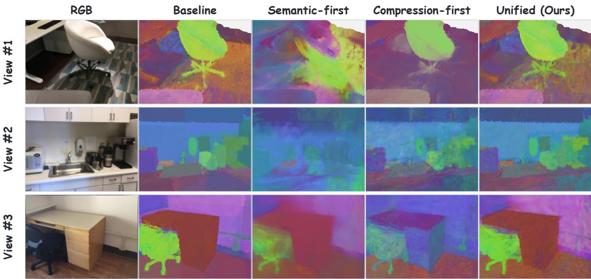
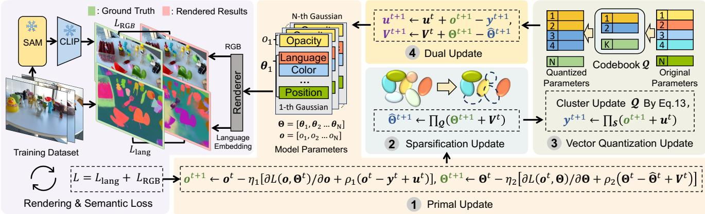
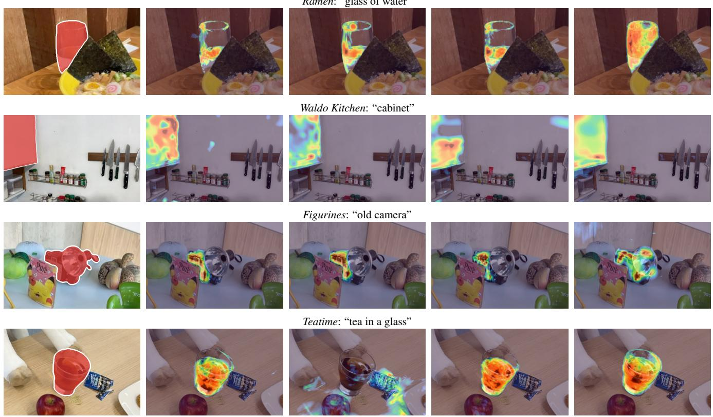

# CLUNOGS: Compact Language 3D Gaussian Splatting via Unified Optimization

Jian Xu Yi Li Ying Huang Siyi Wu Bingzhe Li Yuede Ji Miao Yin

{jian.xu,ying.huang,siyi.wu,yuede.ji,miao.yin}@uta.edu

{yi.li3,bingzhe.li}@utdallas.edu

  
Figure 1. Impact of pipeline ordering in semantic 3DGS compression. Semantic-first learns semantics before compression, whereas Compression-first compresses the 3DGS before semantic learning. PCA visualizations show that both sequential pipelines degrade seman tic representations, while our unified pipeline better preserves them.

## Abstract

Language 3D Gaussian Splatting enables open-vocabulary scene understanding by associating Gaussian primitives with language features. These semantic attributes increase model storage, while most existing 3DGS compression methods are designed mainly to preserve RGB rendering quality. One straightforward approach is to apply sparsification and quantization sequentially. However, pruning based only on rendering quality can remove Gaussians that have small RGB contributions but are important for semantic prediction. Once removed, their semantic in formation cannot be recovered by later quantization. We propose CLUNOGS, a compact framework for Language 3DGS that combines semantics-aware Gaussian sparsification and vector quantization in a unified constrained ob

jective. Semantic supervision is used during sparsification, and the objective jointly considers rendering quality, semantic accuracy, and compactness. We optimize the unified objective with alternating primal, sparsification, quantization, and dual updates. We evaluate CLUNOGS on open-vocabulary localization and segmentation using the LERF and ScanNet-10 benchmarks. Under aggressive compression, our unified, semantics-aware formulation substantially alleviates the degradation of semantic representations caused by sequential compression and semanticsagnostic Gaussian sparsification. Ablations further show that jointly coordinating sparsification and quantization better preserves semantic accuracy than applying them independently.

## 1. Introduction

Open-vocabulary 3D scene understanding enables objects in a 3D scene to be localized or segmented using arbitrary natural-language queries, without restricting predictions to a predefined class set [28]. This capability supports applications such as AR/VR [19], autonomous driving [8], and robotic manipulation [14, 31]. Earlier neural-field methods encoded semantics in implicit representations, but repeated volumetric sampling and network evaluation made training and rendering costly [17, 36]. Language 3DGS instead attaches vision-language features to explicit Gaussian primitives and reuses the tile-based splatting pipeline of 3DGS to render semantic feature maps efficiently, avoiding repeated volumetric sampling and per-sample network evaluation [16, 30, 41].

Directly attaching high-dimensional vision-language features to individual Gaussians incurs substantial storage and rendering overhead [30, 41]. LangSplat mitigates this problem using a scene-specific low-dimensional autoencoder, while LangSplatV2 further replaces the heavyweight decoder with sparse per-Gaussian coefficients over shared dictionaries, enabling efficient high-dimensional feature splatting [22, 30]. These advances reduce the cost of semantic feature representation and inference, but do not target compression of the underlying RGB Gaussian scene. Consequently, a complete Language 3DGS model still contains the original 3DGS attributes together with additional semantic parameters. Its compression must therefore preserve both photometric fidelity and semantic responses.

Standard 3DGS compression often combines sparsification or pruning [1, 12, 13, 38, 40] with quantization [21, 24, 25]. Applying them sequentially decouples semantic learning from Gaussian selection, so RGB-driven sparsification can discard semantically important Gaussians that subsequent stages cannot recover. Figure 1 illustrates this failure using LangSplatV2 [22], GaussianSpa, and CompGS: semantic representations degrade whether semantic learning occurs before or after RGB-driven Gaussian sparsification. Our unified formulation instead coordinates semantic learning, sparsification, and quantization throughout optimization.

To address this gap, we propose CLUNOGS (Compact Language via Unified Optimization for 3D Gaussian Splatting). The framework combines RGB reconstruction and semantic supervision with a cardinality constraint on Gaussian opacities and vector quantization (VQ) of selected attributes. Updating the scene parameters, sparse support, and quantized representations within the same constrained problem allows them to adapt to one another instead of inheriting irreversible decisions from a preceding stage. We solve the resulting non-smooth problem with an alternating primal–dual procedure.

Our contributions are:

• We introduce a unified constrained formulation that couples an RGB–semantic task objective with Gaussian sparsification and attribute vector quantization for compact Language 3DGS.

• We develop a compact Language 3DGS optimization framework and solve the unified problem using an alternating primal–dual procedure that coordinates differentiable scene optimization, sparsification, quantization, and dual updates.

• We evaluate CLUNOGS on LERF and ScanNet-10 using recent language-field baselines, sequential compression and ordering controls, qualitative comparisons, and controlled ablations. Across the two benchmarks, CLUNOGS reduces serialized storage by 80.9–82.8% relative to the corresponding uncompressed models, with losses of at most 1.6 mIoU points, 1.1 accuracy points, and 0.07 dB PSNR.

## 2. Related Work

Language 3DGS. Language-aware 3D representations lift 2D foundation-model features into queryable 3D fields, with LERF providing an early NeRF-based formulation [17]. Language 3DGS methods mainly follow two paradigms. Render-supervised methods learn per-Gaussian features or codes by matching rendered feature maps to 2D supervision, as in LangSplat, Feature 3DGS, GAGS, and LangSplatV2 [22, 29, 30, 41]. Direct-lifting methods instead register or aggregate multi-view features onto reconstructed Gaussians without iterative semantic fitting, as in Dr. Splat and Occam’s LGS [7, 18]. LightSplat and Extrin-Splat further replace dense per-Gaussian embeddings with compact semantic indices or an external object-group index [2, 11]. We build on LangSplatV2 because its semantic coefficients and RGB attributes share the same Gaussian support, allowing sparsification and attribute quantization to account for both rendering and semantic quality.

Compact Language 3DGS. Recent work has explored compact representations for the semantic features in Language 3DGS. DF-3DGS separates RGB and semantic Gaussians and sparsifies the semantic field, while CF3 compresses feature Gaussians through pruning, merging, and autoencoding [10, 20]. CSGaussian progressively entropycodes both color and semantic attributes [34]. SCOUP represents semantic features with sparse codes, whereas CoSAG predicts and entropy-codes compact semantic bindings for individual Gaussians [4, 15]. These methods reduce semantic storage through specialized feature representations and coding schemes.

General 3DGS Compression. RGB-only 3DGS compression reduces active primitives, attribute storage, or bitstream size. GaussianSpa and PUP 3D-GS sparsify optimized scenes using constrained or uncertainty-based criteria [13, 40]. Compact 3DGS, C3DGS, and CompGS use clustering or quantization to reduce attribute storage [21, 25, 26]. RDO-Gaussian jointly optimizes masks and entropy-constrained attributes, while HAC++ and LocoGS model context or local coherence for compact coding [6, 32, 35]. FCGS applies a feed-forward codec to an optimized Gaussian scene [5]. Joint sparsification and quantization are therefore established in RGB 3DGS. The concurrent GETA-3DGS preprint also studies joint structured pruning and heterogeneous quantization [39]. CLUNOGS instead optimizes opacity with both RGB and semantic supervision before cardinality projection, and coordinates Gaussian sparsification with attribute vector quantization in the same constrained formulation.

## 3. Background

3D Gaussian Splatting uses a collection of Gaussians to model 3D scene geometry and appearance. Specifically, each Gaussian $G ( \pmb { x } )$ is defined by a mean vector $\pmb { \mu } \in \mathbb { R } ^ { 3 }$ and a covariance matrix Σ:

$$
G ( \pmb { x } ) = \exp \Big ( - \frac { 1 } { 2 } ( \pmb { x } - \pmb { \mu } ) ^ { \top } \pmb { \Sigma } ^ { - 1 } ( \pmb { x } - \pmb { \mu } ) \Big ) ,\tag{1}
$$

where x is a location in the 3D scene. The learnable parameters of a Gaussian are $\{ \mu , c , o , R , S \}$ , which correspond to its position, color, opacity, rotation, and scale.

To optimize the Gaussian parameters, they are projected onto 2D image planes, and tile-based rasterization [42] is used for efficiency. The pixel color $C _ { \mathrm { p i x e l } }$ is rendered by:

$$
C _ { \mathrm { p i x e l } } = \sum _ { i \in \mathcal { N } } \pmb { c } _ { i } \alpha _ { i } \prod _ { j = 1 } ^ { i - 1 } ( 1 - \alpha _ { j } ) , \quad \alpha _ { i } = o _ { i } G _ { i } ^ { \prime } ,\tag{2}
$$

where $c _ { i }$ is the color of the i-th Gaussian, $o _ { i }$ is its opacity, $\mathcal { N }$ is the set of ordered Gaussians contributing to the rasterization at the target rendering pixel, and $G _ { i } ^ { \prime }$ represents the projection of the Gaussian onto the 2D plane.

LangSplatV2 [22] attaches sparse semantic coefficients to each Gaussian. For semantic level $h \in \{ 1 , 2 , 3 \}$ , let ${ \pmb w } _ { i } ^ { ( h ) } \in \mathbb { R } ^ { 1 \times L }$ denote the coefficient vector of Gaussian i, and let $B ^ { ( h ) } \in \mathbb { R } ^ { L \times D }$ denote the scene-level semantic dictionary shared by all Gaussians at that level. Only the top-K entries of $\mathbf { \overline { { \pmb { w } } } } _ { i } ^ { ( h ) }$ are nonzero, and these entries are normalized to sum to one. The high-dimensional feature is reconstructed after coefficient rendering and is not stored as a separate per-Gaussian vector.

The sparse coefficients can be rendered before feature reconstruction. For pixel $p ,$ let $\alpha _ { i , p } = o _ { i } G _ { i } ^ { \prime } ( p )$ and $e _ { i , p } =$ $\begin{array} { r } { \alpha _ { i , p } \prod _ { j < i } ( 1 - \alpha _ { j , p } ) } \end{array}$ . The rendered semantic feature is

$$
\boldsymbol { F } _ { p } ^ { ( h ) } = \left( \sum _ { i \in \mathcal { N } _ { p } } \boldsymbol { e } _ { i , p } \boldsymbol { w } _ { i } ^ { ( h ) } \right) \boldsymbol { B } ^ { ( h ) } .\tag{3}
$$

This rendering shares the geometry and opacity-dependent compositing weights of RGB rendering. The rendered features are compared with text queries to produce per-pixel relevance maps for localization or segmentation under the corresponding benchmark protocol [17].

## 4. Methodology: CLUNOGS

To compact a Language 3DGS model while preserving semantic and RGB quality, we propose a unified compression framework, CLUNOGS. Our method places semanticsaware Gaussian sparsification and vector quantization in a single constrained objective. We solve it with a primal–dual procedure that alternates among differentiable scene optimization, sparsification, quantization, and dual updates.

## 4.1. Problem Formulation

Language-Embedded Training Objective. In standard 3DGS training [16], the Gaussian parameters are learned using a combination of pixelwise $\ell _ { 1 }$ loss and differentiable SSIM loss between rendered RGB images and groundtruth multi-view images. The rendering loss is $L _ { \mathrm { R G B } } ~ =$ $( 1 - \lambda ) L _ { 1 } + \lambda L _ { \mathrm { D - S S I M } }$ , where $\lambda \in [ 0 , 1 ]$ balances the two terms.

For semantic supervision, we follow LangSplatV2. As introduced in the previous section, each Gaussian is associated with sparse semantic coefficients over scene-level dictionaries, and the high-dimensional semantic features are reconstructed after coefficient rendering. We match them to the SAM-derived CLIP targets $\bar { F } _ { p } ^ { ( h ) }$ at all three semantic levels using pixelwise cosine distance:

$$
L _ { \mathrm { l a n g } } = \frac { 1 } { 3 | \mathcal { P } | } \sum _ { h = 1 } ^ { 3 } \sum _ { p \in \mathcal { P } } \left( 1 - \frac { \langle F _ { p } ^ { ( h ) } , \bar { F } _ { p } ^ { ( h ) } \rangle } { \| F _ { p } ^ { ( h ) } \| _ { 2 } \| \bar { F } _ { p } ^ { ( h ) } \| _ { 2 } } \right) ,\tag{4}
$$

where $\mathcal { P }$ is the set of image pixels. The RGB and language objectives are combined as

$$
L = L _ { \mathrm { R G B } } + \gamma L _ { \mathrm { l a n g } } ,\tag{5}
$$

where $\gamma$ denotes the weighting factor that balances the rendering and language losses. Since RGB and semantic rendering share the same opacity-dependent compositing weights, semantic supervision can also affect the Gaussian opacities and thereby influence which Gaussians are retained during sparsification.

  
Figure 2. Overview of the CLUNOGS framework, illustrating the four updates performed in each iteration of the optimization loop. The diagram suppresses the language-loss weight and attribute-group indices.

Unified Objective with Sparsity and Vector Quantization. From Eqs. 2 and 3, Gaussian opacity directly affects both RGB and semantic compositing. We therefore impose sparsity on opacity to reduce the number of active Gaussian primitives and use vector quantization to reduce the storage of the remaining continuous per-Gaussian attributes.

Given a 3DGS model with N initial Gaussians, we represent their opacities as $\pmb { o } = [ o _ { 1 } , o _ { 2 } , \dots , o _ { N } ] \in \mathbb { R } ^ { N }$ , where $o _ { i }$ is the opacity of the i-th Gaussian. We use Θ = $\left\{ \pmb \theta _ { 1 } , \pmb \theta _ { 2 } , \dots , \pmb \theta _ { N } \right\}$ to denote the continuous per-Gaussian attributes subject to vector quantization. In our implementation, these include color coefficients, higher-order spherical harmonic coefficients, scale, rotation, and semantic coefficient values. The 3D positions and scene-level semantic dictionaries remain in full precision, while the discrete top-K semantic atom indices are stored separately.

Let $\pmb { \mathcal { Q } } = \{ ( Q _ { j } , \pmb { q } _ { j } ) \} _ { j = 1 } ^ { M }$ denote the quantization state, where $Q _ { j }$ is a cluster and $\pmb q _ { j }$ is its centroid. The centroids form the quantization codebook. For concise notation, we suppress attribute-group indices below; in implementation, vector quantization is applied separately to different attribute groups using independent codebooks.

With the clusters and codebook defined, the unified optimization objective is given by

$$
\begin{array} { r l } { \underset { o , \boldsymbol { \Theta } , \boldsymbol { \mathcal { Q } } } { \operatorname* { m i n } } } & { L ( o , \boldsymbol { \Theta } ) + \displaystyle \sum _ { j = 1 } ^ { M } \sum _ { \pmb { \theta _ { i } \in Q _ { j } } } \| \pmb { \theta _ { i } } - \pmb { q _ { j } } \| _ { 2 } ^ { 2 } , } \\ & { \mathrm { s . t . } \quad \mathbf { c a r d } ( o ) \leq \kappa . } \end{array}\tag{6}
$$

The sparsity constraint card $. ( o ) \le \kappa$ limits the number of Gaussians with nonzero opacity to at most κ. Here, card(o) is the number of nonzero elements in o. Importantly, the opacity parameters are optimized under both RGB and semantic supervision before the sparsity constraint is enforced. The retained Gaussians therefore depend on their contribution to the joint RGB–semantic objective rather than on RGB reconstruction alone. The same decision is applied to all point-aligned attributes of each Gaussian.

The quantization penalty $\begin{array} { r } { \sum _ { j = 1 } ^ { M } \sum _ { \pmb { \theta } _ { i } \in \ b { Q } _ { j } } \Vert \pmb { \theta } _ { i } - \pmb { q } _ { j } \Vert _ { 2 } ^ { 2 } } \end{array}$ penalizes deviations of each parameter vector $\theta _ { i }$ from its assigned cluster centroid $\mathbf { \delta } \mathbf { \vec { q } } _ { j }$ . This encourages the continuous attributes to approach a small set of representative values. After training, each vector can be approximated by its cluster centroid, requiring only its codeword index and the corresponding codebook to be stored.

## 4.2. Optimization

Figure 2 provides an overview of our four-step primal– dual optimization. The unified objective in Eq. 6 contains two non-differentiable components: the sparsity constraint card(o) ≤ κ and the discrete assignments in vector quantization. We introduce auxiliary variables to separate differentiable scene optimization from sparsification and quantization.

We first introduce an auxiliary variable y to separate the sparsity constraint from $^ { o , }$ and use $\hat { \Theta } \ = \ \{ \hat { \pmb \theta } _ { 1 } , \cdot \cdot \cdot , \hat { \pmb \theta } _ { N } \}$ as the quantized copy of Θ. We define $g ( \cdot )$ as the indicator function of the sparsity constraint: $g ( \pmb { y } ) = 0$ when card(y) ≤ κ and $g ( { \pmb y } ) = + \infty$ otherwise. Hence, Eq. 6 can be reformulated as

$$
\begin{array} { c } { \displaystyle \underset { o , \Theta , y , \hat { \Theta } , \mathcal { Q } } { \operatorname* { m i n } } ~ L ( o , \Theta ) + g ( \pmb { y } ) + \displaystyle \sum _ { j = 1 } ^ { M } \sum _ { \hat { \pmb { \theta } } _ { i } \in \cal Q _ { j } } \| \hat { \pmb { \theta } } _ { i } - \pmb { q } _ { j } \| _ { 2 } ^ { 2 } , } \\ { \mathrm { s . t . } ~ o = y , ~ \Theta = \hat { \Theta } . } \end{array}\tag{7}
$$

This reformulation allows the differentiable variables o and Θ to be optimized using gradient-based methods, while the sparsity constraint and discrete vector-quantization assignments are handled through the corresponding auxiliary variables. The resulting alternating procedure is summarized in Alg. 1, and its four updates are derived below.

```latex
Algorithm 1 Unified Optimization for CLUNOGS
Input: Language 3DGS variables Θ, opacity o, Gaussian
budget κ, number of clusters M, penalty coefficients $\rho _ { 1 } , \rho _ { 2 }$
learning rates $\eta _ { 1 } , \eta _ { 2 } .$ , maximum iterations T, and conver
gence thresholds $\epsilon _ { 1 } , \epsilon _ { 2 } .$
Output: Retained Gaussians, quantized parameters $\hat { \Theta } _ { i }$ , and
quantization state $\mathcal { Q } .$
1: Initialize Q by k-means on Θ;
2: ${ \pmb y }  o , \hat { \Theta }  \Pi _ { { \pmb Q } } ( \Theta ) , { \pmb u }  { \bf 0 } , V  { \bf 0 } ;$
3: $r _ { o } , r _ { \Theta } \gets \infty , \quad t \gets 0 ;$
4: while $( r _ { o } > \epsilon _ { 1 } { \bf 0 } { \bf r } r _ { \Theta } > \epsilon _ { 2 } )$ and $t < T$ do
5: Update o, Θ with Eq. 12; ▷ Primal Update
6: Update y with Eq. 13; ▷ Sparsification
7: Update Q, Θˆ with Eqs. 14–15; ▷ Vector Quant.
8: Update u, V with Eqs. 16–17; ▷ Dual Update
9: $\begin{array} { r } { \hat { r _ { o } }  \parallel o ^ { t + 1 } - y ^ { t + 1 } \rVert _ { 2 } , r _ { \Theta }  \parallel \Theta ^ { t + 1 } - \hat { \Theta } ^ { t + 1 } \rVert _ { 2 } ; } \end{array}$
10: $t \gets t + 1 ;$
11: end while
```

We solve the equality-constrained problem in Eq. 7 by constructing an augmented Lagrangian with scaled Lagrange multipliers $u , V$ and penalty coefficients $\rho _ { 1 } , \rho _ { 2 } ;$

$$
\begin{array} { l } { { \displaystyle { \cal L } _ { \rho } ( o , \Theta , y , \hat { \Theta } , u , V , \mathcal { Q } ) = } } \\ { { \displaystyle \qquad \cal L ( o , \Theta ) + g ( y ) + \sum _ { j = 1 } ^ { M } \sum _ { \hat { \theta } _ { i } \in { \cal Q } _ { j } } \| \hat { \theta } _ { i } - { \bf q } _ { j } \| _ { 2 } ^ { 2 } } } \\ { { \displaystyle \qquad + \frac { \rho _ { 1 } } { 2 } \| o - y + u \| _ { 2 } ^ { 2 } + \frac { \rho _ { 2 } } { 2 } \| \Theta - \hat { \Theta } + V \| _ { 2 } ^ { 2 } . } } \end{array}\tag{8}
$$

The quadratic penalties enforce the equality constraints.

1 Primal Update. At iteration t, only the model parameters o and Θ are updated; all other variables remain fixed. This gives the differentiable subproblem:

$$
\begin{array} { c } { { ( { \pmb o } ^ { t + 1 } , { \pmb \Theta } ^ { t + 1 } ) = \arg \displaystyle \operatorname* { m i n } _ { o , { \pmb \Theta } } L ( { \pmb o } , { \pmb \Theta } ) + \displaystyle \frac { \rho _ { 1 } } { 2 } \| { \pmb o } - { \pmb y } ^ { t } + { \pmb u } ^ { t } \| _ { 2 } ^ { 2 } } } \\ { { + \displaystyle \frac { \rho _ { 2 } } { 2 } \| { \pmb \Theta } - { \hat { \pmb \Theta } } ^ { t } + V ^ { t } \| _ { 2 } ^ { 2 } . } } \end{array}\tag{9}
$$

Here, $L ( o , \Theta )$ is the differentiable RGB–semantic training objective, while the two quadratic terms couple the continuous parameters to their sparse and quantized counterparts. Consequently, Eq. 9 can be optimized using standard gradient-based optimizers. The gradients for o and Θ at iteration t are

$$
\left( \frac { \partial { \cal L } _ { \rho } } { \partial \sigma } \right) ^ { t } = \frac { \partial { \cal L } ( o , \Theta ^ { t } ) } { \partial o } + \rho _ { 1 } \left( o ^ { t } - y ^ { t } + u ^ { t } \right) ,\tag{10}
$$

$$
\left( \frac { \partial L _ { \rho } } { \partial \Theta } \right) ^ { t } = \frac { \partial L ( o ^ { t } , \Theta ) } { \partial \Theta } + \rho _ { 2 } \big ( \Theta ^ { t } - \hat { \Theta } ^ { t } + V ^ { t } \big ) .\tag{11}
$$

The parameters are then updated as

$$
o ^ { t + 1 } \gets o ^ { t } { - \eta _ { 1 } \left( \frac { \partial L _ { \rho } } { \partial o } \right) ^ { t } } , \qquad \Theta ^ { t + 1 } \gets \Theta ^ { t } { - \eta _ { 2 } \left( \frac { \partial L _ { \rho } } { \partial \Theta } \right) ^ { t } } ,\tag{12}
$$

where $\eta _ { 1 } > 0$ and $\eta _ { 2 } > 0$ are the learning rates for o and Θ, respectively.

Since $L ( o , \Theta )$ contains both $L _ { \mathrm { R G B } }$ and $L _ { \mathrm { l a n g } } ,$ the language loss contributes directly to the opacity update. Thus, before the following sparsification step selects the retained Gaussians, their opacities have already been adapted using both RGB and semantic supervision. The 3D positions and scene-level semantic dictionaries are optimized by the task objective but receive no quantization penalty.

2 Sparsification Update. In this step, the auxiliary variable y is updated by solving mi $\begin{array} { r } { \mathsf { i } _ { \pmb { y } } g ( \pmb { y } ) + \frac { \rho _ { 1 } } { 2 } \| \pmb { o } ^ { t + 1 } - \pmb { y } + } \end{array}$ $\pmb { u } ^ { t } \Vert _ { 2 } ^ { 2 }$ . The closed-form solution $[ 3 , 2 7 ]$ is

$$
\pmb { y } ^ { t + 1 }  \Pi _ { \pmb { \mathcal { S } } } ( \pmb { o } ^ { t + 1 } + \pmb { u } ^ { t } ) ,\tag{13}
$$

where $\Pi _ { \pmb { s } }$ denotes projection onto the sparsity-constrained set. When $\pmb { S } = \{ \pmb { y } \ | \ \mathbf { c a r d } ( \pmb { y } ) \le \kappa \}$ , the projection retains the κ entries with the largest magnitudes and sets all others to zero.

Because of the quadratic penalty term $\begin{array} { r } { \frac { \rho _ { 1 } } { 2 } \| \pmb { o } ^ { t + 1 } - \pmb { y } + \| \pmb { o } ^ { t - 1 } - \pmb { y } ^ { \bot } \| ^ { 2 } } \end{array}$ $\pmb { u } ^ { t } \Vert _ { 2 } ^ { 2 }$ , the projection is applied to $\mathbf { \omega } ^ { t + 1 } + \mathbf { \omega } ^ { t }$ rather than opacity alone. The scaled dual variable u accumulates the discrepancy between o and y across iterations. The nonzero entries of ${ \boldsymbol { y } } ^ { t + 1 }$ identify the retained Gaussians, and the same selection is applied to their point-aligned RGB and semantic attributes.

3 Vector Quantization Update. In the third step, we update the quantization state Q and the quantized Gaussian parameters Θˆ . In implementation, this operation is applied independently to different attribute groups using separate codebooks; we suppress the group index for clarity.

The clusters and centroids in Q are updated using standard k-means. Each centroid is first computed as the mean of its assigned parameter vectors, after which each vector is reassigned to its nearest centroid. Formally, for $j = 1 , \dots , M ;$

$$
\left\{ \begin{array} { l } { \displaystyle { \boldsymbol { q } } _ { j } ^ { t + 1 } = \frac { 1 } { | Q _ { j } ^ { t } | } \sum _ { { \boldsymbol { \theta } } _ { i } ^ { t + 1 } \in Q _ { j } ^ { t } } { \boldsymbol { \theta } } _ { i } ^ { t + 1 } , } \\ { \displaystyle Q _ { j } ^ { t + 1 } = \Big \{ { \boldsymbol { \theta } } _ { i } ^ { t + 1 } ~ \Big | ~ \operatorname * { a r g m i n } _ { k = 1 , \dots , M } ~ \| { \boldsymbol { \theta } } _ { i } ^ { t + 1 } - { \boldsymbol { q } } _ { k } ^ { t + 1 } \| ^ { 2 } = j \Big \} . } \end{array} \right.\tag{14}
$$

We then project the dual-corrected Gaussian parameter vectors onto the updated centroids:

$$
\begin{array} { r } { \hat { \Theta } ^ { t + 1 } \gets \Pi _ { \pmb { Q } ^ { t + 1 } } ( \Theta ^ { t + 1 } + V ^ { t } ) , } \end{array}\tag{15}
$$

where $\Pi _ { \mathfrak { Q } }$ replaces each parameter vector with its nearest cluster centroid.

Due to the quadratic penalty term $\begin{array} { r } { \frac { \rho _ { 2 } } { 2 } \| \Theta ^ { t + 1 } - \hat { \Theta } + V ^ { t } \| _ { 2 } ^ { 2 } , } \end{array}$ the projection is applied to $\Theta ^ { t + 1 } + { \bf \tilde { \cal V } } ^ { t }$ . The scaled dual variable V tracks the discrepancy between Θ and $\hat { \Theta }$ across iterations and carries this residual into subsequent quantization updates.

4 Dual Update. In the final step of iteration t, the scaled dual variables u and V are updated as

$$
\begin{array} { r } { \pmb { u } ^ { t + 1 }  \pmb { u } ^ { t } + \pmb { o } ^ { t + 1 } - \pmb { y } ^ { t + 1 } , } \end{array}\tag{16}
$$

$$
V ^ { t + 1 } \gets V ^ { t } + \Theta ^ { t + 1 } - \hat { \Theta } ^ { t + 1 } .\tag{17}
$$

The update of u accumulates the residual between continuous opacity and its sparse counterpart, while V performs the analogous correction for the continuous and quantized attributes. These corrections enter the sparsification and quantization operations of the next iteration.

The four updates alternate, allowing the trainable scene parameters, retained Gaussian set, and quantized attributes to adapt under the same RGB–semantic objective. We repeat this procedure until the residual thresholds are met or the fixed iteration budget is exhausted. The nonzero entries of the final y determine the retained Gaussians, while Θˆ and the corresponding codebooks define their quantized attributes. A convergence analysis of the resulting primal– dual scheme is provided in Sec. B of the supplementary material.

## 5. Experiments

## 5.1. Settings

Benchmarks, metrics, and baselines. We evaluate on four LERF scenes [17] and ScanNet-10 [9], reporting semantic accuracy, RGB PSNR, storage, and peak memory. Language baselines cover direct-lifting methods (Occam’s LGS and Dr. Splat [7, 18]) and render-supervised semantic fields (LangSplatV2, CCL-LGS, GAGS, and CF3 [20, 22, 29, 33]). Compression baselines pair three Gaussian sparsifiers (opacity Top-K, PUP 3D-GS, and GaussianSpa) with CompGS or C3DGS for attribute quantization [13, 25, 26, 40].

On LERF, all query relevance maps use the same postprocessing and a fixed 0.4 threshold. mIoU averages querymask IoU, while localization Acc. checks whether the peak response lies inside a ground-truth box. On ScanNet-10, we follow OpenGaussian’s label protocol and the ten-scene split used by LUDVIG [23, 37]. Each method uses its native decoder and scale-selection rule to render ten classscore maps. We bilinearly sample these scores at projected ScanNet points when the projected and sensor depths differ by at most 5 cm, average them over valid views, and take the pointwise argmax. Evaluation includes points observed in at least one view after applying the same 0.1 activatedopacity threshold to each RGB 3DGS. Per-scene mIoU and mAcc average class IoU and recall over the ground-truth classes present in that scene, followed by an unweighted average over the ten scenes.

Implementation details. Each scene starts from a 3DGS model [16] trained for 30k iterations. We store all three LangSplatV2 semantic levels in one Gaussian model and optimize it for 30k iterations; the released implementation instead trains three separate level-specific models for 10k iterations each [22]. The first 20k iterations follow the original language-field training, while the final 10k activate our unified sparsification–quantization updates. All ratematched compressed variants use the same 20% Gaussianretention budget. Detailed schedules are provided in the supplement. Storage includes all files required for inference. Dr. Splat therefore includes its PQ index, whereas LangSplatV2 includes the semantic coefficients and dictionaries for all three levels together with one shared RGB 3DGS. Peak memory is measured from a fresh process through one native-resolution text-query rendering.

## 5.2. Overall Performance

Table 1 evaluates whether aggressive compression can preserve both semantic prediction accuracy and RGB rendering quality. Across LERF and ScanNet-10, we compare deployable systems from two Language 3DGS paradigms: directlifting methods and render-supervised semantic fields. Semantic metrics and PSNR measure quality, while storage and peak memory measure deployment cost.

Compared with CF3, the smallest competitor on both benchmarks, CLUNOGS achieves over 5× storage reduction while also attaining the lowest peak memory. It nevertheless ranks second in every semantic and RGB quality metric; its maximum gaps to LangSplatV2 are only 1.6 mIoU points, 1.1 accuracy points, and 0.07 dB PSNR. The same trend on both datasets shows that this advantage is not benchmark-specific.

LangSplatV2 remains the quality leader because its full model retains detailed semantic coefficients and dictionaries at all three scales. While direct-lifting methods are designed for efficient querying, both Occam’s LGS and Dr. Splat trail this render-supervised model in semantic quality. Occam’s LGS is also storage-intensive on both datasets and incurs the highest peak memory on LERF.

## 5.3. Sequential Compression Baselines

Table 2 evaluates whether sequential sparsification and quantization can match our joint formulation. All baselines start from the same RGB 3DGS and retain 20% of the Gaussians. For fairness, optimization-based methods are embedded into the standard 30k-iteration training without extra iterations. We pair three representative sparsifiers (heuristic Opacity Top-K, importance-based PUP 3D-

(a) LERF
<table><tr><td>Method</td><td colspan="3">Quality ↑</td><td colspan="2">Efficiency ↓</td></tr><tr><td></td><td>mIoU</td><td>Acc.</td><td>PSNR</td><td>Storage (MB)</td><td>Peak Mem. (GB)</td></tr><tr><td>Occam&#x27;s LGS</td><td>56.8</td><td>82.5</td><td>24.08</td><td>7663.23</td><td>17.83</td></tr><tr><td>Dr. Splat</td><td>43.3</td><td>73.3</td><td>24.22</td><td>467.85</td><td>6.72</td></tr><tr><td>LangSplatV2</td><td>59.9</td><td>84.1</td><td>24.22</td><td>345.94</td><td>5.54</td></tr><tr><td>CCL-LGS</td><td>57.8</td><td>81.0</td><td>24.11</td><td>735.93</td><td>5.21</td></tr><tr><td>GAGS</td><td>53.9</td><td>75.7</td><td>24.22</td><td>399.06</td><td>8.96</td></tr><tr><td>CF3</td><td>54.2</td><td>74.2</td><td>24.22</td><td>327.91</td><td>8.29</td></tr><tr><td>CLUNOGS</td><td>58.3</td><td>83.0</td><td>24.15</td><td>59.35</td><td>4.60</td></tr></table>

Opacity Top-K

(b) ScanNet-10
<table><tr><td rowspan="2">Method</td><td colspan="3">Quality ↑</td><td colspan="2">Efficiency ↓</td></tr><tr><td>mIoU</td><td>Acc.</td><td>PSNR</td><td>Storage (MB)</td><td>Peak Mem. (GB)</td></tr><tr><td>Occam&#x27;s LGS</td><td>19.8</td><td>36.0</td><td>20.73</td><td>595.00</td><td>3.75</td></tr><tr><td>Dr. Splat</td><td>45.5</td><td>64.0</td><td>27.24</td><td>60.09</td><td>3.18</td></tr><tr><td>LangSplatV2</td><td>51.3</td><td>71.2</td><td>27.24</td><td>42.90</td><td>3.57</td></tr><tr><td>CCL-LGS</td><td>25.4</td><td>40.3</td><td>27.10</td><td>85.46</td><td>5.18</td></tr><tr><td>GAGS</td><td>43.4</td><td>61.8</td><td>27.24</td><td>49.58</td><td>13.09</td></tr><tr><td>CF3</td><td>28.5</td><td>44.8</td><td>27.24</td><td>41.10</td><td>8.39</td></tr><tr><td>CLUNOGS</td><td>50.7</td><td>70.8</td><td>27.17</td><td>8.18</td><td>2.94</td></tr></table>

Table 1. Overall performance. (a) LERF four-scene macro averages, where Acc. denotes localization accuracy. (b) ScanNet-10 ten-scene macro averages, where Acc. denotes mean class accuracy. First , Second , and Third .

Ground Truth  
PUP 3D-GS  
GaussianSpa  
CLUNOGS (Ours)  
  
Figure 3. PCA visualizations of rendered semantic maps. Under the same 20% Gaussian-retention budget, sequential compression blurs semantic boundaries and can remove semantic regions, whereas our joint method better preserves their structure.

GS, and optimization-based GaussianSpa) with CompGS or C3DGS, yielding six pipelines.

GaussianSpa + C3DGS achieves the highest sequentialbaseline PSNR of 24.20 dB, but all six pipelines degrade semantics, reaching at best 54.4 mIoU and 77.9 Acc. At 0.25M Gaussians and 59.35 MB, CLUNOGS reaches 58.3 mIoU, 83.0 Acc., and 24.15 dB, improving the strongest sequential mIoU and Acc. by 3.9 and 5.1 points while remaining within 0.05 dB of the highest sequential PSNR. The

PCA maps in Figure 3 show that sequential compression blurs boundaries and can remove semantic regions, whereas ours better preserves them.

## 5.4. Ordering Semantic Learning and Compression

Table 3 compares two sequential orders on LERF using LangSplatV2 and Dr. Splat. Original denotes the complete semantic model before GaussianSpa + CompGS. For each method, both variants start from the same RGB 3DGS and use the same target pruning mask and compression configuration, with the Gaussian count matched to ours. The semantics-first order builds the native semantic representation before compression and re-indexes the surviving records without retraining. The compression-first order instead learns semantics directly on the compressed RGB 3DGS. We retain each method’s native representation rather than replacing it with our VQ, and storage follows the complete-pipeline accounting of Table 1.

<table><tr><td>Sparsifier</td><td>Quantizer</td><td>#G</td><td>mIoU ↑</td><td>Acc. ↑</td><td>PSNR ↑</td><td>Storage ↓</td></tr><tr><td>None</td><td>None</td><td>1.27M</td><td>59.9</td><td>84.1</td><td>24.22</td><td>345.94</td></tr><tr><td>Opacity Top-K</td><td>CompGS</td><td>0.25M</td><td>51.4</td><td>71.9</td><td>22.12</td><td>59.35</td></tr><tr><td>Opacity Top-K</td><td>C3DGS</td><td>0.25M</td><td>53.2</td><td>77.5</td><td>22.01</td><td>64.26</td></tr><tr><td>PUP 3D-GS</td><td>CompGS</td><td>0.25M</td><td>53.1</td><td>69.1</td><td>23.84</td><td>59.35</td></tr><tr><td>PUP 3D-GS</td><td>C3DGS</td><td>0.25M</td><td>54.4</td><td>73.5</td><td>23.97</td><td>64.26</td></tr><tr><td>GaussianSpa</td><td>CompGS</td><td>0.25M</td><td>49.0</td><td>74.0</td><td>24.01</td><td>59.35</td></tr><tr><td>GaussianSpa</td><td>C3DGS</td><td>0.25M</td><td>52.4</td><td>77.9</td><td>24.20</td><td>64.26</td></tr><tr><td colspan="2">CLUNOGS</td><td>0.25M</td><td>58.3</td><td>83.0</td><td>24.15</td><td>59.35</td></tr></table>

Table 2. Sequential sparsification and quantization on LERF. All compressed rows use the same 20% Gaussian-retention budget; storage is in MB. Colors indicate quality rankings and exclude the uncompressed reference.
<table><tr><td>Method</td><td>Pipeline</td><td>mIoU↑</td><td>Acc. ↑</td><td>PSNR ↑</td><td>#G↓</td><td>Storage (MB) ↓</td></tr><tr><td rowspan="3">LangSplatV2</td><td>Original</td><td>59.9</td><td>84.1</td><td>24.22</td><td>1.27M</td><td>345.94</td></tr><tr><td>Sem. → Compress</td><td>49.0</td><td>74.0</td><td>24.01</td><td>0.25M</td><td>59.35</td></tr><tr><td>Compress → Sem.</td><td>52.4</td><td>77.9</td><td>23.80</td><td>0.25M</td><td>59.35</td></tr><tr><td rowspan="3">Dr. Splat</td><td>Original</td><td>43.3</td><td>73.3</td><td>24.22</td><td>1.27M</td><td>467.85</td></tr><tr><td>Sem. → Compress</td><td>27.1</td><td>59.3</td><td>24.00</td><td>0.25M</td><td>101.69</td></tr><tr><td>Compress → Sem.</td><td>29.1</td><td>60.8</td><td>24.00</td><td>0.25M</td><td>101.69</td></tr><tr><td>CLUNOGS</td><td>Joint</td><td>58.3</td><td>83.0</td><td>24.15</td><td>0.25M</td><td>59.35</td></tr></table>

Table 3. Ordering semantic learning and compression.

This comparison isolates the effect of ordering. Compression-first achieves better semantic metrics for both methods, suggesting that learning semantics on retained support is less damaging than pruning a completed semantic field. However, both orders remain below their original models. Our joint row is a system-level reference, while Table 5 provides controlled attribution with the backbone and compression operators fixed. At the same 0.25M Gaussians and 59.35 MB of storage as the best sequential semantic pipeline, CLUNOGS improves mIoU from 52.4 to 58.3, Acc. from 77.9 to 83.0, and PSNR from 23.80 to 24.15 dB. Thus, our joint optimization mitigates the degradation from sequential compression and semantics-agnostic Gaussian selection.

## 6. Ablation Studies

Table 4 separates the two components: sparsification reduces Gaussian support, whereas VQ compresses the retained attributes. Sparsification removes 80.3% of the Gaussians, while VQ reduces storage to 34.2% without pruning. Together they use only 17.2% of the original storage, with losses of 1.6 mIoU points, 1.1 accuracy points, and 0.07 dB. Removing VQ or sparsification increases storage by 2.9× or 2.0× for marginal quality gains, confirming their complementary effects.

<table><tr><td>Variant</td><td>mIoU↑</td><td>Acc. ↑</td><td>PSNR ↑</td><td>Storage (MB)↓</td><td>#G↓</td></tr><tr><td>Uncompressed model</td><td>59.9</td><td>84.1</td><td>24.22</td><td>345.94</td><td>1.27M</td></tr><tr><td>Sparsification only</td><td>58.5</td><td>83.3</td><td>24.20</td><td>173.07</td><td>0.25M</td></tr><tr><td>VQ only</td><td>59.0</td><td>84.0</td><td>24.19</td><td>118.46</td><td>1.27M</td></tr><tr><td>Full</td><td>58.3</td><td>83.0</td><td>24.15</td><td>59.35</td><td>0.25M</td></tr></table>

Table 4. Component ablations on LERF. The rows are not ratematched; #G and storage report each operating point.
<table><tr><td>Group</td><td>Variant</td><td>mIoU↑</td><td>Acc. ↑</td><td>PSNR ↑</td></tr><tr><td rowspan="2">Design components</td><td>w/o semantic guidance</td><td>49.0</td><td>74.0</td><td>24.01</td></tr><tr><td>Penalty only</td><td>44.6</td><td>68.1</td><td>22.81</td></tr><tr><td rowspan="3">Optimization strategy</td><td>Sparsify → VQ</td><td>48.3</td><td>70.0</td><td>22.35</td></tr><tr><td>VQ → Sparsify</td><td>47.2</td><td>68.9</td><td>23.24</td></tr><tr><td>Joint (ours)</td><td>58.3</td><td>83.0</td><td>24.15</td></tr></table>

Table 5. Optimization ablations on LERF. All variants use the same initialization, views, and budget, with 0.25M Gaussians and 59.35 MB of storage.

Table 5 isolates joint optimization at a fixed rate. Blocking $L _ { \mathrm { l a n g } }$ from opacity makes Gaussian selection semantic-agnostic while retaining semantic learning and RGB supervision, reducing mIoU and Acc. by 9.3 and 9.0 points with only a 0.14 dB PSNR loss. The penaltyonly variant keeps the penalties and projections but fixes u = 0 and $V { \bf \alpha } = { \bf \alpha 0 } .$ , removing residual correction. Its larger drops of 13.7 mIoU points, 14.9 accuracy points, and 1.34 dB show that primal–dual feedback is needed to coordinate the two projections. The sequential variants apply the same sparsification and VQ operators in opposite orders without joint co-adaptation. Joint optimization exceeds their best value for each metric by 10.0 mIoU, 13.0 accuracy points, and 0.91 dB. Since all variants use the same initialization, views, Gaussian count, and storage, the gains come from semantics-aware selection and joint optimization rather than the compression rate.

## 7. Conclusion

We present CLUNOGS, a unified framework that jointly sparsifies and quantizes Language 3DGS under RGB and semantic supervision. Across LERF and ScanNet-10, it substantially reduces storage and peak memory while retaining competitive RGB and semantic quality. Controlled comparisons show that semantics-aware selection and primal–dual co-adaptation mitigate the semantic degradation of sequential compression.

## References

[1] Muhammad Salman Ali, Maryam Qamar, Sung-Ho Bae, and Enzo Tartaglione. Trimming the fat: Efficient compression of 3d gaussian splats through pruning. arXiv preprint arXiv:2406.18214, 2024.

[2] Jaehun Bang, Jinhyeok Kim, Minji Kim, Seungheon Jeong, and Kyungdon Joo. LightSplat: Fast and memory-efficient open-vocabulary 3d scene understanding in five seconds. In Proceedings of the IEEE/CVF Conference on Computer Vision and Pattern Recognition, pages 19812–19821, 2026.

[3] Stephen Boyd, Neal Parikh, Eric Chu, Borja Peleato, Jonathan Eckstein, et al. Distributed optimization and statistical learning via the alternating direction method of multipliers. Foundations and Trends® in Machine learning, 3 (1):1–122, 2011.

[4] Lovre Antonio Budimir, Yushi Guan, Steve Ryhner, Sven Loncari ˇ c, and Nandita Vijaykumar. Sparse code uplifting´ for efficient 3d language gaussian splatting. arXiv preprint arXiv:2605.13600, 2026.

[5] Yihang Chen, Qianyi Wu, Mengyao Li, Weiyao Lin, Mehrtash Harandi, and Jianfei Cai. Fast feedforward 3d gaussian splatting compression. In International Conference on Learning Representations, 2025.

[6] Yihang Chen, Qianyi Wu, Weiyao Lin, Mehrtash Harandi, and Jianfei Cai. HAC++: Towards 100x compression of 3d gaussian splatting. IEEE Transactions on Pattern Analysis and Machine Intelligence, 47(11):10210–10226, 2025.

[7] Jiahuan Cheng, Jan-Nico Zaech, Luc Van Gool, and Danda Pani Paudel. Occam’s LGS: An efficient approach for language gaussian splatting. In British Machine Vision Conference, 2025.

[8] Xinlong Cheng and Lei Li. Open 3d world in autonomous driving. arXiv preprint arXiv:2408.10880, 2024.

[9] Angela Dai, Angel X. Chang, Manolis Savva, Maciej Halber, Thomas Funkhouser, and Matthias Nießner. ScanNet: Richly-annotated 3d reconstructions of indoor scenes. In Proceedings of the IEEE Conference on Computer Vision and Pattern Recognition, pages 5828–5839, 2017.

[10] Zhenqi Dai, Ting Liu, and Yanning Zhang. Efficient decoupled feature 3d gaussian splatting via hierarchical compression. In Proceedings ofthe IEEE/CVF Conference on Computer Vision and Pattern Recognition, pages 11156–11166, 2025.

[11] Jiayu Ding, Xinpeng Liu, Zhiyi Pan, Shiqiang Long, and Ge Li. ExtrinSplat: Decoupling geometry and semantics for open-vocabulary understanding in 3d gaussian splatting. In Proceedings of the IEEE/CVF Conference on Computer Vision and Pattern Recognition, pages 31019–31028, 2026.

[12] Zhiwen Fan, Kevin Wang, Kairun Wen, Zehao Zhu, Dejia Xu, Zhangyang Wang, et al. Lightgaussian: Unbounded 3d gaussian compression with 15x reduction and 200+ fps. Advances in neural information processing systems, 37: 140138–140158, 2024.

[13] Alex Hanson, Allen Tu, Vasu Singla, Mayuka Jayawardhana, Matthias Zwicker, and Tom Goldstein. Pup 3d-gs: Principled uncertainty pruning for 3d gaussian splatting. In Proceedings

of the Computer Vision and Pattern Recognition Conference, pages 5949–5958, 2025.

[14] Chenguang Huang, Oier Mees, Andy Zeng, and Wolfram Burgard. Visual language maps for robot navigation. arXiv preprint arXiv:2210.05714, 2022.

[15] Yuang Jia, Jinlong Wang, Junhong Lin, Ruiting Dai, and Wei Gao. CoSAG: Compact semantic anchor gaussians via training-free rate-distortion coding. arXiv preprint arXiv:2607.10237, 2026.

[16] Bernhard Kerbl, Georgios Kopanas, Thomas Leimkuhler,¨ and George Drettakis. 3d gaussian splatting for real-time radiance field rendering. ACM Trans. Graph., 42(4):139–1, 2023.

[17] Justin Kerr, Chung Min Kim, Ken Goldberg, Angjoo Kanazawa, and Matthew Tancik. Lerf: Language embedded radiance fields. In Proceedings of the IEEE/CVF Interna tional Conference on Computer Vision, pages 19729–19739, 2023.

[18] Jun-Seong Kim, GeonU Kim, Yu-Ji Kim, Yu-Chiang Frank Wang, Jaesung Choe, and Tae-Hyun Oh. Dr. splat: Directly referring 3d gaussian splatting via direct language embedding registration. In Proceedings of the Computer Vision and Pattern Recognition Conference, pages 14137–14146, 2025.

[19] Sebastian Koch, Pedro Hermosilla, Narunas Vaskevicius, Mirco Colosi, and Timo Ropinski. Lang3dsg: Languagebased contrastive pre-training for 3d scene graph prediction. In 2024 International Conference on 3D Vision (3DV), pages 1037–1047. IEEE, 2024.

[20] Hyunjoon Lee, Joonkyu Min, and Jaesik Park. CF3: Compact and fast 3d feature fields. In Proceedings of the IEEE/CVF International Conference on Computer Vision, pages 27906–27916, 2025.

[21] Joo Chan Lee, Daniel Rho, Xiangyu Sun, Jong Hwan Ko, and Eunbyung Park. Compact 3d gaussian representation for radiance field. In Proceedings of the IEEE/CVF Conference on Computer Vision and Pattern Recognition, pages 21719– 21728, 2024.

[22] Wanhua Li, Yujie Zhao, Minghan Qin, Yang Liu, Yuanhao Cai, Chuang Gan, and Hanspeter Pfister. LangSplatV2: High-dimensional 3d language gaussian splatting with 450+ FPS. In Advances in Neural Information Processing Systems, pages 174306–174330, 2025.

[23] Juliette Marrie, Romain Menegaux, Michael Arbel, Diane Larlus, and Julien Mairal. LUDVIG: Learning-free uplift ing of 2d visual features to gaussian splatting scenes. In Proceedings of the IEEE/CVF International Conference on Computer Vision, pages 7440–7450, 2025.

[24] KL Navaneet, Kossar Pourahmadi Meibodi, Soroush Abbasi Koohpayegani, and Hamed Pirsiavash. Compact3d: Smaller and faster gaussian splatting with vector quantization. arXiv preprint arXiv:2311.18159, 1, 2023.

[25] KL Navaneet, Kossar Pourahmadi Meibodi, Soroush Abbasi Koohpayegani, and Hamed Pirsiavash. Compgs: Smaller and faster gaussian splatting with vector quantization. In European Conference on Computer Vision, pages 330–349. Springer, 2024.

[26] Simon Niedermayr, Josef Stumpfegger, and Rudiger West-¨ ermann. Compressed 3d gaussian splatting for accelerated

novel view synthesis. In Proceedings ofthe IEEE/CVF Conference on Computer Vision and Pattern Recognition, pages 10349–10358, 2024.

[27] Neal Parikh, Stephen Boyd, et al. Proximal algorithms. Foundations and trends® in Optimization, 1(3):127–239, 2014.

[28] Songyou Peng, Kyle Genova, Chiyu Jiang, Andrea Tagliasacchi, Marc Pollefeys, Thomas Funkhouser, et al. Openscene: 3d scene understanding with open vocabularies. In Proceedings ofthe IEEE/CVF conference on computer vision and pattern recognition, pages 815–824, 2023.

[29] Yuning Peng, Haiping Wang, Yuan Liu, Chenglu Wen, Zhen Dong, and Bisheng Yang. GAGS: Granularity-aware feature distillation for language gaussian splatting. Proceedings of the AAAI Conference on Artificial Intelligence, 40(10):8376– 8384, 2026.

[30] Minghan Qin, Wanhua Li, Jiawei Zhou, Haoqian Wang, and Hanspeter Pfister. Langsplat: 3d language gaussian splatting. In Proceedings of the IEEE/CVF Conference on Computer Vision and Pattern Recognition, pages 20051–20060, 2024.

[31] Dicong Qiu, Wenzong Ma, Zhenfu Pan, Hui Xiong, and Junwei Liang. Open-vocabulary mobile manipulation in unseen dynamic environments with 3d semantic maps. arXiv preprint arXiv:2406.18115, 2024.

[32] Seungjoo Shin, Jaesik Park, and Sunghyun Cho. Localityaware gaussian compression for fast and high-quality rendering. In International Conference on Learning Representations, 2025.

[33] Lei Tian, Xiaomin Li, Liqian Ma, Hao Yin, Zirui Zheng, Hefei Huang, Taiqing Li, Huchuan Lu, and Xu Jia. CCL-LGS: Contrastive codebook learning for 3d language gaussian splatting. In Proceedings of the IEEE/CVF International Conference on Computer Vision, 2025.

[34] Yu-Jen Tseng, Chia-Hao Kao, Jing-Zhong Chen, Alessandro Gnutti, Shao-Yuan Lo, Yen-Yu Lin, and Wen-Hsiao Peng. CSGaussian: Progressive rate-distortion compression and segmentation for 3d gaussian splatting. In Proceedings of the IEEE/CVF Winter Conference on Applications of Computer Vision, pages 6883–6892, 2026.

[35] Henan Wang, Hanxin Zhu, Tianyu He, Runsen Feng, Jiajun Deng, Jiang Bian, and Zhibo Chen. End-to-end ratedistortion optimized 3d gaussian representation. In European Conference on Computer Vision, pages 76–92. Springer, 2024.

[36] Ruibo Wang, Song Zhang, Ping Huang, Donghai Zhang, and Wei Yan. Semantic is enough: Only semantic information for nerf reconstruction. In 2023 IEEE International Conference on Unmanned Systems (ICUS), pages 906–912. IEEE, 2023.

[37] Yanmin Wu, Jiarui Meng, Haijie Li, Chenming Wu, Yahao Shi, Xinhua Cheng, Chen Zhao, Haocheng Feng, Errui Ding, Jingdong Wang, et al. Opengaussian: Towards point-level 3d gaussian-based open vocabulary understanding. Advances in Neural Information Processing Systems, 37:19114–19138, 2024.

[38] Runyi Yang, Zhenxin Zhu, Zhou Jiang, Baijun Ye, Xiaoxue Chen, Yifei Zhang, Yuantao Chen, Jian Zhao, and Hao Zhao. Spectrally pruned gaussian fields with neural compensation. arXiv preprint arXiv:2405.00676, 2024.

[39] Baobing Zhang and Wanxin Sui. GETA-3DGS: Automatic joint structured pruning and quantization for 3d gaussian splatting. arXiv preprint arXiv:2605.02086, 2026.

[40] Yangming Zhang, Wenqi Jia, Wei Niu, and Miao Yin. Gaussianspa: An” optimizing-sparsifying” simplification framework for compact and high-quality 3d gaussian splatting. In Proceedings ofthe Computer Vision and Pattern Recognition Conference, pages 26673–26682, 2025.

[41] Shijie Zhou, Haoran Chang, Sicheng Jiang, Zhiwen Fan, Zehao Zhu, Dejia Xu, Pradyumna Chari, Suya You, Zhangyang Wang, and Achuta Kadambi. Feature 3dgs: Supercharging 3d gaussian splatting to enable distilled feature fields. In Proceedings of the IEEE/CVF Conference on Computer Vision and Pattern Recognition, pages 21676–21685, 2024.

[42] Matthias Zwicker, Hanspeter Pfister, Jeroen Van Baar, and Markus Gross. Ewa volume splatting. In Proceedings Visualization, 2001. VIS’01., pages 29–538. IEEE, 2001.

# CLUNOGS: Compact Language 3D Gaussian Splatting via Unified Optimization Supplementary Material

## A. Implementation Details

<table><tr><td>Setting</td><td>Value</td></tr><tr><td>3DGS initialization</td><td>30k iterations</td></tr><tr><td>Semantic field</td><td>3 levels</td></tr><tr><td>Standard language-field stage</td><td>First 20k iterations</td></tr><tr><td>Unified optimization stage</td><td>Final 10k iterations</td></tr><tr><td>Gaussian-retention budget</td><td>20%</td></tr><tr><td>SH codebook</td><td>256 entries</td></tr></table>

Table S1. Main-model implementation settings.

Training schedule. Each scene starts from a 3DGS model trained for 30k iterations, with all three semantic levels optimized in the same Gaussian model. The first 20k iterations follow standard language-field training; the final 10k activate sparsification, vector quantization (VQ), and dual updates. Sparsity projection retains the $\kappa = 0 . 2 N$ largestmagnitude entries of the dual-corrected opacity vector.

Representation and export. The retention mask is shared by all point-aligned RGB and semantic attributes. Separate codebooks quantize color and SH coefficients, scale, rotation, and retained semantic coefficient values. Positions, opacity, and semantic dictionaries remain in full precision; semantic atom indices are stored separately. No additional learned decoder is introduced.

## B. Convergence Analysis and Proof

## B.1. Preliminaries

Constrained Objective. Our optimization seeks to minimize an objective with sparsity and vector quantization. By introducing auxiliary variables y and Θˆ to decouple the non-differentiable terms, we reformulate the problem into an equality-constrained form:

$$
\begin{array} { c } { \displaystyle \underset { o , \Theta , y , \hat { \Theta } , \mathbf { \Theta } , \mathbf { \Theta } , \mathbf { \Theta } _ { \mathbf { { \Theta } } } } { \operatorname* { m i n } } L ( o , \Theta ) + g ( \pmb { y } ) + \displaystyle \sum _ { j = 1 } ^ { M } \sum _ { \hat { \pmb { \theta } } _ { i } \in \cal Q _ { j } } \| \hat { \pmb { \theta } } _ { i } - \pmb { q } _ { j } \| _ { 2 } ^ { 2 } , } \\ { \mathrm { s . t . } ~ o = y , \Theta = \hat { \Theta } . } \end{array}\tag{S1}
$$

Here, Q contains both the cluster assignments and their centroids and is optimized jointly with the other variables; it is not held fixed in the analysis below.

Augmented Lagrangian. To solve Eq. S1, we incorporate the constraints through the augmented Lagrangian with

scaled multipliers u, V and penalty coefficients $\rho _ { 1 } , \rho _ { 2 } \colon$

$$
\begin{array}{c} \begin{array} { l } { { \displaystyle { \cal L } _ { \rho } ( o , \Theta , y , \hat { \Theta } , u , V , \mathcal { Q } ) = } } \\ { { \displaystyle \qquad \cal L ( o , \Theta ) + g ( y ) + \sum _ { j = 1 } ^ { M } \sum _ { \hat { \theta } _ { i } \in { \cal Q } _ { j } } \| \hat { \theta } _ { i } - q _ { j } \| _ { 2 } ^ { 2 } } } \\ { { \displaystyle \qquad + \left. \frac { \rho _ { 1 } } { 2 } \| o - y + u \| _ { 2 } ^ { 2 } + \frac { \rho _ { 2 } } { 2 } \| \Theta - \hat { \Theta } + V \| _ { 2 } ^ { 2 } . \right.} } \end{array}    \end{array}\tag{S2}
$$

Primal Updates. At iteration $t , o ^ { t }$ and $\Theta ^ { t }$ are updated by gradient descent on the augmented Lagrangian:

$$
\begin{array} { l } { { \displaystyle o ^ { t + 1 } \gets o ^ { t } - \eta _ { 1 } \left( \frac { \partial { \cal L } _ { \rho } } { \partial o } \right) ^ { t } } , } \\ { { \displaystyle \Theta ^ { t + 1 } \gets \Theta ^ { t } - \eta _ { 2 } \left( \frac { \partial { \cal L } _ { \rho } } { \partial \Theta } \right) ^ { t } } , } \end{array}\tag{S3}
$$

where $\eta _ { 1 } , \eta _ { 2 }$ are learning rates.

Sparsification Update. The auxiliary variable y admits a closed-form update through the sparsity operator Π<sub>S</sub>:

$$
\pmb { y } ^ { t + 1 }  \Pi _ { \pmb { \mathscr { s } } } ( \pmb { o } ^ { t + 1 } + \pmb { u } ^ { t } ) .\tag{S4}
$$

Concretely, $\Pi _ { \pmb { s } }$ keeps the κ entries of $( o ^ { t + 1 } + u ^ { t } )$ with the largest magnitudes and zeros the rest.

Quantization Update. For the quantization block, Q is explicitly updated by the two Lloyd steps used by standard k-means. For $j = 1 , \dots , M$

$$
\begin{array} { r l r } & { \pmb { q } _ { j } ^ { t + 1 } = \displaystyle \frac { 1 } { | Q _ { j } ^ { t } | } \sum _ { \pmb { \theta } _ { i } ^ { t + 1 } \in Q _ { j } ^ { t } } \pmb { \theta } _ { i } ^ { t + 1 } , } & \\ & { Q _ { j } ^ { t + 1 } = \left. \pmb { \theta } _ { i } ^ { t + 1 } : j \in \arg \operatorname* { m i n } _ { k } \| \pmb { \theta } _ { i } ^ { t + 1 } - \pmb { q } _ { k } ^ { t + 1 } \| _ { 2 } ^ { 2 } \right. . } & \end{array}\tag{S5}
$$

Ties are resolved deterministically. The quantized parameters are then obtained by projecting the dual-corrected model parameters onto the updated centroids:

$$
\begin{array} { r } { \hat { \Theta } ^ { t + 1 } \gets \Pi _ { \pmb { Q } ^ { t + 1 } } ( \Theta ^ { t + 1 } + V ^ { t } ) , } \end{array}\tag{S6}
$$

where $\Pi _ { \mathfrak { Q } }$ maps each vector to its assigned centroid.

## B.2. Analysis and Proof

This section analyzes the proposed optimization scheme. We show that its Lyapunov sequence converges and that every limit point satisfies the continuous first-order conditions together with the projection and codebook fixed-point conditions of Eq. S1. The proof retains the standard sufficientdecrease structure for non-convex, non-smooth primal–dual optimization.

Theoretical Assumptions. We use the following conditions:

1. Properties of the Loss Function. The loss $L ( o , \Theta )$ is continuously differentiable and L-smooth in $( o , \Theta )$ , i.e., for some $L > 0$

$$
\begin{array} { r l } & { \| \nabla L ( o _ { 1 } , \pmb { \Theta } _ { 1 } ) - \nabla L ( o _ { 2 } , \pmb { \Theta } _ { 2 } ) \| } \\ & { \leq L \| ( o _ { 1 } , \pmb { \Theta } _ { 1 } ) - ( o _ { 2 } , \pmb { \Theta } _ { 2 } ) \| . } \end{array}
$$

2. Lower Boundedness. The objective function, including the non-smooth terms, is bounded below by 0.

3. Penalty and Step Size. The penalty parameters $\rho _ { 1 } , \rho _ { 2 } > 0$ and the learning rates $\eta _ { 1 } , \eta _ { 2 } > 0$ satisfy

$$
\eta _ { 1 } < \frac { 2 } { L + \rho _ { 1 } } , \quad \eta _ { 2 } < \frac { 2 } { L + \rho _ { 2 } } .
$$

4. Limit Point Existence. The sequence generated by our optimization scheme, $\{ ( o _ { t } , \Theta _ { t } , y _ { t } , \hat { \Theta } _ { t } , u _ { t } , V _ { t } , \mathcal { Q } _ { t } ) \} _ { t \in \mathbb { N } } .$ , has at least one limit point.

5. Quantization-Block Descent. The k-means block has no empty clusters, uses deterministic tie breaking, and performs Lloyd updates until a coordinate-wise fixed point. Each centroid and assignment step therefore does not increase its within-cluster squared error. The resulting combined update of $( \mathcal { Q } , \hat { \Theta } )$ does not increase the corresponding augmented block objective.

6. Dual-residual Control. For the inexact primal updates, the dual-step contribution $\mathcal { E } _ { t }$ defined below satisfies

$$
\mathcal { E } _ { t } \leq b _ { o } \| \Delta \pmb { o } _ { t } \| _ { 2 } ^ { 2 } + b _ { \Theta } \| \Delta \pmb { \Theta } _ { t } \| _ { 2 } ^ { 2 } - \sum _ { i = 1 } ^ { 2 } d _ { i } \| \pmb { r } _ { i } ^ { t + 1 } \| _ { 2 } ^ { 2 } ,
$$

for $d _ { i } > 0 , 0 \leq b _ { o } < c _ { o } ,$ and $0 \leq b _ { \Theta } < c _ { \Theta }$ . This is the relative-error condition required to keep the inexact primal and dual steps within the descent supplied by Lemma 1.

Augmented Lagrangian and Lyapunov Function. For the augmented Lagrangian in Eq. S2, we use the following residual-augmented Lyapunov function:

$$
\begin{array} { r l } & { \Phi _ { t } = L _ { \rho } ( o _ { t } , \Theta _ { t } , y _ { t } , \hat { \Theta } _ { t } , u _ { t } , V _ { t } , \pmb { \mathcal { Q } } _ { t } ) } \\ & { \qquad + \displaystyle \frac { \gamma _ { 1 } } { 2 } \| o _ { t } - y _ { t } \| _ { 2 } ^ { 2 } + \displaystyle \frac { \gamma _ { 2 } } { 2 } \| \Theta _ { t } - \hat { \Theta } _ { t } \| _ { 2 } ^ { 2 } , } \end{array}\tag{S7}
$$

where $0 ~ < ~ \gamma _ { i } ~ < ~ \rho _ { i }$ . This definition makes explicit the residual terms used in the descent accounting below. For brevity, we introduce the notation:

$$
\begin{array} { r l } & { \Delta o _ { t } = o _ { t + 1 } - o _ { t } , } \\ & { \Delta \Theta _ { t } = \Theta _ { t + 1 } - \Theta _ { t } , } \\ & { r _ { o } ^ { t + 1 } = o _ { t + 1 } - y _ { t + 1 } , } \\ & { r _ { \Theta } ^ { t + 1 } = \Theta _ { t + 1 } - \hat { \Theta } _ { t + 1 } . } \end{array}\tag{S8}
$$

The dual-step contribution in Assumption 6 is

$$
\begin{array} { l } { { \displaystyle { \mathcal { E } _ { t } = \sum _ { i = 1 } ^ { 2 } \frac { \rho _ { i } } { 2 } \left( 2 \langle { \pmb r } _ { i } ^ { t + 1 } + { \pmb u } _ { i } ^ { t } , { \pmb r } _ { i } ^ { t + 1 } \rangle + \| { \pmb r } _ { i } ^ { t + 1 } \| _ { 2 } ^ { 2 } \right) } } } \\ { { \displaystyle ~ + \sum _ { i = 1 } ^ { 2 } \frac { \gamma _ { i } } { 2 } \left( \| { \pmb r } _ { i } ^ { t + 1 } \| _ { 2 } ^ { 2 } - \| { \pmb r } _ { i } ^ { t } \| _ { 2 } ^ { 2 } \right) } . } \end{array}\tag{S9}
$$

Lemma 1 (Model-parameter update yields sufficient decrease). Let $_ { o _ { t + 1 } }$ and $\Theta _ { t + 1 }$ be updated as in Eq. S3 under Assumptions 1 and 3. Then:

$$
\begin{array} { r l } & { L _ { \rho } \big ( o _ { t + 1 } , \Theta _ { t + 1 } , y _ { t } , \hat { \Theta } _ { t } , { u _ { t } } , V _ { t } , \mathcal { Q } _ { t } \big ) } \\ & { \leq L _ { \rho } \big ( o _ { t } , \Theta _ { t } , y _ { t } , \hat { \Theta } _ { t } , u _ { t } , V _ { t } , \mathcal { Q } _ { t } \big ) } \\ & { \quad - c _ { o } \| \Delta o _ { t } \| _ { 2 } ^ { 2 } - c _ { \Theta } \| \Delta \Theta _ { t } \| _ { 2 } ^ { 2 } , } \end{array}\tag{S10}
$$

with explicit positive constants

$$
\begin{array} { c c c } { { c _ { o } = \displaystyle \frac { 1 } { \eta _ { 1 } } - \frac { L } { 2 } - \frac { \rho _ { 1 } } { 2 } > 0 , } } \\ { { \displaystyle c _ { \Theta } = \frac { 1 } { \eta _ { 2 } } - \frac { L } { 2 } - \frac { \rho _ { 2 } } { 2 } > 0 . } } \end{array}\tag{S11}
$$

Proof. With the auxiliary, dual, and codebook variables fixed, the L-smoothness of L and the two quadratic penalties bound the change across the joint primal step as

$$
\begin{array} { c } { \displaystyle \Delta L _ { \rho } \leq \langle \nabla _ { o } L _ { \rho } , \Delta o _ { t } \rangle + \frac { L + \rho _ { 1 } } { 2 } \| \Delta o _ { t } \| _ { 2 } ^ { 2 } } \\ { \displaystyle + \langle \nabla _ { \Theta } L _ { \rho } , \Delta \Theta _ { t } \rangle + \frac { L + \rho _ { 2 } } { 2 } \| \Delta \Theta _ { t } \| _ { 2 } ^ { 2 } . } \end{array}\tag{S12}
$$

where both gradients are evaluated at iteration t. Substituting the two gradient steps from Eq. S3 yields Eq. S10 with the constants in Eq. S11.

Lemma 2 (Auxiliary updates are non-increasing). The updates for y, Θˆ , and Q do not increase their corresponding block objectives. In particular:

$$
\begin{array} { r l } & { L _ { \rho } ( \pmb { o } _ { t + 1 } , \pmb { \Theta } _ { t + 1 } , \pmb { y } _ { t + 1 } , \hat { \pmb { \Theta } } _ { t + 1 } , \pmb { u } _ { t } , V _ { t } , \pmb { \mathcal { Q } } _ { t + 1 } ) } \\ & { \leq L _ { \rho } ( \pmb { o } _ { t + 1 } , \pmb { \Theta } _ { t + 1 } , \pmb { y } _ { t } , \hat { \pmb { \Theta } } _ { t } , \pmb { u } _ { t } , V _ { t } , \pmb { \mathcal { Q } } _ { t } ) . } \end{array}\tag{S13}
$$

Proof. The update for $\mathbf { \pmb { y } } _ { t + 1 }$ in Eq. S4 minimizes $g ( \pmb { y } ) +$ $\begin{array} { r } { \frac { \rho _ { 1 } } { 2 } \| \pmb { o } _ { t + 1 } - \pmb { y } + \pmb { u } _ { t } \| _ { 2 } ^ { 2 } } \end{array}$ . For Q, the centroid update minimizes the within-cluster squared error for fixed assignments, and the reassignment update minimizes it for fixed centroids. Thus every Lloyd step in Eq. S5 is non-increasing; no global k-means optimum is assumed. Assumption 5 further requires the combined quantization update, including the nearest-centroid projection in Eq. S6, to be non-increasing in its augmented block objective. Chaining the auxiliary updates proves the stated inequality.

Lemma 3 (Dual ascent and Lyapunov accounting). Let $\Phi _ { t + 1 / 2 }$ denote the Lyapunov value after the primal, auxiliary, and codebook updates but before the dual update. Writing $\mathbf { \boldsymbol { u } } ^ { 1 } = \mathbf { \boldsymbol { u } }$ and $\mathbf { \Delta } u ^ { 2 } = V$ , we have

$$
\begin{array} { r l } & { \pmb { u } _ { t + 1 } ^ { 1 } = \pmb { u } _ { t } ^ { 1 } + \left( \pmb { o } _ { t + 1 } - \pmb { y } _ { t + 1 } \right) = \pmb { u } _ { t } ^ { 1 } + \pmb { r } _ { 1 } ^ { t + 1 } , } \\ & { \pmb { u } _ { t + 1 } ^ { 2 } = \pmb { u } _ { t } ^ { 2 } + \left( \pmb { \Theta } _ { t + 1 } - \pmb { \hat { \Theta } } _ { t + 1 } \right) = \pmb { u } _ { t } ^ { 2 } + \pmb { r } _ { 2 } ^ { t + 1 } , } \end{array}\tag{S14}
$$

where $r _ { 1 } : = r _ { o }$ and $r _ { 2 } : = r _ { \Theta }$ . The augmented-Lagrangian change across the dual step is:

$$
\begin{array} { r l } & { L _ { \rho } \big ( o _ { t + 1 } , \Theta _ { t + 1 } , y _ { t + 1 } , \hat { \Theta } _ { t + 1 } , \boldsymbol { u } _ { t + 1 } ^ { 1 } , \boldsymbol { u } _ { t + 1 } ^ { 2 } , \mathcal { Q } _ { t + 1 } \big ) } \\ & { \quad - L _ { \rho } \big ( o _ { t + 1 } , \Theta _ { t + 1 } , y _ { t + 1 } , \hat { \Theta } _ { t + 1 } , \boldsymbol { u } _ { t } ^ { 1 } , \boldsymbol { u } _ { t } ^ { 2 } , \mathcal { Q } _ { t + 1 } \big ) } \\ & { \quad = \displaystyle \sum _ { i = 1 } ^ { 2 } \frac { \rho _ { i } } { 2 } \Big ( 2 \langle r _ { i } ^ { t + 1 } + \boldsymbol { u } _ { i } ^ { t } , r _ { i } ^ { t + 1 } \rangle + \| r _ { i } ^ { t + 1 } \| _ { 2 } ^ { 2 } \Big ) , } \end{array}\tag{S15}
$$

and consequently:

$$
\Phi _ { t + 1 } = \Phi _ { t + 1 / 2 } + \sum _ { i = 1 } ^ { 2 } \frac { \rho _ { i } } { 2 } \Big ( 2 \langle r _ { i } ^ { t + 1 } + u _ { i } ^ { t } , r _ { i } ^ { t + 1 } \rangle + \| r _ { i } ^ { t + 1 } \| _ { 2 } ^ { 2 } \Big ) ,\tag{S16}
$$

because the two residual terms in $\Phi$ do not change during the dual step.

Proof. Only the quadratic penalty involving $\mathbf { \Delta } \mathbf { u } _ { i }$ changes. For $i \in \{ 1 , 2 \}$ , with $\mathbf { \Phi } _ { \pmb { r } _ { i } ^ { t + 1 } }$ fixed and $\mathbf { } \mathbf { } u _ { t + 1 } ^ { i } = \mathbf { } u _ { t } ^ { i } + r _ { i } ^ { t + 1 }$ , we have:

$$
\begin{array} { r l } & { \displaystyle \frac { \rho _ { i } } { 2 } \Big ( \| r _ { i } ^ { t + 1 } + \pmb { u } _ { t + 1 } ^ { i } \| _ { 2 } ^ { 2 } - \| r _ { i } ^ { t + 1 } + \pmb { u } _ { t } ^ { i } \| _ { 2 } ^ { 2 } \Big ) = } \\ & { \displaystyle \frac { \rho _ { i } } { 2 } \Big ( 2 \langle \pmb { r } _ { i } ^ { t + 1 } + \pmb { u } _ { t } ^ { i } , \pmb { r } _ { i } ^ { t + 1 } \rangle + \| \pmb { r } _ { i } ^ { t + 1 } \| _ { 2 } ^ { 2 } \Big ) . } \end{array}\tag{S17}
$$

This follows from $\lVert \pmb { p } + \pmb { q } \rVert _ { 2 } ^ { 2 } - \lVert \pmb { p } \rVert _ { 2 } ^ { 2 } = 2 \langle \pmb { p } , \pmb { q } \rangle + \lVert \pmb { q } \rVert _ { 2 } ^ { 2 } .$ Summing over both blocks gives Eq. S15; the unchanged residual terms then give Eq. S16.

Lemma 4 (Monotonicity, summability, and vanishing residuals). Under Lemmas 1–3 and the standing assumptions, there are positive constants $C _ { 1 } , C _ { 2 }$ such that

$$
\Phi _ { t + 1 } \leq \Phi _ { t } - C _ { 1 } \| \Delta \pmb { \mathscr { o } } _ { t } \| _ { 2 } ^ { 2 } - C _ { 2 } \| \Delta \pmb { \Theta } _ { t } \| _ { 2 } ^ { 2 } ,\tag{S18}
$$

and hence $\left\{ \Phi _ { t } \right\}$ is monotonically non-increasing and converges to a finite limit $\Phi ^ { * }$ . Moreover,

$$
\begin{array} { l } { \displaystyle \sum _ { t = 0 } ^ { \infty } \left( \| \Delta \pmb { o } _ { t } \| _ { 2 } ^ { 2 } + \| \Delta \pmb { \Theta } _ { t } \| _ { 2 } ^ { 2 } \right) < \infty , } \\ { \displaystyle \operatorname* { l i m } _ { t \to \infty } \| \pmb { o } _ { t } - \pmb { y } _ { t } \| _ { 2 } = 0 , } \\ { \displaystyle \operatorname* { l i m } _ { t \to \infty } \| \pmb { \Theta } _ { t } - \hat { \pmb { \Theta } } _ { t } \| _ { 2 } = 0 . } \end{array}\tag{S19}
$$

Proof. From Lemma 1 we have

$$
\begin{array} { r l } & { L _ { \rho } \big ( o _ { t + 1 } , \Theta _ { t + 1 } , y _ { t } , \hat { \Theta } _ { t } , { u } _ { 1 } ^ { t } , { u } _ { 2 } ^ { t } , \mathcal { Q } _ { t } \big ) } \\ & { \leq L _ { \rho } \big ( o _ { t } , \Theta _ { t } , y _ { t } , \hat { \Theta } _ { t } , u _ { 1 } ^ { t } , u _ { 2 } ^ { t } , \mathcal { Q } _ { t } \big ) } \\ & { \quad - c _ { o } \| \Delta o _ { t } \| _ { 2 } ^ { 2 } - c _ { \Theta } \| \Delta \Theta _ { t } \| _ { 2 } ^ { 2 } , } \end{array}\tag{S20}
$$

and by Lemma 2, applying the non-increasing property of the y and $\hat { \Theta }$ updates, we obtain

$$
\begin{array} { r l } & { L _ { \rho } ( \pmb { o } _ { t + 1 } , \pmb { \Theta } _ { t + 1 } , \pmb { y } _ { t + 1 } , \hat { \pmb { \Theta } } _ { t + 1 } , \pmb { u } _ { 1 } ^ { t } , \pmb { u } _ { 2 } ^ { t } , \pmb { \mathcal { Q } } _ { t + 1 } ) } \\ & { \leq L _ { \rho } ( \pmb { o } _ { t + 1 } , \pmb { \Theta } _ { t + 1 } , \pmb { y } _ { t } , \hat { \pmb { \Theta } } _ { t } , \pmb { u } _ { 1 } ^ { t } , \pmb { u } _ { 2 } ^ { t } , \pmb { \mathcal { Q } } _ { t } ) . } \end{array}\tag{S21}
$$

Combining Eqs. S20 and S21 and then applying Lemma 3 (Eq. S16) gives

$$
\begin{array} { r l r } {  { \Phi _ { t + 1 } \leq \Phi _ { t } - c _ { o } \| \Delta o _ { t } \| _ { 2 } ^ { 2 } - c _ { \Theta } \| \Delta \Theta _ { t } \| _ { 2 } ^ { 2 } } } \\ & { } & { \quad + \displaystyle \sum _ { i = 1 } ^ { 2 } \frac { \rho _ { i } } { 2 } \Big ( 2 \langle r _ { i } ^ { t + 1 } + u _ { i } ^ { t } , r _ { i } ^ { t + 1 } \rangle + \| r _ { i } ^ { t + 1 } \| _ { 2 } ^ { 2 } \Big ) } \\ & { } & { \quad + \displaystyle \sum _ { i = 1 } ^ { 2 } \frac { \gamma _ { i } } { 2 } ( \| r _ { i } ^ { t + 1 } \| _ { 2 } ^ { 2 } - \| r _ { i } ^ { t } \| _ { 2 } ^ { 2 } ) . } \end{array}\tag{S22}
$$

The last two lines of Eq. S22 are exactly $\mathcal { E } _ { t }$ in Eq. S9. Applying Assumption 6 and setting $C _ { 1 } = c _ { o } - b _ { o } > 0$ and $C _ { 2 } = c _ { \Theta } - b _ { \Theta } > 0$ gives

$$
\Phi _ { t + 1 } \leq \Phi _ { t } - C _ { 1 } \| \Delta \pmb { \sigma } _ { t } \| _ { 2 } ^ { 2 } - C _ { 2 } \| \Delta \pmb { \Theta } _ { t } \| _ { 2 } ^ { 2 } - \sum _ { i = 1 } ^ { 2 } d _ { i } \| \pmb { r } _ { i } ^ { t + 1 } \| _ { 2 } ^ { 2 } .\tag{S23}
$$

Since $\Phi _ { t }$ is bounded below, summing Eq. S23 over t proves both the square summability of the model-parameter differences and the vanishing of the two primal residuals.

## Theorem 1 (Limit-point Stationarity).

Suppose the standing assumptions hold for the sequence generated by our optimization scheme. Then:

1. The sequence $\left\{ \Phi _ { t } \right\}$ is non-increasing and converges to a finite limit $\Phi ^ { * }$

2. Both successive model-parameter differences vanish: li $\begin{array} { r } { \mathrm { n } _ { t  \infty } \| \pmb { o } _ { t + 1 } - \pmb { o } _ { t } \| _ { 2 } = 0 } \end{array}$ and $\begin{array} { r } { \operatorname* { l i m } _ { t  \infty } \| \Theta _ { t + 1 } \ - } \end{array}$ $\Theta _ { t } \| _ { 2 } = 0$

3. Both primal residuals vanish: lim $\mathbf { 1 } _ { t  \infty } \| \pmb { o } _ { t } - \pmb { y } _ { t } \| _ { 2 } = 0$ and $\begin{array} { r } { \operatorname* { l i m } _ { t  \infty } \| \Theta _ { t } - \hat { \Theta } _ { t } \| _ { 2 } = 0 } \end{array}$

4. Any limit point satisfies the continuous KKT conditions and the discrete projection fixed-point conditions of Eq. S1. Specifically:

$$
\begin{array} { r l } & { \bullet \mathrm { ~ S t a t i o n a r i t y ~ f o r ~ M o d e l ~ P a r a m e t e r s : ~ } } \\ & { \qquad \nabla _ { o } L ( o ^ { * } , \Theta ^ { * } ) + \rho _ { 1 } u ^ { * } = 0 , } \\ & { \qquad \nabla _ { \Theta } L ( o ^ { * } , \Theta ^ { * } ) + \rho _ { 2 } V ^ { * } = { \bf 0 } . } \\ & { \bullet \mathrm { ~ O p t i m a l i t y ~ f o r ~ A u x i l i a r y ~ V a r i a b l e s : ~ } } \\ & { \qquad 0 \in \partial g ( y ^ { * } ) - \rho _ { 1 } \big ( o ^ { * } - y ^ { * } + u ^ { * } \big ) , } \\ & { \qquad \hat { \Theta } ^ { * } = \Pi _ { \mathcal { Q } ^ { * } } \big ( \Theta ^ { * } + V ^ { * } \big ) . } \end{array}
$$

• Optimality for the Codebook and Assignments: for every nonempty $Q _ { j } ^ { * }$

$$
\begin{array} { r l } & { \pmb { q } _ { j } ^ { * } = \displaystyle \frac { 1 } { | { \cal Q } _ { j } ^ { * } | } \sum _ { \pmb { \theta } _ { i } ^ { * } \in { \cal Q } _ { j } ^ { * } } { \pmb { \theta } } _ { i } ^ { * } , } \\ & { \pmb { { \cal Q } } _ { j } ^ { * } = \left\{ \pmb { \theta } _ { i } ^ { * } : j \in \arg \operatorname* { m i n } _ { { \bf \theta } } \| \pmb { \theta } _ { i } ^ { * } - { \pmb { q } } _ { k } ^ { * } \| _ { 2 } ^ { 2 } \right\} . } \end{array}
$$

• Primal Feasibility: $\pmb { o } ^ { * } = \pmb { y } ^ { * } , \pmb { \Theta } ^ { * } = \hat { \pmb { \Theta } } ^ { * }$

Proof. Items 1–3 follow from Lemma 4. For Item 4, let $( o ^ { * } , \Theta ^ { * } , y ^ { * } , \hat { \Theta } ^ { * } , u ^ { * } , V ^ { * } , \mathcal { Q } ^ { * } )$ be the limit of a subsequence $\{ ( o _ { t _ { j } } , \Theta _ { t _ { j } } , y _ { t _ { j } } , \hat { \Theta } _ { t _ { j } } , u _ { t _ { j } } , V _ { t _ { j } } , \mathcal { Q } _ { t _ { j } } ) \} _ { j \in \mathbb { N } }$ The opacity update is

$$
o _ { t _ { j } + 1 }  o _ { t _ { j } } - \eta _ { 1 } \Big ( \nabla _ { o } L ( o _ { t _ { j } } , \Theta _ { t _ { j } } ) + \rho _ { 1 } \big ( o _ { t _ { j } } - y _ { t _ { j } } + u _ { t _ { j } } \big ) \Big ) .
$$

Item 2 makes the update direction vanish along this subsequence. Taking the limit and using Item 3 gives stationarity for $\mathbf { o ^ { * } } ;$ ; the same argument applies to $\Theta ^ { * }$ . The auxiliaryvariable conditions and primal feasibility follow from their update rules and Item 3. Under Assumption 5, the centroid and assignment maps in Eq. S5 are fixed at the limit, giving the stated condition for $\mathfrak { Q } ^ { \ast }$ . Thus, the limit point satisfies all stated continuous and discrete stationarity conditions.