# CRAB: Cuboid-based Representation for As-built BIM from Point Clouds

HAORAN XIONG, Shenzhen University, China JING WANG, Shenzhen University, China SHANSHAN PAN, Shenzhen University, China ZIHAO YAN, Shenzhen University, China MINGLUN GONG, University of Guelph, Canada HUI HUANG∗, Shenzhen University, China

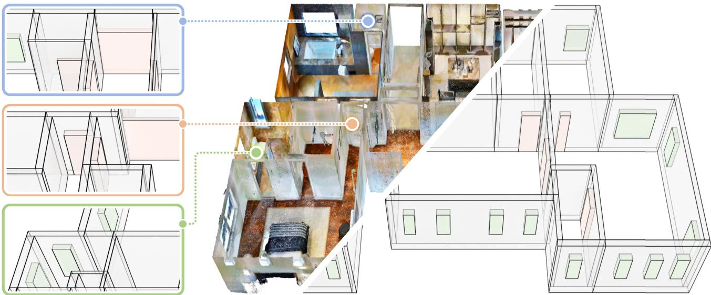

Fig. 1. CRAB converts clutered and incomplete indoor scans into compact, BIM-ready cuboid assemblies. By representing walls, doors, windows, beams, and columns as semantic cuboids with explicit geometric parameters and structural relations, CRAB supports accurate reconstruction, local editability, and downstream BIM conversion. The zoomed regions highlight challenging structures, including dense room partitions, non-uniform wall thicknesses, corner openings, and complex interior cores, while demonstrating precise wall-thickness recovery, consistent door-wall junctions, and robust reconstruction.

As-built BIM reconstruction from point clouds demands semantic, volumetric, parametric, and editable building components, beyond 2D layouts or planar abstractions. Yet existing scan-to-BIM pipelines often rely on handcrafted rules, heuristic optimization, or manual correction, while learning based methods fall short ofrecovering wall thickness, opening geometry, and component-level BIM structure. We introduce CRAB, a BIM-ready cuboid

∗Corresponding author: Hui Huang (hhzhiyan@gmail.com)

Authors’ Contact Information: Haoran Xiong, Guangdong Provincial Key Laboratory of Visual Media and Multidimensional Intelligence, College of Computer Science and Software Engineering, Shenzhen University, China, Shenzhen, xhr2002me@gamil. com; Jing Wang, Shenzhen University, China, Shenzhen, wangjinginszu@gmail.com; Shanshan Pan, Shenzhen University, China, Shenzhen, psshappystar@gmail.com; Zihao Yan, Shenzhen University, China, Shenzhen, mr.salingo@gmail.com; Minglun Gong, University of Guelph, Canada, Guelph, gongml@gmail.com; Hui Huang, Guangdong Provincial Key Laboratory of Visual Media and Multidimensional Intelligence, College of Computer Science and Software Engineering, Shenzhen University, China, Shenzhen, hhzhiyan@gmail.com.

reconstruction framework that encodes walls, doors, windows, beams, and columns as compact architectural cuboids with IFC-compatible semantics and parameters. CRAB bridges point clouds and editable BIM by combin ing ProposalNet, which predicts coarse component cuboids, with AssemblyNet, a relation-aware Flow Matching model that refines geometry, predicts structural relationships, and enables automatic structural correction and human-guided editing. To address limited cuboid-level supervision, we extend Structured3D with component-wise cuboid annotations and construct cuboid-based procedural scenes. Experiments show CRAB surpasses floor plan and plane-based alternatives in component completeness, geometric accuracy, and generalization. For interior wall thickness estimation, CRAB achieves a mean error of 2.80 cm, with 79.50% of matched walls within 3 cm. The project page is available at https://vcc.tech/research/2026/CRAB.

CCS Concepts: • Computing methodologies → Computer graphics.

Additional Key Words and Phrases: Scan-to-BIM; Scene Reconstruction;   
Parametric Modeling; Cuboid Representation; Relation-aware Assembly.

## ACM Reference Format:

Haoran Xiong, Jing Wang, Shanshan Pan, Zihao Yan, Minglun Gong, and Hui Huang. 2026. CRAB: Cuboid-based Representation for As-built BIM from Point Clouds. In SIGGRAPH Asia 2026 Conference Papers (SA Conference Papers ’26), December 01–04, 2026, Kuala Lumpur, Malaysia. ACM, New York, NY, USA, 11 pages. https://doi.org/10.1145/3829340.3842245

## 1 Introduction

3D scanning is widely used on construction sites to capture the geometric structure of real-world buildings and environments. The resulting point clouds often provide noisy, incomplete, and purely geometric surface measurements. In contrast, Building Information Modeling (BIM) represents buildings as structured collections of semantic component instances with volumetric geometry, parametric attributes, and explicit relationships[Liu et al. 2025a; Zbirovský and Nežerka 2025]. Consequently, BIM aims to reconstruct editable as-built architectural components rather than merely producing a geometric reconstruction of the scanned scene. For architectural components, this requires inferring wall thickness, wall-opening relationships, and editable instance identities that are not directly observable from raw scans.

Current methods rarely recover such BIM components directly from point clouds. Manual modeling remains labor-intensive, while classical Scan-to-BIM pipelines rely on multi-stage processing, including segmentation, primitive fitting, plane extraction, and topology optimization, often requiring scene-specific assumptions and carefully tuned parameters [Liu et al. 2025a; Zbirovský and Nežerka 2025]. Learning-based approaches improve automation, but most focus on intermediate geometric abstractions such as floor plans, room polygons [Yue et al. 2023], or 3D planes [Mao et al. 2025]. Although these representations support spatial understanding, they describe layouts or surfaces rather than explicit volumetric component instances. They do not directly couple component geometry, limiting their extensibility to other BIM attributes such as load-bearing status and materials. A reconstruction representation should therefore expose these attributes as primary variables, rather than deriving them from layouts or planes after prediction.

This mismatch calls for a volumetric, component-aware representation. Cuboid and primitive assemblies are a natural candidate because they encode compact solids with interpretable parameters and support editable 3D modeling. However, existing cuboid-based methods primarily target object decomposition[Ye et al. 2025a], shape generation [Jones et al. 2020], or furniture arrangement [Feng et al. 2025], rather than architectural reconstruction from incomplete scene-level point clouds with ambiguous component boundaries. Moreover, their generic cuboid parameterizations are not tailored to highly elongated architectural components. This motivates a BIMoriented volumetric representation that explicitly models parametric component geometry and architectural relations.

To this end, we introduce CRAB (Cuboid-based Representation for As-built BIM), a BIM-ready proposal-and-assembly framework for indoor point clouds. CRAB is designed precisely to move beyond layout and plane abstractions toward volumetric BIM components, thereby demonstrating the value of a BIM-oriented cuboid representation for AI-based Scan-to-BIM. It reconstructs walls, doors, windows, beams, and columns in single-floor scenes and represents each scene as centerline-based semantic cuboids and explicit topological relationships, jointly encoding parametric component geometry, semantics, wall adjacency, and opening-wall afiliation.

To recover these cuboids and relationships from noisy and incomplete point clouds, CRAB adopts a two-stage design. ProposalNet first generates coarse semantic cuboids from point cloud features, while AssemblyNet further refines their geometry and predicts intercomponent relationships through relation-aware Flow Matching. This refinement improves structural consistency while preserving editable cuboid parameters for user-guided modification. The resulting components can be directly instantiated as Industry Foundation Classes (IFC) elements, enabling compatibility with the open BIM data-exchange standard.

A further challenge is the lack of cuboid-level supervision for scan-to-BIM learning. Existing indoor datasets typically provide floor plans, meshes, semantic labels, or layout annotations, but lack component-wise volumetric cuboids aligned with BIM elements. To support training and evaluation, we extend the public Structured3D [Zheng et al. 2020] dataset with cuboid annotations for architectural components, and further construct a cuboid-based synthetic dataset with procedurally generated scenes and simulated point cloud acquisition.

In summary, our contributions are threefold:

• We recast scan-based indoor BIM reconstruction as semantic cuboid assembly, using centerline-based cuboid parameters to explicitly model component semantics, wall thickness, opening height, and editable volumetric geometry.

• We construct CrabSet, a scalable cuboid-level supervision dataset for Scan-to-BIM, by enriching Structured3D with component-wise cuboid annotations and procedurally synthesizing diverse architectural scenes with simulated point-cloud acquisition.

• We introduce CRAB, a proposal-and-assembly framework that couples ProposalNet for semantic cuboid generation with AssemblyNet for relation-aware flow-matching refinement, producing accurate, structurally coherent, and editable BIM-ready models.

## 2 Related Work

## 2.1 Structured Indoor Modeling

Indoor structural modeling is often cast as floor plan or layout estimation. Existing methods reconstruct 2D graphs, room polygons, or polygonal loops from RGB-D scans and point-density maps [Chen et al. 2019, 2022a; Stekovic et al. 2021; Yue et al. 2023], with recent variants improving polygon generation, room representation, graph reasoning, segmentation, and edge continuity [Chen et al. 2023; Liu et al. 2025b, 2024; Sun et al. 2025; Xu et al. 2024; Ye et al. 2025b]. While compact, these floorplan-oriented outputs do not directly specify wall thickness, vertical extent, opening height, or component volume, which are required by CAD/BIM workflows.

Recent 3D structured modeling methods move beyond 2D layouts by predicting walls, openings, oriented boxes, or parametric layout quads from images or point clouds [Avetisyan et al. 2024; Bieri et al. 2025; Chen et al. 2022b; Mao et al. 2025]. For planar representations, recovering volumetric semantic component instances from predicted paired parallel planes requires additional plane pairing and instance association to infer wall thickness, opening afiliation, and component identity. Such associations can be ambiguous when a single plane spans multiple walls, limiting extensions to instancespecific BIM attributes such as materials and load-bearing status. We instead reconstruct cuboid assemblies for walls, doors, windows, beams, and columns, with explicit centerline, thickness, height.

## 2.2 BIM-Ready Cuboid Reconstruction

Scan-to-BIM converts sensed geometry into editable building models. Existing systems recover walls, slabs, openings, rooms, and IFCcompatible outputs from point clouds [Murali et al. 2017; Ochmann et al. 2019; Zbirovský and Nežerka 2025], and BIMNet highlights the need for domain-specific data and BIM-aware geometric and topological evaluation [Liu et al. 2025a]. Yet many pipelines still rely on geometric rules, segmentation, optimization, or software specific workflows, making them sensitive to clutter, occlusion, and incomplete scans [Han et al. 2023; Wong et al. 2025; Wu et al. 2023]. Moreover, they primarily recover final component geometry without explicitly modeling relations, limiting coordinated refinement.

Cuboid and primitive assemblies ofer compact, editable structures. ShapeAssembly represents shapes as programs over cuboid parts [Jones et al. 2020], while recent primitive and procedural meth ods learn structured decompositions or editable programs from data [Raji et al. 2026; Ye et al. 2025a]. CASAGPT uses cuboid primitives for indoor scene synthesis to reduce mesh-level collisions [Feng et al. 2025]. Existing methods mainly target object decomposition, shape generation, or furnished scene synthesis rather than architectural reconstruction from incomplete scene-level point clouds. They typically use generic cuboids parameterized by center, size, and orientation, which are not tailored to highly elongated architectural components. CRAB instead adopts centerline-based semantic cuboids and explicit relations, supporting coordinated refinement and editable component reconstruction.

## 2.3 Local Structural Refinement

Recent LLM/VLM agents have moved generation and editing from one-shot prompting to closed-loop planning, tool use, evaluation, and revision. SceneCraft refines Blender-code scenes with rendered feedback [Hu et al. 2024], and VIGA reconstructs editable graphics programs through a code-render-inspect loop [Yin et al. 2026]. Similar feedback-driven loops appear in visual editing [Yao et al. 2026], while BIM agents invoke APIs, manipulate IFC data, or operate authoring software [Deng et al. 2025; Du et al. 2026; Nithyanantham et al. 2025]. Xie et al. [Xie et al. 2025] further show the value of local correction for missed or misplaced 3D layout elements. Motivated by these local correction paradigms, our cuboid representation and AssemblyNet support user-guided refinement, enabling controllable local edits and global correction for improved structural consistency.

## 3 CrabSet Construction

Learning BIM-ready cuboid reconstruction requires componentlevel volumetric supervision, including the geometry and relations of walls, doors, windows, and other elements. However, as summarized in Table 1, most existing indoor datasets are designed for scene understanding, embodied AI, or layout estimation, and mainly provide 2D floor plans, room layouts, semantic labels, or structured planar annotations. Only a few datasets contain explicit volumetric building components, and they are limited in scale or scene diversity.

To this end, we construct CrabSet, a cuboid-level dataset for indoor BIM reconstruction from point clouds. Each sample contains an input point cloud, component-wise volumetric cuboid annotations, and pairwise relations among architectural components. Each cuboid records its semantic category, instance identity, position, orientation, and dimensions. As shown in Fig. 2, CrabSet combines component-wise cuboid annotations derived from Structured3D with procedurally synthesized scenes, covering both residential layouts and broader architectural configurations. For synthetic scenes, point clouds are generated through virtual scanning.

Table 1. Structural supervision in indoor building datasets. We compare whether each dataset provides 2D floor plan, structured 3D plane, and volumetric component-level annotations for BIM-oriented reconstruction.
<table><tr><td>Dataset</td><td>Source</td><td>Scale</td><td>2D Floor Plan</td><td>3D Plane</td><td>Volumetric Comp.</td></tr><tr><td>ISPRS Benchmark [2017]</td><td>Real-world</td><td>6</td><td>X</td><td>X</td><td>√</td></tr><tr><td>Structured3D [2020]</td><td>Synthetic</td><td>3,500</td><td>√</td><td>√</td><td>×</td></tr><tr><td>SceneCAD [2020]</td><td>Real-world</td><td>1,151</td><td>√</td><td>×</td><td>×</td></tr><tr><td>ProcTHOR [2022]</td><td>Synthetic</td><td>12,000</td><td>√</td><td>X</td><td>×</td></tr><tr><td>HSSD [2024]</td><td>Synthetic</td><td>211</td><td>√</td><td>X</td><td>×</td></tr><tr><td>ASE [2024]</td><td>Synthetic</td><td>100,000</td><td>√</td><td>√</td><td>×</td></tr><tr><td>SpatialLM [2025]</td><td>Synthetic</td><td>12,328</td><td>√</td><td>√</td><td>×</td></tr><tr><td>BIMNet [2025a]</td><td>Real-world</td><td>25</td><td>×</td><td>X</td><td>√</td></tr><tr><td>CrabSet</td><td>Synthetic</td><td>6,500</td><td>X</td><td>×</td><td>√</td></tr></table>

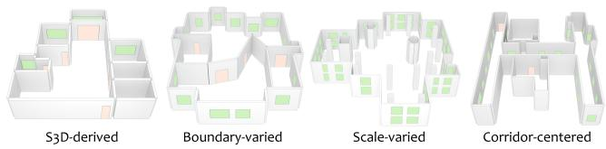  
Fig. 2. Representative samples from CrabSet, combining S3D-derived residential and procedurally synthesized scenes for cuboid-level supervision. The synthesized subsets vary boundaries, scales, and corridor-centered layouts, covering non-uniform wall thicknesses, non-Manhatan contours, service shafts, and diverse circulation paterns.

S3D-derived. This subset is derived from Structured3D, which provides diverse residential layouts with room partitions, openings, non-Manhattan structures, and occlusions. Using its planar faces, normals, semantic labels, and outer contours, we convert walls, doors, and windows into component-wise volumetric cuboids. This subset anchors CrabSet to a public residential benchmark.

Boundary-varied. This subset increases local geometric diversity by varying outer contours, wall thicknesses, and non-Manhattan wall configurations. It encourages the model to recover accurate cuboid geometry and wall thickness.

Scale-varied. This subset expands spatial scale and component complexity through large architectural spaces with service shafts, columns, and multi-layer window configurations. It improves the model’s ability to handle dense non-residential scenes with large variations in component size and spatial extent.

Corridor-centered. This subset focuses on circulation-driven layouts, including straight, bent, notched, H-shaped, T-shaped, and ring-like corridors. Rooms and openings are arranged along corridor boundaries, covering large building configurations that are rarely represented in residential datasets.

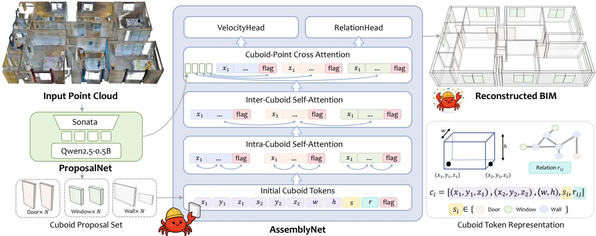  
Fig. 3. Overview of CRAB. Given a raw indoor point cloud, ProposalNet encodes the scan and autoregressively predicts an initial set of semantic cuboids for walls, doors, and windows. AssemblyNet represents each proposal with centerline-based cuboid tokens augmented by semantic, relation, and edit-control flags, and refines them through intra-cuboid, inter-cuboid, and cuboid–point atention. A velocity head performs relation-aware flow-matching refinement of cuboid geometry, while a relation head infers structural dependencies such as wall adjacency and door/window afiliation. The refined cuboids and relations are finally instantiated as editable BIM-ready components, converting unstructured scans into component-level architectural models.

## 4 Methodology

## 4.1 Problem Formulation

Our goal is to reconstruct as-built BIM components, such as walls, doors, windows, beams, and columns, from an input point cloud. We represent them as parameterized semantic cuboids along with their explicit topological relationships.

Formally, we define the input point cloud as $P = \{ p _ { i } \}$ , where each point feature ${ \mathit { p } } _ { i }$ contains spatial coordinates and color information. The reconstructed architectural components are represented by a set of semantic cuboids

$$
C = \{ c _ { i } \} , \quad c _ { i } = [ g _ { i } , s _ { i } ] , \quad g _ { i } = [ x _ { 1 } , y _ { 1 } , z _ { 1 } , x _ { 2 } , y _ { 2 } , z _ { 2 } , w , h ] ,
$$

where the geometric parameters $g _ { i }$ define the bottom central axis connecting endpoints $( x _ { 1 } , y _ { 1 } , z _ { 1 } )$ and $\left( { x _ { 2 } , y _ { 2 } , z _ { 2 } } \right)$ , together with cuboid thickness � and height ℎ, while $s _ { i }$ denotes the semantic category.

The relationships between cuboids are further represented by:

$$
R = \{ r _ { i j } \mid c _ { i } , c _ { j } \in C \} ,
$$

where $r _ { i j }$ encodes structural interactions between components, including attachment relationships (e.g., doors or windows belonging to a wall) and adjacency relationships between neighboring walls.

The overall reconstruction task is therefore formulated as

$$
( C , R ) = { \mathcal { F } } ( P ) ,
$$

where $\mathcal { F }$ denotes the proposed mapping function that reconstructs cuboids and their relationships from the input point cloud.

## 4.2 ProposalNet

We argue that the primary objective of the first stage is to generate accurate individual architectural components, since reliable prediction ofeach cuboid forms the foundation for subsequent relationship reasoning and structural assembly. Therefore, this module focuses exclusively on cuboid geometry and semantic prediction. Formally, we aim to learn the conditional distribution $p _ { \theta } ( C \mid P )$ , from which the initial cuboid proposals are generated:

$$
C _ { \mathrm { i n i t } } \sim p _ { \theta } ( C \mid P ) .
$$

Specifically, we employ Sonata [Wu et al. 2025] as the point cloud encoder and Qwen2.5-0.5B [Yang et al. 2024] as the auto-regressive cuboid generator. The Sonata encoder is initialized with pretrained weights and further trained on our point cloud and cuboid pairs. For each input scene, we voxel-downsample the point cloud at 2.5 cm and randomly keep at most 800,000 points for training and inference.

The point cloud encoder and autoregressive cuboid decoder are connected by a lightweight MLP Adapter, which maps point cloud features into the decoder token embedding space. Conditioned on the adapted point cloud tokens, the decoder sequentially generates the initial semantic cuboids. We fine-tune the generator on cuboid token sequences, with a maximum of 200 cuboids and an EOS token for termination. The proposal process is formulated as:

$$
C _ { \mathrm { i n i t } } = \mathrm { A R } _ { \theta } \Big ( \mathrm { A d a p t e r } \big ( \mathrm { E n c } ( P ) \big ) \Big ) ,
$$

where Enc(·) denotes the point cloud encoder, Adapter(·) maps point cloud features into the decoder token embedding space, and $\operatorname { A R } _ { \theta }$ represents the autoregressive transformer that decodes the adapted point cloud tokens into initial cuboid proposals.

## 4.3 AssemblyNet

The cuboid proposal stage produces an initial set of architectural elements, but the predicted cuboids may still contain geometric inaccuracies and structural inconsistencies. AssemblyNet aims to jointly refine cuboid geometry and infer structural relationships between components through Flow Matching. It also supports efective user-guided local editing. Formally, this stage is defined as

$$
( C _ { \mathrm { r e v i s e d } } , R ) = \mathcal { A } _ { \phi } ( P , C _ { \mathrm { i n i t } } ) ,
$$

where $\mathcal { A } _ { \phi }$ denotes the AssemblyNet, $C _ { \mathrm { r e v i s e d } }$ is the refined cuboids. Specifically, for each cuboid, the input to AssemblyNet consists of explicit cuboid parameter tokens, one relation-aware token, and a change flag, together with point cloud features used for cross attention. The parameter tokens encode the cuboid geometry and semantic type, while the relation-aware token captures the structural role of this cuboid and participates in all attention operations.

The tokens are first embedded with parameter-specific linear layer encoders and timestep embeddings. They are then processed by an Intra-Cuboid Attention module, which models interactions among tokens within each cuboid and helps distinguish fixed cuboids from refinement targets according to the change flag. Next, Inter-Cuboid Attention propagates information across cuboids, allowing each cuboid to perceive the positions, scales, semantic categories, and potential structural dependencies of neighboring cuboids. A Cuboid-Point Cross Attention module further associates cuboid tokens with point cloud features, grounding the refinement process in the observed scene geometry. Details of the three attention modules are provided in the supplementary material.

Inspired by RectifiedFlow editing [Gong et al. 2025; Kulikov et al. 2025], we formulate cuboid assembly as an iterative refinement process from the coarse proposal $C _ { \mathrm { i n i t } }$ . The geometry-aware token features are decoded by an MLP-based velocity head to predict geometric updates, and the final refined cuboids are obtained by accumulating the updates over � steps:

$$
C _ { \mathrm { r e v i s e d } } = C ^ { K } = C _ { \mathrm { i n i t } } + \sum _ { k = 0 } ^ { K - 1 } { \mathrm { V e l o c i t y H e a d } } ( Z ^ { k } ) \Delta t ,
$$

where � is the number of refinement steps, $\Delta t = 1 / K _ { \mathrm { { ; } } }$ , and $Z ^ { k } =$ $\mathrm { E n c } _ { \phi } ( C ^ { k } , t _ { k } , P , f l a g )$ denotes the geometry-aware token features at the �-th step. Here, $C ^ { k }$ is the intermediate cuboid state, $t _ { k }$ is the timestep, � is the input point cloud, and ���� indicates whether each cuboid is fixed or editable. This iterative process refines editable cuboids while preserving fixed components.

In parallel, the relation-aware tokens encoded by the preceding attention modules are decoded by RelationHead to predict pairwise structural relationships $R = \{ r _ { i j } \}$ . For each cuboid pair, RelationHead uses an order-invariant pair feature:

$$
r _ { i j } = \mathrm { R e l a t i o n H e a d } \left( [ q _ { i } ^ { r } + q _ { j } ^ { r } , | q _ { i } ^ { r } - q _ { j } ^ { r } | , q _ { i } ^ { r } \odot q _ { j } ^ { r } ] \right) ,
$$

where $q _ { i } ^ { r }$ and $q _ { j } ^ { r }$ are the encoded relation tokens of the two cuboids, and ⊙ denotes element-wise multiplication. This formulation produces an undirected graph that captures door-wall afiliation and wall-wall adjacency without hand-crafted geometric rules at inference. Training details are provided in the supplementary material.

## 4.4 Reconstruction Pipeline

CRAB converts an input point cloud into an editable as-built BIM model through the following three-step pipeline.

Step 1: Cuboid Proposal. ProposalNet reconstructs most architectural components from the input point cloud as an initial set of semantic cuboids with coarse geometric parameters.

Step 2: Human-in-the-Loop Assembly. User interaction is optional: users may add, delete, move, or anchor coarse cuboids before assembly. AssemblyNet jointly uses the cuboid set and input point cloud to refine component geometry and predict their relationships, automatically correcting geometric errors, local misalignments, and redundant components. Completely missing components require coarse user initialization, after which AssemblyNet aligns and integrates them into the existing structure.

Step 3: BIM Conversion. Refined cuboids and relations are converted into editable IFC components. For walls, adjacency relations resolve junctions by trimming or extending each wall only along its longitudinal axis, while preserving its direction, thickness, and centerline ofset. The resulting wall-adjacency graph is searched for closed cycles containing at least four wall segments, which are assembled into rooms in a bottom-up manner and can be further converted into 2D floor plans or 3D planar representations. Openingwall afiliations associate doors and windows with their host walls for wall-consistent placement. Based on the refined cuboids and predicted relations, the BIM model can be instantiated with corner-joint, cross-joint, or wall-integrated wall structures.

## 5 Results and Evaluation

## 5.1 Experimental Setup

Datasets. For training, we use 3,000 Structured3D training scenes and 3,000 procedurally generated scenes from CrabSet. For evaluation, we evaluate on the Structured3D validation and test splits (250 scenes each), with BIMNet and ISPRS for real-scene generalization.

Metrics. We evaluate reconstruction quality in two stages. Match-F1 measures coarse component-level matching quality using the F1 score computed from precision and recall based on voxel-overlap matching. After coarse matching, geometric metrics evaluate accuracy: CL-Ofset reports the centerline deviation of interior walls in centimeters, T-MAE measures the mean thickness error of walls, and T-Acc@� denotes the proportion of matched walls whose thickness error is within � cm. H-MAE measures height errors for doors and windows. Details are provided in the supplementary material.

Baselines. We compare CRAB with an open-source volumetric Scan-to-BIM method, Cloud2BIM[Zbirovský and Nežerka 2025], floorplan-based methods, including RoomFormer[Yue et al. 2023] and CAGE[Liu et al. 2025b], and 3D plane-based methods, including SceneScript[Avetisyan et al. 2024] and SpatialLM[Mao et al. 2025]. Since released plane-based models lack valid opening heights on Structured3D, we report SceneScript∗ and SpatialLM∗, fine-tuned on corrected S3D annotations. We report Ours∗, trained only on S3D-derived cuboids, and Ours, trained on CrabSet, to ensure fair comparison and assess procedural cuboid supervision.

Table 2. Quantitative comparison of representation choices on Structured3D. CRAB improves both component recovery and BIM-critical volumetric atributes, especially wall thickness and opening height, over floor plan and plane-based alternatives. Best and second-best results are highlighted in green and blue.
<table><tr><td rowspan="2">Method</td><td rowspan="2"> ${ \mathrm { R e p . } }$ </td><td rowspan="2">Exterior Wall Match-F1 (↑)</td><td colspan="5">Interior Wall</td><td colspan="2">Door</td><td colspan="2">Window</td></tr><tr><td>Match-F1 (↑)</td><td>CL-Offset (↓)</td><td>T-MAE (↓)</td><td>T-Acc@3 (↑)</td><td>T-Acc@5 (↑)</td><td>Match-F1 (↑)</td><td>H-MAE (↓)</td><td>Match-F1 (↑)</td><td>H-MAE (↓)</td></tr><tr><td>Cloud2BIM [2025]</td><td>Volumetric</td><td>4.41%</td><td>62.76%</td><td></td><td></td><td></td><td></td><td>15.12%</td><td></td><td>4.52%</td><td></td></tr><tr><td>RoomFormer [2023]</td><td>Floor Plan</td><td>84.48%</td><td>85.78%</td><td>5.34</td><td>6.19</td><td>27.79%</td><td>48.54%</td><td>77.05%</td><td>74.94</td><td>64.82%</td><td>120.84</td></tr><tr><td>CAGE [2025b]</td><td>Floor Plan</td><td>91.14%</td><td>89.74%</td><td>3.68</td><td>5.31</td><td>33.75%</td><td>58.11%</td><td></td><td></td><td></td><td></td></tr><tr><td>SceneScript*</td><td>Plane</td><td>44.40%</td><td>52.59%</td><td>6.02</td><td>9.24</td><td>10.73%</td><td>16.26%</td><td>47.83%</td><td>22.64</td><td>38.71%</td><td>22.01</td></tr><tr><td>SpatialLM [2025]</td><td>Plane</td><td>92.40%</td><td>91.48%</td><td>3.10</td><td>3.89</td><td>24.98%</td><td>77.74%</td><td>89.03%</td><td>77.36</td><td>77.90%</td><td>122.86</td></tr><tr><td>SpatialLM*</td><td>Plane</td><td>91.52%</td><td>91.03%</td><td>3.09</td><td>4.38</td><td>41.62%</td><td>70.60%</td><td>81.44%</td><td>78.72</td><td>65.67%</td><td>78.26</td></tr><tr><td>Ours* (ProposalNet)</td><td>Cuboid</td><td>92.81%</td><td>91.91%</td><td>3.35</td><td>2.95</td><td>79.15%</td><td>86.18%</td><td>88.07%</td><td>3.63</td><td>86.52%</td><td>9.52</td></tr><tr><td>Ours (ProposalNet)</td><td>Cuboid</td><td>93.78%</td><td>92.57%</td><td>3.01</td><td>2.80</td><td>79.50%</td><td>87.17%</td><td>91.14%</td><td>2.86</td><td>88.97%</td><td>9.23</td></tr></table>

Note. All geometric errors are reported in centimeters. ∗ denotes models retrained on Structured3D with representation-specific annotations and ground-truth opening heights. Unmarked baselines use oficially released weights. Ours is trained on the full CrabSet, while Ours∗ uses only S3D-derived cuboid annotations for controlled comparison.

Training Details. The model is trained for 50 epochs using the Adam optimizer with an initial learning rate of $1 \times 1 0 ^ { - 4 }$ . The learning rate follows a cosine decay schedule with a 1% warm-up phase. All experiments were conducted on a server equipped with 8 NVIDIA GeForce RTX 4090 GPUs and dual Intel Xeon Gold 6430 CPUs.

Geometric Granularity and Post-processing. For fair componentlevel evaluation, we follow the original discretization settings ofeach baseline whenever possible and convert floor plan or plane outputs into volumetric component representations before evaluation. Since these baselines do not directly output cuboid-level walls, doors, and windows, additional conversion is required before evaluation. Detailed discretization settings and post-processing procedures are provided in the supplementary material.

## 5.2 Evaluation

We evaluate CRAB from six perspectives: (i) volumetric accuracy on Structured3D, covering component matching, wall thickness, and opening height; (ii) layout and plane quality using the native metrics ofrepresentative 2D floor plan and 3D plane methods; (iii) robustness under structural ambiguity and local perturbations; (iv) real-world generalization on noisy and incomplete BIMNet and ISPRS scans; (v) editability and BIM conversion enabled by cuboid components and their relations; and (vi) beam and column reconstruction on procedurally generated scenes to assess broader coverage.

Volumetric Reconstruction Accuracy. Cuboid representations directly model architectural elements as 3D components, avoiding the need to infer wall thickness or opening geometry from 2D layouts or planar fragments. We evaluate these BIM-critical attributes on the Structured3D test set in Table 2. Compared with the volumetric baseline Cloud2BIM, CRAB produces more complete component reconstructions on incomplete scans, with fewer fragmented walls and unstable openings. Compared with floor-plan and plane-based alternatives, CRAB achieves stronger component matching and more accurate geometry. For openings, CRAB improves window Match-F1 from 77.90% to 88.97% over SpatialLM, and reduces height errors to 2.86 cm for doors and 9.23 cm for windows. For interior walls, CRAB achieves a wall-thickness MAE of 2.80 cm and a T-Acc@3 of 79.50%, substantially outperforming the strongest non-cuboid baseline at 41.62% T-Acc@3. As shown in Fig. 4, CRAB also better preserves wall thickness, wall extent, and opening–wall consistency.

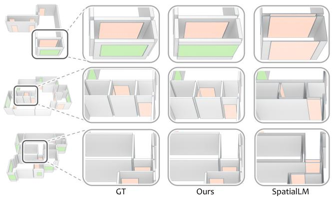  
Fig. 4. Qualitative comparison with a plane-based representation. Zoomed views compare the same local structures in GT, CRAB, and SpatialLM. CRAB’s volumetric cuboids beter preserve wall thickness, component extent, and opening-wall consistency than the plane-based representation.

Layout and Plane Quality. As shown in Table 3, we evaluate CRAB using RoomFormer’s native 2D layout metrics [Yue et al. 2023] and SpatialLM’s native 3D plane metrics [Mao et al. 2025]. Following Sec. 4.4, CRAB outputs are converted into 2D room polygons and 3D planes for evaluation. For cross-representation comparison, planebased outputs are grouped into rooms by matching shared wall endpoints, while floorplan outputs are lifted using point-cloud heights. CRAB achieves notably higher Corner F1 and Angle F1 than CAGE, demonstrating more accurate boundary geometry. Compared with SpatialLM, CRAB achieves comparable wall-plane performance and improves window F1 from 87.5% to 91.4% at IoU �@0.5. Overall, CRAB achieves competitive layout and plane quality against baselines while providing accurate volumetric reconstruction.

Robustness to Ambiguity and Local Perturbations. Cuboids provide more reliable refinement units because each prediction corresponds to an explicit volumetric component. This is particularly useful in incomplete, ambiguous, or non-Manhattan scenes, where floor-plan methods depend on room closure and plane-based methods may become unstable when several nearby planes describe the same wall or opening. As shown in Fig. 7, CRAB recovers more coherent wall structures and more consistent opening geometry by directly predicting component-level cuboids.

Table 3. Quantitative comparison of 2D layout and 3D plane quality on Structured3D. The results show that CRAB’s gains in volumetric reconstruction do not come at the expense of layout or plane quality. Best and second-best results are highlighted in green and blue.
<table><tr><td rowspan="3">Method</td><td rowspan="3">Rep.</td><td colspan="8">2D Layout</td><td colspan="8">3D Plane</td></tr><tr><td colspan="2">Room</td><td colspan="2">F1</td><td colspan="2">Corner</td><td colspan="2">Angle</td><td colspan="2"></td><td colspan="2">IoU2D@0.25</td><td rowspan="2"></td><td colspan="4">IoU2D@0.5</td></tr><tr><td></td><td>Prec.</td><td>Rec.</td><td></td><td>Prec. Rec.</td><td>F1</td><td>Prec.</td><td>Rec.</td><td>F1</td><td>Avg.</td><td>Wall</td><td>Door</td><td>Window</td><td>Avg. Wall</td><td>Door</td><td>Window</td></tr><tr><td>RoomFormer [2023]</td><td>Floor Plan</td><td>98.7</td><td>96.7</td><td>97.3</td><td>89.2</td><td>85.3</td><td>87.2</td><td>83.0</td><td>79.6</td><td>81.3</td><td>83.4</td><td>86.0</td><td>85.1</td><td>78.9</td><td>81.4</td><td>84.6</td><td>83.1</td><td>76.6</td></tr><tr><td>CAGE [2025b]</td><td>Floor Plan</td><td>99.6</td><td>98.7</td><td>99.1</td><td>95.0</td><td>88.6</td><td>91.7</td><td>92.5</td><td>86.4</td><td>89.3</td><td></td><td>89.3</td><td></td><td></td><td></td><td>86.4</td><td></td><td></td></tr><tr><td>SceneScript</td><td>Plane</td><td>81.3</td><td>45.3</td><td>58.2</td><td>71.1</td><td>29.8</td><td>42.0</td><td>68.4</td><td>28.6</td><td>40.4</td><td>90.4</td><td>92.9</td><td>92.8</td><td>85.5</td><td>89.2</td><td>91.9</td><td>92.5</td><td>83.3</td></tr><tr><td>SpatialLM [2025]</td><td>Plane</td><td>99.3</td><td>97.2</td><td>98.2</td><td>94.5</td><td>89.5</td><td>92.0</td><td>93.7</td><td>88.7</td><td>91.1</td><td>92.2</td><td>93.5</td><td>94.1</td><td>88.9</td><td>91.1</td><td>92.4</td><td>93.4</td><td>87.5</td></tr><tr><td>CRAB (Ours)</td><td>Cuboid</td><td>98.7</td><td>98.7</td><td>98.7</td><td>95.5</td><td>90.7</td><td>93.1</td><td>93.4</td><td>88.8</td><td>91.1</td><td>93.3</td><td>93.2</td><td>94.6</td><td>92.1</td><td>92.6</td><td>92.2</td><td>94.1</td><td>91.4</td></tr></table>

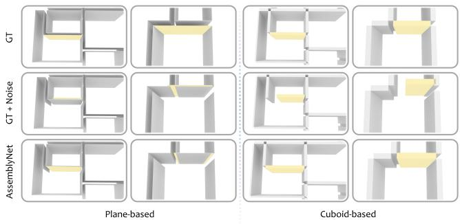  
Fig. 5. AssemblyNet refinement under simulated wall editing errors. The three rows show the ground truth, the perturbed input, and the refined result, respectively. Starting from the noisy wall highlighted in yellow, planebased refinement can drift toward nearby structures, while cuboid-based refinement beter preserves and recovers the target volumetric component.

We further test robustness with a controlled wall-perturbation experiment. A ground-truth wall is locally shifted or resized to simulate imperfect editing, and the model is asked to refine it back to the original geometry. Plane-based refinement produces endpoint errors of 30.29 cm, 13.07 cm, and 33.21 cm under length-plus-axial, perpendicular, and combined perturbations, respectively, while cuboidbased refinement reduces them to 3.60 cm, 5.18 cm, and 5.66 cm. As shown in Fig. 5, plane-based refinement can drift toward nearby planar structures, whereas cuboid-based refinement preserves the target wall as a distinct volumetric instance.

We also evaluate full-scene refinement by making all predicted components editable. Specifically, we use SpatialLM’s plane predictions and CRAB’s cuboid predictions reported in Table 2 as inputs to the plane-based and cuboid-based variants of AssemblyNet, respectively. Table 4 shows that plane-based refinement can degrade the original prediction, since small plane deviations are amplified during post-processing for wall extraction and thickness estimation. In contrast, cuboid-based AssemblyNet preserves explicit component geometry and improves interior-wall T-Acc@3 from 79.50% to 81.27%. These results indicate that cuboids are more stable refinement targets for Scan-to-BIM reconstruction, as each editable element already carries its own extent and thickness parameters.

Real-World Generalization. We compare CRAB with SpatialLM on real scenes to evaluate generalization beyond synthetic scenes. Since real-scene benchmarks lack consistent cuboid annotations, we evaluate BIMNet using Match-F1 computed from voxel overlap. CRAB achieves 72.5%, 68.8%, and 48.5% for walls, doors, and windows, compared with 68.6%, 49.6%, and 37.4% for SpatialLM. The larger gains on openings indicate more reliable recovery of BIMready components. As shown in Fig. 8, real scenes contain complex layouts, sensor noise, missing regions, and domain gaps from syn thetic scenes. Under these challenging conditions, SpatialLM often produces incomplete or unstable structures. In contrast, CRAB recovers more coherent layouts and more accurate components. This trend is observed on both residential-like BIMNet scenes and nonresidential ISPRS scenes, indicating that the cuboid representation learned from CrabSet generalizes better to diverse real-world scans.

Table 4. Comparison of full-scene refinement with plane-based and cuboidbased AssemblyNet, using planes from SpatialLM and cuboids from ProposalNet, respectively. Cuboid-based AssemblyNet improves the initial reconstruction results, whereas plane-based AssemblyNet degrades them.
<table><tr><td rowspan="2">Method</td><td>Exterior Wall</td><td colspan="2">Interior Wall</td><td>Door</td><td>Window</td></tr><tr><td>Match-F1 (↑)</td><td>Match-F1 (↑)</td><td>T-Acc@3 (↑)</td><td>Match-F1 (↑)</td><td>Match-F1 (↑)</td></tr><tr><td>AssemblyNet (Plane)</td><td>87.94%</td><td>87.31%</td><td>20.45%</td><td>88.02%</td><td>76.44%</td></tr><tr><td>AssemblyNet (Cuboid)</td><td>94.42%</td><td>92.73%</td><td>81.27%</td><td>92.20%</td><td>89.76%</td></tr></table>

Editability and BIM Conversion. Cuboid representation also provides practical flexibility for editing and BIM conversion. Unlike floor plan or plane-based outputs, where wall and opening edits must be inferred through polygon updates, plane grouping, or postprocessing, CRAB represents architectural components as independent volumetric instances. Thus, users can directly insert, delete, translate, or resize component instances in a BIM-like manner. As shown in Fig. 6, the predicted cuboids and relations further support flexible BIM instantiation. The same cuboid-relation graph can be converted into diferent modeling styles, including Corner-Joint BIM, Cross-Joint BIM, and Wall-Integrated BIM. This demonstrates that CRAB produces not only accurate geometry, but also editable and relation-aware components for downstream architectural modeling.

Beam and Column Reconstruction. Beyond walls, doors, and windows, CRAB also supports beams and columns. Since existing benchmarks lack consistent annotations and reproducible baselines for these categories, we evaluate them separately on procedurally generated scenes. CRAB achieves Match-F1 scores of 97.15% for columns and 57.83% for beams. See supplementary material for details.

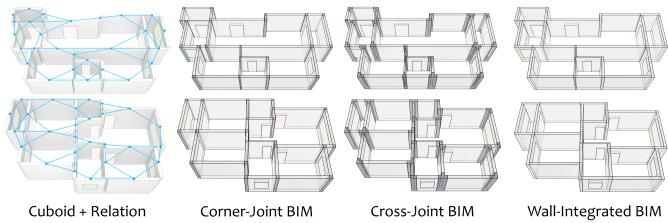  
Fig. 6. BIM conversion from cuboids and relations. The same cuboid-relation graph supports diferent junction assignments: Corner-Joint BIM uses explicit corner joints, Cross-Joint BIM uses explicit cross joints, and Wall-Integrated BIM merges junction regions into connected wall elements.

## 5.3 Ablation Study

Efect ofCenterline-based Parameterization. We ablate the proposed centerline-based cuboid parameterization against a generic oriented box representation, which can be viewed as a simplified variant of common primitive and scene tokenizations [Feng et al. 2025; Ye et al. 2025a]. Since architectural components are vertically extruded in our setting, the oriented box is represented by center translation, side lengths, and a yaw rotation angle around the verti cal axis. Both variants are trained under the same setting, with only the geometric representation changed.

As shown in Table 5, oriented boxes perform slightly better on doors and achieve comparable results on windows, which are relatively compact components. However, for long and thin walls, the centerline-based cuboid explicitly separates wall extent from wall thickness, leading to better wall reconstruction and improving interior-wall T-Acc@3 from 71.74% to 79.50%. For highly elongated architectural components, longitudinal extent and thickness play strongly asymmetric geometric roles, and centerline-based parameterization better disentangles them, reducing geometric ambiguity and improving wall reconstruction stability. This suggests that the proposed parameterization is more suitable for wall-dominated architectural reconstruction, where accurate wall geometry is critical for downstream BIM conversion.

## 5.4 Limitation Analysis

CRAB still has several limitations. (1) Missing component recovery. CRAB can automatically correct continuous geometric errors, local misalignments, and redundant components, but entirely missing components may still require coarse user initialization. The supplementary material further shows AssemblyNet’s ability to correct geometric errors and local misalignments, while removing redundant components through component alignment. (2) Irregular non-Manhattan geometry. While CRAB handles standard Manhattan layouts and moderate non-Manhattan variations, highly irregular or curved structures remain challenging: cuboids can capture the dominant organization, but may oversimplify fine-scale deviations. (3) Sparse infrequent components. Beams, columns, stairs, and service shafts appear sparsely in current real-world test scenes, limiting comprehensive evaluation. Although CRAB can model these elements in principle, robust reconstruction requires richer componentlevel supervision and broader BIM benchmarks.

Table 5. Ablation of cuboid parameterization. Oriented boxes perform well on compact components such as doors and windows, but are less suitable for long and thin walls, where longitudinal extent and thickness play strongly asymmetric geometric roles. Our centerline-based parameterization explicitly separates these two factors, improving wall geometry and thickness reconstruction and making it more suitable for BIM-oriented reconstruction.
<table><tr><td rowspan="2">Method</td><td>Exterior Wall</td><td colspan="2">Interior Wall</td><td>Door</td><td>Window</td></tr><tr><td>Match-F1 (↑)</td><td>Match-F1 (↑)</td><td>T-Acc@3 (↑)</td><td>Match-F1 (↑)</td><td>Match-F1 (↑)</td></tr><tr><td>Oriented Box</td><td>92.59%</td><td>92.06%</td><td>71.74%</td><td>92.20%</td><td>88.94%</td></tr><tr><td>Centerline Cuboid (Ours)</td><td>93.78%</td><td>92.57%</td><td>79.50%</td><td>91.14%</td><td>88.97%</td></tr></table>

## 6 Conclusion and Future Work

We presented CRAB, a cuboid-based approach to indoor Scan-to-BIM reconstruction. The key observation is that BIM reconstruction requires component-level volumetric structure, not only layout curves or planar surfaces. Accordingly, CRAB represents walls, doors, windows, beams and columns as semantic cuboids with explicit centerline, thickness, height, and opening parameters. This representation makes architectural components directly editable and provides a natural interface for downstream BIM conversion.

The proposed framework follows a proposal-and-assembly design. ProposalNet predicts coarse architectural cuboids from point-cloud observations, while AssemblyNet refines their geometry and relationships through relation-aware Flow Matching. Together, the two-stage system is capable of correcting geometric errors and local misalignments while removing redundant components through component alignment. To support learning and evaluation, we constructed CrabSet, which provides cuboid-level supervision from Structured3D-derived annotations and procedurally generated architectural scenes. Experiments on synthetic and real-world scans show that cuboid assembly yields more accurate wall-thickness estimation, more stable refinement, and more flexible BIM instantiation than floor-plan- or plane-based alternatives. Importantly, these gains in volumetric reconstruction do not come at the expense of layout or plane quality, where CRAB remains competitive with representation-specific baselines.

To address the limitations discussed earlier, future work will primarily broaden CRAB’s practical capabilities and application scope. We will explore (1) complex non-Manhattan geometry and richer primitives, including cylinders and curved surfaces, (2) broader BIM categories and structural relations, together with semantic plane cues as auxiliary geometric evidence for robust reconstruction under real-scene domain shifts, and (3) interactive or agent-assisted workflows, reducing manual efort and enabling more automated Scan-to-BIM reconstruction.

## Acknowledgments

This work was supported in part by Guangdong S&T Program (2024B0101050004), ICFCRT (W2441020), NSFC(62402323), Shenzhen Science and Technology Program (KQTD20210811090044003, KJZD20240903100022028), and Scientific Development Fund from Guangdong Provincial Key Laboratory of Visual Media and Multidimensional Intelligence.

## References

Armen Avetisyan, Tatiana Khanova, Christopher Choy, Denver Dash, Angela Dai, and Matthias Nießner. 2020. SceneCAD: Predicting Object Alignments and Layouts in RGB-D Scans. In Proc. Euro. Conf. on Computer Vision.

Armen Avetisyan, Christopher Xie, Henry Howard-Jenkins, Tsun-Yi Yang, Samir Aroudj, Suvam Patra, Fuyang Zhang, Duncan Frost, Luke Holland, Campbell Orme, Jakob Engel, Edward Miller, Richard Newcombe, and Vasileios Balntas. 2024. SceneScript: Reconstructing Scenes With An Autoregressive Structured Language Model. In Proc. Euro. Conf. on Computer Vision.

Valentin Bieri, Marie-Julie Rakotosaona, Keisuke Tateno, Francis Engelmann, and Leonidas Guibas. 2025. HouseLayout3D: A Benchmark and Training-Free Baseline for 3D Layout Estimation in the Wild. In Proc. Conf. on Neural Information Processing Systems.

Jiacheng Chen, Ruizhi Deng, and Yasutaka Furukawa. 2023. PolyDifuse: Polygonal Shape Reconstruction via Guided Set Difusion Models. In Proc. Conf. on Neural Information Processing Systems, Vol. 36.

Jiacheng Chen, Chen Liu, Jiaye Wu, and Yasutaka Furukawa. 2019. Floor-SP: Inverse CAD for Floorplans by Sequential Room-Wise Shortest Path. In Proc. IEEE/CVF Conf. on Computer Vision & Pattern Recognition. 2661–2670.

Jiacheng Chen, Yiming Qian, and Yasutaka Furukawa. 2022a. HEAT: Holistic Edge Attention Transformer for Structured Reconstruction. In Proc. IEEE/CVF Conf. on Computer Vision & Pattern Recognition. 3866–3875.

Xiaoxue Chen, Hao Zhao, Guyue Zhou, and Ya-Qin Zhang. 2022b. PQ-Transformer: Jointly Parsing 3D Objects and Layouts from Point Clouds. IEEE Robotics and Automation Letters 7, 2 (2022), 2519–2526.

Matt Deitke, Eli VanderBilt, Alvaro Herrasti, Luca Weihs, Jordi Salvador, Kiana Ehsani, Winson Han, Eric Kolve, Ali Farhadi, Aniruddha Kembhavi, and Roozbeh Mottaghi. 2022. ProcTHOR: Large-Scale Embodied AI Using Procedural Generation. In Proc Conf. on Neural Information Processing Systems. Outstanding Paper Award.

Zihan Deng, Changyu Du, Stavros Nousias, and André Borrmann. 2025. BIMgent: Towards Autonomous Building Modeling via Computer-use Agents. ICML 2025 Workshop on Computer Use Agents (2025).

Changyu Du, Sebastian Esser, Stavros Nousias, and André Borrmann. 2026. Text2BIM: Generating Building Models Using a Large Language Model-Based Multiagent Framework. Journal of Computing in Civil Engineering 40, 2 (2026), 04025142. doi:10.1061/JCCEE5.CPENG-6386

Weitao Feng, Hang Zhou, Jing Liao, Li Cheng, and Wenbo Zhou. 2025. CASAGPT: Cuboid Arrangement and Scene Assembly for Interior Design. In Proc. IEEE/CVF Conf. on Computer Vision & Pattern Recognition.

Yiming Gong, Zhen Zhu, and Minjia Zhang. 2025. InstantEdit: Text-Guided Few-Step Image Editing with Piecewise Rectified Flow. In Proc. Int. Conf. on Computer Vision.

Jiali Han, Yuzhou Liu, Mengqi Rong, Xianwei Zheng, and Shuhan Shen. 2023. FloorUSG: Indoor Floorplan Reconstruction by Unifying 2D Semantics and 3D Geometry. ISPRS Journal ofPhotogrammetry and Remote Sensing 196 (2023), 490–501.

Ziniu Hu, Ahmet Iscen, Aashi Jain, Thomas Kipf, Yisong Yue, David A. Ross, Cordelia Schmid, and Alireza Fathi. 2024. SceneCraft: An LLM Agent for Synthesizing 3D Scene as Blender Code. In Proceedings ofthe International Conference on Machine Learning.

R. Kenny Jones, Theresa Barton, Xianghao Xu, Kai Wang, Ellen Jiang, Paul Guerrero, Niloy J. Mitra, and Daniel Ritchie. 2020. ShapeAssembly: Learning to Generate Programs for 3D Shape Structure Synthesis. ACM Trans. on Graphics 39, 6, Article 234 (2020), 20 pages. doi:10.1145/3414685.3417812

Mukul Khanna, Yongsen Mao, Hanxiao Jiang, Sanjay Haresh, Brennan Shacklett, Dhruv Batra, Alexander Clegg, Eric Undersander, Angel X Chang, and Manolis Savva. 2024. Habitat synthetic scenes dataset (hssd-200): An analysis of 3d scene scale and realism tradeofs for objectgoal navigation. In Proc. IEEE/CVF Conf. on Computer Vision & Pattern Recognition. 16384–16393.

Kourosh Khoshelham, Lucia Díaz Vilariño, Michael Peter, Zhizhong Kang, and Deba ditya Acharya. 2017. The ISPRS benchmark on indoor modelling. ISPRS J. Photogrammetry and Remote Sensing 42 (2017), 367–372.

Vladimir Kulikov, Matan Kleiner, Inbar Huberman-Spiegelglas, and Tomer Michaeli. 2025. Flowedit: Inversion-free text-based editing using pre-trained flow models. In Proc. Int. Conf. on Computer Vision. 19721–19730.

Yudong Liu, Han Huang, Ge Gao, Ziyi Ke, Shengtao Li, and Ming Gu. 2025a. Dataset and Benchmark for As-built BIM Reconstruction from Real-world Point Cloud. Automation in Construction 173 (2025), 106096. doi:10.1016/j.autcon.2025.106096

Yiyi Liu, Chunyang Liu, Bohan Wang, Weiqin Jiao, Bojian Wu, Lubin Fan, Yuwei Chen, Fashuai Li, and Biao Xiong. 2025b. CAGE: Continuity-Aware edGE Network Unlocks Robust Floorplan Reconstruction. arXiv preprint arXiv:2509.15459 (2025). arXiv:2509.15459 [cs.CV] doi:10.48550/arXiv.2509.15459

Yuzhou Liu, Lingjie Zhu, Xiaodong Ma, Hanqiao Ye, Xiang Gao, Xianwei Zheng, and Shuhan Shen. 2024. PolyRoom: Room-aware Transformer for Floorplan Reconstruc tion. In Proc. Euro. Conf. on Computer Vision. Springer, 343–360.

Yongsen Mao, Junhao Zhong, Chuan Fang, Jia Zheng, Rui Tang, Hao Zhu, Ping Tan, and Zihan Zhou. 2025. SpatialLM: Training Large Language Models for Structured Indoor Modeling. In Proc. Conf. on Neural Information Processing Systems.

Srivathsan Murali, Pablo Speciale, Martin R. Oswald, and Marc Pollefeys. 2017. Indoor Scan2BIM: Building Information Models of House Interiors. In 2017 IEEE/RSJ International Conference on Intelligent Robots and Systems. IEEE, 6126–6133. doi:10.1109/ IROS.2017.8206513

Bharathi Kannan Nithyanantham, Tobias Sesterhenn, Ashwin Nedungadi, Sergio Peral Garijo, Janis Zenkner, Christian Bartelt, and Stefan Lüdtke. 2025. MCP4IFC: IFC-Based Building Design Using Large Language Models. arXiv preprint arXiv:2511.05533 (2025). arXiv:2511.05533 [cs.CL]

Sebastian Ochmann, Richard Vock, and Reinhard Klein. 2019. Automatic Reconstruction of Fully Volumetric 3D Building Models from Oriented Point Clouds. ISPRS Journal of Photogrammetry and Remote Sensing 151 (2019), 251–262. doi:10.1016/j.isprsjprs. 2019.03.017

Fadlullah Raji, Stefano Petrangeli, Matheus Gadelha, Yu Shen, Uttaran Bhattacharya, and Gang Wu. 2026. Proc3D: Procedural 3D Generation and Parametric Editing of 3D Shapes with Large Language Models. arXiv preprint arXiv:2601.12234 (2026). arXiv:2601.12234 [cs.GR]

Sinisa Stekovic, Mahdi Rad, Friedrich Fraundorfer, and Vincent Lepetit. 2021. Monte-Floor: Extending MCTS for Reconstructing Accurate Large-Scale Floor Plans. In Proc. IEEE/CVF Conf. on Computer Vision & Pattern Recognition. 16034–16043.

Qian Sun, Chenrong Fang, Shuang Liu, Yidan Sun, Yu Shang, and Ying He. 2025. PolyGraph: A Graph-Based Method for Floorplan Reconstruction From 3D Scans. IEEE Trans. Visualization & Computer Graphics 31, 10 (2025), 7350–7362.

Mun On Wong, Yifeng Sun, Huaquan Ying, Mengtian Yin, Hui Zhou, Ioannis Brilakis, Tom Kelly, and Chi Chiu Lam. 2025. Image-based Scan-to-BIM for Interior Building Component Reconstruction. Automation in Construction 173 (2025), 106091. doi:10. 1016/j.autcon.2025.106091

Xiaoyang Wu, Daniel DeTone, Duncan Frost, Tianwei Shen, Chris Xie, Nan Yang, Jakob Engel, Richard Newcombe, Hengshuang Zhao, and Julian Straub. 2025. Sonata: Self-Supervised Learning of Reliable Point Representations. In Proc. IEEE/CVF Conf. on Computer Vision & Pattern Recognition.

Yijie Wu, Maosu Li, and Fan Xue. 2023. Towards Fully Automatic Scan-to-BIM: A Prototype Method Integrating Deep Neural Networks and Architectonic Grammar. In Proceedings ofthe 2023 European Conference on Computing in Construction and the 40th International CIB W78 Conference.

Christopher Xie, Armen Avetisyan, Henry Howard-Jenkins, Yawar Siddiqui, Julian Straub, Richard Newcombe, Vasileios Balntas, and Jakob Engel. 2025. Human-in-the Loop Local Corrections of 3D Scene Layouts via Infilling. In Proc. IEEE/CVF Conf. on Computer Vision & Pattern Recognition.

Honghao Xu, Juzhan Xu, Zeyu Huang, Pengfei Xu, Hui Huang, and Ruizhen Hu. 2024. FRI-Net: Floorplan Reconstruction via Room-wise Implicit Representation. In Proc. Euro. Conf. on Computer Vision.

An Yang, Baosong Yang, Beichen Zhang, Binyuan Hui, Bo Zheng, Bowen Yu, Chengyuan Li, Dayiheng Liu, Fei Huang, Haoran Wei, Huan Lin, Jian Yang, Jianhong Tu, Jianwei Zhang, Jianxin Yang, Jiaxi Yang, Jingren Zhou, Junyang Lin, Kai Dang, Keming Lu, Keqin Bao, Kexin Yang, Le Yu, Mei Li, Mingfeng Xue, Pei Zhang, Qin Zhu, Rui Men, Runji Lin, Tianhao Li, Tingyu Xia, Xingzhang Ren, Xuancheng Ren, Yang Fan, Yang Su, Yichang Zhang, Yu Wan, Yuqiong Liu, Zeyu Cui, Zhenru Zhang, and Zihan Qiu. 2024. Qwen2.5 Technical Report. arXiv (2024).

Mingde Yao, Zhiyuan You, King-Man Tam, Menglu Wang, and Tianfan Xue. 2026. PhotoAgent: Agentic Photo Editing with Exploratory Visual Aesthetic Planning. arXiv preprint arXiv:2602.22809 (2026). arXiv:2602.22809 [cs.CV]

Han Ye, Haofu Wang, Yunchi Zhang, Jiangjian Xiao, Yuqiang Jin, Jinyuan Liu, Wen-An Zhang, Uladzislau Sychou, Alexander Tuzikov, Vladislav Sobolevskii, Valerii Zakharov, Boris Sokolov, and Minglei Fu. 2025b. FloorSAM: SAM-Guided Floorplan Reconstruction with Semantic-Geometric Fusion. arXiv preprint arXiv:2509.15750 (2025). arXiv:2509.15750 [cs.CV]

Jingwen Ye, Yuze He, Yanning Zhou, Yiqin Zhu, Kaiwen Xiao, Yong-Jin Liu, Wei Yang, and Xiao Han. 2025a. PrimitiveAnything: Human-Crafted 3D Primitive Assembly Generation with Auto-Regressive Transformer. In ACM SIGGRAPH 2025 Conference Papers. doi:10.1145/3721238.3730732

Shaofeng Yin, Jiaxin Ge, Zora Zhiruo Wang, Xiuyu Li, Michael J. Black, Trevor Darrell, Angjoo Kanazawa, and Haiwen Feng. 2026. Vision-as-Inverse-Graphics Agent via Interleaved Multimodal Reasoning. arXiv preprint arXiv:2601.11109 (2026). arXiv:2601.11109 [cs.CV]

Yuanwen Yue, Theodora Kontogianni, Konrad Schindler, and Francis Engelmann. 2023. Connecting the dots: Floorplan reconstruction using two-level queries. In Proc. IEEE/CVF Conf. on Computer Vision & Pattern Recognition. 845–854.

Slávek Zbirovský and Václav Nežerka. 2025. Open-source Automatic Pipeline for Eficient Conversion of Large-scale Point Clouds to IFC Format. Automation in Construction 177 (2025), 106303.

Jia Zheng, Junfei Zhang, Jing Li, Rui Tang, Shenghua Gao, and Zihan Zhou. 2020. Structured3D: A Large Photo-realistic Dataset for Structured 3D Modeling. In Proc. Euro. Conf. on Computer Vision.

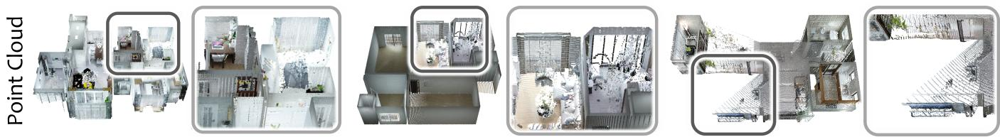

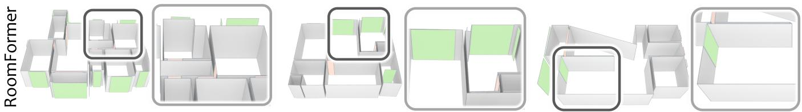

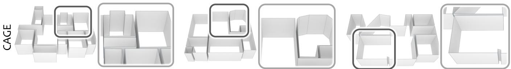

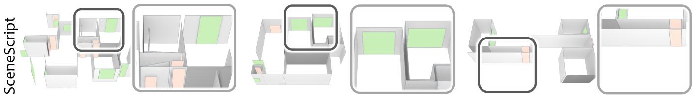

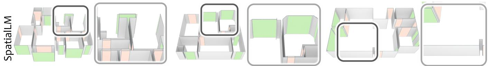

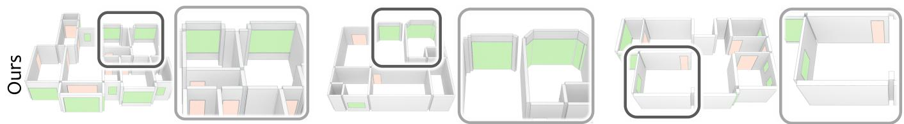

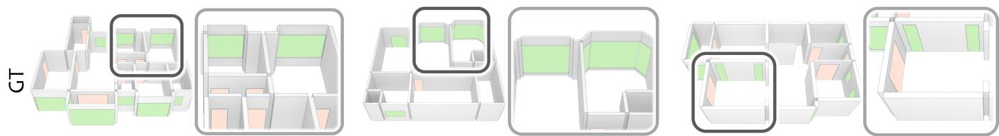

Fig. 7. Qualitative comparison on Structured3D. Each column shows one scene, with rows showing the input point cloud, floor plan baselines, plane baselines, our cuboid reconstruction, and the ground truth. Compared with RoomFormer, CAGE, SceneScript, and SpatialLM, CRAB recovers more coherent wall structures and more accurate door and window geometry in ambiguous, non-Manhatan, and incomplete regions.

SA Conference Papers ’26, December 01–04, 2026, Kuala Lumpur, Malaysia.

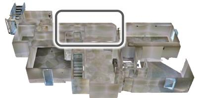

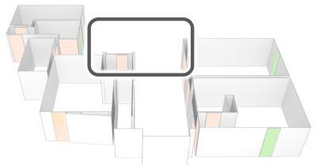

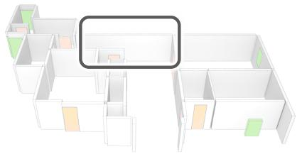

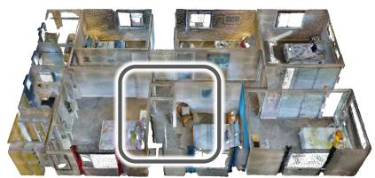

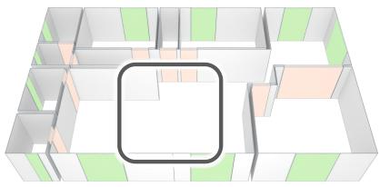

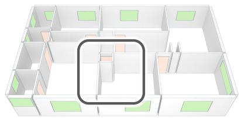

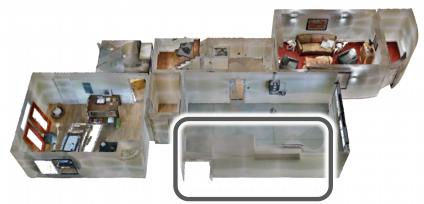

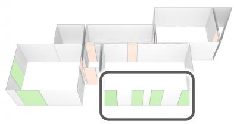

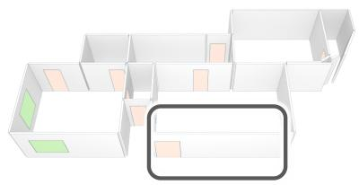

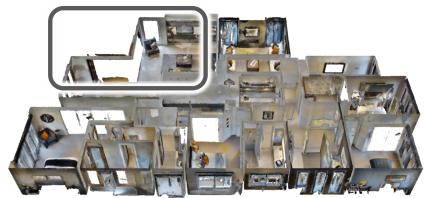

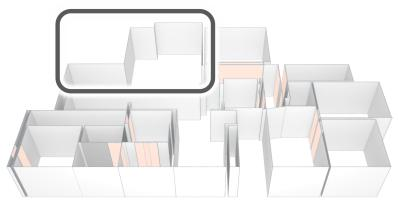

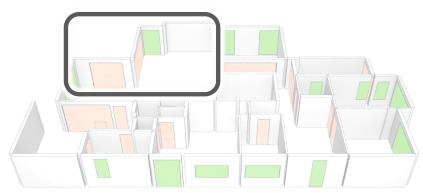

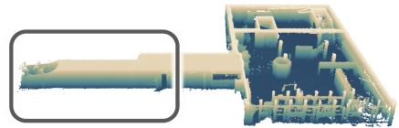

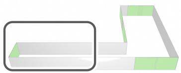

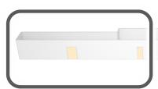

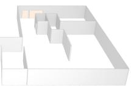

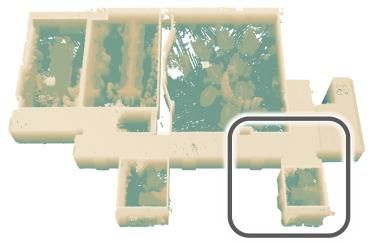  
Point Cloud

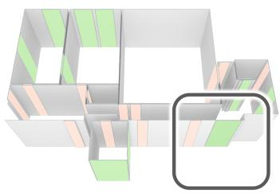  
SpatialLM

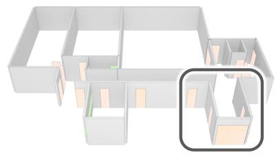  
Ours  
SA Conference Papers ’26, December 01–04, 2026, Kuala Lumpur, Malaysia.

Fig. 8. Qualitative comparison on real-world scanned scenes. Each row shows one scene: input point cloud (left), SpatialLM (middle), and ours (right). CRAB beter preserves wall continuity and opening geometry under practical noise and cluter.