# CausalAlign: Causal Alignment of Video Generation Models for Consistent Ego-Motion

Kai Zhu1,∗, Yintianrun Zhang1,∗, Shuwei Jiang1, Ruolin Zuo1, Yixin Chen2, Duomin Wang3, Miao Liu4, Yin Li5, Daquan Zhou1, Yiwu Zhong1,†

1Peking University, 2Beijing Institute for General Artificial Intelligence, 3NVIDIA, 4Tsinghua   
University, 5University of Wisconsin–Madison   
∗Equal contribution, †Corresponding author

Difusion-based video generation models (VGMs) can produce visually plausible videos, yet their camera ego-motion often drifts over long horizons. Camera ego-motion determines how the viewpoint changes between frames and is essential for maintaining consistent geometry and trajectories. To address this problem, we propose CausalAlign, a causal alignment framework with two components. First, we diagnose how precise ego motion is represented, used, and retained within VGMs using linear probes and causal interventions, revealing a rise-and-fall pattern during denoising. Second, we strengthen ego-motion state in VGM by aligning the representations at the identified layers to a 3D foundation model through delta-token space. This space encodes the changes between consecutive frames, allowing the alignment to focus on ego-motion dynamics rather than static scene content. With Wan2.2 fine-tuned on DL3DV and RealEstate10K, CausalAlign can largely improve motion accuracy, geometric consistency, and temporal smoothness, while preserving visual quality. For example, it improves geometric consistency by more than 20% relative to the base model. Moreover, with the fine-tuned VGM, CausalAlign improves the success rate of world action models (WAMs) by 10 points on mobile manipulation tasks of RoboCasa365 benchmark. Overall, CausalAlign improves ego-motion consistency in difusion-based VGMs and yields noticeable gains in embodied models.

Code: github.com/PKU-VaLuE-Lab/CausalAlign Project Page: pku-value-lab.github.io/CausalAlign-homepage/

## 1 Introduction

Recent advances in difusion-based video generation models (VGMs) have led to remarkable models such as Wan2.2 (Team Wan et al., 2025) and Cosmos3 (NVIDIA Cosmos Team, 2026). Trained on Internet-scale collections of 2D videos, these models can synthesize visually compelling content (Huang et al., 2024, 2026). However, trained to model 2D appearance and local motion statistics, standard VGMs struggle to capture 3D camera trajectories and to control viewpoint changes consistently across frames (Wu et al., 2026; Kupyn et al., 2025). We refer to these cross-frame viewpoint changes as camera ego-motion.

As shown in Figure 1 (left panel), prior work has attempted to address this challenge by introducing explicit 3D priors or preference alignment (Wang et al., 2024b; Ren et al., 2025; Zhang et al., 2025; Bahmani et al., 2025), yet generating videos with geometrically consistent camera trajectories remains an open problem. At the same time, recent work shows that VGMs can implicitly estimate camera poses from their internal representations, even when their generated trajectories are imperfect (Bahmani et al., 2025). This raises a more fundamental question: how is precise ego-motion represented, used, and retained within VGMs? This question becomes increasingly important when VGMs are integrated into world action models (WAMs) for robotic mobile manipulation: visually plausible yet geometrically inconsistent predictions of the future can induce systematic errors in downstream action prediction.

As the first step, we perform analysis for understanding the ego-motion information within VGMs. Inspired by prior works (Alain and Bengio, 2016; Meng et al., 2022), we adopt linear probing to measure the internal representations of VGMs and causal intervention to reveal the mechanisms of VGMs. Specifically, for linear probing, we define “decodability” as the amount of ego-motion information. Meanwhile, for causal interven tion, we define “causal efect” as the extent to which the interventions on VGM can change the generation. Our analysis results demonstrate that both measurements exhibit the same trend, that is, increasing first and then declining, across both denoising timesteps and denoising Transformer layers. These results suggest that ego-motion state emerges as the denoising progresses, however, fades away at the late timesteps and the last few Transformer layers at each step. Therefore, ego-motion is already learned and represented in VGMs, increasingly used at intermediate stages, yet not well retained at later stages. We refer to this progressive pattern as “geometric state forgetting”.

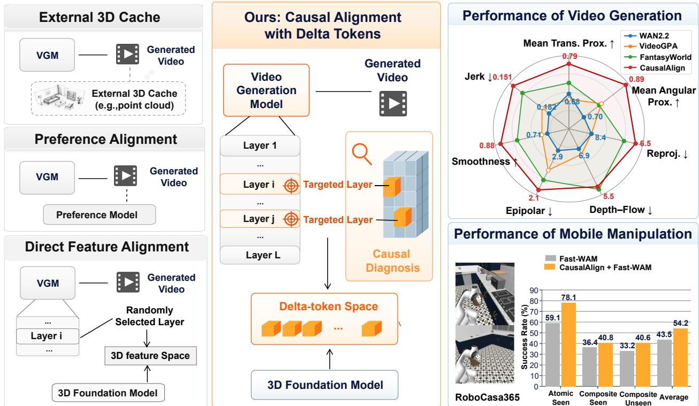  
Figure 1: Overview of CausalAlign. Left: Existing approaches rely on external 3D caches that may propagate errors, optimize output-level preferences without directly supervising ego-motion states, or align 3D features at randomly selected layers. Middle: Our CausalAlign first identifies the targeted layers through causal diagnosis and then strengthens ego-motion states through delta-token alignment. Right: CausalAlign consistently improves camera ego-motion consistency in video generation and largely boosts downstream mobile manipulation performance.

Motivated by this diagnosis, our goal is to preserve and strengthen the ego-motion state within VGMs without compromising the quality of visual generation. To this end, we propose CausalAlign, a framework with two components: causal diagnosis and delta-token alignment, as shown in Figure 1 (middle panel). First, causal diagnosis leverages linear probing and causal intervention to identify where ego-motion is represented, used, and forgotten within a VGM. Second, delta-token alignment supervises the internal ego-motion state at the positions identified as forgetting. There are two key challenges in our alignment: how to represent ego-motion with the hidden states in VGMs, and how to provide meaningful geometry supervision for such representations. For the first challenge, we adopt the idea of delta tokens, which was initially designed for improving the eficiency of the world model (Kerssies et al., 2026). We adapt this idea to measure the ego-motion via the diference between two consecutive frames. Delta tokens serve as a natural carrier for motion information while reducing redundant static scene content. For the second challenge, we construct the delta-token space by leveraging the pretrained 3D foundation model. These 3D models are capable of estimating camera poses, depth, and 3D structure, and thus can provide high-quality geometric supervision. A learnable projector then maps consecutive hidden-state transitions into this teacher delta-token space, explicitly supervising ego-motion state of the VGM. By aligning these projected tokens with the corresponding teacher delta tokens at the identified layers, CausalAlign transfers geometric knowledge to the locations where ego-motion information starts to fade.

With our CausalAlign method, we fine-tune the VGM on the widely-adopted datasets, DL3DV (Ling et al., 2024) and RealEstate10K (Zhou et al., 2018). To evaluate the efects of CausalAlign on VGMs, we establish a comprehensive evaluation protocol with three aspects: visual quality, ego-motion consistency, and geometric state retention. Visual quality is measured with VBench-I2V (Huang et al., 2026) and complementary metrics. Ego-motion consistency is evaluated through motion magnitude, geometric consistency, and temporal dynamics, while geometric-state retention is assessed through probe decodability and causal intervention efects. CausalAlign preserves visual quality while improving camera ego-motion consistency, as shown in Figure 1 (right panel). For example, it reduces reprojection error by 22.6% and improves trajectory smoothness by 23.9% relative to the base model. It also alters the decodability and causal-efect patterns from rise-and-fall to rise-and-maintain, supporting the improved retention of ego-motion state. Moreover, we observe that the improved ego-motion state can facilitate downstream applications, such as WAMs for embodied tasks. Specifically, our fine-tuned VGM raises success rate on RoboCasa365 (Nasiriany et al., 2026) from 43.5% to 54.2%. These results validate our method with causal diagnosis and delta-token alignment.

Our contributions are summarized as follows: (1) We identify a pattern called “geometric state forgetting” which reveals the ego-motion state in difusion-based VGMs. Through linear probing and causal intervention, our analysis reveals that ego-motion information is progressively represented and used during the denoising process, yet not retained at the late stages of denoising. (2) We propose CausalAlign, a causal alignment method that aims to preserve ego-motion state at the VGM layers identified by our causal analysis. Our technical innovation lies in adapting the idea of delta tokens to strengthen ego-motion consistency via 3D foundation models. (3) Extensive experiments and comprehensive metrics validate the benefits of our method. It largely improves ego-motion consistency, better preserves ego-motion state during denoising, and ofer remarkable gains for WAM in robotic tasks.

## 2 Related Work

Video difusion and world action models. Video difusion extends image denoising to joint spatiotemporal generation (Ho et al., 2022), while open backbones such as Wan have broadened its use (Team Wan et al., 2025). Unlike image generation, VGMs require preserving temporal correspondences and scene geometry across multiple frames (Huang et al., 2024, 2026; Ren et al., 2025; Zhang et al., 2025). These priors increasingly serve as action-conditioned simulators or policies: Genie and IRASim learn controllable future dynamics, while VideoVLA, DreamZero, and LingBot-VA couple observations with executable actions; Fast-WAM shows that video co-training can improve action representations without test-time video decoding (Bruce et al., 2024; Zhu et al., 2025; Shen et al., 2025; Ye et al., 2026; Li et al., 2026a; Yuan et al., 2026). Therefore, ego-motion consistency is internally related to WAM and erroneous camera motion can corrupt the predicted actions. Rather than proposing another WAM, CausalAlign restores and strengthens the ego-motion state of the VGM to facilitate WAM performance. Our method elicits the knowledge that has been learned during VGM pretraining, providing an alternative route for stronger WAMs.

Feed-forward 3D foundation models. Feed-forward 3D reconstruction has progressed from point-map predictors such as DUSt3R and VGGT (Wang et al., 2024a, 2025a) to streaming models with temporal state. CUT3R recurrently maintains a metric-scale scene representation (Wang et al., 2025b), while LingBot-Map organizes streaming context into anchor, pose-reference, and trajectory memories and demonstrates improved trajectory and pose accuracy over VGGT (Chen et al., 2026a). These models provide camera and scene representations that can serve as supervision for video generation. We thus adopt LingBot-Map as the teacher model and study how its ego-motion state can be transferred to a video generator.

Geometry-aware alignment and post-training. As summarized in Figure 1, existing geometry-aware adaptation methods can be categorized into three types. External 3D cache methods such as GEN3C and Voyager use point cloud or world memories for controllable camera motion, yet require additional geometric memory and may propagate cache errors (Ren et al., 2025; Huang et al., 2025b). Preference alignment methods such as VideoGPA and Epipolar-DPO supervise generated videos through preference or epipolar feedback, without directly improving the VGM’s internal geometric state (Du et al., 2026; Kupyn et al., 2025). Direct alignment methods, including JOG3R, Geometry Forcing, and FantasyWorld, transfer geometric features into the generator but do not explicitly target at efective timestep and layer locations (Huang et al., 2025a; Wu et al., 2026; Dai et al., 2026). Complementary WAM methods leverage 3D, 4D, or action-grounded supervision to improve action representations without requiring auxiliary teachers at deployment (Li et al., 2026b; Zhang et al., 2026; Yang et al., 2026; Fu et al., 2026; Qiu et al., 2026). CausalAlign instead improves the internal ego-motion state of VGMs through delta-token space from 3D foundation models, at the locations identified by causal diagnosis.

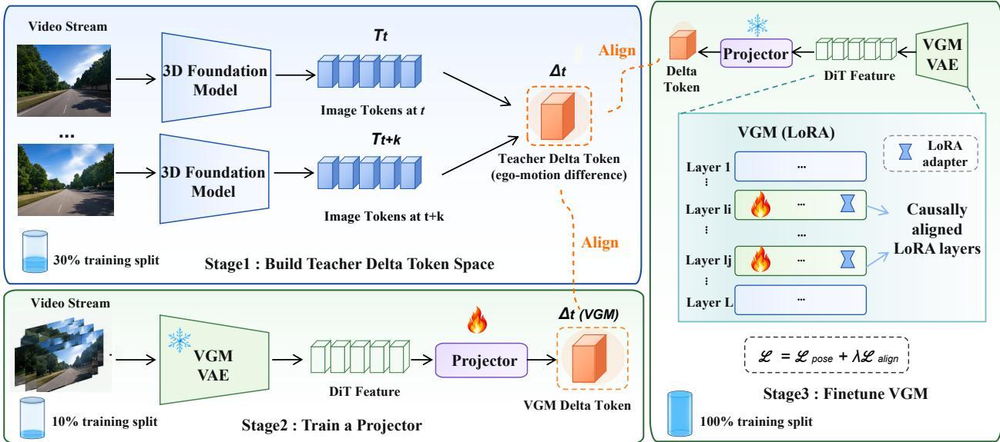  
Figure 2: Three stages of CausalAlign training. CausalAlign transfers ego-motion knowledge from a 3D teacher to the VGM through three-stage training. In Stage 1, consecutive features from a streaming 3D foundation model are encoded into a teacher delta-token space that captures inter-frame geometric transitions. In Stage 2, a projector maps VGM DiT features into the same delta-token space and is frozen after training, using a small subset of the training split. In Stage 3, with full training split, LoRA adapters are optimized only at the identified VGM layers using delta tokens, while the projector remains frozen.

## 3 Method

## 3.1 Method Overview

CausalAlign combines causal diagnosis and delta-token alignment to preserve ego-motion representations in difusion-based VGMs. We first conduct causal diagnosis to identify the layers and the denoising timesteps where ego-motion information fades. Guided by the causal diagnosis, we align the VGM using delta tokens in three stages. First, we learn delta tokens from a frozen 3D foundation model. Second, we train projectors to map the temporal transitions of VGM features into this space. Finally, we use these tokens to supervise LoRA updates at the identified layers and denoising timesteps, while keeping the original VGM backbone, teacher, and projectors frozen. In this way, CausalAlign strengthens the geometric knowledge encoded in the VGM without introducing additional computation during video generation.

## 3.2 Causal Diagnosis of Ego-Motion States

Decodability. Let $\mathbf { h } _ { t } ^ { \ell , s }$ denote the spatially aggregated VGM state at frame t, layer ℓ, and noise-level index s. A shared operator Γ constructs the consecutive-frame transition feature

$$
\mathbf { u } _ { t , \ell , s } = \Gamma \Big ( \mathbf { h } _ { t } ^ { \ell , s } , \mathbf { h } _ { t + 1 } ^ { \ell , s } \Big ) .
$$

A linear probe predicts the relative camera motion

$$
\begin{array} { r } { \widehat { \xi } _ { t , \ell , s } = \mathbf { W } _ { \ell , s } \mathbf { u } _ { t , \ell , s } + \mathbf { b } _ { \ell , s } , \qquad \xi _ { t } = \mathrm { L o g } \big ( \mathbf { T } _ { t } ^ { - 1 } \mathbf { T } _ { t + 1 } \big ) , } \end{array}\tag{1}
$$

where $\mathbf { T } _ { t } ~ \in ~ \mathrm { S E } ( 3 )$ is the ground-truth camera-to-world pose and Log maps the relative pose to a sixdimensional motion vector. The held-out score $D _ { \ell , s }$ measures how well ego-motion is decodable at location $( \ell , s ) ;$ ; decodability alone does not establish causal use (Meng et al., 2022; Geiger et al., 2021).

Causal intervention and target selection. ${ \mathrm { A t ~ } } c = ( \ell , s )$ , we keep the prompt, initial noise, and random seed fixed and intervene on the temporal hidden state using

$$
\begin{array} { r } { \mathcal { A } = \{ \mathrm { M A S K } , \mathrm { S H U F F L E } , \mathrm { R E P L A C E } , \mathrm { I N J E C T } \} . } \end{array}
$$

These interventions remove temporal information, disrupt its order, replace it with another trajectory, or insert a pose-matched donor, respectively.

For diagnostic clip $d ,$ let $\mathbf { T } _ { 1 : T } ^ { \mathrm { r e f } , d }$ be its ground-truth camera-to-world trajectory from the corresponding real video. A frozen pose estimator produces ${ \widehat { \mathbf { T } } } ( Y )$ from a generated video $Y ,$ and we define

$$
E _ { \mathrm { t r a j } } ( Y ; d ) = \mathcal { E } _ { \mathrm { t r a j } } \Big ( \widehat { \mathbf { T } } ( Y ) , \mathbf { T } _ { 1 : T } ^ { \mathrm { r e f } , d } \Big ) .\tag{2}
$$

The reference trajectory is used only for evaluation and is not provided as a generation condition. For intervention $a \in { \mathcal { A } }$ , the norm-matched random-control-adjusted efect is

$$
\begin{array} { r } { \overline { { \mathscr { C } } } _ { c } ^ { ( a ) } = \eta _ { a } \mathbb { E } _ { d } \left[ E _ { \mathrm { t r a j } } \left( Y _ { c } ^ { ( a ) } ; d \right) - E _ { \mathrm { t r a j } } \left( Y _ { c } ^ { ( \mathrm { r a n d } , a ) } ; d \right) \right] , } \end{array}\tag{3}
$$

where $\eta _ { a } ~ = ~ + 1$ for the disruptive interventions and $\eta _ { a } ~ = ~ - 1$ for Inject, so that larger values indicate stronger causal efects. The aggregate causal score is

$$
C _ { \ell , s } = \frac { 1 } { | \mathcal { A } | } \sum _ { a \in \mathcal { A } } \overline { { \mathcal { C } } } _ { ( \ell , s ) } ^ { ( a ) } .\tag{4}
$$

Averaging $D _ { \ell , \ell }$ s and $C _ { \ell , i }$ s over the complementary axis gives layer profiles $( A = \operatorname { L } )$ and timestep profiles $( A = \mathrm { S } )$ . We combine them as

$$
J ^ { A } = \frac { 1 } { 2 } \left[ \mathcal { N } ( D ^ { A } ) + \mathcal { N } ( C ^ { A } ) \right] , \qquad A \in \{ \mathrm { L } , \mathrm { S } \} ,\tag{5}
$$

where $\mathcal { N }$ independently min–max normalizes each profile. The target sets $\mathcal { L } _ { \mathrm { t a r } }$ and $S _ { \mathrm { t a r } }$ are selected at locations with the largest positive decline rates of $J ^ { A }$ . The corresponding normalized timestep declines provide the weights $\omega _ { \ell , s }$ used by the alignment losses and shared across selected layers.

## 3.3 Delta-Token Alignment

Stage 1: learning teacher delta tokens. For a T-frame training video $\mathbf { x } _ { \mathrm { 1 : T } } .$ , the frozen 3D foundation model $\Phi _ { \mathrm { T } }$ extracts geometric states $\mathbf { z } _ { t } ^ { \mathrm { T } } = \Phi _ { \mathrm { T } } ( \mathbf { x } _ { 1 : t } )$ . A trainable encoder $E _ { \Delta }$ maps states to a delta token:

$$
\begin{array} { r } { \pmb { \delta } _ { t } ^ { \mathrm { T } } = E _ { \Delta } ( \mathbf { z } _ { t } ^ { \mathrm { T } } , \mathbf { z } _ { t + 1 } ^ { \mathrm { T } } ) \in \mathbb { R } ^ { d _ { \Delta } } , } \end{array}\tag{6}
$$

where $d _ { \Delta }$ is the token dimension; superscripts T and V denote teacher and VGM representations. A transition decoder reconstructs the next state from the current state and token, a temporal predictor forecasts the next token, and a camera decoder $D _ { \mathrm { { c a m } } }$ predicts relative pose. These auxiliary tasks encourage the token to retain transition information rather than merely compressing the teacher state. Denoting their predictions by $\widehat { \mathbf { z } } _ { t + 1 } ^ { \mathrm { T } }$ $\widehat { \delta } _ { t + 1 } ^ { \mathrm { T } }$ , and $\widehat { \Delta \mathbf { T } } _ { t } ^ { \mathrm { T } }$ , we train the encoder and auxiliary modules with

$$
\begin{array} { r l } & { \mathcal { L } _ { \mathrm { T } } = \mathbb { E } _ { t } \Big [ \| \widehat { \mathbf { z } } _ { t + 1 } ^ { \mathrm { T } } - { \mathbf { z } } _ { t + 1 } ^ { \mathrm { T } } \| _ { 2 } ^ { 2 } + \lambda _ { \mathrm { t e m p } } \| \widehat { \pmb { \delta } } _ { t + 1 } ^ { \mathrm { T } } - { \pmb { \delta } } _ { t + 1 } ^ { \mathrm { T } } \| _ { 2 } ^ { 2 } \Big ] } \\ & { \quad \quad \quad \quad + \lambda _ { \mathrm { p o s e } } ^ { \mathrm { T } } \mathbb { E } _ { t } \Big [ \ell _ { \mathrm { p o s e } } ( \widehat { \Delta { \mathbf { T } } } _ { t } ^ { \mathrm { T } } , \Delta { \mathbf { T } } _ { t } ) \Big ] . } \end{array}\tag{7}
$$

Here, $\Delta \mathbf { T } _ { t } = \mathbf { T } _ { t } ^ { - 1 } \mathbf { T } _ { t + 1 }$ is the ground-truth relative pose used only for supervision, and $\ell _ { \mathrm { p o s e } }$ combines geodesic rotation distance with normalized SmoothL1 translation error. The expectation averages valid training-frame positions; $\lambda _ { \mathrm { t e m p } }$ and $\lambda _ { \mathrm { p o s e } } ^ { \mathrm { T } }$ weight temporal and pose supervision. These objectives preserve transition structure and anchor tokens to camera motion. We then freeze the encoder and auxiliary modules; decoder architectures and pose-loss details are provided in the appendix.

Stage 2: learning VGM-side projectors. With the VGM and teacher modules frozen, layer-specific projectors $Q _ { \ell }$ map corresponding VGM features to teacher space tokens $\delta _ { t , \ell , s } ^ { \mathrm { V } } = Q _ { \ell } \big ( \mathbf { u } _ { t , \ell , s } \big )$ . We minimize

$$
\mathcal { L } _ { \mathrm { m a p } } = \sum _ { \ell \in \mathcal { L } _ { \mathrm { t a r } } } \sum _ { s \in \mathcal { S } _ { \mathrm { t a r } } } \omega _ { \ell , s } \mathbb { E } _ { t } \left[ \Vert \delta _ { t , \ell , s } ^ { \mathrm { V } } - \delta _ { t } ^ { \mathrm { T } } \Vert _ { 2 } ^ { 2 } \right] ,\tag{8}
$$

where $\omega _ { \ell , s }$ weights selected timesteps by their normalized positive diagnostic-score decline rates, shared across selected layers. The projectors are frozen after training.

Stage 3: adapting the VGM. We update LoRA adapters (Hu et al., 2022) at selected layers. For an adapted transition $\widetilde { \mathbf { u } } _ { t , \ell , s } ,$ , frozen projector produces $\widetilde { \delta } _ { t , \ell , s } ^ { \mathrm { V } } = Q _ { \ell } ( \widetilde { \mathbf { u } } _ { t , \ell , s } )$ . We use two complementary objectives:

$$
\mathcal { L } _ { \Delta } = \sum _ { \ell \in \mathcal { L } _ { \mathrm { t a r } } } \sum _ { s \in S _ { \mathrm { t a r } } } \omega _ { \ell , s } \mathbb { E } _ { t } \left[ \left. \widetilde { \pmb { \delta } } _ { t , \ell , s } ^ { \mathrm { V } } - \delta _ { t } ^ { \mathrm { T } } \right. _ { 2 } ^ { 2 } \right] ,\tag{9}
$$

which aligns the adapted VGM transitions with the teacher delta tokens, and

$$
\mathcal { L } _ { \mathrm { p o s e } } = \sum _ { \ell \in \mathcal { L } _ { \mathrm { t a r } } } \sum _ { s \in S _ { \mathrm { t a r } } } \omega _ { \ell , s } \mathbb { E } _ { t } \Big [ \ell _ { \mathrm { p o s e } } \Big ( D _ { \mathrm { c a m } } \Big ( \widetilde { \delta } _ { t , \ell , s } ^ { \mathrm { V } } \Big ) , \Delta \mathbf { T } _ { t } \Big ) \Big ] ,\tag{10}
$$

which explicitly supervises the predicted relative camera motion. The final adaptation objective is

$$
{ \mathcal { L } } _ { \mathrm { C a u s a l A l i g n } } = { \mathcal { L } } _ { \mathrm { p o s e } } + \lambda _ { \Delta } { \mathcal { L } } _ { \Delta } ,\tag{11}
$$

where $\lambda _ { \Delta }$ controls the strength of token alignment. Gradients pass through the frozen projectors and camera decoder to the LoRA adapters, while all other parameters remain frozen. The teacher is used only to provide training targets, and no external geometric cache is required during generation.

## 3.4 Inference

At inference, CausalAlign follows the same video generation procedure as the original Wan2.2 (Team Wan et al., 2025). Given an initial frame and a text prompt, the adapted VGM generates a video through the standard denoising and decoding process. All auxiliary modules used during training, including the 3D foundation model, are no longer needed. Therefore, CausalAlign improves ego-motion consistency without requiring additional inputs or geometric computation during video generation.

## 3.5 Application to World Action Models

Consistent ego-motion is important for mobile manipulation, where robots predict actions while their viewpoints change. We thus investigate whether improving the ego-motion state of VGMs can also benefit action prediction of world action models. Specifically, we initialize the video expert of Fast-WAM (Yuan et al., 2026) with our adapted Wan2.2 model. For the action expert, we follow Fast-WAM and transform the parameters of the original Wan model to initialize ActionDiT. We train both experts using the original objectives for flow matching:

$$
{ \mathcal { L } } _ { \mathrm { W A M } } = { \mathcal { L } } _ { \mathrm { F M } } ^ { v } + { \mathcal { L } } _ { \mathrm { F M } } ^ { a } ,\tag{12}
$$

where v and a denote the video and action experts, respectively. The policy receives synchronized images from three camera views and predicts actions starting from the current observation. Future video is used as a training target, while at inference, the policy predicts executable actions from the observed history without generating future video (Yuan et al., 2026).

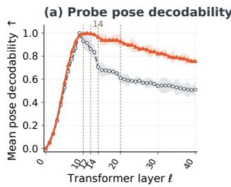

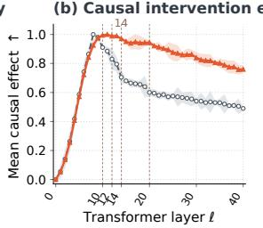

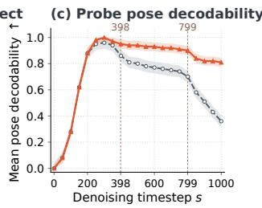

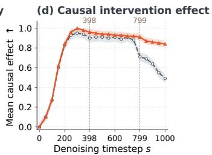  
Figure 3: Ego-motion diagnosis and retention. We compare base model Wan2.2 and our method CausalAlign through probe decodability and causal intervention efects across layers (sub-figure $\mathrm { { ( a ) ~ \& ~ ( b ) } }$ results are averaged over timesteps) and across denoising timesteps (sub-figure (c) & (d): results are averaged over layers). Dashed vertical lines represent the selected alignment locations and shading shows the 10th–90th percentiles over the averaged dimension. Our method CausalAlign can raise both signals from rise-and-fall to rise-and-maintain pattern, indicating improved ego-motion retention.

## 4 Experiment

We first conduct causal diagnosis to identify where ego-motion information fades and examine whether CausalAlign improves its retention. We then fine-tune the VGM with delta-token supervision at these locations and evaluate its ego-motion consistency, visual quality, and the benefits for embodied tasks. Finally, we conduct ablation studies to validate our design choices.

## 4.1 Causal Diagnosis and Target Selection

Setup. We freeze Wan2.2 (Team Wan et al., 2025) and diagnose the hidden states across Transformer layers and across denoising steps. At each location $c = ( \ell , s )$ , a linear readout predicts relative camera motion, yielding a decodability score $\mathcal { D } _ { \ell , s }$ . We also apply the causal interventions introduced in Section 3.2 and measure their efects on the generated camera trajectory, yielding a causal efect score $\mathcal { C } _ { \ell , s }$ . Figure 3 summarizes the resulting layer–timestep profiles.

Diagnosis and target selection. Both geometric decodability and causal efect in the original Wan2.2 exhibit a consistent rise-and-fall pattern. Their increase at intermediate locations indicates that the VGM forms and uses an ego-motion state, while their subsequent decline suggests that this state is not retained during later denoising. By applying the target selection rule from Section 3.2, we select layers 14, 10, 12, and 20 in descending order of their layer-wise decline rates. Layer 14 is the primary target, while layers 10, 12, and 20 are auxiliary targets. The same rule applies to denoising timesteps $s \in \{ 3 9 8 , 7 9 9 \}$ . Both selected timesteps are used at all selected layers, with weights proportional to their positive temporal decline rates.

The benefits of our method. After alignment, CausalAlign retains both probe decodability and causal efects at later denoising stages, changing the original rise-and-fall pattern into a rise-and-maintain pattern, as shown by the orange curve in Figure 3. The sustained causal efects indicate that ego-motion information remains influential during generation, rather than merely becoming more decodable.

## 4.2 Experiments on the Comprehensive Evaluation

Setup. We apply CausalAlign to Wan2.2-14B-I2V (Team Wan et al., 2025) and train it on datasets DL3DV (Ling et al., 2024) and RealEstate10K (Zhou et al., 2018). We choose these datasets since they provide camera pose annotations and cover diverse scenes and camera movements, making them suitable for supervising and evaluating ego-motion consistency. For each dataset, 90% of the data is used for training and 10% of the data is for evaluation. As in Figure 2, we first learn delta tokens from the geometric features of a frozen 3D foundation model using 30% of the training data. We then train projectors to map features from the video generator into this delta-token space using 10% of the training data. Finally, we fine-tune the generator with LoRA at the identified layers and denoising steps using the full training split. The 3D teacher and the projectors are needed only during training. For evaluation, we use the same video length, resolution, frame rate, sampling settings, and random seeds across methods, and average results over multiple samples for each input. Further details are provided in Appendix B.2.

Table 1: Camera ego-motion consistency. We evaluate videos generated from the DL3DV and RealEstate10K evaluation splits with the same estimators and generation settings. Methods without camera control receive the first frame and text prompt; methods that require control also receive camera trajectories and 3D caches. Bold indicates the best result for each metric. CausalAlign improves all seven metrics over Wan2.2 and leads on six of seven metrics.
<table><tr><td rowspan="2">Method</td><td colspan="2">Motion Magnitude</td><td colspan="3">Geometric Consistency</td><td colspan="2">Temporal Dynamics</td></tr><tr><td>↑</td><td>Mean Trans. Prox. Mean Angular Prox. Reproj. Depth-Flow Epipolar Smoothness ↑</td><td>(px)↓</td><td>(px)↓</td><td>(px)↓</td><td>↑</td><td>Jerk ↓</td></tr><tr><td>(a) Base Model</td><td></td><td></td><td></td><td></td><td></td><td></td><td></td></tr><tr><td>Wan2.2</td><td>0.68</td><td>0.70</td><td>8.4</td><td>6.9</td><td>2.9</td><td>0.71</td><td>0.182</td></tr><tr><td colspan="8">(b) External 3D Cache</td></tr><tr><td>GEN3C</td><td>0.63</td><td>0.75</td><td>7.8</td><td>6.5</td><td>2.8</td><td>0.71</td><td>0.175</td></tr><tr><td>Voyager</td><td>0.69</td><td>0.73</td><td>7.1</td><td>6.8</td><td>2.8</td><td>0.73</td><td>0.179</td></tr><tr><td colspan="8">(c) Preference Alignment</td></tr><tr><td>VideoGPA</td><td>0.66</td><td>0.78</td><td>8.4</td><td>6.7</td><td>2.5</td><td>0.73</td><td>0.176</td></tr><tr><td>Epipolar-DPO</td><td>0.68</td><td>0.72</td><td>7.8</td><td>5.9</td><td>2.2</td><td>0.78</td><td>0.162</td></tr><tr><td colspan="8">(d) Direct Feature Alignment</td></tr><tr><td>JOG3R</td><td>0.70</td><td>0.75</td><td>7.2</td><td>5.9</td><td>2.5</td><td>0.79</td><td>0.158</td></tr><tr><td>Geometry Forcing</td><td>0.69</td><td>0.78</td><td>6.9</td><td>5.7</td><td>2.4</td><td>0.80</td><td>0.164</td></tr><tr><td>FantasyWorld</td><td>0.72</td><td>0.77</td><td>7.0</td><td>5.4</td><td>2.3</td><td>0.82</td><td>0.159</td></tr><tr><td colspan="8">(e) Causal Delta-Token Alignment</td></tr><tr><td>CausalAlign (Ours)</td><td>0.79</td><td>0.89</td><td>6.5</td><td>5.5</td><td>2.1</td><td>0.88</td><td>0.151</td></tr></table>

Baselines. We compare CausalAlign with the base model Wan2.2 and three groups of methods for improving geometric consistency. External 3D cache methods, including GEN3C (Ren et al., 2025) and Voyager (Huang et al., 2025b), control camera motion using explicit trajectories and 3D caches. We follow their standard inference procedures by providing the reference camera trajectory and constructing a new 3D cache from the available input frames, without using future frames. Preference alignment methods, including VideoGPA (Du et al., 2026) and Epipolar-DPO (Kupyn et al., 2025), improve generated videos through preference or epipolar feedback. Direct feature alignment methods, including JOG3R (Huang et al., 2025a), Geometry Forcing (Wu et al., 2026), and FantasyWorld (Dai et al., 2026), transfer geometric features into the generator. For Wan2.2, CausalAlign, and methods without explicit camera control, we provide only the first frame and a text prompt.

Metrics. We use the same frozen estimators (Wang et al., 2025a) to recover camera poses, depth, optical flow, and visual features from every generated video. Our evaluation covers three complementary aspects. Motion Magnitude measures how closely the mean translational and angular speeds match the corresponding means from real validation videos (Appendix B.1). Geometric Consistency measures reprojection error (Triggs et al., 2000), consistency between depth and optical flow in static regions (Luo et al., 2020), and epipolar error (Lee and Civera, 2020). Temporal Dynamics measures trajectory smoothness and jerk (Hogan and Sternad, 2009; Flash and Hogan, 1985), capturing continuity of motion and abrupt changes in acceleration. Since the first frame and a text prompt can admit several valid future camera trajectories, we measure intrinsic consistency rather than error against a single reference trajectory (Appendix B.2).

Comparison with Baseline Methods. As shown in Table 1, CausalAlign improves all seven metrics over Wan2.2 and achieves the best results on six of seven metrics among the compared methods. For example, it reduces reprojection error from 8.4 to 6.5 pixels (22.6%), raises trajectory smoothness from 0.71 to 0.88 (23.9%), and lowers jerk from 0.182 to 0.151. Further, its proximity to real camera speeds improves for both translation (0.68 to 0.79) and rotation (0.70 to 0.89), while epipolar error decreases from 2.9 to 2.1 pixels. FantasyWorld achieves a slightly lower error for consistency between depth and flow (5.4 versus 5.5 pixels), but CausalAlign leads on the other six metrics without requiring a camera trajectory. These results suggest

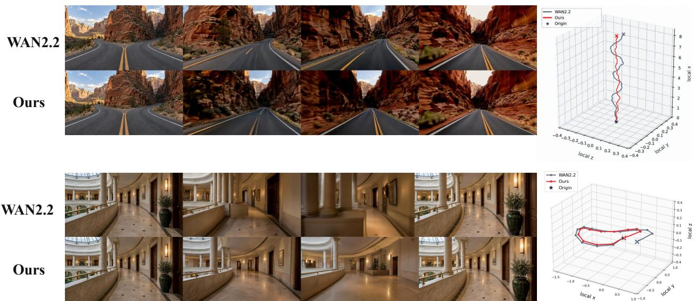  
Figure 4: Qualitative comparison of ego-motion. We compare frames and reconstructed camera tra jectories from Wan2.2 and CausalAlign in two scenes. CausalAlign shows less trajectory jitter in the top example and less drift when the camera completes a loop in the bottom example.

Table 2: Visual quality preservation. We evaluate Wan2.2 and CausalAlign using VBench-I2V (quality, I2V score, and smoothness) together with FVD, CLIP, SSIM, and LPIPS. Bold indicates the best result for each metric, including ties. CausalAlign preserves visual quality comparable to Wan2.2.
<table><tr><td rowspan="2"></td><td colspan="3">VBench-I2V</td><td rowspan="2"></td><td colspan="4">Other Visual Metrics</td></tr><tr><td></td><td></td><td>Quality↑ I2V Score↑ Smooth.↑</td><td></td><td></td><td>FVD↓ CLIP↑ SSIM↑ LPIPS↓</td><td></td></tr><tr><td>Wan2.2</td><td>0.805</td><td>0.958</td><td>0.983</td><td>Wan2.2</td><td>182.4</td><td>0.311</td><td>0.742</td><td>0.183</td></tr><tr><td>CausalAlign</td><td>0.806</td><td>0.958</td><td>0.985</td><td>CausalAlign</td><td>182.7 </td><td>0.314</td><td>0.744</td><td>0.183</td></tr></table>

that causal alignment through delta tokens strengthens the generator’s ability to produce consistent camera motion and scene geometry. The examples in Figure 4 further show less trajectory jitter and drift when the camera completes a loop, compared with Wan2.2.

Visual Quality Preservation. Further, we examine whether stronger geometric supervision harms visual quality. Specifically, we evaluate CausalAlign and Wan2.2 on the same evaluation clips with identical prompts, sampling settings, and random seeds. We report VBench-I2V quality, I2V score, and smoothness (Huang et al., 2024, 2026), together with FVD, CLIP, SSIM, and LPIPS (Unterthiner et al., 2018; Radford et al., 2021; Wang et al., 2004; Zhang et al., 2018). As shown in Table 2, CausalAlign preserves visual quality comparable to Wan2.2: VBench quality increases slightly from 0.805 to 0.806, I2V score remains 0.958, and VBench smoothness rises from 0.983 to 0.985. Further, CLIP and SSIM improve slightly, LPIPS remains unchanged, and FVD changes only marginally (182.4 to 182.7). These results indicate that our method can improve ego-motion consistency without sacrificing visual fidelity.

Application to World Action Models. Given that CausalAlign improves the retention of ego-motion information in VGMs, we wonder whether this benefit can transfer to the embodied models which are built on top of VGMs. We initialize the video expert of Fast-WAM with our fine-tuned Wan2.2 and evaluate the resulting policy on RoboCasa365 Target100 (Nasiriany et al., 2026). Following Fast-WAM, the policy is pretrained on Human300 and then trained with 500 target demonstrations per task. The Atomic Seen evaluation includes 18 tasks with 50 rollouts each. After 50k steps of fine-tuning, the policy takes images from three cameras and the current proprioceptive state as input. It predicts 32 actions in ten denoising steps and executes eight actions before replanning at 20 Hz. As shown in Table 3, CausalAlign + Fast-WAM

Table 3: Transfer to world action models. We report success rates (%) on the three RoboCasa365 Target100 task groups. Bold marks the best value in each column, including ties. CausalAlign improves Fast-WAM across all three groups, increasing average success from 43.5% to 54.2% and Atomic-Seen success by 19.0 percentage points.
<table><tr><td>Method</td><td>Atomic Seen</td><td>Composite Seen</td><td>Composite Unseen</td><td>Average</td></tr><tr><td>GR00T-N1.5 (NVIDIA GEAR Team, 2025)</td><td>60.6</td><td>35.0</td><td>33.3</td><td>43.7</td></tr><tr><td>Fast-WAM (Yuan et al., 2026)</td><td>59.1</td><td>36.4</td><td>33.2</td><td>43.5</td></tr><tr><td>LingBot-VA (Li et al., 2026a)</td><td>63.5</td><td>37.3</td><td>32.1</td><td>45.1</td></tr><tr><td>ABot-M0.5 (Chen et al., 2026b)</td><td>70.6</td><td>44.3</td><td>45.6</td><td>54.2</td></tr><tr><td>CausalAlign + Fast-WAM</td><td>78.1</td><td>40.8</td><td>40.6</td><td>54.2</td></tr></table>

Table 4: Delta-token ablations. We compare (a) semantic regions with matched-width PCA projections of equally supervised unpartitioned encoders and (b) 128D delta tokens with original 8192D/4096D LingBot-Map features. Best values within each panel are bold. Delta tokens lead all six metrics in both panels.
<table><tr><td></td><td colspan="2">Ego motion</td><td colspan="2">Geometry</td><td colspan="2">Visual</td></tr><tr><td>Representation</td><td>Rotation (°)↓</td><td>Direction  ${ \binom { \circ } { \phantom { + } } } \downarrow$ </td><td>AbsRel↓</td><td> $\delta _ { 1 }$  ←</td><td>SSIM↑</td><td>LPIPS↓</td></tr><tr><td colspan="7">(a) Matched-width partitions</td></tr><tr><td>Unpartitioned pair</td><td>2.453</td><td>8.582</td><td>0.2426</td><td>0.7280</td><td>0.2924</td><td>0.08816</td></tr><tr><td>Unpartitioned diff.</td><td>2.837</td><td>10.392</td><td>0.2301</td><td>0.7390</td><td>0.2971</td><td>0.08754</td></tr><tr><td>Delta regions</td><td>2.244</td><td>7.565</td><td>0.2292</td><td>0.7457</td><td>0.3050</td><td>0.08643</td></tr><tr><td colspan="7">(b) Complete space versus original features</td></tr><tr><td>Original A (8192D)</td><td>3.243</td><td>12.964</td><td>0.2698</td><td>0.6993</td><td>0.2838</td><td>0.08958</td></tr><tr><td>Original B (4096D)</td><td>4.276</td><td>13.451</td><td>0.2731</td><td>0.6947</td><td>0.2866</td><td>0.08958</td></tr><tr><td>Delta (128D)</td><td>2.530</td><td>8.231</td><td>0.2314</td><td>0.7422</td><td>0.3028</td><td>0.08676</td></tr></table>

raises average success from 43.5% to 54.2% (+10.7 percentage points) and success on Atomic Seen tasks from 59.1% to 78.1% (+19.0 points, 703/900 successful rollouts). Further, success on Composite Seen tasks increases from 36.4% to 40.8%, and success on Composite Unseen tasks rises from 33.2% to 40.6%, suggesting that stronger ego-motion representations can benefit mobile manipulation. Additional rollouts are shown in Appendix B.5.

## 4.3 Ablation Studies

Semantic partitioning. We first investigate whether separating delta-token into motion, geometry, and visual information helps the model learn a more efective representation. To this end, we compare our structured delta tokens, consisting of 64D ego-motion, 40D geometry, and 24D visual regions, with two unpartitioned 128D encoders. All encoders receive the same supervision, and we use PCA to project the unpartitioned representations to the corresponding dimensions. As shown in Table 4(a), our structured representation outperforms both alternatives across all six metrics. Further, the cross-probes in Appendix C.1 show that each region performs best on its corresponding task. These results suggest that explicitly separating diferent types of information helps the model learn more efective representations of ego-motion.

Complete-space comparison. We next examine whether learning delta tokens provides advantages over directly using the raw features of a pretrained 3D foundation model. We compare our 128D delta tokens with two representations from LingBot-Map: the concatenated features of consecutive frames (8192D) and their diference (4096D). Both original representations retain their full dimensions. As shown in Table 4(b), our delta tokens outperform both alternatives across all six metrics, despite using substantially fewer dimensions. For example, the rotation error decreases from 3.243 to 2.530 degrees compared with the original feature pair. These results suggest that learning a compact representation of temporal changes is more efective than directly using the original pooled 3D features.

## 5 Conclusion

We introduce CausalAlign, a causal alignment framework for ego-motion consistent video generation. By linear probing and causal interventions, we show that video generation models already learned and used egomotion state during denoising but did not retain it well at the late stages, a pattern we call “geometric state forgetting”. CausalAlign targets at the locations where such forgetting is identified, and aligns ego-motion states with the delta-token space from a 3D foundation model. Extensive experiments demonstrate that CausalAlign consistently improves ego-motion consistency and temporal dynamics while preserving visual quality. It mitigates geometric state forgetting by changing the pattern of ego-motion state from rise-and-fall to rise-and-maintain. Further, our improved VGM largely raises the success rate of WAM on the mobile manipulation tasks of RoboCasa365. We hope this work can inspire the research on preserving geometric states of generative video models and the research on enhancing embodied models.

## References

Alexandre Alahi, Kratarth Goel, Vignesh Ramanathan, Alexandre Robicquet, Li Fei-Fei, and Silvio Savarese. Social lstm: Human trajectory prediction in crowded spaces. In Proceedings of the IEEE conference on computer vision and pattern recognition, pages 961–971, 2016.

Guillaume Alain and Yoshua Bengio. Understanding intermediate layers using linear classifier probes. arXiv preprint arXiv:1610.01644, 2016.

Alibaba PAI. Wan2.2-Fun-A14B-Control-Camera. Hugging Face model card, 2025. https://huggingface. co/alibaba-pai/Wan2.2-Fun-A14B-Control-Camera.

Sherwin Bahmani, Ivan Skorokhodov, Guocheng Qian, Aliaksandr Siarohin, Willi Menapace, Andrea Tagliasacchi, David B. Lindell, and Sergey Tulyakov. AC3D: Analyzing and improving 3d camera control in video difusion transformers. In Proceedings of the IEEE/CVF Conference on Computer Vision and Pattern Recognition, pages 22875–22889, 2025. https: //openaccess.thecvf.com/content/CVPR2025/html/Bahmani\_AC3D\_Analyzing\_and\_Improving\_ 3D\_Camera\_Control\_in\_Video\_Diffusion\_CVPR\_2025\_paper.html.

Jake Bruce, Michael D Dennis, Ashley Edwards, Jack Parker-Holder, Yuge Shi, Edward Hughes, Matthew Lai, Aditi Mavalankar, Richie Steigerwald, Chris Apps, Yusuf Aytar, Sarah Maria Elisabeth Bechtle, Feryal Behbahani, Stephanie C.Y. Chan, Nicolas Heess, Lucy Gonzalez, Simon Osindero, Sherjil Ozair, Scott Reed, Jingwei Zhang, Konrad Zolna, Jef Clune, Nando De Freitas, Satinder Singh, and Tim Rocktäschel. Genie: Generative interactive environments. In Proceedings of the 41st International Conference on Machine Learning, volume 235 of Proceedings of Machine Learning Research, pages 4603–4623. PMLR, 2024. https://proceedings.mlr.press/v235/bruce24a.html.

Lin-Zhuo Chen, Jian Gao, Shangzhan Zhang, Yihang Chen, Ka Leong Cheng, Yipengjing Sun, Liangxiao Hu, Nan Xue, Xing Zhu, Yujun Shen, Yao Yao, and Yinghao Xu. LingBot-Map: Geometric context transformer for streaming 3D reconstruction. arXiv preprint arXiv:2604.14141, 2026a. https://arxiv. org/abs/2604.14141.

Ronghan Chen, Yandan Yang, Zuojin Tang, Dongjie Huo, Tong Lin, Haoning Wu, Haoyun Liu, Yuzhi Chen, Lulu Zheng, Botai Yuan, et al. Abot-m0. 5: Unified mobility-and-manipulation world action model. arXiv preprint arXiv:2607.00678, 2026b.

Yixiang Dai, Fan Jiang, Chiyu Wang, Mu Xu, and Yonggang Qi. Fantasyworld: Geometry-consistent world modeling via unified video and 3d prediction. In International Conference on Learning Representations, volume 2026, pages 103603–103622, 2026.

Hongyang Du, Junjie Ye, Xiaoyan Cong, Runhao Li, Jingcheng Ni, Aman Agarwal, Zeqi Zhou, Zekun Li, Randall Balestriero, and Yue Wang. VideoGPA: Distilling geometry priors for 3d-consistent video generation. In Proceedings of the 43rd International Conference on Machine Learning, 2026. https: //arxiv.org/abs/2601.23286.

B. Efron. Bootstrap methods: Another look at the jackknife. The Annals of Statistics, 7(1):1–26, 1979. doi: 10.1214/aos/1176344552. https://doi.org/10.1214/aos/1176344552.

David Eigen, Christian Puhrsch, and Rob Fergus. Depth map prediction from a single image using a multi-scale deep network. In Advances in Neural Information Processing Systems, volume 27. Curran Associates, Inc., 2014. https://proceedings.neurips.cc/paper\_files/paper/2014/hash/ 91c56ce4a249fae5419b90cba831e303-Abstract.html.

Tamar Flash and Neville Hogan. The coordination of arm movements: an experimentally confirmed mathematical model. The journal of Neuroscience, 5(7):1688–1703, 1985.

Jiacheng Fu, Yibo Yuan, Meng Tian, Yue Li, Jiangtong Zhu, Jianhua Han, Yueyi Zhang, Jianwu Fang, Jianru Xue, Hang Xu, and Zhiwei Xiong. 4D-WAM: 4d consistent world modeling for autonomous driving. arXiv preprint arXiv:2608.10107, 2026. https://arxiv.org/abs/2608.10107.

Andreas Geiger, Philip Lenz, and Raquel Urtasun. Are we ready for autonomous driving? the kitti vision benchmark suite. In 2012 IEEE conference on computer vision and pattern recognition, pages 3354–3361. IEEE, 2012.

Atticus Geiger, Hanson Lu, Thomas Icard, and Christopher Potts. Causal abstractions of neural networks. Advances in neural information processing systems, 34:9574–9586, 2021.

Hao He, Yinghao Xu, Yuwei Guo, Gordon Wetzstein, Bo Dai, Hongsheng Li, and Ceyuan Yang. CameraCtrl: Enabling camera control for video difusion models. In International Conference on Learning Representations, 2025. https://proceedings.iclr.cc/paper\_files/paper/2025/hash/ f98fd73d59d8494489ea970747b91fe4-Abstract-Conference.html.

Jonathan Ho, Tim Salimans, Alexey Gritsenko, William Chan, Mohammad Norouzi, and David J. Fleet. Video difusion models. In Advances in Neural Information Processing Systems, volume 35, 2022. https://proceedings.neurips.cc/paper\_files/paper/2022/hash/ 39235c56aef13fb05a6adc95eb9d8d66-Abstract-Conference.html.

Neville Hogan and Dagmar Sternad. Sensitivity of smoothness measures to movement duration, amplitude, and arrests. Journal of motor behavior, 41(6):529–534, 2009.

Edward J. Hu, Yelong Shen, Phillip Wallis, Zeyuan Allen-Zhu, Yuanzhi Li, Shean Wang, Lu Wang, and Weizhu Chen. Lora: Low-rank adaptation of large language models. In International Conference on Learning Representations, 2022.

Chun-Hao Paul Huang, Niloy Mitra, Hyeonho Jeong, Jae Shin Yoon, and Duygu Ceylan. Jog3r: Towards 3d-consistent video generators. arXiv preprint arXiv:2501.01409, 2025a.

Tianyu Huang, Wangguandong Zheng, Tengfei Wang, Yuhao Liu, Zhenwei Wang, Junta Wu, Jie Jiang, Hui Li, Rynson Lau, Wangmeng Zuo, and Chunchao Guo. Voyager: Long-range and world-consistent video difusion for explorable 3D scene generation. ACM Transactions on Graphics (TOG), 44(6):1–15, 2025b. doi: 10.1145/3763330. https://doi.org/10.1145/3763330.

Ziqi Huang, Yinan He, Jiashuo Yu, Fan Zhang, Chenyang Si, Yuming Jiang, Yuanhan Zhang, Tianxing Wu, Qingyang Jin, Nattapol Chanpaisit, Yaohui Wang, Xinyuan Chen, Limin Wang, Dahua Lin, Yu Qiao, and Ziwei Liu. VBench: Comprehensive benchmark suite for video generative models. In Proceedings of the IEEE/CVF Conference on Computer Vision and Pattern Recognition, pages 21807–21818, 2024. https://openaccess.thecvf.com/content/CVPR2024/html/Huang\_VBench\_ Comprehensive\_Benchmark\_Suite\_for\_Video\_Generative\_Models\_CVPR\_2024\_paper.html.

Ziqi Huang, Fan Zhang, Xiaojie Xu, Yinan He, Jiashuo Yu, Ziyue Dong, Qianli Ma, Nattapol Chanpaisit, Chenyang Si, Yuming Jiang, Yaohui Wang, Xinyuan Chen, Ying-Cong Chen, Limin Wang, Dahua Lin, Yu Qiao, and Ziwei Liu. VBench++: Comprehensive and versatile benchmark suite for video generative models. IEEE Transactions on Pattern Analysis and Machine Intelligence, 48(3):3268–3285, 2026. doi: 10.1109/TPAMI.2025.3633890. https://doi.org/10.1109/TPAMI.2025.3633890.

Ian T. Jollife and Jorge Cadima. Principal component analysis: A review and recent developments. Philosophical Transactions of the Royal Society A: Mathematical, Physical and Engineering Sciences, 374(2065): 20150202, 2016. doi: 10.1098/rsta.2015.0202. https://doi.org/10.1098/rsta.2015.0202.

Tommie Kerssies, Gabriele Berton, Ju He, Qihang Yu, Wufei Ma, Daan de Geus, Gijs Dubbelman, and Liang-Chieh Chen. A frame is worth one token: Eficient generative world modeling with delta tokens. arXiv preprint arXiv:2604.04913, 2026.

Orest Kupyn, Théo Uscidda, Marta Tintore Gazulla, Fabian Manhardt, Federico Tombari, and Christian Rupprecht. Epipolar geometry improves video generation models. arXiv preprint arXiv:2510.21615, 2025.

Seong Hun Lee and Javier Civera. Geometric interpretations of the normalized epipolar error. arXiv preprint arXiv:2008.01254, 2020.

Lin Li, Qihang Zhang, Yiming Luo, Shuai Yang, Ruilin Wang, Luyao Zhang, Mingrui Yu, Zelin Gao, Nan Xue, Boyu Zhou, Xing Zhu, Mingyu Ding, Yujun Shen, and Yinghao Xu. Causal world modeling for robot control. In Proceedings of Robotics: Science and Systems, Sydney, Australia, July 2026a. doi: 10.15607/RSS.2026.XXII.016. https://www.roboticsproceedings.org/rss22/p016.html.

Ying Li, Xiaobao Wei, Jiajun Cao, Hao Wang, Xiaowei Chi, Chengyu Bai, Qianpu Sun, Jiajun Li, Xiaojie Zhang, Peidong Jia, Jian Tang, Sirui Han, and Shanghang Zhang. WAM4D: Fast 4d world action model via spatial register tokens. arXiv preprint arXiv:2606.14048, 2026b. https://arxiv.org/abs/2606.14048.

Lu Ling, Yichen Sheng, Zhi Tu, Wentian Zhao, Cheng Xin, Kun Wan, Lantao Yu, Qianyu Guo, Zixun Yu, Yawen Lu, Xuanmao Li, Xingpeng Sun, Rohan Ashok, Aniruddha Mukherjee, Hao Kang, Xiangrui Kong, Gang Hua, Tianyi Zhang, Bedrich Benes, and Aniket Bera. DL3DV-10K: A large-scale scene dataset for deep learning-based 3D vision. In 2024 IEEE/CVF Conference on Computer Vision and Pattern Recognition (CVPR), pages 22160–22169. IEEE, 2024.

Chenxu Luo, Zhenheng Yang, Peng Wang, Yang Wang, Wei Xu, Ram Nevatia, and Alan Yuille. Every pixel counts++: Joint learning of geometry and motion with 3d holistic understanding. IEEE transactions on pattern analysis and machine intelligence, 42(10):2624–2641, 2020. doi: 10.1109/TPAMI.2019.2930258. https://doi.org/10.1109/TPAMI.2019.2930258.

Kevin Meng, David Bau, Alex Andonian, and Yonatan Belinkov. Locating and editing factual associations in gpt. Advances in neural information processing systems, 35:17359–17372, 2022.

Soroush Nasiriany, Sep Nasiriany, Abhiram Maddukuri, and Yuke Zhu. Robocasa365: A large-scale simulation framework for training and benchmarking generalist robots. In International Conference on Learning Representations, volume 2026, pages 98643–98667, 2026.

NVIDIA Cosmos Team. Cosmos 3: Omnimodal world models for physical AI. Technical report, NVIDIA, 2026. https://research.nvidia.com/labs/cosmos-lab/cosmos3/technical-report.pdf.

NVIDIA GEAR Team. GR00T N1.5: An improved open foundation model for generalist humanoid robots. NVIDIA Research, June 2025. https://research.nvidia.com/labs/gear/gr00t-n1\_5/.

Lu Qiu, Yizhuo Li, Yi Chen, Yuying Ge, Yixiao Ge, and Xihui Liu. Making foresight actionable: Repurposing representation alignment in world action models. arXiv preprint arXiv:2606.12217, 2026. https://arxiv. org/abs/2606.12217.

Alec Radford, Jong Wook Kim, Chris Hallacy, Aditya Ramesh, Gabriel Goh, Sandhini Agarwal, Girish Sastry, Amanda Askell, Pamela Mishkin, Jack Clark, Gretchen Krueger, and Ilya Sutskever. Learning transferable visual models from natural language supervision. In International conference on machine learning, volume 139 of Proceedings of Machine Learning Research, pages 8748–8763. PMLR, 2021. https: //proceedings.mlr.press/v139/radford21a.html.

Xuanchi Ren, Tianchang Shen, Jiahui Huang, Huan Ling, Yifan Lu, Merlin Nimier-David, Thomas Müller, Alexander Keller, Sanja Fidler, and Jun Gao. GEN3C: 3d-informed world-consistent video generation with precise camera control. In Proceedings of the IEEE/CVF Conference on Computer Vision and Pattern Recognition, pages 6121–6132, 2025. https://openaccess.thecvf.com/content/CVPR2025/html/Ren\_ GEN3C\_3D-Informed\_World-Consistent\_Video\_Generation\_with\_Precise\_Camera\_Control\_CVPR\_ 2025\_paper.html.

Yichao Shen, Fangyun Wei, Zhiying Du, Yaobo Liang, Yan Lu, Jiaolong Yang, Nanning Zheng, and Baining Guo. VideoVLA: Video generators can be generalizable robot manipulators. In Advances in Neural Information Processing Systems, volume 38, pages 105974–105998, 2025. https://proceedings.neurips.cc/ paper\_files/paper/2025/hash/89a3b655a8b68ae1c76b768152c9c19d-Abstract-Conference.html.

Jürgen Sturm, Nikolas Engelhard, Felix Endres, Wolfram Burgard, and Daniel Cremers. A benchmark for the evaluation of rgb-d slam systems. In 2012 IEEE/RSJ international conference on intelligent robots and systems, pages 573–580. IEEE, 2012.

Team Wan, Ang Wang, Baole Ai, Bin Wen, Chaojie Mao, Chen-Wei Xie, Di Chen, Feiwu Yu, Haiming Zhao, Jianxiao Yang, Jianyuan Zeng, Jiayu Wang, Jingfeng Zhang, Jingren Zhou, Jinkai Wang, Jixuan Chen, Kai Zhu, Kang Zhao, Keyu Yan, Lianghua Huang, Mengyang Feng, Ningyi Zhang, Pandeng Li, Pingyu Wu, Ruihang Chu, Ruili Feng, Shiwei Zhang, Siyang Sun, Tao Fang, Tianxing Wang, Tianyi Gui, Tingyu Weng, Tong Shen, Wei Lin, Wei Wang, Wei Wang, Wenmeng Zhou, Wente Wang, Wenting Shen, Wenyuan Yu, Xianzhong Shi, Xiaoming Huang, Xin Xu, Yan Kou, Yangyu Lv, Yifei Li, Yijing Liu, Yiming Wang, Yingya Zhang, Yitong Huang, Yong Li, You Wu, Yu Liu, Yulin Pan, Yun Zheng, Yuntao Hong, Yupeng Shi, Yutong Feng, Zeyinzi Jiang, Zhen Han, Zhi-Fan Wu, and Ziyu Liu. Wan: Open and advanced large-scale video generative models. arXiv preprint arXiv:2503.20314, 2025. https://arxiv.org/abs/2503.20314.

Bill Triggs, Philip F McLauchlan, Richard I Hartley, and Andrew W Fitzgibbon. Bundle adjustment— a modern synthesis. In Vision Algorithms: Theory and Practice, pages 298–372. Springer, 2000. doi: 10.1007/3-540-44480-7\_21. https://doi.org/10.1007/3-540-44480-7\_21.

Thomas Unterthiner, Sjoerd Van Steenkiste, Karol Kurach, Raphael Marinier, Marcin Michalski, and Sylvain Gelly. Towards accurate generative models of video: A new metric & challenges. arXiv preprint arXiv:1812.01717, 2018.

Jianyuan Wang, Minghao Chen, Nikita Karaev, Andrea Vedaldi, Christian Rupprecht, and David Novotny. VGGT: Visual geometry grounded transformer. In Proceedings of the IEEE/CVF Conference on Computer Vision and Pattern Recognition, pages 5294–5306, 2025a. https://openaccess.thecvf.com/content/ CVPR2025/html/Wang\_VGGT\_Visual\_Geometry\_Grounded\_Transformer\_CVPR\_2025\_paper.html.

Qianqian Wang, Yifei Zhang, Aleksander Holynski, Alexei A. Efros, and Angjoo Kanazawa. Continuous 3d perception model with persistent state. In Proceedings of the IEEE/CVF Conference on Computer Vision and Pattern Recognition, pages 10510–10522, 2025b. https: //openaccess.thecvf.com/content/CVPR2025/html/Wang\_Continuous\_3D\_Perception\_Model\_with\_ Persistent\_State\_CVPR\_2025\_paper.html.

Shuzhe Wang, Vincent Leroy, Yohann Cabon, Boris Chidlovskii, and Jerome Revaud. DUSt3R: Geometric 3d vision made easy. In Proceedings of the IEEE/CVF Conference on Computer Vision and Pattern Recognition, pages 20697–20709, 2024a. https://openaccess.thecvf.com/content/CVPR2024/html/Wang\_ DUSt3R\_Geometric\_3D\_Vision\_Made\_Easy\_CVPR\_2024\_paper.html.

Zhou Wang, Alan C Bovik, Hamid R Sheikh, and Eero P Simoncelli. Image quality assessment: from error visibility to structural similarity. IEEE transactions on image processing, 13(4):600–612, 2004.

Zhouxia Wang, Ziyang Yuan, Xintao Wang, Yaowei Li, Tianshui Chen, Menghan Xia, Ping Luo, and Ying Shan. MotionCtrl: A unified and flexible motion controller for video generation. In ACM SIGGRAPH 2024 Conference Papers, pages 1–11, 2024b. https://github.com/TencentARC/MotionCtrl.

Haoyu Wu, Diankun Wu, Tianyu He, Junliang Guo, Yang Ye, Yueqi Duan, and Jiang Bian. Geometry forcing: Marrying video difusion and 3d representation for consistent world modeling. In International Conference on Learning Representations, volume 2026, pages 119186–119209, 2026.

Lishan Yang, Wenxuan Song, Xi Wang, Pingyue Sheng, Zheng Fang, Ziyang Zhou, Junjie He, Haodong Yan, Jiayi Chen, Nan Sun, Qiao Sun, Pengwei Wang, Lingqiao Liu, Yan Wang, Yuxiang Gao, Feras Dayoub, and Haoang Li. 4D-WAM: Infusing spatiotemporal awareness into world action models through trajectory fields. arXiv preprint arXiv:2608.08023, 2026. https://arxiv.org/abs/2608.08023.

Seonghyeon Ye, Yunhao Ge, Kaiyuan Zheng, Shenyuan Gao, Sihyun Yu, George Kurian, Suneel Indupuru, You Liang Tan, Chuning Zhu, Jiannan Xiang, Ayaan Malik, Kyungmin Lee, William Liang, Nadun Ranawaka, Jiasheng Gu, Yinzhen Xu, Guanzhi Wang, Fengyuan Hu, Avnish Narayan, Johan Bjorck, Jing Wang, Gwanghyun Kim, Dantong Niu, Ruijie Zheng, Yuqi Xie, Jimmy Wu, Qi Wang, Ryan Julian, Danfei Xu, Yilun Du, Yevgen Chebotar, Scott Reed, Jan Kautz, Yuke Zhu, Linxi Fan, and Joel Jang. World action models are zero-shot policies. arXiv preprint arXiv:2602.15922, 2026. https: //arxiv.org/abs/2602.15922.

Tianyuan Yuan, Zibin Dong, Yicheng Liu, and Hang Zhao. Fast-WAM: Do world action models need testtime future imagination? arXiv preprint arXiv:2603.16666, 2026. https://arxiv.org/abs/2603.16666.

Jianjun Zhang, Jian Zhu, Taiyi Su, Chong Ma, Zitai Huang, Yi Xu, and Hanli Wang. Learning 4d geometric priors for inference-eficient world action models. arXiv preprint arXiv:2607.05468, 2026. https://arxiv. org/abs/2607.05468.

Qihang Zhang, Shuangfei Zhai, Miguel Ángel Bautista Martin, Kevin Miao, Alexander Toshev, Joshua Susskind, and Jiatao Gu. World-consistent video difusion with explicit 3d modeling. In Proceedings of the IEEE/CVF Conference on Computer Vision and Pattern Recognition, pages 21685–21695, 2025. https://openaccess.thecvf.com/content/CVPR2025/html/Zhang\_World-consistent\_Video\_ Diffusion\_with\_Explicit\_3D\_Modeling\_CVPR\_2025\_paper.html.

Richard Zhang, Phillip Isola, Alexei A Efros, Eli Shechtman, and Oliver Wang. The unreasonable efectiveness of deep features as a perceptual metric. In 2018 IEEE/CVF conference on computer vision and pattern recognition, pages 586–595. IEEE, 2018.

Zichao Zhang and Davide Scaramuzza. A tutorial on quantitative trajectory evaluation for visual (-inertial) odometry. In 2018 IEEE/RSJ international conference on intelligent robots and systems (IROS), pages 7244–7251. IEEE, 2018.

Tinghui Zhou, Richard Tucker, John Flynn, Graham Fyfe, and Noah Snavely. Stereo magnification: Learning view synthesis using multiplane images. arXiv preprint arXiv:1805.09817, 2018.

Fangqi Zhu, Hongtao Wu, Song Guo, Yuxiao Liu, Chilam Cheang, and Tao Kong. IRASim: A fine-grained world model for robot manipulation. In Proceedings of the IEEE/CVF International Conference on Computer Vision, pages 9834–9844, 2025. doi: 10.1109/ICCV51701.2025. 00917. https://openaccess.thecvf.com/content/ICCV2025/html/Zhu\_IRASim\_A\_Fine-Grained\_ World\_Model\_for\_Robot\_Manipulation\_ICCV\_2025\_paper.html.

## Appendix

The appendix provides details needed to interpret and reproduce CausalAlign. Appendix A specifies the causal diagnosis, target selection, and three-stage delta-token alignment procedure, and provides additional evidence for geometric-state forgetting. Appendix B defines the evaluation metrics and normalization, clari fies the training and trajectory protocols, and extends the experiments to text-to-video and camera-trajectoryconditioned generation. Appendix C shows more ablation experiments to demonstrate the contributions of structured delta representations, update placement, temporal modulation, and auxiliary training objectives.

## A Detailed Method Description

## A.1 Causal Diagnosis and Target Selection

Diagnostic subset. We reserve a fixed diagnostic subset $\mathcal { D } _ { \mathrm { d i a g } }$ containing approximately 10% of the complete experimental data. The same subset is used to generate Fig. 3 and to select the target layers and denoising timesteps. Target selection is performed before adaptation using only the measurements from the frozen WAN2.2 base model (Team Wan et al., 2025). After adaptation, we re-evaluate the same subset only to visualize the change in the geometric state dynamics. The diagnostic subset is not used for the held-out evaluation or downstream WAM evaluation, and the selected target locations remain fixed in all subsequent experiments.

Noise schedule and reindexed denoising progress. Let r denote the native WAN2.2 scheduler timestep. Under the native scheduler convention, denoising starts from a large r with high noise and proceeds toward a smaller r with low noise. For diagnosis, we reverse this ordering and use a reindexed denoising-progress coordinate s. Specifically, $s = \pi ( r )$ denotes the order-reversing mapping used in our implementation, so smaller s corresponds to an earlier, higher-noise state and larger s corresponds to a later, lower-noise state. All diagnostic curves, decline-rate computations, target selection, and alignment losses use this reindexed coordinate $s ,$ rather than the native scheduler timestep r.

For each diagnostic real video, we inject the native scheduler noise corresponding to $r = \pi ^ { - 1 } ( s )$ and extract the VGM hidden states from the resulting denoising computation. The probe features are therefore obtained from noised real videos rather than from free-running generated videos. For the intervention analysis, we instead perform free-running generation from the same first frame, prompt, initial noise, and random seed, and intervene at the selected layer–progress locations. We follow the native WAN2.2 expert routing and noise schedule; no additional routing rule is introduced for diagnosis.

Ego-motion decodability. For each layer–timestep location $c = ( \ell , s )$ , a linear probe (Alain and Bengio, 2016) predicts the relative camera motion $\xi _ { t }$ from the VGM transition feature $\mathbf { u } _ { t , \ell , s }$ . Let

$$
e _ { \ell , s } = \mathbb { E } _ { t \sim \mathcal { D } _ { \mathrm { d i a g } } } \left[ \ell _ { \mathrm { p o s e } } \left( \widehat { \xi } _ { t , \ell , s } , \pmb { \xi } _ { t } \right) \right]\tag{13}
$$

denote the held-out probe error, and let $e _ { \mathrm { c h a n c e } }$ denote the error of a mean-motion predictor. We convert the error into a higher-is-better decodability score:

$$
D _ { \ell , s } = \left[ 1 - \frac { e _ { \ell , s } } { e _ { \mathrm { c h a n c e } } + \epsilon } \right] _ { [ 0 , 1 ] } , \qquad [ x ] _ { [ 0 , 1 ] } = \operatorname* { m i n } \{ 1 , \operatorname* { m a x } \{ 0 , x \} \} ,\tag{14}
$$

where ϵ is a small numerical constant. The raw values of $D _ { \ell , s }$ are retained for reporting; normalization is applied only when constructing the target-selection profiles.

Causal intervention. At each location $c = ( \ell , s )$ , we keep the prompt, initial noise, and random seed fixed. Let $a \in { \mathcal { A } }$ denote one of four interventions: Mask, Shufle, Replace, and Inject. Mask removes the temporal state, Shufle permutes its temporal order, Replace substitutes the corresponding state from another clip, and Inject inserts a pose-matched donor state.

For each target clip, donor clips are sampled from other clips in $\mathcal { D } _ { \mathrm { d i a g } }$ with the same frame length and valid pose estimates. For Inject, the donor is selected according to the closest relative-pose distance; for Replace, the donor is sampled without pose matching. Let $\mathbf { h } _ { c }$ be the original hidden state and let $\Delta \mathbf { h } _ { c } ^ { ( a ) }$ be the change induced by intervention a. The relative intervention magnitude is

$$
r _ { c } ^ { ( a ) } = \frac { \left\| \Delta \mathbf { h } _ { c } ^ { ( a ) } \right\| _ { 2 } } { \left\| \mathbf { h } _ { c } \right\| _ { 2 } + \epsilon } .\tag{15}
$$

The random control is constructed from the same donor pool and rescaled to match the intervention magnitude:

$$
\Delta \mathbf { h } _ { c } ^ { ( \mathrm { r a n d } , a ) } = \frac { \left\| \Delta \mathbf { h } _ { c } ^ { ( a ) } \right\| _ { 2 } } { \left\| \Delta \mathbf { h } _ { c } ^ { ( \mathrm { d o n o r } ) } \right\| _ { 2 } + \epsilon } \Delta \mathbf { h } _ { c } ^ { ( \mathrm { d o n o r } ) } .\tag{16}
$$

Let $Y _ { c } ^ { ( a ) }$ and $Y _ { c } ^ { ( \mathrm { r a n d } , a ) }$ denote the videos generated under the intervention and its norm-matched random control. The random-control-adjusted causal efect is

$$
\begin{array} { r } { C _ { c } ^ { ( a ) } = \eta _ { a } \left[ \mathbb { E } \left[ E _ { \mathrm { t r a j } } \Big ( Y _ { c } ^ { ( a ) } \Big ) \right] - \mathbb { E } \left[ E _ { \mathrm { t r a j } } \Big ( Y _ { c } ^ { ( \mathrm { r a n d } , a ) } \Big ) \right] \right] , } \end{array}\tag{17}
$$

where $E _ { \mathrm { t r a j } } ( Y ; d )$ measures the trajectory error of the generated video Y against the ground-truth camera trajectory $\mathbf { T } _ { 1 : T } ^ { \mathrm { r e f } , d }$ associated with diagnostic clip d. This trajectory is an evaluation reference rather than a generation condition. We set $\eta _ { a } = + 1$ for disruptive interventions and $\eta _ { a } = - 1$ for Inject, so that a larger value always indicates a stronger causal efect. The aggregate causal score is

$$
C _ { \ell , s } = \frac { 1 } { | \mathcal { A } | } \sum _ { a \in \mathcal { A } } C _ { ( \ell , s ) } ^ { ( a ) } .\tag{18}
$$

For $A \in \{ L , S \}$ , we average over the complementary axis:

$$
D _ { i } ^ { A } = \mathrm { A v g } _ { j } D _ { i , j } , \qquad C _ { i } ^ { A } = \mathrm { A v g } _ { j } C _ { i , j } .\tag{19}
$$

Each profile is independently min–max normalized:

$$
\mathcal { N } ( x _ { i } ) = \frac { x _ { i } - \operatorname* { m i n } _ { j } x _ { j } } { \operatorname* { m a x } _ { j } x _ { j } - \operatorname* { m i n } _ { j } x _ { j } + \epsilon } .\tag{20}
$$

The joint profile used for target selection is

$$
J _ { i } ^ { A } = \frac { 1 } { 2 } \left[ \mathcal { N } ( D _ { i } ^ { A } ) + \mathcal { N } ( C _ { i } ^ { A } ) \right] .\tag{21}
$$

Let $q _ { i }$ denote the actual layer coordinate $_ { \mathrm { o r } }$ the reindexed denoising-progress coordinate s. For timestep profiles, the coordinates are ordered by increasing $s ,$ from earlier to later denoising states. The positive decline rate is

$$
g _ { i } ^ { A } = \left[ \frac { J _ { i } ^ { A } - J _ { i + 1 } ^ { A } } { q _ { i + 1 } - q _ { i } } \right] _ { + } , \qquad [ x ] _ { + } = \operatorname * { m a x } \{ 0 , x \} .\tag{22}
$$

The resulting target sets are

$$
\mathcal { L } _ { \mathrm { t a r } } = \{ 1 0 , 1 2 , 1 4 , 2 0 \} , \qquad S _ { \mathrm { t a r } } = \{ 3 9 8 , 7 9 9 \} .
$$

The timestep set $S _ { \mathrm { t a r } }$ is expressed in the reindexed progress coordinate s, so s = 398 is earlier than $s = 7 9 9$ in the denoising process. Layer 14 is the primary target, while layers {10, 12, 20} are auxiliary targets. The alignment weights are proportional to the positive temporal decline rates:

$$
\omega _ { \ell , s } = \frac { g _ { s } ^ { S } } { \displaystyle \sum _ { s ^ { \prime } \in { \cal S } _ { \mathrm { t a r } } } g _ { s ^ { \prime } } ^ { S } + \epsilon } , \qquad \ell \in \mathcal { L } _ { \mathrm { t a r } } .\tag{23}
$$

We report the raw $D _ { \ell , s }$ and $C _ { \ell , s }$ values, the intervention magnitudes $r _ { c } ^ { ( a ) }$ , and their uncertainty estimates. Specifically, we bootstrap diagnostic clips (Efron, 1979) while preserving all intervention variants belonging to the same clip. For a quantity $q ,$ the 95% confidence interval is computed from the bootstrap distribution as

$$
\mathrm { C I } _ { 9 5 } ( q ) = \left[ Q _ { 0 . 0 2 5 } ( q ^ { ( 1 : B ) } ) , Q _ { 0 . 9 7 5 } ( q ^ { ( 1 : B ) } ) \right] ,\tag{24}
$$

where B is the number of bootstrap replicates and $Q _ { \alpha }$ denotes the α-quantile.

## A.2 Additional Details of Delta-Token Alignment

The frozen streaming 3D foundation model (Chen et al., 2026a) produces geometric states

$$
\begin{array} { r } { \mathbf { z } _ { t } ^ { \mathrm { T } } = \Phi ^ { \mathrm { T } } ( x _ { 1 : t } ) , } \end{array}\tag{25}
$$

where $x _ { 1 : t }$ denotes the observed video stream up to frame t. The teacher delta token is encoded from two consecutive geometric states:

$$
\begin{array} { r } { \pmb { \delta } _ { t } ^ { \mathrm { T } } = E _ { \Delta } \left( \mathbf { z } _ { t } ^ { \mathrm { T } } , \mathbf { z } _ { t + 1 } ^ { \mathrm { T } } \right) . } \end{array}\tag{26}
$$

The teacher delta-token modules are trained with transition reconstruction, temporal prediction, and relativepose supervision:

$$
\mathcal { L } _ { \mathrm { T } } = \mathcal { L } _ { \mathrm { t r } } + \lambda _ { \mathrm { t e m p } } \mathcal { L } _ { \mathrm { t e m p } } + \lambda _ { \mathrm { p o s e } } ^ { T } \mathcal { L } _ { \mathrm { p o s e } } ^ { T } .\tag{27}
$$

Here, $\mathcal { L } _ { \mathrm { t r } }$ reconstructs the next teacher state, $\mathcal { L } _ { \mathrm { t e m p } }$ predicts the next delta token, and $\mathcal { L } _ { \mathrm { p o s e } } ^ { T }$ supervises the relative camera motion $\Delta \mathbf { T } _ { t } = \mathbf { T } _ { t } ^ { - 1 } \mathbf { T } _ { t + 1 }$ . After this stage, the teacher encoder, delta encoder, transition decoder, temporal predictor, and camera decoder are frozen.

For a selected VGM layer $\ell ,$ the VGM transition feature is mapped into the teacher delta-token space by

$$
\delta _ { t , \ell , s } ^ { \mathrm { V } } = Q _ { \ell } \left( \mathbf { u } _ { t , \ell , s } \right) ,\tag{28}
$$

where $Q _ { \ell }$ is a layer-specific projector. With the VGM and teacher modules frozen, the projectors are trained using

$$
\mathcal { L } _ { \mathrm { m a p } } = \sum _ { \ell \in \mathcal { L } _ { \mathrm { t a r } } } \sum _ { s \in \mathcal { S } _ { \mathrm { t a r } } } \omega _ { \ell , s } \mathbb { E } _ { t } \left[ \left. \delta _ { t , \ell , s } ^ { \mathrm { V } } - \delta _ { t } ^ { \mathrm { T } } \right. _ { 2 } ^ { 2 } \right] .\tag{29}
$$

The projectors are frozen after training. In the final stage, LoRA adapters (Hu et al., 2022) are updated only at $\mathcal { L } _ { \mathrm { t a r } }$ and $\boldsymbol { S } _ { \mathrm { t a r } }$ using the pose-supervision and delta-token matching losses defined in Sec. 3.3. The teacher modules and projectors are used only during training and introduce no computation during inference.

## A.3 More Evidence for geometric state Forgetting

The original decodability and intervention analyses may admit several alternative explanations. A late decrease in linear decodability could result from nonlinear re-encoding, while whole-state interventions may change appearance and scene content together with ego-motion. Moreover, camera geometry may already have been committed to the evolving video latent before the measured hidden-state signals decline, as suggested by the early emergence of camera motion reported in AC3D (Bahmani et al., 2025). We therefore conduct three complementary analyses. The results are summarized in Fig. 5.

Linear and nonlinear decodability. We evaluate ego-motion decodability using both a linear probe and a small MLP probe. As shown in Fig. $\mathrm { 5 ( a ) }$ , both probes exhibit a consistent rise-and-fall pattern over denoising. Thus, the late-stage decrease is not specific to the linear readout used in the main diagnosis. The result supports reduced accessibility of the ego-motion state under both tested probe families, while making no assumption that all possible nonlinear representations are unrecoverable.

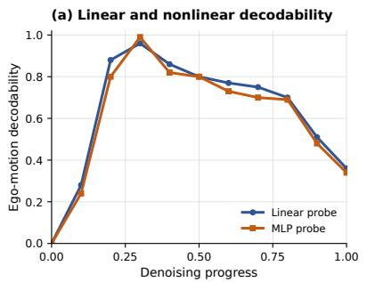

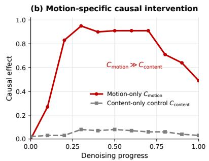

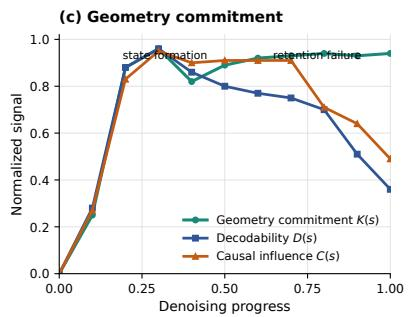  
Figure 5: Additional evidence for geometric state forgetting. (a) Linear and MLP probes both show a rise-and-fall pattern in ego-motion decodability. (b) Motion-only interventions produce substantially larger causal efects than norm-matched content-only controls. (c) Geometry commitment $K ( s )$ rises early and remains high, while the decodability $D ( s )$ and motion-specific causal efect $C ( s )$ reused from (a) and (b), respectively, decline during late denoising. Both probes and causal efects decline at later stages, while geometry commitment remains high, supporting the existence of geometric state forgetting.

Motion-specific causal intervention. To isolate the causal role of ego-motion from appearance and scene content, we compare an intervention applied to the ego-motion-related delta-token component with a norm-matched intervention applied to non-motion content. Let $C _ { \mathrm { m o t i o n } } ( s )$ denote the change in the generated camera trajectory caused by the motion-only intervention, and let $C _ { \mathrm { c o n t e n t } } ( s )$ denote the corresponding efect of the content control. Figure 5(b) shows that

$$
C _ { \mathrm { m o t i o n } } ( s ) \gg C _ { \mathrm { c o n t e n t } } ( s )
$$

throughout the main diagnostic range, indicating that the measured intervention efect is primarily attributable to the motion-specific component rather than to a generic perturbation of the hidden state. The motion-specific causal efect also decreases during late denoising.

Geometry commitment and late attenuation. Finally, we compare the geometry-commitment score K(s) of the evolving video latent with the internal ego-motion signals. Here, $D ( s )$ is the same linear-probe decodability curve reported in Fig. 5(a), and $C ( s )$ is the same motion-only causal-efect curve reported in Fig. 5(b). This shared construction allows the three quantities to be compared directly. As shown in Fig. 5(c), $K ( s )$ rises rapidly during early denoising and remains high thereafter, whereas both $D ( s )$ and $C ( s )$ decline at later stages. This temporal separation indicates that the geometric state has already formed in the evolving latent when the measured hidden-state accessibility and causal efect begin to attenuate. It therefore supports our interpretation of the late-stage decline as a retention failure of the internal ego-motion state, rather than a failure to form camera geometry in the first place.

## B Extended Evaluation of CausalAlign

This section first clarifies the metric definitions and training settings used in the I2V evaluation in the main paper. We then explain why the unconstrained I2V protocol does not use direct ground-truth trajectory error. Finally, we report two complementary experiments: text-to-video generation and camera-trajectoryconditioned generation.

## B.1 Metric Definitions and Normalization

For generated clip i, let $\mathbf { p } _ { i , t }$ and $\mathbf { R } _ { i , t }$ denote the estimated camera position and rotation at frame t. Let $\Delta \tau$ be the frame interval and let $d _ { i , t } ( u )$ be the estimated depth at pixel u and frame t. The clip-level median

scene depth is

$$
d _ { i } = \mathrm { m e d i a n } _ { t , u } d _ { i , t } ( u ) .\tag{30}
$$

The depth-normalized translational speed and angular speed are

$$
v _ { i , t } = \frac { \left\| \mathbf { p } _ { i , t + 1 } - \mathbf { p } _ { i , t } \right\| _ { 2 } } { d _ { i } \Delta \tau } , \qquad \omega _ { i , t } = \frac { \left\| \log \left( \mathbf { R } _ { i , t } ^ { \top } \mathbf { R } _ { i , t + 1 } \right) \right\| _ { 2 } } { \Delta \tau } .\tag{31}
$$

For $m \in \{ v , \omega \}$ , let

$$
{ \overline { { m } } } _ { i } = { \frac { 1 } { T - 1 } } \sum _ { t = 1 } ^ { T - 1 } m _ { i , t }\tag{32}
$$

denote the clip-level mean. Let $( \mu _ { m } ^ { \mathrm { r e a l } } , \sigma _ { m } ^ { \mathrm { r e a l } } )$ denote the mean and standard deviation of metric m on the real-video validation distribution. We define the proximity score

$$
S _ { m } ( i ) = \exp \left( - \frac { \left| \overline { { m } } _ { i } - \mu _ { m } ^ { \mathrm { r e a l } } \right| } { \sigma _ { m } ^ { \mathrm { r e a l } } + \epsilon } \right) ,\tag{33}
$$

and report its dataset-level average:

$$
M _ { m } = \frac { 1 } { N } \sum _ { i = 1 } ^ { N } S _ { m } ( i ) .\tag{34}
$$

Thus, “Mean Trans. Prox.” and “Mean Angular Prox.” correspond to $M _ { v }$ and $M _ { \omega }$ , respectively. These scores measure proximity to the real-data mean of the corresponding motion magnitude. A value closer to one indicates that the generated clip-level mean is closer to the real-data mean; it does not by itself measure agreement with the full motion distribution.

For the composite gain used in the update-placement experiments, let $m _ { i , k }$ denote the value of metric k for clip i. Let $a _ { k }$ and $b _ { k }$ be fixed normalization bounds computed over the comparison set. The directioncorrected normalized score is

$$
q _ { i , k } = \left\{ \begin{array} { l l } { \left[ \frac { m _ { i , k } - a _ { k } } { b _ { k } - a _ { k } + \epsilon } \right] _ { [ 0 , 1 ] } , } & { k \in \mathcal { K } _ { \uparrow } , } \\ { \left[ \frac { b _ { k } - m _ { i , k } } { b _ { k } - a _ { k } + \epsilon } \right] _ { [ 0 , 1 ] } , } & { k \in \mathcal { K } _ { \downarrow } , } \end{array} \right.\tag{35}
$$

where $[ x ] _ { [ 0 , 1 ] } = \operatorname* { m i n } \{ 1 , \operatorname* { m a x } \{ 0 , x \} \}$ . The dataset-level score for method M is

$$
q _ { k } ^ { ( M ) } = \frac { 1 } { N } \sum _ { i = 1 } ^ { N } q _ { i , k } ^ { ( M ) } .\tag{36}
$$

The composite gain of an adapted model over the base model is

$$
G = 1 0 0 \left[ \sum _ { k } w _ { k } q _ { k } ^ { \mathrm { ( a d a p t e d ) } } - \sum _ { k } w _ { k } q _ { k } ^ { \mathrm { ( b a s e ) } } \right] , \qquad \sum _ { k } w _ { k } = 1 .\tag{37}
$$

For the update-placement study, the composite contains rotation RPE, translation-direction RPE, Sim(3) ATE, endpoint error, speed-profile error, and depth AbsRel.

## B.2 Training and Inference Details

We instantiate CausalAlign on WAN2.2-14B-I2V (Team Wan et al., 2025) using DL3DV (Ling et al., 2024) and RealEstate10K (Zhou et al., 2018). Each dataset is divided into 90% training data and 10% held-out evaluation data. Following the three-stage procedure in Fig. 2, the three stages use fixed 30%, 10%, and 100% subsets of the training split, respectively.

In Stage 1, the teacher delta-token modules, including the delta encoder, transition decoder, temporal predictor, and camera decoder, are trained with

$$
\lambda _ { \mathrm { t e m p } } = 0 . 1 , \qquad \lambda _ { \mathrm { p o s e } } ^ { T } = 0 . 2 .\tag{38}
$$

In Stage 2, the VGM-side projectors are trained with ${ \mathcal { L } } _ { \mathrm { m a p } }$ while the VGM and all teacher modules remain frozen. In Stage 3, LoRA adapters are optimized only at

$$
\mathcal { L } _ { \mathrm { t a r } } = \{ 1 0 , 1 2 , 1 4 , 2 0 \} , \qquad S _ { \mathrm { t a r } } = \{ 3 9 8 , 7 9 9 \} ,\tag{39}
$$

where layer 14 is the primary target and layers {10, 12, 20} are auxiliary targets. The final objective is

$$
\mathcal { L } _ { \mathrm { p o s e } } + \lambda _ { \Delta } \mathcal { L } _ { \Delta } , \qquad \lambda _ { \Delta } = 0 . 2 .\tag{40}
$$

The original VGM backbone, LingBot-Map, teacher modules, and VGM-side projectors remain frozen during the final stage. Only the adapted VGM is retained at inference, and no teacher or external geometric cache is used.

Why the main I2V protocol does not use direct ground-truth pose error. In the main first-frameand-prompt I2V protocol, the model receives only the first frame and a text prompt. The future video is therefore one-to-many: multiple camera trajectories can be valid continuations of the same input. Directly comparing an unconstrained generated trajectory with a single ground-truth trajectory can consequently penalize valid alternative motions.

This difers from the causal diagnosis in Sec. 3.2. There, the ground-truth trajectory of the corresponding diagnostic video is used only as a fixed measurement reference for $E _ { \mathrm { t r a j } } ( Y ; d )$ . It is never provided to the generator. The diagnostic score measures how an intervention changes the generated trajectory error relative to a norm-matched random control, thereby measuring the sensitivity of the generation process to the intervened internal state. It does not require the generated video to reproduce the reference trajectory.

For the main unconstrained I2V evaluation, methods whose native inference does not require an explicit camera trajectory receive only the first frame and the text prompt. These methods are evaluated with matched output length, resolution, frame rate, sampling budget, and random seeds. For methods whose standard inference requires an explicit camera trajectory and a 3D cache, such as GEN3C and Voyager (Ren et al., 2025; Huang et al., 2025b), we follow their native inference interfaces: the ground-truth camera trajectory is provided as the camera-control condition, and a fresh 3D cache is constructed from the available input frame(s), without using future video frames. These methods are reported as trajectory-conditioned baselines rather than as unconstrained generators.

Regardless of the input interface, every generated video is processed by the same frozen, independent reconstruction pipeline. For the main intrinsic comparison, trajectory analysis is based only on the reconstructed video and uses motion magnitude, geometric self-consistency, temporal dynamics, and visual quality. Neither the conditioning trajectory nor its ground-truth trajectory is used as the target for these intrinsic metrics. Thus, the trajectory-conditioned baselines are not evaluated by a ground-truth pose matching loss, while the evaluator and intrinsic metrics remain shared across methods. Results from unconstrained and trajectory-conditioned protocols are therefore interpreted separately.

To complement this intrinsic evaluation, we introduce a separate camera-trajectory-conditioned protocol. In this setting, the reference camera trajectory $\mathbf { T } _ { 1 : T } ^ { * }$ is provided as an explicit condition, and direct comparison with the target trajectory is well-defined. The results are reported in Sec. B.4.

We next evaluate CausalAlign in two additional settings. The first tests whether the learned alignment transfers to text-to-video generation. The second evaluates direct trajectory accuracy under explicit camera conditioning. Within each setting, methods share evaluation inputs, output length, resolution, frame rate, sampling budgets, and evaluation procedures.

## B.3 Text-to-Video Generation

We adapt Wan2.2-14B-T2V with the same training hyperparameters and evaluate it on the same test split as the main I2V experiment. Text prompts are generated from RealEstate10K clips (Zhou et al., 2018)

following the captioning procedure used by CameraCtrl (He et al., 2025). Both the native and adapted models receive only these prompts.

Visual quality. Table 5 reports VBench quality, semantic, and smoothness scores (Huang et al., 2024), together with FVD (Unterthiner et al., 2018), CLIP (Radford et al., 2021), SSIM (Wang et al., 2004), and LPIPS (Zhang et al., 2018). CausalAlign improves quality, semantic score, FVD, and LPIPS, matches smoothness, and has lower CLIP and SSIM scores.

Table 5: Visual quality in text-to-video generation. We compare Wan2.2-14B-T2V and CausalAlign using VBench and complementary visual metrics. CausalAlign improves quality, semantic score, FVD, and LPIPS while preserving smoothness, with slightly lower CLIP and SSIM scores.
<table><tr><td rowspan="2">Method</td><td colspan="3">VBench</td><td colspan="4">Other visual metrics</td></tr><tr><td>Quality↑</td><td>Semantic↑</td><td>Smooth.↑</td><td>FVD↓</td><td>CLIP↑</td><td>SSIM↑</td><td>LPIPS↓</td></tr><tr><td>Wan2.2-14B-T2V</td><td>0.850</td><td>0.729</td><td>0.979</td><td>183.6</td><td>0.331</td><td>0.728</td><td>0.181</td></tr><tr><td>CausalAlign</td><td>0.852</td><td>0.730</td><td>0.979</td><td>183.4</td><td>0.320</td><td>0.726</td><td>0.175</td></tr></table>

Intrinsic ego motion. The frozen pose, depth, optical-flow, and feature estimators from the main evaluation process all generated videos. Motion magnitudes are compared with the real-video reference distribution, whereas geometric consistency and temporal dynamics measure internal video consistency. Table 6 shows improved motion magnitudes, reprojection, depth–flow, and epipolar errors, together with higher smoothness and lower jerk.

Table 6: Ego-motion consistency in text-to-video generation. We evaluate Wan2.2-14B-T2V and CausalAlign using the same text prompts and geometric estimators. CausalAlign improves all seven metrics across motion magnitude, geometric consistency, and temporal dynamics.
<table><tr><td></td><td colspan="2">Motion magnitude</td><td colspan="3">Geometric consistency</td><td colspan="2">Temporal dynamics</td></tr><tr><td>Method</td><td>Mean Trans. Prox.↑</td><td>Mean Angular Prox.↑</td><td>Reproj. (px)↓</td><td>Depth-flow (px)↓</td><td>Epipolar (px)↓</td><td>Smooth.↑</td><td>Jerk↓</td></tr><tr><td>Wan2.2-14B-T2V</td><td>0.63</td><td>0.68</td><td>8.2</td><td>7.1</td><td>5.4</td><td>0.78</td><td>0.181</td></tr><tr><td>CausalAlign</td><td>0.78</td><td>0.90</td><td>6.9</td><td>5.3</td><td>3.4</td><td>0.86</td><td>0.154</td></tr></table>

## B.4 Camera-Trajectory-Conditioned Generation

We apply CausalAlign to Wan2.2-Fun-A14B-Control-Camera (Alibaba PAI, 2025) and compare it with the native model and FantasyWorld (Dai et al., 2026). Each method receives the same first frame, ground-truth camera trajectory, and text prompt. Generated trajectories are recovered with a shared frozen pose estimator and compared with the conditioning trajectories using identical temporal correspondence, coordinate conventions, and trajectory alignment.

Table 7 reports relative rotation and translation errors (RRE (Zhang and Scaramuzza, 2018) and RTE (Geiger et al., 2012)), absolute trajectory error (ATE (Sturm et al., 2012)), final displacement error (FDE (Alahi et al., 2016)), drift (Geiger et al., 2012), smoothness (Hogan and Sternad, 2009), and jerk (Flash and Hogan, 1985). CausalAlign gives the best values on six of the seven metrics; FantasyWorld has the lowest RTE.

## B.5 More Visualization For Mobile Manipulation Rollouts

Here we give two more successful examples on RoboCasa365 (Nasiriany et al., 2026) in Fig. 6. Meanwhile, we provide our experiment setting in Table 13.

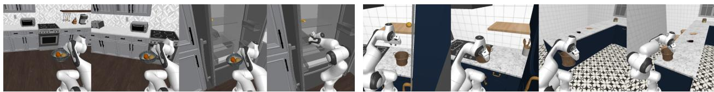  
Figure 6: Successful mobile manipulation rollouts. We visualize two policy rollouts on RoboCasa365, showing a robot placing a bowl into a refrigerator and moving a bread basket to a counter. Both examples demonstrate successful execution of mobile manipulation tasks.

Table 7: Camera trajectory accuracy under explicit conditioning. We compare CausalAlign with the native Wan2.2 camera control model and FantasyWorld using identical camera trajectories, initial frames, and text prompts. CausalAlign achieves the best results on six of seven metrics, while FantasyWorld has the lowest relative translation error.
<table><tr><td>Method</td><td colspan="2">Relative pose</td><td colspan="3">Global trajectory</td><td colspan="2">Temporal dynamics</td></tr><tr><td></td><td>RRE (°)↓</td><td>RTE (%)↓</td><td>ATE (m)↓</td><td>FDE (m)↓</td><td>Drift (%)↓</td><td>Smooth.↑</td><td>Jerk↓</td></tr><tr><td>Native</td><td>3.82</td><td>7.70</td><td>0.214</td><td>0.263</td><td>13.6</td><td>0.69</td><td>0.189</td></tr><tr><td>FantasyWorld</td><td>3.72</td><td>6.60</td><td>0.169</td><td>0.208</td><td>10.5</td><td>0.82</td><td>0.159</td></tr><tr><td>CausalAlign</td><td>3.21</td><td>6.80</td><td>0.167</td><td>0.201</td><td>10.2</td><td>0.85</td><td>0.155</td></tr></table>

## C Additional Ablation Studies

## C.1 Structured Delta-Space Representation

Representations and Stage-1 supervision. Table 4 evaluates the frozen teacher delta-token representation learned in Stage 1. The structured encoder produces

$$
\begin{array} { r } { \delta _ { t } ^ { \mathrm { T } } = \left[ \delta _ { t } ^ { \mathrm { e g o } } ; \delta _ { t } ^ { \mathrm { g e o } } ; \delta _ { t } ^ { \mathrm { v i s } } \right] , } \end{array}\tag{41}
$$

where the three regions encode relative camera motion, camera-local geometric changes such as depth and surface-normal diferences, and RGB changes, respectively.

These regions are structured target channels rather than three additional losses. The camera decoder uses the pose target to provide explicit ego-motion supervision through $\mathcal { L } _ { \mathrm { p o s e } } ^ { T }$ . The transition decoder reconstructs the next teacher state, so $\mathcal { L } _ { \mathrm { t r } }$ supervises the transition-related geometric and visual content in that state. The temporal predictor forecasts the complete next delta token, and $\mathcal { L } _ { \mathrm { t e m p } }$ is therefore applied to the concatenated token, including all three regions. Thus, the pose, depth/normal, and RGB targets jointly implement the Stage-1 objective in Eq. (7), rather than defining separate objectives.

For the unpartitioned controls, the pair and diference encoders also produce 128-dimensional tokens and are trained with the same three loss terms and the same pose, geometric, and visual targets, but without explicitly separating the token into semantic regions. All encoders receive 40,000 updates: 10,000 on 4,000 training scenes and 30,000 on 8,312 scenes. Camera poses and target geometry provide the supervision labels.

Readout protocol. Independent two-layer, width-256 probes are trained for 3,000 updates with batch size 128 on 4,000 scenes. Learning rates are selected from $\{ 1 0 ^ { - 5 } , 1 0 ^ { - 4 } , 1 0 ^ { - 3 } \}$ using 150-step validation runs. Evaluation covers 256 development scenes and three seeds. Each scene contributes nine frame pairs, combining source indices {0, 4, 8} with gaps {1, 2, 4} in a 21-frame, stride-4 feature sequence. Scores are averaged over frame pairs within each scene, then over scenes and seeds.

Targets and metrics. Ego-motion readouts are evaluated against DL3DV poses (Ling et al., 2024) using rotation and translation-direction angular errors. Geometry probes predict log-depth changes on a 16 × 28 grid, which are added to the common source log-depth and compared with frozen LingBot Map estimates (Chen et al., 2026a) on shared valid pixels. We report $\mathrm { A b s R e l } = \langle | \hat { d } - d | / d \rangle$ and $\delta _ { 1 } =$ $\langle \mathbf { 1 } [ \mathrm { m a x } ( \hat { d } / d , d / \hat { d } ) < 1 . 2 5 ] \rangle$ ⟩ (Eigen et al., 2014). Visual probes predict RGB changes on a 32 × 56 grid; reconstruction from the common source image is evaluated with SSIM (Wang et al., 2004) and AlexNet LPIPS (Zhang et al., 2018). Copying the source image gives SSIM 0.29397 and LPIPS 0.08924, versus 0.30283 and 0.08676 for the complete delta token.

Partition specialization. For the matched-width comparisons in Table $4 ( \mathrm { a } )$ , PCA (Jollife and Cadima, 2016) fitted on training data projects the supervised unpartitioned encoders to 64, 40, and 24 dimensions. Delta regions lead all 12 paired metric comparisons. Table 8 further evaluates every region on every task at a common width of 24 dimensions, projecting the ego and geometry regions with training-only PCA. Each region performs best on its designated task.

Table 8: Specialization of delta-token regions. We evaluate the ego-motion, geometry, and visual regions using probes with a common dimension of 24 on 256 scenes across three seeds. Each region performs best on its corresponding task, demonstrating the efectiveness of semantic partitioning.
<table><tr><td></td><td colspan="2">Ego motion</td><td colspan="2">Geometry</td><td colspan="2">Visual</td></tr><tr><td>Region</td><td>Rotation (°)↓</td><td>Direction  ${ \binom { \circ } { \phantom { + } } } \downarrow$ </td><td>AbsRel↓</td><td>δ1 ↑</td><td>SSIM↑</td><td>LPIPS↓</td></tr><tr><td>Ego</td><td>2.429</td><td>7.558</td><td>0.3115</td><td>0.6764</td><td>0.2881</td><td>0.08964</td></tr><tr><td>Geometry</td><td>13.070</td><td>49.822</td><td>0.2292</td><td>0.7448</td><td>0.2908</td><td>0.08894</td></tr><tr><td>Visual</td><td>14.682</td><td>65.830</td><td>0.3188</td><td>0.6620</td><td>0.3050</td><td>0.08643</td></tr></table>

Original features and extraction controls. The original LingBot-Map frame representation concatenates the final camera token and the mean of 777 patch tokens, yielding 4096 dimensions. The pooled pair A concatenates two frame vectors (8192D), while B takes their diference (4096D). Both retain their original width, with coordinate-wise standardization fitted on probe-training data. Table 4(b) compares these frozen teacher features with the complete learned delta representation; panel (a) isolates partitioning under matched supervision. Delta leads all six readout metrics with the original eight-frame streaming context, with whole-sequence extraction, and with whole-sequence extraction plus four-layer averaging. A full-spatialgrid diference provides a separate 133,120D control: its AbsRel 0.2109, SSIM 0.3533, and LPIPS 0.08575 improve on the corresponding delta readouts.

## C.2 Update Placement and Temporal Modulation

Independent adapter placement. We independently train a LoRA adapter for each of five layer sets in the second transformer of Wan2.2-14B. All runs use the same training data, objective, LoRA configuration, optimization budget, and inference protocol, and the resulting updates are matched in efective global norm. The fixed-source video-to-video evaluation uses 32 scenes, one generation seed, ten inference steps, and identical sources, prompts, scheduler, and initial noise. The composite combines rotation RPE, translationdirection RPE, Sim(3) ATE, endpoint error, speed-profile error, and depth AbsRel, using frozen LingBot-Map estimates from source videos as references. Positive values denote improvements; 95% confidence interval use 50,000 scene-bootstrap resamples (Efron, 1979).

Table 9(a) reports the complete placement comparison. The independently trained adapter at layers 10, 12, 14, and 20 gives the largest gain over the native model (3.109%). Its gain over a norm-matched random update is 2.224%. This matched-adapter comparison isolates the efect of target-layer placement.

Temporal modulation. Using 32 scenes and three seeds, we compare timestep-conditioned, static, timeaveraged, and ensemble updates under the same fixed-source protocol. Table 9(b) reports all three contrasts. The ensemble has the largest mean gain over the static update; each interval includes zero.

Table 9: Efects of alignment placement and temporal modulation. We compare LoRA updates at diferent layer groups and strategies for temporal modulation on Wan2.2-14B, reporting composite gains with 95% confidence intervals. The layers selected by causal diagnosis achieve the largest gain of 3.109%, while the temporal modulation comparisons have confidence intervals that include zero.
<table><tr><td>(a) Layer placement</td><td colspan="2">Versus native</td><td colspan="2">Versus random update</td></tr><tr><td>Layer set</td><td>Gain</td><td>95% CI</td><td>Gain</td><td>95% CI</td></tr><tr><td>10, 12, 14, 20</td><td>+3.109</td><td>[+0.808, +5.373]</td><td>+2.224</td><td>[+0.302, +4.022]</td></tr><tr><td>16, 18, 20, 26</td><td>+0.250</td><td>[-2.483, +2.769]</td><td>-1.045</td><td>[-4.391, +1.961]</td></tr><tr><td>20, 22, 24, 30</td><td>-2.194</td><td>[-5.552, +0.760]</td><td>-1.731</td><td>[-5.315, +1.611]</td></tr><tr><td>10, 14, 20, 24</td><td>-0.513</td><td>[-3.595, +2.441]</td><td>-0.738</td><td>[-4.136, +2.232]</td></tr><tr><td>10, 12, 14, 16, 18, 20</td><td>-0.414</td><td>[-2.919, +1.883]</td><td>+1.652</td><td>[-0.348, +3.571]</td></tr><tr><td colspan="5">(b) Temporal modulation</td></tr><tr><td>Comparison</td><td>Gain</td><td>95% CI</td><td></td><td></td></tr><tr><td>Dynamic vs. static</td><td>+0.694</td><td>[-0.949, +2.405]</td><td></td><td></td></tr><tr><td>Dynamic vs. time-averaged</td><td>-0.238</td><td>[-2.055, +1.608]</td><td></td><td></td></tr><tr><td>Ensemble vs. static</td><td>+2.130</td><td>[-0.057, +4.467]</td><td></td><td></td></tr></table>

## C.3 Auxiliary Objectives and Update Strength

We compare local relative-pose supervision (RPE), kinematic supervision (speed, acceleration, and jerk), and their combination on Wan2.2-TI2V-5B. The three runs continue from the same parent checkpoint to the same endpoint, step 48. Local RPE gives the largest trajectory gain (3.525%), with improvements concentrated in endpoint and motion-dynamics errors. Combining objectives reduces this gain to 1.299% while improving geometry and temporal preservation (Table 10).

In matched step-24 continuations, reducing the later-layer update scale from 0.50 to 0.25 increases trajectory gain from 1.750% to 2.209% and geometry gain from −0.506% to 0.761%. Temporal and visual gains decrease from 0.218% and 0.059% to 0.086% and 0.021%, respectively. Both comparisons show that stronger or more numerous constraints need not improve all metric groups together.

Table 10: Efects of auxiliary motion objectives. We compare supervision using relative poses, mo tion dynamics, and their combination on Wan2.2-TI2V-5B under identical training settings. Relative pose supervision achieves the largest trajectory gain of 3.525%, while combining both objectives provides better geometric and temporal preservation.
<table><tr><td>Metric</td><td>Local RPE</td><td>Kinematic</td><td>RPE + kinematic</td></tr><tr><td colspan="4">Local pose and global trajectory</td></tr><tr><td>Rotation RPE</td><td>+0.132</td><td>+0.065</td><td>+0.078</td></tr><tr><td>Translation-direction RPE</td><td>+0.399</td><td>+2.002</td><td>+1.363</td></tr><tr><td>Sim(3) ATE</td><td>+2.024</td><td>+2.521</td><td>+1.074</td></tr><tr><td>Endpoint error</td><td>+5.602</td><td>+4.952</td><td>+3.089</td></tr><tr><td>Path-ratio error</td><td>-0.031</td><td>-0.048</td><td>-0.024</td></tr><tr><td colspan="4">Motion dynamics</td></tr><tr><td>Speed-profile error</td><td>+6.629</td><td>+3.536</td><td>+2.035</td></tr><tr><td>Acceleration error</td><td>+6.254</td><td>+1.676</td><td>+1.424</td></tr><tr><td>Jerk error</td><td>+7.193</td><td>+2.595</td><td>+1.352</td></tr><tr><td colspan="4">Group summaries</td></tr><tr><td>Trajectory</td><td>+3.525</td><td>+2.162</td><td>+1.299</td></tr><tr><td>Geometry</td><td>-0.468</td><td>+0.475</td><td>+0.643</td></tr><tr><td>Temporal</td><td>-0.083</td><td>-0.033</td><td>+0.025</td></tr><tr><td>Visual</td><td>+0.065</td><td>+0.058</td><td>+0.047</td></tr></table>

## C.4 Additional 5B Configurations

Tables 11 and 12 collect the 27 evaluated configurations, grouped by update design and training objective. They report trajectory, geometry, temporal, and visual improvements, their mean, and its 95% confidence interval. These recipe comparisons include diferent continuation lengths; the matched controls are described above. Q/V and Q/K/V/O specify the self-attention projections being updated, and L22 denotes layer 22. Short configuration identifiers distinguish the remaining training recipes.

Table 11: Efects of adapter updates and weight averaging. We evaluate diferent update configurations and weight averaging strategies on the 5B backbone, reporting improvements over the original model. Scaling the update at layer 22 to 0.25 achieves the highest mean gain of 0.769% among the compared configurations.
<table><tr><td>Configuration</td><td>Traj.</td><td>Geom.</td><td>Temp.</td><td>Visual</td><td>Mean</td><td>95% CI</td></tr><tr><td colspan="7">Q/V updates and layer scaling</td></tr><tr><td>Q/V balanced</td><td>+2.223</td><td>-0.609</td><td>+0.153</td><td>+0.036</td><td>+0.451</td><td>[-0.217, +1.090]</td></tr><tr><td>Q/V, L22 scale 0.25</td><td>+2.209</td><td>+0.761</td><td>+0.086</td><td>+0.021</td><td>+0.769</td><td>[+0.090, +1.454]</td></tr><tr><td>Q/V, L22 scale 0.50</td><td>+1.750</td><td>-0.506</td><td>+0.218</td><td>+0.059</td><td>+0.380</td><td>[-0.422, +1.174]</td></tr><tr><td>Q/V, long, unscaled</td><td>+0.292</td><td>-0.378</td><td>+0.150</td><td>+0.045</td><td>+0.027</td><td>[-0.679, +0.721]</td></tr><tr><td>Attenuated L22</td><td>+1.025</td><td>-0.508</td><td>+0.139</td><td>+0.048</td><td>+0.176</td><td>[-0.611, +0.989]</td></tr><tr><td>Attenuated L22, long</td><td>+0.891</td><td>+0.255</td><td>+0.262</td><td>+0.045</td><td>+0.363</td><td>[-0.248, +0.969]</td></tr><tr><td colspan="7">Weight averaging</td></tr><tr><td>Q/V–L22 blend, 0.25</td><td>+1.898</td><td>-1.348</td><td>+0.107</td><td>+0.034</td><td>+0.173</td><td>[-0.547, +0.885]</td></tr><tr><td>Q/V–L22 blend, 0.50</td><td>+2.615</td><td>-0.624</td><td>+0.241</td><td>+0.062</td><td>+0.574</td><td>[-0.110, +1.193]</td></tr><tr><td>Q/V–L22 blend, 0.75</td><td>+1.915</td><td>-0.758</td><td>+0.077</td><td>+0.031</td><td>+0.316</td><td>[-0.497, +1.114]</td></tr><tr><td>soup12_75</td><td>+1.420</td><td>-0.342</td><td>+0.143</td><td>+0.077</td><td>+0.324</td><td>[-0.567, +1.224]</td></tr></table>

Table 12: Efects of training objectives and configurations. We compare diferent objectives for motion, geometry, and appearance under various training configurations on the 5B backbone. Relative pose alignment at step 72 achieves the highest mean gain of 0.982% among the compared configurations.
<table><tr><td>Configuration</td><td>Traj.</td><td>Geom.</td><td>Temp.</td><td>Visual</td><td>Mean</td><td>95% CI</td></tr><tr><td colspan="7">Motion objectives</td></tr><tr><td>Local RPE, step 48</td><td>+3.525</td><td>-0.468</td><td>-0.083</td><td>+0.065</td><td>+0.760</td><td>[-0.142, +1.626]</td></tr><tr><td>Kinematic, step 48</td><td>+2.162</td><td>+0.475</td><td>-0.033</td><td>+0.058</td><td>+0.666</td><td>[-0.078, +1.328]</td></tr><tr><td>RPE + kinematic, step 48</td><td>+1.299</td><td>+0.643</td><td>+0.025</td><td>+0.047</td><td>+0.503</td><td>[-0.148, +1.150]</td></tr><tr><td>Aligned RPE, step 72</td><td>+1.728</td><td>+1.987</td><td>+0.172</td><td>+0.040</td><td>+0.982</td><td>[+0.150, +1.796]</td></tr><tr><td>Aligned kinematic, step 72</td><td>+0.249</td><td>-1.373</td><td>-0.008</td><td>+0.042</td><td>-0.273</td><td>[-1.024, +0.489]</td></tr><tr><td>Aligned all, step 72</td><td>+0.236</td><td>+0.095</td><td>+0.199</td><td>+0.039</td><td>+0.142</td><td>[-0.486, +0.843]</td></tr><tr><td colspan="7">Geometry, appearance, and other objectives</td></tr><tr><td>Geometry-visual, s12</td><td>+1.763</td><td>-0.430</td><td>-0.059</td><td>+0.053</td><td>+0.332</td><td>[-0.500, +1.149]</td></tr><tr><td>High-frequency, light</td><td>+1.020</td><td>-0.277</td><td>+0.071</td><td>+0.042</td><td>+0.214</td><td>[-0.630, +0.982]</td></tr><tr><td>High-frequency, s8</td><td>-0.209</td><td>-0.519</td><td>+0.074</td><td>+0.079</td><td>-0.144</td><td>[-0.852, +0.525]</td></tr><tr><td>current</td><td>+0.951</td><td>+0.137</td><td>-0.277</td><td>-0.115</td><td>+0.174</td><td>[-0.636, +0.967]</td></tr><tr><td>gt_full</td><td>+1.310</td><td>-0.390</td><td>-0.200</td><td>-0.049</td><td>+0.168</td><td>[-0.621, +0.928]</td></tr><tr><td>gt_half</td><td>+0.089</td><td>-0.804</td><td>-0.205</td><td>-0.037</td><td>-0.239</td><td>[-0.965, +0.473]</td></tr><tr><td>gt_preserve6k</td><td>-0.774</td><td>-1.392</td><td>-0.538</td><td>-0.087</td><td>-0.698</td><td>[-1.393, +0.033]</td></tr><tr><td>dual_short</td><td>+0.941</td><td>-0.553</td><td>-0.184</td><td>-0.001</td><td>+0.051</td><td>[-0.812, +0.913]</td></tr><tr><td>dual_flowmatch1</td><td>+0.451</td><td>-0.868</td><td>-0.022</td><td>-0.042</td><td>-0.120</td><td>[-0.909, +0.628]</td></tr><tr><td>dual_aux015</td><td>+0.306</td><td>-0.639</td><td>-0.412</td><td>-0.069</td><td>-0.203</td><td>[-1.018, +0.556]</td></tr><tr><td>Dual Q/K/V/O</td><td>-0.895</td><td>-0.978</td><td>-0.025</td><td>+0.048</td><td>-0.462</td><td>[-1.318, +0.377]</td></tr></table>

Table 13: Training and evaluation settings for Fast-WAM. We summarize the training configuration and evaluation protocol for mobile manipulation on RoboCasa365 Target100. The protocol evaluates the policy on 18 Atomic-Seen tasks with 50 rollouts per task, providing the settings used to assess downstream performance.
<table><tr><td>Setting</td><td>Configuration</td></tr><tr><td>Pretraining data</td><td>Human300, 100 demonstrations per task</td></tr><tr><td>Target demonstrations</td><td>500 per task (Target100)</td></tr><tr><td>Evaluation scenes</td><td>Held-out target kitchens</td></tr><tr><td>Pretraining / evaluated fine-tuning step</td><td>60k / 50k</td></tr><tr><td>Fine-tuning global batch</td><td>128</td></tr><tr><td>Fine-tuning optimizer</td><td>AdamW, weight decay 0.01, gradient clipping 1.0</td></tr><tr><td>Fine-tuning learning rate</td><td>3 × 10−5, 3000-step warmup, cosine decay</td></tr><tr><td>Action / state dimension</td><td>12 / 16</td></tr><tr><td>Input cameras</td><td>32  / 8</td></tr><tr><td>Predicted action chunk / executed prefix</td><td></td></tr><tr><td>Denoising steps</td><td>10</td></tr><tr><td>Quantitative evaluation</td><td>18 Atomic-Seen tasks, 50 rollouts per task</td></tr><tr><td>Evaluation seeds</td><td>10000-10049</td></tr><tr><td>Simulation renderer</td><td>CPU llvmpipe</td></tr></table>