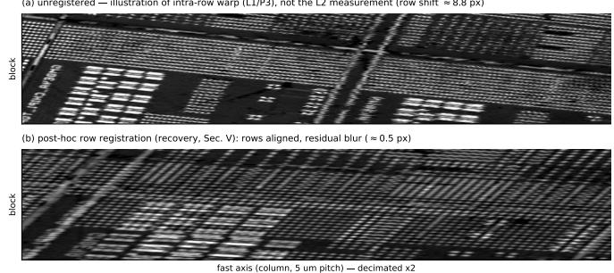
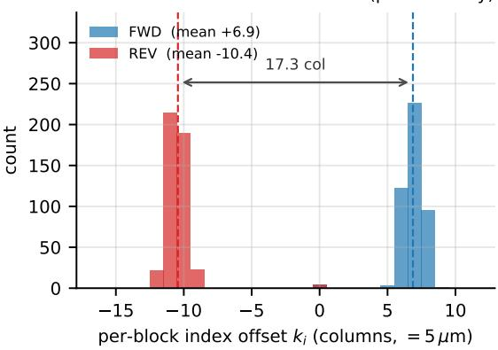
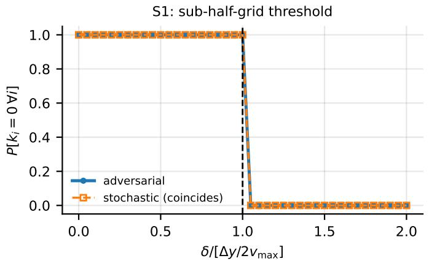
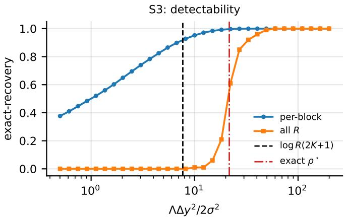
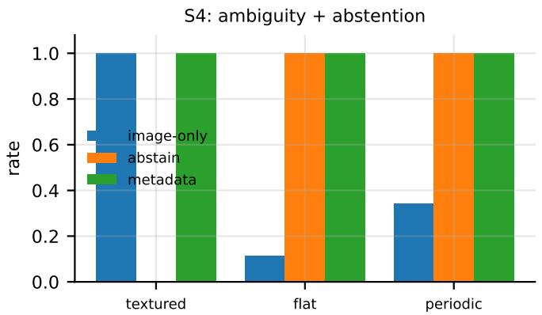
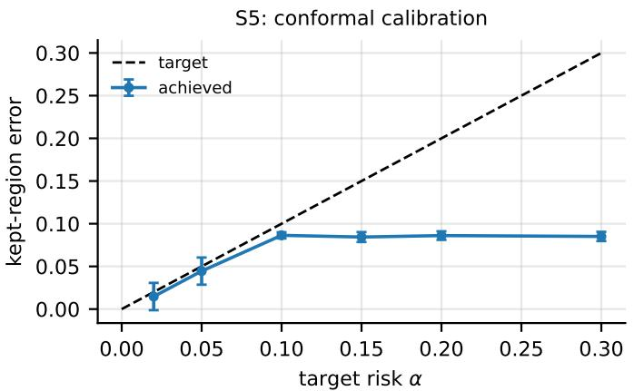
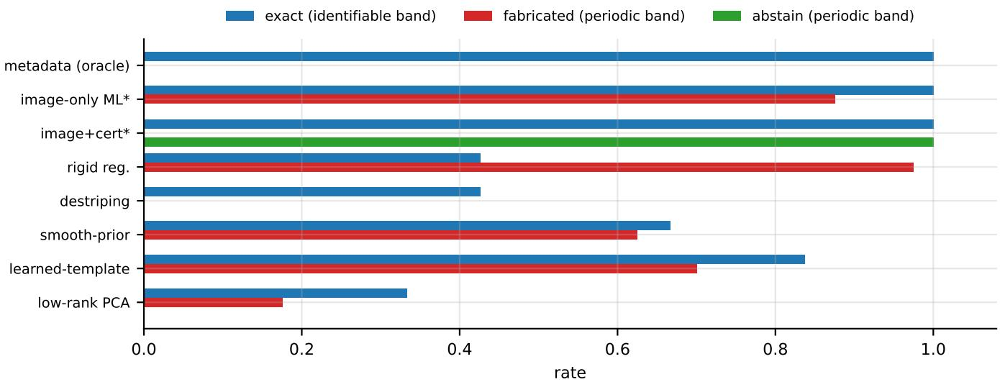

# Certified Abstention for Provably-Unidentifiable Index-Phase Recovery in Image Registration

Dinh Tuan Nguyen, Trong Nhan Nguyen, Vu Nguyen Minh Hung, Tien Minh Khoi Nguyen, Jaeyeop Choi, Sudip Mondal, Jae Sung Ahn, and Junghwan Oh

Abstract—Image registration underpins measurement across scanning, camera, and microscopy imaging, yet a fundamental question is rarely posed: when is the sample-to-position map recoverable at all, and when does any estimator that reports a position necessarily fabricate one? We show that in referenceperturbed sampled imaging, where samples are localized through a perturbed reference, position fidelity (where samples land) and phase fidelity (which reference index becomes each block’s origin) are logically independent: no policy acting on position information alone can guarantee phase fidelity. We derive a tight resolution threshold separating recoverable from provablyunidentifiable registration, and a recovery framework that certifies identifiable regions—recovering them exactly—while abstaining on provably-unidentifiable regions rather than hallucinating structure. On a deployed scanning system we measure a direction-bimodal registration offset consistent with the theory. Against classical and learned restoration baselines, certificatefree offset estimators fabricate structure on the unidentifiable regime, whereas the certified method abstains rather than fabricating. Finally, the certified-abstention mechanism carries across scanning, rolling-shutter, and cryo-electron-microscopy imaging—declining rather than fabricating on the regime it flags—though how completely it abstains and how tightly it bounds kept-region risk stay modality-specific (at extreme SNR the cryo-EM certificate abstains only partially): a structuralversus-statistical boundary in registration reliability.

Index Terms—Image registration, recoverability, identifiability, certified abstention, selective prediction, conformal risk control, hallucination, rolling shutter, cryo-EM multireference alignment, triggered acquisition.

## I. INTRODUCTION

Correcting a scanned image for geometric distortion is an image registration and restoration task: a per-line shift is estimated and inverted so that each pixel is returned to its true grid position. This paper studies the reliability of that task under a corruption that is common in triggered scanning yet largely unexamined in registration theory—an unknown integer, per-line index shift. We prove the correction problem has a regime that is provably unidentifiable: no estimator, learned or classical, can recover the shift from the image, and any estimator that nonetheless reports one fabricates structure. We therefore equip the restorer with a distributionfree certificate that decides, per line, when to recover and when to abstain. The question is timely: as learned restoration methods increasingly synthesize confident but unsupported structure [1], a provable certificate for when registration is unrecoverable—so a pipeline abstains rather than fabricates— addresses a reliability concern that empirical restorers, by construction, cannot settle. Read this way, the results below are limits of image registration under this corruption model— when the per-line shift is recoverable, when it is provably not, and how to certify the difference—alongside the acquisitionside conditions (a separation, an impossibility, and a tight timing threshold) under which the corruption arises and can be prevented.

The shift originates at acquisition. A probe or beam is rastered across a static part along a fast axis; samples are triggered at positions locked to an absolute encoder grid, and a slow axis steps between traversals, so absolute-position triggering fixes where samples land but not which sample becomes column 0 of each line. The stored pixel array is read as a metric map—the sample at array index $( i , j )$ is taken to have been captured at grid position $p ( i , j ) \mathrm { - s o a }$ flagged defect occupies a known physical location and finer trigger pitch is believed to yield finer spatial fidelity. We prove this belief is incomplete and measure the failure on a deployed system: on a position-triggered laser-ultrasound C-scanner the perline index origin is displaced by a rigid, direction-dependent offset that swings 17.3 columns between forward and reverse sweeps, verified from hardware timestamps—misplacing every feature in a line, a defect included, while the image still looks sharp. The prevention is an origin-coupled synchronization reference, which we prove necessary and sufficient to restore index fidelity.

Grid-locked sampling guarantees that each sample lands on a grid position within its block (the fast-axis traversal), but it does not guarantee that the block’s samples are indexed consistently across blocks. Because acquisition proceeds block by block and the hardware must re-initialize between blocks, the index origin of each block—which physical grid crossing becomes “column $0 ^ { \circ } { - } \mathrm { i s }$ set by an asynchronous reinitialization event, not by position. Absolute position fidelity and consistent phase (index) fidelity are distinct guarantees, and the second is not implied by the first. (Throughout, “phase” denotes this discrete index/origin phase of a block— which grid crossing is stored as column 0—not RF or signal phase.)

a) Scope (a registration/restoration problem with special structure; phase, not warp).: We pose grid fidelity as an image registration and restoration problem whose corruption has a special structure—a per-line integer index shift with a provably-unidentifiable band. The shift originates at acquisition (an honest acknowledgement, not the subject): the object we analyze and correct is the formed image, and the estimators and certificate below are image-processing methods operating on it. We stress two scoping decisions. First, our notion of spatial fidelity is geometric/index fidelity—the correspondence between array indices and grid positions—not the perceptual/information fidelity of quality metrics such as VIF [2]; the two are unrelated. Second, we deliberately confine the theory to inter-block phase fidelity (the discrete index origin of each block) and bracket out continuous intra-block distortion (e.g. within-traversal warp from speed variation). The latter is a separate phenomenon with a separate analysis; mixing the two obscures both.

b) Generality.: The object of study is a grid-locked block-sequential sampler: any acquisition that (a) samples a static field along a fast axis at positions locked to an absolute grid, (b) acquires in blocks (one per traversal/line), and (c) re-initializes between blocks with a nonzero latency. This abstracts a wide range of modalities—scanning electron and transmission electron microscopy with flyback, atomicforce/scanning-probe line scanning with re-trace, push-broom and line-scan cameras, optical-coherence B-scan stacking, and ultrasonic/photoacoustic raster C-scanning. The results below are stated for this class; no result depends on a particular instrument.

## Contributions

In sampled imaging there is an identifiability boundary beyond which every estimator either fabricates a position or must abstain: we prove that boundary, give a distribution-free certificate that detects it, and characterize what carries across imaging modalities—the certified-abstention mechanism— versus what stays modality-specific—how completely the certificate abstains and how tightly it controls kept-region risk.

C1. Fidelity separation (Theorem 1). Position fidelity (where samples land) and phase fidelity (which reference index becomes each block’s origin) are logically independent; finer grid-locked pitch does not deliver phase fidelity.

C2. Impossibility (Theorem 3). No acquisition policy acting on position information alone can guarantee phase fidelity.

C3. Necessary-and-sufficient remedy and a tight threshold (Theorems 4, 5). An origin-coupled synchronization primitive is necessary and sufficient to restore phase fidelity, and an imperfect reference suffices iff it resolves the phase to within half a grid cell at the fastest speed, $\delta < \Delta y / ( 2 v _ { \mathrm { m a x } } )$ . This layer is theory only.

C4. Certified abstention (Propositions 1–3, 5). The offset is exactly decodable from metadata (Prop 1), identifiable from image texture above the Robinson– Milanfar detectability limit (Prop 2, [3]), and provably ambiguous in texture-free and periodic regions (Prop 3); a distribution-free conformal wrapper (Prop 5, [4]) guarantees that the mean kept-region risk does not exceed a target level α. Declining under provable unidentifiability is an instance of selective prediction [5], [6].

C5. Anti-hallucination evidence (Table II, gated). Against classical and learned restoration baselines on a synthetic benchmark, certificate-free offset estimators fabricate structure on the provably-unidentifiable band, whereas the certified method abstains on that band (fabrication 0.00 on this benchmark) while recovering identifiable rows exactly. (The conformal guarantee is on the mean kept-region risk, not per-instance; Prop 5, Remark.)

C6. A single measured instance (Section VI-A). On a deployed position-triggered laser-ultrasound C-scanner we measure a rigid, direction-bimodal 17.3-column index offset from hardware timestamps—one empirical instance of the separation, not a multi-condition characterization.

Beyond these contributions we add a boundary characterization (Section VI-C): the certified-abstention mechanism carries into other reference-perturbed modalities (rollingshutter [7], cryo-electron-microscopy multireference alignment [8]), but only its abstention soundness is structural—how completely it abstains and how tightly it controls kept-region risk are modality-specific, and no single cross-modal invariant holds.

Line-origin displacement is itself empirically familiar in scanned microscopy; our contribution is not the discovery of the phenomenon but its integer-phase formalization, the acquisition-side impossibility and tight timing threshold, and a certified recoverability boundary that abstains rather than fabricating where the grid is provably unrecoverable. The novelty is thus the pair—an impossibility theorem and a certified-abstention remedy—together with its structural-versus-statistical cross-modal transfer, not a benchmark-beating estimator. Accordingly, the evaluation axis is fabrication-avoidance under provable unidentifiability: the certified method fabricates on 0% of the provablyunidentifiable band where certificate-free offset estimators fabricate up to 98% (Table II), and the method is therefore not judged by RMSE alone.

## II. RELATED WORK AND POSITIONING

a) Scanned inspection and exact formation theory.: Scanning-based imaging systems routinely correct scaninduced misalignment after acquisition by registration [9], [10], [11], [12], and necessary-and-sufficient formation/reconstruction conditions have a well-established precedent [13], [14]. But these treat an observed offset; none models when the formed image is index-faithful in the first place, or when a residual offset is recoverable versus provably ambiguous. Supplying that fidelity-limit model— an acquisition-side contract, a tight timing threshold, and a distribution-free abstention certificate so a pipeline never silently emits a fabricated correction—is the gap this paper fills.

b) Registration performance limits.: The Cramer–Rao´ bound for image translation [3] shows the shift-estimation variance is lower-bounded by $\sigma ^ { 2 } / \Lambda$ , Λ the squared gradient energy, and analyzes quantization effects. We build on this bound for the inter-block integer shift (Section $\mathrm { v } { ; }$ we do not claim it as new. The novelty relative to registration theory is the acquisition-side impossibility and the phase/index formulation, neither of which the registration literature [15], [16], [17] addresses (it assumes the index-to-position map is known). The nearest prior work is conformal or uncertaintyaware registration, which calibrates a confidence or prediction interval and flags low-reliability regions [18], [19]; this quantifies how uncertain an estimate is, whereas we prove when no estimate is recoverable and decline on that basis— a structural guarantee about identifiability, not a confidence interval.

c) Nonuniform / jitter sampling.: Classical results— Kadec’s $1 / 4$ theorem, reconstruction from sets with unknown jitter [20]—treat continuous position perturbations and ask whether the field is reconstructable. Our perturbation is an exact-on-grid sample with an unknown integer index offset per block (a relabeling), with a continuous sub-grid residual that is the classical-jitter limit (Section V). The integer/phase object is not addressed by that theory.

d) Order tracking (computed order tracking).: The closest prior analogue of a position-versus-count mismatch is order tracking in rotating-machinery analysis, which resamples a time signal against a shaft-angle reference so that samples are indexed by angle rather than time [21], [22]. Computed order tracking corrects the misregistration by interpolating onto the reference grid. The distinction is fundamental: order tracking assumes the angle reference is available and resamples to it; we instead prove that when the reference index is not observable, no estimator recovers it, and supply a certificate that abstains rather than resampling into a fabricated position.

e) Scan-distortion correction.: Drift/distortion correction in scanned microscopy estimates the offset as a nuisance: orthogonal-scan-pair alignment [23], Brownian-prior joint denoising and line distortion correction [24]. These are correction algorithms; none states an acquisition-side fidelity contract, a separation/impossibility result, or an abstention certificate. We confront [24] directly: its Gaussian/Brownian prior on scanline shifts has no impossibility statement, no integer-phase formalism, and no recoverability/abstention.

f) Rolling shutter.: Rolling-shutter geometry concerns rows exposed at different but known or smoothly modelled times, producing a continuous warp that geometric and motion models rectify [25], [26], [27]. The corruption studied here is complementary: an unknown, discrete relabeling of the column origin per block, arising for a static scene under a perfectly known trajectory, and invisible to row-time motion models— no continuous warp field reproduces an integer index shift with block-wise jumps.

## III. THE GRID-LOCKED BLOCK-SEQUENTIAL MODEL

We formalize the acquisition class and the fidelity contract, then state the separation that the rest of the paper analyzes. Throughout, phase means the discrete index origin of a block, never signal phase.

## A. Geometry, crossings, and blocks

A static field $f : \mathbb { R } ^ { 2 }  \mathbb { R }$ is scanned along a fast axis y while a slow axis x steps between traversals. The fast axis carries an absolute coordinate grid with pitch $\Delta y ;$ its crossings are the positions $m \Delta y ,$ $m \in \mathbb { Z }$ . A block $i \in \{ 0 , \ldots , R -$ 1} is one fast-axis traversal at slow-axis position $x _ { i } = x _ { 0 } +$ $i \Delta x$ . The stage moves with an admissible speed profile $v ( \cdot ) \in$ $[ v _ { \operatorname* { m i n } } , v _ { \operatorname* { m a x } } ] , 0 < v _ { \operatorname* { m i n } } \leq v _ { \operatorname* { m a x } }$ , so the time at which block i crosses grid index m, written $T _ { i } ( m )$ , satisfies

$$
\frac { \Delta y } { v _ { \mathrm { { m a x } } } } \ \leq \ T _ { i } ( m + 1 ) - T _ { i } ( m ) \ \leq \ \frac { \Delta y } { v _ { \mathrm { { m i n } } } } ,\tag{1}
$$

because covering one pitch $\Delta y$ at a speed in $[ v _ { \mathrm { m i n } } , v _ { \mathrm { m a x } } ]$ takes between $\Delta y / v _ { \mathrm { m a x } }$ and $\Delta y / v _ { \mathrm { m i n } }$ . Equation (1) is the only property of the trajectory the analysis uses; in particular the crossing positions are exactly $m \Delta y$ regardless of $v ( \cdot )$

## B. Count-locked capture with re-initialization

Acquisition is triggered and count-locked: a hardware position-compare emits a pulse at grid crossings, and the digitizer, once armed, stores a fixed count $n _ { c }$ of consecutive emitted crossings as one block, writing the r-th captured crossing to array column r. Between blocks the hardware must re-initialize (abort/turnaround/re-arm), which takes a nonzero, exogenous delay: block i’s capture window opens at

$$
a _ { i } = t _ { i } ^ { \mathrm { s t a r t } } + \tau _ { i } , \tau _ { i } \geq 0 ,\tag{2}
$$

where $t _ { i } ^ { \mathrm { s t a r t } }$ is a fixed per-block reference (the designated origin crossing) and $\tau _ { i }$ is the re-initialization delay. Record 0 of block i is the first emitted crossing at or after $a _ { i } .$ . We call $\{ \tau _ { i } \}$ the adversary: the delays are set by asynchronous hardware state (DMA, arming latency, servo settle), not by the controller.

Definition 1 (Grid-locked block-sequential sampler; position-only policy). A grid-locked block-sequential sampler is any acquisition that (a) samples a static field along the fast axis at positions locked to the absolute grid $\{ m \Delta y \}$ , (b) acquires in blocks of a fixed count $n _ { c } ,$ one per traversal, and (c) re-initializes between blocks with a nonzero latency per (2). A position-only policy $P$ is one whose every emit/capture decision is a function of the encoder position trajectory alone (equivalently, of the crossing stream $\{ T _ { i } ( m ) \} )$ , and not of the realized delays $\{ \tau _ { i } \}$ . A count cap is surplus(s) if $n _ { c } + s$ crossings are emitted per traversal and exact if exactly $n _ { c }$ are.

## C. The three-layer fidelity contract

Definition 2 (Fidelity layers). Let $A \in \mathbb { R } ^ { R \times n _ { c } }$ be the stored array and let $m _ { i } \in \mathbb { Z }$ be the grid index of block i’s record 0, so that $A [ i , r ]$ was captured at grid index $m _ { i } + r$ . Define

• L1 (intra-block position): within each block the captures lie on consecutive grid crossings with unit index spacing— $A [ i , r ]$ is at position $( m _ { i } + r ) \Delta y$ for all $r ;$

• L2 (inter-block phase): the index origins agree across blocks, i.e. $m _ { i }$ is the same constant (w.l.o.g. 0) for all $i ;$ equivalently the per-block offset $k _ { i } : = m _ { i }$ vanishes;

• L3 (assembly): the row index, scan direction, and any reversal maps used to place block i at slow-axis row $x _ { i }$ are applied correctly.

Spatial fidelity is the conjunction L1∧L2∧L3: stored index $( i , r )$ corresponds to grid position $( x _ { i } , ( k _ { i } + r ) \Delta y )$ with $k _ { i } \equiv 0$

The offset $k _ { i }$ is the paper’s central object. By construction it is the number of emitted crossings consumed by reinitialization,

$$
k _ { i } = \# \{ m \geq 0 : T _ { i } ( m ) \in [ t _ { i } ^ { \mathrm { s t a r t } } , a _ { i } ) \} ,\tag{3}
$$

i.e. record 0 is grid index $k _ { i } .$ , not 0, whenever the window opens after the origin crossing. L3 is standard bookkeeping (a solved engineering layer); we state it for completeness and do not analyze it further.

## D. The separation

Theorem 1 (L1 does not imply L2). There is a gridlocked block-sequential sampler, a position-only policy, and an adversary $\{ \tau _ { i } \}$ under which L1 holds for every block while L2 fails. Consequently finer grid-locked pitch $\Delta y ,$ , which sharpens L1, does not by itself deliver spatial fidelity.

Proof. Take any P that captures $n _ { c }$ consecutive emitted crossings once armed. For every block the captured positions are $\{ ( m _ { i } + r ) \Delta y : r = 0 , \ldots , n _ { c } \mathrm { - } 1 \}$ , a unit-index lattice coset by (1): L1 holds identically, for every adversary (this is Theorem 2). Now choose the delays so the origins disagree. Let all blocks share a crossing schedule and pick $\tau _ { i }$ with $\tau _ { i } ~ < ~ T _ { i } ( 1 ) ~ - ~ T _ { i } ( 0 )$ for even i (so $k _ { i } ~ = ~ 0 )$ and $T _ { i } ( 1 ) - T _ { i } ( 0 ) \leq \tau _ { i } < T _ { i } ( 2 ) - T _ { i } ( 0 )$ for odd i (so $k _ { i } = 1 )$ , which is admissible since each window is an independent hardware event and (1) makes both intervals nonempty. Then $k _ { i }$ alternates $0 , 1 , 0 , 1 , \ldots ;$ the origins do not agree, so L2 fails. The pitch $\Delta y$ enters only through L1 (the spacing), so shrinking it cannot repair the origin disagreement, which is set by {τi}. □

Theorem 1 makes “position fidelity is not phase fidelity” precise: the two guarantees are logically independent, and only the first is delivered by grid-locked triggering. Section IV sharpens “fails” into an impossibility, identifies the minimal primitive that restores L2, and gives the tight timing tolerance; Section V asks when a broken $\{ k _ { i } \}$ is recoverable after the fact.

## IV. POSITION–PHASE SEPARATION

This section develops the paper’s core results. All statements are for the count-locked, position-only class of Definition 1.

Theorem 2 (L1 holds for every policy). For every policy P and adversary, all captures lie on grid crossings with correct unit-index spacing; L1 holds identically.

Proof. A capture occurs only at an emitted crossing, at a grid position $m \Delta y$ . Count-locked capture of $n _ { c }$ consecutive emitted crossings yields positions $\{ ( m _ { i } + r ) \Delta y : r = $ $0 , \ldots , n _ { c } { - } 1 \} { - } \mathbf { a }$ unit-index lattice coset—independent of P and $\{ \tau _ { i } \}$ . The origin $m _ { i }$ is unconstrained; that is the L2 quantity. □

Lemma 1 (Observational equivalence). Fix a position-only policy P. Any two adversary profiles $\{ \tau _ { i } \} , \{ \tau _ { i } ^ { \prime } \}$ present P with identical inputs—the encoder position stream, which the re-initialization delays do not alter—so P emits the same pulse pattern under both. Yet the realized origins differ whenever $[ t _ { i } ^ { \mathrm { s t a r t } } , t _ { i } ^ { \mathrm { s t a r t } } + \tau _ { i } )$ and $[ t _ { i } ^ { \mathrm { s t a r t } } , t _ { i } ^ { \mathrm { s t a r t } } + \bar { \tau _ { i } ^ { \prime } } )$ contain different numbers of crossings. Hence the stored index-to-position map produced by P is a function of position alone while the true origin is a function of the adversary: no position-only policy can be correct for all profiles.

Proof. By Definition 1 each emit decision depends only on the position trajectory, which is the same under both profiles; the capture window, however, opens at $a _ { i } = t _ { i } ^ { \mathrm { s t a r t } } + \tau _ { i }$ , so record 0 is the first emitted crossing at or after $a _ { i }$ , whose grid index is the crossing count of $[ t _ { i } ^ { \mathrm { s t a r t } } , a _ { i } )$ —different across the two profiles by assumption—while the stored column index of record r is r regardless. □

Theorem 3 (Impossibility for position-only policies). For every position-only policy P there is an adversarial $\{ \tau _ { i } \} \in$ $[ 0 , \dot { T } _ { \mathrm { m a x } } ] ^ { R }$ such that

$$
k _ { i } = \# \{ m \geq 0 : T _ { i } ( m ) \in [ t _ { i } ^ { \mathrm { s t a r t } } , t _ { i } ^ { \mathrm { s t a r t } } + \tau _ { i } ) \}\tag{4}
$$

realizes any profile in $\{ 0 , \dots , K _ { \operatorname* { m a x } } \} ^ { R } , \quad K _ { \operatorname* { m a x } }$ = $\lfloor T _ { \mathrm { m a x } } v _ { \mathrm { m i n } } / \Delta y \rfloor$ (for an every-crossing emitter; for a position-periodic emitter, any profile reachable by shifting $\tau _ { i }$ within an inter-emission gap); in particular (when $K _ { \operatorname* { m a x } } \ge 1 )$ a nonzero, non-constant one. Hence no position-only policy guarantees L2.

Proof. Record 0 is the first crossing with $T _ { i } ( m ) \geq a _ { i } ,$ , so its index is the count (4). (Onto.) As $\tau _ { i }$ grows over $[ 0 , T _ { \mathrm { m a x } } ]$ $k _ { i }$ increments by 1 each time $\tau _ { i }$ passes a crossing time; by (1) it attains every integer in $\{ 0 , \ldots , K _ { \operatorname* { m a x } } \}$ , so any profile is realizable. (Position-only cannot prevent it.) By Lemma 1 the emit pattern is invariant to $\{ \tau _ { i } \}$ while the realized origin is not. Concretely: if $P$ emits at every crossing, record 0 is the $k _ { i } { \mathrm { - t h } }$ crossing; if on a position-periodic subset, the adversary shifts $\tau _ { i }$ within an inter-emission gap to change which emitted crossing is first. Either way $k _ { i }$ is adversarially controllable.

Remark 1 (Scope of the impossibility—essential). This does not say grid-locked triggering “always fails.” The failure locus is the pulse stream together with the count-locked window after re-initialization, not the position trigger, which satisfies L1 (Theorem 2). A system that arms before the origin and pins record 0 to it (below) does guarantee L2. Position-compare fixes where pulses occur, not which pulse becomes record 0 once the count-locked window resumes at the exogenous time $a _ { i } .$

Theorem 4 (Synchronization is necessary and sufficient). Let $P ^ { \star }$ withhold block i’s first imaged pulse until armed holds and the stage is at the fixed origin crossing $m = 0 .$ . Then $k _ { i } = 0$ for all i and every adversary, so $P ^ { \star }$ guarantees L2. With Theorem 3, an origin-coupled synchronization primitive is necessary and sufficient to guarantee L2 at acquisition (within the count-locked policy class of Definition 1).

Proof. The conjunction pins record 0 to crossing $m \ = \ 0$ regardless of $\tau _ { i } \dot { : }$ if re-initialization completes before the stage reaches $m = 0$ the rule waits for $m = 0 ;$ if after, it waits for armedi then the designated origin (a fixed pre-declared position from the absolute encoder). Either way $m _ { i } ~ = ~ 0 .$ Necessity is Theorem 3. □

Theorem 5 (Tight sub-grid threshold). Suppose the policy observes the origin crossing time only up to error $| e _ { i } | \le \delta$ (either sign) and uses the nearest-crossing rule (record 0 = crossing nearest the perturbed reference). Then L2 is guaranteed for all adversaries iff

$$
\delta < \frac { \Delta y } { 2 v _ { \operatorname* { m a x } } } .\tag{5}
$$

Proof. Let the Voronoi cell of $T _ { i } ( 0 )$ be $( M _ { - } , M _ { + } ) , M _ { \pm } =$ $\scriptstyle { \frac { 1 } { 2 } } ( T _ { i } ( 0 ) + T _ { i } ( \pm 1 ) )$ ). By $\begin{array} { r } { ( 1 ) , M _ { + } - T _ { i } ( 0 ) = \frac { 1 } { 2 } ( T _ { i } ( 1 ) - T _ { i } ( 0 ) ) \geq } \end{array}$ $\Delta y / ( 2 v _ { \mathrm { m a x } } )$ , symmetrically on the left. (Sufficiency.) If $\delta <$ $\Delta y / ( 2 v _ { \mathrm { m a x } } )$ then $[ T _ { i } ( 0 ) ~ - ~ \delta , T _ { i } ( 0 ) + \delta ] ~ \subset ~ ( M _ { - } , M _ { + } )$ , so $T _ { i } ( 0 ) + e _ { i }$ lies in the cell of $T _ { i } ( 0 )$ for every $| e _ { i } | \le \delta ;$ the nearest crossing is $T _ { i } ( 0 ) , k _ { i } = 0 .$ (Necessity.) If $\delta \ge \Delta y / ( 2 v _ { \operatorname* { m a x } } )$ take a fastest-speed segment so $T _ { i } ( 1 ) - T _ { i } ( 0 ) = \Delta y / v _ { \mathrm { m a x } }$ and $M _ { + } - T _ { i } ( 0 ) = \Delta y / ( 2 v _ { \mathrm { m a x } } ) \leq \delta ;$ the adversary sets $e _ { i }$ so $T _ { i } ( 0 ) + e _ { i }$ reaches or passes $M _ { + }$ , making the nearest crossing $T _ { i } ( 1 ) , k _ { i } = 1$ on the chosen blocks. (Ties at equality, measure zero, break adversarially.) Hence (5). □

Remark 2 (Decision-rule dependence—essential). The constant depends on the rule. Nearest-crossing gives the tight $\Delta y / ( 2 v _ { \mathrm { m a x } } )$ . A naive “first crossing at or after the reference” rule is not sign-symmetric (a positive error skips a crossing) and yields only a one-sided guarantee (requiring $e _ { i } ~ \leq ~ 0$ or an explicit gate). We adopt nearest-crossing; the qualitative conclusion—resolve the inter-crossing interval to within a fixed fraction at the fastest speed—is rule-independent. The guarantee quantifies over admissible speed profiles $v ( \cdot ) \in$ $[ v _ { \mathrm { m i n } } , v _ { \mathrm { m a x } } ] ;$ for a fixed, known profile the same Voronoi argument gives the tight constant $\Delta y / ( 2 v _ { 0 } )$ with $v _ { 0 }$ the speed at the designated origin crossing.

Remark 3 (Physical source of the reference—agnostic). The theorem constrains only the resolution of the origin reference, not its physical origin. In pulsed-emission modalities (e.g. pulsed laser-ultrasound or photoacoustic scanning) the emission clock is itself a natural timing reference, and gating capture on it is one implementation of a sub-half-cell reference in the sense of $( 5 ) ;$ the guarantee is agnostic to whether that reference comes from an encoder-origin latch, a metadata timestamp, or the emission clock.

## A. Subharmonic capture under an exact block count

A second consequence of count-locking concerns not the offset but the capture cadence. Let the imaged block have exactly $n _ { c }$ crossings (zero surplus, the tight count cap).

Corollary 1 (Subharmonic straddle). Under a zero-surplus count cap, if the re-initialization delay consumes $N _ { i } ~ \geq ~ 1$ crossings of block i (i.e. $k _ { i } ~ \geq ~ 1 )$ , the count-locked window cannot complete $n _ { c }$ captures within the block and must continue past the turnaround into the next sweep—a straddle. If the delay is a sustained fraction $\beta$ of a sweep $( N _ { i } = \beta n _ { c } ,$ $0 ~ < ~ \beta ~ \leq ~ 1 )$ , the steady-state cadence is one completed batch per $( 1 + \beta )$ sweeps: each period consumes $\beta n _ { c }$ dead crossings (re-initialization) plus $n _ { c }$ captured crossings. In particular $\beta  1$ halves the cadence—one batch per two sweeps, a period-doubling (subharmonic) of the sweep rate. The synchronization primitive $P ^ { \star }$ (Theorem 4) sets $N _ { i } = 0$ restoring one batch per sweep.

Proof. The window opens $N _ { i }$ crossings into the sweep and needs $n _ { c }$ pulses, so it captures $n _ { c } - N _ { i }$ in block i and the remaining $N _ { i }$ after the turnaround, in block i+1 (opposite direction)—a straddle, with a mislabeled direction and a batch duration inflated by the turnaround dwell. In steady state each period is $[ \beta n _ { c } ~ \mathrm { d e a d } ] [ n _ { c }$ captured] $\ l = \ ( 1 + \beta ) n _ { c }$ crossings = $( 1 + \beta )$ sweeps per completed batch; $\beta  1$ gives two. $P ^ { \star }$ pins record 0 to crossing $0 \ ( N _ { i } = 0 )$ , so all $n _ { c }$ crossings are in-block and the batch completes within one sweep. □

Remark 4 (Counterintuitive design lesson). Tightening the block count to exactly the number of imaged columns—which removes the surplus that hides the phase offset—induces the subharmonic under any re-initialization latency. The structural cure is not surplus (which merely re-hides the offset, cf. Theorem 3) but the origin-coupled handshake (Theorem 4), which fixes both the cadence and the offset.

## V. RECOVERABILITY OF BROKEN PHASE FIDELITY

When L1 holds and L2 fails with unknown integer offsets $\{ k _ { i } \}$ , can fidelity be restored post hoc? We give a framework with an exact channel, sufficient conditions, and explicit impossibility. The per-block shift bound is Robinson–Milanfar [3]; C3’s contribution is the integer/block structure, the channel trichotomy, the ambiguity guards, and the abstention certificate.

Proposition 1 (Metadata channel: exact recovery). If perrecord capture timestamps are available, then $\begin{array} { r l } { k _ { i } } & { { } = } \end{array}$ round $\left( ( t _ { i } ( 0 ) - t _ { \mathrm { r e f } } ) / \Delta t _ { \mathrm { n o m } } \right)$ recovers each offset exactly, and the inverse shift restores L2 (given L1, L3).

Proof. $k _ { i }$ is the grid index of record 0 (Definition $2 ) ;$ its timestamp divided by the nominal inter-crossing interval recovers that index when the timestamp resolution is subinterval. Applying $A [ i , \cdot ] \mapsto A [ i , \cdot + k _ { i } ]$ resets every block’s origin. □

This channel is the strong baseline any image-only method must beat.

Corollary 2 (Tight timestamp resolution). Let each stored record-0 timestamp carry an error of magnitude at most $\varepsilon _ { t }$ (either sign). The rounding decoder of Proposition 1 recovers ki for every block and every offset profile if and only $i f$ $\begin{array} { r c l } { \varepsilon _ { t } } & { < } & { \Delta t _ { \mathrm { n o m } } / 2 , } \end{array}$ , i.e. $\begin{array} { r c l } { \varepsilon _ { t } } & { < } & { \Delta y / ( 2 v ) } \end{array}$ at sweep speed v (worst case $\Delta y / ( 2 v _ { \mathrm { m a x } } )$ over the speed class)—the same halfinterval constant as Theorem 5, by the same argument.

Proof. Sufficiency: if $\varepsilon _ { t } < \Delta t _ { \mathrm { n o m } } / 2$ the perturbed timestamp remains in the half-open decoding cell centred on the true crossing time, so rounding returns the true index, for every error and block. Necessity: at $\varepsilon _ { t } \geq \Delta t _ { \mathrm { n o m } } / 2$ an adversarial error places the timestamp at or past the cell midpoint, and the decoder returns the adjacent index; ties at the midpoint break adversarially. □

A. Image channel: a registration estimator and its detectabil-$i t y$ limit

The image channel is an image-based registration estimator: a maximum-likelihood integer-shift estimator between a block and its grid-consistent neighbour, Robinson–Milanfar/CRLBlimited (Lemma 2), equipped with the provable identifiability certificate of Section V-E. It is the image-processing method a restorer runs on the formed array; the detectability threshold below is exactly where that estimator provably succeeds. Consider block $i ,$ observed as $A _ { i }$ under additive white Gaussian noise of variance $\sigma ^ { 2 }$ and registered against a gridconsistent neighbour that supplies the local (clean) fast-axis template $g$ (local slow-axis stationarity); if the neighbour is itself noisy, $\sigma ^ { 2 }$ is read as the effective comparison variance. Let $\begin{array} { r } { \Lambda _ { i } : = \sum _ { j } ( \partial _ { y } f ) ^ { 2 } | _ { ( i , j ) } } \end{array}$ so that $\begin{array} { r } { \sum _ { j } ( g [ j ] - \bar { g } [ j - 1 ] ) ^ { 2 } \approx \Lambda _ { i } \Delta y ^ { 2 } } \end{array}$

Lemma 2 (Robinson–Milanfar CRLB [3]). The Fisher information for the continuous fast-axis shift between the two observations is $\Lambda _ { i } / \sigma ^ { 2 } ;$ ; any unbiased estimator obeys $\widehat { \mathrm { V a r } ( \mathrm { s h i f t } ) } \geq \sigma ^ { 2 } / \Lambda _ { i } .$

Proposition 2 (Exact integer-shift recovery). With integer candidates in $\{ - K _ { \operatorname* { m a x } } , \dots , K _ { \operatorname* { m a x } } \}$ and the local model above, the maximum-likelihood integer shift equals the truth simultaneously on all R blocks with probability at least $1 - R ( 2 K _ { \operatorname* { m a x } } + 1 ) \exp ( - \Lambda _ { \operatorname* { m i n } } \Delta y ^ { 2 } / ( 8 \sigma ^ { 2 } ) ) , \Lambda _ { \operatorname* { m i n } } = \operatorname* { m i n } _ { i } \Lambda _ { i } .$ In particular exact recovery holds w.h.p. (up to the exponent constant) when

$$
\frac { \Lambda _ { \operatorname* { m i n } } \Delta y ^ { 2 } } { 2 \sigma ^ { 2 } } > \log \bigl ( R ( 2 K _ { \operatorname* { m a x } } + 1 ) \bigr ) .\tag{6}
$$

If $\Lambda _ { i } = 0$ the shift is unidentifiable (Lemma 2).

Proof. Let $\begin{array} { r } { C ( \delta ) = \frac { 1 } { 2 \sigma ^ { 2 } } \sum _ { j } ( A _ { i } [ j ] - g [ j - \delta ] ) ^ { 2 } } \end{array}$ . For the true shift m and competitor m′, $\mathrm { L L R } \ = \ C ( m ^ { \prime } ) - C ( m )$ has mean $S ( m { - } m ^ { \prime } ) / ( 2 \sigma ^ { 2 } )$ and variance $S ( m { - } m ^ { \prime } ) / \sigma ^ { 2 }$ , where $\begin{array} { r } { S ( d ) \ = \ \sum _ { i } ( g [ j ] \ - \ g [ j - d ] ) ^ { 2 } } \end{array}$ . For an adjacent competitor $S ( 1 ) \approx \Lambda _ { i } \Delta { \stackrel { . } { y } { } ^ { 2 } } ;$ ; on a textured, non-periodic band the adjacent shift is the minimal-separation competitor, so $S ( d ) \geq S ( 1 )$ for $| d | \geq 1$ (the degenerate flat/periodic cases, where some $S ( d ) = 0$ , are exactly Proposition 3). A sub-Gaussian tail bound gives single-competitor error $\leq \exp ( - S ( 1 ) / ( 8 \sigma ^ { 2 } ) )$ ; a union bound over R blocks and $2 K _ { \mathrm { m a x } }$ competitors yields the stated probability, which (6) drives below 1. The converse is Lemma 2. □

Remark 5 (Exact constant). The sub-Gaussian bound is loose by design; with Gaussian noise the adjacent-competitor error is exactly $\Phi ( - \sqrt { \Lambda _ { i } \Delta y ^ { 2 } / ( 4 \sigma ^ { 2 } ) } ) = \Phi ( - \sqrt { \rho _ { i } / 2 } )$ , where $\rho _ { i } ~ = ~ \Lambda _ { i } \Delta y ^ { 2 } / ( 2 \sigma ^ { 2 } )$ and Φ is the standard normal CDF. The simultaneous all-block recovery threshold is then $\rho ^ { \star }$ solving $R \left( 2 K _ { \operatorname* { m a x } } \right) \Phi ( - \sqrt { \rho ^ { \star } / 2 } ) = 1 ;$ the synthetic study S3 (Section VI) locates the empirical knee at this $\rho ^ { \star }$ to within 3%, confirming (6) holds with the exact constant, not merely up to order.

## B. Where the image channel fails: ambiguity

Proposition 3 (Ambiguity counterexamples). The image registration channel is insufficient in two regimes. (i) Texturefree: if $\partial _ { y } f \equiv 0$ on a band, then $S ( d ) = 0$ for all d, the likelihood is flat, and the offset is unidentifiable. (ii) Repeated pattern: $i f \ f ( x , \cdot )$ is p-periodic on a band, then $A _ { i } [ \cdot ] \ =$ $A _ { i } [ \cdot + p ]$ identically, so $C ( \delta ) \ : = \ : C ( \delta { + } p )$ as functions of the data and the offset is unidentifiable modulo p—regardless of $\Lambda _ { i } ,$ which may be large for a high-contrast grating. In both regimes image-only recovery must abstain (or defer to metadata/anchors).

Proof. (i) $\partial _ { y } f ~ \equiv ~ 0 ~ \Rightarrow ~ S ( d ) ~ \equiv ~ 0 ~ \Rightarrow ~ \mathbb { E } [ C ]$ constant and the score identically zero (Lemma 2). (ii) p-periodicity gives $g [ j ] = g [ j - p ]$ , so $A _ { i } [ j ] = A _ { i } [ j - p ]$ on the band and $C ( \delta ) = C ( \delta + p )$ as data functions; the integer argmax is nonunique mod p. □

These counterexamples are required: they prevent any “texture-energy-above-threshold ⇒ recoverable” overclaim and motivate abstention.

## C. Sub-grid residual

Proposition 4 (Sub-grid residual, sufficient conditions). A continuous within-grid residual $c _ { i } \in ( - \Delta y / 2 , \Delta y / 2 ]$ places the problem in the classical nonuniform-sampling regime; under bandlimited / shift-invariant-space hypotheses, Kadectype and Aldroubi–Grochenig results [20] give ¨ sufficient stability and reconstruction conditions. We invoke these only as sufficient conditions; no $" i f f "$ transfer is claimed without verifying the hypotheses.

## D. One condition, three channels: half-cell resolution

Theorem 5, Corollary 2, and Proposition 2 are three appearances of a single principle. Call the phase cell the intercrossing interval in time $( \Delta y / v )$ or, equivalently, the intercolumn spacing in position $( \Delta y )$ . Pinning a block’s phase requires resolving the phase coordinate to less than half its cell, wherever the pinning is performed:

• at acquisition: a synchronization reference with $\delta \_ <$ $\Delta y / ( 2 v _ { \mathrm { m a x } } )$ (Theorem 5);

• from metadata: a timestamp with error below $\Delta t _ { \mathrm { n o m } } / 2 =$ $\Delta y / ( 2 v )$ (Corollary 2);

• from the image: a shift estimate resolving half a column—the Robinson–Milanfar-limited standard deviation $\sigma / \sqrt { \Lambda _ { i } } \ < \ \Delta y / 2$ , which is (6) with the constant replaced by the log-multiplicity term needed for simultaneous decoding over R blocks and $2 K _ { \operatorname* { m a x } } { + 1 }$ candidates. The three proofs share one shape: correct integer decoding is membership of a perturbed reference in the Voronoi cell of the truth. As a design heuristic for this problem (we claim no universal or cross-modal budget): the half-cell margin must be paid by one of three channels—at the trigger (prevention), in the metadata (exact recovery), or in the texture (statistical recovery). A pipeline that pays it in none leaves the phase unrecoverable, and the regimes of Proposition 3 are exactly where the third channel is unavailable.

## E. Calibrated abstention certificate

The recoverability flags are combined into a per-block decision and calibrated distribution-free by conformal prediction [28], [29], [19]. This is a supporting framework, not a new theorem.

Procedure. (1) Compute a score $s _ { i }$ (the matching-cost margin of Proposition 2, the energy $\Lambda _ { i } ,$ and a periodicity-detector statistic guarding Proposition 3). (2) Abstain iff $s _ { i } ~ < ~ \lambda ;$ the kept-region geometric risk is monotone in λ. (3) On a calibration set with known geometry, choose $\widehat { \lambda }$ by conformal risk control [4] to control the kept-region error at level α.

Proposition 5 (Risk control). With $\widehat { \lambda }$ chosen by conformal risk control on an exchangeable calibration set of size n and a bounded monotone geometric-risk loss $L _ { \lambda } , \mathbb { E } [ L _ { \widehat { \lambda } } ( \mathrm { t e s t } ) ] \leq$ $\alpha ,$ distribution-free and finite-sample (tight to $O ( 1 / \dot { n } ) ,$ , under exchangeability.

Remark 6 (Honest limits). Proposition 5 controls risk where the method does not abstain; it does not identify the unrecoverable set exactly, and requires exchangeability (recalibrate under distribution shift). Crucially, the guarantee is on the mean kept-region risk E $[ L _ { \widehat { \lambda } } ] ~ \leq ~ \alpha$ over the exchangeable calibration/test draw—an average, not a per-instance certificate that any single kept block is correct: individual kept blocks may still err, only their aggregate risk is bounded (S5 shows the achieved mean stays at or below the target). The certificate is a calibration wrapper around the identifiability content of Propositions 2–3; it is not itself a contribution.

## F. Stochastic re-initialization

The worst-case results above are complemented by an average-case model fitted to data. The per-block offset sequence is structured rather than white: in the logged positiononly capture ${ \mathrm { ( 5 } } \mu { \mathrm { m } } )$ its same-direction lag-1 autocorrelation is 0.40–0.56 (Table I, Section VI). (An earlier large-offsetregime estimate—≈ 0.62 at $1 \mu \mathrm { m } \mathrm { ~ / ~ }$ 50 mm/s—first motivated the model.) This structure motivates a rounded first-order autoregression $k _ { i } = \mathrm { r o u n d } ( \mu + z _ { i } ) , z _ { i } = \rho z _ { i - 1 } + \eta _ { i }$ , in place of an independence assumption. Under this model, recovering $\{ k _ { i } \}$ reduces to estimating its increments (Proposition 2) and accumulating them.

Proposition 6 (Sufficient recovery / degradation / impossibility). Under the AR(1) model: (a) if every increment clears the Proposition 2 threshold and texture is locally non-periodic, all increments are exact w.h.p. and $\{ k _ { i } \}$ is recovered up to a global constant (one anchor resolves it); (b) if increments fail with probability $q > 0 ,$ , the accumulated error is a random walk of standard deviation $\Theta ( { \sqrt { i { q } } } )$ , bounded to $\Theta ( \sqrt { L { \boldsymbol q } } )$ by anchors every L blocks; (c) texture-free or p-periodic bands make increments unidentifiable (Proposition 3).

The autoregressive model is a modelling choice motivated by the observed structure; the formal proof of $( { \bf a } ) – ( { \bf c } ) -$ from Proposition $^ { 2 , }$ an elementary random-walk bound, and Proposition 3—is given in the Supplementary Material (Sec. S-B). Fitting its parameters to measured offsets at the operating point is a measurement still to be made, and we claim no sharp transition.

## VI. EVIDENCE AND VALIDATION

The theorems of Sections III–V are self-contained. We first exhibit the predicted phenomenon on a real positiontriggered scanner—the primary evidence—then corroborate the quantitative predictions with a synthetic sampler. The Section VI-A values were recorded during the original investigation; the raw acquisition logs are being re-captured for the data release, and until that re-capture lands they are reported as the investigation record rather than as deposited data. We mark explicitly the one quantity (an offset-sequence autocorrelation) that is measured in a different operating regime and used only as modelling motivation.

a) What this instrument shows, and what we isolate.: At submicron pitch the dominant visible artifact is an L1 violation—intra-block velocity ripple warping the withinblock spacing (up to $\sim 1 1 9 9 \mathrm { p x }$ at 200 mm/s; Supplementary Table S5)—which we bracket out. This paper characterizes the position-independent L2 violation: a systematic, directionbimodal displacement of the block index origin (17.3 columns on this system, Table I), a rigid per-direction shift that misplaces every feature in a block while the image still looks sharp. Isolating L2 is a deliberate scoping choice (the cleanly separable layer), not a claim it is the only failure mode at this pitch.

## A. The phenomenon on a real position-triggered scanner

The system is a laser-ultrasound C-scanning platform operated as a bidirectional raster scanner with absoluteencoder position-compare triggering and a count-locked digitizer that re-initializes between blocks—an instance of the class of Definition 1. The signal in these measurements is the continuous-wave detection response (DC-averaged); the index-fidelity analysis below is signal-agnostic and does not depend on the detection modality. The deployed system also included a fixed-function hardware trigger-conditioning stage; the analysis and claims in this paper do not depend on it. Per-record hardware timestamps and the row-assembler shift metric give the per-block offset and the per-row grid-phase shift directly. A theory–measurement map relating each result to its logged observable is in the Supplementary Material (Table S3).

a) Measured per-block offsets (Theorem 1).: On a logged 5 µm position-only scan (903 blocks) the per-block offset (the timestamp-derived index of record 0) is bimodal by scan direction: its mean is +6.9 columns on forward sweeps and −10.4 columns on reverse sweeps, a rigid 17.3-column bidirectional index offset (one-way $\approx 8 . 6 5$ columns = 43.3 µm; Table I, Fig. 2), while the column spacing is simultaneously on grid. This large, systematic, timestamp-verified displacement of the block index origin is the paper’s real-system L2 evidence— a direct empirical instance of L1 ∧ ¬L2 under a positiononly acquisition policy. The within-direction scatter about each mean is only ≈ 1 column (std 0.97/1.19 FWD/REV), which sits near the image cross-correlation noise floor $( \approx 1 \ : \mathrm { p x } )$ and is not the headline result. The surplus-trigger count per block has zero variance, so the offset is a capture-window phase, not trigger jitter.

b) The offset is a trigger-grid phase, not velocity ripple (Theorem 1).: The offset is independent of the intra-sweep velocity ripple (timestamp std $\sim ~ 5 . 5 \mu \mathrm { s }$ does not move position-compared columns) but scales with the mean speed through $\Phi = \delta v / \Delta y$ , a fixed trigger-to-capture gap $\delta \approx 1 1 0 \mu \mathrm { s }$ acting oppositely on the two scan directions—an L2 indexorigin shift, distinct from the continuous L1 warp. Writing $k = s \Phi + c ( s = \pm 1 )$ separates the direction-reversing swing $\Phi \approx 8 . 6 5$ columns (the L2 half-swing) from a benign global constant c ≈ −1.78 columns that does not enter the L2 claim; the headline is the c-independent inter-direction displacement $2 \Phi \ = \ 1 7 . 3$ columns. We calibrate δ from the symmetric swing, not the raw means, and attribute no cause to c (a small forward/reverse speed asymmetry cannot be excluded without the rate-matched capture noted as future work). The full decomposition and the δ-versus-jitter distinction are in the Supplementary Material (Sec. S-C).

c) Straddle, subharmonic, and threshold (investigation record [I]).: Two further predictions are corroborated by the June investigation record (raw logs not retained; detail in Supplementary Table S4), reported as investigation-record, not logged data. On an exact-count run one of eight blocks straddles the turnaround and the completed-batch cadence falls to one row per bidirectional cycle $( \approx \mathrm { 4 4 9 m s ) }$ , the subharmonic of Corollary 1, the worst a catastrophic ≈ 22 ms straddle; surplus-count and $P ^ { \star }$ -armed runs do not straddle (zero of eight), the structural cure of Theorem 4. And at 1 µm/200 mm/s the predicted tolerance $\Delta y / ( 2 v _ { \mathrm { m a x } } ) = 2 . 5 \mu \mathrm { s }$ is exceeded by the recorded $\sim 5 \mu \mathrm { s }$ jitter, placing an unsynchronized reference on the failing side of (5) (Theorem 5), consistent with the residual offsets.

d) Position-only acquisition exhibits the offset (Theorem 3).: The logged configuration is a position-only acquisition policy: it triggers on encoder position and applies no origin-coupled reference. It nevertheless shows a nonzero per-block offset on almost every block (Table I)— exactly the failure Theorem 3 predicts for position-only policies, and an empirical instance of it (a single instance is consistent with the theorem, not a proof of it). The offset is recoverable off-line where the image is identifiable:

  
Fig. 1. Qualitative illustration of the recovery channel on a real capture (5 µm pitch). (a) unregistered: an illustration of continuous intra-row warp (an L1/P3 regime we bracket out, Supplementary Material, Sec. S-C), not the L2 measurement—this state was not logged, and its per-row distortion varies within each row (left/mid/right sub-window shifts of a single row disagree by ≈ 9 px, exceeding the ≈ 6 px median row shift), so it is warp-dominated rather than a rigid per-block offset. A rendered-image proxy gives samedirection row-shift std ≈ 8.8 px. (b) image-based registration: the image channel of Section V (a Robinson–Milanfar/CRLB-limited estimator with an identifiability certificate) estimates and inverts the per-row shift where it is identifiable, aligning the rows (≈ 0.5 px) but leaving a residual blur. The discrete per-block L2 offset is evidenced separately by the logged $k _ { i }$ of Table I (a 17.3-column bidirectional index offset), not by this figure; the two panels are rendered-image proxies (mixing L1/L2), shown to illustrate the recovery channel, not to quantify L2.

an image-based registration estimator (maximum-likelihood integer shift, Robinson–Milanfar/CRLB-limited) estimates and inverts the per-line shift—the image channel of Section V, equipped with an identifiability certificate that abstains on its texture-free/periodic ambiguity band—which is what Fig. 1 illustrates. This real-system recovery is qualitative only: Fig. 1’s panels are rendered-image proxies that mix L1/L2 and are not used to quantify recovery. The quantitative recoveryand-abstention evidence—identifiable rows recovered exactly, fabrication on the unidentifiable band, certified abstention— is the gated synthetic benchmark (Table II, Fig. 5), not this figure. A rate-matched, logged capture that decomposes the per-block L2 offset from the intra-block L1 warp on the same region is the measurement that would sharpen these figures, and is future work. We report this as a single measured instance confirming the phenomenon on a deployed system, not a characterization: a rate-matched hardware intervention that isolates a single remedy (a controlled before/after) is out of scope here, and we attribute no micro-cause to the constant c.

e) The logged position-only offset (Table I, Fig. 2).: Per-record hardware timestamps give the inter-block index offset directly. In the logged position-only capture $( 5 \mu \mathrm { { m } }$ , 903 blocks) the systematic bidirectional offset is 17.3 columns (FWD +6.9, REV −10.4; Table I, Fig. 2), with a withindirection jitter of std ≈ 1 column (max $\begin{array} { r l r } { | k _ { i } | } & { { } = } & { 1 2 ) } \end{array}$ and lag-1 autocorrelation 0.40–0.56. It was captured with full segment counts at the nominal inter-crossing interval, so no crossings are dropped and L1’s consecutive-crossing premise (Theorem 2) holds while the per-block index origin is displaced—the L1 ∧ ¬L2 signature. The within-direction autocorrelation is the measured value used in the AR(1) model of Section V-F, replacing the different-regime value that only motivates it.

direction-bimodal L2 index offset (position-only)  
  
Fig. 2. Logged per-block index offset $k _ { i }$ for the position-only configuration (5 µm), bimodal by scan direction: forward sweeps centre at +6.9 columns, reverse at −10.4—a rigid 17.3-column bidirectional index offset (the L2 signal), about which the within-direction std is only ≈ 1 column. The column spacing is simultaneously on grid. Columns are 5 µm.

## TABLE I

LOGGED PER-BLOCK INDEX OFFSET ki, POSITION-ONLY CONFIGURATION (903 BLOCKS, 5 µM PITCH, ≈390 MM/S). BIMODAL BY SCAN DIRECTION (FWD +6.9, REV −10.4 COLUMNS): A RIGID 17.3-COLUMN BIDIRECTIONAL INDEX OFFSET—THE REAL-SYSTEM L2 EVIDENCE (THEOREMS 1, 3), NO ORIGIN-COUPLED REFERENCE APPLIED. FULL INTERPRETATION IN SECTION VI-A; L1 WARP IN SUPPLEMENTARY TABLE S5.
<table><tr><td>scan direction</td><td>mean ki (col)</td><td>std ki (col)</td><td>lag-1 autocorr</td></tr><tr><td>forward (FWD)</td><td>+6.9</td><td>0.97</td><td>0.40</td></tr><tr><td>reverse (REV)</td><td>-10.4</td><td>1.19</td><td>0.56</td></tr></table>

## B. Synthetic corroboration

A simulated grid-locked block-sequential sampler reproduces the theorems’ quantitative predictions in a controlled, instrument-independent setting. The simulator (Algorithm A, released with the paper) samples a known field on the grid, draws a re-initialization delay per block (worst-case or autoregressive per Section V-F), resumes count-locked capture at the first crossing past $a _ { i } ,$ applies the L3 maps, and adds noise, emitting the array, the true {k }, and perrecord timestamps. Five studies map one-to-one to the results: S1 sweeps the reference jitter δ across $\Delta y / ( 2 v _ { \mathrm { m a x } } )$ and locates the transition of Theorem 5; S2 sweeps the arm delay and traces the cadence of Corollary 1; S3 sweeps texture energy $\Lambda / \sigma ^ { 2 }$ and locates the detectability threshold (6); S4 uses periodic and texture-free targets to show the ambiguity of Proposition 3 and that the certificate abstains while the metadata channel still succeeds; S5 reports conformal coverage against the nominal level. These experiments test—rather than replace—the predictions: the real-system measurements of Section VI-A establish that the phenomenon occurs, and the synthetic studies confirm the predicted thresholds and cadence quantitatively.

a) Image-restoration reliability against baselines.: This is an image-restoration reliability test: which restorers recover identifiable lines, and which fabricate on the provablyunidentifiable band. On a corrupted image (AR(1) offsets, a catastrophic straddle, and both texture-free and p-periodic unrecoverable bands), the metadata channel is exact and the image-only ML decoder and its certificate-gated version recover every identifiable block exactly (identifiable-band RMSE = 0, a confirmation of the margin-driven recovery of Proposition 2), versus 43% for rigid registration and columnmean destriping and 84%/33% for two added data-driven restoration baselines (learned-template and low-rank PCA). The anti-hallucination result: on the provably-unidentifiable p-periodic band every offset-estimating method without an abstention certificate fabricates structure (rigid 0.98, imageonly ML 0.88, learned-template 0.70, smooth-prior 0.63, PCA 0.18), whereas only the certificate (and the metadata oracle) abstain (100%)—while still recovering the identifiable rows exactly. Column-mean destriping and low-rank PCA fabricate little only because they are largely inert (they apply no shift or average it out), not because they knowingly decline. The mechanism is objective-driven, not architecture-specific: any method that optimizes reconstruction accuracy fabricates a shift on the unidentifiable band, and a deep network trained to the same objective is expected to fabricate at least as confidently; a controlled deep baseline is out of scope here because it would require domain retraining, which confounds out-of-distribution failure with the fabrication effect we isolate. Table II summarizes the comparison; the full table with methods and the aggregate/ identifiable-band RMSE columns is in the Supplementary Material (Table S1).1

TABLE II  
IMAGE-RESTORATION RELIABILITY ON THE SYNTHETIC BENCHMARK (GATED; FIG. 5; FULL VERSION SUPPLEMENTARY TABLE S1). exact: EXACT-RECOVERY OVER THE IDENTIFIABLE BAND; fab.: FRACTION OF p-PERIODIC-BAND LINES GIVEN A NONZERO wrong SHIFT; abst.: ABSTENTION COVERAGE ON THE TEXTURE-FREE/PERIODIC BANDS. DESTRIPING/PCA FABRICATE LITTLE ONLY BECAUSE THEY ARE inert, not CERTIFIED ABSTENTION. ⋆ OURS; † ADDED DATA-DRIVEN BASELINES.
<table><tr><td>Method</td><td>exact (ident.)</td><td>fab. (per.)</td><td>abst. (per.)</td></tr><tr><td>metadata-only (oracle)</td><td>1.00</td><td>0.00</td><td>0.00</td></tr><tr><td>image-only ML*</td><td>1.00</td><td>0.88</td><td>0.00</td></tr><tr><td>image+certificate*</td><td>1.00</td><td>0.00</td><td>1.00</td></tr><tr><td>rigid registration</td><td>0.43</td><td>0.98</td><td>0.00</td></tr><tr><td>destriping (col-mean)</td><td>0.43</td><td>0.00</td><td>0.00</td></tr><tr><td>smooth-prior</td><td>0.67</td><td>0.63</td><td>0.00</td></tr><tr><td>learned-template†</td><td>0.84</td><td>0.70</td><td>0.00</td></tr><tr><td>low-rank  $( \mathrm { P C A } ) ^ { \dag }$ </td><td>0.33</td><td>0.18</td><td>0.00</td></tr></table>

## C. What transfers across modalities

Re-scoring public data with the paper’s own certificate— rolling-shutter registration (TUM, Carla-RS, Fastec-RS [7], [30]) and cryo-EM SO(2) multireference alignment [8], [31], Supplementary Table S2—shows the certified-abstention mechanism carries into every reference-perturbed modality tested: a certificate-free estimator fabricates a confident position on the unidentifiable regime in every case, whereas the certified method declines. This follows because the impossibility (Proposition 3) is distribution-free. What is modality-specific is how completely it abstains and how tightly it controls kept-region risk. Scanning holds fully (abstains on essentially all unidentifiable rows; conformal target met). Rolling-shutter abstains but coverage is loose: the achievable kept-region risk floors at 0.17–0.46, above the α=0.10 target, from heavy image-matching tails. Cryo-EM at extreme SNR under-abstains: the confidence certificate flags only 0.39 of a regime that is ≈0.79 unidentifiable, and the kept blocks remain nearly as erroneous as uncertified—an honest limitation of the confidence rule as SNR → 0. Thus abstention soundness is a structural property that carries, while completeness and coverage tightness are statistical and modality-specific; no single cross-modal invariant holds. The gated per-modality numbers are in the Supplementary Material (Table S2).

Fig. 3. Synthetic studies S1 and S3 (Algorithm A; $\Delta y = 1 \mu \mathrm { m } , v _ { \mathrm { m a x } } = 2 0 0$ mm/s; the S2 cadence study is Supplementary Fig. S1). S1: the probability that every block is correctly phased steps from 1 to 0 exactly $\mathrm { ~ a t ~ } \delta = \Delta y / ( 2 v _ { \operatorname* { m a x } } )$ (empirical transition within one grid step of the predicted 2.5 µs; zero below-threshold failures over 200 blocks × 100 seeds), confirming Theorem 5; the adversarial and stochastic curves coincide (both step at the same half-cell threshold), so the stochastic curve is drawn dashed with open markers over the solid adversarial one. S3: the all-block exact-recovery knee sits at $\Lambda \Delta y ^ { 2 } / ( 2 \sigma ^ { 2 } )$ ≈ 22.2, matching the exact-Gaussian union-bound prediction $\rho ^ { \star } \approx 2 1 . 7$ (the root of $R \cdot 2 K _ { \operatorname* { m a x } } \Phi ( - \sqrt { \rho ^ { \star } / 2 } ) = 1 )$ to within 3%—confirming (6) with its exact constant; log $R ( 2 K _ { \operatorname* { m a x } } + 1 )$ ≈ 7.7 is the order-only prediction.  

  
Fig. 4. Synthetic studies S4–S5. S4: on textured bands the image channel decodes exactly and the certificate keeps; on texture-free and p-periodic bands (Proposition 3) the image channel fails (0.11/0.34 accuracy) and the certificate abstains (100%), while the metadata channel stays exact everywhere. S5: the conformally calibrated kept-region error stays at or below the target risk α across 20 splits (Proposition 5). The image-restoration reliability evaluation (recovery vs. fabrication vs. abstention across baselines) is Fig. 5.

a) Reproducibility.: Three classes, by what is true at build time. (i) Synthetic — the simulator (scripts/tipkit.py), study drivers (run\_S1..S5.py, run\_recovery.py, make\_figs.py) and unit tests are released; every synthetic number and figure (the recovery table is in the Supplementary Material) regenerates from committed data/{raw,analyze}\_data/sim/ by one command, gated by check\_numbers.py. (ii) July position-only capture — Table I and Fig. 2 are derived from the committed raw log at data/logs/2026-07-03\_before/ via extract\_dphase.py/make\_rig\_figs.py, and are gate-checked; Fig. 1 is an image proxy rendered from the committed C-scan CSVs (not logged). (iii) June investigation record — the [I]-tagged rows of Supplementary Tables S3 and S5 (Supplementary Material, Sec. S-C); their raw logs are not retained and are the subject of the re-capture of Section VI-A. Nothing outside class (i)/(ii) is claimed as deposited.

  
Fig. 5. Image-restoration reliability on the synthetic benchmark (Table II; full version Supplementary Table S1). Per restorer: exact-recovery rate on the identifiable band, fabrication rate on the provably-unidentifiable p-periodic band, and abstention coverage on that band. Every restorer without an abstention certificate—rigid registration, destriping, smooth-prior, and the two data-driven baselines (learned-template, low-rank PCA)—fabricates structure on the periodic band, whereas the certified method (image+cert) abstains (1.00) and still recovers the identifiable band exactly. Starred rows (⋆) are ours; the low fabrication of destriping/PCA reflects inertness (they apply no shift or average it out), not certified abstention.

## VII. DISCUSSION

a) What the results say together.: Grid-locked triggering fixes where samples land (L1) but not which crossing becomes each block’s origin (L2): the two are logically independent (Theorem 1), and no position-only policy can close the gap under adversarial re-initialization (Theorem 3). What does close it is a single, quantifiable resource. An origincoupled primitive $P ^ { \star }$ that arms before the origin and pins record 0 to it removes the offset exactly (Theorem 4); an imperfect reference still succeeds, but only if it resolves the phase to within half a grid cell at the fastest speed, $\delta < \Delta y / ( 2 v _ { \mathrm { m a x } } )$ (Theorem 5). The same half-cell constant reappears when the offset is recovered after the fact—from timestamps (Corollary 2) or from image texture above the Robinson–Milanfar limit (Proposition 2)—so Section V-D presents it as a single half-cell condition shared by the three channels.

b) Design rule: pay the half-cell margin in one channel.: Pinning a block’s phase costs one resolved half-cell, and that cost must be paid by exactly one of three channels— at the trigger (a synchronization reference, prevention), in the metadata (a sub-interval timestamp, exact recovery), or in the image texture (a shift estimate resolving half a column, statistical recovery). This is a design heuristic within the studied setting, not a universal conservation law. Quantitatively, a fixed trigger-to-capture gap δ displaces the origin by $\Phi = \delta v / \Delta y$ cells, so the half-cell condition $\Phi < 1 / 2$ is a speed–pitch fidelity envelope

$$
v < { \frac { \Delta y } { 2 \delta } } \qquad \Longleftrightarrow \qquad \Delta y > 2 \delta v ,\tag{7}
$$

a maximum faithful speed for a target pitch; with the calibrated $\delta \approx 1 1 0 \mu \mathrm { s }$ (Section VI) the 5 µm/390 mm/s capture sits far outside it, consistent with the large measured offset, so the operating rule is to keep $\delta v < \Delta y / 2 .$ A pipeline that pays the margin in no channel leaves the phase unrecoverable— and Proposition 3 shows the texture-free and periodic bands are exactly where the texture option is unavailable, which is why the certificate (Section V-E) abstains there rather than fabricate.

c) The counterintuitive cadence lesson.: Tightening the block count to exactly the number of imaged columns—the natural way to remove the surplus that hides the offset—does not help; it induces a subharmonic capture cadence under any re-initialization latency (Corollary 1), degrading throughput to one row per bidirectional cycle in the worst case. Surplus rehides the offset; only the origin-coupled handshake fixes both the offset and the cadence. This is a concrete warning for triggered-DAQ raster design.

d) Instantiation on a real system.: Section VI exhibits the phenomenon on a position-triggered laser-ultrasound Cscanner (on-grid spacing with nonzero per-block offsets, the catastrophic straddle, the subharmonic cadence). The logged configuration is a position-only acquisition policy, and it shows a nonzero per-block offset on almost every block— an empirical instance of the failure Theorem 3 predicts for position-only policies. The offset is recoverable offline where the image is identifiable, by an image-based registration estimator with an identifiability certificate (the image channel of Section V). A rate-matched, logged capture that decomposes the per-block L2 offset from the intrablock L1 warp on the same region—the measurement flagged in Section VI-A—is what would turn Fig. 1 into a fully quantitative L2 claim.

e) Scope and limitations.: The theory is confined to inter-block phase (L2). We bracket the continuous intrablock warp (an L1 effect, dominant at submicron pitch on the deployed system, Supplementary Table S5) as a separate problem; entangling the two obscures both, and the decomposition is precisely what lets us report each cleanly. The recovery certificate controls risk only where it does not abstain, and assumes exchangeability of the calibration set (recalibrate under distribution shift); it does not identify the unrecoverable set exactly. The average-case autoregressive model (Section V-F) is motivated by an observed offset autocorrelation measured in a different, large-offset regime and is used only as a modelling choice; fitting it at the operating point is a measurement still to be made.

f) Generality ofthe sampler class.: The object of study— a grid-locked block-sequential sampler (Definition 1)—covers scanning electron and transmission electron microscopy with flyback, atomic-force and scanning-probe line scanning with re-trace, push-broom and line-scan cameras, opticalcoherence B-scan stacking, and ultrasonic/photoacoustic raster C-scanning. No result depends on the instrument; each needs only count-locked capture, absolute-grid triggering, and a nonzero re-initialization latency. The rolling-shutter analogy is instructive by contrast: rolling shutter is a continuous warp at known row times, whereas the corruption here is an unknown, discrete relabeling of the column origin for a static scene under a known trajectory—invisible to row-time motion models.

g) Structural versus statistical.: Section VI-C draws the boundary that the certificate exposes: abstention soundness is a structural property, distribution-free and carrying across modalities, whereas how completely the certificate abstains and how tightly it controls kept-region risk are statistical and modality-specific. A single cross-modal invariant does not hold, and we make no universal-law claim.

h) Certified abstention and generative hallucination.: The core principle—a system should decline rather than fabricate when its input is provably uninformative—connects to a broader concern: hallucination in generative models, where image restorers and language models alike synthesize confident but unsupported output [1]. Our certificate is an existence proof that, where an identifiability structure is computable, fabrication can be provably prevented rather than merely reduced. The mechanism here derives from the likelihood surface of a well-posed estimation problem; generative-model confabulation lacks an equivalent computable identifiability surface, so the mechanism does not transfer directly. We therefore frame this not as a solution to hallucination but as evidence that certified abstention under provable unidentifiability is achievable in at least one broad class of problems [5], [32], and as an invitation to identify computable identifiability structures in others.

## VIII. CONCLUSION

Absolute-position triggering does not, by itself, produce a spatially faithful pixel array: it guarantees intra-block position (L1) but not inter-block phase (L2), and the two are independent (Theorem 1). No position-only policy can restore L2 (Theorem 3); an origin-coupled synchronization primitive is necessary and sufficient to guarantee L2 at acquisition within the count-locked policy class of Definition 1 (Theorem 4), and an imperfect reference suffices iff it resolves half a grid cell at the fastest speed (Theorem 5). When phase fidelity is broken, the offsets are exactly recoverable from metadata, conditionally recoverable from image texture above an explicit detectability threshold, and provably ambiguous in texture-free and periodic regions, where a distribution-free certificate abstains rather than hallucinate. A single half-cell condition governs prevention and both recovery channels in this setting. On a deployed laser-ultrasound C-scanner we measure the predicted failure directly—a rigid 17.3-column bidirectional index offset—and the speed–pitch envelope v < $\Delta y / ( 2 \delta )$ turns the half-cell condition into an operating rule: keep $\delta v \ < \ \Delta y / 2$ , or supply a sub-half-cell reference. The contract and its separation give designers of triggered raster inspection systems a precise target—resolve the phase cell somewhere in the pipeline—and a clear account of where, provably, it cannot be recovered at all.

## DATA AVAILABILITY

A complete reproducibility package is released with the paper: the raw C-scan arrays and per-record hardwaretimestamp logs of the July operating point (the [J] data), the synthetic-study inputs, the simulator, all analysis and figuregeneration scripts, unit tests, and the derived data. Every figure and every reported [J] and synthetic number regenerates from these committed files by a single command and is checked by an automated numeric gate. The one exception is the June investigation record ([I]): its raw logs are not retained, so those values are reported as investigation-record and are the subject of a logged re-capture (Section VI-A). Raw data and code are available in the released package, archived at Zenodo (DOI: 10.5281/zenodo.21502909), and from the authors on reasonable request.

## DECLARATION OF GENERATIVE AI AND AI-ASSISTED TECHNOLOGIES IN THE MANUSCRIPT PREPARATION PROCESS

During the preparation of this work the authors used a generative AI assistant to help draft and edit prose and to develop analysis and figure-generation scripts. After using this tool, the authors reviewed and edited the content as needed and take full responsibility for the content of the publication.

## REFERENCES

[1] S. Bhadra, V. A. Kelkar, F. J. Brooks, and M. A. Anastasio, “On hallucinations in tomographic image reconstruction,” IEEE Trans. Med. Imag., vol. 40, no. 11, pp. 3249–3260, 2021.

[2] H. R. Sheikh and A. C. Bovik, “Image information and visual quality,” IEEE Trans. Image Process., vol. 15, no. 2, pp. 430–444, 2006.

[3] D. Robinson and P. Milanfar, “Fundamental performance limits in image registration,” IEEE Trans. Image Process., vol. 13, no. 9, pp. 1185–1199, 2004.

[4] A. N. Angelopoulos, S. Bates, A. Fisch, L. Lei, and T. Schuster, “Conformal risk control,” in Proc. Int. Conf. Learning Representations (ICLR), 2024, arXiv:2208.02814.

[5] R. El-Yaniv and Y. Wiener, “On the foundations of noise-free selective classification,” J. Mach. Learn. Res., vol. 11, pp. 1605–1641, 2010.

[6] M. M. Hasan, M. Abdar, A. Khosravi, U. Aickelin, P. Lio, I. Hossain, A. Rahman, and S. Nahavandi, “Survey on leveraging uncertainty estimation towards trustworthy deep neural networks: The case of reject option and post-training processing,” ACM Comput. Surv., vol. 57, no. 9, pp. 1–35, 2025.

[7] D. Schubert, N. Demmel, L. von Stumberg, V. Usenko, and D. Cremers, “Rolling-shutter modelling for direct visual-inertial odometry,” in Proc. IEEE/RSJ Int. Conf. Intelligent Robots and Systems (IROS), 2019, pp. 2462–2469.

[8] A. Singer and F. J. Sigworth, “Computational methods for single-particle electron cryomicroscopy,” Annu. Rev. Biomed. Data Sci., vol. 3, pp. 163– 190, 2020, data: EMDB accession EMD-2660.

[9] S.-H. Huang and Y.-C. Pan, “Automated visual inspection in the semiconductor industry: A survey,” Comput. Ind., vol. 66, pp. 1–10, 2015.

[10] J. Molleda, R. Usamentiaga, D. F. Garc´ıa, F. G. Bulnes, A. Espina, B. Dieye, and L. N. Smith, “An improved 3D imaging system for dimensional quality inspection of rolled products in the metal industry,” Comput. Ind., vol. 64, no. 9, pp. 1186–1200, 2013.

[11] J. Ren, G. Chen, and X. Li, “A fine grained digital textile printing system based on image registration,” Comput. Ind., vol. 92–93, pp. 152–160, 2017.

[12] H. Pei, B. Feng, P. Zhang, Z. He, and M. Luo, “Line laser measurement for aero-engine compressor blisk blades based on similarity-guided overlap registration,” Comput. Ind., vol. 179, p. 104492, 2026.

[13] G. Qu, C. Wang, and M. Jiang, “Necessary and sufficient convergence conditions for algebraic image reconstruction algorithms,” IEEE Trans. Image Process., vol. 18, no. 2, pp. 435–440, 2009.

[14] A. Basarab, H. Liebgott, and P. Delachartre, “Analytic estimation of subsample spatial shift using the phases of multidimensional analytic signals,” IEEE Trans. Image Process., vol. 18, no. 2, pp. 440–447, 2009.

[15] J. Chen, Y. Liu, S. Wei, Z. Bian, S. Subramanian, A. Carass, J. L. Prince, and Y. Du, “A survey on deep learning in medical image registration: New technologies, uncertainty, evaluation metrics, and beyond,” Med. Image Anal., vol. 100, p. 103385, 2025.

[16] X. Deng, E. Liu, S. Li, Y. Duan, and M. Xu, “Interpretable multi-modal image registration network based on disentangled convolutional sparse coding,” IEEE Trans. Image Process., vol. 32, pp. 1078–1091, 2023.

[17] W. Zhang and Y. Liu, “Correlation-guided recursive pyramid network for deformable brain MRI registration,” IEEE Trans. Image Process., vol. 35, pp. 5567–5582, 2026.

[18] B. Gheiji, D. Elyassirad, M. Vatanparast, A. M. Ahmadzadeh, S. Faghani, and M. Tavakoli, “CONReg: Uncertainty-aware medical image registration using conformal prediction,” J. Imaging Inform. Med., 2026, early access.

[19] O. Belhasin, Y. Romano, D. Freedman, E. Rivlin, and M. Elad, “Principal uncertainty quantification with spatial correlation for image restoration problems,” IEEE Trans. Pattern Anal. Mach. Intell., vol. 46, no. 5, pp. 3321–3333, 2024.

[20] A. Aldroubi and K. Grochenig, “Nonuniform sampling and reconstruc-¨ tion in shift-invariant spaces,” SIAM Rev., vol. 43, no. 4, pp. 585–620, 2001.

[21] K. R. Fyfe and E. D. S. Munck, “Analysis of computed order tracking,” Mech. Syst. Signal Process., vol. 11, no. 2, pp. 187–205, 1997.

[22] F. Bonnardot, M. El Badaoui, R. B. Randall, J. Daniere, and F. Guillet,\` “Use of the acceleration signal of a gearbox in order to perform angular resampling (with limited speed fluctuation),” Mech. Syst. Signal Process., vol. 19, no. 4, pp. 766–785, 2005.

[23] C. Ophus, J. Ciston, and C. T. Nelson, “Correcting nonlinear drift distortion of scanning probe and scanning transmission electron microscopies from image pairs with orthogonal scan directions,” Ultramicroscopy, vol. 162, pp. 1–9, 2016.

[24] B. Berkels and P. Binev, “Joint denoising and line distortion correction for raster-scanned image series,” in Multiscale, Nonlinear and Adaptive Approximation II. Springer, 2024, pp. 99–114.

[25] M. Meingast, C. Geyer, and S. Sastry, “Geometric models of rollingshutter cameras,” in Proc. 6th Workshop on Omnidirectional Vision, Camera Networks and Non-classical Cameras (OMNIVIS), 2005, arXiv:cs/0503076.

[26] P.-E. Forssen and E. Ringaby, “Rectifying rolling shutter video from´ hand-held devices,” in Proc. IEEE Conf. Computer Vision and Pattern Recognition (CVPR), 2010, pp. 507–514.

[27] D. Qu, B. Liao, H. Zhang, O. Ait-Aider, and Y. Lao, “Fast rolling shutter correction in the wild,” IEEE Trans. Pattern Anal. Mach. Intell., vol. 45, no. 10, pp. 11 778–11 795, 2023.

[28] V. Vovk, A. Gammerman, and G. Shafer, Algorithmic Learning in a Random World. New York: Springer, 2005.

[29] A. N. Angelopoulos and S. Bates, “Conformal prediction: A gentle introduction,” Found. Trends Mach. Learn., vol. 16, no. 4, pp. 494–591, 2023.

[30] P. Liu, Z. Cui, V. Larsson, and M. Pollefeys, “Deep shutter unrolling network,” in Proc. IEEE/CVF Conf. Computer Vision and Pattern Recognition (CVPR), 2020, pp. 5940–5948.

[31] A. S. Bandeira, J. Niles-Weed, and P. Rigollet, “Optimal rates of estimation for multi-reference alignment,” Math. Stat. Learn., vol. 2, no. 1, pp. 25–75, 2020.

[32] A. N. Angelopoulos, A. P. Kohli, S. Bates, M. I. Jordan, J. Malik, T. Alshaabi, S. Upadhyayula, and Y. Romano, “Image-to-image regression with distribution-free uncertainty quantification and applications in imaging,” in Proc. Int. Conf. Machine Learning (ICML), ser. PMLR, vol. 162, 2022, pp. 717–730.