# DEPSTATE-JEPA: LEARNING DEPTH-GROUNDED STATE REPRESENTATION FOR VISUAL PERCEPTION AND MANIPULATION

Xiujian Liang1,2 Liuyuan Na2,3 Zehao Du3 Jiacheng Xu4 Weixi Song5,2 Mingyang Sun5,2 Xingjun Ma1,2 Cewu Lu2,3 Jianhua Sun2,3

1Fudan University 2Shanghai Innovation Institute (SII)

3Shanghai Jiao Tong University 4Shandong University 5Zhejiang University

## ABSTRACT

Predictive representations for robot manipulation should connect scene geometry with the state changes induced by actions. Our intuition is that understanding what an action will change starts with understanding where things are: complementary RGB and depth observations ground a common scene representation from which to infer those changes. Guided by this intuition, we introduce DepState-JEPA, a dual-stream RGB–Depth joint-embedding predictive architecture that connects spatial understanding with action-conditioned prediction through a shared latent state, DepState. Built on V-JEPA 2.1, the framework uses depth both as a complementary observation stream and to ground both modalities in metric 3D space, aggregating shared information into DepState while retaining modality-private features for decoding. Ray-conditioned readouts predict local features without target depth; after an action-conditioned transition, the same decoders predict future RGB and depth features using the predicted state and fixed initial private features. Robot-state readouts provide recursive proprioceptive inputs; object-trajectory supervision and calibrated forward kinematics shape state learning through motion targets and joint–TCP consistency. Comparisons show stronger RGB-encoder transfer after RGB-D adaptation, feature completion, conditioned visual forecasting, and manipulation success. Within-model ablations identify contributions from depth content, metric coordinates, and future-state matching, with additional control gains from FK regularization.

## 1 INTRODUCTION

Learning visual world models enables anticipation of action outcomes (Ha & Schmidhuber, 2018; Maes et al., 2026). For manipulation in real-world space, this requires relating the current spatial arrangement to the changes an action may cause. Consider a robot reaching for a cup: RGB reveals its appearance and context, while depth locates the cup and gripper relative to the table in threedimensional space. Anticipating the reach then requires reasoning about how this arrangement will change, not merely recognizing the cup. This raises a broader question: how can the geometry revealed by depth inform a robot’s predictions of how its actions will change the scene?

RGB JEPAs predict representations rather than pixels (Assran et al., 2023; Bardes et al., 2024): V-JEPA 2 supports action-conditioned planning (Assran et al., 2025), while V-JEPA 2.1 strengthens dense visual features (Mur-Labadia et al., 2026). Depth-related JEPAs offer complementary designs. LeMuMo-JEPA combines RGB and aligned depth features within a common Transformer for multimodal perception (Cornelissen et al., 2026). Locate 3D’s 3D-JEPA predicts masked pointcloud features enriched by lifted 2D features, rather than maintaining separate RGB–depth streams (Arnaud et al., 2025); JEPADepth predicts depth from RGB with auxiliary latent supervision, rather than encoding measured depth (Grigore & Popa, 2026). These designs target multimodal perception or geometric estimation, but do not establish a common state interface between spatial understanding and action-driven evolution. This motivates our work:

Can complementary observations ground a spatially queryable, temporally predictive shared state representation while retaining modality-privatefeatures in separate decoding paths?

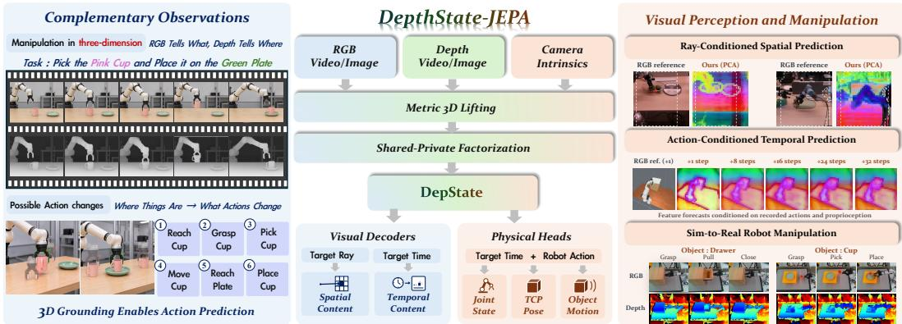  
Figure 1: From Where Things Are to What Actions Change. DepState-JEPA grounds complementary RGB–depth observations in a shared latent state, DepState, while retaining modality-private features for decoding. This depth-grounded state connects spatial queries with action-conditioned prediction of future visual features, robot state, and object motion.

To answer this question, we introduce DepState-JEPA (Fig. 1), a joint-embedding predictive architecture centered on DepState, a depth-grounded shared latent state connecting RGB–depth observations, spatial readout, and action-conditioned transition. Built on V-JEPA 2.1, an independent Depth-Video branch provides complementary observations and metric grounding for both streams. DepState aggregates shared information, while private paths preserve modality-specific detail for decoding rather than forming separate evolving states. This common interface supports reading missing spatial content and forecasting representations after robot actions. Representation learning uses images and video; robot prediction initializes DepState from a single RGB-D frame and evolves it under actions and proprioception, without accessing future RGB-D images.

Specifically, visible metric depth and camera intrinsics place both streams in metric 3D coordinates; shared–private projections and learned aggregation form a compact, geometrically grounded Dep State. Ray-conditioned readouts query local shared features without target depth; private features supply modality-specific decoding detail. After action-conditioned transitions, the same decoders predict future RGB and depth features with fixed initial private memory. Robot-state readouts supply recursive proprioception; object-motion supervision shapes the state. Calibrated forward kinematics couples independent joint and end-effector predictions, propagating consistency gradients into the transition alongside direct physical supervision.

Training proceeds in two stages: 1) RGB-D adaptation learns DepState from images and video clip via masked shared-feature completion and dense modality-feature prediction, exploiting spatial and temporal context. 2) Robot post-training learns action-conditioned transitions and physical readouts using future-state and feature targets, physical supervision, and kinematic regularization, while RGB-D replay retains the adaptation objectives. Evaluation (Sec. 4) spans spatial understanding, multi-step forecasting, and manipulation, with controlled ablations testing the roles of geometry, feature sharing, and kinematic consistency. Our contributions are threefold:

• Dual-stream RGB–Depth Video JEPA framework. We introduce DepState-JEPA, which connects spatial understanding and action-conditioned prediction through a shared latent state, DepState. Independent RGB and depth encoders capture complementary observations, while metric depth grounds both streams in a common 3D coordinate frame.

• Unified DepState construction and prediction pipeline. We aggregate shared RGB–depth features into DepState, retaining private features for modality-specific decoding. Ray-conditioned readouts predict missing features without target depth and are reused after action-conditioned transitions to predict future features, with initial private memory fixed throughout rollout. Robotstate readouts supply recursive proprioception; object-trajectory supervision and joint–TCP consistency provide complementary training signals for state evolution.

• Empirical gains and controlled component analysis. RGB-D adaptation improves RGBencoder transfer; the full pipeline supports feature prediction and manipulation. Within-model ablations identify contributions from depth and metric coordinates, private decoding for visual accuracy, and future-state matching for control performance.

## 2 RELATED WORK

## 2.1 JOINT-EMBEDDING PREDICTIVE ARCHITECTURES

Joint-embedding predictive learning uses target representations, rather than pixels, as the objects of prediction. I-JEPA learns image representations by predicting masked regions from visible context (Assran et al., 2023), while V-JEPA extends this approach to spatiotemporal video features (Bardes et al., 2024). V-JEPA 2 scales video pretraining and connects learned features to robot prediction and planning (Assran et al., 2025). V-JEPA 2.1 further develops dense and multi-level supervision, strengthening the spatial detail retained by video representations (Mur-Labadia et al., 2026). A complementary direction changes the unit of prediction: Causal-JEPA masks object-level latents and infers them from surrounding context to encourage interaction-dependent prediction (Nam et al., 2026). These approaches illustrate how prediction targets and representation structure shape what a model learns. DepState-JEPA extends the RGB-centric video JEPA framework along the modality axis, introducing an independent Depth-Video stream. We retain V-JEPA 2.1’s dense featurelearning design while making measured geometry an explicit input to shared-state construction, complementing spatial cues learned from RGB.

## 2.2 DEPTH AND 3D REPRESENTATION LEARNING FOR JEPAS

Depth-related JEPAs differ in whether depth is predicted, used for supervision, or encoded as geometric input. JEPADepth combines masked latent prediction with photometric supervision for monocular depth estimation (Grigore & Popa, 2026). Depth-Regularized JEPA aligns RGB features with depth features during training while retaining RGB-only inference (Khan, 2026). Le MuMo JEPA fuses RGB and camera-aligned LiDAR depth through learnable fusion tokens within a shared Transformer (Cornelissen et al., 2026). 3D-JEPA in Locate 3D learns masked point-cloud representations from RGB-D-derived geometry enriched with lifted 2D foundation-model features (Arnaud et al., 2025). SR-JEPA predicts missing-entity features in native 3D scenes at supplied target locations (Zhou et al., 2026). DepState-JEPA jointly encodes RGB and measured depth in independent video streams, using visible metric depth to ground both streams in camera coordinates. Shared–private factorization retains modality-specific features alongside the shared state, whereas ray-conditioned readout predicts missing content without target depth or a supplied 3D location. The same state evolves under actions to predict future RGB-D features, connecting geometric representation learning with spatial completion and temporal prediction through a common interface.

## 2.3 ACTION-CONDITIONED WORLD MODELS FOR ROBOTICS

Latent world models support robot control by predicting how representations change under actions. DINO-WM learns transitions over frozen DINOv2 patch features and optimizes action sequences toward visual goals (Zhou et al., 2024); PLDM studies JEPA-based planning from reward-free offline trajectories (Sobal et al., 2025). V-JEPA 2 adapts pretrained video features through actionconditioned robot post-training (Assran et al., 2025), whereas LeWorldModel jointly learns its encoder and dynamics from pixels with a distributional regularizer (Maes et al., 2026). A related question is how physical information should shape the representation. MCR uses proprioceptive state–action alignment for robot representation learning (Jiang et al., 2024); PSG-JEPA grounds individual states and state pairs in physical quantities (Yan et al., 2026), and physically grounded JEPA combines inverse dynamics with state alignment (Liu et al., 2026b). DepState-JEPA studies consistency among predicted physical quantities in addition to their direct supervision. Calibrated forward kinematics couples independent joint and end-effector readouts of the predicted state; object motion is supervised through increment-based pose trajectories. The kinematic constraint regularizes the depth-grounded state transition without imposing hard guarantees of physically correct dynamics.

Concurrent work. Closely related recent preprints advance geometric supervision and spatial prediction (Khan, 2026; Zhou et al., 2026), including geometry-conditioned video modeling (Kim et al., 2026; DreamX Team et al., 2026); physical state grounding and physics-conditioned latent dynamics (Yan et al., 2026; Liu et al., 2026a;b); and joint world modeling and action generation (Lin et al., 2026). These directions complement our use of an explicit depth stream, depth-lifted positions, and selectively shared RGB-D features for spatial, temporal, and robot prediction.

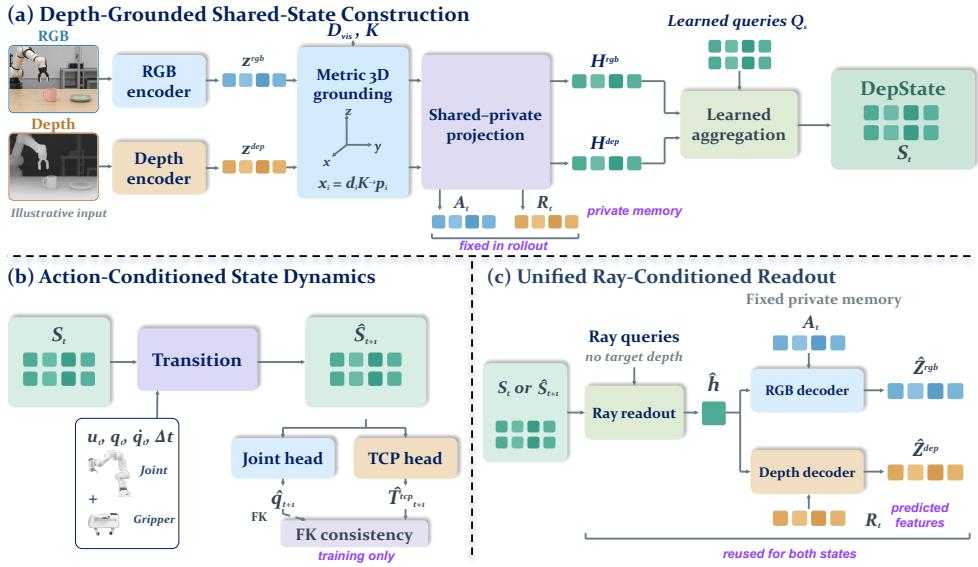  
Figure 2: Architectural Overview of DepState-JEPA. RGB–Depth features are grounded, factorized, and aggregated into DepState. Spatial queries read local content; action-conditioned transitions advance the state and reuse the visual decoders with initial private features. Physical readouts predict robot state and object motion, with FK regularizing independent joint/TCP outputs.

## 3 METHOD

## 3.1 PROBLEM SETUP AND JEPA OBJECTIVE

Problem Setup. Given registered RGB $I ,$ metric depth D, and intrinsics $K ,$ we construct Dep-State S, a shared latent state that supports local feature readout and action-conditioned evolution (Figure 2). Robot-state and object-motion heads connect predicted states to physical supervision. RGB-D adaptation uses images or video clips; robot prediction constructs $S _ { t }$ from the current frame only. Future RGB-D observations supply training targets, never rollout inputs. $S$ summarizes visible scene information for the specified readout and transition tasks.

JEPA Objective. JEPAs learn by predicting target representations (Assran et al., 2023). We adopt V-JEPA 2.1’s dense, multi-level objective (Mur-Labadia et al., 2026) for both RGB and depth, denoted throughout by LJEPA:

$$
\mathcal { L } _ { \mathrm { J E P A } } = \operatorname* { m e a n } _ { m , \ell } \left[ \frac { \sum _ { i \in \mathcal { M } _ { m } } e _ { i } ^ { m , \ell } } { \left| \mathcal { M } _ { m } \right| } + \frac { \sum _ { i \in \mathcal { V } _ { m } } w _ { i } e _ { i } ^ { m , \ell } } { \left| \mathcal { V } _ { m } \right| } \right] .\tag{1}
$$

Here m and $\ell$ index modalities and encoder levels; $\mathcal { M } _ { m } , \mathcal { V } _ { m }$ contain valid masked and visible targets. The error $e _ { i } ^ { m , \ell }$ is channel-averaged L1 between layer-normalized predictions and stopgradient teacher features; $w _ { i }$ weights visible targets by distance to masked positions (Appendix C.1). The teacher follows $\bar { \theta }  \tau \bar { \theta } + ( \bar { 1 - \tau } ) \theta$ , where $\bar { \boldsymbol { \theta } }$ are online representation parameters and τ is EMA retention. This inherited objective supervises visual feature prediction; our state construction and readout define the interface through which it is learned.

## 3.2 DEPTH-GROUNDED SHARED-STATE CONSTRUCTION

Depth-Lifted Spatial Encoding. V-JEPA 2.1 RGB and depth encoders with separate weights produce multi-level features, fused per modality into $z _ { i } ^ { m } , m \in \{ \mathrm { r g b } , \mathrm { d e p } \}$ . For a visible patch center $\mathbf { p } _ { i } = ( u _ { i } , v _ { i } , 1 ) ^ { \top }$ with valid metric depth $d _ { i }$

$$
\begin{array} { r } { \mathbf { x } _ { i } = d _ { i } K ^ { - 1 } \mathbf { p } _ { i } , \qquad \widetilde { z } _ { i } ^ { m } = z _ { i } ^ { m } + \mathrm { P E } _ { 3 D } ( \mathbf { x } _ { i } ) . } \end{array}\tag{2}
$$

Here $\mathbf { x } _ { i }$ is the patch’s metric position in the camera frame, and $\mathrm { P E } _ { 3 D }$ is a learned projection of Fourier-encoded coordinates (Mildenhall et al., 2020). Adding it to both streams places correspond-

ing RGB and depth features in the same metric frame, separately from inherited spatiotemporal RoPE (Su et al., 2021). Masked tokens are removed before encoder attention, and only visible depth supplies online coordinates. Invalid depths receive an unknown-geometry embedding (App. B.1).

Shared–Private Feature Projection. To aggregate common information without forcing all modality detail into S, independent MLPs project the grounded tokens $\widetilde { Z } ^ { m }$ into shared features and private decoder inputs:

$$
H ^ { m } = F _ { s } ^ { m } ( \widetilde { Z } ^ { m } ) , \qquad P ^ { m } = F _ { p } ^ { m } ( \widetilde { Z } ^ { m } ) , \qquad P ^ { \mathrm { r g b } } = A , \quad P ^ { \mathrm { d e p } } = R .\tag{3}
$$

Here $F _ { s } ^ { m }$ and $F _ { p } ^ { m }$ are modality-specific shared and private projections, with output widths $d _ { s }$ and $d _ { p } ,$ , respectively. Only $H ^ { m }$ enters the recurrent state and control interface; A and R bypass it to supply RGB- and depth-specific content to the visual decoders. The state and private paths thus have distinct computational roles.

Depth-Grounded Shared-State Aggregation. Learned queries compress the shared observation features into a fixed-size state:

$$
S = G _ { \psi } \left( Q _ { s } , [ H ^ { \mathrm { r g b } } ; H ^ { \mathrm { d e p } } ] \right) .\tag{4}
$$

The attention aggregator $G _ { \psi }$ uses 64 learned queries $Q _ { s }$ of width 384 to read shared keys/values with modality/time embeddings (Jaegle et al., 2021); $[ \cdot ; \cdot ]$ denotes concatenation. The resulting state varies with the observation. Query indices are generic slots, not predefined robot joints or object identities.

Selective-Sharing Regularization. Alignment encourages cross-modal agreement, decorrelation discourages shared–private redundancy, and a variance floor opposes collapse:

$$
\mathcal { L } _ { \mathrm { f a c } } = \operatorname* { m e a n } _ { i \in \mathcal { V } _ { \mathrm { v a l i d } } } d _ { c } ( H _ { i } ^ { \mathrm { r g b } } , H _ { i } ^ { \mathrm { d e p } } ) + \lambda _ { \mathrm { d e c o r r } } \sum _ { m } \frac { \| C ( H ^ { m } , P ^ { m } ) \| _ { F } ^ { 2 } } { d _ { s } d _ { p } } + \lambda _ { \mathrm { v a r } } \mathcal { L } _ { \mathrm { v a r } } .\tag{5}
$$

Here $d _ { c } ( a , b ) = 1 - a ^ { \top } b / ( \| a \| _ { 2 } \| b \| _ { 2 } )$ is cosine distance, and $\mathcal { V } _ { \mathrm { v a l i d } }$ contains geometrically valid visible correspondences. $C$ is cross-covariance after channel standardization over valid batch–position pairs; $\| \cdot \| _ { F }$ is the Frobenius norm, and $d _ { s } d _ { p }$ normalizes the number of shared–private channel pairs. Both online branches receive gradients. The variance-floor term ${ \mathcal { L } } _ { \mathrm { v a r } }$ (Bardes et al., 2022) regularizes features and across-sample state variation; its definition and the fixed weights are given in Appendix C.1. Cross-modal alignment acts on shared features, while the private paths retain separate modality-specific decoding objectives.

## 3.3 RAY-CONDITIONED SPATIAL PREDICTION

Ray-Conditioned State Readout. Whereas aggregation writes observations into $S ,$ the spatial decoder $h _ { \eta }$ reads local shared content from S alone. A target pixel supplies a ray direction $r _ { i }$ , not its distance, and relative clip time $\nu _ { i }$ (zero for images):

$$
\begin{array} { r } { r _ { i } = K ^ { - 1 } \mathbf p _ { i } / \| K ^ { - 1 } \mathbf p _ { i } \| _ { 2 } , \quad \hat { h } _ { i } = h _ { \eta } ( S , \mathrm { P E } _ { \mathrm { r a y } } ( r _ { i } , \nu _ { i } ) ) , } \\ { \mathcal { L } _ { \mathrm { c o m p } } = \underset { i \in \mathcal { M } _ { \mathrm { v a l i d } } } { \mathrm { m e a n ~ } } d _ { c } \Big ( \hat { h } _ { i } , \mathrm { s g } ( { h } _ { i } ^ { \star } ) \Big ) . \quad \quad } \end{array}\tag{6}
$$

Here $\mathrm { P E _ { r a y } }$ embeds direction and relative time; $\mathcal { M } _ { \mathrm { v a l i d } }$ selects valid masked targets for the loss, without supplying target depth to the online query. The target $h _ { i } ^ { \star } \ = \ \mathrm { n o r m } ( \mathrm { n o r m } ( \bar { H } _ { i } ^ { \mathrm { r g b } } ) \ +$ norm $( { \bar { H } } _ { i } ^ { \mathrm { d e p } } ) _ { . }$ ) uses full-observation momentum features and L2 normalization; sg stops gradients.

Private-Conditioned Feature Prediction. Modality decoders $g _ { m } ^ { \ell }$ combine $\hat { h } _ { i }$ with visible A or R to predict encoder-level RGB/depth features at both masked and visible positions, supervised by the inherited dense JEPA objective in Eq. (1). Together these define the spatial prediction objective $\mathcal { L } _ { \mathrm { s p a t i a l } } = \mathcal { L } _ { \mathrm { J E P A } } + \mathcal { L } _ { \mathrm { c o m p } } ;$ completion supervises local shared features, and dense prediction anchors modality-specific encoder features. Both operate in representation space.

## 3.4 ACTION-CONDITIONED STATE PREDICTION

Action-Conditioned State Transition. A temporal Transformer advances $S _ { t }$ using a joint command $u _ { t } ,$ , configuration $q _ { t }$ , instantaneous velocity $\dot { q } _ { t }$ , and physical time interval $\Delta t _ { t }$ , distinct from clip time

$\nu _ { i } .$ . The existing visual readouts decode the predicted state:

$$
\begin{array} { r } { \hat { S } _ { t + 1 } = { \mathcal T } _ { \phi } ( S _ { t } , u _ { t } , q _ { t } , \dot { q } _ { t } ; \Delta t _ { t } ) , \quad \hat { Z } _ { t + 1 } ^ { m , \ell } = g _ { m } ^ { \ell } \Big ( h _ { \eta } ( \hat { S } _ { t + 1 } , Q _ { \mathrm { r a y } } ) , P _ { t } ^ { m } \Big ) . } \end{array}\tag{7}
$$

Here $Q _ { \mathrm { r a y } }$ contains the known image-grid ray embeddings, with $\nu _ { i } = 0$ for each predicted frame. $P _ { t } ^ { m }$ is extracted from the initial observation and held fixed across the rollout, serving visual decoding only. Spatial and future prediction share $h _ { \eta } , g _ { m } ^ { \ell } ,$ not the temporal Transformer.

Future-feature matching supervises the content read from the predicted state; state matching anchors the representation reused at the next step:

$$
\mathcal { L } _ { \mathrm { t e m p o r a l } } = \operatorname* { m e a n } _ { m , \ell , i } \frac { 1 } { c } \left\| \mathrm { L N } ( \hat { Z } _ { t + 1 , i } ^ { m , \ell } ) - \mathrm { s g } ( \mathrm { L N } ( \bar { Z } _ { t + 1 , i } ^ { m , \ell } ) ) \right\| _ { 1 } + \operatorname* { m e a n } _ { k } d _ { c } ( \hat { S } _ { t + 1 , k } , \mathrm { s g } ( \bar { S } _ { t + 1 , k } ) ) .\tag{8}
$$

Here $\bar { Z }$ and $\bar { S }$ are momentum encoder features and aggregated states; i indexes valid target positions and k corresponding state slots. LN is non-affine layer normalization and c the feature width. Both components are averaged over samples and supervised rollout steps (Appendix C.1). A fixed calibrated external camera supplies future rays without future depth. Control and ablation rollouts use predicted states and endpoint proprioception; A, R stay fixed at the initial observation.

Robot-State and Object-Motion Readouts. Three independent endpoint heads read mean-pooled $\hat { S } _ { t + 1 }$ to predict joint configuration $\hat { q } _ { t + 1 }$ , instantaneous velocity $\widehat { \dot { q } } _ { t + 1 }$ , and tool-center-point (TCP) pose $\hat { T } _ { t + 1 } ^ { \mathrm { t c p } }$ . The predicted configuration and velocity condition the next rollout step. One objectmotion head reads the pooled state pair $( S _ { t } , \hat { S } _ { t + 1 } )$ and its difference to predict a finite body-frame pose increment $\widehat { \Delta \xi } _ { t } ^ { o }$ , not a velocity, for each annotated object or part o:

$$
\hat { T } _ { t + 1 } ^ { o } = \tilde { T } _ { t } ^ { o } \mathrm { E x p } ( [ \widehat { \Delta \xi } _ { t } ^ { o } ] ^ { \wedge } ) .\tag{9}
$$

Here Exp maps the Lie-algebra matrix $\widehat { [ \Delta \xi _ { t } ^ { o } ] } ^ { \setminus }$ to an SE(3) transform acting on the right. The trajectory starts from a supplied object pose and thereafter uses predicted poses; this accumulator does not condition the visual state, transition, or readout heads. The endpoint readouts and integrated object poses receive valid-label supervision, grouped as $\mathcal { L } _ { \mathrm { s u p } }$ (Appendix C.1).

Joint–TCP Kinematic Consistency. Independent joint and TCP predictions should describe the same robot configuration. Direct labels anchor each output to measurements; fixed differentiable forward kinematics (FK) constrains their agreement:

$$
\mathcal { L } _ { \mathrm { F K } } = d _ { \mathrm { p o s e } } ( \mathrm { F K } _ { \mathrm { t c p } } ( \hat { q } _ { t + 1 } ) , \hat { T } _ { t + 1 } ^ { \mathrm { t c p } } ) .\tag{10}
$$

Here $d _ { \mathrm { p o s e } }$ combines unit-normalized translation and SO(3) geodesic errors. $\mathrm { F K } _ { \mathrm { t c p } }$ includes the calibrated chain, base transform, and tool offset; gradients through both heads reach the latent transition. This consistency term complements direct joint/TCP supervision by coupling the two output heads through the same predicted state and known robot geometry.

## 3.5 TRAINING AND ROLLOUT PROTOCOL

RGB-D adaptation trains state construction and readout on images and video clips using spatial and temporal context, not causal next-frame rollouts. Robot post-training adds action-conditioned transitions and physical heads; image/video replay continues the adaptation objective:

$$
\begin{array} { r l } & { \mathcal { L } _ { \mathrm { a d a p t } } = \mathcal { L } _ { \mathrm { s p a t i a l } } + \mathcal { L } _ { \mathrm { f a c } } , } \\ & { \mathcal { L } _ { \mathrm { r o b o t } } = \mathcal { L } _ { \mathrm { t e m p o r a l } } + \mathcal { L } _ { \mathrm { f a c } } + \mathcal { L } _ { \mathrm { s u p } } + \lambda _ { \mathrm { F K } } \gamma ( n ) \mathcal { L } _ { \mathrm { F K } } . } \end{array}\tag{11}
$$

The schedule $\gamma ( n )$ gradually enables FK over robot updates n; supervision uses valid labels. The stopped EMA teacher tracks the representation stack, including factorization and aggregation, but not predictors or physical heads. Control and ablation rollouts recursively use predicted states and proprioception with fixed initial private features; Table 2 uses recorded proprioception instead. Appendix C.1 gives weights and schedules, Appendix B.2 details the modules, and Algorithms 1–2 specify training and rollout.

## 4 EXPERIMENTS

We evaluate four questions: Q1: Does RGB-D adaptation improve encoder transfer and feature completion? (Sec. 4.2) Q2: How accurate are visual forecasts under recorded physical conditioning? (Sec. 4.3) Q3: Do learned predictions support planning and control? (Sec. 4.4) Q4: Which components drive predictive performance? (Sec. 4.5)

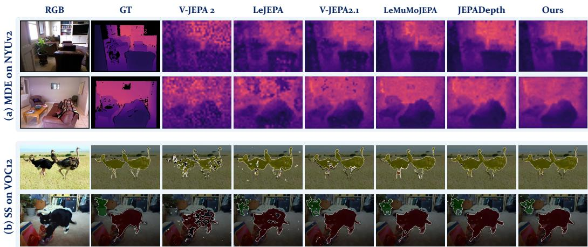  
Figure 3: Qualitative Evaluation of Frozen Spatial Representations. Task-specific probes trained on frozen encoders produce (a) monocular depth estimates on NYUv2 and (b) semantic segmentation maps on VOC12. RGB inputs and ground-truth annotations provide references. Depth maps share a common metric color scale, and segmentation maps use a consistent class palette.

Table 1: Frozen Spatial Transfer and RGB-D Feature Completion. MDE and SS use frozenencoder probes on NYUv2 and VOC12. SC measures masked-region L1 and Cos against shared references on LingBot-Depth, with equal RGB/depth weighting. †: method-specific adaptation.
<table><tr><td rowspan="2">Method</td><td colspan="4">MDE on NYUv2</td><td colspan="2">SS on VOC12</td><td colspan="2">SC on LB-Depth</td></tr><tr><td>AbsRel↓ RMSE↓</td><td></td><td>log10 ↓ δ1 ↑</td><td></td><td>mIoU↑</td><td>mAcc↑</td><td>L1↓</td><td>Cos.↑</td></tr><tr><td>LeJEPA (Balestriero &amp; LeCun, 2025)</td><td>0.137</td><td>0.490</td><td>0.059</td><td>85.7</td><td>76.0</td><td>85.0</td><td>0.352</td><td>0.891</td></tr><tr><td>V-JEPA 2 (Assran et al., 2025)</td><td>0.188</td><td>0.642</td><td>0.079</td><td>77.5</td><td>63.9</td><td>76.8</td><td>0.428</td><td>0.843</td></tr><tr><td>V-JEPA 2.1 (Mur-Labadia et al., 2026)</td><td>0.098</td><td>0.350</td><td>0.042</td><td>92.5</td><td>84.7</td><td>91.8</td><td>0.298</td><td>0.931</td></tr><tr><td>3D-JEPA† (Arnaud et al., 2025)</td><td></td><td>Not evaluated: point-cloud input</td><td></td><td></td><td></td><td></td><td>0.283</td><td>0.938</td></tr><tr><td>LeMuMo-JEPA† (Cornelissen et al., 2026)</td><td>0.097</td><td>0.345</td><td>0.042</td><td>92.7</td><td>84.2</td><td>91.6</td><td>0.291</td><td>0.936</td></tr><tr><td>JEPADepth (Grigore &amp; Popa, 2026)</td><td>0.090</td><td>0.323</td><td>0.039</td><td>93.8</td><td>84.5</td><td>91.7</td><td>0.312</td><td>0.923</td></tr><tr><td>DepState-JEPA (Ours)</td><td>0.088</td><td>0.316</td><td>0.038</td><td>94.2</td><td>86.0</td><td>92.8</td><td>0.247</td><td>0.951</td></tr></table>

## 4.1 EXPERIMENTAL SETUP

App. E specifies task protocols and adaptations. We compare RGB-origin JEPAs: LeJEPA (Balestriero & LeCun, 2025), V-JEPA 2 (Assran et al., 2025), and V-JEPA 2.1 (Mur-Labadia et al., 2026); and depth-related JEPAs: Locate 3D’s 3D-JEPA (Arnaud et al., 2025), LeMuMo-JEPA (Cornelissen et al., 2026), and JEPADepth (Grigore & Popa, 2026). These comparisons assess complete systems with their stated pretraining, capacity, and adaptation. Within-model ablations test the designated components. Concurrent work is discussed in Sec. 2.

## 4.2 SPATIAL REPRESENTATION TRANSFER AND PREDICTION

Spatial Transfer with Frozen Encoders. Following V-JEPA 2.1’s frozen dense-probing protocol (Mur-Labadia et al., 2026), we evaluate monocular depth estimation (MDE) on NYUv2 (Silberman et al., 2012) and semantic segmentation (SS) on VOC12 (Everingham et al., 2015). Linear probes read normalized final-layer features. Ours uses the Stage-A RGB encoder, measuring transfer after RGB-D adaptation with the depth branch and DepState bypassed at inference. Readouts, preprocessing, and probe optimization are shared within each task; V-JEPA and ours use ViT-g. App. E.3 lists representation training and probing conditions. Tab. 1 and Fig. 3 give scores and predictions.

Masked RGB-D Spatial Feature Completion. We extend V-JEPA 2.1’s masked feature prediction to RGB-D spatial completion (SC) on held-out LingBot-Depth scenes (Tan et al., 2026). All methods share identical RGB/depth masks, visible context, and calibration; masked depth is excluded from geometric lifting and query construction. Tab. 1 reports masked-region L1 and cosine similarity against shared frozen RGB/depth references, each averaged equally over modalities. Fig. 4(a) shows PCA visualizations of completed features in masked regions. App. E.4 specifies synchronized masks, frozen reference targets, and masked-token scoring.

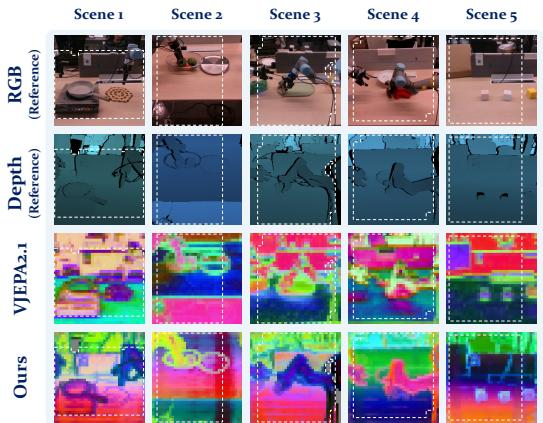  
(a)	The	PCA	visualization	of	Spatial	Feature Completion

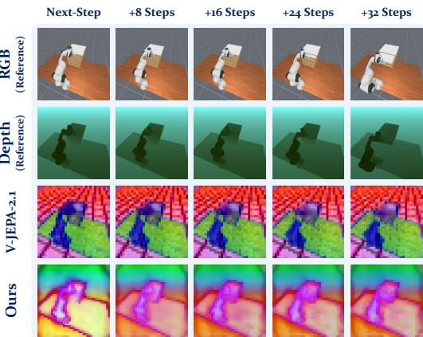  
(b)	The	PCA	visualization	of	Temporal	Feature Prediction

Figure 4: Spatial Completion and Temporal Prediction in Feature Space. PCA of (a) completion from jointly masked RGB-D observations and (b) multi-step visual forecasts on robot trajectories.  
Table 2: Single-Step and Multi-Step Prediction in a Common Feature Space. Frozen readouts map predictions to a shared RGB reference space for L1 and Cos. evaluation. †: The AC adaptation.
<table><tr><td>Method</td><td>1 step L1↓ Cos.↑</td><td>8 steps L1↓ Cos.↑</td><td>16 steps L1↓ Cos.↑</td><td>L1↓</td><td>24 steps</td><td>32 steps</td></tr><tr><td>V-JEPA 2-AC (Assran et al., 2025)</td><td>0.242 0.916 0.421</td><td>0.792</td><td>0.523</td><td></td><td>Cos.↑</td><td>L1↓ Cos.↑</td></tr><tr><td>V-JEPA 2.1-AC (Mur-Labadia et al., 2026)</td><td>0.171 0.967 0.342 0.874 0.476 0.7810.554 0.702 0.614 0.636</td><td></td><td></td><td>0.701 0.580</td><td></td><td>0.6460.6580.598</td></tr><tr><td>3D-JEPA-AC† (Arnaud et al., 2025)</td><td></td><td>0.1690.9680.3360.879</td><td>0.467</td><td>0.7890.546</td><td>0.711</td><td>0.602 0.647</td></tr><tr><td>LeMuMo-JEPA-AC† (Cornelissen et al., 2026) 0.167 0.969 0.331 0.882</td><td></td><td></td><td>0.479</td><td>0.778 0.563</td><td></td><td>0.694 0.624 0.627</td></tr><tr><td>DepState-JEPA-AC (Ours)</td><td>0.145 0.976 0.307 0.903 0.394 0.851 0.451 0.811 0.491 0.779</td><td></td><td></td><td></td><td></td><td></td></tr></table>

## 4.3 TEMPORAL VISUAL PREDICTION

Next-Step Visual Prediction. We evaluate next-frame features on held-out robot trajectories. Frozen linear readouts map predictions to a shared V-JEPA 2.1 RGB reference space. Fitted on observed training frames, readouts stay frozen across horizons. L1 and token-wise cosine similarity score the complete prediction–readout path. App. E.5 specifies calibration, interfaces, and actionconditioned adaptation.

Multi-Step Visual Forecasting. We evaluate recursive visual predictions at 8, 16, 24, 32 steps from matched starting frames. Table 2 supplies recorded actions and proprioception at each step, with no future images. DepState-JEPA keeps its initial private memory fixed. Control and internal ablation rollouts instead use predicted proprioception (App. E.7). Fig. 4(b) shows feature forecasts across horizons.

## 4.4 EMBODIED PREDICTION AND MANIPULATION

Online Policy Learning through Trajectories. Following DreamerV3 (Hafner et al., 2025), we train an actor–critic on imagined trajectories and adapt JEPA dynamics from online replay. Evaluation directly executes the actor. We use 20 DMControl (DMC) and 50 Meta-World (MW) tasks with matched interaction budgets. Tab. 3 reports task-averaged episode return (the sum of rewards) for DMC and averaged success for MW. App. E.6.1 specifies replay, imagination, and policy learning.

Latent Space Receding-Horizon Planning. Following TD-MPC2 (Hansen et al., 2024), we use model predictive control (MPC): optimize action sequences through the learned latent transition using predicted rewards and terminal values, execute the first action, and replan at every step. Task sets, interaction budgets, and search budgets are matched across JEPA models. Tab. 3 reports both metrics; App. E.6.2 specifies value learning and trajectory optimization.

Sim2real Manipulation Transfer. We construct matched simulation and real environments (Fig. 5) and augment simulated depth with PRISM (Liang et al., 2026). Simulation-trained models remain frozen for drawer and cup visual-goal MPC. Tab. 3 reports full-task success across three seeds, with 30 trials each. The 60-second robot-execution budget excludes inference and search. App. E.6.3 specifies subgoals, independent resets, and success aggregation.

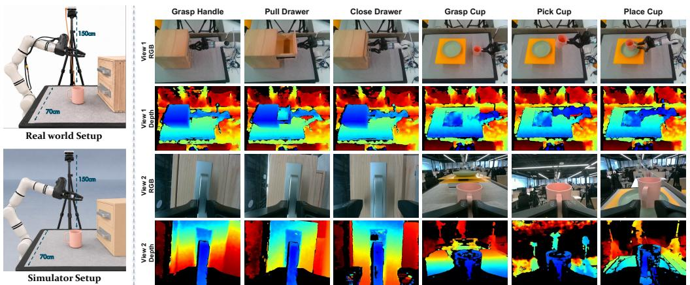  
Figure 5: Sim-to-Real Setup and Multi-View RGB-D Rollouts. Left: simulation and real-world setups. Right: RGB-D observations from two viewpoints during real-robot manipulation tasks.

Table 3: JEPA-Based Policy Learning, Planning, and Sim-to-Real Control. DMC reports taskaveraged episode return; MW and Sim2Real report success rate (%). Entries are mean ± std.
<table><tr><td rowspan="2">Method</td><td colspan="2">Online PL</td><td colspan="2">Latent MPC</td><td colspan="2">Sim2Real MPC</td></tr><tr><td>DMC↑</td><td>MW↑</td><td>DMC↑</td><td>MW↑</td><td> $\overline { { \mathrm { T a s k ~ } 1 \uparrow } }$ </td><td>Task 2↑</td></tr><tr><td>V-JEPA 2-AC (Assran et al., 2025)</td><td> $\overline { { 6 8 2 . 4 \pm 1 4 . 7 } }$ </td><td> $\overline { { 5 2 . 8 \pm 2 . 8 } }$ </td><td> $7 3 6 . 5 \pm 1 5 . 3$ </td><td> $6 6 . 4 \pm 2 . 4$ </td><td> $\overline { { 4 5 . 6 \pm 5 . 1 } }$ </td><td> $\overline { { 4 1 . 1 \pm 5 . 1 } }$ </td></tr><tr><td>V-JEPA 2.1-AC (Mur-Labadia et al., 2026)</td><td> $7 6 3 . 8 \pm 1 5 . 4$ </td><td> $6 8 . 6 \pm 2 . 3$ </td><td> $8 0 7 . 2 \pm 1 5 . 0$ </td><td> $8 1 . 2 \pm 2 . 6$ </td><td> $6 6 . 7 \pm 6 . 7$ </td><td> $6 4 . 4 \pm 5 . 1$ </td></tr><tr><td>3D-JEPA-AC† (Arnaud et al., 2025)</td><td> $7 8 4 . 4 \pm 1 2 . 6$ </td><td> $7 2 . 3 \pm 2 . 6$ </td><td> $8 2 6 . 4 \pm 1 8 . 2$ </td><td> $8 5 . 6 \pm 3 . 2$ </td><td> $7 3 . 3 \pm 5 . 8$ </td><td> $7 1 . 1 \pm 5 . 1$ </td></tr><tr><td>LeMuMo-JEPA-AC† (Cornelissen et al., 2026)</td><td> $7 9 0 . 4 \pm 1 6 . 1$ </td><td> $7 3 . 2 \pm 2 . 5$ </td><td> $8 3 7 . 5 \pm 1 3 . 6$ </td><td> $8 7 . 8 \pm 2 . 2$ </td><td> $7 5 . 6 \pm 6 . 9$ </td><td> $7 4 . 4 \pm 8 . 4$ </td></tr><tr><td>DepState-JEPA-AC (Ours)</td><td> $\overline { { 8 1 3 . 2 \pm 1 4 . 3 } }$ </td><td>1  $\overline { { 7 7 . 1 \pm 2 . 8 } }$  </td><td> $\overline { { 8 5 7 . 8 \pm 1 7 . 8 } }$  1</td><td> $\overline { { 9 \mathbf { 0 . 1 } \pm 2 . 8 } }$  1</td><td> $\overline { { 8 1 . 1 \pm 5 . 1 } }$  1</td><td> $\overline { { 7 8 . 9 \pm 3 . 8 } }$ </td></tr></table>

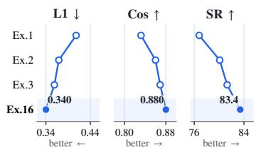  
(a) Geometry-Grounded State

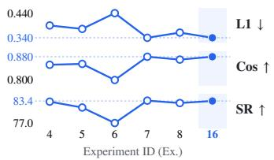  
(b) Sharing and Spatial Readout

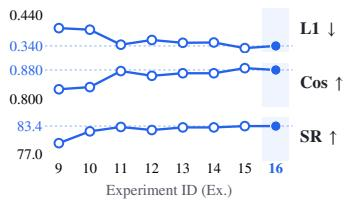  
(c) Temporal Prediction and Grounding  
Figure 6: Ablation Results. L1/Cos: 3 tasks; SR: 50 MW + 2 real (%). Details in App. E.7.

## 4.5 ABLATION STUDY

Ex.1–Ex.15 vary components against the full Ex.16 configuration. App. E.7 defines interventions and disaggregates completion, Drawer/Cup prediction, and controller-specific success.

Effect of Depth Content and Metric Coordinates. Ex.1–Ex.3 and Ex.16 isolate depth content and metric coordinates under fixed backbones and supervision. Combining both reduces L1 from 0.408 to 0.340 and raises SR from 76.8% to 83.4% (Fig. 6(a)). Each factor improves prediction and control, although their joint gains are subadditive at the reported means.

Effect of Selective Sharing and Spatial Readout. Ex.4–Ex.8 vary private decoding, alignment, aggregation, queries, and completion (Fig. 6(b)). Removing private decoding raises L1 from 0.340 to 0.390, with SR at 83.2% versus 83.4%. Mean aggregation gives L1 0.440 and SR 77.0%. Pixel/ray queries tie in feature scores; private decoding primarily benefits visual readout.

Effect of Temporal Modeling and Physical Supervision. Ex.9–Ex.15 vary temporal targets, physical supervision, memory, and decoders (Fig. 6(c)). Removing future-state matching lowers SR from 83.4% to 79.5%; removing FK gives 82.5% with direct labels retained. Separate decoders reach L1 0.333 and SR 83.4% with added capacity. App. E.7 relates these outcomes to each intervention.

## 5 CONCLUSION

DepState-JEPA connects RGB–depth geometry, shared-state evolution, and private decoding for feature completion, conditioned forecasting, and manipulation. RGB-D adaptation improves encoder transfer; ablations identify contributions from geometry, local state content, and future-state supervision. App. F discusses the remaining scope.

## STATEMENT ON THE USE OF AI TOOLS

In this work, we used generative AI tools (Codex) solely to assist with drafting parts of the manuscript, editing the text for readability, and adjusting LAT X formatting and layout. We did not use generative AI tools to generate synthetic datasets, develop theoretical models or concep tual frameworks, formulate mathematical claims, provide critical ingredients for proofs or assist in writing proofs, propose or refine hypotheses, design or provide feedback on research methodology or experiments, implement the DepState-JEPA method, or interpret experimental results. All AIassisted manuscript preparation was conducted under human direction and supervision. The authors reviewed and revised the AI-assisted text and inspected the compiled manuscript. We take full responsibility for the final content of this work, including all text, claims, and artifacts produced with the aid of generative AI tools.

## REFERENCES

Sergio Arnaud, Paul McVay, Ada Martin, Arjun Majumdar, Krishna Murthy Jatavallabhula, Phillip Thomas, Ruslan Partsey, Daniel Dugas, Abha Gejji, Alexander Sax, Vincent-Pierre Berges, Mikael Henaff, Ayush Jain, Ang Cao, Ishita Prasad, Mrinal Kalakrishnan, Michael Rabbat, Nicolas Ballas, Mido Assran, Oleksandr Maksymets, Aravind Rajeswaran, and Franziska Meier. Locate 3D: Real-world object localization via self-supervised learning in 3D. arXiv preprint arXiv:2504.14151, 2025. URL https://arxiv.org/abs/2504.14151.

Mahmoud Assran, Quentin Duval, Ishan Misra, Piotr Bojanowski, Pascal Vincent, Michael Rabbat, Yann LeCun, and Nicolas Ballas. Self-supervised learning from images with a joint-embedding predictive architecture. In Proceedings of the IEEE/CVF Conference on Computer Vision and Pattern Recognition, pp. 15619–15629, 2023. URL https://arxiv.org/abs/2301.08243.

Mido Assran, Adrien Bardes, David Fan, Quentin Garrido, Russell Howes, et al. V-JEPA 2: Self-supervised video models enable understanding, prediction and planning. arXiv preprint arXiv:2506.09985, 2025. URL https://arxiv.org/abs/2506.09985.

Randall Balestriero and Yann LeCun. LeJEPA: Provable and scalable self-supervised learning without the heuristics. arXiv preprint arXiv:2511.08544, 2025. URL https://arxiv.org/abs/ 2511.08544.

Adrien Bardes, Jean Ponce, and Yann LeCun. VICReg: Variance-invariance-covariance regularization for self-supervised learning. In International Conference on Learning Representations, 2022. URL https://arxiv.org/abs/2105.04906.

Adrien Bardes, Quentin Garrido, Jean Ponce, Xinlei Chen, Michael Rabbat, Yann LeCun, Mahmoud Assran, and Nicolas Ballas. Revisiting feature prediction for learning visual representations from video. arXiv preprint arXiv:2404.08471, 2024. URL https://arxiv.org/abs/2404. 08471.

Shariq Farooq Bhat, Reiner Birkl, Diana Wofk, Peter Wonka, and Matthias Muller. ZoeDepth:¨ Zero-shot transfer by combining relative and metric depth. arXiv preprint arXiv:2302.12288, 2023. URL https://arxiv.org/abs/2302.12288.

Ciem Cornelissen, Sam Leroux, and Pieter Simoens. Le MuMo JEPA: Multi-modal self-supervised representation learning with learnable fusion tokens. In CVPR Workshop on Unified Robotic Vision with Cross-Modal Sensing andAlignment (URVIS), 2026. URL https://arxiv.org/ abs/2603.24327.

DreamX Team, Rui Chen, Xiangxiang Chu, Geng Li, Jifan Li, Qingfeng Shi, Datao Tang, Jing Tang, Jun Wang, and Pengfei Zhang. DreamX-Phi 1.0: Action-conditioned video world model for robotic manipulation. arXiv preprint arXiv:2608.13489, 2026. URL https://arxiv. org/abs/2608.13489.

Mark Everingham, SM Ali Eslami, Luc Van Gool, Christopher KI Williams, John Winn, and Andrew Zisserman. The pascal visual object classes challenge: A retrospective. International journal of computer vision, 111(1):98–136, 2015.

Ionut¸ Grigore and Calin-Adrian Popa. JEPADepth: Masked Predictive Representation Learning for ˘ Self-Supervised Monocular Depth Estimation. arXiv preprint arXiv:2607.26600, 2026. URL https://arxiv.org/abs/2607.26600.

David Ha and Jurgen Schmidhuber. World Models. ¨ arXiv preprint arXiv:1803.10122, 2018. URL https://arxiv.org/abs/1803.10122.

Danijar Hafner, Jurgis Pasukonis, Jimmy Ba, and Timothy Lillicrap. Mastering diverse control tasks through world models. Nature, 640:647–653, 2025. doi: 10.1038/s41586-025-08744-2. URL https://www.nature.com/articles/s41586-025-08744-2.

Nicklas Hansen, Hao Su, and Xiaolong Wang. TD-MPC2: Scalable, robust world models for continuous control. In International Conference on Learning Representations, 2024. URL https://arxiv.org/abs/2310.16828.

Andrew Jaegle, Sebastian Borgeaud, Jean-Baptiste Alayrac, Carl Doersch, Catalin Ionescu, David Ding, Skanda Koppula, Daniel Zoran, Andrew Brock, Evan Shelhamer, Olivier Henaff,´ Matthew M. Botvinick, Andrew Zisserman, Oriol Vinyals, and Joao Carreira. Perceiver IO: A¯ General Architecture for Structured Inputs & Outputs. arXiv preprint arXiv:2107.14795, 2021. URL https://arxiv.org/abs/2107.14795.

Guangqi Jiang, Yifei Sun, Tao Huang, Huanyu Li, Yongyuan Liang, and Huazhe Xu. Robots Pretrain Robots: Manipulation-Centric Robotic Representation from Large-Scale Robot Datasets. arXiv preprint arXiv:2410.22325, 2024. URL https://arxiv.org/abs/2410.22325.

Usman M. Khan. Depth-regularized JEPA world models learn more transferable representations from real outdoor robot data. arXiv preprint arXiv:2607.16314, 2026. URL https://arxiv. org/abs/2607.16314.

Byungjun Kim, Taeksoo Kim, Hyunsoo Cha, and Hanbyul Joo. Robot-Factored World Models via Robot Rendering. arXiv preprint arXiv:2607.22535, 2026. URL https://arxiv.org/ abs/2607.22535.

Xiujian Liang, Jiacheng Liu, Mingyang Sun, Qichen He, Anda Cheng, Cewu Lu, and Jianhua Sun. PRISM: Learning realistic depth via physics-grounded noise disentanglement with semanticgeometric collaboration. In Forty-third International Conference on Machine Learning, 2026. URL https://openreview.net/forum?id=AnofTirXgv.

Yihan Lin, Jiawei He, Shifeng Bao, Chen Zhao, Yang Li, Xiaobo Wang, Yan Wang, Cheng Chi, and Jing Zhang. JEPA-WAM: Learning vision-language-action policies with joint-embedding world modeling. arXiv preprint arXiv:2608.09381, 2026. URL https://arxiv.org/abs/ 2608.09381.

Andy Zeyi Liu, Haoran Sun, Lucas Baker, Randall Balestriero, and John Sous. Semigroup-JEPA: Latent Dynamics Consistency for Zero-Shot Physics Generalization. arXiv preprint arXiv:2609.10464, 2026a. URL https://arxiv.org/abs/2609.10464.

Muyuan Liu, Yue Huang, Zheng Liang, and Xiang Gao. Toward Physically Grounded JEPA World Models for Goal-Conditioned Robotic Planning. arXiv preprint arXiv:2609.03565, 2026b. URL https://arxiv.org/abs/2609.03565.

Lucas Maes, Quentin Le Lidec, Damien Scieur, Yann LeCun, and Randall Balestriero. LeWorld-Model: Stable end-to-end joint-embedding predictive architecture from pixels. arXiv preprint arXiv:2603.19312, 2026. URL https://arxiv.org/abs/2603.19312.

Ben Mildenhall, Pratul P. Srinivasan, Matthew Tancik, Jonathan T. Barron, Ravi Ramamoorthi, and Ren Ng. NeRF: Representing Scenes as Neural Radiance Fields for View Synthesis. arXiv preprint arXiv:2003.08934, 2020. URL https://arxiv.org/abs/2003.08934.

Lorenzo Mur-Labadia, Matthew Muckley, Amir Bar, Mido Assran, Koustuv Sinha, Mike Rabbat, Yann LeCun, Nicolas Ballas, and Adrien Bardes. V-JEPA 2.1: Unlocking dense features in video self-supervised learning. arXiv preprint arXiv:2603.14482, 2026. URL https://arxiv. org/abs/2603.14482.

Heejeong Nam, Quentin Le Lidec, Lucas Maes, Yann LeCun, and Randall Balestriero. Causal-JEPA: Learning world models through object-level latent masking. arXiv preprint arXiv:2602.11389, 2026. URL https://arxiv.org/abs/2602.11389v2.

Nathan Silberman, Derek Hoiem, Pushmeet Kohli, and Rob Fergus. Indoor segmentation and support inference from rgbd images. In European conference on computer vision, pp. 746–760. Springer, 2012.

Vlad Sobal, Wancong Zhang, Kyunghyun Cho, Randall Balestriero, Tim G. J. Rudner, and Yann LeCun. Learning from Reward-Free Offline Data: A Case for Planning with Latent Dynamics Models. arXiv preprint arXiv:2502.14819, 2025. URL https://arxiv.org/abs/2502. 14819.

Jianlin Su, Yu Lu, Shengfeng Pan, Ahmed Murtadha, Bo Wen, and Yunfeng Liu. RoFormer: Enhanced Transformer with Rotary Position Embedding. arXiv preprint arXiv:2104.09864, 2021. URL https://arxiv.org/abs/2104.09864.

Bin Tan, Changjiang Sun, Xiage Qin, Hanat Adai, Zelin Fu, Tianxiang Zhou, Han Zhang, Yinghao Xu, Xing Zhu, Yujun Shen, and Nan Xue. Masked depth modeling for spatial perception. arXiv preprint arXiv:2601.17895, 2026. URL https://arxiv.org/abs/2601.17895.

Yuval Tassa, Yotam Doron, Alistair Muldal, Tom Erez, Yazhe Li, Diego de Las Casas, David Budden, Abbas Abdolmaleki, Josh Merel, Andrew Lefrancq, Timothy Lillicrap, and Martin Ried miller. DeepMind Control Suite. arXiv preprint arXiv:1801.00690, 2018. URL https: //arxiv.org/abs/1801.00690.

Haodong Yan, Jiaguan Zhu, Mingyuan Jia, Ruiqing Yin, Junjie He, Zhide Zhong, Junfeng Li, Jinxuan Lu, Hengtao Li, Tianran Zhang, Jiayi Chen, Wenxuan Song, Wen Chen, Yuxiang Gao, and Haoang Li. Is forward prediction enough? physical state grounding for JEPA world models. arXiv preprint arXiv:2608.06799, 2026. URL https://arxiv.org/abs/2608.06799.

Tianhe Yu, Deirdre Quillen, Zhanpeng He, Ryan Julian, Karol Hausman, Chelsea Finn, and Sergey Levine. Meta-World: A benchmark and evaluation for multi-task and meta reinforcement learning. In Proceedings ofthe Conference on Robot Learning, volume 100 of Proceedings ofMachine Learning Research, pp. 1094–1100, 2020. URL https://proceedings.mlr.press/ v100/yu20a.html.

Gaoyue Zhou, Hengkai Pan, Yann LeCun, and Lerrel Pinto. DINO-WM: World models on pretrained visual features enable zero-shot planning. arXiv preprint arXiv:2411.04983, 2024. URL https://arxiv.org/abs/2411.04983.

Yi Zhou, Connelly Barnes, Jingwan Lu, Jimei Yang, and Hao Li. On the continuity of rotation representations in neural networks. In Proceedings of the IEEE/CVF Conference on Computer Vision and Pattern Recognition, pp. 5745–5753, 2019. URL https://arxiv.org/abs/ 1812.07035.

Zihan Zhou, Qifu Wen, and Xi Zeng. SR-JEPA: Learning predictive latent state in 3D scenes. arXiv preprint arXiv:2608.05774, 2026. URL https://arxiv.org/abs/2608.05774.

## CONTENTS

Introduction 1   
2 Related Work   
2.1 Joint-Embedding Predictive Architectures .   
2.2 Depth and 3D Representation Learning for JEPAs   
2.3 Action-Conditioned World Models for Robotics   
3 Method 4   
3.1 Problem Setup and JEPA Objective 4   
3.2 Depth-Grounded Shared-State Construction 4   
3.3 Ray-Conditioned Spatial Prediction   
3.4 Action-Conditioned State Prediction   
3.5 Training and Rollout Protocol .   
4 Experiments   
4.2 Spatial Representation Transfer and Prediction   
4.3 Temporal Visual Prediction   
4.4 Embodied Prediction and Manipulation   
4.5 Ablation Study . 9   
5 Conclusion 9   
A Notation and Conventions 14   
A.1 Observations and Predictive Learning . 14   
A.2 Spatial Representation and Decoding 14   
A.3 Action Conditioning and Physical Quantities 14   
A.4 Objectives and Training Parameters 15   
B Representation Architecture and Spatial Learning 15   
B.1 Data Interfaces, Geometry, and Masking 15   
B.2 Backbones, State Construction, and Prediction Heads . 17   
B.3 Momentum Targets and Gradient Boundaries 18   
C Training Losses and Physical Consistency 18   
C.1 Complete Loss Definitions 18   
C.2 Physical Readouts, Units, and Kinematic Consistency 19   
D Optimization, Algorithms, and Inference 20   
D.1 Optimization Protocol 20   
D.2 Two-Stage Training Algorithm 21   
D.3 Open-Loop Prediction and Training Algorithm 22   
D.4 Inference Interfaces 23   
E Experimental Settings, Evaluation Protocols, and Additional Results   
E.1 Datasets for Frozen Spatial Transfer   
E.2 Metrics for Frozen Spatial Transfer   
E.3 Frozen Spatial Transfer: Readouts and Training   
E.4 RGB-D Spatial Completion   
E.5 Temporal Visual Prediction   
E.6 Embodied Prediction and Manipulation .   
E.7 Ablation Results, Protocols, and Statistical Analysis   
F Limitations 45

## A NOTATION AND CONVENTIONS

Tables 4–7 define the notation used in Section 3. Architectural sizes and numerical coefficients are specified in Appendices B.2, C.1, and D.1. Subscript t denotes a native control timestamp; $S _ { t }$ is constructed from the current frame only.

## A.1 OBSERVATIONS AND PREDICTIVE LEARNING

Table 4: Observation, Index, and JEPA Notation.
<table><tr><td>Symbol</td><td>Definition</td></tr><tr><td> $x , x \nu$ </td><td>Complete observation and its visible context in the JEPA objective.</td></tr><tr><td> $I , D , K ; O _ { t }$ </td><td>Registered RGB, metric depth, and camera intrinsics;  $O _ { t } = \left( I _ { t } , D _ { t } , K _ { t } \right)$ </td></tr><tr><td> $\nu , \mathcal { M }$ </td><td>Visible and masked token-index sets.</td></tr><tr><td> $\mathcal { V } _ { \mathrm { v a l i d } } , \mathcal { M } _ { \mathrm { v a l i d } }$ </td><td>Geometrically valid visible correspondences and masked targets.</td></tr><tr><td> $i , m , \ell , t , o$ </td><td>Token, modality, encoder level, control-time, and object/part-slot indices.</td></tr><tr><td> $f _ { \theta } , { \underline { { p _ { \phi } } } } , f _ { \bar { \theta } }$   $\theta , \bar { \theta } , \phi$ </td><td>Context encoder, predictor, and momentum target encoder.</td></tr><tr><td></td><td>Online representation parameters, their momentum copy, and predictor parameters, respectively.</td></tr><tr><td> $\tau , { \mathrm { s g } }$ </td><td>EMA retention coefficient and stop-gradient operator.</td></tr><tr><td> $\hat { \cdot } , \bar { \cdot } , \tilde { \cdot } , \mathrm { g t }$ </td><td>Prediction; momentum target; object-trajectory integration origin; ground-truth target, respectively.</td></tr></table>

## A.2 SPATIAL REPRESENTATION AND DECODING

Table 5: Spatial-State Variables, Modules, and Similarity Operators.
<table><tr><td>Symbol</td><td>Definition</td></tr><tr><td> $\mathbf { p } _ { i } = ( u _ { i } , v _ { i } , 1 ) ^ { \top }$ </td><td>Homogeneous coordinates of patch center i.</td></tr><tr><td> $d _ { i } , \mathbf { x } _ { i }$ </td><td>Metric center depth and back-projected point  $\mathbf { x } _ { i } = d _ { i } K ^ { - 1 } \mathbf { p } _ { i } .$ </td></tr><tr><td> $z _ { i } ^ { m } , \widetilde { z } _ { i } ^ { m } ; \widetilde { Z } ^ { m }$ </td><td>Fused feature before/after metric encoding;  $\widetilde { Z } ^ { m }$  is the grounded token set.</td></tr><tr><td> $\mathrm { P E } _ { 3 D }$ </td><td>Learned projection of Fourier-encoded metric coordinates.</td></tr><tr><td> $F _ { s } ^ { m } , F _ { p } ^ { m } ; H ^ { m } , P ^ { m }$ </td><td>Shared/private projections and their output features for modality m.</td></tr><tr><td> $A , R$ </td><td>RGB/depth private features:  $A = P ^ { \mathrm { r g b } }$  and  $R = P ^ { \mathrm { d e p } }$ </td></tr><tr><td> $d _ { s } , d _ { p }$ </td><td>Shared/private feature widths.</td></tr><tr><td> $Q _ { s } , G _ { \psi } , \psi$ </td><td>Learned state queries, shared-state aggregator, and its parameters.</td></tr><tr><td> $S , S _ { t } , \hat { S } _ { t + 1 }$ </td><td>Shared state, current shared state, and predicted next shared state.</td></tr><tr><td> $[ \cdot ; \cdot ] , \mathrm { p o o l }$ </td><td>Concatenation and mean pooling over state tokens.</td></tr><tr><td> $r _ { i } , \nu _ { i }$ </td><td>Unit camera ray and relative token time  $( \nu _ { i } = 0$  for images).</td></tr><tr><td> $\mathrm { P E } _ { \mathrm { r a y } } , Q _ { \mathrm { r a y } }$ </td><td>Ray/time encoding and query bank on the target grid.</td></tr><tr><td> $h _ { \eta } , \eta , \hat { h } _ { i }$ </td><td>Spatial decoder, its parameters, and predicted local shared feature.</td></tr><tr><td> $\bar { H } _ { i } ^ { m } , h _ { i } ^ { \star }$ </td><td>Momentum shared feature and fused local completion target.</td></tr><tr><td> $\mathrm { n o r m } , d _ { c } ( a , b )$ </td><td>L2 normalization and cosine distance  $1 - a ^ { \top } b / ( \| a \| _ { 2 } \| b \| _ { 2 } )$ </td></tr><tr><td> $C ( H ^ { m } , P ^ { m } ) , \Vdash \| \cdot \| _ { F }$ </td><td>Standardized shared-private cross-covariance and Frobenius norm.</td></tr><tr><td> $g _ { m } ^ { \ell } , \hat { Z } _ { t + 1 } ^ { m , \ell }$ </td><td>Modality readout at level l and predicted future features.</td></tr><tr><td> $P _ { t } ^ { m }$ </td><td>Fixed private decoding memory from the initial observation.</td></tr></table>

## A.3 ACTION CONDITIONING AND PHYSICAL QUANTITIES

Table 6: Temporal, Physical, and Geometric Notation.
<table><tr><td>Symbol</td><td>Definition</td></tr><tr><td> $\mathcal { T } _ { \phi }$ </td><td>Action-conditioned temporal Transformer.</td></tr><tr><td colspan="2">Table 6 (continued)</td></tr><tr><td>Symbol</td><td>Definition</td></tr><tr><td> $u _ { t } , q _ { t } , { \dot { q } } _ { t } , \Delta t _ { t }$ </td><td>Joint command, configuration, instantaneous velocity, and control interval.</td></tr><tr><td> $\hat { q } _ { t + 1 } , \widehat { \dot { q } } _ { t + 1 } , \hat { T } _ { t + 1 } ^ { \mathrm { t c p } }$ </td><td>Predicted endpoint configuration, velocity, and TCP pose.</td></tr><tr><td> $D _ { q } , D _ { \mathrm { t c p } }$ </td><td>Independent joint-configuration and TCP-pose heads.</td></tr><tr><td> $\widehat { \Delta \xi } _ { t } ^ { o } , D _ { \mathrm { o b j } }$ </td><td>Predicted object/part body increment and its readout head.</td></tr><tr><td> $\tilde { T } _ { t } ^ { o }$ </td><td>Object/part integration origin.</td></tr><tr><td> $\hat { T } _ { t + 1 } ^ { o }$ </td><td>Integrated next object/part pose.</td></tr><tr><td> $q _ { t + 1 } ^ { \mathrm { g t } } , T _ { t + 1 } ^ { \mathrm { t c p , g t } }$ </td><td>Ground-truth joint configuration and TCP pose.</td></tr><tr><td> $\mathrm { S O ( 3 ) } , \mathrm { S E ( 3 ) }$   $\mathrm { E x p , L o g , } \land , \lor$ </td><td>Groups of 3D rotations and rigid transformations</td></tr><tr><td> $\| \cdot \| _ { 1 } , \| \cdot \| _ { 2 }$ </td><td>Lie exponential/logarithm and vector-algebra maps.</td></tr><tr><td> $\| \cdot \| _ { q } ^ { 2 }$ </td><td>Elementwise L1 and Euclidean norms.</td></tr><tr><td> $d _ { \mathrm { p o s e } }$ </td><td>Unit-normalized squared joint error.</td></tr><tr><td> $\mathrm { F K } _ { \mathrm { t c p } }$ </td><td>Scaled translation plus SO(3) geodesic error.</td></tr><tr><td></td><td>Fixed differentiable forward kinematics to the TCP.</td></tr></table>

## A.4 OBJECTIVES AND TRAINING PARAMETERS

Table 7: Objectives and Schedule Symbols in the Main Method.
<table><tr><td>Symbol</td><td>Definition</td></tr><tr><td> $\mathcal { L } _ { \mathrm { J E P A } }$ </td><td>Dense multi-level RGB/depth latent prediction on masked and visible targets.</td></tr><tr><td> $\mathcal { L } _ { \mathrm { c o m p } }$ </td><td>Masked shared-feature completion.</td></tr><tr><td> $\mathcal { L } _ { \mathrm { { s p a t i a l } } }$ </td><td>Grouped spatial prediction: dense features plus shared completion.</td></tr><tr><td> $\mathcal { L } _ { \mathrm { s h a r e d } } , \mathcal { L } _ { \mathrm { d e c o r r } } , \mathcal { L } _ { \mathrm { v a r } }$ </td><td>Shared alignment, shared-private decorrelation, and variance floor.</td></tr><tr><td> ${ \mathcal { L } } _ { \mathrm { f a c } }$ </td><td>Grouped factorization objective.</td></tr><tr><td> $\mathcal { L } _ { \mathrm { f u t u r e } } , \mathcal { L } _ { \mathrm { s t a t e } }$ </td><td>Future feature and future state matching components.</td></tr><tr><td> $\mathcal { L } _ { \mathrm { t e m p o r a l } }$ </td><td>Grouped temporal prediction: future features plus future state.</td></tr><tr><td> $\mathcal { L } _ { \mathrm { j p o s } } , \mathcal { L } _ { \mathrm { t c p } } , \mathcal { L } _ { \mathrm { o b j } } , \mathcal { L } _ { \mathrm { v e l } }$ </td><td>Direct supervision of joints, TCP poses, object trajectories, and endpoint joint velocities.</td></tr><tr><td> $\mathcal { L } _ { \mathrm { s u p } }$ </td><td>Grouped physical supervision.</td></tr><tr><td> $\mathcal { L } _ { \mathrm { F K } , \lambda _ { \mathrm { F K } } }$ </td><td>Joint-TCP kinematic consistency and its fixed coefficient.</td></tr><tr><td> $\mathcal { L } _ { \mathrm { a d a p t } } , \mathcal { L } _ { \mathrm { r o b o t } }$ </td><td>RGB-D adaptation objective and robot-trajectory objective.</td></tr><tr><td> $n , \gamma ( n )$ </td><td>Robot-update count and FK warm-up coefficient.</td></tr></table>

## B REPRESENTATION ARCHITECTURE AND SPATIAL LEARNING

This section specifies the observation interface, online representation, and momentum targets used by the spatial and temporal objectives.

## B.1 DATA INTERFACES, GEOMETRY, AND MASKING

Observation and control streams. Representation adaptation uses registered RGB-D images and video from LingBot-Depth (RobbySim training scenes; Tan et al., 2026), with 16-frame clips sampled at 4 fps. Image and video batches alternate. Depth is metric and intrinsics are associated with each image. Clips do not cross trajectory boundaries. Robot post-training instead uses adjacent native control records, with their actual positive time difference $\Delta t _ { t }$ . Each robot state is encoded from a single RGB-D image at the corresponding control timestamp using the image tokenizer. It is not encoded from a bidirectional video window containing future frames. Missing control intervals and intervals crossing resets are excluded rather than interpolated into artificial transition targets.

The primary robot protocol uses one calibrated, fixed external RGB-D camera, and trains a separate post-training instance for each embodiment. Consequently, the camera-ray grid can be specified for future predictions without knowing future camera motion. Wrist-camera-only trajectories are outside this protocol. Visual lifting remains in camera coordinates; TCP and object/part poses are expressed in the robot base frame. Camera extrinsics convert annotations where necessary but do not constitute an input of future geometry.

Actions and proprioception. We preserve the dataset’s joint-command semantics: absolute joint position, relative joint position, or joint velocity. A three-component one-hot vector identifies the control mode. A command is never substituted for the measured next joint state. A recorded gripper command contributes one additional channel, mapped to the data source’s declared [0, 1] opening range, together with an availability bit. When absent, both are zero. The action-token input therefore has dimension $n _ { q } + 5$ . Joint positions and relative commands are divided by $s _ { q , j } ;$ velocity commands and proprioceptive velocities by $s _ { q , j } / ( 1 \mathrm { s } )$ ; ∆t is expressed in seconds. The scales are defined in Appendix C.2.

Current proprioception comprises measured $q _ { t }$ and a synchronized instantaneous velocity when available. Otherwise, we use the backward difference of consecutive measured configurations. This fallback uses only past and current records, not future labels. Continuous revolute coordinates are temporally unwrapped; bounded joints retain their physical coordinates. Fixed and mimic joints are expanded according to the robot description; all independent joints on the TCP chain must be available.

Image transforms and depth encoding. RGB and depth share a random resized crop with area fraction in [0.7, 1] and aspect ratio in [0.9, 1.1]. RGB is resized bilinearly; depth and its validity map use nearest-neighbor interpolation. The pixel-coordinate transform $A _ { \mathrm { i m g } }$ updates intrinsics as $K ^ { \prime } = A _ { \mathrm { i m g } } K$ . A clip or robot rollout uses one common geometric augmentation across time and across online/target branches. We do not apply horizontal flips, time reversal, metric-scale changes, or additional RGB-only photometric augmentation. RGB uses channel means (0.485, 0.456, 0.406) and standard deviations (0.229, 0.224, 0.225) for intensities in [0, 1].

The depth encoder receives three identical channels containing

$$
D _ { \mathrm { e n c } } = 2 \frac { \log ( \mathrm { c l i p } ( D , 0 . 0 5 , 1 0 0 ) ) - \log ( 0 . 0 5 ) } { \log ( 1 0 0 ) - \log ( 0 . 0 5 ) } - 1 ,\tag{12}
$$

where depths are expressed in meters. Invalid inputs are set to zero after this transformation and retain a separate validity map. Unclipped metric depth is preserved for lifting. Values outside the declared range are not treated as valid geometric targets; clipped values are never back-projected as if they were measured distances.

Patch geometry and missing depth. A patch uses the nearest pixel to its fixed center; an invalid center has unknown geometry. A video tubelet is anchored using the center depth and intrinsics of its second frame. Invalid centers receive a learned unknown-geometry embedding instead of metric PE. Their RGB features can still contribute to the state. Depth patches with fewer than 50% valid pixels are excluded from depth aggregation. Shared alignment and completion use only positions with valid center depth and valid depth patches. Depth latent targets require at least 50% valid pixels; RGB latent targets do not require depth.

Synchronized masking. We mask 75% of the spatial patch grid in both modalities. Rectangles have target area 20% of the grid and uniformly sampled aspect ratio in [0.75, 1.5], with integer dimensions fitted to the grid and uniformly sampled valid origins. We accumulate their union until the target count is reached, randomly subsampling the last rectangle’s new cells if necessary. After 100 attempts, any shortfall is sampled uniformly from remaining cells. Video tubelets share the same spatial mask. Masked embeddings are removed immediately after non-overlapping patch/tubelet tokenization and before encoder attention, while preserving their original indices for positional en coding. The online branch reads metric depth only at retained positions.

The teacher sees the full augmented observation. Its target-validity mask selects losses only; it does not select online queries or expose target depth. Spatial queries are defined on the predetermined image grid. Robot transition updates use unmasked current images; masked spatial learning continues through separate representation-replay updates.

## B.2 BACKBONES, STATE CONSTRUCTION, AND PREDICTION HEADS

Initialization and inherited structure. Both encoders start from the same native V-JEPA 2.1 ViTg/16 checkpoint at 384 resolution (Mur-Labadia et al., 2026), then evolve independently. We retain the image stem $( 1 6 \times 1 6$ patches), video stem $( 2 \times 1 6 \times 1 6$ tubelets), image/video embeddings, and spatiotemporal RoPE. The encoder has 40 blocks, width 1408, and 22 attention heads. We use normalized outputs from blocks 10, 20, 30, and 40. RGB-D factorization, metric PE, state aggregation, and prediction heads are added to this backbone.

Table 8: State-Construction and Prediction Architecture. Arrows specify MLP widths; all new hidden MLP activations are GELU.
<table><tr><td>Component</td><td>Configuration</td></tr><tr><td>Multi-level fusion</td><td>Per modality: 5632 → 1024 → 512, output LN.</td></tr><tr><td>Shared / private heads</td><td>Independent per modality:  $5 1 2  5 1 2  3 8 4 / 5 1 2  2 5 6  1 2 8 ,$  output LN.</td></tr><tr><td>Metric PE</td><td>Fourier  $\mathrm { X Y Z \colon 3 9  1 2 8  5 1 2 } ;$  shared across modalities; final linear layer initialized to zero.</td></tr><tr><td>State aggregator</td><td>64 learned queries, width 384, 2 blocks; query self-attention, cross- attention, and FFN.</td></tr><tr><td>Ray-query embedding</td><td>Fourier ray plus time:  $5 2  3 8 4  3 8 4 .$ </td></tr><tr><td>Spatial decoder</td><td>6 blocks, width 384; query self-attention, cross-attention to S, and FFN.</td></tr><tr><td>Modality decoders</td><td>Two separate 2-block cross-attention/FFN decoders; four  $3 8 4  1 4 0 8$  output maps per modality.</td></tr><tr><td>Temporal predictor</td><td>6 Transformer blocks, width 384; 64 state tokens and 4 condition tokens; residual state update.</td></tr><tr><td>Endpoint heads</td><td>Three independent  $3 8 4  2 5 6 $  output MLPs: q, endpoint q, and 9</td></tr><tr><td>Object-motion head</td><td>TCP parameters. One  $1 1 5 2 \to 5 1 2 \to 2 5 6 \to 6 n _ { o }$  MLP: body-frame increments for  $n _ { o }$  object/part slots.</td></tr></table>

Position encoding and aggregation. For a vector a $\mathbf { \Lambda } \in \mathbb { R } ^ { d } .$ , define

$$
\Gamma ( a ) = { \mathrm { C o n c a t } } \left( a , \{ \sin ( 2 ^ { k } \pi a ) , \cos ( 2 ^ { k } \pi a ) \} _ { k = 0 } ^ { 5 } \right) \in \mathbb { R } ^ { 1 3 d } .\tag{13}
$$

Metric PE uses $\Gamma ( \mathbf { x } / ( 1 \mathrm { m } ) )$ and is added after four-level fusion but before factorization. A spatial query uses the concatenation of $\Gamma ( r )$ and $\Gamma ( \nu )$ , where r is a unit ray and $\nu \in [ 0 , 1 ]$ is relative token time $( \nu = 0$ for images). An independent $1 3  3 8 4  3 8 4$ temporal MLP and a modality embedding are added to the aggregator’s shared-feature keys/values. Queries are generic learned vectors: their indices do not encode a robot joint, object part, or contact category.

All new attention modules use six heads, pre-LN, FFN expansion ratio four, and zero attention dropout and stochastic depth. LN uses $\epsilon = 1 0 ^ { - 6 }$ ; final shared, private, and state normalizations have no affine parameters. Other than specified initializations, new linear weights use truncated normal with standard deviation 0.02 and zero biases. We do not use BatchNorm.

Private-conditioned decoding. The spatial decoder accesses S only. Its output queries feed the modality decoders, whose cross-attention memory comprises corresponding private features projected from 128 to 384 dimensions, with ray/time PE. During training, the entire private crossattention residual of a modality is disabled with probability 0.5, without inverse-probability rescaling; the query residual remains. Each trajectory uses the same dropout draw across rollout steps. Both private paths are enabled at inference. The same spatial and modality decoders serve spatial denoising and future prediction. Future prediction never reads future private features.

Temporal conditioning and readouts. Each condition uses an input-width→ 384 → 384 MLP and a type embedding. Input widths are $n _ { q } + 5 , n _ { q } , n _ { q } ,$ and 1 for action, configuration, instantaneous velocity, and time interval. State tokens receive learned slot embeddings. The first 64 Transformer outputs are linearly mapped to a residual:

$$
\hat { S } _ { t + 1 } = \mathrm { L N } \left( S _ { t } + { \cal W } _ { \mathrm { o u t } } [ \mathrm { T r a n s f o r m e r } _ { \phi } ( S _ { t } , \mathrm { c o n d i t i o n s } ) ] _ { 1 : 6 4 } + b _ { \mathrm { o u t } } \right) .\tag{14}
$$

$W _ { \mathrm { o u t } }$ and $b _ { \mathrm { o u t } }$ are zero-initialized. The spatial and temporal predictors do not share parameters. Endpoint heads receive mean-pooled $\hat { S } _ { t + 1 }$ The object-motion input is $[ \mathrm { p o o l } ( S _ { t } ) ; \mathrm { p o o l } ( \hat { S } _ { t + 1 } ) ; \mathrm { p o o l } ( \hat { S } _ { t + 1 } - S _ { t } ) ]$ , of width 1152. The object-motion head outputs $6 n _ { o }$ components, where $n _ { o }$ is the number of available object/part label slots for that training instance. These are readout slots, not typed tokens in the visual state, and do not require edges in a part-topology graph.

## B.3 MOMENTUM TARGETS AND GRADIENT BOUNDARIES

We initialize the target branch as a copy of the online representation branch and update it after each optimizer step: $\bar { \theta } \gets 0 . 9 9 9 2 5 \bar { \theta } + 0 . 0 0 0 7 5 \theta$ . The copied parameters comprise both encoders, multi-level fusion, metric and aggregation-time PE, unknown-geometry embeddings, shared/private projections, generic queries, and the aggregator. Predictors, ray-query decoder embeddings, and physical heads have no target counterparts. FK parameters are fixed. The teacher uses evaluation mode and no gradient computation. EMA updates occur once per optimizer step, not once per accumulated micro-batch.

For completion, the target at a valid location is the L2-normalized sum of the individually normalized target shared features. For dense latent matching, targets are the four encoder-level outputs before metric PE and factorization. For temporal matching, the teacher independently processes each full future image and aggregates $\bar { S } _ { t + h } = G _ { \bar { \psi } } ( Q _ { \bar { s } } , [ \bar { H } _ { t + h } ^ { \mathrm { r g b } } ; \bar { H } _ { t + h } ^ { \mathrm { d e p } } ] )$ . The state target loss is

$$
\mathcal { L } _ { \mathrm { s t a t e } } = \frac { 1 } { 6 4 } \sum _ { k = 1 } ^ { 6 4 } d _ { c } ( \hat { S } _ { t + h , k } , \mathrm { s g } ( \bar { S } _ { t + h , k } ) ) .\tag{15}
$$

Online and teacher slots have persistent corresponding query indices; they are not arbitrarily rematched at each timestep. All target features and states are stopped. In contrast, online cross-modal alignment and both prediction sides of each physical consistency retain gradients. Inference uses the online encoder, state constructor, predictors, and heads.

## C TRAINING LOSSES AND PHYSICAL CONSISTENCY

The following definitions make the objective reductions and physical conventions explicit. Missing annotations mask their own loss groups; they do not change the online prediction path.

## C.1 COMPLETE LOSS DEFINITIONS

Losses are averaged over valid samples, target positions, modalities, levels, and rollout steps as appropriate. Each group is normalized before its coefficient is applied. A group with no valid entries is skipped.

Cross-covariance and variance floor. For N sampled valid context positions, we center and channel-standardize the rows of $H ^ { m }$ and $P ^ { m } ;$

$$
\widehat { F } _ { i d } = \frac { F _ { i d } - \mu _ { d } ( F ) } { \sqrt { \mathrm { V a r } ( F _ { \cdot d } ) + 1 0 ^ { - 4 } } } , \qquad C _ { m } = \frac { ( \widehat { H } ^ { m } ) ^ { \top } \widehat { P } ^ { m } } { N - 1 } .\tag{16}
$$

At most 4096 positions are sampled uniformly per statistical batch; the covariance is skipped if fewer than two are valid. Following the variance-floor principle of Bardes et al. (2022), define

$$
v ( F ) = \frac { 1 } { d } \sum _ { j = 1 } ^ { d } \operatorname* { m a x } \left( 0 , 1 - \sqrt { \mathrm { V a r } ( F _ { \cdot j } ) + 1 0 ^ { - 4 } } \right) .\tag{17}
$$

We average v over the four shared/private feature sets and a state term. The state term is computed across samples for each fixed slot, then averaged over slots. Computing it only across slots would allow different input-independent query constants to pass this regularizer. During robot updates, the state term averages the current-state value and the predicted-state values at all supervised horizons. Define $\begin{array} { r } { \mathcal { L } _ { \mathrm { s h a r e d } } = \operatorname * { m e a n } _ { i \in \mathcal { V } _ { \mathrm { v a l i d } } } d _ { c } ( H _ { i } ^ { \mathrm { r g b } } , H _ { i } ^ { \mathrm { d e p } } ) } \end{array}$ and $\begin{array} { r } { \mathcal { L } _ { \mathrm { d e c o r r } } = \sum _ { m } \| C _ { m } \| _ { F } ^ { 2 } / ( d _ { s } d _ { p } ) } \end{array}$ . The combined objective in $\mathrm { E q . } \left( 5 \right)$ is ${ \mathcal { L } } _ { \mathrm { f a c } } = { \mathcal { L } } _ { \mathrm { s h a r e d } } + { \dot { \lambda } } _ { \mathrm { d e c o r r } } { \mathcal { L } } _ { \mathrm { d e c o r r } } + { \overline { { \lambda } } } _ { \mathrm { v a r } } { \mathcal { L } } _ { \mathrm { v a r } } ,$ , with $\lambda _ { \mathrm { d e c o r r } } = 0 . 0 0 5$ and $\lambda _ { \mathrm { v a r } } = 0 . 1$ . The two-modality averaging factor is absorbed into $\lambda _ { \mathrm { d e c o r r } }$ . Distributed statistics use differentiable all-gather over the global micro-batch of 16 samples; eight accumulated steps form the effective optimization batch of 128. These two batch sizes are not interchangeable.

Dense spatial prediction. Let $c = 1 4 0 8 , \ell \in \{ 1 0 , 2 0 , 3 0 , 4 0 \}$ , and

$$
e _ { i } ^ { m , \ell } = \frac { 1 } { c } \left\| \mathrm { L N } ( \hat { z } _ { i } ^ { m , \ell } ) - \mathrm { s g } ( \mathrm { L N } ( \bar { z } _ { i } ^ { m , \ell } ) ) \right\| _ { 1 } ,\tag{18}
$$

where LN has no affine parameters. Substituting these errors into Eq. (1) gives the dense multi-level JEPA objective used in RGB-D adaptation and representation replay. The visible weights are

$$
w _ { i } = \frac { \lambda _ { \mathrm { v i s } } ( n ) } { \sqrt { \operatorname* { m a x } ( 1 , d _ { \operatorname* { m i n } } ( i , \mathcal { M } ) ) } } .\tag{19}
$$

$\mathcal { M } _ { m } , \mathcal { V } _ { m }$ include modality-valid target positions; $d _ { \mathrm { m i n } }$ is Euclidean distance on the spatial patch grid to the closest masked patch. The mask is shared across video tubelets. During the first 5000 RGB-D adaptation updates, $\lambda _ { \mathrm { v i s } }$ increases linearly from zero to 0.7 for images or 0.5 for videos, then stays fixed. The completion objective in Eq. (6) is averaged only over valid masked geometric targets and has coefficient one. The spatial objective is $\mathcal { L } _ { \mathrm { s p a t i a l } } = \mathcal { L } _ { \mathrm { J E P A } } + \mathcal { L } _ { \mathrm { c o m p } } ;$ its two components retain their distinct targets and reductions.

Future prediction and supervision. ${ \mathcal L } _ { \mathrm { f u t u r e } }$ averages Eq. (18) over all valid future target positions, both modalities, all four levels, and the supervised horizons. Future grids are not partitioned into visible and masked positions. Together with the state matching defined in Eq. (15), this gives ${ \mathcal { L } } _ { \mathrm { t e m p o r a l } } = { \mathcal { L } } _ { \mathrm { f u t u r e } } + { \mathcal { L } } _ { \mathrm { s t a t e } } .$ , with both coefficients equal to one.

Direct physical supervision uses measured endpoint configurations and TCP poses, integrated object poses, and instantaneous endpoint joint velocities:

$$
\begin{array} { r } { \mathcal { L } _ { \mathrm { j p o s } } = \mathrm { m e a n } _ { h } \| \hat { q } _ { t + h } - q _ { t + h } ^ { \mathrm { g t } } \| _ { q } ^ { 2 } , } \\ { \mathcal { L } _ { \mathrm { t c p } } = \mathrm { m e a n } _ { h } d _ { \mathrm { p o s e } } ( \hat { T } _ { t + h } ^ { \mathrm { t c p } } , T _ { t + h } ^ { \mathrm { t c p , g t } } ) , } \\ { \mathcal { L } _ { \mathrm { o b j } } = \mathrm { m e a n } _ { o , h } d _ { \mathrm { p o s e } } ( \hat { T } _ { t + h } ^ { o } , T _ { t + h } ^ { o , \mathrm { g t } } ) , } \\ { \mathcal { L } _ { \mathrm { v e l } } = \mathrm { m e a n } _ { h , j } \left[ \frac { \hat { q } _ { t + h , j } - \check { q } _ { t + h , j } ^ { \mathrm { g t } } } { s _ { q , j } / ( 1 \mathrm { s } ) } \right] ^ { 2 } . } \end{array}\tag{20}
$$

Each mean includes only valid annotations and also averages over samples. An object trajectory is supervised only where a valid initial pose and corresponding endpoint labels are available. Endpoint velocity targets and physical scales are specified in Appendix C.2. The supervision group and robot objective are

$$
\begin{array} { r l } & { \mathcal { L } _ { \mathrm { s u p } } = \mathcal { L } _ { \mathrm { j p o s } } + \mathcal { L } _ { \mathrm { t c p } } + \mathcal { L } _ { \mathrm { o b j } } + \lambda _ { \mathrm { v e l } } \mathcal { L } _ { \mathrm { v e l } } , } \\ & { \mathcal { L } _ { \mathrm { r o b o t } } = \mathcal { L } _ { \mathrm { t e m p o r a l } } + \mathcal { L } _ { \mathrm { f a c } } + \mathcal { L } _ { \mathrm { s u p } } + \lambda _ { \mathrm { F K } } \gamma ( n ) \mathcal { L } _ { \mathrm { F K } } , } \\ & { \gamma ( n ) = { \mathrm { c l i p } } ( ( n - 2 0 0 0 ) / 3 0 0 0 , 0 , 1 ) . } \end{array}\tag{21}
$$

We set $\lambda _ { \mathrm { v e l } } ~ = ~ 0 . 2 5$ for the endpoint velocity objective and $\lambda _ { \mathrm { F K } } ~ = ~ 0 . 1 ;$ ; the other supervision coefficients are one. The FK loss is averaged over valid samples and supervised rollout steps, using the calibrated robot model and valid joint/TCP outputs. n counts robot optimizer updates, excluding replay. Supervision and latent matching are enabled from the first robot update; the FK term has zero weight for the first 2000, reaches its full weight at 5000, and remains fixed thereafter.

## C.2 PHYSICAL READOUTS, UNITS, AND KINEMATIC CONSISTENCY

Norms and physical units. For an $n _ { q }$ -dimensional joint residual $a , \| a \| _ { q } ^ { 2 } = n _ { q } ^ { - 1 } \sum _ { j } ( a _ { j } / s _ { q , j } ) ^ { 2 }$ with $s _ { q , j } = 1$ rad for revolute joints and 0.1 m for prismatic joints. Pose distances use $\begin{array} { r } { s _ { p } = 0 . } \end{array}$ 1 m and $s _ { R } = 1$ rad. Joint velocity scales are $s _ { q , j } / ( 1 \mathrm { s } )$ . These fixed scales render the joint and velocity errors dimensionless.

For $T _ { a } = ( R _ { a } , p _ { a } )$ and $T _ { b } = ( R _ { b } , p _ { b } )$ , the pose distance used throughout the main text and algorithms is

$$
d _ { \mathrm { p o s e } } ( T _ { a } , T _ { b } ) = \frac { \| p _ { a } - p _ { b } \| _ { 2 } ^ { 2 } } { s _ { p } ^ { 2 } } + \frac { \| \operatorname { L o g } ( R _ { a } ^ { \top } R _ { b } ) ^ { \vee } \| _ { 2 } ^ { 2 } } { s _ { R } ^ { 2 } } .\tag{22}
$$

Endpoint velocity targets. Instantaneous endpoint velocity is supervised by aligned measurements when available and otherwise by a backward difference using observations up to that endpoint. Revolute trajectories are unwrapped before finite differences are computed. This readout supplies the next transition’s proprioceptive velocity input. The object-motion readout is trained through the accumulated object pose objective in Eq. (20).

SE(3) convention and initialization. $T ^ { o } = { } ^ { b } T _ { o }$ maps object/part coordinates into the robot base frame. Body increments use angular-first order $\Delta \xi = [ \omega ^ { \top } , v ^ { \top } ] ^ { \top }$ and $[ \Delta \xi ] ^ { \wedge } \ = \ [ \begin{array} { c c } { { [ \omega ] \times \ v } } \\ { { 0 } } \end{array} ]$ . Body increments act on the right. At the first supervised step, $\tilde { T } _ { t } ^ { o } = T _ { t } ^ { o , \mathrm { g t } }$ ; subsequent integration uses predicted poses, not refreshed labels. Joint configurations are predicted directly by the endpoint head and passed to subsequent transitions. The object pose initializer does not condition the visual state, temporal predictor, or object-motion head. Without an initial object pose, the model can output relative increments but not an absolute object trajectory. Part identity is given by consistent annotation slots; missing slots are masked and do not introduce a topology requirement.

Object trajectories use the SE(3) update in Eq. (9), supervised through accumulated poses. Rotation logarithms use the principal branch; Exp/Log use FP32 with stable small-angle branches.

Independent TCP prediction. The TCP head outputs translation and two rotation vectors $a _ { 1 } , a _ { 2 } \in$ R3. We use the continuous 6D rotation representation of Zhou et al. (2019):

$$
b _ { 1 } = \frac { a _ { 1 } } { \| a _ { 1 } \| _ { 2 } } , \quad \tilde { b } _ { 2 } = a _ { 2 } - ( b _ { 1 } ^ { \top } a _ { 2 } ) b _ { 1 } , \quad b _ { 2 } = \frac { \tilde { b } _ { 2 } } { \| \tilde { b } _ { 2 } \| _ { 2 } } , \quad R = [ b _ { 1 } , b _ { 2 } , b _ { 1 } \times b _ { 2 } ] .\tag{23}
$$

The rotation-output bias starts at (1, 0, 0, 0, 1, 0). Normalization uses $\epsilon = 1 0 ^ { - 6 }$ . The independent joint and TCP heads are anchored to the actual dataset labels, not to commands or TCP labels regenerated by our FK model.

FK model and calibration. With fixed joint origins/axes, tool transform, and a declared reference frame, differentiable FK composes the complete robot chain:

$$
\mathrm { F K } _ { \mathrm { t c p } } ( q ) = { } ^ { r } T _ { b } \left( \prod _ { j = 1 } ^ { J } { } ^ { j - 1 } T _ { j } ( q ) \right) { } ^ { J } T _ { \mathrm { t c p } } .\tag{24}
$$

J includes the chain’s fixed and dependent joints, whose transforms are determined by the robot description; $r \ = \ b$ for base-frame outputs. The TCP tool offset is included even when the final actuated link is a flange. No FK parameter is optimized.

FK consistency requires compatible base/tool frames, joint order, units, zero offsets, and timestamps. Independent TCP annotations need not be generated by FK, but must describe the same tool and time. During optimization, neither predicted side of $\dot { \mathcal { L } } _ { \mathrm { F K } }$ is detached. One gradient path passes through the fixed differentiable chain into $D _ { q } \colon$ ; the other passes into $D _ { \mathrm { t c p } }$ . Both reach $\mathcal { T } _ { \phi }$ and the online representation, coupling joint and TCP predictions, not TCP contact with the object.

## D OPTIMIZATION, ALGORITHMS, AND INFERENCE

## D.1 OPTIMIZATION PROTOCOL

RGB-D Adaptation. We initialize the state modules and modality decoders and optimize $\mathcal { L } _ { \mathrm { a d a p t } }$ During the first 2000 updates, all pretrained encoder parameters are frozen except the depth image/video stems. Those stems use the new-module learning rate during this interval, while all new modules are trainable. We then unfreeze both encoders and assign their parameters the encoder learning rate. The last 5000 updates increase spatial resolution but retain 16-frame video input.

Robot Post-training and Replay. Robot post-training retains the adapted online and target representation branches, adds the temporal predictor and physical readouts. Every fourth optimizer update uses $\mathcal { L } _ { \mathrm { a d a p t } }$ on training-split representation data; the remaining 15,000 updates use $\mathcal { L } _ { \mathrm { r o b o t } }$ on robot trajectories. Image and video replay alternate by replay index. Visible-target weights are already at their full values. The new-module learning-rate group for robot post-training includes the state and decoding modules learned during RGB-D adaptation. The FK consistency weight uses the robot-update ramp in Eq. (21).

Table 9: Fixed Optimization Protocol. Counts denote optimizer updates, not micro-steps.
<table><tr><td>Setting</td><td>RGB-D Adaptation</td><td>Robot Post-training</td></tr><tr><td>Initialization</td><td>Pretrained encoders; new state and decoding modules</td><td>Adapted online/teacher; new tempo- ral predictor and physical heads</td></tr><tr><td>Total updates</td><td>35,000</td><td>20,000; every fourth update is replay</td></tr><tr><td>Resolution</td><td>256 for 30,000 updates; 384 for the last 5000</td><td>384 for robot data and replay</td></tr><tr><td>Temporal input</td><td>Images / 16-frame videos at 4 fps</td><td>Single image per robot state; 16- frame replay videos</td></tr><tr><td>Effective / global micro- batch</td><td>128 / 16</td><td>128 / 16</td></tr><tr><td>Peak encoder LR Peak new-module LR</td><td> $2 \cdot 1 0 ^ { - 5 }$ </td><td> $2 \cdot 1 0 ^ { - 6 }$ </td></tr><tr><td>LR warm-up</td><td> $2 \cdot 1 0 ^ { - 4 }$  2000 updates</td><td>5  $1 0 ^ { - 5 }$ </td></tr><tr><td>LR decay</td><td>Constant to 30,000, then cosine to</td><td>1000 total updates Cosine after warm-up to 0.1× peak</td></tr><tr><td></td><td>0.1× peak</td><td></td></tr><tr><td>Robot horizon</td><td>Not applicable</td><td>1 for 2000 robot updates, then 3</td></tr><tr><td>EMA coefficient</td><td>0.99925</td><td>0.99925</td></tr></table>

Optimizer and arithmetic. Both stages use AdamW with $\beta = ( 0 . 9 , 0 . 9 5 ) , \epsilon = 1 0 ^ { - 8 }$ , weight decay 0.04, and global gradient-norm clipping at 1.0. Biases, normalization parameters, and learned embeddings have no weight decay. Eight global micro-batches of 16 are accumulated per optimizer update. Encoder and attention arithmetic use BF16; geometry, orthogonalization, FK, Exp/Log, and physical losses use FP32. Target updates follow optimizer updates.

Rollout curriculum. Algorithm 2 defines the open-loop training path. The horizon is one for the first 2000 robot updates and three thereafter. Horizon losses have equal weight; recorded future commands condition the rollout but future measurements never replace recursive predictions.

Run selection and result scope. Control comparisons and Ex.1–Ex.16 use seeds 0, 1, and 2 and the final checkpoint of each fixed-length run. The task-specific probes and common-reference readouts use seed 0 under the separate settings in Appendix E. The reported tables distinguish single-run probe scores from means and sample standard deviations across three training seeds.

## D.2 TWO-STAGE TRAINING ALGORITHM

Notation and spatial objective. Write $O _ { t } = \left( I _ { t } , D _ { t } , K _ { t } \right)$ and let $\mathcal { R } _ { \theta } ( O ; \mathcal { V } )$ return $( S , A , R )$ and intermediate features through encoding, lifting, factorization, and aggregation. Ω contains all initialized online parameters; only θ has a teacher copy ¯θ. SpatialLoss computes $\mathcal { L } _ { \mathrm { a d a p t } }$ using synchronized masking before attention, visible-only metric lifting, ray querying, and private-conditioned decoding. Full-observation stopped targets supervise local shared and pre-fusion encoder features. Augmentation, validity reductions, and private dropout follow Appendices B.1, B.2, and C.1.

Algorithm 1 Two-Stage Training of DepState-JEPA   
Require: RGB-D training data $\begin{array} { r l } {  { \mathcal { D } } _ { \mathrm { r g b d } } ; } \end{array}$ valid robot trajectories $\mathcal { D } _ { \mathrm { r o b o t } } ;$ V-JEPA 2.1 initialization; fixed cali  
brated FK   
Ensure: Online representation, shared decoders, temporal predictor, and physical heads   
1: Initialize independent RGB/depth encoders, state modules, and shared decoders   
2: $\bar { \theta }  \theta ;$ set teacher to evaluation mode with gradients disabled   
3: for $s \in$ {adapt, robot} do   
4: if $s =$ robot then   
5: Initialize $\mathcal { T } _ { \phi }$ and physical heads; $n \gets 0 ; r \gets 0$   
6: end if   
7: for $k = 1 , \dots , N _ { s }$ do △ $\cdot N _ { \mathrm { a d a p t } } = 3 5 0 0 0 , N _ { \mathrm { r o b o t } } = 2 0 0 0 0$   
8: Set resolution, learning rates, and freezing using Table 9   
9: isRobot $ ( s =$ robot and k mod $4 \neq 0 )$   
10: if isRobot then   
11: $n  n + 1 ; H  1$ if n $\leq 2 0 0 0 .$ else 3   
12: else   
13: $\mathbf { i f } \ s =$ robot then   
14: $r  r + 1 ; j _ { \mathrm { r e p } }  r$   
15: else   
16: $j _ { \mathrm { r e p } }  k$   
17: end if   
18: Select image/video batches by alternating jrep   
19: end if   
20: Zero online gradients   
21: for $b = 1 , \ldots , 8$ do ▷ Global micro-batch size 16   
22: if isRobot then   
23: Sample an $H { \mathrm { - s t e p } }$ trajectory from $\mathcal { D } _ { \mathrm { r o b o t } } ;$ apply one common geometric transform   
24: $( \mathcal { P } , \bar { \mathcal { L } } ) \gets$ Rollou ${ \mathrm { ; } } ( H , n ,$ train) ▷ Algorithm 2   
25: else   
26: Sample the selected observation type ${ \cal O } \sim { \mathcal D } _ { \mathrm { r g b d } }$   
27: $\mathcal { L } $ SpatialLoss(O)   
28: end if   
29: Backpropagate $\mathcal { L } / 8$ into online parameters   
30: end for   
31: Clip global gradient norm at 1; take one AdamW step on active Ω   
32: $\bar { \theta }  \mathsf { \bar { 0 } . 9 9 9 2 5 } \bar { \theta } + 0 . 0 0 0 7 5 \theta$ ▷ Once per optimizer update   
33: end for   
34: end for   
35: return the online stack; discard teacher from deployment

## D.3 OPEN-LOOP PREDICTION AND TRAINING ALGORITHM

Recursive rollout and optional supervision. Algorithm 1 passes the sampled trajectory’s initial inputs and action/time sequence to the rollout below. $D _ { \mathrm { e n d } }$ groups independent heads on pooled next state; $D _ { \mathrm { o b j } }$ predicts object increments from the pooled state pair and difference. $\mathcal { P } _ { h }$ stores neural predictions and, when initialized, integrated object poses. Only the training branch reads future observations and labels.

Algorithm 2 Action-Conditioned Recursive Prediction with Optional Training Losses   
Require: Initial $O _ { t } , q _ { t } , { \dot { q } } _ { t } ;$ commands/times $\{ u _ { t + h } , \Delta t _ { t + h } \} _ { h = 0 } ^ { H - 1 }$ ; online stack; mode; robot-update index n   
Require: Optional initial object poses $T _ { t } ^ { o } ;$ ; teacher, future $O _ { t + 1 : t + H }$ and labels only in training mode   
Ensure: Predictions $\{ \mathcal { P } _ { h } \} _ { h = 1 } ^ { H } ;$ training loss $\mathcal { L } _ { \mathrm { r o b o t } }$ or 0 at inference   
1: $( S ^ { 0 } , A ^ { 0 } , R ^ { 0 } ) \gets \dot { \mathcal { R } } _ { \theta } ( O _ { t } ; \mathrm { a l l } )$ ▷ Current frame only   
2: $\dot { q } ^ { 0 }  q _ { t } ; { v ^ { 0 } } ^ { \cdot }  \dot { q } _ { t } ; { P _ { 0 } ^ { \mathrm { r g b } } }  A ^ { 0 } ; { P _ { 0 } ^ { \mathrm { d e p } } }  R ^ { 0 }$   
3: Build $Q _ { \mathrm { r a y } }$ from the fixed calibrated image grid ▷ No future depth   
4: If available, initialize object trajectory accumulator $T ^ { o , 0 } \gets T _ { t } ^ { o }$   
5: Sample one private-path dropout draw per modality in training; enable both paths at inference   
6: for $\dot { h } = 0 , \dot { \ldots } , H \dot { - } 1$ do   
7: $S ^ { h + 1 } \gets \bar { \mathcal { T } } _ { \phi } ( S ^ { h } , u _ { t + h } , q ^ { h } , v ^ { h } ; \Delta t _ { t + h } )$   
8: $( q ^ { h + 1 } , v ^ { h + 1 } , T ^ { \mathrm { t c p } , h + 1 } )  D _ { \mathrm { e n d } } ( S ^ { h + 1 } )$   
9: $\displaystyle { \Delta \xi ^ { o , h } \gets D _ { \mathrm { o b j } } ( S ^ { h } , S ^ { \dot { h } + 1 } ) }$   
10: ${ U } ^ { \bar { h } + 1 }  h _ { \eta } ( \bar { S } ^ { \dot { h } + 1 } , Q _ { \mathrm { r a y } } )$   
11: $\hat { Z } _ { t + h + 1 } ^ { m , \ell } \gets g _ { m } ^ { \ell } ( U ^ { h + 1 } , P _ { 0 } ^ { m } )$ for all $m , \ell$ ▷ Fixed initial private memory   
12: if initial object pose is available then   
13: $T ^ { o , h + 1 ^ { \prime } } \gets \dot { T } ^ { o , h } \operatorname { E x p } ( [ \Delta \xi ^ { o , h } ] ^ { \wedge } )$ ▷ No pose feedback into $\mathcal { T } _ { \phi }$   
14: end if   
15: Store $S ^ { h + 1 } , \hat { Z } _ { t + h + 1 } ,$ , endpoint readouts, object increments, and available poses in $\mathcal { P } _ { h + 1 }$   
16: if training mode then   
17: Compute stopped encoder/state targets from full $O _ { t + h + 1 }$ with the teacher   
18: Record future-feature and state-matching errors   
19: Record valid direct-label losses and FK residuals ▷ Eqs. (20) and (10)   
20: end if   
21: Reuse $S ^ { h + 1 } , q ^ { h + 1 } , v ^ { h + 1 }$ at the next step ▷ No future measurements   
22: end for   
23: if training mode then   
24: Form ${ \mathcal { L } } _ { \mathrm { f a c } }$ from initial features and current/predicted-state variances   
25: Reduce valid losses using Appendix C.1, averaging supervised horizons   
26: ${ \mathcal { L } } _ { \mathrm { r o b o t } }  { \mathcal { L } } _ { \mathrm { t e m p o r a l } } + { \tilde { \mathcal { L } } } _ { \mathrm { f a c } } { \mathrm { \hat { + } } } { \mathcal { L } } _ { \mathrm { s u p } } + \lambda _ { \mathrm { F K } } \gamma ( { \tilde { n } } ) { \tilde { \mathcal { L } } } _ { \mathrm { F K } }$   
27: else   
28: $\mathcal { L } _ { \mathrm { r o b o t } }  0$   
29: end if   
30: return $\{ \mathcal { P } _ { h } \} _ { h = 1 } ^ { H } , \mathcal { L } _ { \mathrm { r o b o t } }$

Gradient and information boundaries. No recursive state, endpoint proprioception, or integrated pose is detached during training. Both sides of the FK consistency backpropagate through online heads and transition; only teacher targets are stopped. Physical operations use FP32. Empty loss groups are skipped and factorization is added once. Without an initial object pose, the model returns relative object increments but no absolute object trajectory.

## D.4 INFERENCE INTERFACES

RGB-only perception uses the RGB-D-adapted RGB encoder without accessing depth, metric PE, or the RGB-D state. The primary frozen probe reads the final layer. These probes evaluate transfer of the adapted RGB encoder, not a direct readout of S. RGB-D completion instead uses the spatial readout and private decoding paths defined in Section 3.3. Robot policies read state tokens and current proprioception, and predictive planners can query the same action-conditioned transition. Joint/TCP heads remain available at inference without target labels. Relative object increments do not require object-pose input, but reconstructing absolute trajectories requires an initial pose. The teacher and losses are not deployed.

## E EXPERIMENTAL SETTINGS, EVALUATION PROTOCOLS, AND ADDITIONAL RESULTS

We describe the datasets, metrics, readouts, and method-specific adaptations used in our evaluation.

## E.1 DATASETS FOR FROZEN SPATIAL TRANSFER

NYUv2: monocular depth estimation. NYU Depth V2 (Silberman et al., 2012) is used through two separate training views. Supervised depth probes use the BTS-extracted RGB–depth training split of the DINOv3 evaluation pipeline, which is distinct from the 795-image labeled training sub set. LeJEPA uses only RGB from this split for in-domain self-supervision. JEPADepth instead uses raw RGB sequences from training scenes, with explicit target/previous/next timestamps and camera calibration. Training excludes all test scenes and their adjacent frames. Probe training uses a fixed task-specific configuration and the training split shared across methods. All methods are evaluated on the same 654 labeled test images. Depth units, registration, and label-validity rules are fixed before training. Test depth is used only for scoring, never for scale alignment or model selection.

VOC12: semantic segmentation. PASCAL VOC 2012 (Everingham et al., 2015) provides 1,464 segmentation training images and 1,449 validation images, with 20 foreground categories and one background class. The main protocol trains probes on the official training split and reports results on the official validation split, denoted VOC12 val, rather than the hidden test set. Probe hyperparameters are fixed across methods, with one configuration per method–task pair. Augmented segmentation labels from external datasets are not included in this track. Label 255 denotes void and is excluded from both training and evaluation. VOC12 does not provide registered metric depth; sensor depth or depth reconstructed from test labels cannot be supplied to a baseline.

## E.2 METRICS FOR FROZEN SPATIAL TRANSFER

Depth errors and threshold accuracy. Let $d _ { i }$ and $\hat { d } _ { i }$ be ground-truth and predicted depth in meters at pixel i. Predictions are bilinearly restored to the original label grid and scored with the shared DINOv3 NYU EIGEN mask and depth range [0.001, 10] m. Ground-truth maps are not resized for scoring. The depth columns of Table 1 follow a single supervised frozen-probe protocol based on V-JEPA 2.1 (Mur-Labadia et al., 2026). All participating methods, including JEPADepth, fit the same depth probe using training GT and predict metric depth from RGB alone. Predictions are clipped to the declared range after resolution restoration; no per-image median scaling or test-label scale calibration is applied. Nonfinite predictions and empty valid masks trigger explicit evaluation failures rather than silently omitted observations. For the N valid pixels of one image, define

$$
\mathrm { A b s R e l } = \frac { 1 } { N } \sum _ { i = 1 } ^ { N } \frac { | \hat { d } _ { i } - d _ { i } | } { d _ { i } } ,\tag{25}
$$

$$
\mathrm { R M S E } = \sqrt { \frac { 1 } { N } \sum _ { i = 1 } ^ { N } ( \hat { d } _ { i } - d _ { i } ) ^ { 2 } } ,\tag{26}
$$

$$
\log _ { 1 0 } = \frac { 1 } { N } \sum _ { i = 1 } ^ { N } | \log _ { 1 0 } \hat { d } _ { i } - \log _ { 1 0 } d _ { i } | ,\tag{27}
$$

$$
\delta _ { 1 } = \frac { 1 0 0 } { N } \sum _ { i = 1 } ^ { N } \mathbf { 1 } \left[ \operatorname* { m a x } \left( \frac { \hat { d } _ { i } } { d _ { i } } , \frac { d _ { i } } { \hat { d } _ { i } } \right) < 1 . 2 5 \right] .\tag{28}
$$

Metrics are computed per image and then averaged equally over the 654 test images. RMSE is reported in meters; AbsRel and $\log _ { 1 0 }$ are dimensionless; $\delta _ { 1 }$ is reported as a percentage. Lower errors and higher threshold accuracies indicate better performance. RMSE is the primary depth endpoint, with AbsRel and the other metrics describing relative errors and their distribution. These definitions follow common metric-depth evaluation conventions (Bhat et al., 2023).

Semantic segmentation metrics. Let $C _ { a b }$ count non-void pixels with ground-truth class a and predicted class $b ,$ accumulated over the entire VOC12 validation split. With $K = 2 1$ classes, including background,

$$
\mathrm { m I o U } = { \frac { 1 0 0 } { K } } \sum _ { c = 0 } ^ { K - 1 } { \frac { C _ { c c } } { \sum _ { b = 0 } ^ { K - 1 } C _ { c b } + \sum _ { a = 0 } ^ { K - 1 } C _ { a c } - C _ { c c } } } .\tag{29}
$$

All 21 classes have ground-truth support in the full validation set. In addition to mIoU, we report mean class accuracy (mAcc):

$$
{ \mathrm { m A c c } } = { \frac { 1 0 0 } { K } } \sum _ { c = 0 } ^ { K - 1 } { \frac { C _ { c c } } { \sum _ { b = 0 } ^ { K - 1 } C _ { c b } } } .\tag{30}
$$

Both scores are percentages and higher is better. mIoU is the primary segmentation endpoint: it measures overlap and penalizes both false positives and false negatives. mAcc measures per-class recall with equal class weights and complements mIoU. Both exclude void pixels and include background. We aggregate the confusion matrix over the full validation set before computing metrics, rather than averaging per-image scores. Probe logits are bilinearly resized to the original image grid before taking the class argmax; label-map transformations use nearest-neighbor interpolation. Single-scale evaluation without horizontal flip averaging or a conditional random field is used for all rows.

## E.3 FROZEN SPATIAL TRANSFER: READOUTS AND TRAINING

Comparison scope and shared adaptation. Each RGB encoder receives separately fitted depth and segmentation probes; 3D-JEPA participates only in RGB-D completion. Within each task, methods share splits, masks, evaluators, output restoration, probe architecture, augmentation, sample budgets, and optimizer settings; input feature widths follow the native encoders. Pretraining, initialization, capacity, and supervision differ across methods. In Table 1, † marks Le MuMo JEPA’s RGB-only retraining and 3D-JEPA’s ray-query adaptation (Appendix E.4).

LeJEPA representation training. Separate task-specific encoders use the native invariance and SIGReg objectives. Training uses two global $2 2 4 ^ { 2 }$ and six local $9 6 ^ { 2 }$ crops, AdamW with learning rate $5 \times 1 0 ^ { - 4 }$ , weight decay 0.05, SIGReg weight 0.05, projection width 128, statistical batch 64, and 100 epochs. Initialization and data for all methods are summarized below.

Representation conditions for frozen transfer. The following summary separates representation learning from the common supervised probes in Table 1.
<table><tr><td>Method</td><td>Initialization</td><td>Representation learning before probing Probe input</td></tr><tr><td>V-JEPA 2 / 2.1</td><td>Released ViT-g</td><td>Released checkpoint; no extra in- RGB features domain SSL</td></tr><tr><td>LeJEPA</td><td>Random ViT-S/16</td><td>Task-specific training RGB; 100 SSL RGB features epochs</td></tr><tr><td>Le MuMo RGB- Random ViT-S/16 only</td><td></td><td>Task-specific training RGB; 100 SSL Fusion tokens epochs; second input zero</td></tr><tr><td>JEPADepth</td><td>DINOv3-Small</td><td>NYUv2 raw RGB; native self- Context features supervision; 20 epochs</td></tr><tr><td>DepState-JEPA</td><td>V-JEPA 2.1 ViT-g</td><td>35,000 Stage-A RGB-D updates RGB branch only</td></tr></table>

All encoders are frozen during depth/segmentation probe fitting; task labels update only the probes. Thus the MDE/SS columns describe transfer of the resulting encoders, whereas SC evaluates a state-and-readout pipeline. The depth-content and coordinate contrasts in Table 13 hold the dualbackbone setting and supervision fixed within DepState-JEPA.

Frozen features and RGB-only inputs. For every frozen probe, the encoder remains in evaluation mode with all parameters excluded from the optimizer. We extract normalized final-layer spatial features as $\begin{array} { r } { B \stackrel { \cdot } { \times } C \times H _ { p } \times W _ { p } , } \end{array}$ removing nonspatial tokens; intermediate layers, global pooling, and SSL projectors are excluded. V-JEPA 2.1 uses its single-frame image branch. V-JEPA 2 uses repeated copies of the same image when required by its temporal stem, without accessing other frames. All image-to-token wrappers preserve the true rectangular patch grid. Le MuMo JEPA supplies final fusion tokens. Neither RGB-only task receives measured depth or intrinsics at inference, and no pseudo-depth is generated. NYUv2 GT depth and VOC labels supervise only their respective probe heads; they do not update the frozen representations.

Common depth probe and post-training. We reuse the DINOv3 linear-depth pipeline: final normalized patch features, learnable head BatchNorm, a 256-channel linear output, the native depth conversion, and a scale-invariant logarithmic loss. Probe training uses $4 1 6 \times 5 4 4$ crops and AdamW for $4 { , } 8 0 0$ updates with a global batch size of 128. The learning rate is $3 \times 1 0 ^ { - 4 }$ and weight decay is $1 0 ^ { - 4 }$ , with one fixed hyperparameter configuration and random seed 0. Depth PNG values are converted to meters using 1,000 stored units per meter. Evaluation uses the NYU EIGEN mask, without test-time augmentation or median scaling. The quantitative table and qualitative depth panel use the same probe checkpoints and inference settings. Depth and segmentation probes are trained separately.

Common segmentation probe and post-training. All segmentation methods use a $1 \times 1$ linear classifier on normalized last-layer spatial features, dropout 0.1, no extra head BatchNorm, and bilinear logit restoration. Training uses unweighted cross-entropy over 21 classes, including background 0, with ignore index 255 and no label reduction. Labels use nearest-neighbor resizing and padding value 255. The common recipe uses $5 1 2 ^ { 2 }$ crops, random scale [0.5, 2], horizontal flips, and AdamW for 5,000 updates with a global batch size of 128. The learning rate is $5 \times 1 0 ^ { - 4 }$ and weight decay is 0.01. Each method uses this single configuration with random seed 0. Evaluation preserves aspect ratio, resizes the shorter side to 512, uses $\mathrm { \bar { 5 } 1 2 ^ { 2 } }$ sliding windows with stride 341, restores the original label grid, and applies no test-time augmentation. All 1,449 validation images are evaluated; the hidden official test split is not used. These task-specific settings adapt the frozen-probing protocol of V-JEPA 2.1 to VOC12.

JEPADepth: native self-supervision followed by frozen probing. JEPADepth retains DINOv3- Small initialization, its FPN depth decoder, PoseNet, masked predictor, EMA target, and photometric, smoothness, and JEPA losses. It is retrained on NYUv2 raw RGB videos, without GT depth, true poses, or stereo supervision during representation training. After this stage, we retain and freeze the context encoder, remove its native depth decoder, PoseNet, predictor, and EMA target from the evaluation path, and train the same supervised depth probe used for the other methods. Thus, the table evaluates JEPADepth features under the V-JEPA 2.1 probing protocol, rather than the complete native self-supervised depth estimator. GT depth is absent from representation-training losses but is used for subsequent probe training, as for all other NYUv2 rows. The learned probe provides metric predictions without test-time scale correction. NYUv2 intrinsics follow image preprocessing; training triplets contain distinct frames from the same sequence. The task-specific configuration uses 384 × 512 images, batch 12, AdamW with learning rate $1 0 ^ { - 4 }$ and weight decay 0.01, 20 epochs with a 0.1 decay at epoch 15, JEPA weight 1, smoothness weight 0.001, and EMA momentum increasing from 0.996 to 1. The output range is [0.1, 10] m. Photometric inputs retain original colors; network-input color augmentation is shared across each triplet.

For VOC12 transfer, the same NYUv2-self-supervised JEPADepth context encoder is frozen and receives the common segmentation probe trained on VOC12 train. VOC12 still images do not supply its photometric video objective; no VOC depth or pseudo-depth is introduced. This evaluates crossdataset feature transfer, not a native JEPADepth segmentation model.

Le MuMo JEPA†: RGB-only adaptation. For each task, we train a separate randomly initialized ViT-S/16 fusion encoder on its training RGB (the NYUv2 training split or VOC12 train), retaining the native modality stems, fusion tokens, token routing, joint-view consistency, and SIGReg. The second-modality tensor is exactly zero throughout SSL, probe fitting, and inference, constructed after RGB preprocessing without depth normalization. Biases and modality/position embeddings remain trainable; zero input does not imply zero intermediate tokens. No depth supervision, pseudodepth, or probabilistic depth dropout is used. The task-specific recipe uses two $2 2 \dot { 4 } ^ { 2 }$ global and eight $9 6 ^ { \overleftarrow { 2 } }$ local crops, projection width 16, SIGReg weight 0.1, learning rate $1 0 ^ { - 4 }$ , batch 64, and 100 SSL epochs; modality-specific auxiliary SIGReg is disabled. After SSL, the frozen spatial fusion tokens feed the common depth or segmentation probe. The table marks this RGB-only adaptation with †.

Qualitative comparison. Figure 3 presents RGB inputs, ground-truth annotations, and task-specific frozen-probe predictions. Panel (a) uses a common metric color range for depth estimates. No depth map is independently rescaled for visualization. Panel (b) uses fixed sample IDs/crops and a common class palette for semantic segmentation. Both panels use the same task-specific probe checkpoints and inference settings as quantitative evaluation. Figures 7 and 8 extend this comparison with six NYUv2 scenes and six VOC12 examples, respectively. Rows align RGB inputs, ground truth, and each method’s predictions.

RGB  
GT  
V-JEPA 2  
Ours  
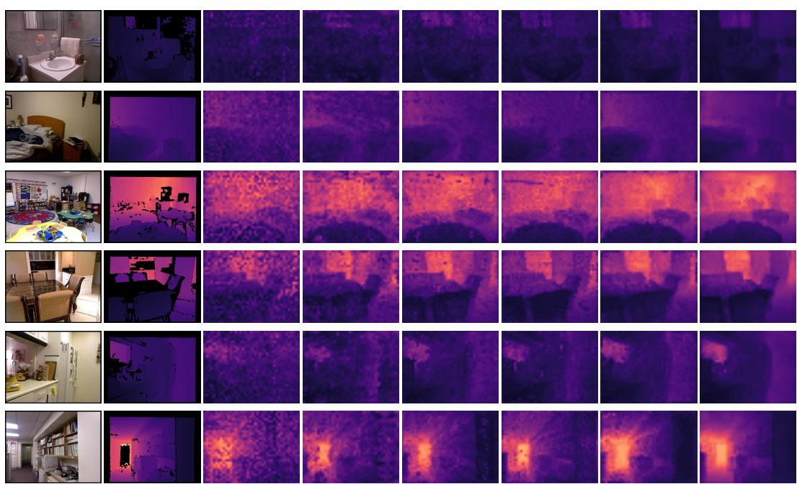  
Figure 7: Additional Monocular Depth Estimation Results on NYUv2. RGB inputs, ground-truth depth (GT), and frozen-probe predictions for six indoor scenes.

RGB  
GT  
V-JEPA	2  
LeJEPA  
V-JEPA2.1  
LeMuMoJEPA  
JEPADepth  
Ours  
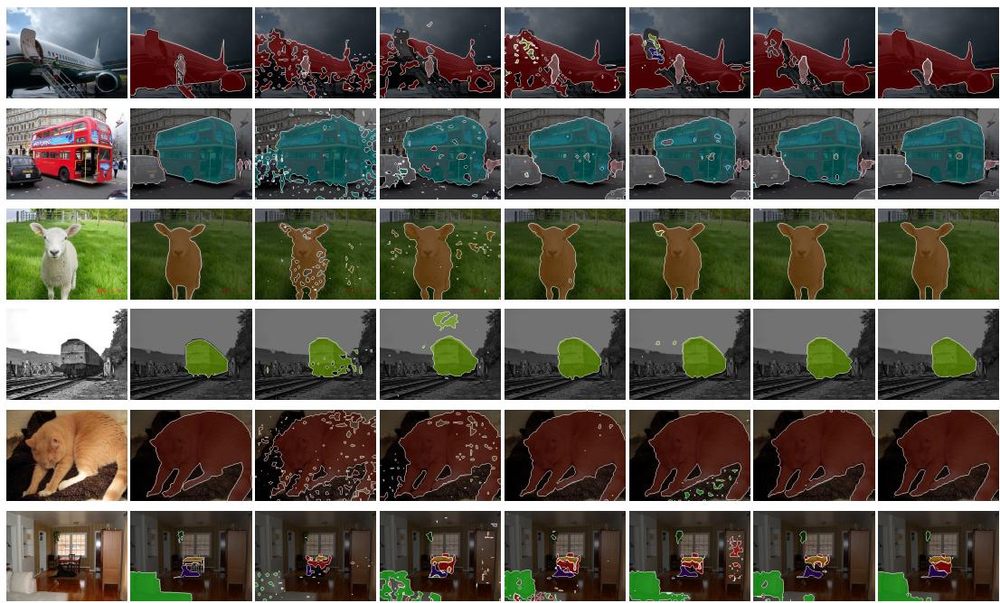  
Figure 8: Additional Semantic Segmentation Results on VOC12. Ground-truth and predicted class regions are overlaid on RGB images for six examples.

## E.4 RGB-D SPATIAL COMPLETION

LingBot-Depth completion data and split. We evaluate synchronized RGB-D masked-feature completion using LingBot-Depth (robbyant/mdm depth) (Tan et al., 2026). RobbySim supplies training data and RobbySimVal supplies held-out evaluation; shared scene identifiers, alternate views, and adjacent frames are excluded from training. An inner scene-disjoint training split is used for development. All representation adaptation, reference-encoder preparation, and completion training exclude evaluation scenes. RGB, reference depth, and intrinsics are registered; resizing and cropping update intrinsics consistently. Reference depth provides the controlled visible context and target signal, so this protocol measures missing-content inference rather than sensor-noise removal. The completion adaptation below is separate from each backbone’s native pretraining.

Synchronized masks and permitted context. A union of patch-aligned rectangular blocks covers approximately 50% of the image grid, with aspect ratios sampled in [1/2, 2] and five fixed mask seeds per evaluation image. The same spatial mask is applied to RGB and depth, and is shared across all methods. The image geometry and common mask grid are fixed before evaluation; online tokens whose receptive fields intersect a masked block cannot read original pixels from that block. Hidden content is removed before online feature extraction, cross-modal attention, metric lifting, state aggregation, or private-memory construction. Zero-filling is accompanied by an explicit visibility mask; it is not interpreted as a valid depth measurement. Depth normalization uses fixed training statistics, not statistics computed from the unmasked full image. Only the target encoders see complete observations. Queries specify target pixels or calibrated camera rays, never hidden RGB, target depth, or lifted target 3D coordinates. Invalid depth and synthetic masking are distinguished.

Fixed RGB and depth reference targets. Following V-JEPA 2.1’s masked representationprediction objective (Mur-Labadia et al., 2026), the completion targets are features rather than reconstructed pixels. This RGB-D benchmark and its metrics are our adaptation, not an official V-JEPA 2.1 completion benchmark. All methods predict the same pair of frozen target encoders: the released V-JEPA 2.1 ViT-g RGB image encoder and a separate V-JEPA 2.1 depth encoder adapted on training-scene depth only. The latter uses the depth-stream representation-learning recipe, with its checkpoint fixed before completion training and independently of the compared methods. Both reference checkpoints, preprocessing transforms, feature grids, and depth-validity rules are fixed across methods. Final-layer reference tokens are normalized with non-affine LayerNorm. Complete RGB-D observations are processed only by these stopped target branches; their features never enter online context.

Completion adapters and training. All methods receive the same visible RGB-D content, validity mask, and calibration, through their respective input interfaces. RGB encoders (V-JEPA 2, V-JEPA 2.1, LeJEPA, and JEPADepth) receive a trainable depth-token stem and fusion adapter. Le MuMo JEPA retains its native RGB-depth fusion interface, while DepState-JEPA retains state aggregation, private decoding paths, and ray-conditioned readout. The RGB-D Le MuMo checkpoint is distinct from the zero-companion-modality VOC probe variant. Backbone encoders are frozen during task adaptation. Completion predictors and output projections are trained to predict the shared RGB and depth target features, using an equal-weight sum of the two masked-region L1 losses. For methods requiring a new query decoder, its width is 384 with four Transformer blocks and six attention heads; output maps match the respective reference dimensions. Retained native predictors, and state modules retain their method-specific architectures; these task adaptations do not constitute a matched-capacity comparison. The task-adaptation recipe uses AdamW for 20,000 updates, global batch 64, peak learning rate $3 \times 1 0 ^ { - 4 }$ , weight decay $1 \bar { 0 ^ { - 4 } }$ , 1,000 warmup updates followed by cosine decay, and seed 0. The common $5 1 2 \times 5 1 2$ crop and calibrated image region are shared across methods. Training masks are resampled; evaluation masks remain fixed. Completion adaptation uses a separate configuration from the frozen NYUv2/VOC12 probes. No scalar depth loss or segmentation labels are used for the main feature-completion comparison.

3D-JEPA†: visible points and target rays. 3D-JEPA retains its point encoder (Arnaud et al., 2025), with point coordinates constructed only from visible, valid depth. Its 2D feature extractors also receive only permitted RGB content; full-image feature caches cannot supply visible points with hidden-region information. A query decoder attends to observed point features using the known target ray and image position, and outputs RGB and depth reference features. There is no target RGB-feature query, target range, target centroid, or point constructed from withheld depth. The ray-query decoder is a task adaptation and is marked with † in Table 1.

Masked-feature metrics and aggregation. For modality $m \in \{ \mathrm { R } , \mathrm { D } \}$ , let $M _ { m }$ contain scored masked tokens, $d _ { m }$ be the reference width, and $\tilde { z } _ { i } ^ { m }$ and $\tilde { r } _ { i } ^ { m }$ be the non-affine-LayerNorm-normalized predicted and target features. RGB scoring covers the withheld image tokens; depth scoring additionally requires valid reference depth under a shared validity rule. For each image–mask pair, compute

$$
\mathrm { L } 1 _ { m } = \frac { 1 } { | M _ { m } | d _ { m } } \sum _ { i \in M _ { m } } \| \tilde { z } _ { i } ^ { m } - \tilde { r } _ { i } ^ { m } \| _ { 1 } ,\tag{31}
$$

$$
\mathrm { C o s } _ { m } = \frac { 1 } { | M _ { m } | } \sum _ { i \in M _ { m } } \frac { \langle \tilde { z } _ { i } ^ { m } , \tilde { r } _ { i } ^ { m } \rangle } { \operatorname* { m a x } ( \| \tilde { z } _ { i } ^ { m } \| _ { 2 } \| \tilde { r } _ { i } ^ { m } \| _ { 2 } , 1 0 ^ { - 8 } ) } .\tag{32}
$$

Table 1 reports the equal-weight modality averages $\mathrm { L 1 } = ( \mathrm { L 1 } _ { \mathrm { R } } + \mathrm { L } 1 _ { \mathrm { D } } ) / 2$ and $\mathrm { C o s } = ( \mathrm { C o s } _ { \mathrm { R } } +$ $\mathrm { C o s _ { D } ) / 2 }$ . L1 is normalized by each modality’s token count and feature width; cosine similarity is averaged over its tokens before the two modalities are combined. Lower L1 and higher cosine similarity indicate better feature recovery. Visible tokens are excluded. Image–mask pairs with no valid depth targets are excluded from both modality scores using a method-independent rule. Average paired modality scores over masks within images, images within scenes, and scenes equally. Nonfinite predictions are reported as evaluation failures.

Completion visualization. Figure $4 ( \mathrm { a } )$ visualizes feature completion; panel (b) visualizes temporal forecasting. RGB images serve as scene references and do not imply that masked RGB is available to the completion predictor. For completion, mask outlines identify withheld regions. A PCA basis and color range are fitted on training reference features and fixed across methods, target/prediction pairs, and masks; RGB and depth references have separate bases. PCA colors are qualitative display coordinates, not metric depth or semantic labels. Quantitative scores use full-dimensional features.

## E.5 TEMPORAL VISUAL PREDICTION

Robot data and evaluation interfaces. Robot trajectories are split by whole episodes and record registered RGB-D, calibration, joint commands, endpoint proprioception, elapsed time, rewards, and termination flags. Physical labels supervise the corresponding training losses. True terminal states are distinguished from time-limit truncations in value learning. Future RGB-D observations provide targets only. Absolute object trajectory readouts require a supplied initial pose. The temporal table scores RGB features; the control tables score task outcomes.

Evaluation scope and trajectory sampling. Table 2 uses a common-reference evaluation protocol. The comparison includes V-JEPA 2-AC, V-JEPA 2.1-AC, 3D-JEPA-AC, Le MuMo JEPA-AC, and the final DepState-JEPA checkpoint. Action-conditioned baselines are evaluated after robot post-training; action-free encoders alone do not constitute temporal predictors. Training, model selection, and testing use disjoint whole episodes. All methods use the same test episodes, starting frames, action sequences, proprioception, and frame sampling. Each selected start must admit all horizons $h \in \{ 1 , 8 , 1 6 , 2 4 , 3 2 \}$ , so that horizon curves use identical trajectory support. Architectural capacity, pretraining, input resolution, and input modalities follow the method-specific interfaces below; common evaluation does not imply that these factors are matched.

Le MuMo JEPA-AC†: multimodal temporal baseline. We choose Le MuMo JEPA (Cornelissen et al., 2026) because its modality-specific RGB/depth stems and spatial fusion-token grid provide a native RGB-D representation suitable for temporal prediction. The AC suffix denotes our adaptation; the original method is a multimodal representation learner, not an action-conditioned dynamics model. We retain its fusion architecture and native representation-learning objective during RGB-D adaptation on training scenes, then freeze the encoder. Its true depth input is retained throughout; the VOC RGB-only checkpoint is not used as the multimodal baseline. Let $F _ { t }$ be its final spatial fusion-token grid. A frame-causal Transformer predicts $\hat { F } _ { t + 1 }$ from $F _ { t }$ , recorded actions, proprioception, and the transition interval. It uses the same added transition architecture, robot-trajectory split, training horizon, and optimization budget as the V-JEPA 2.1-AC adaptation, with input/output projections accommodating native feature widths. Stop-gradient encodings of complete future RGB-D frames provide native fusion-feature targets during training only. Teacher-forced and autoregressive training losses use normalized feature L1; at evaluation, predicted fusion tokens feed the next transition. A frozen linear readout maps predicted fusion tokens into the same RGB reference space used for all temporal rows. Its calibration uses complete training-frame fusion features and follows the shared protocol below. This supplies a multimodal temporal comparison without adding DepState’s shared–private factorization or metric-lifting modules to the baseline.

3D-JEPA-AC†: point-based temporal baseline. The point encoder processes only the initial visible RGB-D observation. A learned aggregation interface compresses its point features into a fixedsize latent memory, allowing recursive prediction without future point coordinates or correspondences. An action-conditioned Transformer uses the same training episodes, horizon, and optimization budget as the V-JEPA 2.1-AC adaptation; native-width projections connect the point memory to the transition. Full future observations provide stopped latent targets during training only. A ray-query readout maps the predicted memory to the known image grid for RGB feature prediction and common-reference calibration. Its observed-frame counterpart uses the same aggregation and readout, so calibration and prediction share a feature interface. Neither readout receives future ge ometry. Table 2 uses recorded physical conditioning for this method as for the other rows; control rollouts use predicted proprioception.

Adaptation and readout stages. A common prediction score fixes the reference and scoring procedure; representation adaptation remains method-specific. The distinction between encoder updates and readout fitting is as follows.
<table><tr><td>Stage</td><td>Learned components</td><td>Supervision</td></tr><tr><td>DepState Stage A</td><td>RGB/depth representation, state construc- RGB-D JEPA, completion, fac- tion, spatial readouts</td><td>torization</td></tr><tr><td>DepState Stage B</td><td>Online representation, transition, visual Future state/features, physical la- and physical readouts</td><td>bels, FK, RGB-D replay</td></tr><tr><td>Le MuMo AC adaptation</td><td>Transition and feature projections; encoder Future fusion features frozen after RGB-D adaptation</td><td></td></tr><tr><td>Common-reference calibra- Linear map tion</td><td> $A _ { m }$  tor frozen</td><td>only; encoder and predic- Same-frame training reference features</td></tr><tr><td>Real-robot evaluation</td><td>All learned parameters frozen</td><td>Visual goals and current observa- tions; no weight updates</td></tr></table>

The matched transition-training budget for the added AC baselines and the shared readout budget refer to those stages. They do not equate encoder adaptation or total pretraining across the complete systems.

Recorded physical conditioning and visual autoregression. The initial visual observation initializes each predictor. V-JEPA baselines use RGB; 3D-JEPA-AC constructs points from the initial RGB-D frame; Le MuMo JEPA-AC uses aligned RGB-D, and DepState-JEPA uses registered RGB-D and calibration. Future RGB and depth observations are used only to construct scoring targets. At every transition, all methods receive the corresponding recorded action and proprioceptive state through their declared conditioning interfaces. Visual predictions are propagated recursively; the final endpoint, rather than the average over intermediate rollout steps, is scored at each horizon. DepState-JEPA retains its initial private features throughout the rollout. This protocol isolates visual prediction under recorded physical conditioning. The ablation forecasting track in Appendix E.7 instead uses predicted future proprioception. The two result groups are reported separately rather than interpreted as a paired estimate of proprioceptive error accumulation. Control candidates also use predicted proprioception, with a new current observation acquired after each executed action.

Conditioning interfaces and horizon reduction. The three result tracks use the following information interfaces.
<table><tr><td>Track</td><td>Actions</td><td>Proprioception after ini- Reported outcome tialization</td></tr><tr><td>Table 2</td><td>Recorded sequence</td><td>Recorded at every transi- RGB L1/Cos at each tion endpoint</td></tr><tr><td>Internal forecasting abla- Recorded sequence tions</td><td></td><td>Predicted configura- Five-endpoint mean per tion/velocity Drawer/Cup task</td></tr><tr><td>Control rollouts</td><td></td><td>Actor or search candidates Predicted within a candi- Episode return or task date rollout success</td></tr></table>

All tracks initialize from an observed current state and predict future visual states recursively. For a rollout starting at t, write $p _ { k } = ( q _ { k } , \dot { q } _ { k } )$ . The conditioning port is

$$
p _ { t + h } ^ { \mathrm { c o n d } } = \left\{ \begin{array} { l l } { p _ { t } , } & { h = 0 , } \\ { p _ { t + h } ^ { \mathrm { r e c o r d e d } } , } & { h > 0 \mathrm { i n T a b l e } \ : 2 , } \\ { ( \hat { q } _ { t + h } , \hat { \dot { q } } _ { t + h } ) , } & { h > 0 \mathrm { i n c o n t r o l } / \mathrm { a b l a t i o n } \ : \mathrm { r o l l o u t s } . } \end{array} \right.
$$

For a fixed predictor, this choice changes the conditioning values at that port. Model-predictive control acquires a fresh current observation after executing an action and initializes the next candidate search. Table 17 averages $\mathcal { H } = \{ 1 , 8 , 1 6 , 2 4 , 3 2 \}$ within each task and seed; its entries are not the $h = 3 2$ endpoint or an average over every intervening frame. Table 2 retains the individual endpoints.

A robot step is one adjacent retained control transition. Its elapsed time is the recorded $\Delta t _ { t }$ , so the physical horizon is

$$
T _ { h } = \sum _ { k = 0 } ^ { h - 1 } \Delta t _ { t + k } .
$$

The 4-fps sampling in Appendix B.1 applies to representation-learning video clips, not to this robotcontrol clock.

Common-reference readout calibration. The reference $E _ { \mathrm { r e f } }$ is a single released V-JEPA 2.1 ViTg RGB encoder with fixed weights, image preprocessing, and final-layer patch grid, shared by all methods and all horizons. It is frozen throughout readout fitting and evaluation. For method m, let $z _ { m , i }$ denote its native final-layer RGB feature (Le MuMo fusion feature, or the 3D-JEPA raydecoded feature) at spatial position i. Nonspatial tokens are removed, and feature maps are bilinearly aligned to the reference grid. A per-token linear readout $A _ { m }$ maps the native channel dimension to the reference dimension d. Each method, including V-JEPA $2 . 1 { - } \mathrm { A C }$ , receives the same linear readout family, training frames, optimization budget, and fixed hyperparameters. Native channel widths can differ, so the linear readouts need not have identical parameter counts. Readouts are fitted on paired native and reference features of the same observed training frame, using the L1 objective below, with encoders and temporal predictors frozen. They are then frozen and applied to predicted native features, without fitting to test frames or training a separate readout for each horizon. The resulting score measures forecast accuracy in the chosen reference representation, including the fixed linear map. It evaluates native predicted features after reference mapping; no calibration-error subtraction is applied. The token average covers the full image grid, giving each valid token equal weight rather than reweighting robot or object regions. The readout-training configuration uses AdamW for 5,000 updates, global batch size 128, learning rate $3 \times 1 0 ^ { - 4 }$ with cosine decay, weight decay $1 0 ^ { - 4 }$ , and seed 0. The final readout checkpoint is used for every horizon; there is no methodspecific hyperparameter search. All encoders view the same image region: resize the shorter side to 512 and take a fixed $5 1 2 \times 5 1 2$ center crop, applying the same spatial transformation throughout each sequence and to aligned depth. Native encoder resizing and normalization are applied to this common crop; the reference uses its image tokenizer at $5 1 2 \times 5 1 2$ . Readout fitting uses the same deterministic preprocessing as evaluation.

Feature-space metrics and aggregation. Let $\hat { z } _ { m , i } ^ { ( h ) }$ be the predicted final-layer feature at horizon h, and let $r _ { i } ^ { ( h ) } = E _ { \mathrm { r e f } } ( I _ { t + h } ) _ { i }$ . Apply non-affine channel-wise layer normalization to define $\tilde { z } _ { i } ^ { ( h ) } =$ $\mathrm { L N } ( A _ { m } ( \hat { z } _ { m , i } ^ { ( h ) } ) )$ and $\tilde { r } _ { i } ^ { ( h ) } = \mathrm { L N } ( r _ { i } ^ { ( h ) } )$ . For N spatial tokens, the endpoint metrics are

$$
\mathrm { L } 1 ( h ) = \frac { 1 } { N d } \sum _ { i = 1 } ^ { N } \| \tilde { z } _ { i } ^ { ( h ) } - \tilde { r } _ { i } ^ { ( h ) } \| _ { 1 } ,\tag{33}
$$

$$
\mathrm { C o s } ( { h } ) = \frac { 1 } { N } \sum _ { i = 1 } ^ { N } \frac { \langle \tilde { z } _ { i } ^ { ( h ) } , \tilde { r } _ { i } ^ { ( h ) } \rangle } { \operatorname* { m a x } ( \| \tilde { z } _ { i } ^ { ( h ) } \| _ { 2 } \| \tilde { r } _ { i } ^ { ( h ) } \| _ { 2 } , \epsilon ) } ,\tag{34}
$$

with fixed $\epsilon = 1 0 ^ { - 8 }$ . Lower L1 and higher cosine similarity are better. Scores are averaged over starting windows within each episode and then equally over episodes. Table 2 reports point estimates; three-seed variability for the internal ablations is reported separately in Appendix E.7.

RGB feature visualization. For qualitative comparison, predicted and target features are first mapped to the common RGB reference space. One PCA basis and one display range are fitted on reference features from training data and fixed across methods, prediction horizons, and groundtruth panels. PCA is used only for display; all quantitative metrics operate on full-dimensional features. Future RGB images shown as references are not predictor inputs.

## E.6 EMBODIED PREDICTION AND MANIPULATION

Task suites and interaction budgets. Both control tracks use the same single-task evaluation: the 20 visual DMControl tasks used by DreamerV3 (Tassa et al., 2018; Hafner et al., 2025) and the 50 Meta-World tasks (Yu et al., 2020). Each task trains a separate agent; the latter is not the joint-policy MT50 benchmark. The DMControl set comprises acrobot swingup; ball-in-cup catch; cartpole balance, balance-sparse, swingup, and swingup-sparse; cheetah run; finger spin, turn-easy, and turn-hard; hopper hop and stand; pendulum swingup; quadruped run and walk; reacher easy and hard; and walker run, stand, and walk. Each DMControl run uses $1 0 ^ { 6 }$ environment steps, action repeat 1, and 1,000-step episodes. Each Meta-World run uses $2 \times 1 0 ^ { 6 }$ environment steps, action repeat 2, and 200-step episodes (100 decisions), following the task horizon of TD-MPC2 (Hansen et al., 2024). An environment step here is a benchmark step before action repetition, not an internal physics substep; repeated rewards are summed. These suite-specific budgets apply equally to actor-only and MPC agents. We use DreamerV3’s DMControl budget and TD-MPC2’s Meta-World protocol. The same task set, camera settings, and evaluation reset schedule are used across compared methods within each control track.

Observation and action interfaces. All methods observe the same camera view, task goal when required, and current proprioception. RGB methods receive RGB; multimodal methods also receive aligned metric depth and calibration. RGB-D and proprioceptive access are explicit adaptations of visual-only benchmarks. A common $5 1 2 \times 5 1 2$ rendering supplies the scene, followed by each encoder’s native resizing and normalization. No simulator object poses, contact labels, or privileged full-state vectors enter the controller. Native benchmark action semantics and limits are preserved: a task-specific projection replaces any robot-specific action interface, and the learned transition is adapted on that task’s replay. Domain-specific proprioceptive readouts are trained only for measured coordinates needed by the control state; robot-arm FK objectives are not applied to unrelated DM-Control embodiments. Within imagined rollouts, proprioception is predicted, not read from future environment states. The interaction budget counts environment transitions and remains distinct from representation adaptation and predictor pretraining.

Evaluation and aggregation. We use three independent training seeds (0, 1, and 2), as in Ta ble 3, and evaluate every 50,000 environment steps on ten episodes per task and seed, with the same held-out reset seeds across methods. Evaluation transitions are excluded from training budgets and replay; they cannot guide checkpoint selection or hyperparameter tuning. The main table uses the final budget checkpoint, not the best evaluation checkpoint. DMControl reports undiscounted episode return $R = \textstyle \sum _ { t } ^ { } r _ { t }$ , averaged over episodes and then equally over the 20 tasks. Meta-World reports averaged success, 100 E[⊮{successT}], using the environment success flag at the final step, averaged equally over 50 tasks. This follows TD-MPC2’s final-step criterion, rather than counting transient success anywhere in an episode. Time-limit truncations do not become terminal failures in value-target construction. We compute a suite mean for each seed and report its mean ± sample standard deviation across seeds. The seed-level suite means appear in Table 10. Episode return and averaged success are reported separately by suite.

Results by training seed. Table 10 gives the suite means for each training seed underlying Table 3: DMC entries are episode returns and MW entries are success percentages. Bold values mark the best method within each seed and metric, including ties; † denotes a method-specific AC adaptation.

## E.6.1 POLICY LEARNING THROUGH IMAGINED TRAJECTORIES

Replay and world-model adaptation. Online interaction alternates with updates from an expanding replay buffer. Each transition stores observations, actions, rewards, and true termination flags; evaluation episodes never enter replay. The action-conditioned transition and control heads adapt to online experience. Observed next-frame encodings supervise latent prediction. Reward and continuation heads use environment labels from executed transitions. The reported interaction budget counts newly collected environment transitions, separately from representation training and replayed samples.

Table 10: Control Results for Individual Training Seeds.
<table><tr><td rowspan="2">Method</td><td rowspan="2">Seed</td><td colspan="2">Online PL</td><td colspan="2">Latent MPC</td></tr><tr><td>DMC↑</td><td>MW↑</td><td>DMC↑</td><td>MW↑</td></tr><tr><td>V-JEPA 2-AC</td><td>0</td><td>671.8</td><td>50.8</td><td>719.4</td><td>64.2</td></tr><tr><td>V-JEPA 2.1-AC</td><td>0</td><td>757.6</td><td>66.4</td><td>799.1</td><td>78.8</td></tr><tr><td>3D-JEPA-AC†</td><td>0</td><td>781.7</td><td>72.4</td><td>822.8</td><td>85.6</td></tr><tr><td>LeMuMo-JEPA-AC†</td><td>0</td><td>787.3</td><td>72.2</td><td>833.5</td><td>87.4</td></tr><tr><td>DepState-JEPA-AC (Ours)</td><td>0</td><td>798.9</td><td>74.4</td><td>841.8</td><td>87.2</td></tr><tr><td>V-JEPA 2-AC</td><td>1</td><td>699.2</td><td>56.0</td><td>748.7</td><td>69.0</td></tr><tr><td>V-JEPA 2.1-AC</td><td>1</td><td>781.3</td><td>71.0</td><td>824.5</td><td>84.0</td></tr><tr><td> $3 \mathrm { D - J E P A - A C ^ { \dagger } }$ </td><td>1</td><td>773.4</td><td>69.6</td><td>810.2</td><td>82.4</td></tr><tr><td>LeMuMo-JEPA-AC†</td><td>1</td><td>807.8</td><td>76.0</td><td>852.6</td><td>90.2</td></tr><tr><td>DepState-JEPA-AC (Ours)</td><td>1</td><td>827.4</td><td>80.0</td><td>877.0</td><td>92.8</td></tr><tr><td>V-JEPA 2-AC</td><td>2</td><td>676.1</td><td>51.6</td><td>741.4</td><td>66.0</td></tr><tr><td>V-JEPA 2.1-AC</td><td>2</td><td>752.5</td><td>68.4</td><td>798.0</td><td>80.8</td></tr><tr><td>3D-JEPA-AC†</td><td>2</td><td>798.2</td><td>74.8</td><td>846.1</td><td>88.8</td></tr><tr><td>LeMuMo-JEPA-AC†</td><td>2</td><td>776.1</td><td>71.4</td><td>826.4</td><td>85.8</td></tr><tr><td>DepState-JEPA-AC (Ours)</td><td>2</td><td>813.2</td><td>76.8</td><td>854.6</td><td>90.2</td></tr></table>

Imagination and policy learning. Following DreamerV3 (Hafner et al., 2025), an actor and critic learn from imagined trajectories initialized at replay states. We use 15 imagined transitions (16 states), discount $\gamma = 0 . 9 9 7$ , and $\lambda = 0 . 9 5$ . For predicted rewards $\hat { r } _ { k }$ , continuation probabilities $\hat { c } _ { k }$ and values $v _ { k }$ , the targets are

$$
G _ { k } ^ { \lambda } = \hat { r } _ { k } + \gamma \hat { c } _ { k } \bigl [ ( 1 - \lambda ) v _ { k + 1 } + \lambda G _ { k + 1 } ^ { \lambda } \bigr ] , \qquad G _ { H } ^ { \lambda } = v _ { H } .\tag{35}
$$

The critic fits stopped return targets using symexp two-hot regression. The actor uses a scorefunction objective with percentile-normalized advantages and entropy regularization of $3 \times 1 0 ^ { - 4 }$ its gradients do not update the world model. Reward and critic heads use 255 bins, and continuation uses binary cross-entropy. The control-head recipe uses batches of 16 sequences of length 64, a learning rate of $4 \times 1 0 ^ { - 5 }$ , and a replay ratio of 256 sampled transitions per collected control transition. The first $1 { , } 0 0 0$ collected transitions initialize replay before updates; they count toward the interaction budget. Imagined transitions and replayed samples are not counted as new environment interactions. At evaluation, the actor selects its mean continuous action without exploration noise or candidate search.

## E.6.2 RECEDING-HORIZON PLANNING IN LATENT SPACE

Online value learning and policy prior. The planning track trains a separate agent from the same initialization and interaction budget. It follows TD-MPC2 (Hansen et al., 2024): replay updates fit reward predictions, an ensemble of five action-value heads, and a stochastic policy prior, alongside the latent transition. TD targets use the minimum of two randomly sampled target heads with EMA rate 0.01. Reward and value heads use 101-bin regression in symlog space. The update recipe uses Adam at $3 \times 1 0 ^ { - 4 }$ , batch size 256, gradient clipping at 20, and one replay update per collected control transition after warmup. For effective episode length T, use $\gamma = \mathrm { c l i p } ( 1 - 5 / T , 0 . 9 5 , 0 . 9 9 5 )$ and max(5T, 1000) random-action warmup steps, included in the training budget. All compared representations use the same reward/value-head configuration, policy-prior objective, and optimization budget. DreamerV3 and TD-MPC2 define the respective control recipes; the table compares JEPA representations within each recipe.

Receding-horizon optimization. For $x _ { t } = ( S _ { t } , q _ { t } , { \dot { q } } _ { t } )$ , let F denote the learned transition and physical readouts, with task conditioning included where required. The planner scores a candidate sequence using predicted rewards and a terminal action value:

$$
\begin{array} { c } { { \displaystyle { J \big ( u _ { t : t + H - 1 } \big ) = \sum _ { k = 0 } ^ { H - 1 } \gamma ^ { k } w _ { k } \hat { r } \big ( \hat { x } _ { t + k } , u _ { t + k } \big ) + \gamma ^ { H } w _ { H } \bar { Q } \big ( \hat { x } _ { t + H } , \pi \big ( \hat { x } _ { t + H } \big ) \big ) , } } } \\ { { \displaystyle { w _ { k } = \prod _ { j = 0 } ^ { k - 1 } \hat { c } _ { t + j } , \quad w _ { 0 } = 1 . } } } \end{array}\tag{36}
$$

Here $\bar { Q }$ averages the current value ensemble for planning, and $w _ { k } = 1$ in fixed-length tasks with out true termination. The model predictive path integral (MPPI) search uses the TD-MPC2 budget: horizon 3, 512 candidates including 24 policy-prior trajectories, 64 elites, and 6 refinement iterations (8 for action dimensions of at least 20). The score temperature is 0.5 and sampling standard deviations lie in [0.05, 2]. The previous solution warm-starts the next search. Evaluation executes the first optimized mean action, obtains the next observation, and replans; exploration noise is disabled. Candidate trajectories use predicted proprioception and receive no future images, recorded future states, simulator rewards, or simulator transitions. All compared planners share this search budget.

## E.6.3 SIM-TO-REAL MANIPULATION TRANSFER

Simulation-training and real-world deployment environments. We jointly construct the simulation-training and real-world deployment environments for the drawer and cup tasks, with consistent robot kinematics, gripper geometry, object dimensions, workspace layout, and camera calibration. Simulation and hardware share action units, coordinate conventions, and workspace limits. Task-specific simulated trajectories train the manipulation models separately from the DM-Control and Meta-World agents. The common budget is $\mathrm { \dot { ~ } 1 0 ^ { 6 } ~ }$ simulated control steps per task and seed, with three seeds (0, 1, and 2); trajectory splits and randomization schedules are shared across methods. Texture, illumination, initial object pose, and friction variation are applied around the matched setup. Model selection and controller tuning use held-out simulation scenes.

Physics-grounded depth augmentation. PRISM (Liang et al., 2026) converts rendered RGB and ideal metric depth into sensor-realistic depth by separately modeling sensing invalidation and measurement inaccuracy. Its invalidation component synthesizes missing returns, while its residual generator perturbs valid depth measurements. We use a fixed pretrained PRISM model to augment sim ulated training observations before feature extraction and geometric lifting. Depth-aware methods receive the same augmented observations and validity masks; RGB-only methods retain their RGB input. Invalid returns are excluded from point construction. Sensor-model pretraining is separate from task-specific control training. At deployment, the controller uses measured RGB-D directly; PRISM is a training-data augmenter and is not applied to real observations.

World-model training and planning policy. We adopt the visual-goal-conditioned latent MPC policy used for robotic arm planning in V-JEPA 2.1 (Mur-Labadia et al., 2026). Action-conditioned predictors are adapted on simulated observation–action sequences using teacher-forced and recursive future-feature prediction. Each model retains its native representation; a fixed-size aggregation interface is used for point-based features, with no future point coordinates provided to the predictor.

At each decision, the cross-entropy method (CEM) samples bounded action sequences, rolls them out through the learned transition, and refines the sampling distribution using candidates with the smallest terminal latent distance to the current visual goal. Goal and predicted features use the same normalization and feature-distance definition within each model. We use the eight-step planning configuration of V-JEPA 2.1, with 300 candidates and 15 refinement iterations, shared across methods. The robot executes the first action through its low-level controller, acquires a new observation, and replans. Action limits, execution intervals, and gripper commands use a common hardware interface. This goal-distance objective is distinct from the reward/value-based TD-MPC2 track in App. E.6.2.

Goal specification and real-world deployment. All methods receive the same ordered visual subgoals, camera views, and initial conditions. Opening and closing use separate subgoals, since the final closed state alone cannot distinguish task completion from the initial state. Cup manipulation likewise specifies grasping, lifting, and placement stages. Goal observations provide task specifications, not action supervision; they are fixed before evaluation and excluded from training. Stage transitions use observation-based goal criteria calibrated in simulation, without simulator state at deployment. The subgoal order and criteria are shared across methods. All learned weights are frozen for real trials, with no task-specific real-world finetuning.

The quantitative Sim2Real protocol contains two task families. Each family has two independently evaluated atomic tasks and one full task. Only the full tasks enter the two Sim2Real columns in Table 3; atomic-task scores are diagnostics.

Execution-time budget. The 60-second task budget measures cumulative robot execution time, including the final stability checks. Model inference and CEM search time are excluded from this budget, and no inference-time deadline is imposed. This timing convention is shared across methods; the budget is not a 60-second wall-clock limit.

Task 1: Pull and Close Drawer. An episode starts with the drawer closed and requires an ordered opening and closing cycle. Let $d \in [ \bar { 0 } , 1 ]$ denote travel normalized by the calibrated full stroke. Success requires reaching $d \geq 0 . 8 .$ , then returning to $d \leq 0 . 1$ and maintaining that final configuration for one second within 60 seconds of cumulative robot execution time. Opening alone does not count as success. The same stroke normalization and thresholds apply in simulation and real evaluation. For the atomic Pull Drawer task, reset the drawer to its closed state and require reaching $d \geq$ 0.8. For Close Drawer, reset it to an open state with $d \ge 0 . 8$ and require reaching $d \leq 0 . 1$ and maintaining that configuration for one second. The Pull and Close $( F u l l )$ task uses the ordered cycle specified above. Each task has its own independently reset trials and the same execution-time budget.

Task 2: Pick and Place Cup. The robot must grasp the cup, lift it clear of its initial support, and release it upright in the designated target region. Success requires the cup center to lie within 5 cm of the target center, its upright axis to remain within $1 5 ^ { \circ }$ of vertical, and the released cup to remain stable for two seconds, all within 60 seconds of cumulative robot execution time. Merely reaching the goal while holding the cup does not satisfy the completion condition. For the atomic Pick Cup task, reset the cup on its initial support and require a successful grasp and lift clear of that support. For Place $C u p$ , initialize the cup securely grasped and lifted, then require upright release in the target region and the same two-second stability check. The Pick and Place $( \bar { F } u l \bar { l } )$ task starts from the cup on its support and requires the complete sequence specified above. Each task has its own independently reset trials and the same execution-time budget. Atomic reset distributions are fixed before evaluation and shared across methods.

Averaged success and paired trials. Each trained seed receives thirty real trials for each of the six tasks (four atomic and two full), for 90 trials per method and task across three seeds. Atomic trials are separate from full-task trials; they do not increase the full-task denominator. Initial object/robot configurations are paired across methods and trial order is randomized. Executionbudget timeouts, drops, and execution failures count in the denominator. The real-world metric is Averaged success $\doteq 1 0 0 N _ { \mathrm { s u c c e s s } } / N _ { \mathrm { t r i a l s } }$ . Per-seed Sim2Real results report the number of successes out of 30 trials, rather than percentages. We convert each count to a success percentage and report the mean ± sample standard deviation across the three seeds, using denominator $3 - 1$ for the sample variance. Both values use one decimal place. Full-task success is measured directly, not calculated by multiplying independently measured atomic success rates. Task 1 (Full) and Task 2 (Full) occupy separate columns; their scores are not combined with DMC episode return or MW averaged success.

Atomic and full-task results. Table 11 reports mean ± sample standard deviation across seeds for all six tasks; its two Full columns reproduce the Sim2Real entries in Table 3. Table 12 provides the underlying success counts and trial denominators. Bold marks the best mean per task or the best count per task and seed, including ties. These marginal success counts summarize the paired-reset design; they do not provide a paired trial-level test.

Interpretation of physical supervision. Configuration and velocity readouts supply recursive proprioception. TCP supervision, FK consistency, and accumulated object-pose losses shape the predicted state; object poses do not feed the transition or other readouts. Ex.11–Ex.13 assess these training paths through the feature and control outcomes in Tables 15 and 18.

Table 11: Atomic and Full-Task Sim2Real Success Rates (%).
<table><tr><td rowspan="2">Method</td><td colspan="3">Task 1: Drawer</td><td colspan="3">Task 2: Cup</td></tr><tr><td>Pull↑</td><td>Close↑</td><td>Full↑</td><td>Pick↑</td><td>Place↑</td><td>Full↑</td></tr><tr><td>V-JEPA 2-AC</td><td> $6 6 . 7 \pm 3 . 3$ </td><td> $8 1 . 1 \pm 1 . 9$ </td><td> $4 5 . 6 \pm 5 . 1$ </td><td> $6 3 . 3 \pm 3 . 3$ </td><td> $7 3 . 3 \pm 3 . 3$ </td><td> $4 1 . 1 \pm 5 . 1$ </td></tr><tr><td>V-JEPA 2.1-AC</td><td> $8 6 . 7 \pm 3 . 3$ </td><td> $9 0 . 0 \pm 3 . 3$ </td><td> $6 6 . 7 \pm 6 . 7$ </td><td> $8 3 . 3 \pm 3 . 3$ </td><td> $8 7 . 8 \pm 1 . 9$ </td><td> $6 4 . 4 \pm 5 . 1$ </td></tr><tr><td>3D-JEPA-AC†</td><td> $9 0 . 0 \pm 3 . 3$ </td><td> $9 1 . 1 \pm 1 . 9$ </td><td> $7 3 . 3 \pm 5 . 8$ </td><td> $8 7 . 8 \pm 5 . 1$ </td><td> $8 8 . 9 \pm 1 . 9$ </td><td> $7 1 . 1 \pm 5 . 1$ </td></tr><tr><td> $\mathrm { L e M u M o \mathrm { - } J E P A \mathrm { - } A C ^ { \dagger } }$ </td><td> $9 0 . 0 \pm 3 . 3$ </td><td> $9 1 . 1 \pm 1 . 9$ </td><td> $7 5 . 6 \pm 6 . 9$ </td><td> $8 8 . 9 \pm 5 . 1$ </td><td> $9 0 . 0 \pm 3 . 3$ </td><td> $7 4 . 4 \pm 8 . 4$ </td></tr><tr><td>DepState-JEPA-AC (Ours)</td><td> $\overline { { 9 5 . 6 \pm 1 . 9 } }$ </td><td> ${ \bf 9 5 . 6 \pm 1 . 9 }$ </td><td> ${ \bf 8 1 . 1 \pm 5 . 1 }$ </td><td> ${ \pm } 4 . 4 \pm 1 . 9$ </td><td> $\overline { { 9 3 . 3 \pm 3 . 3 } }$ </td><td> $\overline { { 7 8 . 9 \pm 3 . 8 } }$ </td></tr></table>

Table 12: Sim2Real Successes/Trials for Individual Training Seeds.
<table><tr><td rowspan="2">Method</td><td rowspan="2">Seed</td><td colspan="3">Task 1: Drawer</td><td colspan="3">Task 2: Cup</td></tr><tr><td>Pull↑</td><td>Close↑</td><td>Full↑</td><td>Pick↑</td><td>Place↑</td><td>Full↑</td></tr><tr><td>V-JEPA 2-AC</td><td>0</td><td>20/30</td><td>24/30</td><td>14/30</td><td>18/30</td><td>21/30</td><td>11/30</td></tr><tr><td>V-JEPA 2.1-AC</td><td>0</td><td>26/30</td><td>27/30</td><td>20/30</td><td>24/30</td><td>26/30</td><td>18/30</td></tr><tr><td>3D-JEPA-AC†</td><td>0</td><td>27/30</td><td>28/30</td><td>23/30</td><td>26/30</td><td>27/30</td><td>21/30</td></tr><tr><td>LeMuMo-JEPA-AC†</td><td>0</td><td>27/30</td><td>27/30</td><td>22/30</td><td>27/30</td><td>27/30</td><td>22/30</td></tr><tr><td>DepState-JEPA-AC (Ours)</td><td>0</td><td>28/30</td><td>29/30</td><td>23/30</td><td>28/30</td><td>28/30</td><td>23/30</td></tr><tr><td>V-JEPA 2-AC</td><td>1</td><td>21/30</td><td>25/30</td><td>15/30</td><td>20/30</td><td>23/30</td><td>14/30</td></tr><tr><td>V-JEPA 2.1-AC</td><td>1</td><td>27/30</td><td>28/30</td><td>22/30</td><td>26/30</td><td>27/30</td><td>21/30</td></tr><tr><td>3D-JEPA-AC†</td><td>1</td><td>26/30</td><td>27/30</td><td>20/30</td><td>28/30</td><td>27/30</td><td>23/30</td></tr><tr><td>LeMuMo-JEPA-AC†</td><td>1</td><td>28/30</td><td>28/30</td><td>25/30</td><td>25/30</td><td>26/30</td><td>20/30</td></tr><tr><td>DepState-JEPA-AC (Ours)</td><td>1</td><td>29/30</td><td>29/30</td><td>26/30</td><td>29/30</td><td>29/30</td><td>25/30</td></tr><tr><td>V-JEPA 2-AC</td><td>2</td><td>19/30</td><td>24/30</td><td>12/30</td><td>19/30</td><td>22/30</td><td>12/30</td></tr><tr><td>V-JEPA 2.1-AC</td><td>2</td><td>25/30</td><td>26/30</td><td>18/30</td><td>25/30</td><td>26/30</td><td>19/30</td></tr><tr><td>3D-JEPA-AC†</td><td>2</td><td>28/30</td><td>27/30</td><td>23/30</td><td>25/30</td><td>26/30</td><td>20/30</td></tr><tr><td>LeMuMo-JEPA-AC†</td><td>2</td><td>26/30</td><td>27/30</td><td>21/30</td><td>28/30</td><td>28/30</td><td>25/30</td></tr><tr><td>DepState-JEPA-AC (Ours)</td><td>2</td><td>29/30</td><td>28/30</td><td>24/30</td><td>28/30</td><td>27/30</td><td>23/30</td></tr></table>

Multi-view real-robot rollouts. Figures 9 and 10 expand the qualitative examples in Fig. 5 with RGB-D sequences for the drawer and cup tasks, respectively. Each task is shown from two recorded viewpoints, exposing the manipulation sequence and changes in visible geometry over time.

RGB  
Depth  
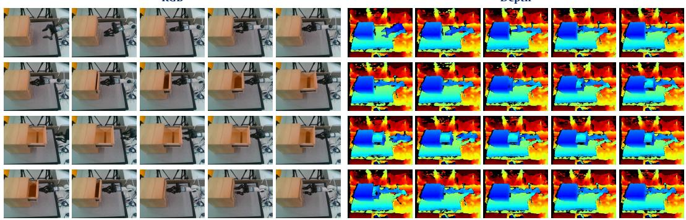  
(a) View 1

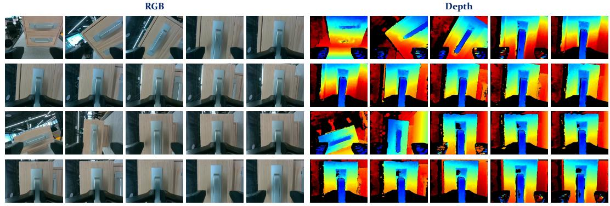  
(b) View 2  
Figure 9: Multi-View RGB-D Rollout of Drawer Opening and Closing. Two recorded viewpoints show the real-robot execution. Each panel places RGB frames on the left and depth frames on the right; within each modality, time advances from left to right and then top to bottom.

RGB  
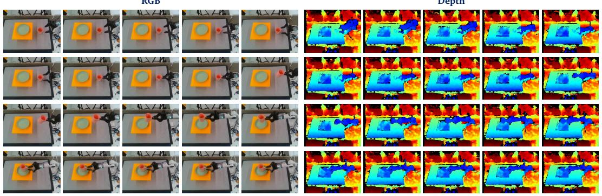  
Depth  
(a) View 1

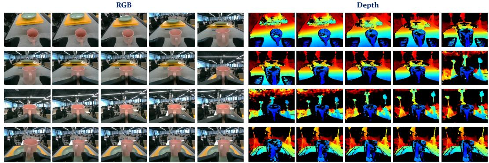  
(b) View 2  
Figure 10: Multi-View RGB-D Rollout of Cup Picking and Placing. Two recorded viewpoints show the real-robot execution. Each panel places RGB frames on the left and depth frames on the right; within each modality, time advances from left to right and then top to bottom.

## E.7 ABLATION RESULTS, PROTOCOLS, AND STATISTICAL ANALYSIS

Organization and reference configuration. Tables 13–15 record the configurations and numerical results underlying Fig. 6(a)–(c), respectively. Ex.16 is the full configuration in Appendices B–D and serves as the common reference. Ex.1–Ex.3 form a two-factor input experiment with Ex.16. Ex.4–Ex.15 each change the indicated design. Capacity and loss-weight differences are identified with the relevant variants. Entries report mean ± sample standard deviation across seeds 0, 1, and 2. Bold marks the best displayed mean per metric, including ties. Seed-level and task-level results appear in App. E.7.4.

Figure 6 plots the three-seed means; filled markers identify Ex.16. Connected points denote independent interventions, not cumulative ablations.

Task means and information access. L1, Cos, and SR are shared by the main-text ablation plots and the three appendix tables. Let $\mathcal { T } _ { m }$ be the fixed set of tasks evaluated by metric $m ,$ and $s _ { e , r , t } ^ { m }$ the score of experiment $e ,$ seed $r ,$ and task t. The reported point estimate is

$$
\bar { s } _ { e } ^ { m } = \frac { 1 } { 3 } \sum _ { r = 0 } ^ { 2 } \left( \frac { 1 } { | T _ { m } | } \sum _ { t \in \mathcal { T } _ { m } } s _ { e , r , t } ^ { m } \right) .\tag{37}
$$

The three configuration tables report the standard deviation of the seed-level task means. Tables 16–18 provide seed scores and task-level breakdowns. Each configuration uses the same equally weighted task set.

For L1/Cos, $\mathcal { T } _ { m }$ contains the LingBot-Depth RGB-D completion task and the two held-out robot forecasting tasks, Drawer and Cup. Completion first averages RGB/depth equally, retaining the scene-balanced reduction in Appendix E.4. Each forecasting task first averages endpoints $h \in$ {1, 8, 16, 24, 32} on identical starting windows and then averages equally over episodes. Its principal modality is RGB, consistent with Table 2. All Ex. configurations use the same frozen reference encoders, non-affine normalization, and training-only readout calibration. The ablation forecasting track uses measured proprioception only at initialization, then predicted configurations and velocities. In contrast, Table 2 conditions on recorded proprioception at every step. Its scores are not included in these task means, and the two tables are not presented as a paired comparison of condi tioning modes.

For SR, $\mathcal { T } _ { \mathrm { S R } }$ contains all 50 Meta-World tasks and the two real manipulation tasks. Within each Meta-World task, actor-only and latent-MPC success are averaged equally before the 52-task mean is formed; each real task contributes its visual-goal MPC success once. The original task-specific success criteria apply, with three seeds and thirty real trials per full task and seed. Only full-task success enters this aggregate; atomic task diagnostics do not receive additional task weights. DMC episode return is not a success rate and is excluded. Table 18 retains controller-specific and realtask scores: the aggregate assigns 50/52 of its weight to Meta-World and 2/52 to real tasks, so it is primarily a simulated-control summary.

Training and measurement controls. The comparisons hold pretrained initialization, data order, splits, augmentation, target validity, optimizer settings, and task/control budgets fixed, together with unchanged module dimensions. Loss interventions persist through all applicable training and adaptation objectives. Each Ex. uses the final Stage-B representation. Equal-budget completion adaptation with a frozen representation measures the utility of that representation together with its fitted readout. Common-reference calibration uses observed training features only and is frozen before prediction scoring. Changes to state construction also apply to its EMA copy; input-availability interventions retain the stated teacher target interface.

The tables report sample standard deviations across three training seeds, not confidence intervals over scenes or trials. Architectural interventions can change active capacity despite retaining unused parameters. The interpretation below therefore distinguishes component removal from capacitymatched evidence and does not infer significance from ranking alone.

## E.7.1 GEOMETRY-GROUNDED STATE CONSTRUCTION

Ex.1–Ex.3 and Ex.16: content versus metric coordinates. The depth-content factor denotes whether the second online content encoder receives measured depth. When disabled (Ex.1/Ex.3), it receives the same RGB image as the first branch, with RGB normalization, independent weights, and unchanged token count. This preserves an active second backbone rather than replacing its features with a constant. The metric-coordinate factor denotes visible-depth XYZ positional encoding in both streams. When disabled (Ex.1/Ex.2), it is replaced by the same learned unknown-geometry embedding at all positions. Ex.1 disables both factors, Ex.2 retains only depth content, Ex.3 retains only metric coordinates, and Ex.16 retains both. Ex.3 still uses depth for lifting and is not an RGB-only inference method.

Table 13: Geometry-Grounded State Construction.
<table><tr><td>ID</td><td>Experimental Setting</td><td>L1.↓</td><td>Cos↑</td><td>SR↑</td></tr><tr><td>Ex.1</td><td>Replace online depth content with RGB and disable metric XYZ positional encoding.</td><td>0.408 ± 0.021</td><td> $0 . 8 3 2 \pm 0 . 0 1 7$ </td><td> $7 6 . 8 \pm 2 . 9$ </td></tr><tr><td>Ex.2</td><td>Retain depth content; replace metric XYZ positional encoding with an unknown-geometry embedding.</td><td> $0 . 3 6 9 \pm 0 . 0 1 7$ </td><td> $0 . 8 6 0 \pm 0 . 0 1 4$ </td><td> $8 0 . 1 \pm 2 . 7$ </td></tr><tr><td>Ex.3</td><td>Retain metric XYZ positional encoding; replace online depth content with RGB.</td><td> $0 . 3 5 9 \pm 0 . 0 1 7$ </td><td> $0 . 8 6 9 \pm 0 . 0 1 4$ </td><td> $8 1 . 3 \pm 2 . 7$ </td></tr><tr><td>Ex.16</td><td>Full model: retain both depth content and metric XYZ positional encoding.</td><td> $\overline { { { \bf 0 . 3 4 0 \pm 0 . 0 1 3 } } }$ </td><td> $\mathbf { 0 . 8 8 0 \acute { z } 0 . 0 1 1 }$ </td><td> $\overline { { 8 3 . 4 \pm 2 . 9 } }$ </td></tr></table>

All four retain two active backbones, the full RGB-D teacher targets, and identical supervision. Ex.3 still requires depth for metric lifting.

All four experiments retain the original full RGB-D teacher input interface and depth target supervision. The input substitution is an online-wrapper intervention; teacher parameters still follow EMA. Masks, validity metadata, target sampling, physical labels, and known query intrinsics are identical. Thus the comparison isolates online input content at fixed supervision, not the benefit of depth-free pretraining. The depth-content contrasts are Ex.2–Ex.1 and Ex.16–Ex.3; the coordinate contrasts are Ex.3–Ex.1 and Ex.16–Ex.2. For each metric, the interaction is $s _ { 1 6 } - s _ { 2 } - s _ { 3 } + s _ { 1 } ;$ its favorable sign differs between error and similarity/success metrics. Full-model superiority alone does not establish a super-additive interaction.

Observed geometry effects. Relative to Ex.1, depth content alone (Ex.2) reduces L1 by 0.039 and increases SR by 3.3 percentage points; coordinates alone (Ex.3) reduce L1 by 0.049 and increase SR by 4.5 points. Ex.16 improves both further, with L1 0.340 and SR 83.4%. With coordinates already present, depth content reduces L1 by 0.019 and raises SR by 2.1 points; with depth content already present, coordinates reduce L1 by 0.029 and raise SR by 3.3 points. At the reported means, the combined gains are smaller than the sums of the individual gains; the results support complementary contributions without establishing super-additivity.

## E.7.2 SELECTIVE SHARING AND SPATIAL READOUT

Ex.4–Ex.8: one interface decision at a time. Ex.4 disables the private cross-attention residual in each modality decoder, retaining its query path, private projections, and factorization losses. This removes both private observation access and active private attention capacity, so its effect cannot be attributed to private information alone. Ex.5 retains the shared alignment and adds a unit-weight cosine alignment of corresponding private features (full-space alignment); Ex.16 aligns shared features only (shared-only alignment). Ex.5 also increases total alignment weight; its comparison therefore does not isolate alignment scope from strength. Ex.6 replaces the aggregator’s sharedfeature keys and values, after their projections, by their valid-token means repeated to the origina memory length. Learned queries, attention/FFN modules, state size, and temporal interface remain unchanged. Thus Ex.6 removes local information available to query attention without a large new projection into the complete state; Ex.16 uses the original aggregator. This contrast attributes the change to local-content access in this aggregator. Ex.4 separately tests the private decoding path, and Ex.5 tests the combined change in alignment scope and total weight.

Ex.7 replaces unit-ray inputs by normalized pixel vectors $( u / W , v / H , 1 )$ while retaining time, Fourier input width, and the query MLP. Fixed-intrinsics pixel and ray coordinates are deterministically related, so this tests an encoding bias, not access to extra scene information. Ex.8 sets only the completion-loss coefficient to zero throughout adaptation and replay, retaining dense JEPA and temporal objectives. All remaining settings match Ex.16.

Table 14: Selective Sharing and Spatial Readout.
<table><tr><td>ID</td><td>Experimental Setting</td><td>L1↓</td><td>Cos↑</td><td>SR↑</td></tr><tr><td>Ex.4</td><td>Disable the private cross-attention residual in the modality decoders; retain private projections and factorization losses.</td><td>0.390 ± 0.019</td><td>0.852 ± 0.016</td><td>83.2 ± 2.7</td></tr><tr><td>Ex.5</td><td>Add unit-weight alignment of corresponding private features to the existing shared-feature alignment.</td><td>0.376 ± 0.018</td><td> $0 . 8 5 5 _ { \pm 0 . 0 1 6 }$ </td><td> $8 1 . 5 \pm 2 . 9$ </td></tr><tr><td>Ex.6</td><td>Replace projected aggregation keys/values by repeated valid-token means; retain learned queries and state size.</td><td> $0 . 4 4 0 \pm 0 . 0 2 9$ </td><td> $0 . 7 9 9 { \scriptstyle \pm 0 . 0 2 5 }$ </td><td> $7 7 . 0 \pm 1 . 9$ </td></tr><tr><td>Ex.7</td><td>Replace unit-ray query inputs with normalized pixel vectors  $( u / W , \dot { v } / \dot { H } , \dot { 1 }$  ); retain the query MLP.</td><td>0.340 ± 0.013</td><td>0.880 ± 0.011</td><td> ${ \bf 8 3 . 5 \pm 2 . 7 }$ </td></tr><tr><td>Ex.8</td><td>Remove completion supervision throughout training/adaptation; retain dense JEPA and temporal objectives.</td><td>0.361 ± 0.018</td><td>0.870 ± 0.014</td><td> $8 2 . 8 \pm 2 . 9$ </td></tr><tr><td>Ex.16</td><td>Full model: private decoding, shared-only alignment, learned aggregation, ray queries, and completion supervision.</td><td> $\mathbf { 0 . 3 4 0 \hat { \bot } 0 . 0 1 3 }$ </td><td> $\mathbf { 0 . 8 8 0 \acute { z } 0 . 0 1 1 }$ </td><td> $8 3 . 4 \pm 2 . 9$ </td></tr></table>

Each variant changes only the listed design relative to Ex.16; capacity and loss-weight qualifications are explained below.

Observed sharing and readout effects. Mean aggregation (Ex.6) yields the largest degradation in this group, with L1 0.440, Cos 0.799, and SR 77.0%. Removing private decoding (Ex.4) primarily affects visual prediction (L1 0.390), with SR remaining at 83.2%. Ex.7 and Ex.16 tie in L1/Cos at the reported precision, while Ex.7 has a slightly higher SR (83.5% versus 83.4%). Thus these aggregate results place ray and pixel queries at comparable feature accuracy under this camera protocol. Completion supervision and shared-only alignment also yield better feature scores in their respective listed comparisons. Together with Ex.4, these outcomes distinguish visual decoding from the state pathway used by control.

## E.7.3 TEMPORAL PREDICTION AND PHYSICAL GROUNDING

Ex.9–Ex.13: predictive targets and physical gradients. Ex.9 removes future-state matching; Ex.10 removes future-feature matching. Both retain the other temporal objective, state construction, and physical supervision. Ex.11 removes only object-trajectory supervision, retaining the object head and integration interface. Ex.12 removes only FK regularization, preserving independent joint/TCP heads and their direct labels. Ex.13 retains FK but limits its gradients to those heads: compute the FK loss through an additional head evaluation on $\mathrm { s g } ( \hat { S } )$ , reusing head parameters. Di rect supervised losses still use the ordinary, undetached state. Comparing Ex.12, Ex.13, and Ex.16 separates absent consistency, output-head regularization, and consistency gradients entering the latent transition and representation. Joint and velocity supervision remain active in all variants; these endpoint heads supply recursive proprioceptive inputs. The object accumulator serves trajectory supervision; it never supplies future input to the transition.

Ex.14: fixed versus updated private memory. Ex.14 recursively updates private memory without future observations. Each modality uses one pre-LN residual cross-attention/FFN block $U _ { m } { : }$ private queries have width 128, state keys/values project from 384 to 128, attention has two heads, and the FFN width is 512. There is no token self-attention or dropout. The attention and FFN output projections are zero-initialized, giving an initial identity map. Starting from $P _ { 0 } .$ , Ex.14 uses $P _ { h + 1 } = U _ { m } ( P _ { h } , \hat { S } _ { h + 1 } )$ for decoding and subsequent updates. No private memory enters the transition. The comparison with Ex.16 includes the updater’s added capacity and tests this particular memory mechanism, rather than establishing the optimality of fixed memory.

Ex.15: decoder reuse. Ex.15 uses separate spatial and temporal copies of $h _ { \eta } , g _ { m } ^ { \ell }$ , initialized from the same Stage-A decoders. Each branch retains Ex.16’s width and depth, increasing total decoder parameters. This comparison holds per-branch architecture fixed; it does not match the combined parameter budget of the shared and untied designs.

Table 15: Temporal Prediction and Physical Grounding.
<table><tr><td>ID</td><td>Experimental Setting</td><td>L1.↓</td><td>Cos↑</td><td>SR↑</td></tr><tr><td>Ex.9</td><td>Remove future-state matching; retain future-feature matching and physical supervision.</td><td>0.397 ± 0.024</td><td>0.827 ± 0.021</td><td>79.5 ± 2.8</td></tr><tr><td>Ex.10</td><td>Remove future-feature matching; retain future-state matching and physical supervision.</td><td>0.392 ± 0.019</td><td>0.833 ± 0.017</td><td>82.2 ± 2.8</td></tr><tr><td>Ex.11</td><td>Remove object-trajectory supervision; retain the object head and integration interface.</td><td>0.344 ± 0.014</td><td>0.877 ± 0.012</td><td>83.2 ± 2.9</td></tr><tr><td>Ex.12</td><td>Remove FK consistency regularization; retain independent joint/TCP heads and their direct labels.</td><td>0.359 ± 0.018</td><td>0.864 ± 0.016</td><td>82.5 ± 2.8</td></tr><tr><td>Ex.13</td><td>Apply FK gradients to joint/TCP heads only via a detached state; keep direct supervision undetached.</td><td>0.350 ± 0.016</td><td>0.871 ± 0.014</td><td>83.1 ± 2.9</td></tr><tr><td>Ex.14</td><td>Recursively update private memory from predicted states without future observations; add a memory updater.</td><td>0.351 ± 0.017</td><td>0.871 ± 0.015</td><td>83.1 ± 2.9</td></tr><tr><td>Ex.15</td><td>Use separate spatial and temporal decoder copies with the same per-branch architecture and initialization.</td><td>0.333± 0.014</td><td>0.885 ± 0.011</td><td>83.4 ± 2.6</td></tr><tr><td>Ex.16</td><td>Full model: both temporal targets, object supervision, FK gradients to state and heads, fixed private memory, and shared decoders.</td><td>0.340 ± 0.013</td><td>0.880 ± 0.011</td><td>83.4 ± 2.9</td></tr></table>

Joint and velocity supervision remain active. Ex.14 and Ex.15 add parameters; these are not matched-total-capacity comparisons.

Observed temporal and physical effects. Removing future-state matching (Ex.9) lowers SR to 79.5%; removing future-feature matching (Ex.10) worsens L1 to 0.392. Untied decoders (Ex.15) obtain the best feature scores in this group (L1 0.333, Cos 0.885) and tie Ex.16 in displayed SR (83.4%), while adding decoder parameters. Shared decoders provide one spatial/temporal readout interface, while the separate copies trade additional parameters for better feature scores.

Relative to no FK (Ex.12), Ex.16 raises aggregate SR from 82.5% to 83.4%, a 0.9-point difference between the displayed means. Restricting FK gradients to the heads (Ex.13) gives 83.1%, compared with 83.4% when those gradients also reach the state. These results support a modest control benefit of the regularizer at fixed direct supervision. In Table 18, removing FK reduces Drawer/Cup full task success from 81.1/78.9% to 77.8/74.4%. Removing object supervision (Ex.11) leaves Drawer success at 81.1% and reduces Cup success to 76.7%, with aggregate SR 83.2%. These comparisons quantify the control effect of the auxiliary training paths with joint and velocity supervision retained. The reported uncertainty uses training seeds as replicates, as in the other control tables.

## E.7.4 SEED-LEVEL AND TASK-LEVEL RESULTS

Table 16 reports each seed’s aggregate scores before rounding across seeds. Table 17 separates RGB-D completion from Drawer and Cup forecasting: completion averages RGB and depth equally, and each forecasting entry averages horizons 1, 8, 16, 24, 32 within that task. Table 18 separates Meta-World policy learning (PL) and latent MPC from the six real tasks. Real-task rates use 30 trials per seed; full-task trials are independent of atomic-task trials. Only the two Full columns enter aggregate SR, with 50 task weights for Meta-World and one for each real full task. Task-level entries are mean ± sample standard deviation across three seeds. Bold compares experiments within each displayed column, including ties at the reported precision; the seed table compares within each seed.

Table 16: Ablation L1, Cos, and SR by Training Seed.
<table><tr><td rowspan="2">ID</td><td colspan="3">Seed 0</td><td colspan="3">Seed 1</td><td colspan="3">Seed 2</td></tr><tr><td> $\overline { { \mathrm { L 1 } \downarrow } }$ </td><td>Cos↑</td><td>SR↑</td><td> $\overline { { \mathrm { L 1 } \downarrow } }$ </td><td>Cos↑</td><td>SR↑</td><td> $\overline { { \mathrm { L 1 } \downarrow } }$ </td><td>Cos↑</td><td>SR↑</td></tr><tr><td>Ex.1</td><td>0.407</td><td>0.834</td><td>74.0</td><td>0.388</td><td>0.848</td><td>79.7</td><td>0.430</td><td>0.814</td><td>76.7</td></tr><tr><td>Ex.2</td><td>0.367</td><td>0.861</td><td>77.2</td><td>0.353</td><td>0.874</td><td>82.7</td><td>0.387</td><td>0.845</td><td>80.3</td></tr><tr><td>Ex.3</td><td>0.358</td><td>0.870</td><td>78.5</td><td>0.342</td><td>0.882</td><td>84.0</td><td>0.377</td><td>0.854</td><td>81.2</td></tr><tr><td>Ex.4</td><td>0.389</td><td>0.853</td><td>80.6</td><td>0.372</td><td>0.867</td><td>86.0</td><td>0.409</td><td>0.835</td><td>82.9</td></tr><tr><td>Ex.5</td><td>0.374</td><td>0.856</td><td>78.8</td><td>0.358</td><td>0.870</td><td>84.5</td><td>0.395</td><td>0.838</td><td>81.3</td></tr><tr><td>Ex.6</td><td>0.439</td><td>0.800</td><td>75.1</td><td>0.411</td><td>0.824</td><td>78.9</td><td>0.469</td><td>0.773</td><td>77.1</td></tr><tr><td>Ex.7</td><td>0.339</td><td>0.882</td><td>80.9</td><td>0.327</td><td>0.890</td><td>86.3</td><td>0.353</td><td>0.869</td><td>83.2</td></tr><tr><td>Ex.8</td><td>0.359</td><td>0.872</td><td>80.0</td><td>0.345</td><td>0.883</td><td>85.8</td><td>0.380</td><td>0.854</td><td>82.7</td></tr><tr><td>Ex.9</td><td>0.397</td><td>0.828</td><td>76.7</td><td>0.374</td><td>0.847</td><td>82.3</td><td>0.421</td><td>0.805</td><td>79.4</td></tr><tr><td>Ex.10</td><td>0.391</td><td>0.835</td><td>79.4</td><td>0.373</td><td>0.850</td><td>85.0</td><td>0.411</td><td>0.816</td><td>82.1</td></tr><tr><td>Ex.11</td><td>0.343</td><td>0.879</td><td>80.3</td><td>0.330</td><td>0.888</td><td>86.0</td><td>0.358</td><td>0.865</td><td>83.3</td></tr><tr><td>Ex.12</td><td>0.358</td><td>0.866</td><td>79.7</td><td>0.341</td><td>0.879</td><td>85.4</td><td>0.378</td><td>0.848</td><td>82.4</td></tr><tr><td>Ex.13</td><td>0.349</td><td>0.873</td><td>80.3</td><td>0.335</td><td>0.884</td><td>86.0</td><td>0.367</td><td>0.857</td><td>83.0</td></tr><tr><td>Ex.14</td><td>0.349</td><td>0.873</td><td>80.4</td><td>0.334</td><td>0.885</td><td>86.2</td><td>0.369</td><td>0.854</td><td>82.8</td></tr><tr><td>Ex.15</td><td>0.332</td><td>0.887</td><td>80.7</td><td>0.320</td><td>0.896</td><td>85.9</td><td>0.348</td><td>0.873</td><td>83.7</td></tr><tr><td>Ex.16</td><td>0.339</td><td>0.881</td><td>80.6</td><td>0.327</td><td>0.890</td><td>86.3</td><td>0.353</td><td>0.869</td><td>83.3</td></tr></table>

Table 17: Task-Level Ablation L1 and Cos.
<table><tr><td rowspan="2">ID</td><td colspan="2">RGB-D Completion</td><td colspan="2">Drawer Forecasting</td><td colspan="2">Cup Forecasting</td></tr><tr><td> $\mathrm { L } 1 \downarrow$ </td><td>Cos↑</td><td>L1.↓</td><td>Cos↑</td><td>L1↓</td><td> $\operatorname { C o s \uparrow }$ </td></tr><tr><td>Ex.1</td><td> $\overline { { 0 . 3 0 8 \pm 0 . 0 0 8 } }$ </td><td> $\overline { { 0 . 9 3 1 \pm 0 . 0 0 5 } }$ </td><td> $\overline { { 0 . 4 2 7 \pm 0 . 0 2 4 } }$ </td><td> $\overline { { 0 . 8 1 5 \pm 0 . 0 1 9 } }$ </td><td> $\overline { { 0 . 4 9 0 \pm 0 . 0 3 0 } }$ </td><td> $\overline { { 0 . 7 5 0 \pm 0 . 0 2 8 } }$ </td></tr><tr><td>Ex.2</td><td> $0 . 2 6 3 \pm 0 . 0 0 6$ </td><td> $0 . 9 4 7 \pm 0 . 0 0 4$ </td><td> $0 . 3 8 7 \pm 0 . 0 2 0$ </td><td> $0 . 8 4 7 \pm 0 . 0 1 6$ </td><td> $0 . 4 5 6 \pm 0 . 0 2 6$ </td><td> $0 . 7 8 5 \pm 0 . 0 2 3$ </td></tr><tr><td>Ex.3</td><td> $0 . 2 7 1 \pm 0 . 0 0 8$ </td><td> $0 . 9 4 5 \substack { \pm 0 . 0 0 6 }$ </td><td> $0 . 3 7 3 \pm 0 . 0 2 0$ </td><td> $0 . 8 5 7 \pm 0 . 0 1 6$ </td><td> $0 . 4 3 3 \pm 0 . 0 2 5$ </td><td> $0 . 8 0 5 \pm 0 . 0 2 2$ </td></tr><tr><td>Ex.4</td><td> $0 . 3 1 4 \pm 0 . 0 0 8$ </td><td> $0 . 9 2 8 \pm 0 . 0 0 6$ </td><td> $0 . 4 0 0 \pm 0 . 0 2 1$ </td><td> $0 . 8 4 2 \pm 0 . 0 1 7$ </td><td> $0 . 4 5 6 \pm 0 . 0 2 7$ </td><td> $0 . 7 8 6 \pm 0 . 0 2 5$ </td></tr><tr><td>Ex.5</td><td> $0 . 2 7 4 \scriptstyle \pm 0 . 0 0 6$ </td><td> $0 . 9 4 3 \pm 0 . 0 0 5$ </td><td> $0 . 3 9 9 { \scriptstyle \pm 0 . 0 2 3 }$ </td><td> $0 . 8 3 6 \pm 0 . 0 1 9$ </td><td> $0 . 4 5 5 \pm 0 . 0 2 6$ </td><td> $0 . 7 8 5 \pm 0 . 0 2 3$ </td></tr><tr><td>Ex.6</td><td> $0 . 3 2 0 \pm 0 . 0 1 2$ </td><td> $0 . 9 2 5 \pm 0 . 0 0 8$ </td><td> $0 . 4 6 6 \pm 0 . 0 3 6$ </td><td> $0 . 7 8 0 \pm 0 . 0 3 1$ </td><td> $0 . 5 3 3 \pm 0 . 0 3 9$ </td><td> $0 . 6 9 2 \pm 0 . 0 3 7$ </td></tr><tr><td>Ex.7</td><td> $0 . 2 4 7 \pm 0 . 0 0 4$ </td><td> $0 . 9 5 1 \pm 0 . 0 0 2$ </td><td> $0 . 3 5 8 \pm 0 . 0 1 6$ </td><td> $0 . 8 6 9 \pm 0 . 0 1 1$ </td><td> $0 . 4 1 4 \pm 0 . 0 2 2$ </td><td> $0 . 8 2 2 \pm 0 . 0 1 8$ </td></tr><tr><td>Ex.8</td><td> $0 . 2 9 3 \pm 0 . 0 1 0$ </td><td> $0 . 9 3 6 \pm 0 . 0 0 6$ </td><td> $0 . 3 6 6 \pm 0 . 0 2 0$ </td><td> $0 . 8 6 1 \pm 0 . 0 1 6$ </td><td> $0 . 4 2 4 \pm 0 . 0 2 4$ </td><td> $0 . 8 1 2 \pm 0 . 0 2 1$ </td></tr><tr><td>Ex.9</td><td> $0 . 2 4 9 \pm 0 . 0 0 6$ </td><td> $0 . 9 5 0 \pm 0 . 0 0 4$ </td><td> $0 . 4 4 0 \pm 0 . 0 3 2$ </td><td> $0 . 7 9 9 { \scriptstyle \pm 0 . 0 2 8 }$ </td><td> $0 . 5 0 3 \pm 0 . 0 3 5$ </td><td> $0 . 7 3 1 \pm 0 . 0 3 2$ </td></tr><tr><td>Ex.10</td><td> $0 . 2 4 7 \pm 0 . 0 0 4$ </td><td> $0 . 9 5 1 \pm 0 . 0 0 2$ </td><td> $0 . 4 3 5 _ { \pm 0 . 0 2 5 }$ </td><td> $0 . 8 0 4 \pm 0 . 0 2 2$ </td><td> $0 . 4 9 2 \pm 0 . 0 3 0$ </td><td> $0 . 7 4 6 \pm 0 . 0 2 8$ </td></tr><tr><td>Ex.11</td><td> $0 . 2 4 7 \pm 0 . 0 0 5$ </td><td> $0 . 9 5 1 \pm 0 . 0 0 3$ </td><td> $0 . 3 6 0 \pm 0 . 0 1 8$ </td><td> $0 . 8 6 7 \pm 0 . 0 1 2$ </td><td> $0 . 4 2 3 \pm 0 . 0 2 3$ </td><td> $0 . 8 1 3 \pm 0 . 0 2 0$ </td></tr><tr><td>Ex.12</td><td> $0 . 2 4 8 \pm 0 . 0 0 5$ </td><td> $0 . 9 5 1 \pm 0 . 0 0 3$ </td><td> $0 . 3 8 2 \pm 0 . 0 2 4$ </td><td> $0 . 8 4 9 \pm 0 . 0 1 9$ </td><td> $0 . 4 4 7 \pm 0 . 0 2 9$ </td><td> $0 . 7 9 3 \pm 0 . 0 2 6$ </td></tr><tr><td>Ex.13</td><td> $0 . 2 4 7 \pm 0 . 0 0 4$ </td><td> $0 . 9 5 1 \pm 0 . 0 0 2$ </td><td> $0 . 3 7 1 \pm 0 . 0 2 0$ </td><td> $0 . 8 5 7 \pm 0 . 0 1 6$ </td><td> $0 . 4 3 2 \pm 0 . 0 2 7$ </td><td> $0 . 8 0 6 \pm 0 . 0 2 4$ </td></tr><tr><td>Ex.14</td><td> $0 . 2 4 7 \pm 0 . 0 0 5$ </td><td> $0 . 9 5 1 \pm 0 . 0 0 3$ </td><td> $0 . 3 8 0 \pm 0 . 0 2 4$ </td><td> $0 . 8 4 9 \pm 0 . 0 2 0$ </td><td> $0 . 4 2 4 \pm 0 . 0 2 6$ </td><td> $0 . 8 1 2 \pm 0 . 0 2 3$ </td></tr><tr><td>Ex.15</td><td> ${ \bf 0 . 2 4 1 } _ { \pm 0 . 0 0 5 }$ </td><td> $\mathbf { 0 . 9 5 4 } \pm 0 . 0 0 3$ </td><td> $\mathbf { 0 . 3 5 3 } \pm 0 . 0 1 8$ </td><td> $\mathbf { 0 . 8 7 2 \div 0 . 0 1 2 }$ </td><td> $\mathbf { 0 . 4 0 5 \scriptstyle \pm 0 . 0 2 2 }$ </td><td> $\mathbf { 0 . 8 2 9 } _ { \pm 0 . 0 1 9 }$ </td></tr><tr><td>Ex.16</td><td> $0 . 2 4 7 \pm 0 . 0 0 5$ </td><td> $0 . 9 5 1 \pm 0 . 0 0 3$ </td><td> $0 . 3 5 8 \pm 0 . 0 1 6$ </td><td> $0 . 8 6 8 \pm 0 . 0 1 1$ </td><td> $0 . 4 1 4 \pm 0 . 0 2 2$ </td><td> $0 . 8 2 2 \pm 0 . 0 1 9$ </td></tr></table>

Table 18: Controller- and Task-Level Ablation Success Rates (%).
<table><tr><td rowspan="2">ID</td><td colspan="2">Meta-World</td><td colspan="3">Drawer</td><td colspan="3">Cup</td></tr><tr><td>PL↑</td><td>MPC↑</td><td>Pull↑</td><td>Close↑</td><td>Full↑</td><td>Pick↑</td><td> $\mathrm { P l a c e \uparrow }$ </td><td>Full↑</td></tr><tr><td>Ex.1</td><td> $7 0 . 9 \pm 3 . 2$ </td><td> $8 3 . 8 \pm 2 . 4$ </td><td> $8 2 . 2 \pm 3 . 8$ </td><td> $8 5 . 6 \pm 1 . 9$ </td><td> $6 5 . 6 \pm 5 . 1$ </td><td> $8 0 . 0 \pm 3 . 3$ </td><td> $8 1 . 1 \pm 1 . 9$ </td><td> $6 1 . 1 \pm 5 . 1$ </td></tr><tr><td>Ex.2</td><td> $7 3 . 6 \pm 2 . 9$ </td><td> $8 7 . 1 \pm 2 . 5$ </td><td> $9 0 . 0 \pm 3 . 3$ </td><td> $9 1 . 1 \pm 1 . 9$ </td><td> $7 4 . 4 \pm 5 . 1$ </td><td> $8 6 . 7 \pm 3 . 3$ </td><td> $9 0 . 0 \pm 3 . 3$ </td><td> $7 1 . 1 \pm 5 . 1$ </td></tr><tr><td>Ex.3</td><td> $7 4 . 9 \pm 2 . 6$ </td><td> $8 8 . 1 \pm 2 . 7$ </td><td> $9 1 . 1 \pm 3 . 8 $ </td><td> $9 3 . 3 \pm 3 . 3 $ </td><td> $7 7 . 8 \pm 5 . 1$ </td><td> $8 8 . 9 \pm 3 . 8 $ </td><td> $9 1 . 1 \pm 1 . 9$ </td><td> $7 4 . 4 \pm 5 . 1$ </td></tr><tr><td>Ex.4</td><td> $7 6 . 9 \pm 2 . 4$ </td><td> $8 9 . 7 \pm 2 . 7$ </td><td> ${ \bf 9 5 . 6 \pm 1 . 9 }$ </td><td> $9 4 . 4 \pm 1 . 9$ </td><td> $8 0 . 0 \pm 6 . 7$ </td><td> $9 3 . 3 \pm 3 . 3 $ </td><td> $\mathbf { 9 3 . 3 \bot 0 . 0 }$ </td><td> $7 7 . 8 \pm 5 . 1$ </td></tr><tr><td>Ex.5</td><td> $7 5 . 3 \pm 2 . 9$ </td><td> $8 8 . 4 \pm 2 . 7 $ </td><td> $9 1 . 1 \pm 1 . 9$ </td><td> $9 2 . 2 \pm 1 . 9$ </td><td> $7 5 . 6 \pm 5 . 1$ </td><td> $9 0 . 0 \pm 3 . 3$ </td><td> $9 1 . 1 \pm 1 . 9$ </td><td> $7 3 . 3 \pm 6 . 7$ </td></tr><tr><td>Ex.6</td><td> $7 1 . 2 \pm 1 . 8$ </td><td> $8 3 . 9 \pm 1 . 8$ </td><td> $8 3 . 3 \pm 3 . 3$ </td><td> $8 6 . 7 \pm 3 . 3$ </td><td> $6 6 . 7 \pm 3 . 3$ </td><td> $8 0 . 0 \pm 3 . 3$ </td><td> $8 4 . 4 \pm 1 . 9$ </td><td> $6 1 . 1 \pm 5 . 1$ </td></tr><tr><td>Ex.7</td><td> $7 7 . 1 \pm 2 . 6$ </td><td> ${ \bf 9 0 . 1 \pm 2 . 8 }$ </td><td> ${ \bf 9 5 . 6 \pm 1 . 9 }$ </td><td> ${ \bf 9 5 . 6 \pm 1 . 9 }$ </td><td> ${ \bf 8 1 . 1 \pm 1 . 9 }$ </td><td> ${ \pm } 4 . 4 \pm 1 . 9$ </td><td> $9 3 . 3 \pm 3 . 3 $ </td><td> $7 8 . 9 \pm 6 . 9$ </td></tr><tr><td>Ex.8</td><td> $7 6 . 4 \pm 2 . 6$ </td><td> $8 9 . 7 \pm 3 . 0$ </td><td> $9 3 . 3 \pm 3 . 3$ </td><td> $9 4 . 4 \pm 1 . 9$ </td><td> $7 8 . 9 \pm 6 . 9$ </td><td> $9 3 . 3 \pm 3 . 3 $ </td><td> $9 3 . 3 \pm 3 . 3 $ </td><td> $7 6 . 7 \pm 3 . 3$ </td></tr><tr><td>Ex.9</td><td> $7 2 . 9 \pm 2 . 6$ </td><td> $8 6 . 8 \pm 2 . 8$ </td><td> $9 0 . 0 \pm 3 . 3$ </td><td> $9 1 . 1 \pm 1 . 9$ </td><td> $7 1 . 1 \pm 5 . 1$ </td><td> $8 6 . 7 \pm 3 . 3$ </td><td> $9 0 . 0 \pm 3 . 3$ </td><td> $6 7 . 8 \pm 5 . 1$ </td></tr><tr><td>Ex.10</td><td> $7 5 . 9 \pm 2 . 6$ </td><td> $8 8 . 9 \pm 2 . 8 $ </td><td> $9 3 . 3 \pm 3 . 3$ </td><td> $9 4 . 4 \pm 1 . 9$ </td><td> $7 7 . 8 \pm 5 . 1$ </td><td> $9 2 . 2 \pm 1 . 9$ </td><td> $9 2 . 2 \pm 3 . 8$ </td><td> $7 4 . 4 \pm 5 . 1$ </td></tr><tr><td>Ex.11</td><td> $7 6 . 9 \pm 2 . 9$ </td><td> $8 9 . 8 \pm 2 . 7$ </td><td> ${ \bf 9 5 . 6 \pm 1 . 9 }$ </td><td> ${ \bf 9 5 . 6 \pm 1 . 9 }$ </td><td> ${ \bf 8 1 . 1 \pm 5 . 1 }$ </td><td> $9 3 . 3 \pm 3 . 3 $ </td><td> $9 2 . 2 \pm 1 . 9$ </td><td> $7 6 . 7 \pm 3 . 3$ </td></tr><tr><td>Ex.12</td><td> $7 6 . 3 \pm 2 . 7$ </td><td> $8 9 . 2 \pm 2 . 8$ </td><td> $9 3 . 3 \pm 3 . 3$ </td><td> $9 3 . 3 \pm 0 . 0$ </td><td> $7 7 . 8 \pm 5 . 1$ </td><td> $9 2 . 2 \pm 1 . 9$ </td><td> $9 3 . 3 \pm 3 . 3 $ </td><td> $7 4 . 4 \pm 5 . 1$ </td></tr><tr><td>Ex.13</td><td> $7 6 . 8 \pm 2 . 7$ </td><td> $8 9 . 7 \pm 2 . 9$ </td><td> ${ \bf 9 5 . 6 \pm 1 . 9 }$ </td><td> ${ \bf 9 5 . 6 \pm 1 . 9 }$ </td><td> $8 0 . 0 \pm 3 . 3$ </td><td> ${ \pm } 4 . 4 \pm 1 . 9$ </td><td> $9 3 . 3 \pm 3 . 3 $ </td><td> $7 7 . 8 \pm 5 . 1$ </td></tr><tr><td>Ex.14</td><td> $7 6 . 9 \pm 3 . 1$ </td><td> $8 9 . 7 \pm 2 . 6 $ </td><td> ${ \bf 9 5 . 6 \pm 1 . 9 }$ </td><td> $9 4 . 4 \pm 3 . 8 $ </td><td> $7 8 . 9 \pm 6 . 9$ </td><td> ${ \pm } 4 . 4 \pm 1 . 9$ </td><td> $9 3 . 3 \pm 3 . 3 $ </td><td> $7 7 . 8 \pm 5 . 1$ </td></tr><tr><td>Ex.15</td><td> $7 7 . 1 \pm 2 . 4$ </td><td> $9 0 . 0 \pm 2 . 8$ </td><td> ${ \bf 9 5 . 6 \pm 1 . 9 }$ </td><td> ${ \bf 9 5 . 6 \pm 1 . 9 }$ </td><td> ${ \bf 8 1 . 1 \pm 1 . 9 }$ </td><td> ${ \pm } 4 . 4 \pm 1 . 9$ </td><td> $9 3 . 3 \pm 3 . 3 $ </td><td> ${ \bf 8 0 . 0 } _ { \pm 3 . 3 }$ </td></tr><tr><td> $\mathbf { \mathbf { E x . 1 6 } }$ </td><td> $7 7 . 1 \pm 2 . 8$ </td><td> ${ \bf 9 0 . 1 \pm 2 . 8 }$ </td><td> ${ \bf 9 5 . 6 \pm 1 . 9 }$ </td><td> ${ \bf 9 5 . 6 \pm 1 . 9 }$ </td><td> ${ \bf 8 1 . 1 \pm 5 . 1 }$ </td><td> ${ \pm } 4 . 4 \pm 1 . 9$ </td><td> $9 3 . 3 \pm 3 . 3 $ </td><td> $7 8 . 9 \pm 3 . 8$ </td></tr></table>

## F LIMITATIONS

Camera and task scope. The robot protocol uses a calibrated fixed external camera and embodiment-specific training. Real-world evaluation covers drawer opening/closing and cup pickand-place in matched indoor workspaces. Moving-camera prediction, zero-shot transfer across embodiments, and broader object and workspace changes remain outside the demonstrated scope.

Representation and prediction scope. NYUv2 and VOC12 probes measure the adapted RGB encoder, while RGB-D completion evaluates the shared state with its decoding paths. The shared/private projections encourage a division of predictive roles, not an identifiable semantic decomposition. Temporal comparisons with recorded proprioception measure conditioned visual forecasting; planning and ablation rollouts use predicted proprioception. Whole-image feature accuracy does not by itself establish action sensitivity in moving regions or accurate physical trajectories.

Memory and component interpretation. A single initial frame may omit occluded state or motion history. Fixed initial private memory is a compact decoding choice whose adequacy under large displacement and newly visible surfaces requires further study. The reported pixel-query and untied decoder variants do not support an accuracy advantage for ray queries or decoder sharing. FK is a soft kinematic regularizer; neither it nor a valid SE(3) parameterization guarantees correct contact dynamics or collision-free control.