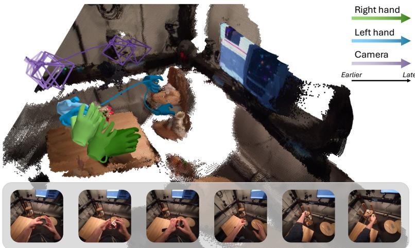
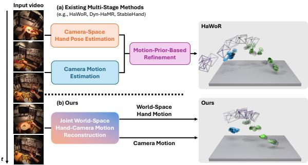
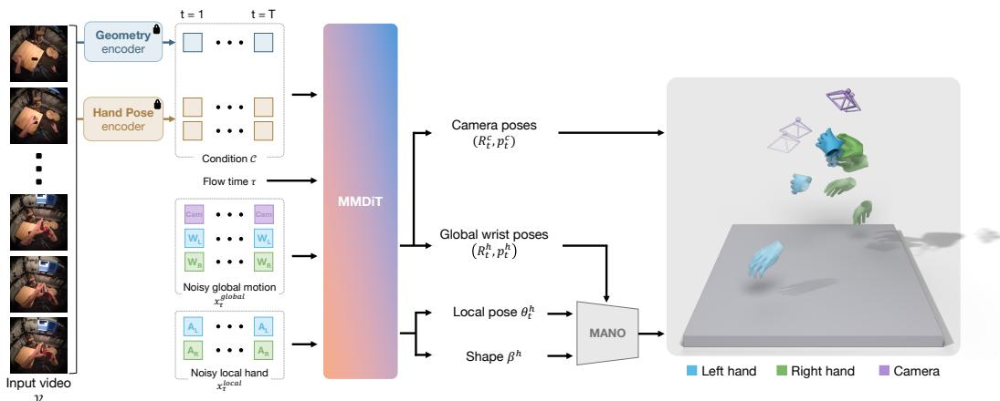
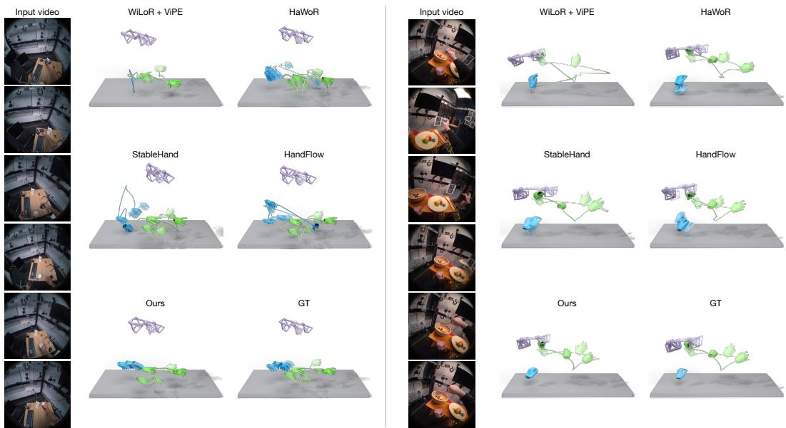
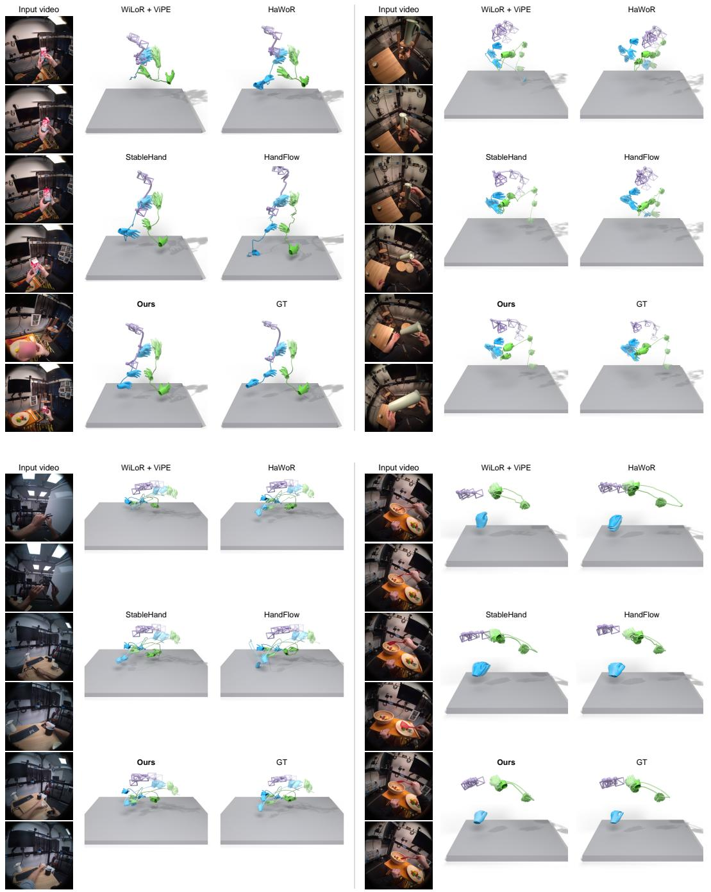
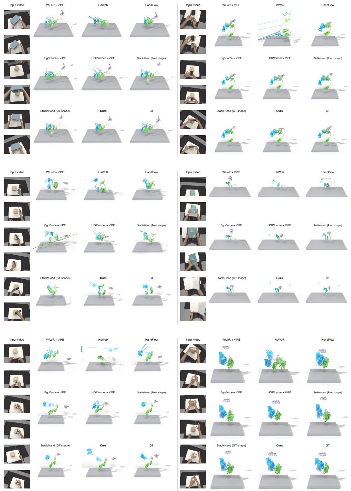
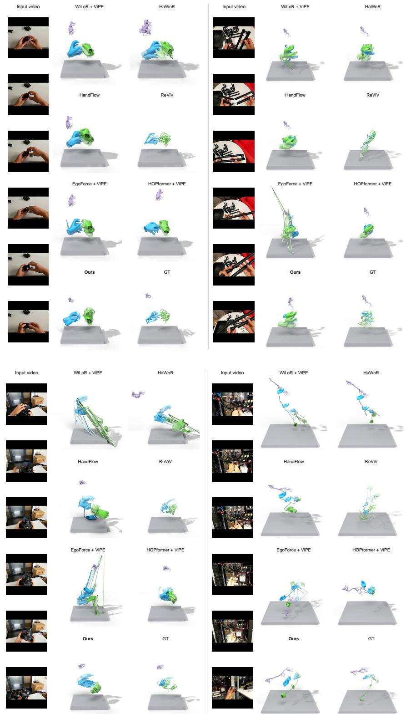
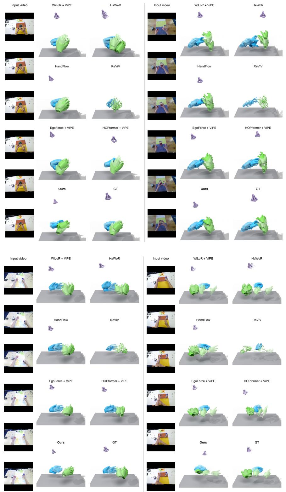
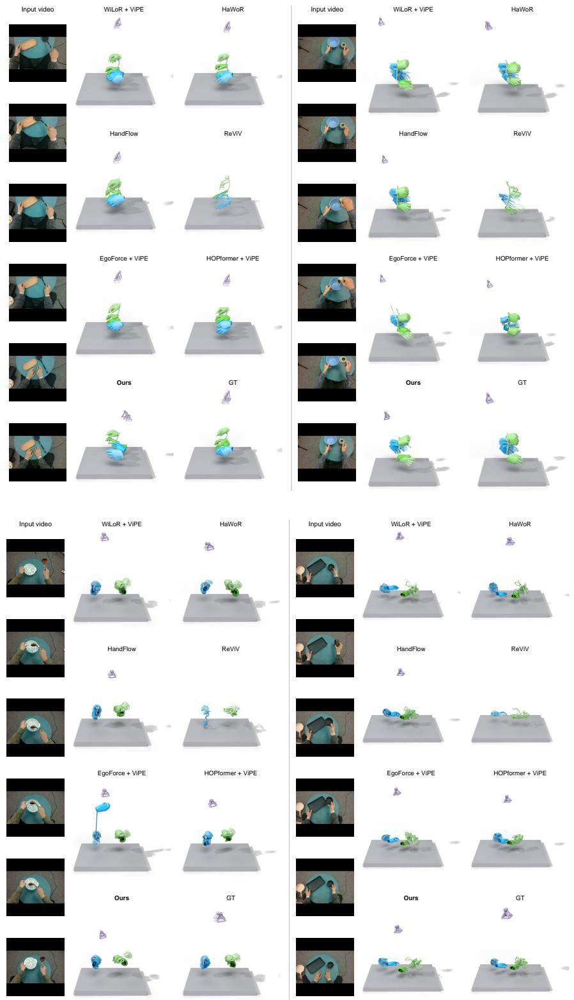

# DEWHAND: DIRECT METRIC WORLD-SPACE HAND MOTION RECONSTRUCTION FROM EGOCENTRIC VIDEOS

Naru Suzuki1,3 Satoshi Ikehata2 Takehiko Ohkawa1 Yoichi Sato1 Shuhei Kurita2,3

1The University of Tokyo 2National Institute of Informatics 3NII LLMC

  
Figure 1: DewHand directly reconstructs the motion of both hands and the camera in a shared metric world coordinate system from monocular egocentric video. See more on the project page.

## ABSTRACT

Recovering metric world-space hand motion from egocentric video supports understanding human interactions and transferring them to embodied agents. Three challenges complicate this task: multi-stage pipelines propagate errors from independently estimated hand and camera motion; monocular observations leave physical scale ambiguous; and occlusion and out-of-view hands admit multiple plausible motion trajectories. We present DewHand, a unified model for direct joint reconstruction of world-space hand and camera motion. To avoid compounding errors from multi-stage estimation, DewHand jointly predicts hand and camera motion in a shared world coordinate system within a single-stage pipeline. To resolve metric-scale ambiguity, it combines scene-level geometric features from VGGT-Ω with metric-space supervision, while hand-specific features preserve fine-grained articulation. To handle occlusion and out-of-view hands, we formulate reconstruction as conditional motion generation with flow matching. Under the same architecture, this generative formulation outperforms direct regression in both accuracy and temporal smoothness with only two sampling steps. Experiments on HOT3D and ARCTIC demonstrate improved world-space accuracy and temporal consistency over state-of-the-art methods. DewHand reduces rigid-aligned world-space error relative to StableHand from 32.9 to 28.4 mm on HOT3D and from 76.2 to 36.2 mm on ARCTIC. It also recovers camera scale within 10% on two thirds of HOT3D clips, versus about a quarter for SLAM. Moreover, in zero-shot evaluations on HoloAssist, H2O, and TACO, captured with different devices, DewHand achieves the lowest rigid-aligned world-space error (WA-MPJPE) on each dataset.

## 1 INTRODUCTION

Hands are our primary means of interacting with the physical world. Recovering their 3D motion from wearable cameras can support the analysis of human activity, the capture of manipulation skills, and the transfer of human demonstrations to embodied agents. These applications require more than an accurate hand pose in each video frame: they require a metrically scaled trajectory in a stable world coordinate system, so that a hand remains correctly placed as both the wearer and the camera move.

  
Figure 2: Direct world-space hand-camera generation. (a) Prior pipelines (Zhang et al., 2025a; Yu et al., 2025; Zeng et al., 2026) combine separate hand and camera estimates. (b) DewHand jointly generates both motions in metric world space. GT is overlaid in translucent dark gray on each reconstruction; predictions use green for the right hand, blue for the left hand, and purple for the camera.

This work addresses world-space 3D hand motion reconstruction from monocular egocentric video. Given a video, the goal is to recover the time-varying pose of both hands in a common world frame. Consider a wearer reaching for an object while turning their head. In camera coordinates, even a stationary hand appears to move with the camera; conversely, camera mo-

tion can hide or amplify the hand’s motion in the image. A useful reconstruction must separate these effects and preserve the hand’s position relative to the surrounding scene throughout the interaction.

Three challenges motivate our formulation. First, accurate local hand reconstruction does not by itself ensure a consistent world-space trajectory. Despite strong per-frame estimators (Pavlakos et al., 2024; Potamias et al., 2025), existing world-space pipelines typically estimate hands and camera motion separately, compose their outputs, and optionally apply temporal optimization or motionprior refinement (Zhang et al., 2025a; Yu et al., 2025; Xu et al., 2026; Zeng et al., 2026). Camera drift and mismatches between these estimates can therefore propagate into the reconstructed hand motion. Second, monocular video provides projective observations rather than direct metric measurements, leaving physical scale ambiguous even when local articulation is accurately recovered. Third, self-occlusion, hand-object interactions, motion blur, and frequent exits from the field of view make hand observations incomplete. The visible evidence may be consistent with multiple motion trajectories, motivating a conditional distribution over hand and camera motion.

We introduce DewHand, a unified model that directly generates metric world-space motion of both hands and the camera from egocentric video. To avoid error propagation, we jointly generate wrist poses, local articulation, and camera motion in a shared world frame instead of composing independent estimates. To support metric-scale recovery, we condition on geometric features from the frozen VGGT-Ω backbone (Wang et al., 2026) and supervise in metric space; hand-specific features add cues for local articulation. To handle ambiguous and missing observations, we learn a conditional distribution over joint hand-camera motion using flow matching. Compared with regressing a single trajectory, this generative formulation produces more accurate and temporally smoother motion, while exhibiting greater sample diversity where the hand is unobserved.

Our contributions are threefold:

• We formulate egocentric world-space hand reconstruction as direct joint generation of metric dual-hand and camera motion instead of composing separately estimated hands and camera; supervising the generated camera reduces rigid-aligned hand error by 6.4 mm.

• We develop a flow-matching architecture that combines geometry-aware and hand-specific video features to jointly model wrist placement, articulation, and camera motion in a shared world frame; replacing the geometric features with DINOv2 increases hand error by 13 mm and camera error by 57 mm.

• We establish state-of-the-art results on HOT3D and ARCTIC, reducing rigid-aligned world error against StableHand from 32.9 to 28.4 mm and from 76.2 to 36.2 mm, and recovering camera scale within 10% on two thirds of HOT3D clips, versus about a quarter for SLAM.

## 2 RELATED WORK

3D Hand Pose and Mesh Reconstruction: Large-scale models such as HaMeR (Pavlakos et al., 2024) recover detailed articulated pose in the wild, while WiLoR (Potamias et al., 2025) additionally targets robust 3D hand localization. Interaction and physical priors (Zuo et al., 2023; Suzuki et al., 2026; Zhang et al., 2025b) and spatio-temporal context (Zhao et al., 2024) further address occlusion and motion ambiguity. Recent work has explored complementary strategies for monocular hand reconstruction, including contrastive pre-training in SiMHand (Lin et al., 2025), controllable synthetic data generation in SesaHand (Zhao et al., 2026), exemplar-based in-context reconstruction in EgoHandICL (Xie et al., 2026), and kinematics-aware architectures in Rodrigues Network (Zhang et al., 2026). Egocentric datasets and benchmarks capture hand-object interactions (Ohkawa et al., 2023; Fan et al., 2024). HOPformer (Bansal et al., 2026) models egocentric hand-object pose, and EgoForce (Millerdurai et al., 2026) estimates camera-space hand pose. These advances improve hand pose and shape, but a shared metric world trajectory also requires camera motion.

World-Space Hand Motion Reconstruction: For full-body motion, WHAC (Yin et al., 2024) jointly recovers metric human and camera trajectories. For articulated hands, HaWoR (Zhang et al., 2025a) and Dyn-HaMR (Yu et al., 2025) construct global motion from camera-space hand estimates and separately recovered camera trajectories. HandFlow (Xu et al., 2026) learns camera-space hand motion distributions and transforms its predictions into world coordinates using SLAM. Stable Hand (Zeng et al., 2026) instead learns world-space refinement of hand observations constructed from separate hand and camera estimates, using quality-aware initialization to preserve reliable observations. UniHand (Sun et al., 2026) generates hand motion through latent diffusion in a fixed coordinate system defined by the first camera frame, but does not generate the camera trajectory. ReViV (Lyu et al., 2026) jointly models camera trajectories and camera-space hand kinematics, then aligns the reconstructed viewer and scene in a metric frame. DewHand jointly generates metric hand and camera trajectories in a single stage, conditioned on geometric and hand-specific features.

## 3 METHOD

For a monocular egocentric video $\mathcal { V } = \{ I _ { t } \} _ { t = 1 } ^ { T } , t$ indexes video frames and $\tau \in [ 0 , 1 ]$ denotes flow time. Fig. 3 summarizes our design. Unlike HandFlow (Xu et al., 2026), which models cameraspace hand motion before SLAM-based lifting, and StableHand (Zeng et al., 2026), which refines world-space observations assembled from separate hand and camera estimates, DewHand generates both trajectories in a metric world frame without an initial reconstruction. Geometric conditioning resolves scale ambiguity, and conditional flow modeling handles missing observations.

## 3.1 PROBLEM FORMULATION AND STATE REPRESENTATION

Our goal is to recover the metric 3D motion of both hands and the camera in a common world frame. We take the camera coordinate system of the first frame as the world frame, so that no external localization, gravity estimate, or scene template is required at inference time. The outputs in Fig. 3 are the camera pose $( \mathbf { R } _ { t } ^ { c } , \mathbf { p } _ { t } ^ { c } ) \ \in \ S \bar { O } ( 3 ) \times \mathbb { R } ^ { 3 }$ and, for each hand $h \in \{ L , R \}$ global wrist pose $( \mathbf { R } _ { t } ^ { h } , \mathbf { p } _ { t } ^ { h } ) \ \in \ S O ( 3 ) \ \times \ \mathbb { R } ^ { 3 }$ , local pose $\pmb { \theta } _ { t } ^ { h } ~ \in ~ \mathbb { R } ^ { 1 5 \times 6 }$ , and clip-level shape $\beta ^ { h } \in \mathbb { R } ^ { 1 0 }$ (Romero et al., 2017). The local pose stores 6D rotations of 15 joints, converted to MANO’s 45D axis-angle pose for mesh decoding. We group the quantities that live in the world frame into a global motion stream $\mathbf { x } _ { t } ^ { \mathrm { g l o b a l } } = ( \mathbf { R } _ { t } ^ { \bar { L _ { \mathbf { \alpha } } } } , \mathbf { p } _ { t } ^ { L } , \mathbf { R } _ { t } ^ { \bar { R } } , \mathbf { p } _ { t } ^ { \bar { R } } , \mathbf { R } _ { t } ^ { c } , \mathbf { p } _ { t } ^ { c } )$ and the hand-local parameters into a local hand stream $\mathbf { x } _ { t } ^ { \mathrm { { l o c a l } } } = ( \pmb { \theta } _ { t } ^ { L } , \beta ^ { \bar { L } } , \pmb { \theta } _ { t } ^ { \bar { R } } , \beta ^ { \bar { R } } )$ . The clip-level shape target is repeated across frames in this stream. This separation reflects the different geometry and conditioning cues of global rigid motion and local articulation, while the two streams remain coupled throughout the model. Rotations are parameterized by the 6D continuous representation (Zhou et al., 2019).

Hands are frequently outside the field of view, occluded, or missed by per-frame detectors, so the observations can admit multiple plausible trajectories. A deterministic regressor can collapse these possibilities into an averaged motion. Let $\mathcal { C } = ( \mathcal { C } _ { \mathrm { g e o } } , \mathcal { C } _ { \mathrm { h a n d } } )$ denote the geometric and hand-specific features extracted from $\breve { \nu } ,$ as described in Section 3.2. Rather than directly regressing a single trajectory, we therefore learn the conditional motion distribution $p _ { \theta } ( \mathbf { x } _ { 1 : T } ^ { \mathrm { g l o b a l } } , \mathbf { \bar { x } } _ { 1 : T } ^ { \mathrm { l o c a l } } \mid \mathcal { C } )$ . Moreover, apparent hand motion in egocentric video is induced jointly by hand movement and camera egomotion. We therefore generate hands and camera together, allowing the model to separate their contributions while maintaining their consistency in the shared world frame.

  
Figure 3: DewHand architecture. Frozen encoders provide $\mathcal { C } = ( \mathcal { C } _ { \mathrm { g e o } } , \mathcal { C } _ { \mathrm { h a n d } } )$ . At flow time τ, the model first applies spatio-temporal attention within each stream, then joint attention across the global motion, local hand, and condition streams at each frame. The Multimodal Diffusion Transformer (MMDiT) denoises $\mathbf { x } _ { \tau } ^ { \mathrm { g l o b a l } }$ and $\mathbf { x } _ { \tau } ^ { \mathrm { { l o c a l } } }$ . The outputs are camera pose $( \mathbf { R } _ { t } ^ { c } , \mathbf { p } _ { t } ^ { c } )$ and, for each hand $h \in \{ L , R \}$ , global wrist pose $( \mathbf { R } _ { t } ^ { h } , \mathbf { p } _ { t } ^ { h } )$ , local pose ${ \boldsymbol { \theta } } _ { t } ^ { h }$ , and shape $\beta ^ { h }$ . Cam, $W _ { h }$ , and $A _ { h }$ are the corresponding tokens; MANO converts the hand outputs to meshes.

## 3.2 VISUAL CONDITIONING AND MISSING OBSERVATIONS

Metric world-space reconstruction requires scene-level geometric cues to constrain scale and global placement, alongside fine-grained hand cues for local articulation. We therefore encode the video with two complementary frozen backbones: VGGT-Ω (Wang et al., 2026) provides clip-level scene geometry and camera cues, while HaMeR (Pavlakos et al., 2024) provides detailed per-hand appearance features. Together with metric-space supervision (Section 3.4), the geometric features support physical-scale recovery without fixing the output to an externally estimated camera trajectory. VGGT-Ω jointly processes all T frames, so each per-frame output already contains temporal context. A learned query attention-pools its patch features. We add a learned projection of its camera token to the pooled feature and project the sum into one geometry token $\mathbf { c } _ { t } ^ { G }$ per frame. HaMeR patch features are spatially pooled and projected into separate left- and right-hand tokens $\mathbf { c } _ { t } ^ { h } , h \in \{ \hat { L } , R \}$ separate tokens keep a missing or corrupted observation of one hand from affecting the other.

Hand-specific features are unavailable when a hand is out of view or its detection fails. Let $m _ { t } ^ { h } \in$ $\{ 0 , 1 \}$ indicate whether a feature is used for hand h at frame t (1 if observed, 0 if missing or masked during training). We replace unused features with a learned, side-specific mask token $\mathbf { e } _ { \mathrm { m a s k } } ^ { \widetilde { h } }$

$$
\widetilde { \mathbf { c } } _ { t } ^ { h } = m _ { t } ^ { h } \mathbf { c } _ { t } ^ { h } + ( 1 - m _ { t } ^ { h } ) \mathbf { e } _ { \mathrm { m a s k } } ^ { h } .\tag{1}
$$

The resulting $\widetilde { \mathbf { c } } _ { t } ^ { h }$ is the hand-conditioning token passed to the flow model. During training, we additionally mask individual observations, contiguous spans, and complete hand tracks. The model must therefore recover missing evidence from the remaining video, scene, and temporal context, improving robustness to intermittent detector failures. The condition stream has three tokens per frame: geometry, left hand, and right hand.

## 3.3 JOINT HAND-CAMERA FLOW MODEL

Flow matching (Lipman et al., 2023; Hu et al., 2023) models the trajectories compatible with incomplete observations by learning transport from noise to data. We apply it to the joint hand-camera state, conditioned on visual features. The model uses two integration steps at inference.

At flow time $\tau , \mathbf { x } _ { \tau } ^ { \mathrm { g l o b a l } }$ and $\mathbf { x } _ { \tau } ^ { \mathrm { { l o c a l } } }$ denote the clip-wide states of the two generated streams. Here the subscript τ indexes flow time, while t continues to index video frames within each state; the subscript 1 below denotes the clean endpoint of the flow. We use one token per entity and frame. The global motion stream contains three 9D tokens for the left wrist, right wrist, and camera. Each token represents 3D translation and 6D rotation in world coordinates. The local hand stream contains two 100D tokens, one per hand, containing the 6D rotations of the 15 articulated MANO joints and the 10D MANO shape. The condition stream contains the three tokens defined above. Each input is projected to width $D ,$ and entity- and frame-specific embeddings retain its identity and temporal position. The three streams contain eight tokens in total at every frame. In Fig. 3, Cam denotes the camera token, $W _ { h }$ the global wrist token, and $A _ { h }$ the local hand token for side $h \in \{ L , R \}$

Each layer performs attention in two successive stages: within-stream attention, then joint attention across streams. Within-stream attention first relates the entities at each frame and then aggregates temporal context per entity. They run independently on the global motion, local hand, and condition streams, with separate parameters, to build per-stream spatio-temporal representations.

Joint attention across streams then lets global motion, local hand, and condition tokens attend to one another at each frame in a Multimodal Diffusion Transformer (MMDiT) block (Esser et al., 2024). As in HandFlow (Xu et al., 2026), condition tokens are updated rather than kept fixed.

The flow time $\tau$ and the clip-averaged VGGT camera token provide adaptive modulation throughout the network. Separate output heads map the final global motion and local hand tokens to cleantrajectory estimates $\hat { \mathbf { x } } _ { 1 } ^ { \mathrm { g l o b a \bar { l } } }$ and $\hat { \mathbf { x } } _ { 1 } ^ { \mathrm { l o c a l } }$ . The predicted wrist poses and articulation are composed through MANO with the clip-averaged shape $\bar { \boldsymbol { \beta } } ^ { h } = { \cal T } ^ { - 1 } \sum _ { t } \hat { \boldsymbol { \beta } } _ { t } ^ { h }$ , where $\hat { \boldsymbol { \beta } } _ { t } ^ { h }$ is the predicted shape component for hand h at video frame t. The predicted camera entity directly defines the camera trajectory; no separately estimated camera trajectory is composed with the hands after generation.

## 3.4 FLOW MATCHING AND TRAINING OBJECTIVES

For training, $\mathbf { x } _ { \tau } = ( \mathbf { x } _ { \tau } ^ { \mathrm { g l o b a l } } , \mathbf { x } _ { \tau } ^ { \mathrm { l o c a l } } )$ denotes the full clip state at flow time $\tau ;$ subscripts 0 and 1 denote flow endpoints, not video frames. Let $\mathbf { x } _ { 1 } = ( \mathbf { x } _ { 1 : T } ^ { \mathrm { g l o b a l } } , \mathbf { x } _ { 1 : T } ^ { \mathrm { l o c a l } } )$ denote the ground-truth trajectory after per-dimension standardization, and $\mathbf { x } _ { 0 } \sim \mathcal { N } ( \mathbf { 0 } , \mathbf { I } )$ a noise sample of the same shape. We draw a single flow time $\tau$ per clip from a logit-normal distribution, share it across both streams so that they are always denoised at a common noise level, and form ${ \bf x } _ { \tau } = \left( 1 - \tau \right) { \bf x } _ { 0 } + \tau { \bf x } _ { 1 }$ . The network predicts the clean sample $\hat { \mathbf { x } } _ { 1 }$ rather than the velocity, which gives the flow-matching term

$$
{ \mathcal { L } } _ { \mathrm { f m } } = \left\| { \hat { \mathbf { x } } } _ { 1 } ^ { \mathrm { g l o b a l } } - \mathbf { x } _ { 1 } ^ { \mathrm { g l o b a l } } \right\| ^ { 2 } + \left\| { \hat { \mathbf { x } } } _ { 1 } ^ { \mathrm { l o c a l } } - \mathbf { x } _ { 1 } ^ { \mathrm { l o c a l } } \right\| ^ { 2 } .\tag{2}
$$

This term is computed in the standardized parameter space. Let $\mathcal { I } ( \mathbf { x } )$ denote the world-space 3D hand joints obtained by decoding state x through MANO, and let $\mathcal { I } ^ { \mathrm { g t } }$ denote the ground-truth joints. As in HandFlow (Xu et al., 2026), we supervise the decoded joints, here in metric world space, $\mathcal { L } _ { \mathrm { j o i n t } } = \mathrm { S m o o t h L 1 } ( \mathcal { I } ( \hat { \mathbf { x } } _ { 1 } ) , \mathcal { I } ^ { \mathrm { g t } } )$ , over frames with valid hand ground truth. This converts errors in wrist pose and local articulation into their physical effect on the complete hand. We supervise the camera directly in metric space with $\mathcal { L } _ { \mathrm { c a m } }$ , a squared error on its position and 6D rotation. To supervise temporal changes in wrist translation and rotation, let q denote world-space reference points fixed to each wrist. We match their first and second differences along video time t to the ground truth using $\mathcal { L } _ { \mathrm { v e l } } = \mathrm { S }$ moothL1(∆qˆ, ∆qgt) and $\mathcal { L } _ { \mathrm { a c c } } = \mathrm { S m o o t h L 1 } ( \Delta ^ { 2 } \hat { \mathbf { q } } , \Delta ^ { 2 } \mathbf { q } ^ { \mathrm { g t } } )$ , respectively. With loss weights $\lambda _ { j } = \lambda _ { c } = 1$ and $\lambda _ { v } = \lambda _ { a } = 8 0 0$ , the total objective is

$$
\begin{array} { r } { \mathcal { L } = \mathcal { L } _ { \mathrm { f m } } + \lambda _ { j } \mathcal { L } _ { \mathrm { j o i n t } } + \lambda _ { c } \mathcal { L } _ { \mathrm { c a m } } + \lambda _ { v } \mathcal { L } _ { \mathrm { v e l } } + \lambda _ { a } \mathcal { L } _ { \mathrm { a c c } } . } \end{array}\tag{3}
$$

The predicted clean endpoint defines a flow field for each stream $S \in \mathrm { \{ g l o b a l , l o c a l \} }$ as ${ \mathbf { v } } _ { \theta } ^ { S } ( \bar { { \mathbf { x } } _ { \tau } } , \tau , \mathcal { C } ) = ( \hat { { \mathbf { x } } } _ { 1 } ^ { S } ( { \mathbf { x } } _ { \tau } , \bar { \tau _ { \tau } } \mathcal { C } ) - { \mathbf { x } } _ { \tau } ^ { S } ) / ( 1 - \tau )$ . We integrate this field with two Euler steps; sample aggregation is detailed in Appendix C.1.

Table 1: World-space hand motion on HOT3D and ARCTIC. Errors in mm, AccEr in $\mathrm { m / s ^ { 2 } ; }$ wWA is wrist-level WA-MPJPE. Pred. shape: estimated MANO shape; GT shape: privileged ground-truth shape. ∗: zero-shot on ARCTIC. †: training data include HaWoR-split evaluation sequences. Best/second best: per split, among rows with the same shape input.
<table><tr><td colspan="2"></td><td colspan="2">W-MPJPE↓</td><td colspan="2"></td><td colspan="2">WA-MPJPE↓</td><td colspan="2">wWA↓</td></tr><tr><td>Method</td><td></td><td>PA↓ Sim(3)</td><td>SE(3)</td><td>Sim(3)</td><td>SE(3)</td><td>Sim(3)</td><td>SE(3)</td><td>MRRPE-A ↓ AccEr ↓</td><td></td></tr><tr><td colspan="2">HaWoR split</td><td></td><td></td><td></td><td></td><td></td><td></td><td></td><td></td></tr><tr><td>WiLoR + ViPE†</td><td></td><td>8.21</td><td>171.78176.26</td><td>64.52</td><td>92.06</td><td>53.00</td><td>86.33</td><td>166.29</td><td>16.98</td></tr><tr><td>HaWoR</td><td>7.24</td><td>151.62</td><td>162.04</td><td>55.43</td><td>84.80</td><td>46.10</td><td>79.20</td><td>138.53</td><td>14.77</td></tr><tr><td>HandFlow†</td><td>7.49</td><td>162.23</td><td>170.94</td><td>64.61</td><td>95.24</td><td>53.46</td><td>90.00</td><td>134.36</td><td>17.71</td></tr><tr><td>EgoForce + ViPE†</td><td>7.11</td><td></td><td>158.31167.30</td><td>60.13</td><td>79.31</td><td>49.24</td><td>73.08</td><td>114.14</td><td>15.69</td></tr><tr><td>HT3D HOPformer + ViPE</td><td>13.54</td><td></td><td>223.86231.17</td><td></td><td>85.55 106.01</td><td>60.56</td><td>85.19</td><td>199.68</td><td>20.87</td></tr><tr><td>Ours (Pred. shape)</td><td>6.76</td><td>78.60</td><td>77.59</td><td>32.27</td><td>35.94</td><td>24.71</td><td>29.49</td><td>56.91</td><td>1.89</td></tr><tr><td colspan="2">StableHand split</td><td></td><td></td><td></td><td></td><td></td><td></td><td></td><td></td><td></td></tr><tr><td>StableHand (Pred. shape)</td><td></td><td>11.56</td><td>107.43117.69</td><td></td><td>37.19</td><td>43.74</td><td>23.32</td><td>32.86</td><td>55.78</td><td>3.14</td></tr><tr><td>Ours</td><td>(Pred. shape)</td><td>6.25</td><td>64.21</td><td>63.46</td><td>26.45</td><td>28.56</td><td>20.47</td><td>24.07</td><td>52.00</td><td>2.65</td></tr><tr><td>StableHand (GT shape)</td><td></td><td>4.94</td><td>81.02</td><td>87.31</td><td>28.71</td><td>32.90</td><td>20.13</td><td>26.92</td><td>45.35</td><td>2.92</td></tr><tr><td>Ours (GT shape)</td><td>5.71</td><td>63.58</td><td></td><td>63.33</td><td>26.26</td><td>28.40</td><td>20.47</td><td>24.08</td><td>51.97</td><td>2.66</td></tr><tr><td colspan="2">WiLoR + ViPE HaWoR</td><td>8.12</td><td>231.97 233.98</td><td></td><td>72.38</td><td>77.64</td><td>59.36</td><td>66.76</td><td>112.45</td><td>20.70</td></tr><tr><td colspan="2">ARCTIC</td><td>12.40</td><td>311.77339.56</td><td></td><td></td><td>94.84140.57</td><td></td><td>74.34124.68</td><td>191.89</td><td>24.51</td></tr><tr><td colspan="2">HandFlow*</td><td>11.01</td><td>272.98 275.82</td><td></td><td>77.62</td><td>94.70</td><td>62.08</td><td>81.96</td><td>144.62</td><td>15.14</td></tr><tr><td colspan="2">EgoForce + ViPE</td><td>8.88</td><td>242.60243.37</td><td></td><td>76.83</td><td>89.12</td><td>62.39</td><td>77.33</td><td>126.72</td><td>15.79</td></tr><tr><td colspan="2">HOPformer + ViPE</td><td>8.36</td><td>176.74</td><td>178.65</td><td>56.13</td><td>60.65</td><td>44.34</td><td>49.43</td><td>73.94</td><td>15.96</td></tr><tr><td colspan="2">StableHand (Pred. shape)</td><td>11.37</td><td>282.79</td><td>285.59</td><td>74.68</td><td>78.63</td><td>54.05</td><td>59.40</td><td>101.48</td><td>3.47</td></tr><tr><td colspan="2">Ours (Pred. shape)</td><td>8.10</td><td>100.05</td><td>97.11</td><td>33.17</td><td>36.35</td><td>26.05</td><td>29.68</td><td>49.34</td><td>2.22</td></tr><tr><td colspan="2">StableHand (GT shape)</td><td></td><td></td><td></td><td></td><td></td><td></td><td></td><td></td><td></td></tr><tr><td colspan="2">Ours (GT shape)</td><td>10.44 8.14</td><td>282.45 282.69 99.20</td><td>97.00</td><td>72.89 33.03</td><td>76.22 36.18</td><td>52.52 26.02</td><td>56.99 29.65</td><td>97.90 49.33</td><td>3.55 2.22</td></tr></table>

## 4 EXPERIMENTS

## 4.1 WORLD-SPACE HAND MOTION

Datasets: We evaluate on HOT3D (Banerjee et al., 2025) and ARCTIC (Fan et al., 2023), following prior work on world-space hand motion reconstruction, including HaWoR (Zhang et al., 2025a) and HandFlow (Xu et al., 2026) on HOT3D and StableHand (Zeng et al., 2026) on both datasets. We train on HOT3D (for the StableHand split, a separate model that excludes its test windows; Appendix B.3) and fine-tune the resulting checkpoint on ARCTIC. For both training and inference, we use sequences of T = 150 frames at 30 fps, corresponding to 5-second clips.

Evaluation Metrics: We report PA-MPJPE, W-MPJPE, WA-MPJPE, MRRPE-A, and acceleration error (AccEr) on the 21-joint MANO skeleton. MRRPE-A measures inter-wrist displacement after a shared rigid alignment. We report WA-MPJPE with similarity (Sim(3)) and rigid (SE(3)) alignment. Rigid alignment removes differences in world-frame origin and orientation while preserving scale, so scale errors remain visible; similarity alignment additionally corrects scale. We also report wristlevel WA-MPJPE (wWA), which scores only the wrist trajectory and thus separates world placement from finger articulation. Appendix B details the scoring protocol. Unless stated otherwise, inference uses two Euler steps and five samples.

Baselines: We compare per-frame hand estimators (WiLoR, EgoForce (Millerdurai et al., 2026), HOPformer (Bansal et al., 2026)) lifted with ViPE, and the video-based methods HaWoR (Zhang et al., 2025a), HandFlow (Xu et al., 2026), and StableHand (Zeng et al., 2026); all but HandFlow are trained on ARCTIC. Baseline implementation details are in Appendix B.

Results: DewHand achieves the best world-space accuracy on both datasets (Table 1). Against StableHand with predicted shape, it reduces SE(3)-aligned WA-MPJPE from 43.74 to 28.56 mm on the

  
Figure 4: Qualitative comparison on HOT3D. Two selected sequences show six input frames and reconstructions from representative methods and ground truth. For each method, one SE(3) transform fitted jointly to both hands is also applied to its camera poses; no scale correction is used. Methods share the same view and crop within each sequence. Green and blue denote the right and left hands; purple frustums indicate camera poses.

Table 2: Camera motion on HOT3D. δ<κ is the percentage of clips whose trajectory scale is within a factor κ of the ground truth. ATE is reported without alignment (raw) and after SE(3) or Sim(3) alignment; ATE/RPE in mm, rot in degrees. Best in bold, second best underlined.
<table><tr><td>Method</td><td>δ&lt;1.10 ↑</td><td>δ&lt;1.25 ↑</td><td> $\mathrm { \ A T E _ { r a w } \downarrow }$ </td><td> $\mathrm { \ A T E { \mathrm { { S E 3 } } } \downarrow }$ </td><td> $\mathrm { { A T E } _ { \mathrm { { S i m 3 } } } \downarrow }$ </td><td>rot ↓</td><td>RPEt @1↓</td></tr><tr><td>HaWoR</td><td>26.1%</td><td>42.2%</td><td>142.6</td><td>71.2</td><td>36.2</td><td>8.27</td><td>7.61</td></tr><tr><td>ViPE</td><td>24.6%</td><td>53.6%</td><td>96.4</td><td>45.6</td><td>24.9</td><td>4.61</td><td>10.21</td></tr><tr><td>VGGT-Ω</td><td>20.6%</td><td>48.8%</td><td>77.0</td><td>38.8</td><td>27.7</td><td>6.00</td><td>12.78</td></tr><tr><td>Ours</td><td>66.2%</td><td>91.9%</td><td>31.5</td><td>16.7</td><td>13.1</td><td>1.73</td><td>3.79</td></tr></table>

HOT3D StableHand split and from 78.63 to 36.35 mm on ARCTIC, and also improves PA-MPJPE. With the same privileged ground-truth shape, ours leads in every metric on ARCTIC and trails StableHand on HOT3D only in PA-MPJPE, MRRPE-A, and (by 0.3 mm) Sim(3)-aligned wWA, so the world-space gains do not come from hand shape. The small gap between our Sim(3)- and SE(3)- aligned errors indicates that metric scale is retained; ours also has the lowest AccEr, and the lowest MRRPE-A among predicted-shape methods. Fig. 4 illustrates this: DewHand’s hand trajectories remain close to ground truth, whereas several baselines show greater dispersion in the left sequence or displace the nearly stationary left hand in the right. Its margin persists when more than half of the frames lack a hand detection (71.0 vs. 134.3 mm for the best baseline; Appendix C.3), and it runs 2.6–3.7× faster than the SLAM-based pipelines (Appendix C.4).

## 4.2 CAMERA MOTION

Evaluation: On HOT3D, we report camera scale accuracy, raw and aligned ATE, mean rotation error, and 1-frame RPE (Table 2); all trajectories are relative to frame 0.

Baselines: We compare against VGGT-Ω, the frozen geometry backbone we condition on, together with the two SLAM systems used to lift the hand baselines: HaWoR’s (Zhang et al., 2025a) internal DROID-SLAM (Teed & Deng, 2021) and ViPE (Huang et al., 2025).

Table 3: Zero-shot generalization to HoloAssist, H2O, and TACO. All methods are scored on common frames. Camera-space methods are lifted to world coordinates with ViPE run on each 150- frame evaluation window with ground-truth intrinsics; DewHand uses no camera intrinsics. † marks target-domain training; best and second best are marked within each dataset.
<table><tr><td rowspan="2">Method</td><td rowspan="2">PA↓</td><td colspan="2">W-MPJPE↓</td><td colspan="2">WA-MPJPE↓</td><td colspan="2">wWA↓</td><td rowspan="2"></td><td rowspan="2">AccEr ↓ MRRPE-A ↓</td></tr><tr><td>Sim(3)</td><td>SE(3)</td><td>Sim(3)</td><td>SE(3)</td><td>Sim(3)</td><td>SE(3)</td></tr><tr><td rowspan="6">HaWoR HandFlow Hosist ReViV† WiLoR + ViPE Ours</td><td>13.47</td><td>128.07</td><td>148.96</td><td>51.59</td><td>77.36</td><td>38.90</td><td>67.87</td><td>24.91</td><td>112.25</td></tr><tr><td>12.53</td><td>142.57</td><td>233.89</td><td>55.39</td><td>161.42</td><td>43.36</td><td>153.23</td><td>29.91</td><td>109.69</td></tr><tr><td>14.17</td><td>224.11</td><td>253.67</td><td>63.02</td><td>125.99</td><td>46.82</td><td>113.63</td><td>23.71</td><td>136.57</td></tr><tr><td>12.69</td><td>167.78</td><td>263.88</td><td>56.24</td><td>179.21</td><td>43.73</td><td>174.46</td><td>30.31</td><td>139.42</td></tr><tr><td>EgoForce + ViPE 13.78</td><td>172.61</td><td>279.13</td><td>68.35</td><td>184.37</td><td>52.17</td><td>176.22</td><td>46.20</td><td>156.19</td></tr><tr><td>HOPformer + ViPE 16.54</td><td>150.57 105.00</td><td>232.90 112.86</td><td>59.40 40.89</td><td>153.31 52.67</td><td>40.65 29.42</td><td>137.55 42.25</td><td>31.86 7.33</td><td>91.82</td></tr><tr><td rowspan="6">ReViV† HZ0 HandFlow</td><td>HaWoR</td><td>11.96</td><td></td><td>62.86</td><td>22.81</td><td></td><td>14.46</td><td>31.63</td><td>13.35</td><td>84.55 34.52</td></tr><tr><td>HandFlow</td><td>7.22 7.32</td><td>62.61 32.76</td><td>62.67</td><td>17.26</td><td>35.57 25.13</td><td>11.51</td><td>20.87</td><td>8.72</td><td>36.59</td></tr><tr><td></td><td></td><td>56.76</td><td>55.46</td><td>23.72</td><td>27.45</td><td>12.93</td><td>18.96</td><td>3.05</td><td>45.28</td></tr><tr><td>WiLoR + ViPE</td><td>9.44 5.68</td><td>35.93</td><td>64.65</td><td>14.80</td><td>22.04</td><td>7.94</td><td>16.26</td><td>7.50</td><td></td></tr><tr><td>EgoForce + ViPE†</td><td>6.08</td><td>27.68</td><td>58.75</td><td>14.16</td><td>22.50</td><td>9.08</td><td>18.50</td><td>7.58</td><td>23.76 22.76</td></tr><tr><td>HOPformer + ViPE</td><td>9.67</td><td>51.92</td><td>81.68</td><td>25.22</td><td>32.87</td><td>13.59</td><td>23.02</td><td>12.18</td><td>48.49</td></tr><tr><td rowspan="4">Ours HaWoR</td><td>6.80</td><td>40.88</td><td>40.77</td><td></td><td>19.54</td><td>20.68</td><td>12.10</td><td>15.05</td><td>2.60</td><td>46.17</td></tr><tr><td></td><td></td><td>84.61</td><td></td><td>32.34</td><td></td><td></td><td></td><td>15.47</td><td></td></tr><tr><td>9.77 10.49</td><td>80.84 55.51</td><td></td><td>56.76</td><td>27.91</td><td>43.63 36.05</td><td>23.95 19.89</td><td>38.01 29.80</td><td>9.82</td><td>57.17</td></tr><tr><td>11.41</td><td></td><td></td><td>90.67</td><td>40.07</td><td>47.77</td><td>27.86</td><td>39.72</td><td>5.63</td><td>72.61</td></tr><tr><td rowspan="6">ReViV† TACO WiLoR + ViPE EgoForce + ViPE HOPformer + ViPE</td><td></td><td>88.09</td><td></td><td></td><td></td><td></td><td></td><td></td><td></td><td>54.28</td></tr><tr><td></td><td>8.51</td><td>56.98</td><td>60.94</td><td>27.38</td><td>33.45</td><td>19.71</td><td>29.29</td><td>12.37</td><td>55.82</td></tr><tr><td>10.13</td><td>66.52</td><td>71.55</td><td>33.91</td><td>43.06</td><td></td><td>25.04</td><td>38.17</td><td>17.28</td><td>75.41</td></tr><tr><td>12.70</td><td></td><td>74.58</td><td>75.48</td><td>38.50</td><td>41.73</td><td>22.97</td><td>28.58</td><td>17.08</td><td>90.59</td></tr><tr><td>9.26</td><td>56.91</td><td>58.99</td><td></td><td>26.76</td><td>31.29</td><td>18.58</td><td>24.15</td><td>3.35</td><td>60.95</td></tr><tr><td></td><td></td><td></td><td></td><td></td><td></td><td></td><td></td><td></td><td></td></tr></table>

Results: Despite conditioning on frozen VGGT-Ω features, DewHand improves camera scale and trajectory accuracy over the backbone (Table 2). Gains after similarity alignment indicate improvements beyond scale correction.

## 4.3 CROSS-DEVICE ZERO-SHOT GENERALIZATION

We evaluate the HOT3D-trained model without fine-tuning on HoloAssist (Wang et al., 2023), testing transfer from Aria fisheye video to HoloLens 2 perspective video. HoloAssist provides camera poses and articulated hand tracks, enabling world-space evaluation across capture devices. On randomly sampled validation windows, DewHand achieves the lowest errors across all reported metrics, including PA-MPJPE, world-space placement, acceleration, and inter-hand placement (Table 3). Camera-space baselines are lifted with per-window ViPE (Huang et al., 2025) rather than ground-truth cameras; target-domain-trained references are marked in the table.

We further evaluate zero-shot transfer on the held-out subject of the H2O (Kwon et al., 2021) pose benchmark and on TACO (Liu et al., 2024), lifting the camera-space methods with per-window ViPE trajectories. On both datasets, DewHand achieves the lowest SE(3)-aligned joint and wristlevel WA-MPJPE, as well as AccEr (Table 3). Other metrics, particularly local pose and inter-hand placement, show mixed results.

## 4.4 ABLATION STUDY

We ablate camera supervision, visual conditioning, and the training objective on HOT3D.

Joint Camera Estimation (Table 4(a)): Removing camera supervision increases SE(3)-aligned WA-MPJPE from 35.94 to 42.36 mm while leaving PA-MPJPE nearly unchanged. Camera supervision therefore primarily improves global hand placement rather than local articulation.

Table 4: Ablations on HOT3D. (a) Camera supervision, (b) visual conditioning, and (c) training objective. All variants use mask tokens and the same 64-epoch training recipe; each changes only the named component. Best in bold and second best underlined within each block. Metrics follow Tables 1 and 2; scale accuracy is reported as a percentage.
<table><tr><td rowspan="2">Variant</td><td colspan="4">Hands</td><td colspan="4">Camera</td></tr><tr><td></td><td></td><td>PA ↓ WASE(3) ↓ wWASE(3) ↓ AccEr ↓ δ&lt;1.10 ↑ δ&lt;1.25 ↑ ATEraw ↓ rot↓</td><td></td><td></td><td></td><td></td><td></td></tr><tr><td colspan="9">(a) Camera supervision</td></tr><tr><td>Full</td><td>6.76</td><td>35.94</td><td>29.49</td><td>1.89</td><td>66.2</td><td>91.9</td><td></td><td>31.5 1.73</td></tr><tr><td>w/o camera supervision</td><td>6.86</td><td>42.36</td><td>34.63</td><td>1.80</td><td></td><td></td><td></td><td></td></tr><tr><td colspan="9">(b) Conditioning features</td></tr><tr><td>HaMeR + VGGT-Ω</td><td>6.76</td><td>35.94</td><td>29.49</td><td>1.89</td><td>66.2</td><td>91.9</td><td>31.5 1.73</td><td></td></tr><tr><td>HaMeR + DA3</td><td>6.77</td><td>36.40</td><td>29.86</td><td>1.79</td><td>64.2</td><td>90.6</td><td>31.5 1.60</td><td></td></tr><tr><td>HaMeR + DINOv2</td><td>6.71</td><td>49.15</td><td>43.20</td><td>1.97</td><td>34.0</td><td>63.0</td><td></td><td>88.96.12</td></tr><tr><td>∅ + VGGT-Ω</td><td>10.72</td><td>46.57</td><td>35.07</td><td>2.04</td><td>64.0</td><td>90.3</td><td></td><td>32.8 1.83</td></tr><tr><td colspan="9">(c) Training objective</td></tr><tr><td>L2 regression</td><td>7.04</td><td>45.13</td><td>38.13</td><td>3.34</td><td>62.0</td><td>89.8</td><td>31.4 1.83</td><td></td></tr><tr><td>Flow matching</td><td>6.76</td><td>35.94</td><td>29.49</td><td>1.89</td><td>66.2</td><td>91.9</td><td></td><td>31.5 1.73</td></tr></table>

Conditioning Features (Table 4(b)): Replacing VGGT-Ω with DINOv2 (Oquab et al., 2024) raises SE(3)-aligned WA-MPJPE from 35.94 to 49.15 mm and generated-camera ATE from 31.5 to 88.9 mm, supporting the value of 3D geometric features. DA3 (Lin et al., 2026) instead yields comparable hand and camera accuracy, despite its backbone camera ATE being 113.3 versus 77.0 mm for VGGT-Ω. This suggests that the camera trajectory is generated rather than copied from the backbone estimate. Removing hand-specific features substantially worsens local pose while leaving camera accuracy stable, indicating that the two condition streams play complementary roles.

Training Objective (Table 4(c)): Compared with L2 regression, flow matching improves local pose (PA-MPJPE: 7.04 to 6.76 mm), SE(3)-aligned WA-MPJPE (45.13 to 35.94 mm), and temporal accuracy (AccEr: 3.34 to 1.89 m/s2), while camera accuracy remains comparable. The gain does not come from the architecture, which the regressor shares, and inference does not reduce to a single prediction: one Euler step, which returns the average of the network’s direct estimates, is 3.4 mm worse and nearly doubles AccEr (Appendix C.1). Flow samples also spread more where the hand is undetected (8.9 vs. 23.8 mm), and the spread tracks the error (Appendix C.2).

## 5 CONCLUSION

We addressed metric world-space reconstruction of two hands and the camera from monocular egocentric video. DewHand jointly generates global hand and camera motion, local articulation, and hand shape in a shared world frame, avoiding the composition of separately estimated trajectories. Geometric and hand-specific features provide complementary cues for global placement and articulation, while flow matching models motion under incomplete observations. On HOT3D and ARCTIC, DewHand achieves the lowest rigid-aligned world-space hand error. The small gap between rigid- and similarity-aligned hand errors further supports metric-scale recovery without scale correction at evaluation. On HOT3D, it also improves metric camera scale recovery over the compared SLAM systems. Camera supervision primarily improves global hand placement, and flow matching yields more accurate and temporally consistent motion than direct regression. Zero-shot results show the lowest rigid-aligned WA-MPJPE on HoloAssist, H2O, and TACO, although other metrics do not always lead. Future work could extend the model beyond fixed offline windows and incorporate manipulated objects and hand-object contact.

## ACKNOWLEDGMENT

This work is supported by JST, CRONOS, Japan Grant Number JPMJCS24K6, JST FOREST, Grant Number JPMJFR252X, JST BOOST, Grant Number JPMJBY24C5, JST Moonshot JPMJMS263D, JST CREST, Japan, Grant Number JPMJCR26X4 and JPMJCR2654, JST K Program Grant Number JPMJKP25V2.

## REFERENCES

Prithviraj Banerjee, Sindi Shkodrani, Pierre Moulon, Shreyas Hampali, Shangchen Han, Fan Zhang, Linguang Zhang, Jade Fountain, Edward Miller, Selen Basol, Richard Newcombe, Robert Wang, Jakob Julian Engel, and Tomas Hodan. HOT3D: Hand and object tracking in 3D from egocentric multi-view videos. In CVPR, 2025.

Siddhant Bansal, Zhifan Zhu, Shashank Tripathi, Jiahe Zhao, Michael J. Black, and Dima Damen. Towards in-the-wild egocentric 3D hand-object pose estimation. In ECCV, 2026.

Patrick Esser, Sumith Kulal, Andreas Blattmann, Rahim Entezari, Jonas Muller, Harry Saini, Yam¨ Levi, Dominik Lorenz, Axel Sauer, Frederic Boesel, Dustin Podell, Tim Dockhorn, Zion English, and Robin Rombach. Scaling rectified flow transformers for high-resolution image synthesis. In ICML, 2024. URL https://proceedings.mlr.press/v235/esser24a.html.

Zicong Fan, Omid Taheri, Dimitrios Tzionas, Muhammed Kocabas, Manuel Kaufmann, Michael J. Black, and Otmar Hilliges. ARCTIC: A dataset for dexterous bimanual hand-object manipulation. In CVPR, 2023.

Zicong Fan, Takehiko Ohkawa, Linlin Yang, Nie Lin, Zhishan Zhou, Shihao Zhou, Jiajun Liang, Zhong Gao, Xuanyang Zhang, Xue Zhang, et al. Benchmarks and challenges in pose estimation for egocentric hand interactions with objects. In ECCV, pp. 428–448. Springer, 2024.

Vincent Tao Hu, Wenzhe Yin, Pingchuan Ma, Yunlu Chen, Basura Fernando, Yuki M. Asano, Efstratios Gavves, Pascal Mettes, Bjorn Ommer, and Cees G. M. Snoek. Motion flow matching for human motion synthesis and editing. arXiv preprint arXiv:2312.08895, 2023.

Jiahui Huang, Qunjie Zhou, Hesam Rabeti, Aleksandr Korovko, Huan Ling, Xuanchi Ren, Tianchang Shen, Jun Gao, Dmitry Slepichev, Chen-Hsuan Lin, Jiawei Ren, Kevin Xie, Joydeep Biswas, Laura Leal-Taixe, and Sanja Fidler. ViPE: Video pose engine for 3D geometric perception. arXiv preprint arXiv:2508.10934, 2025.

Taein Kwon, Bugra Tekin, Jan Stuhmer, Federica Bogo, and Marc Pollefeys. H2O: Two hands¨ manipulating objects for first person interaction recognition. In Proceedings of the IEEE/CVF International Conference on Computer Vision (ICCV), pp. 10138–10148, 2021.

Haotong Lin, Sili Chen, Jun Hao Liew, Donny Y. Chen, Zhenyu Li, Yang Zhao, Sida Peng, Hengkai Guo, Xiaowei Zhou, Guang Shi, Jiashi Feng, and Bingyi Kang. Depth Anything 3: Recovering the visual space from any views. In ICLR, 2026.

Nie Lin, Takehiko Ohkawa, Yifei Huang, Mingfang Zhang, Minjie Cai, Ming Li, Ryosuke Furuta, and Yoichi Sato. SiMHand: Mining similar hands for large-scale 3D hand pose pre-training. In ICLR, 2025. URL https://openreview.net/forum?id=96jZFqM5E0.

Yaron Lipman, Ricky T. Q. Chen, Heli Ben-Hamu, Maximilian Nickel, and Matt Le. Flow matching for generative modeling. In ICLR, 2023.

Yun Liu, Haolin Yang, Xu Si, Ling Liu, Zipeng Li, Yuxiang Zhang, Yebin Liu, and Li Yi. TACO: Benchmarking generalizable bimanual tool-ACtion-object understanding. In CVPR, 2024.

Xiaozhong Lyu, Gen Li, Zhiyin Qian, Xucong Zhang, Marc Pollefeys, and Siyu Tang. ReViV: Reconstructing the viewer and the view in 4D from monocular egocentric video. In ECCV, 2026.

Christen Millerdurai, Shaoxiang Wang, Yaxu Xie, Vladislav Golyanik, Didier Stricker, and Alain Pagani. EgoForce: Forearm-guided camera-space 3D hand pose from a monocular egocentric camera. In ACM SIGGRAPH Conference Papers, 2026.

Takehiko Ohkawa, Kun He, Fadime Sener, Toma´s Hodan, Luan Tran, and Cem Keskin. Assem-ˇ blyHands: towards egocentric activity understanding via 3d hand pose estimation. In CVPR, pp. 12999–13008, 2023.

Maxime Oquab, Timothee Darcet, Th´ eo Moutakanni, Huy Vo, et al. DINOv2: Learning robust´ visual features without supervision. Transactions on Machine Learning Research, 2024.

Georgios Pavlakos, Dandan Shan, Ilija Radosavovic, Angjoo Kanazawa, David Fouhey, and Jitendra Malik. Reconstructing hands in 3D with transformers. In CVPR, 2024.

Rolandos Alexandros Potamias, Jinglei Zhang, Jiankang Deng, and Stefanos Zafeiriou. WiLoR: End-to-end 3D hand localization and reconstruction in-the-wild. In CVPR, 2025.

Javier Romero, Dimitrios Tzionas, and Michael J. Black. Embodied hands: Modeling and capturing hands and bodies together. ACM Transactions on Graphics (SIGGRAPH Asia), 2017.

Zhihao Sun, Tong Wu, Ruirui Tu, Daoguo Dong, and Zuxuan Wu. UniHand: A unified model for diverse controlled 4D hand motion modeling. In ICLR, 2026. URL https://openreview. net/forum?id=upUl6hMYwy.

Naru Suzuki, Takehiko Ohkawa, Tatsuro Banno, Jihyun Lee, Ryosuke Furuta, and Yoichi Sato. Affordance-guided diffusion prior for 3D hand reconstruction. In ECCV, 2026.

Zachary Teed and Jia Deng. DROID-SLAM: Deep visual SLAM for monocular, stereo, and RGB-D cameras. In NeurIPS, 2021.

Jianyuan Wang, Minghao Chen, Shangzhan Zhang, Nikita Karaev, Johannes Schonberger, Patrick¨ Labatut, Piotr Bojanowski, David Novotny, Andrea Vedaldi, and Christian Rupprecht. VGGT-Ω. In CVPR, 2026.

Xin Wang, Taein Kwon, Mahdi Rad, Bowen Pan, Ishani Chakraborty, Sean Andrist, Dan Bohus, Ashley Feniello, Bugra Tekin, Felipe Vieira Frujeri, Neel Joshi, and Marc Pollefeys. HoloAssist: an egocentric human interaction dataset for interactive AI assistants in the real world. In ICCV, 2023.

Binzhu Xie, Shi Qiu, Sicheng Zhang, Yinqiao Wang, Hao Xu, Muzammal Naseer, Chi-Wing Fu, and Pheng-Ann Heng. EgoHandICL: Egocentric 3D hand reconstruction with in-context learning. In ICLR, 2026.

Mingxi Xu, Bowen Duan, Yi Gu, Zhengyang Shen, Renjing Xu, and Yutao Yue. HandFlow: Fully generative 4D hand recovery with flow matching. arXiv preprint arXiv:2607.11221, 2026.

Wanqi Yin, Zhongang Cai, Ruisi Wang, Fanzhou Wang, Chen Wei, Haiyi Mei, Weiye Xiao, Zhitao Yang, Qingping Sun, Atsushi Yamashita, Ziwei Liu, and Lei Yang. WHAC: World-grounded humans and cameras. In ECCV, 2024.

Zhengdi Yu, Stefanos Zafeiriou, and Tolga Birdal. Dyn-HaMR: Recovering 4D interacting hand motion from a dynamic camera. In CVPR, 2025.

Huajian Zeng, Chaohua Yao, Yuantai Zhang, Jiaqi Yang, Rolandos Alexandros Potamias, and Xingxing Zuo. StableHand: Quality-aware flow matching for world-space dual-hand motion estimation from egocentric video. arXiv preprint arXiv:2605.18553, 2026.

Jialiang Zhang, Haoran Geng, Yang You, Congyue Deng, Pieter Abbeel, Jitendra Malik, and Leonidas Guibas. Rodrigues network for learning robot actions. In ICLR, 2026. URL https://openreview.net/forum?id=IZHk6BXBST.

Jinglei Zhang, Jiankang Deng, Chao Ma, and Rolandos Alexandros Potamias. HaWoR: World-space hand motion reconstruction from egocentric videos. In CVPR, 2025a.

Yufei Zhang, Zijun Cui, Jeffrey O. Kephart, and Qiang Ji. Diffusion-based 3D hand motion recovery with intuitive physics. In ICCV, 2025b.

Weichao Zhao, Hezhen Hu, Wengang Zhou, Li Li, and Houqiang Li. Exploiting spatial-temporal context for interacting hand reconstruction on monocular RGB video. ACM Transactions on Multimedia Computing, Communications, and Applications, 20(6):171:1–171:18, 2024.

Zhuoran Zhao, Xianghao Kong, Linlin Yang, Zheng Wei, Pan Hui, and Anyi Rao. SesaHand: Enhancing 3D hand reconstruction via controllable generation with semantic and structural alignment. In ICLR, 2026. URL https://openreview.net/forum?id=sKMgGQQy7g.

Yi Zhou, Connelly Barnes, Jingwan Lu, Jimei Yang, and Hao Li. On the continuity of rotation representations in neural networks. In CVPR, 2019.

Binghui Zuo, Zimeng Zhao, Wenqian Sun, Wei Xie, Zhou Xue, and Yangang Wang. Reconstructing interacting hands with interaction prior from monocular images. In ICCV, 2023.

## A IMPLEMENTATION DETAILS

During training, we randomly mask each valid hand observation with probability 0.10, one contiguous span of 4 to 16 frames with probability 0.35 per hand and clip, and a complete hand track with probability 0.05. The model width is $D = 5 1 2$ , with six attention layers and 16 heads per layer.

## B EVALUATION PROTOCOL

## B.1 HAND METRICS

Let $\hat { \mathbf { j } } _ { t , k } ^ { h }$ and $\mathbf { j } _ { t , k } ^ { h }$ be the predicted and ground-truth positions of joint $k \in \{ 0 , \ldots , 2 0 \} ( k = 0$ is the wrist) of hand h at frame t, and let V be the ground-truth-valid frames of a hand-clip. The MPJPE variants average the error after aligning the prediction with a transform $\mathcal { T } ^ { \star }$

$$
\mathrm { E } = \frac { 1 } { 2 1 \left| \mathcal { V } \right| } \sum _ { t \in \mathcal { V } } \sum _ { k = 0 } ^ { 2 0 } \big \| \mathcal { T } ^ { \star } ( \widehat { \mathbf { j } } _ { t , k } ^ { h } ) - \mathbf { j } _ { t , k } ^ { h } \big \| _ { 2 } , \qquad \mathcal { T } ^ { \star } = \underset { \mathcal { T } \in G } { \arg \operatorname* { m i n } } \sum _ { ( t , k ) \in \mathcal { S } } \big \| \mathcal { T } ( \widehat { \mathbf { j } } _ { t , k } ^ { h } ) - \mathbf { j } _ { t , k } ^ { h } \big \| _ { 2 } ^ { 2 } ,\tag{4}
$$

and differ in the transformation group $G$ and the frames $s$ used to fit it:

• PA-MPJPE: $G = \mathrm { { S i m } ( 3 ) }$ , with a separate $\mathcal { T } _ { t } ^ { \star }$ fitted at each frame $( \mathcal { S } = \{ t \} \times \{ 0 , \ldots , 2 0 \} )$ ); measures local articulation.

• W-MPJPE: $G = \mathrm { { S i m } ( 3 ) }$ or $\operatorname { S E } ( 3 )$ , fitted on the first two frames and applied to the whole clip, so later drift remains; this follows the evaluation code of HaWoR (Zhang et al., 2025a) and HandFlow (Xu et al., 2026).

• WA-MPJPE: $G = \mathrm { { S i m } ( 3 ) }$ or $\operatorname { S E } ( 3 )$ , fitted on all frames; measures global placement. $\operatorname { S E } ( 3 )$ keeps the predicted scale, so scale errors remain.

• wWA: WA-MPJPE computed on the wrist $( k = 0 )$ only. For DewHand, which predicts the wrist directly, wWA is nearly unaffected by the shape used for posing (at most 0.03 mm between the Pred.- and GT-shape rows of Table $1 ) ;$ StableHand instead takes the shape as a network input, so its whole predicted trajectory, including the wrist, changes with the input shape.

• AccEr: error of the joint acceleration, with no alignment $\mathrm { ( m / s ^ { 2 } ) }$

$$
\frac { 1 } { 2 1 | \mathcal { V } | } \sum _ { t \in \mathcal { V } ^ { \prime } } \sum _ { k = 0 } ^ { 2 0 } \frac { \| \Delta ^ { 2 } \hat { \mathbf { j } } _ { t , k } ^ { h } - \Delta ^ { 2 } \mathbf { j } _ { t , k } ^ { h } \| _ { 2 } } { \Delta t ^ { 2 } } , \qquad \Delta ^ { 2 } \mathbf { j } _ { t } = \mathbf { j } _ { t + 1 } - 2 \mathbf { j } _ { t } + \mathbf { j } _ { t - 1 } ,
$$

where $\Delta t = 1 / 3 0 \mathrm { s }$ and $\mathcal { V } ^ { \prime }$ are the frames whose neighbors are valid.

• MRRPE-A: error of the inter-wrist displacement over the frames B where both hands are valid,

$$
\frac { 1 } { | \mathcal { B } | } \sum _ { t \in \mathcal { B } } \big \| \mathbf { R } ^ { \star } ( \widehat { \mathbf { j } } _ { t , 0 } ^ { R } - \widehat { \mathbf { j } } _ { t , 0 } ^ { L } ) - ( \mathbf { j } _ { t , 0 } ^ { R } - \mathbf { j } _ { t , 0 } ^ { L } ) \big \| _ { 2 } ,
$$

where $\mathbf { R } ^ { \star }$ is the rotation that best aligns the joints of both hands jointly; the shared translation cancels and no scale is applied.

## B.2 CAMERA METRICS

All camera trajectories are expressed relative to frame 0. ATE is the root-mean-square distance between predicted and ground-truth camera centers, measured directly (raw) or after one clip-level rigid (SE(3)) or similarity (Sim(3)) alignment. Scale accuracy $\delta \ < \ \kappa$ is the percentage of clips satisfying $\operatorname* { m a x } ( s , 1 / s ) < \kappa .$ , where s is the predicted-to-ground-truth trajectory scale ratio. The rotation error is the mean geodesic distance between corresponding camera rotations; $\mathrm { R P E _ { t } }$ @1 is the root-mean-square error of one-frame relative camera translations.

## B.3 EVALUATION SETS

Table 5 lists the evaluation sets; all windows have 150 frames at 30 fps. Every method is scored by us with the same metric definitions on the same ground-truth-annotated frames (HOPformer on ARCTIC from its released predictions), without visibility gating. Missing per-frame predictions of baselines are linearly interpolated, and a clip without output from some method is dropped from the common set. MRRPE-A uses the clips in which both hands are annotated and predicted.

Table 5: Evaluation sets. Camera-space baselines are lifted with ViPE, run on the full sequence for HOT3D and ARCTIC and per window (with ground-truth intrinsics) for the zero-shot datasets.
<table><tr><td>Dataset</td><td>Split</td><td>Windows</td><td>Hand-clips</td></tr><tr><td>HOT3D</td><td>HaWoR split</td><td>606</td><td>1,205</td></tr><tr><td>HOT3D</td><td>StableHand split</td><td>244</td><td>485</td></tr><tr><td>ARCTIC</td><td>validation (s05)</td><td>155</td><td>310</td></tr><tr><td>HoloAssist</td><td>validation</td><td>410</td><td>597</td></tr><tr><td>H2O</td><td>pose_test (subject 4)</td><td>180</td><td>321</td></tr><tr><td>TACO</td><td>一</td><td>133</td><td>262</td></tr></table>

HandFlow handles only the right hand, so we obtain left-hand predictions by mirroring the video. We use StableHand’s released “enhanced” checkpoint and compare only against StableHand on its split because HaWoR was trained on those sequences. The StableHand-split result uses a separate DewHand model, trained on HOT3D training windows after removing every window that overlaps the 244 StableHand test clips; other segments of the same sequences remain in training, as in Stable-Hand’s own protocol. For HoloAssist, we map the 26-joint HoloLens tracks to 21 joints. ReViV’s two-second predictions are rigidly stitched into 150-frame sequences.

## C ADDITIONAL RESULTS

## C.1 INFERENCE STEPS

For velocity averaging, we initialize five trajectories from independent Gaussian noise and average their predicted flow fields at each Euler step.

Table 6: Effect of Euler steps at inference on HOT3D, for our full model with five-sample velocity averaging. Metrics as in Tables 1 and 2. Best in bold, second best underlined.
<table><tr><td colspan="4"></td><td colspan="4">Camera</td></tr><tr><td>Steps</td><td>PA↓</td><td> $\mathrm { W A } _ { \mathrm { S E ( 3 ) } } \ \downarrow$ </td><td>AccEr ↓</td><td> $\delta { < } 1 . 1 0 \uparrow$ </td><td> $\delta < 1 . 2 5 \uparrow$ </td><td> $\mathrm { \ A T E _ { r a w } \downarrow }$ </td><td>rot↓</td></tr><tr><td>1</td><td>6.84</td><td>39.35</td><td>3.64</td><td>62.2</td><td>90.8</td><td>33.1</td><td>1.92</td></tr><tr><td>2</td><td>6.76</td><td>35.94</td><td>1.89</td><td>66.2</td><td>91.9</td><td>31.5</td><td>1.73</td></tr><tr><td>5</td><td>6.75</td><td>36.06</td><td>1.65</td><td>65.0</td><td>91.7</td><td>31.7</td><td>1.74</td></tr><tr><td>10</td><td>6.76</td><td>36.50</td><td>1.63</td><td>64.0</td><td>91.7</td><td>31.9</td><td>1.75</td></tr><tr><td>20</td><td>6.79</td><td>37.02</td><td>1.64</td><td>62.4</td><td>91.9</td><td>32.2</td><td>1.77</td></tr></table>

Table 6 compares the number of Euler steps. Two steps achieve the lowest world-aligned hand error and camera trajectory error, while additional steps reduce AccEr but do not improve world-space placement. We therefore use two steps by default.

## C.2 SAMPLING WITH MISSING OBSERVATIONS

Table 7 compares frames with and without WiLoR hand detections. Sample spread grows without detections and tracks the error (Spearman $\rho = 0 . 5 8$ over all frames), while our method has lower WA-MPJPE and AccEr than L2 regression in both groups.

Table 7: Sampling with incomplete hand observations on HOT3D. Frames are split by whether WiLoR detects the hand. Sample spread measures how much five independent samples of our model disagree: the per-frame standard deviation of their joint positions, averaged over joints (no ground truth used). WA-MPJPE is averaged over the frames of each group. “Mean of 5” averages the five predictions before scoring; the AccEr of Ours is computed per sample and averaged. Best of 5 picks the sample closest to ground truth and is not realizable.
<table><tr><td colspan="2">Detected</td><td colspan="2">Not detected</td></tr><tr><td>Frames (%)</td><td>74</td><td></td><td>26</td></tr><tr><td>Sample spread (mm) Ours</td><td>8.9</td><td></td><td>23.8</td></tr><tr><td colspan="2">WA-MPJPE, SE(3) (mm)</td><td></td><td></td></tr><tr><td colspan="2">Ours, mean of 5</td><td>26.8</td><td>62.2</td></tr><tr><td colspan="2">Ours, best of 5</td><td>22.1</td><td>50.3</td></tr><tr><td colspan="2">L2 regression</td><td>35.3</td><td>72.0</td></tr><tr><td colspan="2">AccEr (m/s2)</td><td></td><td></td></tr><tr><td colspan="2">Ours</td><td>2.02</td><td>2.54</td></tr><tr><td colspan="2">L2 regression</td><td>2.81</td><td>3.86</td></tr></table>

## C.3 DETECTION FAILURES

Table 8 reports world-space hand error by the proportion of frames without a WiLoR detection.   
DewHand has the lowest error in every group, including clips with most frames undetected.

Table 8: World-space hand error by detection-failure rate on HOT3D. The 606 clips with valid hand ground truth are grouped by the fraction of annotated frames without a WiLoR hand detection. We report clip-level WA-MPJPE after rigid SE(3) alignment (mm) on the same annotated frames for all methods. †: training data overlap with the HOT3D evaluation sequences.
<table><tr><td>Undetected frames</td><td>0% to 20%</td><td>20% to 50%</td><td>&gt;50%</td></tr><tr><td>Clips</td><td>277</td><td>233</td><td>96</td></tr><tr><td>WiLoR + ViPE†</td><td>51.9</td><td>104.3</td><td>178.6</td></tr><tr><td>HaWoR</td><td>45.9</td><td>93.1</td><td>175.5</td></tr><tr><td>HandFlow†</td><td>50.6</td><td>107.0</td><td>195.7</td></tr><tr><td>EgoForce + ViPE†</td><td>51.2</td><td>90.4</td><td>134.3</td></tr><tr><td>Ours</td><td>21.6</td><td>38.6</td><td>71.0</td></tr></table>

## C.4 INFERENCE COST

Table 9 compares inference time. DewHand is 2.6–3.7× faster than the SLAM-based pipelines because it generates the camera in a few flow steps instead of optimizing it; of its 12.0 s, VGGT-Ω and the flow head take 1.7 s, and the rest is rectification, hand detection, and HaMeR feature extraction. StableHand is omitted because its full preprocessing pipeline is unavailable.

Table 9: Inference cost on HOT3D. Wall-clock time for one 150-frame clip on a single A100 GPU, including each method’s preprocessing (rectification, detection, feature extraction, and SLAM if used) but not model loading or JPEG decoding. WA-MPJPE (SE(3), mm) is from Table 1; †: training data overlap with the HOT3D evaluation sequences.
<table><tr><td>Method</td><td>WA-MPJPE↓</td><td>Total (s) ↓</td></tr><tr><td>WiLoR + ViPE†</td><td>92.06</td><td>34.4</td></tr><tr><td>HaWoR</td><td>84.80</td><td>44.9</td></tr><tr><td>HandFlow†</td><td>95.24</td><td>31.4</td></tr><tr><td>Ours</td><td>35.94</td><td>12.0</td></tr></table>

## D ADDITIONAL QUALITATIVE COMPARISONS

Figs. 5 through 9 show additional examples on HOT3D, ARCTIC, HoloAssist, H2O, and TACO. All methods in each sequence share one viewpoint and display scale. For each method, one SE(3) transform fitted to both hands is also applied to the camera, without scale correction. Green and blue curves trace the right and left wrists, and purple frustums indicate the camera. HoloAssist GT and ReViV use 21-joint skeletons; gray platforms are rendering aids.

  
Figure 5: Qualitative comparison on HOT3D. Four sequences are shown, two per row.

  
Figure 6: Qualitative comparison on ARCTIC. Six sequences are shown, two per row.

  
Figure 7: Qualitative comparison on HoloAssist. Four sequences are shown, two per row.

  
Figure 8: Qualitative comparison on H2O. Four sequences are shown, two per row.

  
Figure 9: Qualitative comparison on TACO. Four sequences are shown, two per row.