# DIFFUSION POSTERIOR SAMPLING WITH UNCERTAIN FORWARD MODELS

Wentao Shangguan & Vivek K Goyal

Department of Electrical and Computer Engineering

Boston University

Boston, MA 02215, USA

wentaos@bu.edu, v.goyal@ieee.org

## ABSTRACT

Diffusion posterior samplers reconstruct signals by combining a pretrained diffusion prior with a measurement likelihood specified by a forward model and a noise model. Calibration and reference data can characterize uncertainty in the forward model’s parameters, such as blur kernels or detector responses. Fixing these parameters at estimated values leaves their uncertainty out of the likelihood, and parameter errors are thus absorbed into the reconstruction. We introduce an uncertainty-aware likelihood (UAL), a Gaussian approximation to the marginal likelihood obtained by integrating over the uncertain parameters. For each candidate signal, UAL propagates parameter uncertainty into a structured measurement covariance, reducing the quadratic penalty along residual directions that parameter variation can explain. Existing samplers can use UAL in their data updates while retaining their pretrained diffusion priors and sampling schedules. Under a fixed Gaussian nuisance model, we bound likelihood error from linearization and average divergence between the exact marginal and UAL posteriors. We compare samplers with and without UAL across six inverse problems spanning Gaussian and motion deblurring, CT, MRI, ultrasound, and fluorescence microscopy, and find improvements in reconstruction and ensemble prediction. UAL reduces geometric mean MSE by 9% to 20% across samplers in the main Gaussian-deblurring setting and by 51% to 92% in motion deblurring when non-blind samplers use the population-mean kernel. In motion deblurring, DAPS and PnP-DM with UAL also give 6.2 to 6.4 dB higher ensemble-mean PSNR than published BlindDPS and Fast Diffusion EM. On the ablation set, UAL outperforms trace-matched isotropic inflation for PnP-DM in both deblurring tasks; in motion deblurring, it also exceeds the best-tested fixed scalar data weighting by 3.3 dB for PnP-DM and 4.2 dB for DAPS in average PSNR.

## 1 INTRODUCTION

Diffusion posterior samplers reconstruct signals by combining a pretrained diffusion prior (Ho et al., 2020; Song et al., 2021) with a measurement likelihood specified by a forward model and an observation noise model (Chung et al., 2023b; Wu et al., 2024). Parameters in the forward model, such as a blur kernel or detector response, can remain uncertain after calibration. We treat these quantities as nuisance parameters: they affect the measurements but estimating them is not an explicit goal. Calibration and reference data provide nuisance parameter estimates and can also describe their uncertainty. Fixing these quantities at one estimate, however, leaves that uncertainty out of the reconstruction likelihood. A reconstruction process can then distort the signal to fit components of residuals caused by nuisance parameter error.

In motion deblurring, for example, a kernel bank describes variation in blur direction and extent across exposures. For a candidate image and a fixed kernel, the residual between the observed and predicted measurements combines image error, kernel error, and observation noise. A point likelihood, evaluated at one fixed kernel, penalizes this residual using only the observation noise model. For each candidate image, however, the kernel statistics and forward model predict correlated measurement changes caused by kernel variation. Residuals along these predicted directions provide weaker evidence of image error than residuals with the same observation-noise penalty that kernel variation cannot explain, so they should receive smaller quadratic penalties. The same effect arises in CT, where uncertainty in the flat and dark reference fields used for calibration changes the corrected projections even for fixed acquired data (Shi et al., 2026).

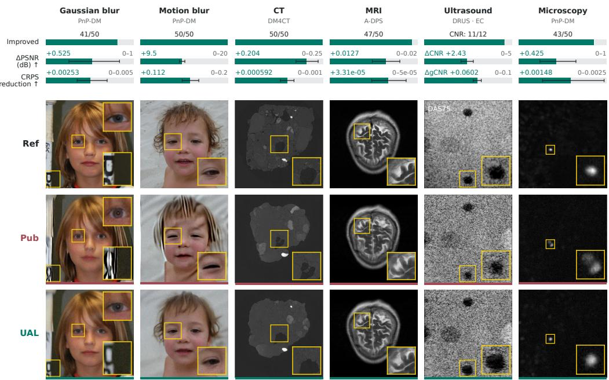  
Figure 1: Reconstruction examples and quantitative effects of UAL across six inverse problems. Reconstruction rows show selected individual trajectories; bars summarize each evaluation set on task-specific scales. Ultrasound reports CNR and gCNR computed within each reconstruction on the contrast phantom, with one SE across its 12 paired trajectories; the delay-and-sum reference (DAS75) is shown. Other tasks report PSNR and CRPS with paired-bootstrap whiskers.

Non-blind diffusion posterior samplers condition on a fixed measurement model (Chung et al., 2023b; Kawar et al., 2022; Zhang et al., 2025), whereas blind methods sample or estimate the nuisance parameters together with the signal (Chung et al., 2023a; Murata et al., 2023; Wang et al., 2024). Some blind samplers, such as BlindDPS, train an additional diffusion prior for the nuisance parameters (Chung et al., 2023a).

We instead marginalize forward-model parameters using an uncertainty model specified by calibration and reference information. Let x denote the unknown signal, y the measurements, ψ the nuisance parameters, and q a fixed uncertainty distribution for ψ. The marginal likelihood is

$$
p _ { \operatorname* { m a r g } } ( y \mid x ) = \mathbb { E } _ { \psi \sim q } [ p ( y \mid x , \psi ) ] .
$$

We introduce an uncertainty-aware likelihood (UAL), a Gaussian approximation to the nuisancemarginal likelihood that allows this direction-dependent weighting to be incorporated into existing diffusion posterior samplers. At a candidate signal, UAL linearizes the forward model in the nuisance parameters and uses their mean and covariance to construct the measurement likelihood. UAL is exact for affine nuisance dependence with Gaussian nuisance parameters and independent Gaussian observation noise; for non-Gaussian q, UAL uses a Gaussian with the mean and covariance of the linearized measurement model (Section 3.1).

For a fixed Gaussian nuisance model, we bound likelihood error from linearization and the result ing posterior divergence averaged over measurements from the model (Corollary 1). In a fixedsensitivity linear model with known signal covariance and matched nuisance moments, the linear estimator using UAL minimizes mean squared reconstruction error among linear estimators, averaged over signals, nuisance parameters, and observation noise. At a fixed nuisance realization, the point-likelihood estimator can instead have lower error. For a single nuisance parameter and distinct estimators, we give the crossover distance from the nuisance mean in closed form (Appendix B).

UAL incorporates calibration and reference statistics into existing samplers’ data updates while retaining their pretrained priors and sampling schedules. We evaluate it with non-blind and blind diffusion samplers on synthetic and acquired measurements: Gaussian and motion deblurring, CT, MRI, ultrasound, and fluorescence microscopy. A simpler alternative inflates the observation-noise variance, which in effect weakens the data term. For PnP-DM, the best tested scalar inflation gives mean per-trajectory PSNR of 27.03 dB in Gaussian deblurring and 23.37 dB in motion deblurring. UAL adds variance only along directions that parameter variation can explain and gives 27.48 and 26.64 dB, respectively (Section 4.3). UAL also improves ensemble prediction: it lowers the mean CRPS, energy, and local variogram scores for every sampler and application in Table 1. In Gaussian deblurring, UAL more closely matches the numerically marginalized likelihood and image score than the point and isotropic alternatives; covariance controls show the reconstruction benefit of structured, candidate-dependent weighting (Section 4.3). Applying UAL requires nuisance means and covariances and a forward model for propagating their variation; no additional diffusion-model training is needed. Covariance factorization reduces evaluation to forming and solving a system in nuisance coordinates. In the configurations of Table 22, UAL takes at most three times the published sampler’s wall time per trajectory, except DAPS in motion deblurring at 7.1 times (Appendix D.8).

## 2 BACKGROUND AND RELATED WORK

Diffusion priors for inverse problems. For fixed nuisance parameters ψ and a signal prior $p _ { 0 } ( x )$ that does not depend on ψ, Bayes’ rule gives $p ( x \mid y , \psi ) \propto p ( y \mid x , \psi ) p _ { 0 } ( x )$ , where $p ( y \mid x , \psi )$ is the measurement likelihood. A pretrained diffusion model provides the prior through its denoisers or scores (Ho et al., 2020; Song et al., 2021). The likelihood enters diffusion reconstruction through three common data-update forms: gradient guidance, data-fidelity optimization, and sampling-based updates. The likelihood at a noisy diffusion state $x _ { t } , p ( y \mid x _ { t } , \psi )$ , averages over possible clean signals and is generally intractable. DPS-style gradient guidance approximates it using a denoised estimate $\hat { x } _ { 0 } ( x _ { t } )$ and differentiates through that estimate (Chung et al., 2023b). ΠGDM propagates Gaussian approximations of clean-signal uncertainty through a fixed measurement operator to approximate the noisy-state likelihood (Song et al., 2023). Data-fidelity optimization solves a sub problem between denoising steps (Zhu et al., 2023). Sampling-based updates use the measurement in spectral coordinates (Kawar et al., 2022), in a split Gibbs sampler (Wu et al., 2024), or in annealed conditionals (Zhang et al., 2025). Diffusion priors with fixed-operator measurement models are also used in MRI (Aali et al., 2025), ultrasound (Zhang et al., 2024), and CT (Shi et al., 2026). In these fixed-operator formulations, the likelihood conditions on a single nuisance-parameter value. For plug-and-play unadjusted Langevin sampling, Renaud et al. (2024) bound posterior error under mismatched measurement models and denoisers. UAL instead accounts for uncertainty in the forward-model parameters and enters each sampler through its existing data update (Section 3.2).

Blind inverse problems. Blind reconstruction treats the nuisance parameters as additional inference variables. Joint samplers place a prior on them and sample them with the signal: BlindDPS couples an image diffusion model and an operator diffusion model through a shared measurement likelihood (Chung et al., 2023a); GibbsDDRM alternates approximate posterior updates under a generic operator prior (Murata et al., 2023); and PRISM pairs a measurement-conditioned kernel prior with an unconditional image prior in a split Gibbs sampler (Hu et al., 2026). Estimation methods fit them instead: Fast Diffusion EM updates the operator in a maximization step from image samples, with denoiser-based kernel regularization (Laroche et al., 2024); and DMPlug optimizes the input to a pretrained diffusion generator jointly with the operator parameters (Wang et al., 2024). Kernel Diffusion samples a conditional kernel distribution and uses a non-blind method to reconstruct the image (Sanghvi et al., 2025). Under the same joint model, exact joint inference and exact marginalization give the same signal posterior; the methods differ in how nuisance uncertainty reaches the signal update. UAL approximates the marginal measurement likelihood from a speci fied uncertainty model, without training an additional diffusion model for the nuisance parameters. Appendix C gives the image and operator updates for the evaluated samplers.

Calibration and reference information. We use calibration data and reference samples to specify the means and covariances of uncertain forward-model parameters. Repeated CT flat and dark frames characterize variation in calibration fields (Shi et al., 2026), and principal-component representations of flat fields support dynamic projection normalization (Nieuwenhove et al., 2015).

A motion-kernel bank describes variation in blur across exposures. ESPIRiT derives coil sensitivity maps from calibration data and permits multiple maps when a single-map model is insufficient (Uecker et al., 2014). Differences between the sound speeds provided with CUBDL acquisitions and their optimized values set the uncertainty scale for our PICMUS phantom reconstructions (Hyun et al., 2021; Liebgott et al., 2016). We represent the parameter variation by a distribution q and use its mean and covariance to construct UAL (Section 3.1).

Marginalization and UAL. Errors-in-variables models account for measurement error in the model’s input variables (Fuller, 1987). Wiesel et al. (2008) derive maximum-likelihood estimators for linear regression with Gaussian uncertainty in the model matrix, and Beck & Eldar (2010) extend them to structured perturbations. Kumar et al. (2013) linearize sampling-location errors to obtain a Gaussian likelihood with signal-dependent variance, then update the variance weights in an iterative linear estimator. Using Bayesian approximation-error modeling (Kaipio & Somersalo, 2007; Kaipio & Kolehmainen, 2013; Nissinen et al., 2007), Mozumder et al. (2016) approximately marginalize uncertain optical coefficients with an enhanced Gaussian error model whose moments are estimated from prior samples and held fixed during reconstruction. For partially known random blurs, covariance weighting gives the classical LMMSE restoration filter (Galatsanos et al., 2000). UAL adapts this Gaussian treatment of forward-model uncertainty to diffusion posterior sampling through existing samplers’ data updates, and we test it against numerical marginalization and scalar variance inflation.

## 3 METHOD

## 3.1 FORWARD MODEL AND UAL CONSTRUCTION

Let $x \in \mathbb { R } ^ { n }$ denote the unknown signal (an image in our applications), $y \in \mathbb { R } ^ { m }$ the measurement, and $\psi \in \mathbb { R } ^ { P }$ the nuisance parameters. We write the measurement model as

$$
\begin{array} { r } { y = \pmb { \mathcal { A } } ( \boldsymbol { x } , \psi ) + e , \qquad e \sim \mathcal { N } ( 0 , \Sigma _ { e } ) , \qquad \Sigma _ { e } \succ 0 , } \end{array}\tag{1}
$$

where A is the forward model and e is zero-mean Gaussian observation noise with covariance $\Sigma _ { e } \in$ $\mathbb { R } ^ { m \times m }$ . We represent complex measurements by stacking their real and imaginary parts.

Let q be the nuisance uncertainty model used for reconstruction, with mean $\mu = \mathbb { E } _ { q } \psi$ and covariance $\Sigma _ { \psi } \stackrel { - } { = } \mathrm { C o v } _ { q } \psi \succeq 0$ . This distribution can describe variation in a reference population or uncertainty in calibrated parameters; in controlled experiments, it can be specified directly. We hold the nuisance model fixed and model x and ψ as independent; the measurement noise is independent of both.

The marginal likelihood and its signal posterior are

$$
p _ { \operatorname* { m a r g } } ( y \mid x ) = \mathbb { E } _ { \psi \sim q } [ N ( y ; \mathcal { A } ( x , \psi ) , \Sigma _ { e } ) ] , \qquad p _ { \operatorname* { m a r g } } ( x \mid y ) \propto p _ { 0 } ( x ) p _ { \operatorname* { m a r g } } ( y \mid x ) ,\tag{2}
$$

where $p _ { 0 }$ is the signal prior. The expectation also covers a discrete reference population. By comparison, a point likelihood evaluates $\mathcal { N } ( y ; \mathcal { A } ( x , \psi _ { 0 } ) , \Sigma _ { e } )$ at a single parameter value $\psi _ { 0 }$ . UAL approximates the expectation in (2), while keeping the signal prior fixed.

For each candidate signal $x ,$ we choose a reference $\psi _ { 0 }$ and linearize the forward model in its nuisance parameters. With sensitivity $J _ { \psi } ( x )$ and remainder $r _ { x } ( \psi )$ , we write

$$
\begin{array} { r } { A ( x , \psi ) = A ( x , \psi _ { 0 } ) + J _ { \psi } ( x ) ( \psi - \psi _ { 0 } ) + r _ { x } ( \psi ) , \qquad J _ { \psi } ( x ) = D _ { \psi } A ( x , \psi _ { 0 } ) . } \end{array}\tag{3}
$$

Dropping $r _ { x } ( \psi )$ and taking the mean and covariance over $\psi \sim q$ and the independent noise e gives

$$
\bar { y } ( x ) = \mathcal { A } ( x , \psi _ { 0 } ) + J _ { \psi } ( x ) ( \mu - \psi _ { 0 } ) , \qquad S ( x ) = \Sigma _ { e } + J _ { \psi } ( x ) \Sigma _ { \psi } J _ { \psi } ( x ) ^ { \top } .\tag{4}
$$

Nuisance uncertainty thus induces structured measurement uncertainty that may depend on x.

UAL is the Gaussian density $p _ { \mathrm { U A L } } ( y \mid x ; \psi _ { 0 } , q ) = \mathcal { N } ( y ; \bar { y } ( x ) , S ( x ) )$ for this fixed local model. The mean correction $J _ { \psi } ( x ) ( \mu - \psi _ { 0 } )$ accounts for the difference between the reference and the nuisance mean (Remark 3). It vanishes at $\psi _ { 0 } = \mu .$

Proposition 1 (Exact affine-Gaussian marginal). At fixed x, suppose ${ \mathcal { A } } ( x , \psi )$ is affine in ψ, $q =$ $\mathcal { N } ( \mu , \Sigma _ { \psi } )$ , and e is independent ofψ. Then $p _ { \operatorname* { m a r g } } ( y \mid x ) = \mathcal { N } ( y ; \bar { y } ( x ) , S ( x ) )$ , with moments given by (4). For nonlinear dependence on ψ, the same moments are exact for the linearized forward model in (3).

For non-Gaussian q, UAL approximates the measurement likelihood by a Gaussian with mean ${ \bar { y } } ( x )$ and covariance $S ( x )$ from (4). Appendix A gives the proofs and bounds on moment errors from linearization and on covariance truncation.

## 3.2 UAL EVALUATION AND SAMPLER INTEGRATION

Energy and score. Define the measurement residual $d ( x ) = y - \bar { y } ( x )$ , the precision matrix $S ( x ) ^ { = 1 }$ , and the precision-weighted residual $w ( x ) = S ( \dot { x } ) ^ { - 1 } d ( x )$ . The normalized negative log likelihood is

$$
\ell _ { \mathrm { U A L } } ( x ; y ) = { \frac { 1 } { 2 } } d ( x ) ^ { \mathsf { T } } S ( x ) ^ { - 1 } d ( x ) + { \frac { 1 } { 2 } } \log \operatorname* { d e t } S ( x ) + { \frac { m } { 2 } } \log ( 2 \pi ) .\tag{5}
$$

Increasing measurement variance along a residual direction lowers its quadratic penalty, while the log determinant grows with the corresponding increase in covariance volume.

For the whitened residual $\Sigma _ { e } ^ { - 1 / 2 } d ,$ the quadratic weight along a left singular direction of $\textstyle \sum _ { e } ^ { - 1 / 2 } J _ { \psi } F$ is $1 / ( 1 + s _ { i } ^ { 2 } )$ , where $F F ^ { \mathsf { T } } = \Sigma _ { \psi }$ and $s _ { i }$ is the corresponding singular value. Here $s _ { i } ^ { 2 }$ is the added variance along that whitened direction. Directions orthogonal to the whitened columns keep unit weight. Residuals with the same observation-noise penalty can therefore receive different UAL quadratic penalties, according to their compatibility with the predicted nuisance variation. Scalar covariance inflation, by contrast, assigns equal weights in noise-whitened coordinates; with x and ${ \bar { y } } ( x )$ fixed, it has a positive minimum KL divergence from UAL unless the nuisance-induced covariance is proportional to the observation-noise covariance (Remark 1).

For differentiable ${ \bar { y } } ( x )$ and $S ( x )$ , with the nuisance model and reference fixed, the likelihood score is given componentwise by

$$
\partial _ { x _ { i } } \log p _ { \mathrm { U A L } } ( y \mid x ) = ( \partial _ { x _ { i } } \bar { y } ) ^ { \mathsf { T } } w + \frac { 1 } { 2 } w ^ { \mathsf { T } } ( \partial _ { x _ { i } } S ) w - \frac { 1 } { 2 } \operatorname { t r } \left( S ^ { - 1 } \partial _ { x _ { i } } S \right) .\tag{6}
$$

The first term differentiates the predicted mean, and the remaining terms account for covariance weighting and normalization.

Efficient evaluation. Factoring the nuisance covariance reduces UAL evaluation to an r × r system, avoiding an explicit inverse of the m×m measurement covariance. Write $\Sigma _ { \psi } = F F ^ { \mathsf { T } }$ , where r is the number of columns of $\boldsymbol { F } \in \mathbb { R } ^ { P \times { r } }$ and $\Sigma _ { \psi }$ may be singular, and set $U ( x ) = J _ { \psi } ( x ) F \in \mathbb { R } ^ { m \times r }$ Define the $r \times r$ matrix $\boldsymbol { G } ( \boldsymbol { x } ) = \boldsymbol { I _ { r } } + \boldsymbol { U } ( \boldsymbol { x } ) ^ { \top } \Sigma _ { e } ^ { - 1 } \boldsymbol { U } ( \boldsymbol { x } )$ . The reduced solve gives

$$
G a _ { \mathrm { r e d } } = U ^ { \mathsf { T } } \Sigma _ { e } ^ { - 1 } d , \qquad w = \Sigma _ { e } ^ { - 1 } ( d - U a _ { \mathrm { r e d } } ) .
$$

Under the local Gaussian model at fixed $x , U a _ { \mathrm { r e d } }$ is the mean nuisance contribution conditional on the residual d. The remaining residual is then weighted by the observation-noise precision $\Sigma _ { e } ^ { - 1 }$ The normalization follows from log det $S = \log \bar { \operatorname * { d e t } } \Sigma _ { e } \downarrow $ log det G. Appendix A.2 derives the factorized energy and gives Algorithm 1. The cost also includes evaluating the forward model and its parameter sensitivities and forming G. Keeping only leading covariance modes reduces the solve dimension r. With the predicted mean ${ \bar { y } } ( x )$ unchanged, Corollary 2 bounds the resulting likelihood error. Appendix D.8 reports recorded reconstruction times.

Use in diffusion samplers. Across applications, UAL treats forward-model uncertainty in the same way: it propagates parameter variation into a measurement covariance. We incorporate UAL through each sampler’s published data update (Zhang et al., 2025; Wu et al., 2024), retaining its diffusion prior and sampling schedule. Appendix Table 4 compares the point likelihood and UAL. Appendix C specifies the parameter models, reference values, and sampler updates.

## 3.3 APPROXIMATION ERROR AND RECONSTRUCTION RISK

We bound the likelihood error introduced by nuisance linearization and the resulting average divergence between the exact marginal and $\dot { \mathrm { U A L } }$ posteriors. For nonlinear nuisance dependence, likelihood error is controlled by the remainder $r _ { x } ( \psi )$ in (3), measured in observation-noise units.

Proposition 2 (Likelihood error from linearization). Fix x and ψ , let $q = \mathcal { N } ( \boldsymbol { \mu } , \boldsymbol { \Sigma _ { \psi } } )$ , and assume $\mathbb { E } _ { q } [ r _ { x } ( \psi ) ^ { \mathsf { T } } \Sigma _ { e } ^ { - 1 } r _ { x } ( \psi ) ] < \infty$ . Then

$$
\begin{array} { r } { D _ { \mathrm { K L } } \big ( p _ { \mathrm { m a r g } } ( \cdot \mid x ) \big | \big | p _ { \mathrm { U A L } } ( \cdot \mid x ; \psi _ { 0 } , q ) \big ) \leq \frac { 1 } { 2 } \mathbb { E } _ { q } \big [ r _ { x } ^ { \mathsf { T } } \Sigma _ { e } ^ { - 1 } r _ { x } \big ] . } \end{array}\tag{7}
$$

Appendix A.3 gives the proof. Under the conditions of Corollary 1, the prior-averaged bound in (7) also bounds posterior divergence averaged over marginal-model measurements. These bounds cover the likelihood approximation and its induced posterior, excluding the sampler updates.

Reconstruction-risk analysis. In the linear model of Appendix B, with nuisance sensitivity held fixed as the signal varies, the linear estimator based on UAL minimizes mean squared reconstruction error among linear estimators for any nuisance distribution whose mean and covariance match the assumed ones (Proposition 4). For a fixed parameter realization near the mean, the point estimator can have lower error; Appendix B characterizes the crossover and the conditions for positive average gain when these moments are inaccurate.

## 4 EXPERIMENTS

## 4.1 EXPERIMENTAL PROTOCOL

We evaluate UAL at two levels: reconstruction and ensemble prediction in paired sampler comparisons (Section 4.2), and, at shared candidate images, likelihood and image-score accuracy against numerical nuisance marginalization (Section 4.3). Additional controls examine covariance structure, recomputation and differentiation, uncertainty level, and retained rank.

Published denotes the released sampler and UAL its uncertainty-aware version; each pair uses the same measurement data, diffusion checkpoint, sampling schedule, step sizes, and reconstruction seeds. Deblurring, CT, MRI, and microscopy use 50 cases, and ultrasound uses the acquired PIC-MUS contrast and resolution phantoms provided with DRUS; each case has 12 reconstruction seeds. The fixed deblurring ablation set contains 16 images, with 12 paired reconstruction seeds per image. Appendix C gives forward models, nuisance models, and sampler updates.

We report PSNR and SSIM both as the mean over trajectories and for the ensemble-mean reconstruction. CRPS, energy, and local variogram scores (lower is better) use the fair finite-ensemble estimators of Appendix C.7, which also gives the scoring coordinates and interval construction; ultrasound uses native contrast and resolution metrics.

## 4.2 RECONSTRUCTION ACROSS SAMPLERS AND APPLICATIONS

We compare the Published and UAL versions of DAPS, PnP-DM, DiffPIR, and BlindDPS for Gaussian and motion deblurring on FFHQ images (Karras et al., 2019) (Table 1). The Gaussian setting uses kernel widths with mean $s \ : = \ : 3$ pixels and standard deviation $\tau = 0 . 5$ pixels. In motion deblurring, each non-blind pair uses the population-mean kernel, giving the two likelihoods the same mean response at a common candidate image. Motion deblurring also includes Fast Diffusion EM (Laroche et al., 2024), a blind sampler that estimates a kernel for each image. Its UAL image update uses the population-mean kernel instead, with covariance accounting for image and kernel uncertainty and their interaction. We estimate the kernel covariance and retain its leading 256 eigenmodes $( P = 2 5 6 )$ , with this rank fixed before the covariance-rank sweep (Section 4.3).

In Table 1, UAL improves ensemble-mean PSNR and SSIM and lowers the mean CRPS, energy, and local variogram scores in every deblurring comparison. In motion deblurring, DAPS and PnP-DM with UAL exceed the published blind samplers BlindDPS and Fast Diffusion EM, which sample or estimate a kernel for each image, by 6.2 to 6.4 dB in ensemble-mean PSNR, with paired 95% intervals excluding zero (Table 9). For mean per-trajectory PSNR, UAL gives 28.84 dB for DAPS and 26.54 dB for PnP-DM, compared with 30.65 and 27.65 dB when the published samplers use the true kernel (Table 8).

UAL also improves reconstruction and ensemble prediction in CT, MRI, and fluorescence microscopy (Figure 1). Mean per-trajectory PSNR increases on all 50 CT detector rows, 47 of 50 MRI scans, and 43 of 50 microscopy sections. For CT, the gain persists when both versions use the same mean flat and dark reference fields (Appendix D). For MRI under the Gaussian coil-sensitivity model, UAL gives the exact marginal measurement likelihood. The MRI reconstruction gains are small but consistent: all seven reported metrics improve, with pointwise 95% paired-bootstrap intervals excluding zero. On the acquired PICMUS ultrasound contrast phantom, UAL increases CNR from 9.929 to 12.363 dB and gCNR from 0.9141 to 0.9743.

Table 1: Reconstruction and ensemble prediction. T/M: mean per-trajectory score / score of the ensemble-mean reconstruction. PSNR is in dB; CRPS, energy, and LVS are fair ensemble scores, with LVS scaled by $1 0 ^ { 3 } .$ . Bold marks better UAL values.
<table><tr><td>Sampler / task</td><td>Version</td><td>PSNR T/M ↑</td><td>SSIM T/M ↑</td><td>CRPS↓</td><td>Energy ↓</td><td>LVS↓</td></tr><tr><td>Gaussian blur</td><td></td><td></td><td></td><td></td><td></td><td></td></tr><tr><td rowspan="2">DAPS</td><td>Published</td><td>29.49 / 30.60</td><td>.7416 / .8143</td><td>.02871</td><td>20.128</td><td>11.240</td></tr><tr><td>UAL</td><td>29.88 / 30.94</td><td>.7468 / .8171</td><td>.02796</td><td>19.449</td><td>11.021</td></tr><tr><td rowspan="2">PnP-DM</td><td>Published</td><td>26.97 / 29.53</td><td>.5603 / .7616</td><td>.03209</td><td>20.874</td><td>15.286</td></tr><tr><td>UAL</td><td>27.50 / 30.35</td><td>.5721 / .7776</td><td>.02956</td><td>18.803</td><td>14.252</td></tr><tr><td rowspan="2">DiffPIR</td><td>Published</td><td>29.13 / 30.28</td><td>.7687 / .8180</td><td>.02948</td><td>21.263</td><td>10.788</td></tr><tr><td>UAL</td><td>30.12 / 31.30</td><td>.7860 / .8331</td><td>.02583</td><td>18.325</td><td>9.353</td></tr><tr><td rowspan="2">BlindDPS</td><td>Published</td><td>28.31 / 30.30</td><td>.7343 / .8002</td><td>.02698</td><td>19.322</td><td>9.739</td></tr><tr><td>UAL</td><td>29.21 / 31.08</td><td>.7708 / .8278</td><td>.02476</td><td>17.778</td><td>8.895</td></tr><tr><td>Motion blur</td><td></td><td></td><td></td><td></td><td></td><td></td></tr><tr><td rowspan="2">DAPS</td><td>Published</td><td>17.68 / 18.10</td><td>.3303 / .3779</td><td>.15043</td><td>96.013</td><td>57.076</td></tr><tr><td>UAL</td><td>28.84 / 29.58</td><td>.7103 / .7726</td><td>.03502</td><td>23.388</td><td>12.774</td></tr><tr><td rowspan="2">PnP-DM</td><td>Published</td><td>17.04 / 17.90</td><td>.2766 / .3897</td><td>.14485</td><td>91.587</td><td>61.032</td></tr><tr><td>UAL</td><td>26.54 / 29.43</td><td>.5552 / .7628</td><td>.03236</td><td>20.943</td><td>14.959</td></tr><tr><td rowspan="2">DiffPIR</td><td>Published</td><td>11.44 /12.17</td><td>.0701 / .0877</td><td>.34406</td><td>172.270</td><td>179.800</td></tr><tr><td>UAL</td><td>14.55 / 15.19</td><td>.1440 / .1666</td><td>.24688</td><td>130.857</td><td>100.688</td></tr><tr><td rowspan="2">BlindDPS</td><td>Published</td><td>22.12 / 23.21</td><td>.5559 / .6263</td><td>.06392</td><td>46.633</td><td>18.291</td></tr><tr><td>UAL</td><td>21.95 / 23.33</td><td>.5449 / .6278</td><td>.06218</td><td>44.589</td><td>17.339</td></tr><tr><td rowspan="2">Fast Diffusion EM</td><td>Published</td><td>22.76 / 23.27</td><td>.5236 / .5525</td><td>.07789</td><td>51.865</td><td>24.271</td></tr><tr><td>UAL</td><td>29.10 / 30.72</td><td>.7635 / .8108</td><td>.02708</td><td>18.332</td><td>9.633</td></tr><tr><td>Imaging applications</td><td></td><td></td><td></td><td></td><td></td><td></td></tr><tr><td>CT</td><td>Published</td><td>25.94 / 27.33</td><td>.4248 / .5195</td><td>.02194</td><td>23.464</td><td>5.361</td></tr><tr><td rowspan="2">MRI</td><td>UAL</td><td>26.15 / 27.54</td><td>.4321 / .5299</td><td>.02135</td><td>22.898</td><td>5.355</td></tr><tr><td>Published</td><td>30.77 / 31.88</td><td>.8435 / .8179</td><td>.02007</td><td>11.562</td><td>5.817</td></tr><tr><td rowspan="2">Microscopy</td><td>UAL</td><td>30.78 / 31.89</td><td>.8438 / .8180</td><td>.02004</td><td>11.540</td><td>5.806</td></tr><tr><td>Published</td><td>29.33 / 33.67</td><td>.5352 / .7912</td><td>.02265</td><td>8.383</td><td>10.621</td></tr><tr><td></td><td>UAL</td><td>29.76 / 34.22</td><td>.5505 / .7971</td><td>.02117</td><td>7.482</td><td>9.740</td></tr></table>

## 4.3 LIKELIHOOD VALIDATION AND CONTROLS

Likelihood approximation. For Gaussian deblurring, we evaluate the published PnP-DM point likelihood, UAL, and isotropic inflation at common final reconstructions produced by the published sampler. Numerical nuisance marginalization provides the reference. The isotropic control retains the UAL mean and scales the observation-noise covariance to $\textstyle v _ { \star } ( x ) \Sigma _ { e }$ , where $v _ { \star } ( x ) \ =$ $\mathrm { t r } ( \Sigma _ { e } ^ { - 1 } S ( x ) ) / m$ is the average measurement variance under UAL after noise whitening. The isotropic and UAL covariances therefore have the same whitened trace. Among Gaussian likelihoods with the same mean and covariance $v \Sigma _ { e } ,$ this trace match minimizes the KL divergence from UAL (Remark 1). At final reconstructions, UAL’s mean relative image-score error is below 1% at every tested uncertainty level, compared with 6% to 15% for the point likelihood. Its mean absolute negative-log-likelihood error is also the lowest of the three likelihoods (Figure 2a,b). During sampling, UAL also has the lowest mean relative image-score error at each of the five saved states and each uncertainty level. At later states, its mean error is at most 2%, compared with approximately 6% to 19% for the point likelihood (Figure 2c). Across these common candidates, UAL more closely approximates both the marginalized log likelihood and its image score than the two alternatives.

Covariance structure. We next test whether covariance structure improves reconstruction and ensemble prediction beyond increasing total variance, using the three likelihoods in deblurring with PnP-DM. UAL and the isotropic control both include Gaussian normalization and differentiate their signal-dependent covariance. UAL’s structured covariance increases per-trajectory PSNR and reduces CRPS relative to trace-matched isotropic inflation in both tasks (Table 2). We also test fixed noise-variance multipliers and, for each task, report the one with the highest mean per-trajectory PSNR on the same ablation set used for comparison. The best tested values give 27.029 dB $( v = 3 )$ in Gaussian and 23.369 dB (v = 48) in motion deblurring, compared with 27.475 and 26.641 dB for UAL (Appendix D.4). For DAPS in motion deblurring, the best tested multiplier of its data-term variance $( v = 4 8 )$ gives 24.413 dB mean per-trajectory PSNR, compared with 28.631 dB for UAL on the ablation set. At the final UAL reconstructions in Gaussian deblurring with PnP-DM, nuisance variation adds about 20% to the average whitened measurement variance, carried by the two widthsensitivity responses (Appendix D.5). Trace-matched isotropic inflation distributes the same added variance uniformly in noise-whitened coordinates.

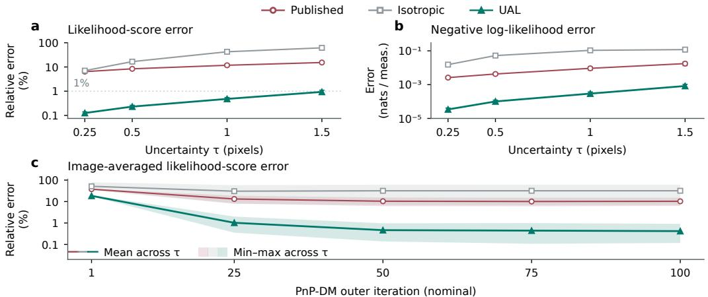  
Figure 2: Likelihood accuracy in Gaussian deblurring against numerical marginalization. (a,b) Final-state relative image-score error and absolute negative-log-likelihood error per measurement: means ± one SE across the ablation set. (c) Score error at five saved states, using one trajectory per image. Errors are averaged over images within each uncertainty level. Lines and bands show the mean and range across $\tau = 0 . 2 5 , 0 . 5 , 1$ , 1.5 pixels. Generating and assumed width uncertainty vary together. Appendix D.1 gives the stored indices corresponding to panel (c)’s nominal iterations.

Table 2: Covariance structure at matched whitened trace on the ablation set. Appendix D.4 reports paired differences and standard errors.
<table><tr><td></td><td colspan="3">Gaussian blur</td><td colspan="3">Motion blur</td></tr><tr><td>Metric</td><td>Published</td><td>Isotropic</td><td>UAL</td><td>Published</td><td>Isotropic</td><td>UAL</td></tr><tr><td>PSNR T (dB) ↑</td><td>26.944</td><td>27.020</td><td>27.475</td><td>17.872</td><td>24.084</td><td>26.641</td></tr><tr><td> $\mathrm { C R P S } \left( \times 1 0 ^ { 3 } \right) \downarrow$ </td><td>32.53</td><td>32.42</td><td>29.81</td><td>131.53</td><td>58.55</td><td>31.49</td></tr></table>

Covariance updates and derivatives. In Gaussian deblurring with PnP-DM, two further controls separate recomputing the covariance from differentiating it (Table 3). Fixing the covariance at the published sampler’s ensemble mean removes nearly all of the PSNR gain and raises CRPS above the published sampler’s. Recomputing it at each candidate keeps the gain whether or not its derivatives are propagated. By contrast, the motion-deblurring controls for Fast Diffusion EM keep the population-mean kernel fixed: differentiating the covariance raises mean per-trajectory PSNR from 23.80 to 28.49 dB, and including the log determinant gives 29.10 dB (Appendix D.4).

Table 3: Gaussian PnP-DM covariance-update controls on the ablation set. The two recomputed treatments agree within two standard errors in per-trajectory PSNR.
<table><tr><td>Metric</td><td>Published</td><td>Fixed covariance</td><td>Derivatives stopped</td><td>UAL</td></tr><tr><td>PSNR T (dB) ↑</td><td>26.944</td><td>26.964</td><td>27.506</td><td>27.475</td></tr><tr><td>CRPS  $( \times 1 0 ^ { 3 } ) \downarrow$ </td><td>32.53</td><td>34.84</td><td>29.76</td><td>29.81</td></tr></table>

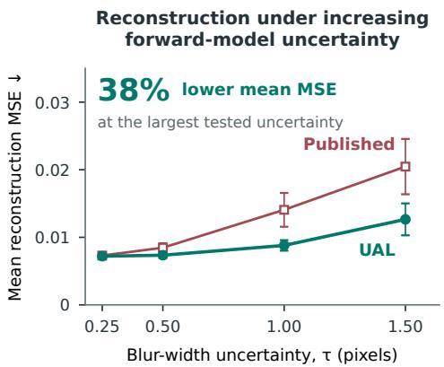  
Figure 3: Reconstruction error under matched Gaussian-width uncertainty with PnP-DM at mean width 3 pixels. Generating and modeled width standard deviations increase together. Mean per-trajectory MSE ± one SE across the ablation set.

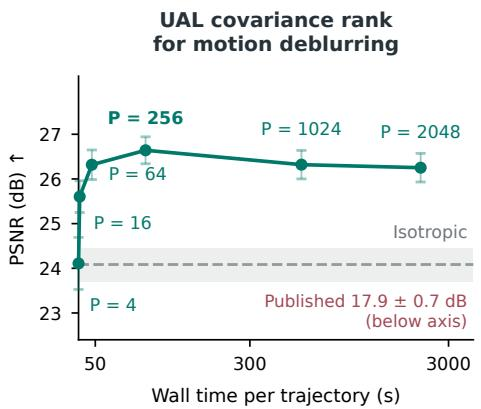  
Figure 4: Covariance rank and runtime in motion deblurring with PnP-DM, labeled by the number P of retained kernel-covariance modes. Mean per-trajectory PSNR ± one SE across the ablation set; Isotropic is trace-matched at P = 256.

Matched uncertainty. In Gaussian deblurring with PnP-DM, UAL’s reconstruction advantage grows as the generating and modeled width uncertainty increase together (Figure 3). At τ = 1.5 pixels, UAL exceeds Published by 1.75 dB and Isotropic by 0.47 dB in mean per-trajectory PSNR (Table 18). In a separate comparison of three combinations of mean width and width uncertainty, UAL gives higher mean per-trajectory PSNR and lower CRPS for all four samplers (Table 19).

Covariance rank. The rank sweep with PnP-DM shows that a compact covariance representation preserves reconstruction quality in motion deblurring (Figure 4). The 256-mode representation retains 96% of the kernel variance. On the ablation set, it gives 26.641 dB mean per-trajectory PSNR, compared with 26.251 dB for 2048 modes. The corresponding mean wall times are 89.5 and 2171.3 seconds per trajectory, respectively.

Sensitivity to nuisance moments. With Gaussian-deblurring observations fixed, PnP-DM with UAL gives mean per-trajectory PSNR between 27.408 and 27.475 dB across the tested changes to either the parameter mean or covariance scale, up to approximately 20%. The published sampler with the correct mean width gives 26.944 dB, below every tested UAL setting (Figure 12). Underestimating the mean width increases CRPS more than any of the tested covariance rescalings. Motion deblurring is similarly insensitive to 20% changes in covariance scale (Table 17).

## 5 CONCLUSION AND LIMITATIONS

UAL uses forward-model uncertainty to weight measurement-residual directions according to how well parameter variation can explain them. It enters existing samplers through their data updates without additional diffusion-model training, and it improves reconstruction in CT, MRI, and fluorescence microscopy and contrast in ultrasound. In controlled Gaussian and motion deblurring comparisons with PnP-DM, retaining covariance structure improves reconstruction beyond tracematched isotropic inflation. Accounting for forward-model uncertainty improves ensemble prediction: UAL lowers the mean CRPS, energy, and local variogram scores in all 12 comparisons in Table 1. For PnP-DM in Gaussian deblurring, UAL has lower mean relative image-score error than the published and isotropic likelihoods at the final reconstructions and every evaluated sampling state, using numerical marginalization as the reference. UAL’s accuracy and reconstruction benefit depend on the nuisance model and, for nonlinear nuisance dependence, on the local forward-model approximation. UAL adds computation that grows with the covariance rank and depends on the sampler (Appendix D.8). In deblurring, UAL keeps its gain under tested mean or covariance-scale errors of up to about 20% (Figure 12, Table 17); a different motion-kernel population was not tested.

## REFERENCES

Asad Aali, Giannis Daras, Brett Levac, Sidharth Kumar, Alex Dimakis, and Jon Tamir. Ambient diffusion posterior sampling: Solving inverse problems with diffusion models trained on corrupted data. In The Thirteenth International Conference on Learning Representations, 2025. URL https://openreview.net/forum?id=qeXcMutEZY.

Amir Beck and Yonina C. Eldar. Structured total maximum likelihood: An alternative to structured total least squares. SIAM Journal on Matrix Analysis and Applications, 31(5):2623–2649, 2010. doi: 10.1137/090756338. URL https://doi.org/10.1137/090756338.

Hyungjin Chung, Jeongsol Kim, Sehui Kim, and Jong Chul Ye. Parallel diffusion models of operator and image for blind inverse problems. In Proceedings of the IEEE/CVF Conference on Computer Vision and Pattern Recognition (CVPR), pp. 6059–6069, June 2023a.

Hyungjin Chung, Jeongsol Kim, Michael Thompson Mccann, Marc Louis Klasky, and Jong Chul Ye. Diffusion posterior sampling for general noisy inverse problems. In The Eleventh International Conference on Learning Representations, 2023b. URL https://openreview.net/ forum?id=OnD9zGAGT0k.

C. A. T. Ferro. Fair scores for ensemble forecasts. Quarterly Journal of the Royal Meteorological Society, 140(683):1917–1923, 2014. doi: https://doi.org/10.1002/qj.2270. URL https: //rmets.onlinelibrary.wiley.com/doi/abs/10.1002/qj.2270.

Wayne A. Fuller. Measurement Error Models. Wiley, June 1987. ISBN 9780470316665. doi: 10.1002/9780470316665. URL http://dx.doi.org/10.1002/9780470316665.

N.P. Galatsanos, V.Z. Mesarovic, R. Molina, and A.K. Katsaggelos. Hierarchical bayesian image restoration from partially known blurs. IEEE Transactions on Image Processing, 9(10):1784– 1797, 2000. doi: 10.1109/83.869189.

Tilmann Gneiting and Adrian E Raftery. Strictly proper scoring rules, prediction, and estimation. Journal of the American Statistical Association, 102(477):359–378, 2007. doi: 10.1198/ 016214506000001437. URL https://doi.org/10.1198/016214506000001437.

Jonathan Ho, Ajay Jain, and Pieter Abbeel. Denoising diffusion probabilistic models. In H. Larochelle, M. Ranzato, R. Hadsell, M.F. Balcan, and H. Lin (eds.), Advances in Neural Information Processing Systems, volume 33, pp. 6840–6851. Curran Associates, Inc., 2020. URL https://proceedings.neurips.cc/paper\_files/paper/2020/ file/4c5bcfec8584af0d967f1ab10179ca4b-Paper.pdf.

Yuanyun Hu, Evan Bell, Guijin Wang, and Yu Sun. PRISM: Probabilistic and robust inverse solver with measurement-conditioned diffusion prior for blind inverse problems. In ICASSP 2026 - 2026 IEEE International Conference on Acoustics, Speech and Signal Processing (ICASSP), pp. 11432–11436, 2026. doi: 10.1109/ICASSP55912.2026.11462668.

Dongwoon Hyun, Alycen Wiacek, Sobhan Goudarzi, Sven Rothlübbers, Amir Asif, Klaus Eickel, Yonina C. Eldar, Jiaqi Huang, Massimo Mischi, Hassan Rivaz, David Sinden, Ruud J. G. van Sloun, Hannah Strohm, and Muyinatu A. Lediju Bell. Deep learning for ultrasound image formation: CUBDL evaluation framework and open datasets. IEEE Transactions on Ultrasonics, Ferroelectrics, and Frequency Control, 68(12):3466–3483, 2021. doi: 10.1109/TUFFC.2021.3094849.

Jari Kaipio and Ville Kolehmainen. 32 approximate marginalization over modelling errors and uncertainties in inverse problems. In Paul Damien, Petros Dellaportas, Nicholas G. Polson, and David A. Stephens (eds.), Bayesian Theory and Applications. Oxford University Press, 01 2013. ISBN 9780199695607. doi: 10.1093/acprof:oso/9780199695607.003.0032. URL https:// doi.org/10.1093/acprof:oso/9780199695607.003.0032.

Jari Kaipio and Erkki Somersalo. Statistical inverse problems: Discretization, model reduction and inverse crimes. Journal of Computational and Applied Mathematics, 198(2):493–504, 2007. ISSN 0377-0427. doi: https://doi.org/10.1016/j.cam.2005.09.027. URL https://www. sciencedirect.com/science/article/pii/S0377042705007296. Special Issue: Applied Computational Inverse Problems.

Tero Karras, Samuli Laine, and Timo Aila. A style-based generator architecture for generative adversarial networks. In Proceedings of the IEEE/CVF Conference on Computer Vision and Pattern Recognition (CVPR), June 2019.

Bahjat Kawar, Michael Elad, Stefano Ermon, and Jiaming Song. Denoising diffusion restoration models. In S. Koyejo, S. Mohamed, A. Agarwal, D. Belgrave, K. Cho, and A. Oh (eds.), Advances in Neural Information Processing Systems, volume 35, pp. 23593–23606. Curran Associates, Inc., 2022. doi: 10.52202/ 068431-1714. URL https://proceedings.neurips.cc/paper\_files/paper/ 2022/file/95504595b6169131b6ed6cd72eb05616-Paper-Conference.pdf.

Florian Knoll, Jure Zbontar, Anuroop Sriram, Matthew J. Muckley, Mary Bruno, Aaron Defazio, Marc Parente, Krzysztof J. Geras, Joe Katsnelson, Hersh Chandarana, Zizhao Zhang, Michal Drozdzalv, Adriana Romero, Michael Rabbat, Pascal Vincent, James Pinkerton, Duo Wang, Nafissa Yakubova, Erich Owens, C. Lawrence Zitnick, Michael P. Recht, Daniel K. Sodickson, and Yvonne W. Lui. fastMRI: A publicly available raw k-space and DICOM dataset of knee images for accelerated mr image reconstruction using machine learning. Radiology: Artificial Intelligence, 2(1):e190007, January 2020. ISSN 2638-6100. doi: 10.1148/ryai.2020190007. URL http://dx.doi.org/10.1148/ryai.2020190007.

Sumeet Kumar, Vivek K Goyal, and Sanjay E. Sarma. Efficient parametric signal estimation from samples with location errors. IEEE Transactions on Signal Processing, 61(21):5285–5297, 2013. doi: 10.1109/TSP.2013.2274641.

Charles Laroche, Andrés Almansa, and Eva Coupeté. Fast diffusion EM: A diffusion model for blind inverse problems with application to deconvolution. In Proceedings ofthe IEEE/CVF Winter Conference on Applications of Computer Vision (WACV), pp. 5271–5281, January 2024.

H. Liebgott, A. Rodriguez-Molares, F. Cervenansky, J.A. Jensen, and O. Bernard. Plane-wave imaging challenge in medical ultrasound. In 2016 IEEE International Ultrasonics Symposium (IUS), pp. 1–4, 2016. doi: 10.1109/ULTSYM.2016.7728908.

Qinxuan Luo, Ziwen Liu, and Ge Yang. Diffusion prior-based zero-shot denoising for real-world fluorescence microscopy images via encoder-decoder guided sampling. Biomed. Opt. Express, 17(1):145–159, Jan 2026. doi: 10.1364/BOE.578464. URL https://opg.optica.org/ boe/abstract.cfm?URI=boe-17-1-145.

Meghdoot Mozumder, Tanja Tarvainen, Simon Arridge, Jari P. Kaipio, Cosimo D’Andrea, and Ville Kolehmainen. Approximate marginalization of absorption and scattering in fluorescence diffuse optical tomography. Inverse Problems and Imaging, 10(1):227–246, 2016. ISSN 1930-8337. doi: 10.3934/ipi.2016.10.227. URL https://www.aimsciences.org/article/id/ 47f527ac-1bc1-4891-b8d9-898621fe4a63.

Naoki Murata, Koichi Saito, Chieh-Hsin Lai, Yuhta Takida, Toshimitsu Uesaka, Yuki Mitsufuji, and Stefano Ermon. GibbsDDRM: A partially collapsed Gibbs sampler for solving blind inverse problems with denoising diffusion restoration. In Andreas Krause, Emma Brunskill, Kyunghyun Cho, Barbara Engelhardt, Sivan Sabato, and Jonathan Scarlett (eds.), Proceedings of the 40th International Conference on Machine Learning, volume 202 of Proceedings of Machine Learning Research, pp. 25501–25522. PMLR, 23–29 Jul 2023. URL https://proceedings.mlr. press/v202/murata23a.html.

Vincent Van Nieuwenhove, Jan De Beenhouwer, Francesco De Carlo, Lucia Mancini, Federica Marone, and Jan Sijbers. Dynamic intensity normalization using eigen flat fields in X-ray imaging. Opt. Express, 23(21):27975–27989, Oct 2015. doi: 10.1364/OE.23.027975. URL https://opg.optica.org/oe/abstract.cfm?URI=oe-23-21-27975.

Antti Nissinen, Lasse M. Heikkinen, and Jari P. Kaipio. The Bayesian approximation error approach for electrical impedance tomography—experimental results. Measurement Science and Technology, 19:015501, 2007. URL https://api.semanticscholar.org/CorpusID: 121803415.

Robert J. Noll. Zernike polynomials and atmospheric turbulence∗. J. Opt. Soc. Am., 66(3):207–211, Mar 1976. doi: 10.1364/JOSA.66.000207. URL https://opg.optica.org/abstract. cfm?URI=josa-66-3-207.

Marien Renaud, Jiaming Liu, Valentin De Bortoli, Andres Almansa, and Ulugbek Kamilov. Plug-and-play posterior sampling under mismatched measurement and prior models. In B. Kim, Y. Yue, S. Chaudhuri, K. Fragkiadaki, M. Khan, and Y. Sun (eds.), International Conference on Learning Representations, volume 2024, pp. 10139–10168, 2024. URL https://proceedings.iclr.cc/paper\_files/paper/2024/file/ 2a2874875861f6a6436b505dd77683d1-Paper-Conference.pdf.

Yash Sanghvi, Yiheng Chi, and Stanley H. Chan. Kernel diffusion: An alternate approach to blind deconvolution. In Aleš Leonardis, Elisa Ricci, Stefan Roth, Olga Russakovsky, Torsten Sattler, and Gül Varol (eds.), Computer Vision – ECCV 2024, pp. 1–20, Cham, 2025. Springer Nature Switzerland. ISBN 978-3-031-73202-7.

Michael Scheuerer and Thomas M. Hamill. Variogram-based proper scoring rules for probabilistic forecasts of multivariate quantities. Monthly Weather Review, 143(4):1321 – 1334, 2015. doi: 10.1175/MWR-D-14-00269.1. URL https://journals.ametsoc.org/view/ journals/mwre/143/4/mwr-d-14-00269.1.xml.

Jiayang Shi, Daniel Pelt, and Joost Batenburg. DM4CT: Benchmarking diffusion models for computed tomography reconstruction. In The Fourteenth International Conference on Learning Representations, 2026. URL https://openreview.net/forum?id=YE5scJekg5.

Jiaming Song, Arash Vahdat, Morteza Mardani, and Jan Kautz. Pseudoinverse-guided diffusion models for inverse problems. In International Conference on Learning Representations, 2023. URL https://openreview.net/forum?id=9\_gsMA8MRKQ.

Yang Song, Jascha Sohl-Dickstein, Diederik P Kingma, Abhishek Kumar, Stefano Ermon, and Ben Poole. Score-based generative modeling through stochastic differential equations. In International Conference on Learning Representations, 2021. URL https://openreview.net/ forum?id=PxTIG12RRHS.

Martin Uecker, Peng Lai, Mark J. Murphy, Patrick Virtue, Michael Elad, John M. Pauly, Shreyas S. Vasanawala, and Michael Lustig. ESPIRiT—an eigenvalue approach to autocalibrating parallel MRI: Where SENSE meets GRAPPA. Magnetic Resonance in Medicine, 71(3):990–1001, 2014. doi: https://doi.org/10.1002/mrm.24751. URL https://onlinelibrary.wiley.com/ doi/abs/10.1002/mrm.24751.

Hengkang Wang, Xu Zhang, Taihui Li, Yuxiang Wan, Tiancong Chen, and Ju Sun. DMPlug: A plug-in method for solving inverse problems with diffusion models. In A. Globerson, L. Mackey, D. Belgrave, A. Fan, U. Paquet, J. Tomczak, and C. Zhang (eds.), Advances in Neural Information Processing Systems, volume 37, pp. 117881–117916. Curran Associates, Inc., 2024. doi: 10.52202/079017-3744. URL https://proceedings.neurips.cc/paper\_files/paper/2024/file/ d5c04aa72b92c53bda5b525b60958295-Paper-Conference.pdf.

Martin Weigert, Uwe Schmidt, Tobias Boothe, Andreas Müller, Alexandr Dibrov, Akanksha Jain, Benjamin Wilhelm, Deborah Schmidt, Coleman Broaddus, Siân Culley, Mauricio Rocha-Martins, Fabián Segovia-Miranda, Caren Norden, Ricardo Henriques, Marino Zerial, Michele Solimena, Jochen Rink, Pavel Tomancak, Loic Royer, Florian Jug, and Eugene W. Myers. Content-aware image restoration: pushing the limits of fluorescence microscopy. Nature Methods, 15(12): 1090–1097, 2018. doi: 10.1038/s41592-018-0216-7. URL https://doi.org/10.1038/ s41592-018-0216-7.

Ami Wiesel, Yonina C. Eldar, and Arie Yeredor. Linear regression with Gaussian model uncertainty: Algorithms and bounds. IEEE Transactions on Signal Processing, 56(6):2194–2205, 2008. doi: 10.1109/TSP.2007.914323.

Zihui Wu, Yu Sun, Yifan Chen, Bingliang Zhang, Yisong Yue, and Katherine L. Bouman. Principled probabilistic imaging using diffusion models as plug-and-play priors. In A. Globerson, L. Mackey, D. Belgrave, A. Fan, U. Paquet, J. Tomczak, and C. Zhang (eds.), Advances in Neural Information Processing Systems, volume 37, pp. 118389–118427. Curran Associates, Inc., 2024. doi: 10.52202/ 079017-3759. URL https://proceedings.neurips.cc/paper\_files/paper/ 2024/file/d65c4ce22241138c1784ff753d4c746c-Paper-Conference.pdf.

Jure Zbontar, Florian Knoll, Anuroop Sriram, Tullie Murrell, Zhengnan Huang, Matthew J. Muck ley, Aaron Defazio, Ruben Stern, Patricia Johnson, Mary Bruno, Marc Parente, Krzysztof J. Geras, Joe Katsnelson, Hersh Chandarana, Zizhao Zhang, Michal Drozdzal, Adriana Romero, Michael Rabbat, Pascal Vincent, Nafissa Yakubova, James Pinkerton, Duo Wang, Erich Owens, C. Lawrence Zitnick, Michael P. Recht, Daniel K. Sodickson, and Yvonne W. Lui. fastMRI: An open dataset and benchmarks for accelerated MRI, 2019. URL https://arxiv.org/abs/ 1811.08839.

Bingliang Zhang, Wenda Chu, Julius Berner, Chenlin Meng, Anima Anandkumar, and Yang Song. Improving diffusion inverse problem solving with decoupled noise annealing. In Proceedings of the IEEE/CVF Conference on Computer Vision and Pattern Recognition (CVPR), pp. 20895– 20905, June 2025.

Yuxin Zhang, Clément Huneau, Jérôme Idier, and Diana Mateus. Ultrasound image reconstruction with denoising diffusion restoration models. In Anirban Mukhopadhyay, Ilkay Oksuz, Sandy Engelhardt, Dajiang Zhu, and Yixuan Yuan (eds.), Deep Generative Models, pp. 193–203, Cham, 2024. Springer Nature Switzerland. ISBN 978-3-031-53767-7.

Yuanzhi Zhu, Kai Zhang, Jingyun Liang, Jiezhang Cao, Bihan Wen, Radu Timofte, and Luc Van Gool. Denoising diffusion models for plug-and-play image restoration. In Proceedings of the IEEE/CVF Conference on Computer Vision and Pattern Recognition (CVPR) Workshops, pp. 1219–1229, June 2023.

## A UAL LIKELIHOOD: DERIVATIONS AND APPROXIMATION THEORY

UAL is exact for an affine nuisance response with Gaussian nuisance parameters and independent Gaussian observation noise. We derive the likelihood score and factorized evaluation. We then bound likelihood, averaged posterior, and moment errors from nuisance linearization, followed by the likelihood error from covariance truncation.

Table 4: Point likelihood and $\mathrm { U A L }$ at a fixed reference $\psi _ { 0 }$ . Here the residuals are $d _ { 0 } = y - \mathcal { A } ( x , \psi _ { 0 } )$ and $d = y - { \bar { y } } ( x )$ . Both energies omit m $\log ( 2 \pi ) / 2 ;$ log det $\Sigma _ { e }$ is constant in x.
<table><tr><td>Quantity</td><td>Point Gaussian likelihood</td><td>UAL</td></tr><tr><td>Mean</td><td> $A ( x , \psi _ { 0 } )$ </td><td> $\bar { y } ( x ) = A ( x , \psi _ { 0 } ) + J _ { \psi } ( x ) ( \mu - \psi _ { 0 } )$ </td></tr><tr><td>Covariance</td><td> $\Sigma _ { e }$ </td><td> $\begin{array} { r } { S ( x ) = \Sigma _ { e } + J _ { \psi } ( x ) \Sigma _ { \psi } J _ { \psi } ( x ) ^ { \mathsf { T } } } \end{array}$ </td></tr><tr><td>Negative log likelihood</td><td> ${ \textstyle \frac { 1 } { 2 } } d _ { 0 } ^ { \mathsf { T } } { \textstyle \sum _ { e } } ^ { - 1 } d _ { 0 } + { \textstyle \frac { 1 } { 2 } } \log \operatorname* { d e t } { \textstyle \sum _ { e } }$ </td><td> ${ \textstyle \frac { 1 } { 2 } } d ^ { \mathsf { T } } S ( x ) ^ { - 1 } d + { \textstyle \frac { 1 } { 2 } } \log \operatorname* { d e t } S ( x )$ </td></tr></table>

## A.1 AFFINE GAUSSIAN MARGINAL AND LIKELIHOOD SCORE

Proposition 1 (exact affine-Gaussian marginal, restated). At fixed $x ,$ suppose ${ \mathcal { A } } ( x , \psi )$ is affine in $\psi ,$ $q \doteq \mathcal { N } ( \mu , \Sigma _ { \psi } )$ , and $e \sim \mathcal { N } ( 0 , \Sigma _ { e } )$ is independent of $\psi .$ . Then $p _ { \operatorname* { m a r g } } ( y \mid x ) = \mathcal { N } ( y ; \bar { y } ( x ) , S ( x ) )$ with moments given by (4). For nonlinear dependence on ψ, (4) gives the exact mean and covariance of the linearized forward model obtained by dropping $r _ { x }$ in (3).

Proof. At fixed $x ,$ the measurement is an affine function of the independent Gaussian parameters and noise, hence Gaussian. Its mean and covariance are ${ \bar { y } } ( x )$ and $S ( x )$ in (4), which gives the stated marginal.

For nonlinear dependence on ψ, dropping the remainder in (3) gives

$$
y = \mathcal { A } ( x , \psi _ { 0 } ) + J _ { \psi } ( x ) ( \psi - \psi _ { 0 } ) + e .\tag{8}
$$

This response is affine in $\psi ,$ , with offset $\mathcal { A } ( x , \psi _ { 0 } ) - J _ { \psi } ( x ) \psi _ { 0 }$ . The same moment calculation gives (4). At $\psi _ { 0 } = \mu$ , Proposition 3 bounds the mean and covariance omitted by dropping the remainder. □

Likelihood score. Differentiating the normalized UAL energy in (5) and negating its derivative gives the likelihood score, with q and $\psi _ { 0 }$ held fixed. Suppose that ${ \bar { y } } ( x )$ and $S ( \bar { x ) }$ are differentiable. Write $\partial _ { i } = \partial / \partial x _ { i }$ and $w = S ^ { - 1 } d ,$ with $d = y - { \bar { y } }$ . The required identities are

$$
\begin{array} { c } { { \partial _ { i } d = - \partial _ { i } \bar { y } , } } \\ { { \partial _ { i } S ^ { - 1 } = - S ^ { - 1 } ( \partial _ { i } S ) S ^ { - 1 } , } } \\ { { \partial _ { i } \log \operatorname* { d e t } S = \mathrm { t r } ( S ^ { - 1 } \partial _ { i } S ) . } } \end{array}\tag{9}
$$

Applying them to (5) gives

$$
\partial _ { i } \ell _ { \mathrm { U A L } } = - ( \partial _ { i } \bar { y } ) ^ { \mathsf { T } } w - \frac { 1 } { 2 } w ^ { \mathsf { T } } ( \partial _ { i } S ) w + \frac { 1 } { 2 } \operatorname { t r } ( S ^ { - 1 } \partial _ { i } S ) .\tag{10}
$$

Negating this expression gives (6). When the covariance depends on the signal, the score accounts for changes in both residual weighting and Gaussian normalization. Holding the covariance fixed leaves the mean-response term.

## A.2 FACTORIZED EVALUATION OF UAL

The UAL covariance is $\begin{array} { r } { S = \Sigma _ { e } + U U ^ { \mathsf { T } } } \end{array}$ , with $U$ and G defined in Section 3.2. A single factorization of the $r \times r$ matrix G provides both $S ^ { - 1 } d$ and the determinant contribution log det G.

The Woodbury identity and matrix determinant lemma give

$$
\begin{array} { r } { S ^ { - 1 } = \Sigma _ { e } ^ { - 1 } - \Sigma _ { e } ^ { - 1 } U G ^ { - 1 } U ^ { \mathsf { T } } \Sigma _ { e } ^ { - 1 } , } \end{array}\tag{11}
$$

$$
\log \operatorname* { d e t } S = \log \operatorname* { d e t } \Sigma _ { e } + \log \operatorname* { d e t } G .\tag{12}
$$

For $d = y - { \bar { y } }$ , solve the reduced system

$$
G a _ { \mathrm { r e d } } = U ^ { \mathsf { T } } \Sigma _ { e } ^ { - 1 } d , \qquad w = \Sigma _ { e } ^ { - 1 } ( d - U a _ { \mathrm { r e d } } ) = S ^ { - 1 } d .\tag{13}
$$

In the equivalent local Gaussian model $d = U a + e ,$ with $a \sim \mathcal { N } ( 0 , I _ { r } )$ independent of $e ,$ the solution $a _ { \mathrm { r e d } }$ is the conditional mean of a given x and $y .$ . Thus $U a _ { \mathrm { r e d } }$ is the conditional mean of the nuisance contribution to the residual.

With $\| \boldsymbol { v } \| _ { \Sigma _ { e } ^ { - 1 } } ^ { 2 } = \boldsymbol { v } ^ { \mathsf { T } } \Sigma _ { e } ^ { - 1 } \boldsymbol { v }$ , the quadratic can be evaluated as a sum of nonnegative terms, avoiding cancellation between large quadratic terms:

$$
\begin{array} { r } { \left\| d - U a _ { \mathrm { r e d } } \right\| _ { \Sigma _ { e } ^ { - 1 } } ^ { 2 } + \left\| a _ { \mathrm { r e d } } \right\| ^ { 2 } = d ^ { \mathsf { T } } \Sigma _ { e } ^ { - 1 } d - 2 a _ { \mathrm { r e d } } ^ { \mathsf { T } } U ^ { \mathsf { T } } \Sigma _ { e } ^ { - 1 } d + a _ { \mathrm { r e d } } ^ { \mathsf { T } } G a _ { \mathrm { r e d } } } \\ { = d ^ { \mathsf { T } } \Sigma _ { e } ^ { - 1 } d - a _ { \mathrm { r e d } } ^ { \mathsf { T } } G a _ { \mathrm { r e d } } = d ^ { \mathsf { T } } S ^ { - 1 } d . } \end{array}\tag{14}
$$

The second equality uses (13); the last uses the Woodbury identity. Substitution into (5) gives

$$
\begin{array} { r l } & { \ell _ { \mathrm { U A L } } = \frac { 1 } { 2 } \Vert d - U a _ { \mathrm { r e d } } \Vert _ { \Sigma _ { e } ^ { - 1 } } ^ { 2 } + \frac { 1 } { 2 } \Vert a _ { \mathrm { r e d } } \Vert ^ { 2 } } \\ & { ~ + \frac { 1 } { 2 } \log \operatorname* { d e t } \Sigma _ { e } + \frac { 1 } { 2 } \log \operatorname* { d e t } G + \frac { m } { 2 } \log ( 2 \pi ) . } \end{array}\tag{15}
$$

For fixed $x , a _ { \mathrm { r e d } }$ minimizes $\begin{array} { r } { \frac { 1 } { 2 } \| d - U a \| _ { \Sigma _ { \circ } ^ { - 1 } } ^ { 2 } + \frac { 1 } { 2 } \| a \| ^ { 2 } } \end{array}$ , the sum of the observation-noise penalty and the standard Gaussian prior penalty. Equation (15) therefore expresses the marginal energy as this penalized profile energy plus $\frac { 1 } { 2 }$ log det $G$ and terms independent of $x .$ The log determinant distinguishes marginalizing the local nuisance coordinates from optimizing them. Table 14 compares this penalized profile energy with UAL under the same sampler and nuisance model.

Computational implementation. Since $\Sigma _ { e } ~ \succ ~ 0 , ~ { \cal G } ~ \succ ~ 0$ even when $\Sigma _ { \psi }$ is singular. A Cholesky factorization $G = L _ { G } L _ { G } ^ { \mathsf { T } }$ evaluates (13) by triangular solves and gives log det $\begin{array} { r } { G = 2 \sum _ { i = 1 } ^ { r ^ { \star } } \log ( L _ { G } ) _ { i i } . } \end{array}$ . For $r = 1$ , the solve is scalar division. In our experiments, $\Sigma _ { e }$ is a scaled identity, so applying $\Sigma _ { e } ^ { - 1 }$ is a scalar division. For a general $\Sigma _ { e } ,$ solve $\Sigma _ { e } z = v$ . For motion deblurring, DAPS and PnP-DM compute G and $S ^ { - 1 } d$ in Fourier coordinates without storing U. Explicit columnwise construction is a general alternative requiring r applications of $J _ { \psi }$

Algorithm 1 evaluates the same UAL Gaussian likelihood through its factorized energy. Covariance truncation introduces a separate approximation; Corollary 2 bounds its likelihood error when the mean is unchanged and the discarded covariance is positive semidefinite.

Algorithm 1 UAL data term   
Require: signal argument $x ,$ measurement $y ,$ reference $\psi _ { 0 } ,$ , mean $\mu$ of $q ,$ factor $F$ with $\Sigma _ { \psi } = F F ^ { \mathsf { T } }$   
noise covariance $\Sigma _ { e } ,$ forward model $\mathcal { A }$ and its parameter Jacobian $J _ { \psi }$ at ψ0   
1: $\bar { y }  A ( x , \psi _ { 0 } ) + J _ { \psi } ( x ) ( \mu - \psi _ { 0 } ) ; \quad d  y - \hat { y } ; \quad U  J _ { \psi } ( x ) F$   
2: Form $\boldsymbol { G } \gets \boldsymbol { I } _ { r } + \boldsymbol { U } ^ { \top } \Sigma _ { e } ^ { - 1 } \boldsymbol { U }$ and compute its Cholesky factor $G = L _ { G } L _ { G } ^ { \mathsf { T } }$   
3: Solve for $a _ { \mathrm { r e d } } \mathrm { i n } L _ { G } L _ { G } ^ { \breve { \top } } a _ { \mathrm { r e d } } = U ^ { \mathsf { T } } \bar { \Sigma } _ { e } ^ { - 1 } d$ by forward and backward substitution.   
4: w $ \Sigma _ { e } ^ { - 1 } ( d - U a _ { \mathrm { r e d } } ) \backslash w = S _ { . } ^ { - 1 } d \}$   
5: $\begin{array} { r } { \ell _ { \mathrm { U A L } } \stackrel {  } {  } \frac { 1 } { 2 } \Vert d - U \dot { a } _ { \mathrm { r e d } } ^ { \mathrm { s e s } \prime } \Vert _ { \Sigma _ { \mathrm { c } } ^ { - 1 } } ^ { 2 } + \frac { 1 } { 2 } \Vert a _ { \mathrm { r e d } } ^ { \prime } \Vert ^ { 2 } + \frac { 1 } { 2 } \log \operatorname* { d e t } \Sigma _ { e } + \frac { 1 } { 2 } \log \operatorname* { d e t } G + \frac { m } { 2 } \log ( 2 \pi ) } \end{array}$   
Ensure: energy $\ell _ { \mathrm { U A L } }$ and likelihood score by (6), differentiating the mean and covariance with $\mu ,$   
F, and $\psi _ { 0 }$ fixed

Remark 1 (Scalar covariance inflation). Fix x and compare Gaussian likelihoods with the same mean ${ \bar { y } } ( x )$ . For $v > 0$ , the equal-mean Gaussian KL divergence is

$$
\begin{array} { l } { { } } \\ { { } } \\ { { } } \\ { { \displaystyle K ( v ) = D _ { \mathrm { K L } } ( \mathcal { N } ( \bar { y } , S ) \parallel \mathcal { N } ( \bar { y } , v \Sigma _ { e } ) ) } } \\ { { } } \\ { { \displaystyle ~ = \frac { 1 } { 2 } \left[ \frac { m + \mathrm { t r } G - r } { v } - m + m \log v - \log \operatorname* { d e t } G \right] , } } \end{array}\tag{16}
$$

where $\begin{array} { r } { S = \Sigma _ { e } + U U ^ { \mathsf { T } } } \end{array}$ and $\begin{array} { r } { G = I _ { r } + U ^ { \mathsf { T } } \Sigma _ { e } ^ { - 1 } U } \end{array}$ . Differentiation gives the unique minimizer and its remaining divergence:

$$
\begin{array} { c } { { v _ { \star } = 1 + \displaystyle \frac { \mathrm { t r } G - r } { m } , } } \\ { { K ( v _ { \star } ) = \frac { 1 } { 2 } \left[ m \log v _ { \star } - \log \mathrm { d e t } G \right] \geq 0 . } } \end{array}\tag{17}
$$

The optimal scalar matches the average variance after whitening by the observation-noise covariance. At fixed whitened covariance trace and unchanged ${ \bar { y } } ( x )$ , anisotropy in the whitened covariance leaves a positive minimum divergence; scalar inflation cannot reproduce its directional weighting. Concavity of the logarithm, applied to the eigenvalues of $I _ { m } + \bar { \Sigma } _ { e } ^ { - 1 / 2 } U U ^ { \mathsf { T } } \Sigma _ { e } ^ { - 1 / 2 }$ , gives the inequality, with equality exactly when $U U ^ { \mathsf { T } } = \beta \Sigma _ { \epsilon }$ for some $\beta \geq 0$ . Under the affine-Gaussian assumptions of Proposition 1, UAL is the exact marginalized likelihood in this comparison.

## A.3 LIKELIHOOD AND POSTERIOR APPROXIMATION ERROR

The error from nuisance linearization is controlled by the response it omits, measured in observationnoise units.

Proof of Proposition 2. Fix $x ,$ and denote the affine response in (3) by $\widetilde { A } _ { x } ( \psi )$ . Let $P _ { x }$ and $Q _ { x }$ denote the joint distributions of $( \psi , y )$ under the original and linearized forward models, respectively:

$$
\begin{array} { r l } & { P _ { x } ( d \psi , d y ) = q ( d \psi ) \mathcal { N } ( d y ; \mathcal { A } ( x , \psi ) , \Sigma _ { e } ) , } \\ & { Q _ { x } ( d \psi , d y ) = q ( d \psi ) \mathcal { N } ( d y ; \tilde { \mathcal { A } } _ { x } ( \psi ) , \Sigma _ { e } ) . } \end{array}\tag{18}
$$

They share the nuisance distribution $q$ and the conditional noise covariance. The equal-covariance Gaussian KL formula gives

$$
D _ { \mathrm { K L } } ( P _ { x } \Vert Q _ { x } ) = \frac { 1 } { 2 } \mathbb { E } _ { q } \left[ r _ { x } ( \psi ) ^ { \mathsf { T } } \Sigma _ { e } ^ { - 1 } r _ { x } ( \psi ) \right] .\tag{19}
$$

Let $p _ { \mathrm { a f f } }$ be the measurement marginal of $Q _ { x }$ . Marginalizing ψ cannot increase divergence, so

$$
D _ { \mathrm { K L } } ( p _ { \mathrm { m a r g } } ( \cdot  { | } \ x )  { | | } p _ { \mathrm { a f f } } ( \cdot  { | } \ x ) ) \leq D _ { \mathrm { K L } } ( P _ { x }  { | | } Q _ { x } ) .\tag{20}
$$

For Gaussian $q ,$ Proposition 1 identifies $p _ { \mathrm { a f f } }$ with $p _ { \mathrm { U A L } }$ . For non-Gaussian $q ,$ this argument bounds the divergence to the affine mixture, before Gaussian moment matching. □

A small expected squared remainder in observation-noise units therefore gives a small likelihood divergence.

Proposition 2 compares measurement likelihoods at a fixed signal. The next result connects that approximation to the inference target: with the same signal prior, the prior-averaged likelihood error also bounds the posterior error averaged over measurements.

Corollary 1 (Averaged posterior error). Use the same normalized signal prior $p _ { 0 }$ in the exact marginal and UAL models. Fix the nuisance model $q = \mathcal { N } ( \boldsymbol { \mu } , \boldsymbol { \Sigma _ { \psi } } )$ and reference ψ independently of the evaluated observation. The UAL posterior is pUAL ${ \it \Psi } _ { \cdot } ( x \mid y ) \propto p _ { 0 } ( x ) p _ { \mathrm { U A L } } ( y \mid x ; \psi _ { 0 } , q )$ $I f \mathbb { E } _ { x \sim p _ { 0 } , \psi \sim q } [ r _ { x } ( \psi ) ^ { \mathsf { T } } \Sigma _ { e } ^ { - 1 } r _ { x } ( \psi ) ] < \infty$ , then

$$
\begin{array} { r l } & { \mathbb { E } _ { y \sim p _ { \mathrm { m a r g } } ( y ) } D _ { \mathrm { K L } } ( p _ { \mathrm { m a r g } } ( \cdot  { | } y )  { | | } p _ { \mathrm { U A L } } ( \cdot  { | } y ) ) } \\ & { \qquad \leq \frac { 1 } { 2 } \mathbb { E } _ { x \sim p _ { 0 } , \psi \sim q }  { \left[ r _ { x } ( \psi ) ^ { \sf T } \Sigma _ { e } ^ { - 1 } r _ { x } ( \psi ) \right] } . } \end{array}\tag{21}
$$

Here $p _ { \mathrm { m a r g } } ( y )$ is the measurement distribution obtained by drawing $x \sim p _ { 0 }$ and then $y \sim p _ { \mathrm { m a r g } } ( \cdot \mid$ x).

Proof. Let $P ( x , y ) = p _ { 0 } ( x ) p _ { \mathrm { m a r g } } ( y \mid x )$ and $Q ( x , y ) = p _ { 0 } ( x ) p _ { \mathrm { U A L } } ( y \mid x )$ . Because the prior is common, the KL chain rule first gives

$$
D _ { \mathrm { K L } } ( P \Vert Q ) = \mathbb { E } _ { x \sim p _ { 0 } } D _ { \mathrm { K L } } ( p _ { \mathrm { m a r g } } ( \cdot \ | \ x ) \Vert p _ { \mathrm { U A L } } ( \cdot \ | \ x ) ) .\tag{22}
$$

Let $p _ { \mathrm { U A L } } ( y )$ be the measurement marginal of Q. Factoring the same joint laws in the other order gives

$$
\begin{array} { r l } & { D _ { \mathrm { K L } } ( P \Vert Q ) = D _ { \mathrm { K L } } ( p _ { \mathrm { m a r g } } ( y ) \Vert p _ { \mathrm { U A L } } ( y ) ) } \\ & { \qquad + \operatorname { \mathbb { E } } _ { y \sim p _ { \mathrm { m a r g } } ( y ) } D _ { \mathrm { K L } } ( p _ { \mathrm { m a r g } } ( \cdot \mid y ) \Vert p _ { \mathrm { U A L } } ( \cdot \mid y ) ) . } \end{array}\tag{23}
$$

The first term is nonnegative. Thus average posterior divergence is at most joint divergence, which (22) and Proposition 2 bound by the right-hand side of (21).

A quadratic remainder envelope. Under the hypotheses of Proposition 2, suppose $L \geq 0$ and $\| r _ { x } ( \psi ) \| \le L \| \psi - \psi _ { 0 } \| ^ { 2 } / 2$ for q-almost every $\psi .$ This curvature bound controls the likelihood error through the fourth nuisance moment:

$$
\frac { 1 } { 2 } \mathbb { E } _ { q } [ r _ { x } ^ { \mathsf { T } } \Sigma _ { e } ^ { - 1 } r _ { x } ] \leq \frac { L ^ { 2 } } { 8 \lambda _ { \operatorname* { m i n } } ( \Sigma _ { e } ) } \mathbb { E } _ { q } \| \psi - \psi _ { 0 } \| ^ { 4 } .\tag{24}
$$

This follows from $r _ { x } ( \psi ) ^ { \mathsf { T } } \Sigma _ { e } ^ { - 1 } r _ { x } ( \psi ) \ \leq \ \| r _ { x } ( \psi ) \| ^ { 2 } / \lambda _ { \operatorname* { m i n } } ( \Sigma _ { e } )$ and the remainder envelope. The fourth moment is finite for Gaussian $q . \mathrm { ~ \normalfont ~ { ~ A t ~ } ~ } \psi _ { 0 } \ = \ \mu$ with scalar $\Sigma _ { \psi } ~ = ~ c$ and $\Sigma _ { e } ~ = ~ \sigma ^ { 2 } I$ $\mathbb { E } _ { q } ( \psi - \mu ) ^ { 4 } = 3 c ^ { 2 }$ gives the bound $3 L ^ { 2 } c ^ { 2 } / ( 8 \sigma ^ { 2 } )$ . At fixed curvature bound and observation-noise variance, this bound grows quadratically with the nuisance variance.

For the corresponding averaged posterior bound, allow the curvature bound to depend on the signal. Suppose additionally that $\| \overline { { r } } _ { x } ( \grave { \psi } ) \| \leq L ( x ) \| \psi - \psi _ { 0 } \| ^ { 2 } / 2$ for $p _ { 0 } \otimes$ q-almost every $( x , \psi )$ , where $L ( \bar { x } ) \geq 0$ is measurable and $\mathbb { E } _ { x \sim p _ { 0 } } [ L ( x ) ^ { 2 } \mathbb { E } _ { q } { \lVert { \psi - \psi _ { 0 } } \rVert } ^ { 4 } ] < \infty$ . Then the right-hand side of (21) is at most

$$
\frac { \mathbb { E } _ { \boldsymbol { x } \sim p _ { 0 } } \big [ L ( \boldsymbol { x } ) ^ { 2 } \mathbb { E } _ { q } \| \boldsymbol { \psi } - \psi _ { 0 } \| ^ { 4 } \big ] } { 8 \lambda _ { \operatorname* { m i n } } ( \sum _ { e } ) } .\tag{25}
$$

Applying (24) inside the prior expectation gives (25).

## A.4 MOMENT ERRORS FROM NUISANCE LINEARIZATION

Nuisance curvature can change both the marginal mean and covariance, even when the first-order mean correction vanishes.

Proposition 3 (Moment errors from linearization). At fixed x and $\psi _ { 0 } = \mu ,$ , let $J = J _ { \psi } ( x )$ and suppose $L \ge 0$ and $\| r _ { x } ( \psi ) \| \le L \| \psi - \mu \| ^ { 2 } / 2$ on the support of $q ,$ and the moments below are finite. Writing $\delta = \psi - \mu ,$ the mean omitted by (4) is $b _ { r } ~ = ~ \mathbb { E } r _ { x }$ with $\lVert b _ { r } \rVert \leq L \mathrm { t r } \Sigma _ { \psi } / 2 .$ . Let $\Delta S = \mathrm { C o v } ( y ^ { - } | \ x ) - S ( x )$ , where the conditional covariance retains the nonlinear remainder. Then

$$
\operatorname* { m a x } \{ | \operatorname { t r } \Delta S | , \| \Delta S \| _ { \mathrm { o p } } \} \leq \frac { L ^ { 2 } } { 4 } { \mathbb E } \| \delta \| ^ { 4 } + L \mathbb { E } \big [ \| \delta \| ^ { 2 } \| J \delta \| \big ] .\tag{26}
$$

For scalar Gaussian δ with variance c, writing $\begin{array} { l } { { J } } \end{array} = \begin{array} { r l } { j , } \end{array}$ , the right-hand side is $3 L ^ { 2 } c ^ { 2 } / 4 +$ ${ \sqrt { 8 / \pi } } L \| j \| c ^ { 3 / 2 }$

Proof. Write $\delta = \psi - \mu$ . The exact response is $y = \mathcal { A } ( x , \mu ) + J \delta + r _ { x } ( \psi ) + e$ . Its omitted mean is $b _ { r } = \mathbb { E } r _ { x } ( \psi ) , \operatorname { s o } \ \lVert b _ { r } \rVert \leq \mathbb { E } \lVert r _ { x } ( \psi ) \rVert \leq L \mathbb { E } \lVert \delta \rVert ^ { 2 } / 2 = L \operatorname { t r } \Sigma _ { \psi } / 2 .$ . Since $\mathbb { E } \delta = 0$ and the observation noise is independent,

$$
\Delta S = \operatorname { C o v } ( r _ { x } ( \psi ) ) + \mathbb { E } [ J \delta r _ { x } ( \psi ) ^ { \mathsf { T } } ] + \mathbb { E } [ r _ { x } ( \psi ) \delta ^ { \mathsf { T } } J ^ { \mathsf { T } } ] .\tag{27}
$$

The covariance term is positive semidefinite, with $\begin{array} { r l r } { \| \mathrm { C o v } ( r _ { x } ( \psi ) ) \| _ { \mathrm { o p } } } & { { } \le } & { \mathrm { t r } \mathrm { C o v } ( r _ { x } ( \psi ) ) \quad \le } \end{array}$ $\mathbb { E } \| r _ { x } ( \psi ) \| ^ { 2 }$ . Each cross term has both absolute trace and operator norm at most $\mathbb { E } [ \| J \delta \| \| r _ { x } ( \psi ) \| ]$ Thus | tr $\Delta S |$ and $\| \Delta S \| _ { \mathrm { o p } }$ are each bounded by $\mathbb { E } \| r _ { x } ( \psi ) \| ^ { \hat { 2 } } + 2 \mathbb { E } [ \| J \delta \| \| r _ { x } ( \psi ) \| ]$ . Substituting the remainder bound gives (26). For scalar Gaussian δ, $\mathbb { E } \delta ^ { 4 } = 3 c ^ { 2 }$ and $\mathbb { E } | \delta | ^ { 3 } = { \sqrt { 8 / \pi } } c ^ { 3 / 2 }$ give the stated constants. □

For scalar Gaussian variance $c ,$ the omitted mean is $O ( c )$ and the covariance-error bound is $O ( c ^ { 3 / 2 } +$ $c ^ { 2 } )$ at fixed curvature and sensitivity. The nonlinear remainder can increase or decrease variance along a measurement direction through its cross terms with the linear response.

Remark 2 (Phase responses: pulse-echo ultrasound). A phase response can have a nonlinear mean shift even when the first-order mean correction vanishes. For a complex sample s perturbed to $s e ^ { i \theta }$ with $\theta \sim \mathcal { N } ( 0 , \sigma _ { \theta } ^ { 2 } )$ ,

$$
\mathbb { E } [ s e ^ { i \theta } ] = s e ^ { - \sigma _ { \theta } ^ { 2 } / 2 } .\tag{28}
$$

Zero-mean Gaussian phase uncertainty attenuates the mean response by $e ^ { - \sigma _ { \theta } ^ { 2 } / 2 }$ ; the first-order mean s omits this attenuation.

## A.5 LIKELIHOOD ERROR FROM COVARIANCE TRUNCATION

We next keep the UAL mean fixed and truncate only its covariance. For a positive-semidefinite discarded covariance, the following corollary bounds the divergence from UAL to the Gaussian likelihood with retained covariance $S _ { K }$ . The error is small when the discarded covariance is small after whitening by $S _ { K }$

Corollary 2 (Covariance-truncation divergence). Fix x and retain the UAL mean ${ \bar { y } } ( x )$ . Let $C _ { y , K } \in \mathring { \mathbb { R } } ^ { m \times m }$ be the retained nuisance-induced measurement covariance, satisfying $0 \preceq C _ { y , K } \preceq$ $J _ { \psi } ( x ) \Sigma _ { \psi } J _ { \psi } ( x ) ^ { \top }$ . The truncated likelihood is $p _ { \mathrm { U A L } , K } = \mathcal { N } ( \bar { y } , S _ { K } )$ , with $S _ { K } = \Sigma _ { e } + C _ { y , K }$ . Its discarded covariance is $S - S _ { K }$ . Writing this discarded covariance in whitened coordinates gives $E _ { K } = S _ { K } ^ { - 1 / 2 } ( S - S _ { K } ) S _ { K } ^ { - 1 / 2 }$ . Then

$$
D _ { \mathrm { K L } } \big ( p _ { \mathrm { U A L } } \big | \big | p _ { \mathrm { U A L } , K } \big ) = \frac { 1 } { 2 } \big [ \mathrm { t r } E _ { K } - \log \operatorname* { d e t } ( I + E _ { K } ) \big ] \leq \frac { 1 } { 4 } \| E _ { K } \| _ { F } ^ { 2 } .\tag{29}
$$

This includes truncating the covariance factor, provided the discarded covariance is positive semidefinite and the mean is unchanged.

Proof. The equal-mean Gaussian KL formula gives $\begin{array} { r } { \frac 1 2 [ { \mathrm { t r } } ( S _ { K } ^ { - 1 } S ) - m - \log \operatorname* { d e t } ( S _ { K } ^ { - 1 } S ) ] } \end{array}$ . The matrix $S _ { K } ^ { - 1 / 2 } S S _ { K } ^ { - 1 / 2 } = I + E _ { K }$ has the same eigenvalues as $S _ { K } ^ { - 1 } S$ , which gives the identity. Let $\epsilon _ { i } \geq 0$ be the eigenvalues of $E _ { K }$ . Applying $0 \leq a - \log ( 1 + a ) \stackrel { - } { \leq } a ^ { 2 } / 2$ to each eigenvalue gives

$$
\frac { 1 } { 2 } \sum _ { i } [ \epsilon _ { i } - \log ( 1 + \epsilon _ { i } ) ] \leq \frac { 1 } { 4 } \sum _ { i } \epsilon _ { i } ^ { 2 } = \frac { 1 } { 4 } \| E _ { K } \| _ { F } ^ { 2 } .\tag{30}
$$

For an unchanged mean and positive-semidefinite covariance discard, the retained covariance determines which discarded directions contribute most to likelihood divergence.

## B FIXED-SENSITIVITY RECONSTRUCTION ANALYSIS

Under matched nuisance moments, the UAL linear estimator minimizes average squared error among linear estimators; at a fixed nuisance realization its error can exceed the point estimator’s. We quantify this tradeoff and the reconstruction cost of covariance truncation.

## B.1 FIXED-SENSITIVITY MODEL AND ESTIMATOR DEFINITIONS

A fixed-sensitivity linear model lets us compute both filters’ risks exactly and identify when covariance weighting helps. Holding the forward sensitivity and signal moments fixed isolates the reconstruction effect of changing the measurement-error covariance.

Assumption 1 (Fixed-sensitivity linear model). Let $A _ { 0 } \in \mathbb { R } ^ { m \times n }$ be a fixed reference operator and $J \in \mathbb { R } ^ { \mathbf { \em a } \times P } \mathbf { \em a }$ fixed nuisance sensitivity. Set $\psi _ { 0 } = \mu$ and consider

$$
y = A _ { 0 } x + J ( \psi - \mu ) + e .
$$

The signal is centered, with $\mathbb { E } x = 0$ and $\begin{array} { r } { \mathrm { C o v } x = \Sigma _ { x } , } \end{array}$ and is independent of ψ and e. The uncertainty model q has mean µ and covariance $\Sigma _ { \psi }$ . The noise is centered, independent of $\psi ,$ and has covariance $\bar { \Sigma } _ { e } .$ Thus the effective noise $\varepsilon = J ( \psi - \mu ) + \epsilon$ has mean zero and covariance $\boldsymbol { S } = \Sigma _ { e } + J \Sigma _ { \psi } J ^ { \tilde { \mathsf { T } } }$ . For a response linear in the signal, $\mathcal { A } ( \dot { x } , \psi ) = A ( \psi ) x$ , take $A _ { 0 } = A ( \mu )$ and hold the local nuisance sensitivity J fixed as x varies.

The two estimators are $\widehat { x } = W _ { 0 } y$ and $\widehat { x } = W _ { S } y$ , with

$$
M _ { 0 } = A _ { 0 } \Sigma _ { x } A _ { 0 } ^ { \mathsf { T } } + \Sigma _ { e } , \quad M _ { S } = M _ { 0 } + J \Sigma _ { \psi } J ^ { \mathsf { T } } , \qquad W _ { 0 } = \Sigma _ { x } A _ { 0 } ^ { \mathsf { T } } M _ { 0 } ^ { - 1 } , \quad W _ { S } = \Sigma _ { x } A _ { 0 } ^ { \mathsf { T } } M _ { S } ^ { - 1 } .\tag{31}
$$

The matrices $M _ { 0 }$ and $M _ { S }$ are the measurement covariances under the point likelihood and $\mathrm { U A L }$ respectively; both estimators use the same signal covariance $\Sigma _ { x } . { \mathrm { ~ A t ~ } } \psi _ { 0 } = \mu$ , the mean correction vanishes. Define $\mathcal { R } ( W ) = \mathbb { E } \| W y - x \| ^ { 2 }$ , averaging over the signal, nuisance parameters, and observation noise.

These moment assumptions suffice for the linear-risk comparisons. Gaussianity is needed only where the linear estimator is identified with the posterior mean. Conditional risk fixes the realized nuisance value $\psi ^ { \star }$ and averages over x and $e .$

Remark 3 (Nonzero prior mean or reference offset). Let $m _ { x } = \mathbb { E } x , \delta _ { \mu } = \mu - \psi _ { 0 }$ , and consider the fixed-matrix model $y = A _ { \mathrm { r e f } } x + J ( \psi - \psi _ { 0 } ) + e$ , where $A _ { \mathrm { r e f } } = A ( \psi _ { 0 } )$ . The estimator $W y$ has mean error $a _ { W } = ( W A _ { \mathrm { r e f } } - I ) m _ { x } + W J \delta _ { \mu }$ . Relative to the centered model with the same matrices, the average risk increases by $\| a _ { W } \| ^ { 2 }$ . Conditional on $\delta = \psi ^ { \star } - \mu .$ , the risk also includes the cross term $2 a _ { W } ^ { \mathsf { T } } \bar { W } J \delta$ . The centered affine estimator

$$
\widehat { x } = m _ { x } + W [ y - A _ { \mathrm { r e f } } m _ { x } - J \delta _ { \mu } ]
$$

removes these terms. The shift $J \delta _ { \mu }$ is the mean correction in (4). The results below use fixed matrices with $m _ { x } = 0$ and $\delta _ { \mu } = 0$

## B.2 AVERAGE RISK AND THE OPTIMAL LINEAR ESTIMATOR

Under the matched-moment model, the UAL filter uniquely minimizes average squared error among linear filters. The squared-norm term in (33) gives the excess risk of using a different filter.

Proposition 4 (Average reconstruction error (LMMSE optimality)). Under Assumption $I , W _ { S }$ minimizes $\mathcal { R } ( W )$ among linear estimators, so ${ \mathbf { \mathcal { R } } } ( W _ { S } ) \leq \mathbf { \dot { \mathcal { R } } } ( W _ { 0 } )$ . When $x ,$ ψ, and e are Gaussian, $W _ { S } y$ is also the posterior mean.

Proof. Under Assumption 1, write $W y - x = ( W A _ { 0 } - I ) x + W \varepsilon$ . Independence and zero means eliminate the cross term. Expanding the remaining traces gives, for any linear filter $W$

$$
\begin{array} { r } { \mathcal { R } ( W ) = \mathrm { t r } \Sigma _ { x } - 2 \mathrm { t r } ( W A _ { 0 } \Sigma _ { x } ) + \mathrm { t r } \left( W M _ { S } W ^ { \mathsf { T } } \right) . } \end{array}\tag{32}
$$

Since $W _ { S } M _ { S } = \Sigma _ { x } A _ { 0 } ^ { \top }$ , completing the square in (32) gives

$$
\mathcal { R } ( W ) = \mathcal { R } ( W _ { S } ) + \| ( W - W _ { S } ) M _ { S } ^ { 1 / 2 } \| _ { F } ^ { 2 } ,\tag{33}
$$

$$
\begin{array} { r } { \mathcal { R } ( W _ { S } ) = \mathrm { t r } \Sigma _ { x } - \mathrm { t r } ( \Sigma _ { x } A _ { 0 } ^ { \top } M _ { S } ^ { - 1 } A _ { 0 } \Sigma _ { x } ) . } \end{array}
$$

The squared norm is the excess risk above $W _ { S }$ . Because $M _ { S } \succ 0$ , it vanishes only when $W = W _ { S }$ The minimizer is therefore unique even if $\Sigma _ { x }$ is singular.

When $x , \psi ,$ and e are Gaussian, (x, y) is jointly Gaussian with $\mathrm { C o v } ( x , y ) = \Sigma _ { x } A _ { 0 } ^ { \mathsf { T } }$ and $\mathrm { C o v } ( y ) =$ $M _ { S }$ . Hence

$$
\mathbb { E } [ x \mid y ] = \Sigma _ { x } A _ { 0 } ^ { \mathsf { T } } M _ { S } ^ { - 1 } y = W _ { S } y .
$$

The results below characterize the gain of $W _ { S }$ and the crossover at a fixed nuisance realization.

## B.3 AVERAGE GAIN AND ITS NORMALIZATION

The gain is the point estimator’s nuisance-error contribution multiplied by the fraction removed by covariance weighting.

Proposition 5 (Average gain and its normalization). Under Assumption 1, use $\Sigma _ { \psi } = F F ^ { \mathsf { T } }$ and $U = J { \boldsymbol { F } }$ as in Section 3.2, with J nowfixed. Define the dimensionless Gram matrix $\Lambda = U ^ { \mathsf { T } } M _ { 0 } ^ { - 1 } U$ The matrix Λ uses the predictive covariance $M _ { 0 }$ ; the likelihood-evaluation matrix G uses the observation-noise covariance $\Sigma _ { e }$ . Then

$$
\begin{array} { r } { { \mathcal R } ( W _ { 0 } ) - { \mathcal R } ( W _ { S } ) = \mathrm { t r } \big ( W _ { 0 } U \Lambda ( I + \Lambda ) ^ { - 1 } U ^ { \mathsf { T } } W _ { 0 } ^ { \mathsf { T } } \big ) \geq 0 . } \end{array}\tag{34}
$$

Let $H _ { 0 } = \mathrm { t r } ( W _ { 0 } J \Sigma _ { \psi } J ^ { \mathsf { T } } W _ { 0 } ^ { \mathsf { T } } )$ be the point estimator’s nuisance-error contribution. When $H _ { 0 } > 0$ define $\kappa _ { 0 } = [ \mathcal { R } ( W _ { 0 } ) ^ { ' } - \mathcal { R } ( \bar { W } _ { S } ) ] / H _ { 0 }$ . For one nuisance parameter, $\Sigma _ { \psi } = c$ and $J = j$

$$
\kappa _ { 0 } = \frac { \lambda } { 1 + \lambda } , \qquad \lambda = c j ^ { \top } M _ { 0 } ^ { - 1 } j .\tag{35}
$$

The net average gain recovers a smallfraction of $H _ { 0 }$ at small λ and nearly all of $H _ { 0 }$ at large λ. For multiple parameters, $\kappa _ { 0 }$ is a nonnegative weighted average of $\lambda _ { i } / ( 1 + \lambda _ { i } )$ over the eigenvalues of $\Lambda .$

Scaling up the nuisance covariance by a common positive factor increases the fraction of the point estimator’s nuisance error removed by covariance weighting. The absolute gain is $H _ { 0 } \kappa _ { 0 }$

If $H _ { 0 } = 0$ , the estimators coincide and $\kappa _ { 0 }$ is undefined.

Eigenvalue form. Let $\Lambda v _ { i } = \lambda _ { i } v _ { i }$ with orthonormal $v _ { i }$ , and define $\omega _ { i } = \| W _ { 0 } U v _ { i } \| ^ { 2 }$ . For $H _ { 0 } > 0$

$$
\kappa _ { 0 } = \frac { \sum _ { i } \omega _ { i } \lambda _ { i } / ( 1 + \lambda _ { i } ) } { \sum _ { i } \omega _ { i } } , \qquad \frac { \lambda _ { \operatorname* { m i n } } } { 1 + \lambda _ { \operatorname* { m i n } } } \leq \kappa _ { 0 } \leq \frac { \lambda _ { \operatorname* { m a x } } } { 1 + \lambda _ { \operatorname* { m a x } } } .
$$

The weights measure how much each factor direction contributes to the point estimator’s nuisance error.

Proof. Write $\mathcal { R } _ { 0 } ( W ) = \mathbb { E } _ { x , e } \Vert W ( A _ { 0 } x + e ) - x \Vert ^ { 2 }$ for the risk when the nuisance displacement is zero. For the estimator $W _ { 0 } .$ , the average risk separates into this zero-displacement risk and its nuisance contribution:

$$
\begin{array} { r } { \mathcal { R } _ { 0 } ( W _ { 0 } ) = \mathrm { t r } \Sigma _ { x } - \mathrm { t r } ( \Sigma _ { x } A _ { 0 } ^ { \mathsf { T } } M _ { 0 } ^ { - 1 } A _ { 0 } \Sigma _ { x } ) , \qquad \mathcal { R } ( W _ { 0 } ) = \mathcal { R } _ { 0 } ( W _ { 0 } ) + H _ { 0 } , } \end{array}
$$

where $H _ { 0 } = \| W _ { 0 } U \| _ { F } ^ { 2 }$ . The Woodbury identity, expressed through $F$ and valid for singular $\Sigma _ { \psi }$ gives

$$
M _ { S } ^ { - 1 } = M _ { 0 } ^ { - 1 } - M _ { 0 } ^ { - 1 } U ( I + \Lambda ) ^ { - 1 } U ^ { \mathsf { T } } M _ { 0 } ^ { - 1 } .
$$

Substitution into (33) yields

$$
\begin{array} { r } { \mathcal { R } ( W _ { S } ) = \mathcal { R } _ { 0 } ( W _ { 0 } ) + \mathrm { t r } \big ( W _ { 0 } U ( I + \Lambda ) ^ { - 1 } U ^ { \mathsf { T } } W _ { 0 } ^ { \mathsf { T } } \big ) . } \end{array}
$$

Subtracting this expression from $\mathcal { R } ( W _ { 0 } )$ and using $I - ( I + \Lambda ) ^ { - 1 } = \Lambda ( I + \Lambda ) ^ { - 1 } \succeq 0$ proves (34). For one parameter, divide by $H _ { 0 } = c \| W _ { 0 } j \| ^ { 2 } > 0$ to obtain (35). For multiple parameters, express both traces in the eigenbasis of Λ: their terms are $\omega _ { i } \lambda _ { i } / ( 1 + \lambda _ { i } )$ and $\omega _ { i }$ . If $H _ { 0 } = 0$ , then $W _ { 0 } { \bar { U } } = 0$ and the Woodbury formula gives $W _ { S } = W _ { 0 }$

## B.4 CONDITIONAL RECONSTRUCTION ERROR AND THE CROSSOVER

At a fixed nuisance displacement, covariance weighting changes the nuisance-error contribution and incurs a filter-change cost.

Proposition 6 (Multivariate conditional reconstruction error). Under Assumption 1, fix $\psi ^ { \star } = \mu + \delta$ and write $b = J \delta$ for the realized nuisance term. Let ${ \mathcal { R } } _ { \delta } ( W )$ ) be the mean squared error averaged over x and e with δ fixed. For any linear W,

$$
\begin{array} { r l } & { \mathcal { R } _ { \delta } ( W ) = \mathrm { t r } \big ( ( W A _ { 0 } - I ) \Sigma _ { x } ( W A _ { 0 } - I ) ^ { \mathsf { T } } \big ) + \mathrm { t r } ( W \Sigma _ { e } W ^ { \mathsf { T } } ) + \| W b \| ^ { 2 } , } \\ & { \mathcal { R } _ { \delta } ( W _ { 0 } ) - \mathcal { R } _ { \delta } ( W _ { S } ) = \underbrace { \| W _ { 0 } J \delta \| ^ { 2 } - \| W s J \delta \| ^ { 2 } } _ { d i f f e r e n c e i n \ : n u i s a n e e - e r r o n c e o n t r i b u t i o n s } - \underbrace { \tau _ { 0 } ( \Sigma _ { \psi } ) } _ { f i l e r c h a n g e c o s t } , } \\ & { \quad \quad \tau _ { 0 } ( \Sigma _ { \psi } ) = \mathrm { t r } \big ( ( W _ { S } - W _ { 0 } ) M _ { 0 } ( W _ { S } - W _ { 0 } ) ^ { \mathsf { T } } \big ) \geq 0 . } \end{array}\tag{36}
$$

Moreover, $\tau _ { 0 } ( \Sigma _ { \psi } ) > 0$ if and only $i f W _ { 0 } J \Sigma _ { \psi } \neq 0 .$

Proof. For a fixed $b = J \delta .$ , write

$$
W y - x = ( W A _ { 0 } - I ) x + W e + W b .
$$

The first two terms are centered and independent, while $W b$ is deterministic. Their squared norms add in expectation, giving the first line of (36). Completing the square in the part independent of b gives

$$
\mathcal { R } _ { \delta } ( W ) = \mathcal { R } _ { 0 } ( W _ { 0 } ) + \| ( W - W _ { 0 } ) M _ { 0 } ^ { 1 / 2 } \| _ { F } ^ { 2 } + \| W b \| ^ { 2 } .
$$

Subtract the expressions for $W _ { 0 }$ and $W _ { S }$ to obtain the conditional gain. The term $\tau _ { 0 } ( \Sigma _ { \psi } )$ is the cost of changing the filter when the nuisance contribution is absent. Since $M _ { 0 } \succ 0$ , it vanishes exactly when $\bar { W _ { S } } \bar { = } W _ { 0 }$

Using $J \Sigma _ { \psi } J ^ { \mathsf { T } } = U U ^ { \mathsf { T } }$ , the resolvent identity gives

$$
W _ { S } - W _ { 0 } = - W _ { 0 } U U ^ { \mathsf { T } } M _ { S } ^ { - 1 } .
$$

Thus $W _ { S } = W _ { 0 }$ exactly when $W _ { 0 } U U ^ { \mathsf { T } } = 0$ , equivalently $W _ { 0 } U = 0$ , because $W _ { 0 } U U ^ { \mathsf { T } } W _ { 0 } ^ { \mathsf { T } } =$ $( W _ { 0 } U ) ( \tilde { W } _ { 0 } U ) ^ { \top }$ . The condition $W _ { 0 } U = 0$ implies $\bar { W } _ { 0 } J \Sigma _ { \psi } \doteq \bar { W _ { 0 } } U F ^ { \mathsf { T } } = 0 ;$ conversely, $\begin{array} { r l } { { W _ { 0 } } J { \Sigma _ { \psi } } = } \end{array}$ 0 implies $W _ { 0 } U U ^ { \mathsf { T } } = 0$ . This proves the equality condition even for singular $\Sigma _ { \psi }$

For one nuisance parameter, write $\Sigma _ { \psi } = c$ and $J = j$ , with λ as defined in (35).

Corollary 3 (Error for a fixed nuisance parameter value). Under Assumption 1 with one nuisance parameter, fix $\psi ^ { \star } = \mu + \delta$ . Let $\mathcal { R } _ { \delta } ( W )$ be the mean squared error averaged over x and e with δ held fixed. The scalar identities $\| \hat { W _ { S } } j \| ^ { 2 } = \| W _ { 0 } j \| ^ { 2 } / ( \dot { 1 } + \lambda ) ^ { 2 }$ and $\tau _ { 0 } ( c ) \stackrel { \smile } { = } c \lambda \| W _ { 0 } j \| ^ { 2 } / ( 1 + \lambda ) ^ { 2 }$ give the conditional difference

$$
\mathcal { R } _ { \delta } ( W _ { 0 } ) - \mathcal { R } _ { \delta } ( W _ { S } ) = \frac { \lambda \| W _ { 0 } j \| ^ { 2 } } { ( 1 + \lambda ) ^ { 2 } } \big [ ( \lambda + 2 ) \delta ^ { 2 } - c \big ] .\tag{37}
$$

For distinct estimators the prefactor is positive. Their conditional errors agree at the threshold

$$
| \delta ^ { \star } | ^ { 2 } = \frac { c } { \lambda + 2 } .\tag{38}
$$

Proof. For one parameter, Sherman–Morrison gives

$$
W _ { S } - W _ { 0 } = - { \frac { c } { 1 + \lambda } } W _ { 0 } j j ^ { \top } { \cal M } _ { 0 } ^ { - 1 } , \qquad W _ { S } j = { \frac { W _ { 0 } j } { 1 + \lambda } } .
$$

Consequently,

$$
\tau _ { 0 } ( c ) = \frac { c \lambda } { ( 1 + \lambda ) ^ { 2 } } \| W _ { 0 } j \| ^ { 2 } , \qquad \| W _ { 0 } j \delta \| ^ { 2 } - \| W _ { S } j \delta \| ^ { 2 } = \frac { \lambda ( \lambda + 2 ) \delta ^ { 2 } } { ( 1 + \lambda ) ^ { 2 } } \| W _ { 0 } j \| ^ { 2 } .
$$

Subtracting these terms proves (37). For distinct estimators the common prefactor is positive; setting the gain to zero gives $| \delta ^ { \star } | ^ { 2 } = c \dot { / } ( \dot { \lambda } + 2 )$ . 口

For one nuisance parameter and distinct estimators, the point-likelihood estimator has lower conditional error when $\left| { \delta } \right| < \left| { \delta } ^ { \star } \right|$ |, and UAL when $\vert \delta \vert > \vert \delta ^ { \star } \vert$ . Relative to the nuisance standard deviation ${ \sqrt { c } } ,$ the crossover distance is $( \lambda + 2 ) ^ { - 1 / 2 }$ , which decreases as λ increases.

Remark 4 (Multivariate conditional gain). For a fixed direction v, let $a _ { v } = \| W _ { 0 } J v \| ^ { 2 } - \| W _ { S } J v \| ^ { 2 }$ Along $\delta = s v$ , the gain is

$$
\begin{array} { r } { \mathcal { R } _ { s v } ( W _ { 0 } ) - \mathcal { R } _ { s v } ( W _ { S } ) = s ^ { 2 } a _ { v } - \tau _ { 0 } ( \Sigma _ { \psi } ) . } \end{array}
$$

If $a _ { v } > 0$ , the crossover occurs at $| s | = \sqrt { \tau _ { 0 } ( \Sigma _ { \psi } ) / a _ { v } }$ . If $a _ { v } \leq 0 ,$ , increasing $| s |$ does not produce a positive gain. The direction of the nuisance error therefore determines whether increasing its magnitude can favor UAL.

Mismatch between assumed and generating moments. The scalar comparison also quantifies how inaccurate nuisance moments affect average reconstruction error. Keep $A _ { 0 } , J , \Sigma _ { x } , \Sigma _ { e }$ fixed, and draw $\psi ^ { \star }$ independently of x and e from a distribution that differs from $q .$ For one nuisance parameter, averaging (37) replaces $\delta ^ { 2 }$ by its second moment about the mean $\mu ,$

$$
\begin{array} { r } { \mathbb { E } [ ( \psi ^ { \star } - \mu ) ^ { 2 } ] = \mathrm { V a r } ( \psi ^ { \star } ) + ( \mathbb { E } \psi ^ { \star } - \mu ) ^ { 2 } . } \end{array}
$$

For assumed variance $c > 0$ and distinct estimators, average gain is positive exactly when

$$
\operatorname { V a r } ( \psi ^ { \star } ) + ( \mathbb { E } \psi ^ { \star } - \mu ) ^ { 2 } > \frac { c } { \lambda + 2 } .\tag{39}
$$

Below this threshold, the filter-change cost exceeds the reduction in nuisance-induced error, so the point estimator has lower average risk. The risks agree at the threshold. A sufficient condition for positive average gain is $0 < c \bar { \leq } 2 \mathbb { E } [ ( \psi ^ { \star } - \mu ) ^ { 2 } ] ;$ : distinct filters imply $\lambda > 0 , \textnormal { s o } c / ( \lambda + 2 ) < c / 2$ Thus the assumed variance c can be as large as twice the generating second moment about the mean $\mu$ while preserving the average advantage in this scalar fixed-sensitivity model.

Define $\lambda ^ { \star } = \mathbb { E } [ ( \psi ^ { \star } - \mu ) ^ { 2 } ] j ^ { \mathsf { T } } M _ { 0 } ^ { - 1 } j$ . Compared with $\lambda , \lambda ^ { \star }$ uses the generating second moment about $\mu .$ The average gain is negative exactly when

$$
\lambda ^ { \star } < 1 \quad \mathrm { a n d } \quad c > \frac { 2 \mathbb { E } [ ( \psi ^ { \star } - \mu ) ^ { 2 } ] } { 1 - \lambda ^ { \star } } .\tag{40}
$$

For one nuisance parameter and distinct filters, using too large a variance c can reverse the average gain only when ${ \lambda ^ { \bar { \star } } } < 1$ . For $\lambda ^ { \star } \geq 1$ , the gain remains positive for every $c > 0$

## B.5 RECONSTRUCTION ERROR FROM COVARIANCE TRUNCATION

Corollary 2 bounds Gaussian-likelihood divergence after covariance truncation. The next result bounds its reconstruction cost in the fixed-sensitivity linear model, using the discarded measurement-covariance modes.

Proposition 7 (Covariance truncation). Under Assumption 1, let $\Sigma _ { e } = \sigma ^ { 2 } I$ and choose a retained covariance $\sigma ^ { 2 } I \preceq S _ { K } \preceq S$ . Write the discarded covariance as $\begin{array} { r } { D = S - S _ { K } = \sum _ { i } \nu _ { i } u _ { i } u _ { i } ^ { \sf T } } \end{array}$ , with orthonormal $u _ { i }$ and $\nu _ { i } \geq 0 ,$ , and set $W _ { S _ { K } } = \Sigma _ { x } A _ { 0 } ^ { \top } ( A _ { 0 } \Sigma _ { x } A _ { 0 } ^ { \top } + S _ { K } ) ^ { - 1 }$ . Evaluate bothfilters under thefull covariance S. Then

$$
0 \leq \mathcal { R } ( W _ { S _ { K } } ) - \mathcal { R } ( W _ { S } ) \leq \| W _ { S _ { K } } \| _ { \mathrm { o p } } ^ { 2 } \sum _ { i } \frac { \nu _ { i } ^ { 2 } } { \sigma ^ { 2 } + \nu _ { i } } \leq \frac { \| \Sigma _ { x } A _ { 0 } ^ { \top } \| _ { \mathrm { o p } } ^ { 2 } } { \sigma ^ { 4 } } \sum _ { i } \nu _ { i } .\tag{41}
$$

When $S _ { K } = S ,$ , both sides are zero.

In the upper bound, a discarded variance contributes approximately $\nu _ { i } ^ { 2 } / \sigma ^ { 2 }$ when $\nu _ { i } \ll \sigma ^ { 2 }$ and approximately $\nu _ { i }$ when $\nu _ { i } \gg \sigma ^ { 2 }$ . The factor $\| W _ { S _ { K } } \| _ { \mathrm { o p } } ^ { 2 }$ accounts for amplification by the reconstruction filter. The bound also applies when the nuisance covariance is truncated: $S _ { K } = \sigma ^ { 2 } I + J \Sigma _ { \psi , K } J ^ { \mathsf { T } }$ with $0 \preceq \Sigma _ { \psi , K } \preceq \Sigma _ { \psi }$

Proof. Write $M _ { S _ { K } } = A _ { 0 } \Sigma _ { x } A _ { 0 } ^ { \sf T } + S _ { K } , { \sf s o } \ M _ { S } = M _ { S _ { K } } + D$ . The completed square (33) gives

$$
\begin{array} { r } { \mathcal { R } ( W _ { S _ { K } } ) - \mathcal { R } ( W _ { S } ) = \| ( W _ { S _ { K } } - W _ { S } ) { M } _ { S } ^ { 1 / 2 } \| _ { F } ^ { 2 } \geq 0 . } \end{array}
$$

By the resolvent identity,

$$
W _ { S _ { K } } - W _ { S } = \Sigma _ { x } A _ { 0 } ^ { \mathsf { T } } ( M _ { S _ { K } } ^ { - 1 } - M _ { S } ^ { - 1 } ) = W _ { S _ { K } } { \cal D } M _ { S } ^ { - 1 } .
$$

Hence the excess risk is

$$
\mathrm { t r } \big ( W _ { S _ { K } } D M _ { S } ^ { - 1 } D W _ { S _ { K } } ^ { \mathsf { T } } \big ) .
$$

Since $M _ { S _ { K } } \succeq \sigma ^ { 2 } I$ , we have $M _ { S } \succeq \sigma ^ { 2 } I + D$ . Inversion reverses the ordering and congruence by D preserves it:

$$
D M _ { S } ^ { - 1 } D \preceq D ( \sigma ^ { 2 } I + D ) ^ { - 1 } D = \sum _ { i } { \frac { \nu _ { i } ^ { 2 } } { \sigma ^ { 2 } + \nu _ { i } } } u _ { i } u _ { i } ^ { \mathsf { T } } \preceq D .
$$

For $X \succeq 0 , \mathrm { t r } ( W X W ^ { \mathsf { T } } ) \leq \| W \| _ { \mathrm { o p } } ^ { 2 } \mathrm { t r } X$ . Applying this inequality gives the middle bound in (41). Finally,

$$
\| W _ { S _ { K } } \| _ { \mathrm { o p } } \leq \frac { \| \Sigma _ { x } A _ { 0 } ^ { \top } \| _ { \mathrm { o p } } } { \sigma ^ { 2 } } , \qquad \frac { \nu _ { i } ^ { 2 } } { \sigma ^ { 2 } + \nu _ { i } } \leq \nu _ { i } ,
$$

which gives the last bound.

## C TASK MODELS AND UAL IMPLEMENTATIONS

We use the notation of Section 3.1: A is the forward model, $\Sigma _ { e }$ is the observation-noise covariance, and $\mu , \Sigma _ { \psi }$ are the mean and covariance of the specified nuisance model $q .$ For each application, we construct a measurement likelihood from the nuisance statistics and incorporate its data term into the published sampler update. Each UAL version retains the published data-fitting scales and step sizes. So that these step sizes apply unchanged, BlindDPS rescales the UAL image guidance to the published image-guidance norm before the denoiser Jacobian, and CT rescales the precisionweighted residual to the unweighted residual norm before backprojection. DiffPIR evaluates the covariance at the current prediction and holds it fixed within the data step, which keeps that step a quadratic subproblem.

For fixed $\Sigma _ { e } \succ 0$ , let $d = y - { \bar { y } }$ and define

$$
Q ( x ) = d ( x ) ^ { \mathsf { T } } S ( x ) ^ { - 1 } d ( x ) + \log \operatorname* { d e t } S ( x ) - \log \operatorname* { d e t } \Sigma _ { e } .\tag{42}
$$

For measurement dimension $m , Q = 2 \ell _ { \mathrm { U A L } } - \log \operatorname* { d e t } \Sigma _ { e } - m \log ( 2 \pi )$ . Removing the noise-only constant from $2 \ell _ { \mathrm { U A L } }$ leaves its gradient unchanged. The square-root fidelity used below puts this energy on the scale of the sampler’s residual-norm data term. Since $S \succeq \Sigma _ { e } , \dot { Q } \geq 0 .$ , with the squareroot derivative defined for $Q > 0$ . The determinant identity also gives $Q = d ^ { \mathsf { T } } S ^ { - 1 } d + \log { \bar { \operatorname* { d e t } } } G .$ evaluated with the reduced factorization in Section 3.2.

DPS-style guidance. The UAL score acts on a candidate clean signal. DPS-style samplers update the noisy diffusion state, so the denoiser Jacobian maps that score into their guidance direction (Chung et al., 2023b; Aali et al., 2025):

$$
g _ { t } = \left[ D _ { x _ { t } } { \widehat { x } } _ { 0 } ( x _ { t } ) \right] ^ { \mathsf { T } } \nabla _ { x } \log p _ { \mathrm { U A L } } ( y \mid x ) \big | _ { x = { \widehat { x } } _ { 0 } ( x _ { t } ) } .\tag{43}
$$

Here $\widehat { x } _ { 0 } ( x _ { t } )$ is the denoised estimate from state $x _ { t }$

Algorithms pair the published operation in burgundy with its UAL replacement in teal; black steps are shared. Only one of the two alternatives is used. The listings retain the published notation and label code transcriptions separately. Table 5 summarizes the nuisance statistics and their use in each task.

Table 5: Nuisance statistics and UAL constructions by task. The rows summarize the specifications below; the final column states how each task forms the UAL mean and covariance.
<table><tr><td>Task</td><td>Nuisance coordinates</td><td>Nuisance statistics</td><td>UAL construction</td></tr><tr><td>Gaussian blur</td><td>Kernel widths  $( s _ { x } , s _ { y } )$ </td><td>Width mean and covariance µ and  $\Sigma _ { \psi } = \tau ^ { 2 } I _ { 2 }$ </td><td>Width-sensitivity covariance (Sections C.1–C.2).</td></tr><tr><td>Motion blur</td><td>Coefficients in the retained kernel basis</td><td>Mean and covariance from 131,072 kernels</td><td>Gaussian moment matching in retained coordinates (Section C.1).</td></tr><tr><td>CT</td><td>Flat and dark reference fields</td><td>Mean and covariance across 20 flat and 20 dark frames</td><td>Linearized flat-dark calibration map (Section C.3).</td></tr><tr><td>MRI</td><td>Real coil-map coefficients</td><td>32 calibration replicates; calibrated maps for the mean prediction</td><td>Exact Gaussian marginal for a forward model affine in Gaussian coil-map coefficients (Section C.4).</td></tr><tr><td>Ultrasound</td><td>Sound speed  $c _ { s }$ </td><td>Gaussian scale from CUBDL reference spread; truncated quadrature</td><td>Per-mode variances from nonlinear sound-speed perturbations (Section C.5).</td></tr><tr><td>Microscopy</td><td>Five pupil-phase coefficients (Noll modes 5, 6, 7, 8, 11)</td><td>Prescribed Gaussian phase law, also used to generate the synthetic observations</td><td>Derivatives of the normalized PSF; energy with candidate-dependent covariance (Section C.6).</td></tr></table>

## C.1 DEBLURRING FORWARD MODELS AND NUISANCE STATISTICS

Gaussian deblurring uses two uncertain kernel widths; motion deblurring uses coefficients in a retained kernel basis. The specified width moments or kernel-population moments determine the uncertainty propagated into each sampler’s data term.

Measurements. We use $2 5 6 \times 2 5 6$ FFHQ images (Karras et al., 2019). The 50 candidate images are drawn randomly from the FFHQ validation partition, IDs 60000–69999. The ablation set is a fixed 16-image subset of these 50 images. The same image identifiers are retained across the deblurring samplers. For deblurring, (1) specializes to

$$
\begin{array} { r } { y = A ( x , \psi ) + e , \qquad A ( x , \psi ) = A ( \psi ) x , \qquad e \sim { \mathcal N } ( 0 , \Sigma _ { e } ) , \qquad \Sigma _ { e } = \sigma _ { y } ^ { 2 } I . } \end{array}\tag{44}
$$

Here $A ( \psi )$ applies the kernel $k ( \psi )$ to each image channel. We write $A _ { k }$ for this same linear action when specifying the kernel directly, so $A ( \psi ) = A _ { k ( \psi ) }$ . Images use $[ - 1 , 1 ]$ intensity coordinates; observations use the same scale, with $\sigma _ { y } = 0 . 0 2$

Each paired comparison uses the same observation. The kernel origin and boundary convention are specified below. FFHQ’s dataset metadata and accompanying materials are distributed under CC BY-NC-SA 4.0; individual images retain the licenses and author information recorded in their metadata.1

Gaussian blur. The nuisance vector $\boldsymbol { \psi } ~ = ~ ( s _ { x } , s _ { y } )$ contains the horizontal and vertical kernel widths in pixels. On the $6 4 \times 6 4$ kernel grid, indexed by $u , v \in \{ - 3 2 , \ldots , 3 1 \}$ , we use

$$
k _ { \psi } ( u , v ) = \frac { 1 } { Z _ { \psi } } \exp \left( - \frac { u ^ { 2 } } { 2 s _ { y } ^ { 2 } } - \frac { v ^ { 2 } } { 2 s _ { x } ^ { 2 } } \right) \mathbf { 1 } _ { \{ | u | , | v | \leq 3 1 \} } ,\tag{45}
$$

where $Z _ { \psi }$ normalizes the kernel to unit sum. The width mean and covariance are $\mu = \left( \bar { s } , \bar { s } \right)$ and $\Sigma _ { \psi } = \tau ^ { 2 } I _ { 2 }$ . Table 19 gives the three reconstruction settings. The width generator samples the two coordinates independently from normal distributions truncated to $( 0 , \infty )$ , with s¯ and τ specifying the post-truncation mean and standard deviation. The kernel sensitivities include the derivative of the unit-sum normalization. Let $\begin{array} { r } { \langle f \rangle _ { k _ { \psi } } = \sum _ { u , v } k _ { \psi } ( u , v ) f ( u , v ) } \end{array}$ . Then

$$
\kappa _ { x } ( u , v ) = k _ { \psi } ( u , v ) \frac { v ^ { 2 } - \langle v ^ { 2 } \rangle _ { k _ { \psi } } } { s _ { x } ^ { 3 } } , \qquad \kappa _ { y } ( u , v ) = k _ { \psi } ( u , v ) \frac { u ^ { 2 } - \langle u ^ { 2 } \rangle _ { k _ { \psi } } } { s _ { y } ^ { 3 } } .
$$

Each derivative kernel sums to zero. Evaluating them at the reference widths gives

$$
J _ { \psi } ( x ) = [ A _ { \kappa _ { x } } x , A _ { \kappa _ { y } } x ] , \qquad U ( x ) = \tau J _ { \psi } ( x ) .
$$

These columns propagate the two width variances into the measurement covariance in (4). We write $A _ { \mu } = A _ { k _ { \mu } }$ for the kernel rendered at the mean widths.

BlindDPS estimates a kernel instead of two widths (Chung et al., 2023a). We read the widths directly from the normalized fitted kernel $\widehat { k } \colon$

$$
\widehat { s } _ { x } = \frac { 1 } { | \omega | } \sqrt { - 2 \log \left| \sum _ { u , v } \widehat { k } ( u , v ) e ^ { - \mathrm { i } \omega v } \right| } ,\tag{46}
$$

$$
\widehat { s } _ { y } = \frac { 1 } { | \omega | } \sqrt { - 2 \log \left| \sum _ { u , v } \widehat { k } ( u , v ) e ^ { - \mathrm { i } \omega u } \right| } , \qquad \omega = \frac { 4 \pi } { 6 4 } .
$$

The Fourier magnitude of a continuous Gaussian of width s is $\exp ( - s ^ { 2 } \omega ^ { 2 } / 2 )$ ; solving this relation gives the readout. We apply it to the fitted discrete kernel when the Fourier magnitudes lie strictly between zero and one.

This Gaussian frequency-matching rule estimates the current reference widths. It leaves the population mean and covariance unchanged. The non-blind implementations use their reference widths directly.

Motion blur. We generate 131,072 reference kernels per population with the motionblur generator included in the PnP-DM release.2 The kernel size is $6 4 \times 6 4$ , the generator intensity is 0.5, and the reference seeds are $0 , \ldots , 1 3 1 0 7 1$ . Observation kernels use seeds $1 3 3 1 2 0 , \ldots , 1 3 3 1 6 9$ , disjoint from the reference seeds.

For motion blur, the nuisance coordinates describe variation in the generated kernels themselves. We estimate a kernel mean and covariance from each reference population and retain its leading covariance modes.

Identify each unit-sum kernel with its vectorized form $k _ { j } ~ \in ~ \mathbb { R } ^ { 4 0 9 6 }$ , and let $M = 1 3 1 { , } 0 7 2$ . We compute

$$
\bar { k } = \frac { 1 } { M } \sum _ { j = 1 } ^ { M } k _ { j } , \qquad C _ { k } = \frac { 1 } { M - 1 } \sum _ { j = 1 } ^ { M } ( k _ { j } - \bar { k } ) ( k _ { j } - \bar { k } ) ^ { \mathsf { T } } .\tag{47}
$$

The full covariance $C _ { k } \in \mathbb { R } ^ { 4 0 9 6 \times 4 0 9 6 }$ is estimated before dimensionality reduction. Write its eigendecomposition as $C _ { k } = B \mathrm { d i a g } ( \lambda _ { 1 } , \ldots , \lambda _ { 4 0 9 6 } ) B ^ { \top }$ , with eigenvalues in decreasing order. We retain the leading $P = 2 5 6$ covariance eigenvectors in $B _ { P } \in \mathbb { R } ^ { 4 0 9 6 \times P }$ and their variances in $ { \Lambda } _ { P } \in \mathbb { R } ^ { P \times P }$ giving $\bar { C _ { k } } \overset { \sim } { \approx } B _ { P } \Lambda _ { P } B _ { P } ^ { \intercal }$ We fixed $P = 2 5 6$ before running the covariance-rank sweep, which varies P. The choice balances running time against covariance truncation error: the retained modes carry 96% of the kernel variance. Equivalently, let $X = [ k _ { 1 } - \bar { k } , \ldots , k _ { M } - \bar { k } ] / \sqrt { M - 1 }$ . Since $C _ { k } \doteq X X ^ { \mathsf { T } }$ , its eigenvectors are the left singular vectors of $X$ , and its eigenvalues are the squared singular values. We accumulate and eigendecompose $C _ { k }$ directly. Unit-sum kernels have zero-sum centered deviations, so the covariance has at most 4095 nonzero modes. We remove numerical components in the all-ones direction. In the notation of Section 3.1, the retained nuisance coordinates and specified statistics are

$$
k ( \psi ) = \bar { k } + B _ { P } \psi , \qquad \mu = 0 , \qquad \Sigma _ { \psi } = \Lambda _ { P } , \qquad \widehat { \psi } = B _ { P } ^ { \top } ( \widehat { k } - \bar { k } ) .\tag{48}
$$

Here $C _ { k }$ is the full kernel covariance; $\Sigma _ { \psi }$ is the covariance in the retained nuisance coordinates. The kernel still has 4096 entries; its uncertain displacement is represented by $P$ coefficients. The projection $\widehat { \psi } = B _ { P } ^ { \mathsf { T } } ( \widehat { k } - \bar { k } )$ extracts the retained component of a fitted kernel. Components orthogonal to $B _ { P }$ are outside this representation.

Let $b _ { j } = \mathrm { u n v e c } _ { 6 4 \times 6 4 } ( ( B _ { P } ) _ { : , j } )$ be the kernel-shaped jth covariance eigenvector. Each $b _ { j }$ is a signed, zero-sum perturbation direction, whereas $\bar { k }$ is the unit-sum mean kernel. By linearity of convolution in the kernel,

$$
A _ { k ( \psi ) } x = A _ { \bar { k } } x + \sum _ { j = 1 } ^ { P } \psi _ { j } A _ { b _ { j } } x .
$$

Thus the derivative with respect to $\psi _ { j }$ is $A _ { b _ { j } } x$

For the retained model, the UAL mean and covariance are

$$
\bar { y } ( x ) = A ( x , \mu ) = A _ { \bar { k } } x , \qquad S ( x ) = \Sigma _ { e } + \sum _ { j = 1 } ^ { P } \lambda _ { j } ( A _ { b _ { j } } x ) ( A _ { b _ { j } } x ) ^ { \mathsf { T } } .\tag{49}
$$

Projecting each centered reference kernel gives $\psi ^ { ( j ) } = B _ { P } ^ { \intercal } ( k _ { j } - \bar { k } )$ . These coefficients have sample mean zero and sample covariance

$$
\frac { 1 } { M - 1 } \sum _ { j = 1 } ^ { M } \psi ^ { ( j ) } ( \psi ^ { ( j ) } ) ^ { \sf T } = B _ { P } ^ { \sf T } C _ { k } B _ { P } = \Lambda _ { P } .
$$

UAL uses the Gaussian coefficient model $\psi \sim \mathcal { N } ( 0 , \Lambda _ { P } )$ . With $F = \Lambda _ { P } ^ { 1 / 2 }$ and $\psi = F a$ , where $a \sim \mathcal { N } ( 0 , I _ { P } )$ , the observation model is

$$
y = A _ { \bar { k } } x + U ( x ) a + e , \qquad U _ { : \ell } ( x ) = \sqrt { \lambda _ { \ell } } A _ { b \ell } x .
$$

Integrating over a gives (49). Convolution is affine in the retained coefficients; the approximations are the Gaussian coefficient law and the truncation of the kernel covariance.

Forward conventions. In Gaussian deblurring, DAPS, PnP-DM, and BlindDPS use zero-padded cross-correlation, with padding of 31 pixels before and 32 after each image dimension. DiffPIR’s released closed-form Fourier deblurring step requires circular convolution, so we retain that convention and generate its observations with it. Both members of each sampler pair receive the same observation. Motion observations use circular convolution. DAPS, PnP-DM, and DiffPIR use circular mean and mode operators.

The DiffPIR likelihood step uses $x _ { + } = ( x _ { - } + 1 ) / 2$ and $y _ { + } = ( y _ { - } + 1 ) / 2$ , converting the stored $[ - 1 , 1 ]$ coordinates to [0, 1]. For unit-sum circular convolution, $A \mathbf { 1 } = \mathbf { 1 } .$ , so $y _ { + } = A x _ { + } + e _ { - } / 2$ Consequently $\sigma _ { + } = 0 . 0 1$ and $\Sigma _ { e , + } = \Sigma _ { e , - } / 4$ . Its data-step output is converted back by $x _ { - } = { }$ $2 x _ { + } - 1$ before the diffusion update.

## C.2 UAL IN DEBLURRING SAMPLERS

Each sampler incorporates UAL’s measurement mean and covariance through its existing data update while retaining its pretrained diffusion prior and sampling schedule. Two PnP-DM controls in Gaussian deblurring separate covariance recomputation from differentiation. One recomputes covariance at each candidate while stopping its derivatives; the other fixes covariance at the ensemble mean of the published sampler’s 12 reconstructions. The latter reference is shared across that image’s reconstruction seeds; all controls use the same observations and evaluation images. A third control multiplies the point likelihood’s noise variance by $v \in \{ 1 , 1 . 5 , 2 , 3 , 5 \}$ on the ablation set. In motion deblurring, the noise-variance multipliers are $v \in \{ 1 , 3 , 6 , 1 2 , 2 4 , 4 8 , 9 6 , 1 9 2 , 3 8 4 \}$ on the ablation set. We compare the multipliers by mean per-trajectory PSNR, keeping the Langevin step size unchanged. Appendix D.4 reports the scalar-control results.

## C.2.1 DAPS

DAPS alternates reverse diffusion, conditional sampling, and re-noising (Zhang et al., 2025). We retain this outer loop and differentiate the UAL energy in (5) in the inner measurement update for both Gaussian and motion deblurring. At noise level $\sigma _ { t } ,$ reverse diffusion provides $\widehat { x } _ { 0 } ( { \mathbf x } _ { t } )$ in the published notation. Approximating the inner prior by $\mathcal { N } ( \widehat { x } _ { 0 } ( \mathbf { x } _ { t } ) , \sigma _ { t } ^ { 2 } I )$ gives the drift $( \widehat { x } _ { 0 } - z ) / \sigma _ { t } ^ { 2 }$ at candidate z.

Let $\tau _ { \mathrm { D } }$ be $\mathrm { D A P S ^ { \prime } s }$ data-fitting scale. For Gaussian and motion deblurring, $\tau _ { \mathrm { D } } ~ = ~ 0 . 0 1$ . We use $A _ { \mu } = A _ { k _ { \mu } }$ for Gaussian blur and $A _ { \mu } = A _ { \bar { k } }$ for motion blur. With $d ( z ) = y - A _ { \mu } z$ , the data drift is the negative gradient of the scaled UAL energy

$$
E _ { \mathrm { D } } ( z ) = \frac { \sigma _ { y } ^ { 2 } } { \tau _ { \mathrm { D } } ^ { 2 } } \left[ d ( z ) ^ { \mathsf { T } } S ( z ) ^ { - 1 } d ( z ) + \log \operatorname * { d e t } S ( z ) - \log \operatorname * { d e t } \Sigma _ { e } \right] .
$$

Thus

$$
g _ { \mathrm { D } } ( z ) = - \nabla _ { z } E _ { \mathrm { D } } ( z ) = - \frac { 2 \sigma _ { y } ^ { 2 } } { \tau _ { \mathrm { D } } ^ { 2 } } \nabla _ { z } \ell _ { \mathrm { U A L } } ( z ; y ) .\tag{50}
$$

Since $\Sigma _ { e } = \sigma _ { u } ^ { 2 } I$ , setting $\Sigma _ { \psi } = 0$ gives $E _ { \mathrm { D } } ( z ) = \| y - A _ { \mu } z \| ^ { 2 } / \tau _ { \mathrm { D } } ^ { 2 }$ , recovering the published DAPS squared-residual data term. The coefficient in (50) therefore preserves the data-fitting scale $\tau _ { \mathrm { D } }$ distinct from the observation-noise scale $\sigma _ { y }$

Gaussian blur uses two width-sensitivity columns; motion blur uses the retained kernel-mode responses. We evaluate the energy in (15). Algorithm 2 shows the evaluated branch of the published DAPS algorithm. The paired configurations share their inner step sizes, prior, and re-noising schedule. Our comparison uses the Langevin branch. DAPS uses $N _ { A }$ outer steps and N Langevin steps of size ηt; sampling starts at $T = \hat { t _ { N _ { A } } }$

## C.2.2 PNP-DM

PnP-DM alternates a likelihood conditional with a diffusion-prior conditional (Wu et al., 2024). At outer iteration k, the likelihood step starts from $\mathbf { x } ^ { ( k ) }$ and targets the conditional distribution of an auxiliary image u, with potential $f ( \mathbf { \bar { u } } ; \mathbf { y } ) + \| \mathbf { u } - \mathbf { x } ^ { ( k ) } \| ^ { 2 } / ( 2 \rho _ { k } ^ { 2 } ) ^ { - }$ . Here f is the negative log likelihood potential in the published notation. For UAL, we set $f ( \mathbf { u } ; \mathbf { y } ) { \dot { } } = \ell _ { \mathrm { U A L } } ( \mathbf { u } ; \mathbf { y } )$ , giving

$$
\pi _ { k } ( \mathbf { u } ) \propto \exp \left[ - \ell _ { \mathrm { U A L } } ( \mathbf { u } ; \mathbf { y } ) - \frac { \| \mathbf { u } - \mathbf { x } ^ { ( k ) } \| ^ { 2 } } { 2 \rho _ { k } ^ { 2 } } \right] .\tag{51}
$$

For Gaussian and motion deblurring, both versions use the published general Langevin likelihood routine with 100 inner iterations and step size $1 0 ^ { - 4 }$ . The coupling scale starts at 10, decreases by a factor of 0.9, and is bounded below by 0.3.

Algorithm 2 Decoupled Annealing Posterior Sampling (DAPS): the evaluated branch of published   
Algorithm 1 (Zhang et al., 2025), with UAL replacement lines.   
Original operation | UAL replacement | Shared steps   
Require: Score model sθ, measurement ${ \bf y } ,$ noise schedule $\sigma _ { t } , ( t _ { i } ) _ { i \in \{ 0 , \dots , N _ { A } \} }$   
1: Sample $\mathbf { x } _ { T } \sim \mathcal { N } ( \mathbf { 0 } , \sigma _ { T } ^ { 2 } I )$   
2: for $\dot { i } = N _ { A } , N _ { A } - 1 , \dots , 1$ do   
3: Compute $\widehat { \mathbf { x } } _ { 0 } ^ { ( 0 ) } = \widehat { \mathbf { x } } _ { 0 } ( \mathbf { x } _ { t _ { i } } )$ by solving the probability flow ODE in Eq. (48) of the cited supplement with   
sθ   
4: for $j = 0 , \ldots , N - 1$ do   
$\overline { { \widehat { \mathbf { x } } _ { 0 } ^ { ( j + 1 ) } } }  \widehat { \mathbf { x } } _ { 0 } ^ { ( j ) } + \eta _ { t } \big ( \nabla _ { \widehat { \mathbf { x } } _ { 0 } } \log p ( \widehat { \mathbf { x } } _ { 0 } ^ { ( j ) } \mid \mathbf { x } _ { t _ { i } } ) + \nabla _ { \widehat { \mathbf { x } } _ { 0 } } \log p ( \mathbf { y } \mid \widehat { \mathbf { x } } _ { 0 } ^ { ( j ) } ) \big )$   
5:   
$\begin{array} { r l r } { + \sqrt { 2 \eta _ { t } } \epsilon _ { j } , } & { { } } & { \epsilon _ { j } \sim \mathcal { N } ( { \bf 0 } , I ) . } \end{array}$   
$\widehat { \mathbf { x } } _ { 0 } ^ { ( j + 1 ) } \gets \widehat { \mathbf { x } } _ { 0 } ^ { ( j ) } + \eta _ { t } \big ( \nabla _ { \widehat { \mathbf { x } } _ { 0 } } \log p ( \widehat { \mathbf { x } } _ { 0 } ^ { ( j ) } \mid \mathbf { x } _ { t _ { i } } ) + g _ { \mathrm { D } } ( \widehat { \mathbf { x } } _ { 0 } ^ { ( j ) } ) \big )$   
UAL (UAL drift; 50)   
$\begin{array} { r l r } { + \sqrt { 2 \eta _ { t } } \epsilon _ { j } , } & { { } } & { \epsilon _ { j } \sim \mathcal { N } ( { \bf 0 } , I ) . } \end{array}$   
6: end for   
7: Sample $\mathbf { x } _ { t _ { i - 1 } } \sim \mathcal { N } ( \widehat { \mathbf { x } } _ { 0 } ^ { ( N ) } , \sigma _ { t _ { i - 1 } } ^ { 2 } I )$   
8: end for   
9: return $\mathbf { x } _ { 0 }$

Each column of $U ( x )$ is linear in x: $u _ { \ell } ( x ) = L _ { \ell } x$ . For Gaussian blur, ${ \cal L } _ { 1 } = \tau { \cal A } _ { \kappa _ { x } }$ and $L _ { 2 } = \tau A _ { \kappa _ { y } }$ ; for motion blur, $L _ { \ell } = \sqrt { \lambda _ { \ell } } A _ { b _ { \ell } }$ . With $d = y - A _ { \mu } x$ and $w = S ( x ) ^ { - 1 } d ,$ , the likelihood step uses

$$
\nabla _ { x } \ell _ { \mathrm { U A L } } = - A _ { \mu } ^ { \mathsf { T } } w + \sum _ { \ell } L _ { \ell } ^ { \mathsf { T } } \left[ S ( x ) ^ { - 1 } u _ { \ell } - w ( u _ { \ell } ^ { \mathsf { T } } w ) \right] .
$$

The first term differentiates the predicted measurement mean. The two terms in the sum differentiate the log determinant and the covariance-weighted residual penalty. PnP-DM evaluates this gradient at each inner Langevin candidate.

Algorithms 3 and 4 show the published outer sampler and its likelihood subroutine. The prior update is unchanged from the released method. $D _ { \theta }$ is the denoiser, and $p ( \cdot ; \sigma )$ is the Gaussian-smoothed prior at noise level $\sigma .$

Algorithm 3 Plug-and-Play Diffusion Models (PnP-DM): published Algorithm 1 (Wu et al., 2024),   
with UAL replacement lines.   
Original operation | UAL replacement | Shared steps   
Input: initialization $\mathbf { x } _ { 0 } ~ \in ~ \mathbb { R } ^ { n }$ , total number of iterations $K > 0 ,$ coupling strength schedule $\{ \rho _ { k } \ >$   
$0 \bar  \} _ { k = 0 } ^ { K - 1 }$ , likelihood potential $f ( { \bf \cdot } ; { \bf y } )$ with measurements $\mathbf { y } \in \mathbb { R } ^ { m }$ , pretrained model $D _ { \theta } ( \cdot ; \cdot )$ that approx  
imates ∇ log p(x; σ) with $( D _ { \theta } ( { \bf x } ; \bar { \boldsymbol { \sigma } } ) - { \bf x } ) / \sigma ^ { 2 }$   
1: for $k = 0 , \ldots , \tilde { K } - 1$ do   
2: z(k) ← LikelihoodStep $( \mathbf { x } ^ { ( k ) } , \rho _ { k } , f ( \cdot ; \mathbf { y } ) )$   
UAL $\mathbf { z } ^ { ( k ) } \gets \mathbb { L } \mathrm { i }$ kelihoodStep $( \mathbf { x } ^ { ( k ) } , \rho _ { k } , \ell _ { \mathrm { U A L } } ( \cdot ; \mathbf { y } ) ) ( 5 )$   
3: $\mathbf { x } ^ { ( k + 1 ) } \gets \mathtt { P r i o r } S \mathsf { t e p } \big ( \mathbf { z } ^ { ( k ) } , \rho _ { k } , D _ { \theta } \big ( \cdot ; \cdot \big ) \big )$   
4: end for   
5: return $\mathbf { x } ^ { ( k + 1 ) }$

## C.2.3 DIFFPIR

DiffPIR combines a diffusion prediction with a data-fidelity subproblem (Zhu et al., 2023). Let $v _ { t }$ be its prediction in the likelihood coordinates and let $\rho _ { t } ^ { \mathrm { p u b } } > 0$ be the released quadratic coupling coefficient. Since the UAL precision already includes the noise variance, we set $\widetilde { \rho } _ { t } = \rho _ { t } ^ { \mathrm { p u b } } / \sigma _ { + } ^ { 2 }$ . The data step uses image and measurement values in [0, 1]. Define $d ( z ) = y - A _ { \mu } \overset { \cdot } { z } . \mathrm { ~ A ~ }$ t each diffusion step, the UAL update evaluates the covariance at the prediction, $S _ { t } = S ( v _ { t } )$ , and solves

$$
z _ { t } = \arg \operatorname* { m i n } _ { z } \left\{ \frac { 1 } { 2 } ( y - A _ { \mu } z ) ^ { \mathsf { T } } S _ { t } ^ { - 1 } ( y - A _ { \mu } z ) + \frac { \widetilde { \rho } _ { t } } { 2 } \| z - v _ { t } \| ^ { 2 } \right\} .\tag{52}
$$

The normal equation is

$$
( A _ { \mu } ^ { \mathsf { T } } S _ { t } ^ { - 1 } A _ { \mu } + \widetilde { \rho } _ { t } I ) z _ { t } = A _ { \mu } ^ { \mathsf { T } } S _ { t } ^ { - 1 } y + \widetilde { \rho } _ { t } v _ { t } .
$$

Algorithm 4 PnP-DM likelihood step: published Algorithm 2 (Wu et al., 2024), with UAL replace  
ment lines.   
Original operation | UAL replacement | Shared steps   
Input: state x, coupling strength $\rho > 0 ,$ likelihood potential $f ( { \bf \cdot } ; { \bf y } )$ with measurements y   
Hyperparameter: step size $\gamma > 0 .$ , number of iterations $J > 0$   
1: u0 $ \mathbf x$   
2: for $j = 0 , \ldots , J - 1$ do   
3: $\bar { \mathbf { u } } _ { j + 1 }  \mathbf { u } _ { j } - \gamma \nabla f ( \mathbf { u } _ { j } ; \mathbf { y } ) - \frac { \gamma } { \rho ^ { 2 } } ( \mathbf { u } _ { j } - \mathbf { x } ) + \sqrt { 2 \gamma } \epsilon _ { j } , \quad \epsilon _ { j } \sim \mathcal { N } ( \mathbf { 0 } , I )$   
UAL $\mathbf { u } _ { j + 1 } \xleftarrow { } \mathbf { u } _ { j } - \gamma \nabla \ell _ { \mathrm { U A L } } ( \mathbf { u } _ { j } ; \mathbf { y } ) - \frac { \gamma } { \rho ^ { 2 } } ( \mathbf { u } _ { j } - \mathbf { x } ) + \sqrt { 2 \gamma } \epsilon _ { j } , \quad \epsilon _ { j } \sim \mathcal { N } ( \mathbf { 0 } , I )$ (51)   
4: end for   
5: return uJ

Multiplying the objective by $2 \sigma _ { + } ^ { 2 }$ explains the coupling $\widetilde { \rho } _ { t } = \rho _ { t } ^ { \mathrm { p u b } } / \sigma _ { + } ^ { 2 }$ and recovers the published squared-residual units at zero nuisance covariance. The inverse identity gives the solution

$$
z _ { t } = v _ { t } + \widetilde { \rho } _ { t } ^ { - 1 } A _ { \mu } ^ { \intercal } ( S _ { t } + \widetilde { \rho } _ { t } ^ { - 1 } A _ { \mu } A _ { \mu } ^ { \intercal } ) ^ { - 1 } ( y - A _ { \mu } v _ { t } ) .\tag{53}
$$

We form $U _ { t } = U ( v _ { t } )$ at the diffusion prediction. Set

$$
D _ { t } = \sigma _ { + } ^ { 2 } I + \widetilde { \rho } _ { t } ^ { - 1 } A _ { \mu } A _ { \mu } ^ { \top } , \qquad H _ { t } = I + U _ { t } ^ { \top } D _ { t } ^ { - 1 } U _ { t } .
$$

We evaluate the inverse in (53) with the Woodbury identity:

$$
( D _ { t } + U _ { t } U _ { t } ^ { \mathsf { T } } ) ^ { - 1 } = D _ { t } ^ { - 1 } - D _ { t } ^ { - 1 } U _ { t } H _ { t } ^ { - 1 } U _ { t } ^ { \mathsf { T } } D _ { t } ^ { - 1 } .
$$

Circular convolution diagonalizes $D _ { t }$ in Fourier coordinates, with diagonal $\sigma _ { + } ^ { 2 } + | \widehat { k } _ { \mu } | ^ { 2 } / \widetilde { \rho } _ { t }$ , where $\widehat { k } _ { \mu }$ is the Fourier transform of the mean kernel. The remaining solve has the dimension of the retained nuisance representation.

Algorithm 5 retains the published reverse-diffusion loop and shows the original data-proximal line and its UAL replacement. In Algorithm 5, $\mathcal { H } = A _ { \mu } , \sigma _ { n } = \sigma _ { + }$ , and $\rho _ { t } ~ = ~ \rho _ { t } ^ { \mathrm { p u b } }$ . We follow the published DiffPIR update, using regularization weight $\lambda = 7 .$ , noise mixing $\zeta = 0 . 3 .$ , and DDIM noise parameter $\eta = 0 .$ , with 100 denoiser evaluations on the quadratic subsequence of a 1000-step grid. Here $\hat { \alpha } _ { t }$ is the cumulative signal coefficient and $\bar { \sigma } _ { t } = \sqrt { ( 1 - \bar { \alpha } _ { t } ) / \bar { \alpha } _ { t } }$ is the corresponding noise level; t − 1 denotes the next selected time.

Algorithm 5 DiffPIR: published Algorithm 1 (Zhu et al., 2023), with UAL replacement lines.   
Original operation | UAL replacement | Shared steps   
Require: Score model sθ, $T , \mathbf { y } , \sigma _ { n } , \{ \bar { \sigma } _ { t } \} _ { t = 1 } ^ { T } , \zeta , \lambda$   
1: Initialize $\mathbf { x } _ { T } \sim \mathcal { N } ( \mathbf { 0 } , I )$ , pre-calculate $\rho _ { t } \triangleq \lambda \sigma _ { n } ^ { 2 } / \bar { \sigma } _ { t } ^ { 2 } .$   
2: for $t = T \mathrm { t o } 1$ do   
3: $\mathbf { x } _ { 0 } ^ { ( t ) } = \frac { 1 } { \sqrt { \bar { \alpha } _ { t } } } \big ( \mathbf { x } _ { t } + ( 1 - \bar { \alpha } _ { t } ) \mathbf { s } _ { \theta } ( \mathbf { x } _ { t } , t ) \big )$   
4: $\begin{array} { r } { \widehat { \mathbf { x } } _ { 0 } ^ { ( t ) } = \arg \operatorname* { m i n } _ { \mathbf { x } } \| \mathbf { y } - \mathcal { H } ( \mathbf { x } ) \| ^ { 2 } + \rho _ { t } \| \mathbf { x } - \mathbf { x } _ { 0 } ^ { ( t ) } \| ^ { 2 } } \end{array}$   
$\widehat { \mathbf { x } } _ { 0 } ^ { ( t ) } = 2 \left[ \arg \operatorname* { m i n } _ { \mathbf { z } } \left\{ \sigma _ { n } ^ { 2 } d ( \mathbf { z } ) ^ { \top } S _ { t } ^ { - 1 } d ( \mathbf { z } ) + \rho _ { t } \Vert \mathbf { z } - v _ { t } \Vert ^ { 2 } \right\} \right] - \mathbf { 1 } ,$   
UAL (52)   
$v _ { t } = ( \mathbf { x } _ { 0 } ^ { ( t ) } + \mathbf { 1 } ) / 2 , \qquad S _ { t } = S ( v _ { t } ) .$   
5: $\widehat { \epsilon } = \frac { 1 } { \sqrt { 1 - \bar { \alpha } _ { t } } } \big ( \mathbf { x } _ { t } - \sqrt { \bar { \alpha } _ { t } } \widehat { \mathbf { x } } _ { 0 } ^ { ( t ) } \big )$   
6: $\epsilon _ { t } \sim \dot { \mathcal { N } } ( \mathbf { 0 } , I )$   
7: $\mathbf { x } _ { t - 1 } = \sqrt { \bar { \alpha } _ { t - 1 } } \widehat { \mathbf { x } } _ { 0 } ^ { ( t ) } + \sqrt { 1 - \bar { \alpha } _ { t - 1 } } \big ( \sqrt { 1 - \zeta } \widehat { \epsilon } + \sqrt { \zeta } \epsilon _ { t } \big )$   
8: end for   
9: return $\mathbf { x } _ { 0 }$

## C.2.4 BLINDDPS

BlindDPS evolves image and kernel diffusion states and couples them through measurement guidance (Chung et al., 2023a). At each guidance query, the image branch differentiates the UAL energy

in (5). Published BlindDPS measures data fit by the residual norm $\| y - \widehat { k } * \widehat { x } _ { 0 } \|$ . With $\Sigma _ { e } = \sigma _ { y } ^ { 2 } I $ this norm is $\sigma _ { y }$ times the square root of the point-likelihood energy $\| y - \widehat { k } * \widehat { x } _ { 0 } \| ^ { 2 } / \sigma _ { y } ^ { 2 }$ . We keep this form and replace the point-likelihood energy by $Q$ from (42):

$$
D _ { \mathrm { U A L } } = \sigma _ { y } \sqrt { Q } , \qquad \nabla D _ { \mathrm { U A L } } = \frac { \sigma _ { y } } { \sqrt { Q } } \nabla \ell _ { \mathrm { U A L } } .\tag{54}
$$

The gradient is a positive multiple of $\nabla \ell _ { \mathrm { U A L } }$ , so the image step follows the UAL score. The gradient requires $Q > 0$ , which holds unless $d = 0$ and $U = 0$ . Because $D _ { \mathrm { U A I } }$ has the units of the residual norm, the kernel weight λ is used unchanged.

With $\Sigma _ { \psi } = 0 , D _ { \mathrm { U A L } } = \| d \|$ , the residual norm at the UAL mean. The denoiser Jacobian maps the full image derivative to the diffusion state as in (43). For Gaussian and motion blur, we scale the UAL image guidance to have the same magnitude as the published image guidance before applying the denoiser Jacobian. Here $\widehat { k } _ { i }$ is the projected kernel estimate at iteration $i ,$ denoted $\widehat { \mathbf { k } } _ { 0 }$ in Algorithm 6. At the current denoised image, let

$$
\begin{array} { r l r l } & { r _ { \mathrm { p u b } , i } = \nabla _ { z } \| y - A _ { \widehat { k } _ { i } } z \| , } & & { } \\ & { r _ { \mathrm { U A L } , i } = \nabla _ { z } D _ { \mathrm { U A L } } ( z ; y ) , } & & { c _ { i } = \frac { \| r _ { \mathrm { p u b } , i } \| } { \| r _ { \mathrm { U A L } , i } \| } . } \end{array}
$$

Then $\| c _ { i } r _ { \mathrm { U A L } , i } \| ~ = ~ \| r _ { \mathrm { p u b } , i } \|$ . The image update applies $- \alpha c _ { i } [ D _ { x _ { i } } \widehat { x } _ { 0 } ] ^ { \mathsf { T } } r _ { \mathrm { U A L } , i }$ , where α is the guidance step size. We retain the published guidance step size α. For motion blur, $r _ { \mathrm { U A L } , i }$ is the gradient of the motion fidelity defined below.

Gaussian blur. The fitted kernel gives the current reference widths $\widehat { s } _ { i }$ through (46). The population moments remain $\mu = \left( \bar { s } , \bar { s } \right)$ and $\Sigma _ { \psi } = \tau ^ { 2 } I _ { 2 }$ . Define

$$
J _ { i } ( z ) = \left. D _ { s } ( A _ { k ( s ) } z ) \right| _ { s = \widehat { s } _ { i } } .
$$

In the model linearized at these reference widths,

$$
\begin{array} { c } { { y \mid z , a \sim { \cal N } \big ( { \cal A } ( z , \widehat { s } _ { i } ) + { \cal J } _ { i } ( z ) ( \mu - \widehat { s } _ { i } ) + \tau { \cal J } _ { i } ( z ) a , \sigma _ { y } ^ { 2 } I \big ) , } } \\ { { a \sim { \cal N } ( 0 , I _ { 2 } ) . } } \end{array}
$$

Integrating over a gives the measurement mean

$$
\bar { y } ( z ) = A ( z , \widehat { s } _ { i } ) + J _ { i } ( z ) ( \mu - \widehat { s } _ { i } ) , \qquad \psi _ { 0 } = \widehat { s } _ { i } ,\tag{55}
$$

and covariance $S _ { i } ( z ) = \sigma _ { u } ^ { 2 } I + \tau ^ { 2 } J _ { i } ( z ) J _ { i } ( z ) ^ { \mathsf { T } }$ . The correction maps $\mu - \widehat { s } _ { i }$ into measurement space. The image derivative includes the dependence of this mean correction and covariance on z, and the guidance uses the square-root fidelity in (54). In Gaussian blur, the fidelity depends on the fitted kernel through the reference widths $\widehat { s } _ { i }$ . The kernel diffusion and projection steps are retained.

Motion blur. For motion blur, let $\widehat { k } _ { i }$ be the current fitted kernel and set $J _ { i } ( z ) = [ A _ { b _ { 1 } } z , \dots , A _ { b _ { P } } z ]$ The retained coordinates are $\widehat { \psi } _ { i } = B _ { P } ^ { \mathsf { T } } ( \widehat { k } _ { i } - \bar { k } )$ , as in (48). The residual and covariance are

$$
\begin{array} { r l } & { d _ { i } ( z ) = y - A _ { \widehat { k } _ { i } } z + J _ { i } ( z ) \widehat { \psi } _ { i } , } \\ & { S _ { i } ( z ) = \Sigma _ { e } + J _ { i } ( z ) \Lambda _ { P } J _ { i } ( z ) ^ { \mathsf { T } } . } \end{array}\tag{56}
$$

Both remain differentiable functions of the candidate image. The mean correction gives the effective kernel $k _ { i , \mathrm { e f f } } = \bar { k } + ( I - B _ { P } B _ { P } ^ { \top } ) ( \widehat { k } _ { i } - \bar { k } )$ , so $D _ { z } d _ { i } = - A _ { k _ { i , \mathrm { e f f } } }$ . It corrects the retained kernel deviation toward the population mean and preserves the deviation outside the retained subspace. The kernel update retains the released guidance. Algorithm 6 retains the published sampler and identifies the two guidance substitutions. In this listing, ${ \widehat { \mathbf { s } } } ^ { i }$ and $\widehat { \mathbf { s } } ^ { k }$ denote negative image and kernel noise predictions, respectively. The kernel projection $P _ { C }$ enforces nonnegativity and unit sum. We retain the kernel regularizer $R _ { \mathbf { k } }$ and weight λ used by the published BlindDPS method.

Algorithm 6 BlindDPS for blind deblurring: published Algorithm 1 (Chung et al., 2023a), with   
UAL replacement lines.   
Original operation | UAL replacement | Shared steps   
Require: $N , \mathbf { y } , \alpha , \{ \widetilde { \sigma } _ { i } \} _ { i = 1 } ^ { N } , \lambda , R _ { \mathbf { k } } ( \cdot )$   
1: $\mathbf { x } _ { N } , \mathbf { k } _ { N } \sim \mathcal { N } ( \hat { \mathbf { 0 } } , I )$   
2: for $i = N - \dot { 1 } \mathfrak { t o } 0$ do   
3: $\widehat { \mathbf { s } } ^ { i } \gets \mathbf { s } _ { \theta ^ { * } } ^ { i } ( \mathbf { x } _ { i } , i )$   
4: $\widehat { \mathbf { s } } ^ { k } \gets \mathbf { s } _ { \theta ^ { * } } ^ { k } ( \mathbf { k } _ { i } , i )$   
5: $\widehat { \mathbf { x } } _ { 0 } \gets \frac { 1 } { \sqrt { \bar { \alpha } _ { i } } } ( \mathbf { x } _ { i } + \sqrt { 1 - \bar { \alpha } _ { i } } \widehat { \mathbf { s } } ^ { i } )$   
6: $\widehat { \mathbf { k } } _ { 0 } \gets \frac { 1 } { \sqrt { \bar { \alpha } _ { i } } } ( \mathbf { k } _ { i } + \sqrt { 1 - \bar { \alpha } _ { i } } \widehat { \mathbf { s } } ^ { k } )$   
7: $\widehat { \mathbf { k } } _ { 0 } \gets \dot { P } _ { C } ( \widehat { \mathbf { k } } _ { 0 } )$   
8: $\mathbf { z } _ { i } , \mathbf { z } _ { k } \sim \dot { \mathcal { N } } ( \dot { \mathbf { 0 } } , I )$   
9: $\mathbf { x } _ { i - 1 } ^ { \prime }  \frac { \sqrt { \alpha _ { i } } ( 1 - \bar { \alpha } _ { i - 1 } ) } { 1 - \bar { \alpha } _ { i } } \mathbf { x } _ { i } + \frac { \sqrt { \bar { \alpha } _ { i - 1 } } \beta _ { i } } { 1 - \bar { \alpha } _ { i } } \widehat { \mathbf { x } } _ { 0 } + \widetilde { \sigma } _ { i } \mathbf { z } _ { i }$   
10: $\mathbf { k } _ { i - 1 } ^ { \prime }  \frac { \sqrt { \alpha _ { i } } { ( 1 - \bar { \alpha } _ { i - 1 } } ) } { 1 - \bar { \alpha } _ { i } } \mathbf { k } _ { i } + \frac { \sqrt { \bar { \alpha } _ { i - 1 } } \beta _ { i } } { 1 - \bar { \alpha } _ { i } } \widehat { \mathbf { k } } _ { 0 } + \widetilde { \sigma } _ { i } \mathbf { z } _ { k }$   
11: $\mathbf { x } _ { i - 1 }  \mathbf { x } _ { i - 1 } ^ { \prime } - \alpha \nabla _ { \mathbf { x } _ { i } } \| \mathbf { y } - \widehat { \mathbf { k } } _ { 0 } * \widehat { \mathbf { x } } _ { 0 } \| _ { 2 }$   
UAL $\mathbf { x } _ { i - 1 }  \mathbf { x } _ { i - 1 } ^ { \prime } - \alpha c _ { i } \nabla _ { \mathbf { x } _ { i } } D _ { \mathrm { U A L } } ( \widehat { \mathbf { x } } _ { 0 } ; \mathbf { y } )$ (UAL gradient; 54)   
12: $L _ { \mathbf { k } } \gets \| \mathbf { y } - \widehat { \mathbf { k } } _ { 0 } * \widehat { \mathbf { x } } _ { 0 } \| _ { 2 } + \lambda R _ { \mathbf { k } } ( \widehat { \mathbf { k } } _ { 0 } )$   
UAL $L _ { \mathbf { k } } \gets D _ { \mathrm { U A L } } ( \widehat { \mathbf { x } } _ { 0 } ; \mathbf { y } ) + \lambda R _ { \mathbf { k } } ( \widehat { \mathbf { k } } _ { 0 } )$ (Gaussian blur; for motion blur, use the original line.) (54)   
13: $\mathbf { k } _ { i - 1 }  \mathbf { k } _ { i - 1 } ^ { \prime } - \alpha \nabla _ { \mathbf { k } _ { i } } L _ { \mathbf { k } }$   
14: end for   
15: return $\mathbf { x } _ { 0 } , \mathbf { k } _ { 0 }$

## C.2.5 FAST DIFFUSION EM

Fast Diffusion EM alternates diffusion posterior sampling of the image with a maximization step for the kernel (Laroche et al., 2024); the released configuration we use guides the image with ΠGDM (Song et al., 2023). Let $r _ { t }$ be the clean-image uncertainty scale of that guidance. The released schedule sets $r _ { t } ^ { 2 } = v _ { t } / ( 1 + v _ { t } )$ , with $\begin{array} { r } { v _ { t } = \frac { 1 - \bar { \alpha } _ { t - 1 } } { 1 - \bar { \alpha } _ { t } } ( 1 - \frac { \bar { \alpha } _ { t } } { \bar { \alpha } _ { t - 1 } } ) } \end{array}$ , where $\bar { \alpha } _ { t }$ is the cumulative diffusion coefficient and $t - 1$ denotes the next scheduled reverse step. At a denoised candidate $z ,$ UAL uses the mean response $A _ { \bar { k } } z$ and combines clean-image and kernel-coefficient uncertainty in the measurement covariance:

$$
\begin{array} { l } { { \displaystyle { \bar { y } } _ { t } ( z ) = A _ { \bar { k } } z , } } \\ { { S _ { t } ( z ) = \Sigma _ { e } + r _ { t } ^ { 2 } A _ { \bar { k } } A _ { \bar { k } } ^ { \top } + J _ { \psi } ( z ) \Lambda _ { P } J _ { \psi } ( z ) ^ { \mathsf { T } } } } \\ { { \displaystyle ~ + r _ { t } ^ { 2 } \sum _ { j = 1 } ^ { P } \lambda _ { j } A _ { b _ { j } } A _ { b _ { j } } ^ { \top } . } } \end{array}\tag{57}
$$

The image update uses the marginal mean $A _ { \bar { k } } z .$ , obtained by averaging over the kernel-coefficient model in (48), in place of the fitted-kernel response; the kernel-maximization step is unchanged. The final covariance term accounts for the interaction between image and kernel uncertainty. These quantities use Fast Diffusion EM’s guidance coordinates, with the [0, 1] noise-scale conversion described for DiffPIR. The negative gradient of the Gaussian energy with these moments, including the log determinant and the covariance derivative, replaces the published guidance vector at the denoised candidate; the mapping to the diffusion state and the step size are unchanged. Algorithm 7 gives the published loop in its source notation, with H the kernel operator, and marks the replaced guidance line.

## C.3 CT WITH FLAT AND DARK REFERENCE UNCERTAINTY

Data and calibration. We use the DM4CT synchrotron rock data (Shi et al., 2026), distributed through Zenodo.3 It contains 1200 projections, 20 flat frames, and 20 dark frames.

Algorithm 7 Fast Diffusion EM with ΠGDM guidance: published Algorithm 2 (Laroche et al.,   
2024), with the UAL replacement line.   
Original operation | UAL replacement | Shared steps   
Require: $y , \sigma , H _ { T } , T$   
1: $\mathbf { x } _ { T } \sim \mathcal { N } ( \mathbf { 0 } , I )$   
2: for $t = T$ to 1 do   
3: $\widehat { \pmb { \epsilon } } \gets \epsilon ( { \mathbf { x } } _ { t } , t )$   
4: $\widehat { \mathbf { x } } _ { 0 } \gets \frac { 1 } { \sqrt { \bar { \alpha } _ { t } } } ( \mathbf { x } _ { t } - \sqrt { 1 - \bar { \alpha } _ { t } } \widehat { \mathbf { \epsilon } } )$   
5: $H _ { t - 1 } \dot {  } \mathbf { M } \mathbf { - } \mathrm { s t e p } ( y , \widehat { \mathbf { x } } _ { 0 } , \sigma )$   
6: $\mathbf { g }  \nabla _ { \mathbf { x } _ { t } } \log p ( y \mid \mathbf { x } _ { t } , H _ { t - 1 } )$ (ΠGDM)   
UAL $\mathbf { g } \gets \nabla _ { \mathbf { x } _ { t } } \log \mathcal { N } ( y ; A _ { \bar { k } } \widehat { \mathbf { x } } _ { 0 } , \dot { S } _ { t } ( \widehat { \mathbf { x } } _ { 0 } ) )$ (57)   
7: $\mathbf { s }  \zeta _ { t } \mathbf { g } - \frac { 1 } { \sqrt { 1 - \bar { \alpha } _ { t } } } \widehat \epsilon$   
8: $\mathbf { z } \sim \mathcal { N } ( \mathbf { 0 } , I ) \big )$   
9: $\mathbf { x } _ { t - 1 }  \frac { 1 } { \sqrt { \alpha _ { t } } } ( \mathbf { x } _ { t } + \beta _ { t } \mathbf { s } ) + \widetilde { \sigma } _ { t } \mathbf { z }$   
10: end for   
11: return $\mathbf { x } _ { 0 } , H _ { 0 }$

Our application uses 60 views and the released DM4CT synchrotron diffusion prior with DAPS (Zhang et al., 2025). We follow the published DM4CT preprocessing and reference reconstructions. Published uses one flat and one dark frame; UAL uses the mean reference fields. $\mathsf { A p - }$ pendix D also compares both versions using those mean fields. Each CT case is a two-dimensional reconstruction from the same detector row across the 60 projection views.

Here ψ collects the flat and dark reference fields. For raw projection $p ,$ flat field $f ,$ and dark field $d _ { \mathrm { d a r k } }$ , the calibration map acts elementwise as

$$
z ( p ; f , d _ { \mathrm { d a r k } } ) = - a _ { \mathrm { C T } } \log \operatorname* { m a x } \left\{ \frac { p - d _ { \mathrm { d a r k } } } { f - d _ { \mathrm { d a r k } } } , t _ { \mathrm { m i n } } \right\} .\tag{58}
$$

Here $a _ { \mathrm { C T } }$ is the log-sinogram scale and $t _ { \mathrm { m i n } }$ is the transmission floor. The nuisance vector is $\psi =$ $( f ^ { \mathsf { T } } , d _ { \mathrm { d a r k } } ^ { \mathsf { T } } ) ^ { \mathsf { T } }$ . From each set of $N = 2 0$ reference frames, we compute

$$
\begin{array} { l } { \displaystyle \bar { f } = \frac { 1 } { N } \sum _ { j = 1 } ^ { N } f _ { j } , \qquad \bar { d } _ { \mathrm { d a r k } } = \frac { 1 } { N } \sum _ { j = 1 } ^ { N } d _ { \mathrm { d a r k } , j } , } \\ { \displaystyle F _ { f } = \frac { [ f _ { 1 } - \bar { f } , \dots , f _ { N } - \bar { f } ] } { \sqrt { N - 1 } } , } \\ { \displaystyle F _ { d } = \frac { [ d _ { \mathrm { d a r k } , 1 } - \bar { d } _ { \mathrm { d a r k } } , \dots , d _ { \mathrm { d a r k } , N } - \bar { d } _ { \mathrm { d a r k } } ] } { \sqrt { N - 1 } } . } \end{array}
$$

The Gaussian reference-field model has

$$
\mu = \left[ \bar { \bar { d } } _ { \mathrm { d a r k } } \right] , \qquad \Sigma _ { \psi } = \left[ { \cal F } _ { f } { \cal F } _ { f } ^ { \top } \quad \begin{array} { c } { { \phantom { - } } } \\ { { 0 } } \end{array} \right] .
$$

These statistics are estimated once and shared across the reconstructions. We use frame-to-frame variability to model the uncertain flat and dark fields, with independent Gaussian fluctuations.

Calibration statistics and propagated covariance. The calibrated measurement is $y =$ $z ( p ; \bar { f } , \bar { d } _ { \mathrm { d a r k } } )$ , and $A _ { \mathrm { C T } }$ is the selected parallel-beam projection operator. Conditioning on the raw projection $p ,$ the calibration-error response is

$$
\begin{array} { r } { A _ { p } ( x , \psi ) = A _ { \mathrm { C T } } x + z ( p ; \mu ) - z ( p ; \psi ) . } \end{array}
$$

At unclipped entries, the calibration sensitivities are

$$
\frac { \partial z } { \partial f } = \frac { a _ { \mathrm { C T } } } { f - d _ { \mathrm { d a r k } } } , \qquad \frac { \partial z } { \partial d _ { \mathrm { d a r k } } } = a _ { \mathrm { C T } } \left( \frac { 1 } { p - d _ { \mathrm { d a r k } } } - \frac { 1 } { f - d _ { \mathrm { d a r k } } } \right) .\tag{59}
$$

Clipped entries have zero derivative. Let R broadcast a detector field over the selected angles, and let $D _ { f }$ and $D _ { d }$ be diagonal matrices of these sensitivities evaluated at $( \bar { f } , \bar { d } _ { \mathrm { d a r k } } )$ . Linearization gives

$$
\bar { y } ( x ) = A _ { \mathrm { C T } } x , \qquad J _ { \psi } = - [ D _ { f } R , D _ { d } R ] , \qquad U _ { \mathrm { C T } } = - [ D _ { f } R F _ { f } , D _ { d } R F _ { d } ] .
$$

A reference-field fluctuation affects all selected angles through the same field, so the propagated covariance retains the resulting measurement correlations. In CT, the observation-noise scale is $\sigma _ { \mathrm { C T } } = 1 . 5$ , and the DAPS data-fitting scale is $\tau _ { \mathrm { D , C T } } = 1 . 5$ . The covariance is

$$
\begin{array} { r } { S _ { \mathrm { C T } } = \sigma _ { \mathrm { C T } } ^ { 2 } I + U _ { \mathrm { C T } } U _ { \mathrm { C T } } ^ { \mathsf { T } } . } \end{array}\tag{60}
$$

Reconstruction update. The propagated calibration model gives

$$
p _ { \mathrm { U A L } } ( y \mid x ) = \mathcal { N } ( y ; A _ { \mathrm { C T } } x , S _ { \mathrm { C T } } ) , \qquad \nabla _ { x } \log p _ { \mathrm { U A L } } = A _ { \mathrm { C T } } ^ { \sf T } S _ { \mathrm { C T } } ^ { - 1 } ( y - A _ { \mathrm { C T } } x ) .
$$

With $d = y - A _ { \mathrm { C T } } x$ and $w = S _ { \mathrm { C T } } ^ { - 1 } d ,$ , the DAPS data drift is

$$
g _ { \mathrm { C T } } ( x ) = \frac { 2 } { \tau _ { \mathrm { D , C T } } ^ { 2 } } A _ { \mathrm { C T } } ^ { \intercal } w \frac { \Vert d \Vert } { \Vert w \Vert } .\tag{61}
$$

When $U _ { \mathrm { C T } } = 0 , w = d / \sigma _ { \mathrm { C T } } ^ { 2 }$ and $w \| d \| / \| w \| = d ,$ recovering the published point-likelihood drift $2 A _ { \mathrm { C T } } ^ { \mathrm { T } } d / \tau _ { \mathrm { D , C T } } ^ { 2 } .$ The drift is a positive multiple of the UAL score. The norm ratio preserves the unweighted residual norm before backprojection, so the published step sizes and data-fitting scale are used unchanged while covariance weighting changes the residual direction.

CT uses Algorithm 2 with the calibrated measurement specified above. Its Langevin likelihoodscore term is replaced by $g _ { \mathrm { C T } } ( \widehat { \mathbf { x } } _ { 0 } ^ { ( j ) } )$ from (61).

Dataset terms. The DM4CT dataset is distributed under CC BY 4.0 through Zenodo record 15420527; we cite the accompanying DM4CT paper. The pretrained synchrotron diffusion checkpoint is distributed separately under the MIT license.4

## C.4 MRI WITH COIL-MAP UNCERTAINTY

We estimate coil-map variation by perturbing the calibration measurements and recalibrating the sensitivity maps. The resulting covariance determines the Gaussian coefficient model used in the Ambient DPS likelihood.

Data and forward model. We use multi-coil brain measurements from the NYU fastMRI Initiative (Knoll et al., 2020; Zbontar et al., 2019). We take the middle slice of each volume, apply coil-noise prewhitening and intensity normalization, and use the resulting k-space measurements, sampling mask, and sensitivity maps. Both versions use the released Ambient Diffusion checkpoint trained at acceleration 6, the released acceleration-8 masks, and the same coil-map calibration width and noise convention.

Reference images are reconstructed from full k-space data using the released preparation procedure. We evaluate 50 T2-weighted brain volumes selected at random without replacement from the fastMRI validation set, excluding six development volumes.

Here x denotes the complex image. For sensitivity maps $s = ( s _ { c } ) _ { c }$ c, the response of coil c is

$$
\begin{array} { r } { \mathcal { A } _ { c } ( x , s ) = M \mathcal { F } ( s _ { c } \odot x ) . } \end{array}
$$

Here $\mathcal { F }$ is the released orthonormal Fourier transform and M is the sampling mask (Aali et al., 2025).

Nuisance statistics. We perturb the acquired calibration data at the measured noise level. Let Y contain the eight central calibration lines, and let E denote ESPIRiT calibration (Uecker et al., 2014). The reference sensitivity maps are $s _ { 0 } = \mathcal { E } ( Y _ { \mathrm { A C S } } )$ . For each scan, $\sigma _ { \mathbb { C } } ^ { 2 }$ is the empirical

complex variance of the pooled $3 0 \times 3 0$ upper-left corner patches of the prewhitened, normalized coil images. We generate $B = 3 2$ calibration replicates,

$$
\begin{array} { r l } { Y _ { \mathrm { A C S } } ^ { ( j ) } = Y _ { \mathrm { A C S } } + \eta _ { j } , } & { \quad } \\ { \eta _ { j } = \frac { \sigma _ { \mathbb { C } } } { \sqrt { 2 } } ( \xi _ { j } + \mathrm { i } \zeta _ { j } ) , } & { \quad \xi _ { j } , \zeta _ { j } \overset { \mathrm { i i d } } { \sim } \mathcal { N } ( 0 , I ) , } \end{array}
$$

with noise added within the calibration lines. We recalibrate each replicate, $\begin{array} { r } { \widetilde { s } _ { j } = \mathcal { E } ( Y _ { \mathrm { A C S } } ^ { ( j ) } ) } \end{array}$ , and align its common coil phase at each pixel to $s _ { 0 }$

$$
\rho _ { j } ( r ) = \sum _ { c } \overline { { \widetilde { s } _ { j , c } ( r ) } } s _ { c , 0 } ( r ) , \qquad s _ { j , c } ( r ) = \widetilde { s } _ { j , c } ( r ) \frac { \rho _ { j } ( r ) } { | \rho _ { j } ( r ) | } .
$$

The phase factor is set to one where the overlap is negligible. Let R stack real and imaginary parts over all coils and pixels, and define

$$
\delta _ { j } = \mathcal { R } ( s _ { j } - s _ { 0 } ) , \qquad \bar { \delta } = \frac { 1 } { B } \sum _ { j = 1 } ^ { B } \delta _ { j } , \qquad D = \frac { [ \delta _ { 1 } - \bar { \delta } , \ldots , \delta _ { B } - \bar { \delta } ] } { \sqrt { B - 1 } } .
$$

An SVD $D = V \mathrm { d i a g } ( \varsigma _ { \ell } ) W ^ { \mathsf { T } }$ gives map modes $\mathcal { R } ( b _ { \ell } ) = V _ { : \ell }$ and variances $\lambda _ { \ell } = \varsigma _ { \ell } ^ { 2 }$ that factor the sample covariance $D D ^ { \mathsf { T } }$ of the aligned map perturbations. We retain all 32 returned columns, setting ${ \bar { P } } = 3 2$ ; centering the replicates leaves at most 31 nonzero covariance modes. The likelihood mean uses the reference maps $s _ { 0 } ;$ the centered replicates estimate coil-map variability under the calibration-noise model above.

The coefficients are modeled as $\psi \sim \mathcal { N } ( 0 , \mathrm { d i a g } ( \lambda _ { 1 } , . . . , \lambda _ { P } ) )$ , with complex map modes and real coefficients:

$$
s _ { c } ( \psi ) = s _ { c , 0 } + \sum _ { \ell = 1 } ^ { P } b _ { \ell , c } \psi _ { \ell } , \qquad A _ { c } ( x , \psi ) = M \mathcal { F } ( s _ { c } ( \psi ) \odot x ) .\tag{62}
$$

We also apply R to the measurements and write y for the resulting real vector. The predicted mean and covariance factor are

$$
\begin{array} { r } { \bar { y } ( x ) = \mathcal { R } ( \{ M \mathcal { F } ( s _ { c , 0 } \odot x ) \} _ { c } ) , } \\ { U _ { : \ell } ( x ) = \sqrt { \lambda _ { \ell } } \mathcal { R } ( \{ M \mathcal { F } ( b _ { \ell , c } \odot x ) \} _ { c } ) . } \end{array}
$$

For proper complex observation noise, the variance per real component is $\sigma _ { \mathrm { R } } ^ { 2 } = \sigma _ { \mathbb { C } } ^ { 2 } / 2$ , giving $\Sigma _ { e } = \sigma _ { \mathrm { R } } ^ { \dot { 2 } } I$ . Integrating the Gaussian coefficient model gives

$$
p _ { \mathrm { U A L } } ( y \mid x ) = { \mathcal { N } } ( y ; { \bar { y } } ( x ) , S ( x ) ) , \qquad S ( x ) = \sigma _ { \mathrm { R } } ^ { 2 } I + U ( x ) U ( x ) ^ { \mathsf { T } } .
$$

At fixed $x ,$ the response is affine in ψ, so this Gaussian marginal requires no nuisance linearization.

Ambient DPS update. Ambient DPS evaluates its data term at a denoised image estimate (Aali et al., 2025). Let $v _ { b }$ be the candidate used by the released loop for batch member $b ,$ and let $d _ { b } =$ $y _ { b } - \bar { y } ( v _ { b } )$ . With $Q$ from (42), UAL substitutes

$$
E _ { b } = E _ { \mathrm { M R I } } ( v _ { b } ; y _ { b } ) = \sigma _ { \mathrm { R } } ^ { 2 } Q ( v _ { b } ; y _ { b } )\tag{63}
$$

for the squared-residual energy. The factor $\sigma _ { \mathrm { R } } ^ { 2 }$ puts the energy in the units used by the published update; when coil-map covariance is zero, $E _ { b } = \| d _ { b } \| ^ { 2 }$ . Both the energy derivative and the released guidance normalization use this substituted energy:

$$
g = \nabla _ { x _ { \mathrm { c u r } } } \sum _ { b } E _ { b } , \qquad x _ { \mathrm { n e x t } , b } = \widehat { x } _ { b } + h d _ { \mathrm { c u r } , b } - \frac { l _ { \mathrm { s s } } } { \sqrt { E _ { b } } } g _ { b } .
$$

Here $l _ { \mathrm { s s } }$ is the guidance scale and $d _ { \mathrm { c u r } }$ the diffusion drift. The derivative includes the dependence of $\bar { y } ( v _ { b } )$ and $S ( v _ { b } )$ on the candidate image. Algorithm 8 defines the diffusion quantities and evaluation points. Since $g _ { b } / \sqrt { E _ { b } } = 2 \nabla \sqrt { E _ { b } }$ , the guidance descends the square-root fidelity $\sqrt { E _ { b } } = \sigma _ { \mathrm { { R } } } \sqrt { Q }$ as in (54).

The pair uses 500 diffusion steps and zero churn.

Algorithm 8 Ambient DPS MRI sampling loop from the official release (Aali et al., 2025), with   
UAL replacement lines.   
Original operation | UAL replacement | Shared steps   
Require: Released time grid $\{ t _ { i } \} _ { i = 0 } ^ { N } , s , \sigma ,$ network $D _ { \theta } , \mathcal { A } _ { \mathrm { t r a i n } } , \mathcal { A } _ { \mathrm { i n f } } ,$ corruption mask, measurement y, Gaus  
sian latents, and the released churn and guidance settings   
1: xnext ← latent $; \sigma ( t _ { 0 } ) s ( t _ { 0 } )$   
2: for $i = 0 , \ldots , N - 1$ do   
3: $t _ { \mathrm { c u r } } \gets t _ { i } , t _ { \mathrm { n e x t } } \gets t _ { i + 1 , x _ { \mathrm { c u r } } } \gets x _ { \mathrm { n e x t } }$   
4: $\gamma  \mathrm { m i n } ( S _ { \mathrm { c h u r n } } / N , \sqrt { 2 } - 1 ) \mathrm { i f } S _ { \mathrm { m i n } } \leq \sigma ( t _ { \mathrm { c u r } } ) \leq S _ { \mathrm { m a x } ; }$ , else 0   
5: $\widehat { t }  \sigma ^ { - 1 } \big ( \mathtt { r o u n d \_ s i g m a } ( ( 1 + \gamma ) \sigma ( t _ { \mathrm { c u r } } ) ) \big )$   
6: Draw $\epsilon \sim \mathcal { N } ( 0 , I )$   
7: ${ \widehat { x } } \gets \frac { s ( \widehat { t } ) } { s ( t _ { \mathrm { c u r } } ) } x _ { \mathrm { c u r } } + s ( \widehat { t } ) S _ { \mathrm { n o i s e } } \sqrt { [ \sigma ( \widehat { t } ) ^ { 2 } - \sigma ( t _ { \mathrm { c u r } } ) ^ { 2 } ] _ { + } } \epsilon$   
8: $h  t _ { \mathrm { n e x t } } - \widehat { t }$   
9: if the network was trained on fully sampled data then   
10: denoised $ D _ { \theta } ( \widehat { x } / s ( \widehat { t } ) , \sigma ( \widehat { t } ) )$   
11: else   
12: masked $ A _ { \mathrm { t r a i n } } ^ { * } A _ { \mathrm { t r a i n } } ( \widehat { x } )$   
13: Stack its real and imaginary channels and concatenate the corruption mask to form ne $\pm \_ \mathrm { \perp }$ nput   
14: denoised $ D _ { \theta } ( \mathrm { n e t \_ i n p u t } / s ( \widehat { t } ) , \sigma ( \widehat { t } ) )$ , retaining the released image-output channels   
15: end if   
16: $d _ { \mathrm { c u r } } \gets \left( \frac { \dot { \sigma } ( \widehat { t } ) } { \sigma ( \widehat { t } ) } + \frac { \dot { s } ( \widehat { t } ) } { s ( \widehat { t } ) } \right) \widehat { x } - \frac { \dot { \sigma } ( \widehat { t } ) s ( \widehat { t } ) } { \sigma ( \widehat { t } ) }$ denoised   
17: if $1 \_ { \tt t y p e } = \tt ^ { \cdot } D P S$ then   
xcur + s(tcur)2(denoised $\underline { { - { x _ { \mathrm { c u r } } } } } )$   
18: Exstart ←   
$s ( t _ { \mathrm { c u r } } )$   
19: else   
20: Exstart ← denoised   
21: end if   
22: $E _ { b }  \vert \vert y _ { b } - \mathcal { A } _ { \mathrm { i n f } } ( E _ { \mathrm { x s t a r t } , b } ) \vert \vert ^ { 2 }$ for each batch member b   
UAL $E _ { b } \gets E _ { \mathrm { M R I } } ( E _ { \mathrm { x s t a r t } , b } ; y _ { b } ) = \sigma _ { \mathrm { R } } ^ { 2 } Q ( E _ { \mathrm { x s t a r t } , b } ; y _ { b } )$ for each batch member b (63)   
23: $\begin{array} { r } { \boldsymbol { g }  \nabla _ { x _ { \mathrm { c u r } } } \sum _ { b } \boldsymbol { E } _ { b } } \end{array}$   
24: $x _ { \mathrm { n e x t } , b } \gets \widehat { x } _ { b } + h d _ { \mathrm { c u r } , b } - ( l _ { \mathrm { s s } } / \sqrt { E _ { b } } ) g _ { b }$   
25: Detach $x _ { \mathrm { n e x t } }$ before the next iteration   
26: end for   
27: return $x _ { \mathrm { c u r } }$

Sampling loop. Algorithm 8 gives the Ambient DPS sampling loop with UAL. The diffusion scaling and noise schedules are $s ( t )$ and $\sigma ( t )$ . The data term is evaluated at $v _ { b } = E _ { \mathrm { x s t a r t , b } }$ , using the DPS or ALD definition in the algorithm. The training and inference operators are $\mathcal { A } _ { \mathrm { t r a i n } }$ and $\mathcal { A } _ { \mathrm { i n f } }$ . The returned reconstruction is $x _ { \mathrm { c u r } }$

Dataset acknowledgment. Data used in the preparation of this article were obtained from the NYU fastMRI Initiative database (fastmri.med.nyu.edu) (Knoll et al., 2020; Zbontar et al., 2019). As such, NYU fastMRI investigators provided data but did not participate in analysis or writing of this report. A listing of NYU fastMRI investigators, subject to updates, can be found at fastmri.med.nyu.edu. The primary goal of fastMRI is to test whether machine learning can aid in the reconstruction of medical images.

## C.5 ULTRASOUND WITH SOUND-SPEED UNCERTAINTY

Differences between submitted and optimized sound speeds in the CUBDL acquisitions set the uncertainty scale. We propagate nonlinear sound-speed variation at a fixed pilot reconstruction to obtain the per-mode variances used by DRUS.

Data and forward model. We use the acquired PICMUS contrast and resolution phantoms provided with the DRUS release and its linked supplement, with 12 paired trajectories per phantom (Liebgott et al., 2016; Zhang et al., 2024). Channel measurements $y _ { \mathrm { r a w } }$ and beamformed mea-

surements $y _ { d }$ are related by

$$
y _ { \mathrm { r a w } } = H ( c _ { s } ) x + n , \qquad y _ { d } = B _ { 0 } y _ { \mathrm { r a w } } = B _ { 0 } H ( c _ { s } ) x + B _ { 0 } n , \qquad B _ { 0 } = B ( c _ { s , 0 } ) .\tag{64}
$$

UAL uses the beamformed measurement $y = y _ { d }$ in (1). The signal is reflectivity, the nuisance is $\psi = c _ { s } ,$ and $\mathcal { A } ( x , c _ { s } ) = B _ { 0 } H ( c _ { s } ) x$ . The reference sound speed is $c _ { s , 0 } = 1 5 4 0 \mathrm { m } / \mathrm { s }$ . When varying $c _ { s } ,$ , we keep the beamformer $B _ { 0 }$ , channel-data layout, and measurement window fixed at their reference definitions. Only $H ( c _ { s } )$ changes.

The reference beamformed operator is $H _ { d } ~ = ~ B _ { 0 } H ( c _ { s , 0 } )$ , with singular value decomposition $H _ { d } = U _ { d } S _ { d } V _ { d } ^ { \mathsf { T } }$ . The published DRUS spectral step uses a scalar noise model; the UAL replacement uses per-mode variances. The sound-speed uncertainty scale comes from the nine CUBDL 040GSE reference acquisitions (Hyun et al., 2021), MYO001–MYO006 and UFL003–UFL005 in the released workbook.5 For their submitted-minus-optimized speed offsets $\delta _ { j } = 1 5 4 0 - c _ { s , j } ^ { \mathrm { o p t } }$ , we compute

$$
\bar { \delta } = { \frac { 1 } { 9 } } \sum _ { j = 1 } ^ { 9 } \delta _ { j } , \qquad \sigma _ { c } ^ { 2 } = { \frac { 1 } { 8 } } \sum _ { j = 1 } ^ { 9 } ( \delta _ { j } - \bar { \delta } ) ^ { 2 } .
$$

This gives $\sigma _ { c } ~ = ~ 2 6 . 9 \mathrm { { m } / \mathrm { { s } } }$ . The offsets determine the spread; the Gaussian sound-speed model remains centered at the released value $c _ { s , 0 } = 1 5 4 0 \mathrm { m } / \mathrm { s }$

Nuisance propagation. For each acquired case, let $( t _ { k } , w _ { k } )$ be the nodes and weights of a 32-node Gauss–Hermite rule for a standard Gaussian. We retain the eight nodes with $| t _ { k } | \le 2$ and use

$$
c _ { s , k } = c _ { s , 0 } + \sigma _ { c } t _ { k } , \qquad \pi _ { k } = \frac { w _ { k } } { \sum _ { j : | t _ { j } | \leq 2 } w _ { j } } .
$$

Thus $\sigma _ { c }$ is the Gaussian scale before truncation. Sound speed changes the propagation delay $( d _ { \mathrm { t x } , p } +$ $d _ { \mathrm { r x } , p e } ) / c _ { s }$ , where $d _ { \mathrm { t x } , p }$ and $d _ { \mathrm { r x } , p e }$ are the transmit and receive path lengths for pixel p and receive element e. The pulse model converts these delays into $H ( c _ { s } )$ ; the beamformer, channel layout, and measurement window remain fixed. At each retained node, we evaluate the nonlinear perturbation

$$
\Delta _ { k } = B _ { 0 } [ H ( c _ { s , k } ) - H ( c _ { s , 0 } ) ] x _ { \mathrm { r e f } } , \qquad \bar { \Delta } = \sum _ { k } \pi _ { k } \Delta _ { k } .\tag{65}
$$

Here $x _ { \mathrm { r e f } }$ is a pilot reconstruction from the same beamformed measurement, produced by the released DRUS sampler and averaged over its three channels. The per-mode variances are computed once before sampling and use no ground truth. The weighted covariance is

$$
C _ { \Delta } = \sum _ { k } \pi _ { k } ( \Delta _ { k } - \bar { \Delta } ) ( \Delta _ { k } - \bar { \Delta } ) ^ { \mathsf { T } } .
$$

These are quadrature moments, so the covariance uses the normalized weights directly. For column $u _ { i }$ of $U _ { d }$ , the per-mode variance is

$$
\gamma _ { i } ^ { 2 } = \gamma ^ { 2 } + u _ { i } ^ { \mathsf { T } } C _ { \Delta } u _ { i } = \gamma ^ { 2 } + \sum _ { k } \pi _ { k } [ u _ { i } ^ { \mathsf { T } } ( \Delta _ { k } - \bar { \Delta } ) ] ^ { 2 } .\tag{66}
$$

Here $\gamma$ is the released scalar noise standard deviation, including its $\sqrt { 3 }$ factor for the three-channel representation. The same spectral variances are used in each channel. The perturbations retain the nonlinear dependence on sound speed.

DRUS update. For each image channel, write $\widetilde { y } = U _ { d } ^ { \mathsf { T } } y _ { d }$ and $z = V _ { d } ^ { \mathsf { T } } x$ , and let $s _ { i }$ be the singular values of $H _ { d }$ . The spectral Gaussian data term is

$$
\ell _ { \mathrm { U S } } ( x ; y _ { d } ) = \frac { 1 } { 2 } \sum _ { i } \left[ \frac { ( \widetilde { y } _ { i } - s _ { i } z _ { i } ) ^ { 2 } } { \gamma _ { i } ^ { 2 } } + \log { \gamma } _ { i } ^ { 2 } \right] + \mathrm { c o n s t } .
$$

DRUS retains the nominal mean response $H _ { d } x$ and replaces its scalar noise level $\gamma$ with $\gamma _ { i }$ in initialization, mode-selection thresholds, residual weights, and sampling variances (Algorithm 9). The diffusion prior and remaining sampling operations are unchanged.

Algorithm 9 DRUS spectral sampling loop from the official release (Zhang et al., 2024), with UAL   
replacement lines.   
Original operation | UAL replacement | Shared steps   
Require: Gaussian input $\xi ,$ released time sequence seq, noise predictor, $\bar { \alpha } _ { t } , U _ { d } , S _ { d } , V _ { d } ,$ , measurement $y _ { d } ,$   
$\sigma _ { 0 } , \eta _ { A } , \underline { { \eta _ { B } } } , \eta _ { C }$   
1: $\widetilde { y }  U _ { d } ^ { \top } y _ { d } , \sigma _ { T }  \sqrt { ( 1 - \bar { \alpha } _ { \mathtt { s e q } [ - 1 ] } ) / \bar { \alpha } _ { \mathtt { s e q } [ - 1 ] } }$   
2: Set $a _ { l } \gets \widetilde { y } _ { \underline { { l } } } / s _ { l }$ and $\dot { b } _ { l } \gets \sigma _ { 0 } / s _ { l }$ where s σ > σ ; set both to zero elsewhere   
UAL Set $a _ { l } \gets \widetilde { y } _ { l } / s _ { l }$ and $b _ { l } \gets \gamma _ { l } / s _ { l }$ where $s _ { l } \sigma _ { T } > \gamma _ { l } ;$ set both to zero elsewhere (66)   
3: x $ V _ { d } \big ( a + \sqrt { [ \sigma _ { T } ^ { 2 } - b ^ { 2 } ] _ { + } } \odot \xi \big ) / \sigma _ { T }$   
4: xs $ [ x ] ; \times 0 _ { - }$ preds $\dot {  } [ ] ;$ seq\_next $ [ - 1 ] + s e q [ : - 1 ]$   
5: for $( i , \dot { j } )$ in zip(reversed(seq),reversed $( s { \in } { \mathfrak { q } } \_ { \mathrm { n } } { \in } { \mathrm { x t } } ) \ )$ do   
6: ϵ ← released noise predictor at $\big ( \mathrm { x } \mathrm { s } [ - 1 ] , i \big )$ , retaining its image-noise channels   
7: $\widehat { x } _ { 0 } \gets \big ( \mathrm { x s } \ [ - 1 ] - \mathrm { \widehat { \Omega } } \big ) ^ { - } \big ( \mathrm { l } - \bar { \alpha } _ { i } \epsilon \big ) \big / \sqrt { \bar { \alpha } _ { i } }$   
8: $\sigma _ { \mathrm { n e x t } }  \sqrt { ( 1 - \bar { \alpha } _ { j } ) / \bar { \alpha } _ { j } } ,$ with $\bar { \alpha } _ { - 1 } = 1$   
9: $v  V _ { d } ^ { \top } \widehat { x _ { 0 } }$   
10: $I _ { A } \gets \{ l : s _ { l } \sigma _ { \mathrm { n e x t } } < \sigma _ { 0 } \} , I _ { B } \gets \{ l : s _ { l } \sigma _ { \mathrm { n e x t } } > \sigma _ { 0 } \}$   
UAL $I _ { A } \gets \{ l : s _ { l } \sigma _ { \mathrm { n e x t } } < \gamma _ { l } \} , I _ { B } \gets \tilde { \{ l : s _ { l } \sigma _ { \mathrm { n e x t } } > \gamma _ { l } \} } ( 6 6 )$   
11: Draw a full signal-coordinate Gaussian vector $\xi _ { C }$   
12: $\overline { { x } } _ { \mathrm { n e x t } } \gets v + \sigma _ { \mathrm { n e x t } } \sqrt { 1 - \eta _ { C } ^ { 2 } } V _ { d } ^ { \mathsf { T } } \epsilon + \sigma _ { \mathrm { n e x t } } \eta _ { C } \xi _ { C }$   
13: Draw $\xi _ { A }$ on $I _ { A }$ and overwrite, for $l \in I _ { A } ,$   
14: $\overline { { x } } _ { \mathrm { n e x t } , l }  v _ { l } + \sigma _ { \mathrm { n e x t } } \sqrt { 1 - \eta _ { A } ^ { 2 } } \frac { y _ { l } - s _ { l } v _ { l } } { \sigma _ { \mathrm { n } } } + \sigma _ { \mathrm { n e x t } } \eta _ { A } \xi _ { A , l }$   
UAL $\overline { { x } } _ { \mathrm { n e x t } , l } \gets v _ { l } + \sigma _ { \mathrm { n e x t } } \sqrt { 1 - \eta _ { A } ^ { 2 } } \frac { y _ { l } - s _ { l } v _ { l } } { \gamma _ { l } } + \sigma _ { \mathrm { n e x t } } \eta _ { A } \xi _ { A , l } \left( 6 6 \right)$   
15: Draw a full measurement-coordinate Gaussian vector $\xi _ { B }$ and overwrite, for $l \in { I _ { B } }$   
16: $\overline { { x } } _ { \mathrm { n e x t } , l }  \eta _ { B } \frac { \bar { y } _ { l } } { s _ { l } } + ( 1 - \eta _ { B } ) v _ { l } + \sqrt { \sigma _ { \mathrm { n e x t } } ^ { 2 } - \eta _ { B } ^ { 2 } \sigma _ { 0 } ^ { 2 } / s _ { l } ^ { 2 } } \xi _ { B , l }$   
2   
UAL $\overline { { x } } _ { \mathrm { n e x t } , l }  \eta _ { B } \frac { y _ { l } } { s _ { l } } + ( 1 - \eta _ { B } ) v _ { l } + \sqrt { \sigma _ { \mathrm { n e x t } } ^ { 2 } - \eta _ { B } ^ { 2 } \gamma _ { l } ^ { 2 } / s _ { l } ^ { 2 } \xi _ { B , l } ( 6 6 ) }$   
17: $x _ { \mathrm { n e x t } }  \sqrt { \bar { \alpha } _ { j } } V _ { d } \overline { { x } } _ { \mathrm { 1 } }$ next   
18: Append $\widehat { x } _ { 0 }$ to x0\_preds and $x _ { \mathrm { n e x t } }$ to xs   
19: end for   
20: return xs, x0\_preds; the released reconstruction is xs[-1]

Spectral sampling loop. Algorithm 9 gives the DRUS spectral updates (Zhang et al., 2024). It uses $H _ { d } = \bar { U _ { d } S _ { d } V _ { d } ^ { \mathsf { T } } }$ , with singular values $s _ { l } .$ Its scalar noise level $\sigma _ { 0 }$ corresponds to γ. Here ηC controls noise mixing in the default spectral update, $\eta _ { A }$ controls the residual/noise mixture on $I _ { A }$ and $\eta _ { B }$ controls the measurement blend and sampling variance on $I _ { B }$ . Unmeasured coordinates retain the published update, and independent Gaussian draws retain their published ordering.

Dataset terms. The PICMUS organizers permit use of the data and code and request acknowledg ment of the challenge and citation of its proceedings paper (Liebgott et al., 2016).6

## C.6 FLUORESCENCE MICROSCOPY WITH PUPIL-PHASE UNCERTAINTY

We reconstruct a thin two-dimensional fluorescent object from a blurred measurement. Five uncertain pupil-phase coefficients determine the point-spread function. Their prescribed Gaussian distribution defines the synthetic aberrations and the uncertainty propagated by UAL.

Reference images and measurements. We use four stacks from the CARE Planaria test data (Weigert et al., 2018). From the 192 available axial sections, we select 13, 13, 12, and 12 uniformly spaced sections from the four stacks in filename order. We take a central 256 × 256 crop from each section. Selection uses no reconstruction scores. The crop is mapped to [−1, 1] using the minimum and maximum of its full source section, then used as the reference signal x in

$$
y = A _ { k ( \psi ^ { \star } ) } x + e , \qquad e \sim \mathcal { N } ( 0 , \sigma _ { e } ^ { 2 } I ) , \qquad \sigma _ { e } = 0 . 0 2 ,\tag{67}
$$

where $A _ { k }$ denotes circular convolution with kernel k, and $\psi ^ { \star }$ contains the realized pupil-phase coefficients. The reference is an acquired CARE image section; the aberrated measurement is generated by this forward model.

Optical model. The scalar pupil model uses wavelength $\lambda _ { \mathrm { e m } } = 0 . 6 \mu \mathrm { m }$ , numerical aperture $\mathrm { N A } =$ 1.2, refractive index $n _ { \mathrm { m e d } } ~ = ~ 1 . 3 3$ , and a fixed focal offset $z _ { f } ~ = ~ 1 \mu \mathrm { m }$ . For normalized pupil coordinates $\boldsymbol { \xi } = ( u , v )$ in the unit disk, the phase is

$$
\phi ( \xi ; \psi ) = \sum _ { j = 1 } ^ { 5 } \psi _ { j } Z _ { \iota _ { j } } ( \xi ) - 2 \pi z _ { f } \left[ \sqrt { \left( \frac { n _ { \mathrm { m e d } } } { \lambda _ { \mathrm { e m } } } \right) ^ { 2 } - \left( \frac { \mathrm { N A } } { \lambda _ { \mathrm { e m } } } \right) ^ { 2 } \| \xi \| ^ { 2 } } - \frac { n _ { \mathrm { m e d } } } { \lambda _ { \mathrm { e m } } } \right] .\tag{68}
$$

Here $\iota = ( 5 , 6 , 7 , 8 , 1 1 )$ selects unit-RMS Zernike modes in Noll ordering (Noll, 1976), and $\psi _ { j }$ is measured in phase radians. Writing $r ^ { 2 } = u ^ { 2 } + v ^ { 2 }$ , the implemented modes are ${ \sqrt { 6 } } ( 2 u v ) , { \sqrt { 6 } } ( u ^ { \dot { 2 } } -$ $v ^ { 2 } ) , \sqrt { 8 } v ( 3 r ^ { 2 } - 2 ) , \sqrt { 8 } u ( 3 r ^ { 2 } - 2 )$ , and $\sqrt { 5 } ( 6 r ^ { 4 } - 6 r ^ { 2 } + 1 )$ . The focal offset is fixed; it is not one of the nuisance coordinates.

Let Ω be the points of a $6 4 \times 6 4$ midpoint grid inside the unit disk. A positive-exponent matrix Fourier transform gives the field at detector positions r:

$$
h _ { \psi } ( { \bf r } ) = \sum _ { \xi \in \Omega } \exp \bigl ( i \phi ( \xi ; \psi ) \bigr ) \exp \left( 2 \pi i \frac { \mathrm { N A } } { \lambda _ { \mathrm { e m } } } { \bf r } ^ { \top } \xi \right) , \qquad k ( \psi ) [ { \bf r } ] = \frac { | h _ { \psi } ( { \bf r } ) | ^ { 2 } } { \sum _ { { \bf r } ^ { \prime } } | h _ { \psi } ( { \bf r } ^ { \prime } ) | ^ { 2 } } .\tag{69}
$$

The detector grid has $6 5 \times 6 5$ samples with 0.1 µm spacing. The discrete kernel is normalized on this grid before circular convolution.

Aberration distribution and UAL. The five pupil-phase coefficients follow the prescribed Gaussian distribution

$$
\begin{array} { r } { q = \mathcal { N } ( \mu , \Sigma _ { \psi } ) , \qquad \mu = ( 0 . 1 0 , - 0 . 1 0 , 0 . 0 5 , 0 , 0 . 1 0 ) ^ { \top } , \qquad \Sigma _ { \psi } = 0 . 1 5 ^ { 2 } I _ { 5 } . } \end{array}\tag{70}
$$

This distribution generates the synthetic aberrations and provides the mean and covariance used by UAL. We linearize at $\psi _ { 0 } = \mu ,$ , so the first-order mean correction vanishes. Independent observation noise is added to each measurement. One draw $\psi ^ { \star } \sim q$ and one noisy measurement are fixed per section and shared by both sampler versions and all 12 trajectories.

To propagate phase uncertainty, we differentiate the optical intensity and its normalization. Define $I _ { \psi } ( \mathbf { \bar { r } } ) = | h _ { \psi } ( \mathbf { \bar { r } } ) | ^ { 2 }$ and $\begin{array} { r } { T _ { \psi } = \dot { \sum _ { \bf r } } I _ { \psi } ( { \bf r } ) } \end{array}$ . The pupil-field derivative at $\mu$ is

$$
h _ { j } ( \mathbf { r } ) = \left. \partial _ { \psi _ { j } } h _ { \psi } ( \mathbf { r } ) \right| _ { \mu } = \mathrm { i } \sum _ { \xi \in \Omega } Z _ { \iota _ { j } } ( \xi ) e ^ { \mathrm { i } \phi ( \xi ; \mu ) } e ^ { 2 \pi \mathrm { i } ( \mathrm { N A } / \lambda _ { \mathrm { e m } } ) \mathbf { r } ^ { \mathsf { T } } \xi } .
$$

The intensity and normalized-kernel derivatives are

$$
\begin{array} { r l } & { I _ { j } ( \mathbf { r } ) = 2 \mathrm { R e } \Big [ \overline { { h _ { \mu } ( \mathbf { r } ) } } h _ { j } ( \mathbf { r } ) \Big ] , } \\ & { \kappa _ { j } ( \mathbf { r } ) = \frac { I _ { j } ( \mathbf { r } ) - k ( \mu ) [ \mathbf { r } ] \sum _ { \mathbf { r ^ { \prime } } } I _ { j } ( \mathbf { r ^ { \prime } } ) } { T _ { \mu } } , \qquad b _ { j } = 0 . 1 5 \kappa _ { j } . } \end{array}
$$

Each $\kappa _ { j }$ sums to zero, so it changes the PSF shape while preserving unit sum. For $a \sim \mathcal { N } ( 0 , I _ { 5 } )$ linearization gives $\begin{array} { r } { k ( \mu + 0 . 1 5 a ) \check { ~ } \approx ~ k ( \mu ) + \check { ~ } \check { \sum _ { i } } a _ { j } b _ { j } } \end{array}$ . Under this linearization, the conditional measurement model is

$$
y \mid x , a \sim \mathcal { N } \left( A _ { k ( \mu ) } x + \sum _ { j = 1 } ^ { 5 } a _ { j } A _ { b _ { j } } x , \sigma _ { e } ^ { 2 } I \right) .
$$

Integrating over a gives

$$
\bar { y } ( x ) = A _ { k ( \mu ) } x , \qquad U ( x ) = [ A _ { b _ { 1 } } x , \ldots , A _ { b _ { 5 } } x ] , \qquad S ( x ) = \sigma _ { e } ^ { 2 } I + U ( x ) U ( x ) ^ { \mathsf { T } } .\tag{71}
$$

We prepare the reference kernel and its five scaled derivative kernels $b _ { j }$ once. The reduced system is $5 \times 5$ and is evaluated by Cholesky factorization in double precision.

Released sampler and UAL update. Both versions use PnP-DM (Wu et al., 2024) with the ED-Diff CARE checkpoint (Luo et al., 2026) and the same mean kernel $k ( \mu )$ . For candidate image $u ,$ with $d ( u ) = y - A _ { k ( \mu ) } u$ , the UAL likelihood step uses

$$
\begin{array} { r } { \ell _ { \mathrm { U A L } } ( u ; y ) = \frac 1 2 d ( u ) ^ { \mathsf { T } } S ( u ) ^ { - 1 } d ( u ) + \frac { 1 } { 2 } \log \operatorname* { d e t } S ( u ) + \frac { m } { 2 } \log ( 2 \pi ) , } \end{array}
$$

with $S ( u )$ from (71). At outer iterate $x ^ { ( k ) }$ , the conditional target is proportional to $\exp [ - \ell _ { \mathrm { U A L } } ( u ; y ) - \| u - x ^ { ( k ) } \| ^ { 2 } / ( 2 \rho _ { k } ^ { 2 } ) ]$ ]. Its Langevin gradient includes the covariance derivatives, as in Algorithm 4. The UAL likelihood step takes 100 steps of size $1 0 ^ { - 4 }$ per likelihood update.

Algorithm 3 gives the shared outer sampler; the diffusion-prior update is unchanged from the released method. Both versions use 100 outer iterations in total, including 40 burn-in iterations, and the variance-preserving SDE mode with 100 prior steps. The coupling scale $\rho _ { k }$ starts at 10, decays by a factor of 0.9 per iteration, and has minimum 0.3. For each seed, we retain the last sample returned by PnP-DM. Twelve paired seeds, 0 through 11, give 600 reconstructions per version. The realized aberration coefficients and true PSFs are used only in measurement generation and evaluation.

Diffusion prior, scoring, and data access. The released ED-Diff model has one input channel, 64 base channels, three residual blocks per resolution level, and a 1,000-step linear diffusion schedule. For each prior update, we map the requested noise level to the nearest level on this schedule and convert the pretrained noise prediction to a clean-signal estimate, clipped to [−1, 1]. No retraining is performed. PSNR and SSIM use data range 2 and are computed per trajectory before averaging within sections and across the 50 sections. The reference sections come from CARE’s original test stacks. The released ED-Diff prior is pretrained on high-SNR images (Luo et al., 2026).

CARE data are distributed through the Edmond repository, doi:10.17617/3.FDFZOF, whose metadata specify CC0 1.0. The ED-Diff code and checkpoint are obtained through the authors’ release. The examined release does not specify a separate redistribution license for the checkpoint.

## C.7 EVALUATION METRICS AND REPORTING

Reported 95% intervals use 20,000 paired bootstrap resamples of images for deblurring, detector rows within the same acquisition for CT, and scans for MRI, after computing each case’s reconstruction and ensemble scores. Ablation error bars are standard errors across the ablation set. The microscopy whiskers in Figure 1 resample the 50 sections in pairs and describe variation within these sections. Per-stack gains provide a separate descriptive comparison. Ultrasound whiskers in Figure 1 show one standard error of the paired differences across the 12 contrast-phantom trajectories. Following the DRUS evaluation protocol, we report contrast-to-noise ratio (CNR), generalized contrast-to-noise ratio (gCNR), and speckle SNR on the contrast phantom, and axial and lateral full width at half maximum (FWHM) on the resolution phantom.

For one case, let $\widehat { x } ^ { ( 1 ) } , \ldots , \widehat { x } ^ { ( R ) } \in \mathbb { R } ^ { n }$ be the vectorized reconstructions in scoring coordinates with $R \geq 2 .$ , and let $x ^ { \star }$ be the reference. We distinguish the average trajectory score from the score of the ensemble-mean reconstruction:

$$
\overline { { \mathrm { m e t r i c } } } = \frac { 1 } { R } \sum _ { r = 1 } ^ { R } \mathrm { m e t r i c } ( \widehat { x } ^ { ( r ) } , x ^ { \star } ) , \qquad \mathrm { m e t r i c } _ { \mathrm { e n s } } = \mathrm { m e t r i c } ( \widehat { x } _ { \mathrm { e n s } } , x ^ { \star } ) .\tag{72}
$$

This distinction applies to both PSNR and SSIM. For the real-valued tasks, $\begin{array} { r } { \widehat { x } _ { \mathrm { e n s } } = R ^ { - 1 } \sum _ { r } \widehat { x } ^ { ( r ) } } \end{array}$ For MRI, individual magnitude reconstructions are used for per-trajectory PSNR and SSIM and for the three fair ensemble scores. For ensemble-mean PSNR and SSIM, we first average the complex reconstructions and then take the magnitude. Case-level scores are averaged over the reported cases.

For a reconstruction $z ,$ we use

$$
\mathrm { M S E } ( z , x ^ { \star } ) = \frac { 1 } { n } \| z - x ^ { \star } \| _ { 2 } ^ { 2 } , \qquad \mathrm { P S N R } ( z , x ^ { \star } ) = 1 0 \log _ { 1 0 } \frac { D ^ { 2 } } { \mathrm { M S E } ( z , x ^ { \star } ) } ,\tag{73}
$$

where $D$ is the task-specific PSNR peak. If $\overline { { \Delta } } _ { \mathrm { P S N R } }$ is the mean paired PSNR gain, the geometric mean of the UAL-to-original MSE ratios is $1 0 ^ { - \overline { { \Delta } } _ { \mathrm { P S N R } } / 1 0 }$ . We use this relation for the relative MSE reductions in the Abstract and Introduction. For deblurring and microscopy, PSNR and SSIM use the data range 2 for intensities in [−1, 1]. CT uses the reference-image range for both; MRI uses the reference-image maximum for PSNR and its range for SSIM. SSIM uses the scikit-image default window settings; color-image scores are averaged over channels.

The fair finite-ensemble estimators of the continuous ranked probability score (CRPS) and the energy score (Gneiting & Raftery, 2007; Ferro, 2014) use off-diagonal ensemble pairs:

$$
\mathrm { C R P S } _ { \mathrm { f } } = \frac { 1 } { n } \sum _ { i = 1 } ^ { n } \left[ \frac { 1 } { R } \sum _ { r = 1 } ^ { R } | \widehat { x } _ { i } ^ { ( r ) } - x _ { i } ^ { \star } | - \frac { 1 } { R ( R - 1 ) } \sum _ { r < s } | \widehat { x } _ { i } ^ { ( r ) } - \widehat { x } _ { i } ^ { ( s ) } | \right] ,\tag{74}
$$

$$
\mathrm { E S } _ { \mathrm { f } } = \frac { 1 } { R } \sum _ { r = 1 } ^ { R } \| \widehat { \boldsymbol { x } } ^ { ( r ) } - \boldsymbol { x } ^ { \star } \| _ { 2 } - \frac { 1 } { R ( R - 1 ) } \sum _ { r < s } \| \widehat { \boldsymbol { x } } ^ { ( r ) } - \widehat { \boldsymbol { x } } ^ { ( s ) } \| _ { 2 } .\tag{75}
$$

The energy score uses the Euclidean norm of the full image vector, without an additional dimension normalization.

For the local variogram score, define the pair features $v _ { i j } ^ { ( r ) } = | \widehat { x } _ { i } ^ { ( r ) } - \widehat { x } _ { j } ^ { ( r ) } | ^ { 1 / 2 }$ and $v _ { i j } ^ { \star } = | x _ { i } ^ { \star } - x _ { j } ^ { \star } | ^ { 1 / 2 }$ using the variogram construction of Scheuerer & Hamill (2015). Let $\begin{array} { r } { \bar { v } _ { i j } = R ^ { - 1 } \sum _ { r } v _ { i i } ^ { ( r ) } } \end{array}$ . For each offset g, let $\mathcal { P } _ { g }$ contain the valid within-channel pixel pairs at that offset. We use lags 1, 2, 4, 8, and 16 in the horizontal, vertical, and two diagonal directions, giving 20 offset groups. We use the fair estimator

$$
\mathrm { L V S } _ { \mathrm { f } } = \frac { 1 } { 2 0 } \sum _ { g } \frac { 1 } { | \mathcal { P } _ { g } | } \sum _ { ( i , j ) \in \mathcal { P } _ { g } } \left[ ( \bar { v } _ { i j } - v _ { i j } ^ { \star } ) ^ { 2 } - \frac { 1 } { R ( R - 1 ) } \sum _ { r = 1 } ^ { R } ( v _ { i j } ^ { ( r ) } - \bar { v } _ { i j } ) ^ { 2 } \right] .\tag{76}
$$

Thus valid pairs and channels are averaged within each offset group, and the groups receive equal weight. Lower values of all three ensemble scores are better. Metrics are computed in double precision, without additional clipping or rescaling.

Table 6: Pointwise 95% paired-bootstrap confidence intervals for the primary differences in Table 1. PSNR gain is UAL minus Published for mean per-trajectory PSNR (dB); CRPS reduction is Published minus UAL, scaled by 103.
<table><tr><td>Sampler / task</td><td>PSNR gain 95% CI</td><td>CRPS reduction 95%  $\mathrm { C I } \times 1 0 ^ { 3 }$ </td></tr><tr><td colspan="3">Gaussian blur: mean width 3 pixels, standard deviation 0.5 pixels</td></tr><tr><td>DAPS</td><td>[0.20,0.61]</td><td>[−0.10, 1.65]</td></tr><tr><td>PnP-DM DiffPIR</td><td>[.26, .84]</td><td>[1.79, 3.49]</td></tr><tr><td>BlindDPS</td><td>[.59, 1.46] [.80, .99]</td><td>[2.35, 5.31] [1.91, 2.51]</td></tr><tr><td>Motion blur</td><td></td><td></td></tr><tr><td colspan="3"></td></tr><tr><td>DAPS</td><td>[10.48, 11.85]</td><td>[97.27, 137.38]</td></tr><tr><td>PnP-DM</td><td>[8.88, 10.13]</td><td>[95.12, 133.09]</td></tr><tr><td>DiffPIR</td><td>[2.50, 3.83]</td><td>[85.82, 108.75]</td></tr><tr><td>BlindDPS</td><td>[−0.27, −0.07]</td><td>[0.80, 2.70]</td></tr><tr><td>Fast Diffusion EM</td><td>[5.71, 6.94]</td><td>[45.31, 56.27]</td></tr><tr><td colspan="3">Imaging applications</td></tr><tr><td>CT</td><td>[.173, .236]</td><td>[.516, .671]</td></tr><tr><td>MRI</td><td>[0.0097, 0.0160]</td><td>[0.0239, 0.0435]</td></tr><tr><td>Microscopy</td><td>[0.238, 0.649]</td><td>[0.671, 2.426]</td></tr></table>

## D ADDITIONAL EXPERIMENTAL RESULTS

This appendix gives the supporting comparisons and full metric summaries for Section 4.

## D.1 NUMERICAL LIKELIHOOD REFERENCE

For Figure 2, we integrate the nonlinear Gaussian-blur likelihood over two independent positivetruncated-normal width distributions, with mean width 3 pixels and standard deviations $\tau \in { }$ {0.25, 0.5, 1, 1.5} pixels. At fixed candidate x and measurement y, we center adaptive tensorproduct Gauss–Hermite quadrature at a mode of $p ( \psi \mid x , y ) \propto q ( \psi ) p ( y \mid x , \psi )$ We find the mode by L-BFGS-B with positive width bounds, starting from (3, 3) and $( 3 + \tau , 3 - \tau )$ pixels and retaining the solution with the lower negative log posterior. The Gaussian quadrature proposal h has covariance given by the inverse of the symmetrized Hessian of $- \log [ q ( \psi ) p ( y \mid x , \psi ) ]$ ], computed by centered finite differences of the nuisance gradient at the mode. The transformed quadrature weights include $q ( \psi ) / h ( \psi )$ , with zero weight outside the positive-width support. The likelihood calculations use the same kernel grid, boundary convention, crop, and noise standard deviation 0.02 as the paired reconstructions.

Writing $g = \nabla _ { x } \log p ( y \mid x )$ and $\ell = - \log p ( y \mid x )$ , the plotted errors are $1 0 0 \| g - g _ { \mathrm { r e f } } \| _ { 2 } / \| g _ { \mathrm { r e f } } |$ ∥2 percent and $| \ell - \ell _ { \mathrm { r e f } } | / m$ nats per measurement, with $m = 3 \times 2 5 6 \times 2 5 6$ . The reference score is the nuisance-posterior-weighted average of the conditional image scores. At each uncertainty level, all three likelihoods use the same candidate and observation. We average errors over trajectories within each image before computing the mean and SE across images.

We checked numerical convergence for all 768 final candidate–observation pairs in Figure 2a,b by increasing the quadrature order from $5 \tan 9$ per width coordinate. The largest observed changes were $5 . 8 2 \times 1 0 ^ { - 1 1 }$ nats in energy and $5 . 7 7 \times 1 0 ^ { - 1 2 }$ in the relative $\ell _ { 2 }$ score change. These changes with quadrature order are far below the plotted approximation errors. To compare likelihood accuracy during sampling, we reran the published PnP-DM sampler on the 16 ablation images with seed 0 at each τ. We saved its prior-step outputs at zero-based outer iterations $0 , 2 5 , 5 0 , 7 4$ , and 99 of 100 and evaluated all three likelihoods at these same candidates against the quadrature reference. Relative to the original final reconstructions, the reruns change the measured score error by at most 0.0121 percentage points and the energy error by at most $6 . 8 \dot { 2 } \times 1 0 ^ { - 5 }$ nats per measurement. Table 7 reports the relative score error; UAL also has the lowest mean energy error at every sampling state and uncertainty level. At the first saved state, UAL’s mean relative image-score error ranges from 17.5% to 19.9% across uncertainty levels.

Table 7: Relative image-score error (percent) at five saved PnP-DM sampling states in Gaussian deblurring. Entries are mean ± one SE across 16 images, with one trajectory per image at each τ . Candidates are prior-step outputs from Published; iteration indices are zero-based. Figure 2c labels the sampling states nominally as 1, 25, 50, 75, and 100. Numerical marginalization in Appendix D.1 provides the reference.
<table><tr><td>T</td><td>Likelihood</td><td>iter. 0</td><td>iter. 25</td><td>iter. 50</td><td>iter. 74</td><td>iter. 99</td></tr><tr><td>0.25</td><td>Published</td><td> $3 6 \pm 5$ </td><td> $8 . 1 \pm 0 . 9$ </td><td> $6 . 1 \pm 0 . 7$ </td><td> $6 . 0 \pm 0 . 6$ </td><td> $6 . 2 \pm 0 . 6$ </td></tr><tr><td></td><td>Isotropic</td><td> $3 3 \pm 5$ </td><td> $7 . 8 \pm 0 . 7$ </td><td> $6 . 9 \pm 0 . 5$ </td><td> $6 . 8 \pm 0 . 5$ </td><td> $6 . 9 \pm 0 . 5$ </td></tr><tr><td></td><td>UAL</td><td> $1 7 \pm 4$ </td><td> $0 . 3 5 \pm 0 . 0 6$ </td><td> $0 . 1 4 \pm 0 . 0 3$ </td><td> $0 . 1 1 \pm 0 . 0 1$ </td><td> $0 . 1 2 \pm 0 . 0 1$ </td></tr><tr><td>0.5</td><td>Published</td><td> $3 7 \pm 5$ </td><td> $1 1 \pm 1$ </td><td> $8 . 2 \pm 0 . 9$ </td><td> $7 . 9 \pm 0 . 8$ </td><td> $8 . 3 \pm 0 . 8$ </td></tr><tr><td></td><td>Isotropic</td><td> $3 4 \pm 4$ </td><td> $1 6 \pm 1$ </td><td> $1 7 \pm 1$ </td><td> $1 7 \pm 1$ </td><td> $1 7 \pm 1$ </td></tr><tr><td></td><td>UAL</td><td> $1 8 \pm 4$ </td><td> $0 . 5 8 \pm 0 . 0 8$ </td><td> $0 . 2 4 \pm 0 . 0 4$ </td><td> $0 . 2 1 \pm 0 . 0 3$ </td><td> $0 . 2 2 \pm 0 . 0 3$ </td></tr><tr><td>1</td><td>Published</td><td> $3 8 \pm 5$ </td><td> $1 5 \pm 2$ </td><td> $1 2 \pm 1$ </td><td> $1 1 \pm 1$ </td><td> $1 1 \pm 1$ </td></tr><tr><td></td><td>Isotropic</td><td> $5 8 \pm 2$ </td><td> $4 0 \pm 2$ </td><td> $4 2 \pm 3$ </td><td> $4 2 \pm 3$ </td><td> $4 2 \pm 3$ </td></tr><tr><td></td><td>UAL</td><td> $1 9 \pm 4$ </td><td> $1 . 2 \pm 0 . 2$ </td><td> $0 . 5 1 \pm 0 . 0 7$ </td><td> $0 . 4 6 \pm 0 . 0 7$ </td><td> $0 . 4 3 \pm 0 . 0 7$ </td></tr><tr><td>1.5</td><td>Published</td><td> $3 9 \pm 5$ </td><td> $1 9 \pm 2$ </td><td> $1 5 \pm 2$ </td><td> $1 5 \pm 2$ </td><td> $1 5 \pm 2$ </td></tr><tr><td></td><td>Isotropic</td><td> $8 0 \pm 3$ </td><td> $5 8 \pm 3$ </td><td> $6 1 \pm 4$ </td><td> $6 2 \pm 4$ </td><td> $6 2 \pm 4$ </td></tr><tr><td></td><td>UAL</td><td> $2 0 \pm 4$ </td><td> $2 . 0 \pm 0 . 4$ </td><td> $0 . 9 7 \pm 0 . 1 6$ </td><td> $0 . 9 9 \pm 0 . 2 3$ </td><td> $0 . 9 1 \pm 0 . 1 6$ </td></tr></table>

## D.2 DEBLURRING COMPARISONS

At $( \bar { s } , \tau ) = ( 3 , 0 . 5 )$ , UAL increases per-trajectory PSNR for all four Gaussian-deblurring samplers (Table 1). The gains range from 0.39 dB for DAPS, with a 95% interval of [0.20, 0.61], to 0.99 dB for DiffPIR, with interval [0.59, 1.46]. The fraction of images with higher mean per-trajectory PSNR ranges from 66% for DAPS to 96% for DiffPIR and BlindDPS. Mean CRPS decreases for all four samplers; Table 6 reports the paired confidence intervals.

In motion deblurring, UAL raises mean per-trajectory PSNR from 17.68 to 28.84 dB for DAPS, from 17.04 to 26.54 dB for PnP-DM, from 11.44 to 14.55 dB for DiffPIR, and from 22.76 to 29.10 dB for Fast Diffusion EM. With the true measurement kernel, the published PnP-DM sampler gives 27.65 dB (Table 8). UAL closes 89.5% of the per-trajectory PSNR gap from Published to this oracle reference, with 1.11 dB remaining. For ensemble-mean PSNR, UAL closes 90.3% of the gap. For DAPS, the oracle gives 30.65 dB mean per-trajectory PSNR; UAL closes 86.0% of the Publishedto-Oracle PSNR gap, with 1.81 dB remaining. With the true kernel, the published DiffPIR sampler gives 30.90 dB mean per-trajectory PSNR; UAL closes 16.0% of its Published-to-Oracle PSNR gap (Table 8).

For BlindDPS in motion deblurring, UAL improves all three ensemble scores and raises ensemblemean PSNR from 23.21 to 23.33 dB. Mean per-trajectory PSNR is 21.95 dB versus 22.12 dB for Published, with corresponding SSIM values of 0.5449 and 0.5559.

For DAPS, PnP-DM, and DiffPIR in motion deblurring, UAL raises mean per-trajectory PSNR on every image. Figures 5 and 6 show selected individual reconstructions for the same three images.

Table 8: DAPS, PnP-DM, and DiffPIR motion deblurring on 50 images with 12 paired trajectories per image. Published uses the population-mean kernel; Oracle uses the true measurement kernel with the published sampler. UAL uses P = 256 covariance modes. T/M denotes mean per-trajectory score / score of the ensemble mean. PSNR is in dB; LVS is scaled by 103.
<table><tr><td>Sampler</td><td>Treatment</td><td>PSNR T/M ↑</td><td>SSIM T/M ↑</td><td>CRPS↓</td><td>Energy ↓</td><td>LVS↓</td></tr><tr><td>DAPS</td><td>Published</td><td>17.68 / 18.10</td><td>.3303 / .3779</td><td>.15043</td><td>96.013</td><td>57.076</td></tr><tr><td></td><td>UAL</td><td>28.84 / 29.58</td><td>.7103 / .7726</td><td>.03502</td><td>23.388</td><td>12.774</td></tr><tr><td></td><td>Oracle</td><td>30.65 / 32.50</td><td>.7698 / .8537</td><td>.02265</td><td>15.048</td><td>8.783</td></tr><tr><td>PnP-DM</td><td>Published</td><td>17.04 / 17.90</td><td>.2766 / .3897</td><td>.14485</td><td>91.587</td><td>61.032</td></tr><tr><td></td><td>UAL</td><td>26.54 / 29.43</td><td>.5552 / .7628</td><td>.03236</td><td>20.943</td><td>14.959</td></tr><tr><td></td><td>Oracle</td><td>27.65 / 30.68</td><td>.5752 / .7816</td><td>.02878</td><td>17.908</td><td>13.728</td></tr><tr><td>DiffPIR</td><td>Published</td><td>11.44 / 12.17</td><td>.0701 / .0877</td><td>.34406</td><td>172.270</td><td>179.800</td></tr><tr><td></td><td>UAL</td><td>14.55 / 15.19</td><td>.1440 / .1666</td><td>.24688</td><td>130.857</td><td>100.688</td></tr><tr><td></td><td>Oracle</td><td>30.90 / 33.27</td><td>.7936 / .8738</td><td>.02041</td><td>13.380</td><td>7.447</td></tr></table>

Comparison with blind samplers. In motion deblurring, we compare DAPS, PnP-DM, and Fast Diffusion EM with UAL against the published blind samplers BlindDPS and Fast Diffusion EM on the same 50 observations, including the same noise realizations. The blind samplers sample or estimate a kernel for each image; the UAL versions use the population-mean kernel and the propagated kernel covariance. Table 9 reports paired image-level bootstrap intervals with 20,000 resamples. All intervals favor UAL except per-trajectory SSIM for PnP-DM with UAL against BlindDPS, whose interval contains zero.

Table 9: Paired improvements over published blind samplers in motion deblurring, 50 images with 12 trajectories each: mean [95% paired bootstrap interval] and number of images improved. Values are UAL minus the blind baseline for PSNR and SSIM, and the blind baseline minus UAL for CRPS, energy, and LVS, so positive values denote improvement; CRPS and LVS are scaled by 103. The first method in each pair uses UAL.
<table><tr><td>Pair</td><td>PSNR M (dB)</td><td>PSNR T (dB)</td><td>SSIM M</td><td>SSIM T</td><td>Energy</td><td>LVS</td></tr><tr><td>DAPS with UAL vs BlindDPS</td><td></td><td></td><td>+6.37 [5.81, 6.95] 50 +6.72 [6.25, 7.19] 50 +0.1463 [0.1330, 0.1606] 50 +0.1544 [0.1385, 0.1713] 50</td><td></td><td></td><td>+28.90 [25.12, 32.81] 50 +23.24 [20.35, 26.31] 50 +5.52 [4.51, 6.58] 48</td></tr><tr><td>DAPS with UAL vs Fast Diffusion EM PnP-DM with UAL vs BlindDPS</td><td></td><td></td><td>+6.31 [5.69, 6.87] 48+6.08 [5.53, 6.60] 49+0.2201 [0.1960, 0.2435] 48+0.1868 [0.1621, 0.2114] 48 +6.22 [5.69, 6.75]50+4.42 [3.98, 4.85]49+0.1364 [0.1237, 0.1500] 50</td><td>-0.0007[-0.0199, 0.0190]23</td><td>+31.55 [28.30, 34.94] 50 +25.69 [23.11, 28.33] 50+3.33 [2.17, 4.45] 42</td><td>+42.87 [37.43, 48.27] 48 +28.48 [24.98, 31.91] 48 +11.50 [10.15, 12.83] 49</td></tr><tr><td>PnP-DM with UAL vs Fast Diffusion EM</td><td></td><td></td><td>+6.16 [5.58, 6.70] 50 +3.78 [3.25, 4.29] 47 +0.2103 [0.1859, 0.2338] 49 +0.0316 [0.0052, 0.0582] 31</td><td></td><td>+45.53 [40.55, 50.38] 50+30.92 [27.58, 34.11]50+9.31 [7.73, 10.88]47</td><td></td></tr><tr><td>Fast Diffusion EM with UAL ys BlindDPS</td><td></td><td></td><td></td><td></td><td></td><td></td></tr><tr><td></td><td></td><td></td><td>+7.52 [6.97, 8.05] 50 +6.98 [6.46, 7.51]50 +0.1845 [0.1717, 0.1981] 50 +0.2076 [0.1941, 0.2215] 50</td><td></td><td>+50.81 [45.32, 56.30] 50 +33.53 [30.09, 36.86] 50 +14.64 [13.21, 16.05] 50</td><td>+36.84 [33.50, 40.45] 50 +28.30 [25.60, 31.16] 50 +8.66 [7.68, 9.74] 50</td></tr><tr><td colspan="7">Fast Diffusion EM with UAL vs Fast Diffusion EM +7.45 [6.83, 8.02] 50 +6.34 [5.71, 6.93] 48 +0.2583 [0.2329, 0.2832] 50 +0.2399 [0.2150, 0.2640] 49</td></tr></table>

## D.3 APPLICATION DETAILS

In the main CT comparison, UAL gains 0.204 dB in per-trajectory PSNR, with a 95% interval of [0.173, 0.236] dB, and improves SSIM and all three ensemble scores. The gain persists when both versions use the same mean flat and dark reference frames: UAL raises per-trajectory PSNR from 25.942 to 26.145 dB and lowers CRPS from 0.021955 to 0.021352. The paired PSNR gain is 0.2034 dB with a 95% interval of [0.1735, 0.2356], and all 50 detector rows improve. Using those mean reference frames without UAL changes per-trajectory SSIM from 0.42478 to 0.42434, with a 95% paired interval of [−0.00070, −0.00021] for the change. Figure 7 shows paired reconstructions and differences from the reference.

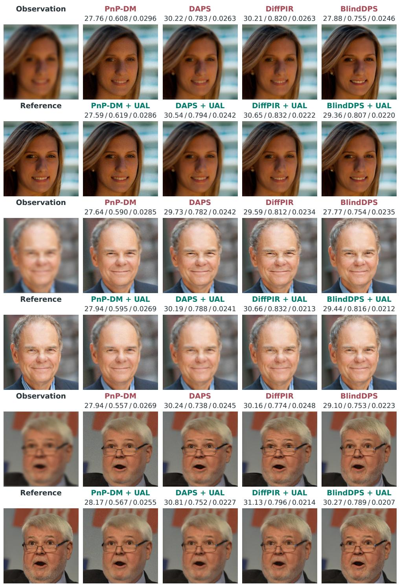  
Figure 5: Selected Gaussian-deblurring reconstructions at (¯s, τ) = (3, 0.5) pixels. Each row pair shows the observation and reference at left, followed by Published (upper) and UAL (lower) reconstructions from four samplers. Published and UAL use matched random seeds within each sampler. Numbers give PSNR (dB), SSIM, and CRPS, in that order. PSNR and SSIM describe the displayed trajectory; CRPS uses all 12 trajectories.

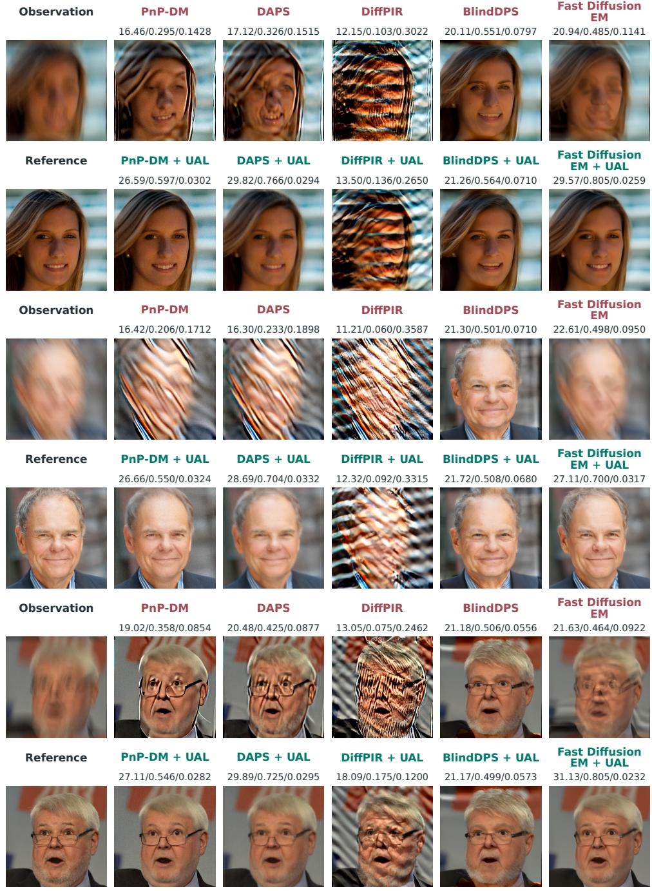  
Figure 6: Selected motion-deblurring reconstructions for the same three images as Figure 5, with P = 256 covariance modes for UAL. Each row pair shows the observation and reference at left, followed by Published (upper) and UAL (lower) reconstructions. For each sampler, the displayed reconstructions are paired by random seed. Numbers give PSNR (dB), SSIM, and CRPS, in that order. PSNR and SSIM describe the displayed trajectory; CRPS uses all 12 trajectories.

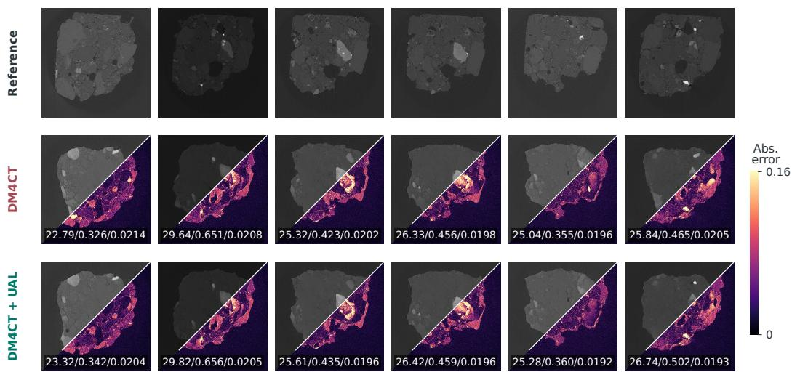  
Figure 7: Selected CT cases, with reconstruction draws paired by seed. Columns show cases. Each method panel combines the reconstruction in the upper-left half with its absolute difference from the reference in the lower-right half. Difference maps share one color scale. Numbers give PSNR (dB), SSIM, and CRPS, in that order. PSNR and SSIM describe the displayed draw; CRPS uses all 12 trajectories. DM4CT denotes Published.

For MRI, mean per-trajectory PSNR improves on 47 of 50 scans, with a mean paired gain of 0.0127 dB and a 95% paired-bootstrap confidence interval of [0.0097, 0.0160] dB (paired t = 7.83). The corresponding mean SSIM gain is 0.00031. All seven reported metrics favor UAL, with their pointwise 95% paired-bootstrap intervals excluding zero (Table 10). Figure 8 shows paired magnitude reconstructions.

Table 10: MRI gains and pointwise 95% paired-bootstrap confidence intervals across 50 scans, each with 12 paired trajectories. Gains are UAL minus Published for PSNR and SSIM, and Published minus UAL for the ensemble scores. T/M follows Table 1.
<table><tr><td>Metric</td><td>Mean gain</td><td>95% interval</td></tr><tr><td>PSNR T (dB)</td><td>0.0127</td><td>[0.0097, 0.0160]</td></tr><tr><td>PSNR M (dB)</td><td>0.0141</td><td>[0.0104, 0.0183]</td></tr><tr><td>SSIM T</td><td>0.000313</td><td>[0.000213, 0.000420]</td></tr><tr><td>SSIM M</td><td>0.000119</td><td>[0.000026, 0.000231]</td></tr><tr><td>CRPS</td><td>0.0000331</td><td>[0.0000239,0.0000435]</td></tr><tr><td>Energy</td><td>0.0220</td><td>[0.0160, 0.0290]</td></tr><tr><td>LVS(×103)</td><td>0.0116</td><td>[0.0086, 0.0149]</td></tr></table>

In microscopy with five uncertain pupil-phase coefficients, UAL increases per-trajectory PSNR by 0.425 dB and SSIM by 0.0153. The mean PSNR gain is positive in each of the four source stacks, ranging from 0.251 to 0.724 dB. Using the ensemble mean, PSNR rises from 33.67 to 34.22 dB. The CRPS, energy, and local variogram scores decrease by 0.00148, 0.901, and 0.000881, respectively. The uncertainty model and synthetic measurement construction are specified in Appendix C.6. Figures 9 and 10 show paired reconstructions and ensemble spread. For the section in Figure 10, UAL reduces the root-mean-square error of the ensemble mean from 0.085 to 0.052, while the root-meansquare sample standard deviation changes from 0.063 to 0.059.

Reference

Published

UAL

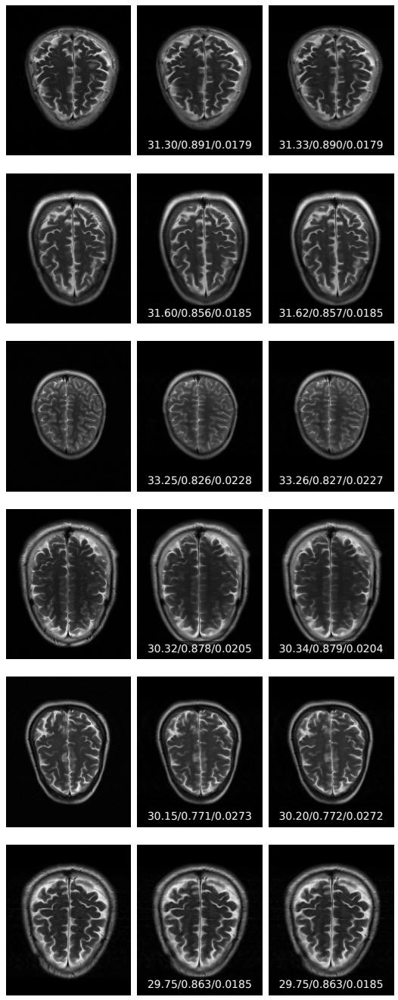

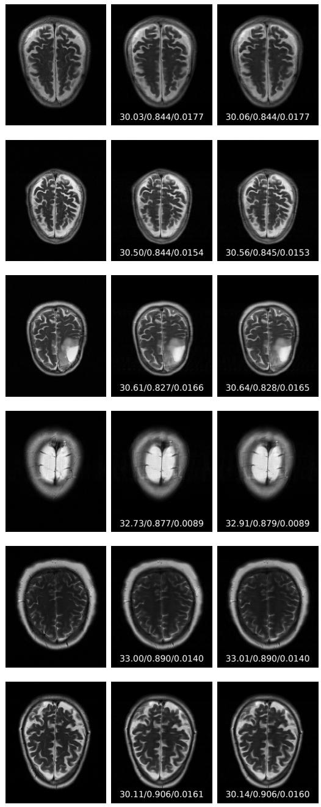  
Figure 8: Magnitude reconstructions for selected MRI scans. Each triplet shows the reference, Published Ambient DPS, and Ambient DPS with UAL. Both methods use the same random seed for each scan. Numbers give PSNR (dB), SSIM, and CRPS, in that order. PSNR and SSIM describe the displayed draw; CRPS uses all 12 trajectories.

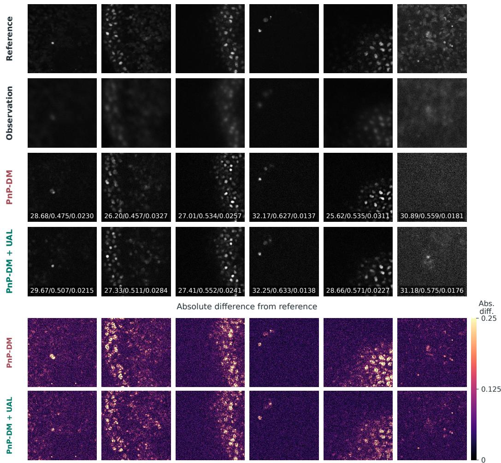  
Figure 9: Selected fluorescence-microscopy sections. Reconstructions are paired by seed; difference maps share one scale. Numbers give PSNR (dB), SSIM, and CRPS. PSNR and SSIM use the displayed draw; CRPS uses all 12 trajectories.

Table 11: Native ultrasound contrast and resolution metrics, averaged over 12 trajectories per phantom. CNR, gCNR, and speckle SNR use the contrast phantom; axial and lateral FWHM use the resolution phantom. FWHM is in mm and lower values are better. Speckle SNR is compared with the reference 1.91. Bold marks better values.
<table><tr><td>Metric</td><td>Published</td><td>UAL</td></tr><tr><td>CNR (dB), higher</td><td>9.9292</td><td>12.3625</td></tr><tr><td>gCNR</td><td>0.9141</td><td>0.9743</td></tr><tr><td>Speckle SNR, target 1.91</td><td>2.0616</td><td>2.0184</td></tr><tr><td>Axial FWHM (mm)</td><td>0.2506</td><td>0.2497</td></tr><tr><td>Lateral FWHM (mm)</td><td>0.5729</td><td>0.5722</td></tr></table>

On the acquired PICMUS contrast phantom, UAL increases CNR and gCNR. On the resolution phantom, both mean FWHM changes are below 0.01 mm (Table 11). Figure 11 shows all 12 paired contrast-phantom reconstructions.

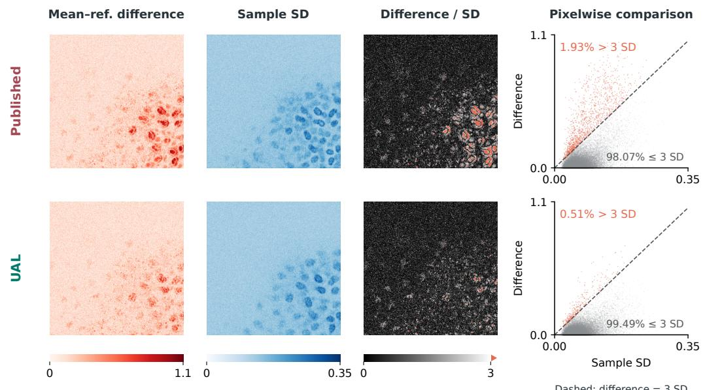

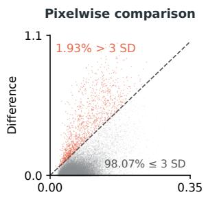

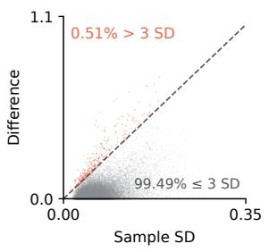

Figure 10: Pixelwise statistics for the microscopy section in Figure 9, using all 12 paired random seeds. The left columns show the absolute difference between the ensemble mean and reference and the sample standard deviation (SD). The right columns show their ratio and a scatter plot of difference against SD. Red marks pixels above the 3-SD threshold, indicated by the dashed line; percentages give the pixel fractions on either side. UAL reduces the fraction above this threshold from 1.93% to 0.51%, so large reference differences relative to the ensemble spread are less frequent in this section.  
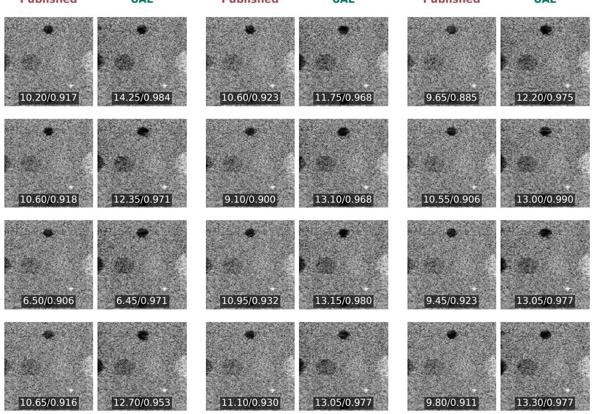  
Figure 11: Paired DRUS reconstructions of the acquired PICMUS contrast phantom. Each pair shows Published on the left and UAL on the right, ordered by seed from left to right and top to bottom. Numbers give CNR (dB) and gCNR for the displayed reconstruction. All panels use the same [−60, 0] dB B-mode display range.

## D.4 COVARIANCE-STRUCTURE CONTROL AND SECONDARY METRICS

For Gaussian deblurring with PnP-DM at $( \bar { s } , \tau ) = ( 3 , 0 . 5 )$ , structured UAL improves reconstruction over an isotropic likelihood with the same whitened covariance trace. The isotropic covariance is

$$
S _ { \mathrm { i s o } } ( x ) = [ 1 + c ( x ) ] \Sigma _ { e } , \qquad c ( x ) = { \frac { 1 } { m } } \mathrm { t r } \bigl ( \Sigma _ { e } ^ { - 1 } J _ { \psi } ( x ) \Sigma _ { \psi } J _ { \psi } ( x ) ^ { \mathsf { T } } \bigr ) ,\tag{77}
$$

where m is the measurement dimension. Here $c ( x )$ is the average added variance after noise whitening, so $1 + c ( x ) = v _ { \star } ( x )$ . Both likelihoods include Gaussian normalization and differentiate their signal-dependent covariance. Structured UAL gains $0 . 4 5 5 \pm 0 . 1 9 7$ dB over the isotropic control in per-trajectory PSNR and reduces CRPS by $0 . 0 0 2 6 0 \pm 0 . 0 0 0 5 6$ (mean ± standard error). The isotropic control produces little change from the published sampler (Table 13). Structured UAL improves per-trajectory PSNR over isotropic inflation on 13 of 16 Gaussian-deblurring images.

In motion deblurring, isotropic inflation improves mean per-trajectory PSNR by $6 . 2 1 2 \pm 0 . 3 9 8$ dB over the published sampler. Structured UAL adds $2 . 5 5 \bar { 7 } \pm 0 . \bar { 3 } 1 7$ dB in per-trajectory PSNR and reduces CRPS by $0 . 0 2 7 0 6 \pm 0 . 0 0 3 3 6$ relative to the isotropic control. The corresponding ensemblemean PSNR margin is $4 . 4 3 1 \pm 0 . 3 2 5$ dB. Structured UAL improves per-trajectory PSNR over isotropic inflation on 15 of 16 motion-deblurring images. These results support using the nuisanceinduced covariance directions to weight the residual.

In Gaussian deblurring with PnP-DM, recomputing covariance preserves the reconstruction gain when its derivatives are stopped. The stopped-derivative control removes both covariance terms in (6), so it tests their combined effect. Mean per-trajectory PSNR is 26.944 dB for the published sampler, 27.506 dB with covariance derivatives stopped, and 27.475 dB with UAL. Fixing covariance at the published sampler’s ensemble mean gives 26.964 dB, with UAL higher by $0 . 5 1 2 \pm 0 . 1 1 3$ dB; uncertainties are standard errors across the 16 images. With fixed covariance, ensemble-mean PSNR is 29.088 dB and CRPS is 0.03484, compared with 29.388 dB and 0.03253 for the published sampler. Refreshing covariance with its derivatives stopped gives 30.304 dB and 0.02976, close to 30.259 dB and 0.02981 for UAL.

We also select a fixed noise-variance multiplier by mean per-trajectory PSNR. For the scalar noisevariance multipliers $v = 1 , 1 . 5 , 2 , 3 , 5$ , mean per-trajectory PSNR is 26.944, 26.991, 27.007, 27.029, and 26.995 dB, respectively.

UAL exceeds the selected scalar control by $0 . 4 4 6 \pm 0 . 1 2 3 \mathrm { d B } .$ with higher PSNR on 15 of 16 images; the uncertainty is one standard error of the paired image differences. In motion deblurring, the best tested multiplier, $v = 4 8 ,$ gives 23.369 dB mean per-trajectory PSNR and CRPS 0.05773, compared with 26.641 dB and 0.03149 for UAL (Table 12). UAL gives higher mean per-trajectory PSNR on 15 of 16 images. For DAPS, multiplying the data-term variance $\overline { { \tau _ { \mathrm { D } } ^ { 2 } } }$ by $v = 4 8$ gives the best tested value, 24.413 dB, compared with 28.631 dB for UAL; UAL is higher by $4 . 2 2 \pm 0 . 2 7$ dB (mean ± SE across the 16 images), with higher PSNR on every image.

Table 12: Fixed data-term variance multipliers in motion deblurring: mean per-trajectory PSNR (dB) on the ablation set. For PnP-DM, v scales the observation-noise variance; for DAPS, it scales the data-fitting variance $\tau _ { \mathrm { D } } ^ { 2 } . v = 1$ is the published sampler; UAL gives 26.641 dB for PnP-DM and 28.631 dB for DAPS.
<table><tr><td>v</td><td>1</td><td>3</td><td>6</td><td>12</td><td>24</td><td>48</td><td>96</td><td>192</td><td>384</td></tr><tr><td>PnP-DM</td><td>17.872</td><td>20.429</td><td>21.652</td><td>22.569</td><td>23.243</td><td>23.369</td><td>23.210</td><td>22.503</td><td>21.419</td></tr><tr><td>DAPS</td><td>18.441</td><td>21.098</td><td>22.431</td><td>23.448</td><td>24.113</td><td>24.413</td><td>24.360</td><td>23.965</td><td>23.245</td></tr></table>

Table 13: Gaussian-deblurring covariance-structure control. T/M follows Table 1; PSNR is in dB, and CRPS and LVS are scaled by $1 0 ^ { 3 }$ . Lower ensemble scores are better.
<table><tr><td>Likelihood</td><td>PSNR T</td><td>PSNR M</td><td>CRPS</td><td>Energy</td><td>LVS</td></tr><tr><td>Published</td><td>26.944</td><td>29.388</td><td>32.53</td><td>21.327</td><td>15.22</td></tr><tr><td>Isotropic</td><td>27.020</td><td>29.472</td><td>32.42</td><td>21.078</td><td>15.12</td></tr><tr><td>UAL</td><td>27.475</td><td>30.259</td><td>29.81</td><td>19.052</td><td>14.18</td></tr></table>

For PnP-DM in motion deblurring, including the log determinant improves all seven metric means over the quadratic-only control (Table 14). This control uses $P = 2 5 6$ and the ablation set, as the covariance-structure comparison. We retain ${ \scriptstyle { \frac { 1 } { 2 } } } d ( x ) ^ { \mathsf { T } } S ( x ) ^ { - 1 } d ( x )$ , recomputing and differentiating its covariance at every candidate. This is the penalized profile energy described in Appendix A.2. UAL has higher mean per-trajectory PSNR on 15 of 16 images, with a paired advantage of 0.0257±0.0066 dB $( \mathrm { m e a n } \pm \mathrm { S E }$ across images).  
Table 14: Likelihood normalization in motion deblurring with PnP-DM at $P = 2 5 6$ . Values are means ± one SE across the ablation set. Quadratic only omits the log determinant while retaining covariance recomputation and differentiation. T/M follows Table 1.
<table><tr><td>Metric</td><td>Published</td><td>Quadratic only</td><td>UAL</td></tr><tr><td>PSNR T (dB) ↑</td><td> $1 7 . 8 7 2 3 \pm 0 . 7 2 6 9$ </td><td> $2 6 . 6 1 5 7 \pm 0 . 3 0 4 0$ </td><td> $2 6 . 6 4 1 4 \pm 0 . 3 0 1 3$ </td></tr><tr><td>PSNR M (dB) ↑</td><td> $1 8 . 7 9 0 1 \pm 0 . 7 8 2 7$ </td><td> $2 9 . 5 0 9 9 \pm 0 . 3 5 5 1$ </td><td> $2 9 . 5 3 3 5 \pm 0 . 3 5 6 4$ </td></tr><tr><td>SSIM T↑</td><td> $0 . 3 0 9 5 0 \pm 0 . 0 2 4 6 6$ </td><td> $0 . 5 5 3 9 9 \pm 0 . 0 0 8 0 5$ </td><td> $0 . 5 5 4 1 2 \pm 0 . 0 0 8 0 6$ </td></tr><tr><td>SSIM M↑</td><td> $0 . 4 3 3 4 0 \pm 0 . 0 3 8 9 4$ </td><td> $0 . 7 6 1 8 9 \pm 0 . 0 1 4 4 1$ </td><td> $0 . 7 6 1 9 1 \pm 0 . 0 1 4 4 4$ </td></tr><tr><td> $\mathrm { C R P S } \left( \times 1 0 ^ { 3 } \right) \downarrow$ </td><td> $1 3 1 . 5 3 3 \pm 1 9 . 3 9 6$ </td><td> $3 1 . 5 3 4 \pm 1 . 4 9 1$ </td><td> $3 1 . 4 8 9 \pm 1 . 4 9 6$ </td></tr><tr><td>Energy ↓</td><td> $8 3 . 8 7 4 \pm 9 . 4 4 1$ </td><td> $2 0 . 4 0 6 \pm 0 . 8 8 2$ </td><td> $2 0 . 3 5 1 \pm 0 . 8 8 4$ </td></tr><tr><td> $\mathrm { L V S } \left( \times 1 0 ^ { 3 } \right) \downarrow$ </td><td> $5 4 . 3 9 5 \pm 7 . 3 4 3$ </td><td> $1 4 . 7 9 0 \pm 0 . 5 7 2$ </td><td> $1 4 . 7 6 6 \pm 0 . 5 6 4$ </td></tr></table>

For Fast Diffusion EM in motion deblurring, UAL improves every reported metric on all 50 images relative to covariance weighting alone (Table 15).

Table 15: Motion deblurring with Fast Diffusion EM on 50 images with 12 paired trajectories per image and $P = 2 5 6$ . All three adapted arms use the population-mean kernel and propagated covariance; covariance weighting holds the covariance fixed during differentiation and omits the log determinant, and the quadratic-only arm recomputes and differentiates the covariance but omits the log determinant. T/M follows Table 1.
<table><tr><td>Metric</td><td>Published</td><td>Covariance weighting</td><td>Quadratic only</td><td>UAL</td></tr><tr><td>PSNR T (dB) ↑</td><td>22.76</td><td>23.80</td><td>28.49</td><td>29.10</td></tr><tr><td>PSNR M (dB) ↑</td><td>23.27</td><td>25.30</td><td>30.64</td><td>30.72</td></tr><tr><td>SSIM T ↑</td><td>.5236</td><td>.5663</td><td>.7537</td><td>.7635</td></tr><tr><td>SSIM M↑</td><td>.5525</td><td>.6243</td><td>.8131</td><td>.8108</td></tr><tr><td>CRPS↓</td><td>.07789</td><td>.05472</td><td>.02731</td><td>.02708</td></tr><tr><td>Energy ↓</td><td>51.865</td><td>37.077</td><td>18.360</td><td>18.332</td></tr><tr><td> $\mathrm { L V S } \left( \times 1 0 ^ { 3 } \right) \downarrow$ </td><td>24.271</td><td>17.248</td><td>9.449</td><td>9.633</td></tr></table>

## D.5 COVARIANCE SPECTRA AT FINAL RECONSTRUCTIONS

We evaluate UAL’s covariance at the final Published, Isotropic, and UAL reconstructions, using the same parameter mean and covariance for all three. With $W = \Sigma _ { e } ^ { - 1 / 2 } U$ and $\boldsymbol { G } = \boldsymbol { I _ { r } } + \boldsymbol { W } ^ { \intercal } \boldsymbol { W }$ , we report the average added variance after noise whitening, $c ( x ) = ( \operatorname { t r } G - r ) / m$ , and the two leading squared singular values $s _ { 1 } ^ { 2 }$ and $s _ { 2 } ^ { 2 }$ of W. The trace-matched variance multiplier is $1 + c ( x )$

Each quantity is evaluated separately for each trajectory and averaged within an image; the table reports means and standard errors across images. Singular values are ordered within each trajectory before aggregation.

The Gaussian covariance concentrates its added variance in two directions, so a small average variance increase can accompany large directional variances. In motion deblurring, the added covariance trace differs across the final candidate reconstructions. These diagnostics use measurementnoise whitening; the reconstruction-risk Gram matrix Λ in Appendix B uses predictive-covariance whitening.

## D.6 COVARIANCE SCALE AND MATCHED UNCERTAINTY

Mean and covariance mismatch. With observations fixed and covariance correct, shifting the mean width by approximately ±5% and ±20% gives mean per-trajectory PSNR from 27.408 to

Table 16: Final-state covariance diagnostics, reported as mean ± standard error across images. The leading squared singular values are scaled by $1 \dot { 0 } ^ { - 4 }$
<table><tr><td>Task</td><td>Candidate</td><td>c(x)</td><td> $s _ { 1 } ^ { 2 } / { 1 0 } ^ { 4 }$ </td><td> $s _ { 2 } ^ { 2 } / { 1 0 } ^ { 4 }$ </td></tr><tr><td>Gaussian blur</td><td>Published</td><td> $0 . 1 8 9 \pm 0 . 0 1 5$ </td><td> $2 . 6 1 7 \pm 0 . 2 6 6$ </td><td> $1 . 0 9 8 \pm 0 . 0 4 8$ </td></tr><tr><td></td><td>Isotropic</td><td> $0 . 1 8 5 \pm 0 . 0 1 4$ </td><td> $2 . 5 5 3 \pm 0 . 2 4 8$ </td><td> $1 . 0 8 8 \pm 0 . 0 4 7$ </td></tr><tr><td></td><td>UAL</td><td> $0 . 1 9 7 \pm 0 . 0 1 0$ </td><td> $2 . 5 1 6 \pm 0 . 1 3 4$ </td><td> $1 . 3 5 7 \pm 0 . 0 6 5$ </td></tr><tr><td>Motion blur</td><td>Published</td><td> $2 0 . 0 8 5 \pm 3 . 5 3 2$ </td><td> $1 7 6 . 3 8 9 \pm 4 4 . 3 3 4$ </td><td> $5 7 . 8 4 1 \pm 8 . 5 7 8$ </td></tr><tr><td></td><td>Isotropic</td><td> $3 . 2 4 4 \pm 0 . 3 2 8$ </td><td> $3 4 . 6 6 6 \pm 4 . 0 8 4$ </td><td> $1 2 . 9 2 2 \pm 1 . 4 3 8$ </td></tr><tr><td></td><td>UAL</td><td> $4 . 6 2 6 \pm 0 . 3 7 0$ </td><td> $3 8 . 2 9 6 \pm 3 . 5 3 3$ </td><td> $1 9 . 0 9 0 \pm 1 . 9 4 2$ </td></tr></table>

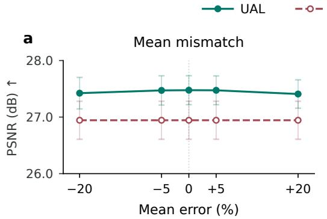

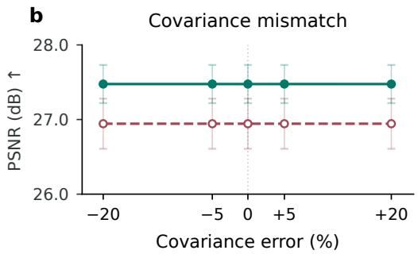  
Figure 12: PnP-DM sensitivity to nuisance moments in Gaussian deblurring. (a) Mean-width error with correct covariance. (b) Covariance-scale error with correct mean. Observations stay fixed; zero denotes the correct moment. Curves show mean per-trajectory PSNR ± one SE across the ablation set. The dashed Published reference uses the correct mean in both panels. Mean PSNR changes little over the tested ranges.

27.475 dB (Figure 12a). CRPS is 0.03099 at mean width 2.4 pixels and 0.02981 at the correct mean of 3 pixels. We next perturb the covariance used by UAL while keeping the generating covariance and observations fixed. Gaussian deblurring uses the reference $\Sigma _ { \psi , \mathrm { r e f } } = 0 . 2 5 I _ { 2 }$ in squared-pixel units. Each perturbed covariance is a scalar multiple of its task’s reference. Table 17 reports paired changes from UAL with zero covariance error. We also test approximately doubled nuisance covariance. Across the nonzero Gaussian covariance settings, mean per-trajectory PSNR remains 27.475 dB to three decimals. For motion deblurring, removing the nuisance covariance gives the published sampler’s PSNR of 17.872 dB; doubling it gives 26.644 dB, compared with 26.641 dB at the reference covariance.

Over the approximately ±20% covariance-error range, mean per-trajectory PSNR changes by less than 0.001 dB in Gaussian deblurring and at most 0.0641 dB in motion deblurring. The largest absolute relative CRPS changes are 0.0011% and 0.0572%, respectively. One trajectory accounts for most of the motion PSNR change; all trajectories remain in the paired summaries.

Matched uncertainty levels. We next vary the generating width uncertainty and the uncertainty supplied to UAL together, using $\mu = ( 3 , 3 )$ and $\begin{array} { r } { \sum _ { \psi } = \tau ^ { 2 } I _ { 2 } } \end{array}$ . Image identities, width percentiles, and noise realizations are coupled across levels; the observations change with the blur widths. Relative to Published, UAL’s mean per-trajectory PSNR gain is $0 . 0 4 3 \pm \bar { 0 } . 0 6 7$ dB at $\tau = 0 . 2 5$ . It grows to $1 . 7 4 6 \pm 0 . 3 9 7$ dB at $\tau = 1 . 5$ , while the reduction in per-trajectory MSE grows from 0.000099 to 0.007808 (Table 18). At the largest tested uncertainty, UAL reduces average per-trajectory MSE by approximately 38%. Table 18 also lists the trace-matched isotropic control of (77). UAL gives lower mean MSE, higher mean per-trajectory PSNR, and lower CRPS than isotropic inflation at every tested level.

Table 17: Covariance-scale mismatch with fixed observations. Each task uses the ablation set. Signed changes (perturbed minus UAL at zero covariance error) are reported as mean ± SE across images. PSNR is in dB. Relative CRPS changes divide the paired change and its SE by the reference mean CRPS.
<table><tr><td>Task</td><td>Covariance error</td><td>∆PSNR T</td><td>∆PSNR M</td><td>∆CRPS (%)</td></tr><tr><td>Gaussian</td><td>-20.1%</td><td> $+ 0 . 0 0 0 2 \pm 0 . 0 0 0 2$ </td><td> $+ 0 . 0 0 0 1 \pm 0 . 0 0 0 2$ </td><td> $- 0 . 0 0 0 3 \pm 0 . 0 0 0 8$ </td></tr><tr><td>Gaussian</td><td>-4.9%</td><td> $+ 0 . 0 0 0 2 \pm 0 . 0 0 0 2$ </td><td> $+ 0 . 0 0 0 2 \pm 0 . 0 0 0 1$ </td><td> $- 0 . 0 0 0 6 \pm 0 . 0 0 0 7$ </td></tr><tr><td>Gaussian</td><td>+5.1%</td><td> $+ 0 . 0 0 0 2 \pm 0 . 0 0 0 1$ </td><td> $+ 0 . 0 0 0 2 \pm 0 . 0 0 0 1$ </td><td> $- 0 . 0 0 1 0 \pm 0 . 0 0 0 6$ </td></tr><tr><td>Gaussian</td><td>+19.9%</td><td> $+ 0 . 0 0 0 1 \pm 0 . 0 0 0 1$ </td><td> $+ 0 . 0 0 0 2 \pm 0 . 0 0 0 2$ </td><td> $- 0 . 0 0 1 1 \pm 0 . 0 0 0 8$ </td></tr><tr><td>Gaussian</td><td>+99.9%</td><td> $+ 0 . 0 0 0 1 \pm 0 . 0 0 0 1$ </td><td> $+ 0 . 0 0 0 2 \pm 0 . 0 0 0 2$ </td><td> $- 0 . 0 0 0 9 \pm 0 . 0 0 1 0$ </td></tr><tr><td>Motion</td><td>-20.0%</td><td> $+ 0 . 0 6 0 9 \pm 0 . 0 6 3 3$ </td><td> $+ 0 . 0 2 5 7 \pm 0 . 0 2 9 1$ </td><td> $+ 0 . 0 5 7 2 \pm 0 . 0 3 9 2$ </td></tr><tr><td>Motion</td><td>-5.0%</td><td> $- 0 . 0 0 0 5 \pm 0 . 0 0 0 2$ </td><td> $- 0 . 0 0 0 6 \pm 0 . 0 0 0 2$ </td><td> $+ 0 . 0 0 4 0 \pm 0 . 0 0 2 4$ </td></tr><tr><td>Motion</td><td>+5.0%</td><td> $+ 0 . 0 0 0 4 \pm 0 . 0 0 0 2$ </td><td> $+ 0 . 0 0 0 5 \pm 0 . 0 0 0 3$ </td><td> $- 0 . 0 0 4 3 \pm 0 . 0 0 2 6$ </td></tr><tr><td>Motion</td><td>+20.0%</td><td> $+ 0 . 0 6 4 1 \pm 0 . 0 6 3 4$ </td><td> $+ 0 . 0 3 0 8 \pm 0 . 0 2 9 2$ </td><td> $+ 0 . 0 2 5 2 \pm 0 . 0 3 6 6$ </td></tr><tr><td>Motion</td><td>+100.0%</td><td> $+ 0 . 0 0 3 0 \pm 0 . 0 0 3 4$ </td><td> $+ 0 . 0 1 0 8 \pm 0 . 0 0 7 8$ </td><td> $- 0 . 0 4 9 5 \pm 0 . 0 4 0 4$ </td></tr></table>

The comparison shows how the empirical benefit changes when generating uncertainty and the uncertainty used by UAL vary together; the conditional crossover in Appendix B instead holds the nuisance model q fixed and varies the nuisance realization.

Table 18: Matched generating and UAL width uncertainty, on the ablation set. MSE and PSNR (dB) are averaged per trajectory; CRPS is scaled by $1 0 ^ { 3 }$ . Isotropic is the trace-matched control of (77), run at each level.
<table><tr><td></td><td colspan="3">MSE↓</td><td colspan="3">PSNR ↑</td><td colspan="3">CRPS↓</td></tr><tr><td>τ (pixels)</td><td>Published</td><td>Isotropic</td><td>UAL</td><td>Published</td><td>Isotropic</td><td>UAL</td><td>Published</td><td>Isotropic</td><td>UAL</td></tr><tr><td>.25</td><td>.007301</td><td>.007312</td><td>.007202</td><td>27.508</td><td>27.502</td><td>27.551</td><td>29.93</td><td>29.97</td><td>29.23</td></tr><tr><td>.50</td><td>.008459</td><td>.008263</td><td>.007348</td><td>26.944</td><td>27.020</td><td>27.475</td><td>32.53</td><td>32.42</td><td>29.81</td></tr><tr><td>1.00</td><td>.014066</td><td>.010826</td><td>.008800</td><td>25.368</td><td>26.018</td><td>26.818</td><td>40.95</td><td>38.24</td><td>33.26</td></tr><tr><td>1.50</td><td>.020463</td><td>.012810</td><td>.012655</td><td>24.043</td><td>25.318</td><td>25.789</td><td>49.58</td><td>43.24</td><td>39.90</td></tr></table>

## D.7 FULL GAUSSIAN-WIDTH RESULTS

Across the three Gaussian-width settings, UAL gives higher mean per-trajectory PSNR and lower CRPS than Published for all four samplers (Table 19). These comparisons use all 50 images and 12 paired trajectories per image; Table 1 gives all seven scores for the main setting; Table 20 gives them for the other two.

Table 19: Gaussian-width effects on reconstruction and ensemble prediction on 50 images, with 12 paired trajectories per image. Entries are per-trajectory PSNR (dB) and CRPS $( \times 1 0 ^ { \bar { 3 } } )$ for the published sampler and UAL; (¯s, τ ) is in pixels. Bold marks better UAL values at the displayed precision.
<table><tr><td rowspan="2">(s, τ)</td><td rowspan="2">Version</td><td colspan="2">DAPS</td><td colspan="2">PnP-DM</td><td colspan="2">DiffPIR</td><td colspan="2">BlindDPS</td></tr><tr><td>PSNR↑</td><td>CRPS↓</td><td>PSNR ↑</td><td>CRPS↓</td><td>PSNR ↑</td><td>CRPS↓</td><td>PSNR ↑</td><td>CRPS↓</td></tr><tr><td rowspan="2">(3,0.5)</td><td>Published</td><td>29.49</td><td>28.71</td><td>26.97</td><td>32.09</td><td>29.13</td><td>29.48</td><td>28.31</td><td>26.98</td></tr><tr><td>UAL</td><td>29.88</td><td>27.96</td><td>27.50</td><td>29.56</td><td>30.12</td><td>25.83</td><td>29.21</td><td>24.76</td></tr><tr><td rowspan="2">(5,0.5)</td><td>Published</td><td>28.16</td><td>32.89</td><td>26.35</td><td>35.58</td><td>27.52</td><td>32.67</td><td>26.96</td><td>32.38</td></tr><tr><td>UAL</td><td>28.65</td><td>32.22</td><td>26.84</td><td>33.93</td><td>28.60</td><td>28.64</td><td>27.37</td><td>29.79</td></tr><tr><td rowspan="2">(3,1)</td><td>Published</td><td>28.05</td><td>35.42</td><td>25.80</td><td>38.56</td><td>26.70</td><td>43.55</td><td>28.43</td><td>27.01</td></tr><tr><td>UAL</td><td>29.56</td><td>30.13</td><td>27.16</td><td>31.03</td><td>29.63</td><td>29.07</td><td>29.00</td><td>25.73</td></tr></table>

Table 20: Full Gaussian-width results for (5, 0.5) and (3, 1) pixels on 50 images, with 12 paired trajectories per image. T/M follows Table 1; PSNR is in dB and LVS is scaled by $\mathrm { i 0 ^ { 3 } }$ . Bold marks better UAL values at the displayed precision.
<table><tr><td>Sampler</td><td>Version</td><td>PSNR T/M ↑</td><td>SSIM T/M ↑</td><td>CRPS</td><td>Energy ↓</td><td>LVS↓</td></tr><tr><td colspan="7">(5, 0.5) pixels</td></tr><tr><td>DAPS</td><td>Published</td><td>28.16 /29.32</td><td>.6888 / .7685</td><td>.03289</td><td>22.999</td><td>12.581</td></tr><tr><td></td><td>UAL</td><td>28.65 / 29.67</td><td>.6949 / .7702</td><td>.03222</td><td>22.512</td><td>12.631</td></tr><tr><td>PnP-DM</td><td>Published</td><td>26.35 / 28.55</td><td>.5325 / .7290</td><td>.03558</td><td>23.459</td><td>16.258</td></tr><tr><td></td><td>UAL</td><td>26.84 / 29.12</td><td>.5366 / .7338</td><td>.03393</td><td>22.008</td><td>15.759</td></tr><tr><td>DiffPIR</td><td>Published</td><td>27.52 / 29.11</td><td>.7028 / .7712</td><td>.03267</td><td>22.846</td><td>11.400</td></tr><tr><td></td><td>UAL</td><td>28.60 / 30.07</td><td>.7278 / .7891</td><td>.02864</td><td>20.396</td><td>10.456</td></tr><tr><td>BlindDPS</td><td>Published</td><td>26.96 / 28.78</td><td>.6732 / .7436</td><td>.03238</td><td>23.167</td><td>11.609</td></tr><tr><td></td><td>UAL</td><td>27.37 / 29.45</td><td>.6955 / .7714</td><td>.02979</td><td>21.120</td><td>10.365</td></tr><tr><td colspan="7">(3, 1) pixels</td></tr><tr><td>DAPS</td><td>Published</td><td>28.05 / 29.02</td><td>.7113 / .7839</td><td>.03542</td><td>25.410</td><td>13.712</td></tr><tr><td></td><td>UAL</td><td>29.56 / 30.56</td><td>.7347 / .8041</td><td>.03013</td><td>20.679</td><td>11.525</td></tr><tr><td>PnP-DM</td><td>Published</td><td>25.80 / 28.13</td><td>.5388 / .7370</td><td>.03856</td><td>25.832</td><td>18.788</td></tr><tr><td></td><td>UAL</td><td>27.16 / 29.96</td><td>.5639 / .7683</td><td>.03103</td><td>19.965</td><td>14.864</td></tr><tr><td>DiffPIR</td><td>Published</td><td>26.70 / 27.78</td><td>.7114 /.7667</td><td>.04355</td><td>31.323</td><td>18.119</td></tr><tr><td></td><td>UAL</td><td>29.63 / 30.67</td><td>.7684 / .8130</td><td>.02907</td><td>20.319</td><td>10.210</td></tr><tr><td>BlindDPS</td><td>Published</td><td>28.43 / 30.37</td><td>.7381 / .8015</td><td>.02701</td><td>19.286</td><td>9.725</td></tr><tr><td></td><td>UAL</td><td>29.00 / 30.88</td><td>.7622 / .8202</td><td>.02573</td><td>18.312</td><td>9.155</td></tr></table>

## D.8 COVARIANCE RANK AND COMPUTATIONAL COST

Table 22 reports mean wall time per trajectory on NVIDIA L40S GPUs, with one reconstruction job per GPU. DAPS deblurring times cover the sampling call, excluding setup. DiffPIR includes process initialization and output writing; DRUS excludes model loading, singular value decomposition, and covariance preparation. For Figure 4, reconstruction scores use the ablation set. Table 21 compares Published and UAL at $P = 2 5 6$ and $P = 2 0 4 8$ on the ablation set to assess sensitivity to rank. At both ranks, UAL improves mean per-trajectory PSNR for the three non-blind samplers and lowers the mean CRPS, energy, and local variogram scores for all four samplers.

Table 21: Motion deblurring with the published samplers and UAL. All treatments use the ablation set. T/M follows Table 1; PSNR is in dB. CRPS, energy, and LVS are fair ensemble scores, with LVS scaled by 103.
<table><tr><td>Sampler</td><td>Treatment</td><td>PSNR T/M ↑</td><td>SSIM T/M ↑</td><td>CRPS↓</td><td>Energy ↓</td><td>LVS↓</td></tr><tr><td>DAPS</td><td>Published</td><td>18.44 / 18.89</td><td>.3677 / .4190</td><td>0.13913</td><td>88.578</td><td>52.203</td></tr><tr><td></td><td> $\mathrm { U A L } , P = 2 5 6$ </td><td>28.63 / 29.34</td><td>.7030 / .7660</td><td>0.03572</td><td>24.046</td><td>13.079</td></tr><tr><td></td><td> $\mathrm { U A L } , P = 2 0 4 8$ </td><td>28.56 / 29.29</td><td>.7002 / .7659</td><td>0.03568</td><td>23.962</td><td>12.990</td></tr><tr><td>PnP-DM</td><td>Published</td><td>17.87 / 18.79</td><td>.3095 / .4334</td><td>0.13153</td><td>83.874</td><td>54.395</td></tr><tr><td></td><td> $\mathrm { U A L } , P = 2 5 6$ </td><td>26.64 / 29.53</td><td>.5541 / .7619</td><td>0.03149</td><td>20.351</td><td>14.766</td></tr><tr><td></td><td> $\mathrm { U A L } , P = 2 0 4 8$ </td><td>26.25 / 29.31</td><td>.5420 / .7517</td><td>0.03209</td><td>20.788</td><td>14.997</td></tr><tr><td>DiffPIR</td><td>Published</td><td>11.72 / 12.50</td><td>.0853 / .1057</td><td>0.32936</td><td>165.774</td><td>170.151</td></tr><tr><td></td><td> $\mathrm { U A L } , P = 2 5 6$ </td><td>15.19 / 15.87</td><td>.1681 / .1930</td><td>0.22664</td><td>120.672</td><td>90.039</td></tr><tr><td></td><td> $\mathrm { U A L } , P = 2 0 4 8$ </td><td>16.78 / 17.52</td><td>.2184 / .2507</td><td>0.18415</td><td>101.031</td><td>68.612</td></tr><tr><td>BlindDPS</td><td>Published</td><td>22.50 / 23.61</td><td>.5747 / .6418</td><td>0.06109</td><td>44.357</td><td>17.561</td></tr><tr><td></td><td> $\mathrm { U A L } , P = 2 5 6$ </td><td>22.20 / 23.62</td><td>.5593 / .6391</td><td>0.06048</td><td>42.963</td><td>16.822</td></tr><tr><td></td><td> $\mathrm { U A L } , P = 2 0 4 8$ </td><td>22.38 / 23.78</td><td>.5616 / .6392</td><td>0.05955</td><td>42.368</td><td>16.759</td></tr></table>

Table 22: Mean wall time per trajectory on NVIDIA L40S GPUs with one reconstruction job per GPU.
<table><tr><td>Sampler / task</td><td>Published (s)</td><td>UAL (s)</td></tr><tr><td>Gaussian deblurring PnP-DM DAPS DiffPIR</td><td>77.3 39.4 6.0</td><td>76.9 116.6 6.1</td></tr><tr><td>BlindDPS Motion deblurring</td><td>129.6</td><td>371.8</td></tr><tr><td>PnP-DM DAPS DiffPIR</td><td>31.8 21.8 6.1</td><td>89.5 155.4 6.4</td></tr><tr><td>BlindDPS</td><td>126.4</td><td>70.7</td></tr><tr><td>Imaging applications</td><td></td><td></td></tr><tr><td>DAPS (CT)</td><td>429.8</td><td>436.2</td></tr><tr><td>Ambient DPS (MRI)</td><td>52.9</td><td>103.2</td></tr><tr><td></td><td></td><td></td></tr><tr><td>DRUS (ultrasound) PnP-DM (microscopy)</td><td>74.3 30.5</td><td>73.9 83.5</td></tr></table>