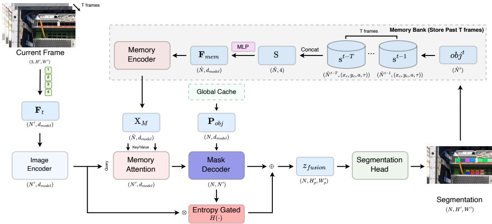
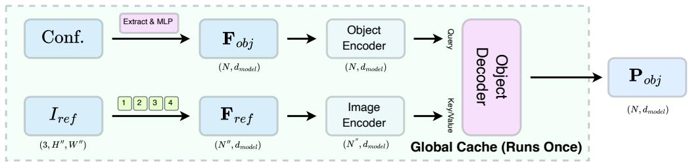
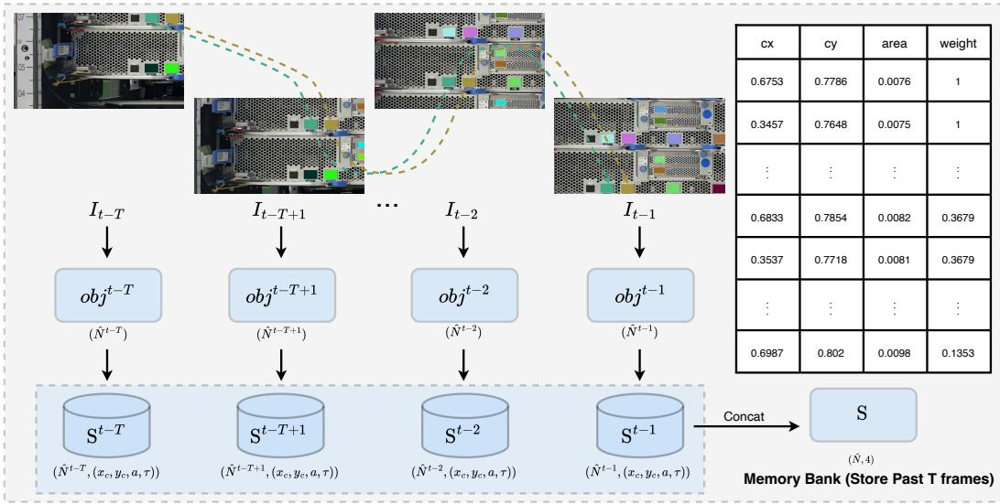
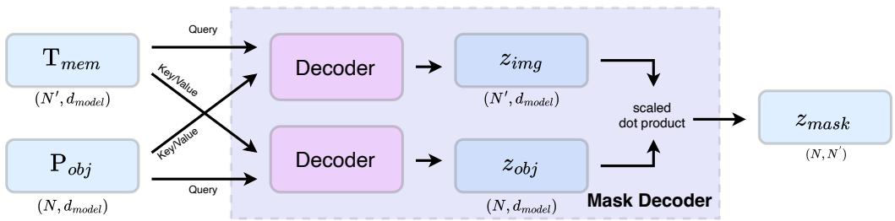
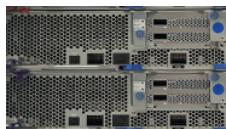
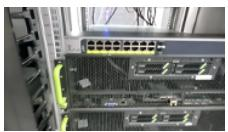
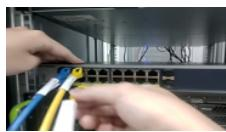
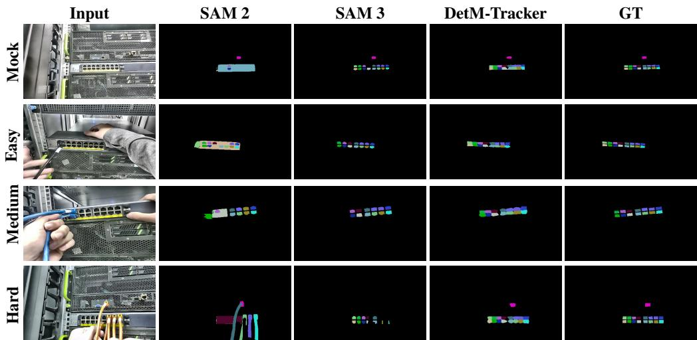
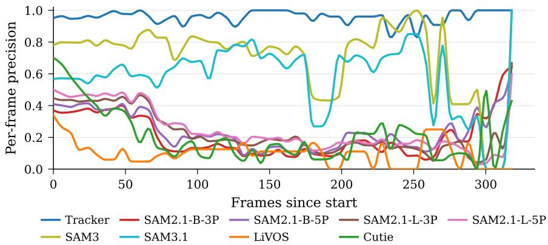

# DetM-Tracker: Deterministic and Memory-Efficient VIS for Autonomous Industrial Inspection

You-Rui Lin1 Jen-Chieh Wu1 Tzu-Ti Wei1 Jen-Jee Chen1 Yu-Chee Tseng2

1College of Artificial Intelligence 2Department of Computer Science

National Yang Ming Chiao Tung University

{nicklin910221.ai13, wljurse.ai14, a2699560.ai09, jenjee}@nycu.edu.tw yctseng@cs.nycu.edu.tw

## Abstract

Autonomous industrial inspection requires strictly deterministic real-time inference under tight memory and computational constraints. However, existing Video Instance Segmentation (VIS) models suffer from prohibitive scaling: dense temporal memory grows with spatial resolution and sequence length, while fixed-capacity decoders fail to exploit the inherent sparsity of industrial scenes, creating a practical memory wall on resource-constrained edge platforms. We present DetM-Tracker, a streamlined VIS framework for autonomous industrial inspection, where target objects often exhibit highly similar appearance under constrained “micro” fields of view. DetM-Tracker eliminates architectural redundancy through three synergistic components: (1) Compact Scalar Memory, which condenses high-dimensional instance features into four-scalar descriptors, reducing temporal memory complexity from O(T·N ·R) to O(T·Nˆ ). This mechanism effectively compresses frame-level representations into a bank of active instances, where R denotes resolution, N and Nˆ represent global and window-specific instance counts, respectively and T the temporal window size; and (2) Dynamic Instance Channels, which adaptively allocate query capacity according to the actual number of visible objects; and (3) Entropy-Gated Skip Connection, which concentrates computational budget on high-uncertainty spatial regions to refine object boundaries in a single forward pass without auxiliary refinement heads. By replacing dense temporal buffers with uncertainty-aware sparse representations, DetM-Tracker achieves accurate and deterministic long-horizon tracking while maintaining a strictly bounded hard ware footprint. Our approach effectively bridges the gap between modern VIS models and the practical demands of industrial edge deployment, reducing inference latency by approximately 20× and VRAM consumption by 6× compared to state-of-the-art dense-feature baselines.

## 1 Introduction

Modern industrial tasks, such as server maintenance and automated assembly, demand deterministic latency and minimal memory footprints for long-horizon autonomous video inference. While recent foundation segmentation and tracking models [1, 2] offer powerful visual representations, many video instance segmentation (VIS) frameworks rely on dense temporal feature banks whose memory consumption grows with spatial resolution and sequence length, creating a practical memory wall that limits deployment on resource-constrained edge devices.

In this work, we study the VIS task for autonomous industrial inspection. Industrial scenes present unique challenges for VIS: (i) Identity Dilemma: unlike feature-rich natural objects (e.g., birds), industrial objects (e.g., Ethernet sockets) often exhibit highly similar appearance and are densely arranged in regular spatial patterns (e.g., arrays); and (ii) Micro Field of View: due to close-range observation, captured frames are often spatially localized and contain only partial views (e.g., local Preprint.

regions of tall server racks), limiting global spatial reasoning across the scene. Specifically, we formulate the tracking of Ethernet sockets on the rear panels of server racks as a VIS problem. These sockets are visually near-identical and arranged with fixed spatial relationships, requiring reliable instance association to depend more on stable spatial topology than on ambiguous appearance cues—a setting where conventional VIS frameworks often struggle.

To bridge this gap, we propose DetM-Tracker, a streamlined VIS framework that replaces heavy refinement with uncertainty-aware sparsity. Our contributions are:

Compact Scalar Memory: Unlike traditional VIS frameworks that rely on dense temporal feature banks whose memory footprint scales with spatial resolution [3], our Compact Scalar Memory distills identities into sparse descriptors. This reduces long-term tracking complexity to a resolution-invariant scale, ensuring stable ID maintenance.

Dynamic Instance Channels: An adaptive architecture that scales the query bank according to the actual object count. This allows handling high-cardinality arrays without proportional computational inflation by leveraging fixed spatial layouts [4, 5].

Entropy-Gated Skip Connection: Moving beyond uniform feature fusion [6] commonly used in Encoder-Decoder architectures, our method concentrates the computational budget on highuncertainty regions. This gated integration prevents low-level noise from polluting confident interiors while achieving sharp mask boundaries.

## 2 Related Works

Promptable Foundation Models. The Segment Anything Model (SAM) [1] redefined instance segmentation through zero-shot generalization via geometric prompts. While powerful, SAM’s heavy encoders and iterative mask decoders create a computational bottleneck in high-throughput industrial pipelines where interactive prompting is infeasible. Unlike static segmenters, our framework leverages initial prompts as identity anchors to enable autonomous, long-term propagation without human intervention.

Video Instance Segmentation (VIS). VIS requires consistent identity maintenance across temporal horizons. SAM 2 [2] extends this to video using a streaming architecture with hierarchical memory banks. However, its attention mechanism operates over dense spatial-temporal tensors, incurring O(T · H · W) complexity that exhausts edge memory. In contrast, we propose a Compact Scalar Memory abstraction. By distilling temporal history into latent tokens, we decouple tracking costs from spatial resolution, ensuring stable ID maintenance even when visually identical objects—the Identity Dilemma—preclude appearance-based matching.

Query-based Paradigms. Query-based paradigms, originating from DETR’s [7] set-prediction objective, were successfully extended to segmentation by Mask2Former [4, 5]. However, these models typically utilize a fixed-capacity query bank, incurring redundant computation in sparse scenes or failing in high-cardinality industrial arrays (e.g., server racks). Our Dynamic Instance Channels bridge this gap by deriving the active query bank size directly from reference prompts. By binding identities to initial boxes, we eliminate bipartite matching and ensure computational costs scale strictly with the actual object count.

Boundary Refinement. Refining spatial details often requires iterative point sampling [8, 9], which multiplies latency, or uniform skip-feature Connection [6, 10, 11, 12], which may introduce noise from identical neighboring instances. Our Entropy-Gated Skip Connection unifies these approaches. By using predictive entropy to selectively gate low-level features, we concentrate refinement only on ambiguous boundaries. This parameter-free mechanism provides a single-pass alternative to iterative sampling, achieving sharp mask boundaries while maintaining deterministic latency.

In summary, our framework facilitates a paradigm shift from dense, static architectures to uncertaintyaware sparsity. By substituting dense pixel-level storage with Compact Scalar Memory, converting fixed-capacity decoders into Dynamic Instance Channels, and replacing iterative refinement with single-pass Entropy-Gated Skip Connection, we enable foundation-level perception within the rigorous resource constraints of industrial edge environments. This integration not only bypasses the memory wall but also resolves the visual ambiguity of high-density identical instances by prioritizing stable spatial topology and entropy-gated feature refinement.

## 3 Method

The DetM-Tracker architecture is designed to enable high-fidelity Video Instance Segmentation (VIS) under strict edge-compute constraints. As illustrated in Figure 1, the pipeline operates in three core stages: (1) Initialization, where a Global Cache fuses geometric priors and visual cues into persistent object queries; (2) Streaming Encoding, which extracts per-frame spatial features; and (3) Temporal Refinement, where a novel Compact Scalar Memory distills historical states into resolution-invariant tokens to guide a Bidirectional Mask Decoder. This design bypasses the traditional "Memory Wall" by shifting from dense spatial-temporal buffers to sparse, scalar-based abstractions, ensuring computational overhead scales strictly with instance count rather than resolution.

  
Figure 1: Overview of the DetM-Tracker Architecture. The framework decouples VIS into persistent identity and dynamic temporal reasoning. Past states are distilled into Compact Scalar Memory s, which is processed by a memory encoder to produce resolution-invariant temporal tokens $X _ { M }$ . These tokens provide context for Memory Attention to refine current-frame image features. The Mask Decoder then facilitates mutual refinement between image-conditioned features and Global Object Queries $\mathrm { ~ \bf ~ P ~ } _ { o b j }$ to generate initial masks. Finally, Entropy-Gated Skip Connection $\mathrm { H } ( H ( \cdot ) )$ selectively integrates high-resolution cues to resolve boundary ambiguities in a single forward pass.

## 3.1 Reference Encoding

The Global Cache serves as an initialization anchor, encoding instance-specific priors into a persistent representation $\mathrm { ~ \bf ~ P ~ } _ { o b j }$ to decouple identity initialization from per-frame tracking. This module is executed only once per sequence, with results cached across the temporal horizon.

Feature Extraction. We first extract geometric and visual features from reference metadata and images. Initial bounding boxes $o b j _ { i _ { g l o b a l } } = [ x , y , x , y ] \in \mathbb { R } ^ { 4 }$ are projected into a structural embedding space, while the reference image $I _ { r e f }$ is processed by a ViT-based encoder to capture semantic cues:

$$
\begin{array} { r l } & { \mathbf { F } _ { o b j } = \mathbf { M } \mathbf { L } \mathbf { P } ( o b j _ { i _ { g l o b a l } } ) \in \mathbb { R } ^ { N \times d } } \\ & { \mathbf { F } _ { r e f } = \mathbf { E } \mathrm { n c o d e r } ( \mathbf { P a t c h } \mathbf { E m b e d } ( I _ { r e f } ) + \mathbf { P o s } \mathbf { E m b e d } _ { 2 D } ) \in \mathbb { R } ^ { N ^ { \prime \prime } \times d } } \end{array}\tag{1}
$$

Cross-modal Fusion. An Object Decoder fuses these modalities via cross-attention, using $\mathbf { F } _ { o b j }$ as queries and ${ \bf F } _ { r e f }$ as keys/values to produce the final Global Object Queries ${ \mathbf { P } } _ { o b j } \mathrm { : }$

$$
{ \bf P } _ { o b j } = \mathrm { D e c o d e r } ( { \bf F } _ { o b j } , { \bf F } _ { r e f } ) \in \mathbb { R } ^ { N \times d }\tag{2}
$$

By binding initial coordinates with visual appearance, $\mathrm { ~ \bf ~ P ~ } _ { o b j }$ serves as a consistent "prototype" for each object. This persistent caching ensures robust identity anchoring across the temporal horizon while minimizing redundant per-frame computation.

  
Figure 2: Reference Encoding. Initial identity anchoring is performed by processing geometric configuration (Conf.) and a reference image $\left( I _ { r e f } \right)$ through parallel encoding streams to produce structural embeddings ${ \mathbf { F } } _ { o b j }$ and visual features ${ \bf F } _ { r e f }$ . These modalities are integrated by an Object Decoder using a query-key/value mechanism to generate Global Object Queries $\mathrm { ~ \bf ~ P ~ } _ { o b j }$ This initialization is executed only once per sequence, providing persistent prototypes that maintain identity across the temporal horizon while minimizing per-frame computational overhead.

## 3.2 Streaming Frame Encoding

For each streaming frame $I _ { t } \in \mathbb { R } ^ { 3 \times H ^ { \prime } \times W ^ { \prime } }$ at time $t ,$ the model extracts dense visual representations to facilitate spatial reasoning. The encoding process follows a standard Vision Transformer (ViT) pipeline, projecting the image into latent patches $\mathbf { F } _ { t }$ via patch and 2D positional embeddings:

$$
\mathbf { F } _ { t } = \mathrm { P a t c h E m b e d } ( I _ { t } ) + \mathrm { P o s E m b e d } _ { 2 D } \in \mathbb { R } ^ { N ^ { \prime } \times d }\tag{3}
$$

These tokens are subsequently processed by an Image Encoder to capture long-range dependencies and semantic cues through self-attention:

$$
\mathbf { T } _ { t } = \operatorname { E n c o d e r } ( \mathbf { F } _ { t } ) \in \mathbb { R } ^ { N ^ { \prime } \times d }\tag{4}
$$

The resulting image tokens T —where $N ^ { \prime } = ( H ^ { \prime } / p \times W ^ { \prime } / p )$ and p denotes the patch size—serve as the primary spatial representation. These tokens provide the necessary contextual grounding for both temporal memory injection and the final mask decoding stages.

## 3.3 Compact Scalar Memory

To maintain temporal consistency without the prohibitive memory overhead of dense feature banks, we introduce Compact Scalar Memory. This module distills historical instance states into a resolution-invariant representation, ensuring deterministic resource utilization on constrained edge devices.

Attribute Extraction and Aggregation. For each instance i segmented at frame $t - k .$ , we define a localized state descriptor $\mathbf { S } _ { i } ^ { ( t - k ) } = [ x _ { c } , y _ { c } , a , \tau ] \in \mathbb { R } ^ { 4 }$ , where $( x _ { c } , y _ { c } )$ is the normalized centroid, a is the relative area, and τ is a temporal decay factor. To maintain a fixed memory footprint, descriptors from a sliding window of size $\bar { T }$ are stacked into frame-level matrices and concatenated into a unified historical buffer S:

$$
\begin{array} { l } { { \displaystyle { \bf S } ^ { ( t - k ) } = \left[ { \bf S } _ { 1 } ^ { ( t - k ) } , . . . , { \bf S } _ { N _ { t - k } } ^ { ( t - k ) } \right] ^ { \top } \in \mathbb { R } ^ { N _ { t - k } \times 4 } } } \\ { { \displaystyle { \bf S } = { \bf C o n c a t } \left( \left\{ { \bf S } ^ { ( t - k ) } \right\} _ { k = 1 } ^ { T } \right) \in \mathbb { R } ^ { \hat { N } \times 4 } } , \quad \mathrm { w h e r e } \quad \hat { N } = \sum _ { k = 1 } ^ { T } N _ { t - k } } \end{array}\tag{5}
$$

Temporal Contextualization. The sparse attributes S are projected into the d-dimensional latent space via a lightweight MLP and augmented with a learnable start-of-objects (SOO) token $\mathbf { e } _ { s o o } \in \mathbb { R } ^ { d }$ A Memory Encoder processes this sequence to model trajectory dynamics and inter-instance relationships via self-attention:

$$
{ \bf X } _ { M } = { \mathrm { E n c o d e r } } _ { m e m } ( [ { \bf e } _ { s o o } ; { \bf M L P } ( { \bf S } ) ] ) \in \mathbb { R } ^ { ( { \hat { N } } + 1 ) \times d }\tag{6}
$$

Contextual Injection. Temporal context is integrated via a lightweight attention module, where current-frame tokens $\mathbf { T } _ { t }$ attend over the sparse memory bank $\mathbf { X } _ { M } \in \mathbb { R } ^ { ( \hat { N } + 1 ) \times d }$ . By computing the cross-modal affinity between image tokens and the distilled instance-level representations, the model aggregates temporal cues with negligible overhead compared to dense-feature schemes. This design ensures the memory footprint scales at $O ( T \cdot { \hat { N } } )$ , effectively decoupling temporal costs from spatial resolution and guaranteeing deterministic resource bounds on edge hardware.

$$
\mathbf { T } _ { m e m } = \mathrm { S o f t m a x } \left( \frac { ( \mathbf { T } _ { t } \mathbf { W } _ { Q } ) ( \mathbf { X } _ { M } \mathbf { W } _ { K } ) ^ { \top } } { \sqrt { d } } \right) ( \mathbf { X } _ { M } \mathbf { W } _ { V } )\tag{7}
$$

  
Figure 3: Compact Scalar Memory. Instance attributes $[ x _ { c } , y _ { c } , a , \tau ]$ are extracted from $T$ frames and stacked into a resolution-invariant bank $\mathbf { S } \in \mathbb { R } ^ { ( \hat { N } \times 4 ) }$ . This scalar abstraction ensures $O ( T \cdot { \hat { N } } )$ memory complexity, decoupling VRAM overhead from spatial resolution.

## 3.4 Bidirectional Mask Decoder

The Bidirectional Mask Decoder serves as the primary integration engine, resolving instancelevel masks via a mutual refinement process between persistent object queries $\mathrm { ~ \bf ~ P ~ } _ { o b j }$ and temporal spatial features ${ \bf T } _ { m e m }$ . Unlike conventional unidirectional decoders, our module enables symmetric information flows to enhance localization and boundary precision:

• Spatial Anchoring $( \mathbf { P } _ { o b j } \to \mathbf { T } _ { m e m } ) \colon$ : Queries attend to image tokens to aggregate visual evidence and anchor identities to spatial locations.

• Identity Injection $( { \bf T } _ { m e m }  { \bf P } _ { o b j } ) ;$ Image tokens attend back to queries to inject instancespecific identity and shape priors into the dense feature map.

We determine pixel-wise instance assignments by computing the cross-modal affinity between the refined query and image tokens via a scaled dot-product:

$$
\mathbf { z } _ { m a s k } = \frac { \mathbf { P } _ { o b j } \mathbf { T } _ { m e m } ^ { \top } } { \sqrt { d } } \in \mathbb { R } ^ { N \times N ^ { \prime } }\tag{8}
$$

where N and $N ^ { \prime }$ denote the number of active instances and spatial tokens, respectively. This design effectively decouples tracking capacity from network dimensions, enabling high-cardinality segmentation in a single forward pass.

## 3.5 Entropy-Gated Skip Connection

Patch-based tokenization inherently loses fine-grained spatial details, often resulting in blurred boundaries during upsampling. To address this, we introduce Entropy-Gated Skip Connection, which dynamically injects high-resolution evidence into spatially uncertain regions without adding learnable parameters.

Figure 4: Bidirectional Mask Decoder. Bidirectional Mask Decoder. Memory tokens ${ \bf T } _ { m e m }$ and object queries $\mathrm { ~ \bf ~ P ~ } _ { o b j }$ undergo mutual refinement through symmetric decoder layers to yield imageconditioned features $\mathbf { z } _ { m a s k }$ and instance embeddings $\mathbf { z } _ { o b j }$ . A final scaled dot-product generates the predicted masks $\mathbf { z } _ { m a s k } \in \mathbb { R } ^ { N \times N ^ { \prime } }$ . This design decouples tracking capacity from network dimensions, enabling high-cardinality segmentation in a single pass.

Predictive Uncertainty Estimation. Let $P _ { t } \in \mathbb { R } ^ { N \times H _ { p } ^ { \prime } \times W _ { p } ^ { \prime } }$ represent the softmax distribution from decoder logits $\mathbf { z } _ { m a s k }$ . We quantify spatial uncertainty at each location $( x , y )$ via normalized entropy $\operatorname { H } ( \mathbf { x } , \mathbf { y } )$ , ensuring the gating signal remains invariant to the instance count N:

$$
\mathcal { H } ( x , y ) = - \frac { 1 } { \log N } \sum _ { i = 1 } ^ { N } P _ { t } ( x , y ) \log P _ { t } ( x , y ) \in [ 0 , 1 ]\tag{9}
$$

Gated Integration. A spatial gate $G ( x , y ) \ = \ \sigma \big ( \mathcal { H } ( x , y ) \big )$ , modulates the fusion of semantic logits ${ \bf z } _ { m a s k }$ and high-resolution skip features $\mathbf { T } _ { t } \mathbf { \cdot }$

$$
{ \bf z } _ { f u s i o n } = { \bf z } _ { m a s k } + G \odot { \bf T } _ { t }\tag{10}
$$

where $\odot$ denotes element-wise multiplication broadcasted across instance channels. This mechanism preserves confident interiors $( G \to \bar { 0 } )$ while selectively refining uncertain contours $( G \to 1 )$ using localized boundary cues. The resulting representation zfusion combines stable semantic guidance with high-frequency details, preventing low-level noise from polluting confident regions while precisely resolving ambiguous boundaries.

The fused representation $\mathbf { z } _ { f u s i o n }$ is processed by a lightweight Segmentation Head, followed by bilinear upsampling to the original resolution $( \mathbf { \breve { { H } ^ { \prime } } } , \mathbf { \breve { { W } } ^ { \prime } } )$ to produce the final high-fidelity masks $M _ { t } \in \mathbb { R } ^ { \bar { N } \times H ^ { \prime } \times W ^ { \prime } }$ . By confining dense spatial computation to this selective gating mechanism, DetM-Tracker achieves sharp boundary precision in industrial inspection tasks while maintaining the real-time efficiency and deterministic resource bounds required for edge deployment.

## 4 Training

To ensure robust performance across diverse industrial environments, we adopt a three-stage curriculum that progressively scales from foundational geometric perception to complex temporal reasoning. All experiments are conducted on NVIDIA A100 GPUs, with detailed hyperparameter configurations and batch settings provided in Appendix A.2. Our dataset composition and the corresponding staged learning trajectory are detailed in Figure 5.

  
(a) Synthesis

  
(b) Real-U

  
(c) Real-P

<table><tr><td>Split</td><td>Videos</td><td>Frames</td></tr><tr><td>(a) Synth.</td><td>3,243</td><td>972.9k</td></tr><tr><td>(b) Real-U</td><td>82</td><td>6.4k</td></tr><tr><td>(c) Real-P</td><td>259</td><td>53.6k</td></tr><tr><td>Total</td><td>3,584</td><td>≈1M</td></tr></table>

Figure 5: Dataset Statistics. Our million-frame pipeline supports a three-stage curriculum: (a) Synthesis for geometric anchoring (972.9k frames), (b) Real-Unplugged for environment alignment, and (c) Real-Plugged for modeling complex occlusions and cable routing. The table (right) details the datasets statistics.

Stage 1: Geometric Initialization. We first establish a foundational understanding of segmentation geometry by leveraging a large-scale synthetic dataset (Fig. 5a). As shown in the statistics (Fig. 5, right), this stage utilizes 972.9k frames to provide dense supervision for query-based identity anchoring. This stage focuses on minimizing spatial loss without temporal context, ensuring the Global Cache learns robust reference prototypes.

Stage 2: Temporal Consistency Learning. Building upon the geometric foundation, the model is trained on consecutive frame sequences to develop motion-aware representations. We employ a sliding temporal window of size T to optimize the Compact Scalar Memory for long-term identity persistence. By supervising the memory encoder with historical instance states, the model learns to maintain tracking continuity even under rapid camera-induced displacements or temporary visual drift.

Stage 3: Sim-to-Real Domain Adaptation. Finally, we fine-tune the framework on real-world data to bridge the domain gap. This stage incorporates the "Unplugged" (Real-U) split for baseline environment alignment and the "Plugged" (Real-P) split for modeling complex physical occlusions caused by high-density cabling. Although these real-world splits are smaller in scale, they are critical for enhancing robustness against the visual clutter and complex routing configurations typical in operational server cabinets.

## 5 Experiments

Quantitative Evaluation of Segmentation Performance. We evaluate DetM-Tracker against state-of-the-art baselines, including SAM 2.1[2], SAM 3/3.1[13], Cutie[14], and LiVOS[15]. As detailed in Table 1, our framework significantly outperforms these models across all accuracy metrics. These results highlight the limitations of zero-shot foundation models when confronted with the intricate, repetitive, and heavily occluded structures characteristic of industrial environments.

Beyond mask quality, DetM-Tracker offers decisive advantages for practical deployment. It achieves a real-time throughput latency of only 15.2 ms—representing a 20× speedup over Cutie—while maintaining a minimalist VRAM footprint of 557 MB. This 6× reduction in memory usage compared to dense-feature baselines validates that our three-stage curriculum effectively bridges the domain gap without sacrificing operational efficiency. By confining spatial reasoning to uncertainty-aware sparse representations, our framework enables reliable high-cardinality segmentation on low-power edge hardware, meeting the stringent demands of autonomous industrial inspection.

Table 1: Quantitative Evaluation of Segmentation Capability. We compare our DetM-Tracker against foundation models (SAM 2/3), fine-tuned variants, and VOS baselines. Our model achieves superior segmentation fidelity while maintaining significantly lower inference latency and memory footprint.
<table><tr><td>Model</td><td>Conf.</td><td>mIoU↑</td><td>@.5↑</td><td> $\mathcal { T } \& \mathcal { F } \uparrow$ </td><td>Inf. (ms) ↓</td><td>Param</td><td>VRAM (MB) ↓</td></tr><tr><td>SAM2.1 [2]</td><td>Tiny</td><td>0.276</td><td>0.289</td><td>0.375</td><td>404.9</td><td>38.96M</td><td>3359</td></tr><tr><td>SAM2.1 [2]</td><td>Small</td><td>0.157</td><td>0.137</td><td>0.229</td><td>407.0</td><td>46.06M</td><td>3454</td></tr><tr><td>SAM2.1 [2]</td><td>Base</td><td>0.252</td><td>0.269</td><td>0.336</td><td>425.0</td><td>80.85M</td><td>3565</td></tr><tr><td>SAM2.1-FT [2]</td><td>Base</td><td>0.360</td><td>0.416</td><td>0.474</td><td>425.0</td><td>80.85M</td><td>3565</td></tr><tr><td>SAM2.1 [2]</td><td>Large</td><td>0.290</td><td>0.316</td><td>0.383</td><td>456.3</td><td>224.45M</td><td>4128</td></tr><tr><td>SAM3 [13]</td><td></td><td>0.346</td><td>0.442</td><td>0.418</td><td>973.1</td><td>860.06M</td><td>17506</td></tr><tr><td>SAM3.1 [13]</td><td>一</td><td>0.234</td><td>0.287</td><td>0.291</td><td>773.5</td><td>873.19M</td><td>35299</td></tr><tr><td>Cutie [14]</td><td>Base</td><td>0.277</td><td>0.289</td><td>0.365</td><td>291.8</td><td>35.02M</td><td>2088</td></tr><tr><td>LiVOS [15]</td><td>Base</td><td>0.077</td><td>0.052</td><td>0.113</td><td>322.5</td><td>35.14M</td><td>1488</td></tr><tr><td>DetM-Tracker (Ours)</td><td>Base</td><td>0.697</td><td>0.969</td><td>0.838</td><td>15.2</td><td>117.64M</td><td>557</td></tr></table>

Detection Performance and Instance Robustness. Evaluation results in Table 2 demonstrate that DetM-Tracker significantly outperforms foundation models in complex industrial environments. While SAM 3.1 maintains competitive precision, its recall and $A P _ { 5 0 }$ collapse under heavy occlusion due to a lack of topological continuity. Without domain-specific temporal modeling, generic frameworks generate fragmented masks that fail to bridge occluded regions, severely degrading overall tracking reliability.

Evaluations of SAM 2.1 across various scales (1P to 5P) indicate that increasing prompt density or model parameters yields only marginal gains. This suggests that manual intervention or increased capacity cannot resolve the inherent complexities of dense, repetitive cabling. These results confirm that our staged curriculum and temporal modeling are essential for high-fidelity detection in industrial settings. Furthermore, superior $A \bar { P _ { 5 0 } }$ and $\mathcal { T } \& \mathcal { F }$ scores underscore the persistence of our framework’s identity, ensuring robust mask proposals for downstream maintenance tasks.  
Table 2: Detection Performance and Instance Robustness. Comparison against various foundation models, fine-tuned variants, and VOS baselines. DetM-Tracker achieves the highest stability and accuracy across all metrics.
<table><tr><td>Model</td><td>Conf.</td><td>Precision ↑</td><td>Recall ↑</td><td>F1↑</td><td>AP@50↑</td></tr><tr><td>SAM-2.1 [2]</td><td>Base-1P</td><td>0.188</td><td>0.161</td><td>0.170</td><td>0.053</td></tr><tr><td>SAM-2.1 [2]</td><td>Base-3P</td><td>0.277</td><td>0.269</td><td>0.269</td><td>0.138</td></tr><tr><td>SAM-2.1 [2]</td><td>Base-5P</td><td>0.312</td><td>0.311</td><td>0.308</td><td>0.167</td></tr><tr><td>SAM-2.1 [2]</td><td>Large-1P</td><td>0.255</td><td>0.222</td><td>0.233</td><td>0.092</td></tr><tr><td>SAM-2.1 [2]</td><td>Large-3P</td><td>0.332</td><td>0.316</td><td>0.320</td><td>0.192</td></tr><tr><td>SAM-2.1 [2]</td><td>Large-5P</td><td>0.351</td><td>0.343</td><td>0.344</td><td>0.223</td></tr><tr><td>SAM-2.1-FT [2]</td><td>Base-1P</td><td>0.514</td><td>0.469</td><td>0.487</td><td>0.343</td></tr><tr><td>SAM-2.1-FT [2]</td><td>Base-3P</td><td>0.452</td><td>0.416</td><td>0.430</td><td>0.250</td></tr><tr><td>SAM-2.1-FT [2]</td><td>Base-5P</td><td>0.433</td><td>0.403</td><td>0.414</td><td>0.228</td></tr><tr><td>SAM-3 [13]</td><td></td><td>0.740</td><td>0.442</td><td>0.518</td><td>0.465</td></tr><tr><td>SAM-3.1 [13]</td><td>一</td><td>0.597</td><td>0.287</td><td>0.360</td><td>0.212</td></tr><tr><td>Cutie [14]</td><td>Base</td><td>0.334</td><td>0.289</td><td>0.302</td><td>0.159</td></tr><tr><td>LiVOS [15]</td><td>Base</td><td>0.126</td><td>0.052</td><td>0.066</td><td>0.014</td></tr><tr><td>DetM-Tracker (Ours)</td><td>Base</td><td>0.940</td><td>0.969</td><td>0.953</td><td>0.966</td></tr></table>

Qualitative Analysis of Segmentation Fidelity Figure 6 visualizes segmentation performance across environmental complexities. While SAM 2.1 and SAM 3 exhibit mask fragmentation and sensitivity to background clutter, DetM-Tracker consistently maintains sharp boundaries and high topological fidelity. In "Easy" and "Medium" cases, baselines struggle with partial occlusions in dense port arrays, failing to resolve adjacent cables. At the "Hard" level—marked by severe occlusions and low-contrast wiring—generic segmentors suffer from identity switching or incomplete masks. Conversely, our uncertainty-aware gating captures precise cable paths without the "bleeding" artifacts typical of zero-shot models. This qualitative gap underscores the necessity of specialized temporal priors for industrial accuracy. Furthermore, our robust mask alignment ensures reliable identity persistence even in visually demanding corner cases. Notably, the framework’s ability to sustain mask integrity without manual re-prompting emphasizes its readiness for fully autonomous deployment. Such reliability is paramount for ensuring efficient operations during automated inspections.

Long-Term Temporal Stability Figure 7 evaluates per-frame precision over extended sequences exceeding 300 frames. While baselines such as SAM 2.1 and LiVOS suffer from significant precision drift after the initial 50 frames, DetM-Tracker maintains near-optimal stability throughout the entire sequence. Although SAM 3.1 demonstrates periodic recovery, its volatile fluctuations indicate an insufficient temporal memory for resolving thin objects under motion. These results confirm that our domain-specific modeling effectively mitigates cumulative drift, providing the sustained reliability required for long-form industrial inspection. Ultimately, the persistence of our Compact Scalar Memory ensures that instance identities remain anchored even during prolonged camera traversals in complex environments.

Ablation of the Gated Entropy Module Table 3 shows that Entropy-Gated provides a 14.4% mIoU boost (0.7130 to 0.8160) on synthesis data. By regularizing entropy flow and filtering noise, it yields more discriminative features. On real-world datasets, the module achieves the highest mIoU (0.6954), outperforming traditional skip-connections. This confirms that entropy-aware modulation prevents feature collapse and maintains boundary fidelity in complex industrial tracking.

Robustness Across Varied Cabinet Environments. We evaluate DetM-Tracker under distinct physical deployment scenarios, reported in Table 4. Env1 and Env2 represent distinct server cabinet layouts, each housing two servers and one switch. The #Obj column indicates the maximum number of simultaneously visible plugged instances, directly correlating with occlusion density and scene clutter (see Fig. 6). Our evaluation sequences are collected from real inspection runs and inherently exhibit non-idealities including abrupt camera motion, motion blur, defocus, and severe viewpoint variations. Across all configurations, DetM-Tracker maintains steady tracking and segmentation performance, even under the densest 8-object occluded scenarios where it achieves 0.6929 mIoU in both Env1 and aggregate evaluations.

  
Figure 6: Qualitative Comparison Across Environmental Complexities. While foundation models (SAM 2/3) exhibit mask bleeding and fragmentation in dense industrial arrays, DetM-Tracker maintains high topological fidelity. Especially in "Hard" scenarios with severe occlusions, our framework precisely resolves individual instance boundaries where baselines collapse into monolithic or incomplete masks.

  
Figure 7: Evaluation of Long-term Temporal Stability. Per-frame precision measured over a 300-frame industrial sequence. While foundation models like SAM 2.1 and LiVOS exhibit rapid precision decay and drift after initial frames, DetM-Tracker maintains near-optimal, consistent performance. Note the high-frequency fluctuations in SAM 3/3.1, indicating a lack of stable temporal memory for thin structures, whereas our framework effectively mitigates cumulative error.

## 6 Conclusion

We presented DetM-Tracker, a robust framework for high-fidelity video instance segmentation in industrial environments. By integrating Compact Scalar Memory and an Entropy-Gated mechanism, our approach mitigates mask bleeding and temporal drift during long sequences. Experimental results confirm that DetM-Tracker maintains superior boundary precision and identity continuity, even in complex spatial scenarios like high-density port arrays.

Future work focuses on elevating real-time performance by increasing frame resolution to resolve ultra-fine structures. Our modular backbone enables the integration of advanced encoders; specifically, we are evaluating replacing the ViT-Encoder with a Swin Transformer [16]. This transition leverages shifted windowing for more efficient multi-scale feature extraction, ensuring DetM-Tracker remains both computationally viable and accurate for autonomous industrial inspection.

<table><tr><td>Dataset</td><td>Method</td><td>IoU@0.5</td><td> $\mathrm { I o U } @ 0 . 5 { : } 0 . 9 5$ </td><td>mIoU</td></tr><tr><td rowspan="2">Synthesis</td><td>Baseline (w/o)</td><td>0.9343</td><td>0.6219</td><td>0.7692</td></tr><tr><td>Entropy-Gated (Ours)</td><td>0.9347</td><td>0.6236</td><td>0.7702</td></tr><tr><td rowspan="4">Real-World</td><td>Baseline (w/o)</td><td> $0 . 9 1 1 2 \pm 0 . 0 0 3 8$ </td><td> $0 . 4 2 0 0 \pm 0 . 0 0 1 9$ </td><td> $0 . 6 6 1 4 \pm 0 . 0 0 2 7$ </td></tr><tr><td> $+ 0 . 5 \times \mathrm { S k i p }$ </td><td> $0 . 9 1 1 8 \pm 0 . 0 0 3 9$ </td><td> $0 . 4 1 7 0 \pm 0 . 0 0 1 8$ </td><td> $0 . 6 5 9 9 \pm 0 . 0 0 2 8$ </td></tr><tr><td> $+ \operatorname { S k i p }$ </td><td> $0 . 9 0 9 9 \pm 0 . 0 0 3 3$ </td><td> $0 . 4 1 0 1 \pm 0 . 0 0 2 3$ </td><td> $0 . 6 5 6 2 \pm 0 . 0 0 3 5$ </td></tr><tr><td>Entropy-Gated (Ours)</td><td> $\mathbf { 0 . 9 1 2 2 \pm 0 . 0 0 2 4 }$ </td><td> $\mathbf { 0 . 4 2 0 6 \pm 0 . 0 0 1 3 }$ </td><td> $\mathbf { 0 . 6 6 2 7 \pm 0 . 0 0 1 7 }$ </td></tr></table>

Table 3: Impact of Entropy-Gating on Segmentation Performance.

Table 4: Tracking Robustness Across Different Cabinet Layouts. Performance under increasing occlusion difficulty and instance density. Env1 and Env2 feature different server/switch arrangements under realistic camera noise.
<table><tr><td>Scenario</td><td>#Obj</td><td> $\mathbf { I o U } @ \mathbf { 0 . } 5 \uparrow$ </td><td> $\mathbf { I o U } @ \mathbf { 0 . } 5 { : 0 . 9 5 } \uparrow$ </td><td>mIoU↑</td></tr><tr><td rowspan="4">All</td><td>2</td><td> $0 . 8 8 4 9 \pm 0 . 0 0 4 4$ </td><td> $0 . 3 9 9 8 \pm 0 . 0 0 1 9$ </td><td> $0 . 6 4 5 2 \pm 0 . 0 0 3 0$ </td></tr><tr><td>4</td><td> $0 . 8 6 3 2 \pm 0 . 0 0 3 8$ </td><td> $0 . 3 6 8 5 \pm 0 . 0 0 1 7$ </td><td> $0 . 6 2 9 8 \pm 0 . 0 0 2 7$ </td></tr><tr><td>6</td><td> $0 . 9 4 9 7 \pm 0 . 0 2 8 3$ </td><td> $0 . 3 9 8 5 \pm 0 . 0 1 2 4$ </td><td> $0 . 6 6 8 1 \pm 0 . 0 1 9 6$ </td></tr><tr><td>8</td><td> $\mathbf { 0 . 9 8 9 2 \mathop { \pm } { 0 . 0 0 1 8 } }$ </td><td> $\mathbf { 0 . 4 3 6 3 \pm 0 . 0 0 2 2 }$ </td><td> $\mathbf { 0 . 6 9 2 9 \pm 0 . 0 0 0 5 }$ </td></tr><tr><td rowspan="4">Env1</td><td>2</td><td> $0 . 8 3 7 8 \pm 0 . 0 0 5 8$ </td><td> $0 . 3 5 9 0 \pm 0 . 0 0 2 4$ </td><td> $0 . 6 0 7 6 \pm 0 . 0 0 4 2$ </td></tr><tr><td>4</td><td> $0 . 8 3 8 5 \pm 0 . 0 0 7 5$ </td><td> $0 . 3 3 9 1 \pm 0 . 0 0 3 6$ </td><td> $0 . 6 0 4 6 \pm 0 . 0 0 5 4$ </td></tr><tr><td>6</td><td> $0 . 9 7 6 2 \pm 0 . 0 1 8 4$ </td><td> $0 . 4 1 6 9 \pm 0 . 0 0 8 5$ </td><td> $0 . 6 8 1 8 \pm 0 . 0 1 2 8$ </td></tr><tr><td>8</td><td> $\mathbf { 0 . 9 8 8 1 \pm 0 . 0 0 3 0 }$ </td><td> $\mathbf { 0 . 4 3 6 0 \pm 0 . 0 0 2 3 }$ </td><td> $\mathbf { 0 . 6 9 2 9 \pm 0 . 0 0 0 5 }$ </td></tr><tr><td rowspan="4">Env2</td><td>2</td><td> $\mathbf { 0 . 9 0 9 8 \pm 0 . 0 0 3 7 }$ </td><td> $\mathbf { 0 . 4 2 0 6 \pm 0 . 0 0 1 6 }$ </td><td> $\mathbf { 0 . 6 6 4 7 \pm 0 . 0 0 2 8 }$ </td></tr><tr><td>4</td><td> $0 . 8 5 4 1 \pm 0 . 0 0 5 7$ </td><td> $0 . 3 7 4 2 \pm 0 . 0 0 2 4$ </td><td> $0 . 6 2 9 0 \pm 0 . 0 0 4 0$ </td></tr><tr><td>6</td><td> $0 . 8 8 8 5 \pm 0 . 0 0 0 0$ </td><td> $0 . 3 3 6 1 \pm 0 . 0 0 2 7$ </td><td> $0 . 6 3 5 3 \pm 0 . 0 0 1 1$ </td></tr><tr><td>8</td><td></td><td>一</td><td></td></tr></table>

## References

[1] Alexander Kirillov, Eric Mintun, Nikhila Ravi, Hanzi Mao, Chloe Rolland, Laura Gustafson, Tete Xiao, Spencer Whitehead, Alexander C Berg, Wan-Yen Lo, et al. Segment anything. In Proceedings of the IEEE/CVF international conference on computer vision, pages 4015–4026, 2023.

[2] Nikhila Ravi, Valentin Gabeur, Yuan-Ting Hu, Ronghang Hu, Chaitanya Ryali, Tengyu Ma, Haitham Khedr, Roman Rädle, Chloe Rolland, Laura Gustafson, et al. Sam 2: Segment anything in images and videos. arXiv preprint arXiv:2408.00714, 2024.

[3] Zongxin Yang, Yunchao Wei, and Yi Yang. Associating objects with transformers for video object segmentation. Advances in Neural Information Processing Systems, 34:2491–2502, 2021.

[4] Bowen Cheng, Alex Schwing, and Alexander Kirillov. Per-pixel classification is not all you need for semantic segmentation. Advances in neural information processing systems, 34:17864–17875, 2021.

[5] Bowen Cheng, Ishan Misra, Alexander G Schwing, Alexander Kirillov, and Rohit Girdhar. Maskedattention mask transformer for universal image segmentation. In Proceedings of the IEEE/CVF conference on computer vision and pattern recognition, pages 1290–1299, 2022.

[6] Olaf Ronneberger, Philipp Fischer, and Thomas Brox. U-net: Convolutional networks for biomedical image segmentation. In International Conference on Medical image computing and computer-assisted intervention, pages 234–241. Springer, 2015.

[7] Nicolas Carion, Francisco Massa, Gabriel Synnaeve, Nicolas Usunier, Alexander Kirillov, and Sergey Zagoruyko. End-to-end object detection with transformers. In European conference on computer vision, pages 213–229. Springer, 2020.

[8] Alexander Kirillov, Yuxin Wu, Kaiming He, and Ross Girshick. Pointrend: Image segmentation as rendering. In Proceedings of the IEEE/CVF conference on computer vision and pattern recognition, pages 9799–9808, 2020.

[9] Gang Zhang, Xin Lu, Jingru Tan, Jianmin Li, Zhaoxiang Zhang, Quanquan Li, and Xiaolin Hu. Refinemask: Towards high-quality instance segmentation with fine-grained features. In Proceedings ofthe IEEE/CVF conference on computer vision and pattern recognition, pages 6861–6869, 2021.

[10] Hu Cao, Yueyue Wang, Joy Chen, Dongsheng Jiang, Xiaopeng Zhang, Qi Tian, and Manning Wang. Swin-unet: Unet-like pure transformer for medical image segmentation. In European conference on computer vision, pages 205–218. Springer, 2022.

[11] Jieneng Chen, Yongyi Lu, Qihang Yu, Xiangde Luo, Ehsan Adeli, Yan Wang, Le Lu, Alan L Yuille, and Yuyin Zhou. Transunet: Transformers make strong encoders for medical image segmentation. arXiv preprint arXiv:2102.04306, 2021.

[12] Tsung-Yi Lin, Piotr Dollár, Ross Girshick, Kaiming He, Bharath Hariharan, and Serge Belongie. Feature pyramid networks for object detection. In Proceedings of the IEEE conference on computer vision and pattern recognition, pages 2117–2125, 2017.

[13] Nicolas Carion, Laura Gustafson, Yuan-Ting Hu, Shoubhik Debnath, Ronghang Hu, Didac Suris, Chaitanya Ryali, Kalyan Vasudev Alwala, Haitham Khedr, Andrew Huang, et al. Sam 3: Segment anything with concepts. arXiv preprint arXiv:2511.16719, 2025.

[14] Ho Kei Cheng, Seoung Wug Oh, Brian Price, Joon-Young Lee, and Alexander Schwing. Putting the object back into video object segmentation. In Proceedings ofthe IEEE/CVF Conference on Computer Vision and Pattern Recognition, pages 3151–3161, 2024.

[15] Qin Liu, Jianfeng Wang, Zhengyuan Yang, Linjie Li, Kevin Lin, Marc Niethammer, and Lijuan Wang. Livos: Light video object segmentation with gated linear matching. In Proceedings ofthe Computer Vision and Pattern Recognition Conference, pages 8668–8678, 2025.

[16] Ze Liu, Han Hu, Yutong Lin, Zhuliang Yao, Zhenda Xie, Yixuan Wei, Jia Ning, Yue Cao, Zheng Zhang, Li Dong, et al. Swin transformer v2: Scaling up capacity and resolution. In Proceedings of the IEEE/CVF conference on computer vision and pattern recognition, pages 12009–12019, 2022.

## A Technical Appendices and Supplementary Material

## A.1 Hardware Infrastructure

Training and inference were conducted on a high-performance cluster. Hardware specifications are summarized in Table A.1.

<table><tr><td>Component</td><td>Specification</td></tr><tr><td>CPU</td><td>2 × AMD EPYC 7V12 (96 Cores)</td></tr><tr><td>RAM</td><td>1.8 TB 8 × NVIDIA A100-SXM4 (80GB)</td></tr><tr><td>GPU</td><td></td></tr><tr><td>Driver / CUDA OS</td><td>580.105.08 / 13.0 Ubuntu 22.04 LTS</td></tr></table>

Table 5: Hardware Infrastructure.

## A.2 Experimental Environment and Hyperparameters

The proposed DetM-Tracker was implemented using PyTorch and optimized through a multi-stage training curriculum to ensure robust convergence and temporal stability. As detailed in Table 6, this regime enables the ViT-based backbone to effectively capture the intricate spatial-temporal patterns inherent in industrial sequences.

<table><tr><td>Hyperparameter</td><td>Stage-1 Stage-2</td><td>Stage-3</td></tr><tr><td>Architecture Settings Backbone Architecture Model Dimension  $( d _ { m o d e l } )$  Attention Heads  $( n _ { h e a d s } )$  Transformer Layers Patch Size</td><td>Base (ViT-based) 512 8 6</td><td></td></tr><tr><td>Dropout Rate Training &amp; Optimization</td><td></td><td>0.1</td></tr><tr><td>Frame Resolution Optimizer</td><td> $4 8 0 \times 2 7 2$   $\mathrm { A d a m W }$ </td><td></td></tr><tr><td>Learning Rate  $( \eta _ { m a x } )$ </td><td> $1 . 0 { \times } 1 0 ^ { - 5 }$ </td><td></td></tr><tr><td>LR Scheduler Min. Learning Rate  $( \eta _ { m i n } )$ </td><td></td><td></td></tr><tr><td> $\mathrm { T } _ { m a x } \mathrm { ( S t e p s / E p o c h s ) }$  Training Epochs</td><td> $5 . 0 { \times } 1 0 ^ { - 7 } ( 5 \% \ \mathrm { o f } \ \eta _ { m a x } )$  Epochs Steps</td><td>Cosine Annealing</td></tr></table>

Table 6: Multi-stage Training Configurations and Hyperparameters.

## A.3 Evaluation Protocol and Interface Standardization

To ensure a fair yet representative comparison, we evaluate each baseline using its native input interface, representing the "optimal state" for each architecture rather than enforcing a restrictive unified input. Specifically:

• Tracker operates autonomously without prompt frames (N=1).

• SAM 2/3 are evaluated using point/polygon clicks and text prompts, respectively.

• Cutie and LiVOS utilize mask-based initialization.

This approach allows us to compare the peak performance of specialized industrial frameworks against the general-purpose zero-shot capabilities of foundation models.

## A.4 Multi-Strategy Benchmarking

We conduct a multi-strategy evaluation to establish the performance envelope for each model. As summarized in Table A.4, we define three sampling regimes: Random (lower bound), First-frame (VOS standard), and Max-coverage (upper bound).

In our primary results (Table 2), we report the Max-coverage performance for SAM 2, Cutie, and LiVOS to represent a user-realistic upper bound, while Tracker and SAM 3 are reported using their respective single-run configurations. The per-strategy performance envelope is detailed in the supplementary material.

<table><tr><td>Model</td><td>Random</td><td>First</td><td>Max-coverage</td><td>Single-run</td></tr><tr><td>SAM 2</td><td>0.275 (N=10)</td><td>0.277 (N=1)</td><td>0.252 (n pts, N=10)</td><td></td></tr><tr><td>Cutie LiVOS</td><td>0.335 (N=10) 0.102 (N=10)</td><td>0.276 (N=1) 0.079 (N=1)</td><td>0.277 (N=1) 0.077 (N=1)</td><td></td></tr><tr><td></td><td></td><td></td><td></td><td></td></tr><tr><td>Tracker SAM 3</td><td></td><td></td><td></td><td>0.697 (No prompt, N=1) 0.346 (Text prompt, N=1)</td></tr></table>

Table 7: Evaluation strategies and prompt frame sampling (reported metric: mIoU; N denotes the number of runs).

## A.5 Technical Considerations on Evaluation Rigor

• Resolution Scaling: Input resolution is fixed at 480 × 272. Although foundation models (e.g., SAM 2/3) favor 10242 inputs, this downscaling aligns with the latency constraints of real-time industrial pipelines.

• Hungarian Matching: A threshold of 0.1 is used to prioritize detector recall in high-density environments where thin structures yield minimal spatial overlap.

## B Limitations and Discussion

While the proposed DetM-Tracker demonstrates strong performance in industrial tracking tasks, we acknowledge several limitations and provide justifications for our experimental design:

1. Data Scarcity and Domain Privacy: In industrial inspection, large-scale open-source datasets are virtually non-existent due to the proprietary and confidential nature of infrastructure layouts. Furthermore, the temporal labeling of thin structures in high-resolution video is exceptionally resourceintensive. To address this, we curated a high-fidelity dataset focused on intricate cable patterns.

2. Environmental Generalization: To mitigate potential overfitting to specific laboratory settings, we validated our framework across multiple cabinet configurations with at least two distinct arrangements. The consistent performance across these variations, coupled with successful real-world downstream task demonstrations, indicates that the DetM-Tracker captures invariant geometric features rather than environment-specific patterns.

3. Edge Deployment and Latency Constraints: We acknowledge that the throughput achieved on our 8 × NVIDIA A100 training cluster represents a peak performance scenario. In practical deployment on edge-tier hardware such as the NVIDIA GB10, the observed throughput is approximately 25% of our benchmark results. Specifically, the inference latency on the GB10 is approximately 60 ms per frame. We maintain that a processing rate of 8 FPS (equivalent to a 125 ms latency budget) is sufficient for effective real-time industrial inspection. Since our framework operates significantly within this 125 ms threshold even on mobile hardware, it remains highly viable for real-world field operations.