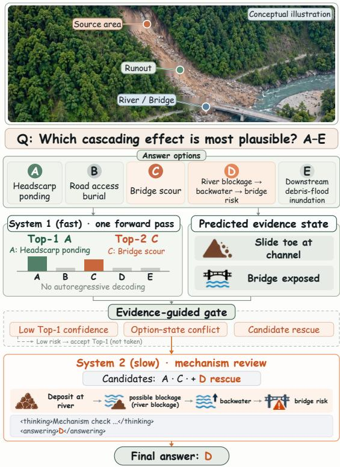
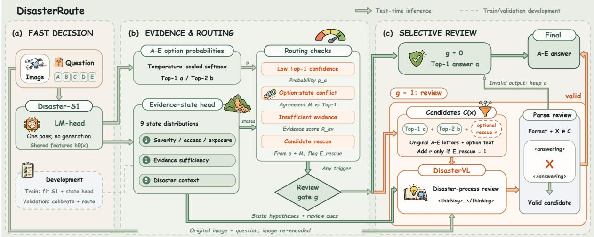
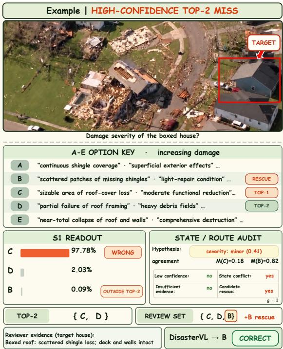

# DisasterRoute: Evidence-Guided Dual-System Routing for Visual Disaster Question Answering

Tan Zhang1 Xing Deng1 Lu Zhang2 Xiaofeng Zhu3 Ping Hu1 1UESTC 2DLUT 3Hainan University

## Abstract

Visual question answering from low-altitude UAV imagery must deliver timely and accurate judgments to support disaster response under limited edge computing resources. Routine questions may be answered through direct decisions, whereas more challenging questions may benefit from step-by-step reasoning. However, existing research primarily focuses on improving models’ visual understanding and generative reasoning capabilities, with limited exploration of efficient direct decision-making and its adaptive coordination with generative reasoning. We develop Disaster-S1 based on a vision-language model adapted to the disaster domain. Trained for option discrimination, it outputs a probability distribution over answer options in a single multimodal forward pass for fast decision-making. We further propose DisasterRoute, a dual-system routing framework that combines prediction confidence with disaster evidence to decide whether to accept the initial answer or invoke the disaster reasoning model DisasterVL for review. By allocating inference computation on demand, the framework retains the efficiency of direct decision-making and improves overall question-answering accuracy through selective review. Experiments on DisasterBench show that Disaster-S1 achieves superior accuracy with low latency, while DisasterRoute further improves accuracy through selective review at substantially lower latency than full reasoning.

## 1 Introduction

Effective disaster response depends on timely and accurate situational assessments. Responders use on-site observations to identify disaster conditions, anticipate developments, and assess threats to people, infrastructure, and access routes. These judgments must promptly inform response actions, making latency important alongside accuracy. Lowaltitude unmanned aerial vehicles (UAVs) can reach hazardous or inaccessible locations and provide timely, close-range visual information. However, occlusion, viewpoint changes, and limited coverage can prevent a single image from fully capturing the hazard source, propagation path, and impact zone, leaving different judgments with different evidence (Zhang et al., 2026; Dille et al., 2026). Meanwhile, on-site applications face limited edge computing resources and tight response deadlines, while sustained costly inference adds computational and time demands (Kyrkou and Theocharides, 2020). Visual disaster question answering must therefore balance accuracy with computational and time costs.

  
Figure 1: Geological source–motion–impact cues guide selective inference in DisasterRoute. Disaster-S1 makes one-pass option decisions, while DisasterVL reviews questions with uncertain or conflicting evidence.

Multimodal large language models have extended remote-sensing and disaster analysis beyond scene recognition and description toward interactive understanding and reasoning (Kuckreja et al., 2024; Soni et al., 2025; Wang et al., 2025). DisasterBench provides visual question answering tasks spanning multiple disaster stages in lowaltitude UAV imagery, while the domain-adapted DisasterVL demonstrates lightweight models’ potential for disaster understanding and generative reasoning (Zhang et al., 2026). These advances provide domain knowledge and reasoning capabilities, but inference procedures still affect response costs. Multiple-choice questions ultimately require selecting among candidate answers. Autoregressive answering generates outputs sequentially and incurs decoding costs even with lightweight models (Leviathan et al., 2023). This motivates investigating option-discrimination training to strengthen existing disaster-domain models’ direct decisions and enable efficient answering through candidate scoring. In visual disaster question answering based on low-altitude UAV imagery, research has focused mainly on visual understanding, generative reasoning, and domain adaptation. Efficient direct decision-making and its on-demand coordination with generative analysis remain underexplored.

We argue that visual disaster question answering should coordinate fast decisions and further analysis according to question requirements and available evidence. Routine questions may not require complete step-by-step deliberation, whereas harder questions may require comparing competing explanations that an initial judgment alone cannot resolve. Drawing on the distinction between fast and slow reasoning (Evans and Stanovich, 2013; Saha et al., 2025; Sun et al., 2025), System 1 first forms an initial judgment through direct option scoring. A subsequent decision determines whether System 2 performs generative review, concentrating further reasoning on selected cases. For example, a visible deposition zone may support impact assessment while remaining insufficient to identify the initial trigger. Confidence-related signals help assess answer reliability in selective visual question answering (Whitehead et al., 2022; Dancette et al., 2023). However, a model’s preference among options does not by itself establish whether the image contains the evidence required by the question. Review selection should also consider question-specific evidence sufficiency and agreement between candidate explanations and scene state. Restricted candidate sets must also preserve opportunities to correct initial predictions by avoiding premature exclusion of the correct answer.

To this end, we build Disaster-S1 on a disasterdomain-adapted vision–language model (Zhang et al., 2026) and strengthen direct option decisions through option-discrimination training. During inference, Disaster-S1 produces a probability distribution over five options in a single multimodal forward pass, without autoregressive generation. We further propose DisasterRoute, a dual-system routing framework. After obtaining Disaster-S1’s initial decision, the framework combines prediction confidence, estimated question-specific evidence sufficiency, and option agreement with the predicted scene state to decide whether to accept the answer directly or invoke the disaster reasoning model DisasterVL for review. As the conceptual example in Figure 1 illustrates, DisasterVL compares the two highest-ranked options using the original image. When rescue conditions are met, one candidate outside the Top-2 is added to reduce the risk of omitting the correct answer. Disaster-S1 provides efficient direct decisions, while DisasterRoute improves overall accuracy through selective review. Together, they allocate computation on demand, retaining a fast path for most questions and concentrating additional analysis on selected cases to balance accuracy and response efficiency.

Our contributions are as follows:

• We develop Disaster-S1 for visual disaster question answering. Option-discrimination training strengthens direct decision-making, enabling option probability distributions from a single multimodal forward pass without autoregressive generation.

• We propose DisasterRoute, a dual-system routing framework combining prediction confidence and disaster evidence to coordinate direct decisions and on-demand generative review. Conditional candidate rescue reduces the risk of omitting the correct answer during review.

• We evaluate fast decisions and selective review on DisasterBench, examining accuracy, calibration, routing behavior, candidate coverage, and review outcomes. Latency, throughput, and GPU memory evaluations assess the benefits and resource costs of this coordination.

## 2 Related Work

## 2.1 Multimodal Disaster Understanding

Multimodal learning has extended remote-sensing analysis from specialized perception to visual– language interaction. GeoChat supports grounded dialogue and visual question answering for satellite imagery (Kuckreja et al., 2024); LHRS-Bot uses volunteered geographic information to improve domain alignment (Muhtar et al., 2025); and Earth-Dial integrates multisensory and multitemporal observations in a conversational model (Soni et al., 2025). For disaster analysis, MONITRS links temporal observations with language for event monitoring (Revankar et al., 2025), RSCC studies bitemporal change captioning (Chen et al., 2025), and DisasterM3 provides multi-hazard, multi-sensor data for damage assessment and response (Wang et al., 2025). DisasterBench further introduces lowaltitude UAV questions spanning causal attribution, hazard propagation, damage analysis, and response decisions, together with the domain-adapted DisasterVL model (Zhang et al., 2026). These works advance disaster understanding, but questions about visible impacts, initiating causes, and possible consequences can require different evidence and reasoning effort. We therefore study how to allocate computation across questions, using direct option decisions when the available evidence supports them and generative review when further exam ination is warranted.

## 2.2 Jev-Style System 1 Decisions and Selective Review

Dual-process theories distinguish fast judgments from more deliberate examination of alternatives (Evans and Stanovich, 2013). Jev adopts a System 1 decision interface that returns structured probabilities over predefined outputs without freeform generation (Almeida, 2026), and an independent evaluation has examined its performance and decision probabilities across diverse tasks (Deußer et al., 2026). Jev-style research has also extended direct decisions to visual inputs: Visual Jev shares image context across questions and reads candidate probabilities from a vision–language model’s language-model head (Yu and Yao, 2026), while PixelJev accepts an image and a runtime candidate set to produce candidate-conditioned visual decisions (Zhou et al., 2026). LLM-as-Jev instead extracts categorical decisions from next-token probabilities and studies when fine-tuning is useful (Li and Wagle, 2026). Beyond decision accuracy, JE-Val finds that general decision models can be less reliable when the available evidence is insufficient or uncertainty is poorly estimated (Duan et al., 2026). Fast–slow planning and visual-agent studies show how direct decisions can be coordinated with more deliberative computation (Saha et al., 2025; Sun et al., 2025). More directly, JEV-as-a-Judge escalates uncertain Jev verdicts to a reasoning judge (Li et al., 2026), while REFLEX uses Jev as a fast agent decision layer and calls a generative model when confidence is low or generation is required (Wu and Lim, 2026). Reliable VQA likewise indicates that softmax confidence alone may be insufficient for deciding when to trust an answer (Whitehead et al., 2022). In UAV-based disaster question answering, Disaster-S1 makes a single-pass decision over five options, and Disaster-Route combines confidence with question-specific evidence sufficiency and option–state agreement to decide whether DisasterVL should review it. Conditional candidate rescue further addresses the possibility that the correct answer falls outside the initial Top-2 review set.

## 3 Methodology

Low-altitude UAV disaster question answering requires timely decisions from visual evidence that may be incomplete or unevenly distributed across a scene. Answer options can differ in their descriptions of disaster progression, severity, access conditions, or exposed objects. Consequently, a confident option prediction need not be supported by sufficient evidence, while generating a full reasoning trace for every question incurs unnecessary latency. To address this tension, we introduce DisasterRoute, which connects fast option selection, evidence-state assessment, and selective generative review in a unified pipeline. As shown in Figure 2, Disaster-S1 first produces a five-option decision in one forward pass; an evidence-state head and routing module then determine whether that decision should be accepted or reviewed; only selected questions are sent to DisasterVL for constrained verification.

Given an image I, a question $q ,$ and five options $\mathcal { O } \ = \ \{ o _ { k } \ | \ k \ \in \ \mathcal { K } \}$ indexed by $\kappa =$ $\{ A , B , C , D , E \}$ , let $\boldsymbol { x } = ( I , q , \mathcal { O } )$ denote an input instance. The system returns an original A–E option letter $\hat { y } .$ . Disaster-S1 supplies the initial option ranking, while the evidence-state head supplies structured, fallible hypotheses about the current instance. A gate $g \in \{ 0 , 1 \}$ either accepts the leading option or invokes DisasterVL with a restricted candidate set. Model fitting and cross-fitting use training data; calibration and routing parameters are selected on validation data. All components are fixed before final testing.

  
Figure 2: Overview of DisasterRoute. (a) Disaster-S1 scores A–E in one pass. (b) Shared features support evidencestate prediction and routing using confidence, option–state agreement, evidence sufficiency, and candidate rescue. (c) Direct cases retain Top-1, while routed cases invoke DisasterVL with the original image, question, and two or three original-letter candidates. Invalid or out-of-set outputs revert to Top-1. Dashed arrows denote development-only flows.

## 3.1 System 1: Single-Pass Disaster Decision

Figure 2(a) depicts the fast decision stage. Disaster-S1 receives the image, question, and all five options. Rather than autoregressively generating an answer, it reads the logits of the five option letters at the answer position. Let $h _ { \theta } ( x )$ be the image–text hidden representation at that position, $W$ the language model output matrix, and $\nu ( k )$ the token index of letter k. The option logit is

$$
z _ { k } ( x ) = [ W h _ { \theta } ( x ) ] _ { \nu ( k ) } , \qquad k \in { \mathcal { K } } .\tag{1}
$$

During training, these five logits are normalized to obtain $\begin{array} { r } { \pi _ { k } ( x ) = \exp ( z _ { k } ( x ) ) / \sum _ { i \in \mathcal { K } } \exp ( z _ { j } ( x ) ) } \end{array}$ For labeled training examples $\{ ( x _ { i } , y _ { i } ) \} _ { i = 1 } ^ { N } ,$ Disaster-S1 minimizes the five-way cross-entropy

$$
\mathcal { L } _ { \mathrm { S 1 } } = - \frac { 1 } { N } \sum _ { i = 1 } ^ { N } \log \pi _ { y _ { i } } ( x _ { i } ) .\tag{2}
$$

At inference, a temperature $T > 0$ selected on validation data yields the option probabilities used for routing:

$$
p _ { k } ( x ) = \frac { \exp ( z _ { k } ( x ) / T ) } { \sum _ { j \in \mathcal { K } } \exp ( z _ { j } ( x ) / T ) } .\tag{3}
$$

Let a and b denote the highest- and second-highestranked options. Temperature scaling preserves their ranking. Option a is the initial answer, $( a , b )$ forms the basic review candidate set, and $p _ { a } \ p \mathrm { r } 0 \cdot$ vides a confidence signal. The same forward pass also supplies $h _ { \theta } ( x )$ to the evidence-state head; state prediction does not require another invocation of the vision–language backbone.

## 3.2 Cross-Fitted Evidence States and Routing

Figure 2(b) combines the initial option distribution with nine evidence-state fields: hazard type, motion pattern, spatial evidence, trigger visibility, secondary hazard, exposed object, severity stage, access state, and evidence sufficiency. Severity, access, and exposure can be compared with option text; evidence sufficiency indicates whether the available observations support the judgment requested by the question. The remaining fields provide disaster-context cues for subsequent review. State outputs are hypotheses that may be incorrect, rather than verified observations.

The evidence-state head $E _ { \eta }$ reads the answerposition representation $h _ { \theta } ( x )$ . A shared transformation produces $u ( x )$ , and a field-specific classifier outputs a distribution over the legal classes $\mathcal { V } _ { f }$ of each field $f \colon$

$$
\begin{array} { r l } & { \qquad u ( x ) = f _ { \eta } ( h _ { \theta } ( x ) ) , } \\ & { P _ { \eta , f } ( v \mid x ) = \operatorname { s o f t m a x } ( W _ { f } u ( x ) + b _ { f } ) _ { v } , } \\ & { \qquad v \in \mathcal { V } _ { f } . } \end{array}\tag{4}
$$

Thus, the head returns nine separate categorical distributions, not one probability per field. For each field, its predicted label and associated confidence are

$$
\begin{array} { r l } & { s _ { f } = \underset { v \in \mathcal { V } _ { f } } { \arg \operatorname* { m a x } } P _ { \eta , f } ( v \mid x ) , } \\ & { c _ { f } = \underset { v \in \mathcal { V } _ { f } } { \arg \operatorname* { m a x } } P _ { \eta , f } ( v \mid x ) . } \end{array}\tag{5}
$$

Supervision targets $\tilde { \bf s } _ { i }$ are constructed only for training examples from training-split disaster annotations, image–question evidence annotations, and predefined option-semantic rules. A training answer may be used to construct a supervision target, but is never supplied as an input to the state head at inference. In particular, evidence-sufficiency targets characterize whether the image supports the requested judgment; they are not defined merely by whether another model answered the question correctly. The state head minimizes

$$
\begin{array} { r l } & { \mathcal { L } _ { \mathrm { s t a t e } } ( \eta ) } \\ & { \quad = \frac { 1 } { N } \displaystyle \sum _ { i = 1 } ^ { N } \displaystyle \sum _ { f \in \mathcal { F } _ { \mathrm { s t a t e } } } \lambda _ { f } \mathrm { C E } ( P _ { \eta , f } ( \cdot \mid x _ { i } ) , \tilde { s } _ { i , f } ) , } \end{array}\tag{6}
$$

where $\mathcal { F } _ { \mathrm { s t a t e } }$ contains the nine fields and $\lambda _ { f }$ controls the contribution of each field.

To obtain out-of-fold state predictions on the training split, we partition its source images into K folds, keeping all questions associated with the same image in one fold. For fold t, a state head $E _ { \eta ^ { ( - t ) } }$ is trained using the other $K - 1$ folds and predicts the held-out fold:

$$
\begin{array} { r } { \widehat { \mathbf { s } } _ { i } ^ { \mathrm { O O F } } = E _ { \eta ^ { ( - t ) } } \big ( h _ { \theta } ( x _ { i } ) \big ) , \qquad x _ { i } \in \mathcal { D } _ { t } . } \end{array}\tag{7}
$$

Each training example therefore receives a state prediction from a head that was not trained on that example’s state labels. These out-of-fold predictions support development and assessment of statedependent routing signals without relying on the head’s in-sample predictions. After the configuration is fixed, a final head $E _ { \eta ^ { \star } }$ is fitted on the complete training split and used for both validation and test inference. Validation data determine the calibration and routing parameters; test labels do not participate in state prediction or route construction.

Routing first compares the predicted state with each answer option. Let $\mathcal { F } _ { \mathrm { c m p } } = \{ \mathrm { s e v } , \mathrm { a c c } , \mathrm { e x p } \}$ denote severity, access, and exposure, and let $\psi _ { f } ( o _ { k } )$ extract the corresponding attribute from option $o _ { k }$ . The match value $m _ { f } ( k )$ is 1 for agreement,

0 for disagreement, and $1 / 2$ if the option does not specify that attribute. With field weight $w _ { f }$ and confidence floor $\epsilon > 0$ , option–state agreement is

$$
\begin{array} { r l } & { \omega _ { f } = w _ { f } \operatorname* { m a x } ( c _ { f } , \epsilon ) , } \\ & { M _ { k } = \frac { \sum _ { f \in \mathcal { F } _ { \mathrm { c m p } } } \omega _ { f } m _ { f } ( k ) } { \sum _ { f \in \mathcal { F } _ { \mathrm { c m p } } } \omega _ { f } } . } \end{array}\tag{8}
$$

The neutral match value prevents an unspecified attribute from being treated as an explicit contradiction. $M _ { k }$ measures compatibility with the selected state fields, not the correctness of a complete disaster-process explanation.

To combine initial option ranking with state agreement, we compute

$$
U _ { k } = ( 1 - \alpha ) M _ { k } + \alpha p _ { k } , \qquad 0 \leq \alpha \leq 1 .\tag{9}
$$

Let $k _ { M } \ = \ \arg \operatorname* { m a x } _ { k \in \mathcal { K } } M _ { k }$ . If $k _ { M } \ \ne \ a$ and $M _ { k _ { M } } \ge M _ { a } + \delta _ { v }$ , another option agrees substantially more strongly with the predicted state than the initial answer. The evidence-sufficiency distribution additionally gives

$$
\begin{array} { r l } & { R _ { \mathrm { e v } } = P _ { \eta ^ { \star } , \mathrm { s u f } } ( \mathrm { i n s u f f i c i e n t } \mid x ) } \\ & { ~ + \frac { 1 } { 2 } P _ { \eta ^ { \star } , \mathrm { s u f } } ( \mathrm { n e e d s r e v i e w } \mid x ) . } \end{array}\tag{10}
$$

This quantity concerns whether the available evidence supports the requested judgment; it is not a measure of physical disaster loss.

The highest-supported option outside the initial Top-2 is

$$
r = \arg \operatorname* { m a x } _ { k \in \mathcal { K } \backslash \{ a , b \} } U _ { k } .\tag{11}
$$

A rescue candidate is activated only when $r$ has sufficient combined support relative to b and substantially stronger state agreement than a:

$$
E _ { \mathrm { r e s c u e } } = \mathbb { I } [ U _ { r } \geq U _ { b } + \delta _ { r } \ \wedge \ M _ { r } \geq M _ { a } + \delta _ { m } ] .\tag{12}
$$

The review gate combines low Top-1 confidence, option–state conflict, insufficient evidence, and candidate rescue:

$$
\begin{array} { r l } & { g = \mathbb { I } \big [ p _ { a } < \tau _ { p } } \\ & { \qquad \vee \left( k _ { M } \neq a \wedge M _ { k _ { M } } \ge M _ { a } + \delta _ { v } \right) } \\ & { \qquad \vee R _ { \mathrm { e v } } \ge \tau _ { \mathrm { e v } } } \\ & { \qquad \vee E _ { \mathrm { r e s c u e } } = 1 \big ] . } \end{array}\tag{13}
$$

All thresholds and margins are selected on validation data. When $g = 0$ , DisasterRoute accepts a directly; when $g = 1$ , it proceeds to selective review.

## 3.3 Constrained Selective Review

Figure 2(c) shows the review branch. Requesting review and expanding its candidate set are separate decisions. For a routed example, the candidate set is

$$
\mathcal { C } ( x ) = \left\{ \begin{array} { l l } { \{ a , b , r \} , } & { E _ { \mathrm { r e s c u e } } = 1 , } \\ { \{ a , b \} , } & { E _ { \mathrm { r e s c u e } } = 0 . } \end{array} \right.\tag{14}
$$

Candidates retain their original A–E letters and option texts; they are never renumbered. DisasterVL receives the original image, question, and options in $\mathcal C ( x )$ , and independently re-encodes the image. Predicted disaster-context fields, disputed option attributes, and routing reasons are provided as cues to verify against the image. When relevant, the reviewer examines the source or trigger, motion or propagation, impact, and exposed objects, rather than assuming that the state-head predictions are facts.

The reviewer produces a reasoning span in <thinking>...</thinking> and one original option letter in <answering>...</answering>. Let $\widetilde { y } = \Pi ( D _ { \phi } ( I , q , \mathcal { C } ( x ) , \widehat { \mathbf { s } } ) )$ be the answer returned by a strict parser Π. The final decision is

$$
\hat { y } = \left\{ \begin{array} { l l } { \widetilde { y } , } & { g = 1 \mathrm { a n d } \widetilde { y } \in \mathcal { C } ( x ) , } \\ { a , } & { \mathrm { o t h e r w i s e } . } \end{array} \right.\tag{15}
$$

Thus, unreviewed examples return the System 1 prediction, while invalid or out-of-set review outputs fall back to the same prediction. The parser enforces output format and candidate membership; it does not guarantee that a well-formed rationale is factually correct.

Let $T _ { \mathrm { S 1 } } , T _ { \mathrm { s t a t e } } , T _ { \mathrm { g a t e } } ,$ , and $T _ { \mathrm { r e v i e w } }$ denote the respective computational costs. Per-example inference time can be summarized as

$$
T ( x ) \approx T _ { \mathrm { S 1 } } + T _ { \mathrm { s t a t e } } + T _ { \mathrm { g a t e } } + g T _ { \mathrm { r e v i e w } } .\tag{16}
$$

The state head reuses the System 1 representation, whereas generative review is incurred only for routed examples. Reviewed examples nevertheless require image re-encoding and autoregressive decoding, and may therefore dominate mean and tail latency.

## 4 Experiments

## 4.1 Experimental Setup

Dataset and Evaluation Protocol. We conduct experiments on DisasterBench, a benchmark for visual disaster question answering using low-altitude

UAV imagery that covers hazard causation, propagation, impact, and response. The test split contains 2,998 image–question pairs, each with five A–E options. Disaster-S1 and the evidence-state head are fitted on the training split, while temperature scaling, routing parameters, and the standalone risk selector are fitted or selected using the validation split. All settings are fixed before testing, and test labels are used only for final evaluation. All evaluation protocols start from the same images, questions, and original options. Calibration and standalone risk-selection diagnostics are reported separately from the results of the complete DisasterRoute framework.

Implementation Details. Disaster-S1 is trained using language-side LoRA and five-way crossentropy, with the vision encoder kept frozen, while the DisasterVL reviewer uses a fixed checkpoint. The main comparison uses NVIDIA L40S GPUs, BF16 precision, SDPA attention, and batch-sizeone inference. Timing includes image decoding, preprocessing, model inference, routing, and answer parsing, but excludes model loading and warm-up. The main comparison is repeated three times, reporting mean latency and the standard deviation of run means. P50 and P95 are computed from pooled per-question latencies, while each general-purpose vision–language model baseline is evaluated in a single run. DisasterRoute’s peak GPU memory measurement includes both resident models. Since model-sharding configurations may differ across runs, latency comparisons are not strictly paired.

Evaluation Metrics. We measure questionanswering performance using accuracy (Acc.), with ∆Acc. denoting the percentage-point difference from DVL-AO. Expected calibration error (ECE) and error-detection AUROC assess probability calibration and the ability of risk scores to identify initial prediction errors, respectively. For routing, routing rate (RR) is the fraction of questions selected, routed error rate (RER) is the initial error fraction within the selected subset, and directaccept accuracy (DAA) measures accuracy on the unselected subset. For review, Calls and generative call rate (GCR) report the number of generative invocations and the fraction of questions requiring generation, respectively. Candidate coverage (CC) measures the fraction of reviewed questions whose candidate sets contain the correct answer, while Chg./Corr. records the numbers of changed predictions and corrected initial errors, respectively. Computational efficiency is assessed using mean latency, P50/P95 latency, throughput, speedup, and peak GPU memory. Throughput is the reciprocal of mean latency in seconds under serial inference, and speedup is the ratio of DVL-AO’s mean latency to that of the evaluated method.

<table><tr><td>Method</td><td>Correct / Total</td><td>Acc. (%)↑</td><td>∆Acc. (pp)</td><td>Calls ↓</td><td>GCR (%)↓</td><td>CC (%)↑</td><td>Mean Lat. (ms) ↓</td><td>P50 (ms) ↓</td><td>P95 (ms) ↓</td><td>Throughput (sample/s) ↑ Speedup ↑</td><td></td><td>Peak Mem. (GiB)↓</td></tr><tr><td>DVL-AO</td><td>2167 / 2998</td><td>72.28</td><td>一</td><td>2998</td><td>100.00</td><td>一</td><td> $2 7 8 . 6 9 \pm 4 . 5 3$ </td><td>184.35</td><td>258.02</td><td>3.59</td><td>1.00×</td><td>4.40</td></tr><tr><td>DVL-AO-S</td><td>2137 / 2998</td><td>71.28</td><td>-1.00</td><td>2998</td><td>100.00</td><td></td><td> $2 0 4 . 3 7 \pm 2 . 8 4$ </td><td>184.41</td><td>259.26</td><td>4.89</td><td>1.36×</td><td>4.40</td></tr><tr><td>DVL-FR</td><td>1515 / 2998</td><td>50.53</td><td>-21.75</td><td>2998</td><td>100.00</td><td></td><td> $3 9 1 5 . 2 4 \pm 2 1 . 0 7$ </td><td>3954.11</td><td>5352.40</td><td>0.26</td><td>0.07×</td><td>4.43</td></tr><tr><td>DVL-FR-S</td><td>1288/2998</td><td>42.96</td><td>-29.32</td><td>2998</td><td>100.00</td><td>一</td><td> $3 7 4 4 . 0 6 \pm 1 2 . 7 5$ </td><td>3900.39</td><td>5291.31</td><td>0.27</td><td>0.07×</td><td>4.43</td></tr><tr><td>DVL-Logit</td><td>2166 / 2998</td><td>72.25</td><td>-0.03</td><td>0</td><td>0.00</td><td></td><td> $1 4 9 . 4 7 \pm 1 . 4 4$ </td><td>144.20</td><td>198.73</td><td>6.69</td><td>1.86×</td><td>4.38</td></tr><tr><td>S1-Direct</td><td>2332 /2998</td><td>77.79</td><td>+5.50</td><td>0</td><td>0.00</td><td></td><td> $1 5 0 . 0 5 \pm 1 . 9 1$ </td><td>144.45</td><td>199.49</td><td>6.66</td><td>1.86×</td><td>4.37</td></tr><tr><td>DisasterRoute</td><td>2471 / 2998</td><td>82.42</td><td>+10.14</td><td>710</td><td>23.68</td><td>93.52</td><td> $1 2 1 5 . 0 1 \pm 1 4 . 2 1$ </td><td>141.21</td><td>5634.79</td><td>0.82</td><td>0.23×</td><td>8.55</td></tr></table>

Table 1: Accuracy and inference efficiency on the DisasterBench test set. DVL-AO and DVL-AO-S use answer-only generation, while DVL-FR and DVL-FR-S generate reasoning and an answer. DVL-Logit reads DisasterVL’s A–E option logits, whereas S1-Direct evaluates Disaster-S1 without routing or review; neither generates an answer sequence. DisasterRoute selectively invokes DisasterVL for System 2 review. Calls denotes the number of generative invocations, GCR denotes the fraction of questions requiring generation, and CC measures correct-answer coverage among reviewed candidate sets. ∆Acc. and Speedup are relative to DVL-AO. Latency is measured with batch size one, and ± denotes the standard deviation of run means across three runs.

## 4.2 Results and Analysis

Main Comparison. Table 1 compares answeronly generation (DVL-AO and DVL-AO-S), fullreasoning generation (DVL-FR and DVL-FR-S), direct option readout (DVL-Logit and S1-Direct), and the complete DisasterRoute framework. The -S variants use shortened generation settings. DVL-Logit reads DisasterVL’s A–E logits without decoding, whereas S1-Direct applies the same readout to Disaster-S1 without routing or review. The two direct protocols have similar mean latency (149.47 and 150.05 ms) but achieve 72.25% and 77.79% accuracy, respectively. This 5.54- percentage-point improvement supports the benefit of option-discrimination training for direct decisions. S1-Direct also exceeds DVL-AO’s 72.28% accuracy without autoregressive generation. The shortened generation variants reduce mean latency but also lower accuracy. Since prompts, generation limits, and output constraints differ across protocols, these comparisons do not isolate the effect of reasoning length.

DisasterRoute achieves 82.42% accuracy, with 2,471 correct answers, compared with 2,332 for S1-Direct. This corresponds to a net gain of 139 correct answers, or 4.64 percentage points, and a 10.14-point improvement over DVL-AO. It invokes DisasterVL for 710 questions (23.68% GCR), allowing the remaining 76.32% to avoid generation; candidate coverage among reviewed questions is 93.52%. Mean latency is 1215.01 ms, approximately 69% lower than DVL-FR’s 3915.24 ms, although P95 is slightly higher (5634.79 vs. 5352.40 ms). The complete framework remains slower on average than S1-Direct and increases peak GPU memory from 4.37 to 8.55 GiB. Consistent with Eq. (16), routed questions still require image re-encoding and autoregressive review, while both models remain resident. Selective review therefore improves accuracy and reduces mean latency relative to uniform full reasoning, while retaining additional latency and memory costs relative to direct inference.

Disaster-S1 Calibration and Risk Selection. Table 2 evaluates confidence calibration and standalone risk selection for Disaster-S1. Raw+LC selects questions with low uncalibrated Top-1 confidence, while TS+LC applies temperature scaling before selection. TS+RS instead uses a fitted risk selector with disaster-consequence weighting. For TS+RS, weighting affects selection, whereas AU-ROC evaluates the underlying error score before weighting. These configurations use validationselected operating points and are evaluated separately from the complete DisasterRoute gate in Table 3. The standalone LC thresholds are also selected independently of the LC threshold used by

<table><tr><td colspan="2">Calibration</td><td colspan="2">Risk Selection</td></tr><tr><td>Config.</td><td>ECE ↓</td><td>AUROC ↑</td><td>RR RER DAA (%)↓ (%)↑ (%)↑</td></tr><tr><td>Raw+LC</td><td>0.16</td><td>0.8362</td><td>13.61 71.08 85.48</td></tr><tr><td>TS+LC</td><td>0.03</td><td>0.8348</td><td>14.74 72.40 86.46</td></tr><tr><td>TS+RS</td><td>0.03</td><td>0.8453 10.51</td><td>76.19 84.12</td></tr></table>

Table 2: Confidence calibration and standalone risk selection for Disaster-S1. Thresholds are selected on validation data. For TS+RS, AUROC evaluates the error score before disaster-consequence weighting, while RR, RER, and DAA describe the resulting selection. These diagnostics are separate from the complete DisasterRoute gate.
<table><tr><td colspan="2">Triggered Subset</td><td colspan="2">Routing Quality</td></tr><tr><td>Trigger</td><td>Samples</td><td>RER (%) ↑</td><td>CC (%) ↑</td></tr><tr><td>LC</td><td>380</td><td>75.00</td><td>92.63</td></tr><tr><td>OSC</td><td>334</td><td>100.00</td><td>97.31</td></tr><tr><td>IE</td><td>122</td><td>91.80</td><td>90.16</td></tr><tr><td>CR</td><td>294</td><td>100.00</td><td>89.12</td></tr></table>

Table 3: Evidence-guided routing triggers in Disaster-Route. LC, OSC, IE, and CR denote low confidence, option–state conflict, insufficient evidence, and candidate rescue, respectively. RER measures the initial error rate within each triggered subset, while CC measures correct-answer coverage in the corresponding review candidate sets. Triggered subsets may overlap.

## that gate.

Temperature scaling reduces ECE from 0.16 to 0.03, while AUROC changes from 0.8362 to 0.8348, indicating that improved calibration does not necessarily improve error ranking. TS+LC achieves the highest DAA (86.46%) at a routing rate of 14.74%, with 72.40% RER. TS+RS achieves the highest AUROC (0.8453) and RER (76.19%) while selecting 10.51% of questions, with 84.12% DAA. It therefore selects a smaller subset with greater initial error concentration, whereas TS+LC selects more initially incorrect questions in absolute terms. These results characterize different operating points rather than establish superiority at an equal review budget.

Evidence-Guided Routing. Table 3 reports the four routing triggers in DisasterRoute: low confidence (LC), option–state conflict (OSC), insufficient evidence (IE), and candidate rescue (CR). CR corresponds to $E _ { \mathrm { r e s c u e } } = 1$ , which triggers review and adds a candidate outside the initial Top-2 when the combined-support and state-agreement conditions are satisfied. LC flags 380 questions with 75.00% RER, while IE flags 122 with 91.80% RER. OSC and CR both attain 100.00% RER, but their candidate coverage differs (97.31% vs. 89.12%), showing that concentrating initial errors does not guarantee retaining the correct answer for review. The 294 CR cases constitute the Top-2+R branch in Table 4. Since multiple conditions can trigger for the same question, the subsets overlap, and their union comprises the 710 questions sent to DisasterVL for review.

<table><tr><td></td><td></td><td>Candidate Set</td><td colspan="2">Review</td></tr><tr><td>Branch</td><td>Samples</td><td>CC (%) ↑</td><td>Chg./ Corr.</td><td>Final Acc. (%)</td></tr><tr><td>Direct</td><td>2288</td><td></td><td></td><td>97.77</td></tr><tr><td>Top-2</td><td>416</td><td>96.63</td><td>129 / 124</td><td>51.68</td></tr><tr><td>Top-2+R</td><td>294</td><td>89.12</td><td>28 / 19</td><td>6.46</td></tr><tr><td>All reviewed</td><td>710</td><td>93.52</td><td>157 / 143</td><td>32.96</td></tr></table>

Table 4: Direct acceptance and constrained candidate review in DisasterRoute. Top-2+R adds one rescue candidate outside the initial Top-2 when $E _ { \mathrm { r e s c u e } } = 1$ CC denotes candidate coverage; Chg./Corr. counts changed predictions and corrected initial errors relative to Disaster-S1. Final accuracy is computed within each subset.

Constrained Candidate Review. Table 4 breaks down DisasterRoute into direct acceptance and two candidate-review branches: Top-2 and Top-2+R. The 2,288 directly accepted questions achieve 97.77% accuracy. For the 710 questions routed to DisasterVL, candidate coverage reaches 93.52%, while final accuracy is 32.96%. Review changes 157 initial predictions and corrects 143 initial errors, yielding a net gain of 139 correct answers over S1-Direct and an overall accuracy of 82.42%. The reviewed questions form a selectively routed subset in which the gate concentrates initial prediction errors.

The Top-2 branch reviews 416 questions using the two highest-scoring Disaster-S1 options, achieving 96.63% CC and 51.68% final accuracy, with 129 changed predictions and 124 corrected errors. When $E _ { \mathrm { r e s c u e } } = 1$ , the Top-2+R branch adds one rescue candidate outside the initial Top-2. This branch contains 294 questions and achieves 89.12% CC and 6.46% final accuracy, with 28 changed predictions and 19 corrected errors. Since the two branches contain different selectively routed questions, their accuracy difference does not measure the causal effect of adding a rescue candidate. The gap between candidate coverage and final accuracy further shows that retaining the correct answer in the candidate set is insufficient to ensure successful review.

<table><tr><td>Method</td><td>Acc. (%)↑</td><td>GCR (%)↓</td><td>Mean Lat. (s) ↓</td><td>P95 (s) ↓</td></tr><tr><td>InternVL3.5-1B</td><td>32.92</td><td>100.00</td><td>4.23</td><td>6.41</td></tr><tr><td>InternVL3.5-2B</td><td>55.34</td><td>100.00</td><td>6.29</td><td>17.21</td></tr><tr><td>Qwen2.5-VL-3B</td><td>46.00</td><td>100.00</td><td>5.27</td><td>9.65</td></tr><tr><td>DVL-FR</td><td>50.53</td><td>100.00</td><td>3.92</td><td>5.35</td></tr><tr><td>S1-Direct</td><td>77.79</td><td>0.00</td><td>0.15</td><td>0.20</td></tr><tr><td>DisasterRoute</td><td>82.42</td><td>23.68</td><td>1.22</td><td>5.63</td></tr></table>

Table 5: Comparison with general-purpose VLMs on DisasterBench. The three general-purpose baselines and DVL-FR generate reasoning and an answer for every question. GCR denotes the percentage of questions requiring autoregressive generation. Each generalpurpose baseline is evaluated in one run; DVL-FR, S1- Direct, and DisasterRoute results are taken from the three-run main comparison.

Comparison with General-Purpose VLMs. Table 5 compares three general-purpose VLMs evaluated with reasoning and answer generation against DVL-FR, S1-Direct, and DisasterRoute. Among the three general-purpose baselines, InternVL3.5- 2B achieves the highest accuracy of 55.34%, with a mean latency of 6.29 s. S1-Direct achieves 77.79% accuracy at 0.15 s without autoregressive generation, while DisasterRoute reaches 82.42% at 1.22 s, invoking DisasterVL for review on 23.68% of questions. DVL-FR, which generates reasoning and an answer for every question, achieves 50.53% accuracy at 3.92 s. DisasterRoute has a lower mean latency than DVL-FR, although its P95 latency is slightly higher (5.63 vs. 5.35 s), indicating that selective review still incurs substantial tail latency. The three general-purpose baselines are each evaluated in one run, while the remaining results come from the three-run main comparison. These latency comparisons are descriptive and do not constitute strictly paired measurements.

Illustrative Candidate Rescue. Figure 3 illustrates a high-confidence initial error and omission of the correct answer from the Top-2 candidates through a damage-severity assessment of the boxed house. Disaster-S1 assigns 97.78% probability to

  
Figure 3: Schematic illustration of candidate rescue. The top panel shows the target house and summaries of options A–E; the lower panels sequentially present Disaster-S1’s option probabilities, state and routing checks, the candidate set expansion from {C, D} to {C, D, B}, and DisasterVL’s review of the target house.

C, while the evidence-state head predicts minor damage with a highest class probability of 0.41; the option–state agreement score for C is only 0.18. Thus, the option–state conflict triggers review even though the low-confidence condition is inactive. The initial Top-2 set {C, D} excludes the correct option B, which is subsequently added through candidate rescue. DisasterVL then re-examines the boxed house using the candidate set {C, D, B}: scattered shingle loss, together with an intact roof deck and walls, supports the final selection of B. This example illustrates the distinct roles of conflict-triggered review, candidate rescue in expanding the available choices, and visual review in making the final judgment.

## 5 Conclusion

We presented DisasterRoute, an evidence-guided dual-system framework for UAV-based visual disaster question answering. Its fast decision model, Disaster-S1, is trained for option discrimination and produces five-option probabilities in a single multimodal forward pass without autoregressive generation. DisasterRoute combines prediction confidence, question-specific evidence sufficiency, and option–state agreement to select questions for generative review by DisasterVL, with conditional candidate rescue expanding the review set beyond the initial Top-2. On DisasterBench, option-discrimination training improves direct decision accuracy, and selective review further raises accuracy from 77.79% to 82.42% while invoking generation for 23.68% of questions. The framework reduces mean latency by approximately 69% relative to applying DisasterVL’s full reasoning to every question, although it incurs additional latency and memory costs over direct inference. High candidate coverage does not ensure successful review, and tail latency remains a limitation. These findings support selective coordination of direct decisions and generative review for disaster question answering. Future work will improve evidence estimation and candidate comparison, reduce review costs, and evaluate generalization across disaster settings.

## References

Diogo Almeida. 2026. Introducing system one models & Jev. TypeSafe AI Blog.

Zhenyuan Chen, Chenxi Wang, Ningyu Zhang, and Feng Zhang. 2025. RSCC: A large-scale remote sensing change caption dataset for disaster events. In Advances in Neural Information Processing Systems, volume 38.

Corentin Dancette, Spencer Whitehead, Rishabh Maheshwary, Ramakrishna Vedantam, Stefan Scherer, Xinlei Chen, Matthieu Cord, and Marcus Rohrbach. 2023. Improving selective visual question answering by learning from your peers. In Proceedings of the IEEE/CVF Conference on Computer Vision and Pattern Recognition, pages 24049–24059.

Tobias Deußer, Lorenz Sparrenberg, and Rafet Sifa. 2026. Evaluating and benchmarking the system one model Jev. Preprint, arXiv:2609.37647.

Antoine Dille, Olivier Dewitte, Jente Broeckx, Koen Verbist, Andile Sindiso Dube, Jean Poesen, and Matthias Vanmaercke. 2026. Capturing the complete landslide–debris-rich flood continuum for accurate inventory, susceptibility and exposure mapping – lessons from cyclone idai. Natural Hazards and Earth System Sciences, 26:2561–2577.

Feiyu Duan, Jiayu Lin, Jia Wang, Jun Xiang, Jialiang Wu, Xinnong Zhang, Hanqi Yan, Siyuan Wang, and Zhongyu Wei. 2026. General decision models: Benchmarking and insights beyond Jev. Preprint, arXiv:2610.03935.

Jonathan St. B. T. Evans and Keith E. Stanovich. 2013. Dual-process theories of higher cognition: Advancing the debate. Perspectives on Psychological Science, 8(3):223–241.

Kartik Kuckreja, Muhammad Sohail Danish, Muzammal Naseer, Abhijit Das, Salman Khan, and Fahad Shahbaz Khan. 2024. GeoChat: Grounded large vision-language model for remote sensing. In Proceedings ofthe IEEE/CVF Conference on Computer Vision and Pattern Recognition, pages 27831–27840.

Christos Kyrkou and Theocharis Theocharides. 2020. EmergencyNet: Efficient aerial image classification for drone-based emergency monitoring using atrous convolutional feature fusion. IEEE Journal of Selected Topics in Applied Earth Observations and Remote Sensing, 13:1687–1699.

Yaniv Leviathan, Matan Kalman, and Yossi Matias. 2023. Fast inference from transformers via speculative decoding. In Proceedings of the 40th International Conference on Machine Learning, volume 202 of Proceedings ofMachine Learning Research, pages 19274–19286. PMLR.

Yinheng Li and Justin Wagle. 2026. LLM-as-Jev: LLMs are already Jev-style decision models – when and how to fine-tune them. Preprint, arXiv:2610.02076.

Yubo Li, Yidi Miao, Ramayya Krishnan, and Rema Padman. 2026. JEV-as-a-judge: Accept when confident, escalate when unsure. Preprint, arXiv:2609.26550.

Dilxat Muhtar, Zhenshi Li, Feng Gu, Xueliang Zhang, and Pengfeng Xiao. 2025. LHRS-Bot: Empowering remote sensing with VGI-enhanced large multimodal language model. In Computer Vision – ECCV 2024, volume 15132 of Lecture Notes in Computer Science, pages 440–457. Springer.

Shreelekha Revankar, Utkarsh Mall, Cheng Perng Phoo, Kavita Bala, and Bharath Hariharan. 2025. MONI-TRS: Multimodal observations of natural incidents through remote sensing. In Advances in Neural Information Processing Systems, volume 38.

Swarnadeep Saha, Archiki Prasad, Justin Chen, Peter Hase, Elias Stengel-Eskin, and Mohit Bansal. 2025. System 1.x: Learning to balance fast and slow planning with language models. In International Conference on Learning Representations.

Sagar Soni, Akshay Dudhane, Hiyam Debary, Mustansar Fiaz, Muhammad Akhtar Munir, Muhammad Sohail Danish, Paolo Fraccaro, Campbell D. Watson, Levente J. Klein, Fahad Shahbaz Khan, and Salman Khan. 2025. EarthDial: Turning multisensory earth observations to interactive dialogues. In Proceedings of the IEEE/CVF Conference on Computer Vision and Pattern Recognition, pages 14303– 14313.

Guangyan Sun, Mingyu Jin, Zhenting Wang, Chenglong Wang, Siqi Ma, Qifan Wang, Tong Geng, Yingnian

Wu, Yongfeng Zhang, and Dongfang Liu. 2025. Visual agents as fast and slow thinkers. In International Conference on Learning Representations.

Junjue Wang, Weihao Xuan, Heli Qi, Zhihao Liu, Kunyi Liu, Yuhan Wu, Hongruixuan Chen, Jian Song, Junshi Xia, Zhuo Zheng, and Naoto Yokoya. 2025. DisasterM3: A remote sensing vision-language dataset for disaster damage assessment and response. In Advances in Neural Information Processing Systems, volume 38.

Spencer Whitehead, Suzanne Petryk, Vedaad Shakib, Joseph E. Gonzalez, Trevor Darrell, Anna Rohrbach, and Marcus Rohrbach. 2022. Reliable visual question answering: Abstain rather than answer incorrectly. In Computer Vision – ECCV 2022, volume 13696 of Lecture Notes in Computer Science, pages 148–166. Springer.

Tiantong Wu and Wei Yang Bryan Lim. 2026. REFLEX with Jev for efficient selective control in LLM agents. Preprint, arXiv:2609.26532.

Guanxu Yu and Yuhang Yao. 2026. Visual Jev: Accurate and efficient decisions from shared visual context. Preprint, arXiv:2609.25845.

Tan Zhang, Quanyou Li, Lu Zhang, Jun Liu, Xiaofeng Zhu, and Ping Hu. 2026. DisasterBench: A multi modal benchmark for UAV-based disaster response in complex environments. Preprint, arXiv:2606.06217.

Xunlan Zhou, Xianliang Yang, and Li Zhao. 2026. From text decisions to pixels: An study of Jev-style visual choice model. Preprint, arXiv:2609.29283.