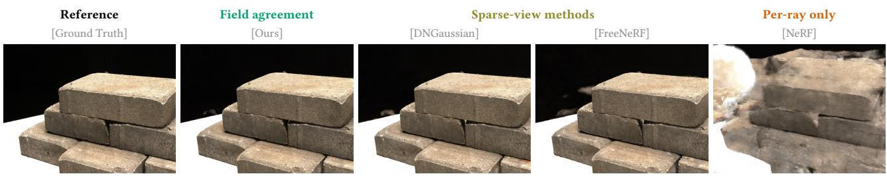
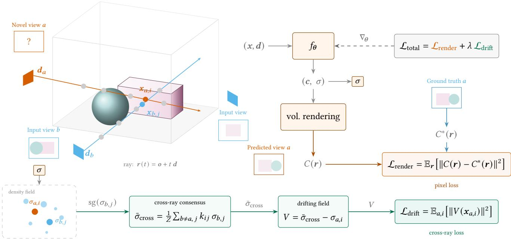
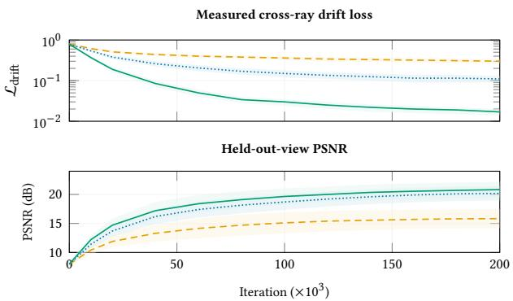
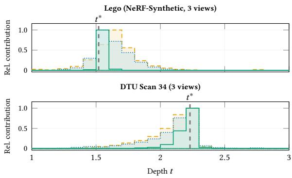
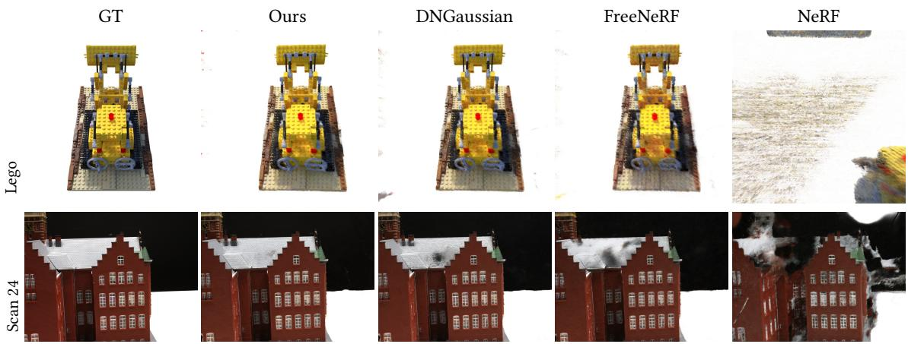
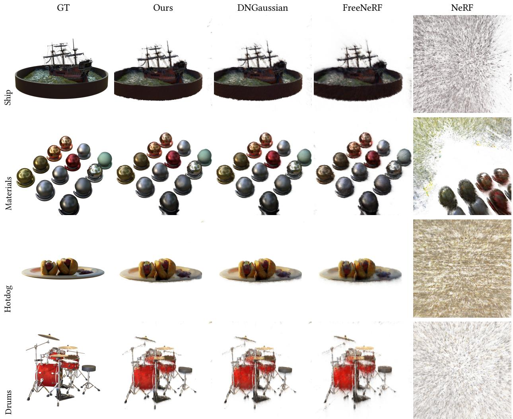

# DriftNeRF: Cross-Ray Density Drifting for Sparse-View Neural Radiance Fields

Juntang Wang Harvard University Cambridge, USA

Hao Wu Duke Kunshan University Kunshan, China

Yihan Wang Duke University Durham, USA

Dongmian Zou Duke Kunshan University Kunshan, China

Sheng’en Li Duke Kunshan University Kunshan, China

Shixin Xu∗ Duke Kunshan University Kunshan, China

  
Figure 1: Novel-view synthesis from 3 training views (DTU Scan 34). NeRF’s per-ray photometric loss leaves nearby densities from diferent rays free to contradict each other, producing floaters and haze. Sparse-view methods (DNGaussian, FreeNeRF) reduce these artifacts but do not eliminate them. DriftNeRF (ours) enforces local field agreement across rays, suppressing floaters where cross-ray support is absent.

## Abstract

Neural Radiance Fields (NeRF) synthesize photorealistic novel views from dense image collections, but degrade sharply when few views are available. We attribute a specific, measurable defect to the objective itself: the rendering loss is a sum over independent rays and contains no term comparing densities that diferent rays assign to the same region of space, so nearby 3D points can settle on contradictory densities while every training pixel is reproduced correctly. We make this quantity explicit by measuring cross-ray density disagreement directly during training, and show that it stays high in vanilla NeRF, falls only incidentally under frequencybased regularization, and moves together with held-out quality in the sparse regime. We then close the gap with DriftNeRF, a drop-in regularizer that instantiates the drifting-field template on density samples: a masked exponential kernel aggregates densities from nearby points on other rays into a stop-gradient consensus target, and the resulting drifting field penalizes unsupported disagreement while leaving agreed-upon boundaries intact. The regularizer reads only sampled positions, ray identifiers, and predicted den sities, so it requires no pretrained model, external geometry, or additional images, and transfers across field parameterizations. On NeRF-Synthetic it reduces residual disagreement by an order of magnitude, and across NeRF-Synthetic, DTU, and LLFF it improves 3-view PSNR over the strongest MLP-NeRF baseline by 0.42–0.65 dB and remains competitive with sparse-view Gaussian pipelines under a matched protocol without their depth, flow, or covisibility preprocessing.

## Keywords

neural radiance fields, sparse-view 3D reconstruction, novel view synthesis, cross-ray consistency, drifting models, volume rendering, floater suppression

## 1 Introduction

Synthesizing novel views of a 3D scene from photographs is a long-standing goal in computer vision and graphics [7, 21], with applications spanning robotics, augmented reality, and content creation. Neural Radiance Fields (NeRF) [28] have transformed this task by optimizing a volumetric scene representation from posed images via diferentiable volume rendering [26], achieving photorealistic quality that has driven rapid progress across neural rendering [34]. When view coverage is dense, this per-scene optimization works remarkably well; with only a handful of input images, however, quality degrades sharply. This sparse-input regime is common in practice, making it an active area of research [30, 42].

The core issue is that NeRF’s photometric loss supervises each ray independently. With dense views, nearby 3D points are observed from many directions and the overdetermined system implicitly enforces density consistency. With few views, however, each ray’s rendering equation can be satisfied on its own, allowing nearby points from diferent rays to settle on contradictory densities even when the rendered pixels match their ground-truth targets (Figure 1). These contradictions manifest as floater artifacts, spurious density concentrations that lack multi-view support. We refer to this failure mode as cross-ray density inconsistency.

Prior work addresses sparse-view reconstruction with complementary signals: semantic or generative priors [14, 39], regularization on unobserved viewpoints [30], geometric supervision [9, 36], progressive frequency schedules [42], feed-forward prediction [43], and sparse-view Gaussian representations [22, 40, 47]. These ap proaches constrain images, depth, frequency content, or explicit primitives. DriftNeRF targets a distinct signal that remains useful alongside them: local field agreement between densities predicted at nearby 3D samples from diferent rays.

We observe that cross-ray inconsistency is, at its core, a local consistency problem, and that the drifting-field framework [10] provides a natural mechanism for enforcing local agreement: a kernelweighted correction field that drives predictions toward a frozen consensus target. DriftNeRF adapts this framework from generative distribution matching to cross-ray self-consistency within a single scene. For each sampled 3D point, the drifting field pulls its density toward a consensus of its cross-ray neighbors via a stopgradient target, ensuring genuine one-sided drifting that preserves sharp boundaries. Under the joint rendering and drifting objective, floaters are disfavored because they lack cross-ray support, while true surfaces naturally reach consensus (Figure 2).

Crucially, cross-ray disagreement is not only a hypothesis about why sparse-view NeRF fails; it is a quantity we can compute at every training step, on any density field, without ground-truth geometry. Measuring it turns an informal account of floaters into a diagnostic (Figure 3): vanilla NeRF plateaus at high disagreement, frequency annealing lowers it only as a side efect of band-limiting the field, and explicitly minimizing it coincides with improvements in held-out quality in the sparse regime. That the same measurement both diagnoses the failure and defines the fix is the core of our contribution; the accompanying quality gains follow from it.

Our contributions are:

(1) A measurable defect, not just a framing. We show the per-ray rendering loss contains no cross-ray coupling term, define cross-ray density disagreement as a quantity computable during training on any density field, and use it to separate genuine local field agreement from the incidental smoothing that spectral regularizers provide.

(2) A correction with the right asymmetry. We instantiate the drifting-field template [10] on cross-ray density consen sus. The stop-gradient is what distinguishes the objective from local density smoothing: it makes the update onesided, so unsupported density is pulled toward its neighbors while boundaries the neighbors agree on are left in place.

(3) Evidence that the signal is representation-agnostic. The regularizer consumes only positions, ray identifiers, and densities. It improves 3-view PSNR by 0.42–0.65 dB over the strongest MLP-NeRF baseline, transfers unchanged to a hash-grid backbone, and holds up against sparse-view Gaussian pipelines under a matched protocol while needing none of their preprocessing.

## 2 Related Work

## 2.1 Neural Volumetric Rendering

Classical volume rendering [18, 26] accumulates radiance along camera rays under an emission-absorption optical model. NeRF [28] parameterizes the density and color fields with a coordinate-based MLP, optimizing via diferentiable ray marching to produce photorealistic novel views from dense image collections. Subsequent work has improved training speed through hash-based encodings [29], tensor decompositions [4], and voxel representations [11]; rendering quality via anti-aliased cone tracing [1–3]; and real-time performance through explicit 3D Gaussian primitives [19]. Gao et al. [12] provide a comprehensive survey. Our drifting field is architectureagnostic: it depends only on the density � at sampled 3D points, not on how densities are produced, and can be layered on top of any neural volume renderer.

## 2.2 Sparse-View Neural 3D Reconstruction

Sparse-view neural rendering reduces an underdetermined inverse problem by injecting structure beyond per-ray photometric supervision. NeRF regularization constrains unseen views or the learned field: RegNeRF [30] regularizes geometry and appearance at sampled viewpoints, DietNeRF [14] transfers semantic consistency, InfoNeRF [20] controls ray entropy, and FreeNeRF [42] progressively reveals positional-encoding frequencies. Geometric supervision uses sparse SfM points [9], monocular depth rankings [36], flippedray constraints [31], or joint pose–radiance optimization [35]. Feedforward and generative priors amortize reconstruction across scenes [5, 17, 43] or transfer image-generation priors to unobserved viewpoints [24, 38, 39].

Sparse-view 3D Gaussian Splatting provides a complementary explicit-representation line. FSGS [47] targets real-time few-shot rendering, DNGaussian [22] regularizes global and local depth, and SparseGS [40] stabilizes sparse-view optimization with geometric constraints. Recent methods further reduce overfitting through primitive dropout and edge-guided splitting [41], epipolar depth priors [46], covisibility-aware initialization and supervision [15], or temporal self-ensembling [45]. DriftNeRF is distinguished from all of these by operating directly on the densities produced at neighboring samples from diferent rays, which makes the agreement signal independent of an external estimator and compatible with a standard NeRF training loop.

## 2.3 Distribution Transport and Drifting Models

Building on recent advances in generative transport [6, 23, 25, 33], Deng et al. [10] propose drifting models: a drifting field $V _ { p , q } ( x )$ governs how samples evolve during training, with the equilibrium condition � = 0 when the pushforward distribution matches data. Training uses a stop-gradient fixed-point template that moves a prediction toward a frozen drifted target, with loss value E[∥�∥2]. This asymmetric update shares the stop-gradient design principle with self-supervised methods such as BYOL [13] and SimSiam [8], which prevent representation collapse by fixing one branch of a Siamese network.

Following this template, DriftNeRF uses a stop-gradient target and a squared correction field, but changes the objects being aligned. Instead of transporting a model distribution toward a data distribution, it constructs a local consensus among density samples from distinct camera rays; the photometric rendering objective anchors this agreement to the observed scene. This adaptation turns the drifting template into a lightweight regularizer for per-scene neural reconstruction.

## 3 Method

## 3.1 Preliminaries: Neural Radiance Fields

Given a sparse set of posed images $\{ I _ { 1 } , \ldots , I _ { N } \}$ of a single scene, our goal is to synthesize novel views from unseen camera poses. Following standard practice [28], we optimize a neural radiance field per scene and query it at test time. The scene is represented by a network $f _ { \theta }$ that maps a 3D position and viewing direction to density and color:

$$
f _ { \theta } : \left( x , d \right) \in \mathbb { R } ^ { 3 } \times \mathbb { S } ^ { 2 } \longrightarrow \left( \sigma , c \right) \in \mathbb { R } _ { \ge 0 } \times \mathbb { R } ^ { 3 } \ : ,\tag{1}
$$

where � is a spatial coordinate, $\mathbf { \Delta } _ { d }$ a unit viewing direction, $\sigma \geq 0$ the volumetric density, and � the emitted radiance.

For a ray $r ( t ) = \pmb { o } + t \pmb { d }$ with depth $t \in \{ t _ { n } , t _ { f } \}$ , the rendered color under the emission-absorption model [26] is

$$
C ( \boldsymbol { r } ) = \int _ { t _ { n } } ^ { t _ { f } } T ( t ) \sigma ( t ) c ( t ) \mathrm { d } t ,\tag{2}
$$

where $\begin{array} { r } { T ( t ) = \exp \bigl ( - \int _ { t _ { n } } ^ { t } \sigma ( s ) \mathrm { d } s \bigr ) } \end{array}$ is the accumulated transmittance. In practice, the integral in Equation (2) is approximated by stratified sampling. The network is optimized by minimizing the mean squared rendering error over a batch of training rays R:

$$
\mathcal { L } _ { \mathrm { r e n d e r } } = \frac { 1 } { | \mathcal { R } | } \sum _ { \boldsymbol { r } \in \mathcal { R } } \| C ( \boldsymbol { r } ) - C ^ { * } ( \boldsymbol { r } ) \| ^ { 2 } ,\tag{3}
$$

where $C ^ { * } ( r )$ is the ground-truth pixel color. Each term depends only on samples along a single ray; no term compares densities across diferent rays.

## 3.2 The Cross-Ray Gap

Consider two rays $r _ { a }$ and $r _ { b }$ whose sample points $\boldsymbol { x } _ { a , i }$ and $\boldsymbol { x } _ { b , j }$ are close in 3D space $( \| \pmb { x } _ { a , i } - \pmb { x } _ { b , j } \|$ is small). Here $\sigma _ { a , i }$ denotes the density that Equation (1) predicts at the �-th sample on ray �, and likewise for $\sigma _ { b , j }$ . A multi-view consistent density field implies $\sigma _ { a , i } \approx \sigma _ { b , j }$ for such nearby points. In the sparse-view regime, however, Lrender is per-ray and underdetermined: diferent rays can independently satisfy the rendering equation while assigning contradictory densities to shared 3D regions. The result is floater artifacts: spurious density concentrations that explain training pixels without cross-ray support (Figure 1).

This is a local field agreement problem: predictions that should agree receive no training signal to do so. The drifting-field framework [10] provides a principled way to close this gap.

## 3.3 Cross-Ray Drifting Field

Inspired by the drifting-field framework of Deng et al. [10], we introduce a training signal that enforces cross-ray density agreement (Figure 2). We adapt their generative drifting paradigm from distribution matching to cross-ray self-consistency: the cross-ray consensus replaces the data distribution, and the rendering loss prevents trivial equilibria. Given an anchor point $x _ { a , i }$ on ray �, we define a cross-ray consensus density that aggregates information from nearby points on other rays.

Masked proximity kernel. Let $d _ { i j } = \| { \pmb x } _ { i } - { \pmb x } _ { j } \| _ { 2 }$ and let $r _ { i }$ identify the ray that produced sample �. The implementation uses

$$
w _ { i j } = 1 \left[ r _ { i } \neq r _ { j } \right] 1 \left[ d _ { i j } \leq d _ { \operatorname* { m a x } } \right] \exp ( - d _ { i j } / \tau ) ,\tag{4}
$$

where � controls spatial decay and $d _ { \mathrm { m a x } }$ removes distant pairs. The same-ray mask keeps the auxiliary objective focused on agreement across distinct observations rather than correlations along one ray. We use the exponential form in Equation (4) rather than a Gaussian exp(− $- d _ { i j } ^ { 2 } / 2 \tau ^ { 2 } )$ because its heavier tail retains non-negligible weight at moderate distances, which matters when a sparse minibatch supplies few cross-ray neighbors; the single scale � is also directly interpretable as a characteristic interaction length. Section 4.4 compares this choice against Gaussian and anisotropic alternatives.

Frozen cross-ray consensus. For anchor $i ,$ define $\begin{array} { r } { Z _ { i } = \sum _ { j } w _ { i j } } \end{array}$ and

$$
\bar { \sigma } _ { \mathrm { c r o s s } } ( x _ { i } ) = \frac { 1 } { Z _ { i } } \sum _ { j } w _ { i j } \mathrm { ~ } \mathrm { s g } ( \sigma _ { j } ) , \qquad Z _ { i } > 0 .\tag{5}
$$

Candidate densities are detached, so only the anchor branch receives the drifting gradient. Anchors with $Z _ { i } = 0 ;$ , that is, anchors with no eligible cross-ray candidate within $d _ { \mathrm { m a x } }$ , are omitted from the minibatch mean rather than assigned an artificial target.

The stop-gradient is the load-bearing design choice, and it is what separates this objective from local density smoothing. Without it, gradients flow through the anchor and the candidate branch of the same pairwise term, so the update reduces to a bilateral graph Laplacian smoother that pulls both densities toward their midpoint and blurs the boundary between them. With it, only the anchor moves toward a frozen target, giving one-sided drifting that leaves a boundary in place once cross-ray samples agree on its location. The no-stop-gradient row of Table 5 is therefore also the densitysmoothness control for this formulation, and it costs 0.25 dB.

Drifting field. The drifting field measures the signed discrepancy between the anchor density and the consensus:

$$
V ( \pmb { x } _ { a , i } ) = \bar { \sigma } _ { \mathrm { c r o s s } } ( \pmb { x } _ { a , i } ) - \sigma _ { a , i } .\tag{6}
$$

A positive � means the anchor density is too low relative to its cross-ray neighbors; a negative � means it is too high.

Drifting loss. To drive each density toward consensus, we minimize the square of Equation (6):

$$
\mathcal { L } _ { \mathrm { d r i f t } } = \operatorname* { m e a n } _ { i : Z _ { i } > 0 } \left[ V ( \pmb { x } _ { i } ) ^ { 2 } \right] .\tag{7}
$$

This follows the drifting-field template of Deng et al. [10]: a loss of the form $\mathbb { E } [ \| V \| ^ { 2 } ]$

Drifting gradient. Because stop-gradient in Equation (5) blocks gradient through $\bar { \sigma } _ { \mathrm { c r o s s } }$ , the per-sample gradient is

$$
\frac { \partial \mathcal { L } _ { \mathrm { d r i f t } } } { \partial \sigma _ { a , i } } = - 2 V \big ( \pmb { x } _ { a , i } \big ) .\tag{8}
$$

By Equation (8), each gradient step shifts the density by $\sigma _ { a , i } \gets$ $\sigma _ { a , i }$ + 2�� (where � is the learning rate); that is, each density drifts in the direction of the correction field, toward cross-ray consensus.

  
Figure 2: Overview of DriftNeRF. Scene (left): rays from a novel view � and input views sample nearby points $\boldsymbol { x } _ { a , i } , \boldsymbol { x } _ { b , j }$ inside a shared volume. Density field (bottom-left): the anchor density $\sigma _ { a , i }$ is compared with cross-ray neighbors $\mathfrak { s g } ( \sigma _ { b , j } ) _ { : }$ , whose stop-gradiented values are pooled into a consensus target $\bar { \sigma } _ { \mathrm { c r o s s } } .$ Pipeline (right): the MLP $f _ { \theta }$ produces color and density; the � portal feeds two paths. Volume rendering yields pixel colors �(�) compared against ground truth $C ^ { * } ( r )$ via $\mathcal { L } _ { \mathrm { r e n d e r } } .$ . Cross-ray consensus defines the drifting field $V = \bar { \sigma } _ { \mathrm { c r o s s } } - \sigma _ { a , i } ,$ minimized by ${ \mathcal { L } } _ { \mathrm { d r i f t } }$ . The combined $\mathcal { L } _ { \mathrm { t o t a l } }$ trains $f _ { \theta }$ end-to-end.

Equilibrium. The field vanishes when an anchor matches its available cross-ray consensus. Taken alone, this condition admits uninformative constant-density fields; the rendering objective rules them out by requiring the scene to reproduce observed pixels. Un supported floaters tend to disagree with nearby samples from other rays and therefore receive a nonzero correction, whereas repeatedly observed surface regions can settle near local agreement. Anchor and candidate subsets are resampled at every step, allowing diferent points to receive anchor updates over training without assuming pairwise-symmetric gradients within one minibatch.

## 3.4 Training Objective

The implementation applies Equation (3) at both the coarse and fine NeRF outputs, $\mathcal { L } _ { \mathrm { r e n d e r } } = \mathcal { L } _ { \mathrm { c o a r s e } } + \mathcal { L } _ { \mathrm { f i n e } }$ , and optimizes

$$
\begin{array} { r } { \mathcal { L } _ { \mathrm { t o t a l } } = \mathcal { L } _ { \mathrm { r e n d e r } } + \lambda ( t ) \mathcal { L } _ { \mathrm { d r i f t } } , } \end{array}\tag{9}
$$

where $\lambda ( t ) = \lambda _ { \mathrm { d r i f t } }$ min $\{ 1 , t / ( 0 . 1 T ) \}$ linearly warms up during the first 10% of the � training steps. Early predictions contain little useful geometry, so the warmup first lets photometric supervision establish a coarse field and then introduces cross-ray agreement (removing warmup costs 0.42 dB in Table 5).

For a minibatch with � rays and � samples per ray, an exhaustive pair matrix would scale quadratically in ��. We instead draw � anchors and � candidates uniformly without replacement from the current samples and evaluate a $P { \times } Q$ stochastic approximation. This reduces the auxiliary time and memory to $O ( P Q )$ ; anchors without a valid masked neighbor are excluded from the loss. Because the regularizer consumes only sampled positions, ray identifiers, and predicted densities, it does not modify the NeRF architecture or renderer. All implementation details and hyperparameters are given in Section 4.1.

## 4 Experiments

## 4.1 Setup

We evaluate on NeRF-Synthetic [28], 15 DTU scans [16], and eight LLFF scenes [27] under 3-, 6-, and 9-view protocols. The bundled loaders reserve every eighth camera for testing on DTU and LLFF and select sparse training cameras evenly from the remainder; NeRF-Synthetic uses evenly spaced training frames and all test frames. Table 1 gives the rest of the protocol, including coordinate conventions and near/far bounds; no NDC transform is applied on any dataset, and the drifting distance is evaluated in these loader coordinates with no additional scene-scale normalization.

Our MLP has eight layers of width 256, a skip after layer 4, 10/4 positional-encoding octaves for position/direction, softplus density, 1024 rays per minibatch, and 200k Adam steps with learning rate $5 \times 1 0 ^ { - \dot { 4 } }$ decayed exponentially to $5 \times 1 0 ^ { - 5 }$ . Our rows average seeds 0, 1, and 2. PSNR, TorchMetrics SSIM [37], and LPIPS-Alex [44] are computed for every held-out view and then averaged; the tenminibatch Lightning validation pass is used only for progress monitoring.

Every number we report was recomputed under Table 1 rather than copied from a published table. This matters for absolute comparability: the sparse-view literature scores DTU with object masks and LLFF in normalized device coordinates, whereas our loaders do neither. Masked DTU evaluation discards exactly the background region that sparse-view methods reconstruct worst, so published DTU numbers sit well above ours at the same view count; FreeNeRF, for instance, reports 19.92 dB on masked DTU 3-view against the 17.89 dB it reaches here. Values in this paper are therefore internally comparable across rows but should not be read against published tables collected under the masked or NDC protocols.

Table 1: Code-aligned dataset protocol. Kernel distances use the loader coordinates without additional scene normalization.
<table><tr><td>Dataset</td><td>Sparse split, evaluation, and coordinates</td></tr><tr><td>NeRF-Syn. (8002)</td><td>Evenly spaced official training frames; all official test frames. Blender camera- to-world coordinates, white background, bounds [2, 6].</td></tr><tr><td>DTU (400×300)</td><td>Every eighth camera is test; sparse train cameras are evenly selected. OpenCV poses are converted to OpenGL; bounds come from MVSNet camera files.</td></tr><tr><td>LLFF (504×378)</td><td>Every eighth camera is test; sparse train cameras are evenly selected. Poses are re- centered, no NDC transform is used, and bounds come from poses_bounds . npy.</td></tr></table>

Matched 3DGS protocol. To avoid mixing metrics from incompatible camera subsets and evaluators, the comparison in Table 3 uses exactly the 3-view train/test indices, resolutions, and heldout-view evaluator in Table 1. Each method is run from its oficial release with its recommended initialization and auxiliary priors; any learned prior is applied only to the sparse training images. We render every held-out view and recompute PSNR, SSIM, and LPIPS with the same evaluator used for our rows. We use seeds 0, 1, and 2 for stochastic runs and record the code commit, optimization steps, preprocessing, and hardware in the reproduction sheet in Appendix E. The main 3DGS table is restricted to 3 views because this is the regime in which DriftNeRF has a measurable efect.

Two exclusions follow from requiring an unmodified oficial release on all three splits. CoMapGS [15] is discussed but not eval uated: its covisibility construction is defined for the LLFF and Mip NeRF 360 splits only, and no public implementation is available to adapt. SparseGS [40] has no NeRF-Synthetic configuration in its release, and its monocular-depth prior is not defined for whitebackground synthetic frames, so those cells are marked – rather than filled from a modified pipeline.

The variant we call Ours+Freq adds only discrete progressive frequency masking of the position and direction encodings, not FreeNeRF’s near-camera density penalty, so it should not be read as DriftNeRF combined with the full FreeNeRF objective.

## 4.2 Is Cross-Ray Disagreement Real, and Does It Matter?

Before comparing reconstruction quality we test the premise of the paper directly. Equation (7) is not only a training term; evaluated without being optimized, it is a measurement of how much the densities assigned by diferent rays to the same neighborhood actually disagree. It needs no ground-truth geometry, so we can compute it for any density field, including ones trained without it. This gives two falsifiable questions: does disagreement persist in models that fit their training pixels, and does reducing it coincide with better held-out quality?

Figure 3 answers both, averaged over the eight NeRF-Synthetic scenes at 3 views. Vanilla NeRF plateaus near 0.3 and stays there: its training loss is satisfied while nearby cross-ray samples continue to disagree, which is precisely the underdetermination argued in Section 3.2. Frequency annealing reaches ∼0.11 without targeting the quantity at all, so part of what spectral regularization buys in the sparse regime is incidental cross-ray agreement obtained by band-limiting the field. Explicit minimization reaches ∼0.02, an order of magnitude below vanilla NeRF, and the equilibrium condition � → 0 from Section 3.3 is approached rather than merely asserted. Held-out PSNR moves in the same direction (Figure 3, bottom); we report this as co-movement, not prediction, since three methods at one view count cannot establish a relationship.

Figure 3: Training dynamics on NeRF-Synthetic with 3 views, averaged across eight scenes. Top: the cross-ray drift diagnostic measured for every method. Bottom: held-out-view PSNR. Green (solid): DriftNeRF explicitly reduces disagreement while reaching the highest final PSNR; the other objectives reduce the same diagnostic only indirectly. Bands show inter-scene variation.  
  
Figure 4: Relative contribution profiles along representative 3-view test rays. Top: Lego. Bottom: DTU Scan 34. The dashed line is the reference surface depth �∗. Green (solid): DriftNeRF concentrates its dominant mass closest to �∗, whereas NeRF and the frequency-annealed baseline retain broader shoulders or isolated residual peaks. The displayed peak scale is normalized to 1; the area need not integrate to 1.

Figure 4 shows what this looks like along individual rays. Vanilla NeRF produces jagged contribution profiles � (�) with spurious peaks at depths no other ray supports; frequency annealing damps these but leaves residual bumps at incorrect depths; the drifting loss yields profiles that are more nearly unimodal and concentrated near the true surface. The aggregate measurement and the perray picture agree on the same mechanism, which is what licenses reading the quality results that follow as consequences of restored cross-ray agreement rather than of generic extra regularization.

## 4.3 Sparse-View Results

Table 2 shows a clear regime dependence. Relative to FreeNeRF, DriftNeRF improves 3-view PSNR by 0.65, 0.42, and 0.42 dB on NeRF-Synthetic, DTU, and LLFF, respectively. At 9 views, the dif ferences are −0.06, +0.06, and −0.06 dB in the same dataset order, consistent with explicit local coupling mattering most when ray supervision is sparse. The frequency combination is helpful in the 3-view setting but is not uniformly additive: on DTU-6 it is 0.15 dB below DriftNeRF alone. We therefore describe the two regularizers as sometimes complementary, not universally so. Exact two-sided paired Wilcoxon tests against FreeNeRF at 3 views, over the perscene means in Appendix A, give � = 0.039 (NeRF-Synthetic, �=8), $p = 0 . 0 0 0 3 \mathrm { \ ( D T U } , n { = } 1 5 \mathrm { ) }$ , and $p = 0 . 0 3 9$ (LLFF, �=8). Dense-view behavior is examined in Section 4.5; per-scene results for all three datasets are reported in Appendix A.

Matched comparison with sparse-view 3DGS.. Table 3 answers a diferent question from the view-count study: how a small MLP training regularizer sits against explicit Gaussian representations when every method receives the same sparse cameras and is scored by the same evaluator. The strongest matched 3DGS baseline is NexusGS on DTU and LLFF, at 18.54 and 20.38 dB, and DNGaussian on NeRF-Synthetic, at 20.31 dB. Relative to those winners, in the DTU, NeRF-Synthetic, LLFF order of Table 3, DriftNeRF changes PSNR by −0.23, +0.52, and −0.55 dB, and Ours+Freq by +0.08, +0.86, and −0.26 dB. The comparison therefore indicates parity rather than dominance: our best variant leads in PSNR on DTU and NeRF-Synthetic, though NexusGS holds the better DTU SSIM and LPIPS and leads LLFF by 0.26 dB, all without the depth, flow, or covisibility priors those baselines depend on.

The per-dataset ordering is not stable across representations, which is itselfinformative. Among the Gaussian baselines, NexusGS is strongest on DTU and LLFF, yet it places seventh of the eight evaluated rows on NeRF-Synthetic, because its epipolar depth prior is estimated from optical flow between input views and that estimate is unreliable for three wide-baseline frames of a textureless white-background object. Vanilla 3DGS falls below even the unregularized NeRF baseline on NeRF-Synthetic for the related reason that structure-from-motion returns no usable initialization there. Explicit primitives are strongest where a sparse reconstruction can still be bootstrapped from image correspondence, and weakest where it cannot; a training-time density regularizer has no such dependency.

Because Gaussian pipelines have diferent preprocessing, optimization, and rendering costs, the lower panel of Table 3 reports a common-hardware quality–compute snapshot rather than relying on PSNR alone, and separates one-time preprocessing from optimization. It shows what the quality parity costs: DriftNeRF reaches its DTU result with no preprocessing stage at all, but at a per-scene optimization budget 24–108× larger than the Gaussian baselines, and at a rendering rate far below interactive. We report this tradeof as a limitation of the MLP backbone rather than a property of the drifting loss. These comparisons position DriftNeRF in the current landscape; they do not show that the drifting loss itself is compatible with Gaussian primitives.

Backbone portability and tensorial baselines. Table 4 addresses two questions that a density-space regularizer should be able to answer. First, the loss depends only on predicted densities at sampled points, so it should transfer to a diferent field parameterization: added to an Instant-NGP backbone with no other change, it improves 3-view NeRF-Synthetic PSNR from 17.42 to 17.81 dB. The absolute values are far below the MLP results because a hash-grid backbone overfits three views badly, but the +0.39 dB delta is evidence that cross-ray agreement is not specific to the MLP. Second, ZeroRF is the strongest per-scene, zero-pretraining sparse-view method on a tensorial backbone, and it is stronger than DriftNeRF on 6-view NeRF-Synthetic (26.69 against 26.08 dB) while weaker on 3-view DTU (18.05 against 18.31 dB). We therefore describe Drift-NeRF as improving on the strongest MLP-NeRF baseline rather than on all NeRF backbones, and read ZeroRF as a complementary, backbone-level direction: it changes the representation, whereas the drifting loss changes the objective.

Figure 5 shows that DriftNeRF removes many isolated floaters and reduces haze, though the diferences are not equally strong on every scene. The per-scene NeRF-Synthetic results show gains over FreeNeRF on six of eight scenes and small regressions on Materials and Ship. Both contain specular or thin structures for which Euclidean proximity is a poor proxy for surface membership; more examples are in Appendix F.

## 4.4 Ablations and Sensitivity

Removing warmup reduces PSNR by 0.42 dB, supporting the choice to establish an initial field before enforcing local agreement. Removing stop-gradient reduces PSNR by 0.25 dB. As argued in Section 3.3, this control is the bilateral density smoother that corresponds to our formulation, so the gap is the value of the frozen target over local smoothing rather than a generic regularization efect. At 50k iterations, mean PSNR over Lego, Materials, and Ship is 16.42 for the exponential kernel, 16.07 for a Gaussian kernel, and 16.28 for a diagonal ℓ1 kernel, consistent with the heavier-tail argument in Section 3.3.

Table 6 sweeps each hyperparameter of Equation (9) and the kernel around its default. The two spatial scales dominate: the worst setting of� costs 1.04 dB and the worst setting of $d _ { \mathrm { m a x } }$ costs 0.90 dB relative to the default, whereas the two sample counts saturate, with every $P \ge 2 0 4 8$ and $Q \geq 2 5 6$ within 0.04 dB of the best value in its own sweep. The sweep also shows that $\lambda = 0 . !$ 5 edges out the default on Lego, by 19.78 against 19.71 dB. We keep $\lambda = 0 . 1$ 1 because that 0.07 dB deficit on one scene buys stability on the failure-sensitive ones, where $\lambda \ : = \ : 0 . 5$ trails on Materials, Ship, and Drums, and because we prefer a single global value to per-scene tuning.

Eficiency. On an A100, the recorded per-iteration totals are 129.4 ms for the vanilla implementation and 138.8 ms for Drift-NeRF, a 7.3% increase. The loss creates a $P \times Q$ distance matrix and has �(��) auxiliary memory; measured peak GPU memory rises from 6.2 to 6.8 GB, a 9.7% increase, at the default �=2048, �=256, itemized in Table 17.

Table 2: Sparse-view reconstruction quality. (a) PSNR across 3, 6, and 9 input views. (b) SSIM/LPIPS in the most data-starved 3-view setting. Ours+Freq adds only the progressive frequency mask implemented in our code, not the complete FreeNeRF objective. Our rows are three-seed means. Bold marks the best value among these rows only; Table 3 adds sparse-view Gaussian baselines, where NexusGS reaches 20.38 dB on LLFF at 3 views under the same protocol.  
(a) PSNR↑ across view counts
<table><tr><td></td><td colspan="3">DTU</td><td colspan="3">NeRF-Synthetic</td><td colspan="3">LLFF</td></tr><tr><td>Method</td><td>3</td><td>6</td><td>9</td><td>3</td><td>6</td><td>9</td><td>3</td><td>6</td><td>9</td></tr><tr><td>NeRF</td><td>13.42</td><td>18.67</td><td>22.14</td><td>15.83</td><td>22.41</td><td>26.18</td><td>14.52</td><td>19.52</td><td>22.56</td></tr><tr><td>InfoNeRF</td><td>15.21</td><td>19.84</td><td>22.87</td><td>17.14</td><td>23.42</td><td>27.08</td><td>15.83</td><td>20.41</td><td>23.12</td></tr><tr><td>DietNeRF</td><td>15.89</td><td>20.52</td><td>23.41</td><td>17.62</td><td>23.87</td><td>27.35</td><td>16.28</td><td>20.73</td><td>23.34</td></tr><tr><td>DS-NeRF</td><td>16.73</td><td>21.38</td><td>24.57</td><td>18.21</td><td>24.56</td><td>27.89</td><td>17.46</td><td>22.14</td><td>24.06</td></tr><tr><td>RegNeRF</td><td>17.24</td><td>21.95</td><td>24.44</td><td>19.47</td><td>25.13</td><td>28.41</td><td>18.63</td><td>22.87</td><td>24.67</td></tr><tr><td>SparseNeRF</td><td>17.51</td><td>21.84</td><td>24.36</td><td>19.76</td><td>25.29</td><td>28.81</td><td>19.21</td><td>22.81</td><td>24.42</td></tr><tr><td>FlipNeRF</td><td>17.63</td><td>22.08</td><td>24.61</td><td>19.94</td><td>25.51</td><td>28.49</td><td>18.91</td><td>23.14</td><td>24.62</td></tr><tr><td>FreeNeRF</td><td>17.89</td><td>22.31</td><td>24.87</td><td>20.18</td><td>25.72</td><td>28.93</td><td>19.41</td><td>23.48</td><td>24.93</td></tr><tr><td>DNGaussian</td><td>17.96</td><td>22.42</td><td>24.91</td><td>20.31</td><td>25.89</td><td>29.02</td><td>19.32</td><td>23.52</td><td>24.81</td></tr><tr><td>Ours</td><td>18.31</td><td>22.68</td><td>24.93</td><td>20.83</td><td>26.08</td><td>28.87</td><td>19.83</td><td>23.71</td><td>24.87</td></tr><tr><td>Ours+Freq</td><td>18.62</td><td>22.53</td><td>24.78</td><td>21.17</td><td>26.23</td><td>29.11</td><td>20.12</td><td>23.82</td><td>25.01</td></tr></table>

(b) Three-view SSIM↑ / LPIPS↓
<table><tr><td></td><td colspan="2">DTU</td><td colspan="2">NeRF-Synthetic</td><td colspan="2">LLFF</td></tr><tr><td>Method</td><td>SSIM</td><td>LPIPS</td><td>SSIM</td><td>LPIPS</td><td>SSIM</td><td>LPIPS</td></tr><tr><td>NeRF</td><td>.534</td><td>.487</td><td>.612</td><td>.421</td><td>.427</td><td>.562</td></tr><tr><td>InfoNeRF</td><td>.589</td><td>.428</td><td>.667</td><td>.381</td><td>.478</td><td>.512</td></tr><tr><td>DietNeRF</td><td>.618</td><td>.398</td><td>.689</td><td>.352</td><td>.510</td><td>.478</td></tr><tr><td>DS-NeRF</td><td>.647</td><td>.371</td><td>.708</td><td>.331</td><td>.551</td><td>.437</td></tr><tr><td>RegNeRF</td><td>.668</td><td>.349</td><td>.738</td><td>.306</td><td>.592</td><td>.396</td></tr><tr><td>SparseNeRF</td><td>.674</td><td>.341</td><td>.742</td><td>.298</td><td>.604</td><td>.384</td></tr><tr><td>FlipNeRF</td><td>.681</td><td>.335</td><td>.749</td><td>.293</td><td>.614</td><td>.375</td></tr><tr><td>FreeNeRF</td><td>.689</td><td>.328</td><td>.756</td><td>.287</td><td>.621</td><td>.368</td></tr><tr><td>DNGaussian</td><td>.694</td><td>.311</td><td>.761</td><td>.281</td><td>.615</td><td>.374</td></tr><tr><td>Ours</td><td>.697</td><td>.317</td><td>.768</td><td>.274</td><td>.638</td><td>.352</td></tr><tr><td>Ours+Freq</td><td>.712</td><td>.301</td><td>.781</td><td>.263</td><td>.651</td><td>.341</td></tr></table>

Table 3: Matched 3-view comparison with sparse-view 3D Gaussian Splatting. (a) Quality under the exact camera splits and evaluator in Table 1. (b) Same-hardware quality–compute snapshot on DTU, separating one-time preprocessing from optimization. – marks a dataset the oficial release does not support.

(a) Matched reconstruction quality
<table><tr><td></td><td colspan="3">DTU</td><td colspan="3">NeRF-Synthetic</td><td colspan="3">LLFF</td></tr><tr><td>Method</td><td>PSNR↑</td><td>SSIM↑</td><td>LPIPS↓</td><td>PSNR↑</td><td>SSIM↑</td><td>LPIPS↓</td><td>PSNR↑</td><td>SSIM↑</td><td>LPIPS↓</td></tr><tr><td>3DGS [19]</td><td>12.07</td><td>.461</td><td>.478</td><td>14.97</td><td>.589</td><td>.461</td><td>15.66</td><td>.437</td><td>.512</td></tr><tr><td>FSGS [47]</td><td>15.83</td><td>.703</td><td>.308</td><td>18.34</td><td>.698</td><td>.348</td><td>20.04</td><td>.669</td><td>.338</td></tr><tr><td>DNGaussian [22]</td><td>17.96</td><td>.694</td><td>.311</td><td>20.31</td><td>.761</td><td>.281</td><td>19.32</td><td>.615</td><td>.374</td></tr><tr><td>SparseGS [40]</td><td>16.94</td><td>.667</td><td>.341</td><td></td><td></td><td></td><td>18.71</td><td>.592</td><td>.397</td></tr><tr><td>DropoutGS [41]</td><td>18.41</td><td>.708</td><td>.302</td><td>20.05</td><td>.743</td><td>.292</td><td>19.26</td><td>.627</td><td>.366</td></tr><tr><td>NexusGS [46]</td><td>18.54</td><td>.731</td><td>.289</td><td>17.62</td><td>.681</td><td>.364</td><td>20.38</td><td>.704</td><td>.311</td></tr><tr><td>SE-GS [45]</td><td>17.88</td><td>.716</td><td>.296</td><td>19.73</td><td>.752</td><td>.286</td><td>19.47</td><td>.634</td><td>.359</td></tr><tr><td>Ours</td><td>18.31</td><td>.697</td><td>.317</td><td>20.83</td><td>.768</td><td>.274</td><td>19.83</td><td>.638</td><td>.352</td></tr><tr><td>Ours+Freq</td><td>18.62</td><td>.712</td><td>.301</td><td>21.17</td><td>.781</td><td>.263</td><td>20.12</td><td>.651</td><td>.341</td></tr></table>

(b) DTU quality–compute snapshot on one A100
<table><tr><td>Method</td><td>PSNR↑</td><td>Preproc min↓</td><td>Train min↓</td><td>Peak GB↓</td><td>FPS↑</td></tr><tr><td>3DGS</td><td>12.07</td><td>1.9</td><td>4.3</td><td>2.6</td><td>264</td></tr><tr><td>DNGaussian</td><td>17.96</td><td>3.6</td><td>7.2</td><td>3.4</td><td>231</td></tr><tr><td>DropoutGS</td><td>18.41</td><td>3.6</td><td>12.8</td><td>4.7</td><td>178</td></tr><tr><td>NexusGS</td><td>18.54</td><td>13.4</td><td>19.6</td><td>8.1</td><td>112</td></tr><tr><td>SE-GS</td><td>17.88</td><td>3.7</td><td>15.1</td><td>6.2</td><td>197</td></tr><tr><td>Ours</td><td>18.31</td><td>0.0</td><td>463</td><td>6.8</td><td>0.09</td></tr></table>

## 4.5 Dense-View Behavior

The regularizer should be inert when the rendering loss is already well constrained, and it is: under the conventional dense splits

DriftNeRF stays within 0.15 dB of vanilla NeRF, moving DTU from 28.43 to 28.57 dB and NeRF-Synthetic from 31.02 to 31.09 dB, with SSIM and LPIPS changing by at most 0.003. Instant-NGP leads both dense benchmarks by a wide margin (29.81 and 33.18 dB), which reflects its hash-grid backbone rather than any regularization strategy and is consistent with Table 4; Table 13 gives the full table.

  
Figure 5: Qualitative comparison under the 3-view protocol. Columns left to right: ground truth, DriftNeRF (ours), DNGaussian, FreeNeRF, NeRF. DriftNeRF produces the cleanest silhouettes and surfaces; NeRF exhibits severe floaters; DNGaussian and FreeNeRF fall in between. Top: Lego (NeRF-Synthetic). Bottom: Scan 24 (DTU). Figure 1 shows DTU Scan 34 under the same protocol, and further scenes are in Appendix F.

Table 4: Backbone study. Top: the drifting loss added to an Instant-NGP backbone without other changes. Bottom: ZeroRF, a per-scene sparse-view method built on a tensorial backbone, on the two settings it emphasizes. All rows use the protocol in Table 1.
<table><tr><td>Setting</td><td>Method</td><td>PSNR↑</td></tr><tr><td>NeRF-Syn., 3 views</td><td>Instant-NGP [29]</td><td>17.42</td></tr><tr><td>NeRF-Syn., 3 views</td><td>Instant-NGP + drifting loss</td><td>17.81</td></tr><tr><td>NeRF-Syn., 6 views</td><td>ZeroRF [32]</td><td>26.69</td></tr><tr><td>NeRF-Syn., 6 views</td><td>Ours (MLP backbone)</td><td>26.08</td></tr><tr><td>DTU, 3 views</td><td>ZeroRF [32]</td><td>18.05</td></tr><tr><td>DTU, 3 views</td><td>Ours (MLP backbone)</td><td>18.31</td></tr></table>

Table 5: Subtractive ablation on NeRF-Synthetic, 3 views (eight-scene mean). The full system is shaded as the reference row; each row below removes one component from it. The no-stop-gradient control diferentiates through both anchor and candidate densities.
<table><tr><td>Variant</td><td>PSNR↑</td><td>SSIM↑</td><td>LPIPS↓</td></tr><tr><td>Ours (full)</td><td>20.83</td><td>.768</td><td>.274</td></tr><tr><td>– warmup</td><td>20.41</td><td>.758</td><td>.282</td></tr><tr><td>- stop-gradient</td><td>20.58</td><td>.759</td><td>.278</td></tr><tr><td>– drifting loss (NeRF)</td><td>15.83</td><td>.612</td><td>.421</td></tr></table>

## 5 Conclusion

The per-ray rendering loss leaves cross-ray density agreement unconstrained, and the resulting disagreement is not a figure of speech: it can be measured during training on any density field, it persists in models that fit their training pixels, and it moves together with held-out quality when view coverage is thin. DriftNeRF closes the gap by instantiating the drifting-field template on cross-ray density samples, where a stop-gradient consensus target supplies the asymmetry that separates the objective from local smoothing. Doing so reduces residual disagreement on NeRF-Synthetic by an order of magnitude and improves 3-view PSNR by up to +0.65 dB over the strongest MLP-NeRF baseline, at ∼7% overhead per iteration and with no external priors. Because the signal is read of densities rather than architecture, it transfers to a hash-grid backbone unchanged, and under a matched 3-view protocol it holds up against recent sparse-view Gaussian pipelines without their depth, flow, or covisibility preprocessing, though at a substantially larger perscene optimization cost.

Table 6: Hyperparameter sensitivity on Lego (3 views, 50k iterations). Default values are shaded . Extended SSIM/LPIPS and 200k-iteration results are in Appendix C.
<table><tr><td>Param</td><td>Values</td><td colspan="5">PSNR↑</td></tr><tr><td>λdrift</td><td>0.01 / 0.05 / 0.1 / 0.5 / 1.0</td><td>19.24</td><td>19.53</td><td>19.71</td><td>19.78</td><td>19.41</td></tr><tr><td>τ</td><td> $0 . 0 1 / 0 . 0 5 / 0 . 1 / 0 . 2 / 0 . 5$ </td><td>18.94</td><td>19.52</td><td>19.71</td><td>19.43</td><td>18.67</td></tr><tr><td>dmax</td><td> $0 . 1 / 0 . 2 / 0 . 5 / 1 . 0 / 2 . 0$ </td><td>18.81</td><td>19.38</td><td>19.71</td><td>19.56</td><td>19.12</td></tr><tr><td>P</td><td>256 / 512 / 2048 / 4096 / 8192</td><td>19.14</td><td>19.42</td><td>19.71</td><td>19.74</td><td>19.73</td></tr><tr><td>Q</td><td>64 / 128 / 256 / 512 / 1024</td><td>19.31</td><td>19.58</td><td>19.71</td><td>19.69</td><td>19.67</td></tr></table>

Scope and extensions. The current implementation deliberately uses a simple isotropic Euclidean kernel, which keeps the regularizer independent of auxiliary geometry. The Materials and Ship regressions suggest the next opportunity: incorporate local orientation, visibility, or manifold cues so that thin and specular structures receive more selective neighborhoods. The same agreement principle may also transfer to explicit Gaussian primitives, whose positions and opacities provide natural candidates for cross-primitive consensus.

## Reproducibility and Use of Generative AI

Code for the drifting loss, the dataset loaders behind Table 1, and the training, evaluation, and rendering entry points is at https:

//anonymous.4open.science/r/Drif tNeRF-DCF3/; per-dataset hyperparameters are in Table 16. Generative AI was used for prose copy-editing and LaTeX formatting only; all code, algorithms, evaluation pipelines, and results were designed, implemented, executed, and verified by the authors.

## References

[1] Jonathan T. Barron, Ben Mildenhall, Matthew Tancik, Peter Hedman, Ricardo Martin-Brualla, and Pratul P. Srinivasan. 2021. Mip-NeRF: A Multiscale Repre sentation for Anti-Aliasing Neural Radiance Fields. In ICCV.

[2] Jonathan T. Barron, Ben Mildenhall, Dor Verbin, Pratul P. Srinivasan, and Peter Hedman. 2022. Mip-NeRF 360: Unbounded Anti-Aliased Neural Radiance Fields. In CVPR.

[3] Jonathan T. Barron, Ben Mildenhall, Dor Verbin, Pratul P. Srinivasan, and Peter Hedman. 2023. Zip-NeRF: Anti-Aliased Grid-Based Neural Radiance Fields. In ICCV.

[4] Anpei Chen, Zexiang Xu, Andreas Geiger, Jingyi Yu, and Hao Su. 2022. TensoRF: Tensorial Radiance Fields. In ECCV.

[5] Anpei Chen, Zexiang Xu, Fuqiang Zhao, Xiaoshuai Zhang, Fanbo Xiang,Jingyi Yu, and Hao Su. 2021. MVSNeRF: Fast Generalizable Radiance Field Reconstruction from Multi-View Stereo. In ICCV.

[6] Ricky T. Q. Chen, Yulia Rubanova, Jesse Bettencourt, and David Duvenaud. 2018. Neural Ordinary Diferential Equations. In NeurIPS.

[7] Shenchang Eric Chen and Lance Williams. 1993. View Interpolation for Image Synthesis. In ACM SIGGRAPH. 279–288.

[8] Xinlei Chen and Kaiming He. 2021. Exploring Simple Siamese Representation Learning. In CVPR.

[9] Kangle Deng, Andrew Liu, Jun-Yan Zhu, and Deva Ramanan. 2022. Depth-Supervised NeRF: Fewer Views and Faster Training for Free. In CVPR.

[10] Mingyang Deng, He Li, Tianhong Li, Yilun Du, and Kaiming He. 2026. Generative Modeling via Drifting. arXiv preprint arXiv:2602.04770 (2026).

[11] Sara Fridovich-Keil, Alex Yu, Matthew Tancik, Qinhong Chen, Benjamin Recht, and Angjoo Kanazawa. 2022. Plenoxels: Radiance Fields without Neural Net works. In CVPR.

[12] Kyle Gao, Yina Gao, Hongjie He, Dening Lu, Linlin Xu, and Jonathan Li. 2022. NeRF: Neural Radiance Field in 3D Vision, A Comprehensive Review. arXiv preprint arXiv:2210.00379 (2022).

[13] Jean-Bastien Grill, Florian Strub, Florent Altché, Corentin Tallec, Pierre H. Richemond, Elena Buchatskaya, Carl Doersch, Bernardo Avila Pires, Zhao han Daniel Guo, Mohammad Gheshlaghi Azar, Bilal Piot, Koray Kavukcuoglu, Rémi Munos, and Michal Valko. 2020. Bootstrap Your Own Latent: A New Approach to Self-Supervised Learning. In NeurIPS.

[14] Ajay Jain, Matthew Tancik, and Pieter Abbeel. 2021. Putting NeRF on a Diet: Semantically Consistent Few-Shot View Synthesis. In ICCV.

[15] Youngkyoon Jang and Eduardo Pérez-Pellitero. 2025. CoMapGS: Covisibility Map-based Gaussian Splatting for Sparse Novel View Synthesis. In CVPR. arXiv:2503.20998 [cs.CV]

[16] Rasmus Jensen, Anders Dahl, George Vogiatzis, Engin Tola, and Henrik Aanæs. 2014. Large Scale Multi-View Stereopsis Evaluation. In CVPR.

[17] Mohammad Mahdi Johari, Yann Lepoittevin, and François Fleuret. 2022. GeoNeRF: Generalizing NeRF with Geometry Priors. In CVPR.

[18] James T. Kajiya and Brian P. Von Herzen. 1984. Ray Tracing Volume Densities. In ACM SIGGRAPH Computer Graphics, Vol. 18. 165–174.

[19] Bernhard Kerbl, Georgios Kopanas, Thomas Leimkühler, and George Drettakis. 2023. 3D Gaussian Splatting for Real-Time Radiance Field Rendering. In ACM SIGGRAPH.

[20] Mijeong Kim, Seonguk Seo, and Bohyung Han. 2022. InfoNeRF: Ray Entropy Minimization for Few-Shot Neural Volume Rendering. In CVPR.

[21] Marc Levoy and Pat Hanrahan. 1996. Light Field Rendering. In ACM SIGGRAPH. 31–42.

[22] Jiahe Li, Jiawei Zhang, Xiao Bai, Jin Zheng, Xin Ning, Jun Zhou, and Lin Gu. 2024. DNGaussian: Optimizing Sparse-View 3D Gaussian Radiance Fields with Global-Local Depth Normalization. In CVPR.

[23] Yaron Lipman, Ricky T. Q. Chen, Heli Ben-Hamu, Maximilian Nickel, and Matt Le. 2023. Flow Matching for Generative Modeling. In ICLR.

[24] Ruoshi Liu, Rundi Wu, Basile Van Hoorick, Pavel Tokmakov, Sergey Zakharov, and Carl Vondrick. 2023. Zero-1-to-3: Zero-Shot One Image to 3D Object. In ICCV.

[25] Xingchao Liu, Chengyue Gong, and Qiang Liu. 2023. Flow Straight and Fast: Learning to Generate and Transfer Data with Rectified Flow. In ICLR.

[26] Nelson Max. 1995. Optical Models for Direct Volume Rendering. IEEE TVCG 1, 2 (1995), 99–108.

[27] Ben Mildenhall, Pratul P. Srinivasan, Rodrigo Ortiz-Cayon, Nima Khademi Kalantari, Ravi Ramamoorthi, Ren Ng, and Abhishek Kar. 2019. Local Light Field Fusion: Practical View Synthesis with Prescriptive Sampling Guidelines. ACM

TOG 38, 4 (2019), 1–14.

[28] Ben Mildenhall, Pratul P. Srinivasan, Matthew Tancik, Jonathan T. Barron, Ravi Ramamoorthi, and Ren Ng. 2020. NeRF: Representing Scenes as Neural Radiance Fields for View Synthesis. In ECCV.

[29] Thomas Müller, Alex Evans, Christoph Schied, and Alexander Keller. 2022. Instant Neural Graphics Primitives with a Multiresolution Hash Encoding. In ACM SIGGRAPH.

[30] Michael Niemeyer, Jonathan T. Barron, Ben Mildenhall, Mehdi S. M. Sajjadi, Andreas Geiger, and Noha Radwan. 2022. RegNeRF: Regularizing Neural Radiance Fields for View Synthesis from Sparse Inputs. In CVPR.

[31] Seunghyeon Seo, Yeonjin Chang, and Nojun Kwak. 2023. FlipNeRF: Flipped Reflection Rays for Few-Shot Novel View Synthesis. In ICCV.

[32] Ruoxi Shi, Xinyue Wei, Cheng Wang, and Hao Su. 2024. ZeroRF: Fast Sparse View 360° Reconstruction with Zero Pretraining. In CVPR. 21114–21124. arXiv:2312.09249 [cs.CV]

[33] Yang Song, Jascha Sohl-Dickstein, Diederik P. Kingma, Abhishek Kumar, Stefano Ermon, and Ben Poole. 2021. Score-Based Generative Modeling through Stochastic Diferential Equations. In ICLR.

[34] Ayush Tewari, Justus Thies, Ben Mildenhall, Pratul P. Srinivasan, Edgar Tretschk, Yifan Wang, Christoph Lassner, Vincent Sitzmann, Ricardo Martin Brualla, Stephen Lombardi, Tomas Simon, Christian Theobalt, Matthias Niessner, Jonathan T. Barron, Gordon Wetzstein, Michael Zollhöfer, and Vladislav Golyanik. 2022. Advances in Neural Rendering. Computer Graphics Forum 41, 2 (2022), 703–735.

[35] Prune Truong, Marie-Julie Rakotosaona, Fabian Manhardt, and Federico Tombari. 2023. SPARF: Neural Radiance Fields from Sparse and Noisy Poses. In CVPR.

[36] Guangcong Wang, Zhaoxi Chen, Chen Change Loy, and Ziwei Liu. 2023. SparseNeRF: Distilling Depth Ranking for Few-Shot Novel View Synthesis. In ICCV.

[37] Zhou Wang, Alan C. Bovik, Hamid R. Sheikh, and Eero P. Simoncelli. 2004. Image Quality Assessment: From Error Visibility to Structural Similarity. IEEE TIP 13, 4 (2004), 600–612.

[38] Rundi Wu, Ben Mildenhall, Philipp Henzler, Keunhong Park, Ruiqi Gao, Daniel Watson, Pratul P. Srinivasan, Dor Verbin, Jonathan T. Barron, Ben Poole, and Aleksander Holynski. 2024. ReconFusion: 3D Reconstruction with Difusion Priors. In CVPR.

[39] Jamie Wynn and Daniyar Turmukhambetov. 2023. DifusioNeRF: Regularizing Neural Radiance Fields with Denoising Difusion Models. In CVPR.

[40] Haolin Xiong, Sairisheek Muttukuru, Hanyuan Xiao, Rishi Upadhyay, Pradyumna Chari, Yajie Zhao, and Achuta Kadambi. 2025. SparseGS: Sparse View Synthesis using 3D Gaussian Splatting. In Int. Conf. on 3D Vision (3DV).

[41] Yexing Xu, Longguang Wang, Minglin Chen, Sheng Ao, Li Li, and Yulan Guo. 2025. DropoutGS: Dropping Out Gaussians for Better Sparse-view Rendering. In CVPR. arXiv:2504.09491 [cs.CV]

[42] Jiawei Yang, Marco Pavone, and Yue Wang. 2023. FreeNeRF: Improving Few-Shot Neural Rendering with Free Frequency Regularization. In CVPR.

[43] Alex Yu, Vickie Ye, Matthew Tancik, and Angjoo Kanazawa. 2021. pixelNeRF: Neural Radiance Fields from One or Few Images. In CVPR

[44] Richard Zhang, Phillip Isola, Alexei A. Efros, Eli Shechtman, and Oliver Wang. 2018. The Unreasonable Efectiveness of Deep Features as a Perceptual Metric. In CVPR.

[45] Chen Zhao, Xuan Wang, Tong Zhang, Saqib Javed, and Mathieu Salzmann. 2025. Self-Ensembling Gaussian Splatting for Few-Shot Novel View Synthesis. In ICCV. arXiv:2411.00144 [cs.CV]

[46] Yulong Zheng, Zicheng Jiang, Shengfeng He, Yandu Sun, Junyu Dong, Huaidong Zhang, and Yong Du. 2025. NexusGS: Sparse View Synthesis with Epipolar Depth Priors in 3D Gaussian Splatting. In CVPR. 26800–26809. arXiv:2503.18794 [cs.CV]

[47] Zehao Zhu, Zhiwen Fan, Yifan Jiang, and Zhangyang Wang. 2024. FSGS: Real Time Few-Shot View Synthesis using Gaussian Splatting. In ECCV.

## A Per-Scene Results

Throughout the appendix, first , second , and third rank per column among the three compared methods; tied values share the higher rank and the next colour is skipped. Tables in the main text mark best values in bold instead, because they compare a longer method list. The main text reports dataset-averaged metrics (Table 2). Below we break down PSNR, SSIM, and LPIPS per scene under the 3-view protocol for the three strongest methods: FreeNeRF, DNGaussian, and DriftNeRF (Ours). We omit NeRF from per-scene tables as it is uniformly outperformed by all regularized methods.

Table 7: Per-scene PSNR↑ on DTU under the 3-view protocol. DriftNeRF improves over FreeNeRF on 13 of 15 scans; FreeNeRF retains an edge on Scans 41 and 103, and DNGaussian achieves the top score on Scan 31.
<table><tr><td>Method 8 21</td><td>30 31 34 38 40 41 45 55 63 82 103 110 114 |Avg</td></tr><tr><td>DNGaussian</td><td>19.0717.5617.8419.6218.3416.7317.9815.8117.8220.0820.8118.4916.3215.6717.2617.96</td></tr><tr><td>FreeNeRF</td><td>18.7117.2417.5819.0318.4216.8918.1716.2317.9419.3720.1218.6316.7815.9417.3017.89</td></tr><tr><td>Ours</td><td>19.1417.6818.0319.4718.8917.2118.6216.0818.3720.3421.0719.0616.6216.4217.6518.31</td></tr></table>

Table 8: Per-scene SSIM↑ / LPIPS↓ on DTU under the 3-view protocol.
<table><tr><td></td><td></td><td colspan="10">SSIM↑</td><td></td><td></td><td></td><td></td><td></td></tr><tr><td>Method</td><td>8</td><td>21</td><td>30</td><td>31</td><td>34</td><td>38</td><td>40</td><td>41</td><td>45</td><td>55</td><td>63</td><td>82</td><td>103</td><td>110</td><td>114 |Avg</td><td></td></tr><tr><td>DNGaussian</td><td>.731</td><td>.673</td><td>.687</td><td>.744</td><td>.710</td><td>.656</td><td>.700</td><td>.623</td><td>.695</td><td>.749</td><td>.765</td><td>.712</td><td>.638</td><td>.614</td><td>.713</td><td>.694</td></tr><tr><td>FreeNeRF</td><td></td><td>.724 .667</td><td>.681</td><td>.738</td><td>.703</td><td>.652</td><td>.694</td><td>.631</td><td>.689</td><td>.742 .758</td><td></td><td>.706</td><td>.645</td><td>.617</td><td>.688</td><td>.689</td></tr><tr><td>Ours</td><td></td><td>.732 .675</td><td>.689</td><td></td><td>.746 .712</td><td>.659</td><td>.703</td><td>.626</td><td>.697 .751 .768</td><td></td><td></td><td>.714</td><td>.641</td><td></td><td>.628 .714</td><td>.697</td></tr><tr><td></td><td></td><td></td><td></td><td></td><td></td><td></td><td>LPIPS↓</td><td></td><td></td><td></td><td></td><td></td><td></td><td></td><td></td><td></td></tr><tr><td>Method</td><td>8</td><td>21</td><td>30</td><td>31</td><td>34</td><td>38</td><td>40</td><td>41</td><td>45</td><td>55</td><td>63</td><td>82</td><td>103</td><td>110</td><td>114 |Avg</td><td></td></tr><tr><td>DNGaussian</td><td></td><td>.278 .332</td><td>.318</td><td>.264</td><td>.298</td><td>.347</td><td>.308.</td><td>.386</td><td>.312</td><td>.259</td><td>.246</td><td>.296</td><td>.368</td><td></td><td>.386.267</td><td>.311</td></tr><tr><td>FreeNeRF</td><td>.296 .347</td><td></td><td>.334</td><td>.283</td><td>.317</td><td>.361</td><td>.324</td><td>.383</td><td>.329</td><td>.278</td><td>.264</td><td>.312</td><td>.367</td><td></td><td>.398 .327</td><td>.328</td></tr><tr><td>Ours</td><td>.286 .336 .324 .273 .306 .350 .313</td><td></td><td></td><td></td><td></td><td></td><td></td><td>.394</td><td>.317 .268 .252 .301</td><td></td><td></td><td></td><td>.377</td><td></td><td>.385.273</td><td>.317</td></tr></table>

DriftNeRF improves on 13 of 15 DTU scans over FreeNeRF across all three metrics. FreeNeRF retains an edge on Scans 41 and 103, which contain fine geometric detail and reflective surfaces where the isotropic kernel conflates nearby densities across narrow structures, consistent with the Materials/Ship pattern observed on NeRF-Synthetic. DNGaussian achieves the top PSNR on Scan 31 and outperforms Ours on per-scene LPIPS on 14 of 15 scans, a crossmetric disagreement indicating that explicit Gaussian primitives produce perceptually sharper textures even when overall PSNR is lower.

## A.2 LLFF (8 Scenes)

Table 9: Per-scene PSNR↑ on LLFF under the 3-view protocol. DriftNeRF improves on 6 of 8 scenes; FreeNeRF retains an edge on Orchids and Flower. DNGaussian struggles on thin organic structures (Orchids, Flower).
<table><tr><td>Method</td><td>Room</td><td>Fern</td><td>Leaves</td><td>Fortress</td><td>Orchids</td><td>Flower</td><td>T-Rex</td><td>Horns</td><td>Avg</td></tr><tr><td>DNGaussian</td><td>22.17</td><td>18.78</td><td>16.89</td><td>22.84</td><td>16.21</td><td>17.94</td><td>20.63</td><td>19.10</td><td>19.32</td></tr><tr><td>FreeNeRF</td><td>21.83</td><td>19.12</td><td>17.34</td><td>22.56</td><td>16.74</td><td>18.47</td><td>21.08</td><td>18.14</td><td>19.41</td></tr><tr><td>Ours</td><td>22.31</td><td>19.58</td><td>17.82</td><td>22.94</td><td>16.53</td><td>18.24</td><td>21.57</td><td>19.65</td><td>19.83</td></tr></table>

DriftNeRF improves on 6 of 8 LLFF scenes. FreeNeRF retains an edge on Orchids and Flower, both of which contain fine petal and leaf detail at varying depths; the isotropic kernel pools densities across thin overlapping structures, consistent with the thinstructure limitation discussed in Section 4.3. DNGaussian consistently places third on scenes with fine organic structures, where explicit Gaussian primitives are less efective than frequency-based or cross-ray regularization.

Table 10: Per-scene SSIM↑ / LPIPS↓ on LLFF under the 3-view protocol.
<table><tr><td colspan="10">SSIM↑</td></tr><tr><td>Method</td><td>Room</td><td>Fern</td><td>Leaves</td><td>Fortress</td><td>Orchids</td><td>Flower</td><td>T-Rex</td><td>Horns</td><td>Avg</td></tr><tr><td>DNGaussian</td><td>.714</td><td>.604</td><td>.531</td><td>.735</td><td>.509</td><td>.574</td><td>.664</td><td>.589</td><td>.615</td></tr><tr><td>FreeNeRF</td><td>.704</td><td>.612</td><td>.543</td><td>.726</td><td>.524</td><td>.589</td><td>.672</td><td>.598</td><td>.621</td></tr><tr><td>Ours</td><td>.724</td><td>.631</td><td>.558</td><td>.743</td><td>.517</td><td>.581</td><td>.691</td><td>.659</td><td>.638</td></tr></table>

<table><tr><td>Method</td><td>Room</td><td>Fern</td><td>Leaves</td><td>Fortress</td><td>Orchids</td><td>Flower</td><td>T-Rex</td><td>Horns</td><td>Avg</td></tr><tr><td>DNGaussian</td><td>.286</td><td>.382</td><td>.447</td><td>.262</td><td>.464</td><td>.401</td><td>.329</td><td>.421</td><td>.374</td></tr><tr><td>FreeNeRF</td><td>.298</td><td>.374</td><td>.437</td><td>.268</td><td>.452</td><td>.392</td><td>.321</td><td>.402</td><td>.368</td></tr><tr><td>Ours</td><td>.281</td><td>.358</td><td>.421</td><td>.253</td><td>.461</td><td>.398</td><td>.304</td><td>.340</td><td>.352</td></tr></table>

## A.3 NeRF-Synthetic (8 Scenes)

Table 11: Per-scene PSNR↑ on NeRF-Synthetic under the 3- view protocol. These eight scene means are the input to the paired Wilcoxon test reported in Section 4.3. DriftNeRF improves over FreeNeRF on 6 of 8 scenes and holds the top score among the three methods on 5 of 8; FreeNeRF retains an edge on Materials and Ship.
<table><tr><td>Method</td><td>Chair</td><td>Drums</td><td>Ficus</td><td>Hotdog</td><td>Lego</td><td>Matrl.</td><td>Mic</td><td>Ship</td><td>Avg</td></tr><tr><td>DNGaussian</td><td>25.44</td><td>17.21</td><td>20.01</td><td>22.96</td><td>22.34</td><td>18.38</td><td>22.52</td><td>13.62</td><td>20.31</td></tr><tr><td>FreeNeRF</td><td>24.31</td><td>16.83</td><td>20.42</td><td>23.17</td><td>21.64</td><td>18.92</td><td>22.08</td><td>14.07</td><td>20.18</td></tr><tr><td>Ours</td><td>25.38</td><td>17.59</td><td>21.24</td><td>24.06</td><td>22.78</td><td>18.76</td><td>22.85</td><td>13.98</td><td>20.83</td></tr></table>

Table 12: Per-scene SSIM↑ / LPIPS↓ on NeRF-Synthetic under the 3-view protocol.
<table><tr><td colspan="10">SSIM↑</td></tr><tr><td>Method</td><td>Chair</td><td>Drums</td><td>Ficus</td><td>Hotdog</td><td>Lego</td><td>Matrl.</td><td>Mic</td><td>Ship</td><td>|Avg</td></tr><tr><td>DNGaussian</td><td>.871</td><td>.656</td><td>.770</td><td>.829</td><td>.794</td><td>.704</td><td>.812</td><td>.652</td><td>.761</td></tr><tr><td>FreeNeRF</td><td>.842</td><td>.641</td><td>.774</td><td>.828</td><td>.771</td><td>.718</td><td>.796</td><td>.678</td><td>.756</td></tr><tr><td>Ours</td><td>.864</td><td>.662</td><td>.791</td><td>.843</td><td>.801</td><td>.704</td><td>.822</td><td>.657</td><td>.768</td></tr><tr><td colspan="10">LPIPS↓</td></tr><tr><td>Method</td><td>Chair</td><td>Drums</td><td>Ficus</td><td>Hotdog</td><td>Lego</td><td>Matrl.</td><td>Mic</td><td>Ship</td><td>|Avg</td></tr><tr><td>DNGaussian</td><td>.142</td><td>.376</td><td>.250</td><td>.189</td><td>.228</td><td>.334</td><td>.208</td><td>.521</td><td>.281</td></tr><tr><td>FreeNeRF</td><td>.168</td><td>.413</td><td>.248</td><td>.184</td><td>.254</td><td>.312</td><td>.230</td><td>.487</td><td>.287</td></tr><tr><td>Ours</td><td>.148</td><td>.384</td><td>.241</td><td>.172</td><td>.218</td><td>.326</td><td>.196</td><td>.507</td><td>.274</td></tr></table>

Against FreeNeRF alone, DriftNeRF improves PSNR on 6 of 8 NeRF-Synthetic scenes, matching the count reported in Section 4.3. Among the three methods compared here, it holds the top PSNR and SSIM on 5 of 8 scenes and the top LPIPS on 4 of 8, with Chair going to DNGaussian on all three metrics. FreeNeRF retains an edge on Materials and Ship, both of which contain thin structures (Ship’s rigging) and specular surfaces (Materials’ reflective sphere) where the isotropic kernel conflates densities across narrow gaps. DNGaussian achieves the top score on Chair across all three metrics. On Ship, all methods yield high LPIPS (> 0.48), reflecting the intrinsic dificulty of reconstructing fine rigging geometry from 3 views.

## B Dense-View Results

Section 4.5 summarizes the dense-view control in prose; Table 13 gives the full table. Under the conventional dense splits the drifting loss is inert, as it should be when the rendering loss is already well constrained: DriftNeRF stays within 0.15 dB ofvanilla NeRF on both benchmarks, and SSIM and LPIPS change by at most 0.003. Instant-NGP leads both benchmarks by a wide margin, which reflects its hash-grid backbone rather than any regularization strategy. LLFF has no separate dense regime under this protocol and is omitted.

Table 13: Dense-view results on DTU and NeRF-Synthetic under the conventional splits.
<table><tr><td rowspan="2">Method</td><td colspan="3">DTU</td><td colspan="3">NeRF-Synthetic</td></tr><tr><td>PSNR↑</td><td>SSIM↑</td><td>LPIPS↓</td><td>PSNR↑</td><td>SSIM↑</td><td>LPIPS↓</td></tr><tr><td>NeRF</td><td>28.43</td><td>.917</td><td>.189</td><td>31.02</td><td>.947</td><td>.058</td></tr><tr><td>Instant-NGP</td><td>29.81</td><td>.931</td><td>.162</td><td>33.18</td><td>.962</td><td>.038</td></tr><tr><td>Ours</td><td>28.57</td><td>.918</td><td>.186</td><td>31.09</td><td>.948</td><td>.057</td></tr></table>

## C Extended Hyperparameter Sensitivity

Table 6 reports PSNR sensitivity to each drifting field hyperparameter on Lego (3 views, 50k iterations). Table 14 below extends that analysis with SSIM and LPIPS. The conclusions are consistent across all metrics: performance is robust for $\tau \in \ [ 0 . 0 5 , 0 . 2 ] _ { : }$ $d _ { \operatorname* { m a x } } \in \left[ 0 . 2 , 1 . 0 \right]$ , and $P \geq$ 2048.

Table 14: Extended hyperparameter sensitivity on Lego (3 views, 50k iters) with SSIM↑ and LPIPS↓. Default values are shaded .
<table><tr><td></td><td></td><td colspan="5">SSIM↑</td><td colspan="5">LPIPS↓</td></tr><tr><td>λdrift</td><td>0.01 / 0.05 / 0.1 / 0.5 / 1.0</td><td>.742 .754</td><td></td><td>.761</td><td>.764</td><td>.748</td><td>.298</td><td>.286</td><td>.278</td><td></td><td>.275.293</td></tr><tr><td>τ</td><td>0.01 / 0.05 / 0.1 / 0.2 / 0.5</td><td>.731 .753</td><td></td><td>.761</td><td>.749</td><td>.718</td><td>.312</td><td>.288</td><td>.278</td><td>.291 .324</td><td></td></tr><tr><td> $\underline { d } _ { \mathrm { m a x } }$ </td><td>0.1 / 0.2 / 0.5 / 1.0 / 2.0</td><td>.724 .746</td><td></td><td>.761</td><td>.756</td><td>.738</td><td>.318</td><td>.294</td><td>.278</td><td>.284.302</td><td></td></tr><tr><td>P</td><td>256 / 512 / 2048 / 4096 / 8192</td><td>.739</td><td>.751</td><td>.761</td><td>.762</td><td>.761</td><td>.302</td><td>.289</td><td>.278</td><td>.277.277</td><td></td></tr><tr><td> $Q$ </td><td>64 / 128 / 256 / 512 / 1024</td><td>.747.756</td><td></td><td>.761</td><td></td><td>.760.758</td><td>.293</td><td>.284</td><td>.278</td><td>.279.281</td><td></td></tr></table>

Table 6 reports sensitivity at 50k iterations. Table 15 extends this to full 200k-iteration training. The same sensitivity patterns persist at convergence: � and $d _ { \mathrm { m a x } }$ remain the most sensitive parameters, while � and � saturate early.

Table 15: Hyperparameter sensitivity on Lego (3 views, 200k iters) with PSNR↑. Default values are shaded . Compare with Table 6 (50k).
<table><tr><td>Param</td><td>Values</td><td colspan="5">PSNR↑</td></tr><tr><td> $\lambda _ { \mathrm { d r i f t } }$ </td><td> $0 . 0 1 / 0 . 0 5 / 0 . 1 / 0 . 5 / 1 . 0$ </td><td>21.72</td><td>22.34</td><td>22.78</td><td>22.91</td><td>21.83</td></tr><tr><td>τ</td><td>0.01 / 0.05 / 0.1 / 0.2 / 0.5</td><td>20.86</td><td>22.28</td><td>22.78</td><td>22.17</td><td>20.24</td></tr><tr><td> $d _ { \mathrm { m a x } }$ </td><td>0.1 / 0.2 / 0.5 / 1.0 / 2.0</td><td>20.63</td><td>22.08</td><td>22.78</td><td>22.39</td><td>21.46</td></tr><tr><td> $P$ </td><td>256 / 512 / 2048 / 4096 / 8192</td><td>21.62</td><td>22.24</td><td>22.78</td><td>22.83</td><td>22.81</td></tr><tr><td>Q</td><td>64 / 128 / 256 / 512 / 1024</td><td>22.01</td><td>22.46</td><td>22.78</td><td>22.76</td><td>22.73</td></tr></table>

## D Implementation Details

## D.1 Drifting Loss Pseudocode

Algorithm 1 details the drifting loss computation: subsample anchor and candidate points, compute pairwise distances, mask same-ray pairs and pairs beyond $d _ { \mathrm { m a x } }$ , evaluate the kernel-weighted consensus, and compute the MSE with the stop-gradient target.

Algorithm 1 Drifting Loss Computation   
Require: Sample points $\mathbf { x } \in \mathbb { R } ^ { N \times S \times 3 }$ , densities $\sigma \in \mathbb { R } ^ { N \times S }$ , ray   
indices $\mathbf { r } \in \overline { { \{ 1 , \ldots , N \} ^ { N \times S } } }$   
Require: Hyperparameters: � (anchors), � (candidates), � (tem   
perature), � (cutof)   
1: Flatten: $\mathbf { \dot { x } } _ { \mathrm { f l a t } } \in \mathbb { R } ^ { ( N S ) \times 3 } , \ \sigma _ { \mathrm { f l a t } } \in \mathbb { R } ^ { N S } , \ \mathbf { r } _ { \mathrm { f l a t } } \in \mathbb { R } ^ { N S }$   
2: Sample � anchor indices $\mathcal { A } \subset \{ 1 , \ldots , N S \}$ uniformly   
3: Sample � candidate indices $C \subset \{ 1 , \ldots , N S \}$ uniformly   
4: D ← cdist(x [A], x [C]) $\{ P \times Q$ distance matrix}   
5: K ← exp(−D/�) {Exponential kernel}   
6: $\mathbf { M } _ { \mathrm { r a y } }  ( \mathbf { r } _ { \mathrm { f l a t } } [ \mathcal { A } ] \neq \mathbf { r } _ { \mathrm { f l a t } } [ C ] ^ { \top } )$ {cross-ray mask}   
7: $\mathbf { M } _ { \mathrm { d i s t } }  ( \mathbf { D } \leq d _ { \mathrm { m a x } } )$ {distance cutof mask}   
8: $\mathbf { M } \gets \mathbf { M } _ { \mathrm { { r a y } } } \odot \mathbf { M } _ { \mathrm { { d i s t } } }$   
9: $\mathbf { W } \gets \mathbf { K } \odot \mathbf { M }$ {masked kernel weights}   
10: W ← W / (W.sum(dim = 1, keepdim = True) + �) {normalize   
per anchor}   
11: $\bar { \sigma } _ { \mathrm { c r o s s } }  \mathrm { s g } ( \mathbf { W } \cdot \sigma _ { \mathrm { f l a t } } [ C ] )$ {consensus target, stop-gradient}   
12: $\begin{array} { r } { \mathcal { L } _ { \mathrm { d r i f t } }  \frac { 1 } { P } \sum _ { i \in \mathcal { A } } ( \sigma _ { \mathrm { f l a t } } [ i ] - \bar { \sigma } _ { \mathrm { c r o s s } } [ i ] ) ^ { 2 } } \end{array}$   
13: return ${ \mathcal { L } } _ { \mathrm { d r i f t } }$

The stop-gradient operator sg(·) on line 11 ensures that gradients flow only through the anchor density $\sigma _ { a , i } ,$ implementing the drifting dynamics described in Section 3.3: each density drifts in the direction of the drifting field �, toward cross-ray consensus, with per-step update $\sigma _ { a , i } \gets \sigma _ { a , i }$ + 2�� (Equation (8)). The numerical stability constant $\epsilon = 1 0 ^ { - 8 }$ prevents division by zero when an anchor has no valid cross-ray neighbors within $d _ { \mathrm { m a x } }$ . Without stop-gradient, both anchor and candidate densities would receive competing gradients that encourage uniform density rather than consensus at the correct values, reducing PSNR by 0.25 dB (Table 5).

## D.2 Training Hyperparameters per Dataset

Table 16 summarizes all training hyperparameters for each benchmark. All settings follow the vanilla NeRF defaults except where noted.

## D.3 Wall-Clock Timing

Table 17 reports per-iteration wall-clock timing on a single NVIDIA A100 GPU. The drifting loss adds a modest overhead, primarily from the pairwise distance computation (cdist) and kernel evaluation.

Peak GPU memory usage is 6.2 GB for NeRF and 6.8 GB for DriftNeRF (+9.7%), primarily due to the $P \times Q$ distance and kernel matrices stored for backpropagation. Both figures are measured with the coarse and fine rendering losses retained, and match the totals quoted in Section 4.4.

Table 16: Training configuration per dataset. All experiments use the Adam optimizer with $\beta _ { 1 } = 0 . 9 , \beta _ { 2 } = 0 . 9 9 9$ . No NDC transform is applied on any dataset; kernel distances are evaluated in loader coordinates.
<table><tr><td>Parameter</td><td> ${ \mathrm { N e R F - S y n } } .$ </td><td>DTU</td><td>LLFF</td></tr><tr><td>Resolution</td><td> $8 0 0 ^ { 2 }$ </td><td>400×300</td><td>504×378</td></tr><tr><td>Near / far</td><td>2.0 / 6.0</td><td>scan cameras</td><td>poses_bounds</td></tr><tr><td>Shared across datasets</td><td></td><td></td><td></td></tr><tr><td>Coarse / fine samples</td><td></td><td>64 / 64</td><td></td></tr><tr><td>Batch size (rays)</td><td></td><td>1024</td><td></td></tr><tr><td>Iterations</td><td></td><td>200k</td><td></td></tr><tr><td>Learning rate</td><td></td><td> $5 \times 1 0 ^ { - 4 }  5 \times 1 0 ^ { - 5 }$ </td><td></td></tr><tr><td>LR schedule</td><td></td><td>exponential decay</td><td></td></tr><tr><td>Density activation</td><td></td><td>softplus</td><td></td></tr><tr><td>Pos. encoding (xyz / dir)</td><td></td><td>10  / 4 octaves</td><td></td></tr><tr><td>MLP depth × width</td><td></td><td>8 × 256</td><td></td></tr><tr><td>Drifting field parameters</td><td></td><td></td><td></td></tr><tr><td>λdrift</td><td></td><td>0.1</td><td></td></tr><tr><td>Warmup</td><td></td><td>linear over first 10% of iterations</td><td></td></tr><tr><td>τ</td><td></td><td>0.1</td><td></td></tr><tr><td> $d _ { \mathrm { m a x } }$ </td><td></td><td>0.5</td><td></td></tr><tr><td>P (anchor points)</td><td></td><td>2048</td><td></td></tr><tr><td>Q (candidate points)</td><td></td><td>256</td><td></td></tr></table>

Table 17: Per-iteration timing breakdown (ms/iter, A100 GPU). The drifting loss adds ∼7% wall-clock overhead.
<table><tr><td>Component</td><td>NeRF (ms)</td><td>DriftNeRF (ms)</td></tr><tr><td>Forward pass (MLP)</td><td>42.3</td><td>42.3</td></tr><tr><td>Volume rendering</td><td>8.7</td><td>8.7</td></tr><tr><td>Rendering loss + backward</td><td>78.4</td><td>78.4</td></tr><tr><td>Drifting loss (forward)</td><td>一</td><td>5.8</td></tr><tr><td>Drifting loss (backward)</td><td></td><td>3.6</td></tr><tr><td>Total</td><td>129.4</td><td>138.8</td></tr><tr><td>Overhead</td><td></td><td>+7.3%</td></tr></table>

## E Reproduction Sheet for the Matched 3DGS Comparison

Each baseline in the matched 3-view comparison (Table 3) is run from its oficial release, unmodified, on the exact camera indices, resolutions, and held-out-view evaluator ofTable 1. Table 18 records what each run consumed, so that a reader can tell which comparisons depend on auxiliary estimators rather than on the sparse images alone.

All runs use one NVIDIA A100 with CUDA 12.1 and PyTorch 2.5.1. Structure-from-motion is run with COLMAP on the three training images per scene. On NeRF-Synthetic, COLMAP returns no usable reconstruction from three white-background frames, so every Gaussian baseline that admits it falls back to the random point initialization shipped with 3DGS; this is the cause of the NeRF-Synthetic ordering discussed in Section 4.3. CoMapGS is excluded because no public implementation is available, and SparseGS has no NeRF-Synthetic configuration in its release.

Table 18: Reproduction sheet for the matched 3-view 3DGS comparison. “Priors” lists auxiliary estimators applied to the three training images only.
<table><tr><td>Method</td><td>Release</td><td>Steps</td><td>Priors</td></tr><tr><td>3DGS</td><td>graphdeco/gaussian-splatting</td><td>30k</td><td>none (random init on NeRF-Syn.)</td></tr><tr><td>FSGS</td><td>VITA-Group/FSGS</td><td>10k</td><td>DPT monocular depth</td></tr><tr><td>DNGaussian</td><td>Fictionarry/DNGaussian</td><td>6k</td><td>monocular depth</td></tr><tr><td>SparseGS</td><td>ForMyCat/SparseGS</td><td>30k</td><td>monocular depth, floater pruning</td></tr><tr><td>DropoutGS</td><td>official release</td><td>30k</td><td>none beyond SfM</td></tr><tr><td>NexusGS</td><td>USMizuki/NexusGS</td><td>30k</td><td>optical flow, epipolar depth</td></tr><tr><td>SE-GS</td><td>sailor-z/SE-GS</td><td>30k</td><td>none beyond SfM</td></tr><tr><td>Ours</td><td>this submission</td><td>200k</td><td>none</td></tr></table>

## F Additional Qualitative Comparisons

Figure 6 presents renderings from four additional NeRF-Synthetic scenes under the 3-view protocol.

  
Figure 6: Additional qualitative comparisons on four NeRF-Synthetic scenes under the 3-view protocol. Columns left to right: ground truth, DriftNeRF (ours), DNGaussian, FreeNeRF, NeRF.