# ENCODED BUT UNUSED: BOUNDING THE SOURCES OF VLM ERRORS

Anat Veikherman1, Mor Ventura1, Nitay Calderon2, Lihi Zelnik-Manor1 & Roi Reichart2

1Faculty of Electrical and Computer Engineering, Technion

2Faculty of Data and Decision Science, Technion

{anatv@campus.technion.ac.il, roiri@technion.ac.il}

## ABSTRACT

In this paper, we investigate why vision-language models (VLMs) produce errors by decomposing them into two sources: visual-representation failures, in which the visual evidence required for the correct answer is not encoded, and visualutilization failures, in which this evidence is encoded but not successfully used. We propose to estimate the visual-utilization failure rate using lightweight probes and derive theoretical bounds on the true rate that account for probe imperfections. We introduce VELens (Visual Evidence Lens), a rank-based probe that traces visual evidence for both a target object and its ground-truth attribute, such as color, material, or shape, across VLM layers. We evaluate VELens on over 6,000 images using LLaVA-1.6-7B and Qwen2.5-VL-7B. Our method achieves ROC-AUC scores of 0.95 and 0.91, respectively, and outperforms alternative probes in both low-resource and unseen-attribute settings. Using it to diagnose errors, we estimate that visual-utilization failures account for 84.4% of LLaVA errors and 70.0% of Qwen errors, with conservative lower bounds of 77.5% and 61.0%, respectively. Overall, our study identifies visual utilization as the dominant bottleneck in VLMs and suggests that a central opportunity for improvement lies in developing better mechanisms to locate, route, and use the visual information they already encode.

## 1 INTRODUCTION

Vision-language models (VLMs) increasingly answer questions requiring complex reasoning over images (Liu et al., 2023; 2024c; Ganz et al., 2024; Bai et al., 2025). Yet they still hallucinate, i.e., produce answers inconsistent with the visual content (Li et al., 2023; Tong et al., 2024; Wu & Xie, 2024; Bai et al., 2024; Chen et al., 2026). Consider Figure 1: the traffic light is red, but the model answers green. For an autonomous vehicle approaching the intersection, such a basic error could determine whether it stops safely. Understanding why it occurs is therefore as important as detecting it: did the error occur because the model never encoded that the traffic light is red, or because it encoded this information but failed to use it when generating the answer?

These possibilities correspond to two distinct failure modes. In a visual-representation failure, the internal visual representations lack the evidence required for the correct answer. In a visualutilizationfailure, that evidence is encoded but not used. The failures are indistinguishable from the final answer, yet point to different limitations and solutions. Representation failures call for improving the visual encoder, whereas utilization failures call for improving how the VLM locates, routes, and incorporates encoded visual evidence during generation. Without separating them, we cannot tell whether VLMs need better visual representations or better utilization.

Existing work on VLM errors primarily defines and detects incorrect outputs (Li et al., 2023; Gunjal et al., 2024; Liu et al., 2024b; Chen et al., 2026) or mitigates them during training and infer ence (Tonmoy et al., 2024; Wang et al., 2024; Huang et al., 2024; Leng et al., 2024; Liu et al., 2024a; Yu et al., 2024; Zhao et al., 2025). Complementary studies examine VLM internals using hidden-representation probes (Alain & Bengio, 2017; Fu et al., 2025; Kogilathota et al., 2026), vocabulary-space projections (Neo et al., 2025; Jiang et al., 2025a;b), and cross-modal attention and information-flow analyses (Kaduri et al., 2025; Liu et al., 2024d; Zhang et al., 2025). These approaches reveal where visual information appears and how it influences generation, but not how often errors reflect missing rather than unused evidence. Even recent multi-stage accounts focus on utilization without showing whether the required visual evidence was encoded (Xiong et al., 2026).

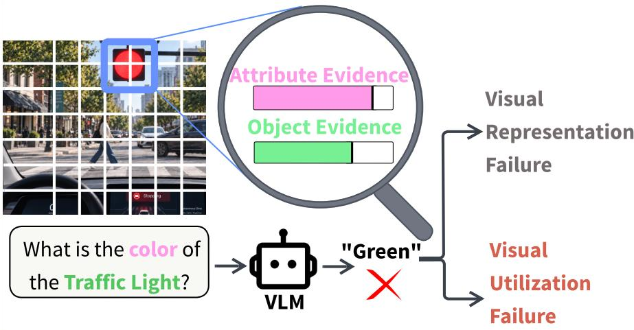  
Figure 1: Diagnosing the source of errors.

We therefore shift focus from whether a VLM answers correctly to whether it possesses the necessary visual evidence to do so. We quantify the visual-utilization failure rate: the fraction of errors for which sufficient evidence is encoded but unsuccessfully used. The rest are visual-representation failures, where the evidence was never encoded. We estimate this unobservable rate with a probe trained to extract a target signal from representations. However, it might guess correctly from spurious cues or fail to extract present evidence. We account for this uncertainty by developing theoretical bounds on the true rate using answer-preserving transformations that vary evidence salience.

We introduce VELens (Visual Evidence Lens), a lightweight rank-based visual-evidence probe. We evaluate it on target-object attribute questions (“What is the color ofthe traffic light?”), which require object and attribute evidence. Because visual-token representations are not directly interpretable, VELens projects each language-model layer’s representations into vocabulary space, providing a window into the VLM’s encoded visual information. It measures whether tokens representing the target concept (the object or correct attribute value) rank above competing tokens and combines these scores across layers to determine whether object and attribute evidence are present.

To evaluate VELens, we use six thousand object-rich images from the Visual Attributes in the Wild (VAW) dataset (Pham et al., 2021), focusing on color, material, and shape as a first step toward broader visual evidence, and two VLMs sharing the causal decoder-based design of current models, LLaVA-1.6-7B (Liu et al., 2024c) and Qwen2.5-VL-7B (Bai et al., 2025). Across all attribute categories and both VLMs, VELens outperforms every baseline, and combined with the strongest object-evidence probe it reaches joint object-and-attribute ROC-AUCs of 0.95 on LLaVA and 0.91 on Qwen. We additionally test its generalization in low-resource and unseen-value settings, where it also outperforms the corresponding baselines, supporting its use for diagnosing error sources.

We then use VELens to answer the paper’s central question. On VAW, we estimate that 84.4% of LLaVA errors and 70.0% of Qwen errors are visual-utilization failures. More importantly, our conservative lower bound shows these are at least 77.5% (LLaVA) and 61.0% (Qwen) of errors overall. Thus, the main bottleneck is not representing the visual information, but utilizing it when producing the answer. We find no universal layer at which visual evidence becomes accessible. It depends heavily on the model and attribute. To test whether encoded evidence can be used more successfully, we increase attention toward the target-object region. As predicted, this achieves twice the correction rate on evidence-positive errors as on errors where VELens detects no evidence, as proof of concept that, when visual evidence is encoded, helping the model use it can resolve failures.

In summary, our contributions are: (1) we formalize the distinction between visual-representation and visual-utilization failures, introduce an estimand for their relative prevalence, and derive bounds that account for an imperfect probe; (2) we introduce VELens, a rank-based probe that traces object and attribute evidence across language-model layers, and characterize its scope and limitations (§E);

(3) across two VLMs and three attributes, we show that visual utilization is the main bottleneck; and (4) we show that identifying whether the required visual evidence is encoded can guide error mitigation. Together, our study suggests that improving VLM reliability requires not only better encoding, but also better mechanisms to locate, route, and use what VLMs already encode.

## 2 RELATED WORK

Detection and Mitigation of Errors in VLMs. VLM responses often describe objects, attributes, or relations inconsistent with the image (Bai et al., 2024; Chen et al., 2026; Liu et al., 2024b). Prior work has mainly focused on detecting such conflicts (Li et al., 2023; Gunjal et al., 2024; Deng et al., 2024; Yin et al., 2024), treating VLMs as black boxes (Jiang et al., 2025a). Mitigation methods (Tonmoy et al., 2024) reduce errors through attention-guided grounding or constrained decoding at inference (Huang et al., 2024; Leng et al., 2024; Zhao et al., 2025), or visual-text alignment objectives during training (Liu et al., 2024a; Yu et al., 2024). However, they address the output without identifying its underlying cause. While Xiong et al. (2026) frame VLM errors as failures of internal processing, they analyze utilization without establishing whether the required visual evidence was encoded. We instead distinguish visual-representation failures, where evidence is not encoded, from visual-utilization failures, where encoded evidence is unsuccessfully used (Calderon et al., 2026).

Interpretability of visual information in VLM. Motivated by evidence that LLM internal representations reveal information underlying model behavior (Orgad et al., 2025; Azaria & Mitchell, 2023), recent work studies how visual information is encoded and utilized within VLMs. First, classifier-based methods, including linear probing (Alain & Bengio, 2017; Fu et al., 2025; Kogilathota et al., 2026), test whether visual concepts can be recovered from hidden states. Notably, Fu et al. (2025) shows that information easily recoverable from the intermediate vision encoder layers may fail to influence predictions. Second, confidence-based methods project hidden states through the LM output head, following the logit lens (nostalgebraist, 2020), to identify vocabulary concepts supported by intermediate visual representations (Jiang et al., 2025b; Neo et al., 2025; Jiang et al., 2025a). These studies show that object semantics are encoded within visual tokens and localized to corresponding image regions, become increasingly interpretable across layers, and provide early indications of visually unsupported objects in textual responses. Finally, cross-modality attention analysis (Kaduri et al., 2025; Jiang et al., 2025b; Liu et al., 2024d) tracks how visual features contribute to final outputs and how attention disruptions correlate with errors. Unlike per-layer or per-concept analyses, we analyze objects and attributes jointly across layers.

## 3 QUANTIFYING THE RATE OF VISUAL-UTILIZATION FAILURES

Understanding the source of VLM errors requires distinguishing two failure modes: visualrepresentation failures, in which the required visual evidence is not encoded, and visualutilization failures, in which it is encoded but unsuccessfully used. Although the final answer alone cannot distinguish them, they reflect different limitations and call for different interventions. We therefore formalize this distinction and propose an estimand, estimator, and bounds for the proportion of errors from each source.

## 3.1 PROBLEM FORMULATION

For an input $X = ( I , Q )$ consisting of an image and a query, let $Y _ { X }$ denote its ground-truth answer and $f ( X )$ the VLM prediction. An error (sometimes referred to as hallucination, and hence the notation) occurs when these answers differ, i.e., $H ( X ) = \mathbb { I } ( f ( X ) \neq Y _ { X } )$ , and we denote the error event by $\mathscr { H } : = H ( X ) = 1$ . Observing an error does not reveal which failure mode caused it: even with access to the raw VLM representations, whether they contain sufficient visual information to support the correct answer is not directly observable. Let $\phi _ { X } \in 0 .$ , 1 represent this latent state, where $\phi _ { X } = 1$ indicates that the representations contain sufficient signal to support $Y _ { X }$ . Conditional on an error, the presence of such a signal indicates that the evidence was encoded but not used successfully, and hence that the error is a visual-utilization failure. We therefore seek the proportion of errors attributable to visual-utilization failures:

$$
\mu _ { \phi } : = \mathbb { P } ( \phi _ { X } = 1 \mid \mathcal { H } ) .
$$

The remaining fraction, $1 - \mu _ { \phi }$ , corresponds to visual-representation failures. Since $\phi _ { X }$ is latent, we approximate it using a probe: a lightweight secondary model trained on the VLM’s internal representations to determine whether they contain evidence supporting an answer $Y$ . Let $M ( X , Y ) \stackrel { * } { \in } \{ 0 , 1 \}$ denote the probe output for an input X and a candidate answer $Y$ . Thus, $M ( X , Y _ { X } ) = \mathrm { { 1 } }$ indicates that the probe can extract evidence supporting the ground-truth answer $Y _ { X }$ . This suggests that the VLM’s visual representations had the potential to support $Y _ { X }$ , but that this evidence was not used successfully. Accordingly, the probe-based estimand and its empirical plug-in estimator are:

$$
\mu _ { \phi } ^ { \mathrm { p r o b e } } : = \mathbb { P } \big ( M ( X , Y _ { X } ) = 1 \mid \mathcal { H } \big ) , \qquad \widehat { \mu } _ { \phi } : = \frac { \sum _ { i = 1 } ^ { n } \mathbb { I } \{ H ( x _ { i } ) = 1 , M ( x _ { i } , y _ { i } ) = 1 \} } { \sum _ { i = 1 } ^ { n } \mathbb { I } \{ H ( x _ { i } ) = 1 \} } .
$$

A perfect probe satisfying $M ( X , Y _ { X } ) = \phi _ { X }$ for every $X$ makes the probe-based estimand equal $\mu _ { \phi } .$ . In practice, however, M is not trained on $\phi _ { X }$ , which is unobserved, but on labels indicating whether $Y$ is correct for X, so $M ( X , Y _ { X } )$ is only a proxy: it supports but does not prove $\phi _ { X }$ in either direction, as a positive prediction may rely on imperfect or spurious cues, and a negative one may fail to extract present signal. To account for this uncertainty, we next derive bounds on $\mu _ { \phi }$

## 3.2 BOUNDS WITH AN IMPERFECT PROBE

Let $X _ { + } ~ = ~ \psi _ { + } ( X )$ and $X _ { - } ~ = ~ \psi _ { - } ( X )$ denote answer-preserving transformations $( \mathrm { i . e . , ~ } Y _ { X _ { + } } =$ $Y _ { X } = { \overset { \cdot } { Y } } _ { X _ { - } } )$ designed to make the visual evidence relevant to the query more or less salient, respectively. For example, $\psi _ { + }$ may highlight the relevant object with a bounding box, whereas $\psi _ { - }$ may blur or partially occlude it. Consider the probe-dominance assumption (Assumption 1), under which the probe’s detection rate after the positive transformation $\psi _ { + }$ and its non-detection rate after the negative transformation $\psi _ { - }$ serve as conservative proxies for its behavior when the original representations genuinely contain or lack the required signal, respectively. Provided that $\mathbb { P } ( \boldsymbol { \bar { M } } ( X _ { + } , \mathbf { \bar { \gamma } } _ { X } ) = 1 \mid \mathcal { H } ) > 0$ and $\mathbb { P } ( M ( X _ { - } , Y _ { X } ) = 0 \mid \bar { \mathcal { H } } ) > 0$ , the following bounds hold:

Theorem 1 (Visual-Utilization Failure Bounds. Proof in $\ S \mathbf { A } )$

$$
1 - \frac { \mathbb { P } ( M ( X , Y _ { X } ) = 0 \mid \mathcal { H } ) } { \mathbb { P } ( M ( X _ { - } , Y _ { X } ) = 0 \mid \mathcal { H } ) } \leq \mu _ { \phi } \leq \frac { \mathbb { P } ( M ( X , Y _ { X } ) = 1 \mid \mathcal { H } ) } { \mathbb { P } ( M ( X _ { + } , Y _ { X } ) = 1 \mid \mathcal { H } ) } .
$$

## 3.3 VISUAL EVIDENCE IN OBJECT-ATTRIBUTE QUERIES

We now specialize the probe to queries Q about an attribute of a target object, such as ‘What is the color of the $\underline { { c a r ? } } ^ { \flat }$ , where the target object is $" c a r "$ and the attribute category is $" c o l o r "$ . Correct answering requires two components of visual evidence: object visual evidence, indicating that the representation localizes the target object, and attribute visual evidence, indicating that the objectspecific representation supports the correct attribute value more strongly than alternative values from the same category. We define M as a composite probe:

$$
M ( X , Y ) = 1 \quad \Longleftrightarrow \quad M _ { \mathrm { o b j } } ( X ) = 1 \wedge M _ { \mathrm { a t t r } } ( X , Y ) = 1 .
$$

Under this operational definition, for the ground-truth answer $Y _ { X }$ , at least one required evidence component is not detected when $M ( X , Y _ { X } ) = 0$ , whereas both are detected when $\bar { M } ( X , Y _ { X } ) = 1$ In the next section, we present our implementation of both probes.

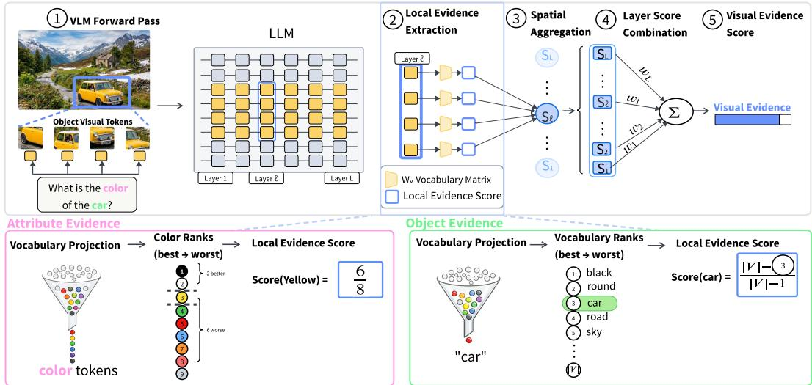  
Figure 2: Overview of VELens. Top: Visual-token representations from each LLM layer are projected through the output head $W _ { V }$ to obtain vocabulary rankings. These rankings are converted into local evidence scores and aggregated into one score per layer. The layer-wise scores serve as input to a logistic-regression classifier. Bottom: For each visual token, the vocabulary ranks of target tokens $( { \mathcal { T } } ^ { + } )$ and competing tokens $( \mathcal T ^ { - } )$ are compared to produce a local evidence score.

## 4 THE VISUAL EVIDENCE LENS METHOD

We now introduce VELens, a rank-based implementation of the composite probe $M = M _ { \mathrm { { o b j } } } \land M _ { \mathrm { { a t t r } } }$ (§3.3) that projects intermediate visual-token representations into the LM’s vocabulary space and traces the resulting evidence across layers (Figure 2). As we show experimentally, VELens yields the most reliable probe and hence our most reliable estimate of $\mu _ { \phi }$

## 4.1 METHOD OVERVIEW AND NOTATION

For an input $X = ( I , Q )$ , the vision encoder transforms the image I into patch-level representations. The vision-to-language projection then maps these representations into the language model’s embedding space, producing visual tokens $k _ { 1 } , \ldots , k _ { n }$ . In the autoregressive VLMs considered here, as in most current VLMs, visual tokens precede the question tokens; causal masking therefore prevents their layer-wise representations from attending to $Q ,$ , so they encode only information available from the image. Let $h _ { l } ( k _ { i } ) \in \mathbb { R } ^ { d }$ denote the representation of visual token $k _ { i }$ at language-model layer $l \in \{ 1 , \ldots , L \}$

To examine the visual evidence encoded in $h _ { l } ( k _ { i } )$ , we apply the LM’s output head $W _ { V } \in \mathbb { R } ^ { | V | \times d } .$ obtaining logits over the vocabulary V and hence a ranking of its tokens, following the logit-lens approach (nostalgebraist, 2020) (§C.2). For each $v \in V$ , let rank $( k _ { i } , v )$ denote its projected rank, from one (highest scoring) to $| V |$ (lowest scoring). These rankings reveal which vocabulary concepts are most strongly supported by each visual-token representation across LM layers. We use this vocabulary-based lens to quantify visual object and attribute evidence.

Following the example from Section 3.3 for the question $Q = { } ^ { \stackrel {  } { \sim } } W h a t$ is the color of the $\underline { { c a r ? } } ^ { \flat }$ , let o denote the target object $( \ " c a r ^ { \prime \prime } )$ , b its annotated bounding box, and $Y$ the target attribute value $( \ " y e l l o w ^ { \prime \prime } )$ . To evaluate attributes, we use the full set of values in the queried category as the closed candidate set A $( \mathbf { e . g . } , A =$ {yellow, red, blue} for color); all values other than $\bar { Y }$ serve as alternatives. Let $\kappa _ { \mathrm { i n } }$ and $\boldsymbol { \kappa } _ { \mathrm { o u t } }$ the sets of visual tokens whose corresponding image patches lie inside and outside $b ,$ respectively.

## 4.2 VISUAL-EVIDENCE EXTRACTION

To measure visual evidence for a specific concept, we define target vocabulary tokens $\mathcal { T } ^ { + }$ that represent it and competing tokens $\hat { \mathcal { T } } ^ { - }$ . For instance, when probing for the target attribute $Y =$ “yellow”, ${ \mathcal { T } } ^ { + }$ contains vocabulary tokens for “yellow”, while $\mathcal { T } ^ { - }$ contains tokens for the alternative candidates in $\mathcal { A } \left( \mathrm { e . g . , \tilde { \ r e d } ^ { \ast } , \tilde { \ s p l u e } ^ { \ast \ast } } \right)$ . The exact construction of $\tau ^ { + }$ and $\mathcal { T } ^ { - }$ differs for objects and attributes; detailed definitions for each are provided in §B.1. For visual token $k _ { i }$ and layer l, we first take the best rank across the variants in the target token set, $\begin{array} { r } { r _ { l } ( k _ { i } , T ^ { + } ) : = \operatorname* { m i n } _ { v \in \mathcal { T } ^ { + } } \mathrm { r a n k } _ { l } ( k _ { i } , v ) } \end{array}$ and then compare it with the ranks of the competing tokens:

$$
s _ { l } ( k _ { i } ) : = \frac { 1 } { | T ^ { - } | } \sum _ { u \in \mathcal { T } ^ { - } } \mathbb { I } \{ \mathrm { r a n k } _ { l } ( k _ { i } , u ) > r _ { l } ( k _ { i } , \mathcal { T } ^ { + } ) \} .\tag{1}
$$

With ranks ordered from best to worst starting at one, the resulting local evidence score $s _ { l } ( k _ { i } ) \in$ $[ 0 , 1 ]$ is the fraction of competing tokens that appear later in this ordering than the best-ranked target token; larger values therefore indicate stronger relative visual evidence at $k _ { i }$ . To obtain a layer-level score, we summarize the local scores $\{ s _ { l } ( k _ { i } ) : k _ { i } \in \mathcal { K } \}$ over a specific spatial region $\mathcal { K } \left( \mathrm { e . g . , } \mathcal { K } _ { \mathrm { i n } } \right.$ or $ { \kappa _ { \mathrm { o u t } } } )$ using the aggregation strategies defined in §B.2. This produces a layer-level score Sl; stacking the scores from all L layers yields an evidence vector $\mathbf { S } : = \widehat { \left[ S _ { 1 } , \ldots , S _ { L } \right] ^ { \intercal } } \in \mathbb { R } ^ { L }$

## 4.3 PROBE SUPERVISION

To determine the final presence of visual evidence, we train lightweight logistic-regression probes on the extracted L-dimensional evidence vectors. Both probes are framed as binary classifiers over $\mathbf { S } \in \mathbb { R } ^ { L }$ , differing only in how the positive $( z = 1 )$ and negative $( z = 0 )$ examples are sourced.

Attribute-Evidence Regression. For the attribute visual probe, we extract the evidence vector $\mathbf { S } ^ { \mathrm { a t t r } } ( Y ) \in \mathbb { R } ^ { L }$ over the target object’s region $\kappa _ { \mathrm { i n } }$ for a candidate attribute Y. Since visual evidence is not directly observable, we supervise the probe using dataset annotations: each evidence vector is paired with $z = 1$ when Y is annotated as present and $z = 0$ when it is annotated as absent. We train a logistic-regression model $\mathrm { L R } _ { \mathrm { a t t r } } : \mathbb { R } ^ { L }  [ 0 , 1 ]$ on these labeled vectors and apply it to the target-attribute vector $\mathbf { S } ^ { \mathrm { a t t r } } ( Y )$

$$
M _ { \mathrm { a t t r } } ( X , Y ) : = \mathbb { I } \{ { \mathrm { L R } } _ { \mathrm { a t t r } } \big ( \mathbf { S } ^ { \mathrm { a t t r } } ( Y ) \big ) \geq \tau _ { \mathrm { a t t r } } \} .\tag{2}
$$

Thus, $M _ { \mathrm { a t t r } } ( X , Y ) = 1$ when the layer-wise visual evidence for Y is classified as a present attribute.

Object-Evidence Regression. For the object visual probe, we instead use spatial regions for supervision. The inside-region vector $\mathbf { S } ^ { \mathrm { o b j , i n } } \in \mathbb { R } ^ { L }$ is a positive example $( z ~ = ~ 1 )$ , while the outside-region vector $\mathbf { S } ^ { \mathrm { o b j , \overline { { o u t } } } } ~ \in ~ \mathbb { R } ^ { L }$ , where the object is absent, is negative $( z ~ = ~ 0 )$ . We fit $\mathrm { L R } _ { \mathrm { o b j } } : \mathbb { R } ^ { \breve { L } }  [ 0 , 1 ]$ to distinguish the regions and define the object probe as:

$$
M _ { \mathrm { o b j } } ( X ) : = \mathbb { I } \{ { \mathrm { L R } } _ { \mathrm { o b j } } \left( \mathbf { S } ^ { \mathrm { o b j , i n } } \right) \geq \tau _ { \mathrm { o b j } } \} .\tag{3}
$$

## 5 EXPERIMENTAL SETUP

Baseline Methods. We compare our rank-based method with three baseline categories: classifierbased, confidence-based, and attention-based. All keep the VLM frozen and use the same mapping from annotated object regions to visual tokens.

Classifier-based. A standard linear-probing baseline (Alain & Bengio, 2017) trains a separate linear classifier for each attribute value at each LM layer. Target-region visual tokens are spatially aggregated (§B.2) into a full-hidden-dimension vector and used as classifier input. This approach requires knowing the attribute or object space in advance, as each value has its own trained probing classifier. Consequently, it cannot be applied to unseen attributes or used as an object probe.

Confidence-based. Internal Confidence (Jiang et al., 2025a) measures whether a concept is represented at an intermediate layer by projecting the representation into vocabulary space, and examining the probability assigned to the tokens corresponding to that concept. The method takes the maximum probability across tokens and layers and passes the scalar to a binary classifier. Unlike VELens, it does not compare to scores of competing tokens and collapses layers into a single scalar. In our evaluation, we restrict the visual tokens to the annotated target-object region.

Attention-based. High attention between a query token representing a concept and visual tokens corresponding to that concept can indicate stronger visual grounding (Kaduri et al., 2025; Jiang et al., 2025b; Liu et al., 2024d). In our implementation, we measure attention from the candidate attribute or target-object query tokens to visual tokens inside and outside the annotated target-object region. At each layer and head, the attention scores are normalized by region size, aggregated over heads within each layer, concatenated across layers, and passed to a binary classifier (§C.1).

Pooling Configurations. For attribute evidence, VELens and the confidence and attention baselines use two configurations: All, one probe shared across all values in a category, and Separate (Sep), one probe per value. The classifier baseline always trains one probe per value, so it has only Separate. For object evidence, the methods use one estimator shared across object categories. We select the aggregation strategy of scores (mean, max, min or median) on a validation subset (§D.1), retrain on the full training set, and evaluate once on held-out test set.

Base Models. We evaluate two VLMs: LLaVA-1.6-7B Liu et al. (2024c), which connects a pretrained CLIP vision encoder to a Mistral-7B LM, and Qwen2.5-VL-7B Bai et al. (2025), which pairs the Qwen2.5 LM with a natively trained dynamic-resolution vision encoder.

Dataset. We use the Visual Attributes in the Wild (VAW) dataset (Pham et al., 2021), which provides each object with a polygon or bounding box and associated attributes. This allows us to identify the target object’s visual region and construct object-attribute questions (§C.3). VAW contains natural, object-rich scenes with over 17 objects per image on average. We normalize attribute values to canonical forms (§C.3) and sample 6,074 images. We focus on color, material, and shape because they can be determined from the target object itself rather than its surrounding context, making them well suited for identifying visual-representation failures. VELens itself is not tied to this setting: §E discusses its scope and limitations.

## 6 RESULTS

## 6.1 EVALUATING THE VISUAL-EVIDENCE PROBE

We estimate the visual-utilization failure rate as the fraction of errors, $H ( X ) \ = \ 1$ , for which $M ( X , Y _ { X } ) = 1 \colon$ the VLM answers incorrectly although both required evidence components can be extracted from its representations. Because this estimate’s reliability depends on how well M detects supporting visual evidence, we first compare our rank-based probe with the baselines. We report ROC-AUC here and additional metrics and aggregation strategies in §D.1.

Our Method Provides the Strongest Attribute Evidence Detection. Table 1 compares the performance of probes across attribute, object, and combined visual evidence detection. For attribute evidence detection, Rank-Separate performs best in all three categories on both LLaVA and Qwen. The Attention baseline is strongest for object evidence, with AUCs of 1.00 on LLaVA and 0.96 on Qwen; our Rank-based is second at 0.90 and 0.81, respectively. Combining Rank-Separate as $M _ { \mathrm { a t t r } }$ with Attention as $M _ { \mathrm { o b j } }$ gives the best combined AUC: 0.95 on LLaVA and 0.91 on Qwen.

Our Method Generalizes with Limited Supervision and to Unseen Attribute Values. For $M _ { \mathrm { a t t r } } .$ , VELens uses two pooling configurations: Rank-Separate (Sep) trains one probe per value, while Rank-All shares one across values. Our main results evaluate attribute values seen during training, where Rank-Sep performs best among methods. We next ask how the probe can be extended to a new value. For example, after training on seven colors, how can it detect evidence for an eighth? We consider two options: train a value-specific probe from a few labeled examples (low-resource), or reuse probes trained on known values for out-of-distribution generalization.

In the low-resource setting, we train a value-specific Separate probe with varying numbers of labeled examples. Figure 3 (left) reports ROC-AUC averaged over five independently sampled subsets for each training size in each of the three attribute categories. VELens outperforms the baselines at every size and remains strong with only a few dozen examples per class. For the unseen-value setting, we hold out one value, train on the remaining $n - 1$ , and compute its evidence vector. Separate applies the $n - 1$ value-specific probes to this vector and averages their predictions, while All applies one probe trained jointly on the n−1 values. The middle and right panels show that Rank-All generalizes better to unseen values, while both configurations outperform their baselines. Thus, specialization is

Low-Resource Generalization

Leave-One-Attribute-Out Generalization

Table 1: Visual-evidence detection performance. ROC-AUC for attribute, object, and combined probes across methods and VLMs.
<table><tr><td colspan="2"></td><td colspan="5">LLaVA</td><td colspan="5">Qwen</td></tr><tr><td> $M _ { \mathrm { a t t r } }$ </td><td> $M _ { \mathrm { o b j } }$ </td><td>Color N = 1,280</td><td>Mater  $N = 1 , 0 4 8$ </td><td>Shape  $N = { \bf \dot { 8 } 0 0 }$ </td><td>Object  $N = \stackrel { \upsilon } { 2 } , 9 4 1$ </td><td> $\mathbf { A t t r } { \times } \mathbf { O b j }$   $N = 3 , 1 2 8$ </td><td>Color N = 1,280</td><td>Mater  $N = 1 , 0 4 8$ </td><td>Shape  $N = { \bf \dot { s } 0 0 }$ </td><td>Object  $N = \stackrel { \sim } { 2 } , 9 4 1$ </td><td>Attr×Obj  $N = 3 , 1 2 8$ </td></tr><tr><td>Rank-All</td><td>Rank</td><td>0.95</td><td>0.91</td><td>0.84</td><td>0.90</td><td>0.90</td><td>0.93</td><td>0.87</td><td>0.82</td><td>0.81</td><td>0.86</td></tr><tr><td>Rank-Sep</td><td>Rank</td><td>0.97</td><td>0.97</td><td>0.91</td><td>0.90</td><td>0.94</td><td>0.94</td><td>0.94</td><td>0.87</td><td>0.81</td><td>0.90</td></tr><tr><td>Conf-Ali</td><td>Conf</td><td>0.79</td><td>0.83</td><td>0.64</td><td>0.53</td><td>0.78</td><td>0.78</td><td>0.82</td><td>0.67</td><td>0.58</td><td>0.77</td></tr><tr><td>Conf-Sep</td><td>Conf</td><td>0.79</td><td>0.83</td><td>0.64</td><td>0.53</td><td>0.80</td><td>0.78</td><td>0.82</td><td>0.67</td><td>0.58</td><td>0.78</td></tr><tr><td>Classifier</td><td></td><td>0.93</td><td>0.94</td><td>0.83</td><td>一</td><td></td><td>0.92</td><td>0.94</td><td>0.86</td><td></td><td></td></tr><tr><td>Attention-All</td><td>Attention</td><td>0.81</td><td>0.75</td><td>0.67</td><td>1.00</td><td>0.76</td><td>0.82</td><td>0.77</td><td>0.72</td><td>0.96</td><td>0.78</td></tr><tr><td>Attention-Sep</td><td>Attention</td><td>0.83</td><td>0.78</td><td>0.69</td><td>1.00</td><td>0.78</td><td>0.82</td><td>0.77</td><td>0.73</td><td>0.96</td><td>0.78</td></tr><tr><td>Rank-Sep</td><td>Attention</td><td>0.97</td><td>0.97</td><td>0.91</td><td>1.00</td><td>0.95</td><td>0.94</td><td>0.94</td><td>0.87</td><td>0.96</td><td>0.91</td></tr></table>

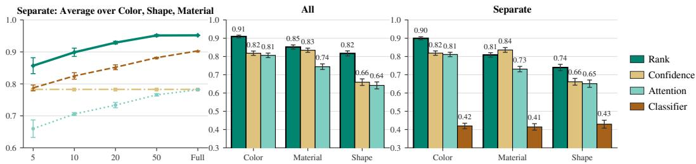  
Figure 3: Low-resource and unseen-value generalization. Left: ROC-AUC as the number of labeled examples per class varies, using Separate and averaging across color, material, and shape, with five independently sampled subsets for each size and category. Middle and right: Leaveone-value-out ROC-AUC, averaged over held-out values, using both pooling configurations. For Separate, individual probes are trained on each seen value, and their predictions are averaged for the held-out value. For All, one probe is trained jointly on all seen values and applied to the held-out value. Error bars are computed via 100 bootstraps.

preferable in-domain, whereas sharing across values improves transfer: a new value can be handled with a few labeled examples using Separate, or with All when no labels are available.

## 6.2 UTILIZATION FAILURES ARE THE MAIN BOTTLENECK

We now ask whether VLM errors arise because the required evidence is missing (visualrepresentation failure) or encoded but unused (visual-utilization failure)? Answering this question reveals where the current bottleneck lies and where future interventions should focus. For errors $H ( X ) = 1$ , the fraction with $M ( X , Y _ { X } ) = 1$ (where both attribute and object visual evidence are detected) estimates the utilization-failure rate, $\widehat { \mu } _ { \phi } = \mathbb { P } ( M ( X , Y _ { X } ) = 1 \ \big | ^ { \circ } H ( X ) = 1 )$ . Because M only approximates latent state $\phi _ { X }$ , we report the bounds (Section 3.2) computed with answerpreserving transformations. We first verify that these transformations affect the probe as expected.

VELens Responds Predictably to Changes in Visual Evidence. Figure 4 (top) illustrates the transformations used to construct the bounds. The negative transformation ψ (X) adds noise to the target object, while the positive transformation $\psi _ { + } ( { \bar { X } } )$ emphasizes it by blurring its surroundings. For LLaVA, increasing noise from 0% to 90% progressively decreases evidence detection among the original errors from 86.5% to 10.4%, while the overall error rate increases from 39.2% to 74.7%. Emphasizing the object produces the reverse pattern: evidence detection increases to 88.8%, while the error rate decreases to 36.6%. Thus, VELens responds predictably to changes in the relevant visual signal. Using the validation set, we select 30% noise as ψ (X), as it weakens the signal while preserving the ground-truth answer. The positive transformation yields only a modest improvement, making the upper bound less informative. Future work could explore stronger answer-preserving positive transformations to obtain tighter upper bounds.

Visual-Utilization Failures Dominate VLM Errors. Figure 4 (bottom) reports $\widehat { \mu } _ { \phi }$ overall and by attribute for both models. The estimated utilization-failure rate is 84.4% for LLaVA and 70.0% for Qwen, with lower bounds of 77.5% and 61.0%, respectively, and the pattern is consistent across attributes. Together, these findings provide a clear, consistent picture: in the evaluated setting, the main bottleneck is properly using visual information during generation, not encoding it.

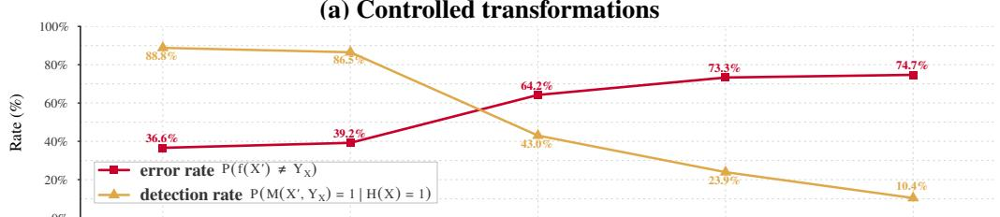

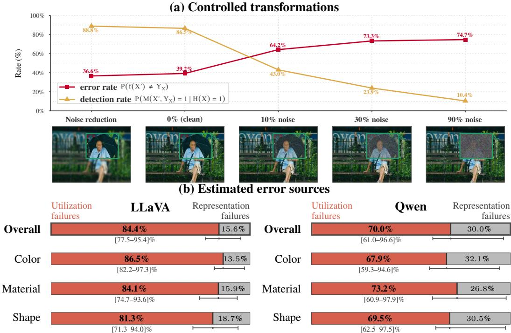  
Figure 4: Top: The object region is emphasized by blurring its surroundings (leftmost) or degraded by Gaussian noise, yielding the transformed image X′ (§D.4). Lines report the LLaVA error rate (red) and joint visual-evidence detection among the original errors $\mathbb { P } ( M ( X ^ { \prime } , Y _ { X } ) = 1 | H ( X ) = 1 )$ (yellow). Bottom: VELens estimates of visual-utilization (red) and visual-representation (gray) failures. The lines and bracketed values are the utilization-failure rate bounds.

## 6.3 TRACING VISUAL EVIDENCE AND IMPROVING ITS UTILIZATION

Having established that most errors occur despite successfully encoded visual evidence, we next ask two questions: where does this evidence become accessible within the model, and can we improve its utilization once it is encoded? VELens naturally supports both analyses: applying it to layers traces how evidence develops across the model, while its final prediction identifies errors in which the required evidence is encoded.

Visual Evidence Emerges Differently Across Attributes and Models. Although VELens combines scores across all layers, we train per-layer classifiers using each layer’s evidence score separately to trace evidence accessibility with depth. Figure 11 shows that evidence generally strengthens toward upper layers, consistent with prior work finding semantic information increasingly accessible in middle-to-late layers (Neo et al., 2025; Jiang et al., 2025a;b). However, trajectories vary across attributes and models. In Qwen, material evidence is already strong in early layers, whereas color and object evidence rise sharply near the end; in LLaVA, object evidence increases more gradually. These results indicate that visual evidence does not become accessible at a universal layer. Interventions aimed at improving visual utilization may therefore need to account for these layer-wise dynamics rather than targeting a fixed layer across models and concepts.

Evidence-Positive Errors Are More Easily Corrected. Distinguishing visual-representation from visual-utilization failures is important, as they call for different interventions. Since our results identify visual utilization as the primary bottleneck, we test whether strengthening access to encoded visual evidence can recover incorrect answers. Guided by the absence of a universal evidence layer, we apply an attention intervention at every layer that increases attention from each text token to visual tokens inside the annotated target-object region (§D.6). Because this requires a known object region, it serves as a proof of concept rather than a standalone correction method. Figure 5 shows an example where VELens detects the evidence and the intervention corrects the answer.

We apply the same intervention to evidencepositive errors, $M ( X , Y _ { X } ) = 1$ , and evidencenegative errors, $M ( X , Y _ { X } ) = 0 .$ , obtaining correction rates of 25.2% and 12%, respectively. The higher correction rate supports our diagnosis: the intervention is substantially more effective when the required evidence is encoded. This is encouraging because most errors are evidence-positive. It suggests that a large fraction of current errors may be addressed not by replacing the visual encoder, but by developing better mechanisms to locate, route, and use evidence the model already represents.

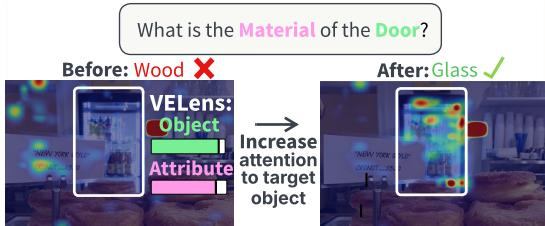  
Figure 5: An example of evidence-positive error, where VELens detects both object and attribute evidence. Increasing attention to the target-object region changes the answer from wood to glass. More examples in Figure 12.

## 7 DISCUSSION

In this work, we proposed VELens, a rank-based probe that traces object and attribute visual evidence across the layers of a VLM. Using it to separate visual-representation from visual-utilization failures, we found that utilization failures account for the majority of errors in both models we studied, with conservative lower bounds of 77.5% for LLaVA and 61.0% for Qwen. Our analysis covers attribute questions over color, material, and shape. VELens itself, however, operates on vocabularyspace rankings and needs only a target concept and competing alternatives, so it naturally extends to other question types: attribute verification questions, for instance, are answered from evidence for the object and the queried value, both of which VELens already provides. More broadly, we see this work as a step toward interpretability of the concepts encoded in visual tokens, and we hope it can extend beyond the question types we study (§E) and guide model development rather than only describe model behavior: knowing whether the required evidence is encoded determines whether progress should come from a better visual encoder or from better mechanisms to locate, route, and use what the model already represents.

## AI USE STATEMENT

In this work, we used generative AI tools to implement methods and to reformat a dataset: Claude Opus 5 assisted in writing our code, and GPT-5.6 proposed the canonical attribute values to which we map VAW’s fine-grained annotations in each category (Table 3). We have not used generative AI tools for generating data, developing theory or proofs, proposing hypotheses, designing or critiquing our methodology and experiments, or interpreting results. Translation and qualitative data analysis are not applicable to this work. Additionally, we used Claude Opus 5 and GPT-5.6 to draft and edit text, and Gemini 3.1 to generate the illustrative images in Figures 1 and 2 (all other images are VAW examples). We have reviewed all AI-assisted work. In all instances, every suggestion or line of code generated by a model was carefully reviewed by the authors to ensure it aligned with our original intentions before being accepted. We take responsibility for the final content of this work, including text, claims or artifacts produced with the aid of generative AI.

## ETHICS STATEMENT

This is an interpretability study of publicly released, open-weight VLMs on the public VAW dataset, involving no human subjects, no personally identifying data, and no new data release.

## REPRODUCIBILITY STATEMENT

To ensure reproducibility, all code for VELens, the baselines, and the evaluation pipeline will be made publicly available. Our experiments use two open-weight VLMs, LLaVA-1.6-7B and Qwen2.5-VL-7B, applied frozen, and the publicly available VAW dataset. Data filtering, normalization, and question construction are specified in §C.3, with the exact prompts in Figure 8; the baselines and their configurations in §5, §C.1, and §C.2; the design choices of VELens, including token-set construction, aggregation strategies, and the development-set protocol used to select them before the single held-out test evaluation, in §B.1, §B.2, and §D.1; the controlled transformations underlying our bounds in §D.4; and a complete proof of Theorem 1 with its assumptions in §A.

## REFERENCES

Guillaume Alain and Yoshua Bengio. Understanding intermediate layers using linear classifier probes. In 5th International Conference on Learning Representations, ICLR 2017, Toulon, France, April 24-26, 2017, Workshop Track Proceedings. OpenReview.net, 2017. URL https: //openreview.net/forum?id=HJ4-rAVtl.

Amos Azaria and Tom M. Mitchell. The internal state of an LLM knows when it’s lying. In Houda Bouamor, Juan Pino, and Kalika Bali (eds.), Findings ofthe Associationfor Computational Linguistics: EMNLP 2023, Singapore, December 6-10, 2023, Findings of ACL, pp. 967–976. Association for Computational Linguistics, 2023. doi: 10.18653/V1/2023.FINDINGS-EMNLP. 68. URL https://doi.org/10.18653/v1/2023.findings-emnlp.68.

Shuai Bai, Keqin Chen, Xuejing Liu, Jialin Wang, Wenbin Ge, Sibo Song, Kai Dang, Peng Wang, Shijie Wang, Jun Tang, Humen Zhong, Yuanzhi Zhu, Ming-Hsuan Yang, Zhaohai Li, Jianqiang Wan, Pengfei Wang, Wei Ding, Zheren Fu, Yiheng Xu, Jiabo Ye, Xi Zhang, Tianbao Xie, Zesen Cheng, Hang Zhang, Zhibo Yang, Haiyang Xu, and Junyang Lin. Qwen2.5-vl technical report. CoRR, abs/2502.13923, 2025. doi: 10.48550/ARXIV.2502.13923. URL https://doi.org/ 10.48550/arXiv.2502.13923.

Zechen Bai, Pichao Wang, Tianjun Xiao, Tong He, Zongbo Han, Zheng Zhang, and Mike Zheng Shou. Hallucination of multimodal large language models: A survey. CoRR, abs/2404.18930, 2024. doi: 10.48550/ARXIV.2404.18930. URL https://doi.org/10.48550/arXiv. 2404.18930.

Nitay Calderon, Eyal Ben-David, Zorik Gekhman, Eran Ofek, and Gal Yona. Empty shelves or lost keys? Recall is the bottleneck for parametric factuality. In Tong Zhang, Miroslav Dudik, Martin Jaggi, Alekh Agarwal, Sharon Li, Dale Schuurmans, Jerry Zhu, Felix Berkenkamp, Hanze Dong, and Alberto Bietti (eds.), Proceedings of the 43rd International Conference on Machine Learning, volume 306 of Proceedings ofMachine Learning Research, pp. 10872–10938. PMLR, 06–11 Jul 2026. URL https://proceedings.mlr.press/v306/calderon26a.html.

Zhiyuan Chen, Yuecong Min, Jie Zhang, Bei Yan, Jiahao Wang, Xiaozhen Wang, and Shiguang Shan. A survey of multimodal hallucination evaluation and detection. Int. J. Comput. Vis., 134 (3):131, 2026. doi: 10.1007/S11263-026-02756-9. URL https://doi.org/10.1007/ s11263-026-02756-9.

Ailin Deng, Zhirui Chen, and Bryan Hooi. Seeing is believing: Mitigating hallucination in large vision-language models via clip-guided decoding. CoRR, abs/2402.15300, 2024. doi: 10.48550/ ARXIV.2402.15300. URL https://doi.org/10.48550/arXiv.2402.15300.

Stephanie Fu, Tyler Bonnen, Devin Guillory, and Trevor Darrell. Hidden in plain sight: Vlms overlook their visual representations. CoRR, abs/2506.08008, 2025. doi: 10.48550/ARXIV.2506. 08008. URL https://doi.org/10.48550/arXiv.2506.08008.

Roy Ganz, Yair Kittenplon, Aviad Aberdam, Elad Ben-Avraham, Oren Nuriel, Shai Mazor, and Ron Litman. Question aware vision transformer for multimodal reasoning. In IEEE/CVF Conference on Computer Vision and Pattern Recognition, CVPR 2024, Seattle, WA, USA, June 16-22, 2024, pp. 13861–13871. IEEE, 2024. doi: 10.1109/CVPR52733.2024.01315. URL https://doi. org/10.1109/CVPR52733.2024.01315.

Anisha Gunjal, Jihan Yin, and Erhan Bas. Detecting and preventing hallucinations in large vi sion language models. In Michael J. Wooldridge, Jennifer G. Dy, and Sriraam Natarajan (eds.), Thirty-Eighth AAAI Conference on Artificial Intelligence, AAAI 2024, Thirty-Sixth Conference on Innovative Applications of Artificial Intelligence, IAAI 2024, Fourteenth Symposium

on Educational Advances in Artificial Intelligence, EAAI 2024, February 20-27, 2024, Vancouver, Canada, pp. 18135–18143. AAAI Press, 2024. doi: 10.1609/AAAI.V38I16.29771. URL https://doi.org/10.1609/aaai.v38i16.29771.

Qidong Huang, Xiaoyi Dong, Pan Zhang, Bin Wang, Conghui He, Jiaqi Wang, Dahua Lin, Weiming Zhang, and Nenghai Yu. OPERA: alleviating hallucination in multi-modal large language models via over-trust penalty and retrospection-allocation. In IEEE/CVF Conference on Computer Vision and Pattern Recognition, CVPR 2024, Seattle, WA, USA, June 16-22, 2024, pp. 13418–13427. IEEE, 2024. doi: 10.1109/CVPR52733.2024.01274. URL https://doi.org/10.1109/ CVPR52733.2024.01274.

Nick Jiang, Anish Kachinthaya, Suzanne Petryk, and Yossi Gandelsman. Interpreting and editing vision-language representations to mitigate hallucinations. In The Thirteenth International Conference on Learning Representations, ICLR 2025, Singapore, April 24-28, 2025. OpenReview.net, 2025a. URL https://openreview.net/forum?id=94kQgWXojH.

Zhangqi Jiang, Junkai Chen, Beier Zhu, Tingjin Luo, Yankun Shen, and Xu Yang. Devils in middle layers of large vision-language models: Interpreting, detecting and mitigating object hallucinations via attention lens. In IEEE/CVF Conference on Computer Vision and Pattern Recognition, CVPR 2025, Nashville, TN, USA, June 11-15, 2025, pp. 25004–25014. Computer Vision Foundation / IEEE, 2025b. doi: 10.1109/CVPR52734.2025.02328. URL https://openaccess.thecvf.com/content/CVPR2025/html/ Jiang\_Devils\_in\_Middle\_Layers\_of\_Large\_Vision-Language\_Models\_ Interpreting\_Detecting\_CVPR\_2025\_paper.html.

Omri Kaduri, Shai Bagon, and Tali Dekel. What’s in the image? A deep-dive into the vision of vision language models. In IEEE/CVF Conference on Computer Vision and Pattern Recognition, CVPR 2025, Nashville, TN, USA, June 11-15, 2025, pp. 14549–14558. Computer Vision Foundation / IEEE, 2025. doi: 10.1109/CVPR52734.2025.01356. URL https: //openaccess.thecvf.com/content/CVPR2025/html/Kaduri\_Whats\_in\_ the\_Image\_A\_Deep-Dive\_into\_the\_Vision\_of\_CVPR\_2025\_paper.html.

Sai Akhil Kogilathota, Sripadha Vallabha E. G, Luzhe Sun, and Jiawei Zhou. HALP: detecting hallucinations in vision-language models without generating a single token. In Vera Demberg, Kentaro Inui, and Llu´ıs Marquez (eds.), Proceedings of the 19th Conference of the European Chapter ofthe Associationfor Computational Linguistics, EACL 2026 - Volume 1: Long Papers, Rabat, Morocco, March 24-29, 2026, pp. 6067–6085. Association for Computational Linguistics, 2026. URL https://aclanthology.org/2026.eacl-long.287/.

Sicong Leng, Hang Zhang, Guanzheng Chen, Xin Li, Shijian Lu, Chunyan Miao, and Lidong Bing. Mitigating object hallucinations in large vision-language models through visual contrastive decoding. In IEEE/CVF Conference on Computer Vision and Pattern Recognition, CVPR 2024, Seattle, WA, USA, June 16-22, 2024, pp. 13872–13882. IEEE, 2024. doi: 10.1109/CVPR52733. 2024.01316. URL https://doi.org/10.1109/CVPR52733.2024.01316.

Yifan Li, Yifan Du, Kun Zhou, Jinpeng Wang, Wayne Xin Zhao, and Ji-Rong Wen. Evaluating object hallucination in large vision-language models. In Houda Bouamor, Juan Pino, and Kalika Bali (eds.), Proceedings of the 2023 Conference on Empirical Methods in Natural Language Processing, EMNLP 2023, Singapore, December 6-10, 2023, pp. 292–305. Association for Computational Linguistics, 2023. doi: 10.18653/V1/2023.EMNLP-MAIN.20. URL https://doi.org/10.18653/v1/2023.emnlp-main.20.

Fuxiao Liu, Kevin Lin, Linjie Li, Jianfeng Wang, Yaser Yacoob, and Lijuan Wang. Mitigating hallucination in large multi-modal models via robust instruction tuning. In The Twelfth International Conference on Learning Representations, ICLR 2024, Vienna, Austria, May 7-11, 2024. OpenReview.net, 2024a. URL https://openreview.net/forum?id=J44HfH4JCg.

Hanchao Liu, Wenyuan Xue, Yifei Chen, Dapeng Chen, Xiutian Zhao, Ke Wang, Liping Hou, Rongjun Li, and Wei Peng. A survey on hallucination in large vision-language models. CoRR, abs/2402.00253, 2024b. doi: 10.48550/ARXIV.2402.00253. URL https://doi.org/10. 48550/arXiv.2402.00253.

Haotian Liu, Chunyuan Li, Qingyang Wu, and Yong Jae Lee. Visual instruction tuning. In Alice Oh, Tristan Naumann, Amir Globerson, Kate Saenko, Moritz Hardt, and Sergey Levine (eds.), Advances in Neural Information Processing Systems 36: Annual Conference on Neural Information Processing Systems 2023, NeurIPS 2023, New Orleans, LA, USA, December 10 - 16, 2023, 2023. URL http://papers.nips.cc/paper\_files/paper/2023/hash/ 6dcf277ea32ce3288914faf369fe6de0-Abstract-Conference.html.

Haotian Liu, Chunyuan Li, Yuheng Li, and Yong Jae Lee. Improved baselines with visual instruction tuning. In IEEE/CVF Conference on Computer Vision and Pattern Recognition, CVPR 2024, Seattle, WA, USA, June 16-22, 2024, pp. 26286–26296. IEEE, 2024c. doi: 10.1109/CVPR52733. 2024.02484. URL https://doi.org/10.1109/CVPR52733.2024.02484.

Shi Liu, Kecheng Zheng, and Wei Chen. Paying more attention to image: A training-free method for alleviating hallucination in lvlms. In Ales Leonardis, Elisa Ricci, Stefan Roth, Olga Russakovsky, Torsten Sattler, and Gul Varol (eds.),¨ Computer Vision - ECCV 2024 - 18th European Conference, Milan, Italy, September 29-October 4, 2024, Proceedings, Part LXXXIII, volume 15141 of Lecture Notes in Computer Science, pp. 125–140. Springer, 2024d. doi: 10.1007/978-3-031-73010-8\ 8. URL https://doi.org/10.1007/978-3-031-73010-8\_8.

Clement Neo, Luke Ong, Philip Torr, Mor Geva, David Krueger, and Fazl Barez. Towards interpreting visual information processing in vision-language models. In The Thirteenth International Conference on Learning Representations, ICLR 2025, Singapore, April 24-28, 2025. OpenReview.net, 2025. URL https://openreview.net/forum?id=chanJGoa7f.

nostalgebraist. Interpreting gpt: The logit lens. https://www.lesswrong.com/posts/ AcKRB8wDpdaN6v6ru/interpreting-gpt-the-logit-lens, 2020.

Hadas Orgad, Michael Toker, Zorik Gekhman, Roi Reichart, Idan Szpektor, Hadas Kotek, and Yonatan Belinkov. Llms know more than they show: On the intrinsic representation of LLM hallucinations. In The Thirteenth International Conference on Learning Representations, ICLR 2025, Singapore, April 24-28, 2025. OpenReview.net, 2025. URL https://openreview. net/forum?id=KRnsX5Em3W.

Khoi Pham, Kushal Kafle, Zhe Lin, Zhihong Ding, Scott Cohen, Quan Tran, and Abhinav Shrivastava. Learning to predict visual attributes in the wild. In IEEE Conference on Computer Vision and Pattern Recognition, CVPR 2021, virtual, June 19-25, 2021, pp. 13018–13028. Computer Vision Foundation / IEEE, 2021. doi: 10.1109/CVPR46437.2021.01282. URL https: //openaccess.thecvf.com/content/CVPR2021/html/Pham\_Learning\_To\_ Predict\_Visual\_Attributes\_in\_the\_Wild\_CVPR\_2021\_paper.html.

Shengbang Tong, Zhuang Liu, Yuexiang Zhai, Yi Ma, Yann LeCun, and Saining Xie. Eyes wide shut? exploring the visual shortcomings of multimodal llms. In IEEE/CVF Conference on Computer Vision and Pattern Recognition, CVPR 2024, Seattle, WA, USA, June 16- 22, 2024, pp. 9568–9578. IEEE, 2024. doi: 10.1109/CVPR52733.2024.00914. URL https: //doi.org/10.1109/CVPR52733.2024.00914.

S. M. Towhidul Islam Tonmoy, S. M. Mehedi Zaman, Vinija Jain, Anku Rani, Vipula Rawte, Aman Chadha, and Amitava Das. A comprehensive survey of hallucination mitigation techniques in large language models. CoRR, abs/2401.01313, 2024. doi: 10.48550/ARXIV.2401.01313. URL https://doi.org/10.48550/arXiv.2401.01313.

Xintong Wang, Jingheng Pan, Liang Ding, and Chris Biemann. Mitigating hallucinations in large vision-language models with instruction contrastive decoding. In Lun-Wei Ku, Andre Martins, and Vivek Srikumar (eds.), Findings of the Association for Computational Linguistics, ACL 2024, Bangkok, Thailand and virtual meeting, August 11-16, 2024, volume ACL 2024 of Findings of ACL, pp. 15840–15853. Association for Computational Linguistics, 2024. doi: 10.18653/V1/2024.FINDINGS-ACL.937. URL https://doi.org/10.18653/v1/ 2024.findings-acl.937.

Penghao Wu and Saining Xie. V\*: Guided visual search as a core mechanism in multimodal llms. In IEEE/CVF Conference on Computer Vision and Pattern Recognition, CVPR 2024, Seattle, WA, USA, June 16-22, 2024, pp. 13084–13094. IEEE, 2024. doi: 10.1109/CVPR52733.2024.01243. URL https://doi.org/10.1109/CVPR52733.2024.01243.

Lexiang Xiong, Qi Li, Jingwen Ye, and Xinchao Wang. Anatomy of a lie: A multi-stage diagnostic framework for tracing hallucinations in vision-language models. CoRR, abs/2603.15557, 2026. doi: 10.48550/ARXIV.2603.15557. URL https://doi.org/10.48550/arXiv.2603. 15557.

Shukang Yin, Chaoyou Fu, Sirui Zhao, Tong Xu, Hao Wang, Dianbo Sui, Yunhang Shen, Ke Li, Xing Sun, and Enhong Chen. Woodpecker: hallucination correction for multimodal large language models. Sci. China Inf. Sci., 67(12), 2024. doi: 10.1007/S11432-024-4251-X. URL https://doi.org/10.1007/s11432-024-4251-x.

Tianyu Yu, Yuan Yao, Haoye Zhang, Taiwen He, Yifeng Han, Ganqu Cui, Jinyi Hu, Zhiyuan Liu, Hai-Tao Zheng, and Maosong Sun. RLHF-V: towards trustworthy mllms via behavior alignment from fine-grained correctional human feedback. In IEEE/CVF Conference on Computer Vision and Pattern Recognition, CVPR 2024, Seattle, WA, USA, June 16-22, 2024, pp. 13807–13816. IEEE, 2024. doi: 10.1109/CVPR52733.2024.01310. URL https://doi.org/10.1109/ CVPR52733.2024.01310.

Zhi Zhang, Srishti Yadav, Fengze Han, and Ekaterina Shutova. Cross-modal information flow in multimodal large language models. In IEEE/CVF Conference on Computer Vision and Pattern Recognition, CVPR 2025, Nashville, TN, USA, June 11-15, 2025, pp. 19781– 19791. Computer Vision Foundation / IEEE, 2025. doi: 10.1109/CVPR52734.2025.01842. URL https://openaccess.thecvf.com/content/CVPR2025/html/Zhang\_ Cross-modal\_Information\_Flow\_in\_Multimodal\_Large\_Language\_ Models\_CVPR\_2025\_paper.html.

Linxi Zhao, Yihe Deng, Weitong Zhang, and Quanquan Gu. Mitigating object hallucination in large vision-language models via image-grounded guidance. In Aarti Singh, Maryam Fazel, Daniel Hsu, Simon Lacoste-Julien, Felix Berkenkamp, Tegan Maharaj, Kiri Wagstaff, and Jerry Zhu (eds.), Forty-second International Conference on Machine Learning, ICML 2025, Vancouver, BC, Canada, July 13-19, 2025, Proceedings of Machine Learning Research. PMLR / OpenReview.net, 2025. URL https://proceedings.mlr.press/v267/zhao25j.html.

## A PROOF OF THE VISUAL-UTILIZATION FAILURE BOUNDS

Here we formalizes the probe-dominance assumption used in Section 3.2 and proves Theorem 1. Recall that $\phi _ { X } = 1$ indicates that the representations of X contain sufficient signal to support the ground-truth answer. Conditional on an error, this latent state corresponds to a visual-utilization failure, whereas $\phi _ { X } = 0$ corresponds to a visual-representation failure. The fixed binary probe $M$ is the composite probe defined in Section 3.3; we apply the same probe to $X , X _ { + }$ , and $X _ { - }$ with respect to the ground-truth answer $Y _ { X }$ . The positive transformation $X _ { + }$ strengthens the relevant visual signal, while the negative transformation $X _ { - }$ weakens it, without changing the ground-truth answer.

Assumption 1 (Probe dominance). Conditioned on an error, probe detection of $Y _ { X }$ on $X _ { + }$ is a conservative proxy for probe detection when the original representations contain the required signal. Similarly, probe non-detection of $Y _ { X }$ on $X _ { - }$ is a conservative proxy for probe non-detection when that signal is absent. Formally,

$$
\begin{array} { r } { \mathbb { P } \big ( M ( X , Y _ { X } ) = 1 \mid \mathcal { H } , \phi _ { X } = 1 \big ) \geq \mathbb { P } \big ( M ( X _ { + } , Y _ { X } ) = 1 \mid \mathcal { H } \big ) , } \\ { \mathbb { P } \big ( M ( X , Y _ { X } ) = 0 \mid \mathcal { H } , \phi _ { X } = 0 \big ) \geq \mathbb { P } \big ( M ( X _ { - } , Y _ { X } ) = 0 \mid \mathcal { H } \big ) . } \end{array}
$$

The intuition behind this assumption is that the latent state $\phi _ { X }$ directly describes the property that the probe is designed to detect, whereas $X _ { + }$ and $X _ { - }$ modify this property only indirectly and may do so imperfectly. If the original representations truly contain the required evidence $( \phi _ { X } = 1 )$ , the probe should be at least as likely to detect it as it is after the positive transformation. Conversely, if the representations truly lack the required evidence $( \phi _ { X } ~ = ~ 0 )$ , the probe should be at least as likely to return non-detection as it is after the negative transformation. Thus, the transformed inputs provide conservative proxies for the latent states.

Proof of Theorem 1. All probabilities below are conditioned on the error event H. By definition,

$$
\mu _ { \phi } = \mathbb { P } ( \phi _ { X } = 1 \mid \mathcal { H } ) , \qquad 1 - \mu _ { \phi } = \mathbb { P } ( \phi _ { X } = 0 \mid \mathcal { H } ) .
$$

First consider the probability that the probe does not detect the required evidence. By the law of total probability,

$$
\begin{array} { r l } & { \mathbb { P } \big ( M ( X , Y _ { X } ) = 0 \mid \mathcal { H } \big ) = \mathbb { P } \big ( M ( X , Y _ { X } ) = 0 \mid \mathcal { H } , \phi _ { X } = 1 \big ) \mu _ { \phi } } \\ & { \qquad + \mathbb { P } \big ( M ( X , Y _ { X } ) = 0 \mid \mathcal { H } , \phi _ { X } = 0 \big ) ( 1 - \mu _ { \phi } ) . } \end{array}
$$

The first term is nonnegative, and Assumption 1 lower-bounds the second conditional non-detection rate by the non-detection rate on $X _ { - }$ . Therefore,

$$
\mathbb { P } \big ( M ( X , Y _ { X } ) = 0 \mid \mathcal { H } \big ) \ge \mathbb { P } \big ( M ( X _ { - } , Y _ { X } ) = 0 \mid \mathcal { H } \big ) ( 1 - \mu _ { \phi } ) .
$$

When $\mathbb { P } ( M ( X _ { - } , Y _ { X } ) = 0 \ | \ \mathcal { H } ) > 0$ , rearranging gives the lower bound

$$
\mu _ { \phi } \geq 1 - \frac { \mathbb { P } ( M ( X , Y _ { X } ) = 0 \mid \mathcal { H } ) } { \mathbb { P } ( M ( X _ { - } , Y _ { X } ) = 0 \mid \mathcal { H } ) } .
$$

For the upper bound, apply the same decomposition to probe detection:

$$
\begin{array} { r l } & { \mathbb { P } \big ( M ( X , Y _ { X } ) = 1 \mid \mathcal { H } \big ) = \mathbb { P } \big ( M ( X , Y _ { X } ) = 1 \mid \mathcal { H } , \phi _ { X } = 1 \big ) \mu _ { \phi } } \\ & { \qquad + \mathbb { P } \big ( M ( X , Y _ { X } ) = 1 \mid \mathcal { H } , \phi _ { X } = 0 \big ) ( 1 - \mu _ { \phi } ) . } \end{array}
$$

The second term is nonnegative, and Assumption 1 lower-bounds the first conditional detection rate by the detection rate on $\bar { X _ { + } }$ . Hence,

$$
\mathbb { P } \big ( M ( X , Y _ { X } ) = 1 \mid \mathcal { H } \big ) \ge \mathbb { P } \big ( M ( X _ { + } , Y _ { X } ) = 1 \mid \mathcal { H } \big ) \mu _ { \phi } .
$$

When $\mathbb { P } ( M ( X _ { + } , Y _ { X } ) = 1 \mid \mathcal { H } ) > 0$ , rearranging yields

$$
\mu _ { \phi } \leq { \frac { \mathbb { P } ( M ( X , Y _ { X } ) = 1 \mid { \mathcal { H } } ) } { \mathbb { P } ( M ( X _ { + } , Y _ { X } ) = 1 \mid { \mathcal { H } } ) } } .
$$

Combining the two inequalities proves Theorem 1.

## B VELENS METHOD: COMPLEMENTARY DETAILS

## B.1 OBJECT AND ATTRIBUTE TOKEN SET CONSTRUCTION

In Section 4.2 we defined the local evidence score $s _ { l } ( k _ { i } ) \ ( \mathrm { E q . \ 1 } )$ in terms of a target token set $\mathcal { T } ^ { + }$ and a competing token set $\mathcal { T } ^ { - }$ . Here we detail their construction, which differs for attributes and objects.

Attribute Token Sets. For the attribute probe, visual evidence is measured relatively within a category. Because language model tokenizers are sensitive to capitalization and whitespace, we expand each concept into several variants. For a concept string w $( \mathrm { e . g . , \hbar ^ { 6 } y e l l o w ^ { 3 } } )$ , the variant set $\bar { \mathcal T } ( w )$ collects the token IDs of its four variants:

$$
\mathcal { T } ( \mathrm { y e l l o w } ) = \{ \mathrm { y e l l o w } , \mathrm { Y e l l o w } , \mathrm { - y e l l o w } , \mathrm { - Y e l l o w } \} .\tag{4}
$$

Given the target attribute value Y and the candidate set $\mathcal { A }$ of the queried category, the variants of Y form the target set and the variants of the alternative values form the competing set:

$$
{ \mathcal { T } } _ { \mathrm { a t t r } } ^ { + } : = { \mathcal { T } } ( Y ) , \quad { \mathcal { T } } _ { \mathrm { a t t r } } ^ { - } : = \bigcup _ { a \in A \backslash \{ Y \} } { \mathcal { T } } ( a ) .\tag{5}
$$

With these sets, $s _ { l } ( k _ { i } )$ is the fraction of alternative values in the same category ranked strictly worse than the best-ranked variant of $Y$

Object Token Sets. For the object probe there is no closed set of alternatives, so visual evidence is measured as absolute vocabulary support. Using the same expansion for the target object o (e.g., $\ " \mathrm { c a r } ? \mathrm { ) }$ , its variants form the target set and the entire remainder of the language model’s vocabulary V forms the competing set:

$$
\begin{array} { r } { \mathcal { T } _ { \mathrm { o b j } } ^ { + } : = \mathcal { T } ( o ) , \quad \mathcal { T } _ { \mathrm { o b j } } ^ { - } : = V \setminus \mathcal { T } _ { \mathrm { o b j } } ^ { + } . } \end{array}\tag{6}
$$

Because $\mathcal { T } _ { \mathrm { o b j } } ^ { - }$ is the rest of the vocabulary, $s _ { l } ( k _ { i } )$ becomes the fraction of all vocabulary tokens that the best-ranked variant of o outranks, quantifying how strongly visual token $k _ { i }$ supports o compared to all other vocabulary tokens.

## B.2 AGGREGATION STRATEGIES

In VELens, the local evidence scores of $\operatorname { E q . 1 }$ are summarized into a single layer-level score. Formally, for a set of visual tokens $\mathcal { K } \left( \mathrm { e . g . , } \mathcal { K } _ { \mathrm { i n } } \right.$ or $ { \kappa } _ { \mathrm { o u t } } )$ , we define the layer-level score $S _ { l }$ at languagemodel layer l as:

$$
S _ { l } = \mathrm { A g g } \bigl ( \{ s _ { l } ( k _ { i } ) : k _ { i } \in \mathcal { K } \} \bigr ) ,\tag{7}
$$

where $s _ { l } ( k _ { i } ) \in [ 0 , 1 ]$ is the local evidence score of visual token $k _ { i }$ at layer $l .$

Aggregation Operators. We consider 4 different operators for $\mathrm { A }$ gg:

• Mean:

$$
\operatorname { A g g } = { \frac { 1 } { | { \mathcal { K } } | } } \sum _ { k _ { i } \in { \mathcal { K } } } s _ { l } ( k _ { i } )
$$

• Median:

$$
{ \mathrm { A g g } } = { \underset { k _ { i } \in { \mathcal { K } } } { \mathrm { m e d i a n } } } s _ { l } ( k _ { i } )
$$

• Minimum:

$$
{ \mathrm { A g g } } = \operatorname* { m i n } _ { k _ { i } \in \mathcal { K } } s _ { l } ( k _ { i } )
$$

• Maximum:

$$
{ \mathrm { A g g } } = \operatorname* { m a x } _ { k _ { i } \in \mathcal { K } } s _ { l } ( k _ { i } )
$$

Attention Head Aggregation. The attention baseline (§C.1) aggregates over attention heads rather than over visual tokens, as its scores are defined per head and per concept token rather than per visual token. Within layer l, the concept c being probed, either a candidate attribute or the target object, is represented in the query by the tokens $q _ { 1 } , \ldots , q _ { m }$ , and every head $h \in \{ 1 , \ldots , H \}$ assigns a separate score to each of them. We first average over these m concept tokens, giving one score per head, and then apply Agg over the H heads to obtain the layer-level score:

$$
S _ { l } = \mathrm { A g g } _ { h = 1 } ^ { H } \left( \frac { 1 } { m } \sum _ { j = 1 } ^ { m } p _ { l , h , j } ( c ) \right) ,\tag{8}
$$

where $p _ { l , h , j } ( c )$ denotes the per-head attention score of concept token $q _ { j } \colon$ the inside attention proportion $p _ { l , h , j } ^ { \mathrm { i n } } ( a )$ for attributes (Eq. 12), and the region densities $d _ { l , h , j } ^ { \mathrm { i n } } ( o )$ and $d _ { l , h , j } ^ { \mathrm { o u t } } ( o )$ for objects (Eq. 13). For this baseline we consider the mean, median, and maximum operators.

Discussion. These different aggregation strategies capture different aspects of the visual evidence distribution across visual tokens. The mean reflects overall support, the median provides robustness to outliers, and the minimum and maximum emphasize extreme responses.

## C EXPERIMENTAL SETUP: COMPLEMENTARY DETAILS

## C.1 ATTENTION BASELINE

The attention baseline follows the probe construction in Section 4, but replaces vocabulary-rank evidence with cross-modal attention. For each input $X = ( I , Q )$ , the query $Q$ names the target object o and lists the values in A, the full set of candidate values for the queried attribute category, as answer options. We map the object annotation b to the visual-token grid as in Section 4.1, obtaining the inside and outside token sets $\kappa _ { \mathrm { i n } }$ and $\boldsymbol { \kappa } _ { \mathrm { o u t } }$ . We keep the model frozen and extract its attention weights from a single forward pass. Figure 6 illustrates the attention-ratio computation for an object and a candidate attribute.

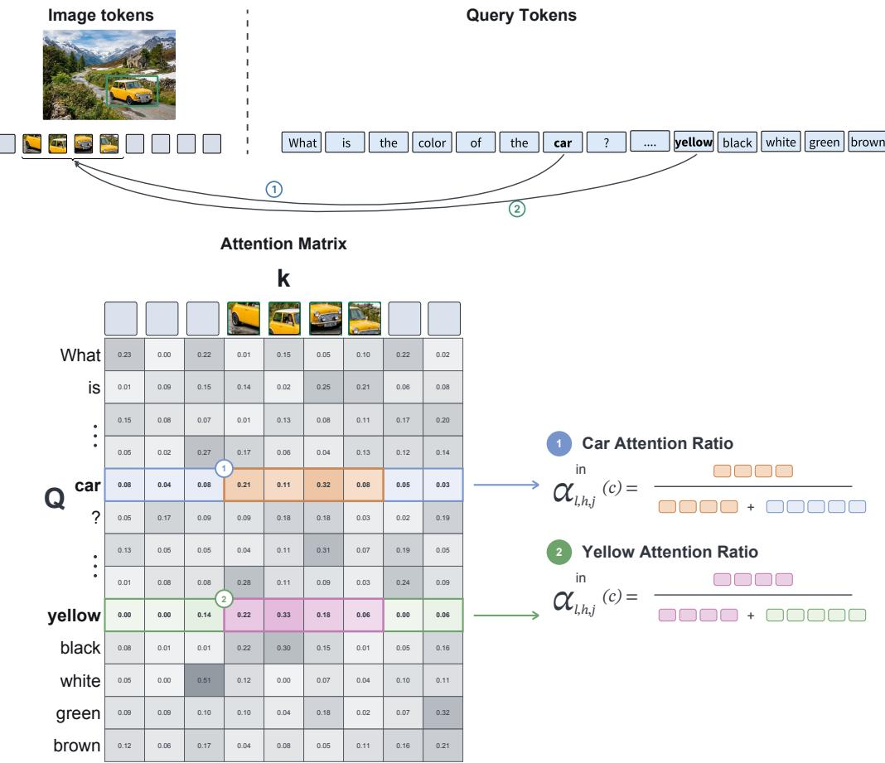  
Figure 6: Computing object and attribute attention ratios. Top: We identify the visual tokens inside the annotated object region and the tokens in query $Q$ representing the target object $\vec { ( \cdot { \cdot } _ { \mathbf { \vec { C a r } } } ) ^ { , } }$ 1) and a candidate attribute (“yellow”, 2). Bottom: The highlighted rows show attention from these concept tokens to visual tokens at one layer l and head ${ \bar { h } } .$ For each concept, attention inside the object region is summed and divided by total image attention to obtain the inside attention ratio $\alpha _ { l , h , j } ^ { \mathrm { i n } } ( c ) \overline { { ( \mathrm { E q . } 9 ) } }$

Attention-Evidence Extraction. Let c be either a candidate attribute $a \in { \mathcal { A } }$ or the target object $^ { O , }$ and let $q _ { 1 } , \ldots , q _ { m }$ be the tokens representing c in the query $Q .$ . For layer $l \in \{ 1 , \ldots , L \}$ , head $h \in \{ 1 , \ldots , H \}$ , and concept token $q _ { j }$ , let $A _ { l , h } ( q _ { j } , k _ { i } )$ denote the attention from $q _ { j }$ to visual token $k _ { i }$ . We first compute the inside and outside attention ratios, defined as the fractions of a concept token’s image attention assigned inside and outside the target-object region:

$$
\begin{array} { r } { \alpha _ { l , h , j } ^ { \mathrm { i n } } ( c ) : = \frac { \sum _ { k _ { i } \in { \cal K } _ { \mathrm { i n } } } A _ { l , h } ( q _ { j } , k _ { i } ) } { \sum _ { k _ { i } \in { \cal K } _ { \mathrm { i n } } \cup { \cal K } _ { \mathrm { o u t } } } A _ { l , h } ( q _ { j } , k _ { i } ) } , } \\ { \alpha _ { l , h , j } ^ { \mathrm { o u t } } ( c ) : = \frac { \sum _ { k _ { i } \in { \cal K } _ { \mathrm { o u t } } } A _ { l , h } ( q _ { j } , k _ { i } ) } { \sum _ { k _ { i } \in { \cal K } _ { \mathrm { i n } } \cup { \cal K } _ { \mathrm { o u t } } } A _ { l , h } ( q _ { j } , k _ { i } ) } . } \end{array}\tag{9}
$$

Thus, $\alpha _ { l , h , j } ^ { \mathrm { i n } } ( c ) + \alpha _ { l , h , j } ^ { \mathrm { o u t } } ( c ) = 1$ . Because the regions may contain different numbers of visual tokens, we divide each attention ratio by its region size, giving the inside and outside attention densities:

$$
d _ { l , h , j } ^ { \mathrm { i n } } ( c ) : = \frac { \alpha _ { l , h , j } ^ { \mathrm { i n } } ( c ) } { \vert \mathcal { K } _ { \mathrm { i n } } \vert } , d _ { l , h , j } ^ { \mathrm { o u t } } ( c ) : = \frac { \alpha _ { l , h , j } ^ { \mathrm { o u t } } ( c ) } { \vert \mathcal { K } _ { \mathrm { o u t } } \vert } .\tag{10}
$$

Under uniform attention over image patches, $d _ { l , h , j } ^ { \mathrm { i n } } ( c ) ~ = ~ d _ { l , h , j } ^ { \mathrm { o u t } } ( c )$ . We next explain how these densities are turned into the probes used in Section 4.3.

Attribute-Evidence Regression. For a candidate attribute a, we compare its inside and outside densities:

$$
p _ { l , h , j } ^ { \mathrm { i n } } ( a ) : = \frac { d _ { l , h , j } ^ { \mathrm { i n } } ( a ) } { d _ { l , h , j } ^ { \mathrm { i n } } ( a ) + d _ { l , h , j } ^ { \mathrm { o u t } } ( a ) } .\tag{11}
$$

Uniform image attention gives $p _ { l , h , j } ^ { \mathrm { i n } } ( a ) = 1 / 2$ , whereas a larger value indicates preferential attention to the target-object region. At each layer, we average over the m concept tokens and aggregate heads using one of the strategies defined in §B.2:

$$
S _ { l , \mathrm { a t t } } ^ { \mathrm { a t t r } } ( a ) : = \mathrm { A g g } _ { h = 1 } ^ { H } \left( \frac { 1 } { m } \sum _ { j = 1 } ^ { m } p _ { l , h , j } ^ { \mathrm { i n } } ( a ) \right) .\tag{12}
$$

Stacking the layer scores yields $\mathbf { S } _ { \mathrm { a t t } } ^ { \mathrm { a t t r } } ( a ) : = [ S _ { 1 , \mathrm { a t t } } ^ { \mathrm { a t t r } } ( a ) , \dots , S _ { L , \mathrm { a t t } } ^ { \mathrm { a t t r } } ( a ) ] ^ { \intercal }$ , labeled $z = 1$ when a is annotated as present on the target object and $z = 0$ otherwise.

Object-Evidence Regression. For the target object o, we retain the two densities as separate features. Averaging over its m concept tokens and aggregating heads as above gives

$$
\begin{array} { r } { S _ { l , \mathrm { a t t } } ^ { \mathrm { o b j , i n } } ( o ) : = \mathrm { A g g } _ { h = 1 } ^ { H } \left( \frac { 1 } { m } \displaystyle \sum _ { j = 1 } ^ { m } d _ { l , h , j } ^ { \mathrm { i n } } ( o ) \right) , } \\ { S _ { l , \mathrm { a t t } } ^ { \mathrm { o b j , o u t } } ( o ) : = \mathrm { A g g } _ { h = 1 } ^ { H } \left( \frac { 1 } { m } \displaystyle \sum _ { j = 1 } ^ { m } d _ { l , h , j } ^ { \mathrm { o u t } } ( o ) \right) . } \end{array}\tag{13}
$$

Stacking the layer scores gives ${ \bf S } _ { \mathrm { a t t } } ^ { \mathrm { o b j , i n } } ( o )$ and ${ \mathbf { S } } _ { \mathrm { a t t } } ^ { \mathrm { o b j , o u t } } ( o )$ . The inside vector is a positive example $( z = 1 )$ , whereas the outside vector is a negative example $( z = 0 )$ .

## C.2 LOGIT LENS

The logit lens (nostalgebraist, 2020) provides a window into the interpretability of intermediate representations, by applying the output head at every layer rather than only at the last. In VLMs, it relates visual tokens that encode specific visual information to vocabulary concepts.

We apply it to visual tokens: for the representation $h _ { l } ( k _ { i } )$ of visual token $k _ { i }$ at layer l, the head $W _ { V } \in \mathbb { R } ^ { | V | \times d }$ yields logits over the vocabulary $V ,$ , and the projected rank of each $v \in V$ is

$$
\mathrm { r a n k } _ { l } ( k _ { i } , v ) : = 1 + \big | \{ u \in V : [ W _ { V } h _ { l } ( k _ { i } ) ] _ { u } > [ W _ { V } h _ { l } ( k _ { i } ) ] _ { v } \} \big | ,\tag{14}
$$

running from one (highest scoring) to $| V |$ (lowest scoring). Because causal masking prevents visualtoken representations from attending to the question $Q ,$ , these rankings depend only on the image I.

Image token  
Figure 7 shows this projection for visual tokens sampled inside annotated VAW object regions. The depth at which object and attribute semantics emerge varies across objects, consistent with prior work placing semantic interpretation in the middle-to-late layers (Neo et al., 2025; Jiang et al., 2025a;b). For the plate, for example, the sampled in-region tokens are uninformative in the early layers and decode to plate, white and round only from the middle layers onward, covering both the object identity and its attributes, the two signals VELens probes.
<table><tr><td rowspan=1 colspan=1>on</td><td rowspan=1 colspan=1></td><td rowspan=1 colspan=1>white</td><td rowspan=1 colspan=1>round</td><td rowspan=1 colspan=1>round</td><td rowspan=1 colspan=1>top</td><td rowspan=1 colspan=1>hat</td><td rowspan=1 colspan=1>and</td><td rowspan=1 colspan=1>top</td><td rowspan=1 colspan=1>and</td><td rowspan=1 colspan=1>bowl</td><td rowspan=1 colspan=1>glass</td><td rowspan=1 colspan=1>clear</td><td rowspan=1 colspan=1>cl</td><td rowspan=1 colspan=1>bowl</td></tr><tr><td rowspan=1 colspan=1>plate</td><td rowspan=1 colspan=1>plate</td><td rowspan=1 colspan=1>plate</td><td rowspan=1 colspan=1>plate</td><td rowspan=1 colspan=1>plate</td><td rowspan=1 colspan=1>hat</td><td rowspan=1 colspan=1>hat</td><td rowspan=1 colspan=1>red</td><td rowspan=1 colspan=1>hat</td><td rowspan=1 colspan=1>hat</td><td rowspan=1 colspan=1>bowl</td><td rowspan=1 colspan=1>bowl</td><td rowspan=1 colspan=1>glass</td><td rowspan=1 colspan=1>cloth</td><td rowspan=1 colspan=1>bowl</td></tr><tr><td rowspan=1 colspan=1>plate</td><td rowspan=1 colspan=1>plate</td><td rowspan=1 colspan=1>white</td><td rowspan=1 colspan=1>white</td><td rowspan=1 colspan=1>white</td><td rowspan=1 colspan=1>hat</td><td rowspan=1 colspan=1>red</td><td rowspan=1 colspan=1>red</td><td rowspan=1 colspan=1>hat</td><td rowspan=1 colspan=1>hat</td><td rowspan=1 colspan=1>bowl</td><td rowspan=1 colspan=1>bowl</td><td rowspan=1 colspan=1>glass</td><td rowspan=1 colspan=1>drap</td><td rowspan=1 colspan=1>bowl</td></tr><tr><td rowspan=1 colspan=1>plate</td><td rowspan=1 colspan=1>plates</td><td rowspan=1 colspan=1>white</td><td rowspan=1 colspan=1>white</td><td rowspan=1 colspan=1>white</td><td rowspan=1 colspan=1>/******</td><td rowspan=1 colspan=1>/hat</td><td rowspan=1 colspan=1>red</td><td rowspan=1 colspan=1>hat</td><td rowspan=1 colspan=1>hat</td><td rowspan=1 colspan=1>bowl</td><td rowspan=1 colspan=1>bowl</td><td rowspan=1 colspan=1>glass</td><td rowspan=1 colspan=1>drap</td><td rowspan=1 colspan=1>bowl</td></tr><tr><td rowspan=1 colspan=1>sau</td><td rowspan=1 colspan=1>thin</td><td rowspan=1 colspan=1>edges</td><td rowspan=1 colspan=1>white</td><td rowspan=1 colspan=1>white</td><td rowspan=1 colspan=1>helmet</td><td rowspan=1 colspan=1>helmet</td><td rowspan=1 colspan=1>colored</td><td rowspan=1 colspan=1>hat</td><td rowspan=1 colspan=1>helmet</td><td rowspan=1 colspan=1>ouw</td><td rowspan=1 colspan=1>glass</td><td rowspan=1 colspan=1>éric</td><td rowspan=1 colspan=1>covering</td><td rowspan=1 colspan=1>bowl</td></tr><tr><td rowspan=1 colspan=1>?</td><td rowspan=1 colspan=1>plates</td><td rowspan=1 colspan=1>lined</td><td rowspan=1 colspan=1>white</td><td rowspan=1 colspan=1>brushed</td><td rowspan=1 colspan=1>helmet</td><td rowspan=1 colspan=1>hat</td><td rowspan=1 colspan=1>color</td><td rowspan=1 colspan=1>hat</td><td rowspan=1 colspan=1>helmet</td><td rowspan=1 colspan=1>basket</td><td rowspan=1 colspan=1>bowl</td><td rowspan=1 colspan=1>emat</td><td rowspan=1 colspan=1>sheets</td><td rowspan=1 colspan=1>bowl</td></tr><tr><td rowspan=1 colspan=1>?</td><td rowspan=1 colspan=1>slic</td><td rowspan=1 colspan=1>dried</td><td rowspan=1 colspan=1>slow</td><td rowspan=1 colspan=1>RP</td><td rowspan=1 colspan=1>helmet</td><td rowspan=1 colspan=1>hat</td><td rowspan=1 colspan=1>colored</td><td rowspan=1 colspan=1>hat</td><td rowspan=1 colspan=1>helmet</td><td rowspan=1 colspan=1>ctl</td><td rowspan=1 colspan=1>glass</td><td rowspan=1 colspan=1>oly</td><td rowspan=1 colspan=1>drap</td><td rowspan=1 colspan=1>bowl</td></tr><tr><td rowspan=1 colspan=1>pT</td><td rowspan=1 colspan=1>slic</td><td rowspan=1 colspan=1>streak</td><td rowspan=1 colspan=1>slow</td><td rowspan=1 colspan=1>y</td><td rowspan=1 colspan=1>hausen</td><td rowspan=1 colspan=1>Hat</td><td rowspan=1 colspan=1>colored</td><td rowspan=1 colspan=1>hat</td><td rowspan=1 colspan=1>helmet</td><td rowspan=1 colspan=1>dinner</td><td rowspan=1 colspan=1>odes</td><td rowspan=1 colspan=1>arto</td><td rowspan=1 colspan=1>coll</td><td rowspan=1 colspan=1>bowl</td></tr><tr><td rowspan=1 colspan=1>?</td><td rowspan=1 colspan=1>slic</td><td rowspan=1 colspan=1>streak</td><td rowspan=1 colspan=1>slow</td><td rowspan=1 colspan=1>ò</td><td rowspan=1 colspan=1>hausen</td><td rowspan=1 colspan=1>Hat</td><td rowspan=1 colspan=1>colored</td><td rowspan=1 colspan=1>hat</td><td rowspan=1 colspan=1>helmet</td><td rowspan=1 colspan=1>dinner</td><td rowspan=1 colspan=1>odes</td><td rowspan=1 colspan=1>arto</td><td rowspan=1 colspan=1>coll</td><td rowspan=1 colspan=1>bowl</td></tr></table>

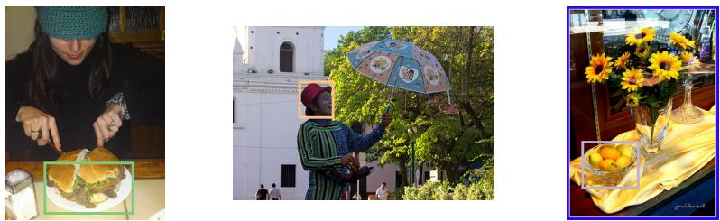  
Figure 7: Logit-lens projection of visual tokens inside annotated object regions. Qualitative examples from VAW in LLaVA, for three target objects: a plate (green), a hat (orange), and a bowl (purple). Top: For each object, we randomly sample five visual tokens $k _ { i }$ from its inside-region set $\kappa _ { \mathrm { i n } }$ and show, at every layer l, the top-ranked vocabulary token, i.e. the $v \in V$ with rankl $( k _ { i } , v ) = 1$ (Eq. 14). Color intensity indicates the top-1 probability. Bottom: The corresponding images, each with the annotated bounding box b of its target object in the matching color. Semantics emerge at different depths across the three objects: the plate tokens are uninformative until the middle layers and then decode to plate, white and round, whereas hat and bowl are already top-ranked in the earliest layers, with red and glass following later.

## C.3 DATASET PREPROCESSING

Filtering and normalization. We preprocess the dataset to ensure unambiguous supervision and improve compatibility with our vocabulary-based analysis. Specifically, (1) we remove object instances containing multiple present attributes within the same category, since such cases do not define a unique target attribute; (2) we filter out images containing multiple instances of the same object category with different attribute annotations, as this may introduce ambiguity regarding which instance the model refers to; and (3) we normalize fine-grained attribute values into canonical forms (e.g., light brown and dark brown → brown) to reduce label sparsity and improve alignment with vocabulary-level representations, yielding 11 colors, 15 materials, and 5 shapes, with the full map ping given in Table 3.

Question construction. Each VAW instance provides an object name o, a region (polygon or bounding box), and a set of present and absent attributes. From every instance we construct one question per attribute category a ∈ {color, material, shape} for which the instance carries a ground-truth value. We use the object name exactly as it appears in the annotation. The region is not shown to the model and only serves to select the visual tokens that VELens uses for evidence detection (§4.1). All questions follow a single template, shared by both models (Figure 8).

Here $\mathcal { V } _ { a } = \{ v _ { 1 } , \ldots , v _ { k } \}$ is the canonical option set for category a (Table 2), whose order is randomly permuted per instance so that the correct answer is not tied to a fixed position. Each permutation is drawn once and then cached: every subsequent run reuses the identical stored prompt, including the controlled-transformation conditions of §D.4, so that differences in behavior across conditions cannot be attributed to a change in option order. The filled template is then wrapped in each model’s own chat format.

Template.   
What is the {a} of the {o}? Answer with exactly ONE of the   
following options, and output only the option text: v1, v2, ...,   
vk.   
Example (category color, object traffic light).   
What is the color of the traffic light? Answer with exactly ONE   
of the following options, and output only the option text: purple,   
white, red, brown, yellow, black, green, gray, pink, blue, orange.   
Chat format, with the question above as {q}.   
LLaVA:   
[INST] <image> {q} [/INST]   
Qwen:   
<|im start|>system   
You are a helpful assistant.<|im end|>   
<|im start|>user   
<|vision start|><|image pad|><|vision end|>{q}<|im end|>   
<|im start|>assistant  
Figure 8: Question template, an example question, and the per-model chat formats. The template is filled with the attribute category a, the object name $^ { O , }$ and the canonical option set $\nu _ { a }$ in a randomly permuted order. The filled question, denoted {q}, is then wrapped in each model’s chat format.

Table 2: Canonical option sets. The options presented to the model for each attribute category.
<table><tr><td>Category</td><td>k</td><td>Options</td></tr><tr><td>Color</td><td>11</td><td>black, blue, brown, gray, green, orange, pink, purple, red, white, yellow</td></tr><tr><td>Material</td><td>15</td><td>wood, metal, glass, plastic, rubber, foam, paper, fabric, leather, fur, ceramic, stone, dirt, snow, water</td></tr><tr><td>Shape</td><td>5</td><td>round, square, curved, triangular, curly</td></tr></table>

Answer generation. We keep the VLM frozen and decode greedily (do sample=False, num beams=1, max new tokens=10), so answers are reproducible across runs. The answer is generated rather than scored against the candidates, and the option list appears in the prompt only to constrain the output to a known vocabulary, so that predictions can be compared against VAW labels without a free-text matching step.

Table 3: Attribute-value normalization. Each canonical value is listed with the full set of raw VAW attribute strings mapped onto it.  
Canonical value VAW values mapped onto it   
Color (61 raw → 11 canonical)   
black black   
blue aqua, blue, bluish, bright blue, dark blue, light blue, navy blue, pale blue, teal, turquoise   
brown bronze, brown, dark brown, golden brown, light brown, tan, taupe   
gray dark gray, gray, light gray, murky, off white, silver   
green bright green, dark green, green, green tinted, light green, lime green, neon green, olive   
green, pale green   
orange orange, rust colored, terracotta   
pink dark pink, fuchsia, pink   
purple dark purple, purple, purplish, violet   
red bright red, burgundy, dark red, light red, maroon, red, reddish   
white beige, cream colored, ivory, white   
yellow amber, blond, bright yellow, golden, light yellow, sand colored, yellow   
Material (50 raw → 15 canonical)   
wood bamboo, hardwood, wicker, wooden   
metal aluminum, brass, chrome, iron, metal, stainless steel, steel   
glass glass   
plastic plastic   
rubber rubber   
foam foamy, styrofoam   
paper cardboard, paper   
fabric cloth, denim, fabric, jean, khaki, silk   
leather leather   
fur fluffy, furry, plush   
ceramic ceramic, clay, porcelain, tiled   
stone asphalt, brick, cement, cobblestone, concrete, granite, gravel, marble, pebbled, red   
brick, rocky, stone, stucco   
dirt dirt, muddy, sandy   
snow snowy   
water water   
Shape (20 raw → 5 canonical)   
round circular, domed, oval shaped, round, rounded, spherica   
square cubed, rectangular, square   
curved arch shaped, curved, cylindrical   
triangular arrow shaped, diamond shaped, octagonal, pointy, spiky, triangular   
curly curled, curly

## D COMPLEMENTARY RESULTS

## D.1 DEVELOPMENT-SET CONFIGURATION SELECTION

Development Split. To choose the configuration of our rank-based method and of each baseline, we randomly divided the original training split into 60% for fitting the candidate estimators and 40% for development-set evaluation. Only these training-derived subsets were used for configuration selection, leaving the test set untouched. Tables 4 and 5 report development-set performance for every configuration considered, on LLaVA and Qwen and separately for color, material, and shape. AUC is threshold-free, whereas F1 and accuracy are computed at a probability threshold of 0.5, at which a probe declares the evidence present.

Attribute-Evidence Configurations. Following Section 5, we varied two design choices: the aggregation strategy used to summarize visual-token signals (§B.2), and the pooling configuration, which determines whether one estimator is shared across all values in a category (All) or one is fitted per value (Separate). This yields 18 configurations per model and attribute category (8 rank-based, 2 confidence-based, 2 classifier-based, and 6 attention-based). For the rank-based method we crossed both pooling configurations with the minimum, maximum, mean, and median aggregation strategies. The confidence-based baseline was evaluated with both pooling configurations but requires no aggregation strategy, as it retains a single maximum confidence value. The classifier-based baseline is inherently Separate, and we tested the mean and maximum strategies. For the attention-based baseline we crossed both pooling configurations with the mean, median, and maximum strategies.

Object-Evidence Configurations. For object evidence a single estimator is shared across object categories, so the distinction between All and Separate does not apply. We evaluated eight configurations: four rank aggregation strategies, the confidence baseline without an aggregation strategy, and three attention aggregation strategies. We do not evaluate the classifier baseline for objects, because its fixed label space is incompatible with the open-ended object vocabulary.

Selected Configurations. We selected one aggregation strategy per method, shared across attribute categories and across both VLMs, favoring the strategy that was strongest across AUC, F1, and accuracy. For attribute evidence this gives the mean strategy for the rank- and classifier-based methods and the maximum strategy for the attention-based baseline, and for object evidence the median strategy for the rank- and attention-based methods. Pooling is treated differently: we keep both All and Separate for the rank-, confidence-, and attention-based estimators, as they are two distinct estimators, one shared across the values of a category and one fitted per value. After fixing these choices we refit each estimator on the complete training split, the 60% fitting and 40% development portions combined, and evaluated it once on the held-out test set, giving the results reported in Table 1.

Differences Across Attribute Categories. The rank-based results in Table 4 follow the same ordering in both models: color and material yield comparably strong evidence, whereas shape is consistently the most challenging. A plausible explanation is the amount of visual context each property requires, even for a human observer. A small patch near the center of a red wooden table may be enough to identify its color, and the grain visible on that same surface likewise reveals its material. Deciding whether the tabletop is round or rectangular, by contrast, requires seeing its outer boundary, so no local region is sufficient. Shape is therefore the property least likely to be recoverable from the tokens inside the annotated object region.

Table 4: Development-set attribute-evidence prediction. AUC, F1, and accuracy for the attribute probe $M _ { \mathrm { a t t r } }$ under every combination of pooling configuration (All, Separate) and aggregation strategy (§B.2), reported for LLaVA and Qwen and grouped by attribute category. Bold marks the best value in each column within a method and pooling configuration.
<table><tr><td>Category</td><td>Method</td><td>Aggregation</td><td colspan="3">LLaVA AUC F1</td><td colspan="3">Qwen AUC F1</td></tr><tr><td></td><td></td><td>Attribute: Color Min</td><td> $N _ { \mathrm { L L a V A } } = N _ { \mathrm { Q w e n } } = 7 6 8$  0.65</td><td>0.54</td><td>Acc. 0.62</td><td>0.70 0.61</td><td>Acc. 0.66</td></tr><tr><td>Rank-based</td><td>All All All All Separate Separate Separate Separate</td><td>Max Mean Median Min Max Mean Median</td><td>0.75 0.95 0.94 0.55 0.56 0.96 0.96</td><td>0.75 0.89 0.88 0.66 0.68 0.89 0.90</td><td>0.70 0.88 0.88 0.53 0.53 0.89 0.89</td><td>0.76 0.74 0.91 0.82 0.90 0.82 0.70 0.62 0.75 0.75 0.92 0.83 0.90 0.81</td><td>0.70 0.82 0.81 0.66 0.72 0.83 0.81</td></tr><tr><td>Confidence-based</td><td>All Separate</td><td></td><td>0.79 0.81</td><td>0.73 0.76</td><td>0.70 0.73</td><td>0.79 0.72 0.79 0.73 0.84</td><td>0.71 0.72 0.84</td></tr><tr><td>Classifier-based Attention-based</td><td>Separate Separate All All</td><td>Mean Max Mean</td><td>0.92 0.90 0.78 0.76</td><td>0.85 0.82 0.71 0.70</td><td>0.85 0.82 0.72 0.71</td><td>0.92 0.88 0.78 0.80 0.73 0.75 0.71</td><td>0.79 0.73 0.70</td></tr><tr><td></td><td>All Separate Separate Separate</td><td>Median Max Mean Median Max</td><td>0.79 0.76 0.75 0.78</td><td>0.72 0.70 0.69 0.72</td><td>0.72 0.69 0.69 0.71</td><td>0.79 0.73 0.77 0.70 0.74 0.68 0.79 0.73</td><td>0.72 0.70 0.68 0.72</td></tr><tr><td>Rank-based</td><td>All All All All Separate Separate Max</td><td>Attribute: Material Min Max Mean Median Min</td><td>0.62 0.75 0.90 0.89 0.77 0.83</td><td> $N _ { \mathrm { L L a V A } } = N _ { \mathrm { Q w e n } } = 6 3 2$  0.54 0.76 0.81 0.81 0.68 0.78</td><td>0.59 0.71 0.81 0.81 0.71 0.76</td><td>0.64 0.54 0.81 0.78 0.86 0.80 0.86 0.79 0.67 0.59 0.86 0.78</td><td>0.59 0.76 0.80 0.79 0.62 0.77</td></tr><tr><td>Confidence-based</td><td>Separate Separate All Separate</td><td>Mean Median</td><td>0.97 0.96 0.85 0.87</td><td>0.91 0.90 0.77 0.78</td><td>0.91 0.90 0.77 0.78</td><td>0.95 0.86 0.94 0.85 0.83 0.75 0.85 0.76</td><td>0.87 0.85 0.76 0.77</td></tr><tr><td>Classifier-based</td><td>Separate Separate</td><td>Mean Max</td><td>0.92 0.92</td><td>0.85 0.85</td><td>0.84 0.85</td><td>0.92 0.86 0.92 0.86</td><td>0.85 0.86 0.67</td></tr><tr><td>Attention-based</td><td>All All All Separate Separate Separate</td><td>Mean Median Max Mean Median</td><td>0.70 0.70 0.71 0.72 0.71</td><td>0.65 0.65 0.65 0.66 0.66</td><td>0.64 0.65 0.64 0.67 0.65</td><td>0.74 0.69 0.71 0.69 0.77 0.72 0.73 0.69 0.71 0.65</td><td>0.67 0.70 0.68 0.64</td></tr><tr><td>Rank-based</td><td>All All All</td><td>Max Attribute: Shape Min Max Mean</td><td>0.74  $N _ { \mathrm { L L a V A } } = N _ { \mathrm { Q w e n } } = 4 8 0$  0.61 0.53 0.84</td><td>0.68 0.55 0.67 0.76</td><td>0.67 0.59 0.54 0.75</td><td>0.75 0.70 0.56 0.44 0.72 0.69 0.83 0.74</td><td>0.69 0.54 0.66 0.74</td></tr><tr><td></td><td>All Separate Separate Separate Separate</td><td>Median Min Max Mean Median</td><td>0.78 0.66 0.55 0.90 0.85</td><td>0.73 0.64 0.64 0.82 0.78</td><td>0.72 0.62 0.54 0.81 0.78</td><td>0.77 0.70 0.57 0.49 0.73 0.66 0.88 0.78 0.82 0.72</td><td>0.70 0.57 0.65 0.78 0.72</td></tr><tr><td>Confidence-based</td><td>All Separate Separate</td><td>Mean</td><td>0.70 0.72 0.82</td><td>0.62 0.63 0.74</td><td>0.64 0.66 0.74</td><td>0.72 0.64 0.74 0.66 0.84 0.77</td><td>0.66 0.67 0.77</td></tr><tr><td>Classifier-based</td><td>Separate All All</td><td>Max Mean</td><td>0.80 0.64</td><td>0.75 0.62 0.63</td><td>0.75 0.61 0.62</td><td>0.83 0.76 0.65 0.61</td><td>0.75 0.59 0.61</td></tr><tr><td>Attention-based</td><td>All Separate Separate Separate</td><td>Median Max Mean Median Max</td><td>0.65 0.67 0.67 0.67 0.70</td><td>0.63 0.62 0.63 0.65</td><td>0.60 0.61 0.62 0.62</td><td>0.65 0.61 0.63 0.62 0.66 0.61 0.66 0.61 0.66 0.64</td><td>0.59 0.60 0.60 0.61</td></tr></table>

Table 5: Development-set object-evidence prediction. AUC, F1, and accuracy for the object probe $M _ { \mathrm { o b j } }$ under each aggregation strategy (§B.2), reported for LLaVA and Qwen and grouped by the attribute category of the query. Pooling does not apply here, as a single estimator is shared across object categories. Bold marks the best value in each column within a method.
<table><tr><td rowspan="2" colspan="2">Category</td><td colspan="3">LLaVA</td><td colspan="3">Qwen</td></tr><tr><td>AUC</td><td>F1</td><td>Acc.</td><td>AUC</td><td>F1</td><td>Acc.</td></tr><tr><td colspan="8">Attribute: Color  $N _ { \mathrm { L L a V A } } = N _ { \mathrm { Q w e n } } = 1 { , } 4 9 4$ </td></tr><tr><td rowspan="4">Rank-based</td><td>Min</td><td>0.52</td><td>0.33</td><td>0.53</td><td>0.75</td><td>0.65</td><td>0.70</td></tr><tr><td>Max</td><td>0.87</td><td>0.75</td><td>0.77</td><td>0.90</td><td>0.82</td><td>0.82</td></tr><tr><td>Mean</td><td>0.88</td><td>0.80</td><td>0.80</td><td>0.81</td><td>0.74</td><td>0.75</td></tr><tr><td>Median</td><td>0.91</td><td>0.83</td><td>0.82</td><td>0.83</td><td>0.76</td><td>0.75</td></tr><tr><td>Confidence-based</td><td>一</td><td>0.54</td><td>0.60</td><td>0.52</td><td>0.56</td><td>0.60</td><td>0.54</td></tr><tr><td rowspan="3">Attention-based</td><td>Mean</td><td>1.00</td><td>0.98</td><td>0.98</td><td>0.96</td><td>0.93</td><td>0.94</td></tr><tr><td>Median</td><td>1.00</td><td>0.99</td><td>0.99</td><td>0.96</td><td>0.93</td><td>0.94</td></tr><tr><td>Max</td><td>1.00</td><td>0.97</td><td>0.97</td><td>0.97</td><td>0.93</td><td>0.93</td></tr><tr><td colspan="8">Attribute: Material  $N _ { \mathrm { L L a V A } } = N _ { \mathrm { Q w e n } } = 1 , 2 2 4$ </td></tr><tr><td rowspan="4">Rank-based</td><td>Min</td><td>0.51</td><td>0.29</td><td>0.53</td><td>0.74</td><td>0.65</td><td>0.70</td></tr><tr><td>Max</td><td>0.86</td><td>0.75</td><td>0.77</td><td>0.89</td><td>0.80</td><td>0.81</td></tr><tr><td>Mean</td><td>0.89</td><td>0.81</td><td>0.80</td><td>0.83</td><td>0.75</td><td>0.75</td></tr><tr><td>Median</td><td>0.91</td><td>0.84</td><td>0.83</td><td>0.85</td><td>0.78</td><td>0.78</td></tr><tr><td>Confidence-based</td><td>一</td><td>0.52</td><td>0.59</td><td>0.51</td><td>0.58</td><td>0.61</td><td>0.54</td></tr><tr><td rowspan="3">Attention-based</td><td>Mean</td><td>1.00</td><td>0.98</td><td>0.98</td><td>0.97</td><td>0.94</td><td>0.94</td></tr><tr><td>Median</td><td>1.00</td><td>0.99</td><td>0.99</td><td>0.96</td><td>0.93</td><td>0.93</td></tr><tr><td>Max</td><td>0.99</td><td>0.95</td><td>0.96</td><td>0.96</td><td>0.92</td><td>0.92</td></tr><tr><td></td><td colspan="7">Attribute: Shape  $N _ { \mathrm { L L a V A } } = N _ { \mathrm { Q w e n } } = 9 4 0$ </td></tr><tr><td rowspan="4">Rank-based</td><td>Min</td><td>0.51</td><td>0.34</td><td>0.54</td><td>0.76</td><td>0.67</td><td>0.71</td></tr><tr><td>Max</td><td>0.87</td><td>0.76</td><td>0.78</td><td>0.92</td><td>0.83</td><td>0.83</td></tr><tr><td>Mean</td><td>0.88</td><td>0.80</td><td>0.79</td><td>0.87</td><td>0.80</td><td>0.80</td></tr><tr><td>Median</td><td>0.91</td><td>0.83</td><td>0.81</td><td>0.87</td><td>0.81</td><td>0.80</td></tr><tr><td>Confidence-based</td><td>一</td><td>0.53</td><td>0.62</td><td>0.52</td><td>0.60</td><td>0.61</td><td>0.55</td></tr><tr><td rowspan="3">Attention-based</td><td>Mean</td><td>1.00</td><td>0.98</td><td>0.99</td><td>0.98</td><td>0.95</td><td>0.95</td></tr><tr><td>Median</td><td>1.00</td><td>0.99</td><td>0.99</td><td>0.98</td><td>0.94</td><td>0.94</td></tr><tr><td>Max</td><td>0.99</td><td>0.96</td><td>0.96</td><td>0.97</td><td>0.92</td><td>0.93</td></tr></table>

## D.2 JOINT OBJECT-AND-ATTRIBUTE AUC

The Attr×Obj column of Table 1 evaluates the composite probe $M = M _ { \mathrm { o b j } } \land M _ { \mathrm { a t t r } }$ (§3.3), which is correct only when the target object is detected and the attribute decision matches the annotation, whether the attribute is present or absent. Reporting this as a single ROC-AUC requires one score per instance. Let $p _ { \mathrm { a t t r } }$ and $p _ { \mathrm { o b j } }$ denote the probabilities produced by the two probes before thresholding (Eqs. 2 and 3), with the object probe evaluated on the inside region $\kappa _ { \mathrm { i n } } .$ , and define

$$
s : = p _ { \mathrm { o b j } } ( 2 p _ { \mathrm { a t t r } } - 1 ) .\tag{15}
$$

The sign of s carries the attribute decision and its magnitude the object evidence: positive when the target value is supported, negative when it is rejected, and near zero when the object is not localized. The two kinds of correct decision therefore fall at opposite ends of the ranking, while instances lacking object evidence support neither. We report the area under the ROC curve obtained by ranking instances by s, with $y = 1$ when the attribute is annotated as present on the target object and $y = 0$ otherwise, pooled over color, material, and shape $( N = 3 , 1 2 8 )$

## D.3 ROC CURVES

Figure 9 shows the curves behind the attribute AUCs in Table 1. On LLaVA the rank-based probe dominates every baseline across the whole range, so its advantage does not depend on the threshold chosen, whereas on Qwen the classifier-based baseline is comparable to it.

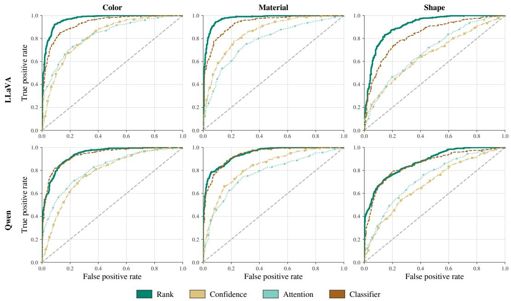  
Figure 9: ROC curves for attribute-evidence detection. True-positive against false-positive rate for each method, shown for LLaVA (top) and Qwen (bottom) and separately for color, material, and shape, using the Separate pooling configuration. The areas under these curves are the attribute columns of Table 1. The dashed diagonal marks chance.

## D.4 CONTROLLED TRANSFORMATIONS

We instantiate the answer-preserving transformations $\psi _ { + }$ and $\psi _ { - }$ of Section 3.2 as pixel-level image edits, applied separately for each target-object instance. The positive transformation strengthens the relevant visual signal, while the negative transformation weakens it. Following Section 4.1, let o denote the target object and b its annotated bounding box, and let $I _ { p } \in [ 0 , 1 ] ^ { 3 }$ be the normalized RGB value of pixel $p$ in I. Both transformations act only on the image component of the input

Noise reduction  
0% (clean)  
10%  
30%  
90%  
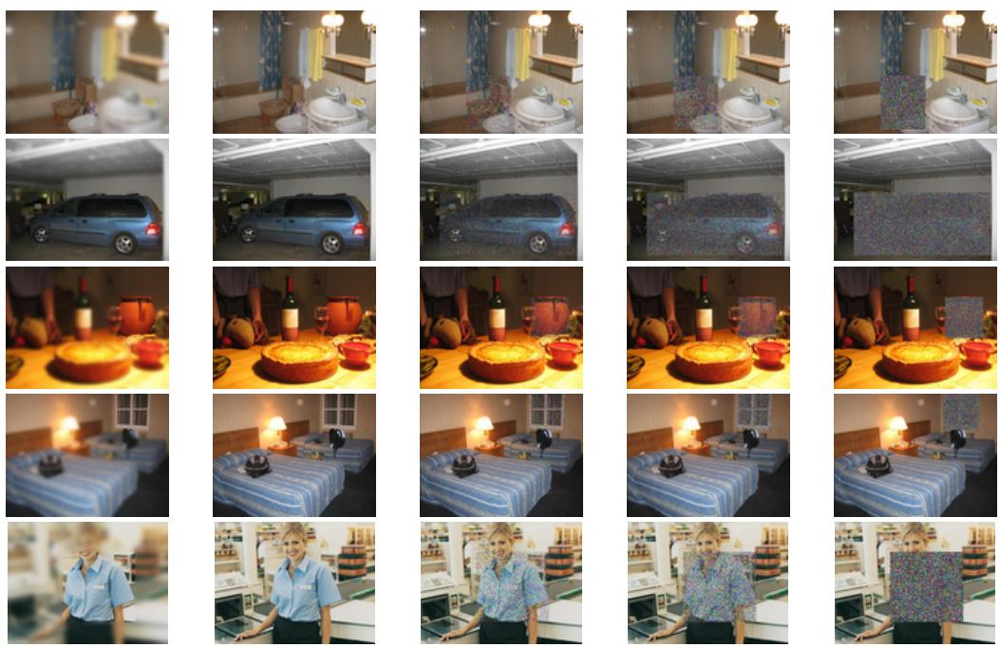  
Figure 10: Controlled transformations. Five images from the VAW dataset (rows) with each transformation applied (columns): the object emphasized by blurring its surroundings $( \psi _ { + } )$ , the clean image, and Gaussian noise within the bounding box b at $\lambda = 0 . 1 \bar { , } 0 . 3$ , and $0 . 9 \left( \psi _ { - } \right)$

$X = ( I , Q )$ , so that $X _ { + } = ( I _ { + } , Q )$ and $X _ { - } = ( I _ { - } , Q )$ . Values are clipped to [0, 1] and converted back to 8-bit RGB.

Object Emphasis $( \psi _ { + } )$ . The positive transformation highlights the relevant object, strengthening its visual signal by suppressing the surrounding context while leaving the queried object itself visually unchanged. We blur the full RGB image with a 2D Gaussian filter of kernel size $k = 4 1$ and standard deviation $\sigma = k / 6 \approx 6 . 8 3$ , so that the kernel spans approximately ±3σ of the Gaussian, and composite the result with the original using the bounding box b as a binary object mask:

$$
( I _ { + } ) _ { p } = \left\{ { \begin{array} { l l } { I _ { p } , } & { p \in b , } \\ { ( G _ { \sigma } * I ) _ { p } , } & { p \notin b , } \end{array} } \right.\tag{16}
$$

where $G _ { \sigma } * I$ denotes the blurred image. The blur removes the edges, texture, and small structures of the background, leaving only its coarse layout and color, while the appearance of o inside b remains identical to $I ,$ so the ground-truth answer is preserved, i.e., $Y _ { X _ { + } } = \bar { Y _ { X } }$

Object Degradation (ψ−). The negative transformations corrupt only the pixels in the bounding box b. For each pixel and RGB channel, we independently sample $\varepsilon _ { p } \sim \mathcal { N } ( 0 , 1 )$ and compute

$$
( I _ { - } ) _ { p } = \left\{ \begin{array} { l l } { \mathrm { c l i p } _ { [ 0 , 1 ] } \Big ( \sqrt { 1 - \lambda } I _ { p } + \sqrt { \lambda } \varepsilon _ { p } \Big ) , } & { p \in b , } \\ { I _ { p } , } & { p \notin b . } \end{array} \right.\tag{17}
$$

As λ grows, the corrupted region retains less of the original image and more Gaussian noise: at $\lambda = 0 . 1$ 1 the object region is only lightly perturbed, whereas at $\lambda = 0 . 9$ the noise dominates and the original content is almost entirely replaced. We report the noise strength of this diffusion-style Gaussian corruption as 100λ%, so that 10%, 30%, and 90% correspond to $\lambda = 0 . 1 , 0 . 3 .$ , and 0.9, respectively. The strength λ controls a trade-off: it must weaken the relevant visual signal, yet the transformation must remain answer-preserving. On the validation set we therefore select $\lambda = 0 . 3$ as ψ−, the strength at which the object region is visibly corrupted but the ground-truth answer is still unchanged, $\mathbf { i . e . , } Y _ { X _ { - } } = Y _ { X } $ . Figure 10 illustrates this choice: the target object remains identifiable at $\lambda = 0 . 3$ , whereas at $\lambda = 0 . 9$ it is largely destroyed and the correct answer is no longer recoverable. This is the transformation used to construct the bounds of Theorem 1.

## D.5 LAYER-WISE VISUAL-EVIDENCE DEVELOPMENT

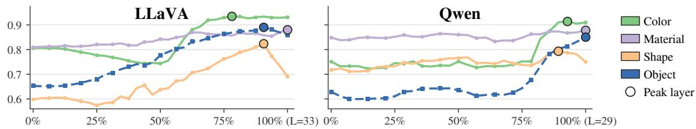  
Figure 11: Visual-evidence development across VLM layers. Layer-wise attribute and object evidence for LLaVA (left) and Qwen (right). The figure reports the AUC obtained from each individual layer. The complete trajectory captures evidence that becomes accessible at different depths across attributes and models.

## D.6 ATTENTION INTERVENTION

Intervention. Because evidence does not become accessible at a universal layer (Figure 11), we intervene at every layer and head rather than at a selected one. As in Section C.1, let $A _ { l , h } ( q _ { j } , k _ { i } )$ denote the attention from query token $q _ { j } \in Q$ to visual token $k _ { i }$ at layer l and head $h ,$ let $z _ { l , h } ( q _ { j } , \cdot )$ be the corresponding pre-softmax logits, and let $\kappa _ { \mathrm { i n } }$ be the visual tokens inside the annotated targetobject region b (Section 4.1). For every query token we add a constant α to the logits of the inside tokens before the softmax:

$$
\tilde { A } _ { l , h } ( q _ { j } , u ) = \frac { \exp \left( z _ { l , h } ( q _ { j } , u ) + \alpha \mathbb { I } \{ u \in \mathcal { K } _ { \mathrm { i n } } \} \right) } { \sum _ { u ^ { \prime } } \exp \left( z _ { l , h } ( q _ { j } , u ^ { \prime } ) + \alpha \mathbb { I } \{ u ^ { \prime } \in \mathcal { K } _ { \mathrm { i n } } \} \right) } ,\tag{18}
$$

where $u , u ^ { \prime }$ range over all positions attended by $q _ { j }$ . Because the softmax normalizes over all positions, this is equivalent to scaling the attention paid to the inside tokens by $e ^ { \alpha }$ , so attention elsewhere is reduced proportionally rather than removed. A single α is used for every layer, head, and model.

Choosing the Intervention Strength. A larger α corrects more errors, but it also risks overwriting answers that were already correct, so we choose the largest value whose collateral cost stays small. Let C be the examples for color, material, and shape whose open-ended baseline answer already matches the ground truth. Re-asking the same question under the intervention, the damage rate is the fraction of these that become incorrect:

$$
\operatorname { D a m a g e R a t e } ( \alpha ) = { \frac { \left| \left\{ x \in { \mathcal { C } } : f _ { \alpha } ( x ) { \mathrm { i n c o r r e c t } } \right\} \right| } { | { \mathcal { C } } | } } .
$$

Averaged over the three attributes, it is 3.26% at $\alpha { = } 1 ( e ^ { \alpha } \approx 2 . 7 ) , 4 . 7 4 \%$ at $\alpha { = } 2 \ ( \approx 7 . 4 )$ , and 9.99% at $\alpha { = } 3 \left( \approx  2 0 \right)$ ). We use $\alpha { = } 2$ , the largest strength that keeps the damage rate below 5%.

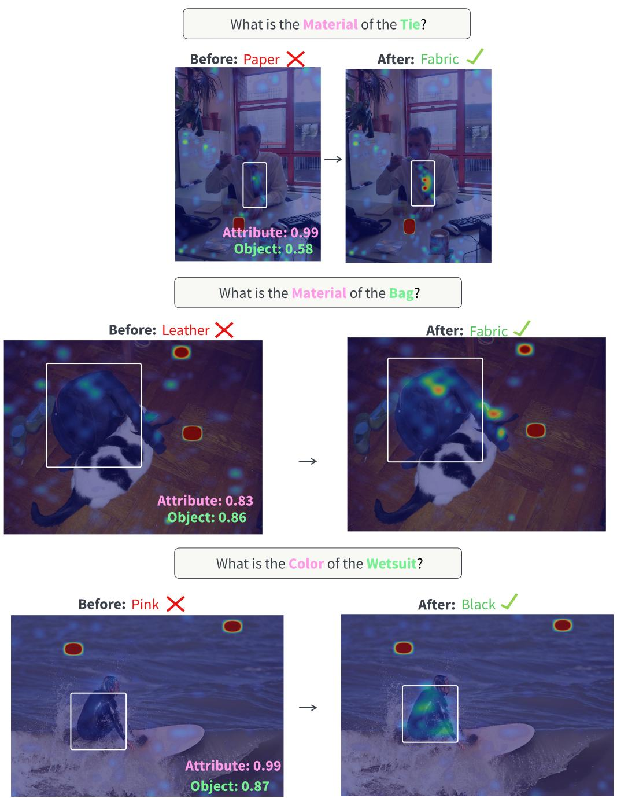  
Figure 12: Additional examples of the attention intervention. Extends Figure 5. Three evidencepositive errors, where VELens detects both object and attribute evidence (scores shown per panel), and increasing attention to the annotated target-object region corrects the answer. Each panel shows attention from the last prompt token to image patches, averaged over the last four decoder layers (head-mean). Left: no intervention. Right: prompt→ inside-object visual-token attention increased at strength α=2, chosen as described in §D.6.

## E VELENS BEYOND THE EVALUATED QUESTION SET

Our experiments focus on a controlled class of visual questions: attribute questions about a known target object, with color, material, or shape as the queried category. This setting allows visualevidence detection to be evaluated precisely, as the evidence required for answering is known and spatially grounded in an annotated object region b. The formulation of Section 3.1 is not restricted to this class. It asks whether the VLM representations contain sufficient evidence to support the ground-truth answer, while VELens operationalizes that evidence through three inputs: a target token set $\tau ^ { + }$ , a competing token set $\mathcal { T } ^ { \bar { - } }$ , and the visual tokens $\kappa$ over which evidence is measured. For object-attribute questions, this evidence is further decomposed into object and attribute components (Section 3.3). We characterize here which broader classes of questions admit analogous decompositions, and which require further extensions of the probe.

## E.1 A TAXONOMY OF VISUAL QUESTIONS

Visual questions can be categorized along several dimensions. Linguistically, they may be polar questions (“Is the car yellow $\check { ? } { } ^ { \flat } )$ or wh-questions requesting an object, attribute, location, or number (“What color is the $c a r ? ^ { \prime }$ , “Where is the dog?”, “How many cars are there?”). Semantically, they may concern object existence or identity, one or several attributes, relations between objects, counting, or information requiring external knowledge. Most importantly for VELens, they differ in the structure of the evidence required for answering them: a single concept in a single region, several concepts associated with the same region, several regions and the relations between them, or global scene-level information.

This last distinction determines whether VELens applies directly. Let $C ( Q , Y ) = \{ c _ { 1 } , . . . , c _ { m } \}$ denote the visual concepts that must hold for Y to be the answer to $Q ,$ , each component $c _ { j }$ measured with its own inputs $( T _ { j } ^ { + } , T _ { j } ^ { - } , \mathcal { K } _ { j } )$ . The composite probe then generalizes to

$$
M ( X , Y ) = \bigwedge _ { j = 1 } ^ { m } M _ { j } ( X , Y ) ,
$$

where each $M _ { j }$ tests whether the representations contain the corresponding required evidence, and the object-attribute probe of Section 3.3 is the case $C = \mathrm { \{ o b j e c t } $ , attribute}. The central requirement is therefore not a particular question form, polar or wh-, but whether the evidence supporting an answer decomposes into identifiable grounded components.

## E.2 QUESTION CLASSES THAT NATURALLY FIT THIS FORMULATION

Attribute questions and verification. Our experiments consider wh-style attribute questions such as “What is the color ofthe $c a r ? ^ { \bullet }$ , but can be naturally extended to verification questions such as $^ { 6 6 } I s$ the car $y e l l o w ? ^ { \prime \prime }$ , which require the same two evidence components, one for the target object and one for the queried value. When the queried value has a closed candidate set, all three inputs are unchanged and the composite probe applies directly. When it does not, as in “Is the shirt striped?”, $\mathcal { T } ^ { - }$ extends beyond alternatives from the same category, for example to the rest of the vocabulary as in the object probe, which changes the scale of the score and requires refitting $\mathrm { L R } _ { \mathrm { a t t r } }$ , but not the formulation itself.

Object presence and localization. Questions such as “Is there a bicycle in the image $\because$ require evidence for an object concept rather than an object-attribute pair, with $\mathcal { T } ^ { + }$ representing the target object and $\mathcal { T } ^ { - }$ competing object concepts. For presence questions, K covers the whole image, ${ \ K } _ { \mathrm { i n } } \cup { \ K } _ { \mathrm { o u t } }$ , and supervision comes from image-level presence annotations rather than from the in/out contrast of Section 4.3. Localization questions such as “Where is the yellow $c a r ? ^ { \prime }$ combine the same two components, but retain the local scores of Eq. 1 instead of aggregating them over $\kappa .$ so that contiguous high-evidence tokens can be clustered into candidate regions. The same evidence thus answers two different questions, depending on whether it is aggregated or kept per visual token.

Compositional single-object questions. The formulation also extends when several properties of one object jointly determine the answer, as in $^ { 6 6 } I s$ the large metal cube $r e d ? ^ { , }$ . Each value contributes its own ${ \mathcal { T } } _ { i } ^ { \mp }$ and category-specific $\tau _ { j } ^ { - }$ , while all components share the object’s region $\kappa _ { \mathrm { i n } }$ , and the composite probe is their conjunction. Syntactic complexity alone therefore poses no difficulty: questions with different surface realizations are handled identically when they reduce to the same grounded components.

## E.3 QUESTION CLASSES REQUIRING MORE SUBSTANTIAL EXTENSIONS

The setting becomes more challenging when the answer cannot be determined from evidence associated with individual concepts within a single object region. Relational and comparative questions, such as “Is the cat to the left of the dog?” or “Which car is larger?”, require evidence not only for both entities but for the relation between them, and detecting the cat and the dog separately does not establish that one is left of the other. Extending VELens would therefore require components defined over tuples of regions, replacing $M _ { j } ( X , Y ; \bar { \mathcal { K } } _ { j } )$ with evidence functions over $\mathcal { K } _ { 1 } , \ldots , \mathcal { K } _ { r }$

Counting and global scene questions present a related but distinct challenge. “How many cars are there?” requires individuating instances and aggregating them without counting the same evidence twice, whereas “Is this a crowded street?” depends on distributed scene-level evidence. Answering either from the local scores of Eq. 1 would require grouping them into instances and counting or summarizing the resulting groups, rather than testing a fixed set of components for their presence.

Finally, knowledge-dependent questions, such as “What company manufactures this $c a r ? ^ { \prime }$ , require visual evidence together with knowledge stored parametrically in the language model. The distinction between visual-representation and visual-utilization failures is then less identifiable, as an incorrect answer may reflect missing visual evidence, missing knowledge, or a failure to combine the two. In such cases ϕ no longer isolates visual information, and $1 - \mu _ { \phi }$ no longer measures a visual-representation failure rate.

Overall, our experiments establish VELens in a deliberately controlled setting rather than claiming empirical coverage of the full space of visual questions. Nevertheless, the method is not inherently tied to color, material, and shape questions. Its natural scope is broader: questions for which the evidence supporting an answer can be represented as a structured composition of visually grounded concepts. Extending from single-region components to relations, sets of instances, and mixed visual and parametric evidence offers a natural path toward diagnosing representation and utilization failures in more general multimodal tasks.