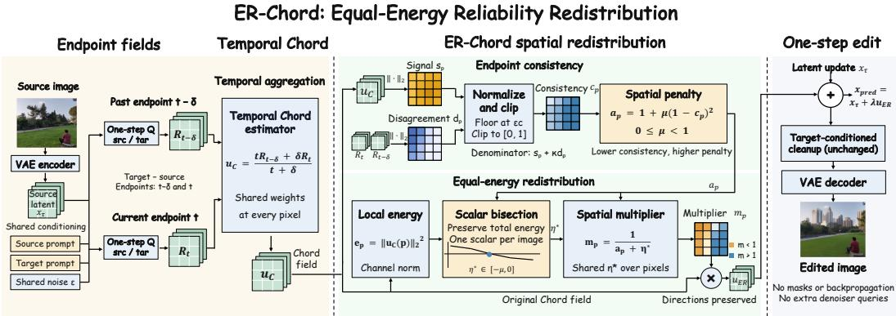
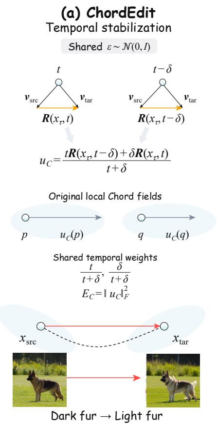
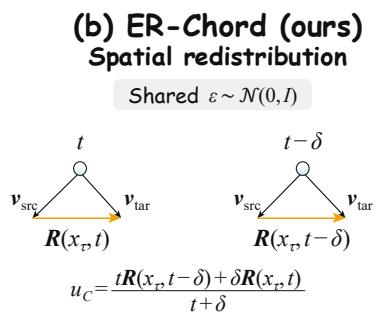
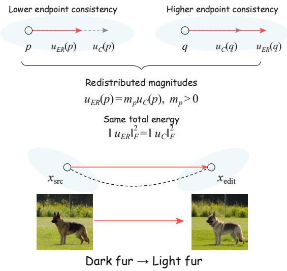
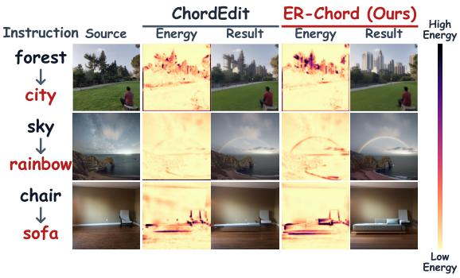
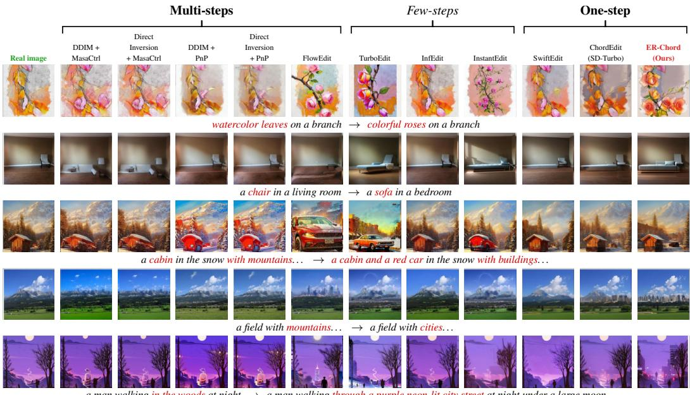

# ER-CHORD: SPATIALLY CONSISTENT ONE-STEP IM-AGE EDITING VIA EQUAL-ENERGY RELIABILITY RE-DISTRIBUTION

Peize Li1,2,∗ Hanzhen Zhao1,∗ Xingguo Xu3,∗ Yilong Fan4 Zhen Tao5 Bo Yin1 Zhifei Liu1 Qingdong He6 Xiaobin Hu1,†

1National University of Singapore 2Kuaishou Technology 3Dalian University of Technology 4Tianjin University 5Harbin Institute of Technology 6Tencent

∗Equal contribution †Corresponding author

## ABSTRACT

One-step generative models enable fast text-guided image editing, yet they often introduce unintended changes to regions that should remain unchanged. Temporal aggregation stabilizes editing fields across noise levels, but leaves their spatial allocation insensitive to local variations in reliability. Consequently, temporal stability alone does not ensure spatially consistent editing. To address this limitation, we propose ER-Chord, a training-free and inversion-free framework for reliability-guided spatial redistribution. Our key insight is that agreement between editing fields at neighboring noise levels provides a local reliability signal for allocating editing strength. We formulate this allocation as an equal-energy optimization that redistributes control energy according to local reliability while preserving the original editing directions and total control energy. This formulation admits a unique global solution that can be efficiently computed using existing field evaluations, requiring no additional denoiser calls. Experiments on two benchmarks, PIE-Bench and TEdBench, demonstrate improvements over state-of-the-art one-step editing baselines, achieving superior source preservation alongside consistent gains across multiple generative backbones.The project page is at https://github.com/Peizeli1/ER-Chord.

## 1 INTRODUCTION

Distilled text-to-image models, such as SD-Turbo, InstaFlow, and SwiftBrush-v2 (Sauer et al., 2024; Liu et al., 2024; Dao et al., 2024), compress diffusion sampling into a single neural function evaluation. Although this acceleration enables real-time image synthesis, editing real images remains difficult because it requires introducing requested semantic changes while preserving the identity, structure, and unedited regions of the source image. Existing accelerated editors address this trade-off through one-step inversion (Nguyen et al., 2025), few-step reconstruction (Deutch et al., 2024; Gong et al., 2025), or inversion-free transport (Kulikov et al., 2025; Lu et al., 2026). Among these approaches, training-free and inversion-free transport is especially attractive because it eliminates both auxiliary model training and iterative latent inversion. However, executing an edit through a single transport update imposes strict requirements on the spatial organization of the resulting control field.

ChordEdit (Lu et al., 2026) stabilizes one-step editing by aggregating source-to-target proxy fields from nearby noise levels. This formulation primarily addresses temporal variations in the estimated transport field. Because this aggregation rule is applied uniformly across the latent grid, the magnitude at each spatial location is merely a passive result of combining the endpoint fields. However, the two endpoint estimates do not agree equally across all locations. Some regions exhibit consistent local control vectors across noise levels, whereas others show substantial disagreement. Uniform temporal aggregation ignores this spatial disparity and distributes editing strength without considering local reliability. Consequently, it often introduces large updates into unedited backgrounds, causing visual artifacts. Therefore, temporal stability does not ensure spatial consistency, leaving spatial magnitude allocation as a crucial yet unaddressed degree of freedom.

  
Figure 1: Method overview. Starting from a temporally aggregated control field, ER-Chord measures local endpoint consistency and redistributes a fixed control energy budget while preserving local directions. The framework requires no auxiliary guidance, training, inversion, additional denoiser evaluations, or backpropagation.

This observation motivates a distinction between where the estimated control is reliable and where a semantic edit should occur. Existing localized editing methods typically use cross-attention maps or internal feature representations to identify edit regions (Couairon et al., 2023; Simsar et al., 2025; Soni et al., 2025; Nguyen et al., 2025; Hu et al., 2026). In contrast to these localization approaches, we retain the temporally aggregated editing directions and use endpoint agreement solely to determine their relative spatial strengths. Thus, endpoint consistency serves as an intrinsic reliability signal for the control field rather than a spatial localization map.

Based on this principle, we propose ER-Chord, a training-free and inversion-free framework for reliability-guided spatial redistribution. ER-Chord preserves the local directions of the Chord field and maintains the total control energy, modifying only how this fixed budget is distributed across spatial locations. We measure local reliability through the agreement between the two Chord endpoint fields and formulate the reallocation as a reliability-weighted quadratic optimization problem subject to an exact equal-energy constraint. This constraint prevents trivial source preservation caused by simply reducing the global editing strength. Although this formulation couples all spatial locations through a shared energy budget, it yields a unique global solution that rescales each local Chord vector by a positive scalar. The entire solution depends on a single scalar variable that can be found efficiently through one-dimensional bisection. ER-Chord therefore requires no additional denoiser evaluations, auxiliary training, or backpropagation.

The equal-energy formulation also provides a direct interpretation of the resulting redistribution. Locations with higher endpoint consistency receive larger scaling factors relative to their original Chord vectors, while a shared scalar coordinates these adjustments to preserve the total control energy exactly. Hence, ER-Chord modifies only the relative spatial allocation of energy without altering local control directions or the overall update scale (Figure 1). As shown in Figures 2 and 3, under identical total control energy, ChordEdit disperses editing strength into irrelevant backgrounds, causing color bleeding and artifacts. In contrast, ER-Chord concentrates energy into semantically consistent regions, producing clean target edits while faithfully preserving source structures.

Empirically, ER-Chord consistently outperforms one-step editing baselines across diverse benchmarks using the same denoiser budget. Without tuning hyperparameters for specific datasets or backbones, our configuration substantially improves background preservation on PIE-Bench, generalizes effectively to other benchmarks such as TEdBench in perceptual quality and source fidelity, and transfers across multiple generative backbones (InstaFlow, SwiftBrush-v2, and SD-Turbo). These results establish reliability-guided spatial redistribution as an effective, orthogonal complement to temporal stabilization.

  
Figure 2: Temporal vs. spatial control in one-step editing. (a) ChordEdit temporally aggregates endpoint fields with uniform weights across space, which fails to reflect local differences in prediction consistency and disperses edit energy into irrelevant backgrounds. (b) ER-Chord measures local endpoint consistency as a reliability signal and redistributes control energy $( u _ { \mathrm { E R } } ( p ) = m _ { p } u _ { \mathrm { C } } ( p ) )$ under an exact conserved energy budget $( \| u _ { \mathrm { E R } } \| _ { F } ^ { 2 } = \| u _ { \mathrm { C } } \| _ { F } ^ { 2 } )$ , concentrating updates onto semantically intended target regions without background artifacts.

Our main contributions are summarized as follows:

• We identify spatial magnitude allocation as an unaddressed degree of freedom in temporally aggregated one-step editing, demonstrating that temporal stability alone does not guarantee spatial consistency.

• We propose ER-Chord, a framework that uses endpoint consistency as an intrinsic reliability signal to redistribute total control energy under an exact equal-energy constraint, which is solved globally through a one-dimensional scalar root.

• We demonstrate on PIE-Bench, TEdBench, and three generative backbones that ER-Chord consistently improves source preservation while maintaining semantic edit fidelity, requiring no external guidance, training, or additional denoiser calls.

## 2 RELATED WORK

Real-image editing and inversion. Text-guided editing must introduce the requested semantics without losing the identity and layout of the source image. SDEdit starts reverse diffusion from a partially noised source, while DiffEdit estimates an edit mask from differences between conditional predictions (Meng et al., 2022; Couairon et al., 2023). Prompt-to-Prompt controls cross-attention, and MasaCtrl and PnP reuse self-attention or intermediate features from a source branch to preserve structure (Hertz et al., 2023; Cao et al., 2023; Tumanyan et al., 2023). Inversion-based methods instead seek a latent trajectory that accurately reconstructs the source. Null-text Inversion optimizes unconditional text embeddings, EDICT introduces coupled transformations for exact inversion, and subsequent methods reduce the mismatch accumulated along inversion and denoising trajectories (Mokady et al., 2023; Wallace et al., 2023; Ju et al., 2024; Huberman-Spiegelglas et al., 2024; Yang & Ye, 2026). A related line of work separates inversion and invariance within flow transformers to enable versatile editing (Xu et al., 2025). These approaches improve fidelity by modifying the inversion path, internal features, or spatial masks. ER-Chord instead operates after a one-step source-to-target control field has been formed and changes only its local magnitudes, without reconstructing an inversion trajectory or modifying network attention and features.

Few-step and one-step editing. Consistency-based and flow-based models have made high-quality synthesis possible with one or a few neural function evaluations (Song & Dhariwal, 2024; Luo et al., 2023; Lipman et al., 2023; Liu et al., 2023). This development has motivated editors designed specifically for low-step samplers. TurboEdit and InstantEdit pair specialized inversion with few-step reconstruction, whereas SwiftEdit learns a one-step inversion model and uses mask-guided attention rescaling for localized editing (Deutch et al., 2024; Gong et al., 2025; Nguyen et al., 2025). BiFM jointly learns forward and inverse flows, FlowEdit constructs an inversion-free transport from pretrained flow models, and EEdit accelerates inversion-based editors by exploiting redundant computation across space and time (Dai et al., 2026; Kulikov et al., 2025; Yan et al., 2025). Related acceleration efforts span frequency-energy constrained routing for diffusion adaptation (Yin et al., 2025) and future-guided frame selection for long-horizon video generation (Yin et al., 2026). ChordEdit is the closest starting point for our work. It is training-free and inversion-free, and stabilizes a one-step update by aggregating source-to-target fields across nearby noise levels (Lu et al., 2026). A subsequent analysis interprets its chord window largely as an effective timestep shift and separates its procedure into coarse transport and fine alignment (Li et al., 2026). ER-Chord leaves this temporal estimator and cleanup unchanged, introduces no additional model evaluations, and only redistributes the resulting field magnitude over space.

Spatial localization and magnitude allocation. Spati-ally precise editors generally identify where an edit belongs and then restrict generation in that region. DiffEdit derives a mask from conditional prediction differences, while Learnable Regions and ZONE obtain regions through learned boxes or segmentation (Couairon et al., 2023; Lin et al., 2024; Li et al., 2024). FoI, LIME, and LOCATEdit extract or refine attention-based regions and use them to constrain the denoising process (Guo & Lin, 2024; Simsar et al., 2025; Soni et al., 2025). ALE-Edit further limits attribute leakage through object-restricted text embeddings, region-guided attention masking, and background blending (Mun et al., 2025). Localization has also been incorporated into one-step editing. SwiftEdit uses mask-guided attention rescaling, while WhereEdit discovers editable regions from internal features and applies local modulation (Nguyen et al., 2025;

  
Figure 3: Spatial energy redistribution under conserved total energy. Under identical conserved control energy (1.00×), ChordEdit disperses energy into backgrounds causing artifacts, while ER-Chord concentrates energy on target regions for clean edits.

Hu et al., 2026). These methods use semantic or structural evidence to decide where a modification should occur. ER-Chord neither predicts an editable region nor changes the semantic direction of the edit. It uses endpoint consistency only to rescale the magnitudes of fixed local Chord directions under an unchanged per-image energy budget. Localization methods determine where an edit should act, whereas ER-Chord adjusts the strength of the existing Chord field across locations.

## 3 METHOD

We develop ER-Chord in three steps. We first revisit the temporally aggregated Chord field and identify spatial magnitude allocation as a degree of freedom that is not explicitly controlled by the temporal estimator. We then use local endpoint consistency as a reliability signal and formulate spatial reweighting as an equal-energy redistribution problem, which preserves both the original control directions and the total control strength. Finally, we show that this seemingly coupled optimization admits a simple direction-preserving solution determined by a single shared scalar, enabling an efficient implementation with negligible additional computation.

## 3.1 FROM TEMPORAL AGGREGATION TO SPATIAL ALLOCATION

Let $I _ { \mathrm { s r c } }$ denote the source image, and let $c _ { \mathrm { s r c } }$ and $c _ { \mathrm { t a r } }$ denote the source and target conditions, respectively. Given a latent state $\mathbf { x } _ { \tau }$ , we follow ChordEdit Lu et al. (2026) and denote by $\mathbf { R } ( \mathbf { x } _ { \tau } , t )$ the source-to-target proxy field constructed at noise time t. In particular, for the two neighboring endpoints $t - \delta$ and t, we write $\mathbf { R } _ { t - \delta } : = \mathbf { R } ( \mathbf { x } _ { \tau } , t - \delta )$ and $\mathbf { R } _ { t } : = \mathbf { R } ( \mathbf { x } _ { \tau } , t )$

ChordEdit temporally aggregates these two endpoint fields to obtain a stabilized control field. At each spatial location $p \in \Omega$ , its control vector can be written as

$$
\mathbf { u } _ { \mathrm { C } } ( p ) = { \frac { t } { t + \delta } } \mathbf { R } _ { t - \delta } ( p ) + { \frac { \delta } { t + \delta } } \mathbf { R } _ { t } ( p ) .\tag{1}
$$

The coefficients in (1) are global temporal scalars and do not depend on the spatial location $p .$ The corresponding derivation from the Chord surrogate is provided in Appendix A.1.

Equation (1) provides a temporally stabilized editing vector at every spatial location. However, the resulting spatial magnitude $\| \mathbf { u } _ { \mathrm { C } } ( { p } ) \| _ { 2 }$ is only an implicit consequence of the temporal aggregation. In particular, the aggregation rule does not explicitly compare the magnitude assigned to location p with the agreement between ${ \bf R } _ { t - \delta } ( p )$ and ${ \bf R } _ { t } ( p )$ . Therefore, two locations with substantially different endpoint consistency are still governed by the same temporal mixing rule.

This observation suggests separating temporal stabilization from spatial magnitude allocation. We retain the local directions supplied by $\mathbf { u } _ { \mathrm { C } }$ and treat their spatial magnitudes as the remaining degree of freedom. Our goal is to redistribute these magnitudes according to local endpoint consistency while preserving the total control strength of the original Chord field. Section 3.2 develops this reliability-guided equal-energy redistribution.

## 3.2 RELIABILITY-GUIDED EQUAL-ENERGY REDISTRIBUTION

We next determine how the spatial magnitudes of the Chord field should be reallocated. The key signal is the agreement between the two endpoint fields. At a spatial location $p \in \Omega$ , we use $s _ { p } : = \| \mathbf { u } _ { \mathrm { C } } ( p ) \| _ { 2 }$ to denote the magnitude of the temporally aggregated Chord control and $d _ { p } : = \lVert \mathbf { R } _ { t } ( p ) - \mathbf { R } _ { t - \delta } ( p ) \rVert _ { 2 }$ to measure the disagreement between the two endpoint estimates. Since the same absolute endpoint discrepancy can have different significance at locations with different control magnitudes, we normalize the disagreement relative to the local Chord signal.

Specifically, we define the local endpoint-consistency score as

$$
c _ { p } = \mathrm { c l i p } _ { [ 0 , 1 ] } \left( \frac { s _ { p } } { \operatorname* { m a x } \{ s _ { p } + \kappa d _ { p } , \varepsilon _ { c } \} } \right) , \qquad \kappa \geq 0 , \varepsilon _ { c } > 0 .\tag{2}
$$

A larger $c _ { p }$ indicates stronger agreement between the two endpoint fields relative to the local control magnitude. In particular, $c _ { p }$ approaches one when the endpoint disagreement is small compared with $s _ { p } .$ , and decreases as the relative disagreement grows. This score measures local temporal consistency of the estimated control field rather than semantic correctness.

We use this reliability signal only to redistribute spatial magnitude. The local Chord directions remain unchanged as the reference editing directions, and the total control strength is kept fixed. The latter constraint is important because otherwise improved source preservation could be obtained trivially by globally weakening the edit. Let $E _ { \mathrm { C } } : = \| \mathbf { u } _ { \mathrm { C } } \| _ { F } ^ { 2 }$ denote the total pre-cleanup control energy of the Chord field. We seek a redistributed field that remains close to $\mathbf { u } _ { \mathrm { C } } ,$ while assigning a larger cost to control magnitude placed at locations with lower endpoint consistency.

These design requirements lead to the following equal-energy redistribution:

$$
\begin{array} { c l } { \mathbf { u } _ { \mathrm { E R } } \in \displaystyle \arg \operatorname* { m i n } _ { \mathbf { u } } } & { \displaystyle \frac { 1 } { 2 } \sum _ { p \in \Omega } \| \mathbf { u } ( p ) - \mathbf { u } _ { \mathrm { C } } ( p ) \| _ { 2 } ^ { 2 } + \frac { \mu } { 2 } \sum _ { p \in \Omega } ( 1 - c _ { p } ) ^ { 2 } \| \mathbf { u } ( p ) \| _ { 2 } ^ { 2 } } \\ { \mathbf { s u b j e c t } \mathbf { t o } } & { \| \mathbf { u } \| _ { F } ^ { 2 } = E _ { \mathrm { C } } , \qquad 0 \leq \mu < 1 . } \end{array}\tag{3}
$$

The first term preserves fidelity to the original Chord field, while the second term discourages control energy from remaining at locations with low endpoint consistency. The equality constraint keeps the total pre-cleanup energy exactly unchanged. Consequently, any reduction of control magnitude at one subset of spatial locations must be compensated by an increase elsewhere.

Although (3) couples all spatial locations through a global energy constraint, its structure is considerably simpler than a generic constrained field optimization. In the next subsection, we show that its unique global solution preserves every local Chord direction and reduces the entire redistribution to a one-dimensional scalar solve.

## 3.3 SCALAR-ROOT SOLUTION AND PROPERTIES

The equal-energy constraint in (3) couples all spatial locations through a single global budget. Nevertheless, the optimization admits a particularly simple structure. For each $p \in \Omega$ , define $a _ { p } : = 1 + \mu ( 1 - \dot { c } _ { p } ) ^ { 2 }$ , which represents the local quadratic penalty induced by the endpointconsistency score. The spatial dependence is entirely contained in $a _ { p } .$ , while the global energy constraint is enforced by one shared scalar.

Theorem 3.1 (Unique direction-preserving solution). Assume $0 \leq \mu < 1$ and $\begin{array} { r } { E _ { \mathrm C } > 0 . } \end{array}$ . Then the optimization problem (3) admits a unique global minimizer. In particular, there exists a unique scalar $\eta ^ { \star } \in [ - \mu , 0 ]$ such that

$$
{ \bf u } _ { \mathrm { E R } } ( p ) = \frac { { \bf u } _ { \mathrm { C } } ( p ) } { a _ { p } + \eta ^ { \star } } , \qquad p \in \Omega ,\tag{4}
$$

where $\eta ^ { \star }$ is the unique root of

$$
\sum _ { p \in \Omega } { \frac { \| \mathbf { u } _ { \mathrm { C } } ( p ) \| _ { 2 } ^ { 2 } } { ( a _ { p } + \eta ) ^ { 2 } } } = E _ { \mathrm { C } } .\tag{5}
$$

Theorem 3.1 reduces the spatially coupled optimization to a one-dimensional scalar solve. The local reliability scores determine the spatially varying denominators ${ a _ { p } } ,$ while the single shared variable $\eta ^ { \star }$ adjusts all locations jointly so that the original control energy is exactly preserved. Since $a _ { p } + \eta ^ { \star } > 0$ the solution in (4) rescales each local Chord vector without changing its direction. The proof of existence, uniqueness, and global optimality is provided in Appendix A.2.

To make the redistribution explicit, let $m _ { p } : = ( a _ { p } + \eta ^ { \star } ) ^ { - 1 }$ denote the local spatial multiplier. Then ${ \bf u } _ { \mathrm { E R } } ( p ) = m _ { p } { \bf u } _ { \mathrm { C } } ( p )$ . The following properties summarize the behavior of the resulting field.

Corollary 3.2 (Energy and direction preservation). Under the assumptions of Theorem $3 . l ,$ the ER-Chord solution satisfies

$$
\| \mathbf { u } _ { \mathrm { E R } } \| _ { F } ^ { 2 } = \| \mathbf { u } _ { \mathrm { C } } \| _ { F } ^ { 2 } .\tag{6}
$$

Moreover, $m _ { p } > 0$ for every $p \in \Omega$ , and

$$
{ \frac { 1 } { 1 + \mu } } \leq m _ { p } \leq { \frac { 1 } { 1 - \mu } } .
$$

$I f c _ { p } > c _ { q }$ and $\mu > 0 ,$ , then $m _ { p } > m _ { q } .$

The corollary clarifies the role of the redistribution. ER-Chord neither rotates the local Chord directions nor changes the total pre-cleanup control strength. Instead, it modifies only the relative spatial magnitudes. Locations with higher endpoint consistency receive a larger multiplicative adjustment than locations with lower endpoint consistency. This ordering applies to the multipliers themselves rather than to the absolute final energy shares, which also depend on the original Chord magnitudes.

The scalar $\eta ^ { \star }$ can be obtained efficiently by bisection over $[ - \mu , 0 ]$ . For a latent field of size $C \times H \times W$ and K bisection iterations, the additional computation is $\dot { \mathcal { O } } ( \dot { K } \cdot C \cdot H \cdot W )$ and consists only of channel reductions and element-wise arithmetic. ER-Chord reuses the endpoint fields already required by ChordEdit and therefore introduces no additional denoiser evaluations.

Table 1: Editing results on PIE-Bench (Ju et al., 2024). MSE and LPIPS are scaled by $1 0 ^ { 3 }$ . Best, second-best, and third-best results are highlighted with green , yellow , and purple backgrounds, respectively. T-/I-free: training-/inversion-free. Extended metrics appear in Appendix D.
<table><tr><td></td><td></td><td colspan="3">Background Preservation</td><td colspan="2">Target Alignment</td><td colspan="2">Properties</td><td colspan="4">Efficiency</td></tr><tr><td>Type</td><td>Method</td><td>PSNR↑</td><td>MSE↓</td><td>LPIPS↓</td><td>Whole↑</td><td>Edit↑</td><td>T-free</td><td>I-free</td><td>Steps↓</td><td>NFE↓</td><td>Time(s)↓</td><td>VRAM(M)↓</td></tr><tr><td rowspan="5">Multi-step</td><td>DDIM + MasaCtrl (2023)</td><td>21.25</td><td>8.58</td><td>106.59</td><td>24.13</td><td>21.13</td><td>√</td><td>x</td><td>50</td><td>100</td><td>55.20</td><td>12272</td></tr><tr><td>Direct Inv. + MasaCtrl (2023)</td><td>21.78</td><td>7.99</td><td>87.38</td><td>24.42</td><td>21.38</td><td>√</td><td>x</td><td>50</td><td>100</td><td>79.10</td><td>12272</td></tr><tr><td>DDIM + PnP (2023)</td><td>21.26</td><td>8.42</td><td>113.58</td><td>25.45</td><td>22.54</td><td>√</td><td>x</td><td>50</td><td>100</td><td>28.01</td><td>9262</td></tr><tr><td>Direct Inv. + PnP (2023)</td><td>21.43</td><td>8.10</td><td>106.26</td><td>25.48</td><td>22.63</td><td>√</td><td>x</td><td>50</td><td>100</td><td>28.03</td><td>9262</td></tr><tr><td>FlowEdit (SD3) (2025)</td><td>22.17</td><td>7.69</td><td>104.81</td><td>26.64</td><td>23.69</td><td>√</td><td>√</td><td>33</td><td>33</td><td>7.22</td><td>17140</td></tr><tr><td rowspan="3">Few-step</td><td>TurboEdit (SDXL-T) (2024)</td><td>21.44</td><td>9.49</td><td>108.60</td><td>24.66</td><td>21.79</td><td>√</td><td>√</td><td>4</td><td>4</td><td>2.69</td><td>13826</td></tr><tr><td>InfEdit (SD1.4) (2024)</td><td>24.14</td><td>6.82</td><td>55.69</td><td>24.89</td><td>21.88</td><td>√</td><td>√</td><td>4</td><td>4</td><td>1.41</td><td>6502</td></tr><tr><td>InstantEdit (PeRFlow) (2025)</td><td>23.80</td><td>4.21</td><td>60.92</td><td>24.97</td><td>21.82</td><td>√</td><td>x</td><td>4</td><td>8</td><td>1.30</td><td>16270</td></tr><tr><td rowspan="7">One-step</td><td>SwiftEdit (SB-v2) (2025)</td><td>21.71</td><td>8.22</td><td>91.22</td><td>24.93</td><td>21.85</td><td>x</td><td>x</td><td>1</td><td>２２</td><td>0.54</td><td>15060</td></tr><tr><td>ChordEdit (SB-v2) (2026)</td><td>22.04</td><td>7.13</td><td>111.22</td><td>25.12</td><td>22.58</td><td>√</td><td>√</td><td>1</td><td></td><td>0.38</td><td>6988</td></tr><tr><td>ChordEdit (w/o clean, SD-T)</td><td>23.89</td><td>5.05</td><td>88.36</td><td>24.97</td><td>21.87</td><td>√</td><td>√</td><td>1</td><td>1</td><td>0.20</td><td>6988</td></tr><tr><td>ChordEdit (SD-Turbo) (2026)</td><td>22.20</td><td>6.84</td><td>128.25</td><td>25.58</td><td>22.96</td><td>√</td><td>√</td><td>1</td><td>2</td><td>0.38</td><td>6988</td></tr><tr><td>ER-Chord (SB-v2)</td><td>22.48</td><td>6.62</td><td>105.10</td><td>25.26</td><td>22.74</td><td>√</td><td>√</td><td>1</td><td>2</td><td>0.37</td><td>6988</td></tr><tr><td>ER-Chord (w/o clean, SD-T)</td><td>24.31</td><td>4.70</td><td>82.82</td><td>25.04</td><td>21.99</td><td>√</td><td>√</td><td>1</td><td>1</td><td>0.20</td><td>6988</td></tr><tr><td>ER-Chord (SD-Turbo)</td><td>22.77</td><td>6.35</td><td>120.23</td><td>25.74</td><td>23.16</td><td>√</td><td>√</td><td>1</td><td>2</td><td>0.37</td><td>6988</td></tr></table>

To further characterize the spatial redistribution, we compare the fraction of the total control energy assigned to each location before and after ER-Chord. For $p \in \Omega$ , define the original and redistributed spatial energy shares as $\pi _ { p } ^ { \mathrm { C } } : = \| \mathbf { u } _ { \mathrm { C } } ( p ) \| _ { 2 } ^ { 2 } / E _ { \mathrm { C } }$ and $\pi _ { p } ^ { \mathrm { E R } } : = \Vert \mathbf { u } _ { \mathrm { E R } } ( p ) \Vert _ { 2 } ^ { 2 } / E _ { \mathrm { C } }$ , respectively. Since ${ \bf u } _ { \mathrm { E R } } ( p ) = m _ { p } { \bf u } _ { \mathrm { C } } ( p )$ , these shares satisfy

$$
\begin{array} { r } { \pi _ { p } ^ { \mathrm { E R } } = m _ { p } ^ { 2 } \pi _ { p } ^ { \mathrm { C } } . } \end{array}\tag{7}
$$

Equation (7) makes the redistribution explicit: ER-Chord modifies the original spatial energy allocation only through the local multipliers, while the total energy remains unchanged.

The local consistency scores and the shared scalar $\eta ^ { \star }$ play complementary roles: the scores determine the relative spatial penalties, while $\eta ^ { \star }$ enforces the common energy budget.

Importantly, the equal-energy constraint does not require every low-consistency location to be attenuated or every high-consistency location to be amplified relative to one. Several multipliers may lie on the same side of one, provided that their energy-weighted adjustments collectively preserve $E _ { \mathrm { C } }$ . Therefore, ER-Chord should be interpreted as a globally coupled spatial reallocation rather than an independent pointwise suppression rule.

The same optimization also yields an additional certificate showing that the redistributed field places no more reliability-weighted energy on inconsistent locations than the original Chord field. We provide the formal statement and proof in Appendix A.4.

## 4 EXPERIMENTS

## 4.1 EVALUATION PROTOCOL

Benchmarks. PIE-Bench (Ju et al., 2024) contains 700 masked editing examples in ten categories and provides the primary comparison with ChordEdit. We additionally evaluate the original 100- example TEdBench (Kawar et al., 2023) as an external benchmark for text-guided real-image editing. For ChordEdit and ER-Chord, we use the same target-only protocol with identical inputs, target captions, random seeds, and evaluation settings.

Metrics. On PIE-Bench, background preservation uses non-edited-region PSNR, MSE, SSIM, LPIPS (Zhang et al., 2018), and structure distance; semantic alignment uses CLIP-Whole and CLIP-Edited (Radford et al., 2021). On TEdBench, we report LPIPS for perceptual source preservation, CLIP-I for image-level source similarity, CLIP-T for target text–image similarity, and Dir-Sim

  
a man walking in the woods at night  a man walking through a purple neon-lit city street at night under a large moon

Figure 4: Qualitative comparison on PIE-Bench. Real images are in the first column. Multistep, few-step, and one-step methods are arranged horizontally. Prompts are noted under each row. ChordEdit and ER-Chord use the identical SD-Turbo backbone.

for directional similarity. Every ER run also records the dual interval, normalized dual residual, equal-energy residual, KKT residual, multiplier bounds, direction residual, and inequality (26).

Implementation and statistics. We retain the ChordEdit configuration: one shared noise sample, $t = 0 . 9 0 , \delta = 0 . 1 5 , \lambda = 1 . 0$ , and cleanup time $t _ { c } = 0 . 3 0$ . For ER-Chord, we use $\mu = 0 . 2 5 , \kappa = 1 . 0$ $\varepsilon _ { c } = 1 0 ^ { - 8 }$ , an energy threshold of $1 0 ^ { - 1 2 }$ , a dual tolerance of $1 0 ^ { - 6 }$ , and at most 32 bisection iterations. These values are not tuned on the external benchmarks. The comparisons between ChordEdit and ER-Chord are paired by source example. Runtime and peak memory are measured with the same hardware, precision, batch size, and warm-up.

## 4.2 COMPARISON ON PIE-BENCH

Full PIE-Bench evaluation. Table 1 reproduces the comparison from ChordEdit Table 1 and adds ER-Chord under the same SD-Turbo configuration with $( \mu , \kappa ) = ( 0 . 2 5 , 1 . 0 )$ , one shared noise sample, and all 700 PIE-Bench examples (seed 42). The comparison covers all 700 PIE-Bench examples across the ten predefined editing categories. As shown in Table 1, the primary benefit of ER-Chord lies in substantial gains in source content preservation. Specifically, ER-Chord improves unedited-region PSNR from 22.20 to 22.77 dB (+0.57 dB), lowers MSE from 6.84 to 6.35, and reduces perceptual distortion LPIPS from 128.25 to 120.23 $( 1 0 ^ { 3 } \times$ scaling). Detailed structural preservation metrics (e.g., SSIM and Structure Distance) exhibit concordant improvements in the appendix (Table 6). Crucially, these preservation gains are accompanied by improved target semantic alignment: CLIP-Whole rises from 25.58 to 25.74, and CLIP-Edited from 22.96 to 23.16. The two methods have the same total pre-cleanup control energy by construction. Thus, the gains cannot be attributed to uniformly reducing the control field; they are consistent with a more effective spatial allocation.

Qualitative comparison. In the examples shown in Figure 4, several multi-step and few-step editors alter the background or blur fine details. ChordEdit also exhibits visible background changes in some cases. With reliability-guided redistribution, ER-Chord produces cleaner target edits in these examples, including the sofa and mountain-to-building transformations, while retaining more of the source background.

Table 2: Transport & cleanup ablation. PIE-Bench. NFE=1: transport; NFE=2: full. Bold: best.
<table><tr><td colspan="2">Configuration</td><td colspan="2">PIE-Bench metrics</td><td rowspan="2">NFE</td></tr><tr><td>Field</td><td>Cleanup</td><td>PSNR↑</td><td>CLIP-Edited↑</td></tr><tr><td>Naive (δ = 0)</td><td>no</td><td>21.89</td><td>20.83</td><td>1</td></tr><tr><td>Chord (δ = .15)</td><td>no</td><td>23.89</td><td>21.87</td><td>1</td></tr><tr><td>ER-Chord</td><td>no</td><td>24.31</td><td>21.99</td><td>1</td></tr><tr><td>Naive (δ = 0)</td><td>yes</td><td>21.38</td><td>21.96</td><td>2</td></tr><tr><td>Chord (δ = .15)</td><td>yes</td><td>22.20</td><td>22.96</td><td>2</td></tr><tr><td>ER-Chord</td><td>yes</td><td>22.77</td><td>23.16</td><td>2</td></tr></table>

Table 3: TEdBench comparison (Kawar et al., 2023). 100 real-image prompts. Bold: best.
<table><tr><td>Method</td><td>Paradigm</td><td>LPIPS↓</td><td>CLIP-I↑</td><td>CLIP-T↑ Dir-Sim↑</td><td></td></tr><tr><td>SDEdit</td><td>Multi-step</td><td>0.30</td><td>0.85</td><td>0.22</td><td>0.15</td></tr><tr><td>Pix2Pix-Zero</td><td>Multi-step</td><td>0.29</td><td>0.84</td><td>0.23</td><td>0.14</td></tr><tr><td>Imagic</td><td>Optimization</td><td>0.52</td><td>0.86</td><td>0.25</td><td>0.20</td></tr><tr><td>LEDITS++</td><td>Inversion</td><td>0.23</td><td>0.87</td><td>0.26</td><td>0.21</td></tr><tr><td>FlowEdit</td><td>Flow</td><td>0.22</td><td>0.89</td><td>0.26</td><td>0.22</td></tr><tr><td>ChordEdit</td><td>One-step</td><td>0.21</td><td>0.91</td><td>0.28</td><td>0.25</td></tr><tr><td>ER-Chord (Ours) One-step</td><td></td><td>0.20</td><td>0.92</td><td>0.29</td><td>0.25</td></tr></table>

## 4.3 ABLATIONS, CROSS-BACKBONE TRANSFER, AND EFFICIENCY

Transport vs. cleanup ablation. To understand how spatial redistribution interacts with the multistage pipeline, Table 2 evaluates ER-Chord with and without the post-hoc cleanup stage. In the no-cleanup setting (NFE = 1), the evaluation directly isolates the spatial transport field. Here, ER-Chord improves PSNR from 23.89 to 24.31 dB and CLIP-Edited from 21.87 to 21.99 over the raw Chord field, confirming that reliability reallocation strengthens transport dynamics before cleanup. With cleanup (NFE = 2), ER-Chord maintains its advantage (22.77 vs. 22.20 dB PSNR; 23.16 vs. 22.96 CLIP-Edited), orthogonally complementing post-hoc temporal cleanup.

Core mechanism ablations. To isolate the necessity of equal-energy optimization, we test two baselines. First, a heuristic “Reweight-and-Normalize (RN)” directly scales the Chord field by $c _ { p }$ and normalizes total energy, achieving only 22.40 dB PSNR (vs. ER-Chord 22.77 dB). Second, “Spatial Permutation” applies the exact optimal multipliers from ER-Chord but randomly permutes their spatial assignment. The PSNR drops to 21.05 dB, supporting the importance of matching the multipliers to their original spatial locations.

Transfer to TEdBench. To evaluate out-of-domain generalization, we benchmark on 100 diverse real-image editing cases in TEdBench (Kawar et al., 2023) featuring complex attribute modifications and diverse natural scenes. As shown in Table 3, ER-Chord improves upon ChordEdit in both perceptual source preservation (LPIPS decreases from 0.21 to 0.20) and image fidelity (CLIP-I increases from 0.91 to 0.92). On the reported TEdBench metrics, ER-Chord also improves over the listed multi-step and optimization-based baselines while using one transport update. These results suggest transfer to the tested scenes without benchmark-specific tuning.

Cross-backbone generalization. To assess transfer across backbones, Table 4 evaluates ER-Chord with InstaFlow, SwiftBrush-v2, and SD-Turbo. With fixed hyperparameters $( ( \mu , \kappa ) =$ (0.25, 1.0)), ER-Chord improves PSNR over ChordEdit by +0.35 dB on InstaFlow, +0.44 dB on SwiftBrush-v2, and +0.57 dB on SD-Turbo. CLIP-Edited also improves on all three tested backbones.

Table 4: Cross-backbone generalization. Results across backbones. Bold: best per backbone.
<table><tr><td>Backbone</td><td>Method</td><td>PSNR↑</td><td>CLIP-Edited↑</td></tr><tr><td rowspan="3">InstaFlow</td><td>Naive</td><td>22.05</td><td>20.19</td></tr><tr><td>ChordEdit</td><td>23.05</td><td>21.39</td></tr><tr><td>ER-Chord (Ours)</td><td>23.40</td><td>21.54</td></tr><tr><td rowspan="3">SwiftBrush-v2</td><td>Naive</td><td>20.52</td><td>21.06</td></tr><tr><td>ChordEdit</td><td>22.04</td><td>22.58</td></tr><tr><td>ER-Chord (Ours)</td><td>22.48</td><td>22.74</td></tr><tr><td rowspan="3">SD-Turbo</td><td>Naive</td><td>21.38</td><td>21.96</td></tr><tr><td>ChordEdit</td><td>22.20</td><td>22.96</td></tr><tr><td>ER-Chord (Ours)</td><td>22.77</td><td>23.16</td></tr></table>

Computational overhead and convergence. Because ER-Chord reuses the ChordEdit endpoints $( \mathbf { R } _ { t } , \mathbf { R } _ { t - \delta } )$ , it adds no network evaluations relative to ChordEdit. The full pipeline uses NFE = 2 with cleanup and NFE = 1 without it, and the measured peak memory is unchanged at 6988 MiB. The scalar bisection terminates within 32 iterations and takes < 0.01 s CPU time. The measured full-pipeline runtimes are similar: 0.37 s/img for ER-Chord and 0.38 s/img for ChordEdit.

## 5 CONCLUSION

This paper investigates spatial magnitude allocation in training-free, one-step image editing. Existing transport methods stabilize updates across noise levels using temporal weights shared across spatial locations, leaving local reliability unaccounted for in the allocation of editing strength. We propose ER-Chord, which uses endpoint agreement to redistribute control energy under an exact pre-cleanup energy constraint. The resulting field preserves the original local directions and has a unique global solution determined by a scalar root, with no additional denoiser evaluations relative to ChordEdit. Experiments on PIE-Bench, TEdBench, and three generative backbones (SD-Turbo, SwiftBrush-v2, and InstaFlow) show improved source preservation alongside target alignment in the tested settings. These results suggest that spatial allocation is a useful complement to temporal stabilization. The equal-energy constraint prevents a trivial improvement from globally weakening the edit: energy reduced in one location must be reallocated to another. The endpoint-consistency signal determines that reallocation, while a shared scalar root keeps the computation small. Because the method rescales the Chord field without changing its local directions, it cannot correct an erroneous direction supplied by the underlying field. Testing how this dependence changes across additional editing tasks and backbones is a useful direction for future work.

## AI USE STATEMENT

In this work, we used generative AI tools to improve the clarity, grammar, and presentation of the manuscript. All AI-assisted content was carefully reviewed and verified by the authors. All scientific ideas, methodological designs, experimental results, and conclusions were developed and validated by the authors. We take full responsibility for the final content of this work.

## REFERENCES

Mingdeng Cao, Xintao Wang, Zhongang Qi, Ying Shan, Xiaohu Qie, and Yinqiang Zheng. Masactrl: Tuning-free mutual self-attention control for consistent image synthesis and editing. In 2023 IEEE/CVF International Conference on Computer Vision (ICCV), pp. 22503–22513. IEEE, 2023.

Guillaume Couairon, Jakob Verbeek, Holger Schwenk, and Matthieu Cord. DiffEdit: Diffusion-based semantic image editing with mask guidance. In International Conference on Learning Representations (ICLR), 2023.

Yasong Dai, Zeeshan Hayder, David Ahmedt-Aristizabal, and Hongdong Li. BiFM: Bidirectional flow matching for few-step image editing and generation. In Proceedings ofthe IEEE/CVF Conference on Computer Vision and Pattern Recognition (CVPR), pp. 23325–23334, 2026.

Trung Dao, Thuan Hoang Nguyen, Thanh Le, Duc Vu, Khoi Nguyen, Cuong Pham, and Anh Tran. Swiftbrush v2: Make your one-step diffusion model better than its teacher. In European Conference on Computer Vision, pp. 176–192. Springer, 2024.

Gilad Deutch, Rinon Gal, Daniel Garibi, Or Patashnik, and Daniel Cohen-Or. Turboedit: Text-based image editing using few-step diffusion models. In SIGGRAPH Asia 2024 Conference Papers, pp. 1–12, 2024.

Yiming Gong, Zhen Zhu, and Minjia Zhang. Instantedit: Text-guided few-step image editing with piecewise rectified flow. In 2025 IEEE/CVF International Conference on Computer Vision (ICCV), pp. 16808–16817. IEEE, 2025.

Qin Guo and Tianwei Lin. Focus on your instruction: Fine-grained and multi-instruction image editing by attention modulation. In 2024 IEEE/CVF Conference on Computer Vision and Pattern Recognition (CVPR), pp. 6986–6996. IEEE, 2024.

Amir Hertz, Ron Mokady, Jay Tenenbaum, Kfir Aberman, Yael Pritch, and Daniel Cohen-Or. Prompt-to-Prompt image editing with cross-attention control. In International Conference on Learning Representations (ICLR), 2023.

Ming Hu, Mingyu Dou, Jianfu Yin, Miaomiao Zhang, Cong Hu, Yao Wang, Bingliang Hu, and Quan Wang. Whereedit: Mask-aware local latent editing for one-step image editing. arXiv preprint arXiv:2607.20883, 2026.

Inbar Huberman-Spiegelglas, Vladimir Kulikov, and Tomer Michaeli. An edit friendly ddpm noise space: Inversion and manipulations. In 2024 IEEE/CVF Conference on Computer Vision and Pattern Recognition (CVPR), pp. 12469–12478. IEEE, 2024.

Xuan Ju, Ailing Zeng, Yuxuan Bian, Shaoteng Liu, and Qiang Xu. PnP inversion: Boosting diffusion-based editing with 3 lines of code. In International Conference on Learning Representations (ICLR), 2024.

Bahjat Kawar, Shiran Zada, Oran Lang, Omer Tov, Huiwen Chang, Tali Dekel, Inbar Mosseri, and Michal Irani. Imagic: Text-based real image editing with diffusion models. In 2023 IEEE/CVF Conference on Computer Vision and Pattern Recognition (CVPR), pp. 6007–6017. IEEE, 2023.

Vladimir Kulikov, Matan Kleiner, Inbar Huberman-Spiegelglas, and Tomer Michaeli. Flowedit: Inversion-free text-based editing using pre-trained flow models. In 2025 IEEE/CVF International Conference on Computer Vision (ICCV), pp. 19721–19730. IEEE, 2025.

Minghan Li, Jeremy Moebel, and Mengyu Wang. Rethinking one-step image editing through chordedit: Reproduction, simplification, and new insights. arXiv preprint arXiv:2606.14042, 2026.

Shanglin Li, Bohan Zeng, Yutang Feng, Sicheng Gao, Xiuhui Liu, Jiaming Liu, Lin Li, Xu Tang, Yao Hu, Jianzhuang Liu, et al. Zone: Zero-shot instruction-guided local editing. In 2024 IEEE/CVF Conference on Computer Vision and Pattern Recognition (CVPR), pp. 6254–6263. IEEE, 2024.

Yuanze Lin, Yi-Wen Chen, Yi-Hsuan Tsai, Lu Jiang, and Ming-Hsuan Yang. Text-driven image editing via learnable regions. In 2024 IEEE/CVF Conference on Computer Vision and Pattern Recognition (CVPR), pp. 7059–7068. IEEE, 2024.

Yaron Lipman, Ricky T. Q. Chen, Heli Ben-Hamu, Maximilian Nickel, and Matt Le. Flow matching for generative modeling. In International Conference on Learning Representations (ICLR), 2023.

Xingchao Liu, Chengyue Gong, and Qiang Liu. Flow straight and fast: Learning to generate and transfer data with rectified flow. In International Conference on Learning Representations (ICLR), 2023.

Xingchao Liu, Xiwen Zhang, Jianzhu Ma, Jian Peng, and Qiang Liu. InstaFlow: One step is enough for highquality diffusion-based text-to-image generation. In International Conference on Learning Representations (ICLR), 2024.

Liangsi Lu, Xuhang Chen, Minzhe Guo, Shichu Li, Jingchao Wang, and Yang Shi. ChordEdit: One-step low-energy transport for image editing. In Proceedings of the IEEE/CVF Conference on Computer Vision and Pattern Recognition (CVPR), pp. 14398–14407, 2026.

Simian Luo, Yiqin Tan, Longbo Huang, Jian Li, and Hang Zhao. Latent consistency models: Synthesizing high-resolution images with few-step inference. arXiv preprint arXiv:2310.04378, 2023.

Chenlin Meng, Yutong He, Yang Song, Jiaming Song, Jiajun Wu, Jun-Yan Zhu, and Stefano Ermon. SDEdit: Guided image synthesis and editing with stochastic differential equations. In International Conference on Learning Representations (ICLR), 2022.

Ron Mokady, Amir Hertz, Kfir Aberman, Yael Pritch, and Daniel Cohen-Or. Null-text inversion for editing real images using guided diffusion models. In 2023 IEEE/CVF Conference on Computer Vision and Pattern Recognition (CVPR), pp. 6038–6047. IEEE, 2023.

Sunung Mun, Jinhwan Nam, Sunghyun Cho, and Jungseul Ok. Addressing text embedding leakage in diffusionbased image editing. In 2025 IEEE/CVF International Conference on Computer Vision (ICCV), pp. 16451– 16460. IEEE, 2025.

Trong-Tung Nguyen, Quang Nguyen, Khoi Nguyen, Anh Tran, and Cuong Pham. Swiftedit: Lightning fast text-guided image editing via one-step diffusion. In 2025 IEEE/CVF Conference on Computer Vision and Pattern Recognition (CVPR), pp. 21492–21501. IEEE, 2025.

Alec Radford, Jong Wook Kim, Chris Hallacy, Aditya Ramesh, Gabriel Goh, Sandhini Agarwal, Girish Sastry, Amanda Askell, Pamela Mishkin, Jack Clark, et al. Learning transferable visual models from natural language supervision. In International conference on machine learning, pp. 8748–8763. PmLR, 2021.

Axel Sauer, Dominik Lorenz, Andreas Blattmann, and Robin Rombach. Adversarial diffusion distillation. In European Conference on Computer Vision, pp. 87–103. Springer, 2024.

Enis Simsar, Alessio Tonioni, Yongqin Xian, Thomas Hofmann, and Federico Tombari. Lime: Localized image editing via attention regularization in diffusion models. In 2025 IEEE/CVF Winter Conference on Applications of Computer Vision (WACV), pp. 222–231. IEEE, 2025.

Yang Song and Prafulla Dhariwal. Improved techniques for training consistency models. In International Conference on Learning Representations (ICLR), 2024.

Achint Soni, Meet Soni, and Sirisha Rambhatla. Locatedit: Graph laplacian optimized cross attention for localized text-guided image editing. arXiv preprint arXiv:2503.21541, 2025.

Narek Tumanyan, Michal Geyer, Shai Bagon, and Tali Dekel. Plug-and-play diffusion features for text-driven image-to-image translation. In 2023 IEEE/CVF Conference on Computer Vision and Pattern Recognition (CVPR), pp. 1921–1930. IEEE, 2023.

Bram Wallace, Akash Gokul, and Nikhil Naik. Edict: Exact diffusion inversion via coupled transformations. In 2023 IEEE/CVF Conference on Computer Vision and Pattern Recognition (CVPR), pp. 22532–22541. IEEE, 2023.

Pengcheng Xu, Boyuan Jiang, Xiaobin Hu, Donghao Luo, Qingdong He, Jiangning Zhang, Chengjie Wang, Yunsheng Wu, Charles Ling, and Boyu Wang. Unveil inversion and invariance in flow transformer for versatile image editing. In 2025 IEEE/CVF Conference on Computer Vision and Pattern Recognition (CVPR), pp. 28479–28489. IEEE, 2025.

Zexuan Yan, Yue Ma, Chang Zou, Wenteng Chen, Qifeng Chen, and Linfeng Zhang. EEdit: Rethinking the spatial and temporal redundancy for efficient image editing. In 2025 IEEE/CVF International Conference on Computer Vision (ICCV), pp. 17474–17484. IEEE, 2025.

Desong Yang and Mang Ye. DirectEdit: Step-level accurate inversion for flow-based image editing. In International Conference on Machine Learning (ICML), 2026.

Bo Yin, Xiaobin Hu, Xingyu Zhou, Yu He, Peng-Tao Jiang, Yue Liao, Junwei Zhu, Jiangning Zhang, Ying Tai, and Shuicheng Yan. Fera: Frequency-energy constrained routing for effective diffusion adaptation fine-tuning. arXiv preprint arXiv:2511.17979, 2025.

Bo Yin, Xiaobin Hu, Jiaqi Zhao, and Shuicheng Yan. Framemorrow: Future-guided frame selection with prospective tokens for long-horizon video generation. arXiv preprint arXiv:2609.38839, 2026.

Richard Zhang, Phillip Isola, Alexei A Efros, Eli Shechtman, and Oliver Wang. The unreasonable effectiveness of deep features as a perceptual metric. In 2018 IEEE/CVF conference on computer vision and pattern recognition, pp. 586–595. IEEE, 2018.

## A MATHEMATICAL DERIVATIONS AND PROOFS

This appendix provides the mathematical details supporting the construction in Section 3. We first derive the temporally aggregated Chord field used as the starting point of our method. We then establish the existence, uniqueness, and global optimality of the equal-energy redistribution solution, followed by the properties implied by its closed-form structure. These results complete the technical arguments omitted from the main text while preserving the method-level presentation in Section 3.

## A.1 DERIVATION OF THE TEMPORALLY AGGREGATED CHORD FIELD

For completeness, we derive the temporally aggregated Chord field used in Section 3. Following ChordEdit Lu et al. $( 2 0 2 6 )$ , let $\widehat { \mathbf { u } } _ { t - \delta }$ denote the endpoint control estimate entering the temporal surrogate at time $t - \delta$ . The Chord estimator considers the quadratic objective

$$
\Phi _ { t } ( \mathbf { u } ; \mathbf { x } _ { \tau } ) = t \Vert \mathbf { u } - \widehat { \mathbf { u } } _ { t - \delta } \Vert _ { F } ^ { 2 } + \int _ { t - \delta } ^ { t } \Vert \mathbf { u } - \mathbf { R } _ { \xi } \Vert _ { F } ^ { 2 } \mathrm { d } \xi ,\tag{8}
$$

where $\mathbf { R } _ { \xi } : = \mathbf { R } ( \mathbf { x } _ { \tau } , \xi )$ denotes the source-to-target proxy field at noise time $\xi .$

The objective in (8) is strictly convex with respect to u because its Hessian is $2 ( t + \delta ) { \bf I } \succ 0$ . Therefore, its unique minimizer is characterized by the first-order condition

$$
t \left( \mathbf { u } - { \widehat { \mathbf { u } } } _ { t - \delta } \right) + \int _ { t - \delta } ^ { t } \left( \mathbf { u } - \mathbf { R } _ { \xi } \right) \mathrm { d } \xi = \mathbf { 0 } .\tag{9}
$$

Since the integration interval has length δ, rearranging (9) gives the unique minimizer

$$
\mathbf { u } _ { t } ^ { \star } = \frac { t } { t + \delta } \widehat { \mathbf { u } } _ { t - \delta } + \frac { 1 } { t + \delta } \int _ { t - \delta } ^ { t } \mathbf { R } _ { \xi } \mathrm { d } \xi .\tag{10}
$$

ChordEdit then approximates the previous endpoint estimate by $\widehat { \mathbf { u } } _ { t - \delta } \approx \mathbf { R } _ { t - \delta }$ and evaluates the temporal integral using the endpoint approximation $\begin{array} { r } { \int _ { t - \delta } ^ { t } { \bf R } _ { \xi } \mathrm { d } \xi \approx \delta { \bf R } _ { t } } \end{array}$ . Substituting these approximations into (10) yields

$$
\mathbf { u } _ { \mathrm { C } } = { \frac { t } { t + \delta } } \mathbf { R } _ { t - \delta } + { \frac { \delta } { t + \delta } } \mathbf { R } _ { t } .\tag{11}
$$

Restricting $( 1 1 )$ to any spatial location $p \in \Omega$ recovers the Chord field used in (1). In particular, the coefficients $t / ( t + \delta )$ and $\delta / ( t + \delta )$ are determined solely by the temporal construction and are independent of $p .$

## A.2 PROOF OF THE UNIQUE GLOBAL SOLUTION

We now prove Theorem 3.1. Recall from Section 3.3 that $a _ { p } : = 1 + \mu ( 1 - c _ { p } ) ^ { 2 }$ . Since $c _ { p } ~ \in ~ [ 0 , 1 ]$ and $0 \leq \mu < 1$ , we have $1 \leq a _ { p } \leq 1 + \mu$ for every $p \in \Omega$

Proof of Theorem $3 . l .$ Let $J ( \mathbf { u } )$ denote the objective in (3). Introducing a scalar Lagrange multiplier η for the equal-energy constraint, the Lagrangian is

$$
\mathcal { L } ( \mathbf { u } , \eta ) = J ( \mathbf { u } ) + \frac { \eta } { 2 } \left( \Vert \mathbf { u } \Vert _ { F } ^ { 2 } - E _ { \mathrm { C } } \right) .\tag{12}
$$

The stationarity condition with respect to the local vector $\mathbf { u } ( p )$ is

$$
( a _ { p } + \eta ) \mathbf { u } ( p ) = \mathbf { u } _ { \mathrm { C } } ( p ) , \qquad p \in \Omega .\tag{13}
$$

Hence, whenever $a _ { p } + \eta > 0$ for all $p \in \Omega$ , any stationary point must satisfy

$$
{ \mathbf { u } } ( p ; \eta ) = \frac { { \mathbf { u } } _ { \mathrm { C } } ( p ) } { a _ { p } + \eta } .\tag{14}
$$

It remains to determine the scalar η from the equal-energy constraint. Substituting (14) into $\| \mathbf { u } \| _ { F } ^ { 2 } = E _ { \mathrm { C } }$ gives

$$
\phi ( \eta ) : = \sum _ { p \in \Omega } \frac { \| \mathbf { u } _ { \mathrm { C } } ( p ) \| _ { 2 } ^ { 2 } } { ( a _ { p } + \eta ) ^ { 2 } } - E _ { \mathrm { C } } = 0 .\tag{15}
$$

For any $\eta \in [ - \mu , 0 ]$ , the bound $a _ { p } \geq 1$ implies $a _ { p } + \eta \ge 1 - \mu > 0$ . Therefore, ϕ is well defined and continuously differentiable on $[ - \mu , 0 ]$ . Moreover,

$$
\phi ^ { \prime } ( \eta ) = - 2 \sum _ { p \in \Omega } \frac { \Vert \mathbf { u } _ { \mathrm { C } } ( p ) \Vert _ { 2 } ^ { 2 } } { ( a _ { p } + \eta ) ^ { 3 } } < 0 ,\tag{16}
$$

where the strict inequality follows from $E _ { \mathrm { C } } > 0$ . Hence, ϕ is strictly decreasing on this interval.

At the right endpoint, $a _ { p } \geq 1$ gives

$$
\phi ( 0 ) = \sum _ { p \in \Omega } \frac { \| \mathbf { u } _ { \mathrm { C } } ( p ) \| _ { 2 } ^ { 2 } } { a _ { p } ^ { 2 } } - E _ { \mathrm { C } } \leq 0 .\tag{17}
$$

At the left endpoint, $a _ { p } \leq 1 + \mu$ gives $a _ { p } - \mu \leq 1$ , and therefore

$$
\phi ( - \mu ) = \sum _ { p \in \Omega } { \frac { \| \mathbf { u } _ { \mathrm { C } } ( p ) \| _ { 2 } ^ { 2 } } { ( a _ { p } - \mu ) ^ { 2 } } } - E _ { \mathrm { C } } \geq 0 .\tag{18}
$$

The intermediate value theorem and the strict monotonicity of ϕ therefore imply the existence of a unique $\eta ^ { \star } \in [ - \mu , 0 ]$ satisfying $\phi ( \eta ^ { \star } ) = 0$ . Substituting $\eta ^ { \star }$ into (14) yields (4), and (15) reduces to (5).

We finally establish global optimality over the complete feasible set, which is the energy sphere $\| \mathbf { u } \| _ { F } ^ { 2 } = E _ { \mathrm { C } }$ Let A denote the block-diagonal matrix whose block associated with location p is $a _ { p } \mathbf { I }$ . Then (13) at $\boldsymbol { \eta } = \boldsymbol { \eta } ^ { \star }$ can be written as

$$
( \mathbf { A } + \boldsymbol { \eta } ^ { \star } \mathbf { I } ) \mathbf { u } _ { \mathrm { E R } } = \mathbf { u } _ { \mathrm { C } } .\tag{19}
$$

Consider any feasible field z and define d $: = \mathbf { z } - \mathbf { u } _ { \mathrm { E R } }$ . Since both z and uER have energy $E _ { \mathrm { C } }$ , we have $2 \langle { \bf u } _ { \mathrm { E R } } , { \bf d } \rangle _ { F } \dot { { \bf \Phi } } + \| { \bf d } \| _ { F } ^ { 2 } = 0$ . Using this identity together with (19), the objective difference satisfies

$$
J ( \mathbf { z } ) - J ( \mathbf { u } _ { \mathrm { E R } } ) = \frac { 1 } { 2 } \left. \mathbf { d } , ( \mathbf { A } + \boldsymbol { \eta } ^ { \star } \mathbf { I } ) \mathbf { d } \right. _ { F } .\tag{20}
$$

Since $a _ { p } \geq 1$ and $\eta ^ { \star } \geq - \mu$

$$
\mathbf { A } + \eta ^ { \star } \mathbf { I } \succeq ( 1 - \mu ) \mathbf { I } \succ \mathbf { 0 } .\tag{21}
$$

Consequently,

$$
J ( \mathbf { z } ) - J ( \mathbf { u } _ { \mathrm { E R } } ) \geq \frac { 1 - \mu } { 2 } \| \mathbf { d } \| _ { F } ^ { 2 } .\tag{22}
$$

The right-hand side is strictly positive whenever z $\neq$ uER. Hence, $\mathbf { u } _ { \mathrm { E R } }$ is the unique global minimizer of (3). □

## A.3 PROPERTIES OF THE CLOSED-FORM REDISTRIBUTION

We next establish the properties of the closed-form solution stated in Corollary 3.2. Recall that $m _ { p } : =$ $( a _ { p } + \eta ^ { \star } ) ^ { - 1 }$ , where $a _ { p } = \bar { 1 } + \mu ( 1 - c _ { p } ) ^ { 2 }$ and $\eta ^ { \star } \in [ - \mu , 0 ]$

Proof of Corollary 3.2. The exact energy preservation

$$
\| \mathbf { u } _ { \mathrm { E R } } \| _ { F } ^ { 2 } = \| \mathbf { u } _ { \mathrm { C } } \| _ { F } ^ { 2 } = E _ { \mathrm { C } }\tag{23}
$$

follows directly from the equality constraint in (3) and the feasibility of the solution constructed in Theorem 3.1. Since $c _ { p } \in [ 0 , 1 ]$ , we have $1 \leq a _ { p } \leq 1 + \mu$ . Together with $\eta ^ { \star } \in [ - \mu , 0 ]$ , this gives $a _ { p } + \eta ^ { \star } \ge 1 - \mu > 0$ Hence $m _ { p } > 0$ for every $p \in \Omega .$ Therefore, ${ \bf u } _ { \mathrm { E R } } ( p ) = m _ { p } { \bf u } _ { \mathrm { C } } ( p )$ preserves the direction of every nonzero local Chord vector.

The same bounds imply $1 - \mu \leq a _ { p } + \eta ^ { \star } \leq 1 + \mu ,$ , and consequently $1 / ( 1 + \mu ) \leq m _ { p } \leq 1 / ( 1 - \mu )$

Finally, suppose that $\mu > 0$ and $c _ { p } > c _ { q }$ . Since $( 1 - c _ { p } ) ^ { 2 } < ( 1 - c _ { q } ) ^ { 2 }$ , we have $a _ { p } < a _ { q }$ . The scalar $\eta ^ { \star }$ is shared across all spatial locations, so $a _ { p } + \eta ^ { \star } < a _ { q } + \eta ^ { \star }$ . Both denominators are positive, and therefore $m _ { p } > m _ { q }$ □

The spatial energy relation used in Section 3.3 follows immediately from the same multiplicative representation. Recall that $\pi _ { p } ^ { \mathrm { C } } : = \| \mathbf { u } _ { \mathrm { C } } ( p ) \| _ { 2 } ^ { 2 } / E _ { \mathrm { C } }$ and $\pi _ { p } ^ { \mathrm { E R } } : = \| \mathbf { u } _ { \mathrm { E R } } ( p ) \| _ { 2 } ^ { 2 } / E _ { \mathrm { C } }$ . Then

$$
\pi _ { p } ^ { \mathrm { E R } } = \frac { m _ { p } ^ { 2 } \| \mathbf { u } _ { \mathrm { C } } ( p ) \| _ { 2 } ^ { 2 } } { E _ { \mathrm { C } } } = m _ { p } ^ { 2 } \pi _ { p } ^ { \mathrm { C } } .\tag{24}
$$

Hence the local multipliers act directly on the original spatial energy shares, while $( 2 3 )$ ensures that the shares remain normalized over the entire field. In particular, the ordering $c _ { p } > c _ { q } \Rightarrow m _ { p } > m _ { q }$ concerns the relative multiplicative adjustment and does not imply $\pi _ { p } ^ { \mathrm { E R } } > \pi _ { q } ^ { \mathrm { E R } }$ , since the final shares also depend on the original Chord allocation.

The closed form also recovers several limiting cases. If $\mu = 0 ;$ , then $a _ { p } = 1$ for every $p ,$ and the equal-energy condition yields $\eta ^ { \star } = 0 , \tt s o u _ { E R } = u _ { C }$ . More generally, if $c _ { p }$ is constant over the nonzero support of $\mathbf { u } _ { \mathrm { C } }$ , all active locations share the same positive multiplier. Exact energy preservation then forces this multiplier to equal one. When $E _ { \mathrm { C } } = 0$ , the constraint admits only the zero field, and thus $\mathbf { u } _ { \mathrm { E R } } = \mathbf { 0 }$

## A.4 RELIABILITY-WEIGHTED ENERGY CERTIFICATE

Beyond the pointwise properties of the closed-form solution, the optimization objective also controls how much energy is assigned to locations with low endpoint consistency. For any nonzero control field u, define its reliability-weighted energy fraction as

$$
\mathcal { M } ( \mathbf { u } ; \mathbf { c } ) : = \frac { \sum _ { p \in \Omega } ( 1 - c _ { p } ) ^ { 2 } \lVert \mathbf { u } ( p ) \rVert _ { 2 } ^ { 2 } } { \lVert \mathbf { u } \rVert _ { F } ^ { 2 } } ,\tag{25}
$$

where c denotes the collection of endpoint-consistency scores $\{ c _ { p } \} _ { p \in \Omega }$

Proposition A.1 (Reliability-weighted energy certificate). Assume $\mu > 0$ and $\textstyle E _ { \mathrm { C } } > 0 .$ . Then the solution of (3) satisfies

$$
\mathcal { M } ( \mathbf { u } _ { \mathrm { E R } } ; \mathbf { c } ) \leq \mathcal { M } ( \mathbf { u } _ { \mathrm { C } } ; \mathbf { c } ) - \frac { \| \mathbf { u } _ { \mathrm { E R } } - \mathbf { u } _ { \mathrm { C } } \| _ { F } ^ { 2 } } { \mu E _ { \mathrm { C } } } \leq \mathcal { M } ( \mathbf { u } _ { \mathrm { C } } ; \mathbf { c } ) .\tag{26}
$$

Proof. The original Chord field $\mathbf { u } _ { \mathrm { C } }$ is feasible for (3) because $\| \mathbf { u } _ { \mathrm { C } } \| _ { F } ^ { 2 } = E _ { \mathrm { C } }$ . By the global optimality of uER established in Theorem 3.1,

$$
J ( \mathbf { u } _ { \mathrm { E R } } ) \leq J ( \mathbf { u } _ { \mathrm { C } } ) = \frac { \mu } { 2 } \sum _ { p \in \Omega } ( 1 - c _ { p } ) ^ { 2 } \| \mathbf { u } _ { \mathrm { C } } ( p ) \| _ { 2 } ^ { 2 } .\tag{27}
$$

Expanding the left-hand side yields

$$
\frac 1 2 \| \mathbf { u } _ { \mathrm { E R } } - \mathbf { u } _ { \mathrm { C } } \| _ { F } ^ { 2 } + \frac { \mu } { 2 } \sum _ { p \in \Omega } ( 1 - c _ { p } ) ^ { 2 } \| \mathbf { u } _ { \mathrm { E R } } ( p ) \| _ { 2 } ^ { 2 } \leq \frac { \mu } { 2 } \sum _ { p \in \Omega } ( 1 - c _ { p } ) ^ { 2 } \| \mathbf { u } _ { \mathrm { C } } ( p ) \| _ { 2 } ^ { 2 } .\tag{28}
$$

Both $\mathbf { u } _ { \mathrm { E R } }$ and $\mathbf { u } _ { \mathrm { C } }$ have total energy $E _ { \mathrm { C } } .$ . Dividing (28) by $\mu E _ { \mathrm { C } } / 2$ and using (25) gives

$$
\mathcal { M } ( \mathbf { u } _ { \mathrm { E R } } ; \mathbf { c } ) + \frac { \| \mathbf { u } _ { \mathrm { E R } } - \mathbf { u } _ { \mathrm { C } } \| _ { F } ^ { 2 } } { \mu E _ { \mathrm { C } } } \leq \mathcal { M } ( \mathbf { u } _ { \mathrm { C } } ; \mathbf { c } ) ,\tag{29}
$$

which establishes the first inequality in (26). The second follows because the additional term in (29) is nonnegative. □

Proposition A.2 (Bounds on the Dual Root). Let η⋆ be the optimal dual root, and let $\pi _ { p } = \| \mathbf { u } _ { \mathrm { C } } ( p ) \| _ { 2 } ^ { 2 } / E _ { \mathrm { C } }$ . The dual root satisfies

$$
- \mu \mathcal { M } ( \mathbf { u } _ { \mathrm { C } } ; \mathbf { c } ) \leq \eta ^ { \star } \leq 0 .\tag{30}
$$

Proof. For the lower bound, apply Jensen’s inequality to the strictly convex function $f ( x ) = x ^ { - 2 } \mathrm { o n } x > 0 ;$

$$
1 = \sum _ { p } \pi _ { p } \left( 1 + \mu ( 1 - c _ { p } ) ^ { 2 } + \eta ^ { \star } \right) ^ { - 2 }
$$

$$
\begin{array} { l } { { \displaystyle \geq \left[ \sum _ { p } \pi _ { p } \left( 1 + \mu ( 1 - c _ { p } ) ^ { 2 } + \eta ^ { \star } \right) \right] ^ { - 2 } } } \\ { { \displaystyle = \left( 1 + \mu \mathcal { M } ( { \bf u } _ { \mathrm { C } } ; { \bf c } ) + \eta ^ { \star } \right) ^ { - 2 } } . } \end{array}\tag{31}
$$

The argument is positive, so the inequality implies $\eta ^ { \star } \geq - \mu \mathcal { M } ( \mathbf { u } _ { \mathrm { C } } ; \mathbf { c } )$ . The upper bound $\eta ^ { \star } \leq 0$ follows from the endpoint argument in the proof of Theorem 3.1. These bounds can tighten the bisection interval. □

Proposition A.1 concerns the reliability-weighted control energy defined in (25). It does not by itself imply an improvement in decoded image quality or semantic correctness.

## B IMPLEMENTATION DETAILS, NUMERICAL DIAGNOSTICS, AND REPRODUCIBILITY

## B.1 ALGORITHMIC FLOW AND FINITE-PRECISION BISECTION

For each input image, ER-Chord reuses the two Chord endpoint proxy fields $( \mathbf { R } _ { t } , \mathbf { R } _ { t - \delta } )$ to construct the base field $u _ { \mathrm { C } }$ . It computes the channel-reduced signal and disagreement maps, forms the consistency scores $c _ { p }$ and weights $a _ { p } .$ , solves for the scalar root $\eta ^ { \star }$ , and applies the spatial multipliers before the standard Chord update and post-hoc cleanup. For active samples $( E _ { \mathrm { C } } > \varepsilon _ { E } )$ , the normalized dual and energy residuals are $\hat { r _ { \phi } } = | \phi ( \eta ^ { \star } ) | / E _ { \mathrm { C } }$ and $r _ { E } \doteq \lvert \rvert \lvert u _ { \mathrm { E R } } \rvert \rvert _ { F } ^ { 2 } - E _ { \mathrm { C } } \lvert \tilde { / } E _ { \mathrm { C } }$ , respectively.

Table 5 reports numerical solver diagnostics across all 700 PIE-Bench examples. The measured residuals meet the stated tolerances, the multipliers remain within the theoretical bounds, and no violations of the reliability-weighted energy inequality are observed.

Table 5: Solver checks on PIE-Bench (700 examples, seed 42). Residuals, multiplier bounds, direction preservation, and the mismatch inequality are computed on the realized ER-Chord field after dtype conversion.
<table><tr><td>Certificate</td><td>Measured (required)</td></tr><tr><td>Active samples  $( E _ { \mathrm { C } } > \varepsilon _ { E } )$ </td><td>700 of 700</td></tr><tr><td>Dual root  $\bar { \eta ^ { * } }$  (mean; min; max)</td><td> $- 0 . 0 1 2 ; - 0 . 1 5 5 ; - 0 . 0 0 1 ( \mathrm { w i t h i n } [ - 0 . 2 5 , 0 ] )$ </td></tr><tr><td>Normalized dual residual  $r _ { \phi }$  (max)</td><td> $4 . 1 \times 1 0 ^ { - 7 } ( \leq 1 0 ^ { - 6 } )$ </td></tr><tr><td>Relative energy residual  $r _ { E }$  (max)</td><td> $5 . 3 \times 1 0 ^ { - 7 }$ </td></tr><tr><td>Normalized KKT residual (max)</td><td> $2 . 8 \times 1 0 ^ { - 8 } ( \leq 1 0 ^ { - 6 } )$ </td></tr><tr><td>Multiplier range (min; max)</td><td> $0 . 8 0 1 ; 1 . 1 8 3 ( \mathrm { w i t h i n } [ 0 . 8 , 4 / 3 ] )$ </td></tr><tr><td>Minimum direction cosine</td><td>0.99998</td></tr><tr><td>Proxy mismatch before  $\mathcal { M } ( u _ { \mathrm { C } } ; c )$ </td><td>0.0520</td></tr><tr><td>Proxy mismatch after  $\mathcal { M } ( u _ { \mathrm { E R } } ; c )$ </td><td>0.0473</td></tr><tr><td>Energy-reliability mismatch bound violations</td><td>0</td></tr></table>

## B.2 EXPERIMENTAL SETUP AND REPRODUCIBILITY PROTOCOL

All ER-Chord experiments strictly follow the ChordEdit (Lu et al., 2026) protocol: one shared noise sample, $t = 0 . 9 0 , \delta = \hat { 0 . 1 5 }$ , update scale $\lambda = 1 . 0 .$ , and cleanup time $t _ { c } = 0 . 3 0$ . For ER-Chord, we set $\mu = 0 . 2 5$ $\kappa = 1 . 0 , \varepsilon _ { c } = 1 0 ^ { - 8 }$ , energy threshold $\varepsilon _ { E } = 1 0 ^ { - 1 2 }$ , and dual tolerance $1 0 ^ { - 6 }$ . These hyperparameters remain completely fixed across all PIE-Bench categories, TEdBench, and all three generative backbones (SD-Turbo, SwiftBrush-v2, InstaFlow) without any dataset-specific or backbone-specific tuning. Timing and memory benchmarks are measured on the same GPU and software environment with identical precision, batch size, warm-up, and synchronization; one-time model loading is excluded. Under this protocol, ER-Chord averages 0.37 s/img (identical peak VRAM of 6988 MiB to ChordEdit).

## C ADDITIONAL QUALITATIVE RESULTS

Figures 5 and 6 provide additional visual comparisons on PIE-Bench under matched random seeds across representative categories, supplementing Figure 4. In these representative cases, some multi-step inversion methods (DDIM and Direct Inversion with MasaCtrl or PnP) smooth non-target regions or alter fine textures such as smoke plumes and mountain ridges. Some few-step methods (TurboEdit, InfEdit, and InstantEdit) show under-editing or color artifacts. The ER-Chord examples illustrate cleaner target changes with better background preservation. The full pipeline uses one transport update followed by cleanup and takes 0.37 s/img in the reported setup.

  
a view ofthe mountains covered in snow a view ofthe mountains covered in red autumnfoliage in theforeground

Figure 5: Additional qualitative comparison on PIE-Bench (Part 1). Extended visual comparisons across representative categories under matched random seeds, supplementing Figure 4.

Multi-steps  
  
a man walking in a desolate town with mountains in the background a man walking in a desolate city with buildings in the background  
Figure 6: Additional qualitative comparison on PIE-Bench (Part 2). Extended visual comparisons across representative categories under matched random seeds, supplementing Figure 4.

## D EXTENDED QUANTITATIVE RESULTS AND NOTATION

Table 6 reports extended quantitative results on all 700 PIE-Bench examples across the ten editing categories, supplementing Table 1. Relative to ChordEdit, ER-Chord improves SSIM by 0.96 percentage points and reduces structure distance from $1 6 . 5 8 \times 1 0 ^ { - 3 } \mathrm { t o } 1 5 . 4 4 \times 1 0 ^ { - 3 }$ ; CLIP-Whole and CLIP-Edited also increase. Table 7 summarizes the main notation.

Table 6: Additional PIE-Bench metrics (700 examples, seed 42). ChordEdit values reproduce the extended metrics in Lu et al. (2026). MSE, LPIPS, and structure distance are scaled by $1 0 ^ { 3 }$ , and SSIM is reported as a percentage, following the source table. Bold denotes the better result.
<table><tr><td>Metric</td><td>ChordEdit</td><td>ER-Chord</td></tr><tr><td>PSNR↑ (dB)</td><td>22.20</td><td>22.77</td></tr><tr><td> $\mathrm { M S E \downarrow ( \times 1 0 ^ { - 3 } ) }$ </td><td>6.84</td><td>6.35</td></tr><tr><td> $\mathrm { S S I M \uparrow ( \times 1 0 ^ { - 2 } ) }$ </td><td>75.91</td><td>76.87</td></tr><tr><td> $\mathrm { L P I P S \downarrow } ( \times 1 0 ^ { - 3 } )$ </td><td>128.25</td><td>120.23</td></tr><tr><td> ${ \mathrm { S t r u c t u r e ~ d i s t . } } \downarrow ( \times 1 0 ^ { - 3 } )$ </td><td>16.58</td><td>15.44</td></tr><tr><td> ${ \mathrm { C L I P - W h o l e } } \uparrow$ </td><td>25.58</td><td>25.74</td></tr><tr><td> ${ \mathrm { C L I P - E d i t e d } } \uparrow$ </td><td>22.96</td><td>23.16</td></tr></table>

Table 7: Main notation used by ER-Chord.
<table><tr><td>Symbol</td><td>Meaning</td></tr><tr><td> $\mathbf { R } _ { t - \delta } , \mathbf { R } _ { t }$ </td><td>ChordEdit endpoint proxy fields at two nearby noise times.</td></tr><tr><td> $u _ { \mathrm { C } }$ </td><td>Original temporally smoothed Chord control field.</td></tr><tr><td> $p \in \Omega$ </td><td>Latent spatial position.</td></tr><tr><td> $s _ { p }$ </td><td>Chord signal magnitude  $\| u _ { \mathrm { C } } ( p ) \| _ { 2 } .$ </td></tr><tr><td> $d _ { p }$ </td><td>Endpoint disagreement  $\lVert \mathbf { R } _ { t } ( p ) - \mathbf { R } _ { t - \delta } ( p ) \rVert _ { 2 }$ </td></tr><tr><td> $c _ { p }$ </td><td>Endpoint-consistency score.</td></tr><tr><td> $\mu , \kappa$ </td><td>Reliability regularization strength and disagreement sensitivity.</td></tr><tr><td> $E _ { \mathrm { C } }$ </td><td>Per-image Chord energy  $\| u _ { \mathrm { C } } \| _ { F } ^ { 2 }$ </td></tr><tr><td> $\eta ^ { * }$ </td><td>Dual variable enforcing equal energy.</td></tr><tr><td> $m _ { p }$ </td><td>Local amplitude multiplier  $( 1 + \mu ( \stackrel {  } { 1 } - c _ { p } ) ^ { 2 } + \eta ^ { \ast } ) ^ { - 1 }$ </td></tr><tr><td> $u _ { \mathrm { E R } }$ </td><td>Equal-energy redistributed control field.</td></tr><tr><td> $\mathcal M ( u ; c )$ </td><td>Inconsistency-weighted fraction of control energy.</td></tr></table>